# 10 分钟学会 HTML5（第5版）（Sams 自学系列 - 分钟系列）


| 角色 | 姓名 |
| :--- | :--- |
| 总编 | Mark Taub |
| 采购编辑 | Mark Taber |
| 开发编辑 | 宋林 |
| 执行编辑 | Sandra Schroeder |
| 项目编辑 | Frankie Mam |
|  文字编辑 | Barbara Hacha |
| 索引员 | Heather McNeill |
| 校对员 | Debbie Williams |
| 出版协调员 | Vanessa Evans |
| 排版 | Mark Shirar |
| 书籍设计 | Gary Adair |


- 为 video.html 添加控制控件 255
- 自动播放视频 256


## 10 新的 HTML5 元素 191

- 添加 SVG 和 MathML 191
- 欢迎新元素 192
- <article> 元素 194
- <aside> 元素 195
- <audio> 元素 196
- <canvas> 元素 196
- <command> 元素 196
- <datalist> 元素 198
- <details> 元素 198
- <embed> 元素 199
- <figcaption> 元素 200
- <figure> 元素 201
- <footer> 元素 202
- <header> 元素 202
- <tbody> 元素 204
- <keygen> 元素 204
- <mark> 元素 205
- <meter> 元素 206
- <nav> 元素 207
- <output> 元素 208
- <progress> 元素 209
- <rp> 元素 211
- <rt> 元素 211
- <ruby> 元素 212
- <section> 元素 213
- <source> 元素 214
- <summary> 元素 215
- <time> 元素 215
- <video> 元素 216


## 关于作者

**Steven Holzner** 是一位拥有 108 本计算机书籍的获奖作者，也是 *PC Magazine* 的特约编辑。他的书籍已售出250 万册，并翻译成 22 种语言。他专注于 Web 话题，如 Facebook、横幅广告、Google、Yahoo 和 MSN 按点击付费广告、病毒式营销、Usenet 营销等。他还拥有四栋公寓楼，并专门通过 Web（直接发送电子邮件、横幅广告、按点击付费、电子邮件自动回复、Craig's list、rent.com 以及其他十左右的广告网站）来寻找租客。

## 我们想听听你的声音！

作为本书的读者，你是我们最重要的评论家和评价者。我们非常重视你的意见，并想知道我们做得好的地方、哪些可以做得更好、你希望看到我们出版哪些领域的内容，以及你愿意分享给我们的任何建议。

你可以通过电子邮件或直接写信给我，让我知道你对这本书的喜欢或不喜欢之处——以及我们可以做什么来使书籍更完善。

请注意，我无法帮助你解决与本书主题相关的技术问题，而且由于收到的邮件数量很大，我可能无法回复每一条信息。

在写信时，请务必写上本书的书名和作者，以及你的姓名和电话或电子邮件地址。我会仔细审查你的意见，并将它们与参与本书的作者和编辑分享。

电子邮件：webdev@sampublishing.com

邮寄：Mark Taber
副出版商
Sams Publishing
800 East 96th Street
Indianapolis, IN 46240 USA

## 读者服务

访问我们的网站并在 www.informit.com/register 注册本书，以便方便访问本书可能提供的任何更新、下载或勘误表。

## 引言

欢迎学习 HTML5，HTML 的新版本。

许多人说，是时候 HTML5 的时候了——HTML 4.01 已于 1999 年完成。另一些人说，HTML5 提供的功能太出色了不能错过。我们希望你认同这两种观点。

HTML5 在范围和功能上超越了之前所有的 HTML 版本。事实上，它最大的增加在于脚本领域，而完全不是在传统的 HTML 元素领域。如果你期望的只是一个 HTML 元素列表，那么这本书可能会让你惊喜。HTML 学习了 JavaScript，并将其广泛应用于工作中。

例如，HTML5 支持拖放，但你必须使用脚本语言（如 JavaScript）来实现它。HTML5 还支持一个你可以在其中绘图的 Canvas 控制。许多领域将在新的 HTML 中焕活力。

## 本书内容

本书提供了 HTML 新功能的导览。我们假设你对之前的 HTML 版本（HTML 4.01）足够熟悉，因此我们可以只讨论版本 5 的内容。以下是你的导览站点：

- 第 1 节：基础 HTML5——在本节中，你将概览 HTML5，并学习构建 HTML5 文档的规则。
- 第 2 节：使用 Canvas 元素绘图——在这里将学习如何使用 JavaScript 在 HTML5 的新 Canvas 元素中进行绘图。
- 第 3 节：使用 HTML5 进行拖放——本节将展示如何使用鼠标使 Web 页面项变为可拖拽。
- 第 4 节：Web 表单控件——HTML5 包含了新的控件（控件是用户交互的单选按钮或复选框等元素），包括新的电话和日期控件。我们在这里演示它们。
- 第 5 节：内联编辑——通过 HTML5，你可以交互地编辑 <div> 或 <span> 等元素的文本内容，我们在这里学习如何操作。
- 第 6 节：处理历史——在本节中，我们将查看浏览器如何处理历史。
- 第 7 节：通过消息通信——HTML5 允许在页面之间发送消息。
- 第 8 节：使用视频和音频——HTML5 最令人兴奋的内容是 <video> 和 <audio> 元素。
- 第 9 节：Web 存储——HTML5 提供了浏览器中存储数据的选项。
- 第 10 节：新的 HTML5 元素——HTML5 带有许多新元素。


每一项 W3C 规范（称为“建议”，W3C 谨慎地将自己视为标准制定机构，因此他们将自己的规范称为“建议”）都会经过几个步骤。

首先是“备注状态”（Note status），W3C 的某些人员开始讨论某个问题。然后创建规范的“工作草案”（Working Draft），W3C 会对此征求意见。接下来是“候选建议”（Candidate Recommendation），然后是 W3C 规范的最终版本——“建议”（Recommendation）。

所有这些步骤都发布在网上供你审阅。在本书编写时，HTML5 尚处于“工作草案”格式，你可以查看 W3C 目前的规范内容：http://www.w3.org/TR/html5/（这仅仅是一系列指向其他文档的长长链接列表）。

我们将在书中基于 W3C 的 HTML5 工作草案进行学习。因为这还处于 HTML5 历史的早期，浏览器的支持还参差不齐。我们在书中将介绍的所有特性在一个或多个浏览器中都支持，但并非所有浏览器都支持（我们将查看 Internet Explorer、Chrome、Firefox、Opera 和 Safari）。对于每个特性，我们都会列出哪些浏览器支持它。

现在让我们概览一下 HTML5 的功能。

## 使用 Canvas 元素绘图

Canvas 元素一直备受期待。正如其名称所示，你可以使用该元素进行绘制，这可以意味着绘制复杂的图形。你可以绘制线条、圆、圆弧、矩形和曲线。你可以根据喜好为图形上色，甚至插入图像。

Canvas 控制是一个强大的工具，因为它为网页引入了动态图形，可以显示随用户操作而改变的图形。该元素高度依赖 JavaScript，也像大多数 HTML5 元素一样，因为你是在 JavaScript 中进行绘制的。

对于大多数图形，你会在 JavaScript 中使用简单的函数调用，例如 `lineTo()`、`stroke()` 或 `fill()`。因此，正如我们在第 2 节所示，你是在 JavaScript 中进行绘图。

## 拖放操作

HTML5 另一个备受期待的特性是拖放。以前，在网页中拖放项目依赖于临时的 JavaScript 代码，这些代码必须为每个浏览器编写不同的版本。现在，拖放操作将在所有浏览器中保持统一。

如果你曾在 JavaScript 中写过拖放代码，你就会知道这是多么大的幸事。你再也不需要测试代码在哪个浏览器中执行，并决定运行哪些代码——不再需要为 Internet Explorer、Firefox 等编写特定代码。

在 HTML5 中，大多数视觉元素都有 `draggable` 属性，如果设置为 `true`，则允许用户拖放该元素——前提是他们在 JavaScript 中实现了拖放功能。我们将在第 3 节中详细介绍拖放操作。

## 使用新的 Web 表单控件获取数据

HTML5 配备了许多新控件，极大地扩展了 HTML 中已有的控件（如复选框、单选按钮等）。例如，现在有了颜色选择器、电子邮件字段、日期时间控件，甚至是电话号码控件。

这些控件为 HTML 提供了许多所需的功能。例如，颜色控件通常会显示一个颜色选择器，用户只需点击即可选择。日期时间控件显示一个小日历，用户可以从中选择日期。这些控件的具体实现由各浏览器决定，但许多新控件已经在实现中，我们将在第 4 节中查看它们。

## 实时编辑网页

HTML5 使网页变得更具交互性，这允许用户编辑网页中的文本。

## 通过浏览器历史记录记忆

HTML5 还允许你获取浏览器的历史记录——即它访问过哪些页面。

在第 6 节中，我们将查看 HTML5 中浏览器历史记录的含义。它不仅仅是一条页面轨迹——你可以在页面访问之间存储数据，这样当你返回某个页面时，这些数据就是可用的。

这非常强大，因为到目前为止，浏览器每次访问（或返回）页面时总是从空白状态开始的。现在，你可以开始存储即使在页面访问之间也能持久的数据。

## 通过文档间消息传递打招呼

HTML5 还允许你在文档的不同部分之间发送消息，即使这些部分实际上源自不同的文档。也就是说，你可能在另一个页面的 `<iframe>` 中显示一个网页。现在你可以向包含的文档发送文本消息，这以前是做到的。

事实上，现在可以向显示在 `<iframe>` 或 `<div>` 等元素中的页面发送消息了。


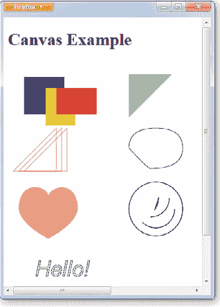

**图 2.1** Firefox 中的 Canvas 示例。

因为你使用 JavaScript 来让此元素工作，所以在在进入细节之前，我们将先查看一下可用内容的概览。

# 了解 Canvas API

W3C 为 Canvas 元素创建了一个应用程序接口（API），规定了内置函数的名称以及它们的使用方法。

你可以在 http://dev.w3.org/html5/canvas-api/canvas-2d-api.html 找到 Canvas API。我们在这里列出最常用的函数。

在 W3C API 规范中，列同时列出了元素的属性（这些是元素在 JavaScript 中使用的属性，而不是在 HTML 中，如下所示：`canvas1.fillStyle = xxxx`）以及支持的 JavaScript 函数。因此，你首先通过属性设置 Canvas 的某些方面，然后执行类似下面的操作，其中我们首先通过 `fillStyle` 属性设置绘制样式，然后使用 `fillRect` 函数绘制一个填充的矩形：

```javascript
canvas1.fillStyle = xxxx
canvas1.fillRect(xx, xx, xx, xx);
```

API 中的每个项目都带有其类型前缀，例如 `float` 表示浮点数。以下是你将在 W3C 规范中看到的一些代表性类型：

- any：用于属性——这意味着该属性可以是任何类型。
- DOMString：意味着 DOM（文档对象模型）字符串——对于我们而言，这只是一个带引号的文本字符串。
- float：这是一个浮点数。

现在让我们来看一下 Canvas API 列出的属性和函数。

# 样式

你使用两个属性在 Canvas 中设置绘制样式——决定操作是否应该填充：

- fillStyle: //（默认黑色）
- strokeStyle: //（默认黑色）

# 设置线条样式

你可以使用 JavaScript 属性来设置 Canvas 元素将使用的线条样式：

- lineCap: // “butt”, “round”, “square”（默认为“butt”）
- lineJoin: // “miter”, “round”, “bevel”（默认为“miter”）
- lineWidth: //（默认为 1）
- miterLimit: //（默认为 10）

# 绘制阴影

 Canvas 元素允许通过这些属性为图形添加阴影：

- shadowBlur: //（默认为 0）
- shadowColor: //（默认为透明）
- shadowOffsetX: //（默认为 0）
- shadowOffsetY: //（默认为 0）

# 绘制矩形

以下是你用于矩形的函数：

- rect: (x, y, w, h)
- fillRect: (x, y, w, h)
- strokeRect: (x, y, w, h)

# 绘制复杂形状

通过 Canvas 元素，你可以使用这些函数绘制弧、贝塞尔曲线等更多形状：

- arc: (x, y, radius, startAngle, endAngle, clockwise)
- arcTo: (x1, y1, x2, y2, radius)
- beginPath()
- bezierCurveTo: (cp1x, cp1y, cp2x, cp2y, x, y)
- clip()
- closePath()
- fill()
- lineTo: (x, y)
- moveTo: (x, y)
- quadraticCurveTo: (cpx, cpy, x, y)
- rect: (x, y, w, h)
- stroke()
- isPointInPath: (x, y)

## 绘制文本

你还可以使用这些属性和函数在 Canvas 中编写文本：

- font: //（默认为 10px sans-serif）
- textAlign: // "start", "end", "left", "right", "center"(默认: "start")
- baseline: // "top", "hanging", "middle", "alphabetic", "ide", "bottom"(默认: "alphabetic")
- fillText: (text, x, y, maxWidth)
- measureText: (text)
- strokeText: (text, x, y, maxWidth)

# 绘制图像

你可以使用这些函数绘制图像：

- drawImage: (HTMLImageElement image, dx, dy, dw, dh)
- drawImage: (HTMLImageElement image, sx, sy, sw, sh, dx, dy, dw, dh)
- drawImage: (HTMLCanvasElement image, dx, dy, dw, dh)
- drawImage: (HTMLCanvasElement image, sx, sy, sw, sh, dx, dy, dw, dh)
- drawImage: (HTMLVideoElement image, dx, dy, dw, dh)
- drawImage: (HTMLVideoElement image, sx, sy, sw, sh, dx, dy, dw, dh)

# 使用变换

你可以使用这些函数旋转、调整大小（缩放）或移动（平）图形：

- rotate: (angle)
- scale: (x, y)
- translate: (x, y)

这就是 Canvas API 的概览。现在让我们从下一个任务开始，通过示例来投入使用。

# 开始 Canvas 示例

为了展示如何使用 Canvas 元素，我们将创建一个名为 canvas.html 的示例，你可以在图 2.1 中看到它在 Firefox 中运行，其代码将出现在本节的最后。

要开始 canvas.html 示例，请遵循以下步骤：

1. 使用文本编辑器（如 Windows 记事本）创建 canvas.html。
2. 输入以下代码创建 <canvas> 元素并设置 JavaScript。注意，我们将 JavaScript 放在一个 `loader` 函数中，该函数会在浏览器完全加载 Canvas 元素后运行（不要输入那三个垂直点——它们只是为了显示后面还有代码）。

```html
<!DOCTYPE html>
<html>
<head>
  <title>Canvas Example</title>
  <script type="text/javascript">
    function loader() {
      // 代码写在此处
    }
  </script>
</head>
<body onload="loader()">
  <h1>Canvas Example</h1>
  <canvas id="canvas" width="600" height="500"></canvas>
</body>
</html>
```

3. 添加 JavaScript 来创建 Canvas 元素。我们将使用此对象来访问 Canvas 元素。
4. 保存 canvas.html。确保你以文本格式保存此代码。


## 绘制线条艺术

你可以使用 Canvas 控件来绘制线条艺术。你首先使用 `beginPath()` 函数让 Canvas 知道你正在创建一个图形，然后结合使用 `moveTo()` 和 `lineTo()` 函数来确定绘制位置并完整地绘制线条。

当图形绘制完成后，你使用 `closePath()` 函数来完成你绘制的路径，并使用 `stroke` 函数来画出结果。

我们在这里来看一个示例，其中我们使用这些技术绘制了三个三角形。作为一个额外功能，我们将通过将 Canvas 的 `strokeStyle` 属性设置为红色，将三角形绘制成红色：

- `canvas1.strokeStyle = "rgba(200, 0, 0, 0.5)"`

以下是绘制三角形的方法：

- 1. 使用 Windows 记事本等编辑器打开 `canvas.html`。
- 2. 添加以下代码创建三个三角形：

```
<script type="text/javascript">
function loader() {
  var canvas = document.getElementById('canvas');
  var canvas1 = canvas.getContext('2d');

  canvas1.beginPath();
  canvas1.strokeStyle = "rgba(200, 0, 0, 0.5)";
  canvas1.moveTo(110, 205);
  canvas1.lineTo(110, 125);
  canvas1.lineTo(30, 205);
  canvas1.closePath();
  canvas1.stroke();
```

```
canvas1.beginPath();
canvas1.moveTo(100, 205);
canvas1.lineTo(100, 125);
canvas1.lineTo(20, 205);
canvas1.closePath();
canvas1.stroke();
```

```
canvas1.beginPath();
canvas1.moveTo(90, 205);
canvas1.lineTo(90, 125);
canvas1.lineTo(10, 205);
canvas1.closePath();
canvas1.stroke();
```

- 3. 保存 `canvas.html`。确保你以文本格式保存此代码。

你可以在图 2.3 中看到结果，其中三个重叠的三角形都出现了。

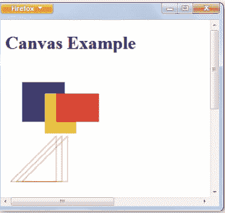

**图 2.3** 绘制三角形。

## 填充线条艺术

你还可以为你绘制的图形填充颜色。例如，在这里我们将如何绘制一个实心绿色三角形。

在这种情况下，你绘制三角形的方法与上一个任务非常相似——使用 `beginPath()`、`moveTo()`、`lineTo()` 和 `closePath()`。但要绘制三角形时，你使用的是 `fill()` 函数，而不是 `stroke()` 函数。

`fill()` 函数用你当前的填充颜色填充图形，你通过 `fillStyle` 属性设置该填充颜色。例如，这里我们如何将填充颜色设置为浅绿色：

- `canvas1.fillStyle = "rgba(0, 200, 0, 0.5)"`

以下是绘制整个绿色三角形的方法：

- 1. 使用 Windows 记事本等编辑器打开 `canvas.html`。
- 2. 添加以下代码创建绿色三角形：

```html
<script type="text/javascript">
function loader() {
  var canvas = document.getElementById('canvas');
  var canvas1 = canvas.getContext('2d');

  // 填充三角形
  canvas1.fillStyle = "rgba(0, 200, 0, 0.5)";
  canvas1.beginPath();
  canvas1.moveTo(225, 25);
  canvas1.lineTo(305, 25);
  canvas1.lineTo(225, 105);
  canvas1.closePath();
  canvas1.fill();
}
```

- 3. 保存 `canvas.html`。确保你以文本格式保存此代码。

你可以在图 2.4 中看到结果，其中填充的三角形出现了。

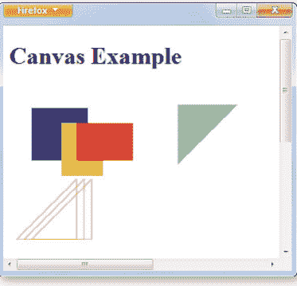

图 2.4 绘制填充的三角形。

## 使用贝塞尔曲线绘制

你并不局限于使用 `lineTo` 绘制线条。你还可以使用 `bezierCurveTo()` 函数绘制贝塞尔曲线：

- `bezierCurveTo(float cp1x, float cp1y, float cp2x, float cp2y, x, float y);`

这里有一个使用贝塞尔曲线绘制红色爱心的示例：

- 1. 使用 Windows 记事本等编辑器打开 `canvas.html`。
- 2. 添加以下代码创建实心心形：

```
<script type="text/javascript">
function loader() {
  var canvas = document.getElementById('canvas');
  var canvas1 = canvas.getContext('2d');

  // 心
  canvas1.fillStyle = "rgba(200, 0, 0, 0.5)";
  canvas1.beginPath();
```

```
canvas1.moveTo(75, 250);
canvas1.bezierCurveTo(75, 247, 70, 235, 50, 235);
canvas1.bezierCurveTo(20, 235, 20, 272.5, 20, 272);
canvas1.bezierCurveTo(20, 290, 312, 315, 330);
canvas1.bezierCurveTo(110, 312, 130, 290, 130, 272);
canvas1.bezierCurveTo(130, 272.5, 130, 235, 100, 235);
canvas1.bezierCurveTo(235, 245, 45, 200, 250);
canvas1.closePath();
canvas1.fill();
```

- 3. 保存 `canvas.html`。确保你以文本格式保存此代码。

你可以在图 2.5 中看到结果，其中红色爱心出现了。

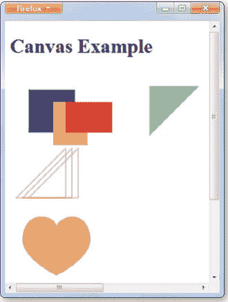

图 2.5 绘制填充的心形。

## 使用二次曲线绘制

除了上一个任务中看到的贝塞尔曲线，你还可以使用 `quadraticCurveTo()` 函数绘制二次曲线：

- `quadraticCurveTo(float cpx, float cpy, x, float y);`

这是一个使用二次曲线绘制图形的示例：

- 1. 使用 Windows 记事本等编辑器打开 `canvas.html`。
- 2. 添加以下代码创建二次图形：

```
<script type="text/javascript">
function loader() {
  var canvas = document.getElementById('canvas');
  var canvas1 = canvas.getContext('2d');

  // 二次曲线
  canvas1.strokeStyle = "rgba(0, 0, 0, 1)";
  canvas1.moveTo(275, 125);
  canvas1.quadraticCurveTo(225, 125, 225, 162);
  canvas1.quadraticCurveTo(260, 200, 265, 200);
  canvas1.quadraticCurveTo(325, 200, 325, 162);
  canvas1.closePath();
  canvas1.stroke();
}
</script>
```

- 3. 保存 `canvas.html`。确保你以文本格式保存此代码。

你可以在图 2.6 中看到结果，其中使用二次曲线绘制的图形出现了。

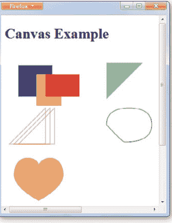

图 2.6 使用二次曲线绘制。

## 绘制弧

Canvas 控件还可以使用 `arc` 函数绘制弧：

- `arc(float x, float y, float radius, float startAngle, float endAngle, boolean anticlockwise);`

这是一个使用弧绘制图形的示例：

- 1. 使用 Windows 记事本等编辑器打开 `canvas.html`。
- 2. 添加以下代码创建弧（注意使用 JavaScript常量 `Math.PI` 来获取 pi 值）：

```
<script type="text/javascript">
function loader() {
  var canvas = document.getElementById('canvas');
  var canvas1 = canvas.getContext('2d');
}
```

```
// 弧
canvas1.beginPath();
canvas1.arc(275, 275, 50, 0, Math.PI * 2, true);
```

```
canvas1.moveTo(310, 275);
canvas1.arc(275, 275, 35, 0, 0.75 * Math.PI, false);
```

```
canvas1.moveTo(300, 255);
canvas1.arc(275, 255, 35, 0, 0.5 * Math.PI, false);
```

```
canvas1.moveTo(280, 255);
canvas1.arc(245, 255, 35, 0, 0.2 * Math.PI, false);
canvas1.stroke();
```

- 3. 保存 `canvas.html`。确保你以文本格式保存此代码。

你可以在图 2.7 中看到结果，其中你可以看到弧。

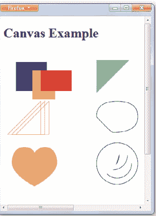

图 2.7 使用弧绘制。

## 绘制文本

你也可以在 Canvas 控件中绘制文本。要做到这一点，首先通过将 Canvas 控件的 `font` 属性设置为包含你所选字体规范的字符串来选择使用的字体：

- `canvas1.font = 'italic 40px sans-serif';`

这行 JavaScript 安装了高度为40 像素的斜体无衬线字体作为默认字体（如果你不需要，只需省略它）。

在设置好所需的字体后，你可以使用 `strokeText()` 等函数绘制文本，传递你想要绘制的文本及其位置，就像我们在示例中所做一样：

- 1. 使用 Windows 记事本等编辑器打开 `canvas.html`。
- 2. 添加以下代码绘制文本：

```
<script type="text/javascript">
function loader() {
  var canvas = document.getElementById('canvas');
  
  var canvas1 = canvas.getContext('2d');
  
  canvas1.font = 'italic 40px sans-serif';
  canvas1.strokeText("Hello!", 50, 400);
}
```

- 3. 保存 `canvas.html`。确保你以文本格式保存此代码。

你可以在图 2.8 中看到结果，你可以在图形底部看到文本。

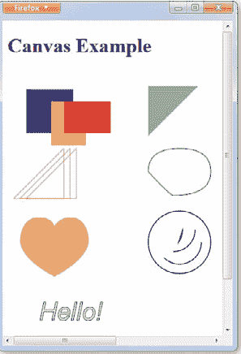

图 2.8 绘制文本。

## canvas.html 示例代码

以下是本课程中开发的 `canvas.html` 示例的完整代码，供参考：

```
<!DOCTYPE html>
<html>
<head>
  <title>
    Canvas Example
  </title>
  <script type="text/javascript">
  function loader() {
    var canvas = document.getElementById('canvas');
    var canvas1 = canvas.getContext('2d');

    // Rect形
    canvas1.fillStyle = "rgba(0, 0, 200, 1)";
    canvas1.fillRect(30, 30, 75, 70);
```


# 第二节：：使用 Canvas 元素绘图

```javascript
canvas1.fillStyle = "rgba(200, 200, 0, 1)";
canvas1.fillRect(70, 50, 55, 70);
```

```javascript
canvas1.fillStyle = "rgba(200, 0, 0, 1)";
canvas1.fillRect(90, 50, 75, 50);
```

```javascript
// 填充三角形
canvas1.fillStyle = "rgba(0, 200, 0, 0.5)";
canvas1.beginPath();
canvas1.moveTo(225, 25);
canvas1.lineTo(305, 25);
canvas1.lineTo(225, 105);
canvas1.closePath();
canvas1.fill();
```

```javascript
// 描边三角形
canvas1.beginPath();
canvas1.strokeStyle = "rgba(200, 0, 0, 0.5)";
canvas1.moveTo(110, 205);
canvas1.lineTo(110, 125);
canvas1.lineTo(30, 205);
canvas1.closePath();
canvas1.stroke();
```

```javascript
canvas1.beginPath();
canvas1.moveTo(100, 205);
canvas1.lineTo(100, 125);
canvas1.lineTo(20, 205);
canvas1.closePath();
canvas1.stroke();
```

```javascript
canvas1.beginPath();
canvas1.moveTo(90, 205);
canvas1.lineTo(90, 125);
canvas1.lineTo(10, 205);
canvas1.closePath();
canvas1.stroke();
```

```javascript
// 心形
canvas1.fillStyle = "rgba(200, 0, 0, 0.5)";
canvas1.beginPath();
canvas1.moveTo(75, 250);
canvas1.bezierCurveTo(75, 247, 70, 235, 50, 235);
canvas1.bezierCurveTo(20, 235, 20, 272.5, 20, 272);
canvas1.bezierCurveTo(20, 290, 40, 312, 75, 330);
```

## canvas.html 示例代码

```javascript
canvas1.bezierCurveTo(110, 312, 130, 290, 130, 272);
canvas1.bezierCurveTo(130, 272.5, 130, 235, 100, 235);
canvas1.bezierCurveTo(85, 235, 75, 247, 75, 250);
canvas1.closePath();
canvas1.fill();
```

```javascript
// 二次曲线
canvas1.strokeStyle = "rgba(0, 0, 0, 1)";
canvas1.beginPath();
canvas1.moveTo(275, 125);
canvas1.quadraticCurveTo(225, 225, 225, 162);
canvas1.quadraticCurveTo(260, 200, 265, 200);
canvas1.quadraticCurveTo(325, 200, 325, 162);
canvas1.quadraticCurveTo(325, 125, 275, 125);
canvas1.closePath();
canvas1.stroke();
```

```javascript
// 弧线
canvas1.beginPath();
canvas1.arc(275, 50, 0, Math.PI * 2, true);
canvas1.moveTo(310, 275);
canvas1.arc(275, 275, 35, 0, 0.75 * Math.PI, false);
canvas1.moveTo(300, 255);
canvas1.arc(245, 255, 35, 0, 0.5 * Math.PI, false);
canvas1.moveTo(280, 255);
canvas1.arc(245, 255, 35, 0, 0.2 * Math.PI, false);
canvas1.closePath();
canvas1.stroke();
```

```javascript
canvas1.font = "italic 40px sans-serif";
canvas1.fillText("Hello!", 50, 400);
</script>
</head>
<body onload="loader()">
<h1>canvas</h1>
<canvas id="canvas" width="600" height="500"></canvas>
</body>
</html>
```

# 第三节

## 使用 HTML5 进行拖放

HTML5 支持拖放操作，你可以使用鼠标或其他设备在窗口中移动元素和文本。这对于某些操作非常有用，例如允许用户将物品移动购物车，或允许他们自定义主页上显示的元素，它是 HTML 中一个非常流行的部分。

拖放是通过通过添加到 HTML5 元素的若干属性来实现的，例如 `draggable` 属性，将其设置为 true 以使元素可拖动。然而，你需要在脚本语言（如 JavaScript）中完成大部分工作，你将看到。

## 欢迎学习拖放

从 HTML5 元素的角度来看，拖放涉及这些属性：

- 必需属性：`draggable`, `ondragenter`, `ondragover`, `ondrop`, `ondragstart`
- 支持的浏览器：Chrome, Firefox, Safari

真正的故事发生在 JavaScript 等脚本语言中，你将看到。你需要连接每个 "on" 属性，例如 `ondragstart`，当用户开始拖动元素时发生：`ondragstart = "return start(event)"`。

提示：所有 "on" 属性都以 "ondrag" 开头，例外是 `ondrop`，它在松开物品时发生。记住这个属性是 `ondrop` 而不是 `ondragdrop`，否则在某些浏览器中不会运行你的代码。

在本节中，我们将创建一个拖放示例 `draganddrop.html`，你将在图 3.1 和 3.2 中看到三个可以拖动的元素，分别为 1、2 和 3。我们设置了示例，使得并非所有元素都能被拖放到目标上。例如，如果你尝试将 1 拖放到第二个目标，将得到一个 "no" 符号，如图 3.1 所示。另一方面，你可以将 1 拖放到第三个目标，如图 3.2 所示。

![图 3.1 拒绝拖放操作]
![图 3.2 允许拖放操作]

## 了解拖放 API

你可以根据 W3C 的规范在 http://dev.w3.org/html5/spec/dnd.html 读取所有关于拖放的信息。

从 HTML 的角度来看，拖放支持支持：

- `draggable`
- `ondragenter`
- `ondragover`
- `ondrop`
- `ondragstart`
- `ondragend`

如果你允许该元素被拖动，元素的 `draggable` 属性设置为 true。"on" 属性用于将 JavaScript 函数连接到事件。例如，使用 `ondragenter` 在可拖动元素拖过另一个元素时调用 JavaScript 函数（在 JavaScript 函数中，你可以指示浏览器是否可以在那里释放可拖动物品）。

让我们简要查看这些属性的每一个；然后我们将在 `draganddrop.html` 示例中使用它们。

## draggable 属性

`draggable` 属性是所有拖放属性中最基本的。要使元素可拖动，你将其 `draggable` 属性设置为 true：

```html
<div id="draggable3" draggable="true"></div>
```

这样做会通知浏览器该元素是可以拖动的，但设置此属性并不是全部——你还需要将 JavaScript 函数连接到 "on" 属性使其工作。

## ondragenter 属性

当用户将可拖动元素拖过目标时，拖拽进入发生在目标处。你可以将此事件连接到 JavaScript 处理函数（由你来编写）：

```html
<div id="target1" ondragenter="return enter(event)"></div>
```

注意，这发生在目标上，而不是可拖动元素上。

## ondragover 属性

当用户拖动可拖动元素拖过目标时，`dragover` 事件发生在目标处。你可以将此事件连接到 JavaScript 处理函数：

```html
<div id="target1" ondragover="return over(event)"></div>
```

此事件发生在目标处。

## ondrop 属性

当用户将可拖动元素拖放到目标上时，`drop` 事件发生在目标处。你可以将此事件连接到 JavaScript 处理函数：

```html
<div id="target1" ondrop="return drop(event)"></div>
```

此事件发生在目标处。

## ondragstart 属性

当用户开始拖动可拖动元素时，`dragstart` 事件发生在可拖动元素上。你可以将此事件连接到 JavaScript 处理函数：

```html
<div id="draggable1" draggable="true" ondragstart="return start(event)"></div>
```

此事件发生在可拖动元素上。

## ondragend 属性

当用户停止拖动时，`dragend` 事件发生在可拖动元素上。你可以将此事件连接到 JavaScript 处理函数：

```html
<div id="draggable1" draggable="true" ondragend="return end(event)"></div>
```

此事件发生在可拖动元素上。


## 开始拖放示例

为了展示如何实现拖放功能，我们将创建一个名为 `draganddrop.html` 的示例。你可以在图 3.1 和 3.2 中看到它的运行效果，其完整代码出现在本节的末尾。

要开始 `draganddrop.html` 示例，请按照以下步骤操作：

- 1. 使用 Windows WordPad 等文本编辑器创建 `draganddrop.html`。

- 2. 输入以下代码以创建三个可以放置可拖拽元素的元素。请注意，我们将使用 `<div>` 元素作为目标，并将目标支持的拖放事件连接到我们稍后编写的 JavaScript 函数。

```html
<!DOCTYPE HTML>
<html>
<head>
<title>
Drag and Drop Example
</title>
</head>
<body>
<h1>Drag and Drop Example</h1>

<div id="target1"
ondragenter="return enter(event)"
ondragover="return over(event)"
ondrop="return drop(event)">
</div>

<div id="target2"
ondragenter="return enter(event)"
ondragover="return over(event)"
ondrop="return drop(event)">
</div>

<div id="target3"
ondragenter="return enter(event)"
ondragover="return over(event)">
```

```html
ondrop="return drop (event)">
</div>
</body>
</html>
```

- 3. 添加以下代码以创建作为第一个目标子元素的三个可拖拽 `<div>` 元素。请注意，我们将每个可拖拽 `<div>` 元素的 `draggable` 属性设置为 `true`，并将可拖拽元素连接到稍后编写的 JavaScript 支持函数。

```html
<!DOCTYPE HTML>
<html>
<head>
<title>
Drag and Drop Example
</title>
</head>
<body>
<h1>Drag and Drop Example</h1>

<div id="target1"
ondragenter="return enter (event)"
ondragover="return over (event)"
ondrop="return drop (event)">

<div id="draggable1" draggable="true"
ondragstart="return start (event)"ondragend="return end (event)">1</div>

<div id="draggable2" draggable="true"
ondragstart="return start (event)"ondragend="return end (event)">2</div>

<div id="draggable3" draggable="true"
ondragstart="return start (event)"ondragend="return end (event)">3</div>

<div id="target2"
ondragenter="return enter (event)"
ondragover="return over (event)"
ondrop="return drop (event)">
```

```html
<div id="target3"
ondragenter="return enter(event)"
ondragover="return over(event)"
ondrop="return drop(event)">
</div>
</body>
</html>
```

- 4. 保存 `draganddrop.html`。请确保你以文本格式保存此代码（例如，WordPad 的默认格式是 RTF 富文本格式，这在浏览器无法运行）。

现在我们已经启动了示例，包含了三个目标和三个可拖拽元素。然而，到目前这些元素都是不可见的，因此接下来我们将对它们进行样式设置。

## 为可拖拽和目标元素设置样式

在任务任务中，我们将用于目标和可拖拽元素的 `<div>` 元素变为可见。特别是，我们将目标元素设置为青色，将可拖拽元素设置为橙色。

要执行此操作，请按照以下步骤操作：

- 1. 使用 Windows WordPress 等文本编辑器打开 `draganddrop.html`。

- 2. 添加以下代码为可拖拽 `<div>` 元素和目标 `<div>` 元素设置样式，并给它们设定尺寸。

```html
<!DOCTYPE HTML>
<html>
<head>
<title>
Drag and Drop Example
</title>
<style type="text/css">
#target1, #target2, #target3
{
float-left; width:250px; height:250px;
padding:10px; margin:10px;
}
```

```css
#draggable1, #draggable2, #draggable3
  width:75px; height:70px; padding:5px;
  margin:5px;
}
```

```css
#target1 {background-color: cyan;}
#target2 {background-color: cyan;}
#target3 {background-color: cyan;}
```

```css
#draggable1 {background-color: orange;}
#draggable2 {background-color: orange;}
#draggable3 {background-color: orange;}
</style>
```

```html
</head>
```

```html
<body>
<h1>Drag and Drop Example</h1>
```

```html
<div id="target1"
ondragenter="return enter (event)"
ondragover="return over (event)"
ondrop="return drop (event)"></div>
```

```html
<div id="draggable1" draggable="true"
ondragstart="return start (event)"
ondragend="return end (event)">1
</div>
```

```html
<div id="draggable2" draggable="true"
ondragstart="return start (event)"
ondragend="return end (event)">2
</div>
```

```html
<div id="draggable3" draggable="true"
ondragstart="return start (event)"
ondragend="return end (event)">3
</div>
```

```html
<div id="target2"
ondragenter="return enter (event)"
ondragover="return over (event)"
ondrop="return drop (event)"></div>
```

```html
<div id="target3"
ondragenter="return enter(event)"
ondragover="return over(event)"
ondrop="return drop(event)">
</div>
</body>
</html>
```

- 3. 保存 `draganddrop.html`。请确保你以文本格式保存此代码（例如，WordPad 的默认格式是 RTF 富文本格式，这在浏览器无法运行）。

现在你可以看到图 3.3 所示的可拖拽元素和目标。

图 3.3 draganddrop.html 中的可拖拽元素和目标

## 拖放操作

当用户开始拖拽示例中的 `<div>` 元素时，会触发 `dragstart` 事件，我们将其绑定到 `start()` 函数。在此任务中，我们将编写 `start()` 函数来启动拖放。这涉及到三个步骤：设置允许的拖放操作为“move”以便可以拖拽 `<div>` 元素；存储被拖拽元素的 ID 以便在释放时移动它；以及设置用户将拖拽的图像。

要完成这些操作，请按照以下步骤操作：

- 使用文本编辑器打开 `draganddrop.html`。

- 在 `draganddrop.html` 的 `<head>` 部分添加以下代码，引入 `<script>` 元素并创建 `start()` 函数：

```html
<script type="text/javascript">
function start(e) {
```

- 在 `start()` 函数中添加以下代码，通过将传递给 `start()` 函数的事件 `dataTransfer.effectAllowed` 属性设置为“move”来指示用户尝试拖拽 `<div>` 元素：

```html
<script type="text/javascript">
function start(e) {
  e.dataTransfer.effectAllowed='move';
}
```

- 4. 在 `start()` 函数中添加以下代码，存储被拖拽 `<div>` 元素的 ID，以便在释放时移动它：

```html
<script type="text/javascript">
function start(e)
{
  e.dataTransfer.effectAllowed='move';
  e.dataTransfer.setData("Data",
  e.target.getAttribute('id'));
```

- 5. 在 `start()` 函数中添加以下代码，设置 `<div>` 元素为拖拽图像，偏移量为 (0, 0)：

```html
<script type="text/javascript">
function start(e)
{
  e.dataTransfer.effectAllowed='move';
  e.dataTransfer.setData("Data",
  e.target.getAttribute('id'));
  e.dataTransfer.setDragImage(e.target, 0, 0);
  return true;
}
```

- 6. 保存 `draganddrop.html`。请确保使用文本格式保存此代码（例如，WordPad 的默认格式是 RTF 富文本格式，这在浏览器无法运行）。

现在用户可以拖拽示例中的可拖拽 `<div>` 元素了。

## 拖拽对象进入目标

当用户将可拖拽 `<div>` 元素拖到目标 `<div>` 元素时，会触发目标 `<div>` 元素的 `drag` 事件。我们将该事件绑定到名为 `enter()` 的 JavaScript 函数，在该函数中，我们希望通过从 `enter()` 返回 `true` 来指示拖拽对象进入目标。

要执行此操作，请按照以下步骤操作：

- 1. 使用 Windows WordPad 等文本编辑器打开 `draganddrop.html`。

- 2. 在 `draganddrop.html` 的 `<script>` 部分添加以下代码，创建 `enter()` 函数并返回 `true`，以指示可拖拽元素可以目标：

```javascript
function enter(e)
{
  return true;
}
```

- 3. 保存 `draganddrop.html`。请确保你以文本格式保存此代码（例如，WordPad 的默认格式是 RTF 富文本格式，这在浏览器无法运行）。

现在用户可以将可拖拽 `<div>` 元素拖到目标处。

## 允许拖拽对象放置在特定目标

当用户将可拖拽 `<div>` 元素拖过目标时，会触发目标的 `dragover` 事件，我们将其绑定到名为 `over()` 的函数。你可以使用 `over()` 函数来指示拖拽项目是否可以放置在当前目标上。如果你从此函数返回 `true`，则拖拽项目可能无法放置；返回 `false` 则意味着可以放置。

要创建 `over()` 函数，请按照以下步骤操作：

- 1. 使用 Windows WordPad 等文本编辑器打开 `draganddrop.html`。

- 2. 在 `draganddrop.html` 的 `<script>` 部分添加以下代码，创建 `over()` 函数并获取被拖拽项目的 ID（draggable）和目标的 ID（id）：

```javascript
function over(e)
{
  var iddraggable = 
```


[content]

```javascript
var iddraggable = e.dataTransfer.getData("Data");
var id = e.target.getAttribute('id');
```

- 3. 将以下代码添加到 `over()` 函数中，以指示任何被拖拽的项目都可以放置在目标 1 上，可拖的 `<div>` 元素 3 只能放置在目标 2 上，而可拖的 `<div>` 元素 1 和 2 只能放置在目标 3 上：

```javascript
{
  var iddraggable =
  e.dataTransfer.getData("Data");
  var id = e.target.getAttribute('id');

  if(id=='target1')
    return false;

  if(id=='target2')
    && iddraggable == 'draggable3'
    return false;

  else if(id=='target3'
    && (iddaggable == 'draggable1' ||
    iddaggable == 'draggable2')
    return false;

  else
    return true;
}
```

- 4. 保存 dragandrop.html。确保以文本格式保存此代码（例如，Word 的默认格式是 RTF，富文本格式，浏览器将无法识别）。

现在你已经告知浏览器可拖的 `<div>` 元素可以放置在哪些目标 `<div>` 元素上。

## 处理释放事件

当用户将可拖的 `<div>` 元素释放到允许的目标 `<div>` 元素上时，我们如何将可拖的 `<div>` 移动到目标呢？事实证明很简单——我们将使用内置 JavaScript 函数 `appendChild` 将可拖的 `<div>` 元素添加到当前目标 `<div>` 元素中。

当用户将可拖的 `<div>` 元素释放到目标时，目标元素会触发 `ondrop` 事件，我们连接了一个名为 `drop()` 的 JavaScript 函数来执行释放操作。要向 dragandrop.html 示例中添加 `drop()`，请遵循以下步骤：

- 使用 Windows记记本等文本编辑器打开 dragandrop.html。

- 将以下代码添加到 dragandrop.html 的 `<script>` 区域，创建 `drop()` 函数并获取被拖拽项目的 ID (iddraggable)：

```javascript
function drop(e) {
  var draggable =
  e.dataTransfer.getData("Data");
}
```

- 将以下代码添加到 `drop()` 函数中，将可拖的 `<div>` 元素添加到目标 `<div>` 元素中，同时使用 `stopPropagation()` 函数停止事件在浏览器中的进一步传播（返回 `false` 值也会停止事件的进一步传播）：

```javascript
function drop(e) {
  var draggable =
  e.dataTransfer.getData("Data");
  e.target.appendChild(
  document.getElementById(iddraggable));
  e.stopPropagation();
  return false;
}
```

- 4. 保存 dragandrop.html。确保以文本格式保存此代码（例如，WordPad 的默认格式是 RTF，富文本格式，浏览器将无法识别）。

现在你已经了释放操作。

## 结束释放操作

当可拖的 `<div>` 元素被释放时，会触发其 `ondragEnd` 事件，我们已将其绑定到 JavaScript 函数 `end()`。将在 `end()` 函数中添加代码来清除 `dataTransfer` 对象中存储的数据（即被拖拽元素的 ID），因为此时释放操作已经完成。只需遵循以下步骤：

- 1. 使用 Windows 记事本等文本编辑器打开 dragandrop.html。

- 2. 将以下代码添加到 dragandrop.html 的 `<script>` 区域，创建 `end()` 函数，然后结束 dragandrop.html 中的 `<script>` 区域：

```javascript
function end(e)
{
  e.dataTransfer.clearData("Data");
  return true
}
```

- 3. 保存 dragandrop.html。确保以文本格式保存此代码（例如，WordPad 的默认格式是 RTF，富文本格式，浏览器将无法识别）。

现在你已经完成了 dragandrop.html 示例，可以使用任何支持的浏览器进行拖拽和释放，如图 3.4 所示。

# 课程 3：使用 HTML5 进行拖拽和释放

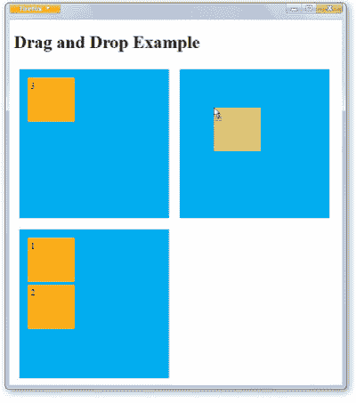

图 3.4 使用 draganddrop.html 进行拖拽和释放。

## dragandrop.html 示例代码

以下是本课程中开发的 dragandrop.html 示例的完整代码，供参考：

```html
<!DOCTYPE HTML>
<html
<head>
<title>
拖放释放示例
</title>
<style type="text/css*">
#target1, #target2, #target3
{
 float:left; width:250px; height:250px;
padding:10px; margin:10px;
}
```

```css
#draggable1, #draggable2, #draggable3
{
  width:75px; height:70px; padding:5px;
  margin:5px;
}

#target1 {background-color: cyan;}
#target2 {background-color: cyan;}
#target3 {background-color: cyan;}

#draggable1 {background-color: orange;}
#draggable2 {background-color: orange;}
#draggable3 {background-color: orange;}
</style>
```

```javascript
<script>
function start(e) {
  e.dataTransfer.setData("Data", e.target.id);
  e.dataTransfer.effectAllowed = 'move';
}

function over(e) {
  e.preventDefault();
  var iddraggable = e.dataTransfer.getData("Data");
  var id = e.target.getAttribute('id');

  if(id=='target1')
    return false;

  if(id=='target2')
    && iddraggable == 'draggable3'
    return false;

  else if(id=='target3'
    && (iddaggable == 'draggable1' ||
    iddaggable == 'draggable2')
    return false;

  else
    return true;
}

function drop(e) {
  e.preventDefault();
  var draggable = e.dataTransfer.getData("Data");
  e.target.appendChild(
  document.getElementById(iddraggable));
  e.stopPropagation();
  return false;
}

function end(e) {
  e.dataTransfer.clearData("Data");
  return true
}
</script>
</head>
<body>

<h1>拖放释放示例</h1>

<div id="draggable1" ondragstart="start(e)" ondragover="over(e)" ondrop="drop(e)" ondragend="end(e)" draggable="true">1</div>
<div id="draggable2" ondragstart="start(e)" ondragover="over(e)" ondrop="drop(e)" ondragend="end(e)" draggable="true">2</div>
<div id="draggable3" ondragstart="start(e)" ondragover="over(e)" ondrop="drop(e)" ondragend="end(e)" draggable="true">3</div>

<div id="target1" ondragover="over(e)">1</div>
<div id="target2" ondragover="over(e)">2</div>
<div id="target3" ondragover="over(e)">3</div>

</body>
</html>
```
[/content]


## 表 4.1 Web 表单控件

| 类型 | 控制类型 |
| --- | --- |
| time | 时间控件 |
| url | 文本字段 |
| week | 周控件 |

在本节中，我们将创建一个名为 `webforms.html` 的示例，重点介绍新的 HTML5 控件，如图如图 4.1 所示，该示例在 Opera 浏览器中运行。

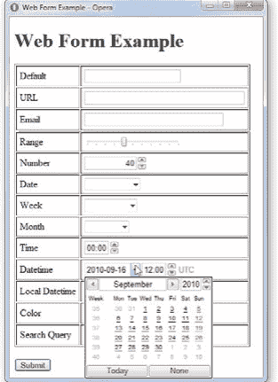

## 图 4.1 webforms.html 示例。

作为一种演示，我们还将用 PHP 语言编写一个小型程序 `webforms.php`，它将运行在服务器上，并读取在 `webforms.html` 的 `datetime` 控件输入的值，然后将其报告出来，如图 4.2 所示。通过从特定控件读取数据，该 PHP 脚本展示了如何从服务器上的任何 Web 表单控件读取数据，如果这正是你想要做的话。

现在让我们深入研究 Web 表单控件，看看可以使用哪些属性和函数。


**图 4.2** 从 datetime 控件读取值。

## 了解 Web 表单控件 API

你知道可以通过 `<input>` 元素创建 Web 表单控件，并如表 4.1 所示设置 `type` 属性。但每个控件还有哪些可用属性呢？例如，当你使用范围控件（允许用户使用滑块指定值）时，除了 `<input>` 元素中的 `type` 属性外，还可以使用 `min` 和 `max` 属性。

表 4.2 显示了哪些控件允许哪些属性。此外，每个控件都有内置函数，当我们将控件作为对象访问时，可以在 JavaScript 中调用这些函数，你可以在表 4.3 中找到这些函数。最后，许多控件在用户输入数据时会触发内置事件；你可以在表 4.4 中找到这些事件。

## 表 4.2 允许的控件属性

| Hidden | Text, Search, URL, | Telephone | E-mail | Password | Time, Date, Month, and Time | Local Date, Time, Number | Range | Color | Checkbox, Radio Button | File Upload | Submit Button | Image Button | Reset Button |
|---|---|---|---|---|---|---|---|---|---|---|---|---|---|---|
| accept | . | . | . | . | . | . | . | . | . | X | . | . | . |
| alt | . | . | . | . | . | . | . | . | . | . | . | X | . |
| autocomplete | X | X | X | X | X | X | . | . | . | X | . | . | . |
| checked | . | . | . | . | . | . | . | . | . | . | . | . | . | . |
| formation | . | . | . | . | . | . | . | . | . | . | . | X | X | . |
| formenctype | . | . | . | . | . | . | . | . | . | . | X | X | . |
| formmethod | . | . | . | . | . | . | . | . | . | . | X | X | . |
| formnovalidate | . | . | . | . | . | . | . | . | . | . | X | X | . |
| formtarget | . | . | . | . | . | . | . | . | . | . | X | X | . |
| height | . | . | . | . | . | . | . | . | . | . | . | X | . |

## 表 4.2 允许的控件属性

| Hidden | Text, Search, URL. | Telephone | E-mail | Password | Time, Date, Month, and Week, Time | Local Date, Number | Range | Color | Checkbox, Button | File Upload | Submit Button | Image Button | Reset Button |
| :--- | :--- | :--- | :--- | :--- | :--- | :--- | :--- | :--- | :--- | :--- | :--- | :--- | :--- | :--- |
| list | . | X | X | . | X | X | X | X | X | . | . | . | . | . | . |
| max | . | . | . | . | X | X | X | . | . | . | . | . | . | . | . |
| maxlength | . | X | . | X | X | . | . | . | . | . | . | . | . | . | . |
| min | . | . | . | . | X | X | X | . | . | . | . | . | . | . | . |
| multiple | . | . | . | X | . | . | . | . | . | . | X | . | . | . | . |
| pattern | . | X | X | X | . | . | . | . | . | . | . | . | . | . | . |
| placeholder | . | X | X | X | . | . | . | . | . | . | . | . | . | . | . |
| readonly | . | X | X | X | . | . | X | . | . | . | . | . | . | . | . |
| required | . | X | X | X | . | . | . | . | . | . | . | . | . | . |
| size | . | X | X | X | . | . | . | . | . | . | . | . | . | . | . |
| src | . | . | . | . | . | . | . | . | . | . | . | . | . | . |
| step | . | . | . | . | . | . | . | . | . | . | . | . | . | . |
| width | . | . | . | . | . | . | . | . | . | . | . | . | . | . |

## 表 4.3 内置属性与函数

| | Text, Search, URL. | Telephone | E-mail | Password | Time, Date, Month, and Week, Time | Local Date, Number | Range | Color | Checkbox, Button | File Upload | Submit Button | Image Button | Reset Button |
| :--- | :--- | :--- | :--- | :--- | :--- | :--- | :--- | :--- | :--- | :--- | :--- | :--- | :--- | :--- |
| list | . | X | X | . | X | X | X | X | X | . | . | . | . | . | . |
| max | . | . | . | . | X | X | X | . | . | . | . | . | . | . | . |
| maxlength | . | X | . | X | X | . | . | . | . | . | . | . | . | . | . |
| min | . | . | . | . | X | X | X | . | . | . | . | . | . | . | . |
| multiple | . | . | . | X | . | . | . | . | . | . | X | . | . | . | . |
| pattern | . | X | X | X | . | . | . | . | . | . | . | . | . | . | . |
| placeholder | . | X | X | X | . | . | . | . | . | . | . | . | . | . | . |
| readonly | . | X | X | X | . | . | X | . | . | . | . | . | . | . | . |
| required | . | X | X | X | . | . | . | . | . | . | . | . | . | . | . |
| size | . | X | X | X | . | . | . | . | . | . | . | . | . | . | . |
| src | . | . | . | . | . | . | . | . | . | . | . | . | . | . | . |
| step | . | . | . | . | . | . | . | . | . | . | . | . | . | . | . |
| width | . | . | . | . | . | . | . | . | . | . | . | . | . | . | . |

## 表 4.4 控件事件

| Hidden | Text, Search, URL, | Telephone | E-mail | Password | Time, Date, Month, and Time | Local Date, Time, Number | Range | Color | Checkbox, Radio Button | File Upload | Submit Button | Image Button | Reset Button |
|---|---|---|---|---|---|---|---|---|---|---|---|---|---|---|
| accept | . | . | . | . | . | . | . | . | . | X | . | . | . |
| alt | . | . | . | . | . | . | . | . | . | . | . | X | . |
| autocomplete | X | X | X | X | X | X | . | . | . | X | . | . | . |
| checked | . | . | . | . | . | . | . | . | . | . | . | . | . |
| formation | . | . | . | . | . | . | . | . | . | . | . | X | X | . |
| formenctype | . | . | . | . | . | . | . | . | . | . | X | X | . |
| formmethod | . | . | . | . | . | . | . | . | . | . | X | X | . |
| formnovalidate | . | . | . | . | . | . | . | . | . | . | X | X | . |
| formtarget | . | . | . | . | . | . | . | . | . | . | X | X | . |
| height | . | . | . | . | . | . | . | . | . | . | . | X | . |

## 表 4.5 控件数据类型

| 类型 | 数据类型 |
| --- | --- |
| button | n/a |
| checkbox | 来自预定义列表的零或多个值 |
| color | 具有 8 位红、绿、蓝分量的 sRGB 颜色 |
| date | 一个日期（年、月、日），没有时区 |
| datetime | 一个日期时间（年、月、日、小时、分、秒、小数部分秒），且时区设置为 UTC |
| datetime-local | 一个日期时间（年、月、日、小时、分、秒、小数部分秒），且没有时区 |
| email | 电子邮件地址或电子邮件地址列表 |
| file | 具有 MIME 类型的多个文件，并可选文件名 |
| hidden | 任意字符串 |
| image | 相对于特定图像尺寸的坐标，具有额外的语义，即它必须是最后一个选中值并触发表单提交 |
| month | 由年份和月份组成的日期，没有时区 |
| number | 数值 |
| password | 没有换行符的文本（敏感信息） |
| radio | 枚举值 |
| range | 数值，具有额外的语义，即确切值并不重要 |
| reset | n/a |
| search | 没有换行符的文本 |
| submit | 枚举值 |
| tel | 没有换行符的文本 |
| text | 没有换行符的文本 |
| time | 一个时间（小时、分、秒、小数部分秒），没有时区 |
| url | 绝对 IRI |
| week | 由周年份数字和周数组成的日期，没有时区 |


## 创建默认控件

如果你没有指定想要创建的控件类型，你将得到一个文本字段，如此任务所示。

按照以下步骤操作：

- 1. 使用 Windows WordPad 等文本编辑器打开 `webforms.html`。
- 2. 添加以下代码来创建一个默认控件，而不指定 `type` 属性。注意 `autofocus` 属性，这意味着当页面加载时，闪烁的光标将出现在此控件中；以及 `placeholder` 属性，它允许你在控件中设置占位符文本。（这在任何浏览器中目前尚未起作用。）

```html
<!DOCTYPE html>
<html>
<head>
<title>
  Web Form Example
</title>
</head>
<body>
<h1>Web Form Example</h1>
<form method="post" action="webforms.php">
<table border="1" cellpadding="5">
<tr>
<td>Default/</td><td><input name="name" placeholder="Enter your nickname" autofocus></td>
</tr>
.
.
<input type="submit" value="Submit">
</form>
</body>
</html>
```

- 3. 保存 `webforms.html`。确保你将此代码保存为文本格式（例如，WordPad 的默认格式是 RTF，富文本格式，浏览器无法正常工作）。

现在默认控件以文本字段的形式出现，如你在图 4.1 顶部所所示。

## 创建 URL 控件

你也可以创建 URL 字段；只需按照以下步骤操作：

- 1. 使用 Windows WordPad 等文本编辑器打开 `webforms.html`。
- 2. 添加以下代码来创建一个 URL 控件。

```html
<!DOCTYPE html>
<html>
<head>
<title>
  Web Form Example
</title>
</head>
<body>
<h1>Web Form Example</h1>
<form method="post" action="webforms.php">
<table border="1" cellpadding="5">
<tr>
<td>Default</td><td><input name="name" placeholder="Enter your nickname" autofocus></td>
</tr>
<tr>
<td>URL</td><td><input name="url" type="url"></td>
</tr>
</table>
..
<input type="submit" value="Submit">
</form>
</body>
</html>
```

## 创建电子邮件控件

HTML5 同样支持电子邮件控件；只需按照以下步骤操作：

- 1. 使用 Windows WordPad 等文本编辑器打开 `webforms.html`。
- 2. 添加以下代码。

```html
<!DOCTYPE html>
<html>
<head>
  <title>
    Web Form Example
  </title>
</head>
<body>
<h1>Web Form Example</h1>
<form method="post" action="webforms.php">
  <table border="1" cellpadding="5">
    .
    <tr>
    <td>Email</td><td><input name="email" type="email"></td>
    </tr>
    .
  </table>
  <input type="submit" value="Submit">
</form>
</body>
</html>
```

- 3. 保存 `webforms.html`。确保你将此代码保存为文本格式（例如，WordPad 的默认格式是 RTF，富文本格式，浏览器无法正常工作）。

浏览器将尝试将你输入此字段的文本格式化为电子邮件地址。如果不能，它将显示一个信息，如你在图 4.3 中所示。

图 4.3 电子邮件控件错误。

## 创建范围和数字控件

你也可以创建范围和数字控件；只需按照以下步骤操作：

- 1. 使用 Windows WordPad 等文本编辑器打开 `webforms.html`。
- 2. 添加以下代码。

```html
<!DOCTYPE html>
<html>
<head>
<title>
  Web Form Example
</title>
</head>
<body>
<h1>Web Form Example</h1>
<form method="post" action="webforms.php">
<table border="1" cellpadding="5">
.
<tr>
<td>Range</td><td><input name="range" type="range" min="0" max="100" step="5" value="40"></td>
<td>Number</td><td><input name="number" type="number" min="0" max="100" step="5" value="40"></td>
</tr>

<input type="submit" value="Submit">
</form>
</body>
</html>
```

- 3. 保存 `webforms.html`。确保你将此代码保存为文本格式（例如，WordPad 的默认格式是 RTF，富文本格式，浏览器无法正常工作）。

如图 4.1 所示，范围控件显示一个滑块，数字控件显示上下箭头。注意 `min` 和 `max` 属性允许你设置值的范围，`step` 属性允许你设置增量，`value` 属性允许你指定控件的默认值。

## 创建日期和时间控件

你可以创建日期和时间控件。在此任务中，我们将创建这些控件：

- 日期
- 时间
- 周
- 月
- 日期时间
- 本地时间

要创建这些控件，请遵循以下步骤：

- 1. 使用 Windows WordPad 等文本编辑器打开 `webforms.html`。
- 2. 添加以下代码。

```html
<!DOCTYPE html>
<html>
<head>
<title>
Web Form Example
</title>
</head>
<body>
<h1>Web Form Example</h1>
<form method="post" action="webforms.php">
<table border="1" cellpadding="5">
.
.
<tr>
<td>Date</td><td><input name="date" type="date"></td>
</tr>
<tr>
<td>Week</td><td><input name="week" type="week"></td>
</tr>
<tr>
<td>Month</td><td><input name="month" type="month"></td>
</tr>
<tr>
<td>Time</td><td><input name="time" type="time"></td>
</tr>
<tr>
<td>Datetime</td><td><input name="datetime" type="datetime"></td>
</tr>
<tr>
<td>Local Datetime</td><td><input name="datetime-local" type="datetime-local"></td>
</tr>
.
<input type="submit" value="Submit">
</form>
</body>
</html>
```

- 3. 保存 `webforms.html`。确保你将此代码保存为文本格式（例如，WordPad 的默认格式是 RTF，富文本格式，浏览器无法正常工作）。

为了让用户选择日期，会弹窗口，如图 4.4 所示。

图 4.4 日期和时间控件。

## 创建颜色控件

你可以让用户使用颜色控件选择颜色。

按照以下步骤操作：

- 1. 使用 Windows WordPad 等文本编辑器打开 `webforms.html`。
- 2. 添加以下代码。

```html
<!DOCTYPE html>
<html>
<head>
<title>
  Web Form Example
</title>
</head>
<body>
<h1>Web Form Example</h1>
<form method="post" action="webforms.php">
<table border="1" cellpadding="5">
.
.
<tr>
<td>Color</td><td><input name="color" type="color"></td>
</tr>
.
<input type="submit" value="Submit">
</form>
</body>
</html>
```

- 3. 保存 `webforms.html`。确保你将此代码保存为文本格式（例如，WordPad 的默认格式是 RTF，富文本格式，浏览器无法正常工作）。

目前，你可以在颜色控件中输入十六进制颜色值（通常用于 HTML）如 "ffffff" 或 "f89f8a"，但假设未来将使用显示可点击颜色表格的颜色器是不合理的。

## 创建搜索控件

你可以让用户使用搜索控件输入搜索字符串。

按照以下步骤操作：

- 1. 使用 Windows WordPad 等文本编辑器打开 `webforms.html`。
- 2. 添加以下代码。

```html
<!DOCTYPE html>
<html>
<head>
  <title>
    Web Form Example
  </title>
</head>
<body>
<h1>Web Form Example</h1>
  <form method="post" action="webforms.php">
  <table border="1" cellpadding="5">
<tr>
<td>Search Query</td><td><input name="query" type="search"></td>
</tr>
</table>
<input type="submit" value="Submit">
</form>
</body>
</html>
```

- 3. 保存 `webforms.html`。确保你将此代码保存为文本格式（例如，WordPad 的默认格式是 RTF，富文本格式，浏览器无法正常工作）。

## webforms.html 示例代码

以下是我们在课程中开发的 `webforms.html` 示例的完整代码，供参考：

```html
<!DOCTYPE html>
<html>
<head>
<title>
  Web Form Example
</title>
</head>
<body>
<h1>Web Form Example</h1>
<form method="post" action="webforms.php">
<table border="1" cellpadding="5">
<tr>
<td>Default/</td><td><input name="name" placeholder="Enter your nickname" autofocus></td>
</tr>
<tr>
<td>URL</td><td><input name="url" type="url"></td>
</tr>
</table>
```


| 字段 | 输入 |
| :--- | :--- |
| 电子邮件 | <input name="email" type="email"> |
| 范围 | <input name="range" type="range" min="0" max="100" step="5" value="40"> |
| 数字 | <input name="number" type="number" min="0" max="100" step="5" value="40"> |
| 日期 | <input name="date" type="date"> |
| 周 | <input name="week" type="week"> |
| 月份 | <input name="month" type="month"> |
| 时间 | <input name="time" type="time"> |
| 日期时间 | <input name="datetime" type="datetime"> |
| 本地时间 | <input name="datetime-local" type="datetime-local"> |
| 颜色 | <input name="color" type="color"> |
| 搜索查询 | <input name="query" type="search"> |

</table>
<br>
<input type="submit" value="提交">
</form>
</body>
</html>

## webforms.php 示例代码

这里是 webforms.php 的完整代码，用于读取日期时间控件并报告其值。如果你想使用此代码，必须将其放置在与 webforms.html 相同目录下运行 PHP 的服务器上：

```html
<html>
<head>
<title>从日期时间控件读取数据</title>
</head>
<body>
<h1>从日期时间控件读取数据</h1>
你输入了：
<?php
echo $_REQUEST["datetime"];
?>
</body>
</html>
```

# 第 5 节

# 内联编辑

HTML5 规定你可以让元素变为可编辑状态——也就是说，让用户可以编辑其内容。事实上，你可以让整个文档都变成可编辑的，这正是我们将在本节中讨论的内容。

这并不是说我们讨论的是文本字段——当你将一个元素设为可编辑时，你可以包含各种元素，例如 `<div>` 元素。

在本节中，我们将使一个 `<div>` 元素变为可编辑，这意味着当用户点击它时，会出现一个文本插入光标，用户可以输入。正如我们所看到的，用户还可以对文本进行格式化。

此外，我们还将让整个文档变为可编辑，包括一个 `<iframe>` 元素。我们甚至允许用户对文本进行拼写检查。

现在进入内联编辑。

## 欢迎学习内联编辑

内联编辑可以使用三个属性：

- contenteditable—使单个 HTML 元素变为可编辑
- designmode—使整个文档变为可编辑
- spellcheck—启用拼写检查

让我们快速查看这些属性。

## 让元素变为可编辑：contenteditable

支持浏览器：Chrome, Firefox, IE, Safari, Opera

在 HTML5 中，你可以使用 `contenteditable` 属性来使元素变为可编辑。该属性有三个设置：

- true—使元素内容可编辑
- false—使元素内容不可编辑
- inherit—使此属性与元素的父元素相同

我们将在 `div.html` 示例的 `<div>` 元素中将 `contenteditable` 设置为 `true`，以便用户向 `<div>` 元素输入文本。

## 让文档变为可编辑：designmode

支持浏览器：Chrome, Firefox, IE, Safari, Opera

该属性是文档本身的一个属性，可以使整个文档变为可编辑。`designmode` 属性可以接受两个设置：

- on—开启 designmode，使文档变为可编辑
- off—关闭 designmode，使文档变为不可编辑

在我们的 `edit.html` 示例中，我们将文档的 `designmode` 属性设置为 "on"，让用户在 `<iframe>` 元素中编辑文档。

## 启用拼写检查：spellcheck

支持浏览器：Firefox

当你编辑像 `<div>` 这样的元素的内容时，浏览器可能会允许你对文本进行拼写检查。`spellcheck` 属性可以接受两个值：

- true—开启拼写检查
- false—关闭拼写检查

我们将看到如何在 `<div>` 元素中使用拼写检查。

## 开始 edit.html 示例

让我们通过一个示例来查看这些功能的实现工作，首先在 `edit.html` 中让一个 `<div>` 元素变为可编辑。在本节中，我们将把 HTML5 的 `contenteditable` 属性应用于 `<div>` 元素，正如图 5.1 所示，让用户输入文本。

edit.html 示例。

我们还将看到如何格式化文本，因此此示例将包含**加粗**、*斜体*和下划线按钮，如如图所示。我们将允许用户为文本添加链接，并查看他们点击按钮后最终文本看起来什么样。

要开始 `edit.html` 示例，请按照以下步骤操作：

1. 使用 WordPad 等文本编辑器创建 `edit.html`。

2. 输入以下代码：

```html
<!DOCTYPE html>
<html>
<head>
  <title>可编辑的 <div> 元素</title>
</head>
<body>
<h1>可编辑的 <div> 元素</h1>
</body>
</html>
```

3. 输入以下代码创建 `<div>` 元素，并将其 `contenteditable` 属性设置为 `true`：

```html
<!DOCTYPE html>
<html>
<head>
  <title>可编辑的 <div> 元素</title>
</head>
<body>
<h1>可编辑的 <div> 元素</h1>
  <div id="div" style="border:solid; height:300px; width:400px" contenteditable="true"></div>
</body>
</html>
```

4. 保存 `edit.html`。确保你以文本格式保存（例如，WordPad 的默认格式是 RTF，富文本格式，在浏览器中无法工作）。

现在我们已经开始了 `edit.html`，正如图 5.1 所示。

## 添加加粗按钮

你可以让用户将可编辑的 `<div>` 元素中的文本加粗——这很简单。用户用鼠标选择想要加粗的文本，然后点击加粗按钮。

要向文档发送加粗命令，你需要使用 JavaScript 的 `execCommand()` 函数，传递以下参数：`execCommand(sCommand, bInterface, vValue)`

参数含义如下：

- sCommand 必需—要执行的命令字符串。
- bInterface 可选—布尔值，指定以下内容：
    - true—显示用户界面
    - false—默认。不显示用户界面
- vValue 可选—指定的赋值

在这种情况下，我们将这样发送加粗命令：`document.execCommand('bold', false, null);`

要向此示例添加加粗按钮，请按照以下步骤操作：

1. 使用 WordPad 等编辑器打开 `edit.html`。

2. 添加以下代码，为示例中的按钮创建一个新的 `<div>` 元素。

```html
<!DOCTYPE html>
<html>
<head>
  <title>可编辑的 <div> 元素</title>
</head>
<body>
<h1>可编辑的 <div> 元素</h1>
<div>
  .
  .
  .
</div>
<br>
<div id="div" style="border:solid; height:300px; width:400px" contenteditable="true"></div>
</body>
</html>
```

3. 添加以下代码创建加粗按钮，并在点击时发送加粗命令。

```html
<!DOCTYPE html>
<html>
<head>
  <title>可编辑的 <div> 元素</title>
</head>
<body>
<h1>可编辑的 <div> 元素</h1>
<div>
 <input type="button" value="加粗" onclick="document.execCommand('bold', false, null);">
</div>
<br>
<div id="div" style="border:solid; height:300px; width:400px" contenteditable="true"></div>
</body>
</html>
```

4. 保存 `edit.html`。确保你以文本格式保存此代码（例如，WordPad 的默认格式是 RTF，富文本格式，在浏览器中无法工作）。

现在，用户可以选择文本并点击加粗按钮使其加粗，如图 5.2 所示。


# 第 5 节：内联编辑

```html
<head>
  <title>可编辑的 <div> 元素</title>
</head>
<body>
  <h1>可编辑的 <div> 元素</h1>
  <div>
    <input type="button" value="Bold" onclick="document.execCommand('bold', false, null);">
    <input type="button" value="Italic" onclick="document.execCommand('italic', false, null);">
  </div>
  <br>
  <div id="div" style='border:solid black; height: 300px; width: 400px' contenteditable="true">
  </div>
</body>
</html>
```

- 3. 保存 `editdiv.html`。请确保你将此代码保存为文本格式（例如，WordPad 的默认格式是 RTF 富文本格式，这在浏览器中无法运行）。

现在用户可以选择文本并点击“Italic”（斜体）按钮使该文本变为斜体，如图 5.3 所示。

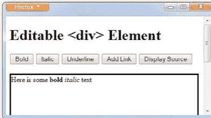

图 5.3 `editdiv.html` 示例中的斜体文本。

## 添加下划线按钮

你可以让用户通过 underline 命令和“Underline”（下划线）按钮为文本添加下划线。

要在 `editdiv.html` 示例中添加该按钮，请遵循以下步骤：

- 1. 使用 Windows WordPad 等文本编辑器打开 `editdiv.html`。

- 2. 添加以下代码以创建下划线按钮，并在点击它时发送 "underline" 命令。

```html
<!DOCTYPE html>
<html>
<head>
<title>可编辑的 <div> 元素</title>
</head>
<body>
<h1>可编辑的 <div> 元素</h1>
<div>
  <input type="button" value="Bold" onclick="document.execCommand('bold', false, null);">
  <input type="button" value="Italic" onclick="document.execCommand('italic', false, null);">
  <input type="button" value="Underline" onclick="document.execCommand('underline', false, null);">
</div>
<br>
<div id="div" style="border:solid black; height: 300px; width: 400px" contenteditable="true">
</div>
</body>
</html>
```

- 3. 保存 `editdiv.html`。请确保你将此代码保存为文本格式（例如，WordPad 的默认格式是 RTF 富文本格式，这在浏览器中无法运行）。

现在用户可以选择文本并点击“Underline”按钮为该文本添加下划线，如图 5.4 所示。

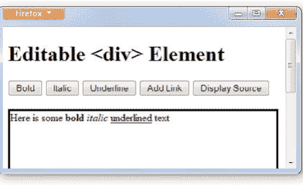

**图 5.4** `editdiv.html` 示例中的下划线文本。

## 添加添加链接按钮

你还可以让用户通过 createlink 命令和“Add Link”（添加链接）按钮为他们的文本添加链接。当用户选择某些文本并点击“Add Link”按钮时，我们将在屏幕上弹出一个对话框，让他们输入链接的 URL，然后为他们选择的文本创建链接。

要在 `editdiv.html` 示例中添加添加链接按钮，请遵循以下步骤：

- 1. 使用 Windows WordPad 等文本编辑器打开 `editdiv.html`。

- 2. 添加以下代码以创建添加链接按钮并调用 `createLink()` 函数。

```html
<!DOCTYPE html>
<html>
<head>
  <title>可编辑的 <div> 元素</title>
</head>
<body>
<h1>可编辑的 <div> 元素</h1>
<div>
  <input type="button" value="Bold" onclick="document.execCommand('bold', false, null);">
  <input type="button" value="Italic" onclick="document.execCommand('italic', false, null);">
  <input type="button" value="Underline" onclick="document.execCommand('underline', false, null);">
  <input type="button" value="Add Link" onclick="createLink();">
</div>
<br>
<div id="div" style="border:solid black; height: 300px; width: 400px" contenteditable="true">
</div>
</body>
</html>
```

- 3. 添加以下 JavaScript 代码，通过对话框获取用户的链接 URL，然后使用 createlink 命令将该 URL 添加到链接中：

```html
<!DOCTYPE html>
<html>
<head>
  <title>可编辑的 <div> 元素</title>
  <script type="text/javascript">
  function createLink() {
    var url = prompt("Enter URL:", "http://");
    if (url)
      document.execCommand("createlink", false, url);
  }
  </script>
</head>
<body>
<h1>可编辑的 <div> 元素</h1>
<div>
  <input type="button" value="Bold" onclick="document.execCommand('bold', false, null);">
  <input type="button" value="Italic" onclick="document.execCommand('italic', false, null);">
  <input type="button" value="Underline" onclick="document.execCommand('underline', false, null);">
  <input type="button" value="Add Link" onclick="createLink();">
</div>
<br>
<div id="div" style="border:solid black; height: 300px; width: 400px" contenteditable="true">
</div>
</body>
</html>
```

- 4. 保存 `editdiv.html`。请确保你将此代码保存为文本格式（例如，WordPad 的默认格式是 RTF 富文本格式，这在浏览器中无法运行）。

现在用户可以选择文本并点击“Add Link”按钮为该文本添加下划线（此处原文似乎有误，应为添加链接，此处已按逻辑对应翻译）。


提示：要在 Firefox 中关闭拼写检查，请将可编辑元素或文档的 spellcheck 属性设置为 `false`。

要在 Firefox 中对文本进行拼写检查，请按照以下步骤操作：

- 1. 在可编辑元素或文档中输入你的文本。Firefox 将用红色波浪线下划它认为拼写错误的单词，如图 5.7 所示。

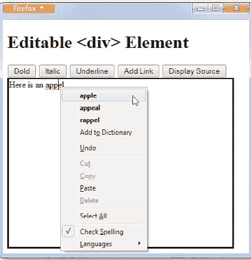

图 5.7 Firefox 中的拼写检查。

- 2. 右键点击 Firefox 识别为拼写错误的单词。这会弹出一个可能的正确拼写菜单，如图 5.7 所示。

- 3. 从弹出菜单中选择正确的拼写。Firefox 将正确的拼写插入到你的文本中。

## editdiv.html 示例代码

这里是完整的 editdiv.html 示例代码：

```
<!DOCTYPE html>
<head>
<title>
  Editable &lt;div&gt; Element
</title>

<script type="text/javascript">
function createSource() {
  var content = document.getElementById("div").innerHTML;
  content.replace(/</g, '&lt;');
  content.replace(/>/g, '&gt;');
  alert(content);
}

function createLink() {
  var url = prompt("Enter URL:", "http://");
  if (url) {
    document.execCommand("createlink", false, null);
  }
}
</script>
</head>
<body>
<h1>Editable &lt;div&gt; Element</h1>
<div>
  <input type="button" value="Bold" onclick="document.execCommand('bold', false, null);">
  <input type="button" value="Italic" onclick="document.execCommand('italic', false, null);">
  <input type="button" value="Underline" onclick="document.execCommand('underline', false, null);">
  <input type="button" value="Add Link" onclick="createLink();">
</div>
</body>
```

# 第 5 节：内联编辑

```
<input type="button"
value="Display Source"
onclick="showSource();">
</div>
<br>
<div id="div" style='border:solid
black; height: 300px; width: 400px;
contenteditable="true">
</div>
```

```
<body>
</html>
```

## 开始编写 editiframe.html 示例

我们将使用新的 HTML5 `designmode` 属性（该属性使整个文档变得可编辑）与 `<iframe>` 浮动框架配合，允许用户输入文本，如图 5.8 所示。在这里，使用 `<iframe>` 的 `designmode` 属性将使整个 `<iframe>`——以及你可能想添加其中的任何元素——都变得可编辑。因此，现在不仅仅是让一个 `<div>` 可编辑，而是包含在 `<iframe>` 中的整个文档都是可编辑的。

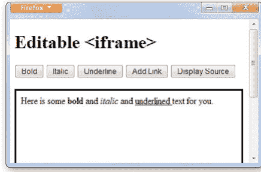

**图 5.8** editiframe.html 示例。

与 editdiv.html 示例一样，用户可以点击按钮来格式化文本。

要开始 editiframe.html 示例，请按照以下步骤操作：

- 1. 使用如 Windows WordPad 的文本编辑器创建 editiframe.html。

- 2. 输入以下代码，创建此示例和 `<iframe>`：

```html
<!DOCTYPE html>
<html>
<head>
<title>
Editable &lt;iframe&gt;</title>
</head>
<body onload="loader()">
<h1>Editable &lt;iframe&gt;</h1>
<iframe id="content" style='border:solid black; height: 300px; width: 400px' src="about:blank">
</iframe>
</body>
</html>
```

- 3. 输入以下代码，将 `<iframe>` 的 `designmode` 属性设置为 `on`。

```html
<!DOCTYPE html>
<html>
<head>
<title>
Editable &lt;iframe&gt;</title>
</head>

<script type="text/javascript">
var iframe;

function loader() {
iframe = 
document.getElementById("content");
iframe.contentDocument.designMode = "on";
}

window.addEventListener("loader", onload,
  false);
</script>
</head>
<body onload="loader()">
<h1>Editable &lt;iframe&gt;</h1>
<iframe id="content" style='border:solid
  black; height: 300px; width: 400px
  src="about:blank">
</iframe>
</body>
</html>
```

- 1. 保存 editiframe.html。确保你以文本格式保存此代码（例如，WordPad 的默认格式是 RTF，富文本格式，无法在浏览器运行）。

我们已经开始编写 editiframe.html，创建了 `<iframe>` 并将其 `design-mode` 属性设置为 `on`。接下来，我们将添加格式化按钮。

## 为 editiframe.html 添加按钮

现在我们可以为 editiframe.html 示例添加按钮了。由于这些按钮的工作方式与 editdiv.html 中相同，我们不会花费大量时间。要为 editiframe.html 示例添加按钮，请遵循以下步骤：

- 1. 使用 Windows WordPad 等文本编辑器打开 editiframe.html。

- 2. 将以下代码添加到此示例中：

```html
<!DOCTYPE html>
<html>
<head>
<title>
    Editable &lt;iframe&gt;</title>
<script type="text/javascript">
var iframe;

function loader() {
  iframe = document.getElementById("content");
  iframe.contentDocument.designMode = "on";
}

function showSource() {
  var content = iframe.contentDocument.body.innerHTML;
  content.replace(/</g, '&lt;');
  content.replace(/>/g, '&gt;');
  alert(content);
}

function createLink() {
  var url = prompt("Enter URL:", "http://");
  if (url) {
    iframe.contentDocument.execCommand("createlink", false, null);
  }
}

window.addEventListener("loader", onload, false);
</script>
<head>
<body onload="loader()">
<h1>Editable &lt;iframe&gt;</h1>
<div>
  <input type="button" value="Bold" onclick="iframe.contentDocument.execCommand('bold', false, null);">
  <input type="button" value="Italic" onclick="iframe.contentDocument.execCommand('italic', false, null);">
  <input type="button" value="Underline" onclick="iframe.contentDocument.execCommand('underline', false, null);">
  <input type="button" value="Add Link" onclick="createLink();">
  <input type="button" value="Display Source" onclick="showSource();">
</div>
<br>
<iframe id="content" style='border:solid black; height: 300px; width: 400px' src="about:blank"></iframe>
</body>
</html>
```

- 3. 保存 editiframe.html。确保你以文本格式保存此代码（例如，WordPad 的默认格式是 RTF，富文本格式，无法在浏览器运行）。

这就完成了 editiframe.html 示例，你可以在图 5.8 中看到它的效果。在外观上，该示例与 editdiv.html 示例相同，不同之处在于用户是在 `<iframe>` 中编辑整个文档。

## editiframe.html 示例代码

这里是完整的 editiframe.html 示例代码：

```html
<!DOCTYPE html>
<html>
<head>
<title>
Editable &lt;iframe&gt;</title>

<script type="text/javascript">
var iframe;

function loader() {
  iframe = document.getElementById("content");
  iframe.contentDocument.designMode = "on";
}

function showSource() {
  var content = iframe.contentDocument.body.innerHTML;
  content.replace(/</g, '&lt;');
  content.replace(/>/g, '&gt;');
  alert(content);
}

function createLink() {
  var url = prompt("Enter URL:", "http://");
  if (url) {
    iframe.contentDocument.execCommand("createlink", false, null);
  }
}

window.addEventListener("loader", onload,
false);
</script>
</head>
<body onload="loader()">
<h1>Editable &lt;iframe&gt;</h1>
<div>
  <input type="button" value="Bold" onclick="iframe.contentDocument.execCommand('bold', false, null);">
  <input type="button" value="Italic" onclick="iframe.contentDocument.execCommand('italic', false, null);">
  <input type="button" value="Underline" onclick="iframe.contentDocument.execCommand('underline', false, null);">
  <input type="button" value="Add Link" onclick="createLink();">
  <input type="button" value="Display Source" onclick="showSource();">
</div>
<br>
<iframe id="content" style="border:solid black; height: 300px; width: 400px" src="about:blank"></iframe>
</body>
</html>
```

此页特意留空

# 第 6 节

# 处理浏览器历史

HTML5 让你控制浏览器的历史记录——它去过哪里以及现在在哪里。`History` 对象允许你在浏览器页面之间前进或后退，这意味着你可以使用历史对象，例如返回三页页。

你还可以将数据存储在浏览器的历史状态对象中。也就是说，你可以将数据添加到状态对象并推送该状态以将其与当前页面一起存储。你还可以弹出（pop）状态对象，恢复存储的数据，从而允许你在页面之间传递数据。

我们将在本节中查看这一切是如何运作的。现在让我们进入浏览器历史。

## 欢迎学习浏览器历史

在本节中，我们将开发一个名为 `pophistory.html` 的示例，你可以在图 6.1 中看到它。

此示例说明了 HTML 对象的不同方面。用户可以点击“后退”按钮返回上一页（就像点击浏览器的后退按钮一样）。用户可以点击“前进”按钮前进一页（如果没有下一页，则什么都不会发生）。

你还可以在文本字段中输入整数并点击“前往”按钮来移动，例如前进五页。输入负数将带你回到已经访问过的页面。

此外，示例显示了浏览器历史记录的长度，如图 6.1 所示；开放该长度是 HTML5 规范的一部分。


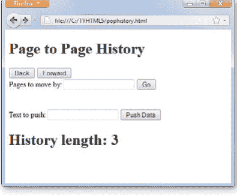

**图 6.1** popistory.html 示例。

最后，该示例允许用户输入一些文本并将其作为当前历史状态推入（push），然后跳转到另一个页面再回来——当状态对象被弹出（pop）时，你输入的文本就会显示。通过这种方式你可以在页面之间传递数据。

为了让数据的推送和弹出生效，你需要支持这历史功能部分的浏览器。遗憾的是，目前还没有任何浏览器正式支持此功能。尽管如此，我们将在代码中查看它的工作原理，这样当浏览器支持时你就能准备好了。

接下来，让我们看看这个示例的一些细节。

## 了解 History API

`history` 对象是浏览器 `window` 对象的一部分，因此你可以将其称为 `window.history` 对象。以下是你在 HTML5 中用于实现 `window.history` 支持的属性和函数：

- window.history.length;
- window.history.go();
- window.history.back();
- window.history.forward();

```
window.history.pushState();
window.history.replaceState();
window.onpopstate
```

我们现在来仔细观察它们。

### window.history.length

`window.history.length` 属性提供浏览器会话历史中的条目数量。我们将在 pamfistory.html 示例中查看此属性。

### window.history.back()

此函数在浏览器历史记录中后退一步。也就是说，它将浏览器返回到上一页。

如果没有上一页，此函数将执行任何操作。

### window.history.forward()

此函数在浏览器历史记录中前进一步。也就是说，如果你去过另一个页面（页面 A），返回当前页面并执行此函数，你将返回页面 A。

注意，如果浏览器历史记录中没有页面，此函数将执行任何操作。

### window.history.go([delta])

这是一个通用函数，允许你通过指定的 `delta` 移动页数向前或向后移动。例如，传递值 `-2` 会让浏览器后退两页；传递值 `5` 会让浏览器前进五页。

`delta` 参数在括号中是因为它是可选的。然而，如果你不提供 `delta`，浏览器将重新加载当前页面。

正如你预期的那样，如果 `delta` 超出历史范围，此函数将执行任何操作。

### window.history.pushState(data, title [, url ])

此函数允许你将数据推入历史记录。`data` 参数是一个包含你数据的对象，`title` 是你想要引用该数据的名称，而 `url` 参数允许将数据与特定页面关联，这样当该页面重加载时它会被弹出。

### window.history.replaceState(data, title [, url ])

此函数替换历史记录中的当前条目，以包含给定的数据、标题以及（如果你提供了的话）URL。

### window.onpopstate

当状态历史被弹出并变得可访问时，会触发此事件——包括你推送的数据。我们将在 pophistory.html 中查看如何让此事件发挥作用。

## 开始 pophistory.html 示例

要开始 pophistory.html 示例，请按照以下步骤操作：

1. 使用 Windows WordPad 等文本编辑器创建 `pophistory.html`。
2. 输入以下代码。

```html
<!DOCTYPE html>
<html>
<head>
  <title>
  Page to Page History
  </title>
</head>
<body>
  <h1>Page to Page History</h1>
```

### 添加后退按钮

```html
</body>
</html>
```

3. 添加以下代码以创建此示例用于显示结果的 `<div>` 元素。

```html
<!DOCTYPE html>
<html>
<head>
  <title>
    Page to Page History
  </title>
</head>
<body onload="loader()">
<h1>Page to Page History</h1>
<br>
<div id="length"></div>
<br>
<div id="state"></div>
<br>
</body>
</html>
```

4. 保存 `pophistory.html`。确保你以文本格式保存此代码（例如，WordPad 的默认格式是 RTF，即富文本文本格式，浏览器将无法识别）。

我们已经开始了 `pophistory.html`。现在让我们让它变得有用处吧。

### 添加后退按钮

你可以通过 `window.history.back()` 函数让用户在浏览器历史记录中后退。要向此示例添加后退按钮，请按照以下步骤操作：

1. 使用 Windows WordPad 等文本编辑器打开 `pophistory.html`。
2. 添加以下代码以创建一个新的后退按钮。

```html
<!DOCTYPE html>
<html>
<head>
<title>
Page to Page History
</title>
</head>
<body onload="loader()">
<h1>Page to Page History</h1>
<input type="button" value="Back"
onclick="back();"
.
.
<br>
<div id="length"></div>
<br>
<div id="state"></div>
<br>
</body>
</html>
```

3. 添加以下代码，通过将其连接到 `window.history.back()` 函数来使后退按钮生效。

```html
<!DOCTYPE html>
<html>
<head>
<title>
Page to Page History
</title>
</head>
<body onload="loader()">
<script type="text/javascript">
function back()
{
window.history.back();
}
</script>
</head>
```

```html
<body onload="loader()">
<h1>Page to Page History</h1>
<input type="button" value="Back"
onclick="back();">
<br>
<div id="length"></div>
<br>
<div id="state"></div>
<br>
</body>
</html>
```

4. 保存 `pophistory.html`。确保你以文本格式保存此代码（例如，WordPad 的默认格式是 RTF，即富文本格式，浏览器将无法识别）。

当用户点击后退按钮时，浏览器会在浏览器历史记录中后退一步。

**图 6.1** popistory.html 示例。

**图 6.2** 页面。

**图 6.3** 跳转到 popistory.html 页面。

**图 6.4** 返回今天。

### 添加前进按钮

你还可以通过 `window.history.forward()` 函数让用户在浏览器历史记录中前进。要向此示例添加前进按钮，请按照以下步骤操作：

1. 使用 Windows WordPad 等文本编辑器打开 `pophistory.html`。
2. 添加以下代码以创建一个前进按钮。

```html
<!DOCTYPE html>
<html>
<head>
<title>
Page to Page History
</title>
</head>
```

3. 添加以下代码，通过将其连接到 `window.history.forward()` 函数来使前进按钮生效。

```html
<!DOCTYPE html>
<html>
<head>
<title>
Page to Page History
</title>
</head>
<script type="text/javascript">
function back()
{
window.history.back();
}
function forward()
{
window.history.forward();
}
</script>
</head>
```

```html
<body onload="loader()">
<h1>Page to Page History</h1>
<input type="button" value="Back"
onclick="back();">
<br>
<input type="button" value="Forward"
onclick="forward();">
<br>
<div id="length"></div>
<br>
<div id="state"></div>
<br>
</body>
</html>
```

4. 保存 `pophistory.html`。确保你以文本格式保存此代码（例如，WordPad 的默认格式是 RTF，即富文本格式，浏览器将无法识别）。

当用户点击前进按钮时，浏览器会在浏览器历史记录中前进一步。

### 添加 Go 按钮

你可以通过用户在文本框中输入整数（正数表示前进，负数表示后退）并点击 Go 按钮，来指定浏览器前进或后退的页数，从而使用 `window.history.go()` 函数导航浏览器。


```html
<body onload="loader()">
<h1>页面跳转历史</h1>
<input type="button" value="Back" onclick="back();">
<input type="button" value="Forward" onclick="forward();">
<br>
移动的页数: <input id="amount" type="text">
<input type="button" value="Go" onclick="go();">
<br>
.
.
<br>
<div id="length"></div>
<br>
<div id="state"></div>
<br>
</body>
</html
```

3. 添加以下代码，将其连接到 `window.history.go()` 函数，使 Go 按钮变为可用。

```html
<!DOCTYPE html>
<html>
<head>
<title>
页面跳转历史
</title>
<script type="text/javascript">
function back() {
  window.history.back();
}
function forward() {
  window.history.forward();
}

function go() {
  var amount =
  document.getElementById("amount").value;
  window.history.go(amount);
}
</script>
</head>

<body onload="loader()">
<h1>页面跳转历史</h1>
<input type="button" value="Back" onclick="back();">
<br>
<input type="button" value="Forward" onclick="forward();">
<br>
<div id="length"></div>
<br>
<div id="state"></div>
<br>
移动的页数: <input id="amount" type="text">
<input type="button" value="Go" onclick="go();">
<br>
</body>
</html>
```

- 4. 保存为 `popistory.html`。确保将此代码保存为文本格式（例如，WordPad 的默认格式是 RTF，富文本格式，浏览器无法正常工作）。

当用户在文本框中输入一个数字并点击 Go 按钮时，浏览器将向前或向后跳转相应数量的页面。

## 获取历史长度

你可以通过 `window.history.length` 属性确定浏览器历史记录中的总页数（包括前进和向后的记录）。我们将在 `popistory.html` 中显示该长度；请按照以下步骤操作：

- 1. 使用 Windows WordPad 等文本编辑器打开 `popistory.html`。
- 2. 添加以下代码，在 `popistory.html` 的 `<div>` 元素中显示历史记录目的数量。

```html
<!DOCTYPE html>
<html>
<head>
  <title>
    页面跳转历史
  </title>
  <script type="text/javascript">
    function back() {
      window.history.back();
    }

    function forward() {
      window.history.forward();
    }

    function loader() {
      var length = window.history.length;
      document.getElementById("length").innerHTML = "<h1>" + 
      "历史长度: " + length +
      "</h1>";
    }
  </script>
</head>
<body onload="loader()">
<h1>页面跳转历史</h1>
<input type="button" value="Back" onclick="back();">
<br>
<input type="button" value="Forward" onclick="forward();">
<br>
<div id="length"></div>
<br>
<div id="state"></div>
<br>
移动的页数: <input id="amount" type="text">
<input type="button" value="Go" onclick="go();">
<br>
</body>
</html>
```

- 3. 保存为 `pophistory.html`。确保将此代码保存为文本格式（例如，WordPad 的默认格式是 RTF，富文本格式，浏览器无法正常工作）。

当页面加载时，它将显示窗口历史记录目的数量，如图 6.5 所示。

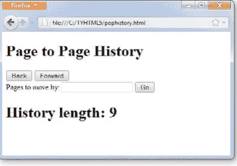

图 6.5 窗口历史长度。

## 将数据推入历史

你可以让用户将文本数据推当前页的历史记录中，以便以后恢复。方法如下：

- 1. 使用 Windows WordPad 等文本编辑器打开 `pophistory.html`。
- 2. 添加以下代码以显示一个文本框和一个标题为“Push Data”（推送数据）的按钮。

```html
<!DOCTYPE html>
<html>
<head>
<title>
页面跳转历史
</title>

function forward()
{
  window.history.forward();
}

<script>
</head>
```

## 将数据推入历史

```html
<body onload="loader()">
<h1>页面跳转历史</h1>
<input type="button" value="Back"
onclick="back();">
<br>
<input type="button" value="Forward"
onclick="forward();">
<br>
<br>
要推送的文本: <input id="statedata"
type="text">
<input type="button" value="Push Data"
onclick="pushdata();">
<br>
<div id="length"></div>
<br>
<div id="state"></div>
<br>
移动的页数: <input id="amount"
type="text">
<input type="button" value="Go" onclick="go();">
<br>
</body>
</html>
```

- 3. 添加以下代码，将用户输入的对象作为对象推入当前页的历史记录中，这样在返回时就会弹出。

```html
<!DOCTYPE html>
<html>
<head>
<title>
页面跳转历史
</title>
<script type="text/javascript">
function back() {
  window.history.back();
}
function forward() {
  window.history.forward();
}

```html
function pushData() {
  var statedata =
  document.getElementById("statedata").value;
  var containerObject =
  {container: statedata};
  history.pushState(containerObject,
  "item", "popistory.html");
}
```
</script>
</head>

```html
<body onload="loader()">
<h1>页面跳转历史</h1>
<input type="button" value="Back"
onclick="back();">
<br>
<input type="button" value="Forward"
onclick="forward();">
<br>
要推送的文本: <input id="statedata"
type="text">
<input type="button" value="Push Data"
onclick="pushdata();">
<br>
<div id="length"></div>
<br>
<div id="state"></div>
<br>
移动的页数: <input id="amount"
type="text">
<input type="button" value="Go" onclick="go();">
<br>
</body>
</html>
```

- 4. 保存为 `popistory.html`。确保将此代码保存为文本格式（例如，WordPad 的默认格式是 RTF，富文本格式，浏览器无法正常工作）。

## 从历史中弹出

当用户在文本框中输入一个数字并点击 Go 按钮时，浏览器将向前或向后跳转相应数量的页面。

从历史中弹出

由于我们将数据推入了当前页的历史记录中，当返回 `popistory.html` 时就会弹出。

当用户在 `popistory.html` 中输入文本并点击 Push Data，跳转到一个新页面然后返回 `popistory.html` 时，该数据将弹出并显示。

如所述，目前没有任何正式发布的浏览器支持此功能，但一旦该功能出现，你就准备好了。

## popistory.html 示例代码

以下是完整的 `popistory.html` 代码：

```html
<!DOCTYPE html>
<html>
<head>
<title>
页面跳转历史
</title>
<script type="text/javascript">
function go() {
  var amount =
  document.getElementById("amount").value;
  window.history.go(amount);
}

function back() {
  window.history.back();
}

function forward() {
  window.history.forward();
}

function pushData() {
  var statedata =
  document.getElementById("statedata").value;
  var containerObject =
  {container: statedata};
  history.pushState(containerObject,
  "item", "popistory.html");
}

function popData(event)
{
var state = "页面: " +
document.location + " 数据: " +event.state.container;
document.getElementById("state").innerHTML = "<h1>" +
state + "</h1>";
}
</script>
window.addEventListener("popstate", popData,
false);
</script>
</head>

<body onload="loader()">
<h1>页面跳转历史</h1>
<input type="button" value="Back" onclick="back();">
<br>
<input type="button" value="Forward" onclick="forward();">
<br>
移动的页数: <input id="amount" type="text">
<input type="button" value="Go" onclick="go();">
<br>
<br>
<br>
要推送的文本: <input id="statedata"
type="text">
<input type="button" value="Push Data"
onclick="pushdata();">
<br>
<div id="length"></div>
<br>
<div id="state"></div>
<br>
</body>
</html>
```


```javascript
{
  window.history.forward();
}

function loader() {
  var length = window.history.lengthById;
  document.getElementById("length").innerHTML = "<h1>" + 
  "History length: " + length + "</h1>";
}

function pushData() {
  var statedata = document.getElementById("statedata").value;
  var containerObject = {container: statedata};
  history.pushState(containerObject, "item", "popistory.html");
}

function popData(event) {
  var state = "Page: " + document.location + " Data: " + event.state.container;
  document.getElementById("state").innerHTML = "<h1>" + 
  state + "</h1>";
}

window.addEventListener("popstate", popData,
  false);
});
</script>
```

<body onload="loader()">
<h1>页面间的历史记录</h1>
<input type="button" value="Back"
onclick="back();">
<input type="button" value="Forward"
onclick="forward();">

<br>
移动的页面数: <input id="amount"
type="text">
<input type="button" value="Go" onclick="go();">
<br>
<br>
<br>
要推送的消息: <input id="statedata"
type="text">
<input type="button" value="Push Data"
onclick="pushdata();">
<br>
<div id="length"></div>
<br>
<div id="state"></div>
<br>
</body>
</html
```

本页特意留空

# 第 7 

## 通过消息传达观点

HTML5 允许你以跨窗口或跨域的方式发送消息；我们将在本节中查看它的工作原理。

例如，假设在页面 A 中，页面 B（来自服务器上的同一目录）显示在 `<iframe>` 元素中。现在你可以从页面 A 向页面 B 发送文本消息，并在页面 B 中这些消息。这就是跨窗口消息传递。

事实上，页面 B 可以来自完全不同的域名并显示在页面 A 的 `<iframe>` 中，此时你仍然可以向页面 A 发送消息。这被称为跨域消息传递，它曾经是被禁止的，但现在你可以做到了。即使页面 B 来自与页面 A 完全不同的服务器，你仍然可以发送页面 B 的消息。

我们将在本节中查看这一切是如何工作的。让我们现在进入消息传递。

## 欢迎学习消息传递

在本节中，我们将开发一个示例 `parent.html`，你可以参考图 7.1。

你在图 7.1 中看到用黑色框出的出的 `<iframe>` 元素。它包含了第二个页面 `child.html`，该页面与 `parent.html` 位于同一目录。现在你可以在同一个应用程序的窗口之间发送消息。

你可以在示例的文本框中输入消息（如图 7.1 所示），当你点击按钮时，该消息会被发送到 `<iframe>` 中的第二个页面并得到回显，如图 7.2 所示。这是跨窗口消息传递的一个很好的示例。

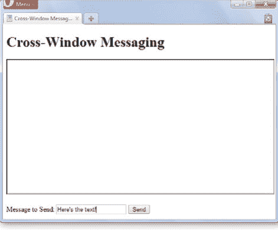

图 7.1 parent.html 和 child.html 示例。

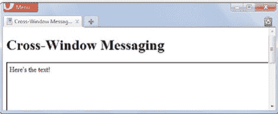

图 7.2 发送跨窗口消息。

本节的第二个示例将展示如何使用跨域消息传递，其中窗口位于不同的互联网域。这一次，图 7.3 显示的 `parent.html` 页面与出现在 `<iframe>` 元素中的 `child.html` 页面来自不同的域名（如图 7.3 所示）。

你可以如图 7.3 所示在文本框中输入消息，并点击按钮从 `parent.html` 向 `child.html` 发送该消息。

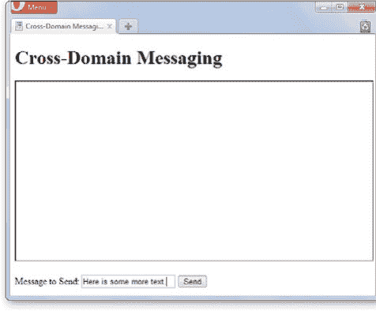

**图 7.3** parent.html 和 child.html 示例。

`child.html` 页面如图 7.4 所示回显了消息。

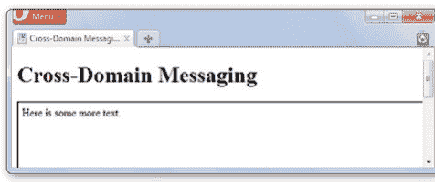

**图 7.4** 发送跨域消息。

让我们来看此示例的一些细节。

## 了解消息 API

你可以使用 JavaScript 等脚本语言在后台实现消息传递。你可以在 whatwg.org/specs/web-apps/current-work/multipage/comms.html 找到关于消息传递的良好介绍。

在使用消息传递时的脚本特性：

- `postMessage()` 函数
- `onMessage` 事件
- `event.data` 属性
- `event.origin` 属性
- `event.source` 属性

我们现在详细查看这些项目。

### postMessage() 支持浏览器：Opera, Safari

该函数是 HTML5 发送消息的核心，你用它向目标发送消息：

```javascript
window.postMessage(message, targetOrigin)
```

在这里，`message` 是你要推送的消息，`targetOrigin` 是目标。在本节中我们将看到更多关于源的内容；如果你发送到 `postMessage()` 的源不匹配，消息将被丢弃。

### onMessage 支持浏览器：Opera, Safari

这是当接收到消息时发生的事件。你将函数连接到此消息，然后通过检查事件对象的 `data` 成员来恢复实际的消息。

### event.data 支持浏览器：Opera, Safari

传递给 `onMessage` 处理程序的事件对象包含消息文本。

### event.origin 支持浏览器：Opera, Safari

事件对象包含消息发送到的源。

### event.source 支持浏览器：Opera, Safari

事件对象包含源窗口。

## parent.html 示例

要开始 parent.html 示例，请遵循以下步骤：

1. 使用 WordPad 等文本编辑器创建 `parent.html`。
2. 输入以下代码：

```html
<!DOCTYPE html>
<html>
<head>
<title>跨窗口消息</title>
</head>
<body>
<h1>跨窗口消息</h1>
<iframe id="iframe" src="child.html" height="300" width="600"></iframe>
<br>
<br>
要发送的消息: <input id="message" type="text"><input type="button" onclick="send();" value="Send">
</body>
</html>
```

3. 保存 `parent.html`。确保你以文本格式保存此代码（例如，WordPad 的默认格式是 RTF 富文本格式，浏览器中无法运行）。

我们已经开始了 `parent.html`。现在让它发送消息。你可以通过以下步骤从 `parent.html` 向 `child.html` 发送消息：

1. 使用 Windows Word 等文本编辑器打开 `parent.html`。
2. 添加以下代码来实现 `send()` 函数，该函数通过获取消息和一些目标窗口的信息来发送消息。
3. 添加以下代码向目标窗口发送消息。

```html
<!DOCTYPE html>
<html>
<head>
<title>跨窗口消息</title>
<script type="text/javascript">
  function send() {
    var message = document.getElementById("message").value;
    var location = window.location;
    var protocol = location.protocol;
    var host = location.host;
  }
</script>
```

```javascript
function send() {
  var message = document.getElementById("message").value;
  var location = window.location;
  var protocol = location.protocol;
  var host = location.host;
  document.getElementById("iframe").contentWindow.postMessage(message, protocol + "//" + host);
}
```

```html
<h1>跨窗口消息</h1>
<iframe id="iframe" src="child.html" height="300" width="600"></iframe>
<br>
<br>
要发送的消息: <input id="message" type="text">
<input type="button" onclick="send();" value="Send">
</body>
```

4. 保存 `parent.html`。确保你以文本格式保存此代码（例如，WordPad 的默认格式是 RTF 富文本格式，浏览器中无法运行）。

用户可以如图 7.1 所示在文本框中输入消息，并点击按钮将消息发送到 child.html。让我们构建 `child.html`（在创建 `child.html` 之前，不要尝试运行 `parent.html`）。

## child.html 示例

要开始 child.html 示例，请遵循以下步骤：

1. 使用 Windows WordPad 等文本编辑器创建 `child.html`。
2. 输入以下代码。


```html
<!DOCTYPE html>

<html>
<head>
<title>
Child
</title>
</head>

<body>
</body>
</html>
```

- 3. 添加以下代码来创建一个 `<div>` 元素，我们将用它来显示在 child.html 中接收到的消息文本。

```html
<!DOCTYPE html>
<html>
<head>
<title>
Child
</title>
</head>

<body>
<div id="messages" style="width:400px; height:250px"></div>
</body>
</html>
```

- 4. 保存 child.html。请确保以**纯文本格式**保存此代码（例如，WordPad 的默认格式是 RTF，富文本格式，这种格式无法在浏览器中运行）。

我们已经开始了 child.html。现在，让它接收消息吧。

## 接收跨窗口消息

现在，让 child.html 能够接收并显示由 parent.html 发送给它的消息。为此，请按照以下步骤操作：

- 1. 使用如 Windows WordPad 等文本编辑器打开 child.html

- 2. 添加以下代码，将 `onMessage` 事件连接到名为 `loader()` 的函数。

```html
<!DOCTYPE html>
<html>
<head>
  <title>
    Child
  </title>
  <script type="text/javascript">
    window.addEventListener("message", loader, false);
  </script>
</head>
<body>
  <div id="messages" style="width:400px; height:250px"></div>
</body>
</html>
```

- 3. 添加以下代码从事件对象的 `data` 属性读取消息，并将其显示在 child.html 的 `<div>` 中。

```html
<!DOCTYPE html>
<html>
<head>
  <title>
    Child
  </title>
  <script type="text/javascript">
    window.addEventListener("message", loader, false);

function loader(e)
{
  document.getElementById(
    "messages").innerHTML = e.data;
}
</script>
</head>

<body>
<div id="messages" style="width:400px; height:250px"></div>
</body>
</html>
```

- 4. 保存 child.html。请确保以**纯文本格式**保存此代码（例如，WordPad 的默认格式是 RTF，富文本格式，这种格式无法在浏览器中运行）。

如图 7.1 和 7.2 所示，用户可以在支持消息的浏览器（Opera 或 Safari）中打开 parent.html，在文本框中输入文本，点击按钮，并看到消息出现在 child.html 中。很酷。

## parent.html 示例代码

以下是完整的 parent.html 示例代码：

```html
<!DOCTYPE html>

<html>
<head>
<title>
Cross-Window Messaging
</title>

<script type="text/javascript">
function send()
{
  var message = document.getElementById("message").value;
  var location = window.location;
  var protocol = location.protocol;
  var host = location.host;

document.getElementById
("iframe").contentWindow.postMessage
(message, protocol+"//"+host);
}
</script>
</head>

<body>
<h1>Cross-Window Messaging</h1>
<iframe id="iframe" src="child.html"
height="300" width="600">
</iframe>
<br>
<br>
Message to Send: <input id="message"
type="text">
<input type="button" onclick="send();"
value="Send">
</body>
</html>
```

# 第 7 课：通过消息传达观点

# child.html 示例代码

以下是完整的 child.html 示例代码：

```html
<!DOCTYPE html>
<html>
<head>
<title>
Child
</title>
<script type="text/javascript">
window.addEventListener("message", loader,
false);

function loader(e)
{
document.getElementById
("messages").innerHTML = e.data;
}
</script>
</head>

<body>
<div id="messages" style="width:400px;
  height:250px"></div>
</body>
</html>
```

## 开始 domainparent.html 示例

现在我们来看到跨域消息是如何工作的。要开始 domainparent.html 示例，请按照以下步骤操作：

- 1. 使用如 Windows WordPad 等文本编辑器创建 domainparent.html。
- 2. 输入以下代码。

```html
<!DOCTYPE html>

<html>
<head>
<title>
  Cross-Domain Messaging
</title>
</head>
<body>
  <h1>Cross-Domain Messaging</h1>
.
.
</body>
</html>
```

- 3. 添加以下代码以创建一个 `<iframe>` 元素（此示例用它来显示 domainchild.html），同时包含一个接受要发送消息的文本框，以及一个连接到名为 `send()` 函数的按钮，用于发送消息（将 `domain.com` 替换为你存储 `domainchild.html` 的域名）。

```html
<!DOCTYPE html>
<html>
<head>
<title>
Cross-Domain Messaging
</title>
</head>
<body>
<h1>Cross-Domain Messaging</h1>
<iframe id="iframe" src="http://www.domain.com/domainchild.html" height="300" width="600"></iframe>
<br>
<br>
Message to Send: <input id="message"
type="text">
<input type="button" onclick="send();"
value="Send">
</body>
</html>
```

- 4. 保存 domainparent.html。请确保以**纯文本格式**保存此代码（例如，WordPad 的默认格式是 RTF，富文本格式，这种格式无法在浏览器中运行）。

我们已经开始了 domainparent.html。现在，让它发送消息。

## 发送跨域消息

你可以从 domainparent.html 向 domainchild.html 发送跨域消息；为此，请遵循以下步骤：

- 1. 使用如 Windows WordPad 等文本编辑器打开 domainparent.html。
- 2. 添加以下代码来实现发送消息的 `send()` 函数。

```html
<!DOCTYPE html>
<html>
<head>
<title>
Cross-Domain Messaging
</title>
<script type="text/javascript">
function send() {
.
.
}
</script>
</head>

<body>
<h1>Cross-Domain Messaging</h1>
<iframe id="iframe" src="http://www.domain.com/domainchild.html" height="300" width="600"></iframe>
<br>
<br>
Message to Send: <input id="message"
type="text">
<input type="button" onclick="send();"
value="Send">
</body>
</html>
```

- 3. 添加以下代码将消息发送到目标窗口；我们将使用源为 `*` 的 domainchild.html 页面，它可以与任何源工作。

```html
<!DOCTYPE html>
<html>
<head>
<title>
Cross-Domain Messaging
</title>
<script type="text/javascript">
function send() {
var message = document.getElementById("message").value;
document.getElementById("iframe").contentWindow.postMessage(message, "*");
}
</script>
</head>

<body>
<h1>Cross-Domain Messaging</h1>
<iframe id="iframe" src="http://www.domain.com/domainchild.html" height="300" width="600"></iframe>
<br>
<br>
Message to Send: <input id="message"
type="text">
<input type="button" onclick="send();"
value="Send">
</body>
</html>
```

- 4. 保存 domainparent.html。请确保以**纯文本格式**保存此代码（例如，WordPad 的默认格式是 RTF，富文本格式，这种格式无法在浏览器中运行）。

此时，用户可以如图 7.3 所示在文本框中输入消息。他们点击按钮将消息发送到 domainchild.html，即使 domainchild.html 来自不同的域。接下来构建 domainchild.html（在完成 domainchild.html 之前不要尝试运行 domainparent.html）。

## 开始 domainchild.html 示例

要开始 domainchild.html 示例，只需遵循以下步骤：

- 1. 使用如 Windows WordPad 等文本编辑器创建 domainchild.html。
- 2. 输入以下代码。

```html
<!DOCTYPE html>
<html>
<head>
<title>
Child
</title>
</head>
<body>
.
.
</body>
</html>
```

- 3. 添加以下代码来创建一个 `<div>` 元素，我们将用它来显示在 domainchild.html 中接收到的消息。

```html
<!DOCTYPE html>
<html>
<head>
<title>
Child
</title>
</head>
<body>
<div id="messages" style="width:400px;height:250px;"></div>
</body>
</html>
```

- 4. 保存 domainchild.html 到你选择的域名下（将 domainparent.html 中的 `www.domain.com` 替换为该域名）。请确保以**纯文本格式**保存此代码（例如，WordPad 的默认格式是 RTF，富文本格式，这种格式无法在浏览器中运行）。

我们已经开始了 domainchild.html。现在，让它接收消息。

# 接收跨域消息

此时，我们将启用 domainchild.html 能够接收由 domainparent.html 发送给它的跨域消息。为此，请按照以下步骤操作：

- 1. 使用如 Windows WordPad 等文本编辑器打开 domainchild.html。
- 2. 添加以下代码，将 `onMessage` 事件连接到名为 `loader()` 的函数。

```html
<!DOCTYPE html>
<html>
<head>
  <title>
    Child
  </title>
  <script type="text/javascript">
    window.addEventListener("message", loader,
false);
.
.
</script>
</head>
<body>
  <div id="messages" style="width:400px;
height:250px"></div>
</body>
</html>
```

- 3. 添加以下代码从对象的 `data` 属性读取消息，并将其显示在 domainchild.html 的 `<div>` 中。

```html
<!DOCTYPE html>
<html>
<head>
```


```html
<title>
Child
</title>

<script type="text/javascript">
window.addEventListener("message", loader,
  false);

function loader(e)
{
  document.getElementById(
  "messages").innerHTML = e.data;
}
</script>
</head>
<body>
<div id="messages" style="width:400px;
  height:250px"></</div>
</body>
</html>
```

- 4. 保存 domainchild.html。请确保你以文本格式（text-format）保存此代码（例如，WordPad 的默认格式是 RTF，富文本格式，这无法在浏览器中运行）。

现在，如图 7.3 和 7.4 所示，用户可以在支持的浏览器（Opera 或 Safari）中打开 domainparent.html，在文本字段中输入消息，点击按钮，然后看到消息跨域发送到 domainchild.html 并显示。

## domainparent.html 示例代码

这里是 domainpopistory.html 角色的示例代码——将 www.domain.com 替换为 domainchild.html 所在的域名：

```html
<!DOCTYPE html>
<html>
<head>
<title>Cross-Domain Messaging
</title>

<script type="text/javascript">
function send() {
  var message = document.getElementById("message").value;
  document.getElementById("iframe").contentWindow.postMessage(
    message, "*");
}
</script>
</head>
<body>
<h1>Cross-Domain Messaging</h1>
<iframe id="iframe"
src="http://www.domain.com/domainchild.html"
height="300" width="600">
</iframe>
<br>
<br>
Message to Send: <input id="message"
type="text">
<input type="button" onclick="send();"
value="Send">
</body>
</html>
```

## domainchild.html 示例代码

这里是完整的 domainchild.html 示例代码：

```html
<!DOCTYPE html>
<html>
<head>
<title>Child
</title>
<script type="text/javascript">
  window.addEventListener("message", loader,
  false);

  function loader(e) {
    document.getElementById("messages").innerHTML = e.data;
  }
</script>
</head>
<body>
  <div id="messages" style="width:400px;height:250px"></</div>
</body>
</head>
</html>
```

# 第 8 节
## 使用视频和音频

HTML5 让你轻松播放视频——只需使用 <video> 元素即可。

然而，大多数允许播放视频的浏览器只播放 .ogg 格式的视频，这是一个相对冷门的开源格式。幸运的是，你可以将几乎任何格式的视频转换为 .ogg 格式。此外，某些浏览器允许你使用 <video> 元素使用其他视频格式。

在本节中，我们将在 HTML5 网页中播放 .ogg 视频，包括显示控制控件以便用户可以控制播放。

我们将在本节中学习使用新的 <audio> 元素播放音频。

> 提示：<video> 元素备受期待的原因之一是 Apple iPad 不播放 Flash 视频，<video> 元素可能会取代它。

## 欢迎视频媒体控制

在本节中，我们将开发一个名为 video.html 的示例，你可以在图 8.1 中看到它。该示例播放一个名为 hawaii.ogg 的视频，该视频包含本书的下载包中。

现在让我们来看看这个示例的一些细节。

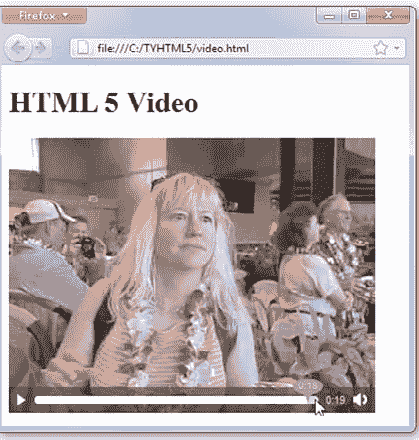

**图 8.1** video.html 示例。

## 了解 Video 元素 API

<video> 元素有很多属性；以下是详细信息：

元素：
- <video>

属性：
- autoplay
- controls
- height
- loop
- poster
- preload
- src
- width
- onerror

支持的浏览器：Firefox, Safari, Internet Explorer 9
- Chrome, Opera, Safari, Internet Explorer 9

你可以在 www.w3.org/TR/html5/video.html 查看 W3C 对 <video> 元素的看法。

接下来让我们概览这些属性。

## autoplay 属性
autoplay 属性是一个真/假值属性，用于控制视频是否自动播放。

## controls 属性
controls 属性允许你在视频下方指定显示带有播放/暂停按钮的控制条。

## height 属性
此属性设置视频的高度。

## loop 属性
loop 属性是一个真/假值属性，如果为真，则视频将循环播放。

## poster 属性
此属性包含一个图像的 URL，当没有可用视频时显示该图像。

## preload 属性
preload 属性控制视频是否预加载。它可以取三个值：
- none: 不需要加载。
- metadata: 浏览器获取尺寸的元数据。
- auto: 浏览器决定是否预加载。

## src 属性
src 属性包含视频的 URL。

## width 属性
width 属性指定视频的宽度。

## onerror 属性
<video> 元素有一个发生失败时触发事件。

## 转换为 OGG 格式
目前大多数浏览器支持许多你可以从其转换的格式：
- 3GP/3G2 (.g2,.3gp)
- AMV Video (.amv)
- Apple QuickTime (.mov)
- ASF Video (.asf)
- Audio Video Interleave (.avi)
- Digital Video (.dv)
- DPG Video (.dpg)
- DVD Object (.vob)
- Flash SWF (.swf)
- Flash Video (.flv)
- FLIC Animation (.fli)
- Google Video File (.gvi)
- Matroska 1 (.mkv)
- MPEG 1 (.mpg)
- MPEG-2 (.mpg)
- MPEG-4 (.mp4)
- NSV (.nsv)
- OGG video (.ogg)
- Ogg Vorbis compressed (.ogm)
- RealVideo (.rm)
- RPL video (.rpl)
- Video stream descriptor (.asm)
- Windows Media Video (.wmv)


我们已经创建了 video.html；现在让它运行起来吧。

要在 video.html 示例中添加 `<video>` 元素，请按照以下步骤操作：

- 1. 使用 Windows WordPad 等文本编辑器打开 video.html。
- 2. 输入以下代码：

```html
<!DOCTYPE html>
<html>
<head>
<title>
HTML 5 Video
</title>
</head>
<body>
<h1>HTML 5 Video</h1>
<video>
</video>
</body>
</html>
```

- 3. 添加以下代码以指定视频的位置和尺寸：

```html
<!DOCTYPE html>
<html>
<head>
<title>
HTML 5 Video
</title>
</head>
<body>
<h1>HTML 5 Video</h1>
<video height="300" width="400"
src="hawaii.ogg">
</video>
</body>
</html>
```

- 4. 将 video.html 保存到与你的 .ogg 视频文件相同的目录中。确保你以文本格式保存此代码（例如，WordPad 的默认格式是 RTF，即富文本格式，这在浏览器中无效）。

这会显示视频，但唯一的播放方法是右键点击并选择“播放”项。在下一个任务中，我们将通过显示控制控件让播放变得更容易。

## 在 video.html 示例中添加控制控件

为 video.html 示例添加视频控制控件，请按照以下步骤操作：

- 1. 使用 Windows WordPad 等文本编辑器打开 video.html。
- 2. 向 `<video>` 元素添加 `controls` 属性。

```html
<!DOCTYPE html>
<html>
<head>
<title>
HTML 5 Video
</title>
</head>
<body>
<h1>HTML 5 Video</h1>
<video controls height="300" width="400" src="hawaii.ogg"></video>
</body>
</html>
```

- 3. 保存 video.html。确保你以文本格式保存此代码（例如，WordPad 的默认格式是 RTF，即富文本格式，这在浏览器中无效）。

现在视频如图 8.1 所示。要播放视频，请点击播放按钮。很酷。

## 视频循环播放

你可以让视频循环播放；要做到这一点，请按照以下步骤操作：

- 1. 使用 Windows WordPad 等文本编辑器打开 video.html。
- 2. 输入以下代码：

```html
<!DOCTYPE html>
<html>
<head>
<title>
HTML 5 Video
</title>
</head>
<body>
<h1>HTML 5 Video</h1>
<video controls height="300" width="400"
loop src="hawaii.ogg">
</video>
</body>
</html>
```

- 3. 保存 video.html。确保你以文本格式保存此代码（例如，WordPad 的默认格式是 RTF，即富文本格式，这在浏览器中无效）。

现在当用户播放视频时，它将持续循环播放。

## 自动播放视频

你可以让视频在页面打开时自动播放；要做到这一点，请按照以下步骤操作：

- 1. 使用 Windows WordPad 等文本编辑器打开 video.html。
- 2. 输入以下代码：

```html
<!DOCTYPE html>
<html>
<head>
<title>
HTML 5 Video
</title>
</head>
<body>
<h1>HTML 5 Video</h1>
<video controls height="300" width="400" autoplay="hawaii.ogg"></video>
</body>
</html>
```

- 3. 保存 video.html。确保你以文本格式保存此代码（例如，WordPad 的默认格式是 RTF，即富文本格式，这在浏览器中无效）。

## 检测视频失败

你可以使用 `onerror` 属性捕视频失败，处理多种不同的错误（例如找不到视频）。方法如下：

- 1. 使用 Windows WordPad 等文本编辑器打开 video.html。
- 2. 输入以下 JavaScript 代码以创建 `fail()` 函数、处理可能的错误并提示用户。

```javascript
<!DOCTYPE html>
<html>
<head>
<title>
HTML 5 Video
</title>
<script>
function fail(e)
{
  switch (e.target.error.code) {
    case e.target.error.MEDIA_ERR_ABORTED:
      alert('你中止了播放。');
      break;
    case e.target.error.MEDIA_ERR_NETWORK:
      alert('网络错误。');
      break;
    case e.target.error.MEDIA_ERR_DECODE:
      alert('解码问题。');
      break;
    case e.target.error.MEDIA_ERR_SRC_NOT_SUPPORTED:
      alert(
        '格式不支持或未找到文件。');
      break;
    default:
      alert('发生未知错误。');
      break;
  }
}
</script>
</head>
<body>
<h1>HTML 5 Video</h1>
<video height="300" width="400" src="hawaii.ogg"></video>
</body>
</html>
```


## HTML 5 Audio

```html
<<body>
  <h1>HTML 5 Audio</h1>
  <audio controls src="hawaii.ogg"></audio>
</body>
</html>
```

-   4. 保存 audio.html。请确保你以文本格式保存此代码（例如，WordPad 的默认格式是 RTF，富文本格式，浏览器无法识别）。

大搞定——现在用户可以点击播放按钮来播放录音了。

与 `<video>` 元素一样，你可以使用 `loop` 属性让播放持续循环，并使用 `autoplay` 属性让音频在页面加载时立即播放。

> 提示：请注意，如果你省略了 `controls` 属性并包含 `autoplay` 和 `loop` 属性，可能会创建出那种讨厌的页面——页面一加载就会不断完持续播放音乐，且无法关闭——但这不会让你的用户那么喜欢你。

## 检测音频何时失败

你可以通过 `onerror` 属性捕捉音频失败，处理多种不同的错误；以下是操作方法：

-   1. 使用 Windows WordPad 等文本编辑器打开 audio.html。

-   2. 输入以下 JavaScript 代码来创建 `fail()` 函数，处理可能的错误并提醒用户。

```html
<!DOCTYPE html>
<html
  <head>
  <title>HTML 5 Audio</title>
<script>
function fail(e) {
  switch (e.target.error.code) {
    case e.target.error.MEDIA_ERR_ABORTED:
      alert('You aborted the playback.');
      break;
    case e.target.error.MEDIA_ERR_NETWORK:
      alert('Network error.');
      break;
    case e.target.error.MEDIA_ERR_DECODE:
      alert('Corruption problem.');
      break;
    case e.target.error.MEDIA_ERR_SRC_NOT_SUPPORTED:
      alert('Format unsupported or file not found.');
      break;
    default:
      alert('An unknown error occurred.');
      break;
  }
}
</script>
</head>

<body>
<h1>HTML 5 Audio</h1>
<audio controls src="hawaii.ogg"></audio>
</body>
</html>
```

-   3. 输入以下代码将 `fail()` 函数连接到 `<audio>` 元素。

```html
<!DOCTYPE html>
<html
<head>
<title>HTML 5 Audio</title>
<script>
function fail(e) {
  switch (e.target.error.code) {
    case e.target.error.MEDIA_ERR_ABORTED:
      alert('You aborted the playback.');
      break;
    case e.target.error.MEDIA_ERR_NETWORK:
      alert('Network error.');
      break;
    case e.target.error.MEDIA_ERR_DECODE:
      alert('Corruption problem.');
      break;
    case e.target.error.MEDIA_ERR_SRC_NOT_SUPPORTED:
      alert('Format unsupported or file not found.');
      break;
    default:
      alert('An unknown error occurred.');
      break;
  }
}
</script>
</head>

<body>
<h1>HTML 5 Audio</h1>
<audio onerror="fail(event)" src="hawaii.ogg"></audio>
</body>
</html>
```

-   4. 保存 audio.html。请确保你以文本格式保存此代码（例如，WordPad 的默认格式是 RTF，富文本格式，浏览器无法识别）。

现在发生错误时，页面将告知用户。

## 课程 8：使用视频和音频

## 课程 9

## Web 存储 (Web Storage)

HTML 开发者缺失的一点是某种在页面访问之间存储数据的方法。当页面刷新时，所有的 JavaScript 变量都会重置为原始值，而现在，在 HTML5 中，有了一个示例。你如何存储那些在用户返回你的页面时仍然存在的数据呢？

这通常是人们开始学习服务器端代码的原因——在页面访问之间保留数据。然而，现在在 HTML5 中，有了一种新方法。例如，如果你正在跟踪用户的购买情况，你可以存储这些信息，以便当他们返回页面时这些信息可用。

通过纯 JavaScript 和 HTML5，你现在可以存储即使在当前页面重新加载后依然存在的数据。你可以将数据存储在当前的浏览器服务器会话中（数据通常在用户无活动 15 分钟后被删除），或者本地存储在浏览器中。我们将在本节中查看这两种方法，从会话存储（session storage）开始。

## 欢迎学习会话存储 (Session Storage)

当浏览器连接到服务器时，会启动一个会话。浏览器可以在该会话中存储数据，只要用户没有 15 分钟的活动，这些数据就是安全的。如果有，会话将超时且会话数据将被删除。

在本节中，我们将创建一个名为 `sessionstorage.html` 的示例，如图 9.1 所示。

用户可以在文本框中输入一些数据，如图 9.1 所示，然后……

## 课程 9：Web 存储

HTML 开发者缺失的一点是某种在页面访问之间存储数据的方法。当页面刷新时，所有的 JavaScript 变量都会重置为原始值，而现在，在 HTML5 中，有了一个示例。你如何存储那些在用户返回你的页面时仍然存在的数据呢？

这通常是人们开始学习服务器端代码的原因——在页面访问之间保留数据。然而，现在在 HTML5 中，有了一种新方法。例如，如果你正在跟踪用户的购买情况，你可以存储这些信息，以便当他们返回页面时这些信息可用。

通过纯 JavaScript 和 HTML5，你现在可以存储即使在当前页面重新加载后依然存在的数据。你可以将数据存储在当前的浏览器服务器会话中（数据通常在用户无活动 15 分钟后被删除），或者本地存储在浏览器中。我们将在本节中查看这两种方法，从会话存储开始。

## 欢迎学习会话存储 (Session Storage)

当浏览器连接到服务器时，会启动一个会话。浏览器可以在该会话中存储数据，只要用户没有 15 分钟的活动，这些数据就是安全的。如果有，会话将超时且会话数据将被删除。

在本节中，我们将创建一个名为 `sessionstorage.html` 的示例，如图 9.1 所示。

用户可以在文本框中输入一些数据，如图 9.1 所示，然后……

## 课程 9：Web 存储

HTML 开发者缺失的一点是某种在页面访问之间存储数据的方法。当页面刷新时，所有的 JavaScript 变量都会重置为原始值，而现在，在 HTML5 中，有了一个示例。你如何存储那些在用户返回你的页面时仍然存在的数据呢？

这通常是人们开始学习服务器端代码的原因——在页面访问之间保留数据。然而，现在在 HTML5 中，有了一种新方法。例如，如果你正在跟踪用户的购买情况，你可以存储这些信息，以便当他们返回页面时这些信息可用。

通过纯 JavaScript 和 HTML5，你现在可以存储即使在当前页面重新加载后依然存在的数据。你可以将数据存储在当前的浏览器服务器会话中（数据通常在用户无活动 15 分钟后被删除），或者本地存储在浏览器中。我们将在本节中查看这两种方法，从会话存储开始。


## 在 Session 中存储数据

```
Data <input id="Data" type="text">
<input type="button" value="Store"
onclick="sessionStore();"
<input type="button" value="Get">
<input type="button" value="Clear">
</body>
</html>
```

+ 3. 添加以下代码以读取用户输入的文本并存储在 session 中。

```html
<!DOCTYPE html>
<html>
<head>
<title>
  Web Storage
</title>
<script type="text/javascript">
function sessionStore()
{
 var text =
document.getElementById("Data").value;
sessionStorage.setItem("Data", text);
}
</script>
</head>
<body>
<h1>Session Storage</h1>
Data <input id="Data" type="text">
<input type="button" value="Store"
onclick="sessionStore();"
<input type="button" value="Get"
onclick="sessionGet();"
<input type="button" value="Clear"
onclick="sessionClear();">
</body>
</html>
```

+ 4. 保存为 sessionstorage.html。确保你以文本格式保存此代码（例如，WordPad 的默认格式是 RTF，富文本格式，浏览器无法识别）。

这会将用户输入的数据存储在 session 中。现在关于如何获取它呢？

## 从 Session 中获取数据

要从 sessionstorage.html 示例从 session 中获取已存储的数据，请遵循以下步骤：

+ 1. 使用 Windows WordPad 等文本编辑器打开 sessionstorage.html。

+ 2. 输入以下代码将 Get 按钮连接到 JavaScript。

```html
<!DOCTYPE html>
<html>
<head>
  <title>
    Web Storage
  </title>
  <script type="text/javascript">
    function sessionStore() {
      var text = document.getElementById("Data").value;
      sessionStorage.setItem("Data", text);
    }
  </script>
</head>
<body>
<h1>Session Storage</h1>
Data <input id="Data" type="text">
<input type="button" value="Store" onclick="sessionStore();">
<input type="button" value="Get" onclick="sessionGet();">
<input type="button" value="Clear">
</body>
</html>
```

+ 3. 添加以下代码从 session 中读取数据并再次在文本字段中显示。

```html
<!DOCTYPE html>
<html>
<head>
  <title>
    Web Storage
  </title>
  <script type="text/javascript">
function sessionStore() {
  var text = document.getElementById("Data").value;
  sessionStorage.setItem("Data", text);
}

function sessionGet() {
  document.getElementById("Data").value = sessionStorage.getItem("Data");
}
</script>
</head>
<body>
<h1>Session Storage</h1>
Data <input id="Data" type="text">
<input type="button" value="Store" onclick="sessionStore();">
<input type="button" value="Get" onclick="sessionGet();">
<input type="button" value="Clear" onclick="sessionClear();">
</body>
</html>
```

+ 4. 保存为 sessionstorage.html。确保你以文本格式保存此代码（例如，WordPad 的默认格式是 RTF，富文本格式，浏览器无法识别）。

这恢复了 session 中的数据。

## 清除 Session 数据

你也可以清除 session 中的数据；要此操作，请遵循以下步骤：

+ 1. 使用 Windows WordPad 等文本编辑器打开 sessionstorage.html。

+ 2. 输入以下代码将 Clear 按钮连接到 JavaScript。

```html
<!DOCTYPE html>
<html>
<head>
  <title>
    Web Storage
  </title>
  <script type="text/javascript">
  function sessionStore() {
    var text =
      document.getElementById("Data").value;
    sessionStorage.setItem("Data", text);
  }

  function sessionGet() {
    document.getElementById("Data").value =
    sessionStorage.getItem("Data");
  }
</script>
</head>
<body>
<h1>Session Storage</h1>
Data <input id="Data" type="text">
<input type="button" value="Store" onclick="sessionStore();">
<input type="button" value="Get" onclick="sessionGet();">
<input type="button" value="Clear" onclick="sessionClear();">
</body>
</html>
```

+ 3. 添加以下代码来清除 session 数据。

```html
<!DOCTYPE html>
<html>
<head>
  <title>
    Web Storage
  </title>
  <script type="text/javascript">
  function sessionStore() {
    var text =
    document.getElementById("Data").value;
    sessionStorage.setItem("Data", text);
  }

function sessionGet()
{
  document.getElementById("Data").value =
  sessionStorage.getItem("Data");
}

function sessionClear()
{
  sessionStorage.removeItem("Data");
  document.getElementById("Data").value = "";
}
</script>
</head>
<body>
<h1>Session Storage</h1>
Data <input id="Data" type="text">
<input type="button" value="Store"
onclick="sessionStore();"
<input type="button" value="Get"
onclick="sessionGet();"
<input type="button" value="Clear"
onclick="sessionClear();">
</body>
</html>
```

+ 4. 保存为 sessionstorage.html。确保你以文本格式保存此代码（例如，WordPad 的默认格式是 RTF，富文本格式，浏览器无法识别）。

现在你就可以清除 session 中的数据了。

## sessionstorage.html 代码

供参考，这是完整的 sessionstorage.html 代码：

```html
<!DOCTYPE html>
<html>
<head>
  <title>
    Web Storage
  </title>
  <script type="text/javascript">
  function sessionStore() {
    var text = document.getElementById("Data").value;
    sessionStorage.setItem("Data", text);
  }

  function sessionGet() {
    document.getElementById("Data").value = sessionStorage.getItem("Data");
  }

  function sessionClear() {
    sessionStorage.removeItem("Data");
    document.getElementById("Data").value = "";
  }
</script>
</head>
<body>
<h1>Session Storage</h1>
Data <input id="Data" type="text">
<input type="button" value="Store" onclick="sessionStore();">
<input type="button" value="Get" onclick="sessionGet();">
<input type="button" value="Clear" onclick="sessionClear();">
</body>
</html>
```


- 3. 添加以下代码以创建文本字段和三个按钮：

```html
<!DOCTYPE html>
<html>
<head>
<title>
Web Storage</title>
</head>
<body>
<h1>Local Storage</h1>
Data <input id="Data" type="text">
<input type="button" value="Store">
<input type="button" value="Get">
<input type="button" value="Clear">
</body>
</html>
```

- 4. 将 localstorage.html 保存为 `localstorage.html`。请确保你以**文本格式**保存此代码（例如，WordPad 的默认格式是 RTF，富文本格式，无法在浏览器中运行）。

我们已经开始了 localstorage.html；现在让我们让它发挥作用吧。

# 在浏览器中存储数据

为了在 localstorage.html 示例中存储用户输入的数据，请按照以下步骤操作：

- 1. 使用 Windows WordPad 等文本编辑器打开 localstorage.html。

- 2. 输入以下代码，将“Store”（存储）按钮连接到 JavaScript。

```html
<!DOCTYPE html>
<html>
<head>
<title>
Web Storage</title>
</head>
<body>
<h1>Local Storage</h1>
Data <input id="Data" type="text">
<input type="button" value="Store"
onclick="localStorage();">
<input type="button" value="Get">
<input type="button" value="Clear">
</body>
</html>
```

- 3. 添加以下代码以读取用户输入的文本并存储在浏览器中。

```html
<!DOCTYPE html>
<html>
<head>
<title>
Web Storage</title>
<script type="text/javascript">
function localStorage() {
var text = 
document.getElementById("Data").value;
localStorage.setItem("Data", text);
}
</script>
</head>
<body>
<h1>Local Storage</h1>
Data <input id="Data" type="text">
<input type="button" value="Store"
onclick="localStorage();">
<input type="button" value="Get"
onclick="getLocal();">
<input type="button" value="Clear"
onclick="localClear();">
</body>
</html>
```

- 4. 将 localstorage.html 保存为 `localstorage.html`。请确保你以**文本格式**保存此代码（例如，WordPad 的默认格式是 RTF，富文本格式，无法在浏览器中运行）。

这存储了用户输入的数据。现在如何从浏览器中获取这些数据呢？

## 从浏览器中获取数据

为了从 localStorage.html 示例从浏览器中获取回存储的数据，请按照以下步骤操作：

- 1. 使用 Windows WordPad 等文本编辑器打开 localStorage.html。

- 2. 输入以下代码，将“Get”（获取）按钮连接到 JavaScript：

```html
<!DOCTYPE html>
<html>
<head>
<title>
Web Storage</title>
<script type="text/javascript">
function localStore() {
    var text = 
document.getElementById("Data").value;
localStorage.setItem("Data", text);
}
</script>
</head>
<body>
<h1>Local Storage</h1>
<input id="Data" type="text">
<input type="button" value="Store"
onclick="localStore();">
<input type="button" value="Get"
onclick="localGet();">
<input type="button" value="Clear" />
</body>
</html>
```

- 3. 添加以下代码以从本地存储中读取数据并再次显示在文本字段中。

```html
<!DOCTYPE html>
<html>
<head>
<title>
Web Storage</title>
<script type="text/javascript">
function localStore() {
  var text = 
  document.getElementById("Data").value;
  localStorage.setItem("Data", text);
}

function localGet() {
  document.getElementById("Data").value =
  localStorage.getItem("Data");
}
</script>
</head>
<body>
<h1>Local Storage</h1>
Data <input id="Data" type="text">
<input type="button" value="Store" onclick="localStore();">
<input type="button" value="Get" onclick="localGet();">
<input type="button" value="Clear" onclick="localClear();">
</body>
</html>
```

- 4. 将 localstorage.html 保存为 `localstorage.html`。请确保你以**文本格式**保存此代码（例如，WordPad 的默认格式是 RTF，富文本格式，无法在浏览器中运行）。

这就从浏览器中读回数据。

## 清除本地数据

你也可以通过以下步骤清除浏览器中的数据：

- 1. 使用 Windows WordPad 等文本编辑器打开 localStorage.html。

- 2. 输入以下代码，将“Clear”（清除）按钮连接到 JavaScript：

```html
<!DOCTYPE html>
<html>
<head>
<title>
Web Storage</title>
<script type="text/javascript">
function localStorage() {
var text = 
document.getElementById("Data").value;
localStorage.setItem("Data", text);
}

function localGet() {
document.getElementById("Data").value =
localStorage.getItem("Data");
}
</script>
</head>
<body>
<h1>Local Storage</h1>
Data <input id="Data" type="text">
<input type="button" value="Store">
<input type="button" value="Clear">
</body>
</html>
```

- 3. 添加以下代码，以清除本地存储中的数据：

```html
<!DOCTYPE html>
<html>
<head>
<title>
Web Storage</title>
<script type="text/javascript">
function localStorage() {
   text = 
document.

Data


  ...以下.

本地数据：

```html
<!DOCTYPE html>
<html>
<head>
<title>
Web Storage</title>
<script type="text/javascript">
function localStorage() {
  var text = 
  document.getElementById("Data").value;
  localStorage.setItem("Data", text);
}

function localGet() {
  document.getElementById("Data").value =
  localStorage.getItem("Data");
}

function localClear() {
  localStorage.
("Data

}
</script>
</head>
<body>
<h1>Local Storage</h1>
Data <input id="Data" type="text">
<input type="button" value="Store" onclick="localStore();">
<input type="button" value="Get" onclick="localGet();">
<input type="button" value="Clear" onclick="localClear();">
</body>
</html>
```
（注：此处原文代码存在异常，逻辑修正如下）

```html
<!DOCTYPE html>
<html>
<head>
<title>
Web Storage</title>
<script type="text/javascript">
function localStorage() {
  var text = 
  document.getElementById("Data").value;
  localStorage.setItem("Data", text);
}

function localGet() {
  document.getElementById("Data").value =
  localStorage.getItem("Data");
}

function localClear() {
  localStorage.removeItem("Data");
}
</script>
</head>
<body>
<h1>Local Storage</h1>
Data <input id="Data" type="text">
<input type="button" value="Store" onclick="localStorage();">
<input type="button" value="Get" onclick="localGet();">
<input type="button" value="Clear" onclick="localClear();">
</body>
</html>
```

- 4. 将 localstorage.html 保存为 `localstorage.html`。请确保你以**文本格式**保存此代码（例如，WordPad 的默认格式是 RTF，富文本格式，无法在浏览器中运行）。

这就是如何清除浏览器中的数据。

以下是 localStorage.html 的完整代码：

```html
<!DOCTYPE html>
<html>
<head>
<title>
Web Storage</title>
<script type="text/javascript">
function localStorage() {
var text = 
document.getElementById("Data").value;
localStorage.setItem("Data", text);
}

function localGet() {
document.getElementById("Data").value =
localStorage.getItem("Data");
}
</script>
</head>
<body>
<h1>Local Storage</h1>
Data <input id="Data" type="text">
<input type="button" value="Store">
<input type="button" value="Get">
<input type="button" value="Clear">
</body>
</html>
```


让我们来看看这些新元素。

## <article> 元素

<article> 元素定义一个文章，其旨在作为一个独立分发的文档，类似于杂志中的文章。以下是该元素的属性：

- accesskey
- class
- contenteditable
- contextmenu
- dir
- draggable
- hidden
- id
- lang
- spellcheck
- style
- tabindex
- title

这里有一个使用 <article> 元素的示例：

```html
<!DOCTYPE HTML>
<html>
<head>
<title>It's going to rain</title>
</head>
<body>
<article>
<header>
<h1>It's going to rain</h1>
<p><time pubdate datetime="2010-10-09T14:28-08:00"></time></p>
</header>
<p>Current forecast is for big time rain.</p>
<section>
<h1>Comments</h1>
<article>
<footer>
<p>Posted by: Sam Buddh</p>
<p><time pubdate datetime="2010-10-10T19:10-08:00"></time></p>
<footer>
<p>We need the rain.</p>
</article>
<article>
<footer>
<p>Posted by: Fred Smith</p>
<p><time pubdate datetime="2010-10-10T19:15-08:00"></time></p>
<footer>
<p>Maybe you do. I don't.</p>
</article>
</section>
</article>
</body>
</html>
```

## <aside> 元素

<aside> 元素表示文本的侧边内容，例如侧边栏。<aside> 元素中的文本通常与正文隔离开来。以下是该元素的属性：

- accesskey
- class
- contenteditable
- contextmenu
- dir
- draggable
- hidden
- id
- lang
- spellcheck
- style
- tabindex
- title

## <audio> 元素

该元素将在第 8 节“使用视频和音频”中介绍。

## <canvas> 元素

该元素将在第 2 节“使用 Canvas 元素绘图”中介绍。

## <command> 元素

<command> 元素可以作为按钮、复选框或单选按钮出现。以下是其属性：

- accesskey
- checked
- class
- contenteditable
- contextmenu
- dir
- disabled
- draggable
- hidden
- icon
- id
- label
- lang
- radiogroup
- spellcheck
- style
- tabindex
- title
- type

type 属性设置了将显示的控件类型。

当 type 属性设置为 "command" 关键字时，控件显示为按钮；"checkbox"关键字映射到复选框状态，而 "radio" 关键字映射到单选按钮状态。

这里有一个示例：

```html
<menu type="toolbar" radiogroup="colors" checked="checked" label="Left" onclick="red()">
<command type="radio" radiogroup="colors" label="Center" onclick="blue()">
<command type="radio" radiogroup="colors" label="Right" onclick="green()">
<hr>
<command type="command" disabled label="Publish" onclick="publish()">
</menu>
```

## <datalist> 元素

<datalist> 元素为其他控件提供 <option> 元素；你通过 <input> 元素的 list 属性将其挂接。以下是该元素的属性：

- accesskey
- class
- contenteditable
- contextmenu
- dir
- draggable
- hidden
- id
- lang
- spellcheck
- style
- tabindex
- title

## <details> 元素

<details> 元素是一个可点击的元素，当用户请求时打开并显示更多详情。以下是该元素的属性：

- accesskey
- class
- contenteditable
- contextmenu
- dir
- draggable
- hidden
- id
- lang
- open
- spellcheck
- style
- tabindex
- title

你使用 <dt>（详情标题）和 <dd>（详情数据元素）存储实际细节。这里有一个示例：

```html
<details>
  <summary>Ice Cream</summary>
  <dl>
    <dt>Flavor:</dt> <dd>Strawberry</dd>
    <dt>Name</dt> <dd>Big Red</dd>
    <dt>Contains Sugar</dt> <dd>Oh yes</dd>
  </dl>
</details>
```

## <embed> 元素

<embed> 元素允许你嵌入其他应用程序、插件的输出，例如视频或音频。这是该元素的属性：

- accesskey
- class
- contenteditable
- contextmenu
- dir
- draggable
- height
- hidden
- id
- lang
- spellcheck
- src
- style
- tabindex
- type
- width

src 属性提供你想要嵌入资源的 URL。type 属性应设置为资源的 MIME 类型。

## <figcaption> 元素

<figcaption> 元素包含 <figure> 元素的图说明；更多细节请参见 <figure> 元素。以下是 <figcaption> 元素的属性：

- accesskey
- class
- contenteditable
- contextmenu
- dir
- draggable
- hidden
- id
- lang
- spellcheck
- style
- tabindex
- title

## <figure> 元素

<figure> 元素允许你将图说明与图像关联。以下是该元素的属性：

- accesskey
- class
- contenteditable
- contextmenu
- dir
- draggable
- hidden
- id
- lang
- spellcheck
- style
- tabindex
- title

这里有一个示例：

```html
<figure>
  
  <figcaption>Strawberry cream</figcaption>
</figure>
```

## <footer> 元素

该元素允许你在最 <section> 元素的页脚中显示文本；以下是该元素的属性：

- accesskey
- class
- contenteditable
- contextmenu
- dir
- draggable
- hidden
- id
- lang
- spellcheck
- style
- tabindex
- title

参见“<article> 元素”示例。

## <header> 元素

该元素将引导和导航材料组织在一起。以下是该元素的属性：

- accesskey
- class
- contenteditable
- contextmenu
- dir
- draggable
- hidden
- id
- lang
- spellcheck
- style
- tabindex

这里有一个示例：

```html
<body>
<header>
<h1>Ice Cream</h1>
<nav>
<ul>
<li><a href="/strawberry">Strawberry</a></li>
<li><a href="/chocolate">Chocolate</a></li>
<li><a href="/vanilla">Vanilla</a></li>
</ul>
</nav>
<h2>Good News About Ice Cream</h2>
</header>
</body>
```

## <hgroup> 元素

<hgroup> 元素包含部分的标题。当标题具有多个层级时（如子标题、备用标题或标语），使用该元素。以下是其属性：

- accesskey
- class
- contenteditable
- contextmenu
- dir
- draggable
- hidden

在大纲程序中，你使用此元素将多个头部元素视为一组。

## <keygen> 元素

<keygen> 元素代表公钥/私钥对生成控件。当提交控件时，私钥会被存储，公钥会被发送到服务器。以下是该元素的属性：

- accesskey
- autofocus
- challenge
- class
- contenteditable
- contextmenu
- dir
- disabled
- draggable
- form
- hidden
- id
- keytype
- lang
- name
- spellcheck
- style
- tabindex
- title

## <mark> 元素

<mark> 元素表示因在另一个上下文中相关而被标记或高亮的文档文本。以下是该元素的属性：

- accesskey
- class
- contenteditable
- contextmenu
- dir
- draggable
- hidden
- id
- lang
- spellcheck
- style
- tabindex
- title

这里有一个示例：

```html
<p>下面的高亮文本是问题所在：</p>
<pre><code>
var x: Integer;
begin
 x := <mark>'a'</mark>;
end.
</code></pre>
```

## <meter> 元素

<meter> 元素显示指示测量或过程完成程度的仪表。该元素的属性如下：

- accesskey
- class
- contenteditable
- contextmenu
- dir
- draggable
- form
- hidden
- high
- id
- lang
- low
- max
- min
- optimum
- spellcheck
- style
- tabindex
- title
- value

这里有一个示例：

```html
<meter min=0 max=60 value=15 title="Minutes"></meter>
```

## <nav> 元素

<nav> 元素包含导航链接；以下是其属性：

- accesskey
- class
- contenteditable
- contextmenu
- dir
- draggable
- hidden


- id
- lang
- spellcheck
- style
- tabindex
- title

这里有一个示例：

```html
<body>
<header>
  <nav>
    <h1>冰淇淋新闻 (Ice Cream News)</h1>
    <ul>
      <li><a href="articles.html">所有文章索引</a></li>
      <li><a href="today.html">今日的冰淇淋问题</a></li>
      <li><a href="new.html">新口味</a></li>
    </ul>
  </nav>
</header>
<div>
```

# <output> > 元素

&lt;output&gt; 元素是一个用于显示计算结果的控件。以下是它的属性：

- accesskey
- class
- contenteditable
- contextmenu
- dir
- draggable
- for
- form
- hidden
- id
- lang
- name
- spellcheck
- style
- tabindex
- title

这里有一个示例：

```html
<form onsubmit="return false">
<input name="x" type="number" step="any">
<br>
+
<br>
<input name="y" type="number" step="any">
<br>
=
<br>
<output oninput="value = x.value + y.value"></output>
</form>
```

目前尚不清楚 &lt;output&gt; 元素是否与只读文本字段有所不同。

# <progress> > 元素

&lt;progress&gt; 元素显示进度条；以下是该元素的属性：

- accesskey
- class
- contenteditable
- contextmenu
- dir
- draggable
- form
- hidden
- id
- lang
- max
- spellcheck
- style
- tabindex
- title
- value

在下面的示例中，我们调用了一个名为 updateBar() 的函数来更新进度条：

```html
<head>
<title>进度条 (The Progress Bar)</title>
<script>
  var bar = document.getElementById('pb');
  function updateBar(new) {
    bar.value = new;
    bar.getElementsByTagName('span')[0].textContent = new;
  }
</script>
</head>
<body>
<h2>任务进度 (Task Progress)</h2>
<p>进度：<progress id="pb" max="100"><span>0</span>%</progress></p>
</body>
```

# <rp> > 元素

&lt;rp&gt; 元素是 &lt;ruby&gt; 元素的一部分，该元素用于显示文本的注释（例如，ruby 文字有时用于显示发音辅助）。&lt;rp&gt; 元素在 ruby 文字内部将其文本包裹在括号中。以下是该元素的属性：

- accesskey
- class
- contenteditable
- contextmenu
- dir
- draggable
- hidden
- id
- lang
- spellcheck
- style
- tabindex
- title

更多信息请参阅 &lt;ruby&gt; 元素。

# <rt> > 元素

&lt;rt&gt; 元素标记 ruby 注释中的文本部分——更多信息请参阅 &lt;ruby&gt; 元素。以下是 &lt;rt&gt; 元素的属性：

- accesskey
- class
- contenteditable
- contextmenu
- dir
- draggable
- hidden
- id
- lang
- spellcheck
- style
- tabindex
- title

# <ruby> > 元素

&lt;ruby&gt; 元素在被注释的文本旁边显示注释（通常是发音辅助）。以下是该元素的属性：

- accesskey
- class
- contenteditable
- contextmenu
- dir
- draggable
- hidden
- id
- lang
- spellcheck
- style
- tabindex
- title

# <section> > 元素

&lt;section&gt; 元素代表正文的一个章节——例如，它可以代表较长文档中的章节。&lt;section&gt; 元素通常用于将 &lt;article&gt; 元素划分为较小的部分。以下是该元素的属性：

- accesskey
- class
- contenteditable
- contextmenu
- dir
- draggable
- hidden
- id
- lang
- spellcheck
- style
- tabindex
- title

请参见“&lt;article&gt; 元素”章节查看示例。

# <source> > 元素

&lt;source&gt; 元素允许你为媒体元素指定多个备用媒体资源。如果找不到某个资源，可以搜索下一个。以下是该元素的属性：

- accesskey
- class
- contenteditable
- contextmenu
- dir
- draggable
- hidden
- id
- lang
- media
- spellcheck
- src
- style
- tabindex
- title
- type

这里有一个示例：

```html
<source src="icecream.mp4" type="video/mp4; codecs="mp4.v20.24, mp4.40">
```

# <summary> > 元素

&lt;summary&gt; 元素是 &lt;details&gt; 元素的子元素，提供 &lt;details&gt; 元素的摘要。以下是 &lt;summary&gt; 元素的属性：

- accesskey
- class
- contenteditable
- contextmenu
- dir
- draggable
- hidden
- id
- lang
- spellcheck
- style
- tabindex
- title

# <time> > 元素

&lt;time&gt; 元素包含一个时间戳；以下是它的属性：

- accesskey
- class
- contenteditable
- contextmenu
- datetime
- dir
- draggable
- hidden
- id
- lang
- pubdate
- spellcheck
- style
- tabindex
- title
这里有一个示例：

```html
<time datetime="2010-10-09T14:28:00"></time>
```

# <video> > 元素

该元素在第 8 中介绍。

# 索引

- accept attribute, 61
- attribute, 61
- API (programming interfaces), 14-15
- &lt;audio&gt; element, 160-162
- &lt;article&gt; element, 194-195
- &lt;aside&gt; element, 195-196
- &lt;audio&gt;
- API, 160-162
- browser support, 161
- error handling, 164-166
- support, 9
- W3C website, 162
- autocomplete attribute, 61
- autoplay attribute, 61
- &lt;audio&gt; element, 160-162
- browser support, 161
- error handling, 164-166
- support, 9
- W3C website, 162
- article element, 194-195
- aside element, 195-196
- audio element, 160-161
- canvas element, 14-15
- complex shapes, 16-17
- images, 17-18
- line styles, 15
- rectangles, 16
- shadows, 16
- styling, 15
- text, 17
- transformations, 19
- drag-and-drop, 37-40
- form controls, 60-65
- allowed attributes, 61-62
- built-in attributes/functions, 63
- history object, 104-106
- local storage, 180-181
- messages, 128-129
- data attribute, 128-129
- onmessage() function, 128
- origin attribute, 129
- postmessage() function, 128
- source attribute, 169-188
- session story, 36
- specification, 37
- &lt;video&gt; element, 148-150
- arc() function, 16-28
- arcs, 28-29
- arc() function, 16
- &lt;article&gt; element, 194-195
- &lt;aside&gt; element, 195-196
- attributes
- article element, 194-195
- aside element, 195-196
- audio element, 160-161
- canvas element
- line styles, 15
- shadows, 15
- styling, 15
- text, 17
- &lt;command&gt; element, 196-197
- contenteditable, 79-80
- &lt;datalist&gt; element, 15
- designmode, 80
- &lt;details&gt; element, 198-199
- drag-and-drop, 35, 37-38
- draggable, 38
- draggable, 40
- ondragenter, 38
- ondragover, 39
- ondragstart, 39
- &lt;embed&gt; element, 199-200
- &lt;figcaption&gt; element, 200-201
- &lt;figure&gt; element, 202
- &lt;footer&gt; element, 202
- form controls, 61-62
- allowed, 61-62
- built-in, 63
- &lt;header&gt; element, 202-203
- &lt;colgroup&gt; element, 204
- history object, 105
- inline editing, 79
- &lt;keygen&gt; element, 204-205
- length, 114-116
- &lt;mark&gt; element, 205-206

- attributes
- data, 128-129
- origin, 129
- source, 129
- &lt;meter&gt; element, 206-207
- &lt;nav&gt; element, 207-208
- &lt;output&gt; element, 208-209
- &lt;progress&gt; element, 209-210
- &lt;rp&gt; element, 211
- &lt;rt&gt; element, 211-212
- &lt;ruby&gt; element, 212-213
- &lt;section&gt; element, 213
- &lt;source&gt; element, 214
- spellcheck, 80
- &lt;summary&gt; element, 215
- &lt;time&gt; element, 215-216
- &lt;video&gt; element, 148-150
- &lt;audio&gt;
- API, 160-162
- browser support, 161
- error handling, 164-166
- support, 9
- W3C website, 162
- autocomplete attribute, 61
- autoplay attribute, 61
- &lt;audio&gt; element, 160-162
- browser support, 161
- error handling, 164-166
- support, 9
- W3C website, 162
- article element, 194-195
- aside element, 195-196
- audio element, 160-161
- canvas element, 14-15
- complex shapes, 16-17
- images, 17-18
- line styles, 15
- rectangles, 16
- shadows, 16
- styling, 15
- text, 17
- transformations, 19
- drag-and-drop, 37-40
- form controls, 60-65
- allowed attributes, 61-62
- built-in attributes/functions, 63
- history object, 104-106
- local storage, 180-181
- messages, 128-129
- data attribute, 128-129
- onmessage() function, 128
- origin attribute, 129
- postmessage() function, 128
- source attribute, 169-188
- session story, 36
- specification, 37
- &lt;video&gt; element, 148-150
- arc() function, 16-28
- arcs, 28-29
- arc() function, 16
- &lt;article&gt; element, 194-195
- &lt;aside&gt; element, 195-196
- attributes
- article element, 194-195
- aside element, 195-196
- audio element, 160-161
- canvas element
- line styles, 15
- shadows, 15
- styling, 15
- text, 17
- &lt;command&gt; element, 196-197
- contenteditable, 79-80
- &lt;datalist&gt; element, 15
- designmode, 80
- &lt;details&gt; element, 198-199
- drag-and-drop, 35, 37-38
- draggable, 38
- draggable, 40
- ondragenter, 38
- ondragover, 39
- ondragstart, 39
- &lt;embed&gt; element, 199-200
- &lt;figcaption&gt; element, 200-201
- &lt;figure&gt; element, 202
- &lt;footer&gt; element, 202
- form controls, 61-62
- allowed, 61-62
- built-in, 63
- &lt;header&gt; element, 202-203
- &lt;colgroup&gt; element, 204
- history object, 105
- inline editing, 79
- &lt;keygen&gt; element, 204-205
- length, 114-116
- &lt;mark&gt; element, 205-206

- date and time

rectangles, 20-21
functions, 16
text, 30-31
change events, 64
checkbox controls, 65
checked attribute, 61-63
clear() function, 16
clearRect() function, 16
closePath() function, 16
color controls
creating, 74-75
contenteditable, 79-80
data extraction, 65
data types, 65
date and time, 72-73
default, creating, 67-68
mail, 69-70
new, 7
number, 70-71
range, 70-71
search, 75-76
text, 67-68
URL, 68-69
W3C specification, 57
webforms.html, 66, 78
webforms.php, 78
&lt;video&gt; element, 155
controls attribute
&lt;audio&gt; element, 161
&lt;video&gt; element, 149
cross-domain messaging, 126-127
domainchild.html, 140-141
code, 144-145
receiving messages, 142-143
domainparent.html
code, 143-144
creating, 137-138
receiving, 142-143
sending, 138-140
cross-window messaging, 126
child.html
creating, 132-133
receiving messages, 134-135
parent.html
code, 135-136
creating, 129-130
sending message to
child.html, 130-132
receiving, 134-135
sending, 130-132
curves
bezier, 25-26
quadratic, 27-28

How can we make this index more useful? Email us at indexes@sampublishing.com


# 日期和时间控件
- 创建，72-73
- 数据类型，65
- 日期，65, 72-73
- 时间，65, 72-73
- 日期时间控制，72-73
- 默认控件，创建，67-68
- designmode 属性，80
- <details> 元素，198-199
- 显示来源，添加，91-93
- <div> 元素
  - 拖放示例，36
  - 行内编辑示例，82
  - 文档（可编辑）
    - 属性，79
    - contenteditable，79-80
    - designmode，80
    - 拼写检查，80
  - 链接，88-90
  - 创建，80
  - 拼写检查，93-94
  - 文本
    - 浏览器支持，35
    - dataTransfer 对象，40
  - <div> 元素，36
  - dragandrop.html 示例
    - 代码，52-55
    - 可拖拽元素，
      - 创建，42-43
      - 目标，创建，41-42
    - 拖动元素
      - 开始，46-47
      - 样式，43-45
      - 允许目标进入，47-48
    - 放置元素
      - 允许，48-49
      - 放置事件，处理，50
      - 结束，51
  - JavaScript 函数，
    - 连接，35-36
  - 目标
    - 创建，41-42
    - 样式，43-45
  - drawImage() 函数，17
  - 绘制
    - 弧，28-29
    - 复杂形状，16-17
    - 曲线
      - 加粗，83-85
      - 斜体，85-86
      - 下划线，87-88
  - domainchild.html，140-141
  - 代码，144-145
  - 接收消息，142-143
  - domainparent.html
    - 代码，138-143
    - 创建，137-138
  - draggable 属性，38
  - 拖放，7
    - API，37-40
    - 属性，35, 37-38
    - draggable, 38
    - ondragend，40
    - ondragenter，36
    - ondragover，39
    - ondragstart，39
    - ondrop，39
  - 贝塞尔曲线，25-26
  - 二次曲线，27-28
  - 心形，25-26
  - 图像，17-18
  - 线描，22-23
  - 矩形，16, 20-21
  - 文本，30-31
  - 三角形
    - 绿色三角形示例，24-25
    - 三个三角形示例，22-22
  - drop() 函数，50
- 被放置的元素 (HTML5)

# 元素 221
- 放置元素
  - 允许，48-49
  - 结束，51
  - 处理，50
- 贝塞尔曲线，25-26
- canvas.html 示例，18-20, 31-33
- 复杂形状，16-17
- 创建，13
- Firefox 示例，14
- 图像 API，17-18
- 线描，绘制，22-23
- 线描，填充，24-25
- 样式，15
- 概述，6
- 二次曲线，27-28
- 矩形函数，16
- 矩形，绘制，20-21
- 阴影，16
- 规范，13
- 样式，15
- 文本，17, 30-31
- 变换 API，18

# E
- editdiv.html 示例
  - 加粗，83-85
  - 代码，95-96
  - 显示来源，91-93
  - <div> 元素，创建，82
  - 斜体，85-86
  - 链接，88-90
  - 下划线，87-88
- editiframe.html 示例
  - 按钮，添加，98-100
  - 代码，100-101
  - iframe，创建，97-98
  - 编辑
    - 属性，79
    - contenteditable，79-80
    - designmode，80
    - 拼写检查，80
    - 文本，2
      - 加粗，83-85
      - 显示来源，91-93
      - 斜体，85-86
      - 链接，88-90
      - 下划线，87-88
      - 拼写检查，91-94
  - <div>
      - 拖放示例，36
      - 行内编辑示例，82
      - 被放置的，11, 193
      - 加粗文本，83-85
      - 斜体文本，85-86
      - 链接，88-90
      - 下划线文本，87-88
      - 拼写检查，93-94
  - 新
    - <article>,194-195
    - <aside>,15-196
    - <audio>. See <audio>
    - <canvas>. See <canvas>
    - <command>,196-197
    - <datalist>,198
    - <details>,198-99
    - <embed>,199-200
    - <figcaption>,200-201
  - 元素
    - <audio>
      - API，160-162
      - 浏览器来源，161
      - 错误处理，164-166
      - 支持，9
    - <canvas>
      - API，14-15
      - 弧，28-29
      - 如何让它更有用？See W3C website
    - <figure>,201-202
    - <footer>,202
    - <header>,202-203
    - <colgroup>,204
    - <keygen>,204-205
    - 列表的，10-11, 192-193
    - <mark>,205-206
    - <meter>,206-207
    - <nav>,207-208
    - <output>,208-209
    - <progress>,209-210
    - <rp>,211
    - <rt>,211-212
    - <ruby>,212-213
    - <section>,213
    - <source>,214
    - <summary>,215
    - <time>,215-216

# F
- fail() 函数，157
- <figcaption> 元素，200-201
- <figure> 元素，201-202
- 文件控件，65
- 文件转换器，151
- 文件属性，63
- fill() 函数，16, 24
- 贝塞尔曲线，25-26
- 线描，24-25
- 矩形，20-21
- fillRect() 函数，16, 20
- <canvas> 元素，15
- 线描，24
- 矩形，20
- fillText() 函数，17
- 字体属性，17, 30
- <footer> 元素，202
- 格式属性，61
- 格式化文本
  - 加粗，83-85
  - 斜体，85-86
  - 链接，88-90
  - 下划线，87-88
- <video>
  - API，148-150
  - 控件，添加，155
  - 循环，156
  - 转换，150-152
  - 自动播放，156-157
- 邮件控件
  - 创建，69-70
  - 数据类型，65
  - <embed> 元素，199-200
  - end() 函数，51
  - enter() 函数，48
- 错误处理
  - <audio> 元素，164-166
  - <video> 元素，157-159
  - 控件，64
  - 放置事件，50
  - 输入，64
  - onstate，106, 119-121
  - execCommand() 函数，83
- 表单控件
  - API，60-65
  - 允许的属性，61-62
  - 内置属性/函数，63
  - 数据类型，65
  - 事件，64
  - 颜色，74-75
  - 创建，57
  - 数据提取，65
  - 日期和时间，72-73
  - 默认，创建，69-68
  - 邮件，69-70
  - 新，7
  - 数字，70-71
  - Range，70-71

# history 对象
- 搜索，75-76
- 文本，67-68
- URL，68-69
- 创建，68-69
- 数据类型，65
- W3C 规范，57
- webforms.html 示例
  - 代码，76-78
  - HTML 表格，创建，66
  - formtype 属性，78
  - formmethod 属性，61
  - formnovalidate 属性，61
  - fortarget 属性，61
- 前进按钮，110-112
- forward() 函数，105
- 函数
  - over()，48-49
  - select()，63
  - setData()，40
  - setDragImage()，40
  - showSource()，91
  - start()，46
  - updateBar()，210
- getData() 函数，40
- getItem()，170
- go()，105-114
- 绿色三角形示例，24-25
- 处理
- 放置事件，50
- 错误
  - <canvas> 元素
    - 复杂形状，16-17
    - 图像，17-18
    - 矩形，16
    - 文本，17
    - 变换，18
  - drop()，50
  - end()，51
  - enter()，48
  - fail()，157
  - execCommand()，83
- 表单控件，61-62
- history 对象
  - <audio> 元素，166-166
  - <video> 元素，157-159
  - <header> 元素，202-203
  - 心形，25-26
  - 高度属性，61
  - <group> 元素，204
  - 前进按钮，110-112
  - forward() 函数，105
  - go()，105-114
  - getItem()，170
  - length，105-114
  - history 对象
  - API，104-106
  - 后退按钮，107-110
  - 前进按钮，110-112
  - forward()，105
  - go()，105-114
  - length，105-114
  - pushState()，106-116
  - replaceState()，106-118
  - length，105-114
  - onstate，106
  - 视图，103-104
  - 代码，121-123
  - 创建，106-107
  - 后退按钮，107-110
  - 前进按钮，110-112
  - forward()，105
  - go()，105-114
  - pushState()，106-116
  - replaceState()，106-118
  - length，105-114
  - onstate，106
  - 视图，103-104
  - 代码，121-123
  - 创建，106-107
  - 后退按钮，107-110
  - 前进按钮，110-112
  - forward()，105
  - go()，105-114
  - pushState()，106-116
  - replaceState()，106-118
  - length，105-114
  - onstate，106
  - 视图，103-104
  - 代码，121-123
  - 创建，106-107
  - 后退按钮，107-110
  - 前进按钮，110-112
  - forward()，105
  - go()，105-114
  - pushState()，106-116
  - replaceState()，106-118
  - length，105-114
  - onstate，106
  - 视图，103-104
  - 代码，121-123
  - 创建，106-107
  - 后退按钮，107-110
  - 前进按钮，110-112
  - forward()，105
  - go()，105-114
  - pushState()，106-116
  - replaceState()，106-118
  - length，105-114
  - onstate，106
  - 视图，103-104
  - 代码，121-123
  - 创建，106-107
  - 后退按钮，107-110
  - 前进按钮，110-112
  - forward()，105
  - go()，105-114
  - pushState()，106-116
  - replaceState()，106-118
  - length，105-114
  - onstate，106
  - 视图，103-104
  - 代码，121-123
  - 创建，106-107
  - 后退按钮，107-110
  - 前进按钮，110-112
  - forward()，105
  - go()，105-114
  - pushState()，106-116
  - replaceState()，106-118
  - length，105-114
  - onstate，106
  - 视图，103-104
  - 代码，121-123
  - 创建，106-107


# 新功能

- 拖放，7-10
- 元素，10-11
- 文档间消息，8
- 文本编辑，8
- Web 存储，9

- onpopstate 事件，106, 119-121
- origin 属性，129
- <output> 元素，208-209
- over() 函数，48-49
  - 控制器
    - 创建，70-71
    - 数据类型，65

# P

  - parent.html
    - 代码，135-136
    - 创建，129-130
    - 向 child.html 发送消息，130-132
  - 对象
    - dataTransfer，40
    - history
      - API，104-106
      - 后退按钮，107-110
      - back() 函数，105
      - 数据，推送，116-119
      - 前进按钮，110-112
      - forward() 函数，105
      - got() 函数，105, 112-114
      - 长度，114-116
      - length 属性，105
      - onpopstate 事件，106
      - 概述，103-104
      - pophistory.html，106-107, 121-123
      - 弹出数据，119-121
  - 密码控制器，65
    - pattern 属性，62
    - placeholder 属性，62
    - 播放视频，156-157
  - pophistory.html
    - 代码，121-123
    - 创建，106-107
    - 弹出数据，119-121
  - poster 属性，150
  - postMessage() 函数，128
  - preload 属性
    - <audio> 元素，161
    - <video> 元素，150
    - <progress> 元素，209-210
  - 推送数据，116-121
  - pushState() 函数，106, 116-118
  - replaceState() 函数，106

# Q

- 二次曲线，27-28
- quadraticCurveTo() 函数，17, 27

# R

  - 单选按钮控制器，65
  - 范围控制器
    - 创建，70-71
    - 数据类型，65
  - readonly 属性，62
  - 接收消息
    - OGG 视频转换，150-152
    - ondrag 属性，40
    - ondragenter 属性，38
    - ondragover 属性，39
    - dropstart 属性，39
    - drop 属性，39
    - drop 事件，50
    - onerror 属性
      - 跨域，142-143
      - 跨窗口，134-135
  - <audio> 元素，162
  - <video> 元素，150
  - onMessage() 函数，128

# storage 227

- 建议 (W3C)，6
- 绘制示例，20-21
- 函数，16 rect() 函数，17
- removeItem() 函数，171
- replaceState() 函数，106
- required 属性，62
- 重置控制器，65
- rotate() 函数，18
- <rp> 元素，211
- <rt> 元素，211-212
- <ruby> 元素，212-253
- 获取，174-175
- 存储，172-173
- sessionstorage.html，167, 171, 177-178
- setData() 函数，40
- setDrag() 函数，40
- setItem() 函数，170
- setSelectionRange() 函数，63
- shadowBlur 属性，16
- shadowColor 属性，16
- shadowOffsetX 属性，16
- shadowOffsetY 属性，16
- 阴影，16
- showSource() 函数，211
- size 属性，632

# S

- 可缩矢量图形 (SVG)，191
- scale() 函数，18
- 搜索控制器，75-76
- 数据类型，65
- <section> 元素，213
- selectedOption 属性，63
- select() 函数，63
- endAttribute，63
- selectionStart 属性，63
- send() 函数
  - 跨域消息，138-140
  - 跨窗口消息，130
- 跨域发送消息，138-140
- 跨窗口，130-132
- 会话存储，167-168。另见 local storage API
- 浏览器支持，170
- 数据
  - <source> 元素，214
  - source 属性，129
  - <canvas> 元素，13
  - 拖放，37
  - 表单控制器，57
  - HTML5，6
  - spellcheck 属性，80
  - 启用拼写检查，80
  - 文本，88-90
  - src 属性，62
  - <audio> 元素，162
  - <video> 元素，150
  - start() 函数，46
  - 开始操作，46-87
  - step 属性，62
  - stepDown() 函数，63
  - stepUp() 函数，63
  - 停止操作，51
  - 本地存储，178-79
  - 清除数据，175-177
  - 删除数据，167-168
  - 恢复数据，168-199
  - API，180-181
  - 浏览器支持，181
  - 清除数据，186-187
  - 获取，184-185
  - localstorage.html 示例，181-182, 188-189
  - 会话，167-168
  - W3C 网站，180

如何让此索引更有用？请邮件至 indexes@publishing.com

# storage

- 获取，174-185
- localstorage.html 示例，181-182, 188-189
- 存储数据，182-183
- W3C 网站，180
- 会话，167-168
- API，169-188
- 浏览器支持，170
- 清除数据，167-177
- 删除数据，167-168
- 恢复数据，168-169
- 获取数据，174-175
- 存储数据，172-173
- <rp> 元素，211
- <rt> 元素，211-232
- <ruby> 元素，212-253
- <canvas> 元素，17
- 数据类型，65
- 弹出，119-121
- 推送，116-19
- 显示源，91-93
- Web，9
- stroke() 函数，17
- strokeRect() 函数，16, 20
- strokeStyle，15, 22
- stroke() 函数，17, 30
- 编辑，8
- 加粗，83-85
- 斜体，85-86
- 链接，88-90
- 可拖拽元素，43-45
- 提交控制器，65
- <summary> 元素，215
- 拼写检查，88-90
- textAlign 属性，17
- textBaseline 属性，17
- 示例，215-216
- <time> 元素，215
- 时间控制器
- 变换，118
- translate() 函数，18

# T

- 表格，创建，66
- 拖拽元素，42-43
- 入口，允许，47-48
- 开始，46-47
- 结束，51
- 处理，50
- 文本下划线，77-88
- updateBar() 函数，210
- URL 控制器，65

# V

- valueAsDate 属性，63
- valueAsNumber 属性，63
- value 属性，63

# 万 联盟 (W3C)

- API，148-150
- 浏览器支持，149
- 控制器，添加，155
- 错误处理，157-159
- 循环，156
- OGG 转换，150-152
- 自动播放，156-157
- 支持，9
- video.html 示例，153
- W3C (万 联盟)，5
- Amaya 测试浏览器，192
- 拖放规范，37
- 表单控件，57
- HTML5 规范，6
- 本地存储，180
- 新元素，139
- <video> 元素，添加，154-155
- <audio> 元素，161
- Web 存储，9
- 本地，178-179

# W-Z

- W3C (万 联盟)，5
- Amaya 测试浏览器，192
- <audio> 元素，161
- 新元素，193
- 建议，6
- 规范
- 拖放，37
- HTML5，6
- 本地存储，180
- Web 表单控件，37
- <video> 元素，149
- 网站，5
- API，180-181
- 清除数据，186-187
- localstorage.html 示例，181-182, 188-189
- 获取数据，184-185
- 存储数据，182-183
- W3C 网站，180
- 会话，167-168
- API，169-188
- 浏览器支持，170
- 清除数据，167-177
- 删除数据，167-168
- 恢复数据，168-169
- 获取数据，174-175
- 存储数据，172-173
- Web 表单控件。另见表单控件
- webforms.html 示例
代码，76-178
- HTML 表格，创建，66
- webforms.php 示例，78
- sessionstorage.html，167, 171, 177-178
- week 控制器，72-73
- week 数据类型，65
- width 属性，62, 150
- 万 联盟 (W3C)。另见 W3C
- Amaya 测试浏览器，192
- <canvas> 元素 API，14-15
- 文件转换器，151
- 消息简介，127

