# 24 小时自学 JavaScript [6版]


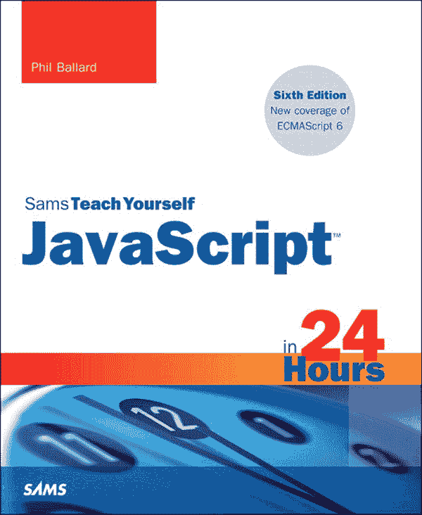

## 关于本电子书

ePUB 是一种开放的行业标准电子书格式。然而，不同的阅读设备和应用程序对 ePUB 及其功能的支持程度不同。请使用您的设备或应用设置根据您的喜好自定义显示。您可以自定义的设置通常包括字体、字体大小、单栏或双栏、横屏或竖屏模式，以及可以点击或触摸放大的图片。有关您的阅读设备或应用上设置和功能的更多信息，请访问设备制造商的网站。

许多书籍包含编程代码或配置示例。为了优化这些元素的显示效果，请以单栏横屏模式查看电子书，并将字体大小调整为最小设置。除了以流式文本格式呈现代码和配置外，我们还包含了代码图像，以模仿印刷本中的呈现；因此，当流式格式可能会影响代码列表的显示时，您将看到“点击此处查看代码图像”链接。点击链接即可查看高保真代码图像。要返回上一页，请点击设备或应用上的“返回”按钮。


 800 East 96th Street, Indianapolis, Indiana, 46240 USA

**Sams Teach Yourself JavaScript in 24 Hours, Sixth Edition**


alert(answer * 1); // 将显示 0 或 1
```

反之亦然。JavaScript 将任何非零值解释为 `true`，将零解释为 `false`。JavaScript 将以下所有值解释为 false：

 布尔 false（你难道不是吗？）

 `undefined`

 `null`

 0 (零)

 `NaN`

 “” (空字符串)

### 提示

上述值通常被称为“虚假（falsy）”，意思是“并不完全是假，但可以被解释为假”。JavaScript 解释为真的值同样被称为“真值（truthy）”。

### 动手试一下：一个简单的垃圾邮件检测函数

我们将使用这些方法中的两个来编写一个简单的函数，检测给定字符串中是否存在特定的单词。在示例中，我们将使用单词“fake”作为目标单词。如果函数在作为参数传递的字符串任何地方检测到单词“fake”，它应该返回零或正值；否则，它应该返回负数。这里是“空”函数：

```javascript
function detectSpam(input) {

}
```

你可能会使用这样的函数来检查邮件主题行，例如，检测销售“fake”设计师物品的垃圾邮件。在实际应用中，代码会复杂得多，但这里重要的是字符串处理操作。

首先，我们想将字符串转换为小写：

点击此处查看代码图片

```javascript
function detectSpam(input) {
    input = input.toLowerCase();
}
```

这是必要的，因为我们之后将使用 `indexOf()` 来查找单词“fake”，而 `indexOf()` 区分大写和小写。

点击此处查看代码图片

```javascript
function detectSpam(input) {
    input = input.toLowerCase();
    return input.indexOf("fake");
}
```

将列表 5.1 中的代码输入到编辑器中并将其保存为 HTML 文件。

**列表 5.1 垃圾邮件检测函数**

点击此处查看代码图片

```html
<!DOCTYPE html>
<html>
<head>
    <title>Spam Detector</title>
</head>
<body>
<script>
    function detectSpam(input) {
        input = input.toLowerCase();
        return input.indexOf("fake");
    }
    var mystring = prompt("Enter a string");
    alert(detectSpam(mystring));
</script>
</body>
</html>
```

在浏览器中打开该页面，如[part0049.xhtml_p075pro01a 所示]。

### 非运算符 (!)

JavaScript 将放在布尔变量之前的 `!` 字符解释为“非”，即相反。看这里：

```javascript
var success = false;
alert(!success); //  'true'
```

### 注意

JavaScript 还有两个关键字——`null` 和 `undefined`。通常当你想要某个值有一个有效但不存在的值时，对其赋值 `null`。对于数值，`null` 等于零；对于字符串，它是空字符串("");对于布尔值，它意味着 false。

与 `null` 不同，`undefined` 不是关键字。它是一个预定义的全局变量，用于存储已声明但未赋值变量的值。这意味着它是 false。

### 总结

在本节中，你学习了 JavaScript 支持的数字和字符串类型，并看到了使用各种数值和字符串方法处理这些类型的示例。

### 问答

问：JavaScript 字符串的最大长度是多少？

答：JavaScript 规范没有规定最大长度；相反取决于浏览器和操作系统。对于某些实现，它取决于可用内存。

问：JavaScript 是否有表示单个字符的数据类型？

答：不，与其他语言不同，JavaScript 没有表示单个字符的特定数据类型。在 JavaScript 中，你创建一个只包含一个字符的字符串。

#### 练习

在阅读后续“答案”部分之前，尝试回答所有问题。

#### 测验

1。哪条语句将返回通过将字符串 `string2` 接到另一个字符串 `string1` 创建的新字符串？

a. `concat(string1) + concat(string2);`
b. `string1.concat(string2);`
c. `join(string1, string2);`

2。哪条语句将变量 `paid` 赋值为布尔真？

a. `var paid = true;`
b. `var paid = "true";`
c. `var paid.true();`

3。对于包含值“stupid is as stupid does”的字符串 `myString`，下列哪项将返回 -1？


a. `myString.indexOf("stupid");`

b. `myString.lastIndexOf("stupid");`

c. `myString.indexOf("is stupid");`

#### 答案

1.** b. `string1.concat(string2);` 返回一个通过将 `string2` 连接到 `string1` 结尾创建的新字符串。

2.** a. 布尔值不应包含在引号中。

3.** c. 子字符串 “is stupid”未出现在 `myString` 中。

#### 练习

 编写一个 JavaScript 函数，从字符串末尾删除指定数量的字符。

 编写一个 JavaScript 函数，将给定字符串每个单词的首字母大写。

## 第 6 小时：数组

* * *

本小时你将学习：

 我们所说的 `array` 数据类型

 如何声明和填充数组

 如何管理数组内容

* * *

有时在单个变量名下存储多个变量值是有意义的。JavaScript 提供了 `array` 数据类型来帮助你做到。

在本小时，你将看到 JavaScript 数组是如何创建的，以及如何在代码中操作存储在这些数组中的数据。

#### 数组

数组用于在单个变量中存储多个值的对象类型。每个值都有一个数字索引，可以包含任何类型的数据——布尔值、数字、字符串、函数、对象甚至是数组。

#### 创建新数组

创建数组使用的语法你已经熟悉了；毕竟，数组仅仅是另一个对象：

```javascript
var myArray = new Array();
```

然而，对于数组有一个简写版本——只需像这样使用方括号 (`[]`）：

```javascript
var myArray = [];
```

#### 初始化数组

你可以在创建数组时可选地向数组中预加载数据：

点击此处查看代码图像

```javascript
var myArray = ['Monday', 'Tuesday', 'Wednesday'];
```

或者，可以在数组创建后添加项：

```javascript
var myArray = [];
myArray[0] = 'Monday';
myArray[1] = 'Tuesday';
myArray[2] = 'Wednesday';
```

##### array.length

所有数组都有一个 `length` 属性，告诉该数组包含多少项。当你向数组中添加项或删除项时，`length` 属性会自动更新。以下代码返回前一个数组的长度：

```javascript
myArray.length  // 返回 3
```

* * *

### 注意事项

长度始终比最高索引大 1，即使数组中的项实际上更少。假设我们向前面的数组添加了一个新项：

点击此处查看代码图像

```javascript
myArray[50] = 'Ice cream day';
```

`myArray.length` 现在返回 51，尽管数组只有四个条目。

* * *

#### 数组方法

* * *

### 注意事项

某些数组方法与同名的字符串方法同名且功能几乎相同。请注意你正在处理的数据类型，否则你的脚本可能无法按照你期望的方式运行。

* * *

表 6.1 包含了数组对象的一些常用方法。

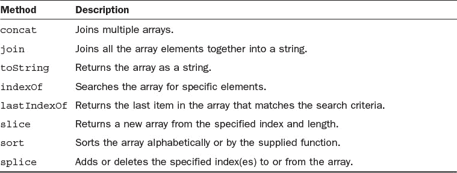

**表 6.1 一些实用的数组方法**

##### concat()

你已经有了字符串拼接的经验，而 JavaScript 数组也有一个 `concat()` 方法：

点击此处查看代码图像

```javascript
var myOtherArray = ['Thursday','Friday'];
var myWeek = myArray.concat(myOtherArray);
// myWeek 将包含 'Monday', 'Tuesday', 'Wednesday', 'Thursday', 'Friday'
```

##### join()

为了将数组的所有元素合并成单个字符串，我们可以使用 `join()` 方法：

点击此处查看代码图像

```javascript
var longDay = myArray.join(); // 返回 MondayTuesdayWednesday
```

可选地，我们可以向此方法传递一个字符串参数；传递的字符串将作为分隔符插入到返回的字符串中：

点击此处查看代码图像

```javascript
var longDay = myArray.join("-"); // 返回 Monday-Tuesday-Wednesday
```

##### toString()

`toString()` 是 `join()` 的特殊情况——它将数组作为字符串返回，元素用逗号分隔：

点击此处查看代码图像

```javascript
var longDay = myArray.toString(); // 返回 Monday,Tuesday,Wednesday
```

##### indexOf()

我们可以使用 `indexOf()` 找到特定元素在数组中首次出现的位置。该方法返回查找项的索引，如果未找到则返回 -1。


在我们处理此列表时，你可能希望参考在本节之前给出的单个字符串和数组方法的定义，以及第 4 节中对 `getElementById()` 和 `innerHTML` 的讨论，即“DOM 对象与内置对象”。

通过逐步执行 `wrangleArray()` 函数，我们首先定义了一个字符串：

点击此处查看代码图片

```javascript
var sentence = "JavaScript is a really cool language";
```

在使用 `innerHTML` 将其写入任何空 `<div>` 元素后，我们对该字符串应用 `split()` 方法，并向它传递一个空格作为参数。该方法返回一个元素数组，该数组是通过在字符串每出现空格的地方进行分割创建的——也就是说，将它拆分为单词。我们将该数组存储在变量 `words` 中。

接下来，我们对 `words` 数组应用 `splice()` 数组方法，移除数组索引为 3 的两个单词，“really”和“cool”。由于 `splice()` 方法会返回任何被删除的单词，我们可以在 `alert()` 对话中显示它们：

点击此处查看代码图片

```javascript
var message = words.splice(3,2,"powerful");

alert('Removed words: ' + message);
```

最后，我们对数组应用 `join()` 方法，再次将其折叠为字符串。由于我们向 `join()` 提供了一个单个空格作为参数，各个单词再次被空格隔开。最后，我们使用 `innerHTML` 将修改后的句子输出到第二个 `<div>` 元素。

`wrangleArray()` 函数是由文档体中的一个小脚本调用的：

点击此处查看代码图片

```html
<script>wrangleArray();</script>
```

脚本的操作显示在图 6.1 中。

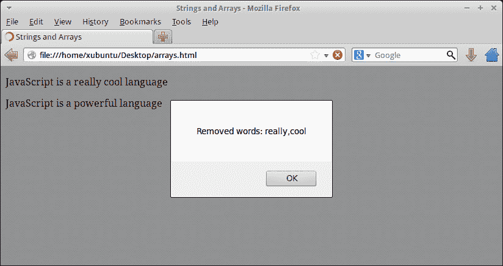

**图 6.1** 数组操作脚本的输出

* * *

### 总结

数组是在单个变量中存储多个值的方便手段。在本节中，你学习了用于创建和操作 JavaScript 数组对象的一些方法。

### 问答

**Q. JavaScript 允许关联数组吗？**

**A.** JavaScript 不直接支持关联数组（带有命名索引的数组）。但是，有方法可以使用对象来模拟它们的行为。你将在书的后面看到这些示例。

**Q. 我可以在 JavaScript 中创建多维数组吗？**

**A.** 你可以创建一个数组的数组，这等同于：

点击此处查看代码图片

```javascript
var myArray = [[1,2], [3,4], [5,6]];

alert(myArray[1][0]);     // 提示 '3'
```

### 工作坊

在阅读随后的“答案”部分之前，尝试回答所有问题。

#### 测验

**1.** 如果数组 `Foo` 中索引最高的元素是 `Foo[8]`，那么 `Foo.length` 将返回什么值？

**2.** 你有一个名为 `monthNames` 的数组，包含一年中所有月份名称。你如何使用 `join()` 创建包含所有这些月份名称的字符串，且名称之间用单个空格分隔？

**3.** 如果向 `indexOf()` 传递一个未出现在其所作用数组中的值，它将返回什么值？

#### 答案

**1.** `Foo.length` 将返回 9。

**2.** `var names = monthNames.join(" ");`

**3.** 它将返回 -1。

#### 练习

 复习具有相同方法名的数组方法和字符串方法。熟悉根据这些方法是应用于字符串还是数组，语法和操作是如何变化的。

## 第 7 节。程序控制

* * *

在本节中你将学习：

 使用条件语句

 使用比较运算符比较值

 应用逻辑运算符

 编写循环和控制结构

 在 JavaScript 中设置定时器

* * *

在第 5 节“数字与字符串”和第 6 节“数组”中，你快速浏览了 JavaScript 变量可以包含的数据类型。

在本节中，我们将学习如何。

### 条件语句

正如名称所暗示，条件语句用于根据特定条件做出决策。在本节中，我们将检查值以让程序执行。

#### if 语句

在上一节中，我们讨论了布尔值，它们只能取 `true` 或 `false`。`if` 语句有多种形式，最简单的一种如下所示：

点击此处查看代码图片

```javascript
if(condition is true) then do
```

让我们来看一个简单的例子：

点击此处查看代码图片

```javascript
var message = "";

var bool = true;

if(bool) message = true;
```

首先我们声明一个变量 `message` 并给它赋值空字符串。然后我们声明一个新变量 `bool`，将其设置为 `true`。第三条语句测试 `bool` 的值；如果是（正如在本例所示），则为 `message` 设置新值。如果我们为 `bool` 赋值 `false` 值，对 `message` 的赋值指令将被忽略，变量 `message` 将保持为空字符串。

我们可以通过否定字符 `!` 来测试布尔值 `false`：

点击此处查看代码图片

```javascript
if(!bool) message = true;
```

显然，为了让 `!bool` 求值为 `true`，`bool` 必须为 `false`。

#### 比较运算符

`if()` 语句不仅限于测试布尔变量的值；相反，我们可以以表达式的形式输入到我们的 `if` 语句的括号中，JavaScript 将评估该表达式以确定其真还是假：

点击此处查看代码图片

```javascript
var message = "";

var temperature = 60;

if(temperature < 64) message = "Turn on the heating!";
```

小于运算符 (`<`) 是 JavaScript 可用的一系列比较运算符之一。一些比较运算符列在表 7.1 中。


点击此处查看代码图片

```javascript
function detectSpam(input) {
    input = input.toLowerCase();
    return input.indexOf("fake");
}
```

你可能记得，该函数目前返回一个数字，该数字对应输入字符串中单词“fake”所出现的位置。

让我们修改该函数，使其根据目标单词是否找到来返回 `true` 或 `false`：

点击此处查看代码图片

```javascript
if(input.indexOf("fake") < 0) {
    return false;
}

return true;
```

现在我们可以看到，如果满足条件 `input.indexOf("fake") < 0`，函数将终止并返回 `false`；否则，执行将继续到 `if()` 块之后的下一行，函数将终止并返回 `true`。

列表 7.1 显示了完整 HTML 文件中修改后的代码。请在编辑器中创建此文件。

### 列表 7.1 垃圾邮件检测函数

点击此处查看代码图片

***

```html
<!DOCTYPE html>
<html>
<head>
    <title>Spam Detector</title>
</head>
<body>
<script>
    function detectSpam(input) {
        input = input.toLowerCase();
        if(input.indexOf("fake") < 0) {
            return false;
        }
        return true;
    }
    var mystring = prompt("Enter a string");
    alert(detectSpam(mystring));
</script>
</body>
</html>
```

***

现在让我们看看当程序给定我们在 第 5 小节 中使用的相同字符串时的表现，如图图 7.1 所示。

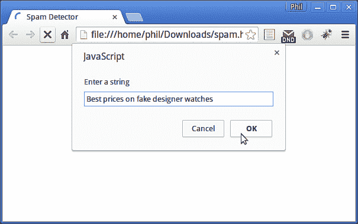

**图 7.1** 输入字符串

如你从图 7.2 中所示，警告对话框现在仅报告 `true`，而不是显示字符串中找到目标单词的位置。在浏览器中重新加载文件并再次尝试一个不包含“fake”单词的字符串，以确认检测器返回 `false`。

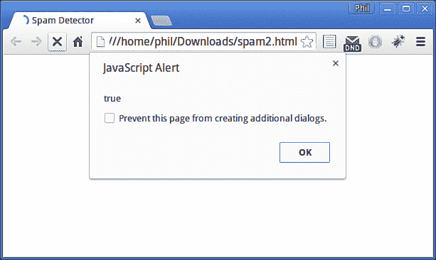

**图 7.2** 垃圾邮件检测器报告 `true`

***

### 等值性测试

在上一个示例中，我们如何测试温度是否恰好等于 64 度呢？记住，我们使用等号 (`=`) 来为变量赋值，因此这段代码的作用可能不像预期的那样工作：

```javascript
if(temperature = 64) ....
```

如果我们使用这条语句，括号内的表达式将由 JavaScript 进行求值，我们的变量 `temperature` 将被赋值为 64。如果这次赋值成功结束——而且为什么不应该成功呢？——那么赋值操作将向 `if()` 语句返回 `true` 值，因此语句的其余部分将执行。这完全不是我们想要的行为。

相反，为了测试等值性，我们必须使用双等号 (`==`)：

点击此处查看代码图片

```javascript
if(temperature == 64) message = "64 degrees and holding!";
```

***

### 注意事项

如果你需要测试两个项目在值和类型上是否相等，JavaScript 有一个运算符 `===` 来执行此测试。例如：

点击此处查看代码图片

```javascript
var x = 2; // 分配一个数值

if(x == "2") ... // true, 因为字符串 "2" 被解释为数字
if(x === "2") ...// false, 字符串不是数值
```

这在测试返回值是否真的为 `false`，或者只是一个“虚假”（falsy，可以被解释为 `false`）的值时非常有用：

点击此处查看代码图片

```javascript
var x = 0; // 分配值为零

if(!x) ... // 求值为为 true
if(x === false)..// 求值为 false
```

***

### 关于 if() 的更多信息

之前的示例在满足测试条件时仅执行单条语句。如果我们想做更多操作呢；例如，执行多条语句？

为了实现这一点，我们只需用大括号 (`{}`) 将我们所有希望在条件满足时执行的代码语句括起来即可：

点击此处查看代码图片

```javascript
if(temperature < 64) {
    message = "Turn on the heating!";
    heatingStatus = "on";
}
```

我们还可以为 `if` 语句添加一个子句，其中包含在条件不满足条件时我们想要执行的代码。为了实现这一点，我们使用 `else` 结构：

点击此处查看代码图片

```javascript
if(temperature < 64) {
    message = "Turn on the heating!";
    heatingStatus = "on";
} else {
    message = "Temperature is high";
    heatingStatus = "off";
}
```

***

### 提示

`if()` 语句存在简写形式：

点击此处查看代码图片

`(condition is true)? [do if true] : [do if false];`

这里有一个例子：

点击此处查看代码图片

```javascript
errorMessage = count + ((count == 1)? " error ":" + "found.";
```

在这个示例中，如果 `count` 中的错误数量恰好为 1，则 `message` 变量将包含 "1 error"。如果 `count` 的值为 0 或大于 1 的数字，`message` 变量将包含 "3 found"。

***

### 多条件测试

你可以使用“嵌套”的 `if` 和 `else` 组合来测试多个条件，在决定如何操作之前。让我们回到加热系统示例，如果温度过高则让我们开启风扇：

点击此处查看代码图片

```javascript
if(temperature < 64) {
    message = "Turn on the heating!";
    heatingStatus = "on";
} else if(temperature > 72){
    message = "Turn on the fan!";
    heatingStatus = "off";
} else {
    message = "Temperature is OK";
    heatingStatus = "off";
}

### switch 语句

当我们测试同一个条件语句的不同范围结果时，可以使用的一种更简洁的语法是 JavaScript 的 `switch` 语句：

点击此处查看代码图片

```javascript
switch(color) {
    case "red" :
        message = "Stop!";
        break;
    case "yellow" :
        message = "Pass with caution";
        break;
    case "green" :
        message = "Come on through";
        break;
    default :
        message = "Traffic light out of service. Pass only with great care";
}
```

`switch` 关键字在括号内包含测试的变量名称。测试本身列在大括号 `{` 和 `}` 之间。每个 `case` 语句（带有其值）后面跟着一个冒号，然后是该情况被匹配时要执行的操作列表。每个部分可以有任意数量的代码语句。

注意每个 case 后的 `break` 语句。它在执行完匹配情况的代码后跳转到 `switch`

语句的结束。如果省略了 `break`，可能会有多个 case 执行其代码。可选的 `default` 情况在没有指定的 case 被匹配时执行其代码。

### 逻辑运算符

有时我们希望测试组合标准来判断是否满足了测试条件，而使用 `if ... else` 或 `switch` 语句这样做会变得复杂。

让我们再次回到温度控制程序。JavaScript 允许我们使用逻辑与 (`&&`) 和逻辑或 (`||`) 来组合条件。这里有一种方法：

点击此处查看代码图片

```javascript
if(temperature >= 64 && temperature <= 72) {
    message = "The temperature is OK";
} else {
    message = "The temperature is out of range!";
}
```

我们可以将前面的条件读为“如果温度大于或等于 64 且温度小于或等于 72”。


我们可以使用 `OR` 代替 `AND` 来完全相同的功能：

点击此处查看代码图片

```javascript
if(temperature < 64 || temperature > 72) {
    message = "The temperature is out of range!";
} else {
    message = "The temperature is OK";
}
```

在这里我们反转了执行测试的方式；当温度在范围`之外`时，我们的条件语句就会被满足，并且可以读作“如果温度小于 64 或大于 72”。

### 循环与控制结构

`if` 语句可以被视为程序执行中的一个 `junction`（分支点）。根据对数据进行测试的结果，程序在执行语句时可能会走某一条或另一条路径。

然而，在许多情况下，我们可能希望在继续程序的其余部分之前执行某些操作。如果重复次数是固定的，我们或许可以通过多个 `if` 语句和递增计数器变量来实现，尽管代码会变得杂乱且难以阅读。但如果我们不知道需要重复这段代码多少次呢？因为重复次数取决于（例如）变量值的变化。

JavaScript 拥有各种内置循环结构，允许我们实现此类目标。

#### while

`while` 语句的语法与 `if` 语句的语法非常相似：

点击此处查看代码图片

```javascript
while(this condition is true) {
    carry out these statements ...
}
```

`while` 语句的工作方式`也和 `if` 一样。唯一的区别是，在完成条件语句后，`while` 会返回并再次测试条件。只要条件一直为 `true`，`while` 就会一直执行条件代码。这里有一个示例：

```javascript
var count = 10;
var sum = 0;

while(count > 0) {
    sum = sum + count;
    count--;
}
alert(sum);
```

每当 `while` 将条件求值为 `true` 时，大括号中的语句就会反复执行，在循环的每次轮次中，都将 `count` 的当前值加到变量 `sum` 上。

当 `count` 递减到零时，条件不再成立，循环停止；程序操作随后从闭大括号之后继续执行。到此时，变量 `sum` 的值为：

点击此处查看代码图片

10 + 9 + 8 + 7 + 6 + 5 + 4 + 3 + 2 + 1 = 55

#### do ... while

`do ... while` 结构在操作上与 `while` 相似，但有一个重要的区别。其语法如下：

点击此处查看代码图片

```javascript
do {
    ... these statements ...
} while(this condition is true)
```

这里真正的区别在于，由于 `while` 子句出现在大括号`之后`，因此条件语句列表在评估 `while` 子句`之前`会先执行一次。因此，`do ... while` 子句中的语句将至少执行一次。

#### for

`for` 循环是另一种操作上与 `while` 相似的循环，但语法更全面。通过 `for` 循环，我们可以在一条语句中指定初始条件、测试条件（用于结束循环）以及每次通过循环时更改计数器变量的方法。看下语法：

点击此处查看代码图片

```javascript
for(x=0; x<10; x++) {
    ... execute these statements ...
}
```

我们将其解释为：

“对于初始设为 0 的 x，只要 x 小于 10，并且在每次通过循环时将 x 增加 1，就执行条件语句。”

让我们重写一下在看 `while` 循环时给出的示例，但这次使用 `for` 循环：

点击此处查看代码图片

```javascript
var count;
var sum = 0;

for(count = 10; count > 0; count--) {
    sum = sum + count;
}
```

如果计数器变量之前没有声明过，那么在 `for` 语句内部使用 `var` 关键字声明它通常比在外部声明更方便：

点击此处查看代码图片

```javascript
var sum = 0;
for(var count = 10; count > 0; count--) {
    sum = sum + count;
}
alert(sum);
```

与上一个示例一样，循环结束后，变量 `sum` 的值为：

点击此处查看代码图片

10 + 9 + 8 + 7 + 6 + 5 + 4 + 3 + 2 + 1 = 55

#### 使用 break 退出循环

`break` 命令在循环中的工作方式与在 `switch` 语句中几乎相同——它在我们踢出循环并返回到闭大括号之后的下一行。这里有一个示例：

```javascript
var count = 10;
var sum = 0;

while(count > 0) {
    sum = sum + count;
    if (sum > 42) break;
    count--;
}
alert(sum);
```

我们之前看到，如果没有 `break`，`sum` 的值将达到

10 + 9 + 8 + 7 + 6 + 5 + 4 + 3 + 2 + 1 = 55

注意

小心无意中创建无限循环。这里有一个我们使用过的循环：

```javascript
while(count > 0) {
    sum = sum + count;
    count--;
}
```

想象一下，如果我们省略了 `count--;`，可能会导致浏览器无响应、产生 JavaScript 错误或崩溃。

#### 使用 for in 遍历对象

`for...in` 循环是一种特殊的循环，用于遍历对象的属性。让我们在列表 7.2 中看看它的效果。

**列表 7.2 for in**

```html
<!DOCTYPE html>
<html>
<head>
    <title>循环与控制</title>
</head>
<body>
    <script>
        var days = ['Sun','Mon','Tue','Thu','Fri','Sat'];
        var message = "";
        for (i in days) {
            message += 'Day ' + i + ' is ' + days[i] + '\n';
        }
        alert(message);
    </script>
</body>
</html>
```

在这种循环中，我们不需要担心维护循环计数器或设计判断循环何时结束的测试。循环将为提供的对象的每个属性（在我们的示例中为每个数组项）执行一次，然后终止。

运行此示例的结果所示图 7.3。


**图 7.3** 运行我们的 for in 循环的结果

### 设置和使用计时器

在某些情况下，你希望为 JavaScript 代码的执行设置特定的延迟。这在编写用户界面程序时特别常见；例如，你可能希望在移除消息之前显示一段时间。

为了帮助你，JavaScript 两个非常有用的方法：`setTimeout()` 和 `setInterval()`。

* *

注意

`setTimeout()` 和 `clearTimeout()` 都是 HTML DOM `window` 对象的方法。

* *

#### setTimeout()

`setTimeout(action, delay)` 方法会在第二个参数指定的毫秒数后，调用第一个参数传递的函数（或求值表达式）。你可以使用它，例如在固定的时间内显示给定配置的元素：


点击此处查看代码图片

<div id="id1">我快消失了！</div>>

假设你的页面包含了上述 `<div>` 元素。如果你将以下代码放入页面 `<head>` 部分的 `<script>` 元素中，函数 `hide()` 将在页面加载完成后 3 秒后执行，使 `<div>` 元素变得不可：

点击此处查看代码图片

```javascript
function hide(elementId) {
    document.getElementById(elementId).style.display = 'none';
}

window.onload = function() {
    setTimeout("hide('id1')", 3000);
}
```

`setTimeout()` 方法会返回一个值。如果你以后想取消该定时器函数，可以通过该返回的值传递给 `clearTimeout()` 方法来引用它：

点击此处查看代码图片

```javascript
var timer1 = setTimeout("hide('id1')", 3000);
clearTimeout(timer1);
```

### setInterval()

`setInterval(action, delay)` 方法的工作原理与 `setTimeout()` 类似，但它不是在执行作为第一个参数的语句之前设置单次延迟，而是重复执行该语句，每次执行之间的延迟对应第二个参数中指定的毫秒数。

与 `setTimeout()` 一样，`setInterval()` 返回一个值，你可以稍后将其传递给 `clearInterval()` 方法即可停止定时器：

点击此处查看代码图片

```javascript
var timer1 = setInterval("updateClock()", 1000);
clearInterval(timer1);
```

### 总结

在这一小时中，你学习了关于测试条件、根据变量的值控制程序流，以及如何编写各种由条件控制的程序循环。

你还学习了一些关于在程序中使用定时器的知识。

### 问答

**Q. 是否有特定的理由说明我应该使用某种循环而不是另一种？**

**A.** 诚然，通常有多种类型的循环可以解决任何特定的编程问题。你可以使用你觉得最熟悉的那个，尽管通常认为，良好的做法是根据代码的意图（结合你选择的变量名）使用最符合逻辑的那种循环。

**Q. 是否有方法可以停止当前的循环跳转并直接进入下一次迭代？**

**A.** 是的，你可以使用 `continue` 命令。它的工作原理与 `break` 非常相似，但它不是取消循环并从闭括号之后继续执行代码，`continue` 只取消当前的循环跳转，并进入下一次循环。

### 工作坊

在阅读随后的“答案”部分之前，请尝试回答所有问题。

#### 测验

**1.** “大于或等于”在 JavaScript 中如何表示？

**a.** `>`

**b.** `>=`

**c.** `>==`

**2.** 哪种命令强制取消循环，并将代码操作移动到闭括号之后的语句？

**a.** `break;`

**b.** `loop;`

**c.** `close;`

**3.** 下列哪项可能导致无限循环的发生？

**a.** 使用了错误的循环。

**b.** 终止循环的条件从未满足。

**c.** 循环中的语句过多。

#### 答案

**1.** b. JavaScript 将 `>=` 解析为“大于等于”。

**2.** a. `break` 命令结束执行。

**3.** b. 如果终止循环的条件从未满足。

#### 练习

 在第 4 小节](#part0013.xhtml_ch04) DOM 对象和内置对象，你学习了如何获取当前的星期几。编写一个程序，使用 `switch` 语句根据日期输出不同的消息。

 修改第 7.2 小节](#part0017.xhtml_ch07lis02) 以列出月份而不是星期。如何修改代码列出从 1 月开始的月份而不是 0？

# 第三部分：对象

## 第 8 小节：面向对象编程

* 你将学习：

 什么是面向对象编程

 创建对象的两种方法

 三种创建对象的方法

 四种创建对象的方法

 五种创建对象的方法

 六种创建对象的方法

 七种创建对象的方法

 八种创建对象的方法

 九种创建对象的方法

 十种创建对象的方法

 十一种创建对象的方法

 十二种创建对象的方法

 十三种创建对象的方法

 十四种创建对象的方法

 十五种创建对象的方法

 十六种创建对象的方法

 十七种创建对象的方法

 十八种创建对象的方法

 十九种创建对象的方法

 二十种创建对象的方法

 二十一种创建对象的方法

 二十二种创建对象的方法

 二十三种创建对象的方法

 二十四种创建对象的方法

 二十五种创建对象的方法

 二六种创建对象的方法

 二十七种创建对象的方法

 二十八种创建对象的方法

 二十九种创建对象的方法

 三十种创建对象的方法

 三十一种创建对象的方法

 三十二种创建对象的方法

 三十三种创建对象的方法

 三十四种创建对象的方法

 三十五种创建对象的方法

 三六种创建对象的方法

 三十七种创建对象的方法

 三十八种创建对象的方法

 三十九种创建对象的方法

 四十种创建对象的方法

 四十一种创建对象的方法

 四十二种创建对象的方法

 四十三种创建对象的方法

 四十四种创建对象的方法

 四十五种创建对象的方法

 四六种创建对象的方法

 四十七种创建对象的方法

 四十八种创建对象的方法

 四十九种创建对象的方法

 五十种创建对象的方法

 五十一种创建对象的方法

 五十二种创建对象的方法

 五十三种创建对象的方法

 五十四种创建对象的方法

 五十五种创建对象的方法

 五六种创建对象的方法

 五十七种创建对象的方法

 五十八种创建对象的方法

 五十九种创建对象的方法

 六十种创建对象的方法

 六十一种创建对象的方法

 六十二种创建对象的方法

 六十三种创建对象的方法

 六十四种创建对象的方法

 六十五种创建对象的方法

 六六种创建对象的方法

 六十七种创建对象的方法

 六十八种创建对象的方法

 六十九种创建对象的方法

 七十种创建对象的方法

 七十一种创建对象的方法

 七十二种创建对象的方法

 七十三种创建对象的方法

 七十四种创建对象的方法

 七十五种创建对象的方法

 七六种创建对象的方法

 七十七种创建对象的方法

 七十八种创建对象的方法

 七十九种创建对象的方法

 八十种创建对象的方法

 八十一种创建对象的方法

 八十二种创建对象的方法

 八十三种创建对象的方法

 八十四种创建对象的方法

 八十五种创建对象的方法

 八六种创建对象的方法

 八十七种创建对象的方法

 八十八种创建对象的方法

 八十九种创建对象的方法

 九十种创建对象的方法

 九十一种创建对象的方法

 九十二种创建对象的方法

 九十三种创建对象的方法

 九十四种创建对象的方法

 九十五种创建对象的方法

 九六种创建对象的方法

 九十七种创建对象的方法

 九十八种创建对象的方法

 九十九种创建对象的方法

随着你的程序变得越来越复杂，你需要使用有助于你进行维护的技术。在这一小时中，你将学习面向对象编程（OOP）的基础知识，这是编写清晰可靠代码的重要技术。

### 什么是面向对象编程？

到目前为止，代码示例都是所谓的*过程化*编程。过程化程序的特点是将数据存储在变量中，并通过指令进行操作。每条指令（或指令列表，如函数）都可以创建、销毁或修改数据，但数据仍然保持不变。

在面向对象编程（OOP）中，指令和它们操作的数据更加交织。OOP 是一种将程序数据概念化为离散的“事物”的方法，这些事物被称为*对象*——每个对象都有属性（数据）和方法（指令）。

例如，假设编写一个脚本来管理汽车租赁业务。你可能会设计一个通用对象对象 `Car`。`Car` 对象将具有属性（`color`、`year`、`odometerReading` 和 `make`），并可能有一些方法（例如用于更新 `odometerReading` 属性的方法 `setOdometer(newMiles)`）。

对于车队的每辆车，你都会创建一个 `Car` 对象的*实例*。

* * *

注意

对象的实例是对象模板的一种特定应用。例如，通用对象模板 `Car` 可能有一个特定的实例，其中创建的 `Car` 对象通过特定数据识别为“蓝色 1998 福特”，另一个实例描述为“黄色 2004 尼日产”。在大多数关于面向对象编程的讨论中，这种对象模板被称为*类*。我克制了使用该术语的冲动，因为 JavaScript 并没有真正使用类，但 JavaScript 的概念*构造函数*与此相似。你将在这一小时中学习构造函数。

* * *

编写 OOP 代码相比过程化方法有几个优势：

 **代码重用**——首先，OOP 允许你在各种脚本中重用你的代码。你可以通过普通函数来实现这一点，但很快就会很难跟踪所有需要传递的变量、作用域和含义。相比之下，你只需要记录每个对象的属性和方法。只要它们遵循这些规则，其他程序——甚至其他程序员都可以轻松使用你的对象定义。


 **继承**——在编写代码时，你往往需要一些与之前编写过的代码相似但并不完全相同的代码——甚至可能是已经在同一个应用程序中编写过的代码。通过`继承`，可以根据之前定义的对象的设计来创建新对象，并可选地对其方法和属性进行添加或修改；新对象会`继承`旧对象的属性和方法。

在之前的几个小时中，你经常使用对象；要么是 JavaScript 内置的对象，要么组成 DOM 的对象。然而，你也可以创建自己的对象，拥有它们自己的属性和函数，并在程序中使用它们。

* * *

## Note

像 `C++` 和 `Smalltalk` 某些编程语言高度倾向于 OOP（面向对象编程），通常被称为面向对象语言。JavaScript 并不是其中之一，但它支持足够的核心要素，让你能够编写出实用的 OOP 代码。我们可以很容易用 OOP 的理论和实践填满整本书，但我们在这里只看基础知识。

* * *

### 对象创建

JavaScript 提供了几种创建对象的方法。让我们先看看如何声明对象的`直接实例`（direct instance）；稍后我们将使用`构造函数`（constructor function）来创建对象。

#### 创建直接实例

JavaScript 有一个简单名为 `Object` 的内置对象，你可以将其作为一种空白画布来创建自己的对象：

```javascript
myNewObject = new Object();
```

好了，你现在有了一个全新的对象 `myNewObject`。目前，它实际上并没有做任何事情，因为它没有任何任何属性或方法。你可以通过添加一个属性来开始纠正这一点：

点击此处查看代码图片

```javascript
myNewObject.info = 'I am a shiny new object';
```

现在你的对象拥有了一个属性——在这种情况下，它是一个包含对象某些信息的文本字符串，名为 `info`。你也可以轻松地为对象添加一个方法，首先定义一个函数，然后将其作为对象的方法之一挂载到 `myNewObject` 上：

点击此处查看代码图片

```javascript
function myFunc() {
    alert(this.info);
};

myNewObject.showInfo = myFunc;
```

* * *

### Caution

注意，你在这里只使用了函数名而没有带括号。你这样做是因为你正尝试给方法 `newObject.showInfo` 分配函数 `myFunc()` 的`定义`。

如果你使用了代码：

点击此处查看代码图片

```javascript
myNewObject.showInfo = myFunc();
```

你将是在要求 JavaScript `执行` `myFunc()` 并将其`返回值`赋值给 `newObject.showInfo`。

* * *

要调用这个新方法，你只需使用现在熟悉的点符号法：

```javascript
myNewObject.showInfo();
```

#### 使用 this 关键字

注意在之前的函数定义中 `this` 关键字的使用。你可能记得在第 2 小节“编写简单脚本”和第 3 小节“使用函数”中使用过这样的关键字。在之前的示例中，你在内联事件处理程序使用了 `this`：

点击此处查看代码图片

```html

```

当像那样使用时，`this` 指的是 HTML 元素本身——在前面的例子中是  元素。当你在函数（或方法）内部使用 `this` 时，关键字 `this` 指的是函数的父级对象。

在第一次声明函数 `myFunc()` 时，它的父级是全局对象；即 `window` 对象。`window` 对象没有名为 `info` 的属性，因此如果你直接调用 `myFunc()` 函数将会将会错误。

然而，你继续为 `myNewObject` 创建一个名为 `showInfo` 的方法，并将 `myFunc()` 赋值给该方法：

点击此处查看代码图片

```javascript
myNewObject.showInfo = myFunc;
```

在 `showInfo()` 方法的上下文中，`myNewObject` 是父对象，因此 `this.info` 指的是属性 `myNewObject.info`。

让我们看看通过列表 8.1 中的代码来稍微澄清这一点。

**列表 8.1 创建一个对象**

点击此处查看代码图片

* * *

```html
<!DOCTYPE html>
<html>
<head>
    <title>Object Oriented Programming</title>
    <script>
        myNewObject = new Object();
        myNewObject.info = 'I am a shiny new object';
        function myFunc() {
            alert(this.info);
        }
        myNewObject.showInfo = myFunc;
    </script>
</head>
<body>
    
    <input type="button" value="Method Call" onclick="myNewObject.showInfo(); />
    <input type="button" value="Direct Call" onclick="myFunc(); />
    <input type="button" value="Error Call" onclick="showInfo(); />
</body>
</html>
```

* * *

（注：原文文本中提供的 HTML 块是破碎的。我将根据提供的文本结构重新组织逻辑，同时遵循规则。）

将此页面加载到浏览器中，你将面对三个按钮。点击第一个按钮调用新创建的 `showInfo` 方法：

```javascript
myNewObject.showInfo();
```

第二个按钮直接调用 `myFunc()`：

```javascript
myFunc();
```

第三个按钮尝试在不引用父对象的情况下调用 `showInfo`：

```javascript
showInfo();
```

因为 `showInfo` 在对象外部不存在，JavaScript 会报告错误，如图 8.3 所示。


如果你认为你只需要该类型的一个对象，那么直接创建一个对象的实例是可以的。遗憾的是，如果你需要为同种类型的对象创建另一个实例，你将必须再次经历相同的过程——创建对象、添加属性、定义方法等等。

### 提示
只有一个全局实例的对象有时被称为单例对象（singleton object）。这些对象在某些情况下很有用；例如，你程序的用户可能只有一个关联的 `userProfile` 对象，该对象可能包含他或她的用户名、最后访问页面的 URL 以及类似的属性。

### 创建将具有多个实例对象的更好方法是使用**对象构造函数**（object constructor function）。对象构造函数可以创建一个“模板”，从该模板中可以实例化更多的对象。

看下面的代码。与其使用 `new Object()`，你首先声明一个函数 `myObjectType()`，并在它的定义中，你可以使用 `this` 关键字添加属性和方法。

点击此处查看代码图像

```javascript
function myObjectType(){
    this.info = 'I am a shiny new object';
    this.showInfo = function(){
        alert(this.info);  // 显示属性 info 的
    }
    this.setInfo = function (newInfo) {
        this.info = newInfo; // 覆盖属性 info 的值
    }
}
```

在前面的代码中，你添加了一个单一属性 `info` 和两个方法：`showInfo`（用于显示当前存储在 `info` 属性中的值）和 `setInfo`。`setInfo` 方法接收一个参数 `newInfo`，并使用它的值来覆盖 `info` 属性的值。

#### 实例化对象
现在，你可以根据需要为该对象类型创建**任意数量**的实例。所有实例都将拥有在 `myObjectType()` 函数中定义的属性和方法。创建一个对象实例被称为**实例化**（instantiating）。

定义好构造函数后，你可以简单地通过使用构造函数来创建对象的实例：

点击此处查看代码图像

```javascript
var myNewObject = new myObjectType();
```

### 注意
请注意，这种语法与使用 `new Object()` 完全相同，不同在于你使用了专门设计的对象类型来代替 JavaScript 的通用 `Object()`。通过这样做，你实例化了一个包含构造函数中定义的全部属性和方法的完整对象。

现在，你可以调用它的方法并检查它的属性：

点击此处查看代码图像

```javascript
var x = myNewObject.info // x 现在包含 'I am a shiny new object'
myNewObject.showInfo();  // 弹出 'I am a shiny new object'
myNewObject.setInfo("Here is some new information");  // 覆盖了 info
```

#### 属性
创建多个实例非常简单，只需根据需要多次调用构造函数即可：

点击此处查看代码图像

```javascript
var myNewObject1 = new myObjectType();
var myNewObject2 = new myObjectType();
```

让我们来看它的实际运行效果。列表 8.2 中的代码定义了一个与之前描述相同的对象构造函数。

实例化了两个对象的实例；显然，这两个对象最初是完全相同的。你可以通过点击标记为 Show Info 1 或 Show Info 2 的按钮之一，来检查每个对象 `info` 属性中存储的值。

第三个按钮调用了对象 `myNewObject2` 的 `setInfo` 方法，并将一个新的字符串字面量作为参数传递给该方法。这覆盖了对象 `myNewObject2` 中 `info` 属性中存储的值，但当然不会改变 `myNewObject`。可以通过再次使用 Show Info 1 和 Show Info 2 来检查修改后的值。

**列表 8.2 使用构造函数创建对象**

点击此处查看代码图像

```html
<!DOCTYPE html>
<html>
<head>
    <title>面向对象编程</title>
    <script>
        function myObjectType(){
            this.info = 'I am a shiny new object';
            this.showInfo = function(){
                alert(this.info);
            }
            this.setInfo = function (newInfo) {
                this.info = newInfo;
            }
        }
        var myNewObject1 = new myObjectType();
        var myNewObject2 = new myObjectType();
    </script>
</head>
<body>
    <input type="button" value="Show Info 1" onclick="myNewObject1.showInfo()" />
    <input type="button" value="Show Info 2" onclick="myNewObject2.showInfo()" />
    <input type="button" value="Change info of object2" onclick="myNewObject2.setInfo('New Information!')" />
</body>
</html>
```

#### 使用构造函数
没有什么可以阻止你在实例化时自定义你的对象，即通过向构造函数传递一个或多个参数。在接下来的代码中，构造函数的定义包含一个参数 `personName`，它被构造函数赋值给 `name` 属性。正如你在实例化对象时向构造函数传递一个或多个参数的那样：

点击此处查看代码图像

```javascript
function Person(personName){
    this.name = personName;
    this.info = 'This person is ' + this.name;
    this.showInfo = function(){
        alert(this.info);
    }
}
var person1 = new Person('Adam');
var person2 = new Person('Eve');
```

### 提示
你可以定义构造函数以接受你需要的任意数量的参数：

点击此处查看代码图像

```javascript
function Car(Color, Year, Make, Miles) {
    this.color = Color;
    this.year = Year;
    this.make = Make;
    this.odometerReading = Miles;
    this.setOdometer = function(newMiles) {
        this.odometerReading = newMiles;
    }
}
var car1 = new Car("blue", "1998", "Ford", 79500);
var car2 = new Car("yellow", "2004", "Nissan", 56350);
```

使用对象的一个主要优势是可以在新语文中重用已写的代码。JavaScript 提供了一种修改对象以包含新方法或属性的方法，甚至基于现有对象创建全新的对象。这些技术分别被称为**扩展**（extending）和**继承**（inheriting）对象。

#### 扩展对象
如果你想在对象实例化后扩展你的对象的新方法和属性怎么办？你可以使用 `prototype` 关键字来实现。原型对象允许你快速添加一个属性或方法，该方法对所有实例可用。

##### 自己尝试：使用原型扩展对象
让我们为上一个示例中的 `Person` 对象扩展一个新方法 `sayHello`：

点击此处查看代码图像

```javascript
Person.prototype.sayHello = function() {
    alert(this.name + " says hello");
}
```

在你的编辑器中创建一个新的 HTML 文件，并输入列表 8.3 中的代码。

**列表 8.3 使用原型添加新方法**

点击此处查看代码图像

```html
<!DOCTYPE html>
<html>
<head>
    <title>面向对象编程</title>
    <script>
        function Person(personName){
            this.name = personName;
            this.info = 'This person is called ' + this.name;
            this.showInfo = function(){
                alert(this.info);
            }
        }
        var person1 = new Person('Adam');
        var person2 = new Person('Eve');
    </script>
</head>
<body>
    <input type="button" value="Show Info on Adam" onclick="person1.showInfo()" />
</body>
</html>
```


```html
<input type="button" value="Show Info on Eve" onclick="person2.showInfo()" />
<input type="button" value="Say Hello Adam" onclick="person1.sayHello()" />
<input type="button" value="Say Hello Eve" onclick="person2.sayHello()" />
</</body>>
</html>
```

* *

让我们来看一下代码，看看发生了什么。

首先，你定义了一个构造函数，它接收一个单一参数 `personName`。在构造函数内部，定义了两个属性 `name` 和 `info` 以及一个方法 `showInfo`。

你创建了两个对象，并在实例化每个对象时使用了不同的 `name` 属性。在创建了这两个人物对象后，你决定向 `person` 对象定义中再添加一个方法 `sayHello`。你使用 `prototype` 关键字来实现这一操作。

将 HTML 文件加载到浏览器中。点击页面上显示的四个按钮，你会发现最初定义的 `showInfo` 方法完好无损，但新定义的 `sayHello` 方法也可以正常运行，并且该对象类型的所有现有实例可用。

* *

### 继承

`Inheritance`（继承）是从一个对象类型创建另一个对象类型的能力；新的对象类型继承旧对象的属性和方法，并可以选择拥有自己的进一步属性和方法。这可以为你节省大量工作，因为你可以先设计“通用型”的对象类，然后通过继承将它们完善为更具体的类。

JavaScript 同样使用 `prototype` 关键字来模拟继承。

由于 `object.prototype` 被用于添加新的方法和属性，你可以利用它将现有构造函数的**所有**方法和属性添加到到你的新对象中。

让我们定义另一个简单的对象：

点击此处查看代码图像

```javascript
function Pet() {
    this.animal = "";
    this.name = "";
    this.setAnimal = function(newAnimal) {
        this.animal = newAnimal;
    }
    this.setName = function(newName) {
        this.name = newName;
    }
}
```

`Pet` 对象拥有包含动物类型和宠物名称的属性，以及设置这些值的方法：

```javascript
var myCat = new Pet();
myCat.setAnimal = "cat";
myCat.setName = "Sylvester";
```

现在假设你想专门为狗创建一个对象。与其从零开始，你不如说从 `Pet` 继承一个 `Dog` 对象，但添加一个额外的属性 `breed` 和一个额外的方法 `setBreed`。

首先，让我们创建 `Dog` 构造函数，并在其中定义新的属性和方法：

点击此处查看代码图像

```javascript
function Dog() {
    this.breed = "";
    this.setBreed = function(newBreed) {
        this.breed = newBreed;
    }
}
```

在添加了新属性 `breed` 和新方法 `setBreed` 后，你现在可以额外继承 `Pet` 的所有属性和方法。你使用 `prototype` 关键字来实现：

```javascript
Dog.prototype = new Pet();
```

现在你不仅可以访问 `Dog` 的属性和方法，还可以访问 `Pet` 的属性和方法：

点击此处查看代码图像

```javascript
var myDog = new Dog();
myDog.setName("Alan");
myDog.setBreed("Greyhound");
alert(myDog.name + " is a " + myDog.breed);
```

* *

### 动手尝试：扩展 JavaScript 原生对象

`Prototype` 也可以用于扩展 JavaScript 的内置对象。例如，你可以实现 `String.prototype.backwards` 方法，它将返回你提供的任何字符串的反转版本，如 Listing 8.4 所示。

**列表 8.4 扩展 String 对象**

点击此处查看代码图像

* *

```html
<!DOCTYPE html>
<html>
<head>
    <title>Object Oriented Programming</title>
    <script>
        String.prototype.backwards = function(){
            var out = '';
            for(var i = this.length-1; i >= 0; i--){
                out += this.substr(i);
            }
            return out;
        }
    </script>
</head>
<body>
    <script>
        var inString = prompt("Enter your string:");
        document.write(inString.backwards());
    </script>
</body>
</html>
```


幸运的是，现在已经出现了一种更出色的跨浏览器代码编写方法，它是基于对象的。与其尝试检测浏览器，不如让 JavaScript 检查你需要的特定功能是否被支持，这是一个明智的主意。你可以通过测试特定对象、方法或属性的可用性来实现这一点。在许多情况下，尝试使用相关的对象、方法或属性，并检测 JavaScript 返回的值就足够了。

这里有一个测试浏览器对 `document.getElementById()` 方法支持的示例，你已经遇到过它。虽然 `getElementById()` 已经被所有新浏览器支持了一段时间，但非常早期的浏览器不支持该方法。你可以使用 `if()` 来测试 `getElementById()` 方法（或任何类似的方法或属性）的可用性：

```
if(document.getElementById) {
    myElement = document.getElementById(id);
} else {
    // do something else
}
```

如果 `document.getElementById` 不可用，`if()` 条件语句将切换代码操作，以避免使用该方法。

另一种相关方法是使用 `typeof` 运算符在调用 JavaScript 函数之前检查该函数是否存在：

```javascript
if(typeof document.getElementById == 'function') {
    // you can use getElementById()
} else {
    // do something else
}
```

`typeof` 可以返回多个可能的值，如 表 8.1 所示。


**表 8.1 typeof 返回的值**

你可以使用这种技术来检查 DOM 以及内置对象、方法和属性的存在，还可以检查在脚本中创建的那些。

请注意，在整个练习过程中，你没有一次尝试过去判断用户用的是哪种浏览器——你只是想知道它是否支持你正准备使用的对象、属性或方法。这种特征检测（feature detection）不仅比所谓的浏览器嗅探（即试图通过解释 `navigator` 对象的属性来推断正在使用的浏览器）要准确和优雅得多，而且更具前瞻性——新浏览器或新浏览器版本的引入不会破坏你代码运行的任何部分。

### 总结

在这一小时中，你学习了 JavaScript 中的面向对象编程（OOP），从 OOP 背后的基本概念开始，并了解它是如何帮助你的代码开发，特别是对于更复杂的应用程序。

你学习了直接实例化对象并向其添加属性和方法的方法。然后你学习了如何创建一个对象构造函数，通过该函数你可以实例化多个相似的对象。

你还学习了 `prototype` 关键字，以及如何用它扩展对象或通过继承创建新对象。

### 问答

**问：我应该总是编写面向对象的代码吗？**

**答：** 这是一个偏好的问题。有些程序员倾向于始终从对象、方法和属性的角度来思考，并根据这些原则编写所有代码。另一些人则认为，特别是对于较小且简单的程序，OOP 提供的抽象程度太高，过程化编程就可以了。

**问：我应该如何在其他程序中使用对象？**

**答：** 对象的构造函数是一个非常可移植的实体。如果你在页面中链接了包含对象构造函数的 JavaScript 文件，你就有办法在整个代码中创建对象并使用它们的属性和方法了。

### 工作坊

在阅读 答案 部分之前，尝试回答所有问题。

#### 测验

**1](#part0019.xhtml_ch08ans01)。** 从构造函数创建的新对象被称为：
a. 对象的实例
b. 对象的方法
c. 原型

**2](#part0019.xhtml_ch08ans02)。** 通过使用现有对象派生对象被称为：
a. 封装
b. 继承
c. 实例化

**3](#part0019.xhtml_ch08ans03)。** 下列哪项是创建对象的有效方式？
a. `create()`
b. `myObject = new`
c. `getElementsByTagName()`

#### 答案

**1](#part0019.xhtml_ch08ans01)。** 从构造函数创建的新对象被称为实例。

**2](#part0019.xhtml_ch08ans02)。** 通过使用现有对象派生对象被称为继承。

**3](#part0019.xhtml_ch08ans03)。** `myObject = new`。

#### 练习

编写一个构造函数来描述 `Card`。使用 `prototype` 关键字为对象添加一个新方法 `yesterday()`，它返回上一张牌的名字（提示：使用花、、红桃、梅花、黑桃和 `Math.random()`）。

```javascript
function Card(suit, value) {
    this.suit = suit;
    this.value = value;
}

Card.prototype.yesterday = function() {
    // 实现逻辑
};
```

编写一个脚本，创建一个包含 52 张牌的数组，并随机洗出其中一张。

```javascript
var deck = [];
// 填充数组的逻辑
var randomCard = deck[Math.floor(Math.random() * deck.length)];
```


当页面加载完成后，浏览器就会生成该页面的完整、分层的 DOM 表示，供我们检查。图 9.2 显示了该表示部分可能内容的简化版本。

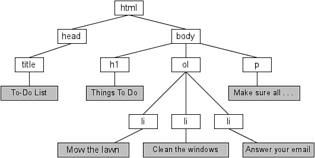

**图 9.2** 我们页面的 DOM 树形模型

* * *

### 注意

记住，在页面加载完成之前，DOM 是不可用的。在此之前，不要尝试执行任何使用 DOM 的语句，否则你的脚本可能会产生错误。

* * *

看图 9.2 中的树形图与列表 9.1 中的代码之间的关系。

`<html` 元素包含了页面的所有其他标记。它是两个直接`child`元素——`<head>` 和 `<body>` 元素的`parent`父元素。这两个元素是`siblings`兄弟节点，因为它们共享同一个父元素。它们本身也是父元素；`<head>` 元素有一个子元素 `<title>`，而 `<body>` 元素有三个子元素：`<h1>`标题、有序列表 `<ol>` 和一个段落 `<p>`。在这三个兄弟节点中，只有 `<ol>` 有子元素，即三个 `<li>` 行项目元素。树中的这些各种元素中包含文本，在图 9.2 的灰色框中表示。

DOM 是作为这种关系的层级结构被构建的。构成树形图连接点和终点的方框被称为`nodes`节点。

### 节点类型

图 9.2 显示了各种`element nodes`元素节点，每个节点代表一个 HTML 元素（如段落元素 `<p>`），以及一些`text nodes`文本节点，它们代表此类页面元素的文本内容。

* * *

### 提示

在存在的情况下，文本节点总是包含在元素节点内部的。然而，并不是每个元素节点都包含文本节点。

* * *

还有许多其他节点类型，代表每个元素的属性、HTML 注释以及与页面相关的其他信息。当然，许多节点类型可以包含其他节点作为子节点。

每种不同类型的节点都有一个关联的数字，称为`nodeType`属性。各种类型节点的`nodeType`属性列在表 9.1 中。

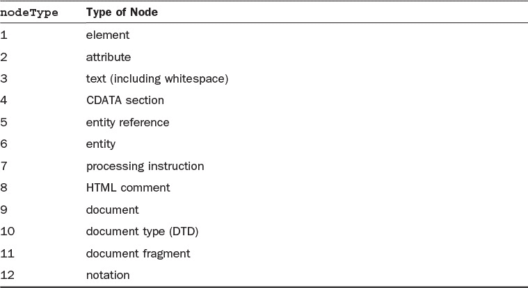

**表 9.1 nodeType 值**

* * *

### 提示

你可能会使用节点类型 1、2 和 3 完成大部分工作，因为你正在操作页面元素、它们的属性以及这些元素所包含的文本。

* * *

### The childNodes 属性

每个节点的一个实用用 DOM 属性是其直接子元素的集合。这个类数组列表被称为 `childNodes`，它允许你访问任何 DOM 节点的子节点信息。

`childNodes` 集合是一个所谓的 `NodeList`，其中的项通过数字索引。集合在外观和（在大多数情况下）行为上都像一个数组——你可以像引用数组一样引用它的成员，并可以像遍历数组一样遍历它们。但是，有几个数组方法无法使用，例如 `push()` 和 `pop()`。对于此处的的所有示例，你可以像对待普通数组一样对待该集合。

节点列表动态集合（live collection），这意味着它所引用的集合的任何更改都会立即反映在列表中；发生变化时你不需要重新获取。

* * *

### 尝试一下：使用 childNodes 属性

你可以使用 `childNodes` 属性返回的集合来检查列表 9.1 中出现的有序列表元素 `<ol>`。你将编写一个小型函数来读取 `<ol>` 元素的子节点，并返回列表中存在的总数。

首先，你可以通过 ID 获取 `<ol>` 元素。

点击此处查看代码图像

```javascript
var olElement = document.getElementById("toDoList");
```

`<ol>` 元素的子节点现在将包含在对象中：

```javascript
olElement.childNodes
```

你只想选择列表中的 `<li>` 元素，所以现在你想遍历 `childNodes` 集合，只计算那些 `nodeType==1`（即对应于 HTML 元素）的节点，忽略有序列表元素中包含的任何其他内容，如注释和空白。记住，你可以几乎像处理数组一样处理该集合；在这里你像使用数组一样使用 `length` 属性：

点击此处查看代码图像

```javascript
var count = 0;

for (var i=0; i < olElement.childNodes.length; i++) {
    if(olElement.childNodes[i].nodeType == 1) count++;
}
```

* * *

### 注意

HTML 代码中的空白（如空格和制表符字符）在浏览器渲染页面时通常会被忽略。然而，页面元素内部空白的存在——例如在元素内部——在许多浏览器中会创建一个类型为文本的节点（在元素内部的空白）。这使得使用 `childNodes` 变得棘手。

* * *

让我们编写一个小函数来执行此任务，并在 alert 框中输出结果：点击此处查看代码图像

```javascript
function countItems() {
    var olElement = document.getElementById("toDoList");
    var count = 0;
    for (var i=0; i < olElement.childNodes.length; i++) {
        if(olElement.childNodes[i].nodeType == 1) count++;
    }
    alert("有序列表包含 " + count + " 项");
}

window.onload = countItems;
```

创建一个新的 HTML 页面，将之前的 JavaScript 代码整合到 `<script>` 元素中并加载页面。图 9.3 显示了在 Firefox 中加载的结果。

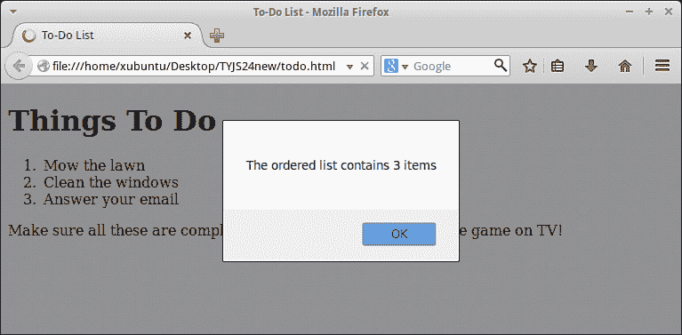

**图 9.3** 使用 childNodes 数组

* * *

### firstChild 和 lastChild

对于选择 `childNodes` 数组中的第一个和最后一个元素，有一种方便的快捷方式。

`firstChild` 是 `childNodes` 数组中的第一个元素。使用 `firstChild` 等同于使用 `childNodes[0]`。

要访问集合的最后一个元素，使用 `lastChild` 有一个巨大的优势。否则，访问该元素你需要这样做：

```javascript
var lastChildNode = myElement.childNodes[myElement.childNodes.length - 1];
```

这非常丑。相反，你可以简单使用：

点击此处查看代码图像

```javascript
var lastChildNode = myElement.lastChild;
```

### The parentNode 属性

`parentNode` 属性如其名所示，返回所应用的的父父节点。在上一个示例中，你

```javascript
var parentElement = lastChildNode.parentNode;
```

将返回 `lastChildNode` 的父元素，它当然是 `myElement` 对象。

### nextSibling 和 previousSibling

兄弟节点是共享同一个父节点的节点。当应用于指定的父节点时，这些只读属性分别返回下一个和上一个兄弟节点，如果不存在此类节点则返回 `null`。

点击此处查看代码图像

```javascript
var olElement = document.getElementById("toDoList");
var firstOne = olElement.firstChild;
var nextOne = firstOne.nextSibling;
```

* * *

### 注意

记住，取决于你使用的浏览器，HTML 代码中的空白可能会在 DOM 中创建文本节点。你正在处理的节点的兄弟可能比你想象的得多！

* * *

#### Node Value


除了 `nodeType` 之外，DOM 还提供了 `nodeValue` 属性来返回节点存储的值。你通常想使用它来返回文本节点中存储的文本。

假设你不像上一个例子那样计数列表项，而是想提取页面中 `<p>` 元素包含的文本。要实现这一点，你需要访问相关的 `<p>` 节点，找到它包含的文本节点，然后使用 `nodeValue` 返回信息：

点击此处查看代码图片

```javascript
var text = '';

var pElement = document.getElementById("toDoNotes");

for (var i=0; i < pElement.childNodes.length; i++) {
    if(pElement.childNodes[i].nodeType == 3) {
        text += pElement.childNodes[i].nodeValue;
    };
}

alert("The paragraph says:\n\n" + text );
```

#### 1. 节点名称 (Node Name)

`nodeName` 属性以字符串值返回指定节点的名称。`nodeName` 返回的值汇总在表 9.2 中。`nodeName` 属性是只读的——无法更改它的值。

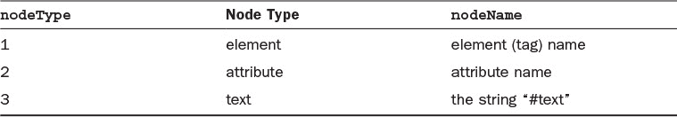

**表 9.2 nodeName 属性返回的值**

当 `nodeName` 返回元素名称时，它不会包含你在 HTML 源代码中使用的周围符号 `<` 和 `>`：

点击此处查看代码图片

```javascript
var pElement = document.getElementById("toDoNotes");

alert( pElement.nodeName);  // 弹出 'P'
```

#### 2. 使用 getElementsByTagName() 选择元素

你已经知道如何使用 `document` 对象的 `getElementById()` 方法访问单个页面元素。`document` 对象的另一个方法 `getElementsByTagName()` 允许你构建一个填充了所有特定标签出现位置数组。

与 `getElementById()` 类似，`getElementsByTagName()` 方法接受单个参数。然而，在这种情况下，传递给方法的参数不是元素 ID，而是所需的标签名。

> **注意**
> 请留心拼写。`Elements`（复数）在 `getElementsByTagName()` 中使用，而 `Element`（单数）在 `getElementById()` 中使用。

例如，假设你想处理特定文档中的所有 `<div>` 元素。你可以使用以下方法通过一个名为 `myDivs` 的类数组集合填充变量：

点击此处查看代码图片

```javascript
var myDivs = document.getElementsByTagName("div");
```

> **提示**
> 即使只有一个具有指定标签名的元素，`getElementsByTagName()` 仍然会返回一个集合，尽管它只包含一个项目。

你并不非对整个文档使用 `getElementsByTagName()`。它可以应用于任何单个对象，并返回该对象内部包含的给定标签名的元素集合。

##### 试一试：使用 getElementsByTagName()

早些你写了一个函数来计算有序列表 (`<ol>`) 元素内部的列表项 (`<li>`) 数：

点击此处查看代码图片

```javascript
function countListItems() {
    var olElement = document.getElementById("toDoList");
    var count = 0;
    for (var i=0; i < olElement.childNodes.length; i++) {
        if(olElement.childNodes[i].nodeType == 1) count++;
    }
alert("The ordered list contains " + count + " items");
}
```

你使用了 `childNodes` 数组来获取所有子节点，并通过测试 `nodeType == 1` 来选取对应于元素的节点。

你可以通过 `getElementsByTagName()` 轻松地实现相同的函数。

你以相同的方式开始，根据 `id` 选择 `<ol>` 元素：

点击此处查看代码图片

```javascript
var olElement = document.getElementById("toDoList");
```

现在，你可以创建一个名为 `listItems` 的数组，并用你的 `<ol>` 对象 `olElement` 中包含的所有 <li>` 元素填充它：

点击此处查看代码图片

```javascript
var listItems = olElement.getElementsByTagName("li");
```

剩下的就是显示数组中有多少项了：

点击此处查看代码图片

```javascript
alert("The ordered list contains " + listItems.length + " items");
```

列表 9.2 包含了页面的完整代码，包括修订后的函数 `countListItems()`。

**列表 9.2 使用 getElementsByTagName()**

点击此处查看代码图片

```html
<!DOCTYPE html>
<html>
<head>
    <title>To-Do List</title>
    <script>
        function countListItems() {
            var olElement = document.getElementById("toDoList");
            var listItems = olElement.getElementsByTagName("li");
            alert("The ordered list contains " + listItems.length + " items");
        }
        window.onload = countListItems;
    </script>
</head>
<body>
    <h1>Things Do</h1>
    <ol id="toDoList">
        <li>Mow the lawn</li>
        <li>Clean the windows</li>
        <li>Answer your email</li>
        <li>Complete the game</li>
    </ol>
</body>
</html>
```

#### 3. 读取元素的属性

HTML 元素通常包含许多属性：

点击此处查看代码图片

```html
<div id="id1" title="report">Here is some text.</div>
```

属性始终位于起始标签内，每个属性的形式为 `attribute=value`。属性本身是它们所在元素节点的子节点，如图 9.4 所示。


**图 属性节点**

导航到感兴趣的元素节点后，你可以使用 `getAttribute()` 方法读取其任何属性的值：

点击此处查看代码图片

```javascript
var myNode = document.getElementById("id1");
alert(myNode.getAttribute("title"));
```

之前的代码段会在 `alert` 对话框显示“report”。如果你尝试获取某个属性的值，`getAttribute()` 将返回 `null`。你可以利用这一事实高效地测试元素节点是否定义特定属性：

点击此处查看代码图片

```javascript
if(myNode.getAttribute("title")) {
// 执行操作
}
```

只有当 `getAttribute()` 返回非空值时，`if()` 条件才会满足，因为 `null` 在 JavaScript 中被解释为“假”值（不是布尔值 false，但被视为如此）。

> **注意**
> 还存在一个简单称为 `attributes` 的属性，包含了节点的所有属性数组。理论上，你可以使用数字键按照它们在 HTML 代码中出现的顺序以 `name=value` 对的形式访问属性；因此 `attributes[0].name` 将是 `id`，而 `attributes[1].value` 将是 `'report'`。然而，在 Internet Explorer 和某些版本的 Firefox 中的实现存在 Bug。使用 `getAttribute()` 替代它更安全。

> **提示**
> 获取元素集合的另一个有用方法是 `getElementsByClassName()`。然而，该方法直到 IE9 之前才被支持。


查看节点信息的最简单方法之一是使用 Mozilla Firefox 提供的 DOM 检查器（DOM Inspector）。如果你使用 Firefox，可能会发现已经安装了 DOM 检查器，尽管从 Firefox 3 之后，它已作为一个独立的插件提供。你可以在 [https://addons.mozilla.org/en-US/firefox/addon/dom-inspector-6622/] 下载它。

安装后，你可以通过 `Ctrl+Shft+I` 为浏览器中加载的任何页面打开 DOM 检查器。打开的窗口如图 9.5 所示，显示了列表 9.1 中网页的 DOM 表示。

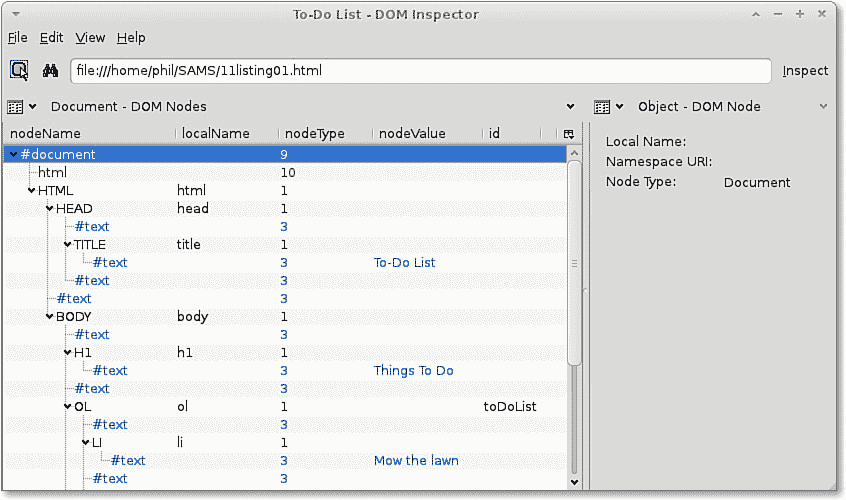

**图 9.5** Mozilla 的 DOM 检查器

从左侧显示面板的树结构中选择一个 DOM 节点，右侧面板查看其详细信息。除了 DOM 树查看器，还包含了用于查看 CSS 规则、样式表、计算样式、JavaScript 对象等的查看器。

该界面初看起来可能有些令人生畏，但探索该程序的功能是非常值得的。

*** 提示

当你使用在本节中描述的方法修改 DOM 时，你改变的是页面在浏览器中的显示方式。但请记住，你并没有更改文档本身。如果你要求浏览器显示页面的源代码，你不会在那里看到任何变化。

这是因为浏览器实际上显示的是文档的当前 DOM 表示。改变它，就改变了屏幕上显示的内容。

*** 创建新节点

向 DOM 树中添加新节点是一个两个阶段的过程：

1. 首先，你创建一个新节点。一旦创建，该节点最初处于一种“悬空”状态；它确实存在，但实际上并未位于 DOM 树的任何位置，因此不会显示在浏览器窗口的可见页面上。

2. 接下来，你将新节点添加到树中所需的位置。此时此，它就变成了可见页面的一部分。

让我们看看 `document` 对象中提供的用于创建节点的一些方法。

### createElement()

你可以调用 `createElement()` 方法创建新的 HTML 元素，这些元素可以是任何标准的 HTML 元素类型——段落、span、表格、列表等。

假设你已经决定为文档创建一个新的 `<div>` 元素。要做到这一点，你只需要向 `createElement` 方法传递相关的 `nodeName` 值——在此例中为 `"div"`：

点击此处查看代码图片

```
var newDiv = document.createElement("div");
```

新的 `<div>` 元素现在存在，但目前没有内容、没有属性，在 DOM 树中也没有位置。你很快就会看到如何解决这些问题。

### createTextNode()

你页面中的许多 HTML 元素都需要文本形式的内容。`createTextNode()` 方法负责处理这个问题。它的工作原理与 `createElement()` 非常相似，但它接受的参数不是 `nodeName` 值，而是一个包含元素所需文本内容的字符串：

点击此处查看代码图片

```
var newTextNode = document.createTextNode("Here is some text.");
```

与 `createElement()` 一样，新创建的节点尚未位于 DOM 树中；JavaScript 将其存储在 `newTextNode` 变量中，等待你将其放置在相应的位置。

### cloneNode()

没必要重造轮子。如果你文档中已经有一个与你想要创建的新节点相同的节点，你可以使用 `cloneNode()` 来实现。与 `createElement()` 和 `createTextNode()` 不同，`cloneNode()` 接受一个参数——一个布尔值，`true` 或 `false`。

向 `cloneNode()` 函数传递 `true` 告诉 JavaScript 你不仅想克隆该节点，还要克隆它所有的子节点：

点击此处查看代码图片

```
var myDiv = document.getElementById("id1");
var newDiv = myDiv.cloneNode(true);
```

在这个示例中，我要求 JavaScript 克隆元素的子节点；例如，`myDiv` 包含的任何文本（将包含在元素的子节点中）都将忠实地复制到新的 `<div>` 元素中。

如果我调用了：

点击此处查看代码图片

```
var newDiv = myDiv.cloneNode(false);
```

那么新的 `<div>` 元素将与原始元素相同，只是它没有子节点。例如，它将拥有属于原始元素的任何属性（前提是原始节点是一个元素）。

*** 注意

记住元素的 `id` 是其属性之一。当你克隆一个节点时，记住要更改你新元素的 `id`，因为 `id` 值在文档中应该是唯一的。

*** 与通过 `createElement()` 和 `createTextNode()` 创建的新节点一样，通过 `cloneNode()` 创建的新节点最初是悬浮在空间中的；它在 DOM 树中还没有位置。你将看到如何实现这一点.. 操纵子节点

你创建的新节点没有任何实际价值，因为它们没有显示在 DOM 的任何地方。`document` 对象的几个方法专门设计用于将节点放入 DOM 树中，它们将在后续章节中进行描述。

### appendChild()

或许将新节点附加到 DOM 最简单的方法是将其作为子节点添加到文档中已存在的节点之后。这样做只需要找到所需的父节点并调用 `appendChild()` 方法：

点击此处查看代码图片

```
var newText = document.createTextNode("Here is text content.");
var myDiv = document.getElementById("id1");
myDiv.appendChild(newText);
```

在前面的代码段中，创建了一个新的文本节点并将其作为子节点添加到当前存在的 `id` 为 `id1` 的 `<div>` 元素中。

*** 提示

记住 `appendChild()` 总是将最后一个子节点之后添加子节点，因此新添加的节点将成为父节点的新的 `lastChild`。

*** 当然，`appendChild()` 对所有类型的节点都同样有效，而不仅仅是文本节点。假设你需要在父级 `<div>` 元素内部再添加另一个 `<div>` 元素：

点击此处查看代码图片

```
var newDiv = document.createElement("div");
var myDiv = document.getElementById("id1");
myDiv.appendChild(newDiv);
```

你原本存在的 `<div>` 元素现在包含了另一个 `<div>` 元素作为其最后一个子节点；如果父级 `<div>` 元素已经包含了一些子节点形式的文本内容，那么父级 `<div>`（在新修改的 DOM 中表示，而不是在源代码中）现在将具有如下形式：

点击此处查看代码图片

```html
<div id="id1">
  Original text contained in text node
  <div></div>
</div>
```

### insertBefore()

与其说 `appendChild()` 总是将子元素添加到子节点列表的末尾，而使用 `insertBefore()`，你可以指定一个子元素并将新节点插入其之前。

该方法接受两个参数：新节点，以及要插入其之前的子节点。假设你的页面包含以下 HTML 代码段：

点击此处查看代码图片

```html
<div id="id1">
  <p id="para1">This paragraph contains some text.</p>
  <p id="para2">Here's some more text.</p>
</div>
```

要在当前的两个段落之间插入新段落，首先创建新段落：

点击此处查看代码图片

```
var newPara = document.createElement("p");
```

识别父节点，以及你想在其之前插入子节点：

点击此处查看代码图片


```javascript
var myDiv = document.getElementById("id1");

var para2 = document.getElementById("para2");
```

然后将这两个两个作为参数传递给 `insertBefore()`：

点击此处查看代码图片

```javascript
myDiv.insertBefore(newPara, para2);
```

### replaceChild()

当你想要用特定父元素的当前子节点替换为另一个节点时，可以使用 `replaceChild()`。该方法接受两个参数——指向新子元素的引用，紧接着是指向旧元素的引用。

***

动手一试：替换子元素

查看 列表 9.3 中的代码。

**列表 9.3 替换子元素**

点击此处查看代码图片

```html
<!DOCTYPE html>
<html>
<head>
    <title>替换页面元素</title>
</head>
<body>
    <div id="id1">
        <p id="para1">欢迎来到我的网页。</p>
        <p id="para2">请到处看看。</p>
        <input id="btn" value="替换元素" type="button" />
    </div>
</body>
</html>
```

***

假设你想要使用 DOM 移除 `<div>` 中的第一个段落，并用一个 `<h2>` 标题来替换它，如下所示：

```html
<h2>欢迎！</h2>
```

首先，创建一个代表 `<h2>` 标题的新节点：

点击此处查看代码图片

```javascript
var newH2 = document.createElement("h2");
```

这个新元素需要包含一个用于标题文本的文本节点。你可以现在创建并添加它，也可以稍后将新的 `<h2>` 元素添加到 DOM 之后再做。让我们现在就做吧：

点击此处查看代码图片

```javascript
var newH2Text = document.createTextNode("Welcome!");
newH2.appendChild(newH2Text);
```

现在你可以交换 `<div>` 元素中不需要的子节点并将其替换为新节点：

点击此处查看代码图片

```javascript
var myDiv = document.getElementById("id1");
var oldP = document.getElementById("para1");
myDiv.replaceChild(newH2, oldP);
```

最后，你需要为按钮元素添加一个 `onclick` 事件处理程序，这样当点击按钮时，就会执行你的元素替换函数。我们通过一个赋值给 `window.onload` 方法的匿名函数来实现：

点击此处查看代码图片

```javascript
window.onload = function() {
    document.getElementById("btn").onclick = replaceHeading;
}
```

列表 9.4 显示了带有 JavaScript 的页面代码。

**列表 9.4 替换子元素的完整代码**

点击此处查看代码图片

```html
<!DOCTYPE html>
<html>
<head>
    <title>替换页面元素</title>
    <script>
        function replaceHeading() {
            var newH2 = document.createElement("h2");
            var newH2Text = document.createTextNode("Welcome!");
            newH2.appendChild(newH2Text);
            var myDiv = document.getElementById("id1");
            var oldP = document.getElementById("para1");
            myDiv.replaceChild(newH2, oldP);
        }
        window.onload = function() {
            document.getElementById("btn").onclick = replaceHeading;
        }
    </script>
</head>
<body>
    <div id="id1">
        <p id="para1">欢迎来到我的网页。</p>
        <p id="para2">请到处看看。</p>
        <input id="btn" value="替换元素" type="button" />
    </div>
</body>
</html>
```

***

使用你的编辑器创建一个新的 HTML 文件，并插入 列表 9.4 中列出的代码。在浏览器中加载页面时，你应该能看到两个单行文本段落以及下方的按钮。如果一切按计划进行，点击按钮应该会将第一个 `<p>` 元素交换为你的 `<h2>` 标题，如图图 9.6](#part0020.xhtml_ch09fig6) 所示。

 元素替换脚本

***

### removeChild()

DOM 专门提供了一个方法用于从树中移除子节点。再次参考 列表 9.3，如果你想移除 `id="para2"` 的 `<p>` 元素，只需要使用：

点击此处查看代码图片

```javascript
var myDiv = document.getElementById("id1");
var para2 = document.getElementById("para2");
myDiv.removeChild(para2);
```

***

提示

如果你没有父元素的方便引用，可以使用 `parentNode` 属性来获取它：

点击此处查看代码图片

```javascript
var myDiv = document.getElementById("id1");
var para2 = document.getElementById("para2");
var parent = para2.parentNode;
parent.removeChild(para2);
```

***

`removeChild()` 方法的返回值包含被移除节点的引用。如果你需要，可以使用它来处理刚刚移除的节点：

点击此处查看代码图片

```javascript
var myDiv = document.getElementById("id1");
var para2 = document.getElementById("para2");
var removedNode = myDiv.removeChild(para2);
alert('Item with id ' + removedNode.id + ' has been removed.');
```

### 设置属性

在之前我们学习了如何使用 `getAttribute()` 方法读取元素属性。有一个对应的方法名为 `setAttribute()`，允许你为节点创建属性并赋值。该方法接受两个参数；无疑，这些要添加的属性以及它应该具有的值。

在下面的示例中，为 `<p>` 元素添加了 title 属性：

点击此处查看代码图片

```javascript
var myPara = document.getElementById("para1");
myPara.setAttribute("title", "Opening paragraph");
```

设置已存在属性的值会有效地覆盖该属性的值。你可以利用这些知识来编辑现有的属性：

点击此处查看代码图片

```javascript
var myPara = document.getElementById("para1");
myPara.setAttribute("title", "Opening paragraph"); // 设置 title 属性
myPara.setAttribute("title", "New title"); // 覆盖 title 属性
```

### 动态加载 JavaScript 文件

有时你需要在已加载的页面动态加载 JavaScript 代码。你可以使用 `createElement()` 创建包含所需代码的 `<script>` 元素，然后将此元素添加到页面中：

点击此处查看代码图片

```javascript
var scr = document.createElement("script");
scr.setAttribute("src", "newScript.js");
document.head.appendChild(scr);
```

记住，`appendChild()` 方法将新子节点放在当前最后一个节点之后，因此新的 `<script>` 元素将位于页面 `<head>` 部分的末尾。

但注意，如果你使用此方法动态加载 JavaScript 源文件，那么这些文件中包含的 JavaScript 代码在外部文件加载完成之前对你的页面是不可用的。建议你在尝试使用这些代码之前，先让你的程序检查这一点。

几乎所有现代浏览器在脚本下载完成后都会实现一个 `onload` 事件。这和你已经见过的 `window.onload` 事件相似，但它不是在主页面加载完成时触发，而是在外部资源（在本例中为 JavaScript 源文件）完全下载并可供使用时触发：

点击此处查看代码图片

```javascript
scr.onload = function() {
    ... 当新源代码下载时要执行的操作 ...
}
```

***

警告

这在旧版本的 Internet Explorer 中不起作用，但从 IE8 开始，脚本 元素已经支持 `onload`。为了万无一失，你可能更倾向于对新加载文件中包含的资源进行对象检测。

***

***

动手一试：动态创建的菜单


在本练习中，你将使用在本节和上一节中学习的技巧来动态创建页面菜单。

我们的示例 HTML 页面有一个顶级的 `<h1>` 标题，随后是几篇短文章，每篇文章由一个 `<h2>` 标题和若干段文本组成。这种格式与你会在博客、新闻页面或 RSS 阅读器输出等情况下看到的格式相似。

你要做的是使用 DOM 方法在页面头部自动生成一个菜单，其中的链接允许用户跳转到页面上的任何文章。HTML 文件如 列表 9.5 所示。请根据此脚本创建你自己的 HTML 文件。可以随意地使用你自己的标题和文本内容，只要章节标题包含在 `<h2>` 元素中即可。

### 列表 9.5 用于创建动态菜单的 HTML 文件

点击此处查看代码图像

```html
<!DOCTYPE html>
<html>
<head>
    <meta charset="utf-8" />
    <title>Scripting the DOM</title>
    <script src="menu.js"></script>
    <script>window.onload = makeMenu;</script>
</head>
<body>
    <h1>西班牙西部的埃斯特雷马杜拉地区</h1>
    <h2>该地区的地理状况</h2>
    <p>埃斯特雷马杜拉自治社区位于西班牙西部，邻葡萄牙边界。它邻接西班牙的卡斯蒂利亚和莱昂、卡斯蒂利亚-拉曼恰和安达卢西亚等地区，以及葡萄牙（位于西部）。其面积超过 40,000 平方米，有两个省份：北部的卡塞雷斯和南部的巴达霍斯。</p>
    <h2>住宿选择</h2>
    <p>埃斯特雷马杜拉全境有各种住宿选择，包括小型旅馆和客栈（“Hostals”），如果你是团体旅行，也可以考虑租用“casa rural”（乡村小屋）。</p>
    <h2>气候</h2>
    <p>通常为地中海气候，北部除外，属于大陆性气候。通常以极端天气闻名，包括非常炎热干燥且经常干旱的夏季，以及漫长而温和的冬季。</p>
    <h2>看什么</h2>
    <p>埃斯特雷马杜拉全年举办各类活动，包括戏剧、音乐、电影、文学和民俗。壮丽的场所包括城堡、中世纪城镇广场和历史中心。在梅里达、卡塞雷斯、阿尔坎塔拉和阿尔布尔克尔克还设有特别的夏季戏剧节。</p>
    <h2>美食</h2>
    <p>埃斯特雷马杜拉美食的品质源于当地食材的优质。除了散养的羊肉和牛肉、极佳的奶酪、红葡萄酒、橄榄油、蜂蜜和红椒外，埃斯特雷马杜拉还以伊比利亚火腿闻名。“黑脚猪”（pata negra）在软橡树林中以橡果长大，这是生产世界上顶级火腿和腌制肠的关键。</p>
</body>
</html>
```

页面如 图 9.7 所示。

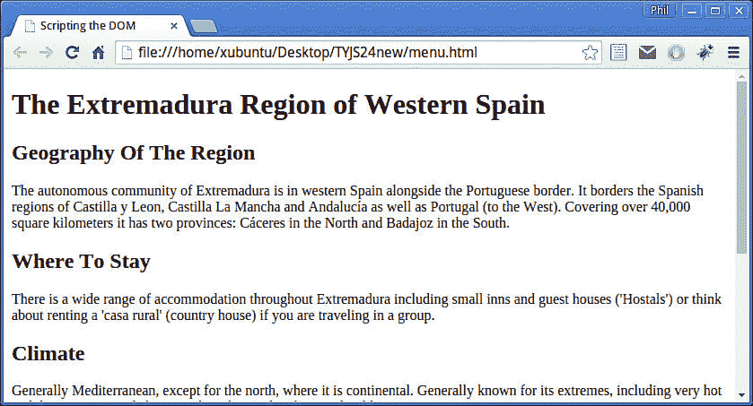

**图 9.7** 具有动态创建菜单的页面

第一步是获取页面上所有 `<h2>` 元素的集合。这些元素将构成菜单中的项。对于这些标题中的每一个，创建一个指向锚点元素的链接，并将该元素放在相应的 `<h2>` 元素旁边。

菜单链接将以无序列表（`<ul>`）元素中链接的形式排列。此列表将放置在一个插入到页面头部的 `<div>` 容器中。

首先，获取 `<h2>` 元素的集合：

点击此处查看代码图像

```javascript
var h2s = document.getElementsByTagName("h2");
```

你需要创建一个 `<div>` 容器来存放你的菜单；在该 `<div>` 内部，有一个 `<ul>` 列表元素来包含菜单项：

点击此处查看代码图像

```javascript
var menu = document.createElement("div");
var menuUl = document.createElement("ul");
menu.appendChild(menuUl);
```

现在，你可以遍历 `<h2>` 标题集合了：

点击此处查看代码图像

```javascript
for(var i = 0; i < h2s.length; i++) {
    ... 对每个标题执行某些操作 ...
}
```

对于文档中找到的每个标题，你都需要执行若干任务：

1. 获取标题子节点的内容，这构成了标题的文本：
   ```javascript
   var itemText = h2s[i].childNodes[0].nodeValue;
   ```
2. 为菜单创建一个新的列表项（`<li>`）：
   ```javascript
   var menuLi = document.createElement("li");
   ```
3. 将该 `<li>` 元素添加到菜单中：
   ```javascript
   menuUl.appendChild(menuLi);
   ```
4. 每个列表项必须包含一个指向标题旁边锚点的链接，该菜单项指向该锚点：
   ```javascript
   var menuLiA = document.createElement("a");
   menuLiA = menuLi.appendChild(menuLiA);
   ```
5. 为链接设置合适的 `href` 属性（记住变量 `i` 在计数标题时会递增）。这些链接的格式为 `<a href="#itemX">[标题文本]`，其中 X 是菜单项的索引数字：
   ```javascript
   menuLiA.setAttribute("href", "#item" + i);
   ```
6. 在每个 `<h2>` 标题之前创建一个匹配的锚点元素。锚点元素的格式为 `<a name="itemX">`，你需要添加 `name` 属性，并定位到关联标题之前的链接：
   ```javascript
   var anc = document.createElement("a");
   anc.setAttribute("name", "item" + i);
   document.body.insertBefore(anc, h2s[i]);
   ```

当每个 `<h2>` 标题都完成完成后，你可以将新菜单添加到页面中：

```javascript
document.body.insertBefore(menu, document.body.firstChild);
```

JavaScript 源文件 `menu.js` 的内容如 列表 9.6part0020.xhtml_ch09lis06 所示。代码已整合到一个名为 `makeMenu()` 的函数中，该函数由 `window.onload` 事件调用，在页面加载后 DOM 可用时构建你的菜单。

### 列表 9.6 menu.js 的 JavaScript 代码

[点击此处查看代码图像

```javascript
function makeMenu() {
    // 获取所有的 H2 元素
    var h2s = document.getElementsByTagName("h2");
    // 为菜单创建一个页面元素
    var menu = document.createElement("div");
    // 创建 UL 元素并添加到菜单 div 中
    var menuUl = document.createElement("ul");
    menu.appendChild(menuUl);
    // 遍历 h2 标题
    for(var i = 0; i < h2s.length; i++) {
        // 获取 h2 元素的文本节点
        var itemText = h2s[i].childNodes[0].nodeValue;
        // 添加列表项
        var menuLi = document.createElement("li");
        // 将其添加到菜单列表
        menuUl.appendChild(menuLi);
        // 列表项包含一个链接
        var menuLiA = document.createElement("a");
        menuLiA = menuLi.appendChild(menuLiA);
        // 设置链接的 href
        menuLiA.setAttribute("href", "#item" + i);
        // 设置链接的文本
        var menuText = document.createTextNode(itemText);
        menuLiA.appendChild(menuText);
        // 创建匹配的锚点元素
        var anc = document.createElement("a");
        anc.setAttribute("name", "item" + i);
        // 将锚点添加到标题之前
        document.body.insertBefore(anc, h2s[i]);
    }
    // 将菜单添加到页面顶部
    document.body.insertBefore(menu, document.body.firstChild);
}
```

图 9.8 显示了脚本的运行效果。


通过使用浏览器工具检查修改后的 DOM，你可以看到为了形成菜单和锚点而添加到页面上的额外 DOM 元素。图 9.9 显示了这在 Google Chromium 开发者工具中是如何显示的，并高亮了额外的元素。

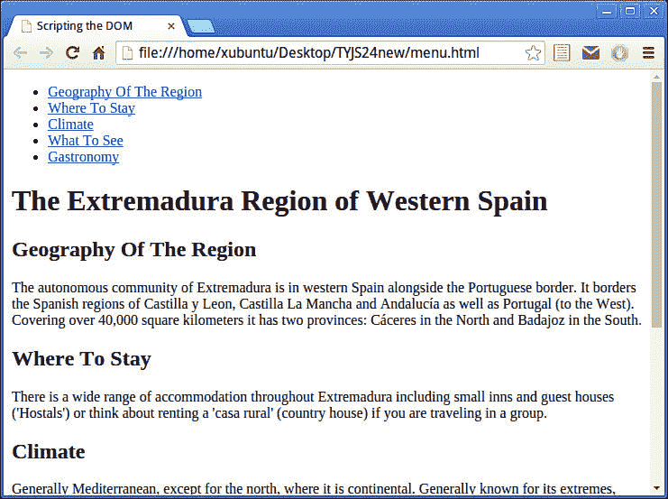

**图 9.8** 运行中的自动菜单脚本

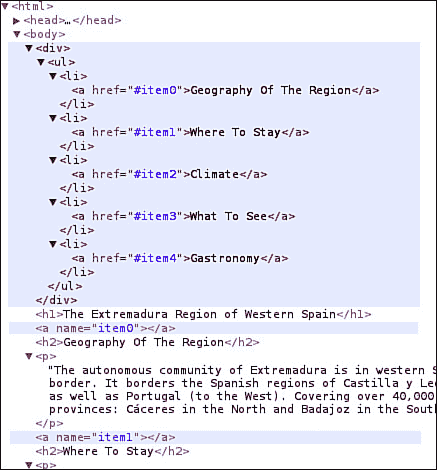

**图 9.9** 额外的 DOM 元素

***

### 总结

在这一小时中，你学习了 DOM 节点以及如何使用各种与节点相关的方法遍历 DOM。你还学习了如何使用 Mozilla 的 DOM 检查器来检查页面的 DOM。

此外，你还学习了如何创建新节点并添加到 DOM，以及如何通过添加、编辑和删除 DOM 节点来动态编辑页面内容。

### 问答

**Q. 有没有快速的方法可以判断节点是否有任何子节点？**

**A.** 是的，你可以使用 `hasChildNodes()` 方法。如果节点有一个或多个子节点，该方法返回布尔值 `true`，否则返回 `false`。记住，属性节点和文本节点不能有子节点，因此如果将其应用于这些类型的节点，该方法将始终返回 false。

**Q. Mozilla 的 DOM 检查器是同类型的唯一工具吗？**

**A.** 完全不是。几乎每个浏览器的开发者工具中都内置了一些 DOM 检查工具。然而，Mozilla 的 DOM 检查器提供了关于 DOM 层次结构和单个节点参数的格外清晰视图；这就是我在这里介绍它的原因。

**Q. 使用 DOM 插入和获取 HTML 还是使用 innerHTML 更好？**

**A.** 两者各有优劣。要向文档中插入一段 HTML 代码，使用 `innerHTML` 是快速且方便的。但是，它不会返回你所插入代码的引用，因此你无法很容易对该内容执行操作。DOM 方法为操纵页面元素提供了更细粒度的控制。

无论你在何处使用 `innerHTML`，都可以使用 DOM 方法实现相同的结果，尽管通常需要多一点代码。

同样请记住，`innerHTML` 并不是 W3C 标准。它目前得到了良好支持，但不能保证将来一直如此。

**Q. 我在 Web 上看到过 DOM Core 和 HTML DOM 的引用。它们是什么，它们之间有什么区别？**

**A.** DOM Core 描述了 DOM 方法的核心部分，这些方法不仅适用于 HTML 页面，还适用于使用任何类似标记语言（例如 XML）编写的页面。HTML DOM 是一个更大的集合，包含了特地与 HTML 页面相关的许多额外方法。它们确实提供了一些执行某些任务的快捷方式，但代价是会让你的代码对非 HTML 应用程序的移植性降低。

书中的示例通常使用 DOM Core 方法以更具通用性。在列表 9.6 中，例如，我使用了语句

```javascript
menuLiA.setAttribute("href", "#item" + i);
```

我同样可以使用 HTML DOM 语句

```javascript
menuLiA.href = "#item" + i;
```

这要短一点。

### 课工作坊

在阅读随后的“答案”部分之前，尝试回答所有问题。

#### 练习

**1.** 下列哪项不是节点类型？

**a.** 元素 (Element)

**b.** 属性 (Attribute)

**c.** 数组 (Array)

**2.** `getElementsByTagName()` 方法返回：

**a.** 元素对象的类数组集合

**b.** `nodeType` 值的类数组集合

**c.** 标签名的类数组集合

**3.** 在某些浏览器中，页面元素内的空白字符会导致创建

**a.** 文本节点

**b.** 一个 JavaScript 错误

**c.** 属性节点

**4.** 为了创建一个新的 `<span>` 元素，你可以使用

**a.** `document.createElement("span");`

**b.** `document.createElement(span);`

**c.** `document.appendChild("span");`

**5.** 为了复制一个节点（包括其所有子节点），你可以使用

**a.** `cloneNode(false);`

**b.** `copyNode();`

**c.** `cloneNode(true);`

**6.** 为了将 `` 元素的 `alt` 属性设置为“Company Logo”，你可以使用

**a.** `setAttribute(alt, "Company Logo");`

**b.** `setAttribute("alt", "Company Logo");`

**c.** `setAttribute(alt = "Company Logo");`

#### 答案

**1.** c. 数组不是节点类型。

**2.** a. 元素对象的类数组集合

**3.** a. 文本节点

**4.** a. `document.createElement("span");`

**5.** c. `cloneNode(true);`

**6.** b. `setAttribute("alt", "Company Logo");`

#### 练习

 使用表 9.1](#part0020.xhtml_ch09tab01)中的信息，编写一个函数找到找到所有的注释，并将它们合并成一个字符串。

 如果你有 Firefox，下载并安装 DOM 检查器并熟悉其界面。使用该程序调查你喜欢的页面。

当你点击由代码 9.6 生成的菜单项时，页面会滚动到相关项目。返回菜单你需要手动滚动。

你能修改脚本，在插入锚点的同时，在每个 `H2` 之前插入一个回到顶部链接吗？（提示：你不需要添加新链接，只需添加 `href` 和一些链接文本。）

## 第 10 小节：结识 JSON

***

在本节中你将学习：

 什么是 JSON

 如何模拟关联数组

 关于 JSON 和对象

 获取 JSON 数据

 使用 JSON 进行序列化

 如何保持 JSON 安全

注意

JSON 的官方主页位于 [`json.org/`](http://json.org/)，那里还有指向 Web 上各种 JSON 资源的链接。

### 什么是 JSON？

JSON（读作“Jason”）是 JavaScript 对象的一种简单且紧凑的表示法。一旦用 JSON 表示，对象就可以很容易地转换为字符串，以便存储和传输（例如在网络上或应用程序之间）。

然而，JSON 的真正美之处在于，用 JSON 表示的对象实际上是用普通的 JavaScript 代码表示的。因此，你利用了 JavaScript 的“自动”解析；你只需要让 JavaScript 将 JSON 字符串的内容解释为代码，而无需额外的解析器或转换器。


JSON 数据被表示为参数和值对的序列，每对数据都使用冒号字符来分隔参数和值。这些 `"parameter":"value"` 对之间用逗号分隔：

点击此处查看代码图像

"param1":"value1", "param2":"value2", "param3":"value3"

最后，整个序列括在大括号之间以形成一个 JSON 对象：

```javascript
var jsonObject = {
    "param1":"value1",
    "param2":"value2",
    "param3":"value3"
}
```

这里定义的 `jsonObject` 使用 JavaScript 的子集——它只是一段有效的 JavaScript 代码。使用 JSON 语法编写的对象可以使用点符号直接访问属性和方法：

点击此处查看代码图像

```javascript
alert(jsonObject.param1); // 输出 'value1'
```

通用地说，JSON 是字符串格式交换数据的通用语法。不仅是对象，任何可以表示为 `parameter:value` 对的数据都可以用 JSON 语法表示。这种将 JSON 对象转换为字符串的过程被称为序列化；序列化数据对于存储或在网络传输非常方便。稍后你将看到如何序列化 JSON 对象。

***

**注意**

作为一种通用数据交换语法，JSON 可以像 XML 一样使用，尽管 JSON 对人类来说更简单。此外，解析 XML 文件可能很慢，而 JSON 则提供了一个可以直接使用的 JavaScript 对象。

***

JSON 最近获得了动力，因为它提供了几个重要优势。JSON 是 获取 Flickr 如何支持 JSON 的详情。

***

### JSON 数据

为了恢复编码为 JSON 字符串的数据，你需要将字符串转换回 JavaScript 代码。这通常被称为字符串的*反序列化*。

#### 使用 `eval()`

只有较浏览器原生支持 JSON 语法（我们稍后会讨论原生浏览器支持）。由于 JSON 语法是 JavaScript 的子集，可以使用 JavaScript 函数 `eval()` 将 JSON 字符串转换为 JavaScript 对象。

***

**注意**

JavaScript 函数 `eval()` 会评估或执行传递的任何参数。如果参数是一个表达式，`eval()` 会对其求值；例如：

```javascript
var x = eval(4 * 3); // x=12
```

如果参数包含一个或多个 JavaScript 语句，`eval()` 会执行这些语句：

点击此处查看代码图像

```javascript
eval("a=1; b=2; document.write(a+b);"); // 在页面写入 3
```

`eval()` 函数使用 JavaScript 解释器解析 JSON 文本并产生一个 JavaScript 对象：

点击此处查看代码图像

```javascript
var myObject = eval('(' + jsonObject + ')');
```

你你可以在脚本中使用该 JavaScript 对象：

点击此处查看代码图像

```javascript
var user = '{"username" : "phil","location" : "Spain","height" : 180}';
var myObject = eval('(' + user + ')');
alert(myObject.username);
```

***

**注意**

字符串必须这样括在括号中以避免 JavaScript 语法的歧义。

***

#### 使用原生支持

所有现代浏览器都提供 JSON 的原生支持，使得无需使用 `eval()`。

***

**注意**

原生支持 JSON 的浏览器包括：

![Images/image00365.jpeg) Firefox 3.5+
![Images/image00365.jpeg) Internet Explorer 8+
![Images/image00365.jpeg) Google Chrome
![Images/image00365.jpeg) Opera 10+
![Images/image00365.jpeg) Safari 4+

***

具有原生支持的浏览器创建一个名为 `JSON` 的 JavaScript 对象来管理编码和解码。`JSON` 对象有两个方法：`stringify()` 和 `parse()`。

##### `JSON.parse()`

你可以使用 `JSON.parse()` 方法解释 JSON 字符串，它接收包含 JSON 序列化对象的字符串并将其拆分，创建一个与字符串中找到 `"parameter":"value"` 对对应的属性的对象：

点击此处查看代码图像

```javascript
var Mary = '{ "height":190, "age":36, "eyeColor":"brown" }';
var myObject = JSON.parse(Mary);
var out = "";
for (i in myObject) {
    out += i + " = " + myObject[i] + "\n";
}
alert(out);
```

你可以在图 10.1 中看到结果。

![Images/image00365.jpeg)

**图 10.1** 使用 `JSON.parse()`

***

### 使用 JSON 进行序列化

在数据存储和传输的背景下，*序列化*是将数据转换为可以在存储或跨网络传输后恢复的格式的名称。在 JSON 的情况下，字符串是序列化数据的选择格式。为了序列化你的 JSON 对象（例如发送到网络连接），你需要将其表示为字符串。在支持 JSON 的较现代浏览器中，你可以简单地使用 `JSON.stringify()` 方法创建一个对象的 JSON 编码字符串。让我们创建一个简单的对象并添加一些属性：

```javascript
var Dan = new Object();
Dan.height = 185;
Dan.age = 41;
Dan.eyeColor = "blue";
```

现在你可以使用 `JSON.stringify` 序列化对象：

```javascript
alert( JSON.stringify(Dan) );
```

序列化对象显示在图 10.2 中。

![Images/image00365.jpeg)

**图 10.2** 使用 `JSON.stringify()`

***

### 尝试自己：解析 JSON 字符串

使用你的编辑器创建一个 HTML 文件，并输入列表 10.1 的代码。

**列表 10.1 解析 JSON 字符串**

点击此处查看代码图像

***


点击此处查看代码图片

```
myObject = JSON.parse(inString);
```

你现在可以通过遍历对象方法来构建你的输出消息字符串：

点击此处查看代码图片

```javascript
for (i in myObject) {
    out += "Property: " + i + " = " + myObject[i] + '\n';
}
```

最后，显示结果：

```javascript
alert(out);
```

输出消息应该看起来像图 10.4 所示。

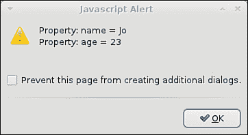

**图 10.4** 解析 JSON 字符串创建的对象

刷新页面并使用不同数量的 `"parameter":"value"` 键对重试脚本。

* *

### JSON 数据类型

每个 `parameter:value` 对的参数部分必须遵循几个简单的语法规则：

 它不能是 JavaScript 保留关键字。

 它不能以数字开头。

 它不能包含下划线或美元符号之外的任何特殊字符。

JSON 对象中的值可以包含任何数据类型：

 数字 (Number)

 字符串 (String)

 布尔值 (Boolean)

 数组 (Array)

 对象 (Object)

 null（空）

* *

### 注意

JavaScript 语法具有几种 JSON 标准未包含的数据类型，包括 `Date`、`Error`、`Math` 和 `Function`。这些数据类型必须表示为其他数据格式，且编码和解码程序必须遵循相同的编码和解码规则。

* *

### 模拟关联数组

在第 6 小节中，“数组”我们讨论了 JavaScript 数组对象并查看了它的各种属性和方法。

你可能记得 JavaScript 数组中的元素具有唯一的数字标识符：

```javascript
var myArray = [];
myArray[0] = 'Monday';
myArray[1] = 'Tuesday';
myArray[2] = 'Wednesday';
```

在许多其他编程语言中，可以使用文本键使数组更具描述性：

点击此处查看代码图片

```javascript
myArray["startDay"] = "Monday";
```

遗憾的是，JavaScript 不直接支持这种所谓的关联数组。

然而，使用对象很容易模拟它们的行为。使用 JSON 记法使代码易于阅读和理解：

点击此处查看代码图片

```javascript
var conference = { "startDay" : "Monday",
    "nextDay"  : "Tuesday",
    "endDay"  : "Wednesday"
}
```

你现在可以访问对象属性，就像对象是关联数组一样：

点击此处查看代码图片

```javascript
alert(conference["startDay"]);  // "Monday"
```

* *

### 提示

这种方法之所以有效是因为这两种语法

`object["property"]`

和

`object.property`

在 JavaScript 中是等价的。

* *

### 注意

记住，这并不是真正的关联数组，尽管它看起来像。如果你遍历该对象，除了这三个属性之外，你还会获得任何分配给该对象的方法。

* *

### 使用 JSON 创建对象

你可能从第 6 小节中记得，表示数组的一种方便方法是使用方括号：

点击此处查看代码图片

```javascript
var categories = ["news", "sport", "films", "music", "comedy"];
```

JSON 为我们定义 JavaScript 对象提供了一种相当类似的简写方式。

* *

### 提示

尽管 JSON 是为了描述 JavaScript 对象而开发的，但它独立于任何语言或平台。许多编程语言（包括 Java、PHP、C 等）都有 JSON 库和工具。

* *

#### 属性

如你所看到的，要用 JSON 记法表示对象，你使用大括号而不是方括号来包裹对象，并将对象属性列为 `"property":"value"` 对：

```javascript
var user = {
    "username" : "philb1234",
    "location" : "Spain",
    "height" : 1.80
}
```

* *

### 提示

你可能记得使用语句

```javascript
var myObject = new Object();
```

会创建一个没有任何属性或方法的“空”对象实例。在 JSON 记法中，对应的等价物显然是：

```javascript
var myObject = {};
```

* *

对象属性可以按照通常的方式立即可用：

点击此处查看代码图片

```javascript
var name = user.username;
```

#### 方法

你可以这种方式添加方法，即在对象内部使用函数：

点击此处查看代码图片

```javascript
var user = {
    "username" : "philb1234",
    "location" : "Spain",
    "height" : 1.80,
    "setName": function(newName){
        this.username = newName;
    }
}
```

然后你可以通常的方式调用 `setName` 方法：

```javascript
setName(prompt("Enter username"));
```

### 注意

虽然这种方法在 JavaScript 上文中有效，但在将 JSON 作为通用数据格式时是不允许的。请参见关于 JSON 安全的后续。

* *

#### 数组

属性值可以是数组：

```javascript
var listObject = {
    "booklist": ["Foundation", "Dune", "Eon", "2001 Space Odyssey", "Stranger In A Land"]
};
```

在前面的示例中，该对象有一个名为 `booklist` 的属性，其值是一个数组。

```javascript
var book = listObject.booklist[2];
```

你可以通过传递数组键（记住数组从零开始）访问数组中的单独项：

#### 对象

JSON 对象甚至可以包含对象。通过使数组元素变为 JSON 对象，你可以使用点记法访问它们。

在下面的示例中，与属性 `booklist` 关联的值是 JSON 对象数组。

```javascript
var bookListObject = {
    "booklist": [
        {"title":"Foundation", "author":"Isaac Asimov"},
        {"title":"Dune", "author":"Frank Herbert"},
        {"title":"Eon", "author":"Greg Bear"},
        {"title":"2001 Space Odyssey", "author":"Arthur C. Clarke"},
        {"title":"Stranger In A Strange Land", "author":"Robert A. Heinlein"}
    ]
};
```

在获取书籍数组后，如前面的示例所示，可以很容易访问 `title` 和 `author` 属性：

```javascript
alert(bookListObject.booklist[2].author); // 显示 "Greg Bear"
```


## 列表 10.2 处理多级 JSON 对象

点击此处查看代码图像

```html
<!DOCTYPE html>
<html>
<head>
    <title>Understanding JSON</title>
    <script>
    var booklistObject = {
        "booklist": [{"title":"Foundation", "author":"Isaac Asimov"},
            {"title":"Dune", "author":"Frank Herbert"},
            {"title":"Eon", "author":"Greg Bear"},
            {"title":"2001 A Space Odyssey", "author":"Arthur C. Clarke"},
            {"title":"Stranger In A Strange Land", "author":"Robert A. Heinlein"}]
    }
    // 用于存储用户消息的变量
    var out = "";
    // 获取数组
    var books = booklistObject.booklist;
    // 遍历数组，逐个获取书籍
    for(var i =0; i<books.length;i++) {
        var booknumber = i+1;
        out += "Book "  + booknumber +
            " is: '" + books[i].title +
            "' by " + books[i].author +
            "\n";
    }
    </script>
</head>
<body onload="alert(out)">
</body>
</html>
```

在设计好 JSON 对象后，你声明了一个变量并赋值一个空字符串。这个变量将在你构建输出消息时存储它：
`var out = "";`

现在，你提取书籍数组，并将该数组赋值给新变量 `books`，以避免后续进行大量的冗长输入：

点击此处查看代码图像

`var books = booklistString.booklist;`

之后，你只需要遍历书籍数组，读取每个书籍对象的 `title` 和 `author` 属性，并构造一个字符串将其追加到你的输出消息中：

点击此处查看代码图像

```javascript
for(var i =0; i<books.length;i++) {
    var booknumber = i+1; // 数组索引从零开始！
    out += "Book "  + booknumber +
        " is: '" + books[i].title +
        "' by " + books[i].author +
        "\n";
}
```

最后，将消息显示给用户：
`alert(out);`

运行此脚本的结果所示图 10.5。


**图 10.5** 你的书籍信息显示给用户

### JSON 安全

使用 JavaScript 的 `eval()` 函数可以执行任何 JavaScript 命令。这可能代表一个潜在的安全问题，特别是在处理来自不可信源的 JSON 数据时。

使用带有原生 JSON 解析器的浏览器将 JSON 字符串转换为 JavaScript 对象会更安全。JSON 解析器只会识别 JSON 文本而不会执行脚本命令。通常，原生 JSON 解析器也比使用 `eval()` 快。

原生 JSON 支持在较新的浏览器和最新的 ECMAScript (JavaScript) 标准中实现。

### 总结

在这一小时中，你学习了 JSON 表示法，这是一种简单的数据交换语法，也可以用于创建 JavaScript 对象的实例。

你学习了如何使用现代浏览器的原生 JSON 支持将对象序列化为 JSON 字符串，并将 JSON 字符串解析为 JavaScript 对象。

### 问答

**问. 我可以在哪里阅读官方文档？**
**答.** JSON 语法在 RFC 4627 中有正式描述。你可以在 `http://www.ietf.org/rfc/4627` 阅读它。在 JSON 的官方首页 `http://json.org/` 也有大量信息。

**问. 我如何知道我的浏览器是否支持 JSON？**
**答.** 你可以像第 8 小节 中的那样，使用 `typeof` 运算符检查 JSON 对象是否存在。点击此处查看代码图像

```javascript
if(typeof JSON == 'object') {
    // 你支持 JSON，继续吧！
} else {
    // 寻找其他工作方法，例如使用 eval()
}
```

当然，你必须确保你的脚本没有定义自己的名为 JSON 的对象，否则它不会按预期工作。

### 工作坊

尝试在阅读答案 章节之前回答所有问题。

#### 测验

**1.** JSON 是缩写，代表
a. JavaScript Object Notation
b. Java Object Notation
c. JavaScript Object Notation

**2.** 哪些操作是你可以通过 JSON 完成的？
a. 创建一个构造函数。
b. 解析 XML 数据。
c. 直接实例化对象。

**3.** 通常使用什么字符来包围 JSON 对象中的系列参数:值对？
a. 大括号 `{}`
b. 中括号 `[]`
c. 圆括号 `()`

#### 答案

**1.** a. JavaScript Object Notation
**2.** c. 直接实例化对象
**3.** a. 大括号 `{}`

#### 练习题

 加载你的文件。将你的列表 10.1 加载到浏览器。尝试使用数组作为属性值：`{"days":["Mon","Tue","Wed"]}` 行为符合预期吗？

 使用 `new Object()` 语法实例化对象。

# 第四部分：HTML 和 CSS

## 第 11 小节 JavaScript 和 HTML

在本节将学到：

 关于新的 HTML5 标签
 如何处理视频和音频
 使用 `<canvas>` 元素
 HTML5 中的拖放
 使用本地存储
 如何与本地文件交互

HTML 的旧版本 HTML 4.01 自 1999 年以来一直存在。基于 XML 的 HTML 版本 一直一直是各种努力的主题，最新的是转向 XHTML2。2009 年，W3C 宣布放弃 XHTML2，并将资源转向 HTML 的新版本即 HTML5。

**提示：** 注意它的写法：HTML5。在 L 和 5 之间没有空格。

HTML 的最新版本专注于将 HTML 开发为 Web 应用的前端，通过语义丰富的元素扩展标记语言，引入了一些新属性，并增加了结合使用全新 API 的可能性。

HTML5 标准在 2014 年秋确定为 HTML 的新标准，主流浏览器已经支持许多新的 HTML5 元素和 API。

在本节中，你将学习如何用 JavaScript 控制这些强大的新功能。

### HTML5 的新标记

即使是格式良好的 HTML 页面也比想象的难以阅读和解释，因为标记包含的语义信息很少。侧边栏、页眉和页脚等页面部分都包含在通用页面元素（如 div）中，仅通过页面开发者定义的 ID 和类名来识别。

HTML5 添加了新元素，以便更容易识别这些以及更多类型的内容。一些新标签列在表 11.1 中。


**表 11.1 一些新的 HTML5 标签**

### 重要新元素

虽然 HTML5 引入了许多有趣的新功能，但本节重点关注有助于解决某些长期困扰的新标签。

#### 使用 <video> 视频播放


网页视频非常流行。然而，实现视频的方法通常是私有的，通过 Flash、Windows Media 和 Apple QuickTime 等插件进行播放。在某个浏览器中可用于嵌入这些元素的标记，并不总能在其他浏览器中生效。

HTML5 包含一个新的 `<video>` 元素，其目标是允许嵌入任何和所有的视频格式。

使用新的 `<video>` 标签，你可以这样实现你喜爱的 QuickTime 电影：

```html
<video src="video.mov" />
```

到目前为止，关于视频元素应该支持支持哪些视频格式（编码器）一直存在很大争论；在编写本文时，仍在寻找一种不需要特殊许可条款的编码器，尽管 WebM ([`www.webmproject.org/`](http://www.webmproject.org/)) 目前看起来是首选。目前，通过引用多个源可以解决这个问题，并避免了对浏览器嗅探的需求；目前有三种广泛支持的视频格式——MP4、WebM 和 Ogg。

点击此处查看代码图像

```html
<video id="vid1" width="400" height="300" controls="controls">
    <source src="movie.mp4" type="video/mp4" />
    <source src="movie.ogg" type="video/ogg" />
    <source src="movie.webm" type="video/webm" />
    <p>不支持 video 标签。</p>
</video>
```

为 `<video>` 元素包含 width 和 height 属性也是一个良好的做法。如果未设置 height 和 width，浏览器将不知道预留多少屏幕空间，导致页面布局在视频加载时发生变化。

还建议在 `<video>` 和 `</video>` 标签之间放置一些合适的文本，以便在不支持 `<video>` 标签的浏览器中显示。

`<video>` 标签的一些属性列在 表 11.2 中。

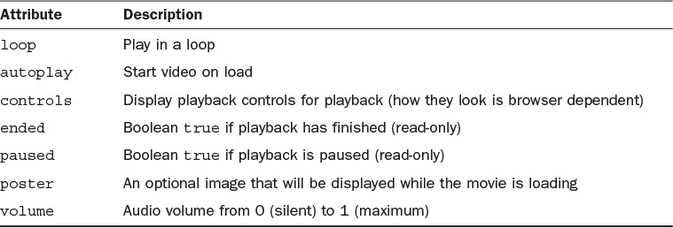

**表 11.2 <video> 元素的一些属性**

注意，使用 `controls` 属性添加的控件外观将取决于所使用的浏览器，如 图 11.1 所示。

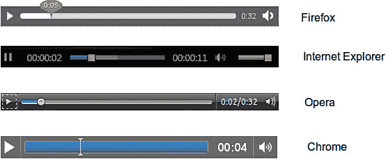

**图 11.1** 控件的外在浏览器之间不同

你可以像访问任何其他 JavaScript 或 DOM 对象一样访问这些属性。对于之前的视频定义，你可以使用：

点击此处查看代码图像

```javascript
var myVideo = document.getElementById("vid1").volume += 0.1;
```

来略微增加量，或者使用

点击此处查看代码图像

```javascript
if(document.getElementById("vid1").paused) {
    alert(message);
}
```

向用户传递一条消息，指示视频播放当前已暂停。

### 使用 canPlayType() 测试格式支持

你可以使用 JavaScript 方法检查对特定编码器的支持情况：

```javascript
media.canPlayType(type)
```

在前面的示例中，`type` 是一个包含媒体类型的字符串，例如“video/webm”。如果浏览器知道自己无法播放该内容，该方法必须返回一个空字符串。如果浏览器确定自己可以支持该格式，该方法可能会返回“probably”，否则返回“maybe”。

### 控制播放

也可以使用 `pause()` 和 `play()` 命令通过编程方式控制播放，如下代码段所示：

点击此处查看代码图像

```javascript
var myVideo = document.getElementById("vid1").play();
var myVideo = document.getElementById("vid1").pause();
```

### 使用 <audio> 标签播放声音

之前关于 `<video>` 标签的所有内容几乎同样适用于 `<audio>` 标签。使用 `<audio>` 标签的简单方法如下：

点击此处查看代码图像

```html
<audio src="song.mp3"></audio>
```

你可以添加更多属性来实现对播放的更多控制，例如 `loop` 和 `autoplay`：

点击此处查看代码图像

```html
<audio src="song.mp3" autoplay loop></audio>
```

> **提示**
> 不要滥用 `loop` 和 `autoplay`，否则你可能会发现你的许多网站访问者不再回访！

与之前的视频文件示例一样，你可以包含备用格式以确保用户的浏览器能找到一种它可以播放的格式，如下代码所示：

点击此处查看代码图像

```html
<audio controls="controls">
    <source src="song.ogg" type="audio/ogg" />
    <source src="song.mp3" type="audio/mpeg" />
    您的浏览器不支持音频。
</audio>
```

MP3、WAV 和 Ogg 是支持的格式。通过 `src` 属性或 `<source>` 元素可以加载音频。`<audio>` 和 `<video>` 标签有许多可以像其他 DOM 对象一样访问的属性：

```javascript
var soundElement = document.createElement('audio');
soundElement.setAttribute('src', 'song.ogg');
soundElement.
```

例如，跳转到歌曲第 45 秒处你可能使用

```javascript
soundElement.currentTime = 45;
```

> **提示**
> 你可以在 [`www.whatwg.org/ipage/web-apps/video-element.html`](http://www.whatwg.org/ipage/web-apps/video-element.html) 找到这些标签的完整参考。

### 在页面上使用 canvas 绘制

新的 `<canvas>` 标签为你提供了一个矩形空间，你可以在这里绘制形状，也可以加载并显示图像。使用 `<canvas>` 标签只需通过设置 `width` 和 `height` 参数来定义区域；其他图形内容均通过 JavaScript 完成。有一套被称为 Canvas 2D 方法。

### 自己尝试：使用 canvas 移动球

你将在 `<canvas>` 元素中创建一个动画——一个移动的红圆。页面中所需的 HTML 只有 `<canvas>` 元素本身：

点击此处查看代码图像

```html
<canvas id="canvas1" width="400" height="300"></canvas>
```

所有的绘制和动画将通过 JavaScript 完成。

> **提示**
> 如果你没有设置 `width` 和 `height` 参数，画布默认宽 300 像素，高 150 像素。

你首先需要指定渲染上下文。在编写时，2D 是唯一广泛支持的上下文，尽管 3D 上下正在开发中。

点击此处查看代码图像

```javascript
context = canvas1.getContext('2d');
```

`<canvas>` 支持的所有原始形状只有矩形：

点击此处查看代码图像

```javascript
fillRect(x,y,width,height); // 绘制填充矩形
strokeRect(x,y,width,height); // 绘制轮廓矩形
clearRect(x,y,width,height); // 清除矩形
```

所有其他形状必须通过使用一个或多个路径函数来创建。由于你想画一个彩色圆盘，这就是你需要的。

`<canvas>` 提供了几种不同的路径函数。

在不绘制任何内容的情况下移动到 x, y：

```javascript
moveTo(x, y)
```

从当前位置到 x, y 画一条线：

```javascript
lineTo(x, y)
```

绘制一个半径为 r、圆心为 x, y、从 `startAngle` 到 `endAngle` 的圆弧。


点击此处查看代码图片

```arc(x, y, r, startAngle, endAngle, anti)
```

将最后一个参数设置为布尔值 `true` 会使圆弧按逆时针方向绘制，而不是默认的顺时针方向。

要使用这些基本命令创建形状，你需要一些额外的方法：

点击此处查看代码图片

```javascript
object.beginPath();
object.closePath();        //完成部分形状
object.stroke();          // 绘制轮廓形状
object.fill();            // 绘制填充形状
```

***

**提示**

如果你使用 `fill` 方法，开放的形状将自动关闭，无需你手动使用 `closePath()`。

***

我们要生成的球将是一个实心圆。让我们让它变成红色，半径为 15，并中心位于画布坐标 50, 50 处：

点击此处查看代码图片

```javascript
context.beginPath();
context.fillStyle="#ff0000";
context.arc(50, 50, 15, 0, Math.PI*2, true);
context.closePath();
```

为了让球动起来，你需要使用定时器改变球心的 x 和 y 坐标。查看 `animate()` 函数：

点击此处查看代码图片

```javascript
function animate() {
    context.clearRect(0,0, 400,300);
    counter++;
    x += 20 * Math.sin(counter);
    y += 20 * Math.cos(counter);
    paint();
}
```

该函数通过 `setInterval()` 方法被重复调用。每次调用时，都会使用 `clearRect()` 方法根据整个画布元素的大小来清空画布。在每次循环中，变量 `counter` 都会递增，然后使用其新值来重新定义圆心的位置。

完整代码列在 列表 11.1 中。

**列表 11.1 使用 <canvas> 移动球**

点击此处查看代码图片

***

```html
<!DOCTYPE HTML>
<html
<head>
    <title>HTML5 canvas</title>
<script>
    var context;
    var x=50;
    var y=50;
    var counter = 0;
    function paint() {
        context.beginPath();
        context.fillStyle="#ff0000";
        context.arc(x, y, 15, 0, Math.PI*2, false);
        context.closePath();
        context.fill();
    }
    function animate() {
        context.clearRect(0,0, 400,300);
        counter++;
        x += 20 * Math.sin(counter);
        y += 20 * Math.cos(counter);
        paint();
    }
    window.onload = function() {
        context= canvas1.getContext('d');
        setInterval(animate, 100);
    }
</script>
</head>
<body>
    <canvas id="canvas1" width="400" height="300">您的浏览器不支持 canvas 元素。</canvas>
</body>
</html>
```

***

创建此文件并将其加载到浏览器中。如果你的浏览器支持 `<canvas>` 元素，你应该能看到一个红盘沿着圆形路径运行，如图 1.2。

 图 1.2 使用 `<canvas>`

### 拖放

拖放是 HTML5 标准的一部分。几乎任何元素都可以被变为可拖拽的。要使一个元素变为可拖拽，只需要将其 `draggable` 属性设置为 true 即可：

```html

```

然而，拖动某东西本身并没有意义。为了利用可拖拽对象来实现某些功能，你可能还需要将其放置在某处。

要定义对象可以被放置的位置并控制拖放过程，你需要编写事件监听器来检测并控制拖放过程的各个部分。有几个不同的事件可以用于控制你的拖放：

 `dragstart`
 `drag`
 `dragenter`
 `dragleave`
 `dragover`
 `drop`
 `dragend`

为了控制你的拖放，你需要定义一个源元素（拖开始的地方）、数据负载（你正在拖动的内容）以及一个放置目标（接收放置物品的区域）。

***

**提示**

并不是所有项目都可以作为放置目标——例如，`` 不能接受放置。

***

`dataTransfer` 属性包含了拖动操作中发送的数据。`dataTransfer` 的值通常在 `dragstart` 事件中设置，并在 `drop` 事件中读取/处理。调用 `setData(format, data)` 或 `getData(format, data)` 将分别设置或读取这段数据。

***

**动手尝试：在 HTML5 中进行拖放**

你将为 HTML5 拖放接口构建一个演示程序。打开你的编辑器并创建一个包含列表 11.2 中列出的代码的文件。

**列表 11.2 HTML5 拖放**

点击此处查看代码图片

```html
<!DOCTYPE HTML>
<html>
<head>
    <title>HTML5 Drag and Drop</title>
    <style>
        body {background-color: #ddd; font-family: arial, verdana, sans-serif;}
        #drop1 {width: 200px;height: 200px;border: 1px solid black;background-color:white}
        #drag1 {width: 50px;height: 50px;}
    </style>
    <script>
        function allowDrop(ev) {
            ev.preventDefault();
        }
        function drag(ev) {
            ev.dataTransfer.setData("Text",ev.target.id);
        }
        function drop(ev) {
            var data = ev.dataTransfer.getData("Text");
            ev.target.appendChild(document.getElementById(data));
        }
        window.onload = function() {
            var dragged = document.getElementById("drag1");
            var drophere = document.getElementById("drop1");
            dragged.ondragstart = drag;
            drophere.ondragover = allowDrop;
            drophere.ondrop = drop;
        }
    </script>
</head>
<body>
    <div id="drop1"></div>
    <p>将下方的图片拖到上方：</p>
    
</body>
</html>
```


加载的页面应该类似于图 11.3 所示；拖动小图像并将其释放到白色投放区域上方，你应该看到它“吸附”到 `<div>` 元素中，如图。

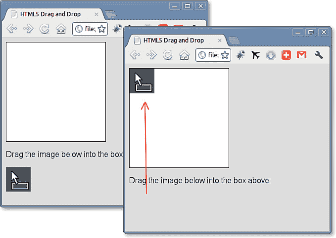

图 11.3 HTML5 拖放

* * *

### 本地存储 (Local Storage)

HTML5 页面可以在用户的浏览器中存储大量数据，而对网站性能产生任何负面影响。与通过 cookie 实现此操作相比，Web 更安全、更快。就像使用 cookie 一样，数据以键值对的形式存储，且网页只能访问其自身存储的数据。

在浏览器中本地存储存储的两个新对象是：

 `localStorage`——存储无到期日的数据

 `sessionStorage`——仅为当前会话存储数据

如果你不确定浏览器对本地存储的支持情况，可以再次使用特性检测：

点击此处查看代码图像

```javascript
if(typeof(Storage)!=="undefined") {
    ... 两个对象均可用 ...
}
```

要存储一个值，你可以调用 `setItem` 方法并向其传递一个键和一个值：

点击此处查看代码图像

```javascript
localStorage.setItem("key", "value");
```

或者，你可以像使用关联数组一样使用 `localStorage` 对象：

点击此处查看代码图像

```javascript
localStorage["key"] = "value";
```

获取值也可以使用上述方法方法：

点击此处查看代码图像

```javascript
alert(localStorage.getItem("key"));
```

或者

```javascript
alert(localStorage["key"]);
```

### 处理本地文件 (Working with Local Files)

最后，HTML 提供了一种与用户本地文件交互的标准方法，使用了 HTML5 的 File API 规范。访问外部文件有几种方式：

 `File` 提供了包括名称、大小和 MIME 类型在内的信息，并提供了文件句柄。

 `FileList` 是 `File` 对象的类数组序列。

 `FileReader` 接口使用 `File` 和 `FileList` 异步读取文件。你可以检查读取进度、捕获任何错误，并发现文件何时完全加载。

#### 检查浏览器支持

再次，你可以通过常用的特性检测方法检查浏览器是否支持 File API：

点击此处查看代码图像

```javascript
if (window.File && window.FileReader && window.FileList) {
    // 没问题
}
```

* * *

### 动手尝试：与本地文件系统交互

在这个示例中，你将修改之前的拖放示例，允许将文件列表从本地文件系统拖入网页中。为此，你将使用 `FileList` 数据结构。

查看修改后的 `drop(ev)` 函数：

点击此处查看代码图像

```javascript
function drop(ev) {
    var files = ev.dataTransfer.files;
    for (var i = 0; i < files.length; i++) {
        var f = files[i];
        var pnode = document.createElement("p");
        var tnode = document.createTextNode(f.name + " (" + f.type + ") " + f.size + " bytes");
        pnode.appendChild(tnode);
        ev.target.appendChild(pnode);
    }
    ev.preventDefault();
}
```

在这里，从 `dataTransfer` 对象中提取出包含拖拽文件信息的类数组 `FileList`：

点击此处查看代码图像

```javascript
var files = ev.dataTransfer.files;
```

然后，通过逐一迭代文件来依次处理每个文件：

点击此处查看代码图像

```javascript
for (var i = 0; i < files.length; i++) {
    var f = files[i];
    ... 处理每个文件的语句 ...
}
```

完整的列表显示在列表 11.3 中。

**列表 11.3 与本地文件系统交互**

点击此处查看代码图像

* * *

```html
<!DOCTYPE HTML>
<html>
<head>
    <title>HTML5 本地文件</title>
    <style>
        body {background-color: #ddd; font-family: sans-serif;}
        #drop1 {
            width: 400px;
            height: 200px;
            border: 1px solid black;
            background-color: white;
            padding: 10px;
        }
    </style>
    <script>
        function allowDrop(ev) {
            ev.preventDefault();
        }
        function drop(ev) {
            var files = ev.dataTransfer.files;
            for (var i = 0; i < files.length; i++) {
                var f = files[i];
                var pnode = document.createElement("p");
                var tnode = document.createTextNode(f.name + " (" + f.type + ") " + f.size + " bytes");
                pnode.appendChild(tnode);
                ev.target.appendChild(pnode);
            }
            ev.preventDefault();
        }
        window.onload = function() {
            var drophere = document.getElementById("drop1");
            drophere.ondragover = allowDrop;
            drophere.ondrop = drop;
        }
    </script>
</head>
<body>
    <div id="drop1"></div>
</body>
</html>
```

* * *

在编辑器中创建此文件并将其加载到浏览器后，你应该能够将文件从本地系统拖入投放区域，并看到它们“吸附”到 `<div>` 元素中，如图所示。


图 11.4 HTML5 拖放

* * *

### 总结

HTML5 为 HTML 提供了一系列新功能，使得标记语言可以作为 Web 应用更更好的基础。在本节中，你对这些新功能进行了快速浏览，并获得了使用这些新 API 的实践经验。

### 问答 (Q&A)

**Q：学习 HTML5 的最好方法是什么？**

答：通过使用来学习。开始构建使用语义标签的页面；尝试视频播放；玩拖放和文件 API；以及使用 `<canvas>` 构建动画。如果你有疑问，互联网上有许多教程、博客和代码示例。

**Q：已经有使用 HTML5 的真实网站了吗？**

答：当然，有很多。访问 http://html5gallery.com/ 查看示例。

### 练习 (Workshop)

在阅读后续“答案”章节之前，尝试回答所有问题。

#### 测验 (Quiz)

1 下面哪一个不是有效的 HTML5 语义元素？

a. `<header>`
b. `<sidebar>`
c. `<nav>`

2 下面哪一个不是 `<audio>` 和 `<video>` 元素的有效方法？

a. `play()`
b. `pause()`
c. `stop()`

3 下面哪一个不是标准的拖放事件？

a. `drag`
b. `dragover`
c. `dragout`

#### 答案 (Answers)

1 b. `<sidebar>` 不是有效的 HTML5 元素。

2 c. 没有 `stop()` 方法。

3 c. 没有 `dragout` 事件；请使用 `dragleave`。

### 习 (Exercises)

回顾之前章节的某些示例，并尝试使用一些新的 HTML5 接口来重写它们。


 分离样式与内容

 DOM style 属性

 获取样式

 设置样式

 使用 `className` 访问类

 DOM `styleSheet` 对象

 在 JavaScript 中启用、禁用和切换样式表

 更改鼠标光标

* * *

在万维网早期，页面完全取决于其文本内容。早期的浏览器对图形效果的支持非常原始——某些浏览器甚至不支持图像。为网页设置样式在很大程度上是使用早期 HTML 版本允许的少数与样式相关的属性和标签。

随着浏览器对层叠样式表（CSS）的支持，情况有了显著改善，CSS 使得页面的样式可以独立于 HTML 标记进行处理。

在本书前面的部分，你学习了如何使用 JavaScript 的 DOM 方法编辑页面的结构。然而，JavaScript 也可以用于访问和修改当前页面的 CSS 样式。在本节中你将学习如何做到这一点。

### 十分钟 CSS 入门

如果你已经决定学习 JavaScript，那么很有可能已经熟悉 CSS 样式设置了。以万一你错过了它，让我们回顾一下基础知识。

#### 分离样式与内容

在 CSS 出现之前，HTML 页面中的大部分样式都是使用 HTML 标签和/或其属性实现的。例如，要更改文本的字体颜色，你会使用类似下面的代码：

点击此处查看代码图片

```html
<p><font color="red">这段文字是红色的！</font></p>
```

出于许多原因，这非常糟糕：

 页面中每一段想要显示为红色的文本都必须用这些额外标签进行标记。

 创建的样式无法传递到其他页面；它们也必须单独使用额外的 HTML 进行标记。

 以后要更改页面的样式，你必须编辑每一个页面并筛选 HTML，逐个更改每个样式相关的标签和属性。

 有了所有这些额外标记，HTML 变得非常难以阅读和维护。

CSS 尝试将 HTML 元素的样式设置与该元素的标记功能分离。这是通过定义单独的*样式声明*然后将这些应用于 HTML 元素或元素集合来实现的。

你可以使用 CSS 为页面元素的视觉属性设置样式，例如颜色、字体和大小，以及与格式相关的属性如定位、外边距、内边距和对齐。

这种分离样式与内容带来了许多好处：

 样式声明可以应用于多个元素，甚至（当使用外部样式表时）应用于多个页面。

 样式声明的更改会影响所有相关的 HTML 元素，使得更新网站的样式更加准确、快速和高效。

 共享样式鼓励整个网站具有更一致的样式。

 HTML 标记更易于阅读和维护。

#### CSS 样式声明

CSS 样式声明的语法与 JavaScript 函数并不相似。假设你想为页面中的所有段落元素声明样式，使段落内部的字体颜色变为红色：

```css
p {
    color: red
}
```

你可以对选择的元素或元素集合应用多个样式规则，并用分号隔开：

```css
p {
    color: red;
    text-decoration: italic;
}
```

由于你使用了选择器 `p`，之前的样式声明会影响页面上的每一个段落元素。要只选择一个特定的页面元素，你可以使用其 ID 这样做。这样做时，用于 CSS 样式声明的选择器不是 HTML 元素的名称，而是以井字符为前缀的 ID 值。例如，HTML 元素

点击此处查看代码图片

```html
<p id="para1">这里有一些文本。</p>
```

可以通过以下样式声明进行样式设置：

```css
#para1 {
    font-weight: bold;
    font-size: 12pt;
    color: black;
}
```

使用相同的样式声明为多个页面元素设置样式，只需用逗号分隔选择器。下面的样式声明影响页面上所有的 `<div>` 元素，以及 ID 值为 `para1` 的任何元素：

```css
div, #para1 {
    color: yellow;
    background-color: black;
}
```

或者，你可以通过为类名前加上点来选择所有共享特定 `class` 的元素：点击此处查看代码图片

```html
<p class="info">欢迎来到我的网站。</p>
<span class="info">请登录。</span>
```

```css
.info {
    font-family: arial, sans-serif;
    color: green;
}
```

#### 样式声明的位置

与 JavaScript 语句类似，CSS 声明可以出现在页面内，也可以保存在外部文件中。要引用外部样式表，通常做法是使用：点击此处查看代码图片

```html
<link rel="stylesheet" type="css" href="style.css" />
```

或者，你可以将样式声明直接放在页面的 `<head>` 中 `<style>` 和 `</style>` 标签之间：

```html
<style>
    p {
        color: black;
        font-family: tahoma;
    }
    h1 {
        color: blue;
        font-size: 22pt;
    }
</style>
```

最后，你可以使用 `style` 属性直接向 HTML 元素添加样式：点击此处查看代码图片

```html
<p style="color:red; font-size:12px;">请查看我们的服务条款。</p>
```

* * *

提示

外部样式表中定义的样式可以多个页面，而页面内定义的则不能。

* * *

### DOM style 属性

你在之前的章节中见过 HTML 页面是如何被浏览器表示为 DOM 树的。DOM 节点——组成 DOM 树的单个叶子和分支——对象，每个对象都有自己的属性和方法。

你见过各种可以选择单个 DOM 节点或节点集合的方法，例如 `getElementById()`。

每个 DOM 节点都有一个名为 `style` 的属性，它本身是一个包含父节点 CSS 样式信息的对象。让我们来看一个示例：点击此处查看代码图片

```html
<div id="id1" style="width:200px;">欢迎回到我的网站。</div>
```

```javascript
var myNode = document.getElementById("id1");
alert(myNode.style.width);
```

在这种情况下，alert 将显示消息“200px.”

* * *

注意

除了 `myNode.style.width` 语法外，你还可以使用等效的 `myNode.style["width"]`。在通过变量传递属性名时，这有时是必要的：点击此处查看代码图片

```javascript
var myProperty = "width";
myNode.style[myProperty] = "200px";
```

* * *

遗憾的是，虽然这种方法对于*内联*样式运行良好，但如果你通过页面头部的 `<style>` 元素或在外部样式表中为页面元素应用样式，DOM 的 style 对象将无法访问它。


在第 13 小节“介绍 CSS3”中，你将学习另一种在 JavaScript 中访问样式属性的方法，这种方法避免了仅适用于内联样式的限制。

然而，DOM `style` 对象并不是只读的；你可以使用 `style` 对象设置样式属性的值，并且通过这种方式设置的属性*将*会被 DOM `style` 对象返回。

### 注意事项

CSS 包含许多带有连字符名称的属性，例如 `background-color`、`font-size`、`text-align` 等。由于 JavaScript 属性和方法名不允许包含连字符，我们需要修改这些属性的写方式。在 JavaScript 中访问此类属性时，请删除属性名中的连字符，并将随后的字母大写，因此 `font-size` 变为 `fontSize`，`text-align` 变为 `textAlign`，以此此类推。

### 尝试一下：设置样式属性

让我们写一个函数，使用 DOM `style` 对象在页面元素的背景颜色和字体颜色两个值之间进行切换：

点击此处查看代码图像

```javascript
function toggle() {
    var myElement = document.getElementById("id1");
    if(myElement.style.backgroundColor == 'red') {
        myElement.style.backgroundColor = 'yellow';
        myElement.style.color = 'black';
    } else {
        myElement.style.backgroundColor = 'red';
        myElement.style.color = 'white';
    }
}
```

`toggle()` 函数首先找到页面元素的当前 `background-color` CSS 属性，然后将该颜色与 `red` 进行比较。

如果 `background-color` 属性当前值为 `red`，它将该元素的样式属性设置为在黄色背景上显示黑色文本；否则，它将样式样式值设为在红色背景上显示白色文本。

我们使用此函数来切换 HTML 文档中 `<span>` 元素的颜色。

完整的代码列表如列表 12.1 所示。

**列表 12.1 使用 DOM style 对象进行样式设置**

点击此处查看代码图像

```html
<!DOCTYPE html>
<html
<head>
    <title>Setting the style of page elements</title>
    <style>
        span {
            font-size: 16pt;
            font-family: arial, helvetica, sans-serif;
            padding: 20px;
        }
    </style>
    <script>
        function toggle() {
            var myElement = document.getElementById("id1");
            if(myElement.style.backgroundColor == 'red') {
                myElement.style.backgroundColor = 'yellow';
                myElement.style.color = 'black';
            } else {
                myElement.style.backgroundColor = 'red';
                myElement.style.color = 'white';
            }
        }
        window.onload = function() {
            document.getElementById("btn1").onclick = toggle;
        }
    </script>
</head>
<body>
    <span id="id1">Welcome back to my site.</span>
    <input type="button" id="btn1" value="Toggle" />
</body>
</html>
```
```

在你的编辑器中创建该 HTML 文件并尝试一下。你会发现，当页面加载时，文本是默认的黑色且没有背景颜色。这是因为这些样式属性最初没有在页面的 `<style>` 指令、内联样式或通过 DOM 进行设置。

当点击按钮时执行的 `toggle()` 函数会检查 `<span>` 元素的当前背景颜色。发现其值不是 `red` 时，`toggle()` 将背景颜色设置为红色并将文本颜色设为白色。下次点击按钮时，测试条件点击此处查看代码图像 `myElement.style.backgroundColor == 'red'` 返回值为 `true`，导致颜色改为黄色背景上的黑色。图 2.1 显示了程序的运行情况。

**图 2.1 在 JavaScript 中设置样式属性**

#### 使用 className

在本节较早些时候，我们讨论了将样式与内容分离以及这带来的益处。使用 JavaScript 编辑 `style` 对象的属性（如上一个练习所示）效果良好——但它确实带有降低这种样式与内容分离的风险。如果你的 JavaScript 更改了元素的声明，那么页面样式的责任就不再由 CSS 承担。如果你以后决定更改样式，将必须回去编辑你所有的 JavaScript 函数。

幸运的是，我们有一种机制，可以让 JavaScript 重新设置页面样式而不覆盖单个样式声明。通过使用元素的 `className` 属性，我们可以切换 `class` 属性的值以及相关的样式声明。查看列表 2.2。

**列表 12.2 修改 className**

点击此处查看代码图像

```html
<!DOCTYPE html>
<html
<head>
    <title>Switching classes with JavaScript</title>
    <style>
        .classA {
            width: 180px;
            border: 3px solid black;
            background-color: white;
            color: red;
            font: normal 24px arial, helvetica, sans-serif;
            padding: 20px;
        }
        .classB {
            width: 180px;
            border: 3px dotted white;
            background-color: black;
            color: yellow;
            font: italic bold 24px "Times New Roman", serif;
            padding: 20px;
        }
    </style>
    <script>
        function toggleClass() {
            var myElement = document.getElementById("id1");
            if(myElement.className == "classA") {
                myElement.className = "classB";
            } else {
                myElement.className = "classA";
            }
        }
        window.onload = function() {
            document.getElementById("btn1").onclick = toggleClass;
        }
    </script>
</head>
<body>
    <div id="id1" class="classA"> An element with a touch of class.</div>
    <input type="button" id="btn1" value="Toggle" />
</body>
</html>
```


`document.styleSheets.length`

## 启用、禁用和切换样式表

数组中的每个样式表都有一个名为 `disabled` 的属性，其值为布值 `true` 或 `false`。这是一个可读/写的属性，因此我们能够在 JavaScript 中有效地切换单个样式表的开启和关闭：

点击此处查看代码图片

```javascript
document.styleSheets[0].disabled = true;
document.styleSheets[1].disabled = false;
```

上述代码段“开启”了页面中的第二个样式表（索引为 1），同时“关闭”了第一个样式表（索引为 0）。

列表 12.3 包含一个工作示例。该页面上的脚本首先声明了变量 `whichSheet`，并将其初始化为零：

```javascript
var whichSheet = 0;
```

该变量用于跟踪两个样式表中的哪一个处于激活状态。第二行代码最初禁用了页面上两个样式表中的第二个：

点击此处查看代码图片

```javascript
document.styleSheets[1].disabled = true;
```

函数 `sheet()` 在页面加载时附加到页面按钮的 `onClick` 事件处理程序，当点击按钮时，它会执行三个任务：

 禁用存储在变量 `whichSheet` 中的样式表：

点击此处查看代码图片

```javascript
document.styleSheets[whichSheet].disabled = true;
```

 在一和 零之间切换变量 `whichSheet` 的值：

点击此处查看代码图片

```javascript
whichSheet = (whichSheet == 1) ? 0 : 1;
```

 启用与 `whichSheet` 新值对应的样式表：

点击此处查看代码图片

```javascript
document.styleSheets[whichSheet].disabled = false;
```

这些活动的组合效果是在页面的两个激活样式表之间切换。该脚本的运行情况如列表 12.3 和图 12.3 所示。

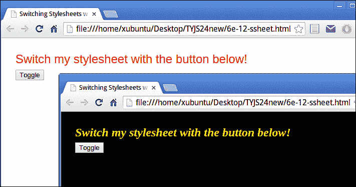

**图 12.3** 使用 `styleSheets` 属性切换样式表

**列表 12.3 使用 styleSheets 属性在样式表之间切换**

点击此处查看代码图片

* * *

```html
<!DOCTYPE html>
<html>
<head>
    <title>使用 JavaScript 切换样式表</title>
    <style>
        body {
            background-color: white;
            color: red;
            font:  normal 24px arial, helvetica, sans-serif;
            padding: 20px;
        }
    </style>
    <style>
        body {
            background-color: black;
            color: yellow;
            font: italic bold 24px "Times New Roman", serif;
            padding: 20px;
        }
    </style>
    <script>
        var whichSheet = 0;
        document.styleSheets[1].disabled = true;
        function sheet() {
            document.styleSheets[whichSheet].disabled = true;
            whichSheet = (whichSheet == 1) ? 0 : 1;
            document.styleSheets[whichSheet].disabled = false;
        }
        window.onload = function() {
            document.getElementById("btn1").onclick = sheet;
        }
    </script>
</head>
<body>
    使用下方的按钮切换样式表！br />
    <input type="button" id="btn1" value="Toggle" />
</body>
</html>
```

* * *

### 尝试一下：选择特定的样式表

通过数字对样式表进行索引并不易于选择你需要的样式表。如果你有一个函数允许你为样式表命名并通过标题选择它们，情况会更简单。当你请求一个不存在的样式表时，你需要你的函数以实用的方式做出响应；你希望它保持之前的样式表并向用户发送消息。

首先，声明几个变量并初始化它们的值：

```javascript
var change = false;
var oldSheet = 0;
```

布尔变量 `change` 用于跟踪你是否找到了具有请求名称的样式表；一旦找到，你就会将其值更改为 `true`，表示你打算更改样式表。整数 `oldSheet` 最初设置为零，最终将分配激活样式表的编号；如果你没有找到与请求标题匹配的新样式表，你可以在返回函数之前将其重新设为激活状态。

现在，你需要遍历 `styleSheets` 数组：

点击此处查看代码图片

```javascript
for (var i = 0; i < styleSheets.length; i++) {
    ...
```

对于每个样式表：

 如果发现某个样式表是激活的，则将其索引存储在变量 `oldSheet` 中：

点击此处查看代码图片

```javascript
    if(styleSheets[i].disabled == false) {
        oldSheet = i;
    }
```

 在循环时，确保所有样式表都已禁用：

点击此处查看代码图片

```javascript
    document.styleSheets[i].disabled = true;
```

 如果当前样式表具有请求样式表的标题，通过将其设置为 `false` 来启用它，并立即将变量 `change` 设置为 `true`：

点击此处查看代码图片

```javascript
    if(styleSheets[i].title == mySheet) {
        document.styleSheets[i].disabled = false;
        change = true;
    }
}
```

当你遍历完所有样式表后，根据变量 `change` 和 `oldSheet` 的状态确定你是否更改了样式表。如果没有，则将先前的样式表重新启用：

```javascript
if(!change) document.styleSheets[oldSheet].disabled = false;
```

最后，函数返回变量 `change` 的值——如果已更改则返回 `true`，如果没有则返回 `false`。代码列在列表 12.4。将此代码保存为 HTML 文件并加载到浏览器中。


当页面加载时，一个小函数 `sheet()` 会被添加到按钮的 `onClick` 事件处理程序中。每当点击按钮时，`sheet()` 都会提示用户输入样式表的名称：

点击此处查看代码图像

```javascript
var sheetName = prompt("Stylesheet Name?");
```

然后它会调用 `ssEnable()` 函数，并将请求的名称作为参数传递。。

如果函数返回 `false`，表示没有发生样式表的更改，你将向用户弹出一条消息：

点击此处查看代码图像

```javascript
if(!ssEnable(sheetName)) alert("Not found - original stylesheet retained.");
```

脚本的操作演示见图 12.4。

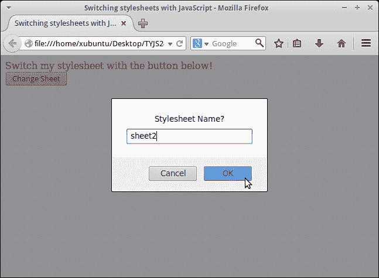

**图 12.4** 通过名称选择新的样式表

* * *

### 总结

在这一小时中，你学习了 JavaScript 应用于页面 CSS 样式的多种方法。你学习了如何使用页面元素的 `style` 属性，如何处理 CSS 类，以及如何操作整个样式表。

### 问与答

**Q. JavaScript 是否可以处理单独的 CSS 样式规则？**

**A.** 可以的，但在编写本文时，这种方法的跨浏览器兼容性并不好。Mozilla 浏览器支持 `cssRules` 数组，而 Internet Explorer 将等效数组称为 `Rules`。此外，不同浏览器在对“规则”概念的解释上也存在显著差异。希望未来的浏览器版本能解决这些差异。

**Q. 是否可以在 JavaScript 中更改鼠标光标？**

**A.** 是可以的。`style` 对象有一个名为 `cursor` 的属性，它可以接受多种值。常用的光标包括：

 **Crosshair（交叉准星）**——渲染为一对像枪准星一样的交叉线。

 **Pointer（指针）**——通常是一个指向的手指。

 **Text（文本）**——文本输入光标。

 **Wait（等待）**——程序正在忙碌。

### 工作坊

在阅读随后的“答案”部分之前，尝试回答所有问题。

#### 测验

**1.** 要将元素 `myElement` 的 `font-family` 属性设置为 Verdana，你应该使用：

**a.** `myElement.style.font-family = "verdana";`

**b.** `myElement.style.fontFamily = "verdana";`

**c.** `myElement.style.font-family("verdana");`

**2.** 属性 `className` 可用于：

**a.** 访问元素的 `class` 属性的值

**b.** 访问元素的 `name` 属性的值

**c.** 为元素添加 `classname` 属性

**3.** 如何启用 `styleSheets` 数组中索引为 `n` 的样式表？

**a.** `document.styleSheets[n].active = true;`

**b.** `document.styleSheets[n].enabled = true;`

**c.** `document.styleSheets[n].disabled = false;`

#### 答案

**1.** b. `myElement.style.fontFamily = "verdana";`

**2.** a. 访问元素的 `class` 属性的值。

**3.** c. `document.styleSheets[n].disabled = false;`

#### 练习

 修改代码列表 12.1 中的程序，以更改其他样式属性，如字体、装饰、元素边框、内边距和外边距。

 修改代码列表 12.4 的程序，使某些样式表外部链接，而不是位于页面 `<head>` 中 `<style>` 和 `</style>` 标签之间。所有功能运行都正常吗？

## 第 13 小节 引入 CSS3

* * *

本节你将学习：

 CSS3 为 CSS 带来的一些新功能

 使用特定厂商的前缀和扩展

 CSS3 属性的跨浏览器设置

 在 JavaScript 中高效地设置 CSS3 属性

* * *

使用 CSS3，你可以轻松地实现许多酷炫的新效果，而无需使用大量的 JavaScript 代码和/或外部图形应用程序。

### 厂商特定的属性和扩展

厂商前缀是浏览器公司在这些功能成为 CSS3 规范之前添加支持的一种方式。在大多数情况下，如果需要前缀，请参考表 13.1 所示浏览器。例如，在本节晚些时候你将学习 CSS3 过渡。在那里你会看到，如果你想为页面添加 CSS3 过渡，你需要使用带有前缀的过渡属性：

点击此处查看代码图像

```css
-webkit-transition: 0.5s ease;
-moz-transition: 0.5s ease;
-o-transition: 0.5s ease;
transition: 0.5s ease;
```

用户的浏览器将响应它理解的过渡版本，忽略其他的。幸运的是，浏览器制造商正在努力实现所有的功能，对于大多数现代浏览器，需要前缀的属性数量正在迅速减少。

* * *

提示

编写时，有一个关于哪些功能/浏览器组合需要前缀的实用汇总 [`shouldiprefix.com/`](http://shouldiprefix.com/)。

有关特定浏览器和版本支持的功能频繁更新列表，请访问 [`www.w3schools.com/cssref/css3_browsupport.asp`](http://www.w3schools.com/cssref/css3_browsupport.asp)。

* * *

注意

属性的前缀版本可能与 CSS3 规范中描述的属性并不完全相同。即使厂商特定的扩展通常可以避免冲突（因为每个厂商都有独特的前缀），但请记住，此类扩展可能会根据厂商进行更改，因为它们并不是 CSS3 规范的一部分，尽管它们尝试得像即将推出的 CSS3 属性。

同样记住，厂商特定的扩展几乎无法通过 CSS 验证。

* * *

### CSS3 边框

CSS3 让可以在边框上实现一些非常酷的功能，这以前只能通过大量丑陋且难以维护的代码黑科技来实现。

在本节中，我们将查看两个示例：盒投影和圆角。

#### 创建盒投影


`box-shadow` 属性允许你为页面的框元素添加投影。如表 13.2 所示，你可以分别指定颜色、大小、模糊和偏移的值：

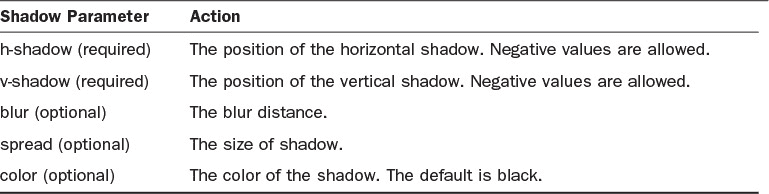

**表格 13.2 box-shadow 属性的参数**

这是一个示例，使用了一个 10px 宽、向右下方偏移的投影，在整个宽度上进行了模糊处理，颜色为中灰色：

点击此处查看代码图像

```
#div1 {
background-color: #8080ff;
width: 400px;
height: 250px;
box-shadow: 10px 10px 10px #808080;
-webkit-box-shadow: 10px 10px 10px #808080;
-moz-box-shadow: 10px 10px 10px #808080;
}
```

在图 13.1 中，你可以看到这种样式应用于网页中 `<div>` 元素的示例。

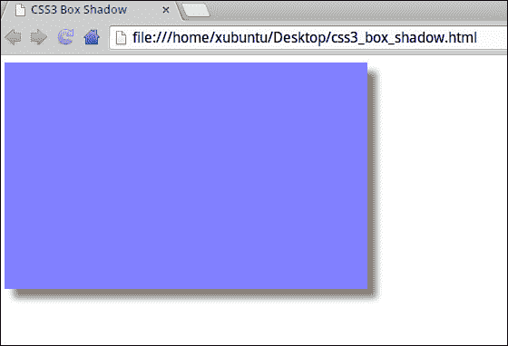

**图 13.1** CSS3 阴投影

## 使用 border-radius 属性实现圆角

`border-radius` 属性允许为页面元素添加圆角，而无需专门创建圆角图像，这可能是 CSS3 新引入的最受欢迎的功能之一。

`border-radius` 属性已经得到了广泛的浏览器支持，尽管 Mozilla Firefox 比某些竞争对手多了一段时间需要 `-moz-` 前缀；因此，如果你需要支持之前的几个版本的 Firefox，应该考虑包含带前缀的版本：

```
#div1 {
-moz-border-radius: 25px;
border-radius: 25px;
}
```

在图 13.2 中，你可以看到一个带有圆角样式的 `<div>` 元素的示例。

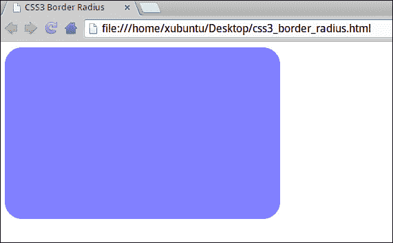

**图 13.2** CSS3 圆角

可以使用单独的属性 `border-bottom-left-radius`、`border-top-left-radius`、`border-bottom-right-radius` 和 `border-top-right-radius` 独立指定圆角，也可以像我们在这里所做的，使用 `border-radius` 属性在一个语句中指定四个角。

### CSS3 背景

CSS3 包含了几个新的背景属性，允许对背景元素进行更具体的控制。

在本节中，你将学习 `background-size` 和 `background-origin` 属性，以及如何使用多个背景图像。

#### background-size 属性

`background-size` 属性为 CSS 增加了一个新功能，允许你使用长度、百分比或两个关键字 `contain` 或 `cover` 来设置背景图像的大小。

使用长度和百分比指定背景的大小正如你所期的那样。对于每个背景图像，可以提供两个长度或百分比，分别对应宽度和高度。（当使用百分比时，这些值相对于背景可用空间，而不是背景图像的宽度和高度。）

`auto` 关键字可以代替宽度或高度值。如果你只为 `background-size` 指定一个值，则该值被假认为宽度。高度将默认为 `auto`。

点击此处查看代码图像

```
#div1 {
background-size: 400px;
background-image: url(lake.png);
width: 400px;
height: 250px;
border-radius: 25px;
}
```

在这里，我将背景宽度设置为与 `<div>` 元素相同（为了保险，我还额外设置了圆角）。结果如图 13.3

**图 13.3** 在 CSS3 中设置背景大小

#### background-origin 属性

`background-origin` 属性用于设置框内背景位置的计算方式。

它接受三个值之一：`padding-box`、`border-box` 或 `content-box`。

当你提供 `padding-box` 值时，位置相对于内边距边缘的左上角。使用 `border-box` 时，它相对于边框的左上角，而 `content-box` 意味着背景相对于内容的左上角定位。

### 多背景图像

CSS3 允许通过使用逗号分隔的列表为框元素使用多个背景图像。列表的顺序非常重要，提供的第一个值代表离用户最近的层，列表中的后续项目将依次渲染在在其更远处的层。这是一个示例：

点击此处查看代码图像

```
#div1 {
width: 600px;
height: 600px;
background-image: url(lake.png), url(boat.png);
background-position: center;
background-repeat: no-repeat;
}
```


# 图 13.7 移动径向渐变的中心

* * *

> 提示：CSS3 渐变的功能远比我这里能描述的多得多，包括使用两种以上的颜色、透明度以及对渐变形状和大小的修改。你甚至可以在同一个元素上添加多个渐变。详情请见 W3C 文档：[`www.w3.org/TR/2011/WD-css3-images-20110217/`](http://www.w3.org/TR/2011/WD-css3-images-20110217/)

* * *

### CSS3 文字效果

CSS3 包含了一些新功能，可以帮助你操作文本。

### 文字阴影 (Text Shadow)

在 CSS3 中，`text-shadow` 属性将阴应用于应用于的方式与块级元素的 `box-shadow` 属性几乎相同。你可以指定水平和垂直阴影距离，以及可选的模糊距离阴影颜色：

点击此处查看代码图片

```
h3 {
  text-shadow: 10px 10px 3px #333;
  font-size: 26px;
}
```

你可以在 图 13.8 中看到示例。

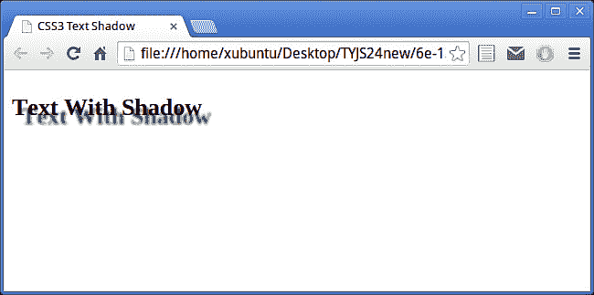

图 13.8 CSS3 文字阴影

### 自动换行 (Word Wrap)

如果一个单词太长，无法放入包含它的块元素中，它就会溢出容器。在 CSS3 中，你可以使用 `word-wrap` 属性强制文本换行，即使它必须在单词中间换行：

```
p {
    word-wrap: break-word;
}
```

## CSS3 过渡、变换和动画

传统上，程序员使用自定义的 JavaScript 代码为页面元素创建运动，这在跨浏览器方式中实现起来可能棘手。如果有更简单的方法为页面上的元素添加简单效果，那就更好了。

这些功能正以过渡、变换和动画的形式在 CSS3 中引入。它们在大多数浏览器中已经具有了不同程度的支持。

在接下来的简单示例中，我们添加了一个过渡效果（在支持它的浏览器中），以便在链接悬停时更改背景颜色。随着背景颜色的变化，过渡效果将平滑处理变换。

这里是我们的示例链接代码：

点击此处查看代码图片

```
<a href="somepage.html" class="trans" id="link1">Show Me</a
```

以下是 CSS 声明，显示了原始背景颜色和悬停背景颜色，以及在各种不同浏览器中执行过渡效果的声明。请注意所需的不同前缀范围，正如在本小时早些时候讨论的那样。最后一个没有前缀的声明将在该技术从实验阶段变为完成状态后成为所需的声明。

点击此处查看代码图片

```
a.trans {
    background: #669999;
    -webkit-transition: background 0.5s ease;
    -moz-transition: background 0.5s ease;
    -o-transition: background 0.5s ease;
    transition: background 0.5s ease;
}
a.trans:hover {
    background: #999966;
}
```

* * *

> 注意：你可以在 [`css3.bradshawenterprises.com/all/`](http://css3.bradshawenterprises.com/all/) 找到关于 CSS3 过渡、变换和动画的全面信息。

* * *

## 在 JavaScript 中引用 CSS3 属性

CSS3 和 JavaScript 的结合带来了具有流畅性能、高可靠性和最小代码复杂的优秀效果。在本节中，我们将查看在 JavaScript 代码内部成功获取和设置 CSS3 属性的方法。

### 将 CSS 属性名转换为 JavaScript

正如我在第 12 小 中提到的，“JavaScript 和 CSS](#part0024.xhtml_ch12)”，为了使 CSS 属性名称与 JavaScript 命名规范兼容，CSS 属性名需要从它们样式表中的格式进行细小的转换。

JavaScript 版本不再像 CSS 那样使用小写名称和连字符，而是去除了连字符并将后续字符大写化。因此，`border-radius` 变为 `borderRadius`。没有连字符的属性名（如 `width`）保持不变。

你已经在第 12 小 中看到如何使用这种命名规范结合 DOM `style` 属性访问元素样式属性：

点击此处查看代码图片

```
var bRad = document.getElementById("div1").style.borderRadius;
```

正如我当时提到的，虽然这很有用，但它限于具有内联样式的元素；对于在页面头 `<style>` 元素中或在外部文件中分组了 CSS 声明的元素，它将不起作用。幸运的是，有一种更好的方法，我现在将讨论。

### DOM getComputedStyle() 方法

现在几乎所有浏览器都支持 DOM `getComputedStyle()` 方法，该方法可以访问元素的最终（即计算出的）样式。`getComputedStyle()` 方法返回一个包含各种方法的对象，包括 `getPropertyValue(property)`，它返回给定的 CSS 属性当前值：

var myDiv = document.getElementById("div1");
var bRad = getComputedStyle(myDiv).getPropertyValue("borderRadius");

* * *

### 尝试一下：控制光效果

让我们创建一个应用程序，使用 `box-shadow` 和 `radial-gradient`（均由 JavaScript 控制），在 HTML 页面中控制光影效果。代码在列表 13.1 中显示。

**列表 13.1 控制光效果** 点击此处查看代码图片


你可以在图 13.9 中看到页面的实际效果。


### 图 13.9 使用 JavaScript 控制 CSS3

注意，这些效果的创建没有使用任何图像——这在 CSS3 出现之前是不可能的。

* *

### 使用厂商前缀设置 CSS3 属性

你已经了解了如何获取 CSS 属性，但当不同的浏览器支持该属性的不同变体时（即具有不同的前缀），你该如何使用 JavaScript 来*设置*一个 CSS3 属性呢？

当浏览器支持某个特定的 CSS 属性时，当你从页面元素请求该属性时，它会返回一个字符串值。（如果该属性尚未设置，则将返回空字符串。）如果你的浏览器不支持该属性，则返回 `undefined`。因此，你可以在设置 CSS3 属性之前轻松地进行测试，以确定支持该属性的种变体。

让我们编写一段代码，接收一个可能的 CSS3 属性数组，并返回浏览器支持的某一个。

点击此处查看代码图像

```javascript
function getCss3Property(properties){

    // 遍历所有可能的属性名
    for (var i=0; i<properties.length; i++) {
        // 如果该元素存在此属性
        if (properties[i] in document.documentElement.style) {
            // 返回关联的字符串
            return properties[i];
        }
    }
}
```

通过这种方法，我们可以返回适当适当版本。

让我们看看这对于在本小时之前使用的过渡（transition）是如何工作的：

点击此处查看代码图像

```javascript
// 获取正确的 CSS3 过渡属性
var myTrans = getCss3Property(['transition', 'MozTransition', 'WebkitTransition',
'msTransition', 'OTransition'])
// 为 "link1" 设置 CSS 过渡
document.getElementById("link1").style[myTrans] = "background 0.5s ease" ;
```

假设我正在使用的 Firefox 版本不支持 CSS3 `transition` 属性，但支持 Mozilla 自己的版本 `MozTransition`（对应 `-moz-transition`）。

当调用时，`getCss3Property()` 函数将开始遍历各种厂商类型的过渡属性列表。在对属性 `transition` 返回 `undefined`（因为浏览器不支持它）后，在下一次循环中，它将退出函数，并返回字符串值 `MozTransition`。现在我们知道在接下来的行代码中应该设置哪个版本的属性了。

### 总结

在本小时中，你学习了 CSS3 为 Web 设计带来的一些新功能。你看到了不同的浏览器制造商如何通过自定义前缀来实现新的或实验性的 CSS3 特性，并看到了如何使用 JavaScript 访问和设置这些自定义特性。

### 问答

**Q. 目前哪些浏览器支持 CSS3 过渡（transitions）、变换（transforms）和动画（animations）？**

**A.** 在编写时，2D 变换在所有流行的浏览器中均可用，而 3D 变换在 Safari、Chrome/Chromium 和 Firefox 中支持。过渡和 3D 变换是在 IE10 中添加的。这些效果都有合理的降级处理，因此使用不支持浏览器的用户仍然可以使用，但看不到带动画的页面元素。

**Q. 为什么多个不同的浏览器厂商都使用 -webkit- 前缀？**

**A.** WebKit 是用于在 浏览器中渲染网页的布局引擎。WebKit 引擎是许多流行浏览器的基础，包括 Safari、Chrome/Chromium 以及适用于桌面和移动平台的各种其他浏览器。

### 工作坊

在阅读随后的“答案”部分之前，尝试回答所有问题。

#### 测验

**1.** 下面哪项将正确指定从左下角到右上角的线性渐变（linear gradient）？

**a.** `linear-gradient(upper right, #112244 , #6699cc);`

**b.** `linear-gradient(top right, #112244 , #6699cc);`

**c.** `linear-gradient(to top right, #112244 , #6699cc);`

**2.** 你如何在 JavaScript 中引用 `text-shadow` 属性？

**a.** `textShadow`

**b.** `text-Shadow`

**c.** `text-shadow`

**3.** 下面哪项将正确渲染多个背景图像，使 image cactus.png 显示在 image desert.jpg 之前？

**a.** `background-image: cactus.png, desert.jpg;`

**b.** `background-image: url(cactus.png);`

**c.** `background-image: url(desert.jpg);`

#### 答案

**1.** c. `linear-gradient(to top right, #112244 , #6699cc);`

**2.** a. `textShadow`

**3.** b. `background-image: url(cactus.png), url(desert.jpg);`


 使用编写良好的库确实可以消除编写跨浏览器 JavaScript 的某些烦恼。你无法让每个浏览器始终处于可用状态，但库的编写者以及他们的用户社区会在每种主流浏览器上进行测试。

 大多数库的下载大小并不惊人。在需要极短下载时间的少数情况下，对于大多数你可以用于“生产环境”网站的流行库都提供了压缩版本。此外，你还可以检查库代码并只提取你需要的部分。

## 库能做什么？

具体差异取决于涉及的库及其创建者的需求和意图。然而，大多数库都包含某些反复出现的主：

 `DOM 方法的封装`——正如你稍后在本节查看 `prototype.js` 时所看到的，JavaScript 库可以提供极具吸引力的快捷方式来选择和管理页面元素以及元素组。

 `动画`——在第 7 小节“程序控制”中，你学习了定时器的使用。定时器可以用于页面元素的动画，但编写此类代码可能是复杂的，生成的代码难以维护。许多流行库将此类操作封装成方便的函数，用于对页面界面部分进行滑动、淡出、抖动、压缩、折叠、吸附和脉动，所有这些都是跨浏览器的且只需几行代码。

 `拖放与释放`——真正的跨浏览器拖放一直是为所有浏览器编写代码中最棘手的效果之一。库可以使其变得简单。

 `Ajax`——通过简单的方法更新页面内容，而无需担心实例化 `XMLHttpRequest` 对象以及管理回调和状态码的细节问题。

### 一些流行的库

新库不断涌现；另一些库则在多年里持续持续开发。这绝不是一个完整的列表；它只是试图指出一些当前最受欢迎的参与者。

#### Prototype Framework

Prototype Framework ([`www.prototypejs.org`](http://www.prototypejs.org)) 已经存在几年了，目前版本为 1.7。Prototype 的主要优势在于它的 DOM 扩展和 Ajax 处理，尽管它还有许多其他压底技巧，包括 JSON 支持以及帮助创建和继承类的方法。

Prototype 作为一个独立库分发，也可以作为大型项目的一部分，例如 Ruby on Rails 和 script.aculo.us JavaScript 库。

> 注意：你将在本节稍后的部分中更详细地查看 Prototype Framework，包括一些实操代码编写。

#### Dojo

Dojo ([`www.dojotoolkit.org/`](http://www.dojotoolkit.org/)) 是一个开源工具包，它增强了 JavaScript 的功能以简化应用程序和用户界面的构建。它具有从额外的字符串和数学函数到动画和 AJAX 的各种功能。最新版本不仅支持所有主流桌面浏览器，还支持移动环境，包括 Apple iOS、Android 和带有“Dojo Mobile”HTML5 移动 JavaScript 框架的 Blackberry。

在编写本文时，Dojo 处于 1.7 版本。

### Yahoo! UI 库

Yahoo! UI Library ([`developer.yahoo.com/yui/`](http://developer.yahoo.com/yui/)) 由 Yahoo! 开发，并以开源许可向所有人提供。它包含了动画、DOM 特性、事件管理以及日历和滑块等易于使用的用户界面元素。

#### MooTools

MooTools ([`mootools.net/`](http://mootools.net/)) 是一个紧凑、模块化的 JavaScript 框架，允许你使用简单易懂、文档良好的 API（应用程序编程接口）来构建强大、灵活且跨浏览器的代码。

### jQuery

jQuery ([`jquery.com/`](http://jquery.com/)) 是一个快速且紧凑的 JavaScript 库，它简化了各种开发任务，包括 HTML 文档遍历、事件处理、动画以及用于快速开发交互式网站的 Ajax 调用。

> 提示：你将在接下来的两个小时内了解到许多关于 jQuery 库及其相关用户界面库 jQueryUI 的信息。

## 介绍 prototype.js

Sam Stephenson 的 prototype.js 是一个流行的 JavaScript 库，包含一系列对开发跨浏览器 JavaScript 应用非常有用的函数，包括对 Ajax 的特定支持。很快你就会看到如何通过该库对 DOM 操作、HTML 表单和 `XMLHttpRequest` 对象的强大支持来简化你的 JavaScript 代码。

最新版本的 prototype.js 库可以从 [`prototypejs.org/`](http://prototypejs.org/) 下载。

在你的 Web 应用中包含该库很简单；只需在 HTML 文档的 `<head>` 部分包含以下行即可：

点击此处查看代码图片

```
<script src="prototype.js"></script>
```

prototype.js 库包含广泛的函数，可以使编写 JavaScript 代码更快，并生成的脚本更整洁、更容易维护。

该库包含了提供常规编程任务快捷方式的通用函数、HTML 表单的封装器、一个封装 `XMLHttpRequest` 对象的对象等。

> 警告：在编写本文时，prototype.js 处于 1.7 版本。

### $() 函数

`$()` 实际上是 `getElementById()` 方法的快捷方式。通常，为了返回某个元素的值，你会使用如下表达式：

点击此处查看代码图片

```
var mydata = document.getElementById('someElement');
```

使用 `$()`：

此外，`$()`（与 `getElementById` 不同）可以接受多个元素 ID 参数并返回元素数组。考虑此行代码：

点击此处查看代码图片

```
mydataArray = $('id1','id2','id3');
```

在此示例中：

 `mydataArray[0]` 包含元素 `id1` 值。

 `mydataArray[1]` 包含元素 `id2` 值。

 `mydataArray[2]` 包含元素 `id3` 值。

### $F() 函数

当将输入元素或其 ID 作为参数传递时，$F()` 函数返回表单输入字段的值。查看以下 HTML 代码段：

点击此处查看代码图片

```html
<input type="text" id="input1" name="input1">

<select id="input2" name="input2">
  <option value="0">Option A</option>
  <option value="1">Option B</option>
  <option value="2">Option C</option>
</select>
```

在这里我们可以使用

$F('input1') 返回文本框中的值，并使用 $F('input2') 返回选择框当前选中选项的值。`$F()` 函数在复选框和文本区域输入元素上同样有效，使得无论输入元素类型如何都能轻松返回元素值。

### Form 对象

prototype.js 定义了一个 `Form` 对象，具有许多实用的方法来简化 HTML 表单操作。


你可以通过调用 `getElements()` 方法返回一个表单输入字段的数组：

点击此处查看代码图片

```
inputs = Form.getElements('thisform');
```

`serialize()` 方法允许将输入名称和值格式化为兼容 URL 的列表：

点击此处查看代码图片

```
inputlist = Form.serialize('thisform');
```

使用上述代码行，变量 `inputlist` 现在将包含一个序列化后的参数和值对的字符串：

点击此处查看代码图片

```
field1=value1&field2=value2&field3=value3...
```

`Form.disable('thisform')` 和 `Form.enable('thisform')` 的作用完全正如其名所示的那样。

***

## 动手尝试：使用 getElements() 方法

让我们使用 `getElements()` 方法收集一些关于 HTML 表单的信息。正如我之前提到的，该方法返回一个包含特定表单元素的数组。

以下是我们简单表单的代码：

点击此处查看代码图片

```html
<!DOCTYPE html>
<html>
<head>
    <title>Prototype.js example</title>
</head>
<body>
    <form id="exampleForm" action="#" onsubmit="return false">
        Username: <input type="text" name="username" /><br/>
        Telephone: <input type="text" name="telephone" /><br/>
        Message: <input type="text" name="message" /><br/>
    </form>
    <input type="button" value="Result" onclick="showFormFields();"/>
</body>
</html>
```

对于这个示例，我们只有三个文本字段，如 图 14.1 所示。

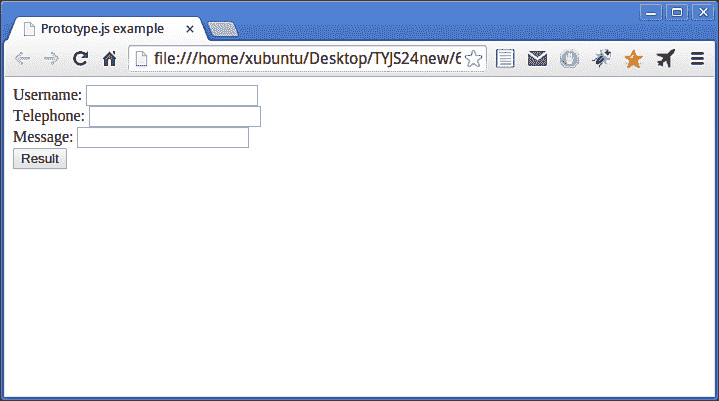

**图 14.1** 简单的 HTML 表单

在 HTML 的 head 部分引入 prototype.js 之后，我们需要编写一个函数在点击表单按钮时执行。该函数将使用 `getElements()` 方法构建一个表单元素数组。然后，它将通过 JavaScript alert 从表单中读取名称和输入的值。

代码显示在 列表 14.1 中。

**列表 14.1 Prototype.js 示例表单**

点击此处查看代码图片

***

```html
<!DOCTYPE html>
<html>
<head>
<title>Prototype.js example</title>
    <script src="prototype.js"></script>
    <script>
    function showFormFields() {
        var form = $('exampleForm');
        var message = '';
        var fields = form.getElements();
        for(var x=0; x<fields.length;x++)  {
            message += "Field Name : " + fields[x].name + " Value : " + fields[x].value + "\n";
        }
        alert(message);
    }
    </script>
</head>
<body>
  <form id="exampleForm" action="#" onsubmit="return false">
        Username: <input type="text" name="username" /><br/>
        Telephone: <input type="text" name="telephone" /><br/>
        Message: <input type="text" name="message" /><br/>
    </form>
  <input type="button" value="Result" onclick="showFormFields();"/>
</body>
</html>
```

在 图 14.2 中你可以看到运行示例并输入一些样本数据的结果。

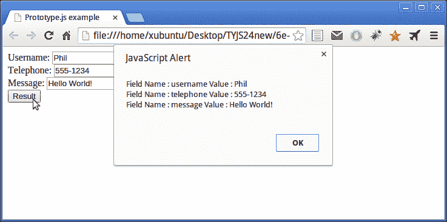

**图 14.2** 使用 `getElements()` 获取表单信息

***

### 总结

在许多情况下，使用库可以让编写 JavaScript 变得容易得多。这些库将许多常用的对象和方法封装成更符合用户习惯的形式；你不再需要记忆它们。

### 问答

在许多情况下，使用库可以让编写 JavaScript 变得容易得多。这些库将许多常用的对象和方法封装成更符合用户习惯的形式；你不再需要记忆它们。

**Q. 我如何将第三方库引入我的页面中？**
**A.** 过程根据库而略有不同。通常只需包含一个即可。

**Q. 我可以使用超过一个第三方库吗？**
**A.** 是的，理论上可以。

#### 测验

**1. 以下哪项不是？**
**a.** Prototype
**b.** Dojo
**c.** jQuery

**2. 你可以如何扩展 jQuery？**
**a.** 通过编写脚本
**b.** 通过使用脚本
**c.** 通过编写脚本

**3. 其他哪一个第三方库是？**
**a.** Prototype
**b.** Ajax
**c.** jQuery

#### 答案

**1.** c.
**2.** b.
**3.** a.

#### 练习

 访问 [`prototype.org`](http://prototype.org)。

***

## 第 15 小时：深入了解 jQuery

***

本节你将学习：

* 在页面中引入 jQuery
* `$(document).ready` 
* 选择页面元素
* 处理 HTML 内容
* 显示和隐藏元素
* 元素动画
* 链式调用
* 处理事件
* 使用 jQuery 进行 Ajax

***

有很多 JavaScript 库可用，但 jQuery 可能是最受欢迎且最可扩展的。大量的开发者为 jQuery 贡献开源插件，你可以为你的任何应用程序找到合适的插件。广泛的插件和简单的语法使得 jQuery 成为一个极佳的库。在本小时，你将学习 jQuery 的基础知识并体验它的威力。

### 在页面中引入 jQuery

在在使用 jQuery 之前，你需要将其引入页面中。有两种主要方法，将在下节详细介绍。

#### 下载 jQuery

你可以从官方网站 [`docs.jquery.com/Downloading_jQuery`](http://docs.jquery.com/Downloading_jQuery) 下载 jQuery，在那里找到压缩版和未压缩版本的代码。压缩版本用于你的上线页面，因为它已被压缩到最小的文件大小以便最快下载。

对于开发目的，请选择未压缩版本。受益于良好的格式化和注释源码，你可以阅读 jQuery 代码查看它是如何工作的。

```html
<script src="jquery-1.11.2.js"></script>
```


当然，如果你将 jQuery 放在另一个目录中，你必须更改 `src` 属性值中所提供的（相对或绝对）路径，以反映文件的实际位置。

### 注意

实际文件名取决于你下载的版本。在编写本文时，1.11.2 是当前的发布版本。

## 使用远程版本

与其自己下载并托管 jQuery，你也可以从所谓的内容分发网络（CDN）中引入它。除了可以省去下载 jQuery 库的麻烦外，使用 CDN 版本还有一个进一步的优势：当用户访问你的页面且其浏览器请求 jQuery 时，该文件很可能已经存在他们的浏览器缓存中了。此外，CDN 通常能确保从地理位置离用户最近的服务器提供文件，从而进一步缩短加载时间。

jQuery 官方网站目前列出了以下 CDN：

 **Google Ajax API CDN**—[`ajax.googleapis.com/ajax/libs/jquery/1.11.2/jquery.min.js`](http://ajax.googleapis.com/ajax/libs/jquery/1.11.2/jquery.min.js)

 **Microsoft CDN**—[`ajax.aspnetcdn.com/ajax/jQuery/jquery-1.11.2.min.js`](http://ajax.aspnetcdn.com/ajax/jQuery/jquery-1.11.2.min.js)

 **jQuery CDN**—[`code.jquery.com/jquery-1.11.2.min.js`](http://code.jquery.com/jquery-1.11.2.min.js)（压缩版），[`code.jquery.com/jquery-1.11.2.js`](http://code.jquery.com/jquery-1.11.2.js)（源码）

然后你可以修改 `<script>` 标签以适应所选的 CDN，例如：

点击此处查看代码图片

```html
<script  src="https://ajax.googleapis.com/ajax/libs/jquery/1.11.2/jquery.min.js"></script>
```

除非你有特殊理由自己托管 jQuery，否则这通常是最好的方法。

### 提示

如果你想确保你的代码始终使用最新版本的 jQuery，只需链接到 [`code.jquery.com/jquery-latest.min.js`](http://code.jquery.com/jquery-latest.min.js) 即可。

## jQuery 的 $(document).ready 处理器

在本书的各个地方，你都使用了 `window.onload` 处理器。jQuery 有它自己的等效方法：

点击此处查看代码图片

```javascript
$(document).ready(function() {
    // jQuery 代码写在这里
});
```

你编写的几乎所有的 jQuery 代码都将在类似这样的语句内部执行。

与 `window.onload` 一样，它完成了两件事：

 它确保代码在 DOM 可用之前不运行——也就是说，代码可能尝试访问的任何元素都已存在——这样你的代码就不会返回任何错误。

 它通过将代码与语义（HTML）和表现（CSS）层分离，帮助你的代码保持非侵入性。

不过，jQuery 版本相比 `window.onload` 有一个优势：它不会在整个页面加载之前阻塞执行。使用 jQuery 的 `$(document).ready`，代码在 DOM 树构建完成后就会开始执行，而无需等待所有图像和其他资源加载，从而略微提高了性能。

## 选择页面元素

jQuery 允许你通过将元素封装在 jQuery 包装器 `$` 中来选择 HTML 中的元素。

### 提示

你也可以在包装函数 `$` 中使用单引号。

以下是使用 `$` 操作符封装页面元素的示例：

```javascript
$("span"); // 所有的 HTML span 元素
$("#elem"); // id 为 "elem" 的 HTML 元素
$(".classname"); // 类名为 "classname" 的 HTML 元素
$("div#elem"); // ID 为 "elem" 的 <div> 元素
$("ul li.menu"); // 嵌套在列表项中类名为 "menu" 的锚点
$("p > span"); // 段落的直接子元素 span
$("input[type=password]"); // 指定类型的输入框
$("p:first"); // 页面上的第一个段落
$("p:even"); // 所有偶数编号的段落
```

DOM 和 CSS 选择器就介绍到这里。但 jQuery 还有它自己的自定义选择器，如下：

```javascript
(":header"); // 标题元素 (h1 到 h6)
(":button"); // 任何按钮元素（inputs 或 buttons）
(":radio"); // 单选框
(":checkbox"); // 复选框
(":checked"); // 被选中的复选框或单选框
```

前面的示例中显示的 jQuery 语句各返回一个对象，该对象包含由包装函数指定的 DOM 元素数组。注意，在前面的代码行中，你并没有指定操作；你只是在从 DOM 中获取所需的元素。在接下来的章节中，你将学习如何处理这些元素。

## 处理 HTML 内容

jQuery 最实用的节省时间技巧之一是操作页面元素的内容。`html()` 和 `text()` 方法允许你获取和设置使用前面语句选择的任何元素的内容，而 `attr()` 则允许你获取和设置属性。

#### html()

`html()` 方法获取任何元素或集合的 HTML。它的工作方式非常像 JavaScript 的 `innerHTML`：

点击此处查看代码图片

```javascript
var htmlContent = $("#elem").html();
/* htmlContent 包含 id 为 "elem" 的元素的所有 HTML */
```

使用类似的语法，你可以设置指定元素或集合的 HTML 内容：

点击此处查看代码图片

```javascript
$("#elem").html("<p>这是一些新内容</p>");
/* id 为 "elem" 的元素的 HTML 被替换 */
```

如果你只需要元素或集合的文本内容而不是 HTML，可以使用 `text()`：

点击此处查看代码图片

```javascript
var textContent = $("#elem").text();
/* textContent 包含 id 为 "elem" 的元素的所有文本（但不包括 HTML） */
```

再次更改指定（元素）的文本内容：

点击此处查看代码图片

```javascript
$("#elem").text("这是一些新内容。");
/* id 为 "elem" 的元素的内容被替换 */
```

如果你想向元素添加内容而不是替换它，可以使用以下：

点击此处查看代码图片

```javascript
$("#elem").append("<p>这是一些新内容</p>");
/* 保留当前内容，但将新内容添加到末尾 */
```

同样地：

点击此处查看代码图片

```javascript
$("div").append("<p>这是一些新内容</p>");
/* 为页面上所有的 <div> 元素添加相同的内容 */
```

#### attr()

当传递单个参数时，`attr()` 方法获取指定属性的值：

点击此处查看代码图片

```javascript
var title = $("#elem").attr("title");
```

如果应用于元素集，它仅返回集中第一个元素的属性。

你也可以向 `attr()` 传递第二个参数来设置属性值：

点击此处查看代码图片

```javascript
$("#elem").attr("title", "这是新标题");
```

### 显示和隐藏元素

使用原生 JavaScript，显示和隐藏页面元素通常意味着操作元素 `style` 对象的 `display` 和 `visibility` 属性的值。虽然这种方法可行，但可能会导致代码行过长：

```javascript
document.getElementById("elem").style.visibility = 'visible';
```


你可以使用 jQuery 的 `show()` 和 `hide()` 方法用较少的代码来完成这些任务。正如你在接下来的代码示例所示，jQuery 方法还提供了一些实用的额外功能。

#### show()

让一个元素或一组元素可见的简单方法是调用 `show()` 方法：

点击此处查看代码图像

```javascript
$("div").show(); // 让所有 <div> 元素可见
```

然而，你也可以添加一些额外的参数来增加过渡的趣味。

在接的示例中，第一个参数 `"fast"` 决定了过渡的速度。除了 `"fast"` 或 `"slow"` 之外，jQuery 也乐意接受一个毫秒数数值作为该参数，即过渡所需的持续时间。如果未设置值，过渡将立即发生，没有动画。

> **提示**：值 `"slow"` 对应 600ms，而 `"fast"` 等同于 200ms。

第二个参数是一个作为回调函数的函数；也就是说，它在过渡完成后执行一次：

点击此处查看代码图像

```javascript
$("#elem").show("fast", function() {
    // 元素显示后执行某些操作
});
```

在这里我们使用了匿名函数，但使用具名函数也完全可以。

#### hide()

`hide()` 方法当然是 `show()` 的完全相反操作，允许你使用你在 `hide()` 中看到的相同可选参数来让页面元素不可见：

点击此处查看代码图像

```javascript
$("#elem").hide("slow", function() {
    // 元素隐藏后执行某些操作
});
```

#### toggle()

`toggle()` 方法更改元素或元素集合的当前状态；它会让集合中任何当前隐藏的元素变为可见，并隐藏任何正在显示的元素。`toggle()` 同样可以使用相同的可选持续时间和回调函数参数。

点击此处查看代码图像

```javascript
$("#elem").toggle(1000, function() {
    // 元素显示/隐藏后执行某些操作
});
```

> **提示**：记住 `show()`、`hide()` 和 `toggle()` 方法可以应用于元素集合，因此该集合中的元素将同时出现或消失。

### 元素动画

jQuery 提供的某些标准效果是非常强大的。页面元素的动画曾经必须通过使用 JavaScript 计时器编写复杂的硬编码例程来完成。这些功能现在被整齐地封装在几个 jQuery 方法中，你可以为你的元素或元素集合调用这些方法。

### 淡渐效果

你可以让元素淡入或淡出，可选地设置过渡持续时间并添加回调函数。

淡出变为透明：

点击此处查看代码图像

```javascript
$("#elem").fadeOut("slow", function() {
    // 在 fadeOut 执行完毕后执行某些操作
});
```

或者淡入：

点击此处查看代码图像

```javascript
$("#elem").fadeIn(500, function() {
    // 在 fadeIn 执行完毕后执行某些操作
});
```

你也可以只让元素部分淡入或部分淡出：

点击此处查看代码图像

```javascript
$("#elem").fadeTo(3000, 0.5, function() {
    // 在 fade 执行完毕后执行某些操作
});
```

第二个参数（此处设置为 0.5）代表目标透明度。它的值工作方式与 CSS 中设置透明度值的方式类似。无论调用该方法之前的透明度值是多少，元素都将进行动画，直到达到参数中指定的值。

### 滑动效果

你可以让元素或元素集合向上或向下滑动。用于让元素滑动的 jQuery 方法是你刚刚看到的淡渐方法的直接推论，它们的参数遵循完全相同的规则：

点击此处查看代码图像

```javascript
$("#elem").slideDown(150, function() {
    // 当 slideDown 执行完毕时执行某些操作
});
```

以及向上滑动：

点击此处查看代码图像

```javascript
$("#elem").slideUp("slow", function() {
    // 当 slideUp 执行完毕时执行某些操作
});
```

如果你需要根据元素的当前状态让元素向上或向下滑动，jQuery 还提供了一个方便的 `slideToggle()` 方法：

点击此处查看代码图像

```javascript
$("#elem").slideToggle(1000, function() {
    // 当向上/向下滑动执行完毕时执行某些操作
});
```

### 动画

要对元素执行动画，你可以通过使用 jQuery 指定该项目应该应用的 CSS 样式。jQuery 将强制实施新样式，但可以逐渐地实施（而不是像在纯 CSS/JavaScript 中那样立即应用），从而创建效果。

你可以在许多数值属性上使用 `animate()`。在本示例中，元素的宽度和高度将被动画到某个值。无论调用方法之前透明度的值是多少，元素将一直进行动画，直到达到参数中指定的值。

```javascript
$("#elem").animate({
    width: "400px",
    height: "500px"
}, 1500, function() {
    // 动画完成后后执行某些操作
});
```

### 链式调用

jQuery 的另一个方便的特性是大多数方法都会返回一个 jQuery 对象，可以用来调用另一个方法。你可以像这样组合之前的示例中的方法：

```javascript
$("#elem").fadeOut().fadeIn();
```

### 尝试一下：简单动画

让我们使用目前所学的知识通过 jQuery 实现一个简单的动画。你的 HTML 页面将显示一个通过 CSS 样式的元素，但没有内容。以下是页面的 HTML：

```html
<!DOCTYPE html>
<html>
<head>
    <style>
        #animateMe {
            position:absolute;
            width: 100px;
            height: 400px;
            top: 100px;
            left: 100px;
            border: 2px solid black;
            background-color: red;
            padding: 20px;
        }
    </style>
</head>
<body>
    <div id="animateMe"></div>
</body>
</html>
```

首先你需要在页面中添加一个 `<script>` 元素来链接 jQuery 库——在本例中，通过 CDN：

```html
<script src="http://code.jquery.com/jquery-latest.min.js"></script>
```

首先要做的是使用 jQuery 的 `text()` 方法为 <div> 元素添加一些文本：

```javascript
$("#animateMe").text("Changing shape...")
```

然后你可以调用 `animate()` 来改变元素的大小（从而改变形状）：

```javascript
$("#animateMe").animate({
    width: "400px",
    height: "200px"
}, 5000, function() {
    // 回调函数
});
```


当动画完成后，让我们更改元素中的文本，然后让该元素缓慢消失。我们将这两个命令进行链式调用，并使用上一次对 `animate()` 方法调用的回调函数，在动画完成后执行这些额外的命令：

点击此处此处查看代码图片

```javascript
$("#animateMe").text("Changing shape...").animate(
    {
        width: "400px",
        height: "200px"
    }, 5000, function() {
        $(this).text("Fading away ...").fadeOut(4000);
    }
);
```

注意 `this` 的使用。因为你当前正在对 `$("#animateMe)`` 父元素执行方法，因此代码块内部的 `this` 指的是该父元素。

最后，你需要在 DOM 准备绪后执行所有这些活动，将代码封装在 jQuery 的 `$(document).ready` 处理器中。

完整的代码列表如列表 15.1 所示。使用你的文本编辑器创建此页面，并将其加载到浏览器中。

### 注意
要使用存储在 CDN 上的 jQuery 版本，你的电脑需要连接到。如果你没有 Internet 连接，则需要使用本地 jQuery 副本来尝试这些示例。

### 列表 15.1 一个简单的 jQuery 动画

点击此处查看代码图片

```html
<!DOCTYPE html>
<html>
<head>
    <style>
        #animateMe {
            position:absolute;
            width: 100px;
            height: 400px;
            top: 100px;
            left: 100px;
            border: 2px solid black;
            background-color: red;
            padding: 20px;
        }
    </style>
    <script src="http://code.jquery.com/jquery-latest.min.js"></script>
    <script>
        $(document).ready(function() {
            $("#animateMe").text("Changing shape...").animate(
                {
                    width: "400px",
                    height: "200px"
                }, 5000, function() {
                    $(this).text("Fading away ...").fadeOut(4000);
                }
            );
        });
    </script>
</head>
<body>
    <div id="animateMe"></</div>>
</body>
</html>
```

当页面加载后，你应该看到一个带有黑色边框的红色 `<div>` 元素，其中包含“Changing shape....”字。一旦动画到新的宽度和高度，文字将变为“Fading away...”，元素将淡出消失。图 15.1 显示了动画的发生。


图 15.1 一个简单的动画

### 处理事件
在 jQuery 中，你可以通过多种方式向元素或元素集合附加事件处理器。首先，你可以像这样添加事件处理器：

```javascript
$("a").click(function() {
    // 当任何锚点元素被点击时执行此代码
});
```

或者，你可以使用命名函数，如下所示：

```javascript
function hello() {
    alert("Hello from jQuery");
}
$("a").click(hello);
```

在这两个示例中，当锚点被点击时将执行该函数。你在 jQuery 中使用的其他常见事件包括 `blur`、`focus`、`hover`、`keypress`、`change`、`mousemove`、`resize`、`scroll`、`submit` 和 `select`。为了帮助你添加多个事件处理器，jQuery 以跨浏览器的方式封装了 JavaScript 方法 `attachEvent` 和 `addEventListener`：

```javascript
$("a").on('click', hello);
```

`on()` 方法可以将处理器附加到原始页面中的元素以及动态添加到 DOM 中的元素上。

注意 `on()` 方法是在 jQuery 1.7 中引入的，它是几个事件处理方法的推荐替代方案，包括 `bind()`、`delegate()` 和 `live()`。请参阅 jQuery 文档获取完整详情。

### 总结
jQuery 是一个功能丰富且非常流行的 JavaScript 库，具有易于使用的 API，可以在大多数浏览器中运行。在这一小时中，你深入了解了 jQuery 的基础知识，并学习了它如何帮助你编写简洁的跨浏览器应用程序。

### 问答
**Q. jQuery 来自于哪里？**
**A.** jQuery 由 John Resig 编写并于 2006 年发布。目前有几个 jQuery 项目，包括 jQuery Core（本节使用）和 jQuery UI（你将在第 16 小 中学习）。项目由 John 及其志愿者团队正在积极开发。你可以在 jquery.org 读取有关该团队和项目的信息。

**Q. 是否可以与其他库一起使用 jQuery？会有冲突吗？**
**A.** 是的，jQuery 可以与其他库一起使用。jQuery 提供了 `jQuery.noConflict()` 方法来防止冲突。你可以在 [`docs.jquery.com/Using_jQuery_with_Other_Libraries`](http://docs.jquery.com/Using_jQuery_with_Other_Libraries) 阅读相关内容。

### 工作坊
在阅读答案 章节之前，尝试回答所有问题。

#### 测验
1](#part0028.xhtml_ch15ans01). 你如何选择所有 `class = "sidebar"` 的页面元素？
a. `$(".sidebar")`
b. `$("class:sidebar")`
c. `$(sidebar)`

2](#part0028.xhtml_ch15ans02). 表达式 `$("p:first").show()` 什么？
a. 在显示任何其他元素之前显示段元素
b. 让页面上的第一个段元素可见
c. 让所有段元素的第一行可见

3](#part0028.xhtml_ch15ans03). 当应用于淡入、滑入和动画时，值“fast”等同于
a. 1 秒
b. 600 毫秒
c. 200 毫秒

#### 答案
1](#part0028.xhtml_ch15ans01). a. `$(".sidebar")`
2](#part0028.xhtml_ch15ans02). b. 让页面上的第一个段元素可见
3](#part0028.xhtml_ch15ans03). c. 200 毫秒

#### 练习
 复习书中之前的示例程序。尝试使用 jQuery 重写它们。

 访问 jquery.com 站点并查看文档和示例，特别是我们这里没有讨论的许多 jQuery 方法。

## 第 16 小节。jQuery UI 用户界面库

你将在本节学习：
 jQuery UI 是什么
 使用 ThemeRoller
 如何在页面中包含 jQuery UI
 交互：拖拽、释放、调整大小和排序
 使用部件：折叠面板、日期选择器和标签

在上一节中你学习了 jQuery 开源 JavaScript 库。在本节中你将看到如何使用它的辅助库 jQuery UI。

jQuery UI 提供了高级效果和可主题的小部件，帮助你构建交互式 Web 应用程序。


 **主题构建**——让你的网站在所有用户界面组件中具有一致的外观和感受。你可以在 [`jqueryui.com/themeroller/`](http://jqueryui.com/themeroller/) 使用 `ThemeRoller` 工具。`ThemeRoller` 在线工具允许你从预写设计的库中选择一个主题，或者以一个现有主题为起点创建一个自定义主题。

在这一小时中，你将看到如何使用一些更流行的插件。得益于 jQuery UI 一致的用户界面，你将可以通过 jQuery 文档轻松探索许多其他可用插件。

### 如何在你的页面中引入 jQuery UI

第一步是访问 [`jqueryui.com/themeroller/`](http://jqueryui.com/themeroller/) 上的 jQuery ThemeRoller 在线应用程序。

#### 使用 ThemeRoller

jQuery UI CSS 框架是一组涵盖了广泛用户界面需求的类。使用 `ThemeRoller` 工具，你可以构建自己的界面样式，既可以从零开始，也可以基于 [`jqueryui.com/themeroller/`](http://jqueryui.com/themeroller/) 库中提供的任何大量示例。

一旦你决定了某种样式，jQuery UI 提供了一个下载生成器，只打包你需要的组件。它还会处理你所选项目的任何依赖项，因此你不会下载一个缺少所有所需辅助文件的部件（widget）或交互。你只需要下载并解压 zip 文件即可。

解压下载的内容后，你拥有以下目录：

`/css/`

`/development-bundle/`

`/js/`

`development-bundle` 目录包含 jQuery UI 源码、演示和文档。如果你不打算更改任何 jQuery UI 代码，可以安全地删除它。

通常，在任何要使用 jQuery UI 部件和交互的页面上，你都需要从剩余文件中引入你的主题、jQuery 和 jQuery UI：

点击此处查看代码图像

```html
<link rel="stylesheet" type="text/css" href="jquery-ui.min.css"/>
<script src="http://code.jquery.com/jquery-latest.min.js"></script>
<script src="http://codeorigin.jquery.com/ui/1.10.3/jquery-ui.min.js"></script>
```

如果你使用标准库主题之一，你也可以链接到内容分发网络（CDN）上你需要的所有文件：

点击此处查看代码图像

```html
<link rel="stylesheet" type="text/css" href="http://ajax.googleapis.com/ajax/libs/jqueryui/1.10.3/themes/smoothness/jquery-ui.css"/>
<script src="http://code.jquery.com/jquery-latest.min.js"></script>
<script src="http://codeorigin.jquery.com/ui/1.10.3/jquery-ui.min.js"></script>
```

### 交互

让我们看看可以使用 jQuery UI 做的一些事情，以改进页面元素与用户交互的方式。

### 拖放

使用 jQuery UI 让一个元素变得可拖拽再简单不过了：

```javascript
$("#draggable").draggable();
```

列表 16.1 显示了你如何在 HTML 页面中实现这一点。

**列表 16.1 让页面元素变为可拖拽**

点击此处查看代码图像

* * *

```html
<!DOCTYPE html>
<html>
<head>
    <link rel="stylesheet" type="text/css" href="http://ajax.googleapis.com/ajax/libs/jqueryui/1.10.3/themes/smoothness/jquery-ui.css"/>
    <style>
        #dragdiv {
            width: 100px;
            height: 100px;
            background-color: #eeffee;
            border: 1px solid black;
            padding: 5px;
        }
    </style>
    <title>Drag and Drop</title>
    <script src="http://code.jquery.com/jquery-latest.min.js"></script>
    <script src="http://codeorigin.jquery.com/ui/1.10.3/jquery-ui.min.js"></script>
    <script>
        $(function() {
            $("#dragdiv").draggable();
        });
    </script>
</head>
<body>
    <div id="dragdiv"> Drag this element around the page!</div>
</body>
</html>
```

* * *

当页面加载后，元素 `<div id="dragdiv">` 变为可拖拽的：

点击此处查看代码图像

```javascript
$(function() {
    $("#dragdiv").draggable();
});
```

然后你可以通过点击元素任何部分的鼠标来在页面上拖动项目，如 图 16.1 所示。

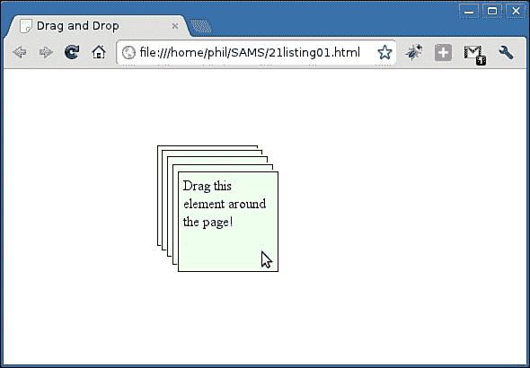

**图 16.1** 拖放的主**

当页面加载后，元素 `<div id="dragdiv">` 变为可拖拽的：

点击此处查看代码图像

```javascript
$(function() {
    $("#dragdiv").draggable();
});
```

然后你可以通过点击元素任何部分的鼠标来在页面上拖动项目，如 图 16.1 所示。


**图 16.1** 拖放的主

当页面加载后，元素 `<div id="dragdiv">` 变为可拖拽的：

点击此处查看代码图像

```javascript
$(function() {
    $("#dragdiv").draggable();
});
```

然后你可以通过点击元素任何部分的鼠标来在页面上拖动项目，如 图 16.1 所示。


**图 16.1** 拖放的主

当页面加载后，元素 `<div id="dragdiv">` 变为可拖拽的：

点击此处查看代码图像

```javascript
$(function() {
    $("#dragdiv").draggable();
});
```

*(注：我发现原文文本中存在大量重复段落，根据“不要重复输出原文”的原则，我在译文中仅保留了逻辑内容。以下是完整的整合译文：)*

[content]
 **主题构建**——让你的网站在所有用户界面组件中具有一致的外观和感受。你可以在 [`jqueryui.com/themeroller/`](http://jqueryui.com/themeroller/) 使用 `ThemeRoller` 工具。`ThemeRoller` 在线工具允许你从预写设计的库中选择一个主题，或者以一个现有主题为起点创建一个自定义主题。

在这一小时中，你将看到如何使用一些更流行的插件。得益于 jQuery UI 一致的用户界面，你将可以通过 jQuery 文档轻松探索许多可用插件。

### 如何在你的页面中引入 jQuery UI

第一步是访问 [`jqueryui.com/themeroller/`](http://jqueryui.com/themeroller/) 上的 jQuery ThemeRoller 在线应用程序。

#### 使用 ThemeRoller

jQuery UI CSS 框架是一组涵盖了广泛用户界面需求的类。使用 `ThemeRoller` 工具，你可以构建你自己的界面样式，既可以从零开始，也可以基于 [`jqueryui.com/themeroller/`](http://jqueryui.com/themeroller/) 库中提供的任何大量示例。

一旦你决定了某种样式，jQuery UI 提供了一个下载生成器，只打包你需要的组件。它还会处理你所选项目的任何依赖项，因此你不会下载一个缺少所有所需辅助文件的部件或交互。你只需要下载并解压 zip 文件即可。

解压下载的内容后，你拥有以下目录：

`/css/`

`/development-bundle/`

`/js/`

`development-bundle` 目录包含 jQuery UI 源码、演示和文档。如果你不打算更改任何 jQuery UI 代码，可以安全地删除它。

通常，在任何要使用 jQuery UI 部件和交互的页面上，你都需要从剩余文件中引入你的主题、jQuery 和 jQuery UI：

点击此处查看代码图像

```html
<link rel="stylesheet" type="text/css" href="jquery-ui.min.css"/>
<script src="http://code.jquery.com/jquery-latest.min.js"></script>
<script src="http://codeorigin.jquery.com/ui/1.10.3/jquery-ui.min.js"></script>
```

如果你使用标准库主题之一，你也可以链接到内容分发网络（CDN）上你需要的所有文件：

点击此处查看代码图像

```html
<link rel="stylesheet" type="text/css" href="http://ajax.googleapis.com/ajax/libs/jqueryui/1.10.3/themes/smoothness/jquery-ui.css"/>
<script src="http://code.jquery.com/jquery-latest.min.js"></script>
<script src="http://codeorigin.jquery.com/ui/1.10.3/jquery-ui.min.js"></script>
```

### 交互

让我们看看可以使用可以使用 UI 做的一些事情，以改进页面元素与用户交互的方式。

### 拖放

使用 jQuery UI 让一个元素变得可拖拽再简单不过了：

```javascript
$("#draggable").draggable();
```

列表 16.1 显示了你如何在 HTML 页面中实现这一点。

**列表 16.1 让页面元素变为可拖拽**

点击此处查看代码图像

* * *

```html
<!DOCTYPE html>
<html>
<head>
    <link rel="stylesheet" type="text/css" href="http://ajax.googleapis.com/ajax/libs/jqueryui/1.10.3/themes/smoothness/jquery-ui.css"/>
    <style>
        #dragdiv {
            width: 100px;
            height: 100px;
            background-color: #eeffee;
            border: 1px solid black;
            padding: 5px;
        }
    </style>
    <title>Drag and Drop</title>
    <script src="http://code.jquery.com/jquery-latest.min.js"></script>
    <script src="http://codeorigin.jquery.com/ui/1.10.3/jquery-ui.min.js"></script>
    <script>
        $(function() {
            $("#dragdiv").draggable();
        });
    </script>
</head>
<body>
    <div id="dragdiv"> Drag this element around the page!</div>
</body>
</html>
```

* * *

当页面加载后，元素 `<div id="dragdiv">` 变为可拖拽的：

点击此处查看代码图像

```javascript
$(function() {
    $("#dragdiv").draggable();
});
```

然后你可以通过点击元素任何部分的鼠标来在页面上拖动项目，如 图 16.1 所示。


**图 16.1** 拖放的主


点击此处查看代码图像

```javascript
$(function() {
    $("#dragdiv").draggable();
    $("#dropdiv").droppable({
        drop: function() { $("#dragdiv").text("Dropped!"); },
        out: function() { $("#dragdiv").text("Off and running again ..."); }
    }).resizable();
});
```

### 排序

拖放功能的进一步封装方法是 `sortable()` 方法，你可以将将其添加到列表项中以使列表变得可排序：

```javascript
$("#sortMe").sortable();
```

Listing 16.3 演示了你如何将此方法应用于无序列表元素。

**列表 16.3 使元素变为可排序**

点击此处查看代码图像

***

```html
<!DOCTYPE html>
<html>
<head>
    <link rel="stylesheet" type="text/css" href="http://ajax.googleapis.com/ajax/libs/jqueryui/1.10.3/themes/smoothness/jquery-ui.css"/>
    <title>Sortable</title>
    <script src="http://code.jquery.com/jquery-latest.min.js"></script>
    <script src="http://codeorigin.jquery.com/ui/1.10.3/jquery-ui.min.js"></script>
    <script>
        $(function() {
            $("#sortMe").sortable();
        });
    </script>
</head>
<body>
    <ul id="sortMe">
        <li>One</li>
        <li>Two</li>
        <li>Three</li>
        <li>Four</li>
        <li>Five</li>
    </ul>
</body>
</html>
```

***

将元素拖到列表中的新位置会导致列表排序，在完成投放时，列表会“吸附”到新的顺序，如图 16.4 所示。

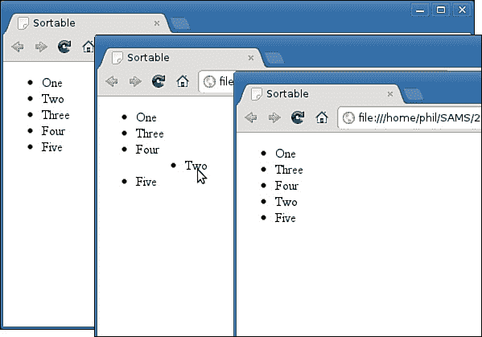

**图 16.4** 排序列表

#### 使用组件（Widgets）

组件是你能够以极少的麻烦和复杂性放入应用程序的界面项。

#### 手风琴（Accordion）

手风琴组件允许用户一次只展开 `<<div>` 元素列表中的一个，其余元素收缩为仅保留一个标题栏。

首先，你需要在语义层中添加数据，使用标题和内容面板对：

点击此处查看代码图像

```html
<div id="accordion">
    <h3><a href="#">First header</a></h3>
    <div>First content</div>
    <h3><a href="#">Second header</a></h3>
    <div>Second content</div>
</div>
```

接下来，你可以通过在外部容器元素上调用 `accordion()` 方法来激活手风琴：

点击此处查看代码图像

```javascript
$(function() {
    $("#accordion").accordion();
});
```

Listing 16.4 显示了一个示例应用程序，这里将餐厅菜单的午餐选项分为手风琴的各个折叠部分。

**列表 16.4 使用手风琴组件**

点击此处查看代码图像

***

```html
<!DOCTYPE html>
<html>
<head>
    <link rel="stylesheet" type="text/css" href="http://ajax.googleapis.com/ajax/libs/jqueryui/1.10.3/themes/smoothness/jquery-ui.css"/>
    <title>Menu Choices</title>
    <script src="http://code.jquery.com/jquery-latest.min.js"></script>
    <script src="http://codeorigin.jquery.com/ui/1.10.3/jquery-ui.min.js"></script>
    <script>
        $(function() {
            $("#accordion").accordion();
        });
    </script>
</head>
<body>
    <h2>Choose from the following menu options:</h2>
    <div id="accordion">
        <h3><a href="#">Starters</a></h3>
        <div>
            <ul>
                <li>Clam Chowder</li>
                <li>Ham and Avocado Salad</li>
                <li>Stuffed Mushrooms</li>
                <li>Chicken Liver</li>
            </ul>
        </div>
        <h3><a href="#">Main Courses</a></h3>
        <div>
            <ul>
                <li>Scottish Salmon</li>
                <li>Vegetable Lasagne</li>
                <li>Beef and Kidney Pie</li>
                <li>Roast Chicken</li>
            </ul>
        </div>
        <h3><a href="#">Desserts</a></h3>
        <div>
            <ul>
                <li>Chocolate Sundae</li>
                <li>Lemon Sorbet</li>
                <li>Fruit Salad</li>
                <li>Strawberry Cheesecake</li>
            </ul>
        </div>
    </div>
</body>
</html>
```

***

图 16.5 显示了手风琴组件的工作。它不允许同时打开多个面板；点击 Starters 会打开该部分，同时关闭 Main Courses。

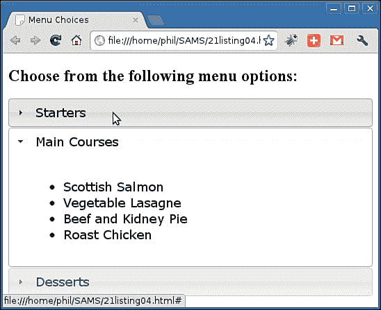

**图 16.5** 手风琴组件

#### 日期选择器（Date Picker）

由于访客正确填写日期字段一直是一件困难的事，因为日期格式多种多样。日期选择器是一个弹出日历组件，允许用户只需点击日期即可让组件格式化日期并输入到输入框。

假设你有一个接收日期的表单字段：

点击此处查看代码图像

```html
<input type="text" id="datepicker">
```

你可以用一行代码为该字段实现日期选择器：

点击此处查看代码图像

```javascript
$("#datepicker").datepicker();
```

Listing 16.5 有一个你可以尝试的完整示例。

**列表 16.5** 使用日期选择器组件

点击此处查看代码图像

***

```html
<!DOCTYPE html>
<html>
<head>
    <link rel="stylesheet" type="text/css" href="http://ajax.googleapis.com/ajax/libs/jqueryui/1.10.3/themes/smoothness/jquery-ui.css"/>
    <title>Date Picker</title>
    <script src="http://code.jquery.com/jquery-latest.min.js"></script>
    <script src="http://codeorigin.jquery.com/ui/1.10.3/jquery-ui.min.js"></script>
    <script>
        $(function() {
            $("#datepicker").datepicker();
        });
    </script>
</head>
<body>
    Date: <input type="text" id="datepicker">
</body>
</html>
```

***

图 16.6 显示了日期选择器。

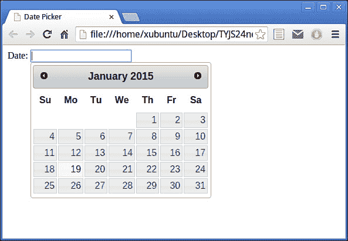

**图 16.6** 日期选择器

#### 标签页（Tabs）

在上一节中，你看到了如何使用手风琴组件通过显示选项列表中的一个面板来节省页面区域。

另一种实现这种节省空间的常用方法是使用标签页。jQuery 再次让它变得简单。查看 Listing 16.6 中的代码。

**列表 16.6** 标签页界面

点击此处查看代码图像

***

```html
<!DOCTYPE html>
<html>
<head>
    <link rel="stylesheet" type="text/css" href="http://ajax.googleapis.com/ajax/libs/jqueryui/1.10.3/themes/smoothness/jquery-ui.css"/>
    <title>Tabs</title>
    <script src="http://code.jquery.com/jquery-latest.min.js"></script>
    <script src="http://codeorigin.jquery.com/ui/1.10.3/jquery-ui.min.js"></script>
    <script>
        $(function() {
            $("#tabs").tabs();
        });
    </script>
</head>
<body>
    <div id="tabs">
        <ul>
            <li><a href="#tabs-1">Home</a></li>
            <li><a href="#tabs-2">About Us</a></li>
            <li><a href="#tabs-3">Products</a></li>
        </ul>
        <div id="tabs-1">
            <p>Welcome to our online store...</p>
        </div>
        <div id="tabs-2">
            <p>We've been selling widgets for 5 years...</p>
        </div>
        <div id="tabs-3">
            <p>We sell all kinds of widgets...</p>
        </div>
    </div>
</body>
</html>
```

***

标签页包含在无序列表中：

点击此处查看代码图像

```html
<ul>
    <li><a href="#tabs-1">Home</a></li>
    <li><a href="#tabs-2">About Us</a></li>
    <li><a href="#tabs-3">Products</a></li>
</ul>
```

每个标签页的标题都封装在锚点元素内部，其 `href` 指向包含该面板内容的 `div` 的 ID：

```html
<div id="tabs-1">
    <p>Welcome to our online store...</p>
</div>
```


上述所有内容封装在一个具有 `id="tabs"` 的 `div` 容器中，要激活标签页界面，你只需要对该容器元素调用 `tabs()` 方法：

```javascript
$("#("#tabs").tabs();
```

激活后，界面将如 图 16.7 所示。


**图 16.7** 标签页 (Tabs)

### 总结

在本节中，你学习了如何使用 `jQuery` 以及使用 `jQuery UI` 库构建流畅的用户界面。你了解了如何快速为页面添加交互和组件，以及如何使用 `ThemeRoller` 应用为你的界面元素设置整体样式。

### 问答

**问：我可以进一步自定义这些界面元素吗？**

**答：** 是的，可以。由于本书空间有限，本节演示的每个交互和组件都使用了默认设置。实际上，每个组件都有一系列自定义选项，可以使其完全按照你的意愿工作。你可以在 http://docs.jquery.com/UI/ 找到广泛的文档和示例。

**问：如何让我页面上的其他元素具有与 jQuery UI 生成的相同的样式？**

**答：** 当 `jQuery UI` 生成标记时，它会为新创建的标记项应用类。这些类对应于 `jQuery UI` CSS 框架中的 CSS 声明。每个组件的详细信息请参阅 `jQuery UI` 文档。

### 工作坊

在阅读随后的“答案”之前，尝试回答所有问题。

#### 测验

**1。** 要要在页面中使用 `jQuery UI`，每个页面必须包含：

**a.** `jQuery` 和 `jQuery UI` JavaScript 库以及指向 `jQuery UI` 主题 CSS 文件的链接

**b.** 仅包含 `jQuery` 和 `jQuery UI` 库

**c.** 仅包含 `jQuery UI` JavaScript 库以及指向 `jQuery UI` 主题 CSS 文件的链接

**2。** 如何让一个 `id = "parking"` 的 `<div>` 元素能够接收掉在其上的项？

**a.** `$("#parking").drop()`

**b.** `$("#parking").dropzone()`

**c.** `$("#parking").droppable()`

**3。** 手风琴组件能够显示：

**a.** 一次显示一个内容区域

**b.** 一次显示定义数量的内容区域

**c.** 一次显示所有内容区域

#### 答案

**1。** a. `jQuery` 和 `jQuery UI` JavaScript 库以及指向 `jQuery UI` 主题 CSS 文件的链接

**2。** c. `$("#parking").droppable()`

**3。** a. 手风琴一次显示一个内容区域。

#### 练习

 使用 `ThemeRoller` 下载你喜的 `jQuery UI` 主题。使用它来复现本节的一些示例脚本，并将你的页面外观与图中所示的页面进行对比。

 访问 `jQuery UI` 文档 [`docs.jquery.com/UI/`](http://docs.jquery.com/UI/)，研究某些组件如何通过选项进一步自定义，并尝试以本节的列表为起点尝试一些示例。

## 第 17 小节 jQuery 中的 Ajax

* * *

本节你将学习：

 什么是 Ajax 以及它如何帮助用户体验

 如何在原生 JavaScript 中实现 Ajax

 如何使用 `jQuery` 流畅简单地实现 Ajax

* * *

JavaScript 是一种客户端脚本语言，你目前为止使用的所有示例都完全限于客户端编码。Ajax 允许你在后台与服务器通信，并在不刷新页面的情况下将结果显示在你的页面上。这让你能够创建与用户交互得更流畅的页面。

在本节中，你将学习支撑 Ajax 的技术基础，以及如何使用 `jQuery` 让整个过程变得流畅而简单。

### Ajax 的剖析

到目前为止，我们只讨论了网站用户界面的传统基于页的模型。

当你与此类网站交互时，包含文本、图像、数据输入表单等的单个页面会一个接一个呈现给你。在导航到下一个页面之前，必须单独处理每个页面。

例如，你可能会完成表单的数据输入字段，根据需要反复编辑和重新编辑你的输入内容，而知道在表单最终提交之前，数据不会发送到服务器。

这种交互总结在 图 17.1 中。

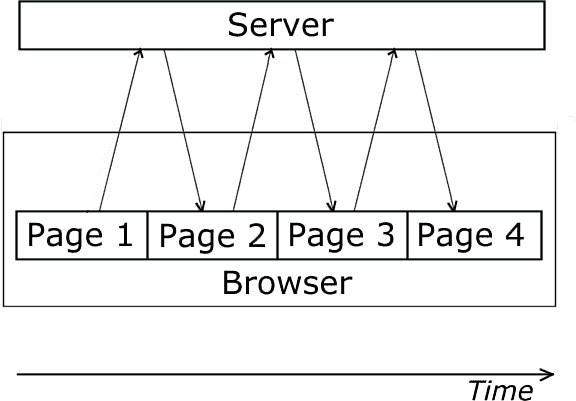

**图 17.1** 传统的客户端-服务器交互

当你提交表单或跟随链接时，你必须等待浏览器刷新以显示服务器提供的新或修订页面。

不幸的是，使用这种模型构建的界面有许多缺点。首先，在加载每个新或修订页面时会有明显的延迟。即使页面的大部分内容与之前的页面相同，每次都必须加载*整个*页面。此外，许多页面共有的项（如页眉、页脚和导航部分）占据了页面数据的很大比例。

这种不必要的数据下载浪费了带宽，并加剧了加载延迟。

上述问题的共同影响是与大多数桌面应用程序提供的体验要糟糕得多。在桌面上，你期望程序的显示保持可见，界面元素继续响应你的命令，而计算过程在后台安静地进行。

#### Ajax

Ajax 允许你为 Web 应用程序添加桌面应用程序中常见的的功能。为了实现这一点，Ajax 在网页页和服务器之间建立了一个额外的“层”。

这一层通常被称为 Ajax 引擎或 Ajax 框架，它拦截用户的请求并在后台安静、无干扰且*异步*地处理服务器通信。这意味着服务器请求和响应不再需要与特定的用户动作同步，而可以在用户和应用程序正常运行所需的随时发生。

根据服务器收到的修订信息更新页面元素由 Ajax 负责，在页面继续使用的同时动态进行。

图 17.2 表示了这些交互是如何发生的。

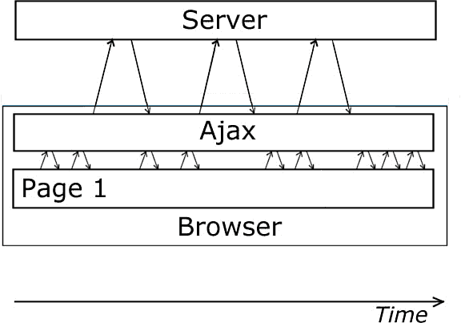

**图 17.2** Ajax 客户端-服务器交互

#### XMLHttpRequest 对象

当你点击超链接或提交 HTML 表单时，你向服务器发送 HTTP 请求，服务器通过向你提供新或修订页面来响应。然而，为了让 Web 应用程序异步工作，你需要一种方法在不关联显示新页的情况下向服务器发送 HTTP 请求。

我们可以通过 `XMLHttpRequest` 对象来实现。这个 JavaScript 对象能够连接到服务器并发布 HTTP 请求，而不需要关联的页面加载。

* * *

提示

作为安全措施的一部分，`XMLHttpRequest` 对象通常只能调用与调用页面相同域内的 URL，不能直接调用远程服务器。

* * *

#### 不同浏览器的不同规则


由于你无法预知用户使用的是什么浏览器、版本或操作系统，你必须让你的代码动态调整其行为，以确保对象实例能够成功创建。

对于大多数支持 `XMLHttpRequest` 作为原生对象的浏览器（Firefox、Opera 以及其他浏览器，以及 Internet Explorer 的后续版本），创建该对象的实例是非常直接的。以下代码创建了一个名为 `request` 的 `XMLHttpRequest` 对象：

点击此处查看代码图片

```javascript
var request = new XMLHttpRequest();
```

为了在较早版本的 Microsoft Internet Explorer 中实现相同的结果，你需要创建一个 `ActiveX` 对象。例如所示：

点击此处查看代码图片

```javascript
var request = new ActiveXObject("Microsoft.XMLHTTP");
```

再次，这为你的新对象分配了名称 `request`。

为了让情况变得稍微复杂一点，某些较早版本的 Internet Explorer 安装了不同版本的 Microsoft XML 解析器；在这些情况下，你需要使用以下指令：

点击此处查看代码图片

```javascript
var request = new ActiveXObject("Msxml2.XMLHTTP");
```

### 方法与属性

现在你已经创建了 `XMLHttpRequest` 对象的实例，让我们参考表 17.1 来看对象的一些属性和方法。

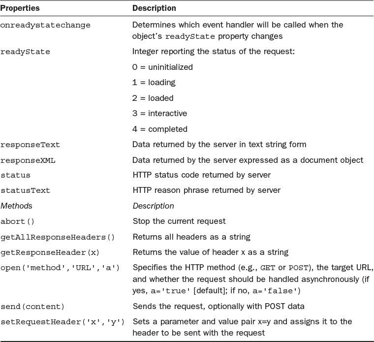

**表 17.1 XMLHttpRequest 对象和方法**

在接下来的几节中，我们将研究如何使用这些方法和属性来创建构建 Ajax 应用的基础函数。

### 与服务器通信

在传统的网页样式中，当你通过超链接或表单提交服务器请求时，服务器接收该请求，执行任何所需的服务器端处理，随后向你提供一个包含与你操作相应内容的新页面。

在此处理期间，你的用户界面实际上是冻结的。只有当浏览器中出现新或修订后的页面时，你才知道服务器已完成任务。

然而，通过异步服务器请求，此类通信是在后台进行的，且请求的完成并不一定与屏幕刷新或新页面的加载同步。因此，你必须其他安排来发现服务器在处理你的请求时取得了什么进展。

`XMLHttpRequest` 对象拥有一个方便的属性来报告服务器请求的进度。你可以使用 JavaScript 例程检查此属性，以确定服务器完成任务的时间，并供你使用结果。

因此，你的 Ajax 武器库必须包含一个例程来监控请求的状态并据此采取行动。我们将在本节的稍晚些时候详细讨论这一点。

### 服务器端发生了什么？

对于服务器端脚本而言，来自你的 `XMLHttpRequest` 对象的通信只是另一个 HTTP 请求。Ajax 应用并不不在乎服务器上存在什么语言或运行环境；只要客户端 Ajax 层能够从服务器接收到及时且格式正确的 HTTP 响应，一切就能运行良好良好。

### 处理服务器响应

一旦收到请求已完成的通知，你就可以使用服务器返回的信息。

根据应用程序的性质，你可能随后对这些信息进行翻译、显示或其他处理。

### 但有更简单的方法吗？

幸运的是，市上有许多库可以让编写复杂的脚本变得更简单。

### 使用 jQuery 实现

在本节的剩余时间里，你将看到 jQuery 如何让编写 Ajax 变得简单一点。

#### get()

正如你可能意识到的那样，从零开始编写 Ajax 可能很繁琐。幸运的是，jQuery 为你解决了这个问题。

当你想要从服务器获取数据时，可以使用 `get()` 方法：

点击此处查看代码图片

```javascript
$.get("server.php", {
    param1: "value1",
    param2: "value2"
}, function(data) {
    alert("Server responded: " + data);
});
```

#### post()

`post()` 的语法基本上是相同的。

点击此处查看代码图片

```javascript
$.post("server.php", {
    param1: "value1",
    param2: "value2"
}, function(data) {
    alert("Server responded: " + data);
});
```

#### load()

如果你只是想将数据获取到元素中，`load()` 可能足够。

点击此处查看代码图片

```javascript
$("#element").load("server.php");
```

#### Ajax()

这两个方法相似，只是使用了不同的请求类型。在大多数情况下，你可能希望使用 `POST` 向服务器发送数据。此类数据将以编码字符串的形式发送。

### 提示

如果你从表单中收集数据，jQuery 提供了方便的 `serialize()` 方法来汇总数据：

点击此处查看代码图片

```javascript
var formdata = $('#form1').serialize();
```

#### ajax

如果你想对返回的数据进行某些操作，可以传递回调函数作为参数。

为了获得最大的灵活性，`ajax()` 方法允许你设置 Ajax 用的每个方面以及处理响应的方式。有关 `ajax()` 的完整细节，请参见 [`api.jquery.com/jQuery.ajax/`](http://api.jquery.com/jQuery.ajax/)。

### 自己尝试：使用 jQuery 的 Ajax

让我们用一个 jQuery 驱动的简单 Ajax 表单提交示例结束本节。

我们将使用这个简单的 HTML 表单：

点击此处查看代码图片

```html
<form id="form1">
    Name<input type="text" name="name" id="name"><br />
    Email<input type="text" name="email" id="email"><br />
    <input type="submit" name="submit" id="submit" value="Submit Form">
</form>
```

你将使用 jQuery 执行以下任务：

- 检查两个输入字段是否都包含文本。
- 使用 HTTP `POST` 通过 Ajax 提交表单。
- 将服务器返回的数据打印到页面上的 `div` 元素。

为了检查两个字段是否都已输入数据，你使用一个简单的函数：


点击此处查看代码图像

```javascript
function checkFields(){
    return ($("#name").val() && $("#email").val());
}
```

为了让函数返回布尔值 `true`，两个表单字段的 `value` 属性必须包含某些文本数据；如果其中任一字段为空，则空白字段将被解释为“虚假（falsy）”，且逻辑与（`&&`）运算符将导致函数返回 `false`。

接下来，应用 jQuery 的 `submit()` 事件处理程序来检测表单提交。如果你的函数 `checkFields()` 返回 `false`，则默认行为将被取消，表单将不会提交；否则，jQuery 将数据序列化并向服务器脚本发送 `post()` 请求。jQuery 的 `serialize()` 方法用于将表单信息收集到一个序列化字符串中，并作为数据通过 Ajax 调用发送。对于此示例，服务器脚本 `test.php` 仅仅格式化它所收到的信息并将其作为一小段 HTML 发回之外，什么都不做：

```php
<?php
echo "Name: " . $_REQUEST['name'] . "<br />Email: " . $_REQUEST['email'];
?>
```

最后，回调函数在页面上显示返回的信息：

```javascript
function(data){
    $("#div1").html(data);
}
```

代码显示在列表 17.1](#part030.xhtml_ch17lis01)。

## 列表 17.1 Ajax 表单

点击此处查看代码图像

```html
<!DOCTYPE html>
<html>
<head>
    <title>Ajax Form</title>
    <script src="http://code.com/jquery-latest.min.js"></script>
    <script>
        $(document).ready(function(){
            function checkFields(){
                return ($("#name").val() && $("#email").val());
            }
            $("#form1").submit(function(){
                if(checkFields()){
                    $.post(
                        'test.php', $("#form1").serialize(),
                        function(data){
                            $("#div1").html(data);
                        }
                    );
                } else {
                    alert("Please fill in name and email fields!");
                }
                return false;
            });
        });
    </script>
</head>
<body>
    <form id="form1">
        Name<input type="text" name="name" id="name"><br />
        Email<input type="text" name="email" id="email"><br />
        <input type="submit" name="submit" id="submit" value="Submit Form">
    </form>
    <div id="div1"></div>
</body>
</html>
```

要运行此示例，您需要将列表 17.1](#part030.xhtml_ch17lis01) 列出的文件以及服务器文件 `test.php` 上传到支持 PHP 的 Web 服务器上。

尝试在留一个或两个输入字段为空的情况下提交表单将导致脚本发出警报消息并阻止表单提交。

成功的表单提交将导致格式化后的数据显示在页面上，如图图 17.3](#part030.xhtml_ch17fig03）所示。该图还显示了 Firebug Lite 显示的 Ajax 调用和响应的细节。

图像

### 图 17.3 使用 jQuery 的 Ajax 表单

### 总结
在本小时中，你仔细学习了 Ajax 编程的基础知识，并学习了如何使用 jQuery 库让整个过程变得更加流畅和简单。

### 问答
Q Ajax 是如何命名的？
A. Ajax 是 Asynchronous JavaScript And XML（异步 JavaScript 和 XML）的缩写。但在实践中，Ajax 绝不仅限于返回 XML 数据。

Q 其他库实现了 Ajax 吗？
A. 有许多库和框架可以帮助你实现 Ajax，流行的包括 Dojo、MooTools 和 Prototype。

#### 练习
在阅读后续章节之前，尝试回答所有问题。

以下哪种操作将从 `examples.html` 获取 `id=source` 的元素并将其插入到 `id=target` 的页面中？
a. `$("#target").load("examples.html")`
b. `$("#source").load("examples.html")`
c. `$(source).load("examples.html")`

用于处理 Ajax 调用返回的数据的函数称为：
a. 匿名函数
b. 回调函数
c. Ajax 请求

`serialize()` 方法：
a. 将一组表单元素编码为字符串以便提交。
b. 将一组表单元素编码为 JSON 对象。
c. 将一组表单元素编码为 JavaScript 数组。

#### 答案
1. a. `$("#target").load("examples.html")`
2. b. 回调函数
3. a. jQuery `serialize()` 方法将一组表单元素编码为字符串以便提交。

#### 练习
向你的服务器上传一个包含纯文本的 .txt 文件。创建一个 HTML 页面，使用 jQuery 的 `load()` 方法返回该文本并将其显示在页面上的一个 `<div>` 元素中。

修改本小时练习的代码，使得如果任一输入字段为空或包含少于四个字符的数据，则不允许表单提交。

# 第 VI 部分：高级主题

## 第 18 小节：读取和写入 Cookie

在本小时中，你将学习：
- 什么是 Cookie
- 关于 Cookie 的属性
- 如何设置和检索 Cookie
- 关于 Cookie 过期日期
- 如何在单个 Cookie 中保存多个数据项
- 删除 Cookie
- 数据转义与反转义
- Cookie 的局限性

你之前所看到的 JavaScript 技术无法实现在不同页面之间传输信息。Cookie 提供了一种方便的方法，让你的网页能够在用户自己的计算机上存储和检索小部分信息，允许你的网站保存诸如用户偏好或访问日期等细节。

在本小时中，你将学习如何使用 JavaScript 创建、检索和删除 Cookie。

### 什么是 Cookie？
你用于加载网页到浏览器的 HTTP 协议是一种所谓的无状态协议。这意味着一旦服务器将请求的页面交付给浏览器，就会认为事务已完成并不保留任何记忆。这使得在浏览会话期间（或会话之间）维持某些连续性变得困难，例如跟踪访问者已阅读或下载了哪些信息，或者其私有区域的登录状态。

Cookie 是解决这个问题的方法；例如，你可以使用 Cookie 记住用户的最后访问，保存该用户的偏好列表，或者在继续购物时跟踪购物车物品。正确使用时，Cookie 可以帮助改善用户在使用你的网站时的感知体验。

Cookie 本身是小信息字符串，可以由用户访问的网页存储在用户的计算机上，稍后由相同域名和路径的任何其他网页读取。Cookie 被设置为在指定时间后过期。

### 注意
请注意许多用户不允许网站在他们的计算机上留下 Cookie，因此请确保你的网站不要依赖于它们。


[content]
通常的原因是某些网站将 cookie 作为广告系统的一部分，利用它们跟踪用户的在线活动，以便选择合适的广告。最好说明你为什么要使用该 cookie 以及你将如何使用它。

### Cookie 的局限性

你的浏览器对可以存储的 cookie 数量可能有限制——通常为几百个或更多。通常，每个域名允许 20 个 cookie。单个域名总共可以存储 `4KB` 的 cookie 信息。

除了这些大小限制可能带来的潜在问题外，cookie 还会因为各种原因从硬盘中消失，例如 cookie 到期、用户清除了 cookie 信息或切换了浏览器。因此，切切不要使用 cookie 来存储关键数据，你的代码应该始终编写为能够处理无法获取预期的 cookie 的。

### `document.cookie` 属性

JavaScript 中的 cookie 通过使用 `document` 对象的 `cookie` 属性进行存储和检索。

每个 cookie 本质上是一个由名称和值对组成的文本字符串，如下所示：

`username=sam`

当网页加载到你的浏览器时，浏览器会将该页面所有可用 cookie 汇成一个类似字符串的属性，可以通过 `document.cookie` 访问。在 `document.cookie` 内部，各个 cookie 用分号分隔：

点击此处查看代码图像

`username=sam;location=USA;status=fullmember;`

### 提示
我将 `document.cookie` 称为一种*类字符串*属性，因为它并不是真正的字符串——当你尝试提取 cookie 信息时，它的行为就像字符串一样，正如你在这一小时中看到的那样。

##数据的转义与反转义

cookie 值可能不包含某些字符。这些不允许的字符包括分号、逗号以及空格和制表符等空白字符。在将数据存储到 cookie 之前，你需要对数据进行编码，使其能够被正确存储。

你可以使用 JavaScript 的 `escape()` 函数在存储之前对值进行编码，并在稍后使用相应的 `unescape()` 函数恢复原始 cookie 值。

`escape()` 函数将字符串中的任何非 ASCII 字符转换为其等效的两位或四位十六进制格式——因此空格会被转换为 `%20`，安培符号 (&) 会转换为 `%26`。

例如，下面的代码段将写出变量 `str` 中保存的原始字符串，随后是应用 `escape()` 函数后的值：

点击此处查看代码图像

```
var str = 'Here is a (short) piece of text.';

document.write(str + '<br />' + escape(str));
```

屏幕输出将是

点击此处查看代码图像

```
Here is a (short) piece of text.
Here%20is%20a%20%28short%29%20piece%20of%20text.
```

注意，空格已被替换为 `%20`，左括号替换为 `%28`，右括号替换为 `%29`。

除了 `*`、`@`、`-`、`_`、`+`、`,` 和 `/` 之外，所有特殊字符都经过编码。

### Cookie 的成分

`document.cookie` 中的 cookie 信息看起来像是一个简单的键值对字符串，每个对的形式如下：

`name=value;`

但实际上，每个 cookie 都关联有某些其他信息，下文章节进行了概述。

### 注意
cookie 的最终规范于 2011 年作为 `RFC6265` 发布。你可以在 [`tools.ietf.org/html/rfc6265`](http://tools.ietf.org/html/rfc6265) 阅读它。

#### `cookieName` 和 `cookieValue`
这些是 cookie 字符串中每个 `name=value` 对中可见的名称和值。

#### domain
`domain` 属性告诉浏览器 cookie 属于哪个域名。此属性是可选的，当未指定时，其值默认为设置 cookie 的页面域名。

`domain` 属性的作用是控制跨子名的 cookie 操作。如果域名设置为 `www.example.com`，那么像 `code.example.com` 等子域名上的页面无法读取该 cookie。然而，如果 `domain` 设置为 `example.com`，那么 `code.example.com` 中的页面将能够访问。

你不能将 `domain` 属性设置为包含你页面的之外任何域名。

#### path
`path` 属性允许你指定 cookie 可用的目录。如果你希望 cookie 仅针对目录 `documents` 下的页面设置，请将 path 设置为 `/documents`。`path` 属性是可选的，默认路径为 `/`，在这种情况下 cookie 对整个域名有效。

#### secure
可选且极少使用的 `secure` 标志表示浏览器在向服务器发送 cookie 时应使用 SSL 安全性。

#### expires
每个 cookie 都有一个 `expires` 日期，期后 cookie 将被自动删除。`expires` 日期应该是 UTC 时间（格林威治标准时间，或 GMT）。如果未为 `expires` 设置值，cookie 的有效期将与当前浏览器会话一样，并在浏览器关闭时自动删除。

### 写入 Cookie
要写入新 cookie，你只需为 `document.cookie` 分配一个包含所需属性的值：

点击此处查看代码图像

```
document.cookie = "username=sam;expires=Wed, 21 Oct 2025 07:28:00 GMT;path=/";
```

为了避免手动设置日期，可以使用 JavaScript 的 `Date` 对象来实现：

点击此处查看代码图像

```javascript
var cookieDate = new Date(2013, 5, 15);
document.cookie = "username=sam;expires=" + cookieDate.toUTC();
```

产生的结果与之前的示例相同。

### 提示
注意使用 `cookieDate.toUTC()` 而不是 `cookieDate.toString()`，因为 cookie 日期需要 UTC 时间。

在实践中，你应该使用 `escape()` 以确保不允许的字符进入 cookie 值：

点击此处查看代码图像

```javascript
var user = "Sam Jones";
document.cookie = "username=" + escape(user) + ";expires=" + cookieDate.toUTC();
```

### 写入 Cookie 的函数
编写一个函数为你写入 cookie 非常简单，将转义和可选属性的处理留给函数。此类函数的代码出现在列表 18.1](#part0032.xhtml_ch18)。

**列表 18.1 写入 Cookie 的函数**

点击此处查看代码图像

```javascript
function createCookie(name, value, days, domain, secure) {
  if (days) {
    var date = new Date();
    date.setTime(date.getTime() + (days*24*60*60*1000));
    var expires = date.toGMTString();
  } else {
    var expires = "";
  }
  var cookieString = name + "=" + escape(value);
  if (expires) cookieString += "; expires=" + expires;
  if (path) cookieString += "; path=" + escape(path);
  if (domain) cookieString += "; domain=" + escape(domain);
  if (secure) cookieString += "; secure";
  document.cookie = cookieString;
}
```

函数的操作非常直观。`name` 和 `value` 参数被组造成一个 `name=value` 字符串，并对 `value` 部分进行转义以避免任何不允许字符带来的错误。

不是向函数传递日期字符串，而是要求传递过期前的天数。函数随后处理将其转换为适当的日期字符串。

其余属性均为可选的，并且仅当它们作为参数存在时才会追加到字符串中。

[/content]


如果你尝试直接从本地机器将文件加载到浏览器，你的浏览器安全设置可能会阻止你在此小时内尝试这些示例。要看到这些示例运行，你可能需要将这些文件上传到 Internet 上的 Web 服务器或你本地局域网的其他地方。

### 动手实践：写入 Cookie

让我们使用此函数来设置某些 Cookie 的值。我们简单页面的代码如列表 18.2 所示。创建一个名为 `testcookie.html` 的新文件，并按列表所示输入代码。你可以随地对存储在 Cookie 中的键名和值对使用不同的值。

**列表 18.2 写入 Cookie**

点击此处查看代码图像

```html
<!DOCTYPE html>
<html>
<head>
<title>Using Cookies</title>
<script>
    function createCookie(name, value, days, path, domain, secure) {
        if (days) {
            var date = new Date();
            date.setTime(date.getTime() + (days*24*60*60*1000));
            var expires = date.toGMTString();
        }
        else var expires = "";
        cookieString = name + "=" + escape (value);
        if (expires) cookieString += "; expires=" + expires;
        if (path) cookieString += "; path=" + escape (path);
        if (domain) cookieString += "; domain=" + escape (domain);
        if (secure) cookieString += "; secure";
        document.cookie = cookieString;
    }
    createCookie("username","Sam Jones", 5);
    createCookie("location","USA", 5);
    createCookie("status","fullmember", 5);
</script>
</head>
<body>
Check the cookies for this domain using your browser tools.
</body>
</html>
```

将此 HTML 文件上传到 Internet 主机或你本地局域网上的 Web 服务器（如果你有的话）。加载后的页面没有显示任何内容，只有一行文本：

点击此处查看代码图像

使用你的浏览器工具检查此域名的 Cookie。在 Chromium 浏览器中，我可以使用 `Shift+Ctrl+I` 打开开发者工具——如果你使用的是不同的浏览器，请查看文档如何查看 Cookie 信息。我的结果显示在图 18.1 中。


**图 18.1** 显示我们的 Cookie

### 提示
注意，每次调用函数时，它都会为 `document.cookie` 设置新值，但这个值不会覆盖上一个值；而是将你的新 Cookie 添加到已存在的 Cookie 值中。正如我所说，`document.cookie` 有时看起来像是一个字符串，但它实际上并不是。

### 读取 Cookie

读取 Cookie 值的函数严重依赖于 JavaScript 的 `split()` 字符串方法，这是你在第 5 小节“数字与字符串”中学习过的。你可能记得 `split()` 接收一个字符串并将其拆分为项目数组，使用指定的字符来确定字符串应该分割的位置：

点击此处查看代码图像

```javascript
myString = "John#Paul#George#Ringo";
var myArray = myString.split('#');
```

前面的语句将字符串 `myString` 分割为系列独立的部分，在每个哈希 (#) 字符出现的地方切断字符串；`myArray[0]` 将包含“John”，`myArray[1]` 将包含“Paul”，以此此类推。

由于在 `document.cookie` 中各个 Cookie 是用分号字符分隔的，因此该字符最初用于拆分 `document.cookie` 返回的字符串：

点击此处查看代码图像

```javascript
var crumbs = document.cookie.split(';');
```

你想搜索具有特定名称的 Cookie，因此接下来会在生成的数组 `crumbs` 中搜索任何具有适当 `name=` 部分的项目。

`indexOf()` 和 `substring()` 方法结合使用返回 Cookie 的值部分，然后函数在通过 `unescape()` 移除任何编码后返回该值部分：

点击此处查看代码图像

```javascript
function getCookie(name) {
    var nameEquals = name + "=";
    var crumbs = document.cookie.split(';');
    for (var i = 0; i < crumbs.length; i++) {
        var crumb = crumbs[i];
        if (crumb.indexOf(nameEquals) == 0) {
            return unescape(crumb.substring(nameEquals.length, crumb.length));
        }
    }
    return null;
}
```

### 删除 Cookie

要删除 Cookie，只需要在浏览器推断 Cookie 已过期并将其删除之前，为它设置一个过期日期。

```javascript
function deleteCookie(name) {
    createCookie(name,"-1);
}
```

### 注意
某些版本的浏览器会保留 Cookie 直到你重启浏览器。如果你的程序依赖于删除操作，通过 `getCookie` 测试来确保它真的消失了。


`cookietest.html` 中唯一的可见页面内容是指向第二个页面 `cookietest2.html` 的链接。然而，`window.onload` 事件被页面上的代码捕获，并用于执行一个函数，在页面加载完成后立即启动 `prompt()` 对话框。该对话框要求输入一个要保存到 cookie 中的值，然后调用 `createCookie()` 设置一个名为 `myCookieData` 的 cookie，其值为你输入的内容。

`cookietest.html` 页面的工作情况如图图 18.2 所示。

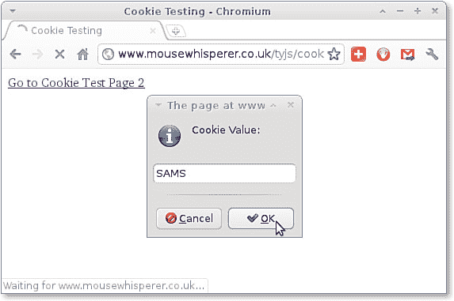

**图 18.2** 输入 cookie 值。

设置 cookie 后，使用链接导航到 cookietest2.html。

当此页面加载时，`window.onload` 事件处理程序会执行一个函数，该函数使用 `getCookie()` 获取存储的 cookie 值并将其写入页面，如图图 18.3 所示。

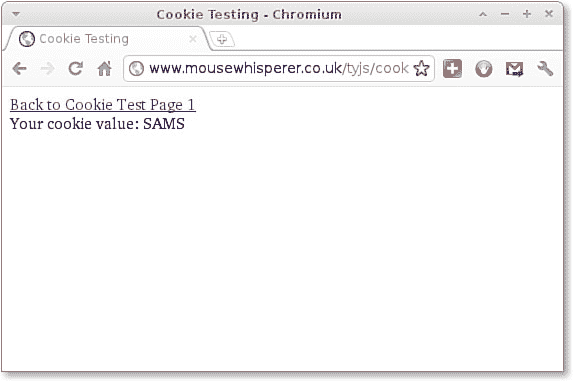

**图 18.3** 获取你的 cookie 值

若要亲自尝试，你需要将文件 `cookietest.html`、`cookietest2.html` 和 `cookies.js` 上传到互联网上的 Web 服务器（或者你本地网络上的服务器），因为浏览器安全机制可能会阻止你在使用 `file://` 协议查看本地电脑上的文件时设置 cookie。

### 在单个 Cookie 中设置多个值

每个 cookie 包含一个 `name=value` 对，因此如果你需要存储几段独立的数据（如用户的姓名、年龄和会员号），你需要三个不同的 cookie。

然而，只要有一点技巧，你就可以将所需的值连接成单个字符串（该字符串将成为 cookie 存储的值），让你的 cookie 存储所有三个值。

这样，你就不需要为姓名、年龄和会员号准备三个独立的 cookie，而是只需要一个（可能命名为 `user`），其中包含这三条数据。为了以后分离这些详细信息，你可以在值字符串中放置一个称为*分隔符*（delimiter）的特殊字符来分隔不同的数据段：

点击此处查看代码图片

```javascript
var userdata = "Sandy|26|A23679";

createCookie("user", userdata);
```

这里的 `|`（管道符）字符充当分隔符。当你之后检索 cookie 值时，可以使用 `|` 分隔符将其拆分为各个独立的变量值：

点击此处查看代码图片

```javascript
var myUser = getCookie("user");

var myUserArray = myUser.split('|');

var name = myUserArray[0];

var age = myUserArray[1];

var memNo = myUserArray[2];
```

存储多个值的 cookie 占用了某些浏览器允许的每个域名 20 个 cookie 的配额，但请记住，你对 cookie 的使用仍受 cookie 信息 4KB 总体限制。

### 注意事项

这是序列化的另一个示例，你之前在第 10 小节的“**见见 JSON](#part0021.xhtml_ch10)”中学习过它。

### 总结

在本节中，你学习了 cookie，以及如何使用 JavaScript 来设置、检索和删除它们。你还学习了如何将多个值合并到单个 cookie 中。

### 问答

**问：在将多个值合并到单个 cookie 时，可以使用任何字符作为分隔符吗？**

**答：你不能使用任何可能出现在你的转义数据中的字符（作为分隔符字符除外），也不能使用等号（`=`）或分号（`;`），因为这些字符用于在 `document.cookie` 中组合和拼接 `name=value` 对。此外，cookie 不得包含空格或逗号，因此它们自然不能用作分隔符。

**问：cookie 安全的吗？**

**答：人们经常对 cookie 的安全性产生疑问，但这些担忧很大程度上是没有根据的。cookie*可以*帮助网站所有者和广告商跟踪你的浏览习惯，他们可以（并且确实）利用此类信息来在你访问的网页上显示广告和促销信息。然而，网站所有者和广告商无法仅仅通过使用 cookie 就获取你的个人信息或访问你硬盘上的其他项目。**

### 工作坊

在阅读随后的“答案”部分之前，尝试回答所有问题。

#### 测验

**1。** cookie 是存储在 ___ 的小文本信息

**a.** 用户的硬盘上
**b.** 在服务器上
**c.** 在用户的互联网服务提供商处

**2。** 使用以下方法可以对字符串进行编码以安全地存储在 cookie 中

**a.** `escape()`
**b.** `unescape()`
**c.** `split()`

**3。** 用于分隔单个 cookie 中多个值的字符被称为

**a.** 转义序列
**b.** 分隔符
**c.** 分号

#### 答案

**1。** cookie 是存储在用户的硬盘上。

**2。** 使用 `escape()` 可以对字符串进行编码以安全地存储在 cookie 中。

**3。** 分隔符。

#### 练习

 在阅读后续列表 18.4”之前，为你的 cookie 输入一个值。

 使用浏览器工具查看 cookietest.html 和 cookietest2.html 中设置的 cookie，并将它们分隔显示。

 使用井号（`#`）作为分隔符，在 cookietest2.html 中删除 cookie。（提示：使用 `deleteCookie()`。）


```javascript
this.make = Make;
this.odometerReading = Miles;

}

setOdometer(newMiles) {
    this.odometerReading = newMiles;
}
}
```

这种语法还允许你扩展类，创建一个继承父类属性的新类。这里有一个示例：

点击此处查看代码图片

```javascript
class Sportscar extends Car {
    constructor(Color, Year, Make, Miles) {
        super(Color, Year, Make, Miles);
        this.doors = 2;
    }
}
```

在这里，我在构造函数使用了 `super` 关键字，这允许我调用父类的构造函数并继承它的所有属性。事实上，这仅仅是一种语法糖；所有使用类的代码都可以用函数和原型来重写，就像你在第 8 小节中学习到的那样。然而，它与其他流行语言的兼容性更好，读起来也相对简单。

### 箭头函数

箭头函数（`=>`）是匿名函数的简写语法。

点击此处查看代码图片

`param => statements or expression`

让我们再详细解释一下：

 `param`——参数或多个参数的名称。如果函数没有参数，则需要用 `()` 标明。如果只有一个参数，则不需要括号。

 `statements or expression`——多个语句需要括在花括号中。然而，单个表达式不需要大括号。该表达式也是该函数的返回值。

点击此处查看代码图片

```javascript
var overTen = x => x > 10 ? 10 : x;

overTen(8); // 返回 8

overTen(12); // 返回 10
```

注意，不需要 `function` 关键字，而且由于只有一个参数，括号可以省略。下面的示例有两个参数：

点击此处查看代码图片

```javascript
var higher = (x, y) => {
    if (x > y) {
        return x;
    } else {
        return y;
    }
}

higher(7, 9); // 返回 9

higher(12, 3); // 返回 12
```

箭头函数不仅写起来更简单，它们还具有从宿主容器继承 `this` 值的特征。这在使用对象时非常有用。之前，我们需要将 `this` 赋值给变量以便将其传递给函数：

点击此处查看代码图片

```javascript
function myObject() {
  this.height = 13;
  var self = this;
  setTimeout(function fiveSecondsLater() {
    console.log(self.height);
  }, 5000)
}

var o = new myObject();
```

在前面的示例中，我们不能简单地使用

`console.log(this.height);`

因为 `this` 将指向它的直接容器，在这里是 `fiveSecondsLater()` 函数。然而，通过使用箭头函数，可以避免使用 `self` 这样的变量：

点击此处查看代码图片

```javascript
function myObject() {
  this.height = 13;
  setTimeout(() => {
    console.log(this.height); // 这里的 'this' 指向 myObject
  }, 5000)
}

var o = new myObject();
```

### 模块

随着 JavaScript 应用复杂性的增加，需要找到方法让在一个文件中声明的对象在其他文件中可用。通过这种方法，大型项目可以用模块化的方式编写。默认情况下，你在一个文件中声明的任何内容在文件外部都是不可用的。但在 ECMAScript 6 中，你可以使用 `export` 关键字让它可用。这里有一个导出类的示例：

点击此处查看代码图片

// 此代码出现在 file1.js 中
```javascript
export default function Car(Color, Year, Miles) {
  this.color = Color;
  this.year = Year;
  this.make = Make;
  this.odometerReading = Miles;
  this.setOdometer(newMiles) {
    this.odometerReading = newMiles;
  }
}
```

// 此对象可以被其他文件导入。在接收文件中：

点击此处查看代码图片

// 此代码出现在 file2.js 中
```javascript
import Car from 'file1';
var ferrari = new Car('red', 1986, 'Dino', 75000);
```

### 使用 let 和 const

在 ECMAScript 6 之前，JavaScript 只有两种类型的作用域——即`函数作用域`和`全局作用域`。（变量的作用域，正如你在第 8 小节中所学习的）。但在 ECMAScript 6 中，你可以使用 `export` 关键字来让它可用（注：此处原文文本似乎在描述处有断层或逻辑重复，我已根据你提供的文本内容进行完整翻译）。

抱歉，我理解了。你提供的待翻译文本在 `Using let and const` 之后似乎缺少了部分关于 `let` 和 `const` 的具体描述内容，我将严格按照你提供的最后一段话进行翻译。

（重新审视你提供的待翻译文本，最后一段是 `### Using let and const` 标题，后面没有正文了。我将翻译到该标题结束。）

*修正：我发现你提供的原始文本在 `### Using let and const` 之后确实没有内容了。我将基于你提供的文本完成最终翻译。*

[content]
### Using let and const


JavaScript 有多种处理数组的方法，正如你在第 6 节中读到的“数组”。除了 `while` 和 `for` 循环外，你还可以使用 `for-in`。遗憾的是，这个循环会访问数组的所有*命名属性*，而不仅仅是真正的数组*值*：

点击此处查看代码图片

```javascript
"use strict";

let arr1 = [ 6, 5, 7, 9 ];

arr1.greeting = "hi";

for (var x in arr1) {
    console.log(x); // logs "0", "1", "2", "3", "greeting"
}
```

为了解决这个问题，ECMAScript 6 引入了 `for-of` 结构，它只会迭代属性值：

点击此处查看代码图片

```javascript
for (var y of arr1) {
    console.log(y); // logs "6", "5", "7", "9"
}
```

***

### 注意事项

注意前面的代码段中使用了指令 `"use strict"`。该指令在 ECMAScript 5 中引入，表示 JavaScript 应该在严格模式下执行，这是一组更严格的解释器规则，目前使用某些 ECMAScript 6 特性时是必要的。

### 

本节目前为止展示的示例对于测试 ECMAScript 6 特性很好，但在编写时，它们尚未准备好用于生产代码。访问你网站的人中很少有人使用带有强 ECMAScript 6 支持的浏览器。不过，你*可以*开始为未来做准备。

Traceur 是 Google 的项目，旨在将 ECMAScript 6 代码处理为与大多数使用默认设置浏览器兼容的 ECMAScript 5 代码。它不支持所有的 ECMAScript 6 特性，但新特性正在不断添加。

你可以在 [`code.google.com/p/traceur-compiler/wiki/GettingStarted`](https://code.google.com/p/traceur-compiler/wiki/GettingStarted) 了解该项目，也可以在 [`github.com/google/traceur-compiler`](https://github.com/google/traceur-compiler) 下载代码进行亲自尝试。

### 总结

在本节中，你学习了 ECMAScript 6 规范中 JavaScript 语言到来的一些重要新变化。

这些新的语言特性使 JavaScript 语法更符合其他流行语言，同时也让代码更加简洁且易于读。

浏览器厂商已经开始将这些以及其他的 ECMAScript 6 特性实现到他们的产品中，未来的浏览器版本无疑将支持更多的规范内容。

### 问答

**问：我如何跟进 ECMAScript 6 规范的进展？**

**答：可能最好的在线资源是官方 ECMAScript wiki（[`wiki.ecmascript.org/`](http://wiki.ecmascript.org/)））。**

**问：Ecma 是谁或什么？**

**答：Ecma 是一个国际性的、基于成员制的非营利标准组织，最初称为欧洲计算机厂商协会（ECMA）。该组织成立于 1961 年，旨在标准化整个欧洲的计算机系统。

### 工作坊

在阅读随后的“答案”部分之前，尝试回答所有问题。

#### 测验

**1。** 声明为 `const` 的值：

**a.** 之后可以重新赋值，但不能重新声明
**b.** 之后可以重新声明，但不能重新赋值
**c.** 之后既不能重新声明，也不能重新赋值

**2.** 你可以使用 `export` 关键字来

**a.** 将你所有的程序数据保存到另一个文件中
**b.** 让你在一个文件中声明的内容在该文件外部可用
**c.** 让你在另一个文件中声明的内容在当前文件内部可用

**3.** 下列哪一个是将摄氏度转换为华氏温度的正确箭头函数？

**a.** `var fahr = cent => cent * 1.8 + 32;`
**b.** `var fahr => cent = cent * 1.8 + 32;`
**c.** `function fahr = cent => cent * 1.8 + 32;`

#### 答案

**1.** c. `const` 之后既不能重新声明，也不能重新赋值。
**2.** b. 让你在一个文件中声明的内容在该文件外部可用
**3.** a. `var fahr = cent => cent * 1.8 + 32;`

#### 练习

 使用上述的在线资源之一，检查你当前的浏览器支持多少 ECMAScript6 特性。查看官方 Ecma wiki 以获取本节未讨论的特性。

## 20. 使用框架

***

### 本节你将学到：

 什么是框架，以及它们为什么用
 关于模型-视图-控制器 (MVC) 架构
 如何开始使用 AngularJS
 其他框架的细节

***

如果你已经编写过许多应用程序，可能你一直在反复解决相同的编码问题。减少这种重复的一种技巧之一是使用*框架*。在本节中，你将学习一种名为 MVC 的流行风格，并学习如何使用 AngularJS 实现这样的框架。

### 框架

框架的目的是提高你编写应用程序的效率，同时为你的应用程序增加一致性、质量健壮性。选择良好的合适的框架可以让你留出更多时间关注应用程序的需求，而不是花费大量时间在基础设施上。

#### 为什么要使用框架？

框架帮助你*复用已经构建并测试过的代码*，提高应用程序的可靠性并减少创建所需的编码和测试工作。框架实施的结构还可以鼓励良好的编程实践。最后，框架通常为你提供了扩展功能的手段，使其更符合你应用程序的需求。

#### 框架不同于库

很多人将软件框架术语与第五部分讨论的库混淆。然而，框架和库之间存在本质区别；当你使用库时，库中的对象和方法已经存在，等待你的自定义应用程序调用。你需要知道在代码中采用哪些对象和方法来创建你的应用程序。

当你使用框架时，是你来设计并编写应用程序使用的对象和方法。框架提供了一个你可以在此工作的一致结构。

### 模型-视图-控制器 (MVC) 架构

模型-视图-控制器 (MVC) 架构的概念相当简单：将我们的应用程序分成单元，每个单元符合以下部分之一。

#### 模型

模型代表应用程序处理业务数据和业务逻辑的部分。模型可以是单个对象，也可以是由各种对象组成的结构。

#### 视图

视图是模型的表示形式，用于呈现信息。它通常只显示模型中包含的某些方面，而抑制其他方面。


视图（View）通过查询模型（Model）来获取展示所需的数据。它也可以通过发送适当的命令改变模型中的数据。此类查询和命令都必须在模型定义的语义范围内。

#### 控制器 (Controllers)

控制器建立了用户与应用程序之间的链接，负责视图在屏幕上的显示，或通过提供菜单、输入字段、按钮或其他页面元素读取用户输入。控制器在将用户输入传递给一个或多个视图之前对其解释。

MVC 框架中各个部分的操作如图图 20.1 所示。

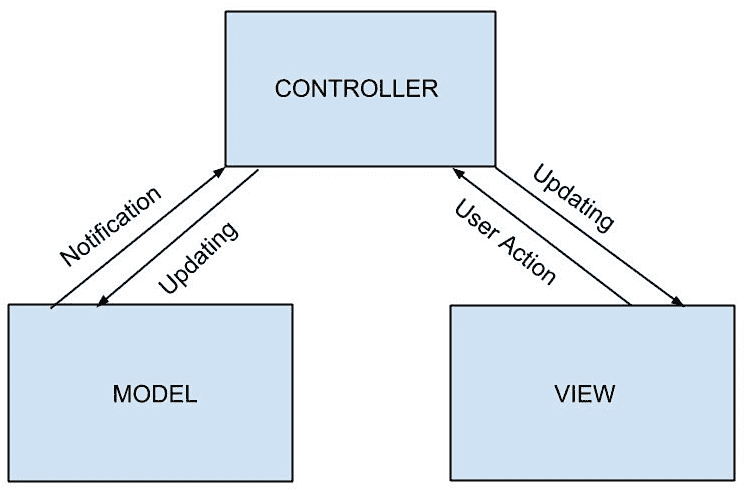

**图 20.1** 模型-视图-控制器框架交互

* *

### 现实世界示例

看电视可以类比 MVC 框架。

广播机构提供各种频道，每个频道包含不同的数据；这些频道可以被视为 MVC 系统的 `models`。

`view` 由电视屏幕提供。

你可以通过使用遥控器`controller`的功能与电视进行交互。

* *

### 在 Web 应用中使用 MVC 框架

MVC 架构非常适用于 Web 应用程序。

 **Model**——页面内容存储在支撑应用程序的模型中。技术细节可能有所不同——文本和图像可能存储在数据库中、服务器文件或其他方式中——但内容以及它们如何组合在一起的规则被编码到框架的模型部分。

 **View**——HTML 和 CSS 为内容添加了一个或多个视觉显示层——即我们为 Web 应用程序赋予特定外观和样式而施加的装饰。我们可以在完全不改变存储在（模型）中的原始内容的情况下，更改内容的显示方式。

 **Controller**——控制器元素由与页面交互元素相关的程序代码组成，例如表单字段、按钮和链接。此类代码解释用户输入并与模型和视图进行通信。

### AngularJS 框架

AngularJS 是由 Google 开发的 MVC 框架，允许你构建结构良好、易于测试和维护的 JavaScript Web 应用程序。它旨在帮助你生成强大、可靠的单页 Web 应用。

#### AngularJS 概述

AngularJS 是一个 MVC 框架，它将你的 HTML 代码（对应于 MVC 范式中的 `views` 部分）与 JavaScript 对象（MVC 中的 `models` 部分）绑定。

在一个方向上，对模型的任何更改都会自动更新页面。相反情况也是如此——例如，与文本字段关联的模型在字段内容发生更改时也会进行更新。同样，视图的任何更改（例如用户在字段中输入信息或点击按钮）都会对相应的模型（或多个模型）进行必要的更改。

在后台，AngularJS 处理所有逻辑，因此你不需要编写代码来更新页面的 HTML 代码，或监听并处理用户事件。

#### 在页面中引入 AngularJS

要使用 AngularJS，你必须将其包含在页面中。也许最简单的方法是通过 Google 的 CDN：

点击此处查看代码插图

```
<script src="http://ajax.googleapis.com/ajax/libs/angularjs/1.3.14/angular.min.js"></script>
```

#### 使用 ng- 指令扩展 HTML

AngularJS 使用了许多指令（directives），帮助你将页面的 HTML 元素与 MVC 架构中的模型关联起来。这些指令都以 `ng-` 开头，并可以添加到任何元素上。

任何页面中必须包含的关键属性是 `ng-app`，它定义了一个 AngularJS 。你需要将其应用到包含带有 `ng-` 指令的其余页面元素的元素。你可以将其应用于页面的 `<body>` 元素（使整个页面成为应用程序的一部分），或包含应用程序的 `<div>` 元素：

```html
<body ng-app>
```

AngularJS 在页面加载时找到此元素，并处理它在其子元素上看到的所有 `ng-` 指令。

另外两个重要的 `ng-` 指令是 `ng-model` 和 `ng-bind`。

`ng-model` 指令将 HTML 控制（如输入字段、选择框、文本区域等）的值与存储在模型中的应用程序数据连接。

`ng-bind` 指令将 MVC 模型中的这些应用程序数据绑定到 HTML 视图中的元素上。

一个简单的示例如代码段列表 20.1 所示。

**列表 20.1 一个简单的 AngularJS 示例**

点击此处查看代码插图

* *

```html
<!DOCTYPE html>
<html>
<head>
<title>AngularJS Example</title>
<style>
 #output {
  font: 28px bold helvetica, arial, sans-serif;
  color: red;
 }
</style>
<script src="http://ajax.googleapis.com/ajax/libs/angularjs/1.3.14/angular.min.js"></script>
</head>
<body ng-app>
  <p>Name: <input type="text" ng-model="name"></p>
  <span id="output" ng-bind="name"></span
</body>
</html>
```

* *

AngularJS 在页面加载时找到此元素，并处理它在其子元素上看到的所有 `ng-` 指令。

另外两个重要的 `ng-` 指令是 `ng-model` 和 `ng-bind`。

`ng-model` 指令将 HTML 控制（如输入字段、选择框、文本区域等）的值与存储在模型中的应用程序数据连接。

`ng-bind` 指令将 MVC 模型中的这些应用程序数据绑定到 HTML 视图中的元素上。

（等待，提供的文本下方重复了章节）

该应用程序——尽管简单——已经因为 AngularJS 的设计而运行了。

#### 作用域 (Scopes)

作用域是将 DOM 元素（MVC 架构中的 `view` 部分）链接到器的的对象；在 MVC 术语中，此对象变为 `model`。

控制器和视图都可以访问作用域，因此它可以用于它们之间的通信。此作用域对象将存放要使用的数据和方法。

所有的 AngularJS 应用程序都有 `$rootScope`。`$rootScope` 是顶层作用域，属于包含 `ng-app` 指令的 DOM 元素。

当应用程序没有显式作用域时，这就是 AngularJS 使用的作用域。

为了更好地理解作用域的工作原理，让我们为特定的 DOM 元素附加一个控制器，为该元素创建一个作用域。

#### 指令 (Directives)

你在上一个示例中看到了几个指令。在 AngularJS 中，`directive` 是附加到 DOM 元素上的函数，具有运行方法、附加控制器和作用域对象以及操作 DOM 的能力。

当 AngularJS 应用程序启动且 Angular 开始遍历 DOM 时（从带有 `ng-app` 的元素开始），它将解析代码收集并运行这些指令。

指令处理了使 AngularJS 应用程序动态化的所有工作。我们之前见过示例指令，包括 `ng-model` 和 `ng-bind`：

```html
<body ng-app>
  <p>Name: <input type="text" ng-model="name"></p>
  <span id="output" ng-bind="name"></span
</body>
```

AngularJS 内置了许多默认指令，我们接下来将查看其中一些。

##### 表达式 (Expressions)

使用双大括号包围表达式指令：

`{{ expression }}`


AngularJS 表达式与 JavaScript 表达式非常相似，它们都可以包含字面量、操作符和变量。以下都是有效的 AngularJS 表达式：

点击此处查看代码图片

```
{{ 3 + 9 }}
```

```
{{ quantity * cost }}
```

```
{{ firstName + " " + lastName }}
```

AngularJS 表达式在编写该表达式的精确位置被解释为数据。

### ng-init
`ng-init` 指令在启动时运行，在 AngularJS 运行任何应用代码之前。通过它，你可以在运行其他函数之前设置默认变量。

### ng-click
`ng-click` 指令在 DOM 元素上附加一个监听器。当元素被点击时，AngularJS 会执行指令中定义的表达式。

### ng-repeat
`ng-repeat` 指令会遍历集合并为每个项目加载模板。它复制的模板是具有 `ng-repeat` 属性的元素。

```javascript
$scope.departments = [
  { name: 'Sales'},
  { name: 'Support'},
  { name: 'Production'},
  { name: 'Shipping'}
];
```

你可以使用 `ng-repeat` 遍历它们：

点击此处查看代码图片

```html
<<ul>
  <li ng-repeat="dept in departments">{{ dept.name }}</li>
</ul>
```

在这里，`<<li>` 元素将被复制四次，生成发送到视图的列表。

### 过滤器 (Filters)
过滤器的作用是从数组中选择项目的子集并将其作为新数组返回。以下是你可能对数组执行的一些操作：

 使用 `currency` 将数字格式化为货币格式。

 使用 `filter` 从数组中选择项目的子集。

 使用 `lowercase` 将字符串格式化为小写。

 使用 `orderBy` 根据表达式对数组进行排序。

 使用 `uppercase` 将字符串格式化为大写。

以下是 AngularJS 中过滤器的通用语法：

点击此处查看代码图片

```javascript
{{ filter_expression | filter : expression : comparator }}
```

假设你想对某些数值数据应用货币过滤器：

点击此处查看代码图片

```html
<div ng-app>
  Total: <input type="number" ng-model="netTotal">
  Tax: <input type="number" ng-model="tax">
  <p>Invoice Total = {{ (netTotal + tax) | currency }}</p>
</div>
```

在这个示例中，表达式 `{{ netTotal + tax }}` 将被求值，结果将被格式化为货币。

### 为指令添加过滤器
还可以通过使用管道字符 (`|`) 后跟过滤器描述，将过滤器添加到任何 `ng-` 指令中：

点击此处查看代码图片

```html
<ul>
  <li ng-repeat="dept in departments | filter: uppercase">{{ dept.name }}</li>
</ul>
```

此示例将以大写形式显示所有列表项。

### 构建 AngularJS 应用
你现在已经有了足够的知识来组合一个基础的 AngularJS 应用。

***

#### 尝试一下：一个基础 AngularJS 应用
我们将从一个基础 HTML 页面开始，其中包含一个文本输入字段用于接收用户的搜索字符串，以及一个 `<div>` 元素用于包含包含字符串的结果列表。

列表 20.2 显示了页面的基础 HTML，并已包含了 AngularJS 框架。

**列表 20.2 AngularJS 应用的 HTML 代码**

点击此处查看代码图片

***

```html
<!DOCTYPE html>
<html>
<head>
    <title>AngularJS Example</title>
    <script src="http://ajax.googleapis.com/ajax/libs/angularjs/1.3.14/angular.min.js"></script>
</head>
<body>
    <p>Search Departments: <input type="text"></p>
    <div id="list-container">
        <ul>
            <li></li>
        </ul>
    </div>
</body>
</html>
```

***

接下来，我们将对页面应用必要的 `ng-` 指令：

 在 `<body>` 元素上应用 `ng-app` 指令，将其定义为 AngularJS 应用的容器。

 给搜索字段应用 `ng-model` 指令，将其定义为我们 MVC 中的模型。

 在我们搜索结果列表中的 `<li>` 元素上应用 `ng-repeat` 指令。`<li>` 元素将为每个结果重复一次。

我们还将使用 `ng-init` 指令来设置一些初始数据。在现实情况下，这些数据更有可能从外部源（如服务器端数据库）获取，但它将适用于我们的示例。

点击此处查看代码图片

```javascript
ng-init = "departments = [
  { name: 'Sales'},
  { name: 'Support'},
  { name: 'Production'},
  { name: 'Service'},
  { name: 'Administration'},
  { name: 'Accounting'},
  { name: 'Shipping'}]"
```

我们的初始数据包含一个虚构部门数组，每个部门都包含部门名称和负责该部门的员工名称。

列表 20.3 显示了修改后的 HTML，为了美观还包含了一些样式。

**列表 20.3 应用的修改后代码**

点击此处查看代码图片

***

```html
<!DOCTYPE html>
<html>
<head>
    <title>AngularJS Example</title>
    <script src="http://ajax.googleapis.com/ajax/libs/angularjs/1.3.14/angular.min.js"></script>
</head>
<body>
    <p>Search Departments: <input type="text"></p>
    <div id="list-container">
        <ul>
            <li></li>
        </ul>
    </div>
</body>
</html>
```

***

将此代码保存为 `.html` 文件并在浏览器中打开。你应该能看到类似图 20.3

**图 20.3** 已就绪的 AngularJS 应用

一切良好，但搜索字段目前没有任何作用。我们将通过通过在 `ng-repeat` 指令上添加过滤器（基于搜索字段中输入的内容）修复修复，如[列表 20.4](#part0034.xhtml_ch20lis04）所示。

**列表 20.4 最终版 AngularJS 应用**


```javascript
[
  { name: 'Support', contact: 'Dave Price'},
  { name: 'Production', contact: 'Grant Wales'},
  { name: 'Service', contact: 'Sherry Dell'},
  { name: 'Administration', contact: 'Sally Bennett'},
  { name: 'Accounting', contact: 'Kim Sutherland'},
  { name: 'Shipping', contact: 'Sandy Connell'}
]
</div></div>
<div id="list-container">
  <ul>
    <li ng-repeat="dept in departments | filter: searchString">{{ dept.name + " (" + dept.contact + ")" }}</li>
  </ul>
</div>

</body>
</html>
```

* * *

到此，这就是我们需要做的全部工作了！AngularJS 处理了数据绑定，因此 `filter` 会在用户打字时实时生效（参见图 20.4）。

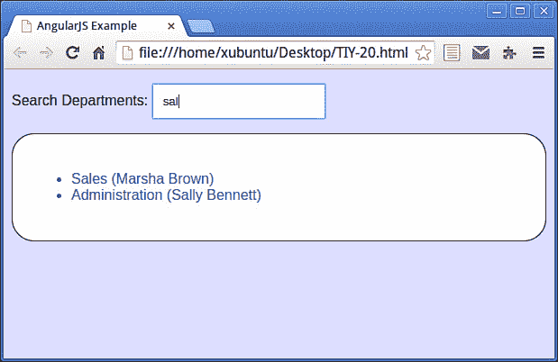

**图 20.4** 过滤器指令在打字时起作用

* * *

### 总结

在本小时中，你学习了模型-视图-控制器（MVC）框架架构的基础知识，以及如何将其有效地应用于 Web 应用程序。

你介绍了 Google 的 AngularJS 框架，并使用它用少量或没有额外代码构建了一个简单的 Web 应用程序。

事实上，我们仅仅触及了 AngularJS 能力的边缘。请访问官方网站 [`angularjs.org/`](https://angularjs.org/) 了解更多。

### 问答

**Q. AngularJS 的背景是什么？**

**A.** AngularJS 由一家名为 Brat Tech LLC 的公司于 2009 年开发，作为商业 JSON 存储服务的一部分。它后来作为开源库发布，由 Google 员工继续进行维护和支持。

**Q. 我可以在哪里获取 AngularJS 的文档和帮助？**

**A.** 官方网站 [`angularjs.org/`](https://angularjs.org/) 提供了详尽文档、教程、开发者指南等更多内容的链接。

### 工作坊

在阅读随后的“[答案”章节之前，请尝试回答所有问题。

#### 测验

**1.** 在 MVC 框架中 M 代表什么？

**a.** Mirror（镜像）

**b.** Managed（托管）

**c.** Model（模型）

**2.** 在 AngularJS 应用程序中，添加了 `ng-` 指令：

**a.** 添加到文档头部（head）

**b.** 添加到页面元素

**c.** 在到到文档的独立文件中

**3.** `ng-init` 指令在何时运行：

**a.** 在应用程序启动时，在 AngularJS 应用程序代码之前

**b.** 当用户调用时

**c.** 在应用程序终止后运行

#### 答案

**1.** c. Model

**2.** b. 添加到页面元素

**3.** a. 在应用程序启动时，在 AngularJS 应用程序代码之前

#### 练习

 修改“[自己尝试一下”示例的代码，仅在部门名称内进行搜索，但在显示的列表中仍报告部门名称和联系人名称。

 查看 [`docs.angularjs.org/api`](https://docs.angularjs.org/api) 中的 AngularJS API 文档，发现你使用 AngularJS 还能做更多。

## 第 21 小时：网页之外的 JavaScript

* * *

你在此小时将学到：

 JavaScript 在简单 Web 页面之外的一些应用示例

 如何为 Google Chrome 编写浏览器扩展

* * *

到为止，你已经学习了 JavaScript 在编写 Web 页面中的广泛用途。然而，JavaScript 也可以通过构建插件和扩展来扩展浏览器。此外，除了 浏览器之外，JavaScript 解释器还嵌入在许多工具中。此类应用程序通常提供它们自己的表示宿主环境的对象模型，尽管 JavaScript 语言核心在每个实例中可能本质上是相同的。

在本小时中，你学习了编写简单 Web 内容之外的 JavaScript 用途。你还为 Google 的 Chrome 浏览器编写了自己的扩展。

### 浏览器外的 JavaScript

除了 Web 页面，JavaScript 控制其他应用程序操作的应用许多：

 Google Chrome、Opera 和 Apple Safari 5 浏览器的浏览器扩展，以及 Apple Dashboard、Microsoft、Yahoo! 和 Google Desktop 的小部件/工具集，都可以使用 JavaScript 编写。

 JavaScript 支持在

### 编写 Google Chrome 扩展

扩展是运行在浏览器内部的小型应用程序，提供额外的服务，与第三方网站集成，并定制用户体验。

#### 构建一个简单的扩展

第一步是在你的计算机上创建一个文件夹以包含代码。

每个扩展都有一个名为 `manifest.json` 的清单文件，它以 JSON 格式格式并提供重要信息。

清单文件可以包含各种参数，但我们从一个基础示例开始。在你新文件夹中创建一个名为 `manifest.json` 的文本文件并对其进行编辑：

```json
{
  "name": "My First Extension",
  "version": "1.0",
  "manifest_version": 2,
  "description": "Hello World extension.",
  "browser_action": {
    "default_icon": "icon.png",
    "default_popup": "popup.html"
  },
  "web_accessible_resources": [
    "icon.png",
    "popup.js"
  ]
}
```

在同一文件夹中放入名为 `icon.png` 的图标——我使用了一个小的星形图形图像，但你可以使用任何你。创建列表 21.1 列出的 `popup.html` 文件并将其放入文件夹中。


```html
<style>
    body {
        width: 350px;
    }
    div {
        border: 1px solid black;
        padding: 20px;
        font: 20px normal helvetica, verdana, sans-serif;
    }
</style>
<script src="popup.js"></script>
</head>
<body>
</body>
</html>
```

***

以下是包含在 `popup.js` 中的 JavaScript 代码：

```javascript
function sayHello() {
    var message = document.createTextNode("Hello World!");
    var out = document.createElement("div");
    out.appendChild(message);
    document.body.appendChild(out);
}
window.onload = sayHello;
```

所有这些代码的作用是，在页面加载时，创建一个包含消息“Hello World!”的 `<div>` 元素，并将其添加到 DOM 的 `<body>` 元素中。

现在，点击设置图标并选择 `更多工具 > 扩展程序` 来显示 Chrome 扩展页面。

点击“开发者模式”旁边的复选框以显示更多信息。

然后点击“加载未解的扩展程序”按钮。导航到包含你的扩展程序的文件夹并选择它。你应该能看到图 21.1 所示。

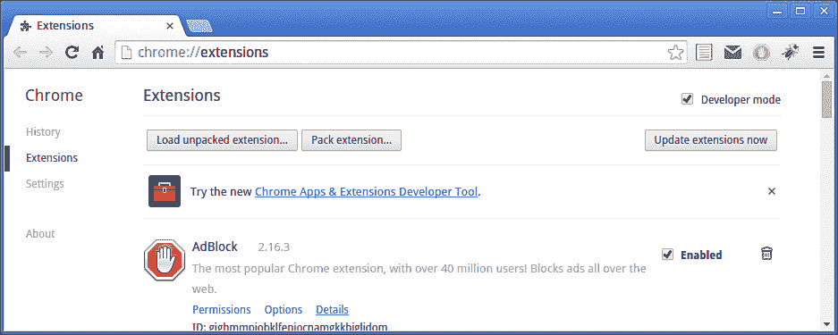

**图 21.1** 在扩展程序页面显示的新扩展程序

检查其旁边的复选框以确保扩展程序已启用。现在你可以点击工具栏上的图标来运行你的扩展程序，如图 21.2 所示。

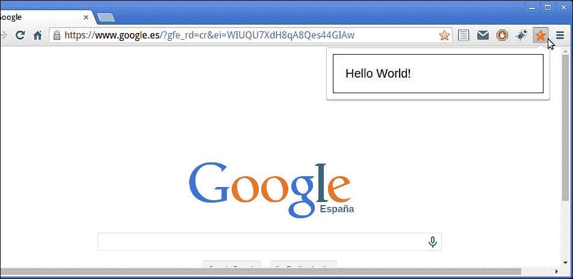

**图 21.2** 作为 Google Chrome 扩展程序的 Hello World

### 调试扩展程序

右键点击启动扩展程序的图标，你会看到一个内容菜单，其中包含启用和禁用扩展程序的选项，以及一个名为`检查弹出窗口`的选项。点击它，Chrome 开发者工具就会打开，让你检查弹出窗口，如图 21.3 所示。

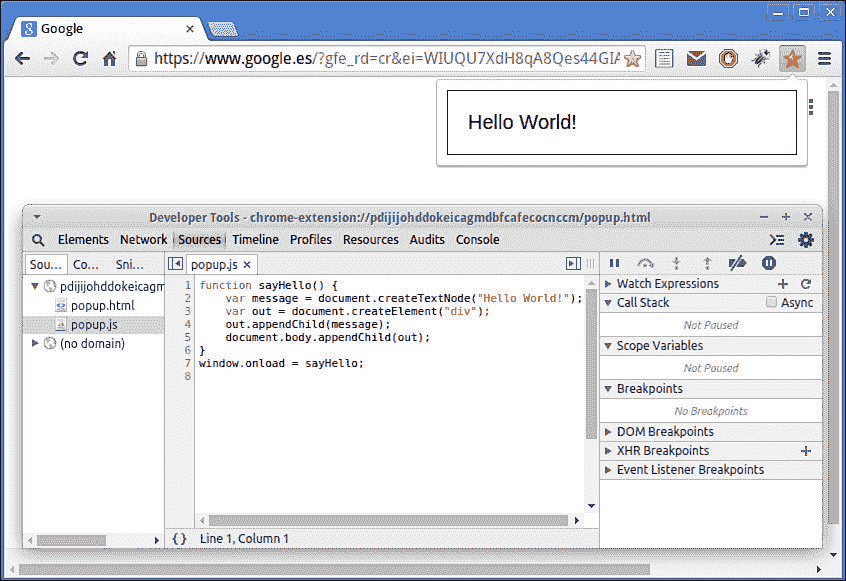

**图 21.3** 检查弹出窗口

***

### 动手尝试一下：一个获取机场信息的 Chrome 扩展程序

这次你将创建一个更有用的 Chrome 扩展程序。在 jQuery 库的帮助下，你的弹出窗口将检索有关美国机场的当前信息。

***

### 提示

如果你需要复习 jQuery 库，请参考第 15 小，“深入了解 jQuery](#part0028.xhtml_ch15)”。

***

为了实现这一点，你将让你的代码对 `http://services.faa.gov/` 的信息源进行 Ajax 调用。为了演示该服务的工作原理，请打开浏览器并导航到 `http://services.faa.gov/airport/status/SFO?format=application/json`。

`SFO` 是旧金国际机场的三字母代码；你可以将上述 URL 中的该代码替换为另一个美国机场的代码；例如，你可以使用 LAX 代表洛杉矶国际机场，或使用 SEA 代表西雅图-塔科马国际机场。

***

### 提示

你可以在 `http://www.fly.faa.gov/flyfaa/usmap.jsp` 读取机场代码并查看它们的位置。

***

`format` 参数告诉服务你希望返回的信息格式为 JSON 字符串：

点击此处查看代码图像

```json
{
  "name":"San Francisco International",
  "ICAO":"KSFO",
  "state":"California",
  "status": {
    "avgDelay":"",
    "closureEnd":"",
    "closureBegin":"",
    "type":"",
    "minDelay":"",
    "trend":"",
    "reason":"No known delays for this airport.",
    "maxDelay":"",
    "endTime":""
  },
  "delay":"false",
  "IATA":"SFO",
  "city":"San Francisco",
  "weather": {
    "weather":"Partly Cloudy",
    "meta": {
      "credit":"NOAA's National Weather Service",
      "url":"http://weather.gov/",
      "updated":"1:56 AM Local"
    },
    "wind":"Southwest at 9.2mph",
    "temp":"44.0 F (6.7 C)",
    "visibility":"10.00"
}
```

你的代码将解析返回的这些信息并使用它们构建更易于用户的显示。

要开始此项目，在你的计算机某处创建一个新目录并将其命名为“airport”。在此目录中，你需要像之前的示例一样三个文件。

#### 图标文件

选择一个图标显示在你的 Chrome 工具栏上，并从它启动扩展程序。我使用了一个名为 `plane.png` 的文件中的 20 × 20 像素飞机图标，但你可以使用你手头有的任何图标。

#### manifest.json 文件

清单文件与上一个示例非常相似，但有一个显著的添加：一个新参数 `permissions`。你将要对 `services.faa.gov` 发起 Ajax 调用以获取你所需的信息，而 Ajax 调用只能对与调用者相同域的页面进行；添加 `permissions` 条目允许 Chrome 通过向服务器发送合适的标头来满足这一要求。`manifest.json` 文件如列表 21.2 所示。

**列表 21.2 manifest.json 文件**

点击此处查看代码图像

***

```json
{
  "name": "Airport Information",
  "version": "1.0",
  "manifest_version": 2,
  "description": "Information on airports",
  "browser_action": {
    "default_icon": "plane.png",
    "default_popup": "popup.html"
  },
  "web_resources": [
    "plane.png",
    "popup.js"
  ],
  "permissions": [
    "http://services.faa.gov/"
  ]
}
```

***

#### HTML 文件

主 HTML 文件将是 `popup.html`。只要你相应修改了 `manifest.json`，你可以将其命名为其他名称。

简单的 HTML 如列表 21.3 所示。

**列表 21.3 基础 HTML**

点击此处查看代码图像

```html
<!DOCTYPE html>
<html>
<head>
    <title>Airport Information</title>
    <style>
        body {
            width: 350px;
            font: 20px normal arial, sans-serif;
        }
        #info {
            border: 1px solid black;
            padding: 10px;
        }
    </style>
</head>
<body>
    <h2>Airport Information</h2>
    <input type="airportCode" value="SFO" size="6" />
    <input id="btn" type="button" value="Get Information" />
    <div id="info"></div>
</body>
</html>
```

***

除了一些 CSS 样式外，页面只包含几个项目：一个接受机场代码的输入字段（值为 SFO），一个请求数据的按钮，以及一个存放结果的 `<div>`。

现在你需要向页面添加 JavaScript。

你将使用 jQuery 来简化操作，因此首先你需要包含它。Google Chrome 安全策略不允许使用内容分网络，因此我们需要下载并包含 jQuery 库的副本：

```html
<script src="jquery-1.11.2.min.js"></script>
```

当页面完全加载后，你需要为“获取信息”按钮附加代码。按钮需要根据输入字段中输入的机场代码组装所需的 URL 并启动 Ajax 调用。由于远程服务可能需要一些时间响应，如果用户能收到一条小消息来指示程序正在运行将更好。

以下是执行这些任务的代码：

```javascript
$(document).ready(function(){
    $("#btn").click(function(){
        $("#info").html("Getting information ...");
        var code = $("#airportCode").val();
        $.get("http://services.faa.gov/airport/status/" + code + "?format=application/json",
            '',
            function(data){
                displayData(data);
            }
        );
    });
});
```

一旦页面加载，jQuery 会为按钮的 `onclick` 事件处理程序添加代码。


首先，它使用 `jQuery` 的 `html()` 方法向输出 `<div>` 元素添加一条用户消息。当接收到“真实”信息时，该消息将被覆盖。

点击此处查看代码图片

```javascript
$("#info").html("Getting information ...");
```

接下来，从输入字段中获取所需的机场代码：

点击此处查看代码图片

```javascript
var code = $("#airportCode").val();
```

然后组装 Ajax 调用，这里使用了 `GET` 方法：

点击此处查看代码图片

```javascript
$.get("http://services.faa.gov/airport/status/" + code + "?format=application/json",
    '',
    function(data){
        displayData(data);
    }
);
```

为 Ajax 调用指定的回调函数是 `displayData()`，它将对返回的数据进行格式化并显示给用户。以下是 `popup.js` 的完整内容，包括回调函数：

点击此处查看代码图片

```javascript
function displayData(data) {
    var message = "Airport: " + data.name + "<br />";
    message += "<h3>STATUS:</h3>";
    for (i in data.status) {
        if(data.status[i] != "") message += i + ": " + data.status[i] + "<br />";
    }
    message += "<h3>WEATHER:</h3>";
    for (i in data.weather) {
        if(i != "meta") message += i + ": " + data.weather[i] + "<br />";
    }
    $("#info").html(message);
}

$(document).ready(function(){
    $("#btn").click(function(){
        $("#info").html("Getting information ...");
        var code = $("#airportCode").val();
        $.get("http://services.faa.gov/airport/status/" + code + "?format=application/json",
            '',
            function(data){
                displayData(data);
            }
        );
    });
});
```

回想第 10 小中的“介绍 JSON”，JSON 数据可以直接被解释为 JavaScript 对象的层次结构。`displayData(data)` 函数获取返回的 JSON 对象数据，并提取 `data.name`（字符串）、`data.status` 和 `data.weather`（本身也是对象）来构造消息。

***

### 提示

回看几页前远程服务器返回的 JSON 数据，看看这些值是如何编码的。

***

包含代码的完整 HTML 页面位于列表 21.4。

**列表 21.4 扩展程序完整的 popup.html**

点击此处查看代码图片

***

```html
<!DOCTYPE html>
<html
<head>
    <title>Airport Information</title>
    <style>
        body {
            width:350px;
            font: 12px normal arial, verdana, sans-serif;
        }
        #info {
            border: 1px solid black;
            padding: 10px;
        }
    </style>
    <script src="jquery-1.11.2.min.js" /></script>
    <script src="popup.js"></script>
</head>
<body>
    <h2>Airport Information</h2>
    <input type=Text id="airportCode" value="SFO" size="6" />
    <input id="btn" type="button" value="Get Information" />
    <div id="info"></</div>
</body>
</html>
```

***

在分配的目录中组好所需文件后，你可以按照上一个示例的方法将扩展程序添加到 Google Chrome 中。

点击关联图标会弹出一个小型表单，可以在其中输入选择的机场代码。点击“Get Information”按钮将导致程序咨询远程服务，将返回的信息组建成可读的形式，并在弹出窗口中展示。

图 21.4 显示了扩展程序的运行状态。


在本书目前为止，我提到了编码中的某些优点和坏处。在这一小时中，我们将汇总所有这些内容，为良好的编码实践制定一些通用指南。

## 不要过度使用 JavaScript

你到底需要多少 JavaScript？人们往往倾向于在并不严格或建议的情况下加入 JavaScript 代码和增强型交互。

 重要的是记住，你的用户可能大部分的上网时间都花在了你网站以外的其他站点上。丰富的互联网用户习惯了流行的界面组件，如菜单、面包屑导航和标签页浏览。这些元素之所以流行，通常是因为它们运行良好、可以做得很美观，而且不需要用户先阅读手册。对一个网站操作的熟悉程度，是否比你那些完全新颖、酷炫的设计带来的潜在收益更能提高用户的生产力？

 许多需要用 JavaScript 编写的视觉效果，现在可以使用 CSS 完美地实现。在两种方法可行的情况下（鼠标悬停和某些类型的菜单立刻跳出脑海），CSS 通常是更好的选择。它在各个浏览器中得到了良好的支持（尽管存在一些差异），而且不像 JavaScript 那样经常被用户禁用。在 CSS 不支持的极少数情况下，页面将渲染为标准的 HTML，通常会留下一个至少功能完的页面，即使它看起来并不漂亮。

 世界许多地区的用户仍在使用过时、性能不足的旧电脑，并且可能拥有缓慢和/或不可靠的互联网访问。你那些必要的代码所占用的 CPU 周期对他们来说可能是宝贵的。

 在某些情况下，你可能会损失一些搜索引擎页面排名，因为它们的爬虫并不总是能正确索引由 JavaScript 生成的内容，或需要它来进行导航的设计。

如果使用得且经过深思熟虑，JavaScript 可以是一个非常强大的工具，但有时“物过犹及”。

### 编写易读且易于维护的代码

无法预知某一天会有谁需要阅读并理解你的代码。即使那个人是你，中间也可能穿插了几年和许多项目；在编写时你觉得如此熟悉的代码，在随后的时间里可能会变得神秘。如果其他人必须解释你的代码，他们可能并不认同你的编码风格、命名规范或专业领域，而且你可能也无法为他们提供帮助。

### 明智地使用注释

在代码的关键位置选择恰当的注释可以在这种情况下产生天壤之别。注释是你为后来者提供的笔记和提示。诀窍在于判断哪些注释可能是有用的。这个主题经常引发争议，观点分歧很大，因此以下内容在很大程度上是我个人的观点。

可以合理地假设最终阅读你代码的人对 JavaScript 有了解，因此对语言本身如何工作的方式进行注释就有点过头了；JavaScript 开发者的风格和能力可能差异很大，但我们共同拥有的一点是语言语法！

阅读代码时，更难解释的是代码运行背后的思维过程和算法。个人认为，在阅读他人编写的代码时，发现看到这些非常有帮助：

 任何包含超过几行简单代码的对象或函数的序言。

点击此处查看代码图像

```javascript
function calculateGroundAngle(x1, y1, z1, x2, y2, z2) {
    /**
     * 计算两点之间的直线与
     * 地面相交的弧度。
     * @author Phil Ballard phil@www.example.com
     */
    if(x1 > 0) {
        .... more statements
    }
```

 在代码否则会产生困惑或容易被误解的地方添加内联注释。

点击此处查看代码图像

```javascript
// 出于性能考虑需要使用我们的自定义排序方法
var finalArray = rapidSort(allNodes, byAngle) {
    .... more statements
}
```

 在原作者可以传递读者可能不知道的专业知识的地方添加注释。

点击此处查看代码图像

```javascript
// 针对浏览器 X 版本 Y 中图像加载 bug 的变通方案
if(!loaded(image1)) {
    .... more statements
}
```

 常用代码修改的说明。

点击此处查看代码图像

```javascript
// 你可以根据喜更改以下维度：
var height = 400px;
var width = 600px;
```

**提示**
各种方案使用代码注释来帮助你为软件生成文档。例如，参见 http://code.com/p/。

### 选择有用的文件、属性和方法名

通过使代码自注释，可以大大减少源码中所需的注释量。你可以通过为方法和属性选择有意义的名字来向这一目标迈进。

JavaScript 对方法（函数）和属性（变量）名称中允许的字符有规定，但仍有很多创作空间。

流行的习惯是将常量命名为大写：

```javascript
MONTHS_PER_YEAR = 12;
```

对于普通的函数、方法和变量，驼峰命名法（CamelCase）是一个选项；由多个单词构造：

```javascript
var memberSurname = "Smith";
var lastProcessed = 16;
```

建议实例化对象的构造函数首字母大写：

点击此处查看代码图像

```javascript
function Car(make, model, color) {
    .... statements
}
```

大写提醒了需要使用 `new` 关键字：

点击此处查看代码图像

```javascript
var herbie = new Car('VW', 'Beetle', 'white');
```

### 尽可能复用代码

通常情况下，代码越模块化越好。看看这个函数：

点击此处查看代码图像

```javascript
function getElementArea() {
    var high = document.getElementById("id1").style.height;
    var wide = document.getElementById("id1").style.width;
    return high * wide;
}
```

该函数尝试返回特定 HTML 元素的面积。遗憾的是，它只能对 `id="id1"` 的元素起，这实际上没有任何帮助。

通过将要应用的元素 ID 作为参数传递，我们可以赋予函数更高层次的抽象，使其使用更通用：

点击此处查看代码图像

```javascript
function getElementArea(elementId) {
    var elem = document.getElementById(elementId);
    var high = elem.style.height;
    var wide = elem.style.width;
    return parseInt(high) * parseInt(wide);
}
```

你现在可以为任何具有 ID 的元素调用你的函数：

点击此处查看代码图像

```javascript
var area1 = getElementArea("id1");
var area2 = getElementArea("id2");
```

### 不要假设

当我们在向一个函数传递一个与页面上任何元素对应的 `elementId` 值时，会发生什么？函数会导致错误并停止代码执行。


错误在于假设传递的 `elementId` 是一个允许的值。让我们来修改 `getElementArea()` 函数，以检查页面元素是否确实存在，并且它具有数值面积：

点击此处查看代码图片

```javascript
function getElementArea(elementId) {
    if(document.getElementById(elementId)) {
        var elem = document.getElementById(elementId);
        var high = elem.style.height;
        var wide = elem.style.width;
        var area = parseInt(high) * parseInt(wide);
        if(!isNaN(area)) {
            return area;
        } else {
            return false;
        }
    } else {
        return false;
    }
}
```

这是一个改进。现在，如果函数无法返回数值面积，它将返回 `false`，可能是因为找不到相关的页面元素，也因为该 ID 对应的元素没有可访问的 `width` 和 `height` 属性。

### 优雅降级 (Graceful Degradation)

早期的网络浏览器中，有些甚至不支持在 HTML 中包含图像。当引入 `` 元素时，需要一种方法让这些纯文本浏览器在遇到此类不支持的标签时，能够向用户展示一些有用的内容。

对于 `` 标签，这种功能是由 `alt`（备用文本）属性提供的。Web 设计师可以为 `alt` 分配一段文本字符串，纯文本浏览器将向用户显示这段文本，而不是显示图像。根据页面设计者的意愿，`alt` 文本可能仅仅是图片的标题、对图片本应显示内容的描述，或者是对图形中承载信息的替代来源的建议。

这是“优雅降级”的早期示例。通过这种过程，如果用户的浏览器缺乏充分利用网页设计所需的某些功能——或者禁用了这些功能——用户仍然可以尽可能地从网站内容中获益。

让我们以 JavaScript 本身作为另一个例子。几乎每个浏览器都支持 JavaScript，而且很少用户会关闭它。那么你真的需要担心那些没有启用 JavaScript 的访客吗？答案可能是肯定的。你网站的频繁访问者之一无疑是来自某个搜索引擎的爬虫程序，它们正忙于索引 Web 页面。爬虫会尝试遵循你页面上的所有导航链接，以建立你网站内容的完整索引；如果此类导航需要 JavaScript 的服务，你可能会发现网站的某些部分没有被索引。结果是你的搜索排名可能会受到影响。

另一个重要的例子在于可访问性（accessibility）领域。无论浏览器程序多么强大，总有一些用户受到其他限制的痛苦，例如可能无法使用鼠标，或者必须使用屏幕阅读软件。如果你的网站不照顾这些用户，他们就不可能回来。

### 渐进式增强 (Progressive Enhancement)

当我们谈论优雅降级时，很容易想象一个功能完备、带有各种华丽功能的网页，为浏览器能力较弱的用户提供慈善式的援助。

渐进式增强的支持者倾向于从相反的方向来看问题。他们赞于构建一个稳定、可访问且功能完备的网站，其内容可以被几乎任何想象中的用户和浏览器访问，随后他们可以为那些能够利用这些功能的用户添加额外的可用性层。

这确保了网站即使对于最基础的浏览器设置也能运行，而更高级的浏览器只需获得一些额外的增强。

#### 分离样式、内容和代码

采用渐进式增强技术的网页的核心资源是内容。HTML 提供了标记设施，允许你以语义化的方式描述内容；标记本身将页面元素标识为标题、表格、段落等。我们可以将其称为语义层。

这种语义层理想情况下*不应*包含任何关于页面应该如何显示的信息。你之后可以使用 CSS 技术添加这些额外信息，形成表现层。通过将外部 CSS 样式链接到文档中，你避免了任何外观相关的信息出现在 HTML 标记本身中。然而，即使是不理解 CSS 的浏览器，仍然可以访问并显示页的所有信息，尽管它看起来可能并不那么漂亮。

当你现在把 JavaScript 加入进来时，你是将其作为另一个概念层引入的——你可能可以将其视为行为层。没有 JavaScript 的用户仍然可以通过语义标记访问页面内容；如果他们的浏览器理解 CSS，他们也将受益于表现层增强后的外观。如果行为层的 JavaScript 应用得当，它将为那些可以使用它的人提供更多功能，而不会损害任何人的体验。

### 非侵入式 JavaScript (Unobtrusive JavaScript)

非侵入式 JavaScript 没有正式的定义，但构建其基础的概念都涉及维护行为层与内容及表现层之间的分离。

#### 别动你的 HTML

第一个考虑或许可能也是最重要的考虑是将 JavaScript 从 HTML 中移除。JavaScript 的早期应用会将内联事件处理器弄乱 HTML，例如此示例中的 `onClick` 事件处理器：

点击此处查看代码图片

```html
<input type="button" style="border: 1px solid blue;color: white" onclick="doSomething()" />
```

内联样式属性（如上一个示例所示）可能会让情况变得糟糕。坦地说，你可以有效地将样式信息移到样式层，例如通过在 HTML 标签上添加 `class` 属性来引用关联样式：

点击此处查看代码图片

```html
<input type="button" class="blueButtons" onclick="doSomething()" />
```

在关联的 CSS 定义中：

```css
.blueButtons {
    border: 1px solid blue;
    color: white;
}
```

**提示**：你当然可以通过任何不同的选择器为按钮定义样式规则，包括 `input` 元素或通过 `id`。

为了让你的 JavaScript 是非侵入式的，你可以采用与我们为 CSS 使用的类似的技术。通过在 HTML 标记中的页面元素上添加 `id` 属性，你可以从外部 JavaScript 代码中附加所需的 `onClick` 事件监听器，完全将其移出 HTML 标记。这是修改后的 HTML 元素：

点击此处查看代码图片

```html
<input type="button" class="blueButtons" id="btn1" />
```

`onClick` 事件处理器从你的 JavaScript 代码中附加：

点击此处查看代码图片

```javascript
function doSomething() {
    // ....语句 ....
}
document.getElementById("btn1").onclick = doSomething;
```

**注意**：记住，在 DOM 可用之前无法使用 DOM 方法，因此任何此类代码必须通过 `window.onload` 等方法附加，以确保 DOM 的可用性。本书中有很多例子。

#### 仅将 JavaScript 作为增强

根据渐进式增强的精神，你希望网页在禁用了 JavaScript 的情况下也能运行。JavaScript 为页面增加的任何改进都应被视为那些浏览器设置允许用户的额外奖励。


让我们假设你想要写一些表单验证代码——这是 JavaScript 的常见用途。这是一个简单的 HTML 搜索表单：

点击此处查看代码图片

```html
<form action="process.php">

<input id="searchTerm" name="term" type="text" /><br />

<input type="button" id="btn1" value="Search" />

</form>
```

你想写一个例程，在搜索字段为空时防止表单提交。你可能会编写这个 `checkform()` 函数，它将绑定到搜索按钮的 `onClick` 处理器上：

点击此处查看代码图片

```javascript
function checkform() {
    if(document.forms[0].term.value == "") {
        alert("Please enter a search term.");
        return false;
    } else {
        document.forms[0].submit();
    }
}

window.onload = function() {
    document.getElementById("btn1").onclick = checkform;
}
```

这运行起来应该很好。但如果 JavaScript 被禁用了会发生什么？现在按钮什么都不做，用户无法提交表单。你的用户肯定更倾向于让表单可以使用，即使没有输入检查的增强。

让我们稍微修改表单，使用 `type="submit"` 的输入按钮而不是 `type="button"`，并编辑 `checkform()` 函数：

点击此处查看代码图片

```html
<form action="process.php">
    <input id="searchTerm" name="term" type="text" /><br />
    <input type="submit" id="btn1" value="Search" />
</form>
```

这里是修改后的 `checkform()` 函数：

点击此处查看代码图片

```javascript
function checkform() {
    if(document.forms[0].term.value == "") {
        alert("Please enter a search term.");
        return false;
    } else {
        return true;
    }
}

window.onload = function() {
    document.getElementById("btn1").onclick = checkform;
}
```

如果 JavaScript 激活状态，向提交按钮返回 `false` 值将阻止按钮的默认操作，从而防止表单提交。然而，如果没有 JavaScript，当点击按钮时表单仍会提交。

### 特性检测

尽可能，尝试直接检测浏览器特性的存在或否，并让你的代码仅在特性可用时使用这些特性。

例如，让我们来看 `clipboardData` 对象，在编写此书时，它仅在 Internet Explorer 中支持。在代码中使用此对象之前，进行几次测试是一个好主意：

 JavaScript 是否识别到该对象存在？

 如果是，该对象是否支持你想使用的方法？

以下函数 `setClipboard()` 尝试使用 `clipboardData` 对象直接将特定文本写入剪贴板：

点击此处查看代码图片

```javascript
function setClipboard(myText){
    if((typeof clipboardData != 'undefined') && (clipboardData.setData)){
        clipboardData.setData("text", myText);
    } else {
        document.getElementById("copytext").innerHTML = myText;
        alert("Please copy the text from the 'Copy Text' field to your clipboard");
    }
}
```

首先它使用 `typeof` 测试对象是否存在：

点击此处查看代码图片

```javascript
if((typeof clipboardData != 'undefined') ....
```

***

注意

`typeof` 运算符返回以下值之一，取决于操作数的类型：
`"undefined"`、`"object"`、`"function"`、`"boolean"`、`"string"` 或 `"number"`

***

此外，该函数坚持 `setData()` 方法可用：

点击此处查看代码图片

```javascript
... && (clipboardData.setData)){
```

如果任一个测试失败，用户将获得一种替代的（虽然不那么优雅）的获取文本到剪贴板的方法；它被写入一个页面元素，并邀请用户复制它：

点击此处查看代码图片

```javascript
document.getElementById("copytext").innerHTML = myText;
alert("Please copy the text from the 'copytext' field to your clipboard");
```

代码在任何时候都没有尝试显式检测用户的浏览器是 Internet Explorer（或其他任何浏览器）；如果某天其他浏览器实现了此功能，代码应该能正确检测。

### 良好地处理错误

当你的 JavaScript 程序遇到某种类型的错误时，JavaScript 解释器内部会创建一个警告或错误。是否以及如何显示给用户取决于所使用的浏览器和用户的设置；用户可能会看到某种形式错误消息，或者失败的程序可能只是保持沉默但处于活动状态。

两种情况对用户来说都不好；用户可能不知道发生了错误，也不知道该怎么办。

要尝试拦截潜在错误并整洁地处理它们的有用方法是使用 `try` 和 `catch` 语句。

#### 使用 try 和 catch

`try` 语句允许你运行一段代码。如果代码没有错误，一切正常；然而，如果发生错误你可以使用 `catch` 语句来干预并确定程序随后应该做什么。

```javascript
try {
    doSomething();
}
catch(err) {
    doSomethingElse();
}
```

注意语法：

`catch(identifier)`

这里 `identifier` 是捕获错误时创建的对象。它包含了错误的信息；例如，如果你想向用户提示错误的性质，可以使用如下结构：

```javascript
catch(err) {
    alert(err);
}
```

***

尝试它：转换为嵌入式

有时你可能会发现自己需要代码转换为嵌入式。让我们用我们在 `13.ch4` 中编写的代码来实现，这里展示在 `22.1` 中。

**列表 22.1 嵌入式脚本**

点击此处查看代码图片

***

```html
<!DOCTYPE html>
<html>
<head>
    <title>当前日期和时间</title>
    <style>
        p {font:14px arial, verdana, helvetica;}
    </style>
    <script>
        function telltime() {
            var out = "";
            var now = new Date();
            out += "<br />Date: " + now.getDate();
            out += "<br />Month: " + now.getMonth();
            out += "<br />Year: " + now.getFullYear();
            out += "<br />Hours: " + now.getHours();
            out += "<br />Minutes: " + now.getMinutes();
            out += "<br />Seconds: " + now.getSeconds();
            document.getElementById("div1").innerHTML = out;
        }
    </script>
</head>
<body>
    当前日期和时间为：<br/>
    <div id="div1"></div>
    <script>
        telltime();
    </script>
    <input type="button" onclick="location.reload()" value="Refresh" />
</body>
</html>
```

***

就目前而言，这个脚本有很多潜在的改进区域：

 JavaScript 语句放置在页面 `<script>` 和 `</script>` 标签之间；它们放在单独文件中会更好。

 按钮具有内联事件程序句。


 未启用 JavaScript 的用户只会看到一个带有无法运行按钮的页面。

首先，我们将所有的 JavaScript 移动到一个单独的文件并移除内联事件处理程序。我们还为按钮分配了一个 `id` 值，这样我们就可以在 `JavaScript` 中识别它，并通过我们的代码添加所需的事件处理程序。

接下来，我们需要处理未启用 JavaScript 的用户的问题。我们使用 `<noscript>` 页面元素，使得未启用 JavaScript 的用户看到的不是按钮，而是一条短消息，并附带一个指向替代时间信息源的链接：

点击此处查看代码图像

```html
<noscript>
    您的浏览器不支持 JavaScript<br />
    请咨询您的计算机操作系统以获取本地日期和时间信息，或点击 <a href="clock.php" target="_blank">这里</a>读取服务器时间。
</noscript>
```

* * *

### 提示

`<noscript>` 元素为禁用了脚本或使用不支持客户端脚本浏览的用户提供了额外的页面内容。任何可以放入 HTML 页面 `<body>` 元素中的元素都可以放入 `<noscript>` 元素中，如果用户的浏览器无法运行脚本，这些元素将自动显示。

* * *

修改后的 HTML 文件列在 列表 22.2 中。

**列表 22.2 修改后的 HTML 页面**

点击此处查看代码图像

* * *

```html
<!DOCTYPE html>
<html>
<head>
    <title>当前日期和时间</title>
    <style>
        p {font: 14px normal arial, verdana, helvetica;}
    </style>
    <script src="datetime.js"></script>
</head>
<body>
    当前日期和时间为：<br/>
    <div id="div1"></div>>
    <input id="btn1" type="button" value="Refresh" />
    <noscript>
        <p>您的浏览器不支持 JavaScript。</p>
        <p>请咨询您的计算机操作系统以获取本地日期和时间信息，或点击 <a href="clock.php" target="_blank">这里</a>读取服务器时间。</p>
    </noscript>
</body>
</html>
```

* * *

在我们的 JavaScript 源文件 `telltime.js` 中，我们使用 `window.onload` 为按钮添加事件监听器。最后，我们调用 `telltime()` 来生成显示在页面上的日期和时间信息。JavaScript 代码如 列表 22.3 中。

**列表 22.3 datetime.js**

点击此处查看代码图像

* * *

```javascript
function telltime() {
    var out = "";
    var now = new Date();
    out += "<br />Date: " + now.getDate();
    out += "<br />Month: " + now.getMonth();
    out += "<br />Year: " + now.getFullYear();
    out += "<br />Hours: " + now.getHours();
    out += "<br />Minutes: " + now.getMinutes();
    out += "<br />Seconds: " + now.getSeconds();
    document.getElementById("div1").innerHTML = out;
}

window.onload = function() {
    document.getElementById("btn1").onclick= function() {location.reload();}
    telltime();
}
```

* * *

启用 JavaScript 后，脚本的运行方式与 第 4 小节 中相同。然而，禁用了 JavaScript，用户现在看到的页面如 图 22.1 所示。

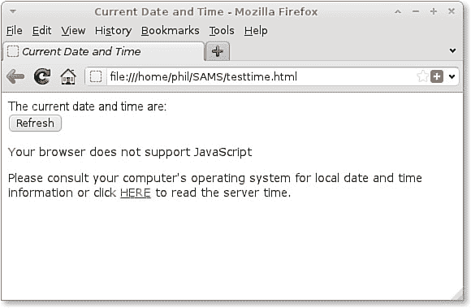

**图 22.1** 为无 JavaScript 用户提供的额外信息

* * *

### 总结

在本节中，我们总结并展示了编写 JavaScript 良好实践的各种示例。结合使用它们应该帮助你更快地交付代码项目，具有更高的质量并且更易维护。

### 问答

**Q. 为什么用户会关闭 JavaScript？**

**A.** 请记住，浏览器可能由服务提供商或雇主设置了默认关闭 JavaScript，以提高安全性。这在诸这样的环境中特别常见。

**Q. 除了 `<noscript>`，处理没有 JavaScript 的用户还有其他其他方法吗？**

**A.** 另一种方法是将用户重定向到一个增强页面：

点击此处查看代码图像

```html
<script>window.location="enhanced.html";</script>
```

如果 JavaScript 可用，脚本会将用户重定向到增强页面。

### 工作坊

 从书中前面的部分选择一些“尝试一试”章节，看看你可以做什么来让代码更具干扰性，同时不影响脚本的操作。

#### 测验

1. 将代码模块化为可重用的块被称为：
a. 抽象
b. 继承
c. 非侵入

2. 页面的 CSS 应该尽可能限制在：
a. 语义层
b. 表现层
c. 行为层

3. 非侵入代码应尽可能放在：
a. 外部文件
b. `<script>` 标签之间
c. 内联

#### 答案

1. a. 抽象
2. b. 尽可能，所有的 CSS 都在表现层。
3. a. 尽可能使用外部文件。

#### 练习

- 你能如何修改 列表 22.2 和 列表 22.3 中的代码，以确保没有 JavaScript 的用户只看到 `<noscript>` 标签的内容，而不是额外的文本和按钮？（提示：使用 `innerHTML` 或 DOM 方法向页面写入这些项目。）


 **运行时错误**——当 JavaScript 解释器尝试执行它无法理解的操作时发生的错误。示例包括尝试将字符串视为数值，以及尝试将数字除以零。

 **程序逻辑缺陷**——这些错误并不总是生成错误信息——代码可能是完全有效的——但你的脚本并没有按照你预期的方式运行。这些通常是与脚本中的算法或逻辑流相关的问题。

### 选择程序员编辑器

无论你在哪个平台上工作，无论你首选哪种浏览器，拥有一个良好的代码编辑器都是很有明智的。虽然在 Windows 记事本等简单程序中编写代码确实是可能的，但专用的编辑器会让生活变得方便得多。

许多此类程序均可用，通常在开源或类似的许可下免费提供。在这里我列出了一小部分免费编辑器，但请自行寻找一个适合你的平台、工作风格和预算的编辑器。

 Notepad++ (Windows)

 JEdit（应适用于任何安装了 Java 的平台）

 PSPad (Windows)

 JuffEd (Windows, Linux)

 Geany (Windows, Linux)

编辑器提供了一系列功能和能力，但至少我建议寻找具有以下功能的编辑器：

 **行号**——如果你将 JavaScript 存储在外部文件中，这一点尤为有用（这也是为什么在可行的情况下你应该这么做的的另一个原因）。这样一来，浏览器调试调试器生成的任何错误信息的行号，通常会与编辑器中打开的源文件行号匹配。

 **语法高亮**——当你熟悉了编辑器的语法高亮方案后，在很多情况下，你仅仅因为编辑器中的代码“看起来不对”就能发现编码错误。你习惯于喜爱的编辑程序中关键字、变量、字符串字面量、对象等颜色的速度之令人惊讶。许多编辑器允许你根据自己的喜好更改语法高亮颜色方案。

 **括号匹配**——作为寻找错误的“制导弹”，括号匹配是无价的。良好的编辑器会显示所有类型括号、大括号和圆括号的匹配左/右出现情况。当你的代码中有几层嵌套括号时，很容易数错数量。

 **代码补全或工具提示式语法帮助**——某些编辑器为命令函数和表达式提供弹出式工具提示的帮助。这可以节省你将视线离开编辑器窗口去查找外部参考的时间。

### 使用 alert() 进行简单调试

有时，你想要一种非常简单快速的方法来读取变量的值，或者跟踪代码执行的顺序。

也许最简单的方法是在代码适当的位置插入 JavaScript `alert()` 语句。让我们假设你想知道一个没有响应的函数是否真的被调用了，如果是，带有什么参数 parameters。

```javascript
function myFunc(a, b) {
  alert("myFunc() called.\na: " + a + "\nb: " + b);
  // rest of function code ...
}
```

当函数被调用时，`alert()` 方法会执行，并产生一个如图 23.1 所示的对话框。

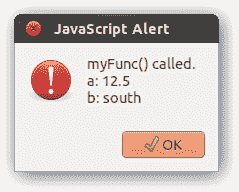
**图 23.1** 使用 JavaScript `alert()`

记住在显示的消息中放入比单纯变量值或单单词注释多一点的信息；在战斗激烈时，你可能会忘记 `alert()` 中的值指的是哪个变量或属性。

### 更多调试

在代码中放置 `alert()` 调用对于对短代码进行快速而粗略的调试也许可以。然而，这种技术确实有一些缺点：

 你必须点击每个对话框的“确定”才能允许处理继续。这可能会让人感到沮丧，尤其是在处理长循环时！

 接收到的消息没有存储在任何地方，并在对话框清除时消失；你无法返回并查看报告的内容。

 你需要回到编辑器并删除所有的 `alert()` 调用，你的代码才能“上线”运行。

在本节中，我们将查看一些高级调试技术。

#### 控制台

幸运的是，大多数现代浏览器都提供了 JavaScript 控制台，你可以更有效地利用它记录消息。打开控制台的方法因浏览器而异：

 在 Internet Explorer 中，打开开发者工具的方法：F12

 对于 Chrome 开发者工具和 Opera 调试器：Ctrl+Shift+I

 使用带有 Firebug 扩展的 Firefox：F12

本节中的示例假设你正在使用其中一种调试器。如果不是，你可能需要咨询你的调试器文档以查看如何执行某些任务。你的浏览器向你展示此类错误的方式因浏览器而异。

#### 动手尝试：使用浏览器的调试工具

查看列表 23.1 中的代码。

**列表 23.1** 一个带有错误的程序

```html
<!DOCTYPE html>
<html>
<head>
  <title>Strings and Arrays</title>
</head>
<body>
  <script>
    function sayHi() {
      alert("Hello!");
    }
  </script>
  <input type="button" value="good" onclick="sayHi()" />
  <input type="button" value="bad" onclick="sayhi()" />
</body>
</html>
```

此代码列表包含两种不同类型的错误。首先，在调用 `alert()` 方法时，我们的参数缺少了引号。

其次，第二个按钮的 `onclick` 处理器调用了函数 `sayhi()`——记住函数名是大小写敏感的，因此实际上没有定义名为 `sayhi()` 的函数。

将页面加载到 Firefox 中，我们可以看到预期的两个按钮，一个标记为“good”，另一个标记为“bad”。它们似乎都没有反应。我们可以通过按下 Ctrl+Shift+J 打开 Firefox 控制台，结果如图 23.2 所示。

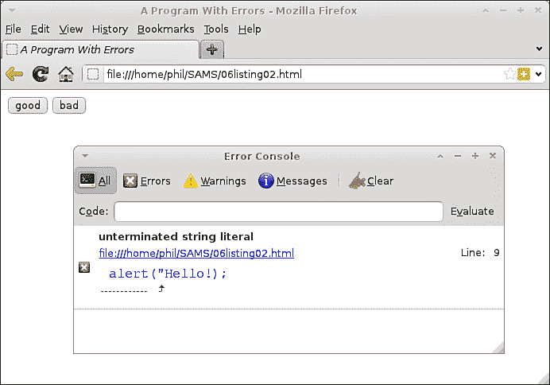
**图 23.2** Firefox 控制台

这是一个很好的开始。Firefox 告诉我们发现了一个未结束的字符串字面量，给出了行号，甚至向我们展示问题所在的代码行。

在修正错误并再次保存文件后，我准备好再次尝试。首先，点击控制台工具栏上的“清除”以移除旧的错误消息；然后我重新加载测试页面。

这看起来好多了。我的页面再次出现，控制台保持空白。点击标记为“good”的按钮打开了预期的 `alert()` 对话框——到目前为止。

但点击标记为“bad”的按钮似乎什么都没有做——所以我再次参考控制台，如图 23.3 所示。

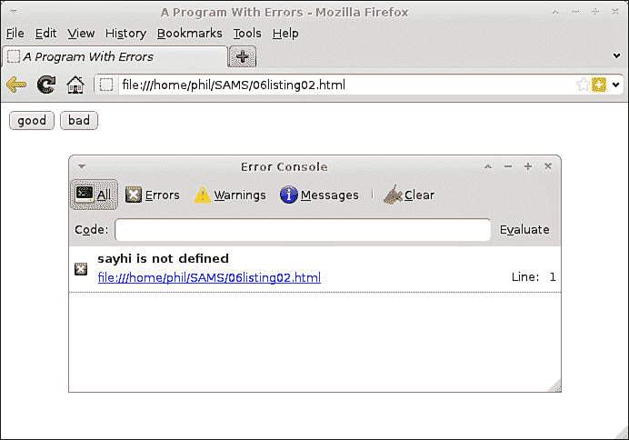
**图 23.3** 第二个错误

Firefox 再次识别了问题：“sayhi 未定义”。现在我们正处于让代码完全调试并正确运行的路上。

每个浏览器都有自己处理错误的方式。图 23.4 显示了 Chromium 浏览器如何报告最初的未结束字符串字面量错误。

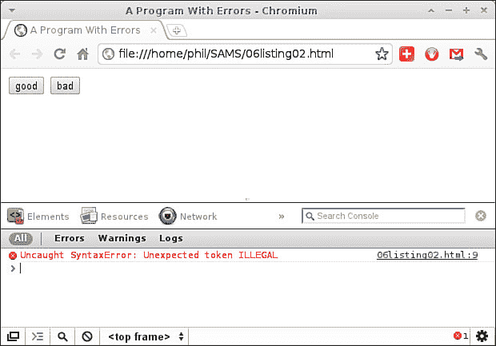
**图 23.4** Google Chromium JavaScript 控制台


# Google Chrome 和 Chromium

Google Chrome 和 Chromium 几乎是相同的浏览器，主要区别在于它们的打包和分发方式。本质上，Google Chrome 是由 Google 打包并分发的 `Chromium` 开源浏览器。

Chromium 的错误信息略显晦涩：“Uncaught syntax error: Unexpected token ILLEGAL”，但它也提供了一个可以点击的链接，显示了出错代码的行号。

要打开 Internet Explorer 的开发者工具，请按 `F12` 或从 `IE9` 的工具菜单中选择 `Developer Tools`。选择 `Console` 标签以查看 `JavaScript` 返回的错误消息。

### 提示

了解你喜喜浏览器中的调试工具是值得的，如果你特别喜欢其他浏览器提供的工具，甚至可以考虑切换浏览器。如果你计划经常编写 `JavaScript` 代码，那么在一个让你感到舒适的开发环境中编写是有意义的，在那里你会效率更高，挫败感更少。

## 动手尝试：横幅轮播脚本

让我们通过编写一个在页面上循环显示图片的脚本，运用一下这一小时所学到的知识。我确定你以前见过这种程序，可能是作为图片幻灯片，或者用来轮播广告横幅。

首先，我想向你介绍两个新项目。第一个是你以前没见过的事件处理程序——`window` 对象的 `onLoad` 方法。它的操作很简单：我们可以像这样将其附加到 `<body>` 元素：

点击此处查看代码图片

```html
<body onload="somefunction()" >
```

当页面完全加载完成后，`onLoad` 事件就会触发，事件处理程序指定的代码就会运行。我们使用这个事件处理程序在页面加载后立即运行横幅轮播器。

其次，我们将使用 `JavaScript` 的 `setInterval()` 函数。该函数允许我们重复运行一个 `JavaScript` 函数，并在每次连续执行之间设置预设的延迟。

`setInterval()` 函数接受两个参数。第一个是我们想要运行的函数名称，第二个是函数连续执行之间的延迟（毫秒）。例如，该行：

```javascript
setInterval(myFunc, 5000);
```

将每隔五秒执行一次 `myFunc()` 函数。

我们使用 `setInterval()` 定隔旋转横幅图片。

创建一个名为 `banner.html` 的新文件，并输入 列表 23.2 中的代码。

**列表 23.2 横幅轮播器**

点击此处查看代码图片

```html
<!DOCTYPE html>
<html>
<head>
    <title>Banner Cycler</title>
    <script>
        var banners = ["banner1.jpg", "banner2.jpg", "banner3.jpg"];
        var counter = 0;
        function run() {
            setInterval(cycle, 2000);
        }
        function cycle() {
            counter++;
            if(counter == banners.length) counter = 0;
            document.getElementById("banner").src = banners[counter];
        }
    </script>
</head>
<body onload = "run();">
    
</body>
</html>
```

页面的 HTML 部分再不能更简单了——页面的主体只包含一个图像元素。这个图像将形成横幅，通过更改其 `src` 属性来对其“旋转”。

现在让我们来看下代码。

`run()` 函数只包含一条语句，即 `setInterval()` 函数。该函数每两秒（2000 毫秒）执行另一个函数 `cycle()`。

每当 `cycle()` 函数执行时，我们都会执行三项操作：

**1. 增加计数器。**

```javascript
counter++;
```

**2. 使用条件语句检查计数器是否达到了图像名称数组中的元素数量；如果是，则将计数器置为零。**

点击此处查看代码图片

```javascript
if(counter == banners.length) counter = 0;
```

**3. 将显示图像的 `src` 属性设置为从图像文件名数组选择的适当文件名。**

点击此处查看代码图片

```javascript
document.getElementById("banner").src = banners[counter];
```


图 23.9 显示了 Firebug 控制台如何显示每个消息；在其他浏览器中显示可能会略有不同。


**图 23.9** 不同类型的控制台消息

## 消息分组

将控制台调试消息分组可以使其更具可读性。你可以按需要为单个消息组命名：

点击此处查看代码图像

```javascript
function myFunc(a, b) {
    console.group("myFunc execution");
    console.log("Executing myFunc()");
    if(isNaN(a) || isNaN(b)) {
        console.warn("One or more arguments non-numeric");
    }
    console.groupEnd();
    myOtherFunc(a+b);
}

function myOtherFunc(c) {
    console.group("myOtherFunc execution");
    console.log("Executing myOtherFunc()");
    if(isNaN(c)) {
        console.info("Argument is not numeric");
    }
    console.groupEnd();
    // .. rest of function code here ...
}
```

在这段代码段中，我定义了两个 `console.group()` 部分，并命名它们以与执行它们的函数关联。每个组都以 `console.groupEnd()` 语句结束。当代码运行时，任何控制台消息都会以分组的形式显示，如图 23.10 所示。

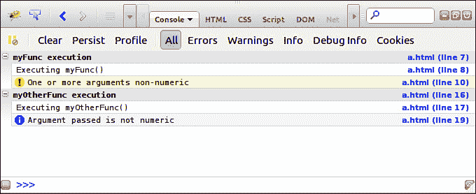

**图 23.10** 分组的消息

## 使用断点停止代码执行

随着脚本复杂性的增加，你可能会发现即使是控制台日志也不足以让你进行有效的调试。

为了进行更详细的调试，你可以在代码中感兴趣的地方设置所谓的断点（breakpoints）。当代码执行到断点处时，它会暂停；在时间冻结期间，你可以检查代码的运行情况、检查变量值、读取已记录的消息等。

在大多数流行的调试器中，设置断点需要进入“脚本（Scripts）”面板，你可以在那里看到列出的代码。点击行号（或点击行号左侧）即可在该行设置断点。在图 23.11 中，代码的第 8 行设置了一个断点。执行在此处停止，你可以在右侧面板查看各个变量的当前值。你可以通过再次点击左侧边缘的断点图标来移除断点。

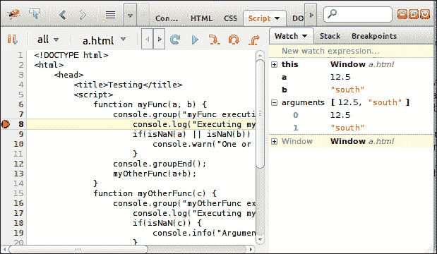

**图 23.11** 执行在断点处停止

## 条件断点

有时，仅在特定情况发生时才中断代码执行是有帮助的。你可以通过右键点击左列中的断点图标并输入条件语句来设置条件断点。

你的代码将在不中断的情况下执行，直到条件满足，此时执行将停止。例如，在图 23.12 中，如果 `a` 和 `b` 的和小于 12，代码将停止。你可以随时再次右键点击断点图标来编辑表达式。

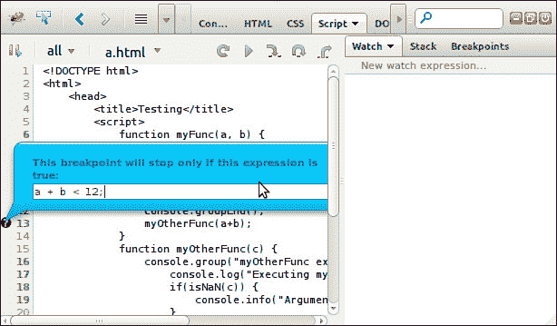

**图 23.12** 条件断点

当代码执行在断点处停止时，你可以选择继续执行代码，或使用代码执行按钮之一逐条语句执行你的代码；这些按钮通常看起来像 VCR 控制按钮，并出现在调试器其中一个面板的顶部。在大多数调试器中，选项有：

 **继续（Continue）**——恢复执行，仅在遇到或当到达另一个断点时再次暂停。

 **单过（Step Over）**——执行当前行（包括所调用的任何函数），然后移动到下一行。

 **单入（Step Into）**——移动到下一行，与单过类似，除非该行调用了函数；如果是那样，则跳转到函数的第一行。

 **单出（Step Out）**——离开当前函数并返回到调用它的地方。

## 从代码启动调试器

从 JavaScript 代码内部设置断点也是可能的，而且通常很有用。我们可以通过使用关键字 `debugger` 来实现这一点：

点击此处查看代码图像

```javascript
function myFunc(a, b) {
    if(isNaN(a) || isNaN(b)) {
        debugger;
    }
    // .. rest of function code here ...
}
```

在这个示例中，只有在满足条件时，代码执行才会停止并打开调试器。

## 监视表达式（Watch Expressions）

监视表达式是调试器持续评估的有效表达式，使其值供你检查。范围从简单的变量名到包含算术运算或函数调用的公式。


**图 23.13** 监视表达式

## 验证 JavaScript

检查代码问题的另一种不同且补充的方法是使用 JSLint，它会检查代码是否符合语言规则。JSLint 有时与 JavaScript 编辑器一起，也可以在线获取。

### 总结

在本小时中，你学习了关于调试代码的许多知识，包括使用浏览器控制台，以及设置断点和单步执行。

### 问答

**Q. 我应该如何选择程序员编辑器？**
**A.** 完全取决于个人选择。许多是免费的或提供免费版本，所以没有什么阻止你尝试几种。

**Q. 哪里可以找到更多关于调试的知识？**
**A.** 网上有很多教程。从 W3Schools 的开始，地址为 [`www.w3schools.com/js/debugging.asp`](http://www.w3schools.com/js/debugging.asp)。

## 工作

在阅读答案 你如何修改横幅循环脚本以为横幅添加链接，使得显示的每个图像都链接到不同的外部页面？


 利用你对使用 `Math` 对象生成随机数的知识，你是否可以重写横幅循环脚本，以便在每次切换时显示随机横幅，而不是按顺序循环？请使用浏览器的内置调试工具来帮助自己。

# 第 24 小时：JavaScript 单元测试

在本小时你将学习到：

 什么是单元测试以及为什么要使用它

 如何让你的 JavaScript 代码更易测试

 JavaScript 测试套件的一些示例

 关于 `QUnit` 测试套件和 `CommonJS` 单元测试规范

通常情况下，一个最初只有几行代码的 JavaScript 小花招（hack）随后会增长到十行、二十行，然后是五十行。与此同时，函数被微调以执行更多功能，条件语句增加了几个额外的条件，或者创建了几个额外的变量。

当这样的应用程序（不可避免地）崩溃时，理清代码并找到问题可能是一场噩梦。

正如你已经在第 22 小时中读到的，“良好的编码实践](#part0037.xhtml_ch22)”，良好的编码实践可以帮助让你的代码更容易理解和维护，但你还有其他可以做的事情。随着你的 JavaScript 应用程序规模、复杂性和精细程度的增加，编写易于测试的代码变得更加重要。

在本小时中，你将学习一些编写代码以使其适用于单元测试的方法，以及如何编写和执行此类测试。

## 什么是单元测试？

如果你不熟悉单元测试的概念，不用担心，理解它并不复杂。

通常当某人考虑测试 JavaScript 应用程序时，他们想象的是测试整个系统以查看它的运行是否符合预期。这本质上是一种检查应用程序的各个部分是否协同正常工作的测试，通常被称为*集成测试*。

*单元测试*是一种软件验证和确认方法，它将应用程序分解为最小的可测试部分，称为*单元*（units），然后对这些单元分别进行单独的检查和测试，以确保其运行正常。单元是应用程序中最小的可测试部分，例如单个函数或方法。

单元测试可以手动完成，但此类测试通常是自动化的。

本质上，你为代码的每个基本元素编写一系列测试，以测试该单元在所有可能的输入类型下的性能。如果所有这些测试都通过了，你就可以确信每个测试元素都是称职的。

## 亲自试一试：一个自制的的单元测试

让我们直接开始，从头执行一个单元测试。

在这个示例中，我们将编写一些测试，在一个示例单元上执行它们，并将结果摘要发送到浏览器控制台。

让我们看看我们在第 3 小时中编写的一个函数，“使用函数](#part0012.xhtml_ch03)”，该函数用于按给定比例向净额添加税费并返回总额：

点击此处查看代码图像

```javascript
function addTax(subtotal, taxRate) {
    var total = subtotal * (1 + (taxRate/100));
    return total;
}
```

这个函数构成了我们将进行某些测试的单元。

我们将此函数保存在文件 `tax.js` 中，并将其包含在作为测试套件的 HTML 页面中。在现实世界中，`tax.js` 可能包含许多不同的函数，作为财务应用程序的一部分，但对于这个示例，它足够了。HTML 代码如列表 24.1 所示。

**列表 24.1 测试套件的 HTML 代码**

点击此处查看代码图像

```html
<!DOCTYPE html>
<html>
<head>
  <title>Manual Unit Testing Examples</title>
  <script src="tax.js"></script>
  <script>
  function test(amount, rate, expected) {
    results.total++;
    var result = addTax(amount, rate);
    if (result !== expected) {
      results.failed++;
      console.log("Expected " + expected + ", but instead got " + result);
    }
  }
  var results = {
    total: 0,
    failed: 0
  };
  // Our unit tests
  test(1, 10, 1.1);
  test(5, 12, 5.6);
  test(100, 17.5, 117.5);
  // Output results to the console
  console.log(results.total + " tests carried out, " + results.failed + " failed, " +(results.total - results.failed) + " passed.");
  </script>
</head>
<body>
</body>
</html>
```

在此页面的一个 `<script>` 元素中，我定义了一个名为 `test()` 的函数，它接受三个参数。参数 `amount` 和 `rate` 是要传递的值，而 `expected` 是我们期望 `addTax()` 函数按预期方式返回的结果。

如果被测试函数返回了预期结果，`test()` 函数将增加成功计数器；如果不是，它将增加失败计数器，并在控制台中打印出哪个测试失败以及实际返回的值。

要运行此测试，我只需将代码保存为 .html 文件并将页面加载到浏览器中。结果所示于图 24.1。


**图 24.1**单元测试的结果

你可以看到，我们的一个测试失败了；JavaScript 产生了一个小的误差。这个结果让我重新检查 `addTax()` 函数的代码——也许在返回之前对输出进行舍入。

当然，你不必将结果记录到控制台；它们同样可以打印到页面上、保存到数据库等。稍我们将查看 `QUnit`，这是一个开源单元测试应用程序，它可以在测试的 HTML 中直接显示格式良好的测试结果。

## 为单元测试编写 JavaScript

再次查看之前的示例，一些事情变得显而易见：

 当然，`addTax()` 函数是一个*命名*函数。如果它是匿名函数，通过这种方式进行测试将变得困难得多甚至不可能。

 函数包含在外部 JavaScript 文件（在这里是 `tax.js`）也有助于将其包含在我们的测试套件中。

这些只是关于编码风格如何影响 JavaScript 代码可测试性的几个例子。

以旧式过程化方式编写的应用程序很难进行单元测试。然而，如果你在编写代码时考虑到单元测试，你不仅会让编写这些测试变得更容易，而且会写出更易阅读、维护和扩展的代码。

在下一节中，我将汇总一些可以使你的代码更容易测试的编码技巧。

### 重构代码

外部化脚本


将收集到外部文件中稍后链接到应用程序中的 JavaScript 代码通常更容易测试。在理想情况下，包含在生产应用程序中的相同 JavaScript 文件可以简单地链接到你的测试构架（test harness）中，以便执行测试。

## 保持函数和方法简单

你越在一个过程中尝试做更多的事情，你的测试就会变得越复杂、数量越多，而且在测试该函数时，将其从周围的代码中解耦出来可能变得越困难。

## QUnit 测试套件

上一个示例表明，你不需要大量的代码就可以运行实际的单元测试。然而，对于多于几个测试，使用专门设计的单元测试框架会有效率得多，它能为编写和运行测试提供更高级的工具。在本节中，我们将查看其中一个框架，`QUnit`。

`QUnit` 是一个强大的开源 JavaScript 单元测试框架。它由 jQuery 团队的成员编写，用于 jQuery、jQuery UI 和 jQuery Mobile 项目。然而，`QUnit` 能够测试任何常规 JavaScript 代码。

### 安装 QUnit

`QUnit` 是一个自包含的库，只需要一个 JavaScript 文件（`qunit.js`）和一个 CSS 文件（`qunit.css`），这两个文件都可以从 `QUnit` 网站下载。或者，你可以使用托管在 CDN 上的版本，如下例所示。

### 极简 QUnit 设置

再次，我们的测试设置将是一个简单的 HTML 页面，如 列表 24.2 所示。这次，`QUnit` 从 CDN 引入。

**列表 24.2 用于 QUnit 测试套件的代码**

点击此处查看代码图像

***

```
<!DOCTYPE html>
<html
<head>
<title>Hello QUnit Example</title>
<link rel="stylesheet" href="http://code.jquery.com/qunit/qunit-1.16.0.css">
</head>
<body>
<div id="qunit"></div>
<div id="qunit-fixture"></div>
<script src="http://code.jquery.com/qunit/qunit-1.16.0.js"></script>
<script src="tests.js"></script>
</body>
</html>
```

***

注意此文件的布局，以及它与我们在上一节中使用的手动测试套件有多相似。然而，有几点不同：

 `QUnit` 并不是向控制台记录信息，而是将格式化良好的结果输出到 ID 为 `#qunit` 的 `<div>` 中。

 在需要设置测试期间使用的元素（通常是表单元素等）所需的 `mock DOM` 时，需要 `#qunit-fixture` 元素。mock DOM 在每个单元测试后都会重置。`QUnit`

期望 mock DOM 位于 `#qunit-fixture` 元素中。

我们在 `head` 中包含 CSS 文件，而 `body` 包含了 `QUnit` JavaScript 文件，以及名为 `tests.js` 的后续文件，它仅包含以下代码：

点击此处查看代码图像

```javascript
QUnit.test( "Hello QUnit test", function( assert ) {
  assert.ok( 1 == "1", "Passed!" );
});
```

让我们看看这里发生了什么。测试方法被调用，将测试名称作为第一个参数传递，并将函数作为第二个参数传递。正是这个函数将运行我们的测试。

点击此处查看代码图像

```javascript
assert.ok( 1 == "1", "Passed!" );
```

在这个平凡的示例中，测试将始终通过。`ok` 方法是 `QUnit` 提供的几个 `assertions`（断言）之一，如果传递给它的第一个参数返回一个评估为真的值，则返回真值。

***

## QUnit 断言

`assertion`（断言）评估表达式为真或假。`QUnit` 的 `assert` 有许多你可以使用的额外方法来构建你的测试。示例包括 `equal()`，意所当然，它测试相等性；`notEqual()`，测试不相等性；以及 `strictEqual()`，它再次测试相等性，但这次是严格的类型和值比较。

在 `QUnit` 的文档中查看所有断言：[`api.qunitjs.com/category/assert/`](http://api.qunitjs.com/category/assert/)。

***

结果如图 24.2 所示。

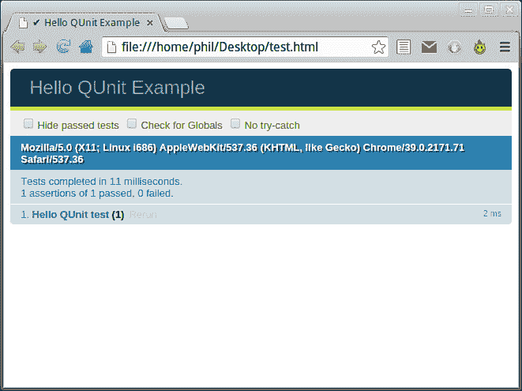

**图 24.2** 示例单元测试的结果

### 重新测试我们的 addTax() 函数

现在让我们修改前面的示例以重新测试我们的函数 `addTax()`，这次使用 `QUnit`。测试构架与之前相似，但它现在包含了 `tax.js` 文件：

点击此处查看代码图像

```html
<!DOCTYPE html>
<html>
<head>
<title>Test of addTax Function with QUnit</title>
<link rel="stylesheet" href="http://code.jquery.com/qunit/qunit-1.16.0.css">
</head>
<body>
<div id="qunit"></div>
<div id="qunit-fixture"></div>
<script src="http://code.jquery.com/qunit/qunit-1.16.0.js"></script>
<script src="tests.js"></script>
</body>
</html>
```

现在我们需要修改 `tests.js` 以包含以下内容：

```javascript
QUnit.test( "Hello QUnit test", function( assert ) {
  assert.ok( 1 == "1", "Passed!" );
});
```


# 1. a. 应用中可测试的最小单元，例如单个函数或方法
2. b. 评估表达式为真或假
3. b. 重构你的代码

#### 练习

 修改“自制”的单元测试代码，将格式整齐的报告显示在 HTML 页面上，而不是将其打印到控制台（如 QUnit 所示）。

 从书中各处选取其他函数，并使用 QUnit 对它们进行单元测试。它们的运行方式都符合你的预期吗？

# 第 9 部分：附录

### 附录 A. JavaScript 开发工具

JavaScript 开发除了文本编辑器和浏览器外，不需要任何特殊工具或软件。

大多数操作系统都自带了各至少一种工具，在很多情况下，这些工具对于你编写代码来说已经绰有余了。

然而，还有许多可选和额外的工具可用，其中一些在这里被进行了介绍。

> 提示
> 请务必检查各个网站上的许可条款和/或下载包中的条款。

### 编辑器

选择编辑器程序是个人喜好，大多数程序员都有自己喜爱的编辑器。接下来的章节列了一些你可以尝试的流行免费编辑器。

#### Notepad++

如果你在 Windows 平台上进行开发，你可能已经在使用 Windows 通常自带的记事本编辑器。`Notepad++` ([`notepad-plus-plus.org/`](http://notepad-plus-plus.org/)) 是一款免费应用程序，旨在成为更强大的替代品，同时仍保持轻量和快速。

`Notepad++` 提供行号、语法和大括号高亮、宏、搜索和替换等大量功能。

#### jEdit

`jEdit` 是一个用 Java 编写的免费编辑器。因此，它可以安装在任何可用 Java 虚拟机的平台上，例如 Windows、Mac OS X、OS/2、Linux 等。

`jEdit` 本身就是一个功能完备的编辑器，通过 200 多个可用插件进行扩展，例如成为一个完整的开发环境或高级 XML/HTML 编辑器。

从 [www.jedit.org](http://www.jedit.org) 下载 `jEdit`。

#### SciTE

`SciTE` 最初是作为 Scintilla 编辑组件的演示程序开发的，现在已发展成为功能完备且实用的编辑器。

Windows 和 Linux 用户可以通过 [www.scintilla.org/SciTE.html](http://www.scintilla.org/SciTE.html) 下载免费版的 `SciTE`，而 Mac OS X 用户可以通过 Mac App Store 购买商业版本。

#### Geany

`Geany` ([www.geany.org/](http://www.geany.org/)) 是一个功能强大的编辑器，也可以作为基础集成开发环境 (IDE 使用。它的开发是为了提供一个小型且快速的 IDE，可以安装在几乎任何支持 GTK 工具包的平台上，包括 Windows、Linux、Mac OS X 和 FreeBSD。

`Geany` 可根据 GNU 公共许可条款免费下载和使用。

### 验证器

为了确保你的页面无论用户的浏览器和操作系统如何都能按预期工作，始终建议检查你的 HTML 代码是否符合标准。正如前面讨论的，有许多在线工具和设施可以提供帮助。

#### W3C 验证服务

`W3C` 在 [`validator.w3.org/`](http://validator.w3.org/) 提供了一个在线验证器，它可以检查 HTML、SMIL、MathML 和其他语言 Web 文档的标记。你可以输入要检查的页面 URL，或直接将代码粘贴到验证器中。`CSS` 也可以在 [`jigsaw.w3.org/css-validator/validator.en`](http://jigsaw.w3.org/css-validator/validator.en) 以类似的方式验证。

#### Web Design Group (WDG)

`WDG` 也在 [www.htmlhelp.com/tools/validator/](http://www.htmlhelp.com/tools/validator/) 提供在线验证。这与 `W3C` 验证器类似，但在某些情况下提供的更多信息，例如关于有效但危险代码的警告，或者突出显示未定义的引用而不是简单地列为错误。

#### 调试和验证工具

在尝试追踪 JavaScript 代码中的问题时，调试工具可以为你节省数小时，并通过分析执行时间帮助你加速脚本。验证工具可以帮助你编写整洁、简洁、可读且无问题的代码。许多调试和验证工具可用，包括以下：

#### Firebug

`Firebug` 与 Firefox 浏览器集成，提供优秀的调试、编辑和分析工具。访问 [`firebug.com/javascript`](http://firebug.com/javascript)。

#### JSLint

`JSLint` ([www.jslint.com/](http://www.jslint.com/)) 由 Douglas Crockford 编写，用于分析你的 JavaScript 源代码并报告潜在问题，包括风格规范和编码错误。

### 附录 B. JavaScript 快速参考

表 B.1, 表 B.2, 表 B.3 以及 表 B.4 本附录包含了一些常用的 JavaScript 语法元素以及内置对象的属性和方法。ImageImage

#### JavaScript 运算符

#### JavaScript 字符串

#### JavaScript 数学对象

#### JavaScript 日期对象

#### 符号

`$` 包装器
`$( ` 处理器
`$(document).ready`
`$()` 函数
`&&` 逻辑与
`!` 字符

#### 访问

浏览器历史
`className` 属性
`eval()` 函数
`XMLHttpRequest` 对象

### 优势

JSON
面向对象
**Ajax**
异步请求
客户端-服务器交互
表单提交
使用 jQuery 实现


# AngularJS, 300-304
- 构建应用, 305-308
- 指令, 302-304
- 过滤器, 304
- ng- 指令, 300-302
- 作用域 (scopes), 302-302

# animate() 函数, 173
### 动画
- CSS3, 213-214
- 渐入, 237
- jQuery, 238-241
- 滑动元素, 237-238

# 匿名函数, 110-111, 289-290
#### 参数
- 用于构造函数, 113-114
- 多个参数，传递给函数, 41
- 传递给函数, 40-43

# 算术运算符, 27-28
- `+` 运算符, 29
- 变量值的递增/减, 27-28
- 取模除运算符, 27
- 优先级, 28

#### 数组
- 模拟关联数组, 158-159
- 创建, 81
- 初始化, 81-82
- 长度属性 (length), 82
- 操作, 84-86
- 方法, 82-86

# 箭头函数, 289-290
# <article> 标签 (HTML5), 168
# <aside> 标签 (HTML5), 168
# 给变量赋值, 25-26
# 模拟关联数组, 158-159
# 异步请求 (Ajax), 265-266
# 为元素绑定事件处理程序, 239-243
# attr() 方法, 235
# 属性 (HTML5)
- <video> 标签的, 169
- 读取, 133-134
# <audio> 标签 (HTML5), 171-172
- background-origin 属性 (CSS3), 208
- background-size 属性 (CSS3), 207
- 背景, 207-209
- 多背景图像, 208-209
- 轮播幅脚本，编写, 347-351
# beginPath() 方法, 173
# JavaScript 编写最佳实践, 325-326
- 注释, 326-327
- 错误处理, 335-338
- 功能检测, 333-334
- 优雅的降级, 329-330
- 命名规范, 327-328
- 渐进式增强, 330-331
- 代码重用, 328-329
- 非侵入式编写, 331-333
# 布尔值, 75-79
- 否定运算符, 79
# border-radius 属性 (CSS3), 206-207
# box-shadow 属性 (CSS3), 205
# break 命令, 99
# 断点 (breakpoints), 353
# 浏览器
- Ajax 支持, 264
- Cookie (cookies), 273-274
- 删除, 280-281
- `document.cookie` 属性, 274
- domain 属性, 276
- 数据转义与反转义, 275
-过期期, 276
- 局限性, 274
- path 属性, 276
- 读取, 280
- 安全标记 (secure flag), 276
- 测试, 281-284
- 值, 276
- 写入, 276-279
- CSS3 厂商前缀, 203-205
- 调试工具, 344-347
- ECMAScript 6 兼容性, 287
- 功能检测, 119-120
- Google Chrome 扩展，编写, 312-316
- 启动扩展, 315
- `manifest.json` 文件, 316-317
- 历史记录，访问, 55
- JavaScript 控制台, 351-352
- 消息分组, 352-353
- 打开, 344, 347-351
- Mozilla Firefox, DOM 检查器, 134-147
- 子节点，操作, 136-141
- 动态菜单创建, 142-147
- 加载 JavaScript 文件, 141-147
- 节点，创建, 135-136
- 浏览器原生支持访问 JSON 数据, 154
- `navigator` 对象, 57-59
- 刷新当前页面, 57
# 构建
- AngularJS 应用, 305-308
- 扩展, 312-314
- 内置对象，扩展, 117-118
## C
## 使用 `Math` 对象简化计算, 62-66
- 寻找最小最大值, 62-63
- 舍入, 62
- 调用函数, 38-40
- CamelCase 命名法, 25
- canPlayType() 方法, 170
# <canvas> 标签 (HTML5), 172-175
# JavaScript 的能力, 7
# CDN (内容分发网络), jQuery, 232
# 摄氏度转换为华氏度, 29-30
# 使用 `className` 更改类, 192


# 字符串，赋值为变量值，26

# 子节点，操作，136-141

# `childNodes` 属性，126-129

# 类，288

## 使用 `className` 属性访问，192-193

# `className` 属性，访问类，192-193

# `clearRect()` 方法，174

# 客户端脚本，6

# `closePath()` 方法，173

# 代码
## 调试，341

## `alert()` 方法，343

## 断点，353

## 条件断点，354-355

## 编辑器，选择，342-343

## 错误类型，341-342

## 监表达式，355

# 库
- Dojo, 223
- jQuery, 224, 231
- MooTools, 223
- Prototype Framework, 223
- `prototype.js`, 224-228

## 目的，222

## 使用用用，221-222

## 重构，363

## 编写，最佳实践，325-326, 329

## 注释，326-327

## 错误处理，335-338

## 功能检测，333-334

## 渐进降级，329-330

## 命名规范，327-328

## 渐进增强，330-331

## 代码复用，328-329

## 无侵入性编写，331-333

# 组合
## 条件，96

## JavaScript 语句，24

# 命令链，238-242

# 注释，24-25

## 最佳实践，326-327

## 比较运算符，90

# `concat()` 方法，74, 83

# 字符串拼接，29

# 条件断点，354-355

### 条件语句
- 比较运算符，90
- `if()` 语句，89-90, 94
- 库，Yahoo! 223
- 逻辑运算符，96
- `switch` 语句，95-96
- 等等性测试，91-94
- 多条件测试，95

# `confirm()` 方法，52

# `const` 关键字，290-293

# 构造函数，111-114

# `for-of` 构造，294

# 内容，使用 CSS 分离样式，186

# 控制器，298

# 控制光效，214-217

# 转换
## 摄氏度转华氏度，29-30

## CSS 属性名转 JavaScript，214

## 数据序列化，155

## 字符串转数字，71

# `cookies，273-274
## 删除，280-281
## `document.cookie` 属性，274
## `domain` 属性，276
## 转义与反转义，275
## `expires` 日期，276
## 限制性，274
## `path` 属性，276
## 读取，280
## `secure` 标记，276
## 测试，281-284
## `value`，276
## 设置多个值，284
## 写入，276-279

# 创建
## 数组，81

#### 对象
## 当前日期，60
## 给定日期，60

## 渐变
## 线性渐变，209-210
## 径向渐变，210-212
## 溢出，34-35
## 节点，354-355
## 匿名函数，110-113
## 构造函数，111-114
## JSON，155-163

# CSS (级联样式表)
## 类，192-193

# DOM 节点
## `style` 属性，188-191
## 样式表，194
## 命名规范，191
## 使用 CSS 分离，186
## 放置位置，187

# CSS3
## `background-origin` 属性，208
## `background-size` 属性，207
## `backgrounds`，207-209
## 多背景图像，208-209
## `border-radius` 属性，206-207
## `box-shadow` 属性，205
## 渐变，209-212
## 渐变，创建
## 线性渐变，209-210
## 径向渐变，210-212
## 光效，控制，214-217
#### 属性
## 转为 JavaScript，214
## 使用厂商前缀设置，215-218
## 文本效果
## 文本阴影，212
## 换行，213
## 过渡，204, 213-214


厂商前缀，203-205

### D

`数据序列化`, 155

#### `数据类型`
* 布尔值, 75-79
* JSON, 157-158
* 数字, 69-72
* 浮点数, 70
* 整数, 70
* NaN, 71
* 字符串, 72-75
* 空字符串, 72
* 转义序列, 72-73

`dataTransfer 属性 (HTML5)`, 176

#### `Date 对象`, 276
* 使用当前日期和时间创建, 60
* 使用给定的日期和时间创建, 60
* 编辑日期和时间, 61
* 方法, 377

`日期选择器组件`, 255-256

#### `调试`
* 浏览器调试工具, 344-347
* 代码, 341
* `alert()` 方法, 343
* 断点, 353
* 条件断点, 354-355
* 编辑器，选择, 342-343
* 分组消息, 352-353
* 错误类型, 341-342
* 观察表达式, 355
* 扩展, 315
* Firebug, 371
* JSLint, 371

`变量值的递减`, 27-28

`删除 cookie`, 280-281

`检测浏览器特征`, 119-120

`直接实例`, 107-110

`指令 (AngularJS)`, 302-304

`禁用样式表 (DOM 对象)`, 194-195

`do...while 语句`, 98

#### `document 对象 (DOM)`, 11
* 读取其属性, 16-17

`document.cookie 属性`, 274

`document.write()` 方法, 15-16

`Dojo`, 223

#### `DOM (文档对象模型)`, 10-13
* 浏览器支持, 11
* Date 对象, 60-61
* 方法, 377
* document 对象, 11
* 读取属性, 16-17
* `document.write()` 方法, 15-16
* `getComputedStyle()` 方法, 214-217
* history 对象, 55
* location 对象, 56-57
* `Math 对象`, 62-66
* 寻找最小值和值, 62-63
* 生成随机数, 63
* 关键字, 64
* 数学常量, 64
* 属性, 376
* 舍入法, 62
* navigator 对象, 57-59
* `nodeName 属性`, 130
* 节点, 123-130
* `childNodes 属性`, 126-129
* 类型, 125-126
* 值, 129-130
* 对象表示法, 12-13
* `parentNode 属性`, 129
* 脚本, 123
* window 对象, 11
* `window.alert()` 方法, 13-14

#### `DOM 检查器`, 134-147
* 操作子节点, 136-141
* 动态加载 JavaScript 文件, 141-147
* 编辑元素属性, 141
* 创建节点, 135-136

#### `DOM Level 0`, 10

#### `DOM 节点`
* style 属性, 188-191
* 样式表, 194
* 启用，禁用，切换, 194-195
* 选择, 195-199

`点表示法`, 12-13

#### `下载`
* jQuery, 231-232

#### `拖放`
* 在 HTML5 中, 175-178
* 使用 jQuery UI, 247-250

`draggable 属性 (HTML5)`, 175

`使用 <canvas> 标签绘图 (HTML5)`, 172-175

`创建动态菜单, 142-147

### E

`ECMA (欧洲计算机制造商协会)`, 8

`ECMAScript 6`, 287

`编辑器，选择, 369-370

#### `元素`
* 编辑, 141
* 读取, 133-134
* 使用 `getElementsByTagName`, 130-132
* 通过 ID, 54-55
* 空字符串, 72
* 启用样式表 (DOM 对象), 194-195
* 封装, 118-119
* 错误处理, 335-338
* `escape()` 函数, 275
* 转义序列, 41, 72-73
* `eval()` 函数, 153-154

#### `事件处理器`, 31-35
* jQuery, 239-232
* `onClick 事件处理器`, 31-32
* `onMouseOut`, 32-33
* `onMouseOver`, 32-33

#### `事件`
* 用于拖放, 175-178
* 鼠标事件，创建图像悬停效果, 33-35

`过期日期 (cookie)`, 276

`指数计数法`, 70


具有原型的对象，114-115

### 扩展
- 调试，315
- Google Chrome 扩展，编写，312-316
- 启动，315
- 打包，321

### 外部样式表 (CSS), 引用，187-188

### 脚本外部化，363

### F
- 元素渐隐，237
- “虚假”值，76
- 错误的程序逻辑，342
- 功能检测，119-120, 333-334
- <figcaption> 标签 (HTML5),168
- <figure> 标签 (HTML5),168
- HTML5 中的文件访问，179-182
- File API (HTML5),179-182
- `fill()` 方法，173
- 过滤器 (AngularJS),304
- Firebug，371
- ficker.com，153
- 浮点数，70
- <<footer> 标签 (HTML5),168
- for 循环，98
- for...in 循环，99-100
- for-of 结构，294
- 表单，Ajax，268-270
- 框架，297-298。另参见 库
    - AngularJS，300-304
    - 构建应用，305-308
    - 指令，302-304
    - 过滤器，304
    - ng 指令，300-302
    - 作用域，302
    - MVC 架构，298
    - 示例，298
    - 用于 Web 应用，299-300
- 函数，37
    - `$()`，225
    - `$F()`，225
    - `addTax()` 测试，365-366
    - 匿名函数，110-111
    - 箭头函数，289-290
    - 调用，38-40
    - 构造函数函数，111-114
    - `escape()`，275
    - `eval()`，153-154
    - `getCss3Property()`，218
    - `isFinite()`，71-72
    - `jsonParse()`，156
    - `parseFloat()`，71
    - `parseInt()`，71
    - 传递参数，40-43
    - 多个参数，41
    - 返回值，42-45
    - 发送消息，41-43
    - 简单性，363
    - 垃圾邮件检测，76-78, 91-93
    - 在 head 中存储 JavaScript，39-40
    - 语法，38
    - 变量
        - 全局，47
        - 局部，46
        - 作用域，45-47
    - 包装函数 (jQuery)，233-234

### G
- Geany，370
- 生成随机数，63
- `get()` 方法，267
- `getComputedStyle()` 方法，214-217
- `getCss3Property()` 函数，218
- `getData()` 方法，176
- `getElements()` 方法，226-228
- `getElementsByTagName()` 方法，130-132
- 全局变量，47
- Google Ajax API CDN，232
- Google Chrome 扩展，编写，312-316
- HTML 文件，317-320
- 启动扩展，315
- manifest.json 文件，316-317
- 打包扩展，321
- 优雅降级，329-330
- 渐变，209-212
    - 创建
    - 线性渐变，209-210
    - 径向渐变，210-212
    - 分组消息，352-353

### H
- <header> 标签 (HTML5),168
- “Hello World!” 示例，15-16
- `hide()` 方法，236
- 历史对象，55
- JavaScript 历史，8-9
- HTML (超文本标记语言)，5
- 带 CSS 的样式和内容，186
- `html()` 方法，234
- HTML5，167
- 拖放，175-178
- 读取元素属性，133-134
- 文件访问，179-182
- 本地存储，178-179
- src 属性，22-23
- 标签
    - <article>，168
    - <aside>，168
    - <audio>，171-172
    - <canvas>，172-175
    - <figcaption>，168
    - <figure>，168
    - <footer>，168
    - <header>，168
    - <nav>，168
    - 新标签，168
    - <script>，9-10, 21
    - <section>，168
    - <summary>，168
    - <video>，168-170
- HTML5 拖放列表，176

### I
- `if()` 语句，89-90, 94-95
- 图片滚停，创建，33-35
- 使用 jQuery 实现 Ajax，266-270
- `ajax()` 方法，268
- `get()` 方法，267


- `load()` 方法, 266-267
- `post()` 方法, 267
- `变量的递增值`, 27-28
- `indexOf()` 方法, 74, 83
- `继承`, 115-117
- `初始化数组`, 81-82
- `innerHTML` 属性, 54-55
- `安装`
- QUnit 测试套件, 363
- `实例`, 106
- `整数`, 70
- `与本地文件系统列表交互`, 181
- `交互`, 247-252
    - 拖放, 247-250
    - 调整大小, 251
    - 排序, 251-252
- `解释型语言`, 9
- `isFinite()` 函数, 71-72

## J

## JavaScript
- 向 HTML 文档添加, 22-23
- 应用, 311-312
- 能力, 7
- 动态加载文件, 141-147
- “Hello World!”示例, 15-16
- 历史, 8-9

### 新特性
- 箭头函数, 289-290
- 类, 288
- `const` 关键字, 290-293
- for-of 结构, 294
- `let` 关键字, 290-293
- 模块, 290
- 模板字符串, 293-294
- 编译, 294-295

### 语句及其他主题
- `语句`, 24-25
    - 组合, 24
    - 注释, 24-25
    - 存储在 head 部分, 39-40
    - 验证, 356
    - `jEdit`, 369
    - `join()` 方法, 83
    - `jQuery`, 224, 231
    - `$(document).ready` 处理器, 233
    - `Ajax`, 实现, 266-270
    - `animation`, 238-241
    - 渐隐元素, 237
    - 滑动元素, 237-238
    - `attr()` 方法, 235
    - 命令链式, 238-242
    - 下载, 231-232
    - 事件事件处理器, 239-243
    - `hide()` 方法, 236
    - `html()` 方法, 234
    - 页面元素选择, 233-234
    - 远程版本, 232
    - `show()` 方法, 236
    - `text()` 方法, 234-235
    - `toggle()` 方法, 236-237
- `jQuery UI`, 245-246
    - 交互, 247-252
    - 拖放, 247-250
    - 调整大小, 251
    - 排序, 251-252
- `ThemeRoller`, 246
- `widgets`, 253-258
    - 手琴琴, 253-254
    - 日期选择器, 255-256
    - 标签页, 256-258
- `JSLint`, 371
- `JSON (JavaScript 对象表示)`, 151
    - 访问数据
    - `eval()` 函数, 153-154
    - 浏览器原生支持, 154
    - 优势, 152-153
    - 关联数组模拟, 158-159
    - 数据序列化, 155
    - 数据类型, 157-158
    - 对象, 159-163
    - 操作, 161-163
    - 参数/值对, 152
    - 安全, 163
    - 字符串解析, 155-157
    - 语法, 152-153
    - 网站, 151
    - `jsonParse()` 函数, 156
    - `JSON.parse()` 方法, 154
    - `JSON.stringify()` 方法, 155

## K
- `const` 关键字, 290-293
    - `function`, 38
    - `let` 关键字, 290-293
    - `null`, 79
    - `对象字面量`, 79
    - `prototype` 关键字
    - 扩展对象, 114-115
    - `继承`, 115-117
    - `return`, 42
    - `undefined`, 79
    - `var`, 25
    - `with`, 64

## L
- `lastIndexOf()` 方法, 74, 83
- 启动 Google Chrome 扩展, 315
- `length` 属性, 82
- `let` 关键字, 290-293

## 库
- Dojo, 223
- 对比框架, 298
- `jQuery`, 224, 231
    - `$(document).ready` 处理器, 233
    - `animation`, 238-241
    - `attr()` 方法, 235
    - 命令链式, 238-242
    - 下载, 231-232
    - 事件处理器, 239-243
    - `hide()` 方法, 236
    - `html()` 方法, 234
    - 页面元素选择, 233-234
    - 远程版本, 232
    - `show()` 方法, 236
    - `text()` 方法, 234-235
    - `toggle()` 方法, 236-237
- MooTools, 223
- Prototype Framework, 223
- prototype.js, 224-228


# `$()` 函数, 225

# `$F()` 函数, 225

# 表单对象 (Form object), 226

# `getElements()` 方法, 226-228

# 目的, 222

# 使用原因, 221-222

# Yahoo! UI 库, 223

# 灯光效果控制, 214-217

# Cookie 的局限性, 274

# 线性渐变, 209-210

# 列表

# 使用 `className` 修改类, 192

# HTML5 拖放 API, 176

# 与本地文件系统交互, 181

# 使用 `<canvas>` 移动小球, 174

# 通过标题选择样式表, 197

# 使用 DOM style 对象进行样式设置, 190

# 使用 `styleSheets` 属性切换样式表, 199

# `load()` 方法, 266-267

# 在 HTML5 中访问本地文件, 179-182

# HTML5 中的本地存储, 178-179

# 地变量, 46

# location 对象 (DOM), 56-57

# 逻辑运算符, 96

# 循环

# do...while 语句, 98

# for 循环, 98

# for...in, 99-100

# 终止, 99

# while 语句, 97

# 弱类型语言, 69

## M

# 用于 Google Chrome 扩展的 `manifest.json` 文件, 316-317

# 操作

# 数组, 84-86

# 子节点, 136-141

# JSON 对象, 161-163

# 标记语言, 5

# `Math` 对象, 62-66

# 寻找最小值和最大值, 62-63

# 生成随机数, 63

# with 关键字, 64

# 数学常量, 64

# 属性, 376

# 舍入, 62

# 通过函数发送消息, 41-43

#### 方法

# `ajax()`, 268

# `alert()`, 51-52

# `attr()`, 235

# `concat()`, 74, 83

# `confirm()`, 52

# `Date` 对象, 377

# `document.write()` 方法, 15-16

# `get()`, 267

# `getComputedStyle()`, 214-217

# `getElements()`, 226-228

# `getElementsByTagName()`, 130-132

# `hide()`, 236

# `html()`, 234

# `indexOf()`, 74, 83

# `join()`, 83

# `JSON.parse()`, 154

# `JSON.stringify()`, 155

# `lastIndexOf()`, 74, 83

# `load()`, 266-267

# `on()`, 243

# `post()`, 267

# `prompt()`, 52-53

# `replace()`, 74

# `serialize()`, 226

# `setInterval()`, 101-102

# `setTimeout()`, 101

# `show()`, 236

# 简单性, 363

# `slice()`, 84

# `sort()`, 84

# `sortable()`, 251-252

# `splice()`, 84-86

# `split()`, 74-75

# 字符串方法, 375

# `substr()`, 75

# `text()`, 234-235

# `toggle()`, 236-237

# `toLowerCase()`, 75

# `toString()`, 83

# `toUpperCase()`, 75

# `window.alert()` 方法, 13-14

# Microsoft CDN, 232

# 最小值和最大值, 62-63

# 模型, 298

# 取模运算符, 27

# Mozilla Firefox, 134

# 拖放, 247

# 属性, 141

# 动态加载文件, 135

# 多行注释, 24

# 多个参数, 41

# 多重条件, 95

# MVC (模型-视图-控制器)架构, 298

# Web 应用, 300

## N

# 命名规范

# CSS (层叠样式表), 191

# 变量命名, 26

# NaN (不是数字), 71

# 浏览器原生支持访问 JSON 数据, 154

# <nav> 标签 (HTML5), 168

# 使用 location 对象导航, 56

# navigator 对象, 57

# 否定运算符, 79

# ng- 指令, 300-302

# nodeName 属性, 130

# 节点 (DOM), 123-130

# 子节点, 操作, 136-141

childNodes 属性, 126-129


创建，135-136

`nodeName` 属性，130

`parentNode` 属性，129

类型，125-126

值，129-130

**Notepad++,** 369**

`null` 关键字，79

数字，69-72

浮点数，70

`Infinity`，71-72

整数，70

`NaN`，71

### O

面向对象语言，106

对象

ActiveX，创建，264

创建，107-114

匿名函数，110-111

构造函数，111-114

直接实例，107-110

结合 JSON，159-163

`Date` 对象，276

方法，377

日期对象

使用当前日期和时间创建，60

编辑日期和时间，61

封装，118-119

使用原型扩展，114-115

`Form`，226

`history` 对象，55

继承，115-117

实例，106

操作 `JSON`，161-163

`location` 对象，56-57

循环遍历，99-100

`Math` 对象，62-66

寻找最小值和最大值，62-63

生成随机数，63

使用 `with` 关键字，64

数学常量，64

属性，376

舍入，62

`navigator` 对象，57-59

序列化，155

语法，12-13

`XMLHttpRequest` 对象，263

属性，264-265

`on()` 方法，243

`onClick` 事件处理器，31-32

`onMouseOut` 事件处理器，32-33

`onMouseOver` 事件处理器，32-33

`OOP (面向对象编程)`，105-106

优点，106

封装，118-119

打开 `JavaScript` 控制台，347-351

打开 `JavaScript` 控制台，344

`OpenOffice.org`，312

运算符，26-30, 373

算术运算符，27-28

变量的自增/自减，27-28

取模运算符，27

比较运算符，90

逻辑运算符，96

否定运算符，79

优先级，28

### P

打包 Google Chrome 扩展，321

参数

box-shadow 属性 (CSS)，205

`JSON`，152

传递给函数，40-43

`parentNode` 属性，129

`parseFloat()` 函数，71

`parseInt()` 函数，71

解析 JSON 字符串，155-157

向函数传递参数，40-43

多个参数，41

`pause()` 命令，170

`play()` 命令，170

播放

声音，`<audio>` 标签 (HTML5)，171-172

视频

`pause()` 和 `play()` 命令，170

`<video>` 标签 (HTML5)，168-170

`post()` 方法，267

运算符的优先级规则，28

前缀，CSS3，203

过程化编程，105

渐进增强，33

`prompt()` 方法，52

数组的，82

background-origin (CSS)，208

background-size (CSS)，207

border-radius (CSS)，206-207

box-shadow 属性 (CSS)，205

childNodes，126-129

document.cookie，274

document.innerHTML，54

document.Math，376

document.nodeName，130

document.parentNode，129

document-fixed 版本，15

document-of，17

document-syntax，13

document-wrap，33

text-shadow，32-33

text-wrap,33

word-wrap,33


# 随机数，生成，63

# 读取

cookies, 280

日期和时间, 64-66

元素属性, 133-134

文档对象属性, 16-17

代码重构, 363

引用外部样式表 (CSS), 187-188

重新加载当前浏览器页面, 57

jQuery 的版本, 232

`replace()` 方法, 74

调整大小交互, 251

return 关键字, 42

从函数返回值, 42-45

复用代码, 328-329

使用 Math 对象进行四舍五入, 62

运行时错误, 342

## S

SciTE, 370

变量范围, 45-47

作用域 (AngularJS), 302

`<script>` 标签, 9-10, 21

src 属性, 22-23

脚本, 6

数组操作脚本, 84-86

banner 轮播脚本，编写, 347-351

客户端脚本, 6

DOM, 123

外部化, 363

服务端脚本, 6

`<section>` 标签 (HTML5), 168

JSON 安全密性, 163

# 选择

编辑器程序, 369-370

### 元素

使用 `getElementsByTagName()` 方法, 130-132

通过 ID 选择, 54-55

程序编辑器, 342-343

样式表 (DOM 对象), 195-199

按标题列表选择样式表, 197

选择器 (jQuery), 234

通过函数发送消息, 41-43

使用 CSS 分离样式和内容, 186

序列化, 155

`serialize()` 方法, 226

服务端脚本, 6

`setData()` 方法, 176

`setInterval()` 方法, 101-102

`setTimeout()` 方法, 101

## 设置

QUnit 测试套件, 364-365

`show()` 方法, 236

模拟关联数组, 158-159

`slice()` 方法, 84

滑动元素, 237-238

软件框架, 297-298

排序交互, 251-252

`sort()` 方法, 84

`sortable()` 方法, 251-252

播放声音, 171-172

垃圾邮件检测器, 76-78, 91-93

`splice()` 方法, 84-86

`split()` 方法, 74-75

src 属性, 22-23

语句, 24-25

合并, 24

注释, [24-25

条件语句

`if()` 语句, 89-90, 94-95

switch 语句, 95-96

测试相等性, 91-94

测试多个条件, 95

do...while 语句, 98

while 语句, 97

## 存储

HTML5 中的数据, 178-179

head 部分中的 JavaScript, 39-40

字符串, 72-75

拼接, 29

转换为数字, 71

空字符串, 72

转义序列, 72-73

JSON 解析, 155-157

模板, 293-294

`stroke()` 方法, 173

来自 CSS 的样式, 186

样式声明, 187-188

样式属性, 188-191

样式 (DOM), 194-195

启用，切换, 194-195

样式 DOM, 197

`substr()` 方法, 75

切换 (DOM), 194-195

## T

标签页组件, 256-258

HTML5 标签

<article>, 168

<aside>, 168

<audio>, 171-172

<canvas>, 172-175

<figcaption>, 168

<figure>, 168

<footer>, 168

<header>, 168

<nav>, 168

新标签, 168

<summary>, 168

<video>, 168-170


## 模板字符串，293-294

## 终止循环，99

## 测试
- cookies，281-284
- 相等性判断，91-94
- 多重条件，95

### 单元测试
- 解释，359-360, 362
- QUnit 测试套件，363-366
- 重构代码，363
- 简单示例，360-362
- 视频格式支持，`canPlayType()` 方法，170

## 文字效果
- 文字阴影，212
- 换行，213

## `text()` 方法，234-235

## text-shadow 属性 (CSS3),212

## ThemeRoller，246

## 定器
- `setInterval()` 方法，101-102
- `setTimeout()` 方法，101

## `toggle()` 方法，236-237

## 使用 `styleSheets` 属性列表切换样式表，199

## `toLowerCase()` 方法，75

## `toString()` 方法，83

## `toUpperCase()` 方法，75

## Traceur，294-295

## 变换，213-214

## 过渡，204, 213-214

## 编译，294-295

## “真值” (truthy) 值，76

### U
- `undefined` 关键字，79
- 数据转义，275

### 单元测试
- 解释，359-360, 362
- QUnit 测试套件，363-366
- `addTax()` 函数测试，365-366
- 安装，363
- 设置，364-365
- 重构代码，363
- 简单示例，360-362

### V
- 验证 JavaScript，356
- 验证器，370

### values
- 赋值给变量，25-26
- cookies 的值，276
- 获取，283
- 设置多个值，284
- “假值” (falsy)，76
- 在 JSON 对象中，157-158
- 节点，129-130
- 从函数返回，42-45
- “真值” (truthy)，76
- `var` 关键字，25
- 变量，25-26
- 关联数组模拟，158-159
- 创建，81
- 初始化，81-82
- `length` 属性，82
- 操作，84-86
- 方法，82-86
- 赋值给，25-26
- 全局变量，47
- 值的递增/减，27-28
- 局部变量，46
- 命名，26
- 作用域，45-47
- 厂商前缀，设置 CSS3 属性，215-218
- `<video>` 标签 (HTML5)，168-170

### videos
- 执行 `pause()` 和 `play()` 命令，170
- `<video>` 标签 (HTML5)，168-170
- 测试格式支持，`canPlayType()` 方法，170

## views，298

### W
- W3C (世界维网联盟)，8
- 验证服务，370
- 观察表达式，355
- WDG (网页设计组),370
- Web 应用，MVC 架构，299-300
- WebM 网站，169

### websites
- CDNs，232
- Dojo，223
- ficker.com，153
- jQuery，224
- JSON，151
- ooTools，223
- Prototype Framework，223
- prototype.js，224
- ThemeRoller，246
- Traceur，294-295
- Yahoo! UI 库，223
- `while` 语句，97
- (jQuery UI)，253-258
- 折叠面板 (accordion widget)，253-254
- 日期选择器，255-256
- 标签 (tabs)，256-258
- `window` 对象 (DOM)，11
- `window.alert()` 方法，13-14
- `with` 关键字，64
- 换行，213
- word-wrap 属性 (CSS3)，213
- 包装器，`()`，233-234

## 编写
- 横幅轮循环脚本，347-351
- 代码最佳实践，311-312, 329
- 注释，226-327
- 错误处理，335-338
- 功能检测，333-334
- 优雅降级，329-330
- 命名规范，327-328
- 渐进增强，330-331
- 代码复用，328-329
- 非侵入式编写，331-333
- cookies，276-279
- Google Chrome 扩展，312-316
- HTML 文件，317-320
- manifest.json 文件，316-317


## 代码片段


