# Web 设计师 Sass

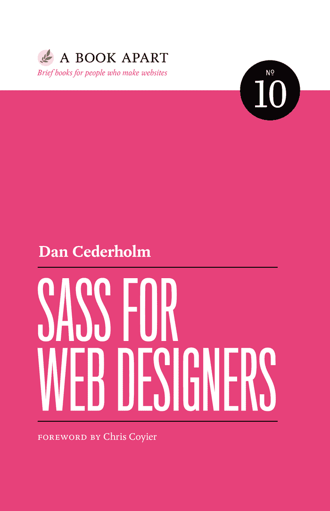

## 目录

- 版权声明
- 序言
- 第 1 章：为什么选择 Sass？
- 第 2 章：Sass 工作流
- 第 3 章：使用 Sass
- 第 4 章：Sass 与媒体查询
- 资源列表
- 参考文献
- 致谢
- 索引
- 关于 A Book Apart
- 关于作者

## 序言

回顾计算机语言的演变，似乎每隔十年左右就会增加一个新的抽象层。“0 和 1”升级为了汇编指令，汇编指令又升级为了编译型语言。这些编译型语言不断演进，我们利用它们创建了网页浏览器。网页浏览器处理诸如 `HTML`、`CSS` 和 `JavaScript` 这样的语言。现在，我们准备好再次进行升级了。

`HTML`、`CSS` 和 `JavaScript` 在以前所未有的方式推动网页发展方面取得了巨大的成功。我们正在构建日益庞大且复杂的网站。这是一件美事。但我们已经到了一个节点，需要采取下一步，让我们构建的内容更易管理和维护。我们可以通过抽象来实现这一目标。

`CSS` 的需求最为迫切。如今，`HTML` 通常通过后端代码和模板生成，这些工具提供了我们所需的抽象。作为一种编程语言，`JavaScript` 已经内置了抽象工具。而 `CSS` 完全没有抽象，且具有高度重复性。虽然这种简单性是其被采用的关键，但它对今天的我们来说却变得难以处理。现在轮到 `CSS` 升级了！

正如 Dan 在书中将教你的那样，`Sass` 拥有我们所需的所有抽象工具。重复的值变成了变量。重复的样式组变成了扩展（`extends`）。复杂的规则集和繁琐的厂商前缀变成了混合宏（`mixins`）。通过这些转换，`CSS` 在任何规模下都是可管理和可维护的。

对于某些人来说，转向 `Sass` 并不是一个舒适的过渡。Dan 对此非常清楚。在我还不知道 `div` 是什么之前，他已经在向世界传授和教授 `CSS` 了。但 Dan 是一名 Web 手工匠。就像木工知道自己的凿子什么时候变钝了一样，Dan 知道现在直接在 `CSS` 中工作就像是在用那把生钝的凿子：你可以那样做，但可能会伤到自己。

当你读完这本书并在你的第一个项目中真正尝试 Sass 时，你将掌握 `Sass` 中 95% 重要的且真正有价值的部分。让 Dan 成为你的向导吧。学会 `Sass` 并不会让你的工作变得更困难，反而会让它变得简单。

**—Chris Coyier**

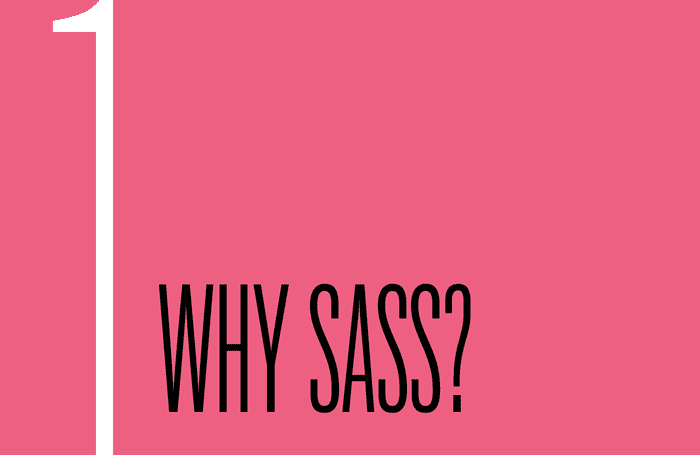

我曾是一个 `Sass` 的不情愿信徒。我都是手工编写样式表的！我不需要帮助！我绝对不想给我的工作流增加额外的复杂性。走开！

至少我一直是这样想的。但现实是，`Sass`（以及 `CSS` 预处理器）可以成为强大的盟友——任何样式设计者都可以轻松将其融入日常工作的工具。我花了一段时间才慢慢转过弯来，但我非常庆幸自己这么做了。

这就是我想写这本小书的原因。分享我是如何利用 `Sass` 提高效率，同时保持我过去十年来编写 `CSS` 时已经习惯的流程的。起初，我对 `Sass` 有许多误解，这阻止了我去尝试它。我担心我将完全改变我编写和管理样式表的方式。由于 `CSS` 有时可能很脆弱，作者对自己的创作产生某种保护欲是可以理解的。有人能认同我吗？

咳。

所以，我在这里是为了向你们展示 `Sass` 并不非要破坏你的流程和工作流，它是如何让你的生活变得更简单的。我将演示 `Sass` 的各个方面、如何安装它、如何使用它，以及它是如何帮助我自己的项目的。如果运气好的话，我也许也能让你们成为信徒。

### Sass 的电梯

如果我们审视软件工程的世界（我更倾向于观察而不是在里面混得舒服），我们可以很快发现，组织、变量、常量、部分组件等，对于构建复杂系统的人来说，是根深蒂固且至关重要的工作方式。

你可能听过“不要重复自己”（`DRY`）原则。该原则由 Andy Hunt 和 Dave Thomas 在他们的书籍《实战编程之道》（[`bkaprt.com/sass/1/`](http://bkaprt.com/sass/1/)）中提出并定义，`DRY` 规定：

> 每一份知识在系统中必须有唯一的、无歧且权威的表示。

其核心思想是，代码重复会导致开发者的失败和困惑（[`bkaprt.com/sass/2/`](http://bkaprt.com/sass/2/)）。这也是常识：编写一次常见的重复模式，并在应用程序中复用这些部分。这样维护代码效率更高，也容易得多。

`CSS` 绝非 `DRY`。有时，它充斥着重复的规则、声明和值。在整个样式表中，我们不断为颜色、字体和经常使用的样式模式编写相同的代码片段。只要看一眼足够大的 `CSS` 文件，一个遵循 `DRY` 的软件开发者就会流泪——起初是因为困惑，然后是因为沮丧。

“你这到底是怎么维护这些东西的？！”他们会问。

“我告诉过你 IE 的 bug 吗？”你会带着一丝自嘲回答道。

#### 那么为什么 CSS 这么难用？

我们可以从 `CSS` 共同发明者 Bert Bos 的一篇文章（[`bkaprt.com/sass/3/`](http://bkaprt.com/sass/3/)）中，略微了解为什么 `CSS` 多年来一直存在语法上的局限性：

> CSS 止步于程序员在编程语言中使用的那些更强大的功能：宏、变量、符号常量、条件语句、基于变量的表达式等。这是因为这些东西给高级用户提供了很大的发挥空间，但经验较少的用户会不经意地把自己害死；或者更有可能的是，他们会被吓得不敢触碰 CSS。这是一种平衡。对于 CSS 来说，这种平衡与其他某些事物不同。

`CSS` 的原始架构师关注的是采用率。他们（理地）希望尽可能多的人创建网站。他们希望 `CSS` 足够强大，能够为网页设置样式并将内容与呈现分离，同时易于理解和使用。我完全尊重这一点。与此同时，我们有工作要做，而且这些工作正变得越来越复杂、微妙，并且维护和未来扩展充满了挑战。

幸运的是，有很多选项可以帮助我们，其中之一就是 `Sass`。

### 什么是 SASS？

`Sass` 是一个 `CSS` 处理器——是你编写的样式表与提供给浏览器的 `.css` 文件之间的层。`Sass`（`Syntactically Awesome Stylesheets` 的缩写）填补了 `CSS` 作为语言的缺陷，允许你编写 `DRY` 代码，这些代码将更快、更高效且更容易维护（**图 1**）。

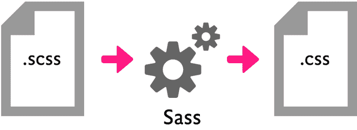

图 1：`Sass` 将其自身的“强大语法”转换为普通的 `CSS`。

`Sass` 网站（[`bkaprt.com/sass/4/`](http://bkaprt.com/sass/4/)）对自身进行了简洁的描述：

> Sass 是在 CSS 之上的层元语言，用于清晰且结构化地描述文档样式，拥有比平铺 CSS 更多的功能。Sass 既为 CSS 提供了更简单、更优雅的语法，又实现了各种对于创建可管理样式表非常有用的功能。

所以虽然普通的 `CSS` 还不允许变量、混合（`mixins`，可复用的样式块）和其他特性，但 `Sass` 提供了一种可以实现所有这些以及更多功能的语法——在你的普通 `CSS` 基础上开启了“超级功能”。然后通过命令行程序或 Web 框架插件将这些语法翻译（或编译）为普通的 `CSS` 文件。

更具体地说，`Sass` 是 `CSS3` 的扩展，它的 `SCSS`（`Sassy CSS`）语法——我们稍后会讨论——是 `CSS3` 的超集。这意味着，任何有效的 `CSS3` 文档也是有效的 `SCSS` 文档。这对于 `Sass` 成为一种你可以“轻松上手”的东西至关重要。开始学习 `Sass` 语法是不痛苦的，你可以根据需要使用尽可能少或越多。这也意味着，随着你学习并掌握更多 `Sass` 的功能，将现有的样式表从 `CSS` 转换为 `SCSS` 可以分阶段完成。

稍后，当你精通 `Sass` 之后（这不会花费多久），它真的感觉就像 `CSS` 的自然扩展——就好像它在填补我们一直希望由 `CSS` 规范本身来填补的空白。这就是为什么，一旦我开始使用 `Sass`，就再也没有觉得过它别扭或费力——它感觉就像 `CSS` 应该有的样子。一旦你尝试过，可能会一直用下去。

此外，`Sass` 正在帮助 `CSS` 变得更好。通过快速推进目前在没有处理器帮助下无法实现的功能，它为 `CSS` 作者提供了真实世界的实现和功能实验。在合适的时候和情况下，某些 `Sass` 功能完全可以为未来的 `CSS` 规范提供参考。

### SASS 语法

`Sass` 实际上有两种不同的语法。最新的是上述 `SCSS` 语法。`SCSS` 文件使用 `.scss` 后缀。这是我倾向于使用并提倡的语法，原因如下：

* 由于 `SCSS` 是 `CSS3` 的超集，我可以像过去十年一样编写 `CSS`，它仍然可以正常工作。
* 可以很容易地将现有的样式表转换为使用 `Sass`。
* 它不需要改变代码格式。

#### 一个简单的 SCSS 示例

这是一个关于 `SCSS` 如何工作的示例。它定义了一个变量并在声明中使用了它。

```scss
$pink: #ea489;

p {
  font-size: 12px;
  color: $pink;
}
p strong {
  text-transform: uppercase;
}
```

它将编译为：

```css
p {
  font-size: 12px;
  color: #ea489;
}
p strong {
  text-transform: uppercase;
}
```

除了 `$pink` 变量之外，这看起来非常熟悉，我们稍后会讨论变量。`SCSS` 运行于你已经掌握的 `CSS` 之上。对于这一点，我非常喜欢它。

##### 原始的“缩进” Sass 语法

另一方面，原始的 `Sass` 语法是另一种东西。有些人更倾向于它那种精简的、没有大括号或分号的缩进语法。如果你习惯了 `Ruby` 或 `Python` 等编程语言的简洁，那么 `Sass` 语法将看起来很熟悉，你可能会更有归属感。

这是原始 `Sass` 语法的简单示例，它的编译结果与之前的代码片段完全相同。

```sass
$pink: #ea489

p
  font-size: 12px
  color: $pink

p strong
  text-transform: uppercase
```

### SASS 误解

我之前提到过，我很想尝试 `Sass`。这部分程度上是因为我在使用之前对其产生的许多误解。我需要学习 `Ruby` 或高级的命令行操作吗？我需要完全改变编写样式表的方式吗？它输出的 `CSS` 会变得臃肿且不可读吗？

幸运的是，这些问题的答案显然都是“不是”——但每当有人在各种网络频道提到 `Sass` 时，我确实听到这些问题冒出来。

#### 我害怕命令行！

我绝不是什么命令行专家，但多年来我也在各处学了一点点——这些仅足以让我惹上一些麻烦。我不害怕使用它来遍历文件系统，或者使用 `Git` 命令等。

话虽如此，我理解那些不想接触命令行的设计师和前端开发者。某些人中存在一种“命令行恐惧”。对于 `Sass` 来说，几乎不需要多少命令行操作——事实上，你只需要一个命令就能掌握。此外，还有一些应用程序和 Web 框架可以消除对命令行的需求。（我将在下一章介绍这些内容）。

所以，如果你是一个命令行规避者，不要让这阻碍你尝试 `Sass`！

#### 我不想改变我编写 CSS 的方式！

这是我曾受过的一个误区。我对样式表的设置和组织方式非常讲究。文档的编写包含某种手工艺。但请记住，由于 `SCSS` 语法是 `CSS3` 的超集，你不需要改变编写 `CSS` 的任何方式。在处理 `.scss` 文件时，无论注释、缩进还是不缩进，你所有的格式偏好都可以保持不变。一旦我意识到这一点，就可以毫无恐惧地深入其中了。

#### 我不想让 Sass 改变我的设计方式！

相反，`Sass` 并不会解决你所有的问题，也不会治愈你的坏习惯。低效、臃肿的样式表在使用 `Sass` 时可能同样低效且臃肿。良好的组织和聪明的思维在这里仍然适用。事实上，在某些情况下 `Sass` 会放大糟糕的做法，我们也会对此进行讨论。但当正确且智能地使用时，`Sass` 可以成为创建网站的巨大助力。

好了。现在我们已经解决了这些细节，让我们开始享受乐趣吧。我想 `Sass` 的功能会让你大为惊叹的。在下一章中，我们将设置工作流——`Sass` 如何融入你的流程，以及使用命令行或应用程序有多简单。让我们开始使用 `Sass` 吧，大家。

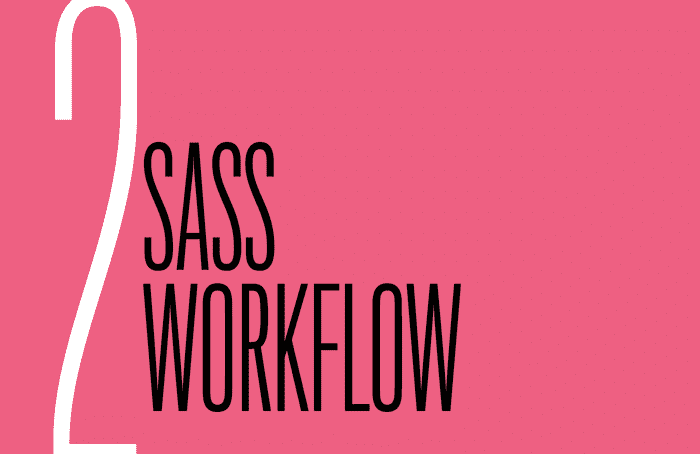

现在我们已经知道了 `Sass` 是什么，让我们进行环境配置以便开始使用它。我们的第一个任务是在你选择的计算设备上安装它。我在第 1 章中提到过 `Sass` 是一个用 `Ruby` 编写的程序，它将其原生语法翻译成纯 `CSS`。因此，在我们开始使用 `Sass` 之前，我们需要 `Sass`。

### 在 Mac 上安装 Sass

如果你使用的是 Mac（如果你运气足够的话，那恭喜你），安装 `Sass` 再简单不过了。Mac OS X 预装了 `Ruby`，而 `Sass` 被封装成一个 `Ruby` “gem”，这是程序员对 `Ruby` 应用程序的一种巧妙术语。

只需启动 `Terminal.app`（不要慌！），在提示符处输入以下内容并按回车：

```
$ gem install sass
```

这并不那么糟糕，对吧？按下回车后，你会看到以下结果在 `Terminal` 中流过：

```
Fetching: sass-3.2.10.gem (100%)
Successfully installed sass-3.2.10
1 gem installed
Installing ri documentation for sass-3.2.10...
Installing RDoc documentation for sass-3.2.10...
```

恭喜！你刚刚安装了 `Sass`。

在编写本文时，`Sass` 的最新官方版本是 `3.2.10`，`Terminal` 足够友好地将这条信息传给了我们。

#### 安装最新的预发布版本

你也可以选择留在最前沿，通过在命令末尾添加 `pre` 标志来安装最新的 alpha 版本。使用最新的 alpha 版本不仅安全，还能让你利用最新的功能。

要获取最新最强大的版本，请在终端提示符中输入以下并按回车：

```
$ gem install sass --pre
```

你将再次看到结果流过，这次确认了 `3.3.0` alpha 版本已安装。

```
Fetching: sass-3.3.0.alpha.3.gem (100%)
Successfully installed sass-3.3.0.alpha.3
1 gem installed
Installing ri documentation for sass-3.3.0.alpha.3...
Installing RDoc documentation for sass-3.3.0.alpha.3...
```

你现在生活在边缘，我向你这勇敢的信仰之跃致敬。

### 在 Windows 上安装 Sass

与 Mac OS X 不同，Windows 没有预装 `Ruby`。`Sass` 官方网站推荐 Windows 用户使用 `RubyInstaller` 来让程序运行起来（[`bkaprt.com/sass/5/`](http://bkaprt.com/sass/5/)）。一旦安装了 `Ruby`，你就可以遵循本章讨论的其余命令。

### 告诉 Sass 要监控哪些文件

好了。我们已经安装了 `Sass`，现在该怎么办？我们需要告诉 `Sass` 要监控（`watch`）哪些文件。这意味着当我们编辑样式表时，我们希望 `Sass` 监控该文件，并在每次我们更改时，将带有我们所有巧妙 `Sass` 语法的 `.scss` 文件转换为浏览器可用的 `.css` 文件。有几种方法可以实现：

* 通过命令行使用简单的命令。
* 一个桌面应用程序（有几个），可以帮助你管理 `Sass` 文件及其输出。

让我们先处理命令行。

```
$ sass --watch.scss:.css
```

运行该命令后，`Sass` 将开始监控。你会看到这条消息：

```
>>> Sass is watching for changes. Press Ctrl-C to stop.
```

文件名不需要匹配。例如，这种写法同样有效：

```
$ sass --watch..scss:.css
```

此外，文件不需要在同一个目录中。事实上，我发现将 `.scss` 文件与 `.css` 文件分离开很有用。

#### Sass 文件组织

**图 2.1** 显示了一个典型的设置，包含一个 `stylesheets` 目录（包含 `.css` 文件）和一个 `sass` 目录（包含我正在处理的 `.scss` 文件）。

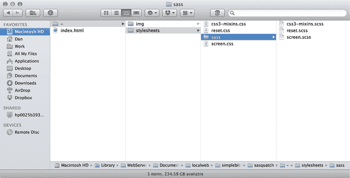

你也可以告诉 `Sass` 监控整个目录，而不是单个样式表。因此，使用上面的文件结构，可以使用以下 `watch` 命令监控项目中的任何 `.scss` 文件：

```
$ sass --watch stylesheets/sass
```

### 使用应用程序代替命令行

我们到为止学过的命令都非常简单，我相信你作为一个敏锐的前端手工艺者，不会觉得将这些输入工作加入你的工作流是件困难的。尽管如此，有一些桌面应用程序可以让你更容易地管理 `Sass` 文件的输出。无论你对命令行的熟悉程度如何，它们都值得一看。

#### Scout

`Scout`（[`bkaprt.com/sass/6/`](http://bkaprt.com/sass/6/)）是一个适用于 Mac 和 Windows 的免费桌面应用，它提供了一个“自包含的 `Ruby` 环境，让你通过几次点击就能轻松管理所有的 `Sass` 项目”。换句话说，`Scout` 为你提供了一个良好的视觉化界面来设置监控的目录和文件，而不是使用命令行（**图 2.2**–**图 2.3**）。

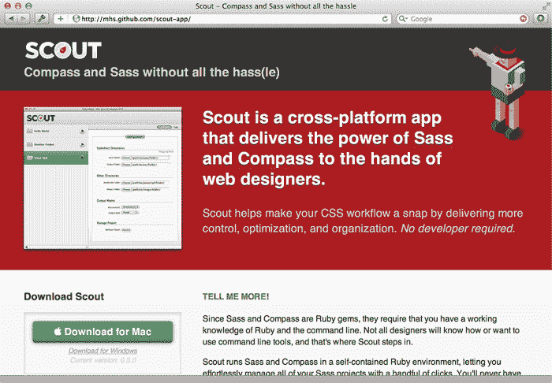

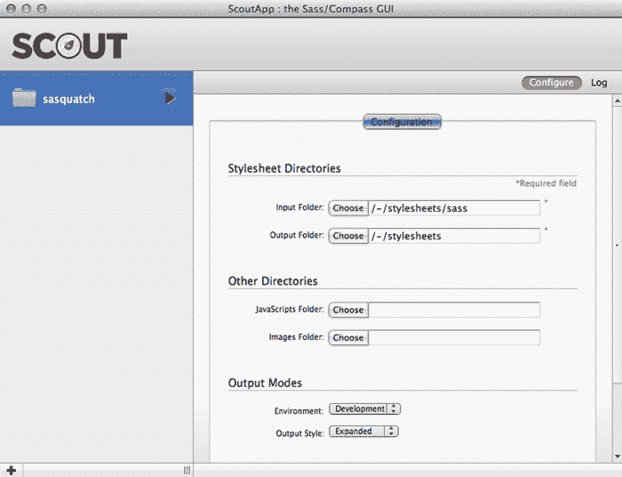

一旦选择了输入和输出文件夹，只需点击项目的播放按钮，`Scout` 就会监控文件。“Log”部分将显示终端更新（**图 2.4**）。

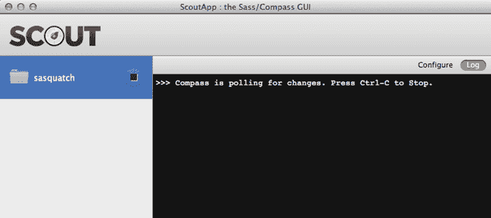


`Scout`是一种简单且方便的编译`Sass`的方法，如果你喜欢这种方式，它可以完全避开命令行（如果你在`Windows`上运行，还可以避免安装`Ruby`）。

### CodeKit

与`Scout`类似，`CodeKit`（[`bkaprt.com/sass/7/`](http://bkaprt.com/sass/7/)；仅限`Mac OS`）通过简单的`GUI`编译你的`Sass`文件。但它也可以编译`LESS`、`Stylus`、`Haml`、`CoffeeScript`、`JavaScript`等。此外，`CodeKit`还有其他可以优化文件和图像并在你开发时自动刷新浏览器的附加功能（图 2.5）。

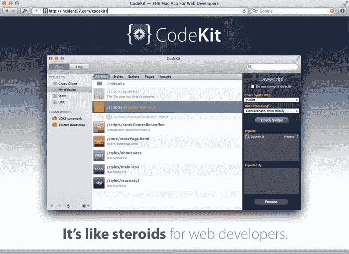

图 2.5：`CodeKit`网站。

### LiveReload

`LiveReload`（[`bkaprt.com/sass/8/`](http://bkaprt.com/sass/8/)）在你工作时监控任何文件变化（包括`Sass`编译），并自动刷新浏览器。它支持`Mac`和`Windows`（图 2.6）。

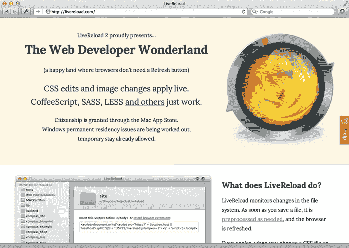

图 2.6：`LiveReload`网站。

### Compass.app

`Compass.app`（[`bkaprt.com/sass/9/`](http://bkaprt.com/sass/9/)）是一个适用于`Mac`、`Windows`和`Linux`的小型菜单栏应用，可以为你监控并编译`Sass`文件（图 2.7）。

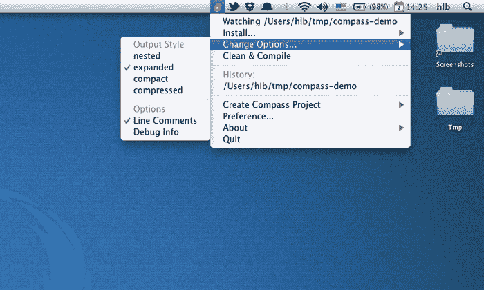

图 2.7：`Compass.app`的选项。

除了桌面应用外，一些开发框架内置了对`Sass`支持。例如，`Ruby on Rails`会在请求样式表时将`Sass`文件自动编译为`CSS`文件。同样，不需要命令行。

所以你可以看到，如果你发现自己对命令行过敏，会有几种选择方案，尽管我希望大家很清楚，运行`Sass`的命令很少且并不复杂。

既然我们已经安装了`Sass`并准备好监控文件，让我们继续讨论输出格式化、注释和嵌套吧。

## 选择输出样式

和你这里的许多人一样，我是通过查看源代码来学习网页设计的。能够查看网站的“内部结构”以观察它是如何构建的，是一种不可思议的奢侈。出于这个原因，我一直在标记语言和样式表的格式上花费了大量的精力：例如缩进声明以及放置右括号的位置、如何使用空格对样式表的部分进行分组等。这一切看起来可能是不必要的过分细节，但由于我们的`CSS`是他人潜在的学习工具，我们并不仅仅是为了自己的利益而创建这些文件。

使用`Sass`时，你不再手动编写那个`.css`文件了。相反，你编写的是没有人看到的`.scss`文件，而`Sass`输出的最终结果可能与你自己的格式偏好不同。正是这种（诚然有点强迫症的）格式控制权衡最初让我产生了反感，并阻止我使用`Sass`。这听起来可能很荒，但如果样式表是我手工艺的结晶，我非常在意它的组织方式和格式。

最终，我克服了这个问题——以至于我写了这本书。归根结底，格式上的差异只是吹毛求节。生成的文件仍然具有完美的人读性。事实上，`Sass`提供了几种输出样式供选择，现在是回顾这些样式的好时机。

### 嵌套（默认）

`Sass`输出的默认样式是嵌套的，它会缩进每个规则以反映其所样式的`HTML`结构。这里有一个嵌套式的示例：

```
ol {
  margin: 10px 0;
  padding: 10px 0; }
  ol li {
    font-size: 2em;
    line-height: 1.4; }
    ol li p {
      color: #333; }
```

### 展开（Expanded）

展开样式是一种更典型的格式，类似于手工编写的样式表。对于那些查看你惊人的`CSS`源代码的人来说，这种格式最熟悉。

这里有一个展开式的示例：

```
ol {
  margin: 10px 0;
  padding: 10px 0;
}

ol li {
  font-size: 2em;
  line-height: 1.4;
}

ol li p {
  color: #333;
}
```

每个右括号都出现在声明末尾并单独占一行。`Sass`在声明之间插入换行符，这似乎是没必要的，但除了这个吹毛求节之外，这是我自己的项目中喜欢使用的样式。它非常接近我在不使用`Sass`的手动创建样式表时使用的格式（尽管这越来越少见了了！）。

要使用这种展开样式而不是默认的嵌套样式，我们只需要在简单的命令中添加一个标记，告诉`Sass`监控文件即可：

```
$ sass --watch --style expanded screen.scss:screen.css
```

### 紧凑（Compact）

紧凑样式将每个声明放在一行上，强调选择器。其想法是你可以轻松地扫描左侧以找到视觉上分组的规则，规则之间有换行符。我个人觉得寻找特定的规则可能很困难，但我甚至见过一些疯狂的`CSS`大佬用这种格式手动编写他们的样式表，因为他们喜欢可读性和优化之间的平衡。

这里有一个紧凑式的示例：

```
ol { margin: 10px 0; padding: 10px 0; }
ol li { font-size: 2em; line-height: 1.4; }
ol li p { color: #333; }
```

这里是指定紧凑样式的方法：

```
$ sass --watch --style compact screen.scss:screen.css
```

### 压缩（Compressed）

第四种也是最后的样式是压缩的，它移除了所有空格和换行符以节省空间。对于高流量的`Web`应用，每个字节都至关重要，`Sass`包含这种样式很贴心。然而，对于人类来说它几乎不可读。

这里有一个示例：

```
ol{margin:10px 0;padding:10px 0;}ol li{font-size:2em;line-height:1.4;}ol li p{color:#333;}
```

这里是指定压缩样式的方法：

```
$ sass --watch --style compressed screen.scss:screen.css
```

在本章中，我将分享许多我在自己的项目每天经常使用的`Sass`功能。我专门为这本书构思了一个虚拟项目，以便我们能够在现实世界的应用场景中讨论`Sass`的功能。该项目名为`Sasquatch Records`——这是一个为唱片公司的简单网站，专注于神话中难以捉摸的野兽超自然音乐风格（图 3.1）。

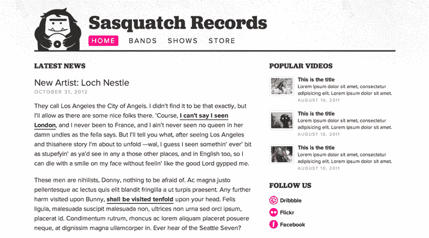

图 3.1：`Sasquatch Records`，我将用这个虚拟网站展示一些`Sass`示例。

`Sass`的功能令人惊叹——它是非常强大的工具，可以帮助在创建复杂的样式表时保持理性。由于我们有许多选择，我想指出我认为对`Web`设计师最有价值且最容易添加到工作流中的`Sass`部分。

## 嵌套规则

在`Sass`中，你可以将`CSS`规则嵌套在彼此内部，而不是在单独的声明中重复选择器。嵌套也反映了标记结构。

例如，`Sasquatch Records`头部标记的主要结构如下：

```
<header role="banner">
  <div id="logo">
  
  </div>

  <h1>Sasquatch Records</h1>
  ...
</header>
```

编写`SCSS`时，我可以镜像这种元素嵌套，让`Sass`构建完整的选择器。我个人喜欢在嵌套选择器之前留一个空行，将它们与具有相同嵌套层级的`CSS`属性隔离开：

```
header[role="banner"] {
  margin: 20px 0 30px 0;
  border-bottom: 4px solid #333;

  #logo {
    float: left;
    margin: 0 20px 0 0;

    img {
      display: block;
      opacity: .95;
    }
  }

  h1 {
    padding: 15px 0;
    font-size: 54px;
    line-height: 1;
    font-family: Jubilat, Georgia, serif;
    font-weight: bold;
  }
}
```

它将编译为：

```
header[role="banner"] {
  margin: 20px 0 30px 0;
  border-bottom: 4px solid #333;
}
header[role="banner"] #logo {
  float: left;
  margin: 0 20px 0 0;
}
header[role="banner"] #logo img {
  display: block;
  opacity: .95;
}
header[role="banner"] h1 {
  padding: 15px 0;
  font-size: 54px;
  line-height: 1;
  font-family: Jubilat, Georgia, serif;
  font-weight: bold;
}
```

`Sass`不需要在选择器中重复每个元素，而是通过嵌套来显示层级关系从而简化问题。当然，嵌套时要小心。有时你不需要选择器写得那么冗长，过度嵌套实际上会阻可读性。嵌套几层效果非常好，而对于特定模块的声明（如上面的示例），`Sass`的嵌套可以节省大量时间。

## 嵌套命名空间属性

除了嵌套规则外，你还可以在`Sass`中嵌套共享同一命名空间的属性（例如`font-family`、`font-size`、`font-weight`等），如下：

```
header[role="banner"] h1 {
  padding: 15px 0;
  font: {
    size: 54px;
    family: Jubilat, Georgia, serif;
    weight: bold;
  }
  line-height: 1;
}
```

它将编译为：

```
header[role="banner"] h1 {
  padding: 15px 0;
  font-size: 54px;
  font-family: Jubilat, Georgia, serif;
  font-weight: bold;
  line-height: 1;
}
```

同样，`text-`命名空间中也有许多属性。我们可以使用`Sass`嵌套来节省重复输入：

```
text: {
  transform: uppercase;
  decoration: underline;
  align: center;
}
```

`background-`是另一个很好的例子：

```
background: {
  color: #ea4c89;
  size: 16px 16px;
  image: url(sasquatch.png);
  repeat: no-repeat;
  position: top left;
}
```

在`Sass`中嵌套意味着更少的输入，使用缩进来反映选择器（以及属性）的形成。对于任何编写`CSS`的人来说，这也是一个容易理解的概念——并不是巨大的思维跨跃。

## 使用 & 引用父选择器

除了嵌套规则和属性外，`Sass`还增加了使用符号`&`作为特殊占位符来引用当前父选择器的功能。

例如，在链接的声明中，我们可以添加悬停样式来覆盖它们的颜色和边框颜色：

```
a {
  font-weight: bold;
  text-decoration: none;
  color: red;
  border-bottom: 2px solid red;

  &:hover {
    color: maroon;
    border-color: maroon;
  }
}
```

（注：原文中包含多个关于`&`示例的重复区块；我在保持技术解释完整的同时处理了核心逻辑。）

## 在 Sass 中注释

`Sass`支持单行注释和多行注释。多行注释使用标准的`CSS` `/* ... */`语法：

```css
/* 这是一条多行注释。 */
```

通过在注释的第一个字符插入`!`，你可以确保重要的注释（版权信息、归属、备注等）在压缩样式中出现：

```css
/*! 这是一条将出现在文件中的多行注释。 */
```

单行注释在每行开头使用`//`前缀，并且不会包含在最终输出中，因此你可以安全地将其用于私注释：

```
// 这是一个单行注释。
// 单行注释会从 css 文件中移除。
// 所以你可以在这里说你想说的。
// 坦白：我真的喜欢听 ABBA 的歌。
// 还有 Hall & Oates。
```

## 变量

`Sass`充满了许多非常有用的功能，让我们作为前端开发者的生活变得更容易。但如果我只能从这些功能中选择一个最有帮助的，那将是变量。

我们在样式表中经常重复某些内容。颜色、字体、图像、宽度等——如果其中任何一个模式发生变化，都需要进行一场查找替换的史诗级斗争。变量让这一切变得简单得多且易于维护。

`Sass`中的变量定义方式类似于普通的`CSS`规则，使用`$`符号如下：

```
$color-main: #333;
$color-light: #999;
$color-accent: #ea4c89;

$font-sans: "Proxima Nova", "Helvetica Neue", Helvetica, Arial, sans-serif;
$font-serif: Jubilat, Georgia, serif;
```

一旦定义，就可以在声明中调用：

```
body {
  padding: 0 8%;
  font-family: $font-sans;
  font-size: 100%;
  color: $color-main;
  background: #fff url(../img/bg.jpg) repeat-x -80% 0;
}
```

`Sass`会在`CSS`输出中将变量替换为它们的值。

```
body {
  padding: 0 8%;
  font-family: "Proxima Nova", "Helvetica Neue", Helvetica, Arial, sans-serif;
  font-size: 100%;
  color: #333;
  background: #fff url(../img/bg.jpg) repeat-x -80% 0;
}
```

通过`Sass`变量，样式表中重复模式的批量更改可以在几秒内完成更新，因此你不需要在整个文件中查找。太棒了！

### 使用变量创建样式指南

`Jina Bolton`写了一非常棒的文章，探讨了`Sass`变量如何帮助根据品牌调色板创建样式指南（[`bkaprt.com/sass/10/`](http://bkaprt.com/sass/10/)）。

> 为了保持我们的样式指南相关性，它存在于我们描述的内部部分。我们与相关的`Sass`变量一起显示我们的调色板，由于我们在相同的前端使用了正在引用的变量来渲染此调色板。当我们更改这些变量的值时，调色板会自动更新（图 3.2）。

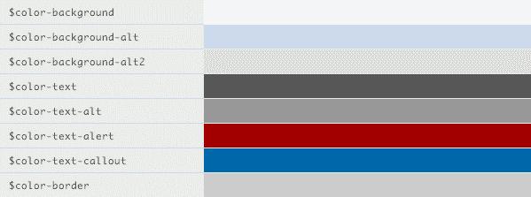

图 3.2：`Jina`使用`Sass`来创建样式指南。

与其创建一个可能会过时且相关的静态样式指南，使用`Sass`变量定义品牌调色板意味着帮助样式指南保持更新和可维护。

使用样式指南的变量作为基础，`Jina`继续讨论利用`Sass`函数在调色板中创建变体。例如，这是`Sasquatch Records`网站的小型调色板，使用单行注释标记颜色：

```
$color-main: #333;       // 黑色
$color-light: #999;      // 灰色
$color-accent: #ea4c9;  // 粉色
```

接下来，使用`Sass`中的`darken`或`lighten`函数可以生成基于调色板的不同色深。让我们将粉色（`#ea4c9`）加深 30%：

```
section.secondary {
  background: darken($color-accent, 30%);
}
```


编译时，`Sass`将通过原始粉色加深 30% 来计算颜色等效值：

```
section.secondary {
  background: #8d1040;
}
```

我们也可以浅化：

```
section.secondary {
  background: lighten($color-accent, 30%);
}
```


这将编译为：

```
section.secondary {
  background: #fad5e3;
}
```

### CSS 变量如何？

`Sass`（以及一般的`CSS`预处理器）的伟大之处之一是，它为可能加入拟标准的功能提供了测试场。也就是说，`Sass`可以以更快的速度实现`CSS`规范中尚未的功能。如果这些功能足够成功，它们就可以合并到标准中。

变量是其中的很好的例子，可能是`CSS`预处理器中最常用的功能。通过`Sass`和`LESS`的使用，变量作为官方`CSS`功能的支持得到了增强。目前，`W3C`草案“CSS Variables Module 1”正在开发中（[`bkaprt.com/sass/11/`](http://bkaprt.com/sass/11/)），并且最新的`WebKit`测试版本已经实现了对变量的支持。这意味着原生支持`CSS`变量已经在。

遗憾的是，在编写期间，`CSS`变量语法与`Sass`不同，并不优雅或易理解。例如，这是为文档根元素定义`CSS`变量的方法：

```
:root {
  --color-main: #333;
}
```

以及在声明中使用变量的方法：

```
#main p {
  color: var(--color-main);
}
```


该提案使用 `--` 前缀定义变量，但使用 `var(variable-name)` 语法表示值。这有点笨拙且混乱，但仍在进行中，许多人要求在两种情况下使用类似 Sass 的 `$foo` 语法。希望最终能这样解决。

最重要的是，由于浏览器支持限于预览版的 WebKit，CSS 变量在生产环境中是不可用的——这是坚持使用 Sass 的另一个理由。

## MIXINS（混合）

让我们来看看我第二个喜欢的 Sass 特性：mixin。变量允许你在整个样式表中定义和复用值，而 mixins 则允许你定义和复用样式块。与其在各种声明中反复输入相同的规则，不如使用 mixins 只定义一组样式，并在需要这些样式时随时引用它。

为了说明，让我们为我在 Sasquatch Records 网站几处区域使用的标题样式创建一个 mixin（图 3.3）。虽然这些标题可能出现在页面的不同位置，但它们的 CSS 是相同的，这正是 mixin 的完美场景。

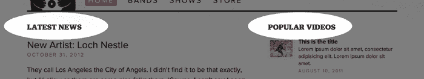

图 3.3：Sasquatch Records 网站上的共享标题样式。

首先，我们将在 `.scss` 顶部使用 `@mixin` 指令在 Sass 中定义一个 mixin。我将其命名为 `title-style`，并定义边距和字体的规则：

```
@mixin title-style {
  margin: 0 0 20px 0;
  font-family: $font-serif;
  font-size: 20px;
  font-weight: bold;
  text-transform: uppercase;
}
```

一旦定义，我们现在可以使用 `@include` 指令在任何想要插入这些样式的地方引用此 mixin。

在 Sasquatch 网站上，我们的样式表有一部分定义了页面主部分的规则，我们想样式 `<h2>` 元素：

```
section.main h2 {
  @include title-style;
}
```

这将编译为：

```
section.main h2 {
  margin: 0 0 20px 0;
  font-family: 'Georgia', serif;
  font-size: 20px;
  font-weight: bold;
  text-transform: uppercase;
}
```

但我们只想样式侧边栏的 `<h3>` 元素，因此在样式表稍后处调用 mixin，结果是相同的：

```
section.secondary h3 {
  @include title-style;
}
```

Mixins 可以包含额外的规则：

```css
section.secondary h3 {
  margin: 0 0 20px 0;
  font-family: 'Georgia', serif;
  font-size: 20px;
  font-weight: bold;
  text-transform: uppercase;
  color: #999;
}
```

共享样式可以抽象为 mixins，你仍然有能力通过额外的规则来覆盖或增强这些样式。强大的功能！

### Mixin 参数

Sass mixins 还可以接收我们在调用时传递给 mixin 的参数。例如，为我们的 `title-style` mixin 添加一个指定颜色的参数。

在定义 mixin 时在括号内指定变量：

```scss
@mixin title-style($color) {
  margin: 0 0 20px 0;
  font-family: $font-serif;
  font-size: 20px;
  font-weight: bold;
  text-transform: uppercase;
  color: $color;
}
```

调用 mixin 时，我们现在可以向它传递颜色（这里是漂亮的焦橙色），以及其他规则：

```scss
section.main h2 {
  @include title-style(#c63);
}
```

这将编译为：

```css
section.main h2 {
  margin: 0 0 20px 0;
  font-family: 'Georgia', serif;
  font-size: 20px;
  font-weight: bold;
  text-transform: uppercase;
  color: #c63;
}
```

#### 多参数

通过在 mixin 定义中用逗号分隔值，可以传递多个参数：

```scss
@mixin title-style($color, $background) {
  margin: 0 0 20px 0;
  font-family: $font-serif;
  font-size: 20px;
  font-weight: bold;
  text-transform: uppercase;
  color: $color;
  background: $background;
}
```

这里是 mixin 从两个不同的选择器被调用的，为颜色和背景传递了不同的参数：

```scss
section.main h2 {
  @include title-style(#c63, #eee);
}
section.secondary h3 {
  @include title-style(#39c, #333);
}
```

在这种情况下，上述代码将将编译为：

```css
section.main h2 {
  margin: 0 0 20px 0;
  font-family: Jubilat, Georgia, serif;
  font-size: 20px;
  font-weight: bold;
  text-transform: uppercase;
  color: #c63;
  background: #eee;
}
section.secondary h3 {
  margin: 0 0 20px 0;
  font-family: Jubilat, Georgia, serif;
  font-size: 20px;
  font-weight: bold;
  text-transform: uppercase;
  color: #39c;
  background: #333;
}
```

你可以开始看到 mixins（混合宏）是多么的灵活。通过参数，一致共享的规则可以与略有差异的规则并存。

### 为参数定义默认值

当你使用 mixin 参数时，定义默认值通常非常方便。这样一来，如果这是常态，你只需要不带参数地调用 mixin，但仍然传入覆盖值。

```scss
@mixin title-style($color, $background: #eee) {
  margin: 0 0 20px 0;
  font-family: $font-serif;
  font-size: 20px;
  font-weight: bold;
  text-transform: uppercase;
  color: $color;
  background: $background;
}
```

尽管我们为 mixin 的背景定义了浅灰色默认值，但我们可以传递一个不同的参数：

```scss
section.main h2 {
  @include title-style(#c63);
}
section.secondary h3 {
  @include title-style(#39c, #333);
}
```

这再次将编译为：

```css
section.main h2 {
  margin: 0 0 20px 0;
  font-family: Jubilat, Georgia, serif;
  font-size: 20px;
  font-weight: bold;
  text-transform: uppercase;
  color: #c63;
  background: #eee;
}
section.secondary h3 {
  margin: 0 0 20px 0;
  font-family: Jubilat, Georgia, serif;
  font-size: 20px;
  font-weight: bold;
  text-transform: uppercase;
  color: #39c;
  background: #333;
}
```

此外，当你为 mixin 定义了多个默认参数时，你可以选择性地覆盖这些参数，而无需重新定义所有参数。

例如，假设我们的 mixin 为 `$color` 和 `$background` 都定义了值：

```scss
@mixin title-style($color: blue, $background: green) {
  margin: 0 0 20px 0;
  font-family: $font-serif;
  font-size: 20px;
  font-weight: bold;
  text-transform: uppercase;
  color: $color;
  background: $background;
}
```

如果我们想让颜色保持默认的蓝色，但想将背景覆盖为粉色，我们只需要传递背景：

```scss
section.main h2 {
  @include title-style($background: pink);
}
```

这将将编译为：

```css
section.main h2 {
  margin: 0 0 20px 0;
  font-family: Jubilat, Georgia, serif;
  font-size: 20px;
  font-weight: bold;
  text-transform: uppercase;
  color: blue;
  background: pink;
}
```

这是一个非常省时间的方法，它将这些参数定义在一个地方（即 mixin 中）。

## CSS3 喜爱 MIXINS

带参数的 mixins 使用在 CSS3 中非常大放异彩，在 CSS3 中，我们经常在整个样式表中重复带有厂商前缀的规则，以实现圆角、阴影、渐变、过渡等。虽然这些属性的值在整个设计中可能有所不同，但有大量内容是共享和重复的，而 Sass 处理 CSS3 “堆栈”变得轻而易举。不记得创建 CSS 渐变的语法了吗？把它写成 mixin 吧！

### border-radius

这是一个用于在所有浏览器中处理 CSS3 圆角的 mixin，带一个用于半径值的参数：

```scss
@mixin rounded($radius) {
  -webkit-border-radius: $radius;
     -moz-border-radius: $radius;
          border-radius: $radius;
}
```

我们随后可以通过调用该 mixin 让页面上的任何内容变为圆角：

```scss
ol.slats li a img {
  float: left;
  margin: 0 10px 0 0;
  padding: 4px;
  border: 1px solid #ddd;
  @include rounded(3px);
}
div.module {
  padding: 20px;
  background: #eee;
  @include rounded(10px);
}
```

这将其编译为：

```css
ol.slats li a img {
  float: left;
  margin: 0 10px 0 0;
  padding: 4px;
  border: 1px solid #ddd;
  -webkit-border-radius: 3px;
     -moz-border-radius: 3px;
          border-radius: 3px;
}
div.module {
  padding: 20px;
  background: #eee;
  -webkit-border-radius: 10px;
     -moz-border-radius: 10px;
          border-radius: 10px;
}
```

### box-shadow

这是另一个使用多个参数的示例：一个在 CSS3 中创建投影的 mixin，它使我们能够传入阴影的垂直和水平位置、模糊程度以及颜色：

```scss
@mixin shadow($x, $y, $blur, $color) {
  -webkit-box-shadow: $x $y $blur $color;
     -moz-box-shadow: $x $y $blur $color;
          box-shadow: $x $y $blur $color;
}
```

让我们将这个 mixin 添加到之前的 `div.module` 示例中，让阴影从顶部出现，带有 `1px` 的 `2px` 偏移，以及 50% 的透明度：

```scss
div.module {
  padding: 20px;
  background: #eee;
  @include shadow(1px, 2px, 3px, rgba(0,0,0,0.5));
}
```

这将其编译为：

```css
div.module {
  padding: 20px;
  background: #eee;
  -webkit-box-shadow: 1px 2px 3px rgba(0,0,0,0.5);
     -moz-box-shadow: 1px 2px 3px rgba(0,0,0,0.5);
          box-shadow: 1px 2px 3px rgba(0,0,0,0.5);
}
```

### CSS3 渐变

CSS3 渐变语法很丑。它根据浏览器而不同，很难记忆，而且在历史上规范发生了很大变化，迫使作者更新样式表。由于所有这些原因，Sass（特别是 mixin）使得使用 CSS3 变得可行且具有前瞻性。如果规范再次发生变化，我们只需要在 mixin 中更新一次语法。

例如，让我们为 Sasquatch 设计（图 3.4）中的活动标签页样式添加一个 CSS 线性渐变：

```scss
header nav[role="navigation"] ul li.active a {
  padding: 3px 8px;
  color: #fff;
  -webkit-border-radius: 4px;
     -moz-border-radius: 4px;
          border-radius: 4px;
  /* 针对旧浏览器的备选 */
  background-color: #d4278;
  /* Mozilla Firefox */
  background-image: -moz-linear-gradient(#ff0b1, #d4278);
  /* Opera */
  background-image: -o-linear-gradient(#ff0b1, #d4278);
  /* WebKit (Safari/Chrome 10) */
  background-image: -webkit-gradient(linear, left top, left bottom, color-stop(0, #ff0b1), color-stop(1, #d4278));
  /* WebKit (Chrome 11+) */
  background-image: -webkit-linear-gradient(#ff0b1, #d4278);
  /* IE10 */
  background-image: -ms-linear-gradient(#ff0b1, #d4278);
  /* W3C */
  background-image: linear-gradient(#ff0b1, #d4278);
}
```

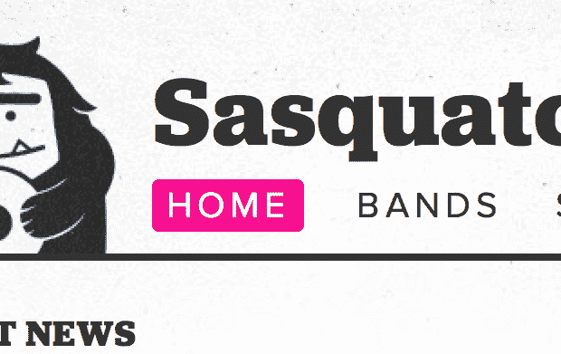

图: 3.4: Sasquatch 网站上的共享标题样式。

```scss
@mixin linear-gradient($from, $to) {
  /* Fallback for sad browsers */
  background-color: $to;
  /* Mozilla Firefox */
  background-image:-moz-linear-gradient($from, $to);
  /* Opera */
  background-image:-o-linear-gradient($from, $to);
  /* WebKit (Safari 4+, Chrome 1+) */
  background-image:-webkit-gradient(linear, left top, left bottom, color-stop(0, $from), color-stop(1, $to));
  /* WebKit (Chrome 11+) */
  background-image: -webkit-linear-gradient($from, $to);
  /* IE10 */
  background-image: -ms-linear-gradient($from, $to);
  /* W3C */
  background-image: linear-gradient($from, $to);
}
```

注意，我正在使用 `$to` 颜色为不支持 CSS 渐变的浏览器指定 `background-color` 的回退方案。

幸运的是，我们只需要写一次这个怪物代码。

现在，当我们想要创建一个简单的线性渐变时，只需使用两个选择的颜色调用 mixin，Sass 就会完成剩下的工作。对于 Sasquatch 网站，激活标签页样式的声明如下：


```scss
&.active a {
  padding: 3px 8px;
  color: #fff;
  @include rounded(4px);
  @include linear-gradient(#ff70b1, #d42a78);
}
```

这不仅是可以接受的，而且非常符合逻辑！就像是用英语编写的一样。而且我还可以复用这个模式，例如对于一个蓝色按钮（图 3.5），将其应用于样式表中的不同选择器上，而不需要重新记住那些复杂的渐变语法垃圾：

```scss
button {
  padding: 5px 10px;
  color: #fff;
  @include rounded(6px);
  @include linear-gradient(#42b3e2, #1a6798);
}
```


图 3.5：使用 Sass mixin 可以轻松实现渐变按钮。

正如你可能知道的，在这里使用的线性渐变只是一个简单的例子，CSS 渐变能够处理更复杂的情况，例如颜色停止点、径向渐变、多方向等。Sass 也能帮助处理这些情况，将任何共享的模式抽象为可重用的 mixin。

## 创建 Mixin 库

Mixins 是奇妙的，因为它们可以编写一次并在整个样式表中使用。但通常这些 mixins 甚至会在项目之间被重复使用。你可能会发现自己在为常见的 CSS3 属性编写 mixins，如`box-shadow`、渐变、CSS 过渡以及如自动清除浮动、`box-sizing`、表单元素等模式。如果能将所有这些都写一次，并复用到任何使用 Sass 的项目中，难道不是更高效吗？

### @import

引入`@import`规则，Sass 扩展了它以允许导入多个 SCSS 文件，并在编译时将它们合并成单个 CSS 文件。这出于许多原因而非常方便：

* 单个 CSS 文件意味着更少的 HTTP 连接。提升性能！
* 变量可以在单独的文件中定义，然后在需要时导入，无论布局和其他页面特定的样式如何。
* 导入的 SCSS 文件可以包含与项目无关的 mixins，可以进行共享和复用。

以下是`@import`在实践中的工作方式。

我有一个`mixins.scss`文件，被导入到我所有的项目中。在该文件中，我定义了一些每个项目中都会用的常用模式。以下是`mixins.scss`内容的示例：

```scss
@mixin rounded($radius) {
  -webkit-border-radius: $radius;
     -moz-border-radius: $radius;
          border-radius: $radius;
}
@mixin shadow($x, $y, $blur, $color) {
  -webkit-box-shadow: $x $y $blur $color;
     -moz-box-shadow: $x $y $blur $color;
          box-shadow: $x $y $blur $color;
}
@mixin shadow-inset($x, $y, $blur, $color) {
  -webkit-box-shadow: inset $x $y $blur $color;
     -moz-box-shadow: inset $x $y $blur $color;
          box-shadow: inset $x $y $blur $color;
}
@mixin transition($property) {
  -webkit-transition: $property .2s ease;
     -moz-transition: $property .2s ease;
       -o-transition: $property .2s ease;
          transition: $property .2s ease;
}
@mixin box-sizing {
  -webkit-box-sizing: border-box;
     -moz-box-sizing: border-box;
          box-sizing: border-box;
}
@mixin linear-gradient($from, $to) {
  /* Fallback for sad browsers */
  background-color: $to;
  /* Mozilla Firefox */
  background-image:-moz-linear-gradient($from, $to);
  /* Opera */
  background-image:-o-linear-gradient($from, $to);
  /* WebKit (Chrome 11+) */
  background-image:-webkit-gradient(linear, left top, left bottom, color-stop(0, $from), color-stop(1, $to));
  /* WebKit (Safari 5.1+, Chrome 10+) */
  background-image: -webkit-linear-gradient($from, $to);
  /* IE10 */
  background-image: -ms-linear-gradient($from, $to);
  /* W3C */
  background-image: linear-gradient($from, $to);
}
```

在我的主样式表（在本例中为`screen.scss`）顶部，我定义了所有的布局和其他网站特定的样式，我使用`@import`规则将它们拉进来，以便 mixins 可用。我还导入了一个每个项目中都复用的重置样式表（再次节省了 HTTP 连接并避免了复制粘贴相同的代码），以及一个存放了网站颜色、字体等变量的变量文件（图 3.6）。这允许我在其他样式表中导入这些相同的变量——例如，在同一个项目中应用样式指南的其他页面或部分——而无需同时导入剩余的布局。

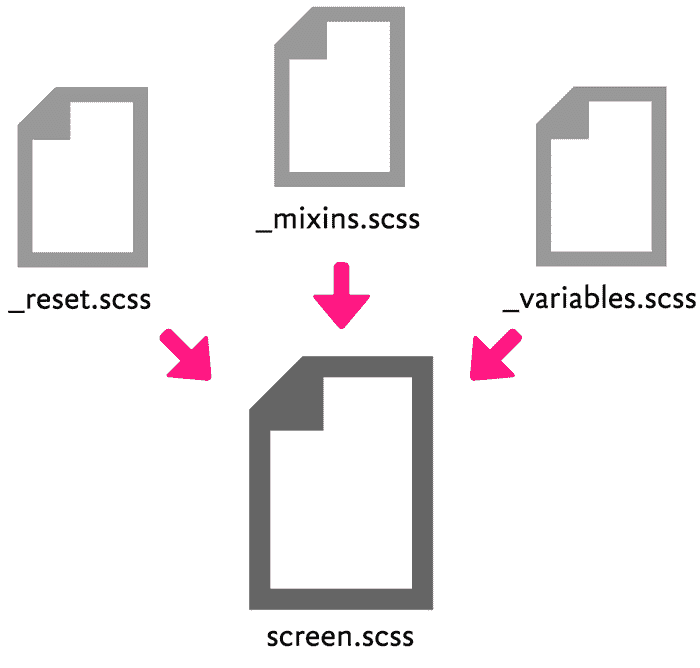

图 3.6：使用`@import`将分块合并为一个文件。

```scss
 // 导入其他文件

@import "reset.scss";
@import "variables.scss";
@import "mixins.scss";

// 网站特定样式

.foo {
  ...
}
```

### Compass 框架

我总是建议创建你自己的框架，因为尽可能了解你的代码中发生了什么是最好的。但作为一种学习体验，其他框架可能非常有益——它们能让你看到别人是如何构建项目并提高效率的。Compass 也不例外。

### Bourbon 库

设计/开发公司 thoughtbot 的伙伴们汇集了一个丰富的 mixin 库，称为 Bourbon——巧合的是，我也一直在喝过这种酒，加了苦味酒、苦味精、捣碎的糖和水果（图 3.8）。

稍手搜一下 Google 就能发现许多非常有用的 Sass 使用者在 GitHub 或他们自己的网站上分享他们的 mixins。很有可能，那个看起来很丑且难以维护的 CSS3 堆栈已经有人为它写好了 mixin，所以请利用好社区的力量吧！

### @extend

你是否曾发现自己正在编写一个 CSS 类，它与另一个类具有相同的样式，除了少数其他规则外？

这是一个示例。你在页面顶部有一个有两个选项的警报消息样式。一种样式处理标准警报（图 3.9），而另一种样式处理正向警报（图 3.10）。这些样式几乎相同，只有背景颜色不同。

通常，我们可能会为普通警报创建一个基础类，然后创建另一个仅覆盖背景颜色的类。

```html
<h2 class="alert alert-positive">这是一个积极提示！</h2>
```

如果每个提示的样式设置如下所示：

```css
.alert {
  padding: 15px;
  font-size: 1.2em;
  font-weight: normal;
  text-transform: uppercase;
  line-height: 1;
  letter-spacing: 3px;
  text-align: center;
  color: #fff;
  background: $color-accent;
  @include shadow(0, 1px, 2px, rgba(0,0,0,.5));
  @include rounded(10px);
}
.alert-positive {
  background: #9c3;
}
```

我们不需要在标记语言中充斥额外的类来处理这些细小的异常，而是可以使用 Sass 的`@extend`函数将多个选择器之间共享的样式“链”在一起。此外，我们还可以添加额外的覆盖规则，创建一个创建一个新的唯一样式，而无需重复共享的样式。

因此，如果我们想使用`@extend`来处理两种类型的提示消息，可以将标记简化为仅一个类：

```html
<h2 class="alert-positive">这是一个积极提示！</h2>
```

然后使用`@extend`包含`h2.alert`类的样式，加上`background-color`异常：

```css
.alert-positive {
  @extend .alert;
  background: #9c3;
}
```

Sass 将会高效地编译扩展类，如下所示：

```css
.alert, .alert-positive {
  padding: 15px;
  font-size: 1.2em;
  font-weight: normal;
  text-transform: uppercase;
  line-height: 1;
  letter-spacing: 3px;
  text-align: center;
  color: #fff;
  background: #ea4c89;
       -webkit-box-shadow: 0 1px 2px rgba(0, 0, 0, 0.5);
       moz-box-shadow: 0 1px 2px rgba(0, 0, 0, 0.5);
       box-shadow: 0 1px 2px rgba(0, 0, 0, 0.5);
    -webkit-border-radius: 10px;
       -moz-border-radius: 10px;
       border-radius: 10px;
}
.alert-positive {
  background: #9c3;
}
```

现在，当然，我们从一开始就可以这样写 CSS，但`@extend`语法让它更快——更不用说哪些样式在类之间是共享的了。这更容易理解正在发生什么。

使用`@extend`还允许我们在语义上更加简洁，根据含义而非外观来定义类名。

### 多个 @extends

你还可以在声明中`@extend`多个类，这会将每个类的所有样式链在一起：

```css
.alert {
  padding: 15px;
  font-size: 1.2em;
  text-align: center;
  background: $color-accent;
}
.important {
  font-size: 4em;
}
.alert-positive {
  @extend .alert;
  @extend .important;
  background: #9c3;
}
```

将其编译为：

```css
.alert, alert-positive {
  padding: 15px;
  font-size: 1.2em;
  text-align: center;
  background: #ea4c89;
}
.important, .alert-positive {
  font-size: 4em;
}
.alert-positive {
  background: #9c3;
}
```

同样，Sass 高效地组织内容，使用逗号分隔的选择器将共享样式分组，然后为任何异常创建单一声明。

#### @extend 使用占位符选择器

如果你扩展的类仅仅是为了扩展其他样式而存在呢？换句话说，可能会创建一个不会单独使用的类。

这就是占位符选择器（placeholder selectors），它允许你定义“虚拟”类，这些类本身不会出现在输出的 CSS 中。你可以使用`@extend`引用占位符。

让我们在实践中看看。我们将为一组定义按钮的样式块创建一个类。我们将使用占位符选择器，在 Sass 中，这意味着用`%`而不是`.`作为类名前。

```css
%button {
  padding: 10px;
  font-weight: bold;
  background: blue;
  border-radius: 6px;
}
```

我们可以像以前一样使用`@extend`在其他类中调用此规则集：

```css
.buy {
  @extend %button;
}
.submit {
  @extend %button;
  background: green;
}
```

Sass 将其编译为扩展类，但`%button`占位符规则集不会出现在输出中：

```css
.buy, .submit {
  padding: 10px;
  font-weight: bold;
  background: blue;
  border-radius: 6px;
}
.submit {
  background: green;
}
```

嵌套媒体查询（media queries）可以避免在每次需要针对不同断点进行调整时，都重写选择器（在本例中为`section.main`）。

此外，媒体查询声明直接插入到原始选择器下方，这非常方便。我发现，将媒体查询放在就近的上下文中来理解元素在不同视口下的变化，要比将它们聚集在样式表末尾或单独的文档中要容易得多。

### 使用变量定义断点

媒体查询冒泡（Media-query bubbling）是 Sass 为响应式设计带来的极佳便利，但仍然存在大量的重复工作。在每个声明中，我们都要指定断点（上一个示例中的`800px`和`500px`）。在设计过程中，我经常会根据正在处理的具体设计以及对布局反应的观察来微调这些断点，而不是依赖静态设备宽度。换句话说，你在每个嵌套媒体查询中指定的这些断点可能会发生变化。如果能定义一次并在一处进行编辑，那就太好了。Sass 变量来救场！

让我们为媒体查询中将使用的三个断点创建一些变量。我将给它们起一个灵活的名字，不绑定到特定的设备或有限的值。

```scss
$width-small:  500px;
$width-medium: 800px;
$width-large:  1200px;
```

将断点定义为 Sass 变量后，我们（从 Sass 3.2 开始）可以在整个文档中使用嵌套媒体查询时随时引用这些变量。例如：

```scss
section.main {
  font-size: 16px;
  line-height: 1.4;

  @media screen and (max-width: $width-large) {
    float: left;
    width: 65%;
  }

  @media screen and (max-width: $width-medium) {
    float: none;
    width: auto;
  }

  @media screen and (max-width: $width-small) {
    font-size: 12px;
    line-height: 1.4;
  }
}
```

它将编译为：

```scss
section.main {
  font-size: 16px;
  line-height: 1.4;

  @media screen and (max-width: 1200px) {
    float: left;
    width: 65%;
  }

  @media screen and (max-width: 800px) {
    float: none;
    width: auto;
  }

  @media screen and (max-width: 500px) {
    font-size: 12px;
    line-height: 1.4;
  }
}
```

如果我们之后决定微调这些断点，只需要编辑一次变量，Sass 就会处理所有使用过它们的地方更新。

```scss
$width-small:  400px;
$width-medium: 760px;
$width-large:  1100px;
```

这在响应式设计的初始开发阶段非常有帮助，因为根据设计需求和设计需要适应的方式，这些断点是一个不断变动的目标。

在这里甚至进行数学运算，因为我们可以对断点的值进行加法或减法：

```scss
@media screen and (max-width: $width-small + 1) {
  font-size: 12px;
  line-height: 1.4;
}
```

它将编译为：

```scss
@media screen and (max-width: 401px) {
  font-size: 12px;
  line-height: 1.4;
}
```

而：

```scss
@media screen and (max-width: $width-small - 1) {
  font-size: 12px;
  line-height: 1.4;
}
```

它将编译为：

```scss
@media screen and (max-width: 399px) {
  font-size: 12px;
  line-height: 1.4;
}
```

更进一步，你还可以将整个媒体查询定义为变量（而不仅仅是数值）：


进入`/path/to/xxx`目录，找到`xxx.json`。

在表达式`cvar = avar + bvar`中，加法运算符（`+`）将`avar`与`bvar`相加，得到它们的和`cvar`。

在`List.of(arg0, arg1, arg2)`中，`List`接口的工厂方法`of()`接受一系列的元素，返回包含它们的只读列表。

之后我们这样调用`cmd`命令：`cmd arg0 arg1 arg2`。

```
if (condVar > someVal) {console.log("xxx")}
```


正如我们所讨论的，情况要简单得多。但 `Sass` 可以变得随你心意的强大。至少，它是一个极佳的工具，可以很好地融入你的系统和工作流，而不会干扰你编写了多年的 `CSS`（如果你只写了几个月的 `CSS`，那么好吧……几个月而已了）。

## 资源

### 网站与文章

* **Sass reference**: `Sass` 的官方文档。
* **The Sass Way**: `Chris Eppstein` 深入讲解了 `Sass`。
* **CSS Tricks**: `Chris Coyier` 同样也涵盖了 `Sass`。
* **Getting started with Sass**: `Code School` 关于 `Sass` 的全面课程。
* **Looking into the future of Sass**: `David Walsh` 评估了 `Sass` 即将推出的特性。

### Mixin 库

* **Compass**: 由 `Blueprint` 创建的功能强大的 `Sass` 框架。即使你不使用 `Compass`，它的文档也是一个宝库。
* **Bourbon**: 自称为“一个用于 `Sass` 的简单轻量级 `mixin` 库”，`Bourbon` 提供了来自 `thoughtbot` 的大量 `mixin` 概念。
* **Handy Sass Mixins**: `Jake Bresnehan` 的优秀 `Sass` `mixins` 集合。

### 更多 Sass 与响应式设计

* **Breakpoint**: 一个 `Sass` 插件，让媒体查询变得更加简单。
* **Susy**: 用于 `Compass` 和 `Sass` 创建响应式网格系统的辅助工具。
* **Sassaparilla**: 一个使用 `Compass` 和 `Sass` 创建响应式 Web 设计项目的启动框架。

### 工具

* **FireSass for Firebug**: 一个实用的 `Firefox` 扩展，可以显示 `Sass` 编译样式表的原始文件名和行号，方便调试。
* **Developing with Sass and Chrome DevTools**: 关于如何在开发 `Sass` 时最好地使用 `Chrome` 的教程。

### 其他 CSS 预处理器

虽然 `Sass` 是本书的主题，但它并不是唯一的 `CSS` 预处理器。如果你染上了预处理的毒（我真心希望你染上了），那么可能值得看看这些替代方案——注意它们与 `Sass` 的不同之处。

#### LESS

`LESS` 是设计师和前端手工艺人员的另一个流行选择。它与 `Sass` 非常相似，因为它也支持变量、混合器（`mixins`）和其他函数，但它使用的语法略有不同。就像 `Sass` 的 `SCSS` 一样，`LESS` 是 `CSS` 的扩展，这意味着它可以与现有的样式表良好地配合，并可以逐步引入（[http://bkaprt.com/sass/32/]）。

`LESS` 还有一个客户端编译选项，它将 `.less` 文件提供给浏览器，浏览器在页面加载时通过 `JavaScript` 将其编译为普通的 `CSS`。这在本地工作和开发中是一种非常方便的方法，因为不需要运行命令行或应用程序来为你进行转换。然而，不建议在生产网站中使用客户端编译。

与 `Sass` 一样，`LESS` 也有一个命令行程序以及一些可以将 `LESS` 文件转换为 `CSS` 文件的第三方应用。

在功能方面，与 `Sass` 相比，`LESS` 做的稍微……嗯，更少一点。在我看来，`Sass` 拥有更活跃的开发周期和后端社区，而且功能上更健壮一些。尽管如此，`LESS` 支持的都是重要内容——那些能帮助你更高效地编写 `DRY`（不重复）样式表的功能。无论你使用哪一个预处理器，只要你在用，你就已经赢了。

想要对 `Sass` 和 `LESS` 进行极佳对比，请看看 `Chris Coyier` 的那篇详尽的文章，他在文中详细分析了差异以及优缺点（[http://bkaprt.com/sass/33/]）。

这些争论有时会变成宗教战争，但关键在于使用你最熟悉的工具。两者对于减轻创建智能样式表的压力都将有巨大的帮助。

#### Stylus

`Stylus` 比 `LESS` 和 `Sass` 稍微年轻一点，它拥有广泛的功能集。它的语法更像 `Sass` 的原始语法（可选的缩进、可选省略大括号和分号）。我喜欢那些不会过度打乱我正常工作流的工具，因此由于这个原因，我没有深入研究过 `Stylus`。但我在这里提到它是因为，再次，如果你觉得它适合你，那就尽管去用吧。重要的是利用这些工具中的一个让你的生活变得轻松一点（[http://bkaprt.com/sass/34/]）。

# 参考文献

短 URL 按顺序编号；相关的长 URL 列在下方供参考。

## 第一章

1: [`pragprog.com/the-pragmatic-programmer`](http://pragprog.com/the-pragmatic-programmer)
2: [`c2.com/cgi/wiki?DontRepeatYourself`](http://c2.com/cgi/wiki?DontRepeatYourself)
3: [`www.w3.org/People/Bos/DesignGuide/maintainability.html`](http://www.w3.org/People/Bos/DesignGuide/maintainability.html)
4: [`sass-lang.com/about.html`](http://sass-lang.com/about.html)

## 第二章

5: [`rubyinstaller.org`](http://rubyinstaller.org)
6: [`mhs.github.com/scout-app/`](http://mhs.github.com/scout-app/)
7: [`incident57.com/codekit`](http://incident57.com/codekit)
8: [`livereload.com`](http://livereload.com)
9: [`compass.handlino.com`](http://compass.handlino.com)

## 第三章

10: [`blog.engineyard.com/2011/front-end-maintainability-with-sass-and-style-guides`](http://blog.engineyard.com/2011/front-end-maintainability-with-sass-and-style-guides)
11: [`www.w3.org/TR/css-variables/`](http://www.w3.org/TR/css-variables/)
12: [`compass-style.org`](http://compass-style.org)
13: [`bourbon.io/`](http://bourbon.io/)

## 第四章

14: [`github.com/scottjehl/picturefill`](https://github.com/scottjehl/picturefill)

## 资源

15: [`sass-lang.com/docs/yardoc/file.SASS_REFERENCE.html`](http://sass-lang.com/docs/yardoc/file.SASS_REFERENCE.html)
16: [`thesassway.com`](http://thesassway.com)
17: [`css-tricks.com/search-results/?q=sass`](http://css-tricks.com/search-results/?q=sass)
18: [`css-tricks.com/sass-style-guide/`](http://css-tricks.com/sass-style-guide/)
19: [`www.codeschool.com/courses/assembling-sass`](http://www.codeschool.com/courses/assembling-sass)
20: [`alistapart.com/article/getting-started-with-sass`](http://alistapart.com/article/getting-started-with-sass)
21: [`davidwalsh.name/future-sass`](http://davidwalsh.name/future-sass)
22: [`compass-style.org/reference/compass/`](http://compass-style.org/reference/compass/)
23: [`bourbon.io`](http://bourbon.io)
24: [`alistapart.com/article/getting-started-with-sass`](http://alistapart.com/article/getting-started-with-sass)
25: [`davidwalsh.name/future-sass`](http://davidwalsh.name/future-sass)
26: [`compass-style.org/reference/compass/`](http://compass-style.org/reference/compass/)
27: [`bourbon.io`](http://bourbon.io)
28: [`alistapart.com/article/getting-started-with-sass`](http://alistapart.com/article/getting-started-with-sass)
29: [`davidwalsh.name/future-sass`](http://davidwalsh.name/future-sass)
30: [`compass-style.org/reference/compass/`](http://compass-style.org/reference/compass/)
31: [`bourbon.io`](http://bourbon.io)
32: [`alistapart.com/article/getting-started-with-sass`](http://alistapart.com/article/getting-started-with-sass)
33: [`davidwalsh.name/future-sass`](http://davidwalsh.name/future-sass)
34: [`compass-style.org/reference/compass/`](http://compass-style.org/reference/compass/)

# 致谢

首先，最重要的是，我要感谢我在 `Dribbble` 的战友 `Rich Thornett`。在我们开发这个小社区期间，通过不断的推动治愈了我对 `Sass` 的抵触。这花了一整年的时间。感谢 `Rich`！

我还想感谢 `A Book` 让我在这里创作。他们是一个非常棒的团队，坦率地说，很难想象还有其他地方。感谢 `Mandy Brown`、`Jason Maria` 和 `Jeffrey Zeldman`——感谢你们创造了如此美好的作品。

特别感谢经理 `Katel Du`。你让一切井井有条。感谢 `Erin Kissane`，让我听起来比实际上写得好。由你来做那是我的荣幸。感谢 `Hampton Catlin` 发明了 `Sass`，感谢 `Nathan Weizenbaum` 和 `Chris Eppstein` 开发了 `Sass` 并使其成为今天不可或缺的工具。

感谢 `Jina Bolton` 担任出色的技术编辑和 `Sass` 大使。

最后，感谢你的阅读。

# 索引

- 内容, 75
- 扩展函数, 62
- 多重, 75
- 导入规则, 57

## A

- `Sass` 应用, 23

## B

- `Bolton, Jina`, 41
- 圆角混合器, 51
- `Bos, Bert`, 13
- `Bourbon`, 61
- 阴影混合器, 52
- 断点，设置, 75

## C

- 颜色函数, 42
- 注释, 39
- 紧凑样式, 29
- `Compass` 框架, 59
- 压缩样式, 30
- 合并, 84
- `CSS3` 渐变, 53

## D

- `DRY`（不重复）原则, 12

## E

- `Sass` 的电梯演讲, 10
- `Eppstein, Chris`, 60

## F

- 扩展样式 (expanded style), 28
- 文件组织, 22

## H

- `HiDPI`, 80
- `Hunt, Andy`, 12

## I

- 缩进语法, 16
- 在 `Mac` 上安装 `Sass`, 19
- 在 `Windows` 上安装, 21

## J

- `Jehl, Scott`, 80

## M

- 媒体查询, 69
- `mixins` (混合入), 44
- 混合入内部, 87
- 库, 56
- 带参数的混合入, 46

## N

- 嵌套样式 (nested style), 28
- 嵌套 (nesting)
  - `CSS` 规则, 32
  - 媒体查询, 69
  - 命名空间属性, 35

## O

- 输出格式化, 27
- 插入覆盖, 38

## P

- 父选择器，引用, 36
- `Picturefill`, 80
- 占位符选择器, 66
- 《实战程序员编程》(`The Pragmatic Programmer`), 12

## R

- `retina` 屏幕, 80
- `retinize` `mixin`, 83

## S

- `Sass`
  - 定义, 14
  - 语法, 15
- `SCSS` (“Sassy CSS”), 15
- 编写样式指南, 41

## T

- `Thomas, Dave`, 12
- `thoughtbot`, 61

## V

- 变量, 40
  - 定义, 40
  - 在 `CSS` 中, 43
- 多个视口, 75

## W

- `watch` 命令, 22

# 关于这本书 (ABOUT A BOOK APART)

我们以风格化、清晰且最重要的是简洁的方式，涵盖了 Web 设计和开发中新兴且至关重要的主题——因为兼任设计师的开发者无法浪费时间。

## 版记 (COLOPHON)

正文使用 `FF Yoga` 及其配套字体 `FF Yoga Sans` 排版，均由 `Xavier Dupré` 设计。标题和封面使用 `David Berlow` 的 `Titling Gothic` 字体。

# 关于作者 (ABOUT THE AUTHOR)


`Dan Cederholm` 是一位住在马萨诸塞州萨勒姆的设计师、作者和演讲者。他是设计师社区 `Dribbble` 的联合创始人，也是微型设计工作室 `SimpleBits` 的创始人。作为基于标准的 Web 设计长期倡者，`Dan` 曾与 `YouTube`、`Microsoft`、`Google`、`MTV`、`ESPN` 等机构合作。他写过几本关于 Web 设计的热门书籍，并于 2012 年初获得 `TechFellow` 奖。他目前是一名有抱负的 `banjo` 琴演奏手，偶尔会戴棒球帽。
