# JavaScript 和 Ajax 脚本：设计师指南


# 版权

欢迎在网络上 [www.newriders.com](http://www.newriders.com) 找到我们

如需报告错误，请向 `errata@peachpit.com` 发送邮件

`New Riders` 是 `Pearson Education` 旗下 `Peachpit` 的分品牌

版权 © 2010 `Charles Wyke-Smith`©

开发编辑与排字：`Beth Bast`

项目编辑：`Nancy Peterson`

技术编辑：`Christian Heilmann`

制作协调员：`Hilal Sala`

文字编辑与校对：`Anne Marie Walker`

营销经理：`Glenn Bisignani`

索引编员：`Joy Dean Lee`

封面设计：`Aren Howell`

封面制作：`Hilal Sala`

内页设计：`Mimi Heft`

## 权利声明

保留所有权利。未经出版者书面许可，不得以任何形式或通过任何手段（电子、机械、复印、录音或其他）复制或传输本书的任何部分。有关获取转载和节选许可的信息，请联系 `permissions@peachpit.com`。

## 责任声明

书中的信息按“原样”提供，不提供任何保证。尽管在准备本书时已采取一切预防措施，但作者或 `Peachpit` 对因书中包含的指令或书中描述的计算机软件和硬件产品直接或间接引起或所谓的任何损失或损害不对任何个人或实体承担责任。

## 商标

制造商和销售为了区分其产品而使用的许多标识均主张为商标。当这些标识出现在书中且 `Peachpit` 知晓该商标主张时，这些标识将按照商标所有者要求的格式出现。书中识别的所有其他产品名称和服务仅用于编辑目的，且出于此类公司利益的考虑，并无侵犯商标的意图。此类使用或对任何贸易名称的使用均不意在表达对本书的支持或其他关联。

技术备注：本书使用 `Adobe InDesign` 制作。代码在 `Adobe Dreamweaver` 中开发。图形使用 `Adobe Fireworks` 和 `Adobe Photoshop` 设计。屏幕截图使用 `Ambrosia Software` 开发的 `SnapzProX` 拍摄。

ISBN 13: 978-0-321-57260-8

9 8 7 6 5 4 3 2 1

美国印刷并装订

# 献献

> 给 Beth

# 致谢

我首先感谢 `Peachpit` 的出版商 `Nancy Ruenzell`，让我有机会在 `New Rider` 品牌下编写另一本书，并感谢 `Peachpit` 征稿编辑 `Michael Nolan` 鼓励我完成 *...in’* 三部曲。

我的项目编辑 `Nancy Peterson` 一直以来是一位智慧且亲切的顾问，同时让我专注于时间截止日期，而我实际上也准时完成了任务。我们每周的电话会议是指导和鼓励的绝佳来源，对本书的方向和重点做出了巨大贡献。Nancy，向你诚挚地感谢，我希望我们很快能面对面交流。

感谢 `Peachpit` 的编辑和制作团队：感谢制作编辑 `Hilal Sala` 在准备页面进入印刷阶段时对无数细节的关注，感谢 `Anne Marie Walker` 的文字编辑和校对，感谢 `Joy Dean Lee` 编制的索引。

有几位程序员曾与我一起编写此书。`Michael Rosier` 协助完成了初始目录和一些早期代码示例。`Mark Turansky` 是宝贵建议和想法的来源，并在第 6 章中开发了框架示例。来自旧金山 `Ithus` 的 `Austin Markus` 曾是我书籍 *Codin’ for the Web* 的技术编辑，他为第 7 章中的作者轮播示例编写了 `PHP` 和大部分 `jQuery` 代码。

我诚挚地感谢 `Yahoo!` 开发网络国际开发布道者以及 `JavaScript` 奇才 `Chris Heilmann`。作为本书的技术编辑，他的贡献是无价的，我感谢他对代码提供的详尽且总是幽默的反馈。他还开发了第 7 章中的 `YUI` 示例。我很高兴他是一个猫头鹰，因为当我在南卡罗来纳州工作到深夜时，我经常能在伦敦清晨通过 `Skype` 与远在伦敦的他进行视频会议以获取建议。与 `Chris` 合作是一次非常棒的经历，感谢他为这个项目投入的时间。

特别感谢 `Adobe Dreamweaver` 的技术产品经理 `Scott Fegette`，感谢他持续的支持和鼓励。

特别致谢 `David Sarnoff`、`Sean Rose` 和 `Mike Harding`，他们是我乐队 `Mental Note` ([www.mentalnoteband.com](http://www.mentalnoteband.com)) 的音乐伙伴。伙计们，在本书开发期间偶尔抽出去弹演奏有助于我保持理智，我很感激你们的友谊以及我们一起创作音乐的时间。

再次给我的妻子 `Beth` 一个大大的拥抱和吻，她的角色从我之前的几本书扩展到了这本的编辑，并在本书的每一个方面都向我提供了建议。她与 `Peachpit` 团队一起编辑了章节草稿，纠正了我的长难句（是的，依然如此），并让我重写解释，直到我写出她能理解的内容。多亏了你，我们完成了！

致我可爱的女儿 `Jemma` 和 `Lucy`，在我写书期间，我们在一起的时间又变少了，现在是属于我们的假期了。我非常爱你们，感谢你们在我闭关办公室写作时的耐心，并期待与你们一起度过夏天。

最后，我想感谢你们这些读者购买我的书，并分享了你们在使用书中技术和想法方面的经验。我很高兴终于在你们的鼓励下完成了这本 `JavaScript` 书。

—`Charles Wyke-Smith`

南卡罗来纳州查尔斯顿，2009 年 7 月 12 日

# 关于作者

`Charles Wyke-Smith` 是《Stylin’ with CSS: A Designer’s Guide》和《Codin’ for the Web: A Designer’s Guide to Developing Web Sites》作者。他在印刷、多媒体和 Web 设计领域拥有多年经验。他在 80 年代中期在旧金山创立了 `PRINTZ Electronic Design`，这是一个早期的全电脑设计工作室，并且是交互媒体开发的先驱。

自 1994 年以来他一直在创建网站，并为 `Wells Fargo`、`Benefitfocus`、`ESPN Video Games` 和加州大学金山分校等公司提供 Web 设计和咨询服务。

今天的工作专注于在线应用程序开发，强调用户体验、信息架构和界面设计。

作为一名成功的演讲者和导师，`Charles` 教授过多媒体界面设计课程，并在许多行业会议上进行演讲。

他与妻子和两个女儿住在南卡罗来纳州的查尔斯顿。

# 贡献

`Christian Heilmann` 从心底里就是一个极客和黑客。他担任专业 Web 开发人员已有十一年，通过几家机构晋升到 `Yahoo!`，并在那里交付了 `Yahoo Maps Europe` 和 `Yahoo! Answers`。

他写过两本关于 `JavaScript`、Web 开发和无访问性的书籍，并对他三本书做过贡献。在过去的几年里，他曾管理美国、印度和英国的团队，发布了数十篇在线文章和数百篇博客文章。

他曾被英国 `.net` 杂志提名为“2008 年度年度标准冠军”。目前，他担任国际开发者布道师，穿梭于各大会议和大学，培训人们使用 `Yahoo!` 以及其他 Web 公司提供的系统。


`Austin Markus` 是一位 Web 应用程序开发者，也是金山 `Ithus Digital` 的负责人。

在互联网时代之前，他就对计算机和编程产生了兴趣，在卧室里运行 `BBS`，并当看到来自全国甚至世界的人连接进来时感到惊叹。他早期的工作包括为 `Macromedia` 开发 `ActionScript` 演示应用程序，以及为《金山纪报》开发一套从电报到互联网的出版系统。

今天，他开发的应用程序涵盖了从电子商务、内容管理系统到社交网络应用的各种领域。

`Austin` 是开源的坚定信者，曾向 `Drupal` 和 `jQuery` 等项目贡献过模块。他认为下一个大趋势将是普及计算和增强现实。为此，他目前正在开发一个 `Android` 移动平台的应用程序，旨在弥合在线与现实世界之间的差距。

# 引言

*Scriptin’ with JavaScript and Ajax* 是系列丛中的第三本书，旨在向设计师和程序员介绍开发浏览器界面的过程。第一本 *Stylin’ with CSS* 侧重于内容的结构和样式，第二本 *Codin’ for the Web* 侧重于浏览器、中间件和数据库的三层架构，这是几乎每个 Web 网站的核心组件。

本书的重点是 `JavaScript` 以及一种基于 `JavaScript` 的编程技术 `Ajax`，它极大地改进了用户浏览器与 Web 服务器之间的通信。本书的目标是教你如何使用 `JavaScript` 和 `Ajax` 为当今的 Web 网站和在线应用开发复杂且响应式用户界面。`Ajax` 赋予了 `JavaScript` 新意义，今天几乎所有成功的网站和在线应用都广泛使用 `JavaScript` 和 `Ajax`。

# 关于本书

我写这本书的目的是让你实地理解 `JavaScript` 是如何编写的以及它提供的可能性，以及如何开发在所有现代 Web 浏览器中可靠运行的健壮且紧凑的代码。通过相互递进的示例，你将掌握使用 `JavaScript` 提高你所开发的网站的用户体验和性能的理解与技能。所有的示例都可以轻松添加到自己的页面中，这是开始使用 `JavaScript` 的绝方法。在此过程中，我将向你展示从许多项目中中学到的技巧、捷径和陷阱。

与我的其他书籍一样，重点在于开发实用、专业且希望有盈利的技能。

虽然这是一本关于 `JavaScript` 的书，但由于需要，它有更广泛的范围。`JavaScript` 不能孤立使用：它的目的是通过行为增强 Web 页面。它作用于页面的结构（`HTML` 标记）和呈现（`CSS` 样式），从而在原本静态的页面提供交互性。通过 `Ajax` 交互，`JavaScript` 还可以通过与生成页面和管理数据库通信的中间件通信，从服务器请求内容。

这意味着在讨论 `JavaScript` 时，必须将 `HTML`、`CSS` 和服务器中间件（我在本书中使用 `PHP`）考虑在内。因此，如果你发现本书的许多页面说明了 `HTML`、`CSS` 和 `PHP` 代码，不要感到惊讶：这些代码是 `JavaScript` 运行的上下文。我将详细解释此类代码的作用，但如果你已经在 `HTML`、`CSS`、`PHP` 或其他中间件语言（如 `.NET` 或 `Java`）方面拥有良好的基础，你将从本书中受益最深。

此外，让我说明一下这本书不是什么。首先，它不是对 `JavaScript` 的全面涵盖。虽然我展示了许多使用远超基础编码技巧的真实世界示例，但我没有涵盖最先进的主题，例如原型继承和闭包。然而，在读完 *Scriptin’* 之后，这些主题对你来说无疑将更容易理解，而且在书中，我提供了许多资源引用，可以帮助进一步提升你的技能。其次，我没有提供 `JavaScript` 语言中每个对象的每个属性和方法的细节。有很多优秀的参考书和在线资源可以为你提供这些信息，我在书中提到了它们中的许多。

# 关于 JavaScript

`JavaScript` 是唯一运行在浏览器中的编程语言，没有它，你就无法构建现代的 Web 应用程序。今天的用户期望在填写表单时进行验证、无需等待新页面即可按需交付内容，并且界面具有通用的应用程序的外观和感受。`JavaScript` 是满足这些期望的关键。

网站和在线应用程序之间的界限正变得模糊：`Facebook` 是一个网站还是一个在线应用程序？它通过 Web 访问，但它的界面及其无需刷新页面即可更新数据的能力使其具有桌面应用程序的特征。无疑，我在本书中将“网站”和“在线应用程序”交替使用——这可能正变成一种毫无意义的区分。

作为驱动交互式界面的新角色的一部分，`JavaScript` 最近获得了来自浏览器开发者的关注，就像 `CSS` 几年前收到的关注一样，以努力使其在所有浏览器中的实现标准化。`CSS` 在这方面已经有了很大改进，但 `JavaScript` 在不同浏览器中的工作方式仍有许多差异。这些差异回溯到了“浏览器大战”时代，当时 `Netscape` 和微软在 90 年代后期开发竞争性功能，以努力将它们几乎完全相同的产区分开来。

## JavaScript 的 W3C 和微软实现模型

浏览器大战的遗留是两种不同的 `JavaScript` 实现。微软浏览器遵循我在书中称为“微软模型”的标准，而其他浏览器（特别是 `Firefox`、`Safari` 和 `Opera`）遵循一种我在书中称为“世界维网联盟（`W3C`）模型”的标准。

`W3C` 模型和微软模型之间最重要的差异在于 `JavaScript` 实现的三个关键领域：记录用户操作位置（哪个元素）和类型（鼠标点击、按键按下等）的事件对象；管理 `Ajax` 请求的 `XMLHttpRequest` 对象；以及允许页面在到达浏览器时立即用 `JavaScript` 驱动的行为进行初始化的 `load` 事件。在本书中，我将说明你的代码如何检测用户浏览器实现的是 `W3C` 模型还是微软模型并做出相应响应。

这些浏览器差异、`JavaScript` 代码通常的冗长性质以及对用户界面更复杂交互的需求，推动了许多 `JavaScript` 框架的发展以解决这些问题。框架（或通常说的库）为常见的任务提供了大量的预构建功能、复杂的界面组件、跨浏览器兼容性，在许多情况下，还提供了一种运行在 `JavaScript` 之上的虚拟新语言。框架可以极地缩短开发时间，我将在后面的章节中展示几个框架及其功能。

为了让你的网站能够在尽可能多的设备上接触最广泛的受众，`JavaScript` 只应该用于增强已经具有功能的 Web 页面。任何网站都不应该完全依赖 `JavaScript` 来运行：这是一个可访问性问题，我在第 1 章 中讨论过这个问题。遗憾的是，如今许多网站在运行上完全依赖 `JavaScript`。对于那些无法在浏览器中运行 `JavaScript` 的人、视觉障碍并依赖屏幕阅读器的人，或者物理上无法完成 `JavaScript` 驱动网站可能可能的手势（例如使用鼠标拖放元素）的人来说，这些网站是无法使用的。

在书中，你将学习如何设计为使用 `JavaScript` 的用户提供最佳体验，同时为那些由于各种原因无法在浏览器中运行 `JavaScript` 或无法与 `JavaScript` 提供的更复杂界面功能交互的用户提供可接受且功能良好的体验。在第 7 章 中，我展示了两个大量使用 `JavaScript` 和 `Ajax` 的项目，但这两个项目在没有 `JavaScript` 的情况下仍然可以使用。

# 准备好使用本书

如果你问我：“我应该如何通过这本书学习 `JavaScript` 呢？”，以下是我的回答。

先从通读这本书开始。找一个安静的地方，留出几个小时时间快速浏览一遍。不要担心第一次就能理解所有内容，只需熟悉书的内容及其包含的示例。如果你手头有一台电脑，可以在阅读时在 `Scriptin’` 网站上复习示例，那就再好了。

花时间研究代码。从 [www.scriptinwithajax.com](http://www.scriptinwithajax.com) 下载代码的 `zip` 文件并将其解压。在名为 `code` 的文件夹中，你将找到按章节组织的所有示例。在复习书中示例时，在代码编辑器中打开相关的代码会非常有帮助，因为你可以看到我正在讨论的代码部分更广泛广泛的上下文。

你可以在自己的服务器上运行这些代码。如果你将整个代码文件夹复制到运行 `PHP` 的 Web 服务器上，并在浏览器的地址栏中输入代码文件夹的 `URL`，该文件夹中的 `index.php` 文件将加载并显示指向所有示例的链接。

当你熟悉代码后，拿起这些示例并开始将它们整合到你自己的项目中。当你开始为了自己的目的修改代码时，你的技能将会迅速提高。

你编写的代码很少在第一次就能运行，但通过能够让你直看到代码正在做什么的工具，你可以快速弥补你认为代码正在做什么与代码实际发生的情况之间的差距。协调这两种状态被称为调试。

为了帮助你编写和调试代码，我建议你采取以下步骤设置你的计算机。

1. 在 [www.getfirefox.com](http://www.getfirefox.com) 下载并安装 `Firefox` 浏览器。`Firefox` 提供了良好的开发工具，可能是最符合标准的浏览器。一旦你的代码在 `Firefox` 中运行正常，请在其他浏览器上进行测试并进行任何必要的调整。

2. 下载并安装两个 Essential `Firefox` 插件，同样来自 [www.getfirefox.com](http://www.getfirefox.com)：

    - **Web 开发者工具栏 (The Web Developer toolbar)**。在网站的插件部分搜索此工具栏，或直接访问 [`addons.mozilla.org/en-US/firefox/addon/60`](https://addons.mozilla.org/en-US/firefox/addon/60)。此工具栏允许你在工作时开启和关闭 `JavaScript` 和 `CSS`，在编写时验证你的 `HTML` 和 `CSS`，列出页面上所有的元素以显示它们的关系，查看页面上任何元素的祖先列表，以及更多功能。对我来说，它最不可或缺的特性是“查看生成的源代码”（View Generated Source），它允许你查看由你的 `JavaScript` 代码在运行时动态生成的标记。

    - **Firebug**。`Firebug` 提供 `JavaScript` 错误报告，并允许你在代码中插入断点，这样你就可以在任何时候停止代码运行，并查看 `JavaScript` 中所有变量和对象的状态。在示例中说明变量检查时，我主要使用 `alert` 对话框，因为这样可以获得简单的截图，但一旦你进入严肃的开发工作，`Firebug` 真的是更好的方法。查看 [www.digitalmediaminute.com/screencast/firebug-js](http://www.digitalmediaminute.com/screencast/firebug-js) 获取关于使用 `Firebug` 的优秀视频教程。

我没有尝试，也没有空间展示并解释每个示例的每一行代码。相反，我专注于说明我此时正在讨论的话题的代码部分。然而，我做的是确保代码中说明的所有概念都已经在某个点得到了解释，并且代码留了良好的注释，以便你理解它。

# 欢迎反馈


我知道，尽管我付出了最大努力，并有一支致力于这本书的专业团队，它仍可能包含错误和遗漏，而你们这些亲爱的读者又非常擅长发现并向我报告这些问题。我会发布发现的任何错误，因此请在`Scriptin'`网站上向我报告。也欢迎你写评论或给我发送你作品的 URL。我期待收到你的回复。

# 软件即服务

我认为显而易见的是，我们正在稳步迈向这样一个点：安装在计算机上的“盒装”软件将几乎消失。它无疑会被富界面应用 (RIAs) 取代，界面运行在浏览器中，而 Web 服务器管理对各种实时数据的访问。这种软件概念、设计和交付方式的改变使得应用程序能够不断演进，而不是分发独立版本，并为设计师和开发者在想象和构建新体验时提供了近乎无限范围。

已经成熟的软件即服务 (SaaS) 模型使得像 [Saleforce.com](http://Saleforce.com) 和 [Zoho.com](http://Zoho.com) 这样的公司成为可能，为用户提供了按需的 RIAs，而以前他们必须对单体桌面程序进行昂贵的投资。在可预见的未来，这些新的 RIAs 将由`JavaScript`驱动，我希望 *Scriptin'* 能给你知识、信心和灵感，为 Web 演进这一令人兴奋的新时代做出自己的贡献。

# 第 1 章 JavaScript 成熟

**精通 JavaScript (Mastering javascript)** 是每位 Web 设计师的必备技能。这并非一直如此，但`JavaScript`在现代 Web 网站中承担了全新且重要的角色。对于任何界面设计师或任何处理表示层的 Web 工程师来说，现在了解`JavaScript`与了解`HTML`和`CSS`一样重要。

虽然`HTML`传统允许你创建结构化的 Web 页面，`CSS`允许你赋予愉悦的视觉外观，但通过这种方式创建的页面对用户操作几乎没有视觉响应，除非是一些鼠标悬停时高亮的某些链接或简单的 CSS 驱动的下拉菜单。如果用户通过点击链接或提交表单向服务器发送数据，她必须耐心等待数据在服务器上进行处理，并返回一个新的 HTML 页面作为响应。这是 Web 2.0 世界之前 Web 网站的状态，也是许多网站仍然生存的世界。

Web 2.0 是一个有些过度使用的术语，被慷慨地应用于当今 Web 世界中所有新颖和不新的事物，正如维基百科的这段引言所示：

“Web 2.0”术语指的是一种所谓的第二代 Web 开发与设计，旨在促进万维网上的通信、安全信息共享、互操作性和协作。Web 2.0 概念导致了基于 Web 的社区、托管服务和应用程序的发展与演进；例如社交网站、视频共享网站、维基、博客和标签分类（folksonomies）。

尽管有这些夸张的说法，Web 2.0 提供了一个令人鼓舞的现实，所有的 Web 设计师都乐于拥抱。

从纯粹的设计和技术角度来看，定义这种“第二代 Web 开发与设计”的两个关键特性是界面具有流动的、交互的感，以及在“后台”请求并接收服务器数据的能力，然后在不加载新页的情况下向用户展示这些数据。

在才华横溢且知识丰富的的设计师手中，这两种交互可以将网站转换为富交互界面应用程序（`RIA`）。在`RIA`中，时尚且技术上复杂的界面组件接受用户输入，然后似乎立即用新数据做出响应。一个简单的例子是，当用户鼠标悬停在列表中的某个标题上时，该故事的描述几乎立即从服务器传输并添加到标题下方的页面中。在过去，这种效果只能通过在初始页面包含每个故事的内容来实现，导致导致庞大的页面下载。这种从服务器获取数据并直接添加到页面中的能力，是一种被称为`Ajax`的 JavaScript 驱动编码技术的结果。由于`Ajax`，今天的网站正在变成看起来和感觉起来都像任何运行在你计算机上的普通“主权型”应用程序。

在`Ajax`和`RIAs`出现之前，网站中使用的所有处理能力都在服务器端。浏览器只是收集要发送到服务器的数据，并渲染服务器响应的页面。相比之下，`RIA`的界面运行在浏览器的客户端侧，因此可以充分利用现代浏览器作为应用程序平台的能力，以及用户计算机日益增长的性能。

我们的用户现在拥有应用程序的前端以及运行它的强大计算能力，而且就运行在他们所有常规程序运行的地方——在他们的计算机上，而不是在互联网的另一端。服务器现在可以通过`Ajax`直接被浏览器访问，它作为应用程序数据的实时处理器和供应者，承担了更专注的角色。

这种责任的重新分配，让工作在客户端和服务器之间得到了更平等、更合理的共享，为你这个 Web 设计师提供了一个构想和开发网站的新型、更强大的模型。

`RIAs`的奇妙世界由`JavaScript`驱动。它是编写今天 Web 应用程序客户端逻辑的语言；它控制界面并引导服务器的活动。`JavaScript`正式上一直作为`HTML`和`CSS`的“穷亲戚”潜伏在幕后，主要用于浏览器侧的数据验证和简单动画效果，而现在被推向了舞台中心。因此，你开启这一新 Web 开发模型潜力的创意和工程之门的关键，就是掌握`JavaScript`。

在本章的其余部分，你将学习如何规划页面的编码，以便能够方便地使用`Ajax`进行增强，从而将你的网站转换为更像应用程序的体验。

## 可访问性与渐增强（Accessibility and Progressive Enhancement）

在讨论`JavaScript`和`Ajax`之前，我会谈谈可访问性——涵盖它的所有含义。在设计`RIA`网站时，很容易让它的运行完全依赖于`JavaScript`，但这样的网站会给许多用户带来严峻的问题。那个超级酷的拖放功能对于身体残障且无法使用鼠标的人，或由于视力不佳而依赖听力屏幕阅读器的人来说是毫无用的。

此外，一些人使用旧浏览器和低性能计算机，它们无法支持体验你的`RIA`所需的技术能力，或者他们仅仅因为感知安全风险而关闭了`JavaScript`。这也是一个可访问性问题。

对于任何关于网站应该具有可访问性的建议，常见的反应是：“噢，这对我们的网站来说并不重要，因为它只供（选择一个：内部用户、一小部分客户、我们的首选供应商、超人和蝙蝠）使用，他们都使用（在此处输入某种极其强大的计算机），而且他们没有人（在此处输入某种残疾），而且无论如何我老板告诉我不要担心这个。”

与其陷入激烈的辩论，我对可访问性的立场是：如果你从一开始就做决定，那么创建一个网站是完全可行的——它为功能健全的用户和浏览器提供丰富的用户体验，并为能力较弱的用户提供更简单但完全可用的体验。

简而言之，如果用户没有开启`JavaScript`，或者浏览器不支持运行在`W3C`（万维网联盟）版本的文档对象模型（`DOM`）上的现代`JavaScript`，网站仍然可以运行。我们在这里讨论的不是某些微道的用户数量。6% 的所有用户出于安全或其他原因没有在浏览器中运行`JavaScript`（The Counter, 2009 年 2 月全球统计数据），对于从你的网站中排除这些用户来说，这是一个显著的比例。

让你能够为所有用户提供恰当但始终有效的体验的方法被称为渐进增强（progressive enhancement）。如果符合《美国残疾人法案》第 508 条、渴望接触尽可能多的潜在客户，或者仅仅是因为你的良知要求，你也可以构建一个`JavaScript`驱动的`RIA`，它在没有`JavaScript`的情况下仍然提供其核心功能。

然而应该指出，尽管意图良好，某些由`JavaScript`驱动的界面交互（拖放就是一个非常好的例子）在没有`JavaScript`时并不能很好地降级为普通的`HTML`界面组件。如果你希望你的网站具有可访问性，你可能即使对于最强大的用户也要放弃此类组件，或者提供另一种完成该任务的替代方案。在后的情况下，`JavaScript`通常会隐藏备用组件；如果没有`JavaScript`，则显示 HTML 组件。

我（以及可访问性社区）建议是，你应该规划你的网站，使其在有`JavaScript`的情况下也能工作。在本章中，我将向你展示用`HTML`和`PHP`实现的简单表单，稍后用`Ajax`对其增强，使其无论是否有`JavaScript`都能工作。

## 渐增强的三个步骤

创建一个无`JavaScript`也能运行的应用程序的步骤基于在网站基础功能的基础上叠加增强。

1. **使其功能化。** 仅使用`HTML`前端和你选择的服务器技术（`PHP`、`.NET`、`Java`等）让网站工作。

2. **让它美观。** 使用外部样式表中的 CSS 对 HTML 进行样式化（通过`LINK`元素链接到页面）。

3. **增强体验。** 添加界面行为，以提供更直观的响应和控制，并提供 Ajax 连接以实现对服务器端功能的“无页面刷新”访问。

如果你以这种分层的方式进行思考，那么即使你出色的 RIA（富交互应用程序）突然处于一个没有 JavaScript 的环境中，它也会退回到旧的“往返”模型，即将数据发送到服务器并等待返回页面。用户不会察觉这种区别；网站仍然将有精美的样式，并且仍然可以工作。在更受限的环境下（既不支持 CSS 支持 JavaScript），网站看起来可能没那么吸引人，但仍然可以运行。只要用户具备支持 HTML 的能力，他们就能使用你的网站。

本章的其余部分将通过一个简单的示例说明如何创建一个基于渐进增强前两个步骤的站点，并为后续添加 JavaScript 界面交互和 Ajax 服务器通信做好准备，或者使用一个更常用且更准确的术语，即“叠加（layered on）”。我将在本章中只讨论第三步，但实际上会在 第 5 章 中进行演示。

让我们从第一步开始——让它可用——看看创建一个允许用户在你的网站上注册的表单需要什么。

## 让它可用

在这个示例中，我将创建一个可以工作的表单。为了实现这一点，我只需要 HTML 标记来创建表单，以及一种服务器语言（我将使用`PHP`）在提交表单数据时在服务器上进行验证和记录数据。

### HTML——创建 DOM

HTML 用于构建结构。如果你从编写良好的 HTML 开始，你将拥有一个极佳的基础，以便在其之上叠加 CSS 和 JavaScript。

以下是编写 HTML 的一些简单指南。

首先，使用正确的元素来标记内容的每个部分。学习一份 HTML 词汇表，了解每个元素应该如何使用，以及可以添加到它们上的必要属性和可选属性。一个常见的标记错误是在表单的`input`元素（文本字段）上漏掉`label`元素。`label`元素还应该有一个`for`属性，其值应与`input`的 ID 相同，以便在语义上将元素和标签绑定在一起。这样，如果使用屏幕阅读器访问网站，当用户将光标移动到字段中时，标签会被读出来。

### 注意


如需 HTML 快速参考列表，请访问 [`w3schools.com/tags/default.asp`](http://w3schools.com/tags/default.asp)。对于更完整的 HTML 教程，请尝试 [`dev.opera.com/articles/view/12-the-basics-of-html`](http://dev.opera.com/articles/view/12-the-basics-of-html)。

我无论如何强调理解各种 HTML 元素并恰当使用它们有多么重要。如果你在段落标签中加粗文本来创建标题，或者不理解块级和内联级 HTML 元素之间的区别，你需要提高你的 HTML 知识，以便能够以具有语义意义且技术有效的方式使用它的元素。

其次，针对最后一点，在 `validator.w3c.org`(http://validator.w3c.org) 上验证你的标记，或使用 Web 开发者工具栏，这样你就可以确保你的标记是良好良好的，所有标签都正确嵌套并关闭。

如果你在奇怪为什么我在本关于 JavaScript 的书中执着于 HTML 标记，原因如下。当你编写 HTML 时，你实际上是在创建 DOM，它是一个层次化的节点集合。节点有三种类型：HTML 元素、元素的属性以及元素内部的文本（代码中的空格也会被现代浏览器视为节点，你将在 第 2 章 中看到如何考虑这一点）。CSS 和 JavaScript 都作用于这些 DOM 节点，但只有当文档结构良好，并且在需要的地方元素上添加了适当的 ID 和类时，它们才能这样做。把 HTML 标记写对，JavaScript 就可以施展它的魔术。

### 表单标记

记住到为止所读的所有内容，看一个简单的表单标记，用户可以在其中提交他们的电子邮件地址以订阅新闻邮件。参见 **图 1.1**。此表单将仅使用 HTML 和`PHP`激活，然后使用 CSS 进行样式化。稍我们将使用 Ajax 增强它以提高用户体验，但如果没有 JavaScript，它可以退回到非 Ajax 交互功能。

**示例 1.1. simple_form_step1.php**

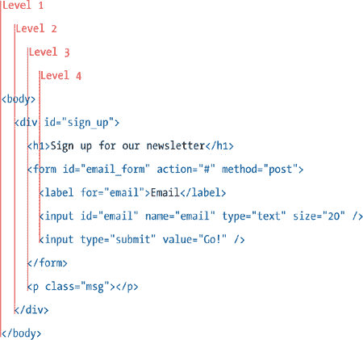

**图 1.1。覆盖在这些标记上的红色垂直线表示元素之间的层次关系。注意，此代码段仅显示了 body 标签之间的标记。**

**图 1.2** 显示了这种 HTML 在浏览器中的外观。

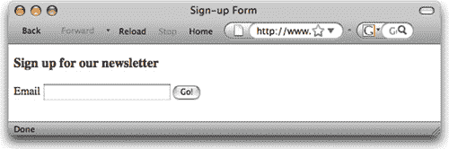

**图 1.2. 未样式的表单。**

你可能已经注意到在 ID 为`msg`的最后一个标签中没有文本。这是因为稍后我将使用`PHP`在此标签中添加消息，如果提交的地址无效。因为它还没有文本，该元素在屏幕上是不可见的。

### 代码缩进

在阅读任何代码之前，你首先注意到的是代码的缩进。你不需要缩进代码，但你绝对应该这样做，这里是代码缩进的原因和方法。

可以使用制表符或几个空格来缩进，根据我的技术编辑 Chris 的共识，是使用几个空格。

如果一个元素嵌套在（包含在）之前的标签中，它应该缩进。换句话说，如果之前打开的元素尚未关闭，则缩进当前行。例如，在 图 1.1 中，body 之后的`div`在下一个`h1`元素打开之前关闭，所以`h1`缩进了。`label`和`input`元素进一步缩进，因为它们被`form`元素包含。

### 注意


基本规则很简单：缩进嵌套标签。

正确的缩进有助于确认你的标记是良好的，所有标签都正确嵌套。缩进自然地创建了一种代码布局，其中嵌套最深的标签位于最右侧，如果标记格式正确，最后一行回到页面左侧。如果你在某处漏掉了闭合标签，这种情况就不会发生。例如，注意关闭的`div`标签与代码上方的开启标签完全对齐。只要你正确嵌套了内部所有的标签，任何包含元素始终都是这样。通过遵循提到的缩进规则，每个子元素都相对于其父元素进行了缩进。

### 子节点

理解 DOM 的下一步是了解元素内的文本是该元素的子节点。例如，“Sign up for our newsletter”这段文本是一个文本节点，它是它所处`p`元素的子节点。元素的属性也是该元素的子节点，因此`div`上的`id="sign-up"`属性是`div`的一个子节点。JavaScript 可以访问并更改元素节点及其子属性节点和文本节点；而 CSS 除伪类`*:before`和`*:after`（这两个伪类可以提供一种相当有限的向页面添加内容的方法）外，只能访问元素节点和属性节点。

通过图 1.1。

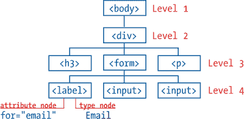

**图 1.3. DOM 层级结构。**

将此图与标记进行比较。你希望通过查看标记就能在脑海中形成这种树状的 DOM 视图。如果你研究缩进以及每个元素的文本和属性，做这并不困难。有了这个心理模型，你可以很容易地查看任何 HTML 标记，并确定如何使用 CSS 和 JavaScript 来访问你想修改的节点。

### 处理数据

正如前面提到的，我将使用 PHP 来处理表单。我可以写一整本书关于 PHP（实际上，我确实写了），但在这里我将涵盖几个关键点，然后简单地展示代码并进行逐行解释。

### Note


*我的书籍《Codin' for the Web》（New Riders, 2007）涵盖了 PHP 和 SQL。*

PHP 是一种用于生成 HTML 页面的服务器端语言。PHP 编写在扩展名为`.php`的文本文件中。此类页面被称为 PHP 脚本。PHP 脚本是 HTML 和 PHP 的混合体，用于生成 HTML。每当你请求一个 PHP 脚本 URL 时，服务器都会向你返回一个新的 HTML 页面。因此，PHP 脚本可以被认为是一个生成 HTML 页面的模板。

在这个表单的情况下，每当表单数据（电子邮件地址）提交到 PHP 脚本时，PHP 会根据电子邮件是否有效向浏览器提供略有不同的 HTML 页面版本。如果地址无效，PHP 代码将在页面上添加一条消息，要求用户重试；如果电子邮件地址有效，PHP 将其记录到文本文件中，并在页面中添加感谢文本作为替换。

让我们逐步查看这个过程。在编写实际代码之前，列出你想要代码执行的任务列表是一项值得的且能节省时间的步骤。我通常会从像这样的注释列表开始编码，一旦我按照正确的顺序排列好它们，就会在它们之间添加实际代码。

1. 第一次请求 PHP 脚本，脚本中的 HTML（表单的布局）被返回给浏览器。

2. 当用户提交表单时，表单数据提交回同一个脚本。

3. PHP 检测到表单数据已提交。

4. PHP 测试电子邮件地址并确定该邮箱格式是否正确。

5. 如果电子邮件地址有效，该地址将记录在服务器上的一个文本文件中，并将消息文本设置为“成功消息”。

6. 如果电子邮件地址无效，将消息文本设置为“无效邮箱消息”。

7. PHP 将消息写入页面的 HTML “message”元素中，并将页面提供给用户。

注意，PHP 永远不会被发送到浏览器——只有 PHP 生成的 HTML 会被发送。点击“Go!”按钮每次提交表单时都会将表单数据传递给同一个 PHP 脚本，PHP 将根据响应提供两个略有不同的 HTML 页面版本之一。


PHP 和 HTML 可以在页面上自由混合。你只需编写 `<?php` 来表示你正在从 HTML 切换到 PHP，并编写 `?>` 来表示你再次切换回 HTML。PHP 只处理 `<?php` 和 `?>` 标签内部的代码，并将所有其他内容（HTML）直接写入它正在生成的页面中。

在我编写处理表单的代码之前，我需要向标记中添加三处 PHP 代码。

1. 允许将 PHP 生成的任何错误消息添加到标记末尾的空 `p` 元素中。

```html
<p class="msg"><?php echo $msg; ?></p>
```

在这里我可以创建一个名为 `$msg` 的 PHP 变量（临时数据存储器），它将保存 PHP 在查看电子邮件地址后选择的消息。然后 PHP 在写入页面时会将该消息添加到 ID 为“message”的 HTML 元素中。

`echo` 意味着“添加到页面输出”，因此 `$msg` 变量中的文本将在这里替换 `<?php echo $msg; ?>`。记住，PHP 永远不会被添加到页面中。

2. 如下所示修改表单标签，使页面提交给自己。

```html
<form action="simple_form.php">
```

高亮显示的文本是 PHP。

3. 将电子邮件地址输出到字段中。

```html
<input id="email" name="email" type="text" size="20" value="<?php echo $email;?> />
```

这被称为让字段具有“粘性”（sticky）——信息在提交之间会保留在字段中。如果你不需要用户重新输入所有数据，用户会喜欢你的，尤其是当表单有许多字段时。

示例 1.2. `simple_form.php`

```html
<!DOCTYPE HTML PUBLIC PUBLIC "-//W3C//DTD HTML 1.0 Transitional//EN" "http://www.w3.org/TR/xhtml1/DTD/xhtml1.dtd">
<html xmlns="http://www.w3.org/1999/xhtml">
<head>
   <title>注册表单</title>
   <meta http-equiv="Content-Type" content="text/html; charset=iso-8859-1" />
</head>
<body>
   <div id="sign_up">
      <h1>订阅我们的时事报</h1>
      <p>此信息仅用于向您发送电子邮件。</p>
      <p>我们不会向任何人共享您的信息。</p>
      <form action="simple_form.php" method="post">
         <label for="email">电子邮件</label>
         <input id="email" name="email" type="text" size="20" value="<?php echo $email;?> />
         <input type="submit" value="订阅我!" />
      </form>
      <p id="msg"><?php echo $msg; ?></p>
   </div>
</body>
</html>
```

### Note

尽管此页面的代码全是 HTML，而上一个页面的代码全是 PHP，但在这两个页面的代码都属于同一个文件。

如果电子邮件地址有效，页面看起来类似于图 `1.5`。

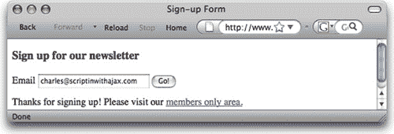

**图 1.5. 带有有效信息的无样式表单。**

请注意，`14` 页上 `PHP` 代码的前十行是代码的主路径——处理文件时所采取的“过程化”步骤。这十行代码下面的两个函数有助于这项工作——一个测试电子邮件地址，另一个将验证过的电子邮件地址记录到文本文件中。这些函数从过程化代码中调用并将结果返回给它，但它们并不在主代码流中。

函数允许你将“主流程”过程化代码频繁需要的代码片段分离出来，而不是反复地向主代码流中添加相同的代码。然而，这些“独立”函数还有另一个重要优势——你可以使用 `Ajax` 直接从浏览器调用它们。在我的表单中，我将使用 `Ajax` 将电子邮件地址直接发送到此代码中的电子邮件验证函数，以测试电子邮件地址并使其返回结果（1 或 0——有效或无效），而无需运行其余代码。通过这种方式，我现在为 `Ajax` 做打算，尽管我将在最后实现它（Jeremy 会为我们感到骄傲的）。当我在第`2`章中介绍 `JavaScript` 基础时，你会详细看到函数。

现在表单仅使用 `HTML` 和 `PHP` 就具有功能了。现在，让我们看看如何用 `CSS` 改进外观。

## 关于安全的说明

接受用户输入会让你的网站面临代码注入和 `XSS`（跨站脚本）攻击的风险。从`14`页开始的 `PHP` 代码说明了你在接收数据并将其写入文件系统时可以保护自己的步骤。首先，对输入进行验证。这不仅减少了用户输入错误电子邮件并随后疑惑你为什么不给他发送任何内容的概率，还增加了通过表单向你的服务器传递恶意代码的难度。其次，表单的 `action`（表单提交到的 URL）仅包含页面名称，而不是页面的完整 URL。通过这样，你就不会在代码中暴露文件夹结构——这些信息可能会帮助潜在的黑客。第三，当你写入文件时，不要让 `PHP` 在文件不存在时创建文件——由你手动创建该文件。然后，当你将文件模式设置为`"r+"`时，你允许对文件进行读写访问但不允许创建文件。由于你现在不需要提供文件夹级的写访问（如果你允许 `PHP` 创建文件，你将必须这样做），你防止了任何人向你的文件系统写入文件。第四，你存放此文件的文件夹位于网站根目录以上的文件夹中，使得访问它变得困难得多。这些简单的步骤结合使得通过此表单入侵变得困难得多。

安全是 `JavaScript` 的一个主要问题，因为与 `PHP` 不同，代码运行在浏览器中，任何人都可以查看和修改。在 DevArticles 网站上了解更多关于 `JavaScript` 安全问题：`[www.devarticles.com/c/a/JavaScript/JavaScript-Security](http://www.devarticles.com/c/a/JavaScript/JavaScript-Security)`。

## 让它变漂亮

每个浏览器都有内置的样式表，使标题比段落文字大，链接变为蓝色，并控制 `HTML` 的默认呈现。通过使用样式表，你可以覆盖默认布局的任何方面，默认布局主要是全宽元素一个接一个地沿页面排列。通过 `CSS`，你可以根据意愿将 `HTML` 分列，并按照自己的喜好对每个元素进行样式化。

### 注意


*我的书籍《Stylin’ with CSS》（New Riders, 2008）涵盖了 CSS 和 XHTML。*

`CSS` 通过访问 `DOM` 发工作。再次，我在这里不会进行全面的 CSS 课程（我也已经写了那本书），而是将演示 `CSS` 如何访问 `DOM`，以及如何以支持渐进增强的方式使用 `CSS`。

`CSS` 规则的格式为`selector {property:value}`，例如 `p {color:red;}`，它将所有段落元素的文本染成红色。属性/值对合称为声明（declaration）。这种基本的规则格式可以通过多个选择器和规则进行扩展。

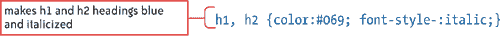

查看表 `1.1` 获取一些通过上下文定位的选择器——通过使用 `ID`、`class` 或通过引用元素的祖先（父级及以上）来定位 `DOM` 中的目标元素：

**表 1.1. CSS 选择器。**

| 选择器 | 描述 |
| --- | --- |
| `p` | 所有段落选择器 |
| `#email { }` | ID 为 `email` 的元素（页面上的每个 ID 必须是唯一的） |

注意这里对相对单位的使用——在本例中是 em。我也可以使用百分比——不仅用于设置字体大小，还用于设置容器 `div` 的宽度。通过将所有内容指定为 em，我使我的页面更具可访问性（accessible）。如果用户按下 `Ctrl-+` (PC) 或 `Command-+` (Mac) 来放大屏幕文本，整个布局也会随之调整以适应新的字体大小。

现在我有了一个功能齐全且样式精美的页面，但 HTML 和 CSS 是完全分离的。即使没有 CSS，页面仍然可以工作，而且 CSS 可以轻松地链接到其他共享其样式的页面。

## 使用 JavaScript 和 Ajax 增强用户体验

现在我们进入 JavaScript 世界。我将在本章结束处概述一下如何使用 JavaScript 和 Ajax 来增强用户体验。在第 5 章中，我将回到这个电子邮件表单示例，并使用 JavaScript 创建与服务器的 Ajax 交互，这样我就可以在用户提交表单之前，使用服务器上的 `PHP` 代码来验证电子邮件地址。

让我们从三个简单的想法开始：JavaScript 是一种强大的编程工具，具备 DOM 脚本能力，并且具备 Ajax 能力。

### 强大的编程工具

JavaScript 是一种功能齐全的脚本语言，运行在用户的浏览器中。它允许你在变量、数组和对象中管理数据，并编写几乎每种编程语言都通用的代码逻辑，例如 `if-then-else`，这让你能够为代码注入决策能力。你可以以过程化的、逐步步进的风格编写代码——每行代码都按顺序执行；也可以以面向对象的风格编写代码——由属性和方法（变量和函数）组成的对象之间可以相互通信以完成程序的工作。实际上，你的脚本可能是这两者的混合。你将在第 2 章中学习这些概念。

与众所周知的工业级编程语言（如 `C#` (c-sharp) 和 `Java`）不同，JavaScript 在运行之前不需要编译（即不需要处理成低层的计算机机器代码）。这使得你在编写代码时更容易进行测试——你只需要在浏览器中打开页面，它就会运行。因为它没有经过编译，JavaScript 被称为脚本语言，而不是编程语言。`PHP` 出同样的原因也被称为脚本语言。然而，得益于今天更强大的计算机，编译不再让编程语言相较于脚本语言具有如此巨大的速度优势。

### 注意


`Java` 和 JavaScript 之间没有任何关系，除了它们都被用于计算机编程。它们的关系（或者说缺乏这种关系）在一个现在已臭名昭著的博客评论中得到了总结，评论写道：“Java 之于 JavaScript，就像汽车之于毯。”

成为强大且健壮的脚本语言只是 JavaScript 吸引力的一部分。它大放异彩的领域是 DOM 脚本。

### DOM 脚本能力

顾如其名，DOM 脚本是 JavaScript 操作 DOM 的能力，从而在用户交互时动态地更改页面的内容和外观。

`CSS` 只允许你设置 DOM 元素的属性，而且仅限于样式相关的属性，如颜色和位置。相反，JavaScript 允许你获取和设置不仅是 DOM 元素，还有它们的属性和文本。这让你能够根据需要添加和删除内容以及导航元素。它还为 `CSS` 和 JavaScript 之间创建了一种非常有趣的关系。

通过 JavaScript，你可以动态地覆盖 `CSS` 样式，或为元素动态添加类和 ID，从而让这些类和 ID 的 `CSS` 规则突然在这些元素上生效。后一种技术的简单示例是设置一个名为 `tr.odd` 的 `CSS` 背景颜色类，定义交替表格行的颜色。JavaScript 然后可以快速遍历 HTML 表格，并在交替行上添加 `odd` 类名，从而使表格产生条纹行以提高可读性（图 1.7）。

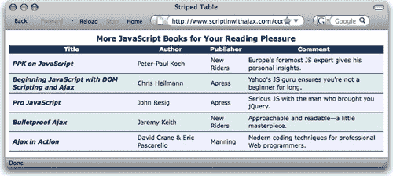

**图 1.7. 条纹表格。**

这也是 JavaScript 获取、处理并设置 DOM 属性之力量的一个很好的例子。我将在第 3 章中向你展示如何编写条纹表格。

`PHP` 只能写入包含在 `PHP` 页面模板中的 HTML 元素，尽管它的代码逻辑允许你决定写入什么以及何时写入。相反，JavaScript 可以被视为一台可编程的 HTML 写入机器；它具有创建 HTML 元素、为其添加文本和属性，然后将它们写入页面的能力。

### Ajax 能力

JavaScript 可以执行所谓的 Ajax 事务，并在服务器和浏览器之间移动数据。

Ajax 实际上比一些人想象的要简单得多。我的意思是，Ajax 纯粹是一种使用 JavaScript 的 `XMLHttpRequest` 对象从服务器请求并接收数据而无需刷新页面的技术。它并不是包含在许多 Ajax 框架（代码工具包）中的那些酷炫、新的界面组件的所有交互，Ajax 术语正是与这些联系在一起。这些界面组件（如滑动面板和自动填充的树形菜单）可能使用 Ajax 来获取数据，但这些交互并不是 Ajax。Ajax 关乎数据的移动，与实际界面无关。

当被问及编程是如何运作的时，我的简单回答是：有数据，以及对数据操作的代码。本章的大部分内容围绕这个思想分为两个部分。首先，你将看到数据在 JavaScript 中存储的所有方式。其次，你将看到所有允许你对这些数据运行各种测试和处理的代码结构。这些代码结构构成了功能完整应用程序的基础构建模块。

为了做准备，让我简要向你展示如何在浏览器中运行代码示例，以便你跟上操作。我将通过一个非常简单的 JavaScript 示例以及如何格式化代码的概述来说明这一点。

你可以下载并查看本章中几个示例的代码。这些文件的名称列在相关代码示例旁边。

# 运行代码示例

要运行本章中的任何代码示例，请将其放在文本文件中的以下 HTML 标记中，以你喜欢的名称和 `.html` 扩展保存文件，并在 Web 浏览器中打开它。

**示例 2.1. `html_template.html`**

```
<!DOCTYPE HTML PUBLIC "-//W3C//DTD HTML 4.01 Transitional//
   EN">
<html>
 <head>
  <title>My JavaScript Test</title>>
 </head>
 <body>
  <script type="text/javascript">v
   // replace this line with the code example
   // remove the opening and closing script tags also if
      they are in the example
  </script>
 </</body>>
</</html>
```

由于浏览器需要知道何时在处理 HTML，何时在处理 JavaScript，我将使用带有 `type` 属性 `"text/javascript"` 的 HTML `script` 元素（如前面的示例所示），以指示我正在从 HTML 切换到 JavaScript。在 JavaScript 的结束处，我将用 `</script>` 关闭 `script` 元素，浏览器将恢复到将代码解释为 HTML。空行仅是为了让代码更易读；浏览器会忽略代码中长于单个空格的空白区域。

## Hello, JavaScript

似乎每本关于编程的好书都从一个 Hello World 示例开始，在示例中你学习如何显示“Hello World!”消息。从数据和对数据操作的代码来看，文本字符串“Hello World”就是数据。为了让数据显示（在本例中是在警报对话框中），你使用的代码是 `alert` 函数。函数需要括号，括号中可以包含它需要操作的任何数据——在这个示例中是文本字符串：

**示例 2.2. `hello_world.html`**

```
alert ("Hello World!");
```

所以，获取上一节的标记（代码 2.1 示例）并插入此函数。一旦页面加载到浏览器，JavaScript 就会运行，你就能在图 2.1 中看到对话框。

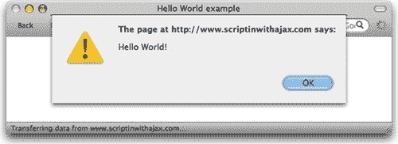

**图 2.1. 警告对话框。**

受到这种显示 JavaScript 能力令人惊讶的简单性的启发，让我们现在学习编写 JavaScript 的基础。

# 脚本、语句和注释

脚本（script）是多行 JavaScript 代码，也被用作你编写的 JavaScript 的通用术语——例如“我写了一个可以实现 xyz 的新脚本”。脚本内部包含语句和注释。

## 脚本

脚本可以放在 HTML 文件中的 `script` 标签之间，也可以放在文件名扩展名为 `.js` 的独立文本文件中，该文件通过 `script` 标签链接到你的 HTML 页面。在书中的示例中，我将 JavaScript 添加到页面，这样你可以与其相关的 HTML 标记一起看到它。在任何规模的网站中，你都会希望将单独的 JavaScript 文件链接到页面，而不是直接将 JavaScript 添加到文档中。这样脚本只需下载一次并缓存（存储）在用户的浏览器中，并在站点的所有页面之间共享。

## 语句

每行脚本都是一条语句（statement）。语句是 JavaScript 可以评估（理解）的指令。语句以分号结束，在每行末尾开始每条语句是标准做法，尽管你不这样做，代码仍然可以正常工作。

### 关于 JavaScript 的格式化

作为一个格式化演示，这里有一个将两个数字相加四行脚本：

**示例 2.3. `demo_2_plus_3.html`**

```
var x=2;
var y=3;
alert (x+y);
// displays 5
```

前三行中的每一行都是 JavaScript 可以评估的语句，每句都以分号和换行（按 Return 键）结束。你可以仅通过换行来分隔语句，但这被认为是不良的做法，如果语句跨越多行，会让代码读起来很混乱。始终用分号结束语句。第四行是注释，在这种情况下它陈述了预期的结果，如图 2.2 所示。

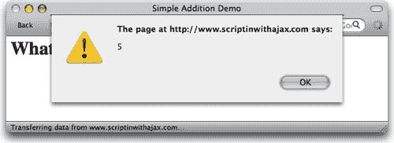

**图 2.2. 警告对话框显示计算结果。**

## 注释


在代码中编写注释是值得的，这样你就知道这些代码的作用是什么。注释是为了让你或他人在未来查看代码时知道代码的意图。

单行注释以`//`开始：

```
// this is a comment
```

`//`之后的所有内容都被 JavaScript 忽略，直到新行开始。你通常会在同一行的代码语句之后添加单行注释：

```
var myFavxe; // my favorite guitar
```

你还可以编写多行注释，它以`/*`开始并以`*/`结束。多行注释可能像这样：

```
/* 下面的代码将处理任何错误。
    错误将被写入数组。
    在所有测试完成后处理错误。 */
```

如果你想临时防止脚本中某些行代码的执行（例如在调试问题时），你可以将这些代码封装在多行注释中。此外，如果你想在放入生产环境之前删除注释以“压缩”脚本，请使用如 JSMin 的工具（[crockford.com/javascript/jsmin.html](http://www.crockford.com/javascript/jsmin.html)）。

现在是查看 JavaScript 存储数据的方式。

## 我在写 HTML 还是 JavaScript？

起初，你很容易忘记自己是在写 JavaScript 还是 HTML，特别是在添加注释时。一种常见的错误是在只有 HTML 的`script`标签之外编写 JavaScript，或者在`script`内部编写 HTML，这会导致运行不正常。你只需要学会根据页面的不同部分在心理上切换到正确的语言。

```
var userName;
var productId;
var totalWithTax;
```

这些变量使用了被称为“驼峰命名法”（camel case）的风格，即将几个单词组合在一起为变量命名一个有意义的名字。第一个单词字母小写，随后的单词首字母大写——当然，不要有任何空格。这将始终给你一个单一的`easyToReadOneWordVariableName`。这种格式被称为驼峰式，是因为大写字母在视觉上形成了像驼峰一样的起伏。

## 声明变量

当你第一次声明（创建）一个变量时，应该在它前面加上`var`，如前一节中的三个示例所示。在以后所有的引用中，你只需使用变量名即可。如果你不使用`var`，就会创建一个具有全局作用域的变量，这通常是你不希望的。我将在本章后面介绍函数时更详细地讨论作用域（scope）。

在之前的三个变量示例中，我没有使用等号为这些变量赋值，因此它们当前的值将是“undefined”（意味着未设置任何值）。`undefined`不应与`0`混淆，`0`是数值零。有时你想创建一个未定义的变量，以便它准备好接收稍后代码生成的值。

然而，你可以在一个步骤中声明（创建）并设置（放入内容）一个变量。变量的内容被称为它的值（value），当你在代码中引用变量时，JavaScript 实际上会将该引用替换为变量的值。这两点都通过下面这个简单的两行示例得到了演示：

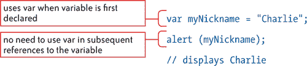

现在你已经对变量有了基础了解，让我们来看变量可以包含的不同数据类型。变量可以包含以下任何一种数据类型：

- 字符串（string）
- 数字（number）
- 布尔值（Boolean，`true`和`false`，或者`1`或`0`）
- 数组（array，一组相关的变量）
- 函数（function）
- 对象（object）

让我们来看每种数据类型。

## 字符串

字符串简单来说就是文本字符。你可以在字符串中放入任何字符。字符串总是被引用的——也就是说，被包含在单引号或双引号中——由你选择。在引用字符串时，确保你的字符是“直立的”引号，而不是可能被文本程序自动格式化的“弯”引号。在这里我将一些字符串放入变量：

```
var joesGreeting = "Waaazup?";
var userPrompt2 = "Enter your name";
var carMake="Lotus", carType="Elan", carCategory="classic sports car";
```

前面的示例显示你可以在一行中声明多个变量，用逗号隔开。

非常重要的一点是，JavaScript 不会尝试评估字符串（参见侧边栏“核心概念：求值”），如下例所示。

在这个示例中：

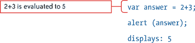

而：

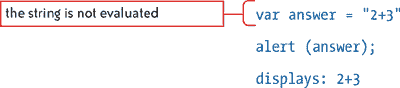

“2+3”是一个字符串，所以 JavaScript 不会尝试评估它，而是将字符串复制到变量中。

相反，JavaScript 将尝试评估任何*不是*字符串的内容。所以，如果你想向你的访问者弹出一个欢快的问候，而你写道：

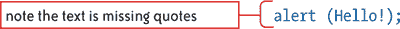

你将触发一个错误，因为你忘记在字符串周围加上引号。在这种情况下，JavaScript 会假设你正在引用一个名为`Hello!`的变量，如果没有名为`Hello!`的变量（很可能没有），它就会在你的错误控制台中显示错误信息`Hello! is not defined`。

**注意**：


错误控制台（Error Console）是一个简单的调试工具，用于显示 JavaScript 错误信息及其相关的行号。你可以从 Firefox 的工具菜单打开它，在浏览器中测试工作时，一直开着它是非常有用的。

像这样忘记给字符串加引号是一个很容易犯的错误，当你开始编写自己的代码时可能很快就会发现。

记住了这一点，请注意这个字符串中的问题：

```
"She said "Go away!" and went back to her book."
```

字符串在`Go`的`G`之前就闭合（结束）了，因为那是第二个双引号所在——文本的其余被视为字符串之外，因此 JavaScript 随后会尝试评估`Go away” and went back to her book”。你可能不会惊讶于发现这个短语并不是 JavaScript 语言的一部分，因此发生了错误。解决字符串内部引号问题有两种方法：一种方法是使用反斜杠“转义”问题字符：

```
"She said \"Go away\" and went back to her book."
```

转义一个字符会使其视为字符串字符而不是作为代码进行评估，因此现在字符串在行末尾的闭合引号之前都不会结束。

另一种方法是在字符串周围使用单引号，而在内部使用双引号（反之亦然）：

```
'She said "Go away!" and went back to her book.'
```

### 核心概念：求值

在 JavaScript 以及大多数编程语言中，常见的语句结构

```javascript
someVariable = someExpression;
```

将左侧变量的值设置为右侧表达式的*求值*结果。在这个语境下，“求值”意味着“被 JavaScript 处理”。例如，如果你在语句的右侧使用变量名，JavaScript 将对该变量名求值为它的值，并将左侧的变量设置为该相同的值。你写的每个表达式都必须能够被 JavaScript 求值，否则会导致错误。

JavaScript 可以自动为字符串添加转义字符以防止这些问题，正如你稍后会看到的。

## 数字

数字可以是正数也可以是负数，并且可以是：

- **整数（Integers）**：如`1`、`45`、`-34`、`235456`
- **浮点数（Floating-point numbers）**：小数点右带有数字，如`3.142`、`-.000001`等
- **指数（Exponentials）**：在 JavaScript 中你可以使用`e`表示“...的次方”，所以你可以将数字 10⁹ 表示为`10e9`

你还可以用八进制（基 8）和十六进制（基 16）格式表示数字。十六进制在处理颜色时非常有用，因为可以用三组两位十六进制值来表示，例如红色的`#FF0000`。

## 布尔值

布尔值是特殊的常量值。它们只有`true`和`false`，也可以分别表示为`1`和`0`。注意，尽管它们是单词，但不是字符串，不应该加引号。布尔值用于表示只有两种状态的实体，例如开启或关闭、是或否、相等或不相等。在本章后面我们查看*if*语句时，将学习更多布尔值。

## 数组

数组可以被看作是可以包含多个值的变量。通常你想将一组相关的值放在一起，数组就是实现这一目的的方法。数组是强大的结构：你创建的每个数组都是全局`Array`对象的子类，所以你的数组可以使用完整的方法集，能够轻松地创建、访问、添加、删除并对数组值执行操作。你可以在附录 B 中找到`Array`方法列表。

数组能够包含任何项目列表，例如这个动物列表：

- 狗、猫、猪、马、羊

让我们看看如何创建并管理包含这些项目的数组。

**跟踪你的数据类型**

在像 C++ 和 Java 等强类型语言中，你在创建变量时必须声明你正在创建的是什么类型的变量——字符串、数字、布尔、数组等——并且该变量只能用于存储该类型的数据。在弱类型语言 JavaScript 中，你只需要声明一个变量并向其中放入任何类型的数据。这使得 JavaScript 更加灵活，因为你可以随心所欲地特定变量中想要的数据类型。然而，如果你不跟踪变量中数据的类型，你可能会编写出产生意外和不需要结果的代码。在使用数据之前，你始终可以使用`typeOf`操作符来测试你处理的是什么类型的数据。

## 创建数组

以下是创建数组的方法：

**示例 2.4. array_demo.html**

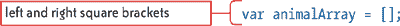

你现在有了一个名为`animalArray`的新空数组，你可以在代码运行时开始为其填充数据。

## 索引数组

索引数组是项目的列表，每个项目通过其索引（即在数组中的数字位置）被引用。

让我们从一步到位创建并填充数组开始，用逗号分隔各个项：

```
var animalArray = ["dog", "cat", "pig", "horse", "sheep"];
```

注意这些名称是字符串。如果你没有给它们加引号，当你的代码以后访问数组时，JavaScript 将在代码的地方寻找具有这些名称的变量。

数组的每个部分被称为元素；该数组现在有五个元素。

## 从数组中读取元素

要从数组中读取，请使用以下格式：

```
arrayName[arrayIndex];
```

例如：

```
alert ( animalArray[2] );
// 显示 pig
```

`[2]`读取的是第三位置的元素，而不是第二个，因为数组索引是从 0 开始的，而不是 1。这种从索引 0 开始计数的概念在编程语言中很常见。

这种从 0 而不是 1 开始的索引系统初看起来可能很奇怪，但一旦你开始使用循环以程序的方式提取元素，它就会更有意义。

## 向数组添加元素

你可以随时向数组添加元素。让我们这样向数组中添加'goat'：

```
animalArray.push('goat');
```

数组现在包含：

```
var animalArray = ["dog", "cat", "pig", "horse", "sheep", "goat"];
```

`Array`方法`push`（稍后详细介绍方法）将指定的元素添加到数组的末尾，因此“goat”现在作为新元素添加到数组的最后一个位置。

## 排序数组

你可以使用`sort`方法按字母顺序对数组排序：

```
sort(animalArray);
```

然后数组的顺序变为：

```
var animalArray = ["cat", "dog", "goat", "horse", "pig", "sheep"];
```

如果你显示上一个示例中“goat”所在位置的元素：

```
alert (animalArray[3]);
```

你现在得到了“horse”，因为在在这个按字母排序的数组中它的索引为 3。

## 关联数组

到目前为止，你已经看到了*索引*数组，你可以通过索引（数字位置）引用元素。但有第二种数组被称为*关联*数组，它的每个元素都由两个部分组成：键（key）和值（value）。键是一个文本字符串，允许你将每个值与实际名称关联起来。

填充关联数组的格式是：

```
arrayName[key] = value
```

在下一个示例中，国家名称是键，国家首都名称是值。

以下是构建国家及其首都的关联数组的方法：

**示例 2.5. array_game_capital_cities.html**

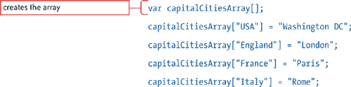

关联数组的威力在于，无论值在数组中的位置如何，你都可以通过引用其键轻松找到它。

格式与索引数组相同，只是不再使用索引数字，而是使用键名。这里的键是一个字符串，所以你必须记住给它加上引号：


为了巩固之前看到的内容，请注意左侧变量`thisCapital`被设置为表达式`capitalCitiesArray["France"]`的*求值结果*，即巴黎。

即使你对这个关联数组进行排序，这行代码仍然能找到正确的首都，因为你是通过键定位值的，而不是通过索引位置。

你也可以使用对象字面量（object literal）来代替关联数组，正如你将在关于对象的章节中看到的那样。对象字面量是一种用于存储属性和其他值的简单结构。通常，最好使用对象字面量，因为语法更简单。

# 处理数据的代码

现在你已经看到了不同的数据类型以及存储它们的方法。让我们看看你可以用于处理这些数据的代码结构。

## 操作符

操作符位于数据元素之间，指示 JavaScript 应该如何评估它们。在大多数情况下，操作符表示右侧应该对左侧执行的过程。有几种类型的操作符。

### 数学运算

我们都熟悉基础数学：

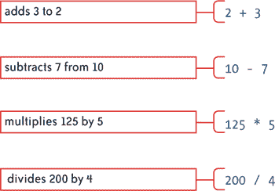

注意双操作符经常用于循环中：

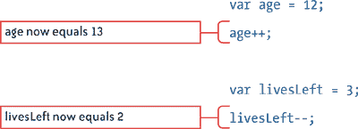

### 比较操作符

你通常想使用比较来查看两个值是否相同，或者查看一个是否大于另一个。你可以使用*if-then-else*结构进行比较，其格式如下：

```
if (comparison) { // 执行这些操作 } else { // 执行这些其他操作 }
```

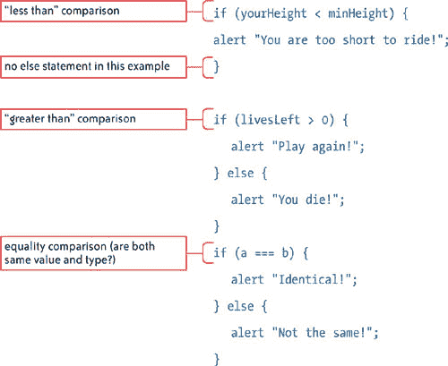

### `==`、`===`操作符

你可能注意到在前一个示例中的三连等号`===`，所以现在是澄清等号可能含义的好时机。单等号并不意味着等于，它意味着“赋值”，如：

```
var a=15+10;
```

**注意**：


等号两边的空格是可选的。我添加空格是为了提高清晰度，例如在长变量名之间。在简短的数学公式中，我省略了空格。这取决于个人喜好。

左侧的元素`a`被设置为右侧表达式的结果，结果为 25。

`==`是相等性操作符，意味着等于。

相比之下，`==`“松散”地比较两个值以查看它们是否相同，但它们不需要具有相同的类型。由于`==`操作符会等不同类型的值，以下比较的求值结果均为真：

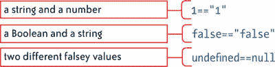

`===`意味着完全相等。这是一个比`==`更严格的比较，因为两个值必须相同*且*具有相同的数据类型：

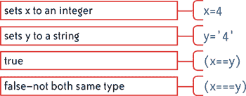

你几乎总是想使用`===`操作符并避免使用`==`操作符。如果你使用它，请确保你确实想要这种松散的`==`比较。跟踪变量持有什么类型的数据是非常重要的，如果有疑问，在使用变量之前请使用`typeOf()`操作符检查变量的数据类型，如下：

```
if (typeOf myVar==='number') { /* 在此处对数字执行操作 */ }
```

当你确定数据类型时，可以放心地使用`===`。如果你使用`==`，你的代码可能会返回错误且难以调试的比较结果。随着学习的深入，你将看到更多`==`和`===`运算符。现在，你只需要知道它们都用于比较，并且在不需要较宽松比较的特定情况下，`===`是你想要使用的那一个。

### 非（NOT）运算符(`!`)

若要检查两个值是否*不*相同，你可以使用`!`（非）运算符。现在，你实际上是在测试`false`而不是`true`。

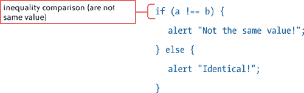

注意，`!==`运算符在比较时非常严格，它的行为类似于`===`的取反版本。

### 逻辑与（`&&`）和逻辑或（`||`）运算符

正如你在非运算符示例中看到的相等运算符和非运算符一样，你可以使用一个或多个运算符进行比较。

你可能想要在比较中添加的其他比较运算符是`&&`（表示与）和`||`（双竖线符号，表示或，通过按下`Shift-\`键输入——至少在美国和英国键盘上是这样）。这些运算符允许你进行更复杂的比较。

```
if (a && b < c) {
   // 如果 a 和 b 都小于 c，则执行此处
}

if (a || b < c) {
   // 如果 a 或 b 其中一个小于 c，则执行此处
}

if (a < b && b < c) {
   // 如果 a 小于 b 且 b 小于 c，则执行此处
}
```

### 使用或运算符提供默认值

此外，`OR`运算符有一个非常有趣且方便的用法，即提供默认值：

```
var userName = logInName || 'Visitor'
```


在这里，我想将`userName`变量设置为用户登录时提供的名称。但是，如果`logInName`是`undefined`（因为此人尚未登录，所以变量从未被设置），用户名将被设置为“Visitor”。当在此格式中使用`OR`运算符时，右侧的值是左侧值未设置时的备选值。正如此示例所示，这在未提供主值时为变量设置默认值非常有用。

## `+`运算符——加法与字符串拼接

`+`（加号）运算符实际上有两个用途。第一个，正如你所看到的，是它熟悉的角色：将数字相加。

```javascript
alert (123+456)  // 显示 579
alert 100++     // 显示 101
```

然而，`+`运算符还可以拼接（连接）两个表达式，例如字符串——这是你经常执行的一个常见任务。

```javascript
alert ("lap" + "top")   // 显示 laptop
```

注意，`+`运算符只有在两个值都是数字时才会将它们相加；否则，会将它们拼接。

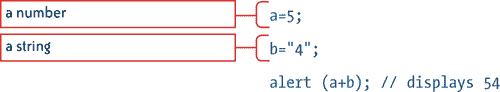

这显示为 54，因为你正在将一个字符串和一个数字相加，所以 JavaScript 将两个值都视为字符串并将它们拼接。

如果你想使用存储为字符串的数字，可以使用字符串方法`parseInt()`和`parseFloat()`分别将其转换为整数或浮点数。只需将数字或包含该数字的变量放在括号中，如下：

```javascript
parseInt(b);
```

现在，如果你像这样重写代码，就可以将上一个示例中的整数与字符串相加：

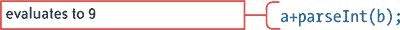

当数据源提供类似这样的字符串时，你会想要使用`parseInt()`：

```javascript
"25 pounds weight"
```

并且你需要在计算中使用值 25。

`parseInt()`方法只看到字符串开头的数字并忽略其余部分，因此：

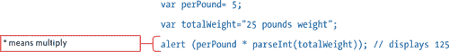

由于 JavaScript 是弱类型的，你需要记住存储在变量中的数据类型。正如本节早些所示，使用`typeOf`运算符来确定你的代码正在处理的数据类型，并在必要时在使用之前将其转换为适当的格式。

这是一个拼接的真实世界示例。我想显示用户的名和姓，但它们被存储在两个独立的变量中。我可以使用`+`运算符将它们拼接。

当我这样做时，我还想在名和姓之间留一个空格，因此我包含了一个只包含空格的字符串：

```javascript
firstName="Austin";
lastName="Markus";
alert (firstName+" "+lastName)  // 显示 Austin Markus
```

注意，字符串位于两个`+`符号之间（高亮部分）。它包含一个空格。通过在名和姓变量之间作为额外的表达式进行拼接，显示的名和姓之间被空格隔开了。

## “存在性”测试 (Setness Test)

很多情况下，在访问变量、函数、数组或对象之前，你想检查它其中是否有数据，或者它是否根本存在。如果你想要运行的过程会导致错误甚至导致应用程序崩溃，这一点尤为真实。

这种结构可以被看作是对“存在性”的测试。

（注：此处原文中存在大量重复的幻觉内容，已根据翻译要求精简并保留核心逻辑）

这种整洁的结构出现在几乎每个脚本中，你可以用它来检查字段中是否有文本，在尝试修改元素之前测试具有特定 ID 的元素是否存在于标记中，或者判断是否从函数返回了`false`结果。

它的巨大好处是，你不需要在测试中知道或显式声明变量应该设置为什么值。你可能选择在将变量从 0 更改时将用户的会话 ID 或名字存入此变量中——这并不重要。

```javascript
switch (upgradeOptions) {
   case "silver":
      additionalCost=100
      break;
   case "gold":
      additionalCost=500
      break;
   case "platinum":
      additionalCost=1000
      break;
   default:
      additionalCost=0;
}
```

在这里我们要测试的变量是`upgradeOptions`——它是`switch`语句的参数。它会与每个`case`的值进行比较。你可以拥有任意数量的`case`测试。如果匹配成功，就会执行该`case`的代码。注意，每个`case`的最后一行是`break`，它用于终止该语句。你很少遇到需要多个`case`同时匹配的情况，所以请记住在每个`case`语句中添加`break`。如果没有任何`case`匹配`switch`参数，则执行可选的`default` `case`（如果存在的话）。当你发现自己正在通过编写一长串如单的`if`语句来对同一个变量进行多种可能值的测试时，可能是时候将代码重构为`switch`语句了。

## 循环与数据迭代

有时你可能想要检查一组数据（通常存储在数组中），并测试集合中的每个项目是否具有某个特定特征——例如，随机测试这些值是否大于 10。检查数据集中的每一项的过程被称为迭代，这是一项常见的编程任务。

为了帮助你完成这项工作，使用了被称为循环的代码结构。循环是一种代码结构，它对数据集进行反复执行同一段处理代码，并使用计数器来跟踪下一个应该处理哪个数据项，直到满足某些退出条件后停止。让我们详细了解一下这些概念。

### 计数器与退出条件

循环使用一个充当计数器的变量。计数器通常从 0 开始，并在每次循环运行时递增（增加 1）。例如，它被用作处理索引数组元素时的索引引用。每次循环运行时，循环内部的代码都会处理数组中的下一个元素。

在编写循环时，你必须确保某个事件会触发退出条件，否则循环将不会停止，你的代码最终会报错，或者导致浏览器锁定并崩溃。因此，每次循环运行时都会检查退出条件；如果退出条件的评估为`false`，循环就会停止。让我们来看看这些概念是如何操作的。

### While 循环

`while`循环的结构如下：

```javascript
while (some condition is true) {
   // 反复执行这些操作
}
```

### 注意


在这里使用`document.write()`方法在页面上显示输出，是因为在书的早期阶段它容易理解和使用。既然我可以可靠地使用 DOM 脚本（参见第 3 章）向 HTML 元素添加数据，它现在已经过时了。通常应该避免使用`document.write()`。

让我们使用`while`循环在浏览器窗口中输出 1 到 10 的数字。

```javascript
var x = 1;
while (x < 11) {
   document.write (x + "<br />");
   x++;
}
// 列出数字 1 到 10
```

在这个例子，只要`x`小于 11，循环就会继续运行。如果没有`x++`行（在每次循环运行时递增`x`），`x`将始终等于 1，退出条件（`x`等于或大于 11）永远不会满足，你就会陷入著名的无限循环。

### do while 循环

`while`循环的一种变体是`do...while`循环。它的结构如下：

```javascript
do { // 执行这些操作 } while (some condition is true);
```

与`while`循环不同，`do...while`循环至少运行一次，即使测试结果为`false`也是如此。这是因为从它的格式可以看出，测试是在循环末尾而不是开头。看看这个`while`循环示例的`do...while`变体：

```javascript
var x = 1;
do {
   document.write (x + "<br />");
   x++;
   }
   while (x > 11);
// 显示: 1
```

在这个例子中，我更改了测试条件，使得循环在`x`大于 11 时运行。由于`x`的初始值为 1，测试结果为`false`；然而循环在停止之前运行了一次。

### for 循环

一种更复杂但更有用的循环是`for`循环，它需要三个值才能工作。

```javascript
for (counterInitialValue; exitCondition; counterIncrement)
{
   // 反复执行此操作
}
```

这种循环的常见用途是迭代（检查数组的每个元素）。我首先设置了一个数组，其中存储了我喜欢的五种 Web 语言的名称（是的，我知道，其中一些在技术上并不是语言！）。循环将依次提取每个元素的值。

```javascript
var languages=["HTML", "CSS", "JavaScript", "PHP", "SQL"];
for (var arrayPos=0; arrayPos<languages.length; arrayPos++) {
   alert(languages[arrayPos]);
}
```

这种循环的常见用途是迭代（检查数组的每个元素）。我首先设置了一个数组，其中存储了我喜欢的五种 Web 语言的名称（是的，我知道，其中一些在技术上并不是语言！）。循环将依次提取每个元素的值。

```javascript
var languages=["HTML", "CSS", "JavaScript", "PHP", "SQL"];
for (var arrayPos=0; arrayPos<languages.length; arrayPos++) {
   alert(languages[arrayPos]);
}
```

## 函数

正如其名所示，函数是页面功能的构建模块。每个函数执行一项任务，例如验证电子邮件地址、将数字相加或在屏幕上移动元素。函数之所以如此有用，是因为它们可以写成接受数据项（称为参数），并在工作中使用这些数据项。

想象你拥有一个非常智能的机器人，可以听从你的指令。它有一个非常有用的`shopping(store, item)`方法，让机器人能够查找商店位置、找到去商店的路、追踪物品、付款并带着货物回家。你只需要在机器人上调用`shopping`函数，记得包含所需的`store`和`item`参数

```javascript
goShopping("Borders", "Codin' for the Web");
```

不久后，它就会带回一本蓝色封面的漂亮书。

函数还能保持代码的整洁。你代码的主流程并不包含所有告诉机器人如何行走或捡起物品的成千上万条指令。所有这些特定的且通常复杂的任务都被抽象（隐藏但可用）为函数，可以在代码的任何地方通过单条指令进行调用。

简而言之，你调用一个函数，向它传递它完成工作所需的任何参数（数据），然后它会将结果返回给调用它的代码。该函数内部可能包含数百万行代码，但你只需要一行代码就可以调用并获取返回的结果。

函数的基本格式如下：

```javascript
function functionName(parameter1, parameter2,...parameterN) {
   // 函数被调用时执行的代码
}
```

这种结构被称为“函数字面量”（function literal），它由预留字`function`（你不能在代码中将它用于任何其他用途）、可选的函数名、在必需的`()`操作符内选择的任何参数，以及大括号内在函数被调用时执行的语句组成。

当 JavaScript 在浏览器中首次加载时，函数内部的代码不会被执行。函数内部的代码只有在通过函数调用进行调用时才会执行。函数调用的基本格式是：

**示例 2.6. simple-addition_function.html**

```javascript
function functionName(arg1, arg2,...argN)
```

例如，这里有一个将两个数字相加的函数：

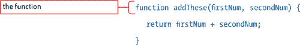

当你使用这段代码调用函数时

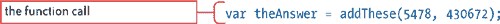

变量`theAnswer`被赋值为 436,150。

在函数内部声明的变量是局部变量

在函数内部声明的变量是局部变量，这意味着它们只能由函数内部的代码使用，并且其生命周期与声明它们的函数运行时间一样长。一旦函数结束，这些变量就会被销毁。下次函数运行时，它们会重新创建。

这是一件好事。局部变量的作用域局限于函数，因此它不会与另一个函数中的同名变量冲突。JavaScript 中唯一的另一种变量作用域是全局作用域（global），可以从任何函数访问该变量。你很少需要全局变量，而且如果无意中创建它，那是产生错误（bugs）的根源。如果你需要创建一个持久的变量，请将其创建为对象的属性。你将在下一章中学习如何操作。

使用局部变量的另一个优势是，在函数完成且变量不再需要后，可以回收它们占用的内存。JavaScript 会执行一种名为“垃圾收集”（garbage collection）的常规过程来释放未使用的内存。这就是你在声明变量时在前面加上`var`的另一个原因。如果你在创建变量时不使用`var`，它们将变成全局变量，除非你显式地销毁它们，否则它们使用的内存不会被垃圾收集。取决于你的代码编写方式，可能会通过不断（通常是无意中）创建新变量而积累大量的全局变量，随着 JavaScript 试图处理不断减少的内存，你的应用程序最终可能会停滞。在 Ajax 驱动的世界中，用户可能会在你的应用程序中停留数小时，除非绝对必要，否则使用局部是非常重要的；在长时间使用应用程序时，这些微小的“内存泄漏”确实会累积。

### 函数如何工作

1. 函数是一个通过函数调用触发（触发）的代码块。

   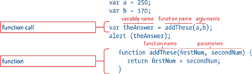

2. 函数调用可以将数据参数（数据项）传递到函数的对应参数中。

   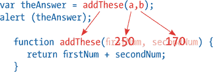

3. 函数在代码中使用参数值。

   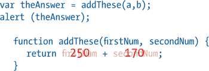

4. 函数的工作结果返回给调用代码，该代码求值为该结果。

   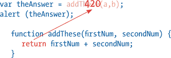

5. 此处显示了赋值为函数调用求值的变量。

   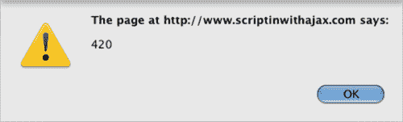

这是其工作原理。该函数有两个参数，`firstNum`和`secondNum`，它们是特殊的变量，其值被设置为函数调用传递给函数的参数值。在这个示例中，参数值被相加，结果返回给执行该函数的代码。在函数中，调用函数的代码行右侧求值为返回的结果，因此左侧（在本例中为`theAnswer`）被赋值为该值。现在你可以在代码后续使用变量`theAnswer`，它将求值为数字 436,150。

### 注意


如果你对参数（arguments）和形参数（parameters）之间的区别感到困，请记住：函数调用的参数设置了函数的形参数。

`return`关键字不是必须的，但它的目的是将函数的工作结果传给调用它的代码。有时你不需要从函数返回任何内容，因此你可以省略`return`（在这种情况下，它将返回`undefined`）。但是，请注意，一旦函数遇到`return`，它就会停止运行，调用脚本重新获得控制权。

一旦你写了这样的函数，你就可以通过简单地传入想要相加的两个数字，在代码中反复使用它。

每当你发现自己自己在多次编写某段非常相似的代码时，将其拆分成一个函数是有意义的。你这样可以在一个地方编写和维护它，并在代码需要时随时使用它。

### 函数不需要参数

有时，你可能不想向函数传递任何参数。例如，你的函数可能只需要返回当前时间，不需要任何额外信息来完成。

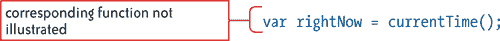

即使你不传递参数，你仍然需要包含括号，否则函数不会被调用。

### 将匿名函数作为变量传递

JavaScript 函数的一个有趣方面是，它们可以像变量一样在代码中传递。

### 注意


如果你想在测试期间停止函数运行，在函数代码的第一行添加`return;`是注释掉函数的另一种方法。只需记住在测试完后删掉它即可。

在编程语言中，将一个变量的值设置为另一个变量的值是很常见的，如下：

**示例 2.7. big_woof.html**

```javascript
var thisVar = 20;
var thatVar = thisVar;
alert(thatVar); // 显示 20
```

JavaScript 的神奇之处在于，你可以对函数执行相同的操作。在这里，我将一个函数赋值给变量：

```javascript
var bigWoof = function() {
   return ("WOOF!");
}
```

我可以使用存储它的变量名称来调用该函数，如下：

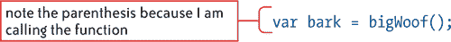

```javascript
var bark = bigWoof();
alert(bark);
```

现在变量`bark`被赋值为 “WOOF!”，如图 2.3 的所示所示](#ch02.xhtml_ch02fig03 "Figure 2.3. The dialog displays the result of the passed function.").

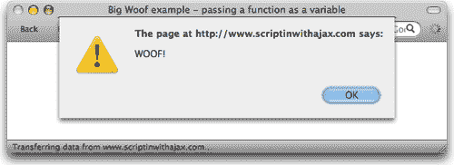

**图 2.3. 对话框显示了传递函数的结果。**


该函数在`function`后面没有名称，正如你在之前的函数示例中看到的那样；它被称为“匿名函数”。它不需要名称，因为你通过存储它的变量名称来引用它。能够像这样将匿名函数传递到代码的其他部分非常方便，并在传递时为它命名任何认为的变量名。你将在后的许多示例中使用匿名函数。

一种常见的用法是将函数作为回调函数传递给 Ajax 调用，回调是在当请求的数据从服务器返回时运行的代码。通常，你只需要传递要运行的函数名称，但你也可以将整个函数交给它，并让 Ajax 请求响应为你运行它，正如第 187 到 188 页所示。

## 从链接调用函数

用户操作是你编写的许多许多的触发器。用户操作实际上会触发*事件*，事件是浏览器在用户执行一系列操作（如点击鼠标、鼠标移动或移出元素、或按下键盘上的按键）时发送的消息。事件是一个巨大且重要的话题，将是第 4 章的主题。然而，为了方便理解第 3 章中的“对象”，目前只需理解你可以轻松检测点击事件并使用它来触发 JavaScript 函数即可。以下是其工作原理的示例：

```
<a href="dogs.html" onclick="bigWoof();">叫叫并跳转！</a>
```

### Note


直接向此类链接添加`onclick`处理程序不再被认为是将事件与链接关联的好方法，因为将 JavaScript 与 HTML 混合在一起了。然而，它简单且易于理解，所以我将使用这种技术，直到我在第 4 章中深入介绍事件。

（高亮显示的）`onclick`事件处理器在点击发生时被触发，在这种情况下，将调用`bigWoof`函数。事件处理器（`onclick`）在`href`之前接收`click`消息。因此在这种情况下，你会先得到 `WOOF!`，然后加载`href`中指定的`dogs.html`页面。通常，当 JavaScript 函数被调用时，你不希望`href`起作用（例如，如果你使用 Ajax 获取数据，并且仅在 JavaScript 不存在时才让普通页面重载作为备份）。为了防止`href`在 JavaScript 事件处理器之后接收到事件，你可以这样做：

```
<a href="dogs.html" onclick="bigWoof(); return false;">叫叫并留在！</a>
```

现在，点击事件触发了函数，但它不会被传递给元素的`href`，你将留在当前页面。

# 总结

在本章中，你已经了解了 JavaScript 如何工作的基本概念。你看到了数据是如何存储的，以及你可以对这些数据执行处理的方法，例如条件测试和迭代循环。你还看到了函数是如何作为你应用程序功能的构建构建的。

接下来，我将向你展示对象。由于 JavaScript 高度依赖于对象，而文档对象模型 (DOM) 也是一个对象，让我们开启新的一章，仔细观察对象和 DOM。

# 第 3 章. 对象和 DOM

对象是面向对象编程 (OOP) 的基础，这也是大多数现代应用程序和网站编写逻辑的方式。正如你将开始发现的那样，JavaScript 中的一切皆都是对象。例如，当你创建一个函数或数组时，你实际上是在创建一个特殊的对象。正如其名称所示，文档对象模型 (DOM) 从 JavaScript 的视角来看，简单来说是一个大型数据对象。当你使用 JavaScript 向标记中添加 HTML 元素时，你正在通过新属性来扩展此对象。

如果你已经使用过一会 JavaScript 并在页面上添加了一些简单的功能，你可能会发现本章将你的理解提升到了新的水平。如果你是 JavaScript 的初学者，请准备好见证 JavaScript 创建交互界的力量。

## 对象

在编码工作中使用对象有许多优势。主要的优势是它们为你的代码提供了高层次的组织。如果你尝试在不使用对象的情况下编写任何基础功能之外的内容，你很快就会发现你有许多相互调用的函数，并且发现自己在将数据从一个函数移动到另一个函数时像在玩“传球”游戏。代码会变得难以阅读，因为很难看出哪些函数与哪些任务相关。将与特定任务相关的变量和函数封装成一个对象要简单得多。

对象是变量和函数的具名集合。为了指示它们是对象的一部分，对象内部的变量被称为**属性**（property），对象内部的函数被称为**方法**（method）。

你使用“点符号语法”（dot syntax）来访问对象的属性和方法，这种语法用点（句）分隔元素，看起来如下：

```
objectName.aPropertyOfTheObject;
objectName.aMethodOfTheObject();
```

你将在书中经常看到点符号语法。正如前面提到的，JavaScript 中的一切都是对象，或者至少可以被视为对象，并用点符号语法进行访问。

然而，你也可以使用数组语法来访问对象。当你需要根据代码中的某些条件选择要读取的属性，且不想硬编码属性名时，你就会这样做。在这种情况下，你可以使用变量作为属性名：

```javascript
var theProperty = changeableValue
objectName[theProperty]
```

对象有两种类型：作为 JavaScript 语言一部分已存在的预定义对象，以及你自己编写定义的对象。

## 预定义 JavaScript 对象

JavaScript 拥有一个层次级的预定义对象，每个对象都有现成的内置方法和属性。该层次结构的顶端是`Window`对象，它的直接子类是`Document`对象，它包含了 DOM。还有许多预定义对象可以帮助完成任务，例如`Number`、`Math`和`Date`对象。这些预定义对象及其方法的列表位于附录 A、B 和 C，我们在后续学习中将看到它们的许多示例。然而，`Window`和`Document`对象值得在此进一步讨论。

### Window 对象

`Window`对象让你访问与浏览器相关的属性和方法，这些方法可以通过`Window`对象访问，有时也可以设置。例如，`Window`对象存储了访问历史，并可用于跳转到访问过的页面——这就像直接从代码操作后退按钮一样。

要跳转到访问过的页面，编写：

```javascript
window.back();
```

这调用了`Window`对象的`back`方法，浏览器将返回上一页。

`Window`对象具有打开、加载内容和关闭额外窗口的方法。其他`Window`方法显示基本的对话框、设置和移除焦点以及设置时间延迟以控制动画等定时事件。

### Document 对象

正如其名，`Document`对象让你访问 DOM。DOM 是 HTML 文档的层次结构表示。JavaScript 允许以复杂的方式操作 DOM，包括在代码运行时向文档添加、更改和删除 HTML 元素——这种能力对于在工作中使用 Ajax 是不可或缺的。

`Document`对象的预定义方法`getElementById`是你获取 HTML 元素作为对象的方法之一，以便你可以使用点符号语法从中提取属性。例如，你可以从此`h1`元素中提取文本：

```html
<h1 id="headline">重大新闻！</h1>
```

```javascript
var theElement=document.getElementById("headline");
alert(theElement.innerHTML);
// displays Big news!
```

在第一行中，我将`h1`元素放入一个变量。在第二行中，我获取了`h1`元素的文本并将其显示。为了实现这一点，我使用了`innerHTML`属性，它引用了元素起始标签和结束标签之间的任何内容。在本章稍后，我将为你详细介绍如何访问 DOM，但现在请注意，你使用点符号语法来访问 DOM，因为它是一个对象。

你可能已经知道，CSS 也将 DOM 作为其对文档操作的基础，而 CSS 规则的选择器（大括号之前的部分）定义了 CSS 规则影响 DOM 的哪些元素。

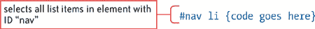

CSS 能够设置元素的样式相关属性——例如，它的文本颜色或在屏幕上的位置。

JavaScript 将这种 DOM 关系推得更远，它不仅允许设置样式属性，还可以获取和设置 DOM 所有属性和特性的值。这意味着通过 JavaScript，你可以对整个 DOM 进行程序化控制，并能够根据用户操作来操作文档结构。在我们查看用户创建的对象之后，我将直接介绍具体的操作方法。

## 用户创建的对象

虽然 JavaScript 有许多预定义对象，但你也可以创建自己的对象来管理应用程序中的大型任务和数据集。在对象内部，你定义它的属性以及可以作用于这些属性的方法。

### 对象字面量

创建对象的简单方法是使用称为对象字面量（object literal）的格式。对象字面量的格式为：

```
objectName={
   propertyName1:value,
   propertyName2:value,
   functionName1: function() {
      // 函数代码
   },
   functionName2: function() {
      // 函数代码
   }
}
```

这是一个使用对象字面量格式创建对象的示例。该对象使用常量 π（pi）进行数学计算——正如我们从高中记得的那样，它是圆半径与周长的比例。

**示例 3.1. circle_math_obj.html**

```javascript
circleMath={
   pi:Math.PI,
   calcCircumf:function(rad) {
      var circum = rad * circleMath.pi;
      alert (circum + " inches");
   },
   calcArea:function(rad) {
      var area = (rad * circleMath.pi) * rad;
      alert (area + " square inches");
   },
   calcVolume:function(rad) {
      var volume = (4/3) * circleMath.pi * (rad * rad * rad)
      alert (volume + " cubic inches");
   }
}
```

该对象被称为`circleMath`，它包含一个属性——π 的值（该值从内置的`Math`对象获取），以及三个计算圆形对象周长、面积和体积的方法。（为了简单起见，这里我假设单位是英寸。）

通过编写：

```javascript
circleMath={
   // 对象的所有属性和方法
}
```

我将`circleMath`变量设置为对象本身的值，因此我们使用点符号语法来访问内部的属性和方法。在这里，种情况下我都将 10 作为圆的半径：

```javascript
circleMath.calcCircumf(10) // 显示 31.416 inches
circleMath.calcArea(10) // 显示 314.1592653589793 square
   inches
circleMath.calcVolume(10) // 显示 4188.790204786391 cubic
   inches
```

### 注意


如你所见，JavaScript 可以返回一些非常长的浮点数。为了保持代码尽可能简单，我保留了它们，但我可以使用`Number`对象的`toFixed(x)`方法将`circum`值缩短为三位小数，其中`x`是所需的位数，如下所示：`var circum=circum.toFixed(3);`

对象字面量对格式错误非常敏感，因此在测试对象字面量时请打开 Firefox 错误控制台，这样任何错误都会被识别。如果记住以下关于对象字面量的点，就可以避免一些常见的格式错误：

*   属性名和值之间用冒号分隔；不要像设置变量那样使用等号来设置它们。

*   在代码中每次引用属性或方法（即使在对象内部），都必须在名称之前加上`objectName.`——例如在调用`calcCircumf()`方法时使用`circleMath.calcCircumf(10)`——否则你会得到“未定义”错误。

*   每个函数的第一行格式与你目前为止看到的函数不同。在对象字面量中，格式是函数名、冒号、关键字`function`，然后是`()`括号。接着是包含函数代码的大括号，如下所示：

    ```
    functionName:function() {
      // 函数代码
    }
    ```

*   对象字面量简单来说是用逗号分隔的属性和方法列表，所以不要忘记那些逗号。仔细观察逗号的位置。


注意

如你所见，JavaScript 可以返回一些非常长的浮点数。技术上讲，对象字面量只是属性和方法的逗号分隔列表，但属性的值可以是函数。

这里的关键点是，对象字面量是代码的一种强大组织结构。为你创建的对象使用有意义的名称，因为它们本质上是属性的集合。

简而言之，通过良好使用对象你可以将应用程序执行的任务组织到代码中。这种方法比通过阅读由几十个函数组成的大型脚本来理解发生了什么要容易得多。

对象字面量是一个很棒的组织工具，但当你理解如何创建对象的实例时，对象的威力就会显现。

## 对象与实例

通常，你会使用对象来管理一组数据，其中数据集中的每个实体都具有相同类型的属性（例如，一组产品可能每个都有品牌名称、型号和价格）。然后你可以为每个产品创建一个对象的实例——每个实例都有自己的一组属性值——并使用对象的方法对实例执行各种操作。

为了帮助你理解这个概念，在这个示例中，我将创建一个对象来存储关于吉他的信息。

我将首先使用对象字面量格式编写一个名为`Guitar`的对象，它可以帮助我完成这一点。如果可以从对象创建实例，将对象名称的首字母大写是标准做法。

**示例 3.2. guitar_object.html**

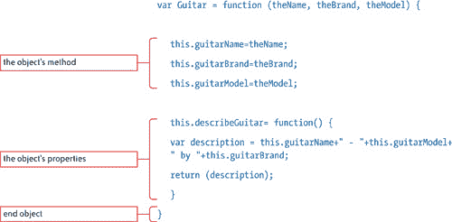

这就是所谓的构造函数；实例可以从它被“构造出来”。由于我使用`this`关键字作为每个属性名称的前缀，所以创建的实例中，这些属性的值是不同的。

在技术上讲，`this`关键字绑定到对象的实例，但对`this`的简单思考方式是它意味着“这个对象的实例”。以`this`为前缀的属性值对于每个实例可以是不同的。例如，你在这里看到的`this`单词

```javascript
this.guitarName = theName
```

意味着“此实例的`guitarName`属性的值”。因此，上面的整行代码的意思是：“将此实例的`guitarName`属性设置为传入的参数`theName`的值。”

同样注意，该对象有一个方法，`describeGuitar`。方法本质上是对象内部的函数，但方法与函数之间有一个非常重要的区别。

当你调用一个函数时，你会在调用函数时将函数执行工作所需的数据作为参数传递进去。

当你创建一个对象的新实例时，你会在那个时候设置它的属性。当你之后调用对象的方法时，它只需要知道你想让它使用哪一个实例的数据，它就可以自己获取数据了。方法调用不需要那些该死的参数！除非你在代码运行过程中需要更改任何属性值。在大多数情况下，你只需要传递已经关联了其属性值的实例名称即可。这使得对象成为处理大型数据集的一种非常高效的手段——你不再需要到处传递这些数据了。对象的所有方法都会在传递给它们的任何实例的预定义属性上运行。

### Note


在这里，我只是创建了两个实例，但如果你正在处理大型数据集，创建大量实例将会消耗大量的内存。为了防止这种内存消耗，原型属性（Prototype Property）允许你以某种方式存储创建的对象的方法，以便它们可以被实例共享，而不是像我在这里这样做那样在每个实例中重复。你可以在[www.packtpub.com/article/using-prototype-property-in-javascript](http://www.packtpub.com/article/using-prototype-property-in-javascript)学习更多关于原型属性的知识。

方法使用`this.methodName()`这种语法来处理数据，它们和属性一样，有效地将`this`替换为方法调用之前的任何实例变量名。代码的作用实际上就像是写成这样：

```javascript
instanceVariableName.thisMethod();
```

现在我将为其中一把吉他使用适当参数为`Guitar`对象实例化（创建）一个实例。通过在创建实例时将这些数据传递给对象，我之后调用该实例的对象方法时就不需要再次传递它们了。

```javascript
var instrument1 = new Guitar("Tiger", "Paul Reed Smith",
"Hollowbody II");
```

注意在对象名称前使用了`new`单词——这是导致创建新实例的原因。

现在我将实例化第二个实例：

```javascript
var instrument2 = new Guitar("Sunny", "Ibanez", "Roland G3
Synth Controller");
```

现在，在任何时候，我都可以调用每个实例的对象方法，方法将在该实例的数据上运行。

**示例 3.3. guitar_object.html**

```javascript
instrument1.describeGuitar();
displays: Tiger - Hollowbody II by Paul Reed Smith
instrument2.describeGuitar();
displays: Sunny - Roland G3 Synth Controller by Ibanez
```

### Note


我八岁的女儿给我的每把吉他都起了名字，现在每个人都通过这些名字称呼它们，就像宠物一样。


让我们来看看它是如何工作的，从创建`instrument1`实例的行代码开始。

```
var instrument1 = new Guitar("Tiger", "Paul Reed Smith",
"Hollowbody II");
```

当我实例化`Guitar`对象时，向它传递了三个参数，这些是与该对象特定实例相关的数据——吉他的昵号、型号和品牌。

## 对象是如何工作原理

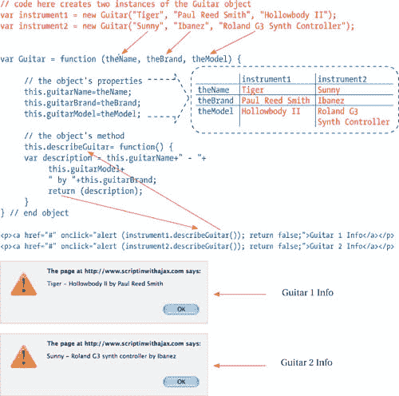

这些参数设置了对象的三个参数`theName`、`theBrand`和`theModel`的值。这些值随后被用于设置该对象实例的属性。

一旦创建了实例，对象的拷贝以及其新属性值将存储在变量`instrument1`中。如果你尝试在弹窗对话框中显示变量`instrument1`的值，你只会看到`object Object`字样。唯一重要的是变量`instrument1`现在包含了`instrument1`实例的数据。

```
instrument1.describeGuitar(); // 使用 instrument1 实例数据调用 describeGuitar
方法
```

当你在该实例上调用对象的方法时，这些方法将使用`project1`实例的属性值，你将得到：

*   Tiger - Hollowbody II by Paul Reed Smith

这里重要的要点是，每个实例的唯一数据集可以在对象中定义的一组方法上运行。我将在后面的章节中将我在这里使用的代码扩展为更完整、更真实的示例。在继续之前，让我们谈谈对象的作用范围（scope）。

## 对象与作用范围

对象的一个大优势是其属性和方法的范围有限——它们只能通过显式引用对象的实例来访问，例如：

```
instrument1.describeGuitar();
```

### Note


闭包（closure）的概念可以进一步保护对象数据免受其他代码的访问。闭包不是一个简单的课题，但这里是我找到的最基础的教程 [`javascriptkit.com/javatutors/closures.shtml`](http://javascriptkit.com/javatutors/closures.shtml)。

这使得每个对象成为一个自包含的实体，如果对象方法和属性使用的名称用于代码的其他地方，就不会产生冲突。这个概念被称为封装（encapsulation），当大型团队协作项目时非常有帮助。只要对象以可预测的方式运行、接受特定数据并返回可预测的响应，只有负责该对象的团队成员才需要关心它的内部实现，而这与代码的其他部分无关。

我才华横溢妻子是这本书的开发编辑，她第一次读打印稿时，在“对象”这一部分旁边写了一个巨大的“哈？”。如果她没看懂……好吧，只能说我对这一部分重写了几次以使其更清晰。事实是，对象是一个并不容易理解的概念，显然不能像这几页纸那样完全解释。然而，一旦你开始真正理解对象和面向对象编程（OOP），你的编码能力将达到一个新的水平。

## 掌控文档

DOM 是 HTML 文档中元素、属性和文本的一种类似于族树的层次结构表示，统称为文档的`nodes`（节点）。当你使用 DOM 脚本修改文档的可见部分（例如段落的文本）时，该更改会立即显示在屏幕上。通过本节将学的技巧，你可以重写文档 HTML 的任何部分，从而在用户操作时更改文档的外观。

在向你展示一些 DOM 脚本示例之前，我需要提到浏览器提供访问文档元素的方式随着时间的推移发生了变化，正如你们中多年前工作过 Netscape 如今已过时的“层”（layers）概念的同事所知道的那样。如今，W3C 的 DOM 模型已成为访问 DOM 的事实标准。所有现代浏览器都使用它，我在这里将重点介绍它。尽管如此，Internet Explorer (6, 7 和 8) 仍然存在许多不兼容之处，我将讨论其中许多问题并向你展示如何绕过它们。

### Note


关于各种浏览器 JavaScript 能力，一个必须书签的参考资料是 [QuirksMode.org](http://QuirksMode.org) 上的兼容性表（[www.quirksmode.org/compatibility.html](http://www.quirksmode.org/compatibility.html)）。

## 遍历 DOM

DOM 是由链接节点组成的树。节点有三种：HTML 元素、元素属性和元素内的文本，令人困惑的是，这还包含了由于你代码格式化而在 HTML 元素之间的空白。

如果你在两个`li`（列表项）之间添加空白（例如通过按回车键然后将下一行缩进几个空格），那么该空白包含在父级`ul`中，并且是该父元素的子节点。由于由于原因，你必须确保访问的是预期的元素而不是空白。检查这一点非常简单，因为

```
if (nodeType===3) { /* 移动到另一个节点 */ }
```

如果节点是空白，则返回`true`。稍后你将看到在这种情况下你如何移动到相邻的 DOM 元素。

### Getters 和 Setters 的两种含义

“Getters and setters”（获取器和设置器）也是一种高级 JavaScript 技术的名称，John Resig 将其描述为允许你“为访问和修改对象内部的数据构建实用的快捷方式”。当你准备好进行一些修改时，可以在 [`ejohn.org/blog/javascript-getters-and-setters`](http://ejohn.org/blog/javascript-getters-and-setters) 阅读更多。然而，在此语境下，我使用的 getters 和 setters 正如 Jeremy Keith 在 *Bulletproof Ajax*（New Riders, 2007）中描述的那样，我在这里稍作精确定义为：“访问、添加和删除文档各个节点的方法。”

### Note


Internet Explorer 与大多数其他浏览器不同，它不将文档中的空白视为文档节点。

一组 DOM 相关——俗称为`getters`和`setters`——允许你访问节点。

你可以通过 getter 访问元素节点，然后访问它的属性及其子元素的属性，包括属性节点和文本节点。你还可以遍历（移动）DOM 以获取相对于你当前拥有的节点。一旦你“获取”了想要的节点，就可以使用名为 setters 的 DOM 方法修改该节点或在它的相对位置添加新节点。

要获取一个节点并将其放入变量中，你需要定义确定性的引用来找到它。该引用通常是 ID 属性。正如读过我的书 *Stylin’ with CSS*（New Riders, 2008）的读者所知道的，我强烈建议使用`div`（分区）元素将页面标记划分为部分，并给每个`div`分配一个`ID`。因为一个页面只允许使用一次 ID 名称，因此 ID 为 CSS 提供了指向`div`及其子元素的唯一引用（或钩子）。使用此引用，CSS 可以准确地定位目标元素。ID 对 JavaScript 具有完全相同的作用。区别在于，使用 JavaScript 时，ID 允许你获取元素及其子元素并将其存储在变量中以便进行操作。让我们来看看这些想法是如何运作的。

## Get, Set...DOM!

这里是我在本节中将使用的标记。高亮的代码包含了我将获取和设置的 DOM 元素。随后的代码仅仅是触发演示函数的链接。

**示例 3.4. dom_exercises.html**

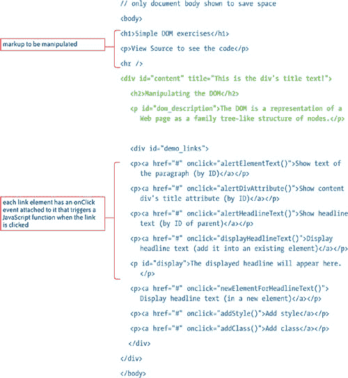

### Note


我承认我在这里滥用了链接，用它们来触发 JavaScript，而链接的 href 指向无处——这不是我在生产代码中会做的事。然而，我在这里这样做是为了在示例的稍后部分用 JavaScript 对这些链接进行样式设置。如果不这样做，我本该更正确地使用按钮来触发这些示例。

**图 3.1** 显示了前面的标记在浏览器中的显示情况。

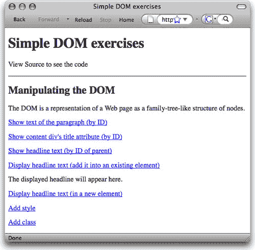

**图 3.1 浏览器中显示的 DOM 练习代码。**

DOM 是由链接节点组成的树。节点有三种：HTML 元素、元素属性和元素内的文本，令人困惑的是，这还包含了由于你代码格式化而在 HTML 元素之间的空白。

如果你在两个`li`（列表项）之间添加空白（例如通过按回车键然后将下一行缩进几个空格），那么该空白包含在父级`ul`中，并且是该父元素的子节点。由于由于原因，你必须确保访问的是预期的元素而不是空白。检查这一点非常简单，因为

```
if (nodeType===3) { /* 移动到另一个节点 */ }
```

如果节点是空白，则返回`true`。稍后你将看到在这种情况下你如何移动到相邻的 DOM 元素。

### Getters 和 Setters 的两种含义

“Getters and setters”也是一种高级 JavaScript 技术的名称，John Resig 将其描述为允许你“为访问和修改对象内部的数据构建实用的快捷方式”。当你准备好进行一些修改时，可以在 [`ejohn.org/blog/javascript-getters-and-setters`](http://ejohn.org/blog/javascript-getters-and-setters) 阅读更多。然而，在此语境下，我使用的 getters 和 setters 正如 Jeremy Keith 在 *Bulletproof Ajax*（New Riders, 2007）中描述的那样，我在这里稍作精确定义为：“访问、添加和删除文档各个节点的方法。”

### Note


Internet Explorer 与大多数其他浏览器不同，它不将文档中的空白视为文档节点。

一组 DOM 相关——俗称为`getters`和`setters`——允许你访问节点。

你可以通过 getter 访问元素节点，然后访问它的属性及其子元素的属性，包括属性节点和文本节点。你还可以遍历（移动）DOM 以获取相对于你当前拥有的节点。一旦你“获取”了想要的节点，就可以使用名为 setters 的 DOM 方法修改该节点或在它的相对位置添加新节点。要获取一个节点并将其放入变量中，你需要定义确定性的引用来找到它。该引用通常是 ID 属性。正如读过我的书 *Stylin’ with CSS*（New Riders, 2008）的读者所知道的，我强烈建议使用`div`（分区）元素将页面标记划分为部分，并给每个`div`分配一个`ID`。因为一个页面只允许使用一次 ID 名称，因此 ID 为 CSS 提供了指向`div`及其子元素的唯一引用（或钩子）。使用此引用，CSS 可以准确地定位目标元素。ID 对 JavaScript 具有完全相同的作用。区别在于，使用 JavaScript 时，ID 允许你获取元素及其子元素并将其存储在变量中以便进行操作。让我们来看看这些想法是如何运作的。

### 获取元素的文本

元素的文本是一个单独的节点，

```
<p>这段文本是子节点</p>
```

### Note


框架如 jQuery 极大地简化了使用快捷方式获取和设置节点。我将在第 6 章中讨论框架的优缺点，“框架。”

为了获取以“DOM 是一种表示...”开头且具有 ID `dom_description` 的段落文本，我需要首先通过 ID 获取元素，然后获取它的第一个（唯一的）子节点。最后，我可以获取子节点的`nodeValue`——文本字符串。我将分三步执行此，每次将元素放入变量，然后使用变量名从从中提取“子元素”。

**示例 3.5. dom_exercises.html**

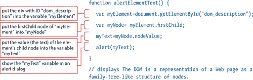

我也可以将这三行写成单行更复杂的代码，如下：

```
alert (document.getElementById("dom_description")).firstChild.nodeValue);
```

对于初学者来说，像前面的多行代码示例那样逐步步进可能是最好的，这样你可以在每一步测试正确的值。如果你是对比语法自信的资深程序员，用点分隔将所有元素写在一行可以使代码更清晰、更简洁。我将在过程中向你展示这些示例的逐步步骤和简洁版本。

接下来，让我们获取元素属性的文本。如果该元素恰好有 ID，那么就很简单，在本示例中。再次，我将首先逐步步进。

### 检查元素的存在

正如我在此示例的可下载文件中所说明的，良好的做法是在尝试获取子节点之前使用 *if* 语句检查该节点是否真实存在，如下：

```
if (theTags[0].firstChild) { // 子节点是否存在？
   alert(theTags[0].firstChild.nodeValue);
   }
}
```

在尝试使用数据之前检查其存在性可以使你的代码在节点可能填充或不存在的情况下更加无敌。

### 获取元素的属性

访问元素的属性（例如`class`或`title`）非常有用。在这个示例中，我将获取 ID 为`content`的`div`元素的`title`属性并显示该属性的文本。

**示例 3.6. dom_exercises.html**

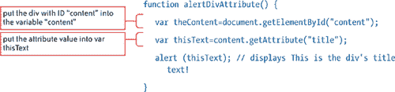

更简洁的形式如下：

```
alert (document.getElementById("content").
getAttribute("title"));
```

### 获取子元素的文本

通常，你想要的元素位于一个具有 ID 的容器`div`内部，因此你首先获取该`div`，然后“钻取”你想要的元素。在这个示例中，我想要的元素——`h2`元素的文本节点——是`h2`元素的第一个子。

**示例 3.7. dom_exercises.html**


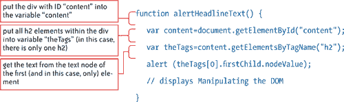

这是相同功能的单行写法。如所示，你通常会将结果存入变量中，并仅使用`alert`进行测试。

```
var theText=document.getElementById("content").
getElementsByTagName("h2")[0].firstChild.nodeValue;
```

你可以看到这些单行版本如何变得冗长且复杂。使用额外的几行代码并逐步进行，可以使代码更易读。

现在，让我们来看设置器（setters），正如其名称所示，它们设置元素的属性，甚至可以向标记中添加一个完全新的元素。

## 设置元素的文本

在这里，我将使用上一个示例中从`h2`元素获取的文本，并将其插入另一个元素中。唯一的区别是高亮的那行。

**示例 3.8. dom_exercises.html**

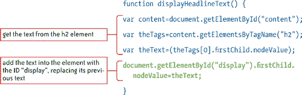

通过单行（高亮显示），我将文本放入`ID`为`display`的段落元素的文本节点中，替换了原有的文本。

## 创建新元素并为其添加文本和属性

在使用此标记的最后一个示例中，我将以之前两个示例相同的方式获取`h2`文本。然而，这次我会创建一个完全新的元素，将文本添加到该元素中，然后将新元素添加到页面中。

**示例 3.9. dom_exercises.html**

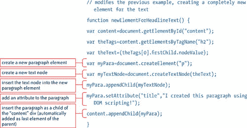

前一个代码示例中的注释已经基本上解释了这种情况，但我在这里还要做两个说明。首先，当你这样创建一个元素时，它只是在 JavaScript 的"超空间"中隐而不见地存在，直到你将其附加到页面。

其次，`appendChild`总是将元素添加到父元素的结束标签之前；在本例中，即`content` `div`。从美学角度来说，将新文本直接添加到我们生成它的链接之后会更有意义，但 JavaScript 并没有`insertAfter(someElement)`方法。不过，你可以通过`scriptin_helper.js`文件中的`insertAfter`辅助函数来实现这一点。

## 修改元素样式

这个最后的 DOM 脚本示例希望通过向你展示 JavaScript 和 CSS 如何协作来提供许多灵感。简而言之，因为 JavaScript 允许你更改元素的属性，因此在用 JavaScript 应用 CSS 时有两种有趣的可能性：

- **Style 属性。** 如你可能所知，可以使用 CSS 为元素添加`style`属性，例如加粗其文本，甚至更改其可见性或位置。

  ```
  <p style="font-weight:bold">随你怎么喜欢加粗!</p>
  ```

  你可以用 JavaScript 做同样的事情，理想情况下，你应该这样使用`setAttribute`方法：

  ```
  myElementObject.setAttribute("style","font-weight:bold;")
  ```

  你确实可以这样做。然而，IE6 对`setAttribute`的使用并不可靠，因此将元素视为其所代表的对象并使用如下点语法更为可靠：

  ```
  myElementObject.style.fontWeight="bold";
  ```

  包括 IE6 在内的所有浏览器都理解这种语法。请查看侧边栏"使用 JavaScript 应用样式"，了解更多关于以此方式应用样式的知识。

- **DOM 脚本。** 修改元素样式的另一种强大技术是使用 DOM 脚本添加`class`属性。这可以导致许多以该类作为上下文选择器的 CSS 规则立即在引用元素上生效。例如，这些段落和链接规则中的任何样式

  ```css
  .myClass p { /* CSS 样式 */ }
  .myClass a:hover { /* CSS 样式 */ }
  ```

  当`myClass`类被 JavaScript 添加到段落或链接的某个祖先元素时，这些样式就会生效（假设没有更具体的样式覆盖了它们）。

所以，让我们使用这两种技术中的第一种，通过为每个链接添加加粗样式。

### 为元素添加样式

现在我将向你展示如何通过为每个链接添加加粗样式为元素添加样式。

**示例 3.10. dom_exercises.html**


这是相同功能的单行写法。如所示，你通常会将结果存入变量中，并仅使用`alert`进行测试。

```
var theText=document.getElementById("content").
getElementsByTagName("h2")[0].firstChild.nodeValue;
```

你可以看到这些单行版本如何变得冗长且复杂。使用额外的几行代码并逐步进行，可以使代码更易读。

现在，让我们来看设置器，正如其名称所示，它们设置元素的属性，甚至可以向标记中添加一个完全新的元素。

### 设置元素的文本

在这里，我将使用上一个示例中从`h2`元素获取的文本，并插入另一个元素中。唯一的区别是高亮的那行。

**示例 3.8. dom_exercises.html**


通过单行（高亮），我将文本放入`ID`为`display`的段落元素的文本节点中，替换了原有的文本。

### 创建新元素并为其添加文本和属性

在使用此标记的最后一个示例中，我将以之前两个示例相同的方式获取`h2`文本。然而，这次我会创建一个完全新的元素，将文本添加到该元素中，然后将新元素添加到页面中。

**示例 3.9. dom_exercises.html**


前一个代码示例中的注释已经基本上解释了这种情况，但我在这里还要做两个说明。首先，当你这样创建一个元素时，它只是在 JavaScript 的"超空间"中隐而不见地存在，直到你将其附加到页面。

其次，`appendChild`总是将元素添加到父元素的结束标签之前；在本例中，即`content` `div`。从美学角度来说，将新文本直接添加到我们生成它的链接之后会更有意义，但 JavaScript 并没有`insertAfter(someElement)`方法。不过，你可以通过`scriptin_helper.js`文件中的`insertAfter`辅助函数来实现。

### 为元素添加类

注意


更改元素的类产生的影响比简单添加样式大得多，因为这可以在许多元素上调用许多样式。我将通过编写几个 CSS 样式（你可以在`head`中的`style`标签内看到）针对`important_links`来阐明这一点。

```css
.important_links a {
   font-weight:bold;
   }
.important_links a:hover {
   color:#666;
   }
```

修改元素样式的另一种强大技术是使用 DOM 脚本添加`class`属性。这可以导致许多以该类作为上下文选择器的 CSS 规则立即在引用元素上生效。例如，这些段落和链接规则中的任何样式

```css
.myClass p { /* CSS 样式 */ }
.myClass a:hover { /* CSS 样式 */ }
```

当`myClass`类被 JavaScript 添加到段落或链接的某个祖先元素时，这些样式就会生效（假设没有更具体的样式覆盖了它们）。

### 使用 JavaScript 应用样式

如果你手动在 HTML 中为元素添加样式，你可以写：

```html
<p id="myPara" style="font-weight:bold;">这里有一些加粗的文本</p>
```

或者，可以使用 JavaScript 这样添加高亮代码：

```javascript
document.getElementById("myPara").setAttribute("style","font-weight:bold;")
```

在这里，我格式化样式声明（其属性/值对——高亮），就像我手动添加样式时写的一样。然而，因为`setAttribute`在 IE6 中并不可靠，我使用点语法样式以一种 W3C DOM 标准浏览器和 IE6 浏览器都能理解的方式添加样式。

```javascript
myElementObject.style.fontWeight="bold";
```

现在，不是使用 JavaScript 简单地向标记中写入一些 CSS，而是通过 JavaScript 设置属性。当我这样使用 JavaScript 时，我更改了属性名的格式（高亮），将带连字符的 CSS 格式`font-weight`转换为对应的 JavaScript 驼峰命名`fontWeight`。使用点语法设置样式时，在几乎所有情况下，我只需将带连字符的 CSS 版本转换为驼峰版本即可获得属性名的正确格式。异常是`float`，它变为`cssFloat`。


从性能角度来看，这种方法有助于避免遍历大型链接列表、表格行或你正在处理的任何内容，并为每个项目添加类，因为这可能会非常慢。

当我向容器`div`添加`important_links`类时，其内部的所有链接都会立即受到此 CSS 的影响。因为容器`div`有一个很好的钩子——它的`ID`——我们只需要一行代码就可以获取并设置这个元素。

**示例 3.11. dom_exercises.html**

```javascript
function addClass() {
   document.getElementById("demo_links").className="important_links";
}
```

不仅所有的链接都加粗了，而且当光标移动到它们上方时，它们还会变成灰色。

使用这种技术，你可以在样式表中准备好各种额外的样式，并在时机成熟时，通过为元素添加类来调用它们——正如你在接下来的示例中所看到的那样。

## 斑纹表格

在这里，我将使用 DOM 脚本为表格的交替行添加类，以创建条纹效果。这种效果有助于引导用户的视线跨过行，如果表格很宽，则特别有用。你在第 1 章中看过了这个表格——现在我将编写 JavaScript 让它运行起来。

实现这种条纹效果需要你刚刚看到的某些 DOM 脚本技术。我还将使用`onload`事件处理器在页面加载后立刻触发添加条纹的函数。此外，在你在下一章学习了事件处理技术后，我将回到这个表格，并让用户移动光标到表格行上时，这些行会高亮显示。

在这个示例中，我将在`table`元素上添加`stripe_table`类，如此标记所示。

**示例 3.12. table_stripe_step0.html**

```html
<table class="stripe_table" border="1">
   <caption>更多供你阅读乐趣的 JavaScript 书
      </caption>
<thead
   <tr>
      <th scope="col">标题</th>
      <th scope="col">作者</th>
      <th scope="col">出版社</th>
      <th scope="col">注释</th>
   </tr>
</head>
<tbody
   <tr>
      <td>PPK on JavaScript</td>
      <td>Peter-Paul Koch</td>
      <td>New Riders</td>
      <td>欧洲最顶尖的 JS 专家提供了他的个人
         见解。</td>
   </tr>
   // 等...为了节省空间此处删除了额外的行
</tbody>
</table>
```

## 添加和删除类

你可以在类属性中拥有多个由空格分隔的类名，例如此处插图的三个类：

```html
<div class="nav links members"><!-- --></div>
```

在这种情况下，如果你直接在一个已经有其他类的元素上设置一个类（就像我在"向元素添加类"示例中所做的那样），就会遇到问题。那些现有的类将被你添加的类所替换。为了避免在添加新类时覆盖现有的类，你必须先获取当前存在的类，将它们存储在数组中，添加你的新类，然后将整个内容写回去，不要忘记每个类名之间的空格。下载文件夹中的`scriptin_helper.js`文件中有一个实用的辅助函数可以正确地添加和删除类，我将在后面的示例中使用它。

此标记使用了`thead`和`tbody`标签将表头行与表格数据行分开。这不仅是良好的语义化标记（即它有意义地构建了内容），而且你将看到的，它还为我想要添加条纹的行提供了目标上下文。这些行都包含在`tbody`标签内，通过只针对内部的行，我的代码不会影响我想保持原状的表头行。图 3.2 显示了这种未样式的标记在浏览器中的外观。

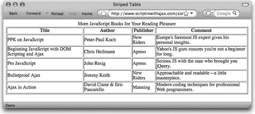

**图 3.2. 带有浏览器默认样式的表格。**

浏览器对表格的默认样式（周围有边框，每个单元格周围也有边框）并不好看，无助于显示数据元素之间的关系，并且会分散你对数据的注意力。

幸运的是，通过一点 CSS（以及从 HTML`table`元素中删除`border`属性），可以很容易改进表格的外观，如图 3.3 所示。

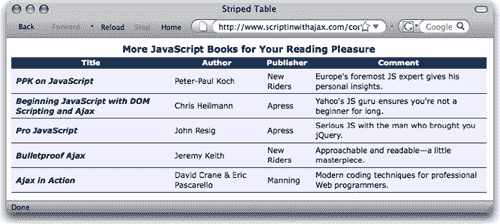

**图 3.3. 删除表格边框并添加一些颜色和一些细水平线可以提高美观度，并突出数据中的关系。**

**示例 3.13. table_stripe_step1.html**

当页面加载时，会出现警示框，如图 3.4 所示。

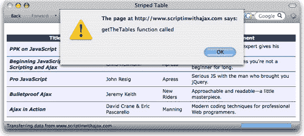

**图 3.4 页面加载完成后，`onload`事件处理程序成功调用了函数。**

既然函数已从`onload`事件中成功调用，现在是时候向其中添加实际代码了。我将首先检查浏览器是否支持我想使用的 DOM 脚本方法，如果不支持则退出函数。注意，这是来自第 2 章的"存在性"测试。

```javascript
if (!document.getElementsByTagName) {return false;}
```

在通过此测试的浏览器中（如今大多数包括 IE6 在内的浏览器都会通过），我现在可以使用`getElementsByTagName`方法找到页面上所有的表格，并将它们存储在我命名为`theTables`的变量中。我将通过检查返回了多少表格来确保这一步正常工作；在这种情况下，显然应该有一个。`getElementsByTagName`方法返回一个类数组的节点列表（node list）。我可以使用`length`方法确定其中元素的数量，但注意其他数组方法（如`sort`、`push`和`pop`）无法在节点列表上使用。

**示例 3.15. table_stripe_step3.html**

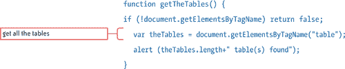

当我们运行这段代码时，警示框显示找到了一个（图 3.5）。

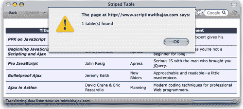

**图 3.5 表格数组包含了预期的单个元素。**

接下来，我将遍历节点列表中的元素，检查它们中是否任何一个具有`stripe_table`类。

**示例 3.16. table_stripe_step4.html**

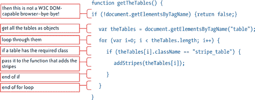

在这里，我使用`for`循环来遍历我在上一步找到的表格。在这种情况下，只有一个表格，但为了代码的健壮性，它必须能够处理页面上可能任意数量的表格。

在循环内部，我测试每个表格以检查它是否具有`stripe_table`类。如果是，我就将其传递给`addStripes`函数，为每条隔行的行添加`.odd`类。

我将从编写`addStripes`函数的结构开始，并检查它是如何从`getTheTables`函数调用的。

```javascript
function addStripes(theTable) {
   alert("addStripes function called");
}
```

如图 3.6 所示，随后我确认了函数已成功调用。

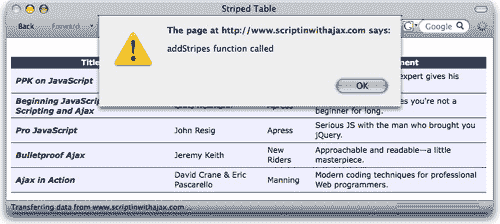

**图 3.6 `getTheTables`函数现在正在调用`addStripes`函数。**


我将再次使用`getElementsByTagName`方法——首先获取`tbody`元素，第二次获取其内部的行。作为合理检查，我将显示节点列表的长度。

**示例 3.17. table_stripe_step5.html**


当你运行代码时，你会看到如图 3.7 所示的结果。


**图 3.7 此表格共有五行，包括表头。**

现在我知道我正成功获取了该表格中位于`tbody`标签内的五行。

剩下的就是写一个循环，为每条隔行的行添加`.odd`类。

**示例 3.18. table_stripe_step6.html**


如图 3.8 所示，表格现在有了漂亮的条纹。


**图 3.8 条纹现在已添加到隔行中。**

关于这段代码，我想解释三个有趣的点。

首先，这个示例是 JavaScript 对象化特性的良好说明。当我获取表格元素时，它们被存储在一个类数组的节点列表对象中。这个节点列表可以被查询其长度，由于它是类数组，我们可以对节点列表进行循环，并且在任何时候访问该对象的属性。一旦你理解了可以传递对象并可以使用`objectName.propertyName`语法，JavaScript 就会变得容易操作。

第三，让我们检查循环中的计数器。在为隔行添加类时，循环使用`i++`增加一。

## 代码重构

重构是在不改变功能的情况下改进代码的过程。你可能这样做是为了让代码更快、更安全，或者在这种情况下，仅仅是为了使其更有组织、更易读且易于扩展。在下一章中，我将向这段代码添加更多函数。

为了准备，我将从创建对象的基本结构开始。

```
var stripeTable={
}
```

现在，我将函数放入对象内部，对其进行缩进，并重构每个函数的第一行。我还在调用`addStripes`方法之前加上对象名。

**示例 3.19. table_stripe_step7.html**

```javascript
var stripeTable={
   getTheTables:function() {
   if (!document.getElementsByTagName) return false;
      var theTables = document.getElementsByTagName("table");
      for (var i=0; i < theTables.length; i++) {
         if (theTables[i].className == "stripe_table") {
            stripeTable.addStripes(theTables[i]);
         }
      }
   },
   addStripes:function(theTable) {
      var theTableRows = theTable.getElementsByTagName("tr");
      var rowCount=theTableRows.length;
      for (var i=1; i < rowCount; i++) {
           theTableRows[i].className = "odd";
           i++;
         }
      }
   }
}
```

我还需要修改`onload`事件以调用`getTheTables`函数。你可能会认为这种简单的修改就能生效，但点语法在此上下文中不起作用。因此，我将添加一个名为`init`（初始化）的简单函数，从事件调用它并在其中添加对对象的调用。

```javascript
window.onload=init;
function init() {
   stripeTables.getTheTables();
}
```

现在它工作了。此外，如果我想在页面加载时调用其他函数，我现在可以将它们添加到这个初始化函数中。

对象是 JavaScript 中一切的本质。本章的示例将引导你深入理解 JavaScript 是如何运作的，以及如何编写能够充分利用其能力的代码。通过使用对象来包含相关的代码元素，你可以在代码增长时对其进行控制，并防止作用域冲突。通过创建可以生成实例的类，你获得了一种用于管理大型数据集的强大机制。

DOM 脚本允许你操作用户界面，让你的 Web 页面从固定的布局变为一个可以随心所欲修改的画布。

现在是时候查看事件了，并发现如何检测用户与你的应用程序的交互并提供适当的响应。

# 第 4 章. 事件

在现代网站或基于浏览器的应用程序中，JavaScript 的主要目的是对用户与界面的交互提供响应，或者从更技术的角度来说，就是处理由用户动作触发的事件。

事件是浏览器在用户操作时不断流式发送的。例如，每当用户将指针移动到 HTML 元素上、点击鼠标或将光标移动到表单字段时，就会触发相应的相应的事件消息。JavaScript 会接收这些消息，但除非你提供一个能够对这些消息做出响应的事件处理器，否则它什么都不会做。

编写能够监控并响应对你的应用程序至关重要事件的代码，是创建交互界面的关键。

要让你的应用程序对用户动作做出响应，你需要：

1. 决定应该监控哪些事件

2. 设置事件处理器，在事件发生时触发函数

3. 编写函数为事件提供适当的响应

你将在整个章节中看到这一过程的细节。现在，只需记住一个概念：事件（如`click`）是某些特定活动（通常是用户活动，但有时是浏览器活动，如页面加载）的结果而发布的，你可以通过事件处理器来处理该事件。事件处理器的始终是以"on"开头的事件名称；例如，`click`事件由`onclick`事件处理器处理。事件处理器会导致函数运行，而该函数提供对事件的响应。表 4.1 列出了最常用的事件处理器。

### 表 4.1. 此表列出了最常用的事件处理器列表。

| 事件类别 | 在什么情况下触发事件... | 事件处理器 |
| --- | --- | --- |
| 事件 | 页面完成加载 | `onload` |
| | 页面从浏览器窗口移除 | `onunload` |
| | JavaScript 抛出错误 | `onerror` |
| 鼠标事件 | 用户在元素上点击 | `onclick` |
| | 用户在元素上双击 | `ondblclick` |
| | 在元素上按下鼠标键 | `onmousedown` |
| | 在元素上释放鼠标键 | `onmouseup` |
| | 鼠标指针移动到元素上 | `onmouseover` |
| | 鼠标指针离开元素 | `onmouseout` |
| 键盘事件 | 按下按键 | `onkeydown` |
| | 释放按键 | `onkeyup` |
| | 按并释放按键 | `onkeypress` |
| 表单事件 | 元素通过指针或 Tab 导航获得焦点 | `onfocus` |
| | 元素失去焦点 | `onblur` |
| | 用户在文本或文本区域字段中选择类型 | `onselect` |
| | 用户提交表单 | `onsubmit` |
| | 用户重置表单 | `onreset` |
| | 字段失去焦点且自获得焦点后内容已更改 | `onchange` |

# 处理事件的技术

在本节中，我将向你展示四种你可以用于响应事件触发 JavaScript 函数的技术。前两种技术需要在标记语言中添加 JavaScript，因此我倾向于避免它们，而更倾向于根据需要通过编程方式向元素添加和移除事件处理器的技术。在小型项目（如简单的 Web 网站）中，前两种技术效果良好，但对于每种技术，我都会讨论一些重要的注意事项。

## JavaScript 伪协议

如果你在过去几年中使用过 JavaScript，你可能使用过 JavaScript 伪协议从链接中触发函数：

```
<a href="javascript:someFunctionName();">链接名称</a>
```

当用户点击链接时，会调用函数`someFunctionName()`。这里没有说明`onclick`；这种技术只是简单地替换了`href`值。这种方法的问题在于，它完全替换了通常作为`href`值的 URL。如果用户没有运行 JavaScript，或者相关的 JavaScript 函数由于某些原因未能加载，链接将完全失效。这种方法还把 JavaScript 添加到了标记语言中，我将在向你展示第二种方法后讨论这个问题。简而言之，避免使用伪协议触发事件。

## 内联事件处理器

内联事件处理器正如你在第 2 章中简单看到的，会将事件处理器直接附加到元素上。

```
<input type="text" onblur="doValidate()" />
```

在这里，一个表单文本字段与其`blur`事件关联了 JavaScript 函数`doValidate()`——当用户按下 Tab 将光标移出字段或点击其他处时，将调用该函数。该函数可以检查用户是否真的在字段中输入了内容。

### 焦点与模糊

当用户点击文本字段时，会触发`focus`事件消息，因为键盘的焦点现在位于该字段上，用户输入的任何内容都会出现在该字段中。如果用户随后按下 Tab 或点击其他处将光标移出该字段，字段将失去焦点并触发`blur`消息。

内联事件处理器一直是触发事件的标准方法，因此如果你必须处理一个运行已久的网站，你无疑会在各处看到内联处理器。内联处理器的一个优点是`this`关键字绑定到从内联处理器调用的函数上。为了说明这一点，这里有一个调用`addClass`函数的链接：

```
<a href="somePage.html" onClick="addClass()">
```

因此在函数中，你可以简单地写

```
this.className="hilite";
```

而无需先获取元素。此外，你不需要担心用户在 DOM 加载到浏览器之前触发作用于 DOM 的 JavaScript 事件，因为事件处理器是附加在标记上的。我们将在本章的"第一个事件：加载"部分讨论这个 DOM 就绪问题。

然而，通过另外两种关联元素的方式也可以实现上述两种优点。在描述它们之前，请记住，前两种技术都不是理想的，因为它们将 JavaScript 与 HTML 混合在了一起。在之前的示例中，`addClass`函数与此 HTML 元素永久关联。如果你更改函数名称或从代码中删除它，你还需要找到并移除标记中的所有出现处。此外，如果由于某些原因`addClass`脚本没有加载，点击链接时 JavaScript 将抛出错误。在现代 Web 应用程序中——出于可访问性、维护性和可靠性的考虑——你希望将 JavaScript 和 CSS 保持在 HTML 标记之外。

由于内联处理程序（inline handlers）仍被广泛使用，如果不向你详细展示它们的工作原理将是我的过错，因为它们在未来的多年里都会一直存在。在随后的章节中，我将向你展示内联处理器的示例以及如何使用它们。尽管如此，我希望随着程序员对 Web 标准以及使用 JavaScript 为其关联元素注册事件的优势认识提高，这些处理程序将逐渐淡出舞台。考虑到这些点，现在让我向你展示在不向 HTML 标记中添加 JavaScript 的情况下创建事件响应的方法。

## 作为对象属性的处理器

```
var clickableImage=document.getElementById("dog_pic");
clickableImage.onclick=showLargeImage;
```

这个示例展示了一个两步过程。首先，我将一个对象（ID 为`dog_pic`的 HTML 元素）赋值给变量。在示例的第 1 行中，代表 HTML 元素的对象存储在`clickableImage`变量中。其次，我将事件处理器`onclick`赋值为对象的属性，并将函数名作为`onclick`属性的值。现在，当用户点击 ID 为`dog_pic`的元素时，函数`showLargeImage`将运行。

虽然这种技术具有将 JavaScript 与标记中分离的良好特质，但它也有几个严重的缺点。

首先，使用这种技术一次只能分配一个事件，因为在任何给定时间，一个属性只能存在一个值。我无法在不覆盖当前值的情况下为`onclick`属性分配另一个事件，由于相同的原因，原先分配的另一个事件会被此事件覆盖。

其次，当用户点击此元素并调用函数时，该函数必须硬编码该对象的名称，以便它知道要处理哪个元素。

```
function showLargeImage() {
  thePic=document.getElementById("dog_pic");
  // 对该 pic 进行某些操作
  }
```

如果你更改了作为事件源的对象，你将也必须修改该函数。

出于这个原因，"作为对象属性的处理器"技术仅适用于你只想向一个对象分配一个事件的情况，例如在页面首次加载时运行一次初始的`onload`函数（请参见本章节稍后部分的"首个事件：load"部分）。然而，由于上述原因，它对于整个 RIA（富交互应用程序）的使用并没有提供一个稳健的解决方案，在应用程序运行期间，事件通常会在对象之间分配和移除。在几乎所有情况下，管理事件的最佳方法是使用事件监听器。

## 事件监听器

事件监听器随 W3C DOM 模型一起引入，提供了全面的事件注册功能。

事件监听器的作用正如其名所示：在绑定到对象后，它会耐心地监听其事件的发生。当它"听到"其事件发生时，它将以与"作为对象属性的处理器"方法相同的方式调用关联的函数，但有两个重要的区别。

首先，*一个事件监听器会将一个包含其触发事件信息的事件对象传递给它所调用的函数。*（我强调这一点是因为它太重要了。）在函数内部，你可以读取此对象的属性来确定目标元素、发生事件的类型（例如`click`、`focus`、`mousedown`）以及关于事件的其他有用细节。

这种能力可以大幅减少代码量，因为你可以为关键任务（如处理点击）编写非常灵活的函数，这些函数可以根据调用对象和触发事件的不同提供不同的响应。否则，你必须为需要处理的每种事件类型编写一个独立的、可能非常相似的函数。你将在本章后面的部分学习如何编写具有这种灵活性的函数。

其次，你可以向一个对象附加多个事件监听器。因此，当你添加一个监听器时，不必担心它会覆盖早先添加的另一个监听器，就像你简单地将事件赋值为对象属性时那样。

虽然 W3C 和微软浏览器都支持事件处理器，但它们在这些处理器附加到元素的方式以及提供访问事件对象的方式有所不同。我将从 W3C 方法开始，它将是未来的事实标准，然后讨论事件监听器在微软浏览器中是如何工作的。

### W3C 事件模型

这里是为元素添加监听器的 W3C 技术。我将向表单的文本字段添加两个监听器，它们会在用户点击（或使用标签键）进入或离开该字段时导致函数运行：


现在，当光标移入字段时，将调用`doHighlight`函数，当光标移出字段时，将调用`doValidate`函数。（第三个参数`false`涉及到*事件冒泡*，这个概念可以留到本章稍后讨论。）我可以以这种方式向对象添加任意数量的事件监听器。

可以使用`removeEventListener`方法以类似的方式从元素中移除事件。


### 微软事件模型

微软的事件注册模型略有不同。这种 W3C 样式

```
emailField.addEventListener('focus',doHighlight,false);
```

在微软模型中的等价形式为

```
emailField.attachEvent('onfocus',doHighlight);
```

这种 W3C 样式

```
emailField.removeEventListener('focus',doHighlight,false);
```

在微软模型中的等价形式为

```
emailField.detachEvent('onfocus',doHighlight);
```

### 注意


只有当应用程序需要元素不再响应已分配的事件时，你才需要显式移除事件处理器。在大多数情况下，你只添加事件监听器而不移除。它们只要页面加载就会一直存在。注意微软版本在事件名称中使用`on`，例如`onfocus`。显然，这里存在一些语法差异，让我们看看编写可以在两种浏览器中运行的代码。

### AddEvent 辅助函数

为了无论用户浏览器如何都能正确为元素添加事件监听器，我将使用由 John Resig 写的现有函数，它可以确定正确的事件模型。该函数接受以下参数：

*   要附加监听器的元素

*   要监听的事件类型

*   事件发生时要调用的函数名

它将测试浏览器是否支持微软的`attachEvent`方法（高亮处），然后相应的进行代码分支。


可以使用第二个类似的辅助函数实现移除事件。


如你所示，这些函数相当复杂，但幸运的是你不需要理解它们，只需要学会使用它们。如果你想为前一个示例中的 email 字段添加事件监听器，你只需要像这样调用`addEvent`辅助函数即可：

```
addEvent(emailField, 'focus', doHighlight);
```


如果你是一名设计师，你可能已经注意到常见的用户界面交互被分类为各种设计模式——例如向导（Wizard）、多次撤销和拖放等，这些模式定义了每个交互的适用场景和实现方式。设计模式记录了成功的用户交互，为设计师提供了通用的词汇，最重要的是，为用户在访问的各个网站之间提供了熟悉的交互。Jenifer Tidwell 的《界面设计》（*Designing Interfaces*，O’Reilly, 2005）是该领域的开基性著作，也是所有界面设计师的必读读目。

软件中也存在一套类似的的设计模式，它们提供了一种解决和讨论常见编程问题的标准化方法。软件设计模式的第一大分类由 Erich Gamma、Richard Helm、Ralph Johnson 和 John Vlissides（被称为“四人帮”）在《设计模式：可用面向对象软件的基础》（*Design Patterns: Elements of Reusable Object-Oriented Software*，Addison-Wesley, 1994）中发表。

《JavaScript JavaScript》中使用的大部分辅助函数都是外观模式（Façade pattern）的简单实现，即“为子系统中的两个或多个接口提供一个公共接口”。代码处理单个接口——在添加事件监听器的情况下，即 `addEvent` 函数——该接口负责以语法正确的方式对两个对象之一（`addEventListener` 或 `attachEvent`）进行寻址，这取决于用户的浏览器。通过使用这些外观模式辅助函数，你抽象掉了跨浏览器问题，只需将你的请求传递给这些中间对象，由它们为你解决问题。

随着你技能的增长，学习设计模式可以帮助你写出更好的代码，因为你正在使用最佳编码实践，并且可以避免苦苦寻找那些早已被发现并证明的编码问题解决方案。

事件监听器的注册是你在 JavaScript 中面临的跨浏览器问题的另一个例子。然而，一旦你拥有了一组良好的辅助函数或像 `jQuery` 这样的框架，你就不需要那么担心它们了。

为元素添加监听器的常见时机是页面首次加载时，更具体地说，是在几乎每个 JavaScript 应用程序必须检测并处理的事件发生——`load` 事件，该事件在页面完全加载并在浏览器中渲染后触发。

# 第一个事件：load

通常，你想让 JavaScript 做的第一件事是设置页面的初始状态，使其准备好使用。这个初始化过程的一个非常常见的部分是向 DOM 中的元素附加事件监听器，以响应用户操作，而在 DOM 加载到浏览器之前，你无法做到这一点。

例如，你可能想为表单的文本字段附加 `blur` 事件，以便你可以检测用户何时点击或通过 Tab 键离开它们。然后你可以立即验证用户输入的文本。

为了帮助你确保正在处理的是实际存在的 DOM，当页面完全加载到浏览器窗口时，会发出一个 `load` 事件。你可以使用 `onload` 处理程序来检测此事件，并触发为用户设置初始页面状态的 JavaScript 函数。这时你就知道 DOM 已准备就绪。

这是一个如何此操作的简单示例：


在调用 `init` 函数的加亮行中，你可以看到 `init` 函数名后面没有括号。通常你会在函数名后添加括号，因为你希望该函数在代码的该点立即运行。然而，由于你正在设置一个稍后调用该函数的事件，所以你在这里没有这样做。如果你写成：

```
window.onload=init();
```

函数将立即运行（将 `onload` 属性设置为函数的结果！），而不是等待发送页面加载事件。

另外注意，你写的是 `window.onload=init`，因为 `onload` 是 window 对象的方法，所以你必须在它前面加上 `window.` 才能生效。

## onLoad 如何可能产生不利

你通过两种方式在 `onLoad` 事件上遇到问题：

- **分配监听器的延迟。** 请注意，链接的内容（如图像）是在 DOM（HTML 标记）之后加载的，并且加载事件在所有链接内容加载完成之后才会触发。因此，如果你的页面包含许多大图像，DOM 加载与 `onLoad` 事件之间可能会出现巨大的延迟。在此间隔期间，用户可能会尝试在搜索字段中输入内容或点击链接——毕竟 DOM 已经加载且这些元素是可见的。如果你一直等到许多大图像加载后才获取注册事件监听器的 `load` 事件，用户可能点击了尚未生效的链接。

  作为此问题的变通方法，现在有一些辅助函数可以在 DOM 准备就绪后立即调用“DOM 已就绪”类型的事件。例如，`jQuery` 框架有一个 `.ready` 方法，它在 DOM 和 CSS 加载后（但在图像和其他链接内容之前）被调用，以避免这种分配监听器的延迟。

- **争抢 onLoad 事件。** 由于等待 DOM 准备就绪非常重要，你使用的第三方脚本可能也想要设置 `window.onLoad` 属性，这可能会覆盖你的设置，或者你可以覆盖它们的设置，取决于谁最后加载。得益于 Peter-Paul Koch 组织的一场竞赛，现在有一个名为 `addLoadEvent` 的强健辅助函数，它允许将多个事件分配给 `window.onload` 属性。我将在稍后的示例中使用这个函数，它包含在 Scriptin’ 辅助文件中。我建议你使用此函数来分配你的初始化函数。

## 在页面加载时添加监听器

在这些讨论之后，我现在将向你展示一个在页面加载时向元素添加监听器的简单示例。在这种情况下，当 `onload` 事件处理程序调用 `init` 函数时，它将为文本字段添加事件监听器。

由于这些事件监听器调用的函数，文本字段在获得焦点时将高亮（将其 `background` 属性设置为 `green`）；当焦点移除时它将取消高亮（恢复默认的白色背景）。

这是表单字段输入：

```html
<input id="email" name="email" type="text" size="24" />
```

我将使用之前展示过的 `addEvent` 辅助函数来实现这一点，以便它在 W3C 和微软浏览器上都能工作。

它是与此演示相关的唯一 HTML 元素，所以我把剩余的标记部分留给你的想象——你可以在下载文件中看到它。

第一步是确保 `load` 事件触发了将设置事件监听器的函数。

**示例 4.1. hilite_field_basic1.html**

```javascript
window.onload=setUpFieldEvents;

function setUpFieldEvents() {
  alert ("called");
  }
```

图 4.1 显示了当页面加载时，该函数被调用。


**图 4.1. 函数已从 onload 事件处理程序成功调用。**

接下来，我将添加实际向字段添加事件监听器的代码。为了实现这一点，我将使用 `addEvent` 辅助函数。

**示例 4.2. hilite_field_basic2.html**


由于它没有包含在函数中，高亮的 `onload` 事件会在该行代码在浏览器中加载时设置，然后在页面完全加载完成后后调用 `setUpFieldEvents` 函数。这导致通过 `addEvent` 辅助函数将两个事件监听器添加到字段中。现在，当字段获得焦点时，将调用 `addHighlight` 函数；当字段失去焦点（模糊）时，将调用 `removeHighlight` 函数。

### 注意


Mac 上的 Firefox 在此测试中表现非常奇怪，当字段接收焦点时会多次显示两个对话框。这是因为 alert 对话框触发了字段的模糊。然而，当最终代码就绪后，它可以运行良好。

为了确保这一步正常工作，你可以简单地为这两个事件添加带有临时 alert 的函数。

**示例 4.3. hilite_field_basic2.html (续)**

```
function addHighlight() {
  alert("addHighlight called");
  }
function removeHighlight() {
  alert("removeHighlight called");
  }
```

然后点击该字段，你将看到在 图 4.2 中显示的 alert 对话框。


**图 4.2. 当字段接收焦点时，调用了 addHighlight 函数。**

确定 alert，然后点击字段以外。你将看到在 图 4.3 中显示的 alert 对话框。


**图 4.3. 当字段失去焦点时，调用了 removeHighlight 函数。**

一旦函数被事件成功触发，你只需要将 alert 替换为用于高亮和取消高亮字段的代码。

**示例 4.4. hilite_field_basic3.html**


现在，当字段接收焦点时，其背景会变为绿色，如 图 4.4 所示。当字段失去焦点时，恢复为正常的白色背景，如 图 4.5 所示。


**图 4.4. 字段背景现在在接收焦点时改变颜色。**


**图 4.5. 字段背景在失去焦点时恢复为默认颜色。**

虽然这个示例展示了事件监听器的简单实现，但它并没有充分利用事件监听器提供的强大功能。在上一个示例中，由事件监听器调用的函数随后使用 `getElementById` 获取字段，然后更改其背景样式。以这种方式将事件元素硬编码到函数中限制了它的灵活性：此函数只能对这一个字段上的事件做出响应。

事实上，在此时获取元素是不必要的，因为正如本章引言部分提到的，事件处理程序为它们调用的函数提供了对它们所挂载对象名称及其触发事件的访问。一旦你理解了如何利用这一特性，你就能编写出既通用又紧凑的事件处理代码。

# 事件对象

当 W3C 事件监听器的事件发生并调用其关联的函数时，它还会向函数传递一个参数——指向事件对象的引用。事件对象包含了若干描述所发生事件的属性。

表 4.2 列出了事件对象最常用的属性名称，这些属性在 W3C 和 Microsoft 模型之间通常不同。

**表 4.2. 此表包含了最常用的事件对象属性。**

| W3C 名称 | Microsoft 名称 | 描述 |
| --- | --- | --- |
| `e` | `window.event` | 包含事件属性的对象 |
| `type` | `type` | 事件类型（如 click, focus 等） |
| `target` | `srcElement` | 发生元素 |
| `keyCode` | `keyCode` | 按下键的 ASCII 值，如果按下则返回 1，否则返回 0 |
| `shiftKey` | `altKey` | 如果按下 Shift 键则返回 |
| `currentTarget` | `fromElement` | 鼠标离开的元素 |
| `relatedTarget` | `toElement` | 鼠标进入的元素 |

按照惯例，事件触发的函数中使用参数名 `e` 来接收事件对象。如果我想确定事件类型，例如点击，我会这样写：

```
function myEvent(e) {
   var evtType = e.type
   alert(evtType)
}
```

### 注意


一些不常用的事件对象属性未列在 表 4.2 中，包括鼠标坐标。Peter-Paul Koch 在 [www.quirksmode.org/js/events_advanced.html](http://www.quirksmode.org/js/events_advanced.html) 提供了事件对象的深入讨论和演示。

这段代码在 Microsoft 浏览器上无法运行，因为 Microsoft 模型不像 W3C 模型那样传递事件对象；它使用一个包含最新事件属性的中央全局对象。我将从 W3C 方法开始，然后向你展示如何处理 Microsoft 事件对象。

为了演示 W3C 模型，我将在修改上一个示例中的两个函数时使用事件属性，以便这些函数不再需要在修改之前获取目标元素。这分为两个简单的步骤：添加参数以接收事件对象，然后将字段元素的“获取”操作替换为事件的 `target` 属性：

**示例 4.5. hilite_field_basic4.html**

```
function addHighlight(e) {
   var emailField=document.getElementById("email");
   var emailField=e.target;
   emailField.style.border="3px solid #6F3";
   }
function removeHighlight(e) {
   var emailField=document.getElementById("email");
   var emailField=e.target;
   emailField.style.border="";
   }
```

你现在可以将此相同的事件监听器分配给多个输入字段，这些字段都将显示高亮行为。代码现在不再说“高亮此字段”，而是说“高亮发生事件的那个字段”。

## 事件对象的 type 属性

通过访问事件对象，我现在还可以确定发生事件的 `type`（如 `focus`、`blur`、`click` 等），这样我就可以使用单个函数来检测 `focus` 和 `blur` 事件。

为了实现这一点，我将把事件监听器更改为调用同一个函数 `checkHighlight`。这个名字对于新函数来说更合理，因为它将负责*添加*和*删除*高亮。


然后我将将 `addHighlight` 函数重命名为 `checkHighlight`，完全删除 `removeHighlight` 函数，并修改 `checkHighlight` 函数如下所示：

**示例 4.6. hilite_field_basic5.html**

```
function checkHighlight(e) {
   switch (e.type) {
      case "focus":
         e.target.style.backgroundColor="#6F3";
         break;
   case "blur":
        e.target.style.backgroundColor="";
        break;
   }
}
```

### 注意


如果你想知道我为什么使用 `switch` 而不是 `if` 语句，是因为：`if` 语句只检查一个情况的真假值，如果没有匹配，则执行 `false` 部分，无论那个“假”条件是什么。通过使用 `switch`，我的表述非常明确；如果传递给此函数的是除 `focus` 或 `blur` 之外的任何情况，它都会被忽略。此外，如果我以后想扩展它，可以轻松地添加 `click` 或其他事件。

视觉上没有变化——请参见 图 4.4 和 图 4.5。

这个函数非常通俗易懂。`switch` 语句检查事件 `type`（高亮）是 `focus` 还是 `blur`，并据此分支代码。

## 微软浏览器中的事件对象

到目前为止，你已经了解到，当符合 W3C 标准的浏览器事件监听器触发函数时，一个包含描述触发事件属性的对象的引用会被传递给该函数；此事件对象可以通过 `e` 参数访问。

在微软浏览器中，模型略有不同。有一个全局对象 `window.event`，它保存了最后发生的事件。因为它是全局的，所以它不需要像 W3C 事件对象那样传递给函数；它对你的代码总是始终可用。作为对比，这两行代码在各自的浏览器中是等价的：


编写跨浏览器事件对象代码最简单的方法如下：


虽然这种方法运行良好，但为你每个想要使用的事件对象属性都编写分支代码很快就会过。更好的解决方案是获取该对象（无论它是哪种类型），并给它起一个新名字。Peter-Paul Koch 非常巧妙地使用了 `OR` 运算符来实现这一点。

```
var evt = e || window.event;
```

如果 `e` 求值为 `true`（存在 W3C 事件对象），则变量 `evt` 被设置为 `e`——即带有所有属性的 W3C 事件对象。如果不是，`evt` 则被设置为微软对象。这样现在它在两个浏览器中都能工作了：

```
var evt = e || window.event;
alert (evt.type)
```

前面的示例之所以起作用，是因为与许多事件对象属性不同，发生事件的类型属性名在两种浏览器中是相同的——都是 `type`。如果你想获取事件目标（在 W3C 中为 `target`，在微软浏览器中为 `eventSrc`），你可以在上一步的基础上再次使用 `OR` 语句为事件目标也创建一个通用的跨浏览器名称（高亮处）：


```
var evt = e || window.event;
var evtTarget = evt.target || evt.srcElement;
alert(evtTarget);
```

一旦开始处理事件对象，你就可以在单个函数内管理事件集合。我现在将把这个想法加入代码中。

**示例 4.7. hilite_field_basic6.html**


再次，视觉上没有变化，只是代码变得好许多。参见图 4.4 和图 4.5。

这个函数非常通俗易懂。`switch` 语句检查事件 `type`（高亮）是 `focus` 还是 `blur`，并据此分支代码。

现在你有了一个单字段的工作版本。下一步是添加更多表单字段，以便用户可以输入他们的名和姓。

### 添加多个输入字段

因为我现在正在处理多个元素，我对 DOM 的钩子将位于表单元素 ID 更高层的位置。一旦我有了这个父元素，就可以获取其中的子元素。我首先获取表单元素，然后获取其内部所有标签名为 `input` 的元素。我将从开始修改 `setUpEvents` 函数，告诉我在单内有多少个 `input` 标签。

**示例 4.8. hilite_field_basic7.html**

```
<div id="sign-up">
     <h3>订阅我们的时事通讯</h3>
     <form id="email_form" action="#" method="post">
        <label for="first_name"> 名</label>
        <input id="first_name" name="first_name" type="text" size="18" />
        <label for="last_name">姓</label>
        <input id="last_name" name="last_name" type="text" size="18" />
        <label for="email">邮箱</label>
        <input id="email" name="email" type="text" size="18" />
        <input id="submit" type="submit" value="Go!" />
     </form>
</div>
```

字段的数量显示在警告对话框中（图 4.7）。下一步是为它们每一个附加事件处理器。

**示例 4.9. hilite_field_basic7.html (续.)**

```javascript
function setUpEvents() {
   var form = document.getElementById("email_form");
   var inputs = form.getElementsByTagName("input");
   alert("输入数量: " + inputs.length);
   for (i=0; i < inputs.length; i++) {
      inputs[i].onfocus = checkHighlight;
      inputs[i].onblur = removeHighlight;
   }
}
```

我稍后会考虑过滤掉按钮。我会先遍历所有的 `input` 字段并为它们每一个应用事件监听器，这样我就可以看到高亮所有字段。

**示例 4.10. hilite_field_basic8.html**


第一行高亮代码计算输入的数量并将数字放入变量中；这样做允许我编写更高效的循环。我本可以跳过那一行，直接这样写循环：

```
for (i=0; i < theInputs.length; i++) { // 等等
```

这个版本的问题在于，JavaScript 每次运行循环都必须确定 `theInputs` 节点列表（高亮部分）的长度；在 JavaScript 中，对数组和节点列表进行计数是一个相对缓慢的过程。对于像现在这样的几个项目来说，这并不是什么问题，但如果你正在遍历一个大型数据集或数百行表格数据，浪费的时间就会累积。始终良好的做法是获取一次项目数量并将其存储在变量中，然后将该变量作为循环计数器，正如我在这里做的那样。

现在，当我点击每个字段时，它们会高亮显示，当我点击其他地方时，它们会恢复到初始外观。事件监听器现在已成功挂载到每个字段上，如`图 4.8”所示。


**图 4.8. 每个字段现在获得焦点时都会高亮。**

正如我预料的，当之前的测试返回四个输入时发生的问题是，按钮（这也是一个 `input`）现在当我点击它时也会获得背景颜色。`图 4.9`显示这看起来非常违异。


**图 4.9. 对所有表单输入项应用高亮事件会导致按钮也被高亮的意外副作用。**

让按钮与 `text` 输入框不同的之处在于，它的 `type` 属性是 `submit` 而不是 `text`，因此我可以根据此差异创建一个简单的 `if` 语句过滤器，以识别并排除掉添加事件监听器的操作。

我将首先通过在 `for` 循环中添加此行代码，简单检查我是否可以访问每个输入的 `type` 属性。

**示例 4.11. hilite_field_basic9.html**

```
alert (theInputs[i].getAttribute("type"));
```

这会弹出一系列四个对话框，内容分别为 `text`、`text`、`text` 和 `submit`。

现在我知道我可以区分 `submit` 输入框，我将把这段代码完善为 `for` 循环内部的一个 `if` 语句。

**示例 4.12. hilite_field_basic10.html**


现在，`text` 输入表单字段仍然正确地高亮，但按钮不再被添加事件处理程序。

这个示例到此结束。你在这里看到的开发的代码可以在今天的 Web 浏览器中可靠地运行，甚至可以追溯到 IE5.5。它具有动态能力，可以为表单中的任意输入添加字段高亮效果。高亮字段的实际结果其实很简单，这并不是重点。你应该从这个示例中收获的是这里所说明的关键概念：跨浏览器事件监听器、事件对象处理，以及在过滤掉不需要的元素的同时，对许多相似元素选择性地添加事件监听器。这些是在使你的应用程序响应事件时你会执行多次的常见任务。

现在我将回到我在`第 3 章`中向你展示的条纹表格示例，并使用事件让每个表格行在光标移动到上方时高亮。在此过程中，我将阐述事件冒泡和事件委托的概念。

# 事件的秘密生活

你已经看到事件消息（例如 `click`）可以触发挂载在 DOM 对象上的事件处理程序（`onclick`）。然而，事件消息并不仅仅由那一个 DOM 元素接收：事件会在 DOM 中向上向下移动，并被它们路径经过的任何元素接收。这种被称为 `event propagation`（事件传播）的特性，为你如何以及在何处处理事件，以及事件影响哪些元素，提供了一些有趣的选项。

在接下来的示例中，我希望在光标移动到表格行时将其高亮，并在光标移开时移除高亮。正如你将看到的问题是，尽管我想高亮表格行，但告诉光标是在进入还是移出特定行的鼠标事件，实际上是由表格行内的表格单元格触发的，或者是由表格行内单元格内的链接触发的（如果存在链接）。

换句话说，与我目前向你展示的示例不同，当事件发生时，事件的目标并不是我想更改的元素。为了理解如何找到并修改不是事件目标的元素，让我们先讨论一下 `event capturing`（事件捕获）、`event bubbling`（事件冒泡）和 `event delegation`（事件委托）的概念。

## 捕获与冒泡

当事件消息触发时（为了讨论，假设是一个 `click` 事件），该 `click` 消息不会直接到达事件目标。它首先发送到 DOM 层次结构顶部的对象 `body`，然后通过文档树向下移动目标——即实际接收 `click` 的对象。消息向目标的向下之旅被称为 `capturing phase`（捕获阶段）。

一旦消息到达目标，它随后会回到 DOM 回到 `body` 标签：这种向上的之旅被称为 `bubbling phase`（冒泡阶段）。消息到达 `body` 标签后，就像鲑鱼游回产卵地一样，它的生命就结束了。

你可以在 `click` 消息在执行这种“向下再向上”之旅时，在接收它的任何元素上添加事件处理程序。这可以为你的代码带来巨大的效率，因为你现在可以使用名为 `event delegation`（事件委托）的技术。

## 事件委托

事件委托是一种在非事件目标元素上放置事件处理程序的技术。事件委托最有优势的用法是对一组对特定事件做出响应的大量元素的父元素附加事件。

利用事件委托可以实现显著的代码优化。与其为每个子元素附加单独事件处理程序，不如让感兴趣的消息向上冒泡，并由挂载在父元素上的单个处理程序处理。如果需要，事件对象可以提供目标元素的名称。

W3C 模型支持捕获阶段和冒泡阶段。W3C 事件注册（高亮部分）的第三个参数

```
someElement.addEventListener('focus', false)
```

如果在捕获阶段处理事件，则设置为 `true`；如果在冒泡阶段处理事件，则设置为 `false`。

然而，IE 不支持捕获阶段，而且事件委托只有在消息从子元素向父元素移动才有意义。由于这些原因，你几乎总是使用冒泡阶段来委托事件。在 W3C 模型中，该第三个参数几乎没有例外都是 `false`。

# 带有悬停效果的条纹表格

在`第 3 章`中，我向你展示了如何为表格行添加条纹。你可以在第 86 页看到完整的 JavaScript 代码。现在我将修改这些代码，当光标移动到每个表格行时将其高亮。

我将通过修改两个地方的 HTML 标记开始。首先，我将在表格的一个单元格中添加一个链接。

```
<<td><a href=http://ajaxinaction.com>Ajax in Action</a></a></td></td>
```

在表格单元格中包含链接或其他元素是非常常见的，代码需要足够健壮以应对此类情况。在测试期间，这个链接将代表 `td` 内部额外的一层内容层级。

## 使用元素作为调试工具

接下来，我将在表格之后手动添加一个带有属性 `id="display"` 的 `p` 标签。

```
</table>
<p id="display">Display Area</p>
</body
```

该元素将显示我在之前的示例中通过 `alert` 对话框显示的那些测试值。当我开始测试这些悬停效果时，事件的产生会非常快，我很快就会对点击所有这些对话框的“确定”感到厌倦。相反，我将测试结果写入该元素的文本中（目前显示为“Display Area”），并直接在页面上查看结果——无需弹窗。现在，每当我想检查一个值时，可以使用这行代码：

```
document.getElementById("display").innerHTML = valueToDisplay
```

“Display Area”文字就会被 `valueToDisplay` 的值替换。请记住，每当你在后续代码中看到

```
document.getElementById("display").innerHTML = someValue
```

你就知道我只是在显示一个测试值。

最后的准备步骤是添加一种 CSS 样式，作为行的的高亮背景颜色——在本例中为白色。


我将编写的代码的唯一目的是当光标经过表格行时，为这些行添加或移除 `stripe_table` 类名。

## 鼠标事件

JavaScript 在处理鼠标事件时非常“话多”。每当鼠标在元素上移动或离开元素，甚至只是极微小的移动，都会触发描述这些活动的事件。

为了检测光标是否悬停在表格行上，我将使用鼠标事件 `mouseover` 和 `mouseout`，它们分别在鼠标进入和离开一个元素时触发。

## 事件委托

由于事件会冒泡，我将在 `tbody` 级别为这两个事件添加事件监听器。我只想让表格主体内的行进行高亮，因此 `tbody` 是我可以检测到它们的最高层级，同时不会接收来自表头中表格行的事件（我不希望对表头进行条纹处理）。

在现有的条纹代码中，我已经获取了 `tbody` 元素，因此在紧随其后的行中添加事件处理器很容易。

**示例 4.13. table_stripe_roll1.html**


在第一段高亮代码中，我再次使用 `addEvent` 辅助函数来添加事件监听器，指定将 `mouseover` 和 `mouseout` 事件绑定到 `tbody` 元素。这两个事件都会调用同一个函数 `checkEventSource`。

正如其名称所示，`checkEventSource` 函数将检查当鼠标移动过表格行时，哪个元素是事件的源头，然后向相关的表格行添加 `hilite` 类。该功能将在稍后实现。现在，正如你从第二段高亮代码中看到的，我添加了 `checkEventSource` 函数，并在内部简单地使用“Display Area”元素显示一段文本，以确认该函数已被调用。

当我第一次加载页面时，我会在左下角看到“Display Area”默认文本，如**图 4.10**所示。


**图 4.10. 带有默认 Display Area 文字的页面。**

当我将光标移动到表格最后一行时，如**图 4.11**所示，`checkEventSource` 函数被调用，“Display Area”消息被更新。


**图 4.11. Display Area 文本被函数返回的文本替换。**

这证实了两个事件处理器中的至少一个 `mouseover` 已成功绑定。我有很有认为 `mouseout` 也成功绑定了——我很快就会发现的。

从这段代码的角度来看，我知道 `mouseover` 事件正在冒泡到 `tbody` 上的事件监听器，但我不知道触发元素，所以我还不知道我需要对哪一行进行条纹处理。

## 确定目标元素

下一步是确定目标元素——实际上触发事件的元素。为了做到这一点，我需要获取目标元素的 `nodeName`，对于元素来说，它给出标签名称——例如 `a`、`td` 或 `tr`。

**示例 4.14. table_stripe_roll2.html**

```
checkEventSource:function(e) {
var evt = e || window.event;
var evtTarget = e.target;
document.getElementById("display").innerHTML =
   evtTarget.nodeName;
}
```

你已经见过此函数中的前两行代码——它们获取了目标。第三行的高亮代码简单地获取目标的节点名称；你可以在**图 4.12](#ch04.xhtml_ch04fig12 "Figure 4.12. When the cursor is over a table row, the event target is a table cell.")**和**4.13](#ch04.xhtml_ch04fig13 "Figure 4.13. When the cursor is over a link within a table row, the event target is the link.")**的左下角看到节点名称。


**图 4.12. 当光标位于表格行上时，事件目标是一个表格单元格。**


**图 4.13. 当光标位于表格行内的链接上时，事件目标是链接。**

这个测试表明，表格行元素在鼠标经过它们时，并不会触发事件，因为它们完全被子元素 `td` 填充了。没有任何地方可以放置光标来让 `tr` 触发事件。目标元素——鼠标正下方的元素——始终是 `td`，除非你在它和 `tr` 之间添加内边距或外边距。`td` 因为是 `tr` 的子元素，在元素层级中始终位于 `tr` 之上，并且始终是任何鼠标事件的目标。你也可以在**图 4.14](#ch04.xhtml_ch04fig14 "Figure 4.14. The event bubbles up to the event listener on tbody.")**中看到，如果鼠标移动到 `td` 内的链接上，正如预期的那样，该链接将成为目标


**图 4.14. 事件冒泡到 *tbody* 上的事件监听器。**

## 遍历 DOM

为了找到目标元素的祖先行以便为其应用 `row_hilite` CSS 类，我只需要从目标元素向上移动 DOM，直到找到节点名称为 `tr` 的元素，并向该元素应用高亮类。这种在 DOM 中向上、向下或横移动到相邻元素的过程被称为*遍历*（traversing）。

**示例 4.15. table_stripe_roll3.html**


你可以从前面的高亮代码中看到我的处理方法。我简单地将事件 `target` 属性从目标元素更改为该元素的父元素。这实际上让我沿着 DOM 向上移动——如果目标是`a`（一个链接），那么我现在就处于它的父级表格单元格的层级。我继续这样向上移动，直到我的测试返回了`tr`。（请注意，我使用了字符串方法`toLowerCase`将节点名称转换为小写，以实现跨浏览器兼容性。某些浏览器（如 Firefox）会以大写形式返回节点名称，你可以在图 4.14 和 4.15 左下角看到。）


**图 4.15。即使鼠标悬停在链接上，报告的事件目标现在也是表格行。**

当我获取`tr`且循环停止时，我的事件目标已经设置为`tr`，因为在每次循环运行时，在循环判断是否应该再次运行之前，我都会将目标设置为当前目标元素的父元素。现在事件目标已设置为我想要修改的元素，而不再设为事件的原始目标。简而言之，现在当鼠标滑过表格时，目标元素（无论是链接还是表格单元格（或其他任何内容））都会立即变为该目标元素的`tr`祖先元素，如图 4.15 所示。

## 添加高亮

现在，我已将想要高亮的行作为`mouseover`和`mouseout`事件的报告目标，只需在`switch`语句中使用几行代码即可添加和移除`hilite`类了。

**示例 4.16. table_stripe_roll4.html**


**图 4.16 显示，鼠标悬停的行现在会高亮，滚动效果代码已经完成。**


**图 4.16。现在鼠标悬停在行上时，该行会高亮。**

这是一个很好的事件委托示例，因为涉及到三个独立的元素。事件发生在链接上，附加到表头的事件处理程序响应该事件，而链接所在的表格行被修改了。这种关系在图 4.17 所示。


**图 4.17. checkEventSource 函数确定事件目标的父表格行。**

你可以从代码中看到，我在`tr`上设置`row_hilite`类之前，我存储了该元素当前上的任何类。这是因为有 50% 的概率该行已经具有实现条纹的`odd`类。因此，如果事件处理程序是`mouseover`（这意味着我添加`row_hilite`类），我会将现有的类名放在名为`oldClass`的变量中，然后将元素的类更改为`row_hilite`。当用户移出行并触发`mouseout`处理程序时，我将该行设回`oldClass`变量中的类名。

## 鼠标坐标

当事件由鼠标活动触发时，事件对象持有几组鼠标的 x 和 y 坐标，这些提供了鼠标相对于事件目标、浏览器窗口和屏幕的位置。这些坐标集在不同浏览器中的支持程度不同，这里将不再介绍。此外，你会发现自己其实很少需要鼠标坐标；在处理鼠标事件时，知道光标下哪个元素通常就足够了。然而，如果你想要一些跨浏览器代码来帮助可靠地获取鼠标坐标，请查看 Peter-Paul Koch 在 [www.quirksmode.org/js/events_properties.html#position](http://www.quirksmode.org/js/events_properties.html#position) 的研究。他的书 *ppk on JavaScript* (New Riders, 2007) 对处理鼠标坐标也有深入讨论。

如之前的图所示，这个示例真正有趣的地方在于，带有事件监听器的元素是`tbody`，触发事件的元素是`td`或`a`，而由于事件而被修改的元素是`tr`。

# 键的起伏人生

对键盘有一个简单的看法很容易：现实——至少要复杂得多。当按下键时，事件序列如下：

1. `keydown` 在键按下时发送，紧接着是 `keypressed`。
2. `keypressed` 是一个键按下/释放循环的通用事件。
3. `keyup` 在键离开时发生。

键盘。

通常我使用`keyup`或`keydown`。使用哪一个取决于具体情况。通常我会使用`keyup`，但在需要在字符显示之前对其进行测试时，有时会使用`keydown`。例如，如果你有一个纯数字文本框，你可能会使用`keydown`，以便在字符不是数字时拒绝其显示。

## 带有字符限制的文本框

那些尝试过将你*现在*要做的事情放入 140 个字符推文的人都遇到过带有字符限制的文本框。一旦你输入第 141 个字符，更新按钮就会变灰，你无法发送推文。啊，现在世界永远无法知道那个三明治包的所有细节了！

限制文本输入有助于确保你获得大小正确的数据（例如邮政编码和电话号码），并迫使那些通过你的网站发泄的人至少整理一下思路。

我将演示如何在`textarea`（多行）文本字段上设置字符限制，如图 4.18 所示。

3. 如果达到限制，则高亮屏幕上的显示以警告用户，并删除任何超出限制的字符。
4. 如果用户删除字符使文本减少到最大值以下，则移除警告高亮。

这种布局需要一些简单的 HTML 和 CSS，你可以在下载文件中看到它们。唯一与 JavaScript 代码交互的 HTML 部分是文本区域和显示文本。

```
<textarea id="msg_field" cols="35" rows="3"></textarea>
<p id="display"></p>
```

`p`标签目前是空的，但我将随着编写不断向其中添加文本。初始代码文件`text_field_max_chars1.html`在浏览器中的显示情况如**图 4.19**。


**图 4.19. 在浏览器中显示的文本字段的初始标记。**

## 设置消息显示

这里是代码的开始。

**示例 4.17. text_field_max_chars2.html**


在第一步中，我设置了`theMaxChars`属性来指定计数限制（高亮显示），并定义了`setup`方法，该方法在页面加载时被调用。目前，此方法仅将一个说明字符限制的字符串传递给`displayMsg`辅助函数（也高亮显示），然后该函数用该字符串更新显示，如**图 4.20**所示。


**图 4.20. 显示现在指示由`theMaxChars`属性定义的 20 个字符限制。**

下一步是获取用户在字段中输入的文本，以便我确定输入了多少字符。为了做到这一点，我将在字段上设置一个事件监听器，在发生`keyup`事件时调用其函数；句话说，每当用户在字段中输入字符时，该函数就会被调用。

**示例 4.18. table_stripe__roll3.html**


这里没有你在本章之前的示例中没过的内容。在前面的高亮代码的第一块中，我获取了消息字段，然后向它添加了一个事件监听器，每当发生`keyup`事件时，就会调用`checkField`函数。为了测试这种安排是否正常工作，我将让`checkField`函数在显示区域显示用户文本（第二个高亮代码块）。你可以看到这种效果，如**图 4.21**。


**图 4.21. `keyup`事件成功触发了一个函数，该函数目前只是简单地显示下方显示区域中的文本。**

每当用户输入一个字符，字段中的文本就会立即出现在下方的显示区域。每添加一个字符时捕获文本对我在这里创建的功能至关重要。

## 监控字符计数

现在是利用此功能做一些更有用的事情，而不仅仅是显示文本——让我们为`checkField`方法添加一些真实的功能。

**示例 4.19. text_field_max_chars4.html**


我删除了测试显示代码，并将其替换为一段代码，它会删除字段中任何超过`theMaxChars`属性定义的数量（20）的字符。

为了实现，我使用了 String 对象的方法`substring`，它返回字符串的一部分——即子字符串（substring）。`substring`方法接受两个参数：要返回的第一个字符的索引以及子字符串的长度。

高亮行写道：“返回`theText`对象中从索引 0（第一个字符）开始的 20 个字符的文本子字符串，然后将`theField`的内容设置为该文本。”

这段代码是一种循环引用：文本从用户正在输入的字段中读取，被修剪为前 20 个字符，然后放回同一个字段中。当字段中的字符少于 20 个时，这没有可见的效果。然而，一旦用户超过 20 个字符，效果就是第 21 个及后续字符将以用户输入的速度被删除。

在静态截图中是不显示这种效果的，但如果你在浏览器中打开`text_field_max_chars4.html`并开始输入，你只需输入 20 个字符就能看到它。

实际上，在用户超过限制之前更新文本是没有意义的，因此我添加了一个`if`语句来控制何时更新。只要字符计数小于最大值，我将更新字段下方的显示为“剩余 x 个字符”。**图 4.22** 显示用户仍在 20 个字符限制内。


**图 4.22. 显示现在指示由`theMaxChars`属性定义的 20 个字符限制。**

作为最后的装饰，当超过限制时，我将显示文本加粗并变为红色。我将在 CSS 中添加这一行。

**示例 4.21. text_field_max_chars6.html**

```
div#display.hilite {color:red; font-weight:bold;}
```

然后在达到限制时，我为显示元素添加`hilite`类，如**图 4.23**所示，如果用户删除了足够的文本以回到限制以下，则移除它。


**图 4.23. 显示文本在超过限制时会高亮。**

## 完成后的代码

这是此示例的完整代码，包含了两行额外的 JavaScript。


### 按了哪个键？

如果你想知道用户按了哪个键（例如为游戏创建键盘导航），请获取事件对象的`keyCode`属性。这会给你一个数字 ASCII 代码（详情请参见附录 D 中的 ASCII 表），你可以通过运行`String.fromCharCode(keyCode)`方法将其转换为实际字符，如“A”。

# 总结

在本章中，你学习了如何监控和响应事件。键盘和鼠标是用户与应用程序交互的唯一方式（尽管触摸、语音和动作开始提供替代方案），对这些输入提供有意义的响应是交互式应用程序交互性的关键。你学的技术是构建响应式 RIA 的基础工具包。

在下一章中，我将向你展示 Ajax 技术，这些技术能够让你的应用程序对用户输入的响应更快、更流畅。它通过从服务器获取数据并更新页面内容，而无需让用户等待新页加载。

# 第 5 章 Ajax

现在是时候了解 ajax 了。在这一章中，你不仅将学习 Ajax 的工作原理，还将学习它如何改变你思考和开发在线应用程序的方式。你还将看到 Ajax 允许访问的各种数据格式，以及如何在浏览器中处理每种格式，以便在页面上显示。

Ajax 是“异步 JavaScript 和 XML”（Asynchronous JavaScript and XML）的缩写，尽管在本书中它像一个普通的小写单词一样出现。

Ajax 只是一个为 JavaScript 编程技术起的易记名称，它允许数据在浏览器和服务器之间移动，而无需经过通常的“往返服务器并刷新页面”——这是以前 Web 运行的唯一模式。在那种模式下，即使只是更新页面上的一个单词，也需要服务器向浏览器发送一个全新的页面。新页面是新数据到达浏览器的唯一上下文。

### 注意


Ajax 是 Adaptive Path 公司的 Jesse James Garrett 在其现已成为传奇的文章中提出的术语，你可以在 [www.adaptivepath.com/ideas/essays/archives/000385.php](http://www.adaptivepath.com/ideas/essays/archives/000385.php) 阅读它。

Ajax 提供了一种新模型。使用 Ajax，你可以从服务器请求数据，然后使用第 3 章中讨论的 DOM 脚本技术将这些数据添加到页面中。这种发生无需用户等待整个新页加载——事实上，完全不需要重新加载页面。

这种能力让你能够提供更像应用程序的体验。如果用户拥有较快的互联网连接，在点击链接到看到页面上出现新数据之间通常很少或没有感知到的延迟。突然之间，你网站的响应不再是旧的“点击并等待”体验，而更像运行在用户本地计算机上的普通“独立”应用程序。当你点击或从菜单中选择时，事情会立即发生，而屏幕的其他部分不会发生变化。

Ajax 带来的另一个更微妙但强大的变化是“位置感”；你不再将网站感知为一系列离散的页面，体验现在变成了一个随着用户工作而改变和更新的工作空间。

# 理解 Ajax

Ajax 理解起来非常简单，实现起来也不太困难。让我们从开始起，看看为什么这种编程技术最初被称为 Ajax。

## 字母拆解 Ajax

Ajax 的第一个 A 代表`Asynchronous`（异步）。《梅林姆-韦斯特词典》将异步定义为“数字通信（如计算机之间的通信），其传输没有时间要求”。换句话说，浏览器发出的 Ajax 请求不会影响浏览器的其他活动。

在普通的往返模型中，用户在（例如）提交表单后可以什么都做不了，只能等待新页面传回给浏览器。这个过程是完全`synchronous`（同步）的——一个事件在另一个事件开始之前必须完成。由于 Ajax 请求是异步的，一旦请求发送到服务器，控制权就会立即恢复给用户，用户可以在请求被处理期间继续工作。当请求的数据从服务器传递传送到浏览器时，会自动调用一个预先定义的`callback function`（回调函数），然后由 JavaScript 处理并显示数据。

### 使用 Ajax 还是不使用 Ajax？

Ajax 带来的技术和用户体验的变化也创造了新的设计挑战。例如：如果页面内容发生细小变化，用户会注意到吗？我该如何引导用户的注意力到这些变化上？如果对服务器的请求没有响应且所需数据未传送怎么办？在这种情况下我的页面将如何响应，以及如何让用户意识到这些问题可能导致的任何后果？

了解 Ajax 并不适用于所有的浏览器/服务器事务也很重要。如果你只是想添加一行文本——可能是表单上的验证信息——那么通过 Ajax 请求从服务器获取那小部分数据并使用 DOM 脚本将其添加到页面中是完全合逻辑的。如果请求将更新整个页面或页面的大部分部分，那么通过带有页面刷新的正常往回来完成这一点会更合理。简而言之，仅在 Ajax 能够增强应用程序操作或用户体验的地方才使用它。

Ajax 中的 J 代表`JavaScript`。JavaScript 处理整个 Ajax 事务，本章侧重于向你展示在 Web 网站中实现 Ajax 功能的编程技术。

Ajax 中的第二个 A 仅仅是`And`（和）。

Ajax 中的 X 代表`XML`。在 Jesse James Garrett 首次使用该术语的客户端提案中，XML 是从服务器返回的数据格式。然而，XML 这个术语有些误导性，因为数据可以以许多格式返回，其中 XML 只是之一。例如，HTML、纯文本和 JavaScript 对象表示（JSON）都是 Ajax 事务中常用的请求数据格式。我将在本章稍后的部分向你展示如何处理这些格式。

`JSON`是一种基于你在第 3 章中看到的对象字面量构造的数据格式。因为它是一种非常紧凑的数据格式并且可以被 JavaScript 解析为代码，JSON 经常取代 XML 成为今天应用程序的首选数据格式。

在开始研究 Ajax 的机制之前，让我们考虑浏览器和服务器之间的通信是如何实现的。

## 与服务器的通信

超文本传输协议（HTTP）定义了浏览器和服务器之间事务的处理方式。虽然这个协议非常复杂，但在本文的范围内，你只需要理解 POST 和 GET 方法，它们控制浏览器如何向服务器发送请求。

当我谈到 HTTP 请求方法时，指的是“做某事的方法”，而不是“对象中的方法”。

### GET 方法

服务器请求始于动作，该动作导致浏览器向服务器发送 GET 或 POST 请求。

### 注意


取决于浏览器和代理服务器，GET URL 通常有 1024 个字符的限制。

GET 请求通常在点击链接时产生，是一个带有查询字符串的 URL，如下：

```
display_product_info.html?productID=45034A&colorpref=red
```

查询字符串（突出显示）通过问号与 URL 的其他部分隔开。它由若干用 & 分隔的键值对组成并传递给请求页面。这些键值对的作用与传递函数的参数相同；它们包含了请求页面在处理请求时使用的数据。

整个 GET 请求字符串在浏览器地址栏中可见可见，用户可能会尝试修改查询字符串看看他们能得到什么（也许是另一个用户的账户？）。这意味着，在用户请求非敏感信息时（例如特定的新闻故事）才使用 GET 才是重要的。

### POST 方法


`POST`请求通常在提交表单时产生。如果你查看表单的标记，你会发现`method`属性几乎总是`POST`。对于表单的每个字段，`name`属性值和在该字段中输入的数据将作为键值对传递。然而，虽然`URL`在浏览器地址栏中可见，但键值对是在后台发送到浏览器的，不会在地址栏中显示。

按照经验，如果你正在发送将记录在服务器上的数据，请使用`POST`。如果你只是请求一个页面，请使用`GET`。

### 传统模型

在我所说的传统模型（即`Ajax`之前的唯一模型）中，数据通过`POST`或`GET`请求传递给服务器，然后由中间件（如`PHP`、`.NET`或`Java`）进行处理。随后生成一个新的`Web`页面并将其返回给浏览器。

传统模型的缺点是，在提交请求到新页面在浏览器中完全渲染之前，用户无法进行任何活动。一旦点击了链接或提交了表单，用户必须等待新页面显示。

尽管响应缓慢可能导致用户感到沮丧并进行随机点击，但传统的“点击并等待”模式的同步性质对用户来说是非常熟悉且舒适的。

### Ajax 模型

当向服务器发出`Ajax`请求时（同样使用`POST`或`GET`请求），它是通过浏览器的`XHR`（`XMLHttpRequest`）对象实现的，我将在稍后详细讨论该对象。`XHR`对象是`Ajax`的关键，因为它充当了浏览器和服务器之间的中间媒介。实际上，通过调用`XHR`对象发起`Ajax`请求仅需几毫秒，然后在`XHR`对象完成请求时，控制权会返回给用户，如图 5.1 所示。由于请求现在是在“后台”进行的，一旦`XHR`对象接收到请求，用户就可以继续工作。


**图 5.1. 与传统请求（用户必须等待新页面在浏览器中渲染）不同的是，Ajax 请求在发出的立即就会将控制权返回给用户，而无需等待响应。**

然而，使用`Ajax`最显著的优势在于你可以请求特定的数据，而不只是整个页面作为响应。例如，用户可以向购物车添加一个物品，而无需等待服务器更新购物车状态，用户可以继续购物并添加第二个物品。一旦服务器更新完成，服务器只需返回更新屏幕上购物车显示所需的文本，这些文本将通过`DOM`脚本添加到页面中，而无需刷新页面。由于数据能够以这种方式流入浏览器，并消除了不断刷新页面的必要性，`Web`网站可以转换为一个响应式的在线应用程序。这就是为什么`Ajax`在`Web`开发社区中引起了如此巨大的兴奋。

## XMLHttpRequest 对象

`Ajax`的实现归功于浏览器的`XMLHttpRequest` (`XHR`) 对象。`XHR`对象可以向服务器发送请求并接收响应数据。它是作为微软`ActiveX`策略的一部分开发的，旨在使其在线邮件产品能够与邮件服务器通信。它直到最近才成为官方`W3C`标准的一部分，尽管多年来它在所有主流浏览器中都得到了良好支持。微软对`XHR`对象的实现与`W3C`浏览器的实现不同，就像你在第 4 章中看到的事件对象一样。幸运的是，`Ajax`的普及确保了这些问题已经通过许多可用的辅助函数和框架得到了充分解决。你很少（甚至根本不需要）担心不同浏览器之间`XHR`对象的差异。然而，尽管存在这些辅助函数和框架，了解`XHR`对象的工作原理是有用的，因此现在我将向你展示如何编写一个与`XHR`对象通信的`Ajax`辅助函数。

### 关于演示 Ajax 函数的说明

虽然我在本章这一节中`ajax_request.html`代码在所有现代浏览器中都能良好工作，并达到了演示`Ajax`请求如何创建的概念的目的，但它并不是工业级强度。它没有拒绝那些没有`XHR`对象的极旧浏览器。此外，它没有处理返回`HTTP`状态码`304`的情况，这意味着文档已缓存在用户的计算机上，用户将获得该数据而不是来自服务器的数据。

如果你想要一个更健壮的、可用于生产环境网站的`Ajax`函数，最好的办法是使用许多提供`Ajax`能力的框架之一。或者，如果你不想使用框架，可以尝试由`Scriptin's`技术编辑`Chris Heilmann`编写`simpleXHR.js`——你可以在第 5 章代码文件夹中找到它。它克服了本示例中演示性`Ajax`函数相关的技术缺口（此处此处应为缺陷），但理解起来要困难得多。不过，与其它辅助函数一样，你不需要理解它就可以使用它，并且接受与演示`ajax_request.html`示例相同的两个参数。

## 如何使用 XMLHttpRequest (XHR) 对象

要使用`XMLHttpRequest`对象，你必须能够与其通信，然后监控其活动，以便知道它何时获取了数据。此方法是编写一个可以与它通信的函数，并监控它何时了数据。

这种函数被称为包装函数（`wrapper`）。包装函数作为通常复杂的功能（在本例中为`XHR`对象）的接口，并管理与其通信。你的代码与包装函数通信，而包装函数处理复杂性。当你调用此包装函数时，只需传递两个参数：

- 资源的名称——从服务器获取数据的文件
- 你的回调函数名称——请求完成后将调用的函数。该函数将接收返回的数据并进行处理。

`XMLHttpRequest`包装函数极大地简化了你的工作，因为它从代码中抽象了管理`Ajax`事务的复杂性。


*你可以在第 144 页看到这个完成的*`ajaxRequest`*函数。*

现在我将一步向你展示如何编写这个包装函数（我将其命名为`ajaxRequest`），这将帮助你准确理解`Ajax`事务是如何运作的。当然，如果你不想，也不必实际编写这个函数；你可以在第 5 章代码示例中找到它。该函数将执行以下步骤：

1. 创建一个`XHR`对象的新实例。
2. 定义一个函数来监控请求的进度。
3. 通过`XHR`实例发送请求。
4. 当服务器响应时，检查请求是否成功。
5. 将返回的数据传递给指定的调调函数以便其使用。

让我们来看每一个步骤。

### 创建 XHR 对象的新实例

使用`XHR`对象的第一步是其实例它的新实例。在这个例中，我将把它存储在一个名为`ajaxObj`的变量中。对于`W3C`浏览器，你将写成：

```
ajaxObj = new XMLHttpRequest();
```

对于`Microsoft`浏览器，你将写成：

```
ajaxObj = new ActiveXObject("Microsoft.XMLHTTP")
```

你可以像下面这样将其写为一步完成的跨浏览器实例化：

```
var ajaxObj = (window.ActiveXObject)
? new XMLHttpRequest()
:new ActiveXObject("Microsoft.XMLHTTP");
```

在你完成`XHR`对象的实例化（`instantiate`）后，你就可以使用它的属性和方法来请求并管理浏览器与`Web`服务器之间的数据传输。

### 注意


为了清晰起见，我将其分成了三行，但使用的三元运算符`if`语句格式`(test) ? true stuff : false stuff`与我在第 4 章(`ch04.xhtml Chapter 4. Events`)中创建跨浏览器事件对象时使用的是相同的。

### 定义监控请求的函数

`XHR`过程的一个关键组件是服务器与浏览器之间的通信。没有服务器的这种反馈，你永远不知道请求何时完成。在过程的关键点，服务器会用一个数值更新`XHR`对象的`readyState`属性，该数值定义了请求当前的状态。

五个可能的数值是：

| 0 | = 未初始化—对象存在但尚未调用`open`方法 |
| 1 | = 加载中—已调用`open`方法但尚未调用`send`方法 |
| 2 | = 已加载—已调用`send`方法且请求正在处理中 |
| 3 | = 交互中—服务器正在发送响应 |
| 4 | = 完成—响应已发送 |

通过监控`onreadystatechange`事件处理程序，你的封装函数可以在每次状态发生变化时收到通知。正如其名所示，每当服务器更新`XHR`对象的`readyState`属性时，该处理程序就会被调用。

由于浏览器之间这些响应的顺序不同，而且你真正需要知道的是请求何时完成，你只需要在每次触发`onreadystatechange`事件处理程序时，监控`readyState`属性的值为`4`即可。你通过给`onreadystatechange`事件处理程序分配一个函数来实现这一点，在该函数中你可以跟踪请求的状态。你需要在发送请求之前指定该函数，因为从`readyState`属性各个值的描述中可以看出，在请求完全提交之前，服务器就开始传回请求状态信息了。

因此，在实例化对象之后——但在对它进行任何操作之前——你想定义一个将处理`onreadystatechange`信息的函数。

`XHR`对象还会跟踪请求的三位数字`HTTP`状态。你可能对`HTTP`状态`404`——页面未找到已经非常熟悉了，当你请求一个没有指向有效资源的`URL`时就会遇到这个错误。你希望你的代码检查的是状态`200`——成功。一旦确定状态为`200`，你的对象就可以安全地假设请求数据已到达，并将响应中的任何内容传递给回调函数。在你的代码序列中，一旦`readyState`为`4`，你就检查请求的`HTTP`状态（存储在`XHR`对象的`status`属性中）。如果状态是`200`，`responseText`属性的值（即请求的数据）将被传递给回调函数。

为了实现这一点，我只需在每次`readyState`变化时将一个执行这些检查的匿名函数分配给`onreadystatechange`事件处理程序。（这与`onload`事件处理器的概念非常相似，因为它们都是由非用户发起的事件调用的。）


现在请求监控已经到位，你就可以请求你想要的数据了。

### 通过 XHR 实例发送请求

在请求数据时，你需要做的第一个决定是使用什么请求方法——`GET`或`POST`。

如果你只想从服务器获取数据，请使用请求方法`GET`；如果你想更新服务器上的数据，请使用`POST`。我将首先展示`GET`请求过程。

**使用 GET 发送请求。**`GET`请求需要使用`XHR`对象的两个方法：`open`和`send`。`open`方法允许你指定想要进行的请求类型（`GET`或`POST`）、文件名以及一个定义你是在进行异步请求还是同步请求的布尔值。其格式如下：

```
objName.open( (
```

如果你将第三个值设置为`false`，应用程序将停止运行直到请求完成，这违背了`Ajax`的核心优势之一。几乎所有情况下你都会将此第三个参数设置为`true`，以便用户在请求完成期间可以继续工作。除了这些，还有额外的可选参数，你可以在`www.w3.org/TR/XMLHttpRequest#xmlhttprequest`了解更多信息。

文件名仅仅是一个`URL`，并且由于我使用的是`GET`，它可以带有包含名称/值对的查询字符串进行扩展。一个`GET`请求可能像这样：

```
myAjaxObj.open('GET', 'lookupUserInfo.php?username=ajaxter&email=charles@scriptinwith.com', true)
```

现在你的请求已经定义，你可以将请求发送到服务器：

```
myAjaxObj.send(null)
```

使用`GET`时，`send`方法的数据参数始终设置为`null`；你不需要在发送时包含任何数据。如果你想发送信息以进一步定义你的请求，可以在`URL`后面追加查询字符串，正如上一个例中要检索的数据的那样。

**使用 POST 发送请求。** 当你想更新服务器上的数据（例如数据库记录）时，使用的`POST`请求需要两个额外的步骤。首先，将请求方法设置为`POST`。其次，你不需要像使用`GET`那样在`URL`后面追加查询字符串；请求的任何数据都作为`send`方法的参数独立于`URL`发送。为了实现这一点，必须使用`XHR`对象的`setRequestHeader`方法正确设置`HTTP`标头的内容类型，以便这些数据到达服务器时能被正确处理。

之前为`GET`的`open`和`send`步骤在`POST`中将像所示：

```
myAjaxObj.open('POST', 'updateUserInfo.php', true)
myAjaxObject.setRequestHeader('Content-Type', 'application/x-www-form-urlencoded')
myAjaxObj.send('oldEmail=charles@css.com&newEmail=charles@scriptinwith.com')
```

### 当服务器响应时检查请求是否成功

无论你使用`GET`还是`POST`请求数据，你的`Ajax`函数现在都通过在上一步中分配给`onreadystatechange`事件处理程序的匿名函数来监控来跟踪请求。正如之前所示，一旦你获得`readyState` 4且`status`为200，请求数据就到达了。

### 将数据传递给指定的回调函数以便其使用

当回调函数被调用时，它会将`responseText`属性值作为参数传递给它，该值即请求的数据，此时`Ajax`函数的工作就完成了。

就是这样。以下是完整函数的样式：

**示例 5.1. ajax_request.html**


## 使用 Ajax 函数

现在我将使用这个`Ajax`函数从服务器上名为`basic_text.txt`的文件中请求一些文本。`Ajax`函数将把文件的文本作为字符串返回，我将将其显示在页面上。这种简单的文件请求不需要服务器端中间件——文件只需要位于服务器上的指定位置即可。

### 注意


为了保持此示例的简单性，我在元素上使用了内联事件处理器来触发该函数。在实际应用程序中，更好的做法是在元素上设置事件监听器。

以下是一个链接的`HTML`标记，它调用函数来请求数据，以及一个可以向其中添加请求文本的空元素：

**示例 5.2. ajax_request/ajax_request.html**


链接调用的`readFile`函数向`Ajax`函数传递了两个所需的参数——文件的`URL`以及返回数据时显示数据的回调函数名称。注意回调函数的名称为`cbReadFile`——因此在这种情况下，`readFile()`请求数据，而`cbReadFile()`处理响应。

### 注意


为了帮助我始终看到调用函数与其关联回调函数之间的联系，我给这两个函数赋予了相同的名称，但回调处理器的名称以字母`cb`开头；例如，`myFunction`和`cbMyFunction`。

这里是回调处理器。


这段代码只需将文本写入`ID`为`display`的元素中。

以下是这些内容在用户屏幕上的显示方式。图 5.2 显示了页面中显示的链接。


**图 5.2. 点击链接将启动对文本文件的 Ajax 请求。**

当点击链接时，会发出`Ajax`请求，并将文本添加到空的段落标签中，如图 5.3 所示。


**图 5.3. 请求的文件中的文本显示在服务器上。**

注意，文本直接出现在页面上。页面没有刷新，除非在互联网连接非常慢的情况下，否则响应几乎是瞬时的。背后的过程如图 5.4 所示。


**图 5.4. 代码 5.2 中 Ajax 请求的概念图。**

## 使用对象字面量在 Ajax 调用期间维护状态

`Ajax`调用需要两个函数（一个用于发起调用，另一个用于处理回调）的一个问题是，你正在将控制权从一个函数传递给另一个函数。然而，由于控制权是通过`Ajax`函数传递的，你无法在该时将数据从调用函数传递给回调——一个并不直接调用另一个。存在于调用函数中的变量对回调函数是不可访问的。这是应用程序中*维护状态*的问题——即重要值必须持久以供以后引用。

我将向你展示这个问题的简单示例，然后展示如何使用代码 5.2 中的两个函数来修复它。

在这个示例中，我将从表单字段中获取用户名，以便显示个性化的欢迎消息。表单标记如下：

**示例 5.3. ajax_request/ajax_request_scope_problem.html**

```html
<form action="#" method="get">
   <label for="first_name">Enter your first name: </label>
   <input type="text" id="first_name">
   <input type="Submit" onsubmit="readFile(); return false;"
value="Go!">
   <p id="display"></p>
   </form>
```

我将表单的`action`值留为`#`——一个锚点，并且没有提供`URL`。通常，我会在这里提供`URL`来处理表单。我省略了这一步是为了不混淆此演示的重点。

### 注意


我在按钮使用了`onsubmit`作为事件。与`onclick`不同，`onsubmit`也可以通过键盘触发。

一旦获取了用户名，我将从服务器获取欢迎消息并将其添加到其中。我修改了调用函数，如下所示：


然后我修改回调函数，如下：

**示例 5.4. ajax_request/ajax_request_scope_problem.html (cont.)**


这段代码会失败，Firefox 控制台会显示“Error: firstName is not defined.”这是因为在调用函数中定义的`firstName`变量具有函数作用域，因此对回调不可用。可以通过重构代码为对象字面量来解决这个问题，使调用和回调共享作用域，如下：

**示例 5.5. ajax_request/ajax_request_obj_literal.html**


现在，调用函数中定义的`firstName`变量对回调函数可用，因为它们共享`ajaxFile`对象，如图 5.5 所示。


**图 5.5. 因为调用和回调共享对象字面量的作用域，调用函数中定义的用户名对回调函数可用。**

注意代码 5.5 中的高亮行，它从字段获取用户名，被写为 OR 结构。如果用户留空字段，则使用默认名称“Visitor”，如图 5.6

**图 5.6. 使用 OR 结构赋值 firstName 变量，当名称字段留空时，使用默认值 'Visitor'。**

对象字面量（Object literals）是在函数之间保持变量作用域的有效方法，而无需诉助于危险的全局变量。

## Ajax 和数据格式

正如本章前面提到的，尽管 Ajax 中的 X 代表 XML，但几乎任何类型的数据都可以通过`XHR`对象提供。最常见的格式有 HTML、JSON、XML 和纯文本。之前的示例是使用纯文本的一个非常简单的演示。更复杂的文本格式，例如`CSV`（逗号分隔值）文本文件，也可以被使用，并使用 JavaScript 的`String`对象方法进行解析。

然而，由于 HTML、`JSON`和`XML`是最受欢迎的 Ajax 文件格式，我们将逐一查看它们，从 HTML 开始。

# 创建一个简单的目录

使用 Ajax 的一种简单方法是将数据在服务器上存储（或生成）为 HTML 片段（HTML fragments），然后将它们添加到页面中。HTML 片段，顾如其名，是我用来描述 HTML 文件（或由服务器上的中间件生成的 HTML）的术语，它不是一个完整的页面，而是一些旨在添加到现有页面中的 HTML 元素——它们无法真正“独立”存在。我将在一个多页目录示例中使用 HTML 片段进行演示。

在这个示例中，我将创建一个包含索引页和三个产品页的简单目录。我将再次使用我喜吉他作为内容，正如图 5.7 所示。


**图 5.7. 吉他目录示例的概述页。**

在这个三列布局中，只有中间列蓝色边框区域内的内容会发生变化；页眉、侧边栏、页脚以及中间列的标签在每个页面上都是相同的。因此，可以使用相同的代码文件来处理这些不变的区域，只需更新内容区域即可。我将首先仅使用 HTML 和 PHP 让页面运行起来，然后为支持 JavaScript 的用户叠加上 Ajax 功能。

## 使用 PHP 模板

在本节中，我将使用 PHP 模板，这是一个术语，指的是包含页面公共元素的 PHP 脚本。尽管请求的 PHP 脚本每次都是同一个，但它将根据用户点击的链接，包含内容区域的正确 HTML 部分。内容区域将自动加载概述 HTML 片段，当页面首次被请求时，它会加载显示图 5.7 中所有三把吉他的页面。点击标签中的吉他名称将加载特定于乐器的 HTML 片段。

我将简要解释 PHP 的功能，以便你了解在用 Ajax 增强它之前如何通过普通的“往返”让页面工作起来。

PHP 脚本的名称为`guitar_ajax_demo.php`，它主要由 HTML 组成。当请求时，此 PHP 脚本将写出它包含的 HTML，并将一些 PHP 语句转换为 HTML，并将其也写入页面。然后，它会将此完整的 HTML 页面返回给浏览器。

### PHP 代码

这里是 PHP 脚本中包含的 HTML 和 PHP 混合。请求时，PHP 脚本简单地输出一个 HTML 页面并将其发送到请求浏览器。脚本中的任何 HTML 都按原样添加到页面输出中。`<?php`和`?>`标签之间的任何代码都是 PHP，并将被替换为它解析出的 HTML。PHP 永远不会发送到浏览器，只有 PHP 脚本生成的 HTML 会。

这里是精简到仅相关部分的 PHP 脚本。所有将被评估为 HTML 的 PHP 已高亮显示。

**示例 5.6.�guitar\_catalog.php**


当请求页面时，运行的第一段 PHP 代码是

```
<?php ($_GET['request']) ? $guitarName=($_GET['request']) :
$guitarName='overview'; ?>
```

PHP 的`$_GET`数组包含来自 URL 查询字符串的数据，即 URL 本身之后`?`后面的可选键值对集合。这段高亮代码检查查询字符串是否向数组添加了`request`属性：更准确地说，它检查`request`属性是否设置。因为对页面的初始请求没有查询字符串，仅仅是

```
guitar_catalog_ajax_html.php
```

因此`($_GET['request'])`解析为 false，变量`$guitarName`的值默认为`overview`。（注意这里使用了三元`if`语句。）

### 在页面中包含 HTML 片段

关键的 PHP 代码位于页面内容区域的`guitar_display` div（否则它是空的）内部，如下所示：

```
<div id="guitar_display">
<?php
include 'html_frags/'. $guitarName .'_desc_frag.html';
?>
</>
```

由于`$guitarName`已默认为`overview`（正如我之前在代码中所示的），高亮的 PHP 解析为`overview`，然后 PHP 将该行解释为

```
include 'html_frags/overview_desc_frag.html';
```

PHP 然后包含包含概述页标记的 HTML 片段来替换这段代码。每个吉他对应的 HTML 片段看起来如下：

**示例 5.7.�jasmine\_desc\_frag.html**

```
<div id="picture_box" class="equal"> 
   </div>
<div id="info_box" class="equal">
   <div id="info_box_inner">
      <h4>Jasmine</h4>
      <ul>
         <li>Model: <strong>ES4C</strong></li>
         <li>Made by: <strong>Takamine</strong></li>
         <li>Year: <strong>1991</strong></li>
      </ul>
      <h5>About this guitar</h5>
      <p>明亮的高音……（此处）。</p>
      <p>配备……（此处）。</p>
      <p>iMix 控制……（此处）。</p>
      <p><a href="http://www.thewho.net/whotabs/equipment/guitar/takamine.html#eg4sc">Pete Townsend 也喜欢 Takamine</a></p>
   </div>
</div>
```

每个 HTML 片段文件都经过了仔细命名：文件名略有不同。因此，我需要做的是将`$guitarName`值添加到相同的 URL 字符串中，以获取正确的文件名。

### 生成链接

由于标签的 URL 都指向当前页面，当点击标签时页面将重新加载。假设用户点击了标记为 Tiger 的标签，其 URL 为

```
guitar_catalog_ajax_html.php?request=tiger
```

当页面在服务器上处理时，PHP 再次检查`$_GET`数组。现在变量`$guitarName`——其值从查询字符串获取——设置为`tiger`。`guitar_display` div 内的 PHP 语句解析为

```
include 'html_frags/tiger_desc_frag.html';
```

PHP 然后将该文件的 HTML 片段包含在页面此处，从而显示关于“Tiger”吉他的信息。通过使用链接中传递的值，PHP 可以生成正确的 PHP include URL，如图 5.8 所示。


**图 5.8. “Tiger”吉他 HTML 片段现在包含在页面中。**

### 使标签高亮

由 PHP 控制的页面另一个部分是内容区域顶部标签的高亮显示。请参阅侧边栏“[Stylin’ the Tabs”获取有关如何创建这些标签的详情。与当前显示内容相关的“活动”标签通过在相应标签的`li`中添加`choice`类来实现高亮。通过在每个链接上执行以下 PHP 代码为正确的标签添加该类。这里是概述（Overview）标签的代码。

```
<li class="<?php if ($guitarName==='overview'){echo
'choice';} ?>">
```

高亮的 PHP 使用`$guitarName`变量来决定是将其解析为类名还是为空。

## 一个准备好 Ajax 的页面

之前章节节中的少量 PHP 代码创建了一个动态页面，其中内容区域会更新以反映用户点击的链接，而标签也会更新以指示当前显示的页面。

### 标签样式化

在目录示例中，内容顶部的标签是用户选择想要查看的内容的主要方式。然而，它们不仅用于导航，还用于定位。样式化良好的标签可以告诉用户：“你在这里。”这是通过为与当前显示内容相关的标签设置特殊的视觉状态来实现的。这种设计中的每个标签只是无序列表的一个经过样化的`li`元素。通过使用 CSS 中的相对定位，我能够移动标签，使其底框与`guitar_display` div 的顶框对齐。然后，我定义了一个名为`choice`的 CSS 类，当它被添加到标签（即`li`标签）时，它会将标签的背景颜色和其底框颜色设置为与内容区域的颜色一致。这导致了内容与相关标签之间强烈的视觉关联：标签实际上看起来就像是内容区域的一部分。

由于这种标签样式已经在 CSS 中设置好，我只需要编写 PHP 代码，以便在标签被点击时将`choice`类添加到该标签的`li`中即可。

这个小型的目录非常适合用 Ajax 进行增强，因为每次只需要更新页面的一小部分，但目前，每个请求都必须生成并提供一个完整的页面。因此，现在让我们引入 Ajax，使得只有页面的部分进行更新，而无需任何页面刷新。

## 为目录添加 Ajax 功能

为了给目录添加 Ajax 功能，我将在`head`标签中为页面链接两个脚本文件。

```
<script type="text/javascript" src="javascript/ajax_function.
js"></script>
<script type="text/javascript" src="../../js_lib/scriptin_
helpers.js"></script>
```

### 注意事项


添加`scriptin_helpers.js`文件是为了我可以使用它的其中一个名为`cancelClick()`的函数。你将在此练习中学习该函数的作用。

这些脚本分别将 Ajax 函数脚本和辅助函数链接到页面。现在，我不需要将这些文件中包含的函数直接添加到页面中，而是可以像它们在页面中一样使用它们。这有助于保持主脚本短小且不杂乱。

除了链接 JavaScript 文件外，我不需要对此 PHP 页面进行任何更改来使其“Ajax 化”。

### 添加事件监听器

现在可以开始编写 JavaScript 了。在早期的示例中，我将 JavaScript 与 HTML 一起添加到页面中，但在实际项目中，JavaScript 属于一个独立的链接文件；在这里将使用一个单独的文件。我已将一个名为`guitar_ajax_html.js.`的文件链接到 PHP 文件，连同我之前添加的`ajax_function.js`和`scriptin_helpers.js`文件。这个目前为空的文件将包含 Ajax 相关的 JavaScript，它会将 HTML 片段加载到页面中并在用户点击链接时更新标签。

此页面上有两组执行相同操作的链接：侧边栏链接和标签。我将开始编写一个`onload`事件，调用一个函数为这两组链接的`ul`元素添加完全相同的事件监听器：我可以很容易地识别出这些`ul`，因为每个它们都有`guitar_links`类。我的策略是每个链接都将调用同一个函数——`linkClicked`。此函数将从 URL 的查询字符串中获取吉他名称，然后用它来构建 URL，从而请求相关的 HTML 片段。

我将在这里一次性完成所有操作，因为你已经见过几次如何实现事件监听器了。

**示例 5.8. guitar\_ajax.js**


这段代码中只有几项是你之前没见过的。

因为在一种情况下，我在`ul`标签上有多个类（有一个`clearfix`类用于强制`ul`闭合列表元素——参见`text_n_colors.css`文件中的 Aslett Clearing 方法，该文件也已链接到页面），因此我不能仅仅检查`class`属性的简单匹配：我使用`String`对象的`search`属性（**代码 5.5**中的第一行高亮代码）来确定是否存在“guitar\_links”。我想指出的第二个点是，一个对一个新辅助函数`cancelClick`的调用，我在`linkClicked`函数的末尾调用了它。`cancelClick`函数位于`scriptin_helper.js`文件中。让我来解释一下这个函数的作用以及我为什么需要调用它。早些时候向你展示过，如果你从链接中调用函数，可能会有如下所示的代码：

```
<a href="somePage.html" onclick="someFunction(); return
false;">链接</a>
```

在这种情况下，`return false`取消了通常会触发 href 的点击。`cancelClick`函数对事件监听器执行了相同的操作：它在 JavaScript 处理后停止跳转到元素。作为一点趣味，它在 W3C 浏览器上调用`preventDefault()`，在 Windows 浏览器上调用`window.event.returnValue = false;`，这阻止了相应浏览器中触发`href`。这些跨浏览器差异通过`cancelClick`函数方便地抽象化了。

### Ajax 与取消点击

在 Ajax 处理请求后取消链接点击的技术是为页面提供渐进增强的关键。让我们先考虑最可能的情况，即支持 JavaScript 并因此启用 Ajax。如果用户点击一个触发 Ajax 调用从服务器获取数据的链接，我不希望点击同时也触发链接的`href`，因为这会导致通过刷新页面再次获取一次内容。相反，当链接被点击时，JavaScript 函数运行，触发 Ajax 请求，然后取消对链接`href`的点击。

然而，如果不支持 JavaScript，则 JavaScript 不会运行，链接将正常工作；`href`被触发，页面请求按照传统的往返方式完成。一旦你理解了这一概念，就可以让你的页面在没有 JavaScript 的情况下工作。

### 获取请求的文件

现在事件监听器已附加到触发`linkClicked`函数的链接上，下一步是让此函数确定点击了哪个链接并启动 Ajax 调用以获取相应的 HTML 片段文件。我需要获取吉他名称（即 URL 查询字符串中键值对的值），并用它来构建 URL。


当用户点击链接时，我需要吉他的名称，这样我就可以将其用于我请求的文件名。该名称位于 URL 的末尾；以下是我获取它的方法。在添加了通常的几行跨浏览器事件对象代码后，我首先获取目标链接的`href`值，并将其放入一个名为`theURL`的变量中（第一行高亮代码）。例如，如果用户点击了 Tiger 标签，那么`theURL`的值将是：

```
guitar_catalog_ajax_html.php?request=tiger
```


然后，我使用字符串对象的 `split` 方法，以`=`为分隔符将字符串拆分为两个数组元素。该数组的第二个元素就是吉他的名称，我将其存储在`guitarName`变量中。现在我可以调用`readFile`函数（第二行高亮代码），该函数与本章较早第一个 Ajax 示例中的`readFile`函数几乎完全相同。我不需要将`guitarName`作为参数传递给此函数，因为该变量在`readFile`函数的作用范围内：它是同一个对象字面量的一部分。我只需要在组装用于 Ajax 用的 URL 时使用`guitarName`变量。回调函数随后会在页面显示返回的 HTML 片段。

## 使用 JavaScript 高亮标签

此时，尽管标签可以点击并加载正确的内容，但相关的标签并没有高亮。现在我将向你展示如何做到。正如你在我使用 PHP 使页面运行时看到的那样，通过向标签添加`choice`类来实现高亮。PHP 在页面首次加载时向 Overview 标签添加了此类，但由于后续所有的内容加载现在都将由 JavaScript 完成，因此 JavaScript 也需要能够管理标签。该类必须添加到相应`a`标签（即被点击的链接）的父级`li`中，并且从当前高亮的标签中移除。以下是操作方法。


我添加了一个名为`setTab`的新函数。在该函数中，我获取标签栏`ul`，然后遍历每个`li`，并在过程中移除任何类。现在我只需要做的就是高亮被点击的标签。我已经有了事件目标——即被点击的`a`链接。我只需移动到它的父级`li`并在其上添加`choice`类。注意，我在调用内容的 Ajax 请求后立即调用了`setTab`函数，这样标签在请求执行期间就会完成更新。

## 一个可访问的目录

在第 1 章中，我讨论了三个级别的可访问性：功能性、样式和增强。在我向你展示的目录练习中，这三个级别都可用。如果用户拥有现代浏览器并启用了 JavaScript，用户将看到完全样式化的页面，内容将通过 Ajax 更新而无需刷新页面。这是最增强的用户体验。如果不支持 JavaScript，用户仍然会看到样式化的页面，但内容将通过往返页面刷新来传递。

### 注意


Ajax 对屏幕阅读器来说是一个问题，因为它们在页面首次加载时获取 DOM 的快照并将其存储在缓冲区（内存块）中，用于读取页面。问题在于，如果使用 Ajax 更新页面，缓冲区的快照就会过期。要学习如何在流行的屏幕阅读器 JAWS 中每次 Ajax 事务后更新缓冲区，请访问 Gez Lemon 的 Juicy Studio 网站：[`juicystudio.com/article/improving-ajax-applications-for-jaws-users.php`](http://juicystudio.com/article/improving-ajax-applications-for-jaws-users.php)。

如果不支持 JavaScript 或 CSS，页面将具有浏览器的默认样式，但它仍然可以工作，用户仍然能够查看内容。你可以使用 Firefox 开发者工具栏来观察这些不同级别。首先，使用现代浏览器中的页面体验完全增强的页面。其次，使用工具栏禁用 JavaScript，刷新并再次使用页面查看其回退到往返模型。第三，禁用 CSS 并再次刷新（在选项菜单中也选择“持久化功能”以便 CSS 在刷新之间保持禁用状态）。现在页面呈现出朴素的外观，但仍然具有功能且可用。如果你在这些测试的任何期间查看页面源代码，你只会看到 HTML。页面标记中绝对没有 CSS 或 JavaScript。CSS 和 JavaScript 都在外部文件中，如果支持这些技术，它们将分别为页面添加样式和行为，但如果不支持，则不会产生副作用或错误。只要用户拥有支持 HTML 的设备，这些内容就是可访问的。

## 处理 JSON

JSON 是一种以对象字面量格式相同的结构存储数据的方法。它使用属性/值对（一种映射——参见侧边栏 Maps），其格式如下所示：

```
{"property":"value", "property":"value", "property":"value"}
```

其中值可以是字符串、数组或对象，使其成为一种简单但非常灵活的格式。以下是你之前看到的吉他之一的 HTML 标记在 JSON 中的形式。

**示例 5.9. tiger.json**

```json
{
   "guitar_name":"Tiger",
   "model":"Hollowbody II",
   "manufacturer":"Paul Smith",
   "year":"2008",
   "description": [
      "完美的平衡...",
      "音色的多样性与纯净的音质...",
      "纹理丰富的木材..."
   ],
   "link": {
      "url":"http://prsguitars.com/hollowbody2/index.html",
      "text":"关于此吉他"
   },
   "image":
      {
         "url":"images/tiger_240w.jpg",
         "alt":"Paul Smith Hollowbody 2 吉他"
      }
}
```

### 注意


这个 JSON 文件可以是一长行，但如你所见，我对其进行了格式化，使其尽可能易读。

### Maps

在 JavaScript 中，一组大括号内的属性/值对创建了一个映射（Map）。映射在 C++ 等语言中被称为哈希表，它是 JavaScript 的基本数据结构，当你阅读关于 JavaScript 的内容时经常遇到 map 这个术语；它简单意味着一组属性/值对。如果你研究代码 5.9，你会发现它简单就是一个映射，其值为四个字符串、一个数组和两个映射。如所示，与 HTML 或 XML 这种标签格式相比，JSON 非常轻量。

除了简单易于理解的格式外，JSON 格式数据的主要优势在于它可以立即转换为可使用的 JavaScript 对象，正如你即将看到的。这与 XML 形成了鲜明对比，在 XML 中数据的每个元素都必须从标签中解析出来并添加到生成的 HTML 元素中——这是一个缓慢且枯燥的编程过程。这些优势正在推动 JSON 在在线应用程序中取代更成熟的 XML 格式。许多内容分发商（如 Yahoo! 和 Google）现在提供 JSON 和 XML 格式的数据馈（例如 RSS）。随着推移，XML 可能不再被广泛使用，因为数据馈越来越多地被 JavaScript 使用，而使用 JSON 这样做要简单得多。

### 评估 JSON

JavaScript 的`eval`方法可以将任何符合 JavaScript 语法的字符串（包括 JSON）转换为可执行的 JavaScript。在 JSON 中，`eval`会根据数据创建一个对象，然后就可以像访问任何 JavaScript 对象中的数据一样访问它。虽然这很方便，但也是不安全的，因为恶意代码可以代替预期的文件传入，被当作 JavaScript 评估并执行。JSON 格式的制定者 Douglas Crockford 编写了一个名为`json.js`的有用函数，它的作用与`eval`相同，但会拒绝任何不符合 JSON 格式的代码，这使得恶意代码几乎无法通过该函数传递。虽然`eval`是一种将 JSON 或任何字符串数据转换为 JavaScript 的快速简便的方法，但使用`json.js`函数来评估 JSON 要安全得多，正如我在接后的示例中所做的那样。

## 使用 JSON 的吉他目录

由于 JSON 现在是一项被广泛接受的数据标准，让我们来看看如何使用 JSON 而不是 HTML 来处理吉他数据。修改吉他目录以使用 JSON 代替我在上示例中使用的 HTML 片段非常简单。使用我在本节前面展示的`Ajax`对象，你可以从服务器获取 JSON 文件，并完全按照我在之前的示例中获取文本和 HTML 的方式将其传递给回调函数。一旦获取了 JSON 数据，就可以很容易将其转换为 JavaScript 对象。然后你就可以使用 JavaScript 编写所需的 HTML 元素，在添加过程中将对象中的 JSON 数据添加到其中，并将这些组装好的 HTML 元素添加到页面中。要使用 JSON 作为数据格式，我需要从 HTML 示例中修改的 JavaScript 只有回调函数和请求的文件名。

在请求数据并到达回调处理程序后，第一步是使用`json.js`函数将其转换为 JavaScript 对象。

**示例 5.10. guitars_ajax_jason.js 的部分**


两个重要的步骤（已高亮）是将 Ajax 调用返回的 JSON 转换为 JavaScript 对象，然后将此对象传递给`guitarToHTML`函数，该函数将完成组装页面就绪标记的工作。


我高亮了从 JSON 对象评估为数据的元素之一：

```
(json['image']['url'])
```

该表达式评估结果为

```
images/tiger_240w.jpg
```

因为它从`json`对象的`image`属性中读取了`url`属性。检查我在**代码 5.9**中显示的 JSON 代码，以查看 JSON 文件中的此数据。通过如下方式将此类元素与 HTML 字符串（高亮单引号之间）连接起来：

```
'\n';
```

代码产生如下所示的 HTML 字符串：

```

```

注意此示例中紧挨在一起的单引号（已高亮）和双引号的使用。单引号界定了字符串，将不进行评估的字符串与进行评估的 JavaScript 隔离开来。然而，双引号是字符串的部分：你可以从评估后的版本看到它们包裹着属性值。要准确放置这些单引号和双引号的位置非常棘手，但记住它们具有完全不同的用途会让变得容易。对象属性也使用单引号——此行中引号的第三种用法——可能会增加困惑，因此编写此类代码时，你真的需要跟踪自己的操作。使用 Web Developer 工具栏的“查看生成的源代码”来直观检查输出是否为格式正确的 HTML。

还要注意行末最后一个字符串中的`\n`。这在源代码中添加了换行符，以便在浏览器中查看源代码时更容易阅读。如果没有换行符，前面代码生成的所有标签将显示在单行。这样做只是格式化源代码——不会影响屏幕上的显示。

你可以看到我正在使用一个名为`tags`的变量来存储创建的每个 HTML 元素，而不是在创建时逐行写入页面。JavaScript 向 DOM 添加元素的速度相当慢，如果你逐个添加大量元素，可能会影响性能。相反，我使用简写运算符`+=`将元素添加到`tags`变量中，并在该变量中组装好所有内容后对 DOM 进行单次写入。为了帮助你理解`+=`运算符，代码`tags+="hello"`仅仅是`tags=tags+"hello"`的简短版本。

一旦所有所需的 HTML 元素都在`tags`变量中，我就将这些数据返回给回调函数，将其存储在名为`html`的变量中。然后我如下将数据写入 ID 为`guitar_display`的元素中：

```
var theDisplay = document.getElementById("guitar_display");
theDisplay.innerHTML=html;
```

注意我是通过设置元素的`innerHTML`属性执行此操作的，因为变量包含一个字符串。这段代码将不起作用：

```
theDisplay.appendChild(html);
```

因为`html`没有引用对象。

虽然对于这个示例，添加几行 HTML 看起来工作量很大，但在现实世界的网站应用程序中，像这样的 JSON 解析器在未来几年内可能会处理几十个相同的源。在那种情况下，投入时间并不那么划算。如果你尝试使用 XML 编写类似的源解析器，必须经常提醒自己这个事实。

## 使用 XML

XML 文件看起来非常像 HTML，不同之处标签通常具有描述其内容的名称。XML 的目的是作为一种数据交换系统，以便数据可以在不同的系统之间移动。缩写中的 X（Extensible，可扩展）部分是指你可以通过创建标签名称来准确描述和构建你的内容来扩展该语言。以下是之前 JSON 示例等对应的 XML。

**示例 5.11. xml_dom_parsing/sunny.xml**

```xml
<?xml version="1.0" encoding="utf-8"?>
<guitar>
   <guitar_name>Sunny</guitar_name>
   <model>Roland GR202</model>
   <manufacturer>Ibanez</manufacturer>
   <year>1983</year>
   <description>
      <title>About this guitar</title>
      <detail>This Stratocaster-like guitar...</detail>
      <detail>This setup was used...</detail>
      <link>http://www.joness.com/gr300/GR-100.htm</link>
   </description>
   <image>
      <url>../html_frags/images/sunny_240w.jpg</url>
      <alt>Ibanez Roland GR202 synth controller guitar</alt>
   </image>
</guitar>
```

将 XML 转换为 HTML 以供页面使用有两种方法：将其解析为对象并将 XML 元素转换为 HTML 元素，或者将 XML 转换为 JSON 并解析。这都不容易，但我已经在下载文件中为你提供了一些代码作为示例，包括辅助函数，使其尽可能简单。由于我在先前的示例中将 JSON 解析为字符串，现在我把 XML 解析为对象。准备好面对相当密集的 DOM 脚本编写。

### responseXML 属性

当你向服务器请求 XML 时，`XMLHttpRequest`对象会将返回的数据存储在`responseXML`属性中，而不是`responseText`属性（后者是用于存储文本数据请求——如 HTML 或 JSON——的返回数据的）。因此，当你使用 Ajax 请求 XML 时，你需要将`XMLHttpRequest`对象的`responseXML`属性传递给你的回调函数。这只需要对 Ajax 对象代码进行简单的修改：你只需将属性名`responseText`更改为`responseXML`即可。


然后，你就可以像我之前在示例中请求文本和 JSON 那样请求 XML 文件了。

**示例 5.12. xml_dom_parsing/guitar_ajax_xml.html**


一旦你将 XML 作为对象存储在变量中，就可以开始解析数据了。解析 XML 所使用的方法与操作 DOM 的方法完全相同——它的标签处于相同的嵌套结构中。区别在于，DOM 的顶层是`document`；而 XML 的顶层是你用于在回调函数中接收 XML 的参数名称——在本例中，是`theData`（已高亮显示）。

在下一个示例中，我从 XML 数据创建的 HTML 将与之前示例中使用的 HTML 片段文件`jasmine_desc_frag.html`中的 HTML 完全匹配。因此，你可能想查看该文件，或者直接参考第 153 页以获取此练习所需的结果。

正如我提到的，由于 XML 解析代码既长又复杂，我将仅向你展示执行此操作的一些关键技术，并让你参考`Ch5_examples/XML_DOM_parsing/guitar_ajax_xml.html`中的代码以查看完整示例。

### XML 解析概述

解析此 XML 的第一步是创建一个数组，用于在构建 HTML 标签时存储它们。


现在，我可以开始构建包含来自 XML 数据的 HTML 元素了。以下是解析顶层 XML 元素并将其转换为 HTML 元素——在本例中，是一个带有吉他名称作为文本的`h4`标签——的代码：


现在，我在`tagArray`中有了一个所示的 HTML 元素：

```
<h4>Sunny</h4>
```

在前面的代码中，你可以看到对一个名为`XMLTagAsHTML`的辅助函数的调用（已高亮显示）。我编写这个函数是为了将 XML 标签转换为 HTML 标签；此函数以及我在示例中将使用的另一个名为`addTextInElement`的函数都包含在一个名为`XMLhelp`的字面量对象中。`XMLTagAsHTML`函数如下：

**示例 5.13. xml_dom_parsing/guitar_ajax_xml.html（续）**


代码注释非常通俗易懂，但简单来说，该函数从传入的 XML 元素对象的文本节点中提取文本。然后，它根据传入的元素名称指定的类型创建一个 HTML 元素，并将文本添加到其中。新创建的元素 `newEl` 被返回给调用代码。

在主代码块中，我使用数组方法 `push` 将新元素添加到 `tagArray` 的末尾。在这种情况下，它是数组的第一个项目，但我会在创建其他元素时以相同的方式添加它们。我几乎为 XML 文件中的每个标签都使用了这个辅助函数：它节省了大量的重复性编码。

接下来，我创建了一个无序列表，并将吉他的型号、名称、制造商和年份作为列表项。以下是我的做法。


代码运行的结果是变量 `theList` 包含：

**示例 5.14. xml_dom_parsing/guitar_ajax_xml.html（续）**

```html
<ul>
   <li>Model: <strong>Roland GR202</strong></li>
</ul>
```

在代码中是对辅助函数 `addTextInElement` 的调用（已高亮显示）；该函数如下：


我向此函数传递一个元素名称和一段文本（你会注意到在这种情况下它以空格结尾），该函数返回一个新创建的指定类型的 HTML 元素，其中包含文本。在执行高亮的函数调用后，`listItem` 包含：

```html
<<li>Model: </li>
```

接下来，我需要向此元素添加一个包含吉他型号名称的 `strong` 标签，正好位于文本末尾的空格和结束标签 `</li>` 之间。为了实现这一点，我从 XML 元素中提取型号文本，然后调用 `XMLTagAsHTMLTag` 函数并传递所需的参数：要创建的元素和要添加的文本。该函数返回：

```html
<strong>Roland GR202</strong>
```

在主代码块中，我使用 `push` 数组方法将新元素添加到 `tagArray` 的末尾。在这种情况下，它是数组的第一个项目，但我会在创建其他元素时以相同的方式添加它们。我几乎为 XML 文件中的每个标签都使用了这个辅助函数：它节省了大量的重复性编码。

接下来，我创建了一个无序列表，并将吉他的型号、名称、制造商和年份作为列表项。以下是我的做法。


代码运行的结果是变量 `theList` 包含：

**示例 5.14. xml_dom_parsing/guitar_ajax_xml.html（续）**

```html
<ul>
   <li>Model: <strong>Roland GR202</strong></li>
</ul>
```

在前面的代码中是对辅助函数 `addTextInElement` 的调用（已高亮显示）；该函数如下：


我向此函数传递一个元素名称和一段文本（你会注意到在这种情况下它以空格结尾），该函数返回一个新创建的指定类型的 HTML 元素，其中包含文本。在执行高亮的函数调用后，`listItem` 包含：

```html
<<li>Model: </li>
```

接下来，我需要向此元素添加一个包含吉他型号名称的 `strong` 标签，正好位于文本末尾的空格和结束标签 `</li>` 之间。为了实现这一点，我从 XML 元素中提取型号文本，然后调用 `XMLTagAsHTMLTag` 函数并传递所需的参数：要创建的元素和要添加的文本。该函数返回：

```html
<strong>Roland GR202</strong>
```

在主代码块中，我使用 `push` 数组方法将新元素添加到 `tagArray` 的末尾。在这种情况下，它是数组的第一个项目，但我会在创建其他元素时以相同的方式添加它们。我几乎为 XML 文件中的每个标签都使用了这个辅助函数：它节省了大量的重复性编码。

接下来，我创建了一个无序列表，并将吉他的型号、名称、制造商和年份作为列表项。以下是我的做法。


代码运行的结果是变量 `theList` 包含：

**示例 5.14. xml_dom_parsing/guitar_ajax_xml.html（续）**

```html
<ul>
   <li>Model: <strong>Roland GR202</strong></li>
</ul>
```

---

当你向服务器请求 XML 时，`XMLHttpRequest` 对象会将返回的数据存储在 `responseXML` 属性中，而不是 `responseText` 属性（后者是用于存储文本数据请求——如 HTML 或 JSON——的返回数据的）。因此，当你使用 Ajax 请求 XML 时，你需要将 `XMLHttpRequest` 对象的 `responseXML` 属性传递给你的回调函数。这只需要对 Ajax 对象代码进行简单的修改：你只需将属性名 `responseText` 更改为 `responseXML` 即可。


然后，你就可以像我之前在示例中请求文本和 JSON 那样请求 XML 文件了。

**示例 5.12. xml_dom_parsing/guitar_ajax_xml.html**


一旦你将 XML 作为对象存储在变量中，就可以开始解析数据。解析 XML 所使用的方法与操作 DOM 的方法完全相同——它的标签处于相同的嵌套结构中。区别在于，DOM 的顶层是 `document`；而 XML 的顶层是你用于在回调函数中接收 XML 的参数名称——在本例中，是 `theData`（已高亮显示）。

在下一个示例中，我从 XML 数据创建的 HTML 将与之前示例中使用的 HTML 片段文件 `jasmine_desc_frag.html` 中的 HTML 完全匹配。因此，你可能想查看该文件，或者直接参考第 153 页 以获取此练习所需的结果。

正如我提到的，由于 XML 解析代码既长又复杂，我将仅向你展示执行此操作的一些关键技术，并让你参考 `Ch5_examples/XML_DOM_parsing/guitar_ajax_xml.html` 中的代码以查看完整示例。

### XML 解析概述

解析此 XML 的第一步是创建一个数组，用于在构建 HTML 标签时存储它们。


现在，我可以开始构建包含来自 XML 数据的 HTML 元素了。以下是解析顶层 XML 元素并将其转换为 HTML 元素——在本例中，是一个带有吉他名称作为文本的 `h4` 标签——的代码：


现在，我在 `tagArray` 中有了一个所示的 HTML 元素：

```html
<h4>Sunny</h4>
```

在前面的代码中，你可以看到对一个名为 `XMLTagAsHTML` 的辅助函数的调用（已高亮显示）。我编写这个函数是为了将 XML 标签转换为 HTML 标签；此函数以及我在示例中将使用的另一个名为 `addTextInElement` 的函数都包含在一个名为 `XMLhelp` 的字面量对象中。`XMLTagAsHTML` 函数如下：

**示例 5.13. xml_dom_parsing/guitar_ajax_xml.html（续）**


代码注释非常通俗易懂，但简单来说，该函数从传入的 XML 元素对象的文本节点中提取文本。然后，它根据传入的元素名称指定的类型创建一个 HTML 元素，并将文本添加到其中。新创建的元素 `newEl` 被返回给调用代码。在主代码块中，我使用数组方法 `push` 将新元素添加到 `tagArray` 的末尾。在这种情况下，它是数组的第一个项目，但我会在创建其他元素时以相同的方式添加它们。我几乎为 XML 文件中的每个标签都使用了这个辅助函数：它节省了大量的重复性编码。

接下来，我创建了一个无序列表，并将吉他的型号、名称、制造商和年份作为列表项。以下是我的做法。


代码运行的结果是变量 `theList` 包含：

**示例 5.14. xml_dom_parsing/guitar_ajax_xml.html（续）**

```html
<ul>
   <li>Model: <strong>Roland GR202</strong></li>
</ul>
```

在前面的代码中是对辅助函数 `addTextInElement` 的调用（已高亮显示）；该函数如下：


我向此函数传递一个元素名称和一段文本（你会注意到在这种情况下它以空格结尾），该函数返回一个新创建的指定类型的 HTML 元素，其中包含文本。在执行高亮的函数调用后，`listItem` 包含：

```html
<<li>Model: </li>
```

接下来，我需要向此元素添加一个包含吉他型号名称的 `strong` 标签，正好位于文本末尾的空格和结束标签 `</li>` 之间。为了实现这一点，我从 XML 元素中提取型号文本，然后调用 `XMLTagAsHTMLTag` 函数并传递所需的参数：要创建的元素和要添加的文本。该函数返回：

```html
<strong>Roland GR202</strong>
```

在主代码块中，我使用 `push` 数组方法将新元素添加到 `tagArray` 的末尾。在这种情况下，它是数组的第一个项目，但我会在创建其他元素时以相同的方式添加它们。

最后，我将完成的 `ul` 元素及其三个子元素 `li` 元素添加到 `tagArray` 中，准备好添加到页面中。最终的列表看起来如下：

```html
<ul>
   <li>Model: <strong>Roland GR202</strong></li>
   <li>Made by: <strong>Ibanez</strong></li>
   <li>Year: <strong>1983</strong></li>
</ul>
```

Sajax 框架是一个小的 JavaScript 文件，你只需将其链接到页面中。然后，你只需要在页面中添加几行与 Sajax 相关的服务端代码（在本例中为 PHP），并在代码中列出你想要访问的函数名称。然后你就可以随时调用这些函数。无论它们返回什么，结果都会出现在你指定的回调处理程序中，其方式与我之前请求的文件相同。

你可能想参考位于第 15 页 上的 `simple_form_step2.php`，我将向你展示为了启用对电子邮件验证函数的 Ajax 调用所需要做的修改。我将只展示原始 第 1 章 文件中足够的内容，以便你能够看到额外代码所在的位置。

以下是放置了 Sajax 相关部分后的文件开头。

**示例 5.16. sajax_demo/simple_form_ajax.php**


注意，如果你将此代码与第 15 页 上的 第 1 章 代码对比，发现 PHP 部分没有变化。如果不存在 JavaScript，表单仍将通过普通的往返进行处理。

同样注意，为了测试目的，文本“data tested via Ajax”被附加在回调处理程序最后一行生成的消息后面。如果该文本出现在页面上，你就知道 Ajax 正常工作，且页面没有进行往返。

## 如何使用 Sajax 框架

与 Sajax 相关的代码在之前的代码块中突出显示。Sajax 框架文件通过 `include` 添加到页面，紧接添加验证函数的 `include` 之后（该函数也在一个单独的文件中）。在 第 1 章 所示的 PHP 代码之后，有四行额外代码用于设置 Sajax 功能。这些代码必须逐字复制到任何使用 Sajax 的页面中。这里值得注意的是 `sajax_export` 行，这是一个函数，其参数是要通过 Sajax 访问的 PHP 函数名。在这种情况下，我只需要访问一个函数——`validateEmail`，但我可以根据需要添加任意 PHP 函数名，并用逗号分隔。然后，在 `script` 标签内有一个名为 `sajax_show_javascript` 的 PHP 函数，它会将一些 Sajax 相关的 JavaScript 添加到页面中每个启用了 Ajax 的页面都需要这些元素。一旦它们就绪，我只需请求我想运行的函数即可。

为了做到这一点，我创建了一个 JavaScript 函数 `validateEmail` 来发起 Ajax 调用，并且像通常 Ajax 交互一样，我还创建了相应的回调函数，在本例中称为 `cbValidateEmail`。我将这两个相关函数分组在一个名为 `validation` 的字面量对象中。这里重要的行是发送 Ajax 请求的这一行：

```javascript
x_verifyEmail(theEmail,validation.validateEmail_cb);
```

### Note


由于你必须首先触发一个 JavaScript 函数，再由该函数触发对 PHP 函数的 Ajax 调用，你通常会像我这里一样，得到非常相似的函数名。在这种情况下，JavaScript 函数命名为 `validateEmail`，它调用服务器上名为 `verifymail` 的 PHP 函数。你可以给它们起相同的名字，因为一个是 JavaScript 另一个是 PHP，但我发现那样太混淆了。

注意，我想调用的 PHP 函数名为 `verifyEmail`，因此我必须使用的名称是 `x_verifyEmail`（突出显示）。我必须在函数名前面加上 `x_`，以便 Sajax 识别出它必须处理该请求。你可以看到我还传递了两个参数：我想让函数验证的电子邮箱地址，以及 Sajax 在请求完成后将调用的回调处理程序。我可以根据需要添加任意数量的逗号分隔的参数供 Sajax 传递给 PHP 函数，但最后一个参数必须是回调函数的名称。

最后，为了让整个流程运行起来，我在字段上添加了一个内联事件处理程序（通常情况下我会用事件监听器更正确地这样做，但在这里我想保持专注于 Sajax 代码），它在字段失去焦点时触发 `validateEmail` 函数，从而调用服务器上的 `verifyEmail` PHP 函数。

```html
<input id="email" name="email" type="text" size="24"
value="<?php echo $email;?>" onblur="validation.
validateEmail()" />
```

现在，当我点击字段之外时，Ajax 调用将邮箱地址传递给服务器上的 PHP 函数 `validateEmail`，它如下：


邮箱地址将与此正则表达式模式进行匹配，然后返回 1 或 0 给回调函数，取决于邮箱是否匹配该模式。根据这个真/假响应，页面上将添加适当的消息。请参见 **图 5.9** 和 ** 5.10**。

框架（Framework）是一组紧密集的辅助函数，它们抽象了 JavaScript 的许多复杂性并帮助你快速构建应用程序。大多数框架是免费的，通常由开源社区开发。其中，最著名的是 `jQuery` 和 `Prototype`，它们是包含核心功能的单个库文件，可以通过全球开发者构建的大量插件进行扩展，这些插件可以提供你的应用程序可能需要的几乎所有功能。然而，测试你想要使用的任何插件都是非常重要的，以确保它确实能实现你的需求，并且不会与你代码的其他部分产生不利交互。此外还有像 `Yahoo! User Interface (YUI)` 这样的框架，它们构建在大型核心功能的基础上，并通过许多专门的模块进行扩展。`YUI` 的巨大优势在于这些模块都由同一个团队开发，并设计为协同工作。

### 注意


Danny Douglas 在他的网站 [www.danny-douglass.com/post/2008/04/Comparing-Popular-JavaScript-Frameworks.aspx](http://www.danny-douglass.com/post/2008/04/Comparing-Popular-JavaScript-Frameworks.aspx) 上的文章中比较了一些流行框架的特征。

## 框架的优势

使用框架可以带来许多益处。框架通常执行以下操作：

*   **让常见的编程任务变得简单。** 框架提供的基本能力示例包括：

    *   通过消除重复输入 `document.getElementById` 来更高效地选择 DOM 元素


轻松添加和移除元素类（classes）

### 简化 Ajax 实现
大多数库都提供了简化的 Ajax 请求方法，并内置了错误和慢响应处理。它们还包含了特殊的 Ajax 特性，例如你可能在应用程序中使用的定时请求，比如聊天室，那里浏览器需要频繁与服务器上的数据进行同步。

### 提供界面组件库
编写界面组件（又 `widgets`），特别是那些带有动画的树形菜单和折叠面板，可能会非常耗时，并存在显著的跨浏览器兼容性问题。`Prototype` 和 `jQuery` 库都提供了界面组件的附加库——分别是 `Scriptaculous` 和 `jQuery UI`——让你能够从基础 HTML 标记快速调用复杂的界面组件。Adobe 的 `Spry` 框架也拥有丰富的界面组件选择。

### 消除跨浏览器问题
框架开发者投入大量时间确保他们的代码在各种浏览器中都能正常运行。你可以将框架视为一种大型的外外观（`Facade`）设计模式实现——你与框架对话，由它来处理浏览器差异。单这一点就为使用框架提供了强有力的理由。

### 注意


在 [www.digital-web.com/articles/objectifying_javascript](http://www.digital-web.com/articles/objectifying_javascript) 学习高级面向对象编程技术。这篇文章基于对象字面量和在构造函数中使用 `new` 等概念。此外，请通过文章底部的链接查看更多关于面向对象 JavaScript 的文章。

## 使用框架时的考虑因素

框架被推为许多编程问题的解决方案，事实也如此。然而，你需要记住，框架是运行在 JavaScript 之上的特殊代码层。这意味着在决定为下一个项目使用框架之前，你应该考虑以下几点。

### 你会很快被锁定

一旦你开始构建应用程序，且其功能依赖于特定的框架，想要退出就不容易了。如果你选择的框架在未来不再受支持，你重新工程网站时可能会非常困难。我选择这四个框架的原因之一是，它们得到了良好的支持并被广泛采用。

### 这是另一门需要学习的语言

虽然框架遵循类似 JavaScript 的语法，但框架的吸引力之一在于它们提供了简化的编码（例如 `jQuery` 的 `$` 命名空间——下文将详细介绍命名空间）和增强的功能（例如 `Prototype` 对类的卓越实现，即多态）。

随着这些功能的出现，是必须掌握的新编程技术，使用 `jQuery` 强大的链式调用（`chaining`）能力（我将在本章中演示）就是一个很好的例子。这种对特定框架知识的需求不仅影响你：如果你想为你的团队额外雇一名程序员，那个人需要同时熟悉 JavaScript 和你正在使用的框架。创建一个测试项目来磨练技能，并调查熟悉你所选框架的程序员，将是非常值得的时间投入。

### 注意


关于在决定特定框架之前可能考虑的问题清单，请参见 Brian Reindel 博客上的文章：[`blog.reindel.com/2007/10/30/how-to-choose-a-javascript-framework`](http://blog.reindel.com/2007/10/30/how-to-choose-a-javascript-framework)。

我在这里列出的大多数考虑都是业务问题。然而，在我开始展示一些框架运行示例之前，我想涵盖一个相关的技术问题，那就是命名空间（`namespacing`）。

# 命名空间

命名空间是一个容器，为其中的条项提供作用域上下文（`scope context`）。让我解释这意味着什么以及它为什么对你很重要。

你可能记得我之前提到过，JavaScript 只有两种作用域——全局（意味着可以从任何地方访问）和函数/对象级（意味着只能在定义的函数或对象内部访问）。

如果你创建像这样的函数：


或者像这样的变量：


这两个实体现在都处于全局命名空间中：它们共享相同的作用域，在这种情况下，意味着整个代码库都可以访问它们。

编程语言使用命名空间来避免与同名的库和函数发生冲突。如果在开发过程中，某个团队成员使用了你已经使用过的函数名，可能会引入一些难以调试的问题。

假设你写了一个函数，在通过 Ajax 请求从数据库检索选项后，向选择框（`select box`）添加一个选项。该函数具有选择框元素以及选项的值和文本的参数，当你将数据传递给它时，它会添加每个选项，如下：

```
function addOption(element, value, txt){
   var option = new Option(txt, value);
   element.options[element.options.length] = option;
}
```

这个 `addOption` 函数默认会在全局定义，更具体地说，是在全局命名空间内。

如果你使用的某个第三方库恰好也在全局作用域内定义了一个 `addOption` 函数呢？突然，该库为你渲染的表单中的菜单将无法工作了。这是因为当同一个命名空间中有两个同名的函数时，后加载的那个函数将成为所有脚本使用的。

命名空间通过将函数限制在避免命名冲突的结构中来解决这个问题。在 JavaScript 中，你通过将函数放置在对象字面量内部来实现命名空间。

```javascript
var thirdPartyLib = {
   addOption : function(elementName, value, txt){
      var selectBox = document.
         getElementById(elementName);
      var option = new Option(txt, value);
      selectBox.options[selectBox.options.length] =
         option;
   }
}

var CWS = {
   addOption : function(element, value, txt){
      var option = new Option(txt, value);
      element.options[element.options.length] =
         option;
   }
}
```

然后你可以使用完全限定名来调用这些函数，如下：


你可以从这个示例可以看出，这两个函数现在都可以安全地使用相同的函数名，因为函数的容器——命名空间——防止了与其他同名函数的发生冲突。

像 `addClass` 或 `removeElement` 这样的函数名非常常见，而且是潜在的命名空间问题。与其去想一些在其他地方都不可能出现的荒诞名字，例如 `aCleverLittleFunctionThatAddsTwoNumbersTogether`，你所做的只需对你的脚本进行命名空间处理。

我在前面的章节中使用的对象字量提供了这种好处，但理解命名空间可以让你对组织和加强代码的最佳方法有进一步的见解。

## 伪全局变量

### 注意


关于命名空间的进一步讨论，请阅读 Robert Nyman 的博客文章：[`robertnyman.com/2008/10/29/javascript-namespacing-an-alternative-to-javascript-inheritance`](http://robertnyman.com/2008/10/29/javascript-namespacing-an-alternative-to-javascript-inheritance)。

通常情况下，由于我所说明的理由，避免在全局命名空间中使用变量和函数是一个良好的习惯，但如果你必须这样做，请将你的占迹面积减少到尽可能少的引用数量。框架通常需要在全局命名空间中，以便为你的代码提供最广泛的访问，并通过包含其全部功能的单个大对象来尽力减少它们在那里的影响。如果你确实想创建可以在整个应用程序中使用的变量，另一种方法是你可以使用这种相同的命名空间技术来创建伪全局变量。你可以将它们视为全局变量，尽管它们并不在全局命名空间中，而是在你自己创建的一个空间中。为了提醒自己和其他维护代码代码的人你为什么要这样做，请创建一个明确用于此目的的命名空间，这样就一目易见了。变量名大大写的习惯在这方面很有帮助，如下风格所示：

```javascript
var APPGLOBALS = {
   'property1': 'value',
   'property2': appGlobalFunction:function { return: true; }
}
```

然后，你当然可以这样引用属性：

```
APPGLOBALS.property1
```

### 注意


在 JavaScript 世界，Douglas Crockford 是至高无上的。[www.scripttags.com/tag/crockford/namespace](http://www.scripttags.com/tag/crockford/namespace) 页面提供了指向 YUI 架构师 Eric Miraglia 对 Crockford 模块模式解释的链接。这篇文章可能很复杂，但它是本章对命名空间浅层观察的自然延续。这个 Web 页面（注意 URL 实际上是一个标签搜索，而不是指向特定页面的链接）还包含了许多其他与 JavaScript 相关的链接，包括 Crockford 关于 JavaScript 演讲的视频——这些是必看的。

理解并使用命名空间是良好的防御性编程，可以增加你代码的健壮性。

现在让我们来看一些框架。展示所有可用框架是不可能的，所以我选择了四个我在不同项目中使用过的较大且知名的框架，让你对它们的工作原理以及有何不同有一个良好的了解。

这四个框架是 `jQuery`、Yahoo! 用户界面 (`YUI`)、`Prototype` 和 Adobe `Spry`。每个框架的总目标是提供一致且可预测且易于使用的功能。每个框架都以类似但细微不同的方式来实现解决方案。

在每种情况下，框架都是一个或多个 JavaScript 文件，每个文件都必须使用 `script` 标签链接到你的页面。你可以在每个示例的源码中看到实现所演示交互所需的文件。

我将通过展示这四个框架如何实现 Ajax 来给你们提供一个简单易懂的介绍。

## 下载框架

以下列表包含了下载本章中介绍的四个框架代码的网站。我也在下载包中包含了这些库，以便示例能够实际运行，但我建议你从这些网站获取副本，以确保你使用的是的是最新版本：

*   **YUI.** [`developer.yahoo.com/yui`](http://developer.yahoo.com/yui)

*   **Prototype.** [`www.prototypejs.org`](http://www.prototypejs.org)

对于基于 `Prototype` 的 UI 组件，你还需要 `Scriptaculous`

*   **Scriptaculous.** [`script.aculo.us`](http://script.aculo.us)

*   **jQuery.** [`jquery.com`](http://jquery.com)

对于一些实用的基于 jQuery UI 组件，你还需要 jQuery UI

*   **jQuery UI.** [`jqueryui.com`](http://jqueryui.com)

*   **Adobe Spry.** [`labs.adobe.com/technologies/spry/home.html`](http://labs.adobe.com/technologies/spry/home.html)

## 四种框架中的 Ajax 实现

正如你所看到的，使用框架编写 Ajax 比编写一个可以处理所有浏览器的封装器要容易得多。在我在这里展示的四个框架中，跨浏览器问题被抽象掉了，你不需要考虑它们。

我将从现在最流行的框架 `jQuery` 开始。为了将框架放入背景，我将从一些关键概念开始。

### jQuery 命名空间

`jQuery` 的整个框架都抽象在 `$` 符号之后，它是包含实际 jQuery 对象的全局变量。作为一个示例，以及 `jQuery` 的简洁风格，让我们对比原生 JavaScript 和 `jQuery` 来获取元素。到目前为止你一直在使用这种惯用法：

```javascript
var element = document.getElementById('myDiv');
```

### 注意


`jQuery` 框架可以从 [jquery.com](http://jquery.com) 下载。该库可以通过界面组件框架进行扩展，该框架可以在 [jqueryui.com](http://jqueryui.com) 下载。

使用 `jQuery`，这被简化为：

```javascript
var element = $('#myDiv');
```

注意参数 `#myDiv` 是一个通过 ID 识别元素的 CSS 表达式——`jQuery` 使用与 CSS 选择器相同的语法引用元素。不再反复输入 `document.getElementById()` 是使用 `jQuery` 的一个小但非常方便的好处。

### 注意


`Prototype` 也使用 `$` 作为它的命名空间。如果你出于原因同时使用这两个框架，你可以使用备用的 `jQuery` 命名空间，例如 `jQuery("#myDiv")`。

### 链式调用

`jQuery` 一个非常有趣的特性叫做链式调用，你可以在一行中将多个操作组合在一起，而不是为每个操作单独写一行。每条 `jQuery` 命令都从 `$` 工厂函数开始，写为 `$()`。括号内部是一个带引号的 CSS 选择器，例如 `$("ul#nav > li")`。这选取了所有作为 ID 为 *nav* 的 `ul` 子元素的 `li` 元素。当我接上我想让这些元素发生的事情时，有趣的事情开始了：

```javascript
$("ul#nav > li").addClass('menulink')
```

现在每个被选中的 `li` 都拥有 `menulink` 类。这种链式调用能力可以使复杂的代码变得短且易于编写（和阅读），这也是 `jQuery` 被开发社区广泛采用的原因之一。

## jQuery 与 Ajax

在接下来的 Ajax 示例中，我将使用这四个框架执行一个简单的 Ajax GET 请求。在每个示例中，我将从服务器请求一个名为“loremIpsum.html”的文本文件的内容，并将返回的文本放入名为“content”的 `div` 元素中。我将从 `jQuery` 开始。

对于 Ajax 事务，`jQuery` 提供了一个 `get` 方法，它接受 URL 作为唯一的必需参数，随后跟一个可选的回调函数。这个可选参数是一个映射（属性/值对），用于指定发送到服务器的数据以及返回给浏览器的数据类型（XML、HTML、JSON 等）。

我正在使用可选的回调参数来用服务器返回的数据替换 `div` 的内容，如图 6.1 和图 6.2 所示。注意，图中所示的另外三个框架产生的视觉结果与这两个图完全相同。


**图 6.1. 页面有一个按钮和一个文本元素。**


**图 6.2. 点击按钮时，页面用来自服务器的文本进行更新。随后的三个框架 Ajax 示例都会产生相同的视觉结果。**

**示例 6.1. ajax_jquery.html**


### jQuery 的 Ready 事件

你从早期的示例中看到，`onload` 函数存在某些缺点，因为它在整个页面加载完成之前不会触发。这包括图像和其他嵌入元素，它们在 DOM 加载后可能继续加载一段时间。这意味着在 `onload` 事件初始化这些事件的关联监听器之前，用户操作可能已经触发了表单链接。为了解决这个问题，jQuery 提供了 `$(document).ready` 事件，它会在 DOM 加载后立即触发。这在本章的“jQuery and Ajax”章节中有所说明。这是一个在其他框架中也能找到的重要功能，该方法可能被命名为 `contentReady`、`onAvailable` 等，但原理是相同的；你可以在 DOM 加载后立即让你的 JavaScript 开始工作。

这是一个将函数作为参数传递的示例，在此例中，它是 `$.get` 方法的参数。与你在上一章中看到的由回调触发函数不同，这里的回调*本身*就是一个函数，它只是在请求完成后自行运行。这种技术在回调函数很短小（如本例所示）且仅由某一个请求调用时通常效果最好。如果你发现自己正在为其他请求编写相同或非常相似的函数，请将该函数单独提取出来，并将每个请求的回调 设置为调用该函数。

## Prototype

`Prototype` 框架使用更面向对象的方法，你通过它实例化 JavaScript 对象。它的 Ajax 对象有一个 `request` 方法，你可以通过 URL 和选项来实例化它。

在这个示例中，我使用 URL 和一个映射（属性名/值对）来实例化化 `Ajax.Request` 对象，该映射包含了 HTTP 请求方法的参数，以及事件处理器的函数定义。

**示例 6.2. accordion_prototype.html**


```javascript
new Ajax.Request('loremIpsum.html',
{
     method:'get',
     onSuccess: function(request){
     $("content1").innerHTML = request.responseText;
     },
     onFailure: function(){ alert('Something went wrong...')
     }
  });
```

正如你在第 4 章中关于吉他的 `Ajax` 示例中看到的，更新特定 `div` 的内容是一项常见的 `Ajax` 相关任务，因此 `Prototype` 框架提供了一个名为 `Updater` 的对象来实现该目的。如果你只想执行一个 `Ajax` 查询并简单地将结果放入 `div` 中，这里有一个非常简单的方法：`Updater` 构造函数接受 `div` 的 `ID` 和 `URL` 作为参数，以及通用的参数映射。指定的 `div` 的内容将被 `Ajax` 响应的内容替换。

```javascript
new Ajax.Updater("content2", "loremIpsum.html", {method:
'get'});
```

这是一个框架让常用任务变得非常极佳示例。注意，你可能还需要像图 6.2 所示添加一个 `onFailure` 函数来处理任何问题。

## Yahoo! 用户界面 (YUI)

`YUI` 框架可能是所有框架中最全面的。我更多地认为它是一个用于构建大型应用程序的界面平台；它适用于对健壮性有要求的场景。它的缺点是代码更加复杂且冗长，适用于真正需要这种健壮性的项目。

`YUI` 框架位于 `YAHOO` 命名空间内，提供了一个包含 `Ajax` 功能的 `Connect` 模块。`asyncRequest` 方法接受 `URL` 作为参数，以及一个包含类似于 `Prototype` 事件处理器的参数映射。完成后，`asyncRequest` 会自动调用 `success` 或 `failure` 两个函数之一，取决于请求的结果。

### 示例 6.3. ajax_yui.html

```javascript
var request = YAHOO.util.Connect.asyncRequest("GET",
   "loremIpsum.html",
   {
      success:function(request){
         YAHOO.util.Dom.get("content").innerHTML = request.
            responseText;
      },
      failure: function(request){ alert("something went
         wrong..."); }
   }
   );
```

## Adobe Spry

`Adobe Spry` 比 `jQuery` 和 `Prototype` 的“轻量、简单、快速”方法更倾向于健壮性和完整性。`Spry` 的界面组件特别是表单验证模块非常强大。如果你的网站有很多表单并需要在数据进入时进行仔细验证，你应该仔细查看 `Spry`。`Spry` 的效果动画也非常流畅。运行本章稍后显示的 `jQuery` 和 `Spry` 手风琴代码示例就能我的意思。

`Adobe Spry` 框架提供了与 `YUI` 类似的 `Ajax` 功能、命名空间和参数。`Spry` 的 `loadURL` 函数需要 `HTTP` 类型（`get` 或 `post`）、`URL`、一个定义调用是异步还是同步的布尔标志，以及一个回调函数。`Spry` 框架与 `YUI` 一样，提供了一个获取 `DOM` 元素引用并设置 `innerHTML` 属性的实用方法。

```javascript
var request = Spry.Utils.loadURL("GET", "loremIpsum.html",
   true,
      function(spryRequest){
         Spry.Utils.setInnerHTML("content", spryRequest.
            xhRequest.responseText);
      }
   );
```

`RIA`（富交互应用程序）的定义在于它们比基础 `HTML` 界面组件提供了更好的用户交互。首先，它们对基础 `HTML` 交互进行了增强：搜索字段可以通过 `AutoComplete` 功能进行改进，表格可以通过排序和分页功能进行改进，表单则可以通过轻松添加即时验证的用户反馈来改进。其次，某些交互是“新颖”的，因为这些交互仅通过 `HTML` 是无法在任何层级上————拖放和动画就是两个例子。

### 注意事项


请参考 [`labs.adobe.com/technologies/spry/demos/effects/index.html`](http://labs.adobe.com/technologies/spry/demos/effects/index.html) 中的 `Adobe Spry` 效果演示，查看放大、抖动、滑动等其他界面动画效果示例。

动画（如放大、抖动和滑动）在使用适当的情况下可以帮助用户更好地理解工作流或数据状态，特别是当 `Ajax` 交互在不刷新页面的改变内容时。

与 `Ajax` 一样，框架使得 `RIA` 的实现变得简单得多，在本节中，我将展示这些框架如何实现一些最流行的交互。首先，让我们看看折风琴（`Accordion`）。

## 使用 jQuery 和 Spry 实现折风琴

折风琴是一组滑动面板，其中始终有一个是打开的。点击面板标题会显示关联内容，如图 6.3 所示和**图 6.4**。这可以在节省屏幕空间的同时，向用户展示其他可用内容。


**图 6.3. 这里用户正准备点击 YUI 标题。**


**图 6.4. 点击 YUI 标题时，它将向上滑动以显示其内容。**

折风琴的另一个方面（也是该组件的价值所在）是用户在点击且面板滑动打开并显示新内容时所感受到的趣味性。让用户参与到界面是引导用户参与内容的极佳第一步。如果你运行代码示例，你会发现一旦你滑开一个面板，打开其他所有面板的欲望几乎是不可抵挡的。当然，趣味性交互应该是有内容的辅助，而非其替代品。

### 使用 jQuery 实现折风琴

以下是使用 `jQuery` 创建折风琴的方法。此示例在图 6.3 和图 6.4 所示。

```html
<div id="Accordion1" class="accordion">
   <h3>one</h3>
   <p>Lorem ipsum...</p>
   <h3>two</h3>
   <p>Donec eget est...</p>
   <h3>three</h3>
   <p>Vivamus accumsan...p>
   <h3>four</h3>
   <p>Pellentesque eget...</p>
</div>
```

#### 配合 jQuery UI 组件

本节中的所有 `jQuery` 示例都基于 `jQuery UI` 库，该库扩展了基础 `jQuery` 库。因此，你必须在页面中链接 `jQuery` 库、`jQuery UI` 库以及 `jQuery UI` 样式表才能使这些示例生效。从 [`www.jquery.com`](http://www.jquery.com) 和 [`www.jqueryui.com`](http://www.jqueryui.com) 分别下载 `jQuery` 和 `jQuery UI` 后，你必须在页面的 `head` 中添加以下代码。

```html
<link href="jquery/jquery-ui.css" rel="stylesheet" type="text/css" />
<script src="jquery/jquery-1.3.2.js" type="text/javascript"></script>
<script src="jquery/jquery-ui-1.7.2.min.js" type="text/javascript">
```

你可能需要根据这些文件在服务器上的位置调整这些路径名称。前面的路径名称假设 `jQuery` 文件位于与 `HTML` 页面同层级的名为 `jquery` 的文件夹中。

此外，另一种将广泛使用的 `Ajax` 框架之一链接到 `Web` 页面的方法是使用内容分发网络（`CDN`），例如 `Google` 或 `Yahoo`。这意味着例如，你可以链接到 `Google` 服务器上的 `jQuery` 版本而不是本地版本，如下：

```html
<script type="text/javascript" src="http://ajax.googleapis.com/ajax/libs/
jquery/1.2.6/jquery.min.js"></script>
```

你也可以使用 `google.load()` 方法，该方法在 `Google Ajax` 库应用程序接口 (`API`) 页面上有描述：[`code.google.com/apis/ajaxlibs/documentation`](http://code.google.com/apis/ajaxlibs/documentation)。

在这里，`click` 事件处理程序被链接到 `$('.accordion .head')` 上，这是获取带有 `accordion` 类元素内带有 `.head` 类元素的“get”操作。许多方法可以以这种方式链成一行，而在普通的 `JavaScript` 代码中，每个方法都需要单独占占一行。这种方法之所以有效，是因为链中的每个部分（例如 `$('.accordion .head')`）都会返回所创建的 `jQuery` 对象，因此链的下一部分实际上读取的是 `obj.click (function)`。链的每个部分都解析为一个为后续部分提供引的对象。这使得 `jQuery` 代码变得非常紧凑简洁。

## 使用 Spry 组件

在从 [`labs.adobe.com/technologies/spry/home.html`](http://labs.adobe.com/technologies/spry/home.html) 下载 `Spry` 框架后，你必须在页面的 `head` 中添加以下代码：

```html
<script src="spry/SpryAccordion.js" type="text/javascript"></script>
```

这是 `Spry Accordion` 唯一需要的文件。你需要根据该文件在服务器上的位置来调整该文件的路径名称。

虽然标记语言稍微冗长，但 `JavaScript` 只有一行。

### 示例 6.6. accordion_spry.html

```javascript
var basicAccordion = new Spry.Widget.
Accordion("basicAccordion");
```

然后你只需要创建一个具有适当 `ID` 的折叠面板实例即可。额外的 `HTML` 标记有一个好处是允许你选择哪一个元素作为滑动面板；它不一定非要是面板标题后的第一个元素——就像提供的 `jQuery` 实现那样——而只需是带有 `AccordionPanelContent` 类的元素即可。

## 使用 Prototype 和 Spry 进行高亮

虽然使用 `Ajax` 在不刷新页面的情况下添加或更新部分内容对用户体验是有好处的，但存在用户甚至不会注意到变化的可能性。显然，你必须确保如果你的代码更改了页面内容，用户能够察觉到。目前被广泛接受的解决方案（由 `37signals` 在其 `Backpack` 和 `Basecamp` 应用中建立）是短时间高亮变化区域的背景。这种效果的经典视觉实现是：新内容元素首先以亮黄色的背景出现，然后颜色在几秒钟内消失。

在本章中展示的所有四个框架都有这种效果的开箱即用实现，在这里我将说明如何使用 `Prototype` 和 `Spry` 中的实现。在两种情况下，我将使用你在早的 `Ajax` 节中看到的相同代码通过 `Ajax` 获取一小文本，然后在将其添加到页面时对其进行高亮处理。

### 使用 Prototype 进行高亮

使用 `Prototype` 添加高亮非常简单。

### 示例 6.7. highlight_prototype.html 用于此效果的 Prototype/Scriptaculous 文件：prototype-1.6.0.3.js scriptaculous.js effects.js

```javascript
new Ajax.Request('ajax_request_text.html',
   {
   method:'get',
   onSuccess: function(request){
      $("content").innerHTML = request.responseText;
      new Effect.Highlight("content");
   },
   onFailure: function(request){ alert('Something went
      wrong...') }
});
```

这种效果只需要这一行高亮代码，但该效果只有在先从 `Ajax` 请求向页面中添加一些文本后才有意义；代码说明了如何将这两者结合起来。请参见 **图 6.5**。


**图 6.5. 文本从 Ajax 请求加载到页面后会短暂高亮。**

### 使用 Spry 进行高亮

为了说明 `Spry` 中的高亮，我将再次扩展早的 `Ajax` 示例。

### 示例 6.8. highlight_spry.html 用于此效果的 Spry 文件：SpryData.js SpryEffects.js SpryDOMUtils.js

```javascript
var request = Spry.Utils.loadURL("GET", "ajax_request_text.
   html", true,
   function(spryRequest){
      Spry.Utils.setInnerHTML("content", spryRequest.
         xhRequest.responseText);
      var thehighlight = new Spry.Effect.Highlight('content',
         {from:'#66aaff', to:'#ffffff'});
      thehighlight.start();
   }
);
```

`Spry` 实现高亮只需要两行代码：一行用于实例化 `Highlight` 对象，另一个用于对其调用 `start` 方法。一旦你在特定元素上实例化了此效果，就可以反复调用 `start` 而无需重新实例化该对象。

## 使用 Prototype 和 jQuery 实现拖放

我提到过几次拖放是 `RIA`（富交互 `Web` 应用）交互的一个良好例子，现在让我们看看使用 `Prototype` 和 `jQuery` 实现拖放有多简单。在这里我将展示实现的基本原理。

拖放的基本概念是元素可以使用鼠标从其源位置拖动到目标位置。如果拖拽的元素在目标元素上释放，它将从源位置移除并添加到到目标位置。如果拖拽的元素在其他任何地方释放，它将留在源位置。请参见 **图 6.6** 和 **6.7**。


**图 6.6. 项目从列表中拖动...**


**图 6.7. ...并掉入列表中，会自动创建空间来容纳它。**

我将通过两个列表来演示这一概念，并展示元素如何在两个列表内部排序以及它们之间进行拖动。在两个框架中，开发团队都抽象了这种复杂性，这意味着你必须编写的代码是非常轻微的。

### 使用 Prototype 实现拖放

要用 `Prototype` 实现拖放，你只需要简单、语义化的标记，如下：

### 示例 6.9. dragdrop_prototype.html 用于此效果的文件：prototype-1.6.0.3.js scriptaculous.js

```html
<div>
   <ul id="list1">
      <li id="item1">项目 1</li>
      <li id="item2">项目 2</li>
      // 等等
   </ul>
</div>
<div>
   <ul id="list2">
      <li id="item6">项目 6</li>
      <li id="item7">项目 7</li>
      // 等等
   </ul>
</div>
```

然后你只需要做：

```javascript
Sortable.create("list1", {dropOnEmpty:true,
   containment:["list1", "list2"]});
Sortable.create("list2", {dropOnEmpty:true,
   containment:["list1", "list2"]});
```

这段代码使两个列表可排序，这意味着项目可以任意顺序排列，并且每个列表都可以接收另一个列表的元素。每个元素的 `dropOnEmpty` 布尔属性都设置为 `true`，允许从其他元素向其释放新项目，即使它是空的。换句话说，当一个列表的所有项目都掉到了另一个位置导致它变成空列表时，它仍然可以接收新项目。`containment` 属性包含一个值对映射，定义了拖放限制的关联元素——在这种情况下，就是这两个列表。

### 使用 jQuery 实现拖放

使用 `jQuery` 实现相同效果的标记为：

### 示例 6.10. dragdrop_jquery.html 用于此效果的文件：jquery-ui.css jquery-1.3.2.js jquery-ui-1.7.2.min.js **（在两个拖放示例中，我还添加了一些简单的内联 `CSS` 样式来美化列表。）**


```
<div>
   <ul id="list1" class="connectedSortable">
      <li id="item1">Item 1</li>
      <li id="item2">Item 2</li>
      // etc.
   </ul>
</div>
<div>
   <ul id="list2" class="connectedSortable">
      <li id="item6">Item 6</li>
      <li id="item7">Item 7</li>
      // etc.
   </ul>
</div>
```

这段代码令人难以置信，甚至比 `Prototype` 的还要短。

```javascript
$(function(){
   $("#list1, #list2").sortable({
     connectWith: ".connectedSortable"
   });
});
```

注意，`ul` 元素上有一个类，该类在 `connectWith` 属性中用于交叉引用两个列表，以便可以在它们之间拖拽元素。

## 使用 jQuery 和 Spry 的标签 (Tabs)

标签位于内容区域的顶部，允许用户从有限的内容章节（通常为四个到六个）中进行选择。其比喻类似于活页夹中的标签或食谱卡盒，提供了主要内容组的划分。这一概念在图 6.8 和图 6.9 中所示。


**图 6.8. 当页面加载时，默认选中标签 1。**


**图 6.9. 点击另一个标签时加载不同的内容。**

### 使用 jQuery 的标签

使用 `jQuery` 标签所需的标记标记是一组组织在无序列表中的链接。这些每个链接的 `href` 指向其关联的内容 `div`。列表和内容反过来包含在一个具有 ID 的 `div` 中——在本例中，名为 `demo`。

**示例 6.11. tabs_jquery.html**

```html
<div id="demo">
   <ul>
      <li><a href="#tab1"><<em>标签一标签</em></a></li>
      <li><a href="#tab2"><<em>标签二标签</em></a></li>
      <li><a href="#tab3"><<em>标签三标签</em></a></li>
   </ul>
   <div>>
      <div id="tab1">
         <p>标签一的内容</p>
      </div>
      <div id="tab2">
         <p>标签二的内容</p>
      </div>
      <div id="tab3">
         <p>标签三的内容</p>
      </div>
   </div>
</div>
```

这段代码同样非常简单。

```javascript
<script type="text/javascript">
   $(function() {
      $("#demo").tabs();
   });
</script>
```

### 注意


在下处了解面包屑导航 (Breadcrumbs) 设计模式：[`developer.yahoo.com/ypatterns/pattern.php?pattern=breadcrumbs`](http://developer.yahoo.com/ypatterns/pattern.php?pattern=breadcrumbs)。

你只需在包含标签和内容的 `div` 上调用 `tabs` 方法即可。

### 使用 Spry 的标签

`Spry` 中的标记组织方式与 `jQuery` 类似，不同之处 `Spry` 的每个元素都需要一个类。虽然代码更多，但它为在标签和关联内容的特定标记中添加其他元素（例如在内容区域顶部添加面包屑导航）提供了一些灵活性。

**示例 6.12. tabs_spry.html**

```html
<div class="TabbedPanels" id="TabbedPanels1">
   <ul class="TabbedPanelsTabGroup">
      <li class="TabbedPanelsTab">标签 1</li>
      <li class="TabbedPanelsTab">标签 2</li>
      <li class="TabbedPanelsTab">标签 3</li>
      <li class="TabbedPanelsTab">标签 4</li>
   </ul>
   <div class="TabbedPanelsContentGroup">
      <div class="TabbedPanelsContent">标签 1 的内容</div>
      <div class="TabbedPanelsContent">标签 2 的内容</div>
      <div class="TabbedPanelsContent">标签 3 的内容</div>
      <div class="TabbedPanelsContent">标签 4 的内容</div>
   </div>
</div>
```

所需的 `JavaScript` 极少——仅的一行。

```javascript
var TabbedPanels1 = new Spry.Widget.
TabbedPanels("TabbedPanels1");
```

# 总结

在本章中，我展示了四个流行框架的一些示例。还有许多其他优秀的框架我可以选择。我只能建议你探索每个框架的示例和文档。

## 关于项目

与之前的示例不同，这两个项目都结合了许多交互和过程。它们都提供了渐进增强，即使在没有 `JavaScript` 的情况下也能正常工作。

技术上，两个项目都使用 `PHP` 进行服务器端编码，并使用基于文件的数据源如 `JSON` 和 `CSV`（逗号分隔）文件。这意味着你只需要一个支持 `PHP` 的服务器就可以运行它们，尽管实际上，两个项目都可以添加数据库来改进。

第一个项目被称为 `Author Carousel`（作者轮播图），它通过图像的方式提供了关于多位 New Riders 作者及其书籍的信息。该界面由 11 张照片组成的行组成。一次只显示三张，但用户可以通过三种方式之一水平滚动查看所有图像：点击屏幕上的左右箭头、使用键盘的左右方向键，或使用鼠标滚轮，如图图 7.1 所示]。


**图 7.1。轮图是一个可以包含大量图像的紧凑组件。**

轮播图（`Carousel`）以幻灯片上放置灯片的托盘命名（记得它们吗？），在 Web 上变得非常流行。轮播图可以是侧向滑动，也可以圆形旋转图像。我要展示的这种是侧向滑动的。轮播图直观且趣味性，允许快速查看许多项目，而且相对于其能包含的内容，占用的空间非常小。它们还提供了一种视觉而非文本的界面，这特别适用于购物和照片网站等应用。

### 注意


可以在 Yahoo! 设计模式库中了解更多关于轮播图设计模式的信息：[`developer.yahoo.com/ypatterns/pattern.php?pattern=carousel`](http://developer.yahoo.com/ypatterns/pattern.php?pattern=carousel)。

在这个项目中，第二个设计模式 `Overlay`（覆盖层）被集成到了轮播图中。如果用户点击轮播图中的某一项（在这种情况下，一个项目由作者图片和下方包含作者名称的区域组成），就会出现一个关于该作者信息的覆盖层，如图图 7.2 所示]。


**图 7.2。覆盖层将点击的图像缩小并显示在轮播图上方。**

可以通过点击其关闭框、按下 `Escape` 键或点击外部任何地方来关闭覆盖层。

### 注意


`Overlay` 设计模式是模态的；也就是说，一旦覆盖层打开，用户就只能与覆盖层的内容交互，并且只有关闭它才能重新访问页面的其他部分。在工作中使用覆盖层之前，请确保这是你所需的交互方式。如果你只是想在用户鼠标悬停在元素上时显示信息，并在鼠标移开时移除该信息，那么你需要 `Tooltip`（工具提示）模式。

## 带有自动补全的位置查找器

第二个项目名为 `Location Finder`（位置查找器），是基于搜索的。许多网站都提供搜索功能，如果用户输入搜索内容的字段具有 `AutoComplete`（自动补全），将非常有帮助。正如你可能注意到的，当你在 Google 上搜索时，只要你开始打字，`AutoComplete` 控件就会添加一个包含与输入文本匹配项的下拉菜单。这是因为浏览器每当你松开按键时，都会通过 `Ajax` 将输入的字符串传递给服务器，并返回匹配结果进行显示。

`AutoComplete` 对用户来说有两个重要的优点。首先，用户可能不需要输入整个搜索短语。如果输入几个字符后，所需的搜索词出现在下拉菜单中，用户只需选择该选项，而无需完整输入。其次，正如 Google 搜索所示，通过额外的编程，该控件可以提供实用的匹配项，扩展用户输入的内容，或对拼错的单词提供纠正。这样就可以提供一个可以接受的替代方案，而不是产生令人失望的搜索结果。

在本章中将看到的 `Location Finder` 项目中，用户能够找到遍布全球的 Yahoo! 的位置。只需输入一个字符就会显示匹配列表，随着用户输入更多字符，搜索将变得越来越精确。例如，如果用户输入“Fra”，建议将包括旧金山和法国巴黎办公室，如图图 7.3 所示]。


**图 7.3。在搜索框中输入字母“Fra”会在下拉菜单中返回 France 和 San Francisco 作为结果。**

一旦用户选择了一个办公室，就会显示地址和地图，如图图 7.4 所示]。地图通过查询 Yahoo! Maps API 加载。


**图 7.4。从下拉菜单中选择巴黎将显示位置的详情。**

这是一个简单的“组合”（`mash-up`）示例，页面数据来自不同的来源，而不是单一服务器。让我们详细查看这两个应用程序，从轮播图开始。

# 构建作者轮播图

`Author Carousel` 项目的业务目标是以引人注目且易于访问的方式展示 Voices Matter 作者的信息。在任何项目中，一旦确定了业务需求并获得批准，第一个问题之一是“数据将来自哪里？”在这种情况下，我在电子表格中接收了作者数据，并创建了一个 `JSON` 文件格式来表示它。

### 注意


如果项目规模更大，我会创建一个表单让作者输入数据，然后开发一些代码将这些信息写入数据库。

由于这是一个演示，且只有 11 位作者的数据，我首先创建了一个代表一个作者数据的 `JSON` 文件。然后为每个作者复制并重命名，并将电子表格中的数据粘贴到 `JSON` 文件中。

这是该项目的一个 `JSON`文件的内容：

**示例 7.1. json/goto.json (你可以在文件夹中查看所有的 JSON 文件)**

```json
{
   "first_name":"Kelly",
   "last_name":"Goto",
   "photo":
      {
      "url":"images/headshot/goto100.jpg",
      "alt":"Kelly Goto"
      },
   "book":
      {
      "title":"Web ReDesign 2.0",
      "description":"Workflow that Works",
      "co-author":"Emily Cotler",
"buy_link":"http://www.peachpit.com/store/product.
   aspx?isbn=0321534921"
      },
   "bio":
      [
         {"para":"As an evangelist for...(text removed here)...
            usability, and design ethnography."},
         {"para":"Kelly is...(text removed here)...editor of
            gotomobile.com...(text removed here). "}
      ]
}
```

正如你看到的，该文件的属性值如下：作者名属性是简单的文本字符串，图像和书籍属性是键值对，而简介（`bio`）属性是一个数组。我之所以对简介信息使用数组，是因为每个作者的段落数量有所异，因此我需要能够对这些元素进行长度计数，并将找到的所有内容全部写出来。现在数据已经处于可用的格式了，我将开始实现基础界面的工作。

我决定使用 `jQuery` 来构建这个项目，不仅是因为它编写简单且被广泛使用，还因为在一个名为 `jQuery Tools` 的 `jQuery` 插件库中提供了轮播图所需核心功能的优秀实现。

`jQuery Tools` 在概念上与 `jQuery UI` 类似，它运行在 `jQuery` 之上，且压缩后代码量小于 6K，对于其规模而言提供了相当丰富的功能。在 `jQuery Tools` 中，轮播图被称为 `Scrollable`，在 [`flowplayer.org/tools/demos/scrollable/visual.html`](http://flowplayer.org/tools/demos/scrollable/visual.html) 有非常非常的演示。

### 注意


你可以在 [`flowplayer.org/tools/index.html`](http://flowplayer.org/tools/index.html) 找到 `jQuery Tools` 库。

## 为轮播图设置样式

我将通过向你展示轮播图元素的关键标记来开始解释代码。

### 示例 7.2. index.php 的生成源代码


### 关于将在线示例集成到你的工作中提示

如果你是 `JavaScript` 和框架的新手，最简单的方法是将像 `jQuery Tools` 网站的轮播图示例这样的演示作为网页的基础，并对其进行修改使其看起来像网站上的其他页面，而不是尝试将框架的功能添加到现有页面中。换句话说，构建你自己的轮播图的第一步是获取该演示（或者我在本书的下载文件中提供的那个），并让它在你的服务器上运行。一旦你完成了这一步，就可以开始用你自己的内容对其进行修改，并按照你所需的视觉进行样式化。

在 `jQuery Tool’s` 轮播图演示的情况下，你需要执行以下操作：

1. 访问 [`flowplayer.org/tools/demos/scrollable/visual.htm`](http://flowplayer.org/tools/demos/scrollable/visual.htm) 并使用浏览器的“查看”菜单查看“源代码”（在这种情况下不要使用 Web 开发者工具栏的“查看生成的源代码”——你希望在 `JavaScript` 代码修改它之前获取原始源代码）。将源代码复制并粘贴到新的空白 HTML 文件中。将文件复制到你的服务器上。你会高兴地发现，运行演示只需要做这些。这之所以如此简单，是因为所有所有的脚本和图像都是从 [Flowplayer.org](http://Flowplayer.org) 服务器提供的；你可以在源代码中看到这些 URL。然而，你不希望在最终版本中使用这些 URL：[Flowplayer.org](http://Flowplayer.org) 仅在产品建立期间限期提供所有这些内容，除了已建立的内容分发网络（CDN，如 Google 或 Yahoo!）之外，依赖任何第三方来提供链接内容显然是不明智的。

2. 下一个相当乏味的步骤是开始获取提供的内容并将其移动到你自己的服务器上，以便你可以链接到自己的副本，并在此过程中适当地修改 URL。你必须处理标记并获取与每个链接、脚本或图像标签相关的内容。

   演示标记中的第一个文件是 `jQuery Tools` 库，它也包含了基础 `jQuery` 库。你可以从 `jQuery Tools` 的下载中下载此文件。将其放在一个名为 `jQuery` 的文件夹中。现在你可以修改对它的链接，使其读取类似于（以我的网站为例）[`www.scriptinwithajax.com/code/Ch7_examples/vtm_carousel_small/jquery/jquery.tools.min.js`](http://www.scriptinwithajax.com/code/Ch7_examples/vtm_carousel_small/jquery/jquery.tools.min.js)。


3. 因为 CSS 和图形等其他元素无法下载，你需要更有一点创意。只需将所需元素的 URL 剪切并粘贴到浏览器的地址栏中加载它。接下来，对于像 CSS 这样的文本，只需复制并粘贴到文件中并保存；或者对于图形，右键点击它（Mac 上为 Control-点击）并使用菜单中的“另存为”命令将其保存到适当的文件夹中。然后修改代码中的路径以反映新位置。（当然，如果你使用我提供的示例，这项工作已经为你做好了。）

某些图形元素可以在 `jQuery Tools` 网站上下载，但没有必要下载轮播图的内容图像，因为你将把它们更换为自己的，所以你目前可以保留它们链接到演示网站。通常，我只需创建一个合适大小的图形占位符（通常只是彩色的矩形），直到我准备好自己的图像。

4. 在你的服务器上备齐了所有的图形和代码元素，并更新了所有路径使一切再次恢复功能后，备份项目文件夹，以便如果出现问题时可以从这里恢复（这种情况确实会发生！）。然后你就可以根据自己的需求修改演示文件了。

现在我向你展示此标记是如何设置样式以创建屏幕轮播图的。轮播图主要的 HTML 元素是 `div.scrollable` 和 `div#thumbs`。在 CSS 中，`div.scrollable` 的设置为 300 像素，足以显示三个轮播项目；其子元素 `div#thumbs` 的宽度始终恰好包含所有轮播项目。稍后我们将看到 `div#thumbs` 的宽度是如何确定的。

## 注意


*项目的 CSS 包含两个文件：* `carousel.css` 包含了除覆盖层规则之外的所有 CSS。覆盖层规则在 `overlay.css` 中。

如果你查看 `carousel.css` 文件，你会发现 `div.scrollable` 是 `div#thumbs` 的定位上下文；前者位置属性被设置为 `relative`，后者的位置属性被设置为 `absolute`。这意味着当用户滚动轮播图时，`div#thumbs` 会相对于 `div.scrollable` 移动。`div#thumbs` 内部的每个项目（每个项目都在一个 `div.thumbContainer` 中）作为一个整体移动。这种关系在 **图 7.5** 中如图所示。


**图 7.5.** `div.scrollable` 元素是一个掩罩，通过它可以看到图像条带的一部分。`div.thumbContainer` divs 在此图中为了清晰起见而分开了，但实际上它们之间没有水平空间。

这种 CSS 样式的结果是 `div.scrollable` 变成了一个遮罩，`div#thumbs` 在其后从左向右滑动，这样在任何给定时间只能看到三个项目。为了更好地理解发生的情况，请临时从 `div.scrollable` 中移除 CSS 样式 `position:relative`，以看到 `div#thumbs` 跳出 `div.scrollable` 遮罩。随后，它将相对于默认定位上下文 `body` 进行定位，你将看到包含全部 11 个项目的整个条带。

## 注意


“thumbs”这个名称是“thumbnails”（缩略图）的缩写，该术语指的是一组小型图像，例如轮播图中的这些图像。

CSS 的一个有趣之处在于，`div#thumbs` 必须赋予一个足够的宽度以容纳所有 `div.thumbContainer` 项目。在 jQuery Tools Demo 中，我注意到宽度被设置为 10000 em，可能是某人假设这可以容纳任何潜在内容。我决定更精确一些，将 `#thumbs` 元素的宽度设置为所需的精确宽度。我是通过在 `index.php` 页面的 style 标签中放置此规则来实现的：

```
#thumbs {
   width: <?php print (count($JSONFileNameArray)*100).
      'px';?>;
}
```

这段代码获取 JSON 文件夹中的文件数量（每个文件都会生成一个 `*.thumbContainer` 项目），将其乘以 100（每个 `*.thumbContainer` 元素的宽度），并将 `#thumbs` 的宽度设置为该值。这是你可能需要偶尔将某些样式添加到标记中而不是链接的样式表中的绝佳示例。现在 CSS 规则可以包含 PHP 变量 `$JSONFileNameArray`，该变量随后被用于计算 `#thumbs` div 的宽度属性。当作者数据文件被添加（或被删除）时，`#thumbs` div 就会调整到正确的新宽度。

## 管理滚动条

正如你玩过在线演示所发现的那样，轮播图可以通过三种方式滚动：点击箭头控制控件、点击不在中心的图像，或者按下键盘方向键。如果未启用 JavaScript，这些控件将不起作用，因此为了确保每个人都能访问内容，我首先构建了一个带有普通水平滚动条的轮播图，如图 7.6 所示。我通过最初将 `div.scrollable` 的水平溢出的 CSS 设置为 `auto` 来确保滚动条显示，如下：

```
div.scrollable {overflow-x:auto;}
```


**图 7.6.** 当 JavaScript 不可用时显示滚动条，这样用户就可以查看轮播图中的所有元素。

实际上，由于非常宽的 `div#thumbs` 比其固定宽父元素 `.scrollable` 大，`div.scrollable` 已经处于溢出状态，除非图像少到可以一次全部显示，否则它会自动显示滚动条。我设置这个 CSS 样式是为了提醒我它正在显示，并绝对确保滚动条显示——如果没有它，在没有 JavaScript 的情况下无法使用轮播图。现在，如果 JavaScript 不可用，用户可以使用普通滚动条滚动图像。

## 注意


溢出（Overflow）实际上是 CSS 的一个相当复杂的方面。理解它的细微差别非常值得，因为它不仅决定了对于超过容器过大的内容会发生什么，而且是一种强制元素包含浮动子元素的巧妙方法。你可以在 CSS Tricks 网站了解更多信息：[`css-tricks.com/the-css-overflow-property`](http://css-tricks.com/the-css-overflow-property)。

当 JavaScript 激活时，jQuery 将将此 `overflow-x` 属性设置为 `hidden`，从而隐藏此滚动条。

## 注意


为了将轮播图构建到这一步，我使用了一些硬编码的 HTML 标记向轮播图添加了几个项目。这允许我让界面正常工作，并在开始编写 PHP 代码从 JSON 文件中的作者数据动态生成标记之前，精炼标记并使用 CSS 样式。

## PHP 后端

现在界面在没有 JavaScript 的情况下可以使用，我需要编写一些 PHP 来让轮播图的功能——生成轮播图内容以及在用户点击图像时显示作者信息——在没有 JavaScript 的情况下也能工作。然后我将叠加 JavaScript 交互功能。PHP 在此项目中扮演着三个重要角色：

1. 它从服务器读取 JSON 文件。

2. 它使用 JSON 数据为轮播图的每个项目（作者照片和姓名）写出所需的 HTML 元素，然后提供初始页面。

3. 当用户点击某个项目并通过 Ajax 发起请求时，PHP 脚本将简单地向浏览器提供请求的数据。如果请求不是通过 Ajax 发起的（因为没有 JavaScript），PHP 将将 JSON 写入 HTML 元素并提供新页面作为往返处理。在这种情况下，选定的作者信息将显示在轮播图下方的 div 中。你将更详细地看到 PHP 如何生成初始页面。

此示例需要 PHP5，因为它使用了 PHP5 新型且改进的文件读取功能。

### 读取 JSON 数据

使用存储在服务器上的文件是向启用 Ajax 的页面提供数据的一种简单方法。在此示例中，PHP 将扫描文件夹以确定文件数量，读取它们，然后将所需信息添加到页面中。PHP 需要所谓的“完全限定路径”（fully qualified path）来执行此操作。文件的完全限定路径列出了从 Web 服务器根目录一直到包含文件的文件夹（在本例中，这是一个名为 `json` 的文件夹）。这样的路径可能如下：

**示例 7.3. vtm_carousel/index.php**

```
/root/html/code/examples/vtm_carousel/json
```

让我们看看构建 JSON 文件完全限定路径需要什么。


这三行是硬编码变量：

1. 包含 JSON 文件的文件夹

2. 正确的路径元素符号。该符号是文件名元素之间的符号，例如 `json/filename.json`。之所以需要将其存储在变量中，是因为取决于 PHP 服务器运行在 Linux 还是 Windows，它是反斜杠 `\` 或正斜杠 `/`。所以注意，当你看到变量 `$sep` 时，它包含一个斜杠。

3. 包含 PHP 脚本的文件名。JSON 文件夹位于 PHP 脚本相同的级别，因此我首先确定包含脚本的文件夹名称，然后将 JSON 文件夹名称附加其上。

```
$JSONPath=dirname($_SERVER['SCRIPT_FILENAME']).$sep.$JSON
FolderName;
```

许多网站使用 `basename($_SERVER['PHP_SELF'])` 来获取 PHP 脚本名称；通过这种方式获取文件名，如果脚本文件名以后发生变化，代码不会中断。然而，这是一个安全隐患，因为它容易受到 XSS（跨站脚本）攻击。请访问 [www.mc2design.com/blog/php_self-safe-alternatives](http://www.mc2design.com/blog/php_self-safe-alternatives) 的 MC2 设计网站获取有关 XSS 攻击以及如何防止它们的信息。

现在我已经有了文件存储的路径，可以将该路径传递给一个函数，该函数将构建一个包含这些文件名的数组。然后可以使用该数组在用户点击轮播组件元素时提供正确的数据。

```
$JSONFileNameArray=makeJSONFileNameArray($JSONPath);
```

以下是被调用的函数：

**示例 7.4. vtm_carousel/index.php (续.)**


在这个函数中，我使用 PHP 的 `scandir` 方法将目标文件夹中的所有文件名放入数组中。接下来，我删除了以一个或两个点开头的文件（这些是对当前目录和上级目录的引用）。剩余两个空元素，因此我重新索引数组以消除它们，并返回文件名数组。

### 写入 HTML

现在我可以通过遍历文件列表将项目——作者的照片和名称——写入轮播的标记中。在 `thumbs` div 内部，我写了一个名为 `thumb_container` 的 div，它包含了每个作者信息的标记。

**示例 7.5. vtm_carousel/index.php (续.)**


然后我遍历了 `$JSONFileNameArray`。对于数组中的每个文件名，我通过调用 `readJSONFile` 函数来读取 JSON 文件（见第一个高亮部分），该函数如下：

**示例 7.6. vtm_carousel/index.php (续.)**

```
function readJSONFile($JSONfileNameAndPath){
   $fileHandle = fopen($JSONfileNameAndPath, "r");
   $JSONData = fread($fileHandle, filesize
      ($JSONfileNameAndPath));
   fclose($fileHandle);
   return json_decode($JSONData, TRUE);
```

然后我将作者的名称、图像以及数组的当前数值索引（从而添加对作者 JSON 文件的引用）写入后续的标记模板，并将其添加到 PHP 输出中。循环所有文件后，每个 `thumb_container` div 都包含类似如下的内容：

**示例 7.7. vtm_carousel/index.php (续.)**

```
<div class="thumbContainer">
   <div class="thumb_inner">
        <a href="?index=2" class="linkToSite" rel="2">
           </a>
        <h3 class="person_name">
        <a href="?index=2" class="linkToSite" rel="2">
           Curt Cloninger</a>
        <h3></h3>
   </div>
</div>
```

我高亮了之前 PHP 代码块中一个有趣且关键的部分，即包裹图片并使其可点击的链接。

```
href="?index='.$index.'"
```

输出（假设我们正在写入 `$authorInfo` 数组中的第三个文件）看起来如下：

```
href="?index=2"
```

这里发生的是 `'.$index.'`（高亮部分）解析为当前正在读取的文件的 `$authorInfo` 数组数值索引。URL 以问号开头，意味着这是一个查询字符串；因为在该字符串之前没有页面名称，因此隐含了当前页面——在这种情况下，它等同于

```
href="index.php?index=2"
```

## 注意


*我之所以将数组的数值写入 `href` 而不是文件名，是因为使用文件名是不安全的。查询字符串中的文件名很容易被替换为恶意代码，然后这些代码会被传递给脚本并可能被执行。通过使用数字而不是文本字符串，我可以检查是否为数字并拒绝任何其他内容。*

当点击项目时，它会将此查询字符串引用随请求传回服务器，以便检索相关文件。注意，我还将数组的数值值添加到链接的 `rel` 属性中。我将在以后使用 Ajax 获取 JSON 时使用此引用，我稍后会展示。

到目前为止的代码仅仅在浏览器中显示页面。现在我将向你展示当用户点击图片时运行的代码，该图片将提供所选作者的详细信息。

### 点击

当点击作者图像或作者名称文本（其周围也包裹了类似的链接）时，`index.php` 页面将重新加载。

正如我提到的，没有 JavaScript，我就无法使用覆盖层（overlay）来显示由 PHP 生成的 HTML 元素，因此我需要在用于此目的标记中添加一个 `div`。在 PHP 脚本的后后方的 HTML 标记中，你会看到这一行：

```php
if ($overlayHTML) {print '<div id="overlay_content_noJS">'
.$overlayHTML . '</div>';}
```

在这里我测试了 `overlayHTML` 变量是否存在。只有当我用 PHP 写出 HTML 时，该变量才存在，因此，如果它存在，我需要在轮播图标记之后向页面添加一个 div——其内部包含 `overlayHTML` 变量的内容。你可以在图 7.7 看到效果。


**图 7.7.** 当 JavaScript 不可用时，内容将显示在轮播图下方。

## 注意


你可以在 `index_php_only.php` 文件中看到目前为止的代码。

现在我有了一个仅通过 HTML 和 PHP 运行的页面。让我们接下来来看 Ajax 的实现。

## 引入 JavaScript

添加启用全功能轮播图（带有 Ajax 驱动的覆盖层）的 JavaScript 的第一步是链接所需的 jQuery 文件。这是通过在文档的 `<head>` 中添加以下脚本标签完成的：

**示例 7.9. vtm_carousel/index.php（续）**


当 jQuery 库、jQuery Tools 以及鼠标滚轮和圆角插件都链接到页面后，你就可以准备就绪将一个非常的 PHP 应用带入现代时代了。让我们从简单的开始，为头部和主内容区域添加圆角。

### 圆角


在我的书籍 *Stylin’ with CSS, Second Edition* 中，我演示了如何使用一个名为`Nifty Corners`的辅助函数在元素上创建圆角。大多数现代网站在带有边框的元素上使用圆角，因为它们有助于打破普通矩形边框的呆板感。此外，圆角看起来很酷，并有助于让任何页面看起来都很时尚。

### Note


下载圆角插件，并在 DaveTurnbull 的网站 [www.atblabs.com/jquery.corners.html](http://www.atblabs.com/jquery.corners.html) 查看文档。

今天，我使用由 Dave Turnbull 编写的 jQuery Rounded Corner 插件，因为它对圆元素的外边距（margins）和内边距（padding）提供了更好的支持。它易于使用，在各种浏览器中运行运行可靠，并且只需要对任何想要显示圆角的元素添加一个类名即可。

我之前已经将圆角插件链接到页面，所以现在我只需要一点 jQuery 来告诉插件我将为需要圆角的元素使用的类名。我首先像这样给每个想要拥有圆角的元素添加`rounded`类：

```html
<div id="people_display" class="rounded clearfix">
```

jQuery 会在 DOM 加载时通过单行代码添加圆角。

示例 7.10. vtm_carousel/index.php（续）


现在，主内容 div 和页脚 div 都有圆角，正如你在图 7.8中所示。


图 7.8。只要 DOM 加载，jQuery 就会添加圆角。

在图 7.8中，滚动条仍然可见。在下一步中，我将移除它，并添加一些更符合用户的导航选项。

### Note


此元素上的`clearfix`类还调用了 Aslett Clearing 技术，该技术强制此 div 包含浮动元素，而不是默认行为。你可以在`carousel.css`文件中看到`clearfix`代码，并在书籍 *Stylin’ with CSS, Second Edition* 的第 119 页上阅读相关内容。

## 实现轮播图交互

在仅限 PHP 版本中，我需要在轮播图上有一个滚动条，以便用户可以移动内容。

在 JavaScript 驱动的版本中，用户将可以通过各种选项移动轮播图，因此可以移除滚动条。如果存在 JavaScript，我让它在调用圆角的同时隐藏滚动条。

示例 7.11. vtm_carousel/index.php（续）


### 实现滚动功能

轮播图将通过多种方式进行交互；可以通过鼠标滚轮、屏幕箭头或点击进行滚动。点击任何图像都会将其移动到中心。第一步是让轮播图滚动。

示例 7.12. vtm_carousel/index.php（续）


在这段调用 jQuery Tools Scrollable 组件的代码中，我获取了滚动元素的容器（带有类`scrollable`的 div），并将`scrollable`方法分配给它。我还向此对象传递了一个包含三个属性的配置对象。这些属性定义了：

- 轮播图可见部分的大小，以时刻可见的图像数量计算。这些信息让 Scrollable 组件跟踪轮播图的位置，以便将点击的项目移动到中心。它还允许组件计算“分页”移动；即移动轮播图到下一组三张图像。分页功能在我的项目中未启用，但它很容易实现——请查看 jQuery Tools 文档。

- 嵌套元素，即 ID 为`thumbs`的 div，它包含了轮播图的所有单独项目。

- 当鼠标悬停在滚动项目上时将为其添加的类，以便调用 CSS 规则对其进行高亮。当你将鼠标移动到作者姓名上时，你可以看到这种操作的运行。

### 实现鼠标滚轮功能

允许用户通过鼠标滚轮滚动轮播图（现在我的 Mac 也有了！）可以非常地移动轮播图，这在它包含大量元素时非常有用。使用 jQuery Tools 实现轮播图的鼠标滚轮功能很容易。只要我为轮播图的主容器 div 使用类名`scrollable`（正如在此所示），我只需要像之前一样通过`<script>`标签将 jQuery 鼠标滚轮插件添加到页面，然后鼠标滚轮就会滚动轮播图（只要你的鼠标在轮播图上），而无需任何额外的代码。这是因为通过`mousewheel.js`代码对名为`scrollable`的 div 进行控制已经内置在 jQuery Tools Scrollable 组件中了。

轮播图下方的两个箭头也允许用户进行滚动。导航箭的标记仅仅是两个带有`prev`和`next`类的链接。尺寸、位置和背景图形（即箭头图标）都是通过名为`carousel.css`的样式表中的 CSS 控制的。我将这些导航箭头做两点说明。

第一个说明是关于悬停效果（rollover effect）的实现方式，该效果在鼠标移动到箭头上时会将箭头从蓝色变为褐色，它是使用一种名为“图像精灵”（image spriting）的技术实现的——参见侧边栏的“关于图像精灵图”。每个箭头的两种状态（精灵图）——正常状态和悬停状态——都在同一个文件中，如**图 7.9**所示。


**图 7.9. 左箭头控制的两个视觉状态都在同一张图中。**

图 7.9 中的图形被用作左箭头`a`链接的背景。链接的高度和宽度与其中一个箭头完全相同，因此另一个箭头不会显示在屏幕上。链接的 CSS `:hover`设置仅仅是在用户鼠标悬停在链接上时，将悬停链接的图形向上移动 35 像素，从而将图形的悬停状态引入视野。

**示例 7.13. vtm_carousel/index.php (续.)**

```
div#carousel_wrapper a.prev:hover, div#carousel_wrapper
   a.next:hover{
   background-position:0px -35px;
}
```

### 注意


此 Adobe Fireworks 截图的棋盘格背景表示图形的透明区域。

从视觉上看，箭头仅仅是改变了颜色。当鼠标移开箭头时，初始位置会恢复；从视觉上看，箭头只是返回到它的原始颜色。

显示其中一个精灵图只需要将 HTML 元素的大小调整为要显示的精灵图的大小，然后使用 CSS 将图像文件作为背景图像添加。你还必须设置图像的`x`和`y` `background-position`坐标，以便显示出所需的精灵图。一旦图像文件在用户的机器上被缓存，当用户鼠标悬停在图形按钮上时，就不会有等待悬停状态图形下载的延迟。CSS 停坐标只是重新定位图像文件，使“悬停状态”精灵图置于 HTML 元素之后。当然，也可以用 JavaScript 设置精灵图的坐标，这提供了一些有趣的动画可能性。

我的第二个说明是关于箭头显示的自动控制。注意，当页面首次加载时，左箭头是不显示的。这是因为轮播图初始时是完全向左滚动的，所以用户即使想向左滚动也无法做到。一旦用户开始向右滚动，左箭头就会出现，因为现在可以向左滚动了。同样，当轮播图完全向右滚动时，右箭头也会被移除。这种用户友好的行为是由 jQuery Tools 自动实现的。你只需要简单地遵循链接的命名约定，为它们分别赋予`prev`和`next`类，即可调用此功能。

### 关于图像精灵

下载一个包含多个图像的单一图形，并通过将其放置在遮罩元素之后来单独显示它们的技术被称为“图像精灵”（image spriting）。这现在是实现悬停效果的一种非常流行的技术，因为许多图像“精灵”（用于按钮背景和图标的小型图形的术语）可以放在一个图像文件中。在一个文件中下载所有这些图形减少了向服务器的 HTTP 请求次数，从而提高了你网站的性能。

通过观看 Nicole Sullivan 的视频 *Design Fast Websites* 来学习此技术和其他网站性能增强技术的应用：[www.yuiblog.com/blog/2008/12/23/video-sullivan](http://www.yuiblog.com/blog/2008/12/23/video-sullivan)。

你可以将精灵图上传到 [`spritegen.website-performance.org`](http://spritegen.website-performance.org) 的 SpriteGen，你将获得一个包含所有精灵的大图，它们按照你指定的坐标间隔进行排列。太酷了。

## 实现覆盖层 (Overlay)

在我项目第一部分展示的纯 PHP 版本的轮播图中，你看到点击图像会导致相关信息被添加到页面较下方的`div`中。在启用 JavaScript 的情况下，信息可以在显示在轮播图之上的覆盖层中呈现。这种方式在视觉上更加美观且对用户友好，并消除了用户可能需要滚动才能阅读信息的可能性。

### 将覆盖层与鼠标点击关联

覆盖层功能由另一个名为 Overlay 的 jQuery Tools 组件提供。我已经将 jQuery Tools 库添加到页面中，因此只需调用覆盖层的行为绪即可。

**示例 7.14. vtm_carousel/index.php (续.)**

```
var api = $("div.overlay").overlay({oneInstance: false, api:
   true, onClose:function () {
      $('#author_info').remove();
      }
   });
```

就像调用滚动的代码一样，此代码也指定了用作覆盖层的元素——一个带有`overlay`类的`div`。然而，这里的区别在于在这种情况下`overlay`方法接受一个键值对配置对象，以影响覆盖层的功能。在这个对象中，我设置了 Overlay 的三个属性：

1. 允许多个覆盖层实例（尽管我在这里只使用）。

2. `overlay`方法将返回 jQuery API 的引用，以便我可以调用它的方法。

3. `onClose`方法将调用一个函数，在覆盖层关闭时移除其内容，这样内容就不会堆积在`div`中。如果没有这个，每个选中作者的信息将留在`div`中。

在覆盖层行为准备就绪后，我现在需要在点击图像时显示覆盖层。

**示例 7.15. vtm_carousel/index.php (续.)**


我没有为每个项目容器中的每个元素附加事件监听器来检测点击，而是使用事件委托，并让点击冒泡到容器元素`thumb_container`。前面的代码的第一行为每个`#thumbContainer`元素（轮图中围绕每个作者图像和名称区域的`div`）附加了`click`事件监听器，并分配了一个在容器被点击时运行的匿名函数。

该函数获取容器的链接并读取其`rel`属性值。这是该作者在 JSON 数组位置的索引数字。你可能记得 PHP 在构建初始页面时将这个数字写入每个链接的`rel`属性中。因为 jQuery 正确地将`this`关键字绑定到接收事件的元素上（JavaScript 在方面可能会出现问题），我能够使用`this`作为点击元素的引用，而无需深入事件对象来确定是哪个元素被点击了。

通常，jQuery 方法返回一个 jQuery 对象的引用；这正是 jQuery 链式调用成为可能的原因。通过调用 jQuery Tools 组件的 API，返回的是该 API 的引用，然后我就可以调用它的任何方法。每个组件 API 的方法列表可以在相应的组件演示页面上找到，这些页面列在 [www.flowplayer.org/tools](http://www.flowplayer.org/tools) 上。

一旦我获取了`rel`属性的数值值——这是指向被点击人物数据的至关引用——我就会向服务器发送一个 Ajax 调用，并将索引值通过一个名为`index`的键/值对传递，这与我之前在没有 JavaScript 时所采用的方法相同。这个 Ajax 调用会触发最初加载页面的相同脚本（即 PHP 脚本`index.php`）。

然而，由于我在请求中还传递了第二个键/值对——`ajax=true`，PHP 的行为就不同了。在我在读取 JSON 文件的代码之后添加的`if`语句中，PHP 将检测到`$_GET`数组中存在`ajax`元素。这里是那部分代码：

**示例 7.16. vtm_carousel/index.php (续.)**


由于`$_GET`数组中现在存在名为`ajax`的元素，PHP 不再写入 JSON 并返回 HTML 页面。由于请求是通过 Ajax 发出的，PHP 仅会将请求的文件的 JSON 数据返回给浏览器并终止脚本（高亮代码）。这个`if`语句是让未在浏览器中启用 JavaScript 的用户能够访问此页面的关键。

## 使用 JavaScript 解析 JSON

现在 JSON 已经返回到浏览器，是时候构建所需的 HTML 了。由于我希望向你展示尽可能多的 JavaScript，而不是仅仅从 PHP 脚本返回完全生成的 HTML（这可以通过将前述代码中的`if`语句移动到写入 HTML 的 PHP 代码末尾，并返回 HTML 而不是 JSON 来实现），我将把 JSON 引入浏览器。现在我还可以展示如何用 JavaScript 构建 HTML。实际上，这有一点多余，但它是一个非常有用的练习，是建立在你在之前的吉他练习中看到的 JSON 解析基础之上的。以下是检测用户点击、通过 Ajax 调用获取 JSON（下方第一个高亮代码），然后构建 HTML 元素的完整代码。

**示例 7.17. vtm_carousel/index.php (续.)**


如你所见，在请求 JSON 文件后（jQuery 会作为`getJSON`方法的一部分自动将其评估为 JavaScript），我可以立即开始编写 HTML 标签列表。我首先打开一个名为`author_info`的 div，以便我为它将包含的元素提供样式化的钩子。当我写出每个标签时，我会包含来自 JSON 文件的相应数据。注意在第二个高亮代码中，我将`bio`属性值——一个数组——放入了一个变量中。由于此数组中的元素数量可能会变化，随后我使用数组的`length`属性进行循环，次数与数组中的元素个数相同，并将每个元素的数据写入段落标签（p tag）中。

### 注意


*通过简单取相应的 PHP 代码并将 PHP 的`.`分隔符替换为 JavaScript 的`+`分隔符，创建这段解析代码非常容易。*

一旦我获取了`tags`变量中的所有元素，我就获取带有`close`类的 div。Overlay 组件在初始化时，会自动在指定的遮层容器 div 内部第一个元素位置添加带有该类的 div。这个`close` div 的目的是包含一个用户可以点击它来关闭遮层的图形——稍后会对此详细介绍。在获取此元素后，我可以使用 jQuery 的`after`方法在遮层容器 div 内部其之后添加新的 HTML 元素。

最后，我使用 Overlay API（最后一个高亮，我已经在`api`变量中引用了它），通过其`load`方法打开遮层。随后，遮层将从点击的图片淡出，并显示有关请求的作者的信息，如**图 7.10**所示。然后我返回`false`以防止链接的`href`触发常规页面请求。


**图 7.10.遮层显示了请求的信息。**

Ajax 请求、从 JSON 构建 HTML 以及打开遮层通常在的一到两秒内完成，尽管在这里花费了好几页的内容来描述其工作原理。

点击关闭按钮、按下 Escape 键或点击遮层外部都会导致遮层关闭，这样用户就可以做出另一个选择。再次，只要关闭按钮图形位于类为`close`的元素内部（或背景元素中），此功能就会由 Overlay 组件自动提供。

这涵盖了 Author Carousel 项目的关键功能。现在我将向你展示使用 YUI 和 Yahoo! Maps 的 AutoComplete。

# 结合 Yahoo! API 的 AutoComplete 和地图

毫无疑问，最全面的 JavaScript 库是 Yahoo! User Interface (YUI)，它是为界面可能需要的任何任务提供的分层框架。它的基础是 YUI Global、用于管理 DOM 的集合以及简化事件管理的 Event 工具。在此基础之上，你可以运行各种界面组件——从数据表格、日历到滑块和文本编辑器——以及用于动画、Cookie 管理等实用程序。还有开发工具帮助你编写应用程序，以及一套帮助你布局和设置页面的 CSS 工具。

### 注意


访问 [http://developer.yahoo.com/yui](http://developer.yahoo.com/yui) 了解更多关于 YUI 的信息。滚动页面到 Get Started 部分，那里有丰富的信息帮助你在项目中运行 YUI。


在这个项目中，我将使用`AutoComplete`组件来增强搜索表单，帮助用户寻找世界各地的办公室。`AutoComplete`非常适合这种多元素数据集，用户可能只知道办公室所在的街道、城市或国家。通过输入这些信息中的任何一个，`AutoComplete`可以搜索数据并提供建议帮助用户做出正确选择。

你还将看到如何使用`Yahoo! Loader`工具，它会自动为每个YUI组件加载正确的支持文件，以及`Yahoo! Maps API`，它将显示选取位置的地图。

## 位置数据

在这个项目中，Yahoo办公室位置的数据存储在CSV（逗号分隔值）文件中，通常称为扁平文件。每条记录如下：

```
CN-Shanghai,"Room 2936 Lippo Plaza,No. 222 Huai Hai Zhong Road,Shanghai,200021,China",City,31.2477092743,121.472618103,2151849,Shanghai,China
```

**示例 7.18. `locations.csv`**

每条记录中的值是：

* 办公室名称
* 邮寄地址（带有子元素的字符串）
* WOEID（WhereOnEarth ID）类型（郊区、城市等）
* WOEID
* 经度
* 纬度
* 城市名称
* 国家名称

这些数据将用于为`AutoComplete`提供匹配以及搜索结果的完整显示，包括使用经纬度数据显示选取位置的地图。

## 项目模板 — `index.php`

该项目的一个有趣之处是，尽管有三个可以显示的页面，但它们都是由单一的PHP“模板”脚本生成的，该脚本充当容器来加载其他脚本。该项目有一个用于读取JSON文件的脚本，另一个用于显示搜索表单，另一个用于显示搜索结果；所有脚本都根据需要包含在`index.php`页面中。正如你所看到的，模板页面中编写的逻辑决定了包含特定脚本的条件。

### 注意


如果你想快速找到某个街道地址的精确经纬度坐标，请访问[www.gpsvisualizer.com/geocoding.html](http://www.gpsvisualizer.com/geocoding.html) GPSVisualizer。要将此功能集成到应用程序中，请使用[developer.yahoo.com/maps](http://developer.yahoo.com/maps)的`Yahoo! Maps API`。

这种模块化的页面策略允许根据需要向页面添加关键功能，并将代码库逻辑性地划分为独立的、易于管理的块。如果设计的某个方面发生了变化——例如可能会使用数据库代替JSON文件——只需更新读取数据的那一个脚本，然后每个包含该脚本的页面都将随之更新。你可以将这种“编写一次，多次使用”的方法与函数的使用相比，函数可以从代码中的许多地方调用。简而言之，如果一段代码必须出现在许多页面中，请将其写在自己的脚本中并包含在每个需要它的页面中。出现在每个页面中的页眉、页脚和导航元素也是明显的“包含”候选者。对于像这样的小项目，这种方法的益处也显而易见，它是构建大型应用程序的一种设计策略。

我将首先为你展示此模板的代码——`index.php`脚本——它的逻辑决定了何时包含其他脚本。

**示例 7.19. `autocompete_n_maps/index.php`**


**图 7.11** 说明了前述代码中的高亮块如何控制程序流的逻辑。


**图 7.11.** `$_GET`数组中某些元素的存在与否决定了哪些文件被包含在`index.php`“模板”页面中。

## 位置数据 — `getlocations.php`

以下是读取包含位置信息的CSV文件的包含代码：

**示例 7.20. `autocompete_n_maps/getlocations.php`**


此代码首先从磁盘读取文件，然后遍历记录并创建一个名为`locationnames`的数组，其中包含每个办公室的名称、城市和国家。这些数据将用于为`AutoComplete`生成结果。

由于此`getlocations.php`脚本包含在模板脚本的最顶部，因此任何在后续包含的PHP脚本都可以访问`locations`和`loacationnames`变量。

从CSV文件加载数据后，代码会检查`$_GET`数组以确定放入页面标题标签的正确文本；请记住，`index.php`模板脚本生成用户看到的所有页面，因此它必须管理页面内容的所有方面。

当第一次请求`index.php`时，`$_GET`数组将为空。然而，每当再次调用脚本时（由于用户点击生成的HTML页面中的屏幕元素导致），`$_GET`数组将包含一个名为`location`或`showlocation`的元素。

我们现在只考虑页面首次加载的情况。在这种情况下，`index.php`文件中的第一个测试


结果为真——`$_GET`数组为空（URL后面没有附加查询字符串）。因此，此测试决定`showlocation`未设置，并将`$header`变量设置为“Our Offices - find a location”。

代码的下一步是HTML文档的DOCTYPE和`head`元素，它们被原样写入页面。`title`标签中的PHP（代码 7.4）中的第一个高亮部分）将`$header`变量写入标签，并赋予页面正确的标题。

然后，我添加了YUI样式表，它们负责组件的样式——这节省了大量的繁琐CSS工作。名为`reset-fonts-grids.css`的样式表包含具有三个功能的CSS：它移除所有浏览器的默认样式，为所有HTML元素提供比例字体大小，并提供了大量的布局选择。`base.css`样式表为所有HTML元素提供了一致的基础。

简而言之，无论你使用哪种浏览器，其内部样式都会被“中和”，取而代之的是精心设计的视觉样式。除了我为了突出`AutoComplete`中的匹配字母而添加的一种样式外，我没有需要编写任何CSS。它的样式完全来自这两个样式表。在将`$header`数据再次写入`h1`标签作为页面标题后，剩下的工作就是加载一个页面内容脚本。有一组`if`语句决定加载哪些脚本。再次，由于初始URL只是`index.php`且没有任何查询字符串，因此`$_GET`数组为空，第一个测试的结果为真，并加载搜索表单。

## 注意：搜索表单脚本 — `searchform.php`

以下是`searchform.php`文件中的代码，在页面首次加载时添加到`index.php`模板页面：

**示例 7.21. `autocompete_n_maps/searchform.php`**


此代码是初始化`AutoComplete`控制并准备使用的地方。让我们拆解一下：首先，加载表单。

## `AutoComplete`表单标记

此表单本质上是一个带有标签和提交按钮的单字段表单，但有一个重要的补充。在文本字段输入周围包装了一个`div`，其中还包含一个名为`autocomplete`的`div`。`AutoComplete`控制将使用此`autocomplete` `div`来显示结果下拉列表。

更多关于Yahoo浏览器分级概念，请访问[developer.yahoo.com/yui/articles/gbs/](http://developer.yahoo.com/yui/articles/gbs/)。

## 使用YUI加载器

正如我在项目开头提到的，YUI控件（如`AutoComplete`）构建在一些基础组件之上，这些组件被YUI库中的许多组件共享。所有这些组件的加载顺序对它们的运行至关重要，某些小部件在运行之前需要加载若干组件。幸运的是，`YUI Loader`让你无需担心为了支持某个特定小部件需要哪些内容。你只需告诉`Loader`你想要使用的小部件名称，它就知道如何直接从Yahoo!的内容分发网络查找并加载所需的辅助组件。这也是一种性能提升，因为全球用户将从地理位置上最近的Yahoo!服务器获取文件。因此，在初始化`AutoComplete`控件之前，我使用如下语法告诉`Loader`加载所需的组件：

```javascript
var loader = new YAHOO.util.YUILoader ( { map of
properties } )
```

### 注意


`YUI Loader`通过其API以多种方式管理和优化YUI组件的加载。访问[developer.yahoo.com/yui/yuiloader](http://developer.yahoo.com/yui/yuiloader)获取更多信息。

`Loader`对象构造函数可以通过一个属性映射进行自定义，该映射在实例化时作为参数传递。在这种情况下，这些属性中最重要的是`require:['autocomplete']`，它告诉加载器加载`AutoComplete`控件及其辅助组件。在映射中，我还定义了一个`onSuccess`函数。正如你从名称想象的那样，该函数由`Loader`的`success`事件触发，该事件会在所需组件加载后触发一次。我使用此事件来启动下一步——初始化`AutoComplete`控件——并确保运行它所需的所有内容都已加载。

## 初始化`AutoComplete`控件

`AutoComplete`控件喜欢JSON格式的数据，因此我让PHP将其持有的位置数据写入一个名为`$locationnames`的变量中，并以JSON字符串的形式直接写入JavaScript代码中的此位置：

```javascript
var locations = <?php echo json_encode($locationnames);?>;
```

当然，PHP在页面发送到浏览器之前就已经在服务器上完成了这项工作。然后，当浏览器运行JavaScript时，JSON字符串已经写入页面中，替换了高亮显示的PHP代码。如果你使用Web开发者工具栏“查看生成的源代码”（View Generated Source），你可以看到此代码块中的所有位置数据。

现在我已经在`locations`变量中有了JSON位置数据，我使用该变量来定义`AutoComplete`控件的数据源对象。

```javascript
var datasource = new YAHOO.util.LocalDataSource(locations);
```

现在我可以实例化一个新的`AutoComplete`实例。三个所需的参数是用户将输入内容的文本字段的ID、显示结果的元素ID，以及数据源对象。

```javascript
var autocomplete = new YAHOO.widget.AutoComplete('location',
'autocomplete',datasource);
```

我现在完成了让`AutoComplete`控件运行所需的必要工作，但我想对它的默认行为进行一些细小的自定义。

## 自定义`AutoComplete`控件的默认行为

默认情况下，`AutoComplete`控件仅根据用户输入与其中一个结果的首字母之间的精确匹配来提供匹配。换句话说，如果用户输入`Ma`，则会匹配`Madrid`，但不会匹配`San Mateo`。由于用户可能会按办公室、城市或国家名称进行搜索，我想放宽这种行为，并在搜索结果的任何位置进行匹配，我的做法如下：

```javascript
autocomplete.queryMatchContains = true;
```

当`queryMatchContains`属性设置为`true`时，只要用户字符串包含在位置信息的某处，就会显示结果。现在输入`Ma`会同时返回`Madrid`和`San Mateo`。

然而，这种变化现在意味着结果与查询没有直接关系：如果用户输入`D`，第一个结果将是`AU-Docklands - Melbourne - Australia`（参见**图 7.12**），因为现在在`Docklands`上有匹配。


**图 7.12. 因为“更宽松”的搜索会返回任何包含字母 D 的结果，前五个结果并不以用户输入的字母开头。**

由于这种可能会引起困惑的行为，我想在结果中高亮显示匹配的字母，以便用户理解为什么显示了该结果。`AutoComplete`的API拥有`formatResult`方法，允许你定义一个函数，通过该函数在每个结果字符串添加到结果显示之前进行处理，以便对其外观进行调整。

```javascript
autocomplete.formatResult = function(resultitem,query){
   var parts = resultitem[0].split(' - ');
   var out  = parts[1] + ' - ' + parts[2] + ' (' + parts[0]
      + ')';
   return out.replace(query,'<strong class=
      "highlight">'+query+'</strong>');
   };
```

### 注意


如果你对文本进行高亮并加粗。在此函数中，我使用`strong`标签和`highlight`类来包裹匹配用户输入的部分。为了额外的清晰，我还使用该类对其进行上色。（我也利用这个机会将结果组织成更有逻辑的顺序。）正如**图 7.13**所示，提供这些结果的原因现在更清晰了。


**图 7.13. 加粗和颜色的高亮以及改进的排序让结果与查询更加密切。**

另一个默认行为是，选择结果只是将其写入文本字段，然后用户必须使用提交按钮提交表单。在这个项目中，我希望选择结果可以立即带用户进入与结果相关的完整信息。

```javascript
autocomplete.itemSelectEvent.subscribe(function(type,args){
      var office = args[2][0].split(' - ');
      window.location = 'index.php?showlocation=' + office[0];
   });
```

在这里我为`itemSelectEvent`指定了一个监听函数，以便`Window`对象的`location`方法被调用并请求`index.php`脚本。从`AutoComplete`控件中选择结果（在这里再次使用`Madrid`办公室作为示例）现在会请求`index.php`脚本并传递一个带有键值对的查询字符串。之前的代码最后一行解析为：

```javascript
window.location = 'index.php?showlocation=ES-Madrid'
```

该索引请求触发了下一步，显示所选办公室的信息和地图。

## 显示位置信息 — `showlocation.php`

让我们看看当用户从结果列表中选择（在本例中为`Madrid`办公室）后，`index.php`脚本运行时发生了什么。现在`$_GET`数组（存储查询字符串数据）包含：

```php
showlocation="ES-Madrid"
```

在之前的示例中，我展示了名为`getlocations.php`的纯PHP脚本的第一部分，该脚本负责读取和解析CSV文件数据。该脚本被无条件地包含在`index.php`脚本的最顶端（`include`没有被封装在`if`语句中）。该文件的其余代码现在开始发挥作用。

**示例 7.22. `autocomplete_n_maps/getlocations.php`**


这段代码显示位置信息和地图，这些内容是通过`Yahoo! Maps API`从Yahoo!获取的，如**图 7.14**所示。

![当选中搜索结果时，将显示所选位置的信息和地图。(OEBPS/Images/7_14_carousel_w_nav.jpg)

**图 7.14. 当选中搜索结果时，将显示所选位置的信息和地图。**

这段代码检查`$_GET`数组中是否存在名为`showlocation`的元素。此时，该元素存在，因此通过`filter_input`方法对该变量的值进行清理。该方法会移除任何可能仅出现在注入代码中的字符（例如`{`或`<`），因此脚本可以安全地使用它。这一步非常重要，因为此值直接来自表单字段，因此应该被谨慎对待。清理后的数据随后存储在名为`location_html`的变量中。


在随后的`for`循环中，该变量将与`$locations`数组中每个位置记录的名称进行比较。当找到匹配项时，整个记录将被复制到名为`$current`的变量中并停止处理。现在，所选办公室的所有信息都已在`$current`变量中准备显示。

在`index.php`脚本的更下方，`$_GET`数组中`showlocation`元素的存在导致会导致代码运行。

```
if(isset($_GET['showlocation'])){?>
      <?php include('locationdetails.php');?>
   <?php }
```

随后加载并评估 PHP 脚本`locationdetails.php`。该脚本中的代码如下：

**示例 7.23. autocompete_n_maps/index.php**


在这段代码的前三行中，所选办公室的信息（其名称、地址和城市）被写入页面。接下来，位置地图作为一个 450 像素的正方形图形加载。你可以从边缘注释看到每行代码如何在地图上提供正确的视图和控件。

### 注意


可以在 [developer.yahoo.com/maps](http://developer.yahoo.com/maps) 了解有关 Yahoo! Maps API 的所有信息。

请，要在自己的项目中使用 Yahoo! Maps，你需要一个特殊的 ID 并将其包含地图请求中。你可以在代码中看到我专门为这个项目生成的 ID。你可以通过 [`developer.yahoo.com/wsregapp`](https://developer.yahoo.com/wsregapp) 注册你的项目来获取自己的 ID。

## 不使用 JavaScript 实现搜索——searchresults.php

你必须提供另一种展示搜索结果的方式，以防用户禁用 JavaScript，因为自动完成控件（AutoComplete Control）将无法工作。在这种情况下，用户只需在表单中输入搜索字符串并点击搜索按钮提交表单。（当 JavaScript 激活时，搜索按钮是隐藏的。）由于文本字段的`name`属性为`location`，这会导致查询字符串`location=*userEnteredText`被传递给脚本并存储在`$_GET`数组中。

`index.php`文件中有以下`if`语句：

```
if(!isset($_GET['showlocation'])){
include('searchform.php');
}
if(isset($_GET['location'])){
include('searchresults.php');
}
```

### 注意


使用 Yahoo! Maps API 显示地图并不需要经度/纬度信息。你只需要传入街道地址即可。

这两个测试的结果都为真，因此`searchform.php`和`searchresults.php`都被包含在页面中。当然，`searchform.php`是用户刚刚用于提交请求的搜索表单。包含`searchresults.php`文件会导致搜索结果直接显示在其下方，如**图 7.15**。这是该文件的代码：

![当 JavaScript 关闭时，搜索结果在提交表单后显示在表单下方，而不是像用户在输入时那样显示在自动完成下拉列表中。(OEBPS/Images/7_15_search_results.jpg)

**图 7.15. 当 JavaScript 关闭时，搜索结果在提交表单后显示在表单下方，而不是像用户在输入时那样显示在自动完成下拉列表中。**

在这段代码中，我首先打开一个无序列表。然后我检查输入，以确保没有像`{`和`<`之类的类代码字符通过。接着，我将用户输入的字符串与每个位置的名称、城市和国家进行比较。如果有匹配项，我将添加一个包含链接的列表项。每个链接的`href`链接到结果页面，并在其查询字符串中包含办公室名称，这样当点击链接时，结果页面将加载正确的信息。该办公室的城市名称和国家名称被写入链接的文本中，以便用户可以看到找到的位置。你可以在**图 7.15**中看到对“Fra”的搜索结果。

保留用户在表单中输入的文本是用户友好的做法。这允许用户修改输入的内容并再次提交表单。让表单在提交之间保留内容被称为让表单具有“粘性”（sticky）。要实现这一点，只需将表单的`value`属性设置为提交数据的值如下：

```
<input type="text" id="location" name="location" value="<?php
echo ($_GET['location']); ?>">
```

如果用户点击链接，带有位置信息和地图的结果页面将与用户从自动完成菜单中选择时的相同，如图 7.14 所示。

# 总结

本章的项目清楚地证明了 JavaScript 是增强 Web 页面基础的额外层——这种基础是通过通过服务器端的 PHP 等语言以及浏览器中的 HTML 和 CSS 创建的。

作者轮播（Author Carousel）项目展示了如何构建包含数据集一小部分的链接，这些链接随后可以点击请求完整数据集；每位作者的可点击照片允许用户请求有关该作者的所有可用信息。在实现这一过程中，你看到了如何使用 PHP 创建脚本来从 JSON 文件读取数据记录，并在服务器上构建 Web 页面。当页面中的每个链接被构建时，对数据源的引用（文件数组的索引数字）被嵌入其中。当用户点击请求完整数据集的链接时，这些引用会被访问并传回服务器，随后将定位正确的数据并发送到浏览器。

雅虎自动补全（Yahoo! AutoComplete）项目展示了如何从模板页面构建多个页面，以及如何构建并在随后检测 URL 中的查询字符串，以便服务器能够理解用户操作并提供相应的响应。你还看到了如何通过 API 第三方内容（在本例中为雅虎地图 Yahoo Maps）并将其无缝集成到页面中。

在这两个项目中，JavaScript 通过两个重要方式增强了用户体验：通过改进浏览器与服务器之间的通信，以及通过提供直观且易用的交互。

我希望这本书已经帮助你理解 JavaScript 是如何工作的以及如何编写它。最重要的是，我希望你现在已经拥有知识和信心在创建下一代在线用户体验中使用 JavaScript。

# 附录 A. 环境

这些附录列出了最重要的 JavaScript 对象。我将它们分为四组：环境（与浏览器相关）、数据（与数据相关）、文档（与 DOM 相关）和交互（与鼠标和键盘相关）。

有关方法、属性和属性详情及其用法示例，请访问：[`w3schools.com/jsref/default.asp`](http://w3schools.com/jsref/default.asp) 或 [`developer.mozilla.org/en/Core_JavaScript_1.5_Reference`](https://developer.mozilla.org/en/Core_JavaScript_1.5_Reference)

这些附录没有列出底层文档对象，例如表单和锚点。关于这些对象的细节可以在上述列出的网站找到。作者感谢 W3Schools（[www.w3schools.com](http://www.w3schools.com)）这一获奖在线学习网站允许其复制这些表格。

### Window 对象

Window 对象是 JavaScript 层次结构中的顶层对象。

## Window 对象方法

| 方法 |  | IE | F | O |
| --- | --- | --- | --- | --- |
| `alert()` | 显示带有消息和确定按钮的警框框 | 4 | 1 | 9 |
| `blur()` | 从当前窗口移除焦点 | 4 | 1 | 9 |
| `clearInterval()` | 取消用`setInterval()`设置的超时 | 4 | 1 | 9 |
| `clearTimeout()` | 取消用`setTimeout()`设置的超时 | 4 | 1 | 9 |
| `close()` | 关闭当前窗口 | 4 | 1 | 9 |
| `confirm()` | 显示带有消息、确定按钮和取消按钮的对话框 | 4 | 1 | 9 |
| `createPopup()` | 创建弹出窗口 | 4 | 否 | 否 |
| `focus()` | 将焦点设置为当前窗口 | 4 | 1 | 9 |
| `moveBy()` | 相对于当前位置移动窗口 | 4 | 1 | 9 |
| `moveTo()` | 将窗口移动到指定位置 | 4 | 1 | 9 |
| `open()` | 打开新的浏览器窗口 | 4 | 1 | 9 |
| `print()` | 打印当前窗口的内容 | 5 | 1 | 9 |
| `prompt()` | 显示一个提示用户输入的对话框 | 4 | 1 | 9 |
| `resizeBy()` | 通过指定的像素调整窗口大小 | 4 | 1 | 9 |
| `resizeTo()` | 按指定的宽度和高度调整窗口大小 | 4 | 1 | 9 |
| `scrollBy()` | 按指定的像素数滚动内容 | 4 | 1 | 9 |
| `scrollTo()` | 滚动到指定的坐标 | 4 | 1 | 9 |
| `setInterval()` | 按指定的间隔评估表达式 | 4 | 1 | 9 |
| `setTimeout()` | 在指定的毫秒数后评估表达式 | 4 | 1 | 9 |

IE: Internet Explorer, F: Firefox, O: Opera。表格显示这些浏览器支持每个项目的的最早版本。

## Window 对象集合

| 集合 | 说明 | IE | F | O |
| --- | --- | --- | --- | --- |
| `frames[]` | 返回窗口中所有命名的帧 | 4 | 1 | 9 |

## Window 对象属性

| 属性 | 说明 | IE | F | O |
| --- | --- | --- | --- | --- |
| `closed` | 返回窗口是否关闭 | 4 | 1 | 9 |
| `defaultStatus` | 设置或返回窗口状态栏中的默认文本 | 4 | 否 | 9 |
| `document` | 查看 Document 对象 | 4 | 1 | 9 |
| `history` | 查看 History 对象 | 4 | 1 | 9 |
| `length` | 设置或返回窗口中帧的数量 | 4 | 1 | 9 |
| `location` | 查看 Location 对象 | 4 | 1 | 9 |
| `name` | 设置或返回窗口名称 | 4 | 1 | 9 |
| `opener` | 返回创建该窗口的窗口 | 4 | 1 | 9 |
| `outerHeight` | 设置或返回窗口的外部高度 | 4 | 1 | 9 |
| `outerWidth` | 设置或返回窗口的外部宽度 | 4 | 1 | 9 |
| `pageXOffset` | 设置或返回当前页面相对于窗口左上角的 X 偏移量 | 否 | 否 |  |
| `pageYOffset` | 设置或返回当前页面相对于窗口左上角的 Y 偏移量 | 否 | 否 |  |
| `parent` | 返回父窗口 | 4 | 1 | 9 |
| `personalbar` | 设置或返回是否显示个人栏（或目录栏） |  |  |  |
| `scrollbars` | 设置或返回是否显示滚动条 |  |  |  |
| `self` | 返回当前窗口 | 4 | 1 | 9 |
| `status` | 设置窗口的状态栏文本 | 4 | 1 | 9 |
| `statusbar` | 设置或返回是否显示状态栏 |  |  |  |
| `toolbar` | 设置或返回是否显示工具栏（只能在打开前设置） |  |  |  |
| `top` | 返回顶层祖窗口 | 4 | 1 | 9 |

IE: Internet Explorer, F: Firefox, O: Opera。

# History 对象

History 对象由 JavaScript 运行时自动创建，由用户在浏览器中访问过的 URL 组成。History 对象是 Window 对象的一部分，通过`window.history`属性访问。

## History 对象属性

| 属性 | 说明 | IE | F | O |
| --- | --- | --- | --- | --- |
| `length` | 返回历史列表中的元素 | 4 | 1 | 9 |

### History 对象方法

| 方法 | 说明 | IE | F | O |
| --- | --- | --- | --- | --- |
| `back()` | 加载历史列表上一个 URL | 4 | 1 | 9 |
| `forward()` | 加载历史列表下一个 URL | 4 | 1 | 9 |
| `go()` | 加载历史列表中的特定页面 | 4 | 1 | 9 |

# Location 对象

Location 对象由 JavaScript 运行时自动创建，包含当前 URL 的信息。例如：将用户发送新位置。Location 对象是 Window 对象的一部分，通过`window.location`属性访问。

## Location 对象属性

| 属性 | 说明 | IE | F | O |
| --- | --- | --- | --- | --- |
| `hash` | 设置或返回从哈希符号 (#)开始的 URL | 4 | 1 | 9 |
| `host` | 设置或返回当前 URL 的主机名和端口 | 4 | 1 | 9 |
| `hostname` | 设置或返回当前 URL 的主机名 | 4 | 1 | 9 |
| `href` | 设置或返回整个 URL | 4 | 1 | 9 |
| `pathname` | 设置或返回当前 URL 的路径 | 4 | 1 | 9 |
| `port` | 设置或返回当前 URL 的端口号 | 4 | 1 | 9 |
| `protocol` | 设置或返回当前 URL 的协议 | 4 | 1 | 9 |
| `search` | 设置或返回问号 (?)之后的 URL | 4 | 1 | 9 |

## Location 对象方法

| 方法 | 描述 | IE | F | O |
| --- | --- | --- | --- | --- |
| `assign()` | 加载新文档 | 4 | 1 | 9 |
| `reload()` | 重新加载当前文档 | 4 | 1 | 9 |
| `replace()` | 用新文档替换当前文档 | 4 | 1 | 9 |

IE: Internet Explorer, F: Firefox, O: Opera.

# Navigator 对象

`Navigator`对象由 JavaScript 运行时引擎自动创建，包含客户端浏览器的信息。

## Navigator 对象集合

| 集合 | 描述 | IE | F | O |
| --- | --- | --- | --- | --- |
| `plugins[]` | 返回文档中所有嵌入对象的引用 | 4 | 1 | 9 |

## Navigator 对象属性

| 属性 | 描述 | IE | F | O |
| --- | --- | --- | --- | --- |
| `appCodeName` | 返回浏览器的代码名称 | 4 | 1 | 9 |
| `appMinorVersion` | 返回浏览器的次版本 | 4 | No | No |
| `appName` | 返回浏览器的名称 | 4 | 1 | 9 |
| `appVersion` | 返回浏览器的平台和版本 | 4 | 1 | 9 |
| `browserLanguage` | 返回当前浏览器语言 | 4 | No | 9 |
| `cookieEnabled` | 返回布尔值，指定浏览器是否启用了 cookie | 4 | 1 | 9 |
| `cpuClass` | 返回浏览器系统的 CPU 类别 | 4 | No | No |
| `onLine` | 返回布尔值，指定系统是否处于离线模式 | 4 | No | No |
| `platform` | 返回操作系统平台 | 4 | 1 | 9 |
| `systemLanguage` | 返回操作系统 使用的默认语言 | 4 | No | No |
| `userAgent` | 返回客户端发送到服务器的 user-agent 头部值 | 4 | 1 | 9 |
| `userLanguage` | 返回操作系统的自然语言设置 | 4 | No | 9 |

## Navigator 对象方法

| 方法 | 描述 | IE | F | O |
| --- | --- | --- | --- | --- |
| `javaEnabled()` | 指定浏览器是否启用了 Java | 4 | 1 | 9 |
| `taintEnabled()` | 指定浏览器是否启用了数据污染 | 4 | 1 | 9 |

IE: Internet Explorer, F: Firefox, O: Opera.

# JavaScript 函数参考

顶层属性和函数可以用于所有内置的 JavaScript 对象。

## 顶层函数

| 函数 | 描述 | FF | IE |
| --- | --- | --- | --- |


# JavaScript 全局函数

| 函数 | 描述 | FF | IE |
| --- | --- | --- | --- |
| `decodeURI()` | 解码编码的 URI | 1 | 5.5 |
| `decodeURIComponent()` | 解码编码的 URI 组件 | 1 | 5.5 |
| `encodeURI()` | 将字符串编码为 URI | 1 | 5.5 |
| `encodeURIComponent()` | 将字符串编码为 URI 组件 | 1 | 5.5 |
| `escape()` | 编码字符串 | 1 | 3 |
| `eval()` | 求值并像执行脚本一样执行字符串 | 1 | 3 |
| `isFinite()` | 检查值是否为有限数字 | 1 | 4 |
| `isNaN()` | 检查值是否不是数字 | 1 | 3 |
| `Number()` | 将对象的值转换为数字 | 1 | |
| `parseFloat()` | 解析字符串并返回浮点数 | 1 | 3 |
| `parseInt()` | 解析字符串并返回整数 | 1 | 3 |
| `String()` | 将对象的值转换为字符串 | 1 | |
| `unescape()` | 解码由 `escape()` 编码的字符串 | 1 | 3 |

## 顶层属性

| 属性 | 描述 | FF | IE |
| --- | --- | --- | --- |
| `Infinity` | 表示正无穷或负无穷的数值 | 1 | 4 |
| `NaN` | 表示一个值是“不是数字” | 1 | 4 |
| `undefined` | 表示变量未赋值 | 1 | 5.5 |

（FF: Firefox, IE: Internet Explorer）

# 附录 B. 数据

# Array 对象

`Array` 对象用于在单个变量中存储多个值。创建 `Array` 对象的语法：

```
var myCars=new Array("Saab","Volvo","BMW")
```

访问并设置数组内部的值，必须如下所示使用索引数字：

- `myCars[0]` 是第一个元素
- `myCars[1]` 是第二个元素
- `myCars[2]` 是第三个元素

## Array 对象属性

| 属性 | 描述 | FF | IE |
| --- | --- | --- | --- |
| `constructor` | 返回创建对象的数组函数的引用 | 1 | 4 |
| `index` | 返回匹配的索引 | 1 | 4 |
| `input` | 返回用于匹配的字符串 | 1 | 4 |
| `length` | 返回数组中元素的数量 | 1 | 4 |
| `prototype` | 允许向对象添加属性 | 1 | 4 |

## Array 对象方法

| 方法 | 描述 | FF | IE |
| --- | --- | --- | --- |
| `concat()` | 合并两个或多个数组并返回结果 | 1 | 4 |
| `join()` | 将所有元素放入字符串中，用指定的分隔符分隔 | 1 | 4 |
| `pop()` | 移除最后一个元素 | 1 | 5 |
| `push()` | 在数组末尾添加一个元素 | 1 | 5 |
| `reverse()` | 反转数组的顺序 | 1 | 5 |
| `shift()` | 移除第一个元素 | 1 | 5 |
| `slice()` | 从数组中选择元素 | 1 | 4 |
| `sort()` | 对数组进行排序 | 1 | 4 |
| `splice()` | 从数组中删除或添加元素 | 1 | 5 |
| `toSource()` | 返回源代码 | 1 | |
| `toString()` | 将数组转换为字符串 | 1 | 4 |
| `unshift()` | 在数组开头添加元素 | 1 | 5 |

# Boolean 对象

`Boolean` 对象表示两个值：`true` 或 `false`。创建 `Boolean` 对象的语法：

```
var myBool=new Boolean(value)
```

注意：如果值省略、为 `0`、`undefined` 或 `NaN`，则对象被设置为 `false`。否则设置为 `true`。

## Boolean 对象属性

| 属性 | 描述 | FF | IE |
| --- | --- | --- | --- |
| `constructor` | 返回创建对象的数组函数的引用 | 1 | 4 |
| `prototype` | 允许向对象添加属性 | 1 | 4 |

## Boolean 对象方法

| 方法 | 描述 | FF | IE |
| --- | --- | --- | --- |
| `toSource()` | 返回源代码 | 1 | |
| `toString()` | 将 `Boolean` 值转换为字符串 | 1 | 4 |
| `valueOf()` | 返回 `Boolean` 对象的原始值 | 1 | 4 |

（FF: Firefox, IE: Internet Explorer）

# Date 对象

`Date` 对象用于处理日期和时间。创建 `Date` 对象的语法：

```
var myDate=new Date()
```

注意：`Date` 对象将自动持有当前日期和时间作为初始值。

## Date 对象属性

| 属性 | 描述 | FF | IE |
| --- | --- | --- | --- |
| `constructor` | 返回创建对象的数组函数的引用 | 1 | 4 |
| `prototype` | 允许向对象添加属性 | 1 | 4 |

## Date 对象方法

| 方法 | 描述 | FF | IE |
| --- | --- | --- | --- |
| `Date()` | 返回今天的日期和时间 | 1 | 3 |
| `getDate()` | 返回 `Date` 对象中的月份中的几天（1-31） | 1 | 3 |
| `getDay()` | 返回 `Date` 对象中的星期几（0-6） | 1 | 3 |
| `getFullYear()` | 返回 `Date` 对象中的四位年份 | 1 | 4 |
| `getHours()` | 返回 `Date` 对象中的小时（0-23） | 1 | 3 |
| `getMilliseconds()` | 返回 `Date` 对象中的毫秒（0-999） | 1 | 4 |
| `getMinutes()` | 返回 `Date` 对象中的分钟（0-59） | 1 | 3 |
| `getMonth()` | 返回 `Date` 对象中的月份（0-11） | 1 | 3 |
| `getSeconds()` | 返回 `Date` 对象的秒（0-59） | 1 | 3 |
| `getTime()` | 返回自 1970 年 1 月 1 日午夜以来的毫秒数 | 1 | 3 |
| `getTimezoneOffset()` | 返回本地时间与格林治标准时间 (GMT) 之间的差异（分钟） | 1 | 3 |
| `getUTCDate()` | 根据通用时间返回 `Date` 对象的月份中的几（1-31） | 1 | 4 |
| `getUTCDay()` | 根据通用时间返回 `Date` 对象的星期几（0-6） | 1 | 4 |
| `getUTCMonth()` | 根据通用时间返回 `Date` 对象的月份（0-11） | 1 | 4 |
| `getUTCFullYear()` | 根据通用时间返回 `Date` 对象的四位年份 | 1 | 4 |
| `getUTCHours()` | 根据通用时间返回 `Date` 对象的小时（0-23） | 1 | 4 |
| `getUTCMinutes()` | 根据通用时间返回 `Date` 对象的分钟（0-59） | 1 | 4 |
| `getUTCSeconds()` | 根据通用时间返回 `Date` 对象的秒（0-59） | 1 | 4 |
| `getUTCMilliseconds()` | 根据通用时间返回 `Date` 对象的毫秒（0-999） | 1 | 4 |
| `getYear()` | 返回年份，为两位或三/四位数数字，取决于浏览器。请改用 `getFullYear()` !! | 1 | 3 |
| `parse()` | 接收一个日期字符串并返回自 1970 年 1 月 1 日午夜以来的毫秒数 | 1 | 3 |
| `setDate()` | 设置 `Date` 对象的月份中的几（1-31） | 1 | 3 |
| `setFullYear()` | 设置 `Date` 对象的年份（四位数） | 1 | 4 |
| `setHours()` | 设置 `Date` 对象的小时（0-23） | 1 | 3 |
| `setMilliseconds()` | 设置 `Date` 对象的毫秒（0-999） | 1 | 4 |
| `setMinutes()` | 设置 `Date` 对象的分钟（0-59） | 1 | 3 |
| `setMonth()` | 设置 `Date` 对象的月份（0-11） | 1 | 3 |
| `setSeconds()` | 设置 `Date` 对象的秒（0-59） | 1 | 3 |
| `setTime()` | 通过在 1970 年 1 月 1 日午夜的基础上增加或减少指定的毫秒数来计算日期时间 | 1 | 3 |
| `setUTCDate()` | 根据通用时间设置 `Date` 对象的月份中的几（1-31） | 1 | 4 |
| `setUTCMonth()` | 根据通用时间设置 `Date` 对象的月份（0-11） | 1 | 4 |
| `setUTCFullYear()` | 根据通用时间设置 `Date` 对象的年份（四位数） | 1 | 4 |
| `setUTCHours()` | 根据通用时间设置 `Date` 对象的小时（0-23） | 1 | 4 |
| `setUTCMinutes()` | 根据通用时间设置 `Date` 对象的分钟（0-59） | 1 | 4 |
| `setUTCSeconds()` | 根据通用时间设置 `Date` 对象的秒（0-59） | 1 | 4 |
| `setUTCMilliseconds()` | 根据通用时间设置 `Date` 对象的毫秒（0-999） | 1 | 4 |
| `setYear()` | 设置 `Date` 对象的年份（两位或四位）。请改用 `setFullYear()` !! | 1 | 3 |
| `toDateString()` | 以可读的格式返回 `Date` 对象的日期部分 | | |
| `toGMTString()` | 根据格林治时间将 `Date` 对象转换为字符串。请改用 `toUTCString()` !! | 1 | 3 |
| `toLocaleDateString()` | 根据本地时间将 `Date` 对象转换为字符串并返回日期部分 | 1 | 4 |
| `toLocaleTimeString()` | 根据本地时间将 `Date` 对象转换为字符串并返回时间部分 | 1 | 4 |
| `toLocaleString()` | 根据本地时间将 `Date` 对象转换为字符串 | 1 | 3 |
| `toSource()` | 表示对象的源代码 | 1 | - |
| `toString()` | 将 `Date` 对象转换为字符串 | 1 | 4 |
| `toTimeString()` | 以可读的格式返回 `Date` 对象的时间部分 | | |
| `toUTCString()` | 根据通用时间将 `Date` 对象转换为字符串 | 1 | 4 |
| `UTC()` | 接收一个日期并返回通用时间 1970 年 1 月 1 日午夜来的毫秒数 | 1 | 3 |
| `valueOf()` | 返回 `Date` 对象的原始值 | 1 | 4 |

（FF: Firefox, IE: Internet Explorer）

# Math 对象

`Math` 对象允许你执行数学任务。使用 `Math` 属性/方法的语法：

```
var pi_value=Math.PI; sqrt_value=Math.sqrt(16);
```

注意：`Math` 不是构造函数。可以通过将 `Math` 作为对象来调用所有属性和方法。

## Math 属性

| 属性 | 说明 | FF | IE |
| --- | --- | --- | --- |
| `E` | 返回欧拉常数（约 2.718） | 1 | 3 |
| `LN2` | 返回 2 的自然对数（约 0.693） | 1 | 3 |
| `LN10` | 返回 10 的自然对数（约 2.302） | 1 | 3 |
| `LOG2E` | 返回 E 的以 2 为底对数（约 42） | 1 | 3 |
| `LOG10E` | 返回 E 的以 10 为底对数（约 .434） | 1 | 3 |
| `PI` | 返回 PI（约 3.14159） | 1 | 3 |
| `SQRT1` | 返回 1/2 的平方根（约 0.707） | 1 | 3 |
| `SQRT2` | 返回 2 的平方根（约 1.414） | 1 | 3 |

（FF: Firefox, IE: Internet Explorer）

## Math 方法

| 方法 | 说明 | FF | IE |
| --- | --- | --- | --- |
| `abs(x)` | 返回数字的绝对值 | 1 | 3 |
| `acos(x)` | 返回 x 的反余弦 | 1 | 3 |
| `asin(x)` | 返回 x 的反正弦 | 1 | 3 |
| `atan(x)` | 返回 x 的反正切，范围在 -PI/2 到 PI/2 弧度之间 | 1 | 3 |
| `atan2(y,x)` | 返回点 (x,y) 的角度，范围在 -PI 到 PI 弧度之间 | 1 | 3 |
| `ceil(x)` | 返回数字向上取整的整数 | 1 | 3 |
| `cos(x)` | 返回数字的余弦 | 1 | 3 |
| `exp(x)` | 返回 Ex | 1 | 3 |
| `floor(x)` | 返回数字向下取整的整数 | 1 | 3 |
| `log(x)` | 返回数字的自然对数（以 E 为底） | 1 | 3 |
| `max(x,y)` | 返回 x 和 y 中的较大值 | 1 | 3 |
| `min(x,y)` | 返回 x 和 y 中的最小值 | 1 | 3 |
| `pow(x,y)` | 返回 x 的 y 次方 | 1 | 3 |
| `random()` | 返回 0 到 1 之间的随机数 | 1 | 3 |
| `round(x)` | 将数字四舍五入到整数 | 1 | 3 |
| `sin(x)` | 返回数字的正弦 | 1 | 3 |
| `sqrt(x)` | 返回数字的平方根 | 1 | 3 |
| `tan(x)` | 返回角度的正切 | 1 | 3 |
| `toSource()` | 表示对象的源代码 | 1 | - |
| `valueOf()` | 返回 `Math` 对象的原始值 | 1 | 4 |

（FF: Firefox, IE: Internet Explorer）

# RegExp 对象

正则表达式对象描述字符模式。创建 `RegExp` 对象的语法：

```
var txt=new RegExp(pattern,attributes); 或 var txt=/pattern/attributes;
```

`pattern` 指定正则表达式的模式。

`attributes` 指定全局 (“g”)、不区分大小写 (“i”)和多行匹配 (“m”)。

## RegExp 对象属性

| 属性 | 说明 | FF | IE |
| --- | --- | --- | --- |
| `global` | 指定是否设置了“g”修符 | 1 | 4 |
| `ignoreCase` | 指定是否设置了“i”修符 | 1 | 4 |
| `input` | 执行模式匹配的字符串 | 1 | 4 |
| `lastIndex` | 指定下次匹配开始的索引整数 | 1 | 4 |
| `lastMatch` | 上一次匹配的字符 | 1 | 4 |
| `lastParen` | 上一次匹配的括号子字符串 | 1 | 4 |
| `leftContext` | 最近匹配字符前的子字符串 | 1 | 4 |
| `multiline` | 指定是否设置了“m”修符 | 1 | 4 |
| `prototype` | 允许向对象添加属性和方法 | 1 | 4 |
| `rightContext` | 最近匹配字符后的子字符串 | 1 | 4 |
| `source` | 用于模式匹配的文本 | 1 | 4 |

## RegExp 对象方法

| 方法 | 描述 | FF | IE |
| --- | --- | --- | --- |
| `compile()` | 改变正则表达式 | 1 | 4 |
| `exec()` | 在字符串中搜索指定值。返回找到的值并记住位置 | 1 | 4 |
| `test()` | 在字符串中搜索指定值。返回 true 或 false | 1 | 4 |

（FF: Firefox, IE: Internet Explorer）

## 支持正则表达式的 String 对象方法

| 方法 | 描述 | FF | IE |
| --- | --- | --- | --- |
| `search()` | 在字符串中搜索指定值。返回值的位置 | 1 | 4 |
| `match()` | 在字符串中搜索指定值。返回找到的值的数组 | 1 | 4 |


| `replace()` | 将字符替换为其他字符 | 1 | 4 |

| `split()` | 将字符串拆分为字符串数组 | 1 | 4 |

## RegExp 修饰符

| 修饰符 | 描述 | FF | IE |
| --- | --- | --- | --- |
| `i` | 执行不大小写匹配 | 1 | 4 |
| `g` | 执行全局匹配。找到所有匹配项（不在找到第一个匹配后停止） | 1 | 4 |
| `gi` | 执行全局不大小写匹配。找到所有匹配项（不在找到第一个匹配后停止） | 1 | 4 |
| `m` | 执行多行匹配 | 1 | 4 |

## RegExp 修饰符–位置匹配

| 修饰符 | 描述 | FF | IE |
| --- | --- | --- | --- |
| `^` | 获取字符串开头的匹配 | 1 | 4 |
| `$` | 获取字符串结尾的匹配 | 1 | 4 |
| `\b` | 单词边界。获取字符串中单词开头或结尾的匹配 | 1 | 4 |
| `\B` | 非单词边界。当不在字符串中单词开头或结尾时获取匹配 | 1 | 4 |
| `(?=` | 正向先行断言。如果字符串后面跟着特定字符串则获取匹配 | 1 | 4 |
| `(?!!)` | 负向先行断言。如果字符串后面没有特定字符串则获取匹配 | 1 | 4 |

## RegExp 修饰符–字符类

| 修饰符 | 描述 | FF | IE |
| --- | --- | --- | --- |
| `[xyz]` | 查找指定字符集中的任何字符 | 1 | 4 |
| `[^xyz]` | 查找不在指定字符集中的任何字符 | 1 | 4 |
| `.` (点) | 查找除换行或行终止符外的任何字符 | 1 | 4 |
| `\w` | 查找包含下划线的任何字母数字 | 1 | 4 |
| `\W` | 查找任何非单词字符 | 1 | 4 |
| `\d` | 查找任何单个数字 | 1 | 4 |
| `\D` | 查找任何非数字 | 1 | 4 |
| `\s` | 查找任何单个空格字符 | 1 | 4 |
| `\S` | 查找任何单个非空格字符 | 1 | 4 |

## RegExp 修饰符–字面量

| 修饰符 | 描述 | FF | IE |
| --- | --- | --- | --- |
| `\0` | 查找空空字符 | 1 | 4 |
| `\n` | 查找换行字符 | 1 | 4 |
| `\f` | 查找换页符 | 1 | 4 |
| `\r` | 查找回车字符 | 1 | 4 |
| `\t` | 查找制表符 | 1 | 4 |
| `\v` | 查找垂直制表符 | 1 | 4 |
| `\xxx` | 查找由八进制数 xxx 表示的 ASCII 字符 | 1 | 4 |
| `\xdd` | 查找由十六进制 dd 表示的 ASCII 字符 | 1 | 4 |
| `\uxxxx` | 查找由 UNICODE xxxx 表示的 ASCII 字符 | 1 | 4 |

## RegExp 修饰符–重复

| 修饰符 | 描述 | FF | IE |
| --- | --- | --- | --- |
| `{x}` | 查找精确的 (x) 次分组的正则表达式 | 1 | 4 |
| `{x,}` | 查找精确的 (x) 次或多次分组的正则表达式 | 1 | 4 |
| `{x,y}` | 查找在 x 到 y 次之间的分组的正则表达式 | 1 | 4 |
| `?` | 查找零次或一次的正则表达式 | 1 | 4 |
| `*` | 查找零次或多次的正则表达式 | 1 | 4 |
| `+` | 查找一次或多次的正则表达式 | 1 | 4 |

## RegExp 修饰符–分组

| 修饰符 | 描述 | FF | IE |
| --- | --- | --- | --- |
| `(` | 查找括号内的字符组并存储匹配的字符串 | 1 | 4 |
| `(?: )` | 查找括号内的字符组，但不存储匹配的字符串 | 1 | 4 |
| `|` | 逻辑（OR）运算符 | 1 | 4 |
| `()` | 查找括号内的字符组并存储匹配的字符串 | 1 | 4 |

## RegExp 修饰符–位置匹配

| 修饰符 | 描述 | FF | IE |
| --- | --- | --- | --- |
| `^` | 获取字符串开头的匹配 | 1 | 4 |
| `$` | 获取字符串结尾的匹配 | 1 | 4 |
| `\b` | 单词边界。获取字符串中单词开头或结尾的匹配 | 1 | 4 |
| `\B` | 非单词边界。当不在字符串中单词开头或结尾时获取匹配 | 1 | 4 |
| `(?=` | 正向先行断言。如果字符串后面跟着特定字符串则获取匹配 | 1 | 4 |
| `(?!!)` | 负向先行断言。如果字符串后面没有特定字符串则获取匹配 | 1 | 4 |

## RegExp 修饰符–字符类

| 修饰符 | 描述 | FF | IE |
| --- | --- | --- | --- |
| `[xyz]` | 查找指定字符集中的任何字符 | 1 | 4 |
| `[^xyz]` | 查找不在指定字符集中的任何字符 | 1 | 4 |
| `.` (点) | 查找除换行或行终止符外的任何字符 | 1 | 4 |
| `\w` | 查找包含下划线的任何字母数字 | 1 | 4 |
| `\W` | 查找任何非单词字符 | 1 | 4 |
| `\d` | 查找任何单个数字 | 1 | 4 |
| `\D` | 查找任何非数字 | 1 | 4 |
| `\s` | 查找任何单个空格字符 | 1 | 4 |
| `\S` | 查找任何单个非空格字符 | 1 | 4 |

## RegExp 修饰符–字面量

| 修饰符 | 描述 | FF | IE |
| --- | --- | --- | --- |
| `\0` | 查找空字符 | 1 | 4 |
| `\n` | 查找换行字符 | 1 | 4 |
| `\f` | 查找换页符 | 1 | 4 |
| `\r` | 查找回车字符 | 1 | 4 |
| `\t` | 查找制表符 | 1 | 4 |
| `\v` | 查找垂直制表符 | 1 | 4 |
| `\xxx` | 查找由八进制数 xxx 表示的 ASCII 字符 | 1 | 4 |
| `\xdd` | 查找由十六进制 dd 表示的 ASCII 字符 | 1 | 4 |
| `\uxxxx` | 查找由 UNICODE xxxx 表示的 ASCII 字符 | 1 | 4 |

## RegExp 修饰符–重复

| 修饰符 | 描述 | FF | IE |
| --- | --- | --- | --- |
| `{x}` | 查找精确的 (x) 次分组的正则表达式 | 1 | 4 |
| `{x,}` | 查找精确的 (x) 次或多次分组的正则表达式 | 1 | 4 |
| `{x,y}` | 查找在 x 到 y 次之间的分组的正则表达式 | 1 | 4 |
| `?` | 查找零次或一次的正则表达式 | 1 | 4 |
| `*` | 查找零次或多次的正则表达式 | 1 | 4 |
| `+` | 查找一次或多次的正则表达式 | 1 | 4 |

## RegExp 修饰符–分组

| 修饰符 | 描述 | FF | IE |
| --- | --- | --- | --- |
| `(` | 查找括号内的字符组并存储匹配的字符串 | 1 | 4 |
| `(?: )` | 查找括号内的字符组，但不存储匹配的字符串 | 1 | 4 |
| `|` | 逻辑（OR）运算符 | 1 | 4 |
| `()` | 查找括号内的字符组并存储匹配的字符串 | 1 | 4 |

## RegExp 修饰符–位置匹配

| 修饰符 | 描述 | FF | IE |
| --- | --- | --- | --- |
| `^` | 获取字符串开头的匹配 | 1 | 4 |
| `$` | 获取字符串结尾的匹配 | 1 | 4 |
| `\b` | 单词边界。获取字符串中单词开头或结尾的匹配 | 1 | 4 |
| `\B` | 非单词边界。当不在字符串中单词开头或结尾时获取匹配 | 1 | 4 |
| `(?=` | 正向先行断言。如果字符串后面跟着特定字符串则获取匹配 | 1 | 4 |
| `(?!!)` | 负向先行断言。如果字符串后面没有特定字符串则获取匹配 | 1 | 4 |

## RegExp 修饰符–字符类

| 修饰符 | 描述 | FF | IE |
| --- | --- | --- | --- |
| `[xyz]` | 查找指定字符集中的任何字符 | 1 | 4 |
| `[^xyz]` | 查找不在指定字符集中的任何字符 | 1 | 4 |
| `.` (点) | 查找除换行或行终止符外的任何字符 | 1 | 4 |
| `\w` | 查找包含下划线的任何字母数字 | 1 | 4 |
| `\W` | 查找任何非单词字符 | 1 | 4 |
| `\d` | 查找任何单个数字 | 1 | 4 |
| `\D` | 查找任何非数字 | 1 | 4 |
| `\s` | 查找任何单个空格字符 | 1 | 4 |
| `\S` | 查找任何单个非空格字符 | 1 | 4 |

## RegExp 修饰符–字面量

| 修饰符 | 描述 | FF | IE |
| --- | --- | --- | --- |
| `\0` | 查找空字符 | 1 | 4 |
| `\n` | 查找换行字符 | 1 | 4 |
| `\f` | 查找换页符 | 1 | 4 |
| `\r` | 查找回车字符 | 1 | 4 |
| `\t` | 查找制表符 | 1 | 4 |
| `\v` | 查找垂直制表符 | 1 | 4 |
| `\xxx` | 查找由八进制数 xxx 表示的 ASCII 字符 | 1 | 4 |
| `\xdd` | 查找由十六进制 dd 表示的 ASCII 字符 | 1 | 4 |
| `\uxxxx` | 查找由 UNICODE xxxx 表示的 ASCII 字符 | 1 | 4 |

## RegExp 修饰符–重复

| 修饰符 | 描述 | FF | IE |
| --- | --- | --- | --- |
| `{x}` | 查找精确的 (x) 次分组的正则表达式 | 1 | 4 |
| `{x,}` | 查找精确的 (x) 次或多次分组的正则表达式 | 1 | 4 |
| `{x,y}` | 查找在 x 到 y 次之间的分组的正则表达式 | 1 | 4 |
| `?` | 查找零次或一次的正则表达式 | 1 | 4 |
| `*` | 查找零次或多次的正则表达式 | 1 | 4 |
| `+` | 查找一次或多次的正则表达式 | 1 | 4 |

## RegExp 修饰符–分组

| 修饰符 | 描述 | FF | IE |
| --- | --- | --- | --- |
| `(` | 查找括号内的字符组并存储匹配的字符串 | 1 | 4 |
| `(?: )` | 查找括号内的字符组，但不存储匹配的字符串 | 1 | 4 |
| `|` | 逻辑（OR）运算符 | 1 | 4 |
| `()` | 查找括号内的字符组并存储匹配的字符串 | 1 | 4 |

# String 对象

String 对象允许你处理文本。

创建 String 的语法：

```javascript
var myStr=new String(string);
```

## String 

| 属性 | 描述 | FF | IE |
| --- | --- | --- | --- |
| `constructor` | 返回创建对象的 String 函数 | 1 | 4 |
| `length` | 返回字符串中的字符数 | 1 | 4 |
| `prototype` | 允许向对象添加属性和方法 | 1 | 4 |

## String 方法

| 方法 | 描述 | FF | IE |
| --- | --- | --- | --- |
| `anchor()` | 创建一个 HTML 锚点 | 1 | 3 |
| `big()` | 大字体显示字符串 | 1 | 3 |
| `blink()` | 使字符串闪烁 | 1 | 3 |
| `bold()` | 粗体显示字符串 | 1 | 3 |
| `charAt()` | 返回指定位置的字符 | 1 | 3 |
| `charCodeAt()` | 返回指定位置字符的 Unicode | 1 | 4 |
| `concat()` | 拼接两个或多个字符串 | 1 | 4 |
| `fixed()` | 以等字体显示字符串 | 1 | 3 |
| `fontcolor()` | 以指定颜色显示字符串 | 1 | 3 |
| `fontsize()` | 以指定大小显示字符串 | 1 | 3 |
| `fromCharCode()` | 指定的 Unicode 值并返回字符串 | 1 | 4 |
| `indexOf()` | 返回字符串中指定值第一次出现的位置 | 1 | 3 |
| `italics()` | 斜体显示字符串 | 1 | 3 |
| `lastIndexOf()` | 反向搜索返回字符串中指定值最后出现的位置 | 1 | 3 |
| `link()` | 以超链接显示字符串 | 1 | 3 |
| `match()` | 在字符串中搜索指定值 | 1 | 4 |
| `replace()` | 将字符串中的某些字符替换为其他字符 | 1 | 4 |
| `search()` | 在字符串中搜索指定值 | 1 | 4 |
| `slice()` | 提取字符串的一部分并在新字符串中返回提取部分 | 1 | 4 |
| `small()` | 以小字体显示字符串 | 1 | 3 |
| `split()` | 将字符串拆分为字符串数组 | 1 | 4 |
| `strike()` | 删除线显示字符串 | 1 | 3 |
| `sub()` | 以下标显示字符串 | 1 | 3 |
| `substr()` | 从起始索引从字符串中提取指定数量的字符 | 1 | 4 |
| `substring()` | 提取字符串中两个索引之间的字符 | 1 | 3 |
| `sup()` | 以上标显示字符串 | 1 | 3 |
| `toLowerCase()` | 以小写字母显示字符串 | 1 | 3 |
| `toUpperCase()` | 以大写字母显示字符串 | 1 | 3 |
| `toSource()` | 代表对象的源代码 |  |  |
| `NEGATIVE_INFINITY` | 表示一个小于 `MIN_VALUE` 的值 | 1 | 4 |
| `POSITIVE_INFINITY` | 表示一个大于 `MAX_VALUE` 的值 | 1 | 4 |
| `prototype` | 允许你向对象添加属性和方法 | 1 | 4 |

## Number 对象方法

| 方法 | 说明 | FF | IE |
| --- | --- | --- | --- |
| `toExponential()` | 将对象的值转换为指数法表示 | 1 | 5.5 |
| `toFixed()` | 将数字格式化为指定的小位数 | 1 | 5.5 |
| `toLocaleString()` | | | |
| `toPrecision()` | 将数字转换为具有指定有效位数的数字 | 1 | 5.5 |
| `toString()` | 将 Number 对象转换为字符串 | 1 | 4 |
| `valueOf()` | 返回 Number 对象的值 | 1 | 4 |

FF: Firefox, IE: Internet Explorer

# 附录 C. Document

### Document 对象

Document 对象代表整个 HTML 文档，可以用于访问页面中的所有元素。Document 对象是 Window 对象的一部分，通过 `window.document` 属性进行访问。

### Document 对象集合

| 集合 | 说明 | IE | F | O | W3C |
| --- | --- | --- | --- | --- | --- |
| `anchors[]` | 返回文档中所有 Anchor 对象的引用 | 4 | 1 | 9 | 是 |
| `forms[]` | 返回文档中所有 Form 对象的引用 | 4 | 1 | 9 | 是 |
| `images[]` | 返回文档中所有 Image 对象的引用 | 4 | 1 | 9 | 是 |
| `links[]` | 返回文档中所有 Area 和 Link 对象的引用 | 4 | 1 | 9 | 是 |

### Document 对象属性

| 属性 |  | IE | F | O | W3C |
| --- | --- | --- | --- | --- | --- |
| `body` | 直接访问 `<body>` 元素 | | | | |
| `cookie` | 设置或返回与当前文档相关的所有 cookie | 4 | 1 | 9 | 是 |
| `domain` | 返回当前文档的域名 | 4 | 1 | 9 | 是 |
| `lastModified` | 返回文档最后修改的日期和时间 | 4 | 1 | 否 | 否 |
| `referrer` | 返回加载当前文档的文档 URL | 4 | 1 | 9 | 是 |
| `title` | 返回当前文档的标题 | 4 | 1 | 9 | 是 |
| `URL` | 返回当前文档的 URL | 4 | 1 | 9 | 是 |

IE: Internet Explorer, F: Firefox, O: Opera, W3C: 世界 Web 联盟 (互联网标准)。

# DOM 方法–Getter 和 Setter


### Document 元素的 Getter

| 代码 | 用途 | 注释 |
| --- | --- | --- |
| `document.getElementById('id')` | 获取 ID 为 'id' 的元素 | `myElement=document.getElementById('menu')` |
| `getElementByTagName('tagname')` | 获取所有标签名为 'tagname' 的元素 | `myLinks=getElementByTagName('a')` |

### 属性和文本节点的 Getter

| 代码 | 用途 | 注释 |
| --- | --- | --- |
| `node.nodeName` | 返回节点的名称（元素的名称或 `#textNode`） | |
| `node.nodeValue` | 返回节点的类型（1=元素, 3=文本） | |
| `node.nodeType` | 返回节点的类型（1=元素, 3=文本） | |
| `node.getAttribute('attribute')` | 获取名为 'attribute' 的属性值 | `myPicAttribute=node.getAttribute('alt')` |

### 相邻元素的 Getter

| 代码 | 用途 | 注释 |
| --- | --- | --- |
| `node.previousSibling` | 获取 `node` 的上一个兄弟节点 | |
| `node.nextSibling` | 获取 `node` 的下一个兄弟节点 | |
| `node.nodeChildren` | 创建包含 `node` 所有子对象的数组 | |
| `node.firstChild` | 获取 `node` 的第一个子节点 | |
| `node.lastChild` | 获取 `node` 的最后一个子节点 | |
| `node.parentNode` | 获取 `node` 的父节点 | |

### Setter–创建、插入和删除元素

| 代码 | 用途 | 注释 |
| --- | --- | --- |
| `node.setAttribute('attribute', 'value')` | 设置名为 'attribute' 的属性值 | 此方法在 IE 中不可靠。在所有情况下，直接通过 `obj.property=value` 设置对象更安全 |
| `document.createElement('elementName')` | 创建一个名为 'elementName' 的新元素 | |
| `document.createTextNode('Some text')` | 创建一个包含文本 'Some text' 的文本节点 | |
| `newNode=node.cloneNode(boolean)` | 在新节点中创建节点的克隆，如果 `boolean=TRUE`，则包含任何节点 | |
| `node.appendChild(newNode)` | 将 `newNode` 作为节点的最后一个子节点添加 | |
| `node.insertBefore(newNode)` | 在 `node` 之前插入 `newNode` | |
| `node.removeChild(oldNode)` | 删除 `oldNode` | |
| `element.innerHTML` | 读取元素的 HTML | |

## 附录 D. 7 位 ASCII 包含 0-9、大写字母和现代计算机使用的特殊字符。

| ASCII 字符 | 码 | 说明 |
| --- | --- | --- |
| 32 | 空格 |
| 33 | 感叹号 |
| 34 | 双引号 |
| 35 | `#` 号 |
| 36 | 美元符号 |
| 37 | 百分号 |
| 38 | `&` 符号 |
| 39 | 单引号 |
| 40 | 左括号 |
| 41 | 右括号 |
| 42 | 星号 |
| 43 | 加号 |
| 44 | 逗号 |
| 45 | 连字符 |
| 46 | 点号 |
| 47 | 斜杠 |
| 48 | 0 |
| 49 | 1 |
| 50 | 2 |
| 51 | 3 |
| 52 | 4 |
| 53 | 5 |
| 54 | 6 |
| 55 | 7 |
| 56 | 8 |
| 57 | 9 |
| 58 | 冒号 |
| 59 | 分号 |
| 60 | 小于 |
| 61 | 等号 |
| 62 | 大于 |
| 63 | 问号 |
| 64 | `@` 符号 |
| 65 | A |
| 66 | B |
| 67 | C |
| 68 | D |
| 69 | E |
| 70 | F |
| 71 | G |
| 72 | H |
| 73 | I |
| 74 | J |
| 75 | K |
| 76 | L |
| 77 | M |
| 78 | N |
| 79 | O |
| 80 | P |
| 81 | Q |
| 82 | R |
| 83 | S |
| 84 | T |
| 85 | U |
| 86 | V |
| 87 | W |
| 88 | X |
| 89 | Y |
| 90 | Z |
| 91 | 左方括号 |
| 92 | 反斜杠 |
| 93 | 右方括号 |
| 94 | 幂符号 |
| 95 | 下划线 |
| 96 | 重音符号 |
| 97 | a |
| 98 | b |
| 99 | c |
| 100 | d |
| 101 | e |
| 102 | f |
| 103 | g |
| 104 | h |
| 105 | i |
| 106 | j |
| 107 | k |
| 108 | l |
| 109 | m |
| 110 | n |
| 111 | o |
| 112 | p |
| 113 | q |
| 114 | r |
| 115 | s |
| 116 | t |
| 117 | u |
| 118 | v |
| 119 | w |
| 120 | x |
| 121 | y |
| 122 | z |
| 123 | 左大括号 |
| 124 | 竖线 |
| 125 | 右大括号 |
| 126 | 波浪号 |

HTML 4.0 新引入了允许 HTML 事件触发浏览器中操作的功能，例如当用户点击 HTML 元素时启动 JavaScript。下面是可以插入 HTML 标签中以定义事件操作的属性列表。

| 属性 | 事件发生时机... | FF | N | IE |
| --- | --- | --- | --- | --- |
| `onabort` | 图像加载中断 | 1 | 3 | 4 |
| `onblur` | 元素失去焦点 | 1 | 2 | 3 |
| `onchange` | 用户更改字段内容 | 1 | 2 | 3 |
| `onclick` | 鼠标点击对象 | 1 | 2 | 3 |
| `ondblclick` | 鼠标双击对象 | 1 | 4 | 4 |
| `onerror` | 加载文档或图像时发生错误 | 1 | 3 | 4 |
| `onfocus` | 元素获得焦点 | 1 | 2 | 3 |
| `onkeydown` | 按下键盘键 | 1 | 4 | 3 |
| `onkeypress` | 按下或保持键盘键 | 1 | 4 | 3 |
| `onkeyup` | 松开键盘键 | 1 | 4 | 3 |
| `onload` | 页面或图像加载完成 | 1 | 2 | 3 |
| `onmousedown` | 按下鼠标键 | 1 | 4 | 4 |
| `onmousemove` | 鼠标移动 | 1 | 6 | 3 |
| `onmouseout` | 鼠标移出元素 | 1 | 4 | 4 |
| `onmouseover` | 鼠标移入元素 | 1 | 2 | 3 |
| `onmouseup` | 松开鼠标键 | 1 | 4 | 4 |
| `onreset` | 点击重置按钮 | 1 | 3 | 4 |
| `onresize` | 窗口或框架大小调整 | 1 | 4 | 4 |
| `onselect` | 选中文本 | 1 | 2 | 3 |
| `onsubmit` | 点击提交按钮 | 1 | 2 | 3 |
| `onunload` | 用户退出页面 | 1 | 2 | 3 |

FF: Firefox, N: Netscape, IE: Internet Explorer
