# Scrum：从新手到忍者：敏捷高效开发方法论

前言 ... xvii

## 关于 M. David Green

M. David Green 是一位作家和敏捷业务教练，也是 Agile That Works (http://www.agilethatworks.com) 的创始人。该咨询公司帮助工程机构的人员进行协作，使持续改进成为日常实践。

David 在加州大学伯克利分校学习人类学和社会学，后来获得了组织行为方向的 MBA 学位。他曾在从财富 100 巨头到旧金山和硅谷的小型科技初创公司担任过工程师、作家、设计师、营销总监和通信分析师。他还通过 SitePoint 教授工程技术和敏捷原则。

David 拥有超过 10,000 小时的团队经验，他喜欢分享自己的见解以帮助他人改进流程。现在，他为公司提供咨询，应用敏捷实践来提高工程师的生产力、灵活性生活质量。SitePoint 专注于为 Web 出版实用且易于理解的内容。访问 http://www.sitepoint.com 访问我们的博客、通讯订阅和论坛。你将在那里找到关于 JavaScript、Ruby、移动开发等大量信息。

## 前言

初级工程师 ... 15

### 经理 ...... 45

哪些进展顺利？75

哪些进展不顺利？75

我们应该如何处理？76

结论 77

### Scrum 产物 79

产物概述 80

故事 (Stories) 81

产品待办列表 (Product Backlog) 85

冲刺待办列表 (Sprint Backlog) 87

Scrum 看板 (Scrum Board) 89

完成定义 (Definition of Done) 92

速率图 (Velocity Chart) 94

燃尽图 (Burndown Chart) 95

产品增量 (Product Increment) 97

### Scrum 合约 99

初学者心态 99

尊重 Scrum 角色 100

提供透明度 101

建立工作边界 102

尊重反射迭代 104

遵循共同定义 105

总结 106

### 故事的生命周期 107

小猫怎么了？108

为什么只是小猫？109

客户需求 109

产品待办列表 110

制定功能点 111

安排设计资源 112

编写故事 132

完整的功能切片 132

故事格式 133

展示与估算 134

定义范围 16

辩论工作量 18

同意冲刺待办列表 20

总结 22

## 第 8 章

### 执行 Scrum 23

执行一个故事 24

承担所有权 24

定义任务 25

跟踪进度 27

第一次每日站会 28

第二次每日站会 30

冲刺剩余时间 32

估算故事 33

检查验收标准 34

冲刺回顾 37

## 第 9 章

### 让 Scrum 适用于你的 Web 或移动端团队 141

向 Scrum 迈出一步 142

认可度 (Buy-in) 142

培训 143

人员配置 144

跟踪有效性 145

排排除故障 145

未定义的时间盒 146

针对冲刺进行优化 146

冗长懒散的站会 147

工作中断 148

松散的演示 149

回顾期间的解决解决 150

总结 152

### 适应 Scrum 153

高级工程师 154

初始担忧 154

我学到的 154

什么仍然让我感到沮丧 154

我是如何做的 155

初级工程师 155

初始担忧 155

我学到的 156

什么仍然让我感到沮丧 156

我是如何做的 157

一名工程经理 157

初始担忧 157

我学到的 158

什么仍然让我感到沮丧 158

我是如何做的 158

一名 QA 工程师 159

xv

## 初始疑虑 . . . . . . . . . . . . . . . . . . . . . . . . . . . . . . . . . . . . . . . . . 159

## 我学到的东西 . . . . . . . . . . . . . . . . . . . . . . . . . . . . . . . . . . . . . . . 159

## 仍然令我困扰的 . . . . . . . . . . . . . . . . . . . . . . . . . . . . . . . . . 160

## 我是如何处理的 . . . . . . . . . . . . . . . . . . . . . . . . . . . . . . . . . . . . . . . 160

### 产品经理 . . . . . . . . . . . . . . . . . . . . . . . . . . . . . . . . . . . . . . . . . . 160

- 初始疑虑 . . . . . . . . . . . . . . . . . . . . . . . . . . . . . . . . . . . . . . . . . 160

- 我学到的东西 . . . . . . . . . . . . . . . . . . . . . . . . . . . . . . . . . . . . . . . . 161

- 仍然令我困扰的 . . . . . . . . . . . . . . . . . . . . . . . . . . . . . . . . . 161

- 我是如何处理的 . . . . . . . . . . . . . . . . . . . . . . . . . . . . . . . . . . . . . . . 162

### 设计师 . . . . . . . . . . . . . . . . . . . . . . . . . . . . . . . . . . . . . . . . . . . . . . . . . . 162

- 初始疑虑 . . . . . . . . . . . . . . . . . . . . . . . . . . . . . . . . . . . . . . . . . 162

- 我学到的东西 . . . . . . . . . . . . . . . . . . . . . . . . . . . . . . . . . . . . . . . 162

- 仍然令我困扰的 . . . . . . . . . . . . . . . . . . . . . . . . . . . . . . . . . 163

- 我是如何处理的 . . . . . . . . . . . . . . . . . . . . . . . . . . . . . . . . . . . . . . . 163

### 管理层 . . . . . . . . . . . . . . . . . . . . . . . . . . . . . . . . . . . . . . . . . . . . . . . . . 164

- 初始疑虑 . . . . . . . . . . . . . . . . . . . . . . . . . . . . . . . . . . . . . . . . . 164

- 我学到的东西 . . . . . . . . . . . . . . . . . . . . . . . . . . . . . . . . . . . . . . . 164

- 仍然令我困扰的 . . . . . . . . . . . . . . . . . . . . . . . . . . . . . . . . . 165

- 我是如何处理的 . . . . . . . . . . . . . . . . . . . . . . . . . . . . . . . . . . . . . . . 165

## 结论 . . . . . . . . . . . . . . . . . . . . . . . . . . . . . . . . . . . . . . . . . . . . . . . . . . 166

xvi

## 前言

如果你还没有听说过 Scrum，而你又从事 Web 或移动端开发，那么是时候了解它了。Scrum 是一种围绕经过验证的技术来组织团队的方法，旨在改进沟通、增加产品开发流程的灵活性、支持持续改进，并提供一种更可持续的生产节奏，从而减少痛苦并增加参与感。

Scrum 提供了一套核心运营原则，并支持团队以极大的灵活性根据其特定需求调整流程。如果应用得当，Scrum 可以让工程师免受干扰和微观管理的影响，同时让产品经理能够灵活适应市场变化，并能够预测团队可以承担并完成多少工作。

在书中，你将接触 Scrum 的基础知识，并获得一些可以立即应用的示例。由于 Scrum 不仅关乎流程，也关乎人，我们将向你介绍一个典型的 Web 和移动端开发团队，并为你展示 Scrum 对他们工作、工作关系以及他们职业中最关注的事物产生的影响。

无论你不确定 Scrum 是什么，还是认为你的 Scrum 流程并不尽如人意，这本书都能提供帮助。Scrum 并不是魔法，但它能产生的结果非常值得时间去学习如何应用它。

## 谁应该读这本书

这本书适合任何在团队中构建 Web 或移动应用的人员：工程师、测试（QA）、管理人员、设计师和产品经理。它假设读者不熟悉 Scrum 或其他项目管理技术。虽然它针对对 Scrum 了解有限的读者，但对于那些正在使用 Scrum 但不确定是否获得了预期结果的人来说，也有帮助。

## 使用的约定

你会发现我们在整书中使用了某些排版和布局样式来表示不同类型的信息。请关注以下内容：

### 提示、备注和警告

- 提示（Tips）提供有用的建议。
- 备注（Notes）是主题相关但并非重要的补充说明。
- 警告（Warnings）强调了可能会让你掉坑的陷阱。

## Scrum 简史

Scrum 的最初概念源于日本，由竹内高（Hirotaka Takeuchi）和野中良次（Ikujiro Nonaka）在1986年的《新产品开发游戏》（*The New Product Development Game*）中提出。他们借鉴了橄榄球中的 Scrum 概念，描述了一种基于分层方法推进的跨职能团队组织。

1995年，Ken Schwaber 和 Jeff Sutherland 在一次联合演示中将这些概念代码化，根据他们在各自组织中应用这些概念的个人经验，将这些概念规范化为 Scrum 方法论。这项工作启发了 Schwaber 和 Mike Beedle 编写的2001年书籍《基于 Scrum 的敏捷软件开发》（*Agile Software Development with Scrum*）。

在当时，最流行的软件开发方法被称为**瀑布模型**。在瀑布模型下，产品开发分阶段进行，按顺序从需求、设计、实现到发布。一直直到 20 世纪 90 年代，大多数软件开发都是针对桌面式计算机的软件包交付。这类产品具有很长的开发和发布周期。虽然瀑布模型适用于开发轨迹较长的产品，但它并不能适应产品需要根据不断变化而不断调整的情况。

20 世纪 90 年代中后期，出现了涉及电子媒体和互联网的新型出版模式。为了支持这些模式，软件开发组织必须增加灵活性，以适应不断变化的浏览器、紧迫的媒体截止日期以及具有不同要求的各种平台。不久，运行在桌面计算机上的大型单体软件应用让位了通过移动设备交付的更小、更敏捷的应用。开发这些应用需要一种不同的方法。

敏捷方法被代码化并迅速流行，恰恰正值市场从桌面软件转向 Web 和移动软件的时期，这并非巧合。

## Scrum 与瀑布模型的对比

瀑布式开发的缓慢周期在硬件开发世界中甚至在游戏行业中可能仍然适用。这些行业依赖于长期、稳定的市场，许多决策要么是重复的，要么受外部资源的限制，或者由于开发规模巨大且成本高昂而需要提前做出。

Web 和移动技术的发展太快，瀑布方法无法胜任。当你完成了某个问题的解决方案开发并收集了用户反馈时，技术已经向前发展了，你可能只有一个很小的窗口期来利用你的解决方案。

图 1.1. 瀑布

在瀑布方法中，关于开发内容的想法可能来自客户、高管、市场研究，或者决策和制定预算人员的想象。这些想法被传递给产品经理，由他们创建长期的产品路线图。他们建立并收集需求，编写经典的产品需求文档（PRD），然后将这些需求传递给设计师来创建作为线框和模型图的原型。这些原型被传递给工程团队，由他们实现这些想法，并产出最终可以发布到市场的产品。在产品发布并交到手中之前，不会产生任何关于过程的反馈。

在敏捷组织中，指导性目标和关键绩效指标（KPI）引导过程，但团队自我管理以实现这些目标。产品负责人（Product Owner）维护整体愿景，并与 Scrum Master（Scrum Master）协作，确保团队中的每个人都清楚目标以及如何衡量这些目标。

设计师和工程师的投入包含在这一过程的每个阶段中。当团队准备好处理某项功能时，功能会被构思并转化为用户故事（Stories）。没有任何想法会被锁定在静态的产品时间线上。

为公司聘佣自己的设计师和工程师团队的价值在于，这些人可以带来他们的设计思维和当前的专业知识，为组织自身的目标服务。设计师应该评估用户体验，并为真实客户的问题寻找最佳解决方案，而不是对糟糕的想法进行点缀以使其具有功能性。

让工程师参与构思允许他们尽早引入最新技术，因为他们处于最了解什么在技术上可行的位置。设计师和工程师越早被引入计划过程，开发就会越加敏捷。

Scrum 允许将团队的全部资源应用在能够发挥最大作用的时间和地点，并以一种可持续且高效的方式共同工作。Scrum 不是等到整个周期完成后才将数据反馈到系统，而是在每个阶段产生想法，并鼓励它们在每个冲刺（Sprint）结束时浮出水面。团队在过程每个阶段的全面参与使得这些想法能够融入目标，并支持组织的愿景。

## 将 Scrum 与瀑布模型混合

图 1.3. 瀑布（工程环节使用 Scrum）

虽然某些组织可能声称遵循 Scrum，但其中许多组织实际上遵循的是改进后的瀑布方法，仅将 Scrum 技术用于开发。组织的其余部分是围绕具有静态目标的长期产品时间线构建的。虽然这比纯瀑布模型有所改进，因为允许工程师进行迭代并改进他们的流程，但它并没有充分利用 Scrum 的潜力。将 Scrum 孤立在开发循环内部，而不邀请团队将所学到的经验引入计划和市场测试过程，是对资源的浪费，也是机会的流失。

在原本是瀑布式的组织中混合一点 Scrum 通常不是一个好主意，因为可能会引起对根本冲突的关注并导致摩擦。

## 为 Web 和移动开发选择 Scrum 的原因

我们已经涵盖了 Scrum 是如何工作的，以及为什么它是构建 Web 和移动开发的一种高效方式。此时，值得花一点时间回顾一下 Scrum 特别适用于 Web 和移动开发的一些亮点。

从根本上说，Scrum 提供了一种基于团队的项目工作方法，使产品开发过程能够从迭代的自我反思中受益，帮助团队学习如何估计自己处理未知任务的能力，暴露团队效能的指标，鼓励就功能实现而非静态规范进行对话，并以可持续的方式快速响应市场变化。

所有这些优势在进行 Web 和移动开发时都能产生真实的影响。大多数 Web 或移动开发的工作往往对时间非常敏感，需要对市场做出快速响应。

Scrum 提供了一个框架，允许开发者朝着愿景工作，并在环境变化时提供调整方向的机会而无需感到偏离重点。

遵循最佳开发实践时，构建和增强 Web 或移动项目涉及的工作类型往往分解为可以独立处理的片段，并辅以支持广泛功能故事的基础设施故事。这使得 Web 或移动项目的某个部分可以独立开发变得更容易，并利用项目其他部分的共享资源。

## 一些 Scrum 术语定义

当 Scrum 使用一个词汇时，它的含义完全取决于 Scrum 为其赋予的定义。但与《爱丽丝镜镜 나라》中的兔子（Humpty Dumpty）不同，Scrum 依赖于熟悉且易于理解的定义。学习语言是掌握新技能的第一步之一，而语言的一致使用对于尝试协作的团队至关重要。以下术语只是书中后面将进行更详细定义的术语中的一部分，但在继续阅读之前，简要浏览这些概念可能对你有所帮助。

**敏捷 (Agile)**

一组软件开发实践方法，旨在帮助工程师共同工作，并快速、轻松地适应变化。

**产物 (Artifact)**

Scrum 团队用于促进 Scrum 流程的物理或虚拟工具。

**阻碍因素 (Blocker)**

任何阻碍工程师进行进行中任务的因素。

**客户 (Customer)**

任何聘请团队创建产品的人。

**工程师/开发者 (Engineer/Developer)**

负责创建和维护产品中涉及技术的人员。

**工程部门 (Engineering Organization)**

公司中雇佣工程师来创建和维护产品的部门。

**产品 (Product)**

工程部门为客户构建或维护的内容。

**产品待办列表 (Product backlog)**

一个不断演变的产品潜在功能或更改的列表。

**产品所有者 (Product owner)**

一个帮助团队定义产品的人，如果客户不满意，其工作可能会受到影响。

**回顾 (Retrospective)**

团队定期反思自身表现如何以及可以在哪些方面做得更好的机会定/机会。

**仪式 (Ritual)**

一群人员作为 Scrum 流程的一部分，在固定时间内，按照特定议程的安排聚在一起，以实现一个明确定义的结果。

**Scrum 经理 (Scrum Master)**

负责维护产物并监督 Scrum 仪式的人员。

**冲刺 (Sprint)**

一段固定天数的时间，在此期间团队可以共同工作，对产品产生一组约定的系列更改。

**冲刺待办列表 (Sprint backlog)**

一组团队同意在当前冲刺中可以合理完成的有限且定义良好的故事（stories）。

**用户故事 (Story)**

一种清晰且一致的方式，用于拆分、表述和讨论团队可能在产品上需要执行的工作。

**用户 (User)**

将使用该产品的人。

# Scrum 的灵活性

Scrum 也足够灵活，支持产品所有者的工作模式，他们倾向于将故事分解为一周、两周、三周、四周或更长时间完成的任务。虽然大多数网页和移动开发团队倾向于将工作分为一周或两周的片段——在 Scrum 术语中被称为冲刺（`sprints`）——但团队同意的任何方式都是有效的。只要团队在跟踪他们如何协作，并且他们有机会定期对自己的时间表进行反思，Scrum 就能适应从最简单到最复杂的项目。

## 时间敏感性 (Time Sensitivity)

Scrum 在每个冲刺中都提供了机会，通过真实的客户数据整合设计师、工程师、高管、客户、产品经理和客户的想法。由于 Scrum 的循环性质以及鼓励在边做边学的迭代方法，Scrum 允许移动和网页项目快速适应不断变化的技术和市场预期的变化。

## 模块化开发 (Modular Development)

Scrum 支持以模块开发项目的能力。因为 Scrum 基于按功能切片进行思考，因此它非常适合创建独立的、可操作的特性，这些特性可以原子化的方式开发并和谐地工作在一起。

例如，网站的新章节可以继承来自共享样式指南和 `CSS` 结构的样式，并可能从共享模板继承其功能。构建该章节的工作依赖于其他组件保持静态足够的时间以完成工作。Scrum 提供了支持这种要求的稳定性，而不会限制网站其他部分的开发。

同时，更新产品的基础设施以支持新功能可能会在过程中的任何时候发生，因此团队必须预先考虑如何安全地进行这些更改，而不破坏其他功能正在进行的工作。另一个例子是，有时网站每个功能都依赖的 `API` 需要进行更改。Scrum 鼓励团队以模块化、可测试的方式管理代码，以便更改可以被可能进行中的其他特性故事继承，而不会产生不必要的破坏。

## 灵活的调度 (Flexible Scheduling)

在网页和移动领域为客户服务的公司需要快速响应变化。然而，工程师需要确信在他们开发出特性之前，他们正在工作的内容不会发生变化。平衡这两个目标可能是困难的。

Scrum 提供了足够长的窗口期，允许网页或移动特性被完全开发，同时允许产品在每个冲刺结束时根据市场数据改变方向。

## 反思与改进 (Reflection and Improvement)

Scrum 团队不仅是在求改进产品：他们还寻求改进自己的流程。Scrum 团队随着时间的推移，在估计他们可以完成多少工作方面变得更好，并改进他们的工作方法以发挥最大的生产力。

通过给予团队审视自身流程并找出最佳协作方式的机会，Scrum 最大度地利用了任何组织的有限资源。

## 总结 (Summary)

这是对 Scrum 的快速概述，是从 30,000 英尺的高空视角来看的。我们简要介绍了 Scrum 如何工作，以及为什么它对某些类型的产品开发是有效的。我们将 Scrum 与更传统的瀑布式软件开发方法进行了对比，并讨论了它为什么在那个时候出现。我们还注意到 Scrum 多么适用于网页和移动开发项目。

但 Scrum 不仅仅是一个抽象概念和一堆不熟悉的术语。Scrum 是一种务实且灵活的产品开发方法，依赖于真实的人员的积极参与。因此，在下一章中，我们将认识一些可能在网页或移动开发组织工作的典型人物。我们将与他们谈论一些挫败感，了解他们希望获得什么，并询问他们在考虑 Scrum 时的顾虑。

# 第二章：认识团队

Scrum 是关于团队如何协作的，因此从了解团队成员开始是重要的。我们将介绍一些典型的网页或移动开发项目中的参与者。他们在考虑 Scrum 时预期会有什么？

我们将介绍一些典型人物，他们工作在一家虚拟的梗包出版公司，负责一个名为 `WithKittens.com` 的服务——一个在网站上添加猫的引擎。在 `WithKittens.com` 的每个人都有目标和问题，围绕如何为免费级 `B2C` 和企业级 `B2E` 客户提供这项关键服务。他们在 `WithKittens` 组织中的职位描述了他们的技能和经验，以及他们在公司层级中的位置——这两个因素与 Scrum 无关。

我们将认识的一些的人员可能包括：

- 工程师（高级和初级）
- 团队经理
- QA 工程师
- 产品经理
- 设计师

为了帮助大家进入他们的思维，我们将邀请这些群体中的每位代表来回答一系列问题。我们想了解他们如何看待自己在组织中的位置、他们的动力、挫败感、完美的一天，以及他们对 Scrum（敏捷开发）最大的顾虑。

## 这些都是假设性人物

当然，并不存在通用的工程师、设计师或经理。但你可能会在这些回答中发现某些模式，这些模式在不同的网页和移动开发团队中可能会重复。

## 高级工程师

### 我的角色

我需要带头负责 `WithKittens.com` 的开发。我不仅要完成工作，还必须跟踪所有可能阻碍进展的变量。我是开发自定义 `Kittens API` 的专家，但也必须理解整个技术栈是如何整合在一起的。当问题出现时，我通常是第一个被联系的人，可能是唯一知道如何解决该问题的人。

### 动力

我有经验来判断项目是否正在朝着正确的方向发展，以及我们需要注意哪些问题。我希望看到代码随着开发而改进，同时又能满足项目的需求。我的目标是让产品符合最高的实用技术标准。我之所以获得这个头衔，是因为我有多年的经验，包括参与过完全偏离轨道的项目，我永远不想再看到那种情况发生。

### 完美的一天

对我来说，完美的一天是不被打扰的时间来处理我那部分代码。我通常知道下一步要做什么，我不希望被打扰。我不想要惊喜。我能达到职业的这一阶段，是因为我有才华和知识来完成工作并正确执行。我喜欢与其他人一起工作，他们可以交流想法并在相同的水平上讨论技术问题。但是，虽然我不想听起来像个愤青的，但我真的希望大家能让开，让我工作。

### 挫败感

因为我是团队中经验最丰富的成员之一，当 `Kittens API` 出现问题时，我通常是第一个被询问的人。我对系统这部分的经验意味着，我有时是唯一能找到这些问题答案的人。如果他们感兴趣，我不介意向他们展示如何做，但通常提问的人理解得没有我那么好，所以我可能需要反复重地解释同样的内容。在处理困难任务时被打扰，或者被要求参加一个实际上并不需要我专长的会议，是我两个主要的挫败感来源。

### 对 Scrum 的顾虑

我曾待过多个声称在遵循 Scrum 的团队。我不知道他们在做什么，但我希望真正的 Scrum 不是那样的。我们似乎总有几十个永没完没了的会议，以及不断变化的需求。他们抛出“透明度”之类的词汇，但实际上是指“微观管理”。在事情再次变化之前，我从未有机会去关注项目的长期目标。相反，我们陷入了关于流程的无休止争论，这干扰了工作的完成。你可以说我对 Scrum 相当怀疑。

## 初级工程师

### 我的角色

我被请进来是对前端进行性能优化的，但从结果来看，我似乎在为 `WithKittens.com` 的会员和管理页面做大量的样式和布局修复。当有需要修复的 Bug 且没人想处理它时，我成了他们会找的人。我通常能解决问题，即使这可能比那些更老练的人花长一点时间。我想这很合理。这只是我的第二份工作，我才来这里大约六个月。我还在学习。

### 动力

我进入工程领域是因为我喜欢与计算机打交道。当他们给我机会参与 `WithKittens.com` 时，我非常兴奋，因为它是一个非常受欢迎的网站。这种经历会让我的简历看起来很好看。我想做一些可以让我引自豪的项目。而且真的，我想从其他工程师那里学习。有时我对这里有这么多的人才感到惊讶，我在想我什么时候才能感觉自己和这些人拥有同样的技能组合。

### 完美的一天

大多数天开始于完成我前一天正在做的事情。我通常有一份很长的任务列表需要完成。（注：此处原文存在大量重复，译文已按逻辑精简）

### 挫败感

我觉得我最大的挫败感是我感觉自己像个冒充者。有时我无法相信他们给了我这份工作。我喜欢安静地坐着完成我的……我和同事一起工作，我没有足够的观点来值得分享。

### 对 Scrum 的顾虑

我读过一些 Scrum 的内容，我很好奇当我们开始执行它时会是什么感觉。现在我们有一套行之有效的常规。我知道我被要求做什么，只要我完成了我的工作就行。

## 工程师经理

### 我的角色

我刚开始 `WithKittens.com` 时是一名高级工程师。在上一任经理离开后，我被晋升为经理。作为经理，我负责确保团队拥有他们所需的一切，并确保每个人都在他们应该做的工作。我向高级管理层汇报，必须为团队预算辩护，并提供报告证明我们正在做公司需要我们需要的事。有时我必须充裁判，有时我必须做出一些艰难的决定。这是工作的一部分。这不像当工程师那么有趣，但是。

### 动力

我非常喜欢我的团队。我雇了他们大约一半，其他人大部分在我来到这里时就已经在这里工作了。我喜欢想我所做的一切都是为了他们。我的工作是让每个人保持投入、有工作并且满意。同时，对于代码如何演变我有强烈的观点，我喜欢确保我的影响力在其中。本质上，我是一个工程师，我喜欢与有才华的工程师合作。

### 完美的一天

我最好是最安静的日子。作为经理，我经常被要求解决与组织、行政有时是人力资源有关的问题。我喜欢与团队成员进行一对一会面的机会，并尝试根据工作量安排这些会议。大多数天开始和结束于查看团队中每个人正在工作的概览。

确保工作分配均匀。有时这既是一门艺术，也是一门科学。

### 挫败

作为经理，我负责团队中所有的人员配置和预算决策。我决定预算如何支出，并且必须确保提供足够的预算，以维持团队完成工作所需的一切物资。有时我觉得我花了一半的时间在向高层解释预算的合理性，而另一半时间在解释为什么我们没有足够的预算来做那些大家都知道我们应该做的事情。管理的职责还包括处理人际关系问题。人力资源部门可以发布他们喜欢的任何备忘录，但并没有什么说明书可以教你如何让人们和平地合作。

### 对 Scrum 的顾虑

根据我听到的人们对 Scrum 的描述，他们谈论的是自管理团队。这让我有点担心。毕竟，我在团队中的角色是管理。我不喜欢认为某种新流程的引入会绕过我的权威。我并不清楚经理在 Scrum 中是做什么的。我读过的很多内容都在谈论 `Scrum Master`（`Scrum Master`）、产品负责人（`Product Owners`）和团队成员。他们没有提到经理如何融入其中。

## 一个 QA 工程师

### 我的角色

在像 `WithKittens.com` 这样的网站背后，有许多技术复杂性。作为质量保证工程师，我需要了解网站的所有规范，并测试网站的每一个方面，以确保在代码演进过程中不会出现任何问题。这意味着每当有新功能时，我都得构建一套复杂且全面的测试套件，并确保在每次代码更改时，这些每一个测试都能通过。我的工作非常注重细节。我依赖一些测试工具，部门内其他人都完全不知道如何使用。但只要我在，他们就不需要会。

### 动力

有时我觉得我的动力是来自屏幕上那些绿色小圆点点驱动的。当我运行测试套件，看到每一个测试都通过时，会产生一种满足感。但发现那些别人没发现的、难以捉摸的小 Bug 同样非常令人有感。我尝试查看新产品功能的每项规范，并找出其他人不会去测试的边界情况。例如，如果用户应该在表单的字段中输入数字，我会找出如果他们输入负数、单词，或者在不输入任何数据的情况下提交表单会发生什么。如果我工作得当，就能让工程师们保持警惕，并确保他们编写出具有韧性的代码。

### 完美的一天

我最喜欢的是有一个定义良好的项目要测试，并且正在建立一套需要运行的测试。我获取代码，运行测试，如果发生任何失败，我就写报告并通知工程师。这是一项有趣且具有挑战性的工作，在开发新功能时，编写能够涵盖所有可能顾虑的测试。有时间拆解新功能，找出边界情况是什么，并构建一个非常健壮且全面的测试套件，这让我觉得自己胜任了工作。

### 挫败

作为那个在代码出现问题时汇报的人，有时我觉得自己像是坏消息的传递者。我的工作处于流程的最后，在工程师完成一切之后。通常，我需要从工程师那里获得关于他们如何开发代码的答案，以便进行适当测试。当他们已经转向下一个任务，并且没有时间回复我所需的信息时，这很令人沮丧。当有截止日期要遵守时，我也会面临快速完成工作的压力。这意味着我可能捕获的一些 Bug 可能会漏掉。

### 对 Scrum 的顾虑

我不确定 Scrum 是否与我有什么关系。我读到的关于 Scrum 的大部分内容与代码如何开发有关，而不是如何测试。我对于在 Scrum 环境下工作持开放态度，但我作为 QA 工程师的角色并不能转化为团队中其他工程师正在做的那种工作。`WithKittens.com` 的 QA 结构是我向 QA 经理汇报，而不是工程团队经理汇报。我不确定我将如何融入。

## 一个产品经理

### 我的角色

作为 `WithKittens.com` 网站的产品经理，我工作于产品小组，该小组向 CEO 汇报。我们负责确保提供给客户的服务是尽可能最好的。我必须平衡许多顾虑，包括来自销售部门的功能需求、高管对董事会和投资者做出的承诺，以及实际的预算和工程需求。同时，我必须关注产品的演进情况，并为下一次发布和下一个版本做计划。我们的网站需要继续支持所有的现有用户，同时不断增长以接触新用户。

### 动力

最让我对工作感到兴奋的是构建一种服务——用户……到我们我们的……我喜欢遵循 Scrum 的团队将更擅长预估时间的想法，这样我就可以预先知道我们需要多长时间。我不喜欢我们可能不确定在特定时间会交付什么的想法。我认识我需要处理的人，并且让他们习惯那样可能很困难。

### 完美的一天

我典型的一天回和和

# 对 Scrum 的顾虑

我对 Scrum 的最大顾虑是，它似乎没有解决截止日期。我生活在现实世界中，这意味着有时你必须承诺某些东西会在某日期交付。有时你必须非常具体地说明那个东西将会是什么。Scrum seems to take deadlines and specifications loosely, allowing the agile process to define them instead of the other around.

## 设计师

### 我的角色

设计是一门触及产品最深处的学科。我尝试从内部向外设计产品，考虑用户的期望，以及我们如何满足并超越这些期望。这意味着我必须同时进行视觉思考和实验性思考。当然，我负责样式指南并维护视觉一致性。但我还负责确保功能一致性。当用户来到`WithKittens.com`时，我的职责是确保他们知道下一步该做什么。如果我工作得当，我提供团队的设计既解释了用户将如何在网站上流转，也解释了他们在过程中的体验将是怎样的。

## 动机

我知道我有时会有一点固执，但当我穿过一个我设计的网站，感到视觉效果和流程都具有整体的一致性时，这会带给我极大的满足感。我希望我的产出能给用户提供一种合理、愉快且能发挥产品潜力的体验。对于像`WithKittens.com`这样的网站，我们有很多设计目标，即保持用户体验的趣味性、启发性和幽默感。对我来说，我所做的工作符合这些设计目标非常重要。我不介意为我相信的事情而战，尤其是当我我知道会有多少人看到这个网站时。我对这些人负有责任，不能让那种体验变成负面的。

## 完美的一天

我成为一名设计师是因为我喜欢发明、创造和创新。设计是关于观察现实世界的挑战，并提出合理的、且能让用户惊喜的有趣解决方案。我认为我最好的日子就是有机会独处，专注于我为下一代产品所看到的挑战。有太多我想改进目前的现状，但与此同时，我的脑子里总在思考我们接下来可以交付什么。我与产品组紧密合作，进行脑风暴，并提出用户测试的有趣方法。我喜欢那种工作。

## 挫败感

出于实际考虑，团队有时会将我视为生产设计师。作为一名接受过视觉工具训练的人，我经常被要求生成和更新资产，而且通常是在最后一刻。这种工作可能是很枯燥的，但我唯一有足够技能妥善完成它的人。我见过当我们把设计任务留给工程师时会发生什么。结果通常并不好看。最令沮丧的部分是当一个新功能需要快速开发——或者工程师可能在没有任何设计的情况下已经构建好了——我必须放下手头工作，去创建与产品其余部分在概念上契合的布局和资产。通常情况下，最后时刻加入的功能从设计角度来看在概念上是不通的，因此这种工作会非常耗费心力。

# 对 Scrum 的担忧

我努力跟上开发技术，并读过一些关于 scrum 的东西。我一直在想设计应该如何成为 scrum 流程的一部分，但似乎从未被非常明确地规定过。有些人说，将设计整合到 scrum 流程中的最好方法是在每个开发冲刺（sprint）之前划分出一个单独的设计冲刺，这会让整个过程变得不那么敏捷。其他方法似乎主张让设计师挤进 scrum 流程的缝隙中，或者成为团队中的一个伪工程资源。这些听起来对我来说都不太有吸引力。我已经觉得我的很多工作都是在最后一刻完成的。我不喜欢这种想法，即我的工作可能会减慢 scrum 流程，或者我可能因为必须适应 scrum 团队而面临更大的时间压力。

## 执行角色

我为整个公司提供领导。这可以意味着许多不同的事情。在工程方面，这意味着根据我对市场的理解，为产品需要如何演进提供方向。我的责任是激励工程团队创造出我们所需的产品，以保持竞争力和增长。

## 动机

归结底，如果我没有做好我的工作，公司里的没有任何人有工作做。这是一份巨大的责任，我认真对待它。我需要确保我们正在开发的产品满足客户，并支持底线。

## 挫败感

因为我对市场的观点，我对自己周围正在发生的事情以及我们接下来需要做什么有一个俯瞰视角。我不能总是告诉每个人我做决定时考虑的所有因素，但我需要人们信任当我说某件事现在必须发生时，我知道我在说什么。要围绕你建立一个能够理解这一点，并将你的信息传达给执行工作的人的团队是很困难的。这有时就像在瓶中造船。

## 我完美的一天

我必须跟进这里很多变动的环节。我没有时间引导每个人完成整个流程。这就是为什么我有经理，这也是为什么我必须退后一步让他们做自己的工作。至于工程方面，我完美的一天就是当他们交付了我一直在等待的东西，而且我知道这会让我们的客户感到惊喜。

## 对 Scrum 的担忧

多年来，我看到许多倡议来来去去。每隔几年就会出现一种新风格的管理系统，带有一套大家都在谈论的新术语。我读过一点关于 scrum，它似乎可能会给工程组织增加一些开销。我想关注这一点。另外，我听到的所有事情似乎都在谈论额外的会议，我确定工程师不会喜欢那样的。我们的工程团队是我们最宝贵的资源之一，我不想看到我们做任何可能让他们他们的事情。

# 总结

这些观点仅代表了你从团队中可能得到的反应的一个子集。

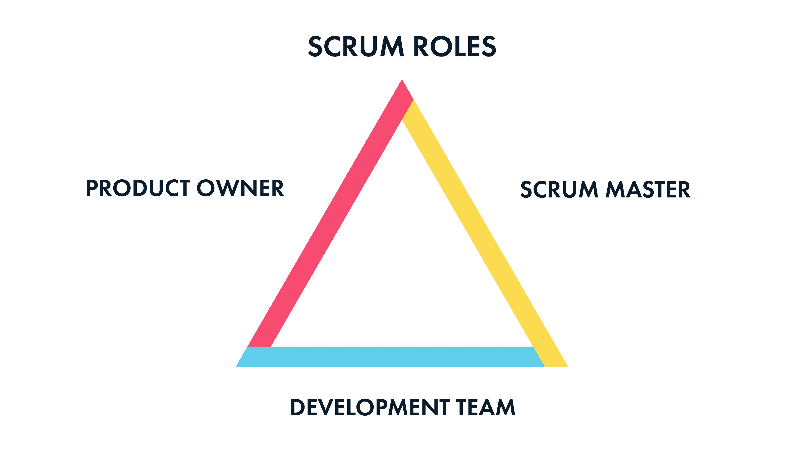

虽然头衔听起来可能很有气势，但 Scrum 师（Scrum Master）除了在 Scrum 过程中作为仆人领导者展现出的领导力外，没有其他权限。产品所有者（Product Owner）除了维护产品愿景并引导其通过 Scrum 过程外，没有其他权限。团队除了估算、接受、拒绝、承诺、执行和完成故事的权力外，没有其他权限。每个人都应该被赋予执行这些角权力，以维护敏捷的工作环境。

 

## 仆人领导者？

在讨论 Scrum 师所处的微妙平衡的位置时，经常会使用`仆人领导者`（servant leader）这一术语。Scrum 师对 Scrum 仪式和产物之外的没有任何正式权限，但通过接受和宣扬 Scrum 概念从内部领导团队。Scrum 师服务于整个团队的需求——帮助消除`阻塞`（阻碍 Scrum 工作流的障碍）并指导人们如何遵循 Scrum 实践——并且在倡导和捍卫 Scrum 时应以身作则。

# Scrum 角色与组织角色

Scrum 角色与公司层级中可能分配和管理的正式职位无关无关。对于某些团队来说，这可能会导致他们对不属于正式敏捷流程的人如何融入该流程感到困惑。Scrum 团队之外的人实际上并不需要理解 Scrum 也能正常运行。但 Scrum 的重要部分是透明性，Scrum 团队的活动可能会引起外部关注。

在本章中，我们将介绍 Scrum 师、产品所有者和团队成员的关键角色。此外，我们还将讨论 Scrum 团队之外许多人的动机和观点，他们的参与可能会影响 Scrum 的运行效果，并最终可能成为在组织内倡导和维护 Scrum 的关键。

## Scrum 师

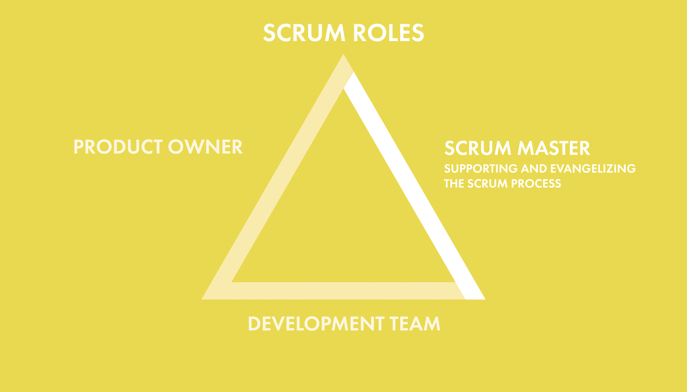

`Scrum 师`是把 Scrum 团队凝聚在一起的胶水。Scrum 师负责让人们明确自己的角色，管理 Scrum 的仪式和产物（我们很快就会介绍），并指导团队及跨组织的人员，帮助克服阻塞并保持可持续的生产节奏。

与项目经理不同，Scrum 师作为团队的仆人领导者，拥有明确定义的任务。Scrum 师在组织内部没有正式权限，除了引导团队通过 Scrum 仪式以及维护跟踪团队进展的产物的权限外。但在涉及 Scrum 过程及其应用方面，Scrum 师拥有最终决定权。

 

### Scrum 师的参与

Scrum 师可能是开发团队的一员，但同样 Scrum 师也可能不参与团队的日常开发工作。对于已经遵循 Scrum 实践一段时间并对 Scrum 感到熟悉的团队，一个没有开发职责的单一 Scrum 师可能同时负责两个团队。

 

### Scrum 师的职责

Scrum 师通常属于工程部门，某些情况下可能是开发团队的成员。Scrum 师担任开发团队人员的经理存在利益冲突。Scrum 师不应对团队拥有正式的组织权限，否则团队可能会因为潜在的后果而害于向 Scrum 师提出问题。

## 职责

Scrum 师必须遵守几个关键仪式。至少包括：每日站会（daily standup）、冲刺计划会议（sprint planning）、迭代结束演示（demo）和迭代回顾（retrospective）。我们将很快详细介绍这些仪式。

除了主持 Scrum 仪式外，Scrum 师还负责指导人们如何遵循 Scrum 实践——并在倡导和捍卫 Scrum 时应以身作则。这可能涉及以易理解的方式帮助团队角色和期望。从某种意义上说，Scrum 师可以成为团队的倡导者、顾问以及与组织的联系人。

Scrum 师还维护许多产物，帮助团队保持专注。这些产物始终保持在一种让任何人一眼看出团队正在工作的状态，以支持维持 Scrum 正常运行的本质透明性。这包括计算和报告速率（velocity）等团队指标，并向团队之外的人澄清这些概念的相关性。

### 日常的一天

每个 Scrum 师每天都会尝试主持的一项仪式是与整个团队以及任何感兴趣观察的访客进行的十五分钟站会。对于某些团队，这发生在早上早些，而其他团队则喜欢在晚些时候。因此，他们的活动包括：

- 计划和主持 Scrum 仪式，包括每日站会、冲刺计划会议、冲刺演示和迭代回顾
- 向团队成员、产品所有者或组织中任何可以帮助消除阻塞的人寻求帮助
- 维护 Scrum 产物并确保每个人都能访问
- 指导团队成员的角色和职责
- 与产品所有者合作，帮助澄清待办列表（backlog）中的故事
- 向管理层和整个组织代表 Scrum 的需求

在安排了其他仪式的日子（例如冲刺计划会议、冲刺演示或迭代回顾），Scrum 师将引导整个过程，确保团队遵循了他们同意的所有步骤，并遵守了时间限制。

Scrum 师可能会在站会结束后参与多次后续讨论。最重要的将涉及消除那些无法进展的团队成员的阻塞。Scrum 师还会与产品所有者和团队成员等相关人员见面，跟进站会期间提出的任何其他问题。

Scrum 师在支持团队每个成员履行 Scrum 职责方面也起着关键作用。Scrum 师需要在问题出现时随时指导团队，并在这些问题显现时识别它们。这可能意味着帮助产品所有者思考如何表述待办列表故事，观察并参与开发者的结对编程（pairing session）以促进流程进行，或者用通俗易懂的语言准备团队状态报告——为了不在团队中但需要了解发生情况的人。

## 产品所有 (Product Owners)

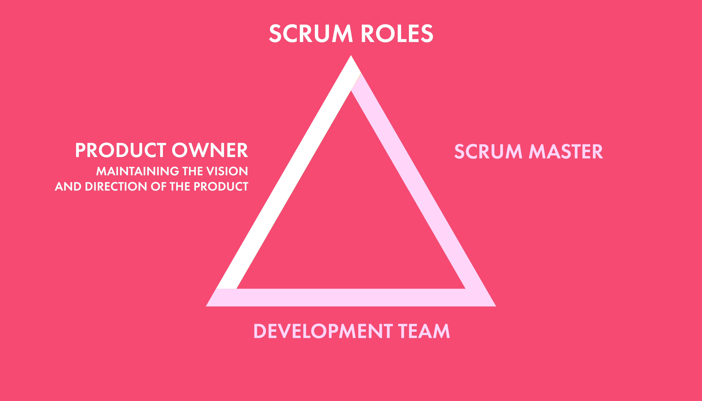

与职责专注于开发团队的 Scrum 经理（scrum master）不同，`产品所有者`（product owner）对团队和客户承担共同的责任。产品所有者是客户的声音，代表了客户的需求、愿望和期望。

产品所有者通常属于产品部门或客户支持部门，并花时间直接与客户交流，以理解他们的需求，并将这些需求转化为团队可以估算并执行的清晰描述。我们使用一种统一的格式，在 Scrum 术语中被称为“故事”（stories）来进行这些描述。

产品所有者从客户的角度关注大局，查看产品的整体状态、发布周期的时间表以及不断的技术格局，同时决定哪些功能是团队在下一个迭代（sprint）中优先处理的任务。

产品所有者直接与设计师合作，确保用户体验流程已得到考虑，并确保设计资产已为团队准备就。他们还与质量保证（QA）工程师合作，验证某个故事的测试套件是否包含了必要的验收标准。产品所有者还与 Scrum 经理协作，帮助消除可能阻碍进的外部障碍。

同时，产品所有者与团队紧密合作，根据团队和技术的实际限制，决定所需的功能在技术上是否可行，并根据其的历史开发速率和对产品的反馈来规划故事的顺序。与团队保持距离至关重要，因为产品所有者需要随时待命，以便开发者询问有关故事的细节并确认工作进度。产品所有者通常还会参加所有的 Scrum 仪式（rituals）。

### 一个人不应兼任 Scrum 经理和产品所有者

一个人不应尝试同时承担 Scrum 经理和产品所有者的角色。产品所有者对客户负首要责任，且通常不属于工程部门。Scrum 经理的目标核心围绕着可持续的生产力，而这些目标可能与部门外汇报人员的组织目标不一致。

## 职责 (Responsibilities)

产品所有者最关键的职责之一是明确客户需求、开发待处理的产品功能积压（backlog），并编写清晰的故事来传递对产品的完整期望，同时符合团队的标准。一个编写良好的故事需要封装某个特定功能切片的完整意图，包括任何验收标准，以及客户需要该特定功能的理由。通常，产品所有者和 Scrum 经理将协作确保每个故事都已为团队准备就绪。

一旦编写了足够的故事来占据接下来的迭代工作，产品所有者就会跟踪并组织这些故事，以确保产品的开发顺序计划高效且符合客户的期望。同时，产品所有者会努力编写如果团队在当前迭代中用完工作后可能需要的故事，并概述和起草反映客户对未来几个迭代预期的需求的项目。

产品所有者不需要对团队可能工作的内容提前超过一两个迭代进行更的计划。事实上，在可能执行该任务的迭代之前编写得太早的故事经常被丢弃或重写，因此对它们进行过详细的描述通常是浪费时间。但一个优秀的产品所有者会对产品随着单个功能的添加而演进的方式保持一种愿景，并记住在当前迭代中为未来可能需要的功能做好准备的重要性。

产品所有者需要与客户保持定期沟通，以确保他们编写的故事和正在梳理的积列表符合当前的期望。虽然 Scrum 鼓励透明化，但并非所有团队都会邀请客户直接参加仪式和查看产物。产品所有者为客户翻译产品状态——展示并获得每个交付的功能切片的批准——并收集客户反馈，让团队知道他们是否正处于正确的道路上。

此外，产品所有者需要随时为团队服务，以帮助解决任何冲突或澄清团队正在处理的故事的任何细节。作为客户的内部声音，产品所有者需要体现对产品的期望，并能够快速做出决策以便团队继续工作。

### 产品所有者的一天

产品所有者将时间分配在几项职责和相关方之间：

- 定期与客户开会，分享团队进展的信息，并收集关于客户下一步想要什么的反馈
- 直接与设计师合作，为团队规划并准备资产
- 为开发中的故事获取团队的技术认可
- 验证 QA 测试套件的完备性和相关性
- 与 Scrum 经理协调，确保每个人都有完成工作所需的信息
- 在要求时与团队成员会面以澄清问题并做出决策
- 编写故事并梳理产品积压列表，使其反映对产品的当前愿景

大多数产品所有者喜欢参加团队的每日站会（daily standup）。作为访客，除非被直接问及，否则在团队每位成员陈述之前，产品所有者通常不允许提问或提供反馈。站会后，产品所有者通常会与相关方（团队内部或外部）跟进站会期间提出的问题。

当团队正在处理当前迭代的故事时，产品所有者会不断观察他们的进度。如果某个关键功能切片面临无法及时完成的危险，产品所有者有权调整当前迭代中故事的顺序。如果当前迭代中用完了故事，产品所有者也可以对准备好团队开始工作的积压故事进行优先级排序。

产品所有者需要花时间准备好回答迭代中进行中的故事的问题。当无法联系产品所有者获得快速答案时，处理某个故事的开发者可能会被永久阻塞。因此，许多产品所有者倾向于与团队一起工作，以便他们随时待命。

客户喜欢与敏捷开发团队合作的原因之一是关于产品状态的频繁且准确的信息。产品所有者通常每天与客户沟通，报告进展，并洞察客户心中可能存的任何问题。

当他们没有协助团队或客户时，产品所有者正在为下一个迭代编写和精炼故事，梳理故事积压列表以符合客户对产品的愿景，并与设计师合作，确保团队为处理这些故事时所需的一切都已准备就绪。

## 团队成员

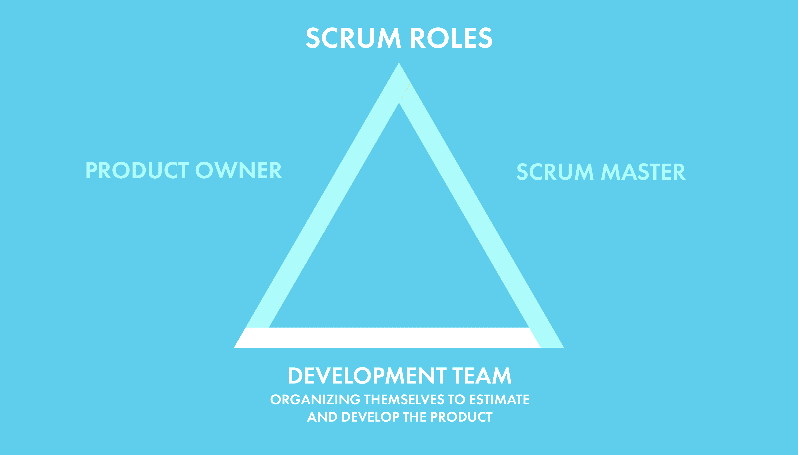

大多数 Scrum 团队由四到八名工程师组成。他们的专业领域应该经过规划，以支持团队将要负责的工作类型，以便他们能够进行良好的估算，并产生符合团队“完成定义”（definition of done）的结果。

团队成员预计要积极参与所有的 Scrum 仪式（scrum rituals），并以透明的方式运行，让每个人至少能外围了解同事正在工作的内容。

## 交叉培训

专业化对于工程师的职业发展至关重要，但在 Scrum 团队中，并不假设任何一个工程师会对所有用户故事（stories）的某个特定方面负专属责任。Scrum 的力量之一在于它提供的透明度，这使得来自不同背景的工程师都能了解开发团队所接受的工作中任何方面所涉及的内容。

Scrum 鼓励工程师共同工作。一种被称为`结对编程`（pair programming）的实践——源自敏捷技术“极限编程”（Extreme Programming）——对于 Web 和移动项目中的工作类型通常非常实用。结对编程提倡将不同经验水平的人配在一起共同编写同一份代码，以便每个人都能从对方的视角中获益。

这种方法的优点是，关于产品在做什么以及如何开发其每个部分的知识在整个团队中共享。我们不鼓励只存在于单个工程师脑中的信息孤岛，转而鼓励与他人沟通。并不要求每个人都是产品所有领域的专家，但每个人都应该准备好与自己通常舒适区之外的专家共同工作。

结果是，起初工作速度可能稍微慢一点，因为人们需要适应节奏。但很快就会形成一种更深层次的共享上下文，这将加速估算和开发。如果有人中了彩票并决定退休，团队也将变得更具韧性。不会留下巨大的知识空白。虽然可能有很大的接班工作需要完成，但至少会有人对涉及的内容有一定了解。

 

## 结对编程

结对编程的要求非常高。其中一些预期是两个人共享一个显示器，并交替输入代码（驾驶/driving）和跟踪下一步需要发生什么（导航/navigating）的责任。伙伴在工作时应该不断保持交流，伙伴中的任何成员都不应允许电子邮件等干扰干扰这一过程。大多数伙伴发现，在这种模式下，他们每天的工作时间不会超过六小时，但生产力的提高和对团队稳定性的益处值得这种权衡。

## 职责

对于 Scrum 流程而言，团队成员对正在开发的产品质量负责，并对整个团队 Scrum 流程的维护负责。这是每个团队成员都有通过其履行职责的方式有权影响两个方面。

产品质量由团队接受或拒绝故事的能力提供支持。如果呈现的故事不够清晰，或者根据项目历史来看可能不可能或不实际，团队应该将工作质量放在首位，并坚持要求产品所有者（product owner）重写或撤回这些故事。

估算完成一个故事所需的工作量也是团队职责的一部分。随着团队共同工作并获得不同故事的经验，他们应该开始对性质相似的故事建立共享且主观的相对工作量标准。工作量通常以任意点（points）衡量，由团队分配，以帮助确定他们在特定时间内可以完成多少工作。这有助于产品所有者计划新功能可以多快地完成。

考虑到项目的实际限制，团队预计会抵制任何为了速度而牺牲质量的尝试。此外，团队应该跟踪代码库的整体质量，并提出重构现有代码的故事以增强可维护性，或支持不断出现的技术标准。保持代码的整洁、自文档化和内部一致有助于团队中的每一个人更有效地协作工作。

团队的每位成员还负责为其他所有成员维护 Scrum 流程。如果有人中断了站会（standup），或试图在冲刺（sprint）期间对某个故事引入更改，每个团队成员都应该有权中断这种行为。团队中的任何人发现组织职级被用来影响 Scrum 流程，都应该在当时、回顾会议（retrospective）期间或私下向 Scrum Master 反映。

团队成员认真对待对同事的这一责任至关重要。Scrum 的力量在于它在群体中创造的动态。未能维护 Scrum 流程就是让其他团队成员失望。

 

## 团队成员人人平等

尽管团队成员可能向 Scrum 上下之外的一个或多个经理汇报，但在 Scrum 团队内部，所有团队成员都被认为是平等的。团队成员不应向产品所有者或 Scrum Master汇报，因为这会在敏捷角色与每个员工在组织层级中的独立地位之间产生紧张关系。如果 Scrum 团队内部员工之间存在资或汇报关系，在遵循 Scrum 流程时应当忽略它们。任何发现组织职级被用来影响 Scrum 流程的人都应该将此引起 Scrum Master 的注意，可以在当时、回顾会议期间或秘密进行。

## 成员的一天

大多数时候，团队成员会在一天的大部分时间里编写代码，时间块尽可能长且持续。团队成员的核心日常职责非常简单：

- 开发、检查和记录代码
- 从产品所有者处获取澄清、故事细节和反馈
- 参与 Scrum 仪式
- 与 Scrum Master 协作消除团队障碍

描述一个 Scrum 团队时，脑海中浮现的最常见形象可能是团队参与每日站会，我们将在 Scrum 仪式的章节中详细讨论这一点。每个团队成员都预计在这个十五分钟的简短窗口内随时可用并做好准备。团队通常会安排这个时间，使其不会干扰团队的工作流。

 

## 什么时候进行站会

对于某些团队来说，将站会安排在午饭前后或工作日开始是最合理的。非同地工作的团队可能需要选择一个适用于跨时区人员的时间。团队始终根据冲刺回顾期间收集的反馈调整时间。

在安排了其他 Scrum 仪式的日子里，所有团队成员都预计出席并积极参与。Scrum 仪式的设计是为了有效利用有限的时间，同时产生可预测且有价值的结果。优秀的 Scrum Master 会安排为每个仪式维护一个时间盒（time box），以便时间投入和最终结果是可预测的。

## 团队资源

Scrum 团队并非孤立运行的。通常会有一个围绕 Scrum 运行的组织，该组织通过提供 Scrum 团队产出工作所需的资源来支持其工作。Scrum 团队与组织的其余部分之间必须维持一种双向关系，以便双方都能从这一流程中获益。

正如组织及其层级结构不应该对 Scrum 的仪式、产物和角色产生影响一样，Scrum 对外部组织的结构也没有正式的意见。Scrum 既可以在头衔和角色定义明确的等级森严层级制公司中成功存在，也可以同样容易在“合治制”（一种没有任何正式指挥链的组织）中运行。只要 Scrum 团队能够获得其所需的资源，并能通过产出组织想要的结果来证明其存在的价值，这种关系就是可以维持的。

关于团队所需应该如何提供，有时会存在不同的意见。解决这一问题的敏捷方法是尝试一种方式，观察其效果如何，并通过迭代找到最高效的方法。

特别是，大多数从事 Web 开发和移动端开发的 Scrum 团队会发现自己需要一些关键资源，而这些资源并没有被正式定义为 Scrum 的一部分。

### 设计师

设计是任何 Web 或移动端项目的关键输入。设计师帮助建立项目的用户体验、流程和视觉一致性。随着设计思维成为一种流程的趋势，设计师已成为产品开发所有阶段的要素，从最初的问题定义，到线框图绘制、创建样式指南、构建图形资产、验证视觉一致性以及进行用户体验测试。

在开发新的用户故事（User Stories）期间，设计师与产品所有者紧密合作。在大多数情况下，设计选择驱动了灵感的产生，产品迭代演进的很大创新也来自设计师。但当团队成员遇到布局和样式等问题时，设计师也需要随时待命。有时，设计师需要准备好放下手头所有工作产出资产，或者在故事开发过程中做出对解除开发人员阻塞至关重要的决策。在高概念思维和详细的实操性生产之间切换，会让设计师的角色变得极具挑战性。

有些团队选择将设计师整合到团队中，并让他们参与所有的仪式。这种方法的优处是，设计师能够不断意识到团队的运作方式，并通过参与故事创建以及估算和开发提供即时反馈。选择作为团队一员工作的设计师应该准备好像其他任何团队成员一样投入到 Scrum 流程中。

然而，与 Scrum 团队的大多数成员不同，设计师通常没有接受过工程师的培训，也不倾向于在开发工作中与其他工程师配对。此外，设计师的技能和责任可能并不适合未接受过设计培训的工程师进行配对工作。正如此，整合到团队中的设计师可能需要被与其他团队资源区别对待。这有时会产生一种不平衡感，让设计角色感到融入程度不够。

许多团队使用的另一种方法是创建一个扩展的冲刺序列（Sprint Sequence），在开发冲刺之前，先安排一个独立的设计冲刺（Design Sprint）。这有助于将设计师的工作与工程师的工作隔离开来，同时仍让设计师作为团队成员整合到 Scrum 流程中。

使用设计冲刺方法可能是有效的，但它限制了 Scrum 的敏捷性。由于设计冲刺发生在开发冲刺之前，团队实际上是承诺以两倍长度的增量进行工作。这意味着产品所有者调整需求的能力需要推迟一个冲刺，因此变更需要更早地计划。对于某些团队来说，这可能是很好的解决方案，只要他们准备好接受这种权衡。

第三种值得考虑的方法是维护一个独立的设计团队，并将其视为一种资源。设计团队的设计师可以被召唤参与构思、故事创建、资产开发、用户流测试或 Scrum 流程所需的任何工作。由于设计师独立于 Scrum 流程，他们欢迎作为客座参加仪式，但并不要求成为活跃参与者。

作为独立资源运行的设计团队可能会选择使用名为**看板**（Kanban）的另一种敏捷方法来组织自己。看板与 Scrum 类似，但它不是在具有预定间隔的交付物的冲刺中运行，而是看板团队承诺特定数量的进行中工作（Work-in-progress）。看板团队可以在无需提前计划的情况下接受产品所有者的新故事，只要团队资源承诺的工作量从未超过其可持续完成的能力范围即可。

### 看板

看板的细节比我们在这里涵盖的要复杂，但它是组织涉及持续服务流的工作时另一种值得研究的方法。特别是，看板对于管理运营（Operations）和客户支持等部门的工作流非常有效，这些部门有源源不断的类似故事需要被处理，而且通常需要根据优先级进行快速响应。

### QA 工程师

质量保证是团队每个位成员的责任，但大多数组织都有专门接受过创建和管理测试套件技术的专业人员。对于 Web 和移动端工作，这可能是一个复杂且复杂的的过程，涉及到模拟各种设备和浏览器行为的工具，以及用于跟踪产品中常见和不常见路径的自动化工具。

QA 工程师可能会被隔离在自己的小组中，独立于进行产品开发的团队工作。在这种情况下，与团队的协作至关重要。除非及早考虑 QA，否则 Scrum 团队可能会发现自己必须在冲刺演示会议（Sprint Demo Meeting）之前匆忙完成故事，然后在最后一刻将大量工作堆给 QA 团队，以便故事能够准备好演示。

与设计师类似，QA 工程师有时会被赋予一个独立的冲刺来完成测试。这避免了试图快速验证故事的问题，但在冲刺结束时这样做会带来与独立设计冲刺类似的灵活性降低。此外，当需要演示故事时，大多数团队成员已经转向了新的故事，上一个冲刺工作的细节在他们脑海中不再新鲜。

将 QA 与开发隔离最大的问题是，工程师在之前的故事被验证之前，就可以开始处理列表中的下一个故事。在 Web 和移动端背景下，即使故事在技术上是独立的，经常也会以微妙的方式相互构建。这可能导致在测试先一个故事发现不一致性时，新故事的工作需要重做的情况。

理想情况下，QA 应该被视为任何故事完成定义（Definition of Done）的一部分。这意味着 QA 工程师在开发者创建代码的同时，应该开始为故事编写测试。故事的 QA 周期应该是冲刺的一部分，在 QA 完成之前，负责故事的开发者不应放弃它开始新任务。

在某些团队中，QA 工程师直接整合到团队中。这提供了许多优势。开发工程师和 QA 工程师的技能和培训是互补的，两个角色的人都可以通过配对从中受益，学习对方的技术和方法。集成了 QA 工程师的团队自然地会将测试和验证视为完成故事的一部分，并确保故事的大小和安排是合理的。

### 运营

负责网络运行和为公司提供技术支持的人员通常属于产品开发团队所在的工程部门。正因如此，有些公司尝试将来自这些团队的人员整合到他们的 Scrum 流程中。但组织的结构不应该影响 Scrum 团队的需求。

除非有充分的理由，否则将运营工程师整合到产品开发 Scrum 团队可能是一种糟糕的做法。虽然运营人员是受过培训的工程师，但他们处理的职责应该独立于产品开发流程。保持网络畅通、计算机运行和服务器在线与产品开发以不同的方式是持续且具有挑战性的。与设计或客户服务不同，混淆这些角色可能是危险的；将运营视为独立团队可能是务实的，或许可以使用看板方法帮助他们管理他们的可持续工作流和优先级。

随着产品开发的进展，让运营团队（Operations）保持信息畅通非常重要，这样就可以考虑任何可能对服务和资源的可用性产生影响的产品变更。一个优秀的 Scrum 团队包含了工程师和产品负责人（Product Owners），他们能够识别出变更何时可能对系统或网络负载产生影响，并会咨询合格运营工程师的意见，以帮助用户故事（Story）的规划。

### 运营与结对编程

让运营人员脱离其职责进行结对开发可能是不切实际的，尽管开发者偶尔与运营工程师进行结对编程，对于增强他们对影响产品可用性问题的理解有所帮助。

### 经理

Scrum 的优势之一是团队有机会进行自组织，并找到迭代开发产品的最佳方式，即不断测试、做出更改并在过程中改进。这意味着团队对自己的行为负责，并围绕以最有效的方式完成工作这一目标进行组织。结果是，经理有时可能会对自己在 Scrum 组织中的角色感到困惑。

Scrum 的自组织性质与公司的层级结构无关，公司层级结构会为员工分配不同的角色和职责。Scrum 对组织的层级结构不应有任何意见，正如组织的层级结构不应对 Scrum 流程产生影响一样。

在任何公司，管理都是一个至关重要的角色。经理负责招聘、解雇、分配资源以及在整个组织中代表员工。如果没有经理，当 Scrum 流程之外出现需要解决的问题时，员工将无处求助。经理通常对团队的生产力负责，包括向高级高管汇报结果，并展示运行中的 Scrum 流程的价值。

经理也可能以开发者的身份参与 Scrum 团队。通常，工程部门管理职位的人对团队可能面临的某些问题有更深的经验。这些经理可能担任架构师或高级开发人员，并可能有价值的知识可以分享。在 Scrum 团队内部，经理被视为开发者之一，不会获得比团队中任何其他开发者之外的权限。

### 作为开发者的经理

在某些组织中，经理的角色被视为蔑蔑的。我们都见过《狄尔伯特》（Dilbert）漫画中那个留着尖头头发的老板形象。Scrum 的优势之一是，它不在乎经理在 Scrum 流程之外的表现如何，只要提供了足够的资源来支持持续的 Scrum 流程。一个有效的 Scrum 团队应该独立于这些刻板印象运行，但在 Scrum 团队中与经理作为同伴工作的机会也有助于改善 Scrum 之外的沟通。

团队中对与经理作为同伴互动感到不适的员工，或者对在 Scrum 内权威减少感到不适的经理，应该与 Scrum Master（Scrum Master）讨论这个问题。一个强大的 Scrum Master 将具有处理管理和权威问题以及这些问题与 Scrum 之间关系的经验。

### 世界其他

Scrum 团队并非在真空环境中运行。在 Scrum 团队之外，有一个需要开发产品的组织，无论出于什么原因。Scrum Master 的职责之一是向公司的其他部分宣传 Scrum 的价值。与此同时，还有责任确保 Scrum 确实在服务公司以及 Scrum 流程利益相关者的需求。

这些利益相关者包括公司的高级高管、正在开发的产品的用户、委托创建产品的客户（无论是在公司内还是）以及公司内部的其他群体。

从外部来看，Scrum 看起来像是一个谜团。尽管强调透明性，但 Scrum 的术语可能会让不熟悉这些术语实际含义的人感到困惑。Scrum 创建的产物和图表可能暗示了并不存在的含义。来自 Scrum 团队外部的任何困惑都可能影响 Scrum 的稳定性，包括资源分配以及故事进入流程的流量。

### 用户

Scrum 团队最明显的利益相关者之一是产品开发旨在支持的用户群体。用户应该在每一个故事中都可见，即使该故事没有影响网站的前端界面，或显示在移动设备的屏幕上。管理员也是用户。填充产品的内容经理也是用户。任何与产品交互的人都是用户。

对于用户来说，产品是用 Scrum 开发的事实很重要。然而，用户测试是开发的重要部分。

### 客户

客户可能是客户，或者是公司内部的另一个部门。无论如何，与客户的直接互动是产品负责人的责任。一个优秀的产品负责人是团队与客户互动混乱之间的坚实防线。如果团队觉得他们来自客户的影响太大——这种影响没有通过产品负责人的适当过滤——他们应该随时寻求 Scrum Master 的帮助。

### 高管和其他员工

对于公司的其他部分，Scrum Master 既是教练也是布道者。Scrum Master 需要能够有效地代表 Scrum 的力量和价值，并用不依赖 Scrum 自定义词汇的话来解释它。流程不仅会吸引其他员工的兴趣，还会吸引关注所提供价值的高管的兴趣。幸运的是，Scrum 生成了大量数据。Scrum 的产物将包括关于团队在给定时间内可以完成多少工作的真实信息、完成了多少故事、生产了哪些功能、用于演示的运行软件，以及团队、产品负责人和客户的反馈。Scrum Master 可能会为不同的受众制定报告，举办午餐会来解释 Scrum，或邀请人们参加 Scrum 仪式以亲眼观察发生的情况。

## 总结

Scrum 的角色已经有了明确定义，以确保对等成员之间的权力平衡，并且敏捷地开发产品的所有责任都得到了处理。

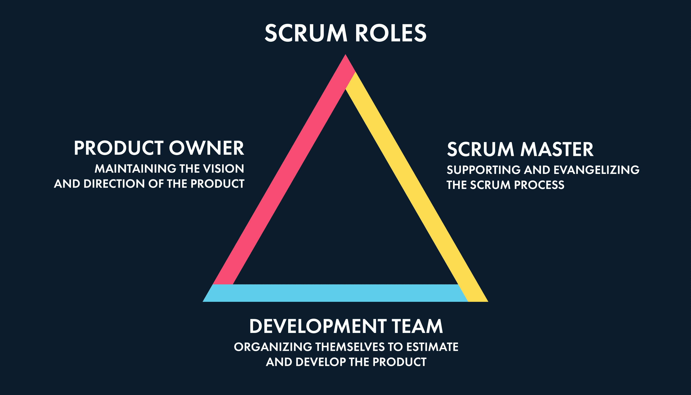

图 3.5.Scrum 角色

- Scrum Master（ Scrum Master）主持 Scrum 仪式，支持团队，并在 Scrum 内部和外部推广 Scrum 流程。
- 产品所有者（Product Owner）维护产品的愿景和方向，负责与客户进行交互。
- 开发团队（Development Team）由工程师组成，他们通过自我组织来估算并执行构建产品的工作。

现在我们已经回顾了参与 Scrum 涉及的角色，在下一章中，我们将看看他们参与的仪式。观察这些这些角色的人员如何互动以支持他们的目标，以及他们所实现的稳健平衡如何帮助 Scrum 团队保持高效工作。

Scrum 角色

49

## 第 4 章：Scrum 仪式

在 Scrum 团队工作的实践被组织成一系列仪式。这些仪式标志着执行 Sprint（冲刺）工作过程中的关键事件。主持每个仪式是 Scrum Master 的责任，要确保它们专注于目标，并为整个团队带来产生预期的结果。

### 什么是仪式？

每个**仪式**（ritual）都是一次实时的面对面聚集，它让人们离开正在的工作，并为他们提供了就该工作的背景进行针对性交流的机会。Scrum 认为沟通优于文档，这就是为什么它为各种类型的有用面对面交流提供了定期的且明确的机会。

### 不要再开会了！

许多在公司工作的人对会议产生“过敏”，这不无道理的。他们可能被过多的会议所淹没，会议占据了他们太多的时间，而且没有产生任何结果。他们可能习惯了为了解决每一个微小问题而召开会议，却没有人专门负责确保问题得到解决。会议会使人们离开正在的工作，中断他们的注意力，而且往往无法提供太多的价值。

面对现实吧，大多数公司在会议方面是*糟糕的*。

与普通会议不同，Scrum 中的每个仪式都有特定的目标，针对特定的受众，在定义的时间范围内完成目标，并拥有一组可预测的结果。参加仪式的每个人在仪式开始前都知道他们期待什么、如何表现，以及承诺的结果应该是什么。Scrum 仪式顾了它们的整体目的，并尊重参与者的时间和注意力。

### 时间盒计时（Time Boxing）

Scrum 仪式中最重要的概念之一是**时间盒**（time box）。主持仪式的 Scrum Master 有责任让每个人都确切地知道他们为这个仪式投入了多长时间，以及在仪式的任何一点他们已经进展了什么程度。

Scrum Master 通常会在房间前面的白板上写下时间，或者保持一个大家都能看到的大钟，以便每个人都能跟踪时间。我曾经被人知道会带一个标有“时间盒”的小立方体时钟参加仪式，并把它展示在每个人都能看到的地方。时间盒的概念赋予了仪式中所有活跃参与者力量，让他们互相鼓励在必要时直奔正题，并专注于仪式的目标。

 

### 每个时间盒应该是多长？

团队在每个仪式上花费的时间通常取决于每个 Sprint 分配的周数。必须保持在 15 分钟时间盒内的仪式是每日站会（`daily standup`）。团队在迭代和改进他们如何使自己适应 Scrum 的过程中，对每个仪式的时间盒达成共识。我在下方为团队提供了一些起始的建议。

Scrum 通过在每个仪式开始时确定时间盒，以及该时间如何分配给仪式的不同方面，表达了对每位参与者时间和承诺的尊重。预计所有参与者在仪式的时间盒期间保持投入并参与，并承诺在没有充分且实际理由的情况下，仪式不会延长，除非所有参与者都同意延长。

如果一个仪式似乎即将超过其时间盒，Scrum Master 应该征求大家的许可继续进行特定时间的仪式。这样，每个人都预先知道要预算多少时间，如果预算需要延长，每个人都必须同意。

当然，我们都是人，在仪式期间会出现一些感觉需要立即讨论的旁问题。将注意力集中在正在进行的仪式上是 Scrum Master 以及团队其他成员的责任。一个优秀的 Scrum Master 需要跟踪这些问题，并为了所有相关者的利益对正在进行的仪式的时间盒保持尊重。

确保重要的旁插讨论不丢失是共同的责任，但 Scrum Master 需要准备好在该过程中采取积极作用。如果人们确信以后可以重新拿起话题，他们会更愿意放下一个离题的讨论。

### Sprint 的长度

团队在选择 Sprint 长度时有一些选择。唯一必须保持在 15 分钟时间盒内的仪式是每日站会。团队在迭代和改进他们如何使自己适应 Scrum 的过程中，对每个仪式的时间盒达成共识。我在下方为团队提供了一些起始的建议。

Scrum 通过在每个仪式开始时确定时间盒，以及该时间如何分配给仪式的不同方面，表达了对每位参与者时间和承诺的尊重。预计所有参与者在仪式的时间盒期间保持投入并参与，并承诺在没有充分且实际理由的情况下，仪式不会延长，除非所有参与者都同意延长。

如果一个仪式似乎即将超过其时间盒，Scrum Master 应该征求大家的许可继续进行特定时间的仪式。这样，每个人都预先知道要预算多少时间，如果预算需要延长，每个人都必须同意。

当然，我们都是人，在仪式期间会出现一些感觉需要立即讨论的旁问题。将注意力集中在正在进行的仪式上是 Scrum Master 以及团队其他成员的责任。一个优秀的 Scrum Master 需要跟踪这些问题，并为了所有相关者的利益对正在进行的仪式的时间盒保持尊重。

确保重要的旁插讨论不丢失是共同的责任，但 Scrum Master 需要准备好在该过程中采取积极作用。如果人们确信以后可以重新拿起话题，他们会更愿意放下一个离题的讨论。

### Sprint 的长度

团队在选择 Sprint 长度时有一些选择。Sprint 长度应该允许团队预期工作的故事类型根据团队自己的“完成定义”在单个 Sprint 内完成。对于许多团队来说，一周的 Sprint 非常适合短的故事。有些团队倾向于处理在一个 Sprint 内无法完成的复杂故事，因此他们选择两周、三周甚至四周的 Sprint。Sprint 的长度是另一个可以根据反馈进行修改的因素，但团队必须选择一个长度并坚持几个 Sprint。否则，团队可能永远无法从规律中受益，从而学会从一个 Sprint 到下一个正确进行估算。

Scrum：从新手到忍者

52

### Scrum 仪式

53

 

### 两周是一个很好的起点

对于网页和移动团队，两周的 Sprint 是一个很好的起点。两周的时间足够完成大多数与网页和移动项目相关的故事，包括大多数情况下的发布流程。如果你的网页或移动团队刚开始使用 Scrum，值得尝试两周 Sprint，看看它是否适合你。

即使你的故事倾向于是短且有限的，但一周 Sprint 也有值得考虑的缺点。某些较长的仪式每个 Sprint 重复一次。有一个一周的 Sprint 意味着频繁地重复这些仪式可能会开始影响效率。某些仪式，如回顾会议（`retrospective`），在某些周甚至被缩短或跳过，这会导致 Scrum 的迭代改进方面出现问题。

倾向于产生更复杂故事的团队可能更喜欢更长的 Sprint。请记住，超过两周的 Sprint 意味着问题需要更长时间才能暴露，并且积压列表的调整需要延迟到 Sprint 完成后。更长的 Sprint 还鼓励创建更复杂的故事。网页和移动团队 Scrum 的目标应该是创建简单且独特的故事。

54

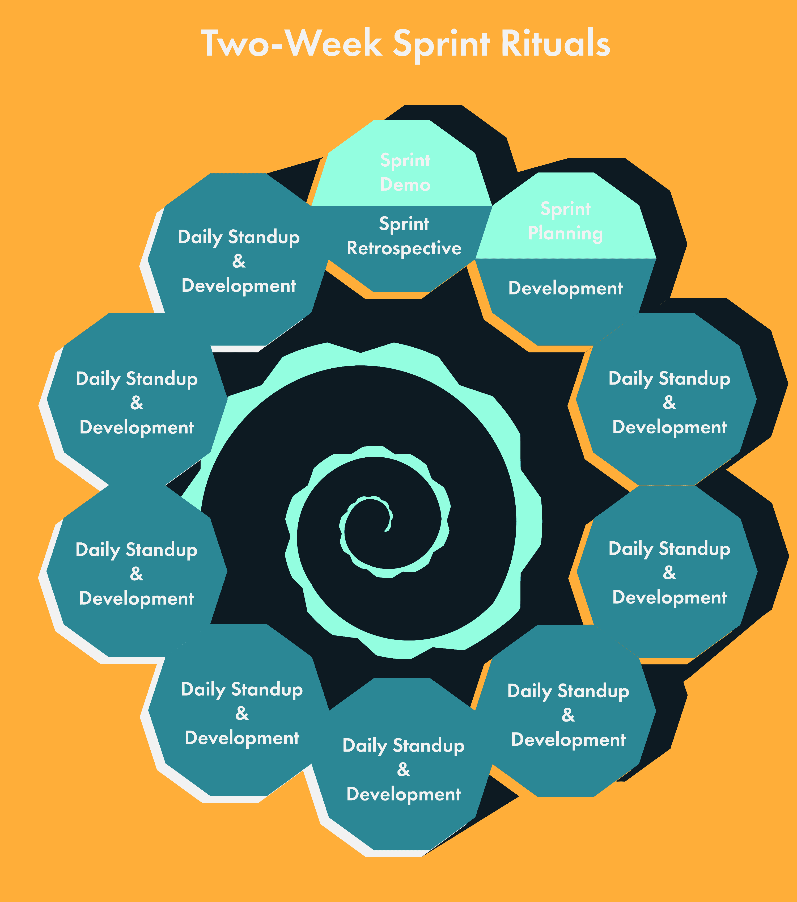

图 4.1. 两周冲刺周期

此图表展示了典型的 Web 或移动端开发冲刺的两个周周期。每个较小的圆代表一个工作日，仪式的标记是基于冲刺从顶部开始并每两周循环一次的。

在接下来的几页中，我们将深入探讨这些每一个仪式，确保你理解它们是如何运作的，以及它们如何应用于 Web 和移动端开发。

55

Scrum 仪式

**WOW! eBook**

**www.wowebook.org**

## 冲刺计划 (Sprint Planning)

标记每个冲刺开始的仪式被称为冲刺计划。冲刺计划由 Scrum Master 主持，但负责冲刺计划中大部分内容的人是产品所有者（`Product Owner`）。

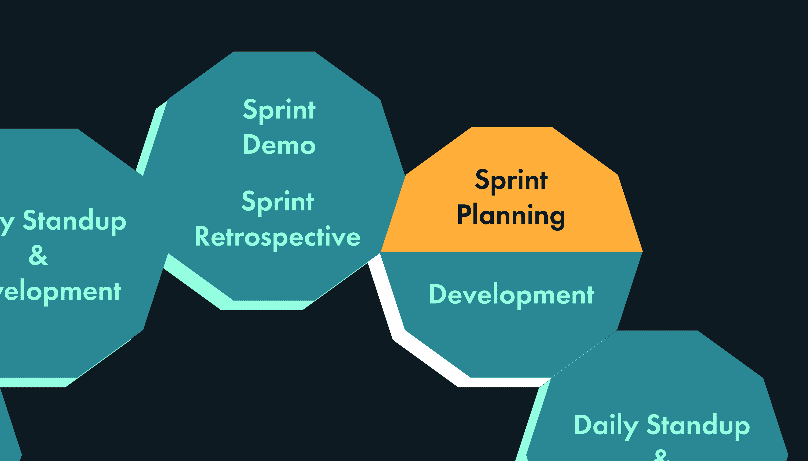

图 4.2. 冲刺计划

### 目标

冲刺计划的目的是为即将进行的冲刺设定议程。团队与产品所有者和 Scrum Master 聚在一起，了解在下次冲刺期间应该完成的用户故事（`Stories`）。

产品所有者展示了这些故事如何契合产品的愿景，团队对产品所有者引入的故事进行估算，并根据他们的历史速率（`Velocity`）承诺完成尽可能他们认为自己能够胜任的量——这种速率是根据他们在平均每次冲刺中能够完成的点数决定的。在冲刺计划结束时，应该对一组所有人都能认同的特定故事做出承诺。所有故事都应该是清晰的，且它们代表的工作量应该在团队在下一次冲刺期间完成的容量范围内。

Scrum：从新手到忍者 (Scrum: Novice to Ninja)

56

**WOW! eBook**

**www.wowebook.org**

### 时间盒 (Time Box)

根据团队为每个冲刺承诺的周数，冲刺计划可能需要几个小时，也可能需要一整天。对于为期两周的冲刺，团队可能会发现留出三到四小时进行冲刺计划是一项很好的投资。这看起来可能是很多时间，但如果执行得当，冲刺计划对于团队需要产出的内容是非常详细且明确的。Scrum 的核心价值之一是它促进了沟通。冲刺计划体现了这一点。大多数团队会发现，随着对流程越来越熟悉，他们能够更高效地完成这些仪式的目标。一个强大的 Scrum Master 能够在仪式的不同方面维持清晰的时间盒，这可以帮助过程尽可能顺利地进行。

但在冲刺计划期间有很多工作要做，这些仪式需要被给予足够的空间来容纳所有浮现出的问题。从清晰的时间限制开始，可以让每个人都有信心心中有一个目标和一个终点，同时也有帮助人们保持专注。

### 准备 (Preparation)

在准备这一仪式之前，产品所有者将一直与设计师、客户、各种团队成员以及 Scrum Master 合作，创建一个包含清晰且具体的故事的待办列表（`Backlog`），这些故事对产品具有最高优先级。产品所有者的责任是确保每个故事都已准备好可以工作，并且表述方式要让任何团队成员都能阅读并理解每个故事的描述和验收标准。

### 引入新故事 (Introducing New Stories)

冲刺计划为 Scrum 团队提供了一个机会，让他们了解产品所有者希望他们在产品下一次迭代中完成的故事。在仪式的这部分，产品所有者将回顾准备好的故事，并将它们提交给团队进行评估。

团队的每位成员在演示期间积极参与是非常重要的，因为这是他们质疑和挑战每个故事的完整性和适当性的机会。一个优秀的产品所有者会在这种仪式之前就与团队中的专家讨论过这些故事，以确保可预见的反对意见得到解决。

57

Scrum 仪式

**WOW! eBook**

**www.wowebook.org**

冲刺计划鼓励围绕每个故事进行积极讨论。这个过程开启了对话，让产品所有者和团队能够详细考虑每个故事的影响和可行性。虽然产品所有者有权设定冲刺待办列表（`Sprint Backlog`）中故事的优先级，但团队有权在故事加入冲刺待办列表之前拒绝他们认为不可能、定义不足或技术上不恰当的故事。

冲刺计划仪式的这部分也是团队负责展示与代码本身有关的故事。如果产品所有者负责产品的愿景，开发团队则负责代码的质量和可维护性。Scrum 以产品为导向的关注并不是忽视技术债的借口。

团队通常会引入围绕重构代码、更新代码以满足新标准或对基础设施进行关键升级的故事。团队提供强有力的理由是重要的，因为产品所有者拥有最终决定权。不同的团队以不同的方式解决这种权力平衡，取决于每个团队如何最好地处理技术债。

### 故事估算 (Story Estimation)

冲刺计划的下一阶段是故事估算。在这个过程中，团队将根据他们对类似故事的经验，估算所需的相对工作量。估算时需要记住的重要点是，值是任意的，与实际时间没有关系。团队有许多估算方法。估算的目标是让团队对单次冲刺内可以完成多少点数有个感觉。

大多数团队使用点数系统。一个小的、简单的故事可能估约为 1 分，而一个大型或复杂的故事可能分配 20 分。许多团队使用改进的斐波那契数列，用 0, 1, 2, 3, 5, 8, 13, 20 代表增加的工作量。

Scrum：从新手到忍者 (Scrum: Novice to Ninja)

58

**WOW! eBook**

**www.wowebook.org**

### 所有人达成一致 (Everyone Should Agree)

团队中的每个人都对故事的点数估算达成一致是非常重要的，无论每个成员是否都会处理那个特定的故事。这是 Scrum 透明性的一部分。团队中的每个人都应该能够充分理解每个故事，以便估算其相对工作量。

其他故事尺寸系统包括 T 恤尺寸——如小、中、大、特大。选择哪种系统完全取决于团队。一旦团队选择了一种系统，他们应该坚持使用几个冲刺，这样他们才能随着时间的增长对自己的速率产生感觉。

 

### 缺陷 (Bugs)

其他通常不分配点数的故事是缺陷（`Bugs`）。缺陷（`Bug`）在 Scrum 中有特定的定义，它与现有产品中意外或不受欢迎的行为无关。Scrum 中的缺陷是仍在进行中的故事或已在之前的冲刺中已被接受为完成的故事中遗漏的需求。

如果团队完成了一个故事并被接受了，且点数已包含在冲刺的总数中，但后来发现该故事没有正确完成，那么在修复缺陷以使故事达到完成状态时是不分配点数的。缺陷工作会消耗团队的速率，因为处理了不应该包含在速率计算中的点数。

59

Scrum 仪式

**WOW! eBook**

**www.wowebook.org**

只要团队因一个未满足验收标准（`acceptance criteria`）的故事而获得了积分，那么使其达到真正“已完成（`done`）”状态的工作就不应计入任何迭代（`sprint`）的分数中。

 (img)

## 你不需要为 Bug 留容量

没有必要专门留出团队容量的百分比来处理 Bug。

在典型的迭代中，团队可以预测完成的工作量已经包含了当故事被接受为已完成，但实际上未满足所有验收标准时，修复 Bug 所付出的精力。

## 任务（Tasks）

有一个老的笑话说，Scrum 是一个提高团队交付技术债能力的系统。当然，开发一个 Web 或移动应用程序绝不仅仅是在不断扩大的、日益复杂的代码库上堆砌许多功能。最终，这些代码需要进行重构，必须处理基础设施变更，在进行这些必要的改进之前，团队无法在新功能上进行有效工作；这些改进对客户来说可能没有特定的价值，但它们对于防止代码过时或变得难以维护是必须的。

与代码维护相关的任务应该包含在团队的工作中并在迭代待办列表（`sprint backlog`）中进行优先级排序，但不应该用积分进行估算。

Scrum 中的积分衡量的是为客户交付价值的能力，并与功能开发相关。它们不是团队工作总量的衡量标准。

任务通常不交付任何实质性的用户价值。但任务是必须完成的，如果团队认为为了保持系统可维护并避免技术债的必要工作被为了新功能而推迟了，那么在迭代计划期间，团队与产品负责人（`product owner`）之间需要进行协商。

## 探刺（Spikes）

大多数进入迭代计划的故事都应该在团队的技术能力范围内，但偶尔会有需要更深层次研究的故事。此类故事会触发被称为探刺（`spikes`）的新任务。探刺通常不分配积分。然而，适当的探刺确实有验收标准。任何探刺都应该有一个明确且达成共识的结果。

探刺会消耗团队的资源，因为个人需要研究可能超出团队当前能力的技术解决方案。因此，为了实现产品负责人的目标所需的探刺越多，团队在一个迭代中能够完成的积分数量就越少。

由于探刺的未知性，除非受到限制，否则它们会消耗团队大量的资源。通常，在同意将探刺纳入迭代中时，团队会决定在探刺必须结束或放弃之前，可以投入的最大时间和精力的限额。

## 提交迭代待办列表（Committing to a Sprint Backlog）

一旦产品负责人展示的所有故事都完成了估算，仪式中的所有参与者将共同制定一个适用于即将到来迭代的待办列表。该待办列表的大小将根据团队过去能够完成的历史积分数量进行确定，并结合新故事的积分估值进行平衡。

虽然产品负责人对迭代待办列表的内容以及顺序拥有最终决定权，但团队在准备待办列表期间有机会提议某些更改。

例如，虽然每个故事都应该是独立的，但对团队来说，按照特定顺序处理特定故事是有意义的。团队可能还希望完成在上一个迭代中开始但未完成的故事。完成进行中的故事对开发团队是有用的，因为这有助于他们保持连续性。虽然丢失连续性是有成本的，但该成本由产品负责人负责，且产品负责人有权为了产品做出这些决策。

一旦创建了最终的迭代待办列表，团队中的每一个人都需要承诺该待办列表。这是团队提出异议或提出他们认为可能影响完成所需工作能力的最后机会。如果仍然存在分歧，Scrum Master 需要介入并引导对话以达成共识。

迭代计划的最终产物是团队中每一个人都能同意的迭代待办列表。Scrum Master 应该对大家进行询问，确保每个人都同意该承诺是现实的，并且愿意在即将到来的迭代中承担。然后，新故事应按优先级输入到团队同意用于迭代待办列表的跟踪工具中。

迭代计划提醒每个人在构建产品负责人对产品愿景的过程中处于什么位置，以及下一个增量（`increment`）的目标是什么。在迭代计划结束时，团队中的每个人都应该对接下来需要做什么有良好的认识，并对一组优先级排序的故事做出坚定承诺，在整个后续迭代期间完成它们。

## 每日站会（Daily Standup）

每日站会可能是人们提到 Scrum 时首先想到的仪式。每日站会为团队提供了心跳，让每个人都有定期的机会清晰地了解团队中其他成员在做什么，以及项目的整体状态如何。

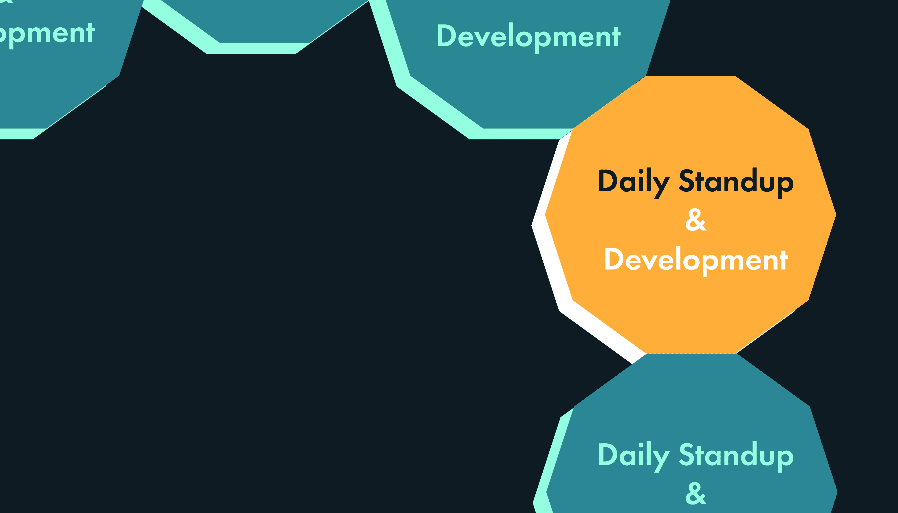

图 4.3. 每日站会

### 目标

每日站会的目的是让团队中的每个人都有机会分享他们所做工作的状态，并在遇到任何阻碍进展时寻求帮助。团队中的每一个人在同事报告时都应该注意，以便他们对大家共同工作的整个迭代的状态有一个清晰的了解。

对于任何想要了解团队正在工作的团队外人员来说，这也是一个了解故事进展情况以及接下来可能处理哪些内容的机会。只有团队成员被允许在每日站会上进行发言，但公司里的任何人都可以参加，访客应被邀请作为沉默观察者参与。

### 时间盒（Time Box）

传统上，每日站会限制在 15 分钟内。这是一个简短的仪式，它保持简短并尽可能方便，以便每个人都能承诺出席、积极参与并投入注意力。预计每个人都要站着，既是为了让他们专注，也是为了鼓励所有参与者在保持仪式简短方面发挥作用。大多数团队都会尝试离开办公桌举行站会，并反对人们在仪式期间使用笔记本电脑和其他设备。

 (img/b1806dfc7ab8e46f442d54c1e56b9394_83_1.png)

### 控制站会时间

将每日站会控制在 15 分钟的时间盒内是 Scrum Master 的责任，但团队中的每一个人都应该被授权执行站会规则，以防时间盒被打破。

不同的团队会选择一天中的不同时间来举行站会。通常早晨刚开始时或午饭前都是不错的时间。这些是一天中大多数团队成员共同的自然休息时间，因此 15 分钟的站会不会破坏长时间编程时间所需的专注力。

对于并非共同办公的团队来说，找到一个适合大家的时间可能具有挑战性，尤其是当团队成员处于不同的时区时。不应允许任何人经常缺席每日站会，但只要达到每日站会的目标，始终留有灵活调整的空间。

即使不是所有人都能参加特定的站会，Scrum Master 也应该为到场的人保持这一仪式。

有时团队可能需要建立自己的体系，并在每个 Sprint 之间进行反思性的迭代。重点应该放在保持仪式简短、可靠地维持仪式，并确保它们提供了预期的价值，而不会产生过度干扰。

### 准备工作

每位团队成员都应该在站会期间出席并在线。唯一必要的准备是让每位团队成员思考如何展示当前正在工作，使其对所有人来说清晰易懂。如果团队成员遇到了与团队外人员相关的阻碍，那么让那些人员做好准备在站会后立即讨论该问题是合理的。

`Scrum Master`在站会前不需要任何特殊准备。优秀的`Scrum Master`可以在站会前检查正在开发的`Story`状态，查看是否有待处理的更改，或者安排邀请`Scrum Master`认为应该参加但通常不参加的嘉宾。

### 三个问题

每日站会的核心是由`Scrum Master`巡视团队并向每个人提问三个问题：

- 自从上次站会以来，你做了什么？
- 你计划在下一次站会之前做什么？
- 是否有任何阻碍了你的进度？

应该尽可能简单。团队的每位成员都回答这些问题中的每一个，一旦最后一个人完成汇报，站会即结束。除非`Scrum Master`有需要向整个团队发布的紧急公告，否则所有与参加站会的其他人没有特定业务往来的人都可以自由地回到工作中。

### 警惕站会中的嘉宾

作为嘉宾参加站会的人往往强烈倾向于提问、引入新信息或开始与整个团队无关的讨论。任何不是开发团队成员的人都不应该在站会期间发言。`Scrum Master`需要坚决地抑制这种行为。组织架构中的高层人员在这一方面也不应获得特殊对待。每个人都需要尊重工程师的时间和注意力，让他们能够尽快回到工作中。

在回答站会问题时，每位工程师都需要准备好简洁的描述，说明他们工作了什么、计划下一步工作什么，以及是否有任何阻碍。这是一项需要练习的技能，`Scrum Master`应该准备好指导每个团队成员如何回答这些问题，以最大限度地利用可用时间。

如果一个人的汇报引发了一定的往复讨论，且对话对整个团队都有意义，`Scrum Master`可以允许这样做。但这种互动必须限制，以尊重站会的时间盒（`time box`）。如果对话超过了几个句子，`Scrum Master`应该介入并建议将对话移至线下。优秀的`Scrum Master`会记录下站会结束后需要进行哪些对话，并在之后跟进其状态。

### 其他状态更新

有些团队选择在每日站会期间在团队共享的`Scrum`板上更新`Story`状态，而另一些则喜欢在`Story`完成时单独更新。无论何种情况，站会都应该是确保每个人都更新了他们正在工作的所有状态，并确保团队中的每个人都了解其他人在做什么的机会。

对于进行结对编程的团队，站会可以是切换伙伴或切换`Story`的机会。一些进行结对的团队希望每个`Story`都由一名工程师从头到尾完成。允许多人配对同一个`Story`对团队的灵活性是有益的，特别是当它涉及某些值得共享的核心功能时。不同的团队会产生不同的方法，但站会是每天进行更改的好地方。

站会也是团队成员相互告知的机会，例如他们是否预计在下一次站会之前完成一个`Story`，以及他们是否有休假。了解团队中其他人的可用时间可以激励同事根据即将到来的`Story`计划工作，并安排切换伙伴或适当分配资源。

## 下一步做什么工作？

如果工程师不清楚下一步应该做什么，应由`Sprint Backlog`（迭代待办事项列表）的优先级来指导这些决策。`Product Owner`（产品负责人）负责在整个`Sprint`期间整理`Sprint Backlog`，并确保它始终代表了处理`Story`的优先级。

除非有令人信服的技术理由，否则任何没有当前`Story`的工程师都应该开始处理`Backlog`中优先级最高的`Story`，无论其专业领域如何。遵循这种模式可以为工程师提供在经验较少领域进行配对的机会，并帮助将整个代码库的知识传播到整个团队。

最后，`Scrum Master`可以在站会结束发布与整个团队相关的公告——每个人都有机会汇报之后，并且仅在剩余时间的情况下。

## Sprint Demo（演示）

在`Sprint`结束时，当前`Sprint`完成的所有工作将向团队、`Product Owner`以及任何受邀观察的人演示。这种仪式被称为`Sprint Demo`，它让所有工程师都有机会展示他们认为已完成的`Story`。`Sprint Demo`是`Product Owner`测试每个`Story`的机会，查看它是否符合验收标准，然后决定接受或拒绝。

### 目标

`Sprint Demo`的目标是清晰地了解`Sprint`期间完成了多少工作，并查看在整合`Sprint`期间完成的工作后产品的当前状态如何。根据被接受的`Story`，团队可以学习更多关于他们在单个`Sprint`内可以持续完成多少故事点（`points`），这提高了他们未来估算`Story`和`Sprint Backlog`的能力。

### Sprint Demo 中的嘉宾

`Sprint Demo`通常是嘉宾非常喜欢的仪式，因为这是`Scrum`团队之外的人员查看团队一直在忙什么，并根据最新工作成果观察产品在下一次迭代中状态的机会。但不应允许嘉宾的存在干扰仪式的目标或改变时间盒。嘉宾是观察者，而不是参与者。除非征求嘉宾的反馈，否则应要求他们对产品或过程发表评论。

**时间盒 (Time Box)**

迭代计划分配的时间取决于迭代期间完成的故事（`stories`）数量，以及与验收标准相关的复杂程度。如果团队使用的是为期两周的迭代，大多数团队会为迭代演示（`demo`）分配半天时间。一旦团队决定投入演示的时间，`Scrum Master`应负责确保所有需要发生的事情在该时间盒内完成。

**将演示与回顾安排在同一天**

团队经常会将迭代回顾（我们稍后会介绍）安排在与演示同一天。在同一天安排这两种仪式的优点是最大限度地减少与仪式活动相关的生产力中断。对团队而言的缺点是，这些天产生的主要是`Scrum`产物，而不是实际的产品开发。这种权衡需要被考虑，不同的团队会有不同的偏好。

**准备工作**

迭代演示是团队展示他们所做工作的机会，并证明他们一直在处理的故事都已完成并准备好包含在产品中（假设尚未被包含）。演示涵盖了从迭代开始的所有使某个故事达到团队“完成定义”（`definition of done`）的工作，无论这些工作是否已经发布。每个参与了任何准备好演示的故事的人员，都需要准备好解释他们对这些故事做了什么。

通常，工程师会在演示之前与产品所有者（`product owner`）会面，确保每个人都清楚将展示的内容。这可以是演示前一个非常有用的最后一步，因为它确保了所演示的故事符合所有的验收标准。它还提醒工程师进行任何必要的准备，以便对未发布的故事进行演示。

`Scrum Master`应与所有已完成故事的工程师会面，确保这些故事已为演示做好了准备。运行仪式是`Scrum Master`的责任，并确保所有需要演示的内容都能在分配的时间盒内呈现。`Scrum Master`的仪式议程应包含所有待演示的故事列表，以及负责每个故事的人。

**让产品所有者驱动演示**

虽然有些团队让工程师演示故事，但良好的做法是让产品所有者参与并现场测试产品。开发新功能的工程师知道代码始终能运行的“快乐路径”（`happy path`）。但产品所有者会寻找边缘情况（`edge cases`），并意识到最重要的验收标准。让工程师设置演示，并由产品所有者进行演示，可以让每个人保持参与感，并确保故事的完成让产品所有者满意。

**演示故事**

演示每个故事的过程应该是一致的。`Scrum Master`应逐一检查列表上的每个故事，让工程师为团队设置演示。许多团队选择在会议室使用投影仪完成，尽管也可以通过围在一个大型显示器周围，甚至通过远程会议服务来实现，这取决于故事的性质和团队的偏好。

在迭代的这个阶段，故事的描述对房间里的大多数人来说都是熟悉的，但在演示期间，产品所有者应该向团队朗读故事以及任何主要的验收标准。这样，每个人都会知道要看什么，并意识到可能出现的问题。

一旦故事设置好并准备好演示，产品状态就是关注的焦点。每个故事都应该是添加到产品中的一个完整功能切片，演示应该在实际产品的语境中展示该功能切片。演示应该逐一通过验收标准，证明它们已得到满足。

有时在演示期间，会发现最初编写的验收标准是不充分的，可能没有涵盖产品所有者需要处理的所有情况。如果发生这种情况，请记住，只要演示满足了所有的验收标准——即在迭代计划中估算的故事中所指定的标准——它就应该被视为已接受并已完成。任何可能需要的进一步更改都是新故事。在这种情况下，产品所有者应该准备为未来的迭代创建新故事，以涉及原始故事中未处理的额外验收标准。

**不要详细讨论问题**

虽然详细说明演示期间遇到的问题可能很有吸引力，但更好的做法通常是记录它们并在随后的后续会议中讨论。这可以保持演示不偏离正轨，并尊重每个参与者的时间。如果出现需要立即处理的关键问题，`Scrum Master`应决定是当时处理还是将其标记为待稍后讨论。

**统计点数**

在迭代结束时，团队应该统计所有完成故事的分数。这有助于团队理解自己的速率（`velocity`）并为未来的迭代制定计划。`Scrum Master`应确保分数被准确捕捉并反映在跟踪工具中。

**发布故事**

发布是将已完成的功能整合到实时产品中的过程，以便使用户能够立即访问它们，或者对它们是否被纳入未来的发布中进行评估。网页和移动团队在发布方面有很多选择。

当团队选择进行持续集成（`continuous integration`）时，重要的是处理某个故事的工程师在故事发布之前，不应该放弃该故事，并证明它不会在实时产品中引入任何问题。虽然这可能会导致工程师的一些停机时间，但这些时间可以用于与维护和改进代码库相关的故事。

**持续集成**是一种支持在故事完成后立即发布的方法，而不是等到迭代结束。这通常取决于一个健壮的测试套件和一组协调好的发布脚本。对于进行持续集成的团队，故事向实时产品中的发布已经作为完成故事的一部分完成，演示后不再需要进一步的操作。

对于不进行持续集成的团队，还需要另一个任务来将迭代中的所有故事发布到生产环境。与发布过程相关的任务通常被认为是故事的完成定义的一部分，但在这种情况下，它们可能需要在演示之后完成。

有些团队定期在每个迭代开始时安排发布。其他团队发布得更频繁，或者可能只在某些特定时间发布，或者根据与大型组织或市场需求相关的特定事件的计划进行发布。

让团队能够反思并对其流程进行迭代，找到最适合他们且最符合产品负责人目标的节奏。

## 按照发布计划工作

无论实际发布计划如何，团队中的每个人都应该理解：将要发布的只有已经完成的部分。`Scrum`并不是为了满足预定的时间表而匆忙完成特定的用户故事。`Scrum`的核心在于以可持续的速度工作，了解团队的能力，并在准备就绪时发布已完成的内容。

任何为了满足发布计划而将新用户故事塞进特定冲刺（`Sprint`）的努力都应该受到团队的抵制。如果日期无法调整，产品负责人应该准备好妥协，决定哪些功能需要从计划中的发布中排除，以便为团队完成最关键的功能留出时间。

## 冲刺回顾

如果说每日站会是`Scrum`最具标志性的仪式之一，那么冲刺回顾可能最能代表敏捷哲学。冲刺回顾为团队提供了一个机会，在每个冲刺结束后反思他们所做的工作，并思考他们未来希望如何修改流程。

图 4.5 冲刺回顾

### 目标

冲刺回顾将团队聚集在一起，考虑刚刚完成的冲刺对每个人来说进展如何。在仪式期间，房间里的每个人都将被询问哪些方面做得好，哪些做得不好，以及他们愿意作为一个小组做出什么承诺以在下一个冲刺中改进工作。目标是得出一系列流程修改方案，团队中的每个人都同意在即将到来的冲刺中尝试。

开发团队的所有成员、`Scrum Master`（`Scrum`大师）和产品负责人都应该参与冲刺回顾。该仪式由`Scrum Master`主持。

### 回顾会议很少有访客

很少邀请访客参加冲刺回顾。这样做是为了鼓励人们坦诚交流冲刺期间可能出现的任何问题，并坦诚地表达他们的感受和出现的问题。这种会议可能会带有情感，而私人团队环境的亲密性提供了一个更有支持性的背景。

### 时间盒（Time Box）

团队可能会发现，他们在回顾中花费的时间与冲刺演示（`Sprint Demo`）中花费的时间相似。对于为期两周的冲刺，团队投入半天时间进行回顾并不稀奇。在安排回顾时，最好在时间分配上慷慨一些，以避免切断团队成员提供价值见解的机会。

团队投入冲刺回顾的时间反映了他们对关注自身流程以及在过程中不断改进的重视程度。某些团队可能会尝试限制在回顾的时间，但这可能以沟通和改进为代价。`Scrum`最重要的方面之一是强调讨论作为增强产品开发过程的手段。

### 准备

冲刺回顾可能充满情感色彩。参与`Scrum`的每个人在参加仪式前都应该在心中进行思考，思考冲刺期间可能发生了他们想要评论的事件。对于某些人来说，这可能意味着列出一个很长的问题清单。

`Scrum Master`参加冲刺回顾时应带着议程，确保收集到所有参与者的正面和负面反馈。确保每个人都有发言权并对流程做出贡献是`Scrum Master`的责任。

### 确保回顾获得适当关注

冲刺回顾是`Scrum`团队最经常缩短甚至遗弃的仪式。这可能是流程出现问题的信号。如果对回顾缺乏足够的关注，团队就是放弃了改进流程的机会。通常，建议减少该仪式的时间和关注的人，正是那些从现状中获益最多、但是以团队利益为代价的。

## 哪些方面做得好？

`Scrum Master`应该询问房间里的每个人在冲刺期间哪些方面做得好。这通常通过绕场一圈让每个人报告做得好的事情来完成。对于做得好的事情，团队应该尝试找到在未来冲刺中复制这些成功的方法。他们可能在过去的某个冲刺中尝试了新方法并被证明是成功的，这些方法可以整合到未来的流程中。

## 哪些方面做得不好？

在每个人都有机会讨论哪些做得好、哪些做得不好之后，应该开放讨论。这是团队中的每个人能够更多地说明他们提出的问题，以及其他同事提出的问题，以及他们认为团队应该对这些问题采取什么措施。对于做得不好的事情，团队有机会讨论哪里出了问题。有时问题出于没有遵循流程；其他时候，流程实际上阻碍了工作，需要进行调整。应该鼓励每个人对可能有益的改变发表意见。

### 安排仪式的顺序

该仪式各个部分的顺序——处理做得好的和做得不好的——可以根据团队的偏好进行反转。`Scrum Master`还可以选择遵循许多实践来让团队更积极地参与仪式，包括游戏、卡片、提前提交等。在策划这些内容方面有很大的创意空间。

## 我们应该如何处理？

最终，讨论将集中在团队想要关注的四五个问题上。`Scrum Master`应该引导讨论，使这些问题被表述为修订后的实践——团队随后可以同意在即将到来的冲刺中尝试执行。

**仅在冲刺之间进行可管理的变更**

虽然可能会讨论很多问题，但团队应该就一组微小且可管理的变更从一个冲刺到下一个冲刺之间达成共识。

经验测试表明，在测试之间进行的更改越多，就越难以隔离哪些更改是有用的，哪些导致了问题。

在该仪式结束时，敏捷大师（`scrum master`）应该向团队展示一份短且易懂的流程变更列表。最重要的是，敏捷大师应该对全场进行投票，确保每个人对这组变更达成一致。然后，敏捷大师应该记录团队对后续冲刺（`sprint`）修订的承诺。团队反思和改进的能力对于其发展，正如对冲刺待办列表（`sprint backlog`）的承诺对于产品开发。

## 结论

在本章中，我们回顾了`scrum`的四个关键仪式：冲刺计划、每日站会、冲刺演示和冲刺回顾。这些仪式每个冲刺都会重复一次，但站会每天执行一次。

这些仪式引导我们从产品负责人（`product owner`）编写的功能故事开始，经过团队估算、承诺冲刺待办列表、完成所有故事工作、演示每个故事都已完成并符合所有验收标准，最后对已完成的冲刺中哪些做法有效、哪些不可行进行反思，以便团队能够不断改进。

接下来，我们将查看`scrum`的一些产物（`artifacts`）。这些工具帮助`scrum`团队理解他们正在工作的内容、跟踪进度并有效协作。

## 第 5 章：Scrum 产物

### **产物（Artifacts）** 是允许团队管理`scrum`流程的工具。它们帮助团队成员就他们正在的工作进行沟通，并记录团队同意要做的事以及已经成就的事。

任何人都可以指向`scrum`团队的产物，向人们展示他们正在做什么、成就了什么以及他们期望实现什么。

有许多产物可以帮助团队在`scrum`工作过程中进行准备和管理。熟悉`scrum`的术语意味着理解每种产物的用途以及如何使用它们。在本章中，我们将介绍一些常见的`scrum`产物，例如：

- 故事 (`story`)
- 产品待办列表 (`product backlog`)
- 冲刺待办列表 (`sprint backlog`)
- `scrum` 看板 (`scrum board`)
- “已完成”的定义 (`definition of "done"`)
- 速率图 (`velocity charts`)
- 燃尽性图 (`burndown chart`)
- 产品增量 (`product increment`)

不同的团队在创建和维护所使用的产物方面有不同的方法，但对于`Web`和移动端开发，有些是值得记住的。

### **产物概述**

虽然正式的`scrum`对流程产物的具体使用方式没有规定，但我们将涵盖一些构建和维护产物的方法，这些方法被发现对`Web`和移动端团队通常的工作类型有用。

`Web`和移动端工作最基础的`scrum`产物之一是描述要开发功能的故事。故事在待办列表中开发和管理。维护两个独立的待办列表：一个供产品负责人跟踪产品的整体愿景，另一个供团队参与当前正在进行的冲刺。两个待办列表都包含了推进产品发展需要发生的事情的描述，但产品待办列表中的项目看起来与冲刺待办列表上的故事不同。`scrum`团队使用`scrum`看板来跟踪故事在冲刺中的进度，我们将讨论它们是如何协同工作的。

`scrum`还提供了许多收集统计数据的工具，用于跟踪团队性能，并向`scrum`团队内部和外部沟通产品开发的进展。其中，我们将涵盖跨越多个冲刺的速率图和跟踪单个冲刺内进度的燃尽性图。

Scrum 团队会发现其他有用的产物包括“已完成”的定义（由产品负责人和团队在敏捷大师的监督下达成一致），以及实际的产品增量（即冲刺结束时产品的当前状态）。

## 故事（Stories）

**故事**是产品负责人向开发团队说明需要开发什么的方式。故事在产品待办列表中孵化，然后以标准格式表达，以便作为冲刺计划会议的一部分展示给团队，进行评估、估算，然后包含在冲刺待办列表中。

### 使用故事的起源

使用故事来封装离散工作部分的概念源于极端编程（XP）¹，它是敏捷开发的一种特殊变体，提倡许多优秀的开发实践，如结对编程和编写功能故事。在用 Scrum 进行 Web 和移动端开发时，故事非常有用，因为这些对一个完整功能切片的工作通常包含从后端到前端的许多相同组件。团队经常会看到具有相同组件的故事，将一个故事与团队之前工作过的故事进行比较，使得新故事更容易被分解和进行相对估算。由于这个原因，我们将故事视为我们所讨论的工作类型的基础性产物。

一个故事应该捕捉完整的功能切片。每个故事应该是独立的，这样开发者就不必在处理另一个故事之前完成上一个。故事应该是一个小功能切片，可以在单个冲刺期间处理并完成。

故事有助于捕捉功能的精髓，并让团队能够以有意义且相对的方式讨论参数和验收标准。通过根据团队在冲刺中可以完成的内容对功能故事进行规模估算是一项实用的练习。

每个故事都应该增加产品的价值，并使其更接近所有者的愿景。每个故事都应该明确产品负责人将如何测试最终产品以验证故事已完成。

### 故事不是技术规范

尽管具有工程或产品管理背景的新产品负责人有时倾向于解决所有技术问题，并为每个功能提出带有详尽规格的静态解决方案，但重要的是记住，Scrum 故事不是技术规范。它们是产品负责人和工程师之间讨论如何实现某功能以及涉及多少工作量的机会。这就是故事遵循简短且一致格式的原因之一。它减少了包含更详细规格的诱惑。

编写故事的责任属于产品负责人。编写捕捉客户完整意图和期望是一项可能需要时间发展的技能，但对于有效的 Scrum 流程至关重要。优秀的敏捷大师应该能够指导产品负责人如何编写大小合适的故事、表达适当的验收标准并开启对话而不是关闭对话。

有一个适用于编写故事的简单公式。多年来人们尝试了许多变体。通过迭代和反思，不同的团队最终可能会演变出适合自己的方法，但这是一个很好的开始：

¹ http://www.exremeprogramming.org

名称：*简明易懂的功能名称*

- 作为一个*用户类型*

- 我想要*执行某种行为*

- 以便*实现该行为的理由*

验收标准：

- 给定一个*定义状态*

- 当*一组条件或事件*发生时

- 那么将得到*一致且可测试的结果*

 

## 什么是好的故事（Story）？

一个好的故事应该是短且直接的。许多 Scrum 团队遵循一种惯例：一个故事应该能够写在一张三乘五英寸的索引卡上，而验收标准则写在同一张卡片的背面。

如果写下一个故事需要比这更多的信息，那么规格说明可能太详细，或者故事可能太复杂，可能需要拆分成多个故事。

例如，考虑一个正在开发画廊应用的团队。画廊的访问者可能想对显示的图片进行评分，以便跟踪他们的喜爱。画廊无论有或没有评分功能都可以运行，因此这项工作可以作为一个完整的功能切片被隔离。根据工程师的说法，添加评分组件的工作可以在单个冲刺（Sprint）内完成。

这就是一个故事可能的编写方式，以便团队对其进行评估、估算并承诺到冲刺待办列表（Sprint Backlog）中：

名称：为画廊图片评分

- 作为一个画廊访问者

- 我想要对图片进行评分

- 以便我可以跟踪并对我评分过的图片进行排名

验收标准：

- 给定一个已登录的用户正在查看画廊

- 当用户点击某个图片评分组件中的星星时

- 那么该星星的值应该被记录为该用户对该图片的评分

以及

- 给定一个已登录的用户正在查看画廊

- 当显示用户已评分的某图片时

- 那么评分组件应该反映用户之前输入的评分

以及

- 给定一个已登录的用户正在查看画廊

- 当“收藏”切换器打开时

- 那么应该只显示用户已评分的图片，并按评分降序排列

对于像这样的故事，团队可能有一套标准，规定如何将线框或设计附加到故事上并进行沟通。例如，如果是新组件，设计师可能已经准备了模型图和一组工程师实现该功能时需要的资源。该产品可能还有一份样式指南或其他文档，需要用相关信息进行更新。

故事与工程决策是无关的，例如 API 是如何设计的，或者代码中使用了哪些命名规范。虽然团队的完成定义（Definition of Done）可能包括创建有关此类技术方面文档的需求，但产品所有者（Product Owner）提交的故事通常不需要对这些观点持有意见。

当在冲刺计划会上演示故事时，工程师应该验证所有必要的资产和信息都已捕获并可用。即将冲刺中要完成的实际工作由故事卡片上的描述以及产品所有者与团队之间引发的对话决定。

## 产品待办列表（Product Backlog）

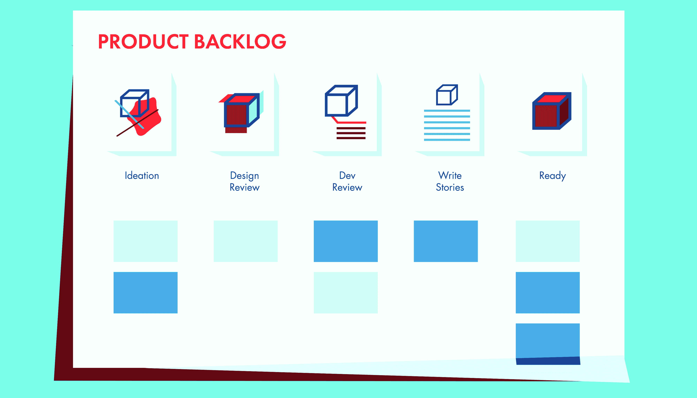

图 5.2. 产品待办列表

开发团队的故事源自产品所有者的**产品待办列表**。产品待办列表跟踪产品所有者从客户那里获得的关于产品方向的所有输入，以及产品所有者收集的调研、经验测试、设计和工程反馈。

与冲刺待办列表的故事不同，产品待办列表的项不需要以任何特定方式组织。这是因为它们的主要目的是允许产品所有者跟踪所有所需的功能。这些产品待办列表项在结晶为冲刺待办列表的清晰开发故事之前，可能非常模糊。产品待办列表中的项应该始终反映产品所有者对产品长期目标的最新思考，而团队则正在处理当前增量阶段的特定功能。

## 产品待办列表是产品所有者的责任

虽然产品所有者可能选择定期与团队共享整个产品待办列表，但这里的项是产品所有者的责任。提醒团队关注待办列表中长时间未被触碰的项可能是没有效率的，因为这会分散对当前增量的注意力。虽然许多产品所有者倾向于跟踪待办列表中的项直到变成故事，但待办列表中的项与冲刺待办列表中的故事之间并不需要有一一对应的关系。

## 在准备好进入之前不要编写故事

产品所有者过早为产品待办列表中的项创建开发故事通常是一个错误。产品待办列表中的项应该保持足够的模糊性和灵活性，以适应 Scrum 迭代敏捷过程中产生的变化。几周或几个月未被处理的产品待办列表项很容易过时，如果故事在编写后没有很快被处理，产品所有者很容易忘记编写故事时的背景。

## 冲刺待办列表（Sprint Backlog）

**冲刺待办列表**是团队承诺在当前冲刺期间完成的开发者故事。冲刺待办列表是在冲刺计划仪式的一部分创建的，反映了团队、产品所有者和 Scrum 导师对大家在进入冲刺中工作的共同理解。

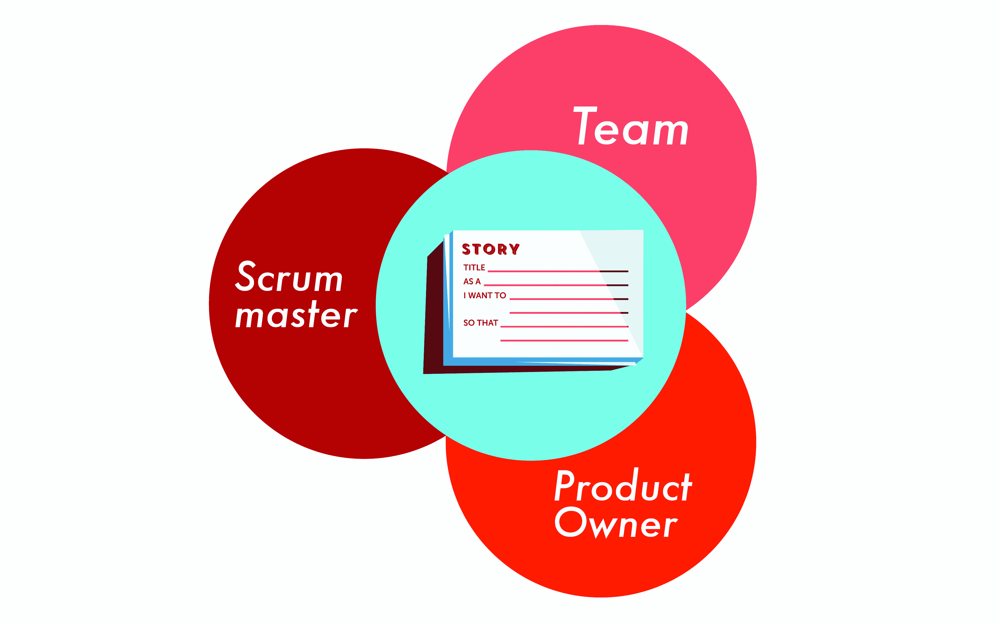

图 5.3. 冲刺待办列表

冲刺待办列表由一组功能故事组成。这些故事中的每一个都源自产品待办列表产生的思考过程，但可能并不反映产品待办列表中的特定项。冲刺待办列表中的功能故事遵循我们之前描述的故事结构。

当前迭代的迭代待办列表（sprint backlog）的大小是在迭代开始时迭代计划期间的谈判确定的。每个故事（story）在迭代计划期间进行估算，整个待办列表应该代表了团队认为在接下来的迭代中可以完成的总点数。每个故事都有一个点值，这反映了团队认为完成该特定故事所需的工作量。

迭代待办列表中故事的顺序最初在迭代计划仪式上确立，但产品所有者（product owner）有权在迭代期间的任何时候更改迭代待办列表中故事的顺序。产品所有者不能向迭代待办列表添加或删除故事，但可以根据需要重新排列顺序，以指示哪些故事是最重要的。

### 在迭代期间对故事进行重大更改

如果需要对迭代待办列表中的故事进行重大更改，且该更改确实无法等到迭代结束，则 Scrum 师（scrum master）应该停止迭代并启动一个新的迭代，同时进行新的迭代计划仪式。由于中断和成本的原因，这是一个非常极端的选项。只有当明显看出当前迭代待办列表中正在进行的工作都不符合产品所有者的变更需求时，才应作为最后手段使用。

在迭代期间，开发者每当完成一个故事并需要新工作时，就会从迭代待办列表的顶部选取故事。每个工程师都应该选择待办列表顶部的故事，因为那是产品所有者认为在当前迭代中优先级最高的故事。选择不是待办列表顶部的故事将导致工作无法按优先级进行。

### 按优先级顺序工作

由于故事总是从待办列表顶部选择，完成工作并正在寻找新故事的工程师通常会在某些时候承担不符合其专业领域的故事。这是刻意为之，因为这为工程师提供了了解更多代码库的机会，并获得专业领域之外的经验。

虽然让最有才华的人来处理最符合其专长的故事是有价值的，但团队共享知识也很有价值，这样每个人都能清楚地了解开发和维护整个产品涉及的内容。这有助于团队变得更加全能，提供学习和成长机会，提高每个人估算新故事的能力，并防止关键任务信息成为某一个人的专有。在高效开发和知识共享之间找到恰当的平衡取决于每个团队。

## Scrum 板

图 5.4 Scrum 板

迭代待办列表通常是 Scrum 板的第一列。**Scrum 板**（scrum board）跟踪当前迭代中正在工作的所有故事的进度，直到其符合团队的完成定义（definition of done）。大多数 Scrum 板使用两到三列，并将故事从一列移动到下一列，以反映哪些故事在优先级待办列表中，哪些正在进行中，哪些在测试阶段（QA），哪些已准备好演示（demo）。

Scrum 板为整个团队提供了焦点。通过在迭代期间查看 Scrum 板上的故事，团队中的任何人都应该能够立即获取迭代状态的快照，以及团队朝着实现自设目标迈进的进展。一个良好的 Scrum 板应该是公开的，这样团队之外的人也可以查看并了解发生了什么，从而促进整个公司的透明度。

有很多工具可用于 Scrum 板监控故事的进度。最基本的方法仅是将索引卡贴在墙上，让每个人都能看到。对于共同办公的团队来说，这有许多用处。它不仅鼓励使用索引卡和手写来保持故事的简明了，还为每日站会创建了一个自然的聚集地，并作为团队进展的共享视觉提醒。

### 物理板带有风险

在在墙上由索引卡制成的物理板容易受到滥用或忽视。如果你打算使用物理板，最好每天给它拍照并在网上发布这些更改。除了使用物理板，许多公司还开发了电子工具，允许团队跟踪故事从一个状态移动到下一个状态。某些工具可能仅支持点数、各种状态甚至设置访问权限。由每个团队决定哪种工具的哲学最符合他们。

目前最流行的跟踪和管理工具包括：

- Pivotal Tracker

- Jira Agile

- Trello（带有 Scrum 插件）

## 完成定义

图 5.5 完成定义

我们已经提了几次完成定义。**完成定义**（definition of done）适用于迭代待办列表中的每个故事。声明一个故事已完成是根据每个团队的工作方式验证其所有关键方面都已完成的手段。

对于团队来说，对“完成”的实际含义有一个共同的想法至关重要。团队应该创建一个书面的完成定义，并将其作为他们处理的每个故事的清单。此定义应该独立于特定故事或项目的文档，因为完成定义应该适用于团队的工作方式。

完成定义是团队共同提出的东西。它可能在第一次迭代计划期间创建，并在迭代回顾期间进行迭代。随着时间的推移，团队的完成定义可能会演变，因为团队在回顾中意识到过程中哪些方面可能需要改进。

将完成定义醒目地发布并不是坏主意。这让团队内部和外部的人都能理解完成任何故事所付出的努力程度。

关于一个提议的故事（story）是否准备好可以开发。如果根据验收标准，故事无法满足“完成定义”（definition of done），那么拥有一份公布的完成定义可以帮助团队明确这一点。通常，完成定义包含许多众熟知的预期。例如，代码应该是完整的，构建不应失败，测试套件不应损坏，且产品应按预期运行。完成定义中经常包含的其他点还包括代码同行评审、编写新的单元测试、代码注释以及更新产品文档。不同的团队会有不同的需求，而创建完成定义的练习对于帮助团队实现对于每个故事（而不仅仅是某些故事）什么是重要的是非常有价值的。

### 完成定义必须是实用的

虽然完成定义的详尽性很重要，但确保其具有实用性同样重要。完成定义对于每一个故事来说必须是可实现的。团队可能认为为了代码库应该遵循某些实践，但在考虑到市场限制的情况下，这些实践是不切实际的。通常，工程师会主张更详尽的范围，而产品所有者可能会主张更精简的方法，这取决于产品所有者的远见和市场的稳定性。每个团队都要在开始工作之前阐述自己的理由，并制定出一个大家都能同意的完成定义。

## 速率图

图 5.6 速率图

**速率（Velocity）** 是 Scrum 团队衡量他们在典型冲刺（sprint）中可以完成的工作量的方法。速率是根据历史衡量的，从一个冲刺到下一个冲刺。通过跟踪团队根据自己的完成定义可以完成的故事点，他们可以建立起可靠且可预测的感觉，即根据相对点值判断完成新故事需要多久。

跟踪速率是 Scrum 导师（scrum master）的责任。在每个冲刺演示（demo）结束时，Scrum 导师应该计算在该冲刺期间被接受完成的故事的估算分数。这个数字应该作为一个数据点添加到该冲刺的速率图上。速率图开始往往会在非常高的数字和很低的数字之间波动，因为团队正在学习在一个冲刺中能做多少工作，以及如何估算故事。团队合作的时间越长，他们相对一致地估算故事的能力就越强。这种技能让团队对单次冲刺可以完成多少个故事、多少分有了更好的把握。随着时间的推移，如果团队的组成保持不变，起初非常不稳定的速率图将开始趋于一个一致的值。

与业务环境中的许多图表不同，速率图的意义不在看到持续的增长，而是看到数值收在一个一致的水平线周围。那条线代表了团队在单次冲刺中现实且可持续地完成的工作量。

### 速率是估算工具，而不是 KPI

Scrum 之外的人可能对速率图的性质感到困惑。从管理的角度来看，人们可能倾向于支持团队工作量的增加，并希望速率随时间增长。但速率图旨在趋向一个水平平均值。你可能会听到高管谈论试图增加团队的速率，或者庆祝某个速率高于典型冲刺的冲刺。通过提醒大家速率跟踪的目的是提高团队持续且可靠地估算他们可以完成多少工作的能力，来先于这些对话。一个随时间推移显示持续增加（或减少）的速率图通常反映了流程中的问题。

## 燃尽图

图 5.7 燃尽图

**燃尽图（burndown chart）** 显示了团队向完成他们在单次冲刺内同意完成的所有点数的进度。该图表从团队为该冲刺承担的总点数开始，并按天跟踪其中已完成并准备好进行冲刺演示的点数。

燃尽图通常由 Scrum 导师维护，可能会每天更新，也许在每日站会（daily stand up）之后，或者如果是团队用于维护 Scrum 板的工具自动生成的，则持续更新。燃尽图的主要受众是团队本身，尽管燃尽图上可能存在对 Scrum 团队之外的人相关的数据点。

典型的燃尽图从从左上角到右下角的直线对角线开始，显示出冲刺的“理想”燃尽率。在实践中，重点不在于匹配那个理想状态，而是记住在任何时间点冲刺还剩多少，以及团队预计在冲刺的任何特定一天投入多少精力到产品开发中。

燃尽图上的线条或列状图可能用于表示冲刺中每天实际剩余的努力点数，从团队承诺到冲刺的点数开始。随着工作的完成，这些列状图应该变得越来越短。有些团队还选择跟踪每日工作，无论是以故事点还是单个任务的形式。这可以通过线条或堆叠列状图来实现。某天的列高度比前一天高几乎没有正当理由。如果在冲刺结束前发现了 Bug，并且一个被标记为完成的故事需要重新处理，列的大小可能会从一天到第二天增加。

### 警惕范围蔓延

每个人都尊重冲刺待办列表（sprint backlog）的范围。如果在冲刺开始后经常添加新故事，反映某一天冲刺剩余工作量的列可能会高于前一天的水平。这种模式有时用对比色表示，以强调最初商定的范围可能正在上升的事实。如果这种情况频繁发生，可能反映了在冲刺回顾（sprint retrospective）中值得解决的问题。

## 产品增量

图 5.8 产品增量

Scrum 的最终产物是冲刺结束时存在的实际**产品增量（product increment）**，包含了该冲刺中所有符合完成定义的故事。在每个冲刺结束时，已完成的功能应该被添加到产品中以供冲刺演示。到那时，产品本身就是 Scrum 流程的产物。

为了让组织按照 Scrum 计划发布产品，这一目标允许产品状态成为 Scrum 所提倡的开发、测试、评估和创新的迭代过程的一部分。

在大多数组织中，产品增量的所有权应属于发布工程师，并应对产品负责人（product owner）完全可用。对于 Web 和移动端项目，产品增量通常是产品的在线演示分支（live demo branch），维护在一个安全但可访问的位置。

对于进行持续集成的团队，实时站点可能始终反映团队完成的最新工作。在这些情况下，公共网站或 App 就是产品增量。

## 结论

这里有很多需要熟悉的新术语，但在学习 Scrum 之初，熟悉 Scrum 产物（`artifacts`）的名称和特征是一个很好的开始。在本章中，我们回顾了用户故事（`stories`）、产品待办列表（`product backlogs`）、迭代待办列表（`sprint backlogs`）、Scrum 板、完成定义（`definitions of done`）、速率图（`velocity charts`）、燃尽图（`burndown charts`）以及产品增量。到此，我们已经涵盖了 Web 和移动端开发的 Scrum 机制！

现在我们已经掌握了 Scrum 的角色、仪式（`rituals`）和产物，是时候来看一下 Scrum 合约了。当一个人开始作为 Scrum 团队的一部分工作时，他们同意了什么？透明地工作意味着什么？迭代改进如何改变我们解决问题的方法？将在下一节中讨论这些问题及更多内容。

## 第 6 章：Scrum 合约

在本书的前半部分，我们从抽象的角度讨论了 Scrum。我们讨论了它是什么以及如何运作的。我们将其拆解为角色、仪式和产物。但 Scrum 不仅仅关乎细节。Scrum 关乎人。

在下一节中，我们将看到 Scrum 的实际运作。我们将看看 Web 和移动端开发团队如何利用 Scrum 的各种特性。我们将从已经介绍过的团队开始。

### 初学者之心（The Beginner's Mind）

开始使用 Scrum 可能会感到有些不确定。关于它将如何影响我们的工作方式和互动方式有很多疑问。关于 Scrum 本身如何与组织层级互动也有疑问。正如我们在第二章中看到的，有些人进入 Scrum 时带有先入为主的概念，这些观念可能会限制 Scrum 的潜力。

在随后的章节中，我们将针对 Scrum 团队可能出现的问题进行一些排除。在本章中，我们将讨论同意积极参与 Scrum 过程意味着什么。如果没有真实人的参与，Scrum 就无法发挥全部潜力。Scrum 依赖于每个人履行其角色的职责，而 Scrum 使这些角色尽可能轻量且易于支持。

我喜欢将其称为 **Scrum 合约**（`scrum contract`）。与我们之前讨论的产物不同，这不是一份实体合同。它是人们在接触像 Scrum 的事物时采用的一种心态。它并不要求摒弃健康的怀疑态度，但要求用开放的心态取代先入为主的概念。

Scrum 合约围绕几个关键概念展开：

- 尊重角色（Respecting Roles）
- 拥抱透明（Embracing Transparency）
- 维护边界（Maintaining Boundaries）
- 充满希望地迭代（Iterating Hopefully）
- 共享定义（Sharing Definitions）

这些概念中的一些对于任何尝试过在团队中有效工作的人来说都是熟悉的。其中一些专门适用于 Scrum 的运作方式。所有这些都依赖于愿意为了共同目标共同努力。

### 尊重 Scrum 角色

正如我们在第 3 章中看到的，Scrum 定义了若干角色供人们承担。这些角色在 Scrum 背景下有其用途，每个人都需要理解，无论他们与组织中的职位或头衔关系如何。Scrum 并不是取代组织层级。事实上，Scrum 试图尽可能独立于组织层级。

Scrum 期望人们能够区分他们的工作和他们在 Scrum 过程中的角色。这并不意味着 Scrum 免除了你对工作的义务。Scrum 提供的是对你所做工作的另一种视角。当你在 Scrum 项目中承担一个角色时，你同意积极参与一个共享过程，以促进每个人正在进行的工作。

在 Scrum 团队中承担角色的一部分，意味着愿意在 Scrum 仪式期间出现的问题上，以平等的身份与同事行动。任何参与 Scrum 的人都应该自由分享他们对项目和过程意见，即使这些意见违背主流，或挑战了组织层级中职位较高的人的权威。当冲突发生时，Scrum Master（`scrum master`）负责协助调解并促进对话。

从更根本上说，参与 Scrum 假设愿意成为团队的一部分。Scrum 角色和仪式的设定使得每个人都有机会、也有义务参与。一个不分享意见和想法的团队成员是在让团队的其他人感到失望。作为 Scrum 团队的成员，无论你在公司的职位如何，你的目标都是帮助支持每个人的流程。因为小组规模小且亲密，而且参与规则被明确定义，Scrum 为害羞的人实验性表达自己提供了一个安全空间。

由于典型的公司会议与 Scrum 仪式之间的区别，人们可能会对预期的行为产生一些困惑。当出现此类问题时，Scrum Master 应该是最终的仲裁者。每个团队都要自己定义什么是最有用的行为标准，并恰当地执行它们。

最终，这取决于对同事、对过程以及你在过程中位置的尊重。如果你有疑问，或者你认为某些事情运行不正常，总有机会在回顾会议（`retrospective`）上提出这些问题。不要错过积极参与的机会。

### 提供透明度

为了让 Scrum 有效运行，团队中的每个人都需要愿意在过程的各个阶段让其他人知道他们正在做什么。有些人称之为透明。它让每个人都能知道其他人在做什么，以便每个人都能对项目有更大的认识，以及他们如何提供帮助。

透明度有多个用途。Scrum 的价值之一在于它让关于状态的大量信息对公司里的任何人可见，这样负责项目的人就不会被中断。通过为团队每天留出非常短且定义明确的时间进行更新，Scrum 避免了每位工程师可能面临那些只想知道他们正在做什么的人的干扰。

透明度还允许团队之外的人跟踪对他们可能特别重要的问题状态。Scrum 对冲刺（`sprints`）的定义使其不会被新的故事打断，但客户和组织周围的其他人员经常有他们想要引入的更改，他们可能认为这些更改是紧急的。Scrum 的透明度让他们一眼就能看出团队现在正在做什么，以及为什么这些事情被按那样优先排序。

Scrum 支持的透明度并不是为了微观管理。Scrum 的优势之一是它能够为团队成员创造尽可能多的不受管理的时间来让他们自我管理。没有人比负责故事的工程师更清楚完成该故事需要什么。Scrum 提供了每日站会（`daily standups`）作为透明度的触点，以便工程师可以分享宝贵的见解。Scrum 假设参与过程的每个人最初都做出了加入团队工作的意识选择。在团队共同工作意味着让每个人知道你在做什么，并愿意分享信息和资源。

并进行探索。每个人对别人在做什么都有意见，这就是团队协作的本质。这种好奇心是健康的。然而，重要的一点是，人们需要空间按照他们认为合适的方式来工作。在小组过程中承担某个角色，意味着要让其他人也有他们自己的角色。在用于 Web 和移动端开发的 Scrum 中，这意味着允许工程师以一种不受干扰的方式，处理他们已在冲刺阶段（`sprint`）期间承诺要完成的用户故事（`stories`）。这是 scrum 自管理特性的一部分，只要在保持生产力的前提下，它允许了高度的个人灵活性。

## 每个人都需要尊重 Scrum 角色

这种对 scrum 角色的尊重需要超出团队的范围，甚至是工程部门的范围，以便为支持有效的 scrum 流程提供必要的稳定性。管理层和 scrum 导师（`scrum master`）都有责任向公司内其他可能对 scrum 团队预期产生影响的人员（包括高级管理层）传达 scrum 的价值。

在一个 scrum 团队中，每个人都应该履行其角色的义务，并且他们相互依赖于这一点，以确保整个流程的正常运行。在流程可能崩溃的情况下，scrum 提供了一个机会，让团队中的任何人在每个冲刺结束的回顾会议（`retrospective`）中对团队如何协作提出质疑。

回顾会议期间的对话有时需要深入到个人行为的细节，这始终是一个敏感的话题。对于 scrum 导师来说，当这些对话与整个团队相关时，允许它们发生，但要保护个人不受人身攻击。

当你在团队中工作时，你不能期望你所做的工作是在真空中存在的。你需要理解，其他人必须接触你的工作，而他们正在做的工作是基于你的工作以及你工作的方式。这是一个共享的语境。有时，你的工作方式会影响团队的其他部分，你需要愿意允许对这些问题进行讨论。

团队中的每个人都需要能够信任 scrum 导师会维护他们的利益。团队中的每个人都需要能够信任彼此会履行自己的义务。scrum 为这种信任的增长提供了空间，并提供了展示信任价值的机会。

## 尊重反思性迭代

scrum 最价值的组成部分是，它能够随着团队、项目和背景的变化而不断调整。没有任何项目具有完全可预测的轨迹，这对于 Web 和移动领域的项目来说尤为如此。变化在不断发生——不仅在市场背景下，而且在负责项目的团队内部——因此，快速适应的能力至关重要。

scrum 定期会花时间审视自己，看看自己的表现如何。利用回顾会议的机会，团队有机会从正在做的工作中抽离出来，思考执行得如何。回顾会议不仅衡量了团队的“温度”，还为每个人提供了一个分享对进展情况的赞赏和批评的机会，并达成调整建议。

由于回顾会议在每个冲刺阶段都会发生，因此在一次回顾中决定的任何事情在下一次回顾中都可以被重新考虑。团队在回顾会议中同意进行的任何更改都应该被视为一次实验。你可以将它们看作是测试，就像网站或移动应用程序上的新功能通常进行一样——基于实际应用进行评估。团队中的成员如果认为在回顾会议上同意尝试某事就意味着团队永久地改变了其政策，那是错误的。

例如，团队可能注意到，在早上一早时候举行每日站会（`daily standups`）意味着有时重要人物不在场，无法与同事分享和学习。在回顾会议上，有人可能会提议将站会时间改到午饭正之前，因为大家更有可能到场，而且那个时间他们的心流（`flow`）不太可能被中断。如果达成了共识，团队可以同意在一个冲刺周期内尝试这样做，然后在下一次回顾会议上讨论，看看新时间是否真的对每个人都有效，或者他们是否需要进一步调整。

实验的结果并不非得是正面的才算作成功。这就是科学方法的本质。如果人们喜欢某项更改，他们可以将其永久化——直到在之后的回顾会议中有人提出了充分的理由来改变它。如果人们不喜欢某项更改，他们有机会在下一次回顾会议中提出，并可能阻止实验继续进行。

反思性迭代（`reflective iteration`）让运行良好的团队能够继续运行和改进，并让有问题的团队能够识别并调整这些问题。流程中的一切都取决于小组的共识。因为总会有下一次回顾会议，所以如果某些事情不起作用，总会有另一个机会重新审视任何决定并转变方向。

## 遵循共同定义

scrum 鼓励人们共同工作而不是单打独斗。为了让这种工作产生成效而不是具有压迫性，人们需要对他们工作背景的共享定义达成共识。如果没有一个每个人都能同意的通用词汇，团队将无法管理，scrum 也将变得微乎其微。

scrum 为组织定义了一系列新术语，例如冲刺（`sprint`）、故事（`story`）、产物（`artifact`）等。其价值之一在于，每个组织都有机会获取这些新术语，并以对他们最有效的方式使用。这并不意味着违背 scrum 的核心标准，但意味着要对每个团队如何选择在这些定义内内部运作达成意识的共识。

我们讨论的词汇是每个团队特有的。虽然故事（`stories`）、站会（`standups`）和积分（`points`）等共享概念在所有 scrum 团队中都是常见的，但每个团队如何编写故事、如何管理站会以及每个团队如何选择分配积分都是主观的且不断演变的属性。

例如，每个团队需要为自己定义的概念之一就是“完成”（`done`）。scrum 的产物之一是“完成定义”（`definition of done`），团队在其中对故事从开发到验收需要的标准达成一致。除非每个人对什么是“完成”都有清晰的理解，否则在如何处理故事上可能会产生分歧。

scrum 没有尝试为团队定义“完成”，但 scrum 期望团队创建并共享一个每个人都能同意的完成定义。scrum 提供了松散的指南，并允许团队具有极大的灵活性来定义自己的标准，从而发现通往可持续生产力的路径。

## 总结

在 scrum 团队工作需要意愿。每个人都需要愿意承担所需的角色以保持团队的生产力、对他们正在做的工作保持透明、尊重定义每个人角色的边界、共同迭代并定期改进流程，并对大家如何协作的共享定义达成共识。

在这些概念的基础上，在下一章中，我们将观察一个针对特定项目的团队。他们是我们之前见过的同一个团队，来自 WithKittens.com 网站，但现在他们开始作为 scrum 团队的一部分进行工作。我们将展示该网站的新故事是如何从产品待办列表（`product backlog`）中的想法产生的，以及团队如何评估这些故事，以判断它们是否合理以及需要多少精力。

## 第 7 章：故事的生命周期

我们已经详细介绍了 Scrum，讨论了保持 Scrum 团队顺畅运行所需的角色、仪式（`rituals`）和产物（`artifacts`）。我们讨论了团队成员的态度，以及人们在加入 Scrum 时的顾虑。现在，是时候开始查看实际的 Scrum 流程了。

为了做到这一点，让我们从头开始。在本章中，我们将认识一位产品负责人（`Product Owner`），并学习一个现有 Web 和移动端产品的变更想法是如何从模糊的想法变为具体的用户预期，最后变为团队可以开始处理的用户故事（`stories`）的。

我们已经开始与 WithKittens 团队的成员进行交流，并将继续与他们合作。我们将先讨论产品最初的样貌，以及产品负责人决定引入哪些变化。然后，我们将看到这些变化固化为完整的全栈功能切片，供团队进行估算和交付。

在这个过程中，请记住，该团队实现 Scrum 细节的方法可能与你们团队的方法不同。例如，每个团队都有自己的相对分值（`points`）量级，并且必须遵循自己的“完成定义”（`definition of done`）。需要关注的重点是我们在之前章节中讨论的基础知识。

### 为什么 Scrum 没有针对每个团队进行标准化？

你可能在问，为什么 Scrum 不简单地为每个团队标准化？Scrum 的优势之一是，每个团队都从一组共同的通用概念开始，然后迭代出最适合自己的流程。这通常会产生相当一致的“完成定义”，但它取决于每个团队的开发和部署背景。例如，分值完全取决于团队实际处理的任务，因此在不同团队之间可能会差异巨大。

### WithKittens 是什么？

WithKittens 团队由六名工程师、一位产品负责人和一位 Scrum 导师（`Scrum Master`）组成。他们已经合作工作了大约三年，人员流动较小，并且他们开发了一个网站和一个移动应用程序，旨在为客户上传的任何图像添加猫咪照片。

该服务的大多数用户永远停留在免费层级，仅在自己的社交媒体图片中添加猫咪并分享，得益于生成的图像上叠加的嵌入文本，提升了 WithKittens 的知名度。但对于某些客户来说，这也是一项关键服务，他们支付高昂费用是为了确保图片中能够持续、可靠地添加最棒的猫咪，并且比免费用户对质量和内容有更多的控制权。让这些付费客户满意并确保他们的服务稳如磐石，是维持运营并支持免费层级用户的保障。

团队的专业知识包括图像处理专家、后端数据处理和 API 管理工程师、负责 Web 和移动界面的端到端工程师，以及计费和安全专家。产品负责人拥有桌面和 Web 应用的产品管理背景，以及几年的前端工程经验。Scrum 导师曾从事过产品和项目管理。

除了核心团队外，设计团队中有一位专门的设计师与产品负责人合作开发服务；还有一对向不同经理汇报的 QA 工程师（质量保证工程师），以及一个小小的 DevOps 工程师团队，他们负责维持网站运行并处理 IT 问题。

团队做的很多工作对任何 Web 或移动开发公司来说可能都很熟悉，例如用户管理、安全和计费。该服务的独特方面包括一些细节，例如确定猫咪在图片中的理想位置，以及优化图像以进行正确交付的最佳方法。

### 为什么只是猫咪？

公司的创始人兼首席执行官与猫咪救助协会一直长期合作。该服务的想法最初是为了支持一个当地的非营利组织，随着其他非营利组织——最终是用户——决定他们也想能够在自己的照片中添加猫咪，这一想法迅速增长。

该服务的大多数付费客户是高端社交媒体用户，以及那些对猫咪在图片中的呈现方式有更多控制需求的人。但也有日益增长的商业客户，包括营销和推广公司，他们使用 WithKittens 服务来增加材料的吸引力。

由于猫咪在互联网上普遍受欢迎，公司对仅限猫咪内容的关注以前从未出现过严重问题，尽管这一直是某些讨论的话题。直到现在，任何关于扩展到猫咪以外计划的疑问总是通过模糊地提到公司对猫咪救助的历史关注，以及猫咪对他们不断增长的用户群的重要性而被驳回。

### 客户需求

公司内部对于推向猫咪之外扩张的推力最强的地方是销售部门。销售团队的一些成员觉得，由于无法针对寻找幼犬的公司，他们的增长能力受到了阻碍。最近，销售总监与公司最大的客户之一（一家跨国集团）坐在一起交流，并得知他们正因为这一点计划将合同转给竞争对手。以下摘自内部销售备忘录的片段突出了这个问题：

> “我们已经支持他们一年多了，他们对服务没有任何投诉。他们目前占了我们收入的百分之七。但他们一直问我们为什么不能在图片中添加幼犬。幼犬在互联网上和猫咪一样可爱，也一样，他们希望能够吸引更广泛的观众。我们的借口用光了。我们的竞争对手支持添加所有类型的幼动物，尽管我们知道他们在质量和控制方面无法与我们相比。但如果我们不灵活，那就没意义了。如果我们不能满足他们，我们一定会失去他们。”

这封备忘录引起了创始人的注意，他不情愿地召集产品负责人召开会议。他们讨论的问题包括适应变化的市场预期的价值，以及增加与公司历史意图冲突的服务的合理性——更不用说公司的名称。

他们共同决定需要对幼犬友好的功能进行一些工作——只是为了找出在现有基础设施的基础上，支持猫咪之外幼犬可能需要什么。他们认为需要记住的关键问题是维护完全独立服务的开销，与开发和支持集成服务的成本相比。

由于销售备忘录的紧急性，他们决定这是一个高优先级任务，必须推迟他们原计划下一次进行的关键季节性推广（整合新的波斯猫和安哥拉猫咪促销）。产品负责人带着讨论的细节回到产品负责人处，并获得了对该排序进行更改的批准。

### 产品待办列表

带着新的授权，产品负责人回到产品待办列表，所有服务的未来想法都记录在那里。将列表中的一些其他高优先级想法推后几乎很令人痛苦，但显然这必须首先完成。

在对竞争服务进行一两天的研究后，产品负责人汇总了该想法的细节。大多数其他服务将动物选择放在客户流程的后期，几乎是事后才考虑的。

如果他们打算为客户提供幼狗的选择，而不仅仅是小猫，这将需要对核心产品进行重大调整，并引入一个新的界面元素。

目前只有一两个其他服务专门专注于某一种幼动物。在大多数情况下，它们规模较小，还没有获得像 WithKittens 那样的市场号召力。但尽管存在市场碎片化的风险，但在核心服务上专注于小猫也有其优势。这还避免了在名为 WithKittens 的服务中添加幼狗带来的困惑。

最终，产品负责人决定最佳方案是让团队克隆`WithKittens`服务的某些部分，并创建一个极简的并行`WithPuppies`服务。为了预备这种可能性，他们已经购买了`WithPuppies.com`域名，设计师们也在私下地构思围绕这一概念的想法。

在做出这一决定之前，产品负责人找来其中一位高级工程师进行谈话，并确认这在技术上是更简单的方法。他们越早地将一个可以测试的服务推向市场，就能越早知道这是否可行。

## 制定功能点

在构思出几个想法后，产品负责人决定最快速高效地完成此任务的方法是创建一个专门针对网页用户的精缩版产品。公司可以使用其部署测试系统将受众限制在小部分比例的访问者。

这些访问者在登录后将看到一个链接，提议为他们展示幼狗而不是小猫。如果点击该链接，他们将离开`WithKittens.com`域名并进入`WithPuppies.com`域名。在那里，网站的体验将保持相同，只是小猫被替换成了幼狗。

由于这并不是大多数客户来到公司的目的，访问者必须能够非常方便地切换回小猫。如果能包含一种收集访问者反馈的方法就更好。

## 安排设计资源

产品负责人检查了设计团队正在进行的项目队列。设计工作采用看板（`kanban`）流程，因此在设计师完成当前任何工作后，可以立即插入新的设计故事（`story`）。

在与设计师坐下来并讨论了将网站从小猫转换为幼狗所涉及的视觉和用户体验问题后，产品负责人创建了相关的设计故事，涉及更改应用程序内容创建路径中的图像元素和针对小猫的提示。此外，还需要一些文案更改，为了这次测试，产品负责人将编写这些文案。

设计师同意不需要对用户界面进行太大更改。他们已经有一个收集反馈的工具可以为此进行皮肤（`skin`），还有一种警报横幅格式可以作为想要从幼狗切换回小猫的访问者的触发器。除此之外，只需向数据库中填充适当的幼狗图像，并向现有菜单添加子分类即可。

设计师确认，没必要在工程工作开始之前完成所有设计元素，因为图像内容和文本更改的规范应由网站已有的标准来驱动。只要更改保持在现有的范围内，从设计的角度来看，这项工作可能可以在一个冲刺（`sprint`）内完成。

## 编写故事

在与设计和工程部门完成初步咨询后，产品负责人坐下编写围绕创建并行`WithPuppies`网站想法的故事。团队习惯了每两周一次冲刺，目标是看是否可以将该故事的范围定义得足够窄，以能放入一个两周的冲刺中。

## 完整的功能切片

有几种方法可以拆分这个功能，但产品负责人不想深入尝试那些工程师更擅长的工作。目标是退后一步，从用户的角度将此视为一个功能。想要幼狗而不是小猫的用户将如何利用这个功能？

描述所需内容（从团队以前处理过的故事来看）最好的方法是在内容创建流中创建额外的页面。这些页面是现有页面的皮肤版本，提供不同的选项。它们将使用现有的警报和反馈功能，并且仅对部分比例的访问者触发。

通过思考，产品负责人可以预判工程团队在看到这个故事时可能会问的问题。该故事的验收标准需要具体说明有多少比例的访问者将被引导到这一新体验，并提供有关设计和文案更改可用性的信息。

## 故事格式

产品负责人编写了以下提交给团队的故事，描述新的幼狗功能：

- 作为一个被选中幼狗测试版的登录用户
- 我希望在内容创建过程中能够选择查看幼狗特定的选项
- 这样我就可以获得在内容中包含幼狗的好处

故事的一些主要验收标准如下：

- 给定一个随机（`5%`）或被明确分配到幼狗测试版的登录用户
- 当该用户正在查看内容创建页面时
- 该用户应该看到一个警报横幅，提议让其加入幼狗测试版
- 给定一个已选择幼狗选项的登录用户
- 当该用户查看内容创建页面时
- 该用户在所有选项中都应该看到幼狗而不是小猫，以及一个自定义的反馈表，以及一个带有退出链接的警报横幅
- 给定一个没有选择幼狗选项的登录用户
- 当该用户查看内容创建页面时
- 该用户应该看到标准的小猫网站，没有任何关于幼狗或幼狗测试版的指示

## 展示与估算

团队已经使用`Scrum`模式运行了几个冲刺，刚刚完成了第 10 个冲刺。在次冲刺的演示（`demo`）结束时，有几个故事已经完成。团队赖以跟踪进度的共享电子`Scrum`面板看起来像这样：

（图 7.1 第 10 冲刺已关闭）

有两个故事仍在进行中，有一个故事已完成但在演示前尚未通过 QA（质量保证）的批准。该冲刺的所有其他故事已在演示中被接受，现在已已完成。团队在第 10 个冲刺中完成了 11 个故事点。

为了准备下一次冲刺的计划会议，产品负责人制定了幼狗故事所需的文案更改，并在共享存储库中创建一个文档，设计资产也将存放在那里。

在冲刺计划仪式上向团队解释了新故事的背景后，产品负责人向所有人朗读了完整故事并征求反馈。工程师提出的第一个问题之一是，为什么幼狗不能集成到现有网站中，而是分开。另一位工程师在产品负责人有机会之前回答了，指出集成不同类型的动物会让数据管理变得复杂得多。

“如果他们在一个明显关于猫的网站上看到小猫和幼犬的优惠，他们同样会感到困惑，”第二位工程师回答道，“而且，整个导航都是围绕猫构建的，包括`URL`方案和`API`。”

“对，那`URL`呢？”第一位工程师向产品负责人问道，“我们网站的方方面面表明它是关于猫的。”

“我们需要通过消息提示来处理这个问题，”产品负责人说，“这是一次有限测试，选择加入的人必须是有意为之，并理解这是一个测试版本。”

“文案中涵盖了所有这些边缘情况吗？”第一位工程师问道。

“是的，我为所有这些情况都写了消息提示，我计划在工作期间随时为团队提供支持，这样一旦出现问题，我们就可以解决它们，而不会中断进度。”

这时，敏捷教练（`Scrum Master`）问道：“好，大家对这个故事（`Story`）的了解足够充分，可以放心进行估点了吗？”

工程师们面面相觑，沉默了一两秒，然后之前说过话的第一位工程师说：“我认为我们需要对这个范围有更清晰的定义。”

## 定义范围

“那么这将如何影响网站其他部分的体验？”第一位工程师问道，“我看到选择看幼犬的用户在这一特定页面上只会看到幼犬，但在网站的其他部分呢？”

“更改的范围将限制在被修改的页面，”产品负责人解释道，“这意味着测试用户在离开这些页面并导航到网站的其他部分（如账单和确认页面）时，可能会感到视觉上的断层。毕竟，我们的所有页面都运行着大量的猫和猫相关的主题。但为了这次测试而对整个网站进行更广泛的更改是不在要求的。”

“我们还能做些什么吗？”另一位工程师问道，“我们只在这些页面上有提醒。我们可以在网站的其他部分也加上吗？”

“我担心这样做会影响到没有参与测试的人，”产品负责人说，“我不想让事情变得比必要的更复杂，也绝对不想让整个网站的稳定性处于危险。”

“我觉得这没那么难，”工程师继续说道，“我们已经有了开启可以在网站每个页面显示的提醒的功能。记得吗，我们在上一次假期促销期间就是这么做的。”

“我们能确保这仅限于选择加入的人吗？”产品负责人问道。

“没问题，那不是问题，”工程师回答道，“事实上，如果我们愿意，甚至可以让我们被选中的测试人员以后再选择加入。”

“我认为没没必要，”产品负责人说，“让我们尽可能简单地完成这件事。”

最后，产品负责人决定，只要选择加入幼犬的访问者在幼犬模式下，在页面顶部保留关于幼犬测试的提醒就足够了。这个提醒将提醒提醒他们选择的是幼犬而不是猫，尽管网站的其他部分充着强烈的猫导向信息。这一更改被添加到验收标准中，现在的标准包含如下所示的一行：

- 给定一个已登录且选择加入幼犬测试的用户
- 当该用户访问网站上的任何其他页面时
- 页面顶部的提醒横幅应该存在，提醒他们正处于幼犬模式，并允许他们退出

此时，另一位工程师指出，选择幼犬并使用幼犬创建内容的访问者，如果他们在网站的其他地方退出，可能会丢失他们创建的内容。

“这取决于我们如何实现，”另一位工程师说，“但要让退出幼犬模式的人保留自定义元素将变得很尴尬。”

“大家觉得什么办法最简单？”产品负责人问道，“我们应该尝试保留混合内容，还是在他们禁用幼犬模式时强制他们删除自定义内容？”

经过简短讨论，团队决定最佳解决方案是让提醒中的退出链接将用户带到一个警告页面，警告他们如果退出，之前在该模式下创建的任何幼犬相关内容将丢失。在测试期间，无论他们是从内容创建区域还是网站其他地方到达那里，这都是一个不便但适当的操作。

为了处理这一点，产品负责人更改了退出链接的验收标准：

- 给定一个已加入幼犬的用户
- 当该用户点击退出链接时
- 该用户应被引导至确认页面，警告他们如果退出将丢失任何幼犬相关内容

“大家觉得这样行吗？”产品负责人问道。

桌周围的人都点头赞同。一两个工程师说了：“好。”

“太棒了！”敏捷教练说，“我们投票吧。”

## 讨论工作量

团队选择使用斐那契数列来估算点。当敏捷教练要求投票时，每位工程师都翻找卡片，挑选代表他们认为完成此任务所需工作量的数字：一、二、三、五、八、十三或二十。

“我们收到了五个、十三和二十，”敏捷教练报告道。从历史上来看，这个团队对于他们认为无法在单个冲刺内完成的故事会分配二十分。即使是十三分的故事也是值得疑的。“你想告诉我们你为什么认为这是二十分吗？”

“在我看来，有很多未知因素，”投二十分的那个工程师说，“这是我们第一次尝试做这种事情，我知道我们的数据库与整个‘猫’的概念整合得非常紧密。”

“是的，你说得对，”另一位工程师说，“我们一直在讨论重构并删掉猫的术语，但它的优先级从未高到能让我们处理。”

“为了实现这个功能，我们真的需要这样做吗？”产品负责人问道。

“如果不这样做，代码看起来会非常丑，”第一位工程师回答道。

“我明白，”产品负责人说，“但我们现在没有那种奢侈。如果我们能提高这件事的优先级，也许我们在执行这个故事时出现的问题将帮助定义重构如何进行。这有可能吗？”

工程师耸了耸肩。“到时候看。”

“好，”敏捷教练说，“我们可以同意将这个故事作为一个测试继续下去吗——前提是我们获得保证，重构将是下一个首要任务？”

“我想我可以同意这一点，”产品负责人说道。

工程师点点头，`Scrum`主管继续说道：“那么，考虑到我们刚刚讨论的内容，大家还觉得这仍然是一个 13 分的任务吗？”

“我不认为代码会糟糕到需要 20 分的地步，”另一位工程师说，“我们可以把它放在一个单独的分支，并使用显式的命名规范。只要标记得当，就很容易回滚。”

“那么我想我可以接受 13 分了，”第一位工程师说。

“太好了，”`Scrum`主管说，“那么这就是一个 13 分的任务，我们还需要人来负责编写重构的杂任务（`chore`）。”

“我来吧，”第一位工程师说，仍然对着产品负责人皱着眉，后者点头表示同意。“我一定会在回顾会议上提到这一点，确保我们像约定的那样执行它。”

## 同意冲刺待办列表（`Sprint Backlog`）

除了关于小狗的故事外，产品负责人没有新的故事要介绍。这使得建立一个优先级排序的冲刺待办列表变得容易得多。使用团队的数字命名法，该故事被标记为 `**11-1**`。

有几个故事在上一次冲刺中没有完成，还有一个仍处于 QA（质量保证）阶段。产品负责人决定，让负责这些故事的工程师完成它们更切实际，而不是把它们抽离出来让他们先去处理新故事。

冲刺待办列表包含了上一次冲刺中未完成故事的所有分值，加上那个新的 13 分故事。考虑到团队之前平均 18 分的速率（`velocity`），24 分的总目标有点高。但在这种情况下，这个总分包含了几个已经部分完成故事的剩余值，因此团队同意这（分刺目标）是可行的。

那位主张小狗故事应该估算为 20 分的工程师，计划留出时间来编写所需的重构杂任务（`chore`），以便能尽早引入。

一旦冲刺待办列表完成，`Scrum`主管会确保团队中的每个人都同意，并确保产品负责人会对这些故事所代表的产品增量满意。然后，在大家达成共识后，`Scrum`主管启动了冲刺。

以下是第 11 次冲刺开始时冲刺待办列表的情况：

图 7.2. 第 11 次冲刺初始待办列表

## 总结

所以，并不是一切都进展得完美顺利，但生活中什么事事事完美顺利的呢？在真实的网页和移动开发团队中，往往存在需要考虑的长期未做的重构、性格差异、利益冲突以及对下一步需要工作细节的真实分歧。

`Scrum`不会让这些问题消失，但它提供了以专业且高效的方式处理这些问题的流程，并能公开公开讨论它们，以便在每个冲刺中都能改进流程。

在本章中，我们看到一个新需求出现在产品负责者的桌上，推迟了现有的未来开发计划，并迫使对代码库中的技术债务进行讨论。但团队已经能够根据修改后的验收标准对该故事进行评估、估算并承诺执行。

在下一章中，我们将看到团队执行整个冲刺过程并处理那个新的小狗故事。我们将发现他们是否真的能在一个冲刺内完成它。

## 第 8 章

## 执行 Scrum（`Working Through Scrum`）

在上一章中，我们接触了产品负责人的世界，并了解了为团队开发和创建故事的过程。我们看到了需求是如何收集的、产品待办列表是如何构建的，以及内部和外部客户以及其他利益相关者的期望是如何转化为团队清晰定义的 `Scrum` 故事的。

然后，我们经历了故事是如何引入团队的，以及团队如何对其进行估值的过程。我们看到团队与产品负责人进行谈判，以确保他们要做的工作是合理的，并且能够在一个冲刺内完成。

现在是时候跟踪这个故事贯穿整个冲刺了。在本章中，我们将看到团队如何将像我们一直在讨论的这种大故事拆分成更小的任务，并分配这些任务，以便它们都能被处理和完成。我们将看到故事的所有方面如何得到解决，直到它们符合“完成定义”（`definition of done`）。

最后，我们将看到团队与产品负责人一起进行演示（`demo`），如果运气的话，也许故事会在冲刺结束时被接受。

无论如何，回顾会议上肯定会有很多内容要讨论。让我们看看会发生什么。

## 执行故事（`Working Through a Story`）

当计划会议结束时，团队已经承诺了新的冲刺待办列表。正如你可能记得的，`Scrum`看板目前看起来是这样的：

图 8.1. 第 11 次冲刺初始待办列表

## 承担所有权（`Taking Ownership`）

第二天早上，团队进行了新冲刺的第一次站会。像往常一样，团队围成一圈，每位工程师汇报自上次站会以来他们做了什么、在下一次站会之前计划做什么，以及是否有任何阻碍（`blockers`）。前三位工程师还有上一次冲刺的清理工作。但第四位工程师是团队中最初级的员工，他没有工作要做，可以接受一个新故事。

“看来我要负责那个大的了，”初级工程师紧张地说。团队的其他成员发出了幽默的欢呼声。

“好的，我们会把你的名字写上去，”`Scrum`主管说。

“我想该开始拆分任务了，”初级工程师说，“但我需要一些帮助。有人想和我结对编程吗？”

“没问题，我们可以合作，”下一位工程师说。

“太好了，”`Scrum`主管说，“所以你们两个是一个团队，正在处理这个故事。现在有什么阻碍吗？”

“只有那种惯有的畏惧感，”初级工程师说，“但我想我们能行的。”

## 定义任务（`Defining Tasks`）

承担大故事时要的第一件事是将其拆分为任务。这意味着定义可以并行处理的单个子任务，以便故事不会被困在一个人的脑子里。有些团队喜欢在计划会议期间将故事拆分为任务，但这个团队决定由承担故事所有权的人也负责拆分任务。

根据团队的偏好，任务可以像故事一样编写，也可以写成更适合工程师之间分享想法的技术规格书。任务还可以输入到若干个 `Scrum`看板跟踪系统中，以便在通过开发、评审和 QA 的过程中被跟踪并分配给不同的人。

负责小狗故事的对工程师梳理了实现该故事所需的各种子元素。这花了几个小时，他们不得不请产品负责人几次来澄清某些点。当他们结束时，已经拆分出了六个多个任务，每个任务在故事进入 QA 进行最终测试之前都需要完成。

他们共同编写了任务描述，并将其添加到团队共享的电子 `Scrum`看板上。在看板上显示任务的另一个优势是，那些不是直接负责整个故事的团队成员仍然可以承担某个任务的责任，这样工作可以更高效地完成。它的优点是让关于故事如何实现的知识在团队内传。

当他们完成将新任务添加到 `Scrum`看板后，它看起来像这样：

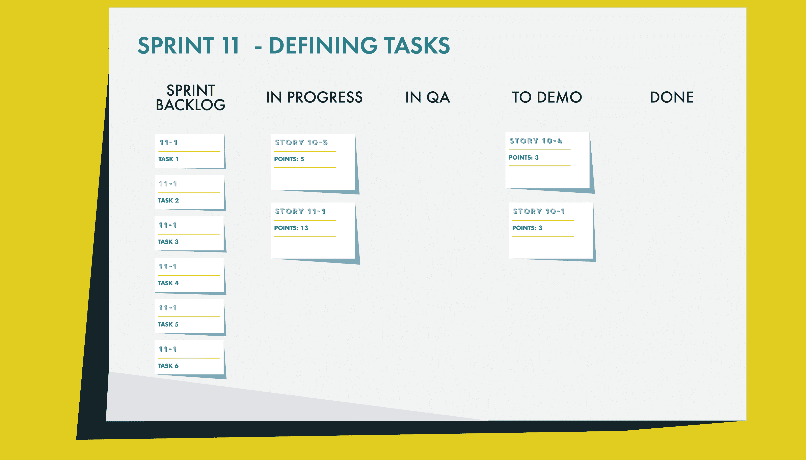

图 8.2 带有任务的第 11 迭代

承担该故事的工程师特意提醒 QA（质量保证）任务的状态。在与 QA 交流后，他们讨论了测试计划，并决定了如何评估测试的一些标准，以符合原始故事的验收标准。在这种情况下，双方同意在所有组件完成之前，QA 将参与到故事片段的测试。提前让 QA 介入可以让他们尽早开始编写测试用例。

## 跟踪进度

一旦定义了所有任务，初始小组确定了任务的优先级顺序，并决定哪些任务需要先完成，以支持其他任务的开发。他们认为自己具备完成第一个任务所需的技能，因此他们将自己分配给该任务，并开始工作开发代码，没有寻求额外的帮助。此时，他们将“幼狗故事”的首个任务移动到“进行中”列：

图 8.3 第 11 迭代的首个任务

稍后后，团队中的另一位工程师完成了一个故事，与 QA 一起检查以确保其已完成，然后就可以开始处理新故事了。工程师检查了看板，发现这个高优先级故事的几个新任务尚未开始。在与第一组小组确认任务之间不会有任何重叠后，该工程师接手了顶层故事中下一个优先级最高的任务，更新了 `Scrum`看板，并开始工作。

一旦第二个任务进入进行状态，`Scrum`看板看起来像这样：

图 8.4 第 11 迭代的第二个任务

产品所有者也在跟进，为“幼狗故事”的文案做一些工作，并向设计部门确认资产状态。现在是检查 `Scrum`看板看看情况如何的好时了。上一次正在进行中但尚未完成的故事现在被列为“准备就绪”。创建网站幼狗版本的新故事已经开始，并已被拆分为六个任务，其中两个任务已经在进行中。产品所有者心里记下在明天的站会后检查任务状态。

在一天结束之前，`Scrum Master`（敏捷教练）检查了看板上故事的状态。新任务已经添加，格式很整洁，这意味着处理“幼狗故事”的团队正确地遵循了既有规则。似乎不需要中断正在处理故事的工程师。

## 第一次站会

第二天在每日站会期间，负责“幼狗故事”的 QA 工程师参加了，并记录了所有任务的状态。产品所有者也参加了。

 (img/b806dfc7ab8e46f442d54c1e56b9394_149_1.png)

## QA 站会

有些团队将 QA 视为核心团队成员，但对于“小猫团队”来说，QA 不需要积极参与所有团队活动。是否参加站会完全取决于那些不直接在团队内的人。

QA 只有在接到可能讨论新任务或故事的提示才会参加站会。产品所有者尽可能参加所有的站会。当然，在团队中所有工程师报告完自己的状态之前，QA 和产品所有者都不会发言。即使如此，Scrum Master 也将他们的发言限制在与整个团队相关的范围内。第一个报告的是负责“幼狗故事”的初级工程师，他解释了他们如何将故事拆分为任务，以及他们如何开始处理第一个任务。

“我们非常感谢对任务拆分的任何反馈，”初级工程师说，“我认为我们涵盖了所有的验收标准，但越多的人关注这件事，我心里越踏实。”

“所以你今天剩下的时间都会在处理这个任务吗？”Scrum Master 问。

“是的，我想我们会这样。”

“有什么阻塞情况吗？”Scrum Master 问。

“我不认为有，”初级工程师回答道。

“不，我认为我们没有任何阻塞，”该故事的另一位工程师表示赞同，“我们应该继续工作了。”

“好，我不认为我们有任何阻塞，”Scrum Master 说道，继续循环，直到大家报告完。然后团队散会，工程师们回到各自的项目。

站会后，产品所有者与处理“幼狗故事”的人进行了沟通，告知他们设计工作已经开始。那些需要设计资产的任务尚未开始。根据站会的情况，它们可能不会开始。

129

深入理解 Scrum

WOW! eBook

www.wowebook.org

## 第二次站会

在迭代的第二天，产品所有者和 QA 工程师都参加了站会。当团队其他成员准备散会时，一位工程师站了出来。“关于它的工作方式有一个简单的问题。我昨晚在想，你认为可以处理吗？”

“我看到问题了，”产品所有者说，“我可以写一个符合我想法的故事。”

“我们要把它作为一个新故事添加吗？”Scrum Master 问。

“对我来说这范围蔓，”初级工程师说。

“不，我认为原始故事的验收标准已经包含了，”产品所有者说，“这些是网站上的页面，需要像处理其他页面一样处理。”

“让我们检查验收标准并确认，”Scrum Master 说道。他们一起走到电脑前，打开 Scrum 看板，查看团队估算的故事的验收标准。事实上，验收标准确实说明支持网站测试用户的头部更改需要适应网站的所有页面，而不区分帮助页面。

“好吧，这将是一个棘手任务，”初级工程师说。

“一旦有了产品所有者的更新文本，我们还需要关于如何实现的进一步细节吗？”Scrum Master 问，“或者你们中有人可以负责编写规范并将此任务添加到看板？”

“我可以来，”初级工程师说，“但这看起来确实会给故事增加比我们预期的更多的工作。”

“是的，”另一位工程师同意道，“我们对这个任务的估算点数不够。”

“好吧，我们现在无法更改点数估值了，”Scrum Master 说，“这只是另一个数据点。我们只能尽力而为。”

“这意味着你不认为你们能在迭代结束前完成这个故事吗？”产品所有者问。

“我们得看看，”初级工程师回答道。

130

Scrum：从新手到忍者

131

WOW! eBook

www.wowebook.org

他们四个人盯着该故事的验收标准看了一会儿。然后，敏捷大师问道：“好的，我们都准备好了吗？别忘了告诉故事所有者你们要添加的任务。”

他们都点头并回到了自己的工作中。几小时后，接受了该责任的工程师将新任务添加到了敏捷看板上，看板看起来如下：

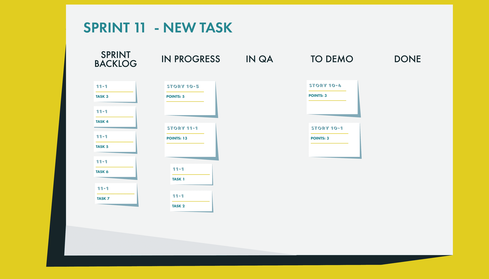

图 8.5 冲刺 11 的新任务

**冲刺的剩余部分**

在冲刺结束时，团队的大多数成员都投入到了“小狗故事”中，但没有太多其他工作完成。设计已经完成了前端用户体验的流程和图像资产，并与工程师协作确保它们被恰当地集成。

当团队编写代码时，QA（质量保证）正在开发验证这些代码所需的测试。QA 还与产品所有者会了几次面以澄清验收标准。最终，每项任务都从看板上从*进行中*（In Progress）移动到了*待演示*（To Demo）。

Scrum: Novice to Ninja

132

**WOW! eBook**

**www.wowebook.org**

 

**使用第三个工程师进行代码审查**

由于该故事中的许多任务是结对完成的，因此需要第三个工程师参与代码审查。并不是每个团队都要求结对代码由第三个工程师审查，但这个团队将其作为完成定义（definition of done）的一部分。

尽管需要支持帮助页面，团队仍然成功完成并审查了所有满意的代码。由于他们需要采用不寻常的命名规范将这些代码与网站的其他部分区分开，代码审查过程中出现了一些混乱。这放慢了开发速度，但还不至于阻碍负责该故事的初级工程师在冲刺结束之前交给 QA 进行最终检查。

该团队的完成定义包含了代码审查、QA 测试以及客户验收。由于 QA 从一开始就融入了团队，他们在整个冲刺期间一直在根据验收标准构建测试套件。

该故事的大部分任务已经产生了经过审查的代码，这些代码在完成后可以独立进行单元测试。现在，运行集成测试并验证功能从头到尾符合预期只是简单的事情。如果故事被接受并推送到生产环境，这些测试将添加到网站的通用套件中。

**演示故事**

演示的前一天，作为准备工作的一部分，产品所有者与负责小狗故事的初级工程师坐在一起。在冲刺期间他们已经过过多次各个组件，但产品所有者想要确保所有的验收标准都能得到演示。

“我们能及时在演示前在生产级就绪的服务器上正确部署它吗？”产品所有者问。

“基本可以，”工程师回答道，“那是 QA 一直测试的服务器。演示时应该没。”

133

Working Through Scrum

**WOW! eBook**

**www.wowebook.org**

“我需要知道什么特殊的吗，”产品所有者说，“或者我直接去我们现在使用的那台服务器就可以？”

“我们不需要设置任何自定义内容，”工程师回答道，“我想你已经检查过几次组件了。一旦部署完成，你应该能够加入 beta 版本，测试这些功能，然后成功退出 beta 测试。”

“我现在可以过一遍整个流程吗？”产品所有者问。

“还没，”工程师回答道，“但 QA 已经了所有测试，所以我们只需要在明天之前完成部署。它应该能及时为演示准备好。”

“太好了，我很期待看到它，”产品所有者说。

**检查验收标准**

在演示会上，所有人出席了，包括 QA 工程师和负责过小狗故事的设计师。大家对结果会如何非常好奇。敏捷看板显示，冲刺期间进行中的所有故事都已准备好演示：

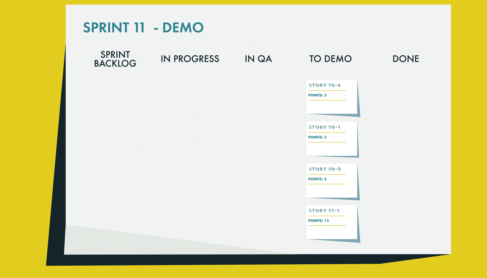

图 8.6 冲刺 11 待演示

Scrum: Novice to Ninja

134

**WOW! eBook**

**www.wowebook.org**

 

**发生了什么**

小狗故事的所有任务都已完成。为了让所有功能到位，团队在视觉布局上做了一些权宜之举。并不是所有的界面选项都在设计稿中指定了，某些功能超出了现有样式指南的范围。设计师现在记录了笔记，并向产品所有者确认他们将在演示后讨论这些问题。

尽管视觉上尚欠精炼，但所有的框都勾选了。从 Scrum 流程来说，团队可以认为故事已完成，即使它尚未准备好发布。因此，敏捷大师在敏捷看板上更新了故事并将其状态设置为已完成。这更新了积分计数，将该故事的所有积分加入该冲刺的总数中。

135

Working Through Scrum

**WOW! eBook**

**www.wowebook.org**

“这似乎是将信息放在人们可能预期的地方的最佳方式，”工程师说，“如果我们有时间完全重构，我们可以直接将其整合到帮助主题中，但确实没有时间做了。”

“这看起来不太理想，但我理解你的考虑，”产品所有者说。

“我想我们可以出一些优雅的方法来实现，”设计师在房间后部说道，“我可以画一些草图。”

“那样很好，”产品所有者说。

“但它确实符合验收标准，对吧？”敏捷大师确认道。

“是的，”产品所有者同意，“所以如果我们对视觉设计进行更新，那是下一个冲刺的一个新故事，对吧？”

“听起来是这样，”敏捷大师说。

在冲刺 11 结束时，团队完成了冲刺待办列表中所有的 24 个积分，敏捷看板看起来如下：

Scrum: Novice to Ninja

136

**WOW! eBook**

**www.wowebook.org**

图 8.7 冲刺 11 结束

**冲刺回顾**

在演示完成且冲刺结束后，团队会与 Scrum Master（敏捷 Master）坐在一起进行冲刺回顾。目的是让大家讨论他们认为在上一次冲刺中哪些地方做得很好，哪些地方可以做得更好，以及他们认为未来应该对流程做出哪些改进。

“我觉得非常顺利的一点是有机会从头到尾跟进那个大故事（big story），”负责那个小狗故事的初级工程师说道，“这给了我一个极好的机会去从上到下观察我们的架构是如何工作的。”

“你做得非常棒，”与该故事结对编程的工程师说，“我也学到了一些关于我们架构的未知知识。里面确实有一些非常乱的地方。”

“是的，”另一位工程师说，“这也是我认为做得不太好的事情之一。我真的认为，在尝试构建所有内容之前，我们应该有机会进行重构。”

“我同意，”第二位工程师说，“但至少我们现在知道混乱发生在哪里了，所以我们知道该优先关注哪里。”

“如果我能直接跳进去并先修复那些东西，会简单得多，”第三位工程师说，“我已经知道大部分问题在哪了，但我们反其道而之的做法仍然让我很困扰。”

“至少现在你不是唯一知道这件事的人了，”第二位工程师指出。

“是的，但听起来我们在这次冲刺中似乎也没有机会进行重构了，”第三位工程师脸色严重地说。

“我听起来也是这样，”第四位工程师插话道，“他们会坚持投入这些故事中，以先完成 Beta 版的设计更改。”

“我们可能还需要一些设计故事来修复 Beta 版的视觉效果，”Scrum Master 说，“但产品负责人（Product Owner）确实同意，如果我们完成了故事，他会把重构作为首要任务给我们时间，而我们确实完成了。我会在计划会议之前跟进这件事以确保这一点。”

“嗯，有一点，”第三位工程师说，“我想细致地检查那些新设计，确保在对它们进行估算之前真的是最终方案。”

“我们应该把这作为下一次冲刺的另一个目标吗？”Scrum Master 问道。房间里的工程师们点头。在回顾结束时，他们列了一份想要改进流程的短清单，以及几项 Scrum Master 需要与产品负责人跟进的任务。

每个人都能同意的两点是：跨整个栈的工作虽然令人沮丧，但对于暴露代码中需要修复的问题非常有帮助；而且，下一次冲刺的优先级应该是解决这些问题。无论如何，进入下一次冲刺的计划会议将是一次有趣的会议。

**总结**

我们从 Scrum 中中学到的知识之一是，它无法给你一个你理想中的团队，但它可以帮助你优化现有的资源，并支持他们有效地协作工作。在本章中，我们介绍了一个面临某些挑战的团队如何处理一个超出其资源范围的新故事。

- 我们看到团队如何组织工作，并将一个大故事拆分为多个工程任务，以便进行并行开发。

- 我们目睹了团队在验收标准上遇到问题，并从产品负责人那里获得了关于如何在冲刺期间解决这些问题的反馈。

- 我们看到了在演示期间出现的折中方案案，以及这些妥协如何导致了对即将到来的冲刺的预期调整。

- 然后，我们听了团队在回顾中讨论他们的顾虑，讨论哪些做得好，哪些可以做得更好，以及他们希望在下一次冲刺中看到什么。

这一切中隐含着 Scrum 背后的协作透明化和自我管理哲学。在下一章中，我们将讨论如何让 Scrum 为你的团队服务。我们将讨论如何向组织引入 Scrum 概念，支持 Scrum 需要的资源，以及如何处理在学习应用 Scrum 时可能出现的反模式（anti-patterns）。

## 第 9 章

## 让 Scrum 为你的 Web 或移动端团队服务

在本书的大部分内容里，我们都在讨论 Scrum 的实操性。尽管 Scrum 的核心定义非常通用——支持广泛的应用场景——但我们对可以在 Web 和移动端团队中应用的 Scrum 机制进行了相当有主见且详细的解释。（尽管如此，这些许多原则和实践同样适用于其他类型的开发工作。）

现在我们有了一些共同的术语和概念，在本章中，我们将讨论如何让团队开始使用 Scrum。我们将更详细地讨论在 Web 和移动端开发中使用 Scrum 的理由。我们将讨论 Scrum 最适合什么，它与替代方案相比如何，并对在公司推广 Scrum 和应用它时出现的问题提供答案。

## 迈向 Scrum 的步骤

我们学习了一些关于 Scrum 的知识，以及 Scrum 如何帮助你的 Web 和移动端开发项目。下一个问题是如何让你的团队从零转变为 Scrum。这对于每个团队来说都是不同的，你需要评估自己的状况，以确定组织对采用敏捷方法的准备程度究竟如何。

### 认可（Buy-in）

如果你的组织目前遵循类似于瀑布型的流程，周期中每个阶段的人可能对他们担任的角色感到舒适，并且不会急于尝试新事物。你可能需要向他们展示，通过基于 Scrum 的流程，组织的效率和生产力可以高得多。

高管可能担心他们对自我组织的团队控制力会减少，对一个产生自己想法的流程投入会减少。要告诉他们，敏捷流程让他们拥有在每个冲刺中切换和调整优先级的机会，从而更有效地适应市场，同时提供他们可以用来指导决策的宝贵反馈。

工程经理可能对自己在自我管理团队中扮演的角色感到困惑，但这种担心源于对“团队自我管理”这一概念的语义上的误解。经理对于帮助团队分配资源、解决个人问题以及识别和留住人才仍然至关重要。经理还将他们自己的背景和知识带到整个开发过程中。工程经理可以自由投入部分时间作为团队中的一名工程师从事一线工作，但他们的主要责任是确保团队在组织中的地位，确保他们拥有所需的工具和资源，并保护他们免受干扰，以便他们继续他们的 Scrum 流程。

设计师可能好奇他们将如何融入 Scrum 流程，因为他们的工作并不一定遵循团队其他部分完全相同的周期。向他们展示，Scrum 为设计师提供了更多机会，在做出决定之前产生更大的影响，因为设计师可以参与开发的每一个阶段，从规划阶段一直参与到发布。

工程师可能对他们角色的变化感到担心，特别是如果他们习惯了非常擅长做某件事。敏捷给每个人都带来了更大的责任。

让工程师在团队中发挥更广泛的作用，同时也为学习和增长开启了新的机会。通过承诺冲刺（sprint）为工程师提供的稳定性，以及对他们已同意的需求在冲刺结束前不会发生改变的信心，在一个在扰和和混乱一直是问题的组织中，可能是一个强有力的卖点。

采用敏捷开发并非一场单向的对话。Scrum 的倡导者应该倾听，并从那些在此过程中被要求改变方法的人的顾虑中学习。对于每个人来说，都要记住 Scrum 始终直是一场实验，其持续时间仅为下一个冲刺的长度，并在那时有机会重新审视并更改任何看起来不起作用的地方。有时，Scrum 的实验性质是让人们尝试它的最有说服力的论据之一。

## 培训

尽管 Scrum 并不十分复杂，可以在一书中描述得非常详尽，但让理解敏捷的组织外部人员对团队进行培训是无价的。

一位客观的第三方培训师可以进入组织，并以组织内部人员可能无法的方式发现问题。优秀的培训师还能指导人们处理流程中一些更微妙或复杂的方面，确保他们不仅理解自己在做什么，还理解为什么要这么做。

Scrum 培训对整个团队可能需要一到两天，最好在场外进行，在一个中立的地方，这样人们就不会被正在进行的日常工作分干扰。不要试图通过比他们需要的更少的培训来亏待你的组织。很容易将 Scrum 的标签贴在任何一个完全不敏捷的流程上。

## 不要将 Scrum 仅仅视为描述现有流程的新方法

将 Scrum 视为对现有流程的新表述方式是错误的。Scrum 不仅仅是一组花哨的词汇。有些团队在没有经过适当培训的情况下开始使用 Scrum 工具，结果仍然遵循了过去对他们无效的、破旧的流程，只是应用了诸如“冲刺”或“故事”之类的标签，或者进行长达一小时的每日“站立”会议。不要让你的团队成为其中之一。

让每个人的积极且专注的参与对于 Scrum 培训生根至关重要。任何没有经过适当培训的人可能无法理解 Scrum 应该如何应用，这可能会导致挫败感和困惑，而这些通过一些准备就可以避免。

邀请参加培训的人员名单应该包括高级管理人员的代表，以及组织中所有每天参与仪式的人。你不需要让公司所有人都接受培训，但任何角色涉及与 Scrum 团队直接交互的人都是可能的人选人。

## 人员配备

为了在你的组织中实施 Scrum，可能不需要招聘新员工。敏捷团队中的大多数角色都可以由组织架构中现有的人员担任。

产品经理可能是 Scrum 团队产品所有（product owner）角色的理想候选人。工程师——无论是初级、高级还是管理层——为了 Scrum，在开发团队中都应该被视为平等的，尽管他们在组织中的级别存在差异。通常 QA 工程师也被包含在 Scrum 中，这在冗余、交叉培训和组织覆盖方面提供了许多好处。

项目经理可能是组织中担任 Scrum 主师（scrum master）角的最佳人，但需要一些管理项目与运行 Scrum 所需技能集之间差异的培训。在紧急情况下，开发团队的任何成员都可以接受培训担任 Scrum 主师。然而，在实施 Scrum 时，一位优秀的 Scrum 主师可能是最好的新聘员工。一个了解 Scrum 如何运作并熟悉可能出现的问题的人，比一个刚刚熟悉流程的人更容易平滑地处理棱角。对于 Scrum 主师来说，熟悉你正在做的工作类型并不如拥有一个擅长指导人们通过 Scrum 流程的人重要。

## 跟踪有效性

Scrum 的核心在于建立一个产生真实价值的可持续流程，并定期回顾该流程以确保它产生了预期的结果。那么，为什么不使用敏捷技术来确保 Scrum 为你的公司服务服务呢？

在新组织中实施 Scrum 最有效的技术之一是在实施 Scrum 之前建立生产力基准，并以此来衡量 Scrum 的有效性。在何处建立该基准以及如何衡量它是非常主观的。每个组织都有自己的标准和生产力指标。

例如，Web 团队根据能够添加的功能数量来衡量自己。移动开发团队可能会跟踪从概念到实现的速度。在实施 Scrum 之前，你将有一个用于比较性能的依据。如果团队在回顾中提到时间盒（`time box`）太短，可以通过共识在下一个冲刺中进行延长。

## 故障排除

如果一切都按照你预期的那样运行就太好了。这在现实世界中不会发生。Scrum 有内置的检查和平衡机制，确保团队始终对不断变化的条件做出反应。Scrum 的崩溃往往遵循跨组织的熟悉模式。让我们看看 Scrum 的几个方面，看看问题可能出现在哪里，以及如何解决它们。

## 未定义的时间盒

当团队开始使用 Scrum 时，他们可能不理解为仪式分配多少时间。定义一个必须在内完成仪式的时间盒有助于集中大家的注意力，并体现对团队时间的尊重。对于不确定为仪式分配多少时间的新团队来说，倾向于让仪式各个方面保持未定义。

在团队开始阶段，为仪式的每个方面明确定义时间盒是尤为重要的。有时这些时间盒可能只是猜测，团队需要通过每个冲刺的迭代来学习他们需要多少时间。提议一个完全错误的时间盒并尝试执行它，比让时间盒松散要好。提议和执行时间盒的练习展示了对团队时间的尊重，以及对流程的尊重。

有些专家主张，当团队持续超过时间盒时，将时间盒的长度缩短到可能的最小值，然后与团队紧密合作，帮助他们在分配的时间内完成每个仪式的各个阶段。这有助于确立定义和尊重仪式每个方面时间盒的重要性。而且如果团队在回顾中提到时间盒太短，可以通过共识在下一个冲刺中进行延长。

## 优化冲刺

在许多计划仪式结束时，会达到一个时刻，团队正在对冲待办列表达成协议。在这个阶段，产品所有者应该已经对已估计的故事进行了优先级排序，并考虑在冲刺结束时什么对产品是一个合理的增量。随着已估计的故事移动到冲刺待办列表，团队讨论他们认为在该冲刺中可以完成多少工作。通常，添加到冲刺待办列表的最后一个故事不足以让团队达到基于历史表现的预测速度。到那时，团队可能会尝试与产品所有者就剩余故事的顺序进行谈判。

为了获得一个添加到冲刺待办列表（`sprint backlog`）中最佳点数的故事，以便他们的承诺量与预期的速率（`velocity`）完全匹配。

这种不明智的做法是针对冲刺进行优化，它表现了对 Scrum 核心意义的基本误解。故事的优先级排序以及按顺序处理这些故事的目的是为了给产品增加价值，而不是为了推动围绕优化 Scrum 流程的议程。归根结底，工作本身更重要，而不是在一个冲刺中完成的点数数量。

最好让冲刺待办列表留短一点，并与团队达成共识：一旦完成了在本次冲刺中承诺的所有故事，他们就可以开始处理下一个优先级最高的故事。在完成冲刺待办列表承诺后，团队开始处理任何规模的下一个高优先级故事是完全没有问题的，即使他们不预计在同一个冲刺内完成它。

最终，团队的点数速率是跨多个冲刺进行估算的，并且一切都会达到平均值。

## 冗长拖沓的站会

每日站会（`daily standup`）的目的是为了团队本身捕捉团队的心跳。为了尊重每个人的时间，这些仪式保持简短。团队倾向于犯的首要错误之一就是将每日站会当作团队会议。这可以通过许多方式表现出来，包括让团队在站会时坐着、在站会开始时安排公告，以及不限制站会期间的交叉交谈（`cross-talk`）。

所有人被要求在仪式期间站立，这样就不会有人会倾向于让仪式超过其时间盒。任何人手中都不应该有设备或其他分心物品，没有人应该在笔记本电脑上工作，或者讨论当前讨论的故事之外的任何事情。

如果你开始允许团队之外的人在站会开始或结束时加入公告，就会产生滑坡效应。公告往往会引发更多讨论，这可能迅速导致站会持续超过 15 分钟。

站会期间一次应只能有一个发言，这个人应该是正在讨论进展的工程师，他负责说明自上一次站会以来做了什么、在下一次站会前要做什么，以及是否存在任何阻碍因素（`blockers`）。会产生需要进一步讨论的问题，但这些讨论需要在站会结束后在线下进行跟进。团队中的每一个人都应该感到被赋能去支持 Scrum Master（`scrum master`）中断其他对话并保持站会的聚焦。

## 工作干扰

Scrum 的前提之一是工程师将有机会为整个冲刺期间进行提前计划，而不必担心他们的工作会被分心和侧边项目干扰。团队承诺一个冲刺待办列表，每个人都有责任维护该待办列表的完整性，不让额外工作渗入（`creep`）。

现实情况——特别是对于 Web 和移动端开发团队——总会有状况发生。服务器宕机。功能崩溃。时间紧的公告发生。用户对新功能感到困惑，需要对其进行调整。需要解决在冲刺开始时未预测到的紧急问题。

在传统的 Scrum 中，对冲刺待办列表已承诺故事的任何更改都要求团队停止冲刺，通过新的计划仪式，并建立新的冲刺待办列表。这被认为是一项严厉的措施，其设立目的是防止任何人违反冲刺的完整性。

由于 Web 和移动端工作的动态性质，Web 和移动端开发团队需要在流程中加入某种程度的灵活性。如果每当表单需要修复或新闻稿需要编辑时团队都必须启动一个新冲刺，将是非常不实际的。但必须保持一种平衡。如果每当高管或客户对新功能产生绝佳想法时，团队的一部分就必须放下一切开始工作一个新的紧急功能，那也将同样地低效。

Web 和移动端工作的性质决定了团队需要足够灵活以应对紧急情况，但他们也需要对什么是紧急情况保持严格。这是 Scrum Master、产品负责人（`product owner`）和团队应该作为团队 Scrum 合同一部分明确定义的内容。

任何拉入冲刺的新工作都预计会降低团队的速率。这些额外工作不应该被估算，因为它们不是团队冲刺待办列表承诺的一部分。如果团队开始允许新故事经常渗入冲刺，这将使他们偏离待办列表的承诺，并反映在他们的速率中。

花时间处理紧急问题是至关重要的，前提是这种“紧急性”是团队每一个人都需要达成共识的概念。如果冲刺的完整性看起来太频繁或太随意地破坏，这是团队应该在回顾会议（`retrospectives`）期间讨论的内容。

## 松散的演示

每个团队都需要制定清晰的“完成定义”（`definition of done`）。该定义的一部分应该始终包含满足所写故事的所有验收标准（`acceptance criteria`）。这将在演示（`demo`）期间进行测试。在演示中接受故事的方式保持一致性非常重要，不要让标准变得过于灵活。

一个常见的问题是，团队在验收标准未完全满足时就接受了故事。有时，故事被接受进一个冲刺，但对它们的工作一直持续到下一个冲刺的开始，因为它们“几乎做完了”。这混淆了一个冲刺的结束和下一个冲刺的开始，使得更清楚地说明在一个冲刺中做了什么、下一个冲刺中需要做什么，以及团队的真实速率，变得更加困难。

团队在参加演示时做好准备，以演示他们在冲刺中完成的所有工作，也是至关重要的。团队经常发现自己坐在一旁等待开发者完成代码部署，或为演示调整阶段环境（`staging environment`）。虽然预计有时会有紧急情况阻碍是合理的，但负责该故事的开发者有责任确保它准备好进行演示，并让产品负责人知道如何引导演示。

有些团队对此采取了非常严格的方法，不接受任何未完全履行所有验收标准且在演示开始时准备好演示的故事。虽然这看起来可能很刻薄，但要记忆点是，把事情引入冲刺并不如完成工作重要。

## 回顾会议期间的问题解决

如果没有回顾会议，Scrum 就没有机会从错误中学习，或从其过度中获益。回顾会议还起着强大的团队建设功能，因为它们允许团队成员有机会与同事分享他们的想法。虽然团队对回顾会议最常见的问题是完全不举行，排在其次的是尝试解决在回顾会议期间出现的问题。

回顾会议是团队中的每一个人提出他们认为在上一个冲刺中做得好或不好的机会，并讨论未来如何处理这些问题。这涉及到可能敏感的话题，并可能让许多情绪浮现。

回顾会议不是解决问题的合适的几个理由：

- 有些问题可能涉及房间内的许多人，可能在经过考虑后大家才能达成解决方案。

- 并不是每个人都愿意在回顾会议上公开讨论某些敏感问题，这些问题可能在较小的会议中处理得更好。

- 话量大或意见更强的人很容易主导小组讨论，抵消了在非开放形式下更容易识别的意见。

- 此外，尝试解决不影响小组所有人的问题是浪费某些人的时间。

Scrum Master 需要提醒大家，回顾会议不是解决问题的场合，而是承认这些问题的存在，然后承诺在接下来的冲刺中解决它们。

允许围绕某个问题进行一段时间讨论是合理的，这样人们就有机会充分理解问题的各个方面，并承诺在冲刺（`sprint`）期间找到一个合理的解决方案。但如果这些讨论过度深入到如何解决问题的细节，那么为了尊重每个人的时间，可能是时候尽早结束讨论了。

## 总结

在本章中，我们回顾了公司在开始实施敏捷开发（`scrum`）时可能采取的一些步骤。

我们讨论了如何在整个组织中获得共识，包括工程内部和外部。我们讨论了如何对团队进行培训，以及培训师应该对团队做什么。我们谈论了人员配置问题，以及组织中的现有人员如何适应并承担财务流程的角色。我们还讨论了跟踪和衡量 scrum 有效性的重要。我们还深入研究了团队在适应 scrum 过程中出现的一些问题，以及如何应对这些问题。

151

让 scrum 为你的 Web 或移动端团队运转起来

## 第 10 章

## 适应 scrum

我们已经讨论了让 scrum 运行的系统。我们讨论了 scrum 在产品开发方面采用的方法，以及帮助担任 scrum 角色的人员以可持续、高效有效的方式完成工作的一些仪式和产物。

但归根结底，*scrum 关乎人*。如果你团队中的成员没有从工作中获得灵感和动力，scrum 无法介入并改变这一点。scrum 能做的是帮助擅长工作的人以更高效、更有效的方式合作，并不断改进。

在第 2 章中，我们认识了团队的每一个人，并有机会讨论了他们对 scrum 的一些担忧。现在，他们已经在 scrum 环境中工作了一段时间，让我们再次来看看，看看他们是否已经学到了足够的知识来帮助他们解决那些担忧，以及他们是如何适应 scrum 流程的。

## 高级工程师

### 最初担忧

我进入 scrum 时很担心“流行术语管理”。我见过太多公司在口中抛出“敏捷”之类的词汇，却并没有真正理解它们的含义。有些人把敏捷当作增加会议次数的借口。也许会议让他们觉得更舒服一些。但这对我这样的人行不通，因为我承担的某些责任需要几个小时甚至几天不间断的时间才能做对。我不希望经理们在我身边转转转，把我拉进很多会议并转移我的注意力，分散我完成工作时所需的思考精力。

### 我学到的东西

scrum 的理念是好的。重要的是付诸。我们现在花在与敏捷无关的会议上的时间大大减少了，这是一种巨大的解脱。当有人需要与我交谈时，我可以准确地指出我正在工作的内容，并解释我是否太忙以及为什么。如果有人突然提出了他们认为紧急的变更，我周围有一整支团队愿意维护冲刺的神圣性，这样我们就不必在处理这个新问题的同时调整我们正在工作的内容。

同时，人们很容易看到谁在做什么，所以所有问题最终不会都都汇聚到我这里。现在团队中有更多的人在那些我曾经 100% 负责的代码部分上获得经验。这让我空出时间来做一些长远思考，并将我的知识应用到审查那些仍在学习我多年来总结的教训的人员的工作。

### 仍然令我沮丧的事情

当你不确定下一步将走向什么方向时，规划和架构一个项目可能是困难的。例如，移动开发的某些方面需要比单个冲刺更长的时间。有时我们必须分层开发，始终考虑每个冲刺中哪些内容可以被视为一个完整的功能切片。

scrum：从新手到大师

154

从技术上来说，创建一个足够灵活以适应每个冲刺可能发生的剧烈方向变化的架构是一项挑战。但当我看到用户故事（`stories`）明显不符合冲刺范围且需要拆分时，我正习惯向产品负责人（`product owner`）提出反对。这迫使我以更模块化的方式思考，并最终产生更灵活的代码库。

现在我已经学会了 scrum 是如何运作的，最令我沮丧的事情之一是看到这种做法被滥用。当产品负责人试图在冲刺中途引入新的用户故事时，我会迅速提出挑战。这确实会发生，而且有时它有良好的业务理由。

### 我做的

我最喜欢 scrum 的点之一是，让团队中的每个人的意见都一致非常有帮助。我正在习惯于这样一个事实：我不被允许直接说出我心里想的话。由于有了回顾会议（`retrospectives`），我有机会提出问题并确保这些问题的正当理由。

## 初级工程师

### 最初担忧

我的角色对我来说仍然很新，我从来不是很外向的人，所以这很令人令畏。我特别担心比我经验丰富的人配对（`pairing`），并因为愚蠢的错误而感到尴尬。我也不喜欢频繁发言的主意。

适应 scrum

155

### 我学到的东西

花了一段时间我才适应团队中的每个人都是平等的这一观点。起初，我不喜欢在会议上说话。但 scrum 仪式鼓励每个人参与，没有人可以在不说话的情况下脱身。一旦我意识到每个人犯错的概率和我一样，我就感到说出我心里想的想法更自在了。

我也非常喜欢从与其他工程师紧密合作中学习到的东西。我接触到了一些如果我不在岗位上工作很长时间可能无法发现的工作方法。我们合作得越频繁，我就越容易从代码的某部分提取概念并将其应用其他地方。

现在，当我面对一个不知道如何处理的用户故事时，我不再那么畏惧了。冲刺计划会议期间的讨论给了我机会去听听经验丰富的工程师认为任何故事的障碍是什么，这样我就知道该预料什么。而且我知道团队中有人拥有我需要的知识。与他们更紧密地合作让我有机会学习如何跳出我熟悉的教科书案例进行思考。

### 仍然令我沮丧的事情

当我必须承担待办列表（`backlog`）顶端超出我经验范围的故事时，我仍然感到害怕。当我看到一个我想做的故事不在待办列表顶端，但我知道由于我熟悉它，我可以做得更好时，这尤其令我沮丧。有时我会动歪筋，想推迟某个故事的工作，以便在我真正想要的故事出现时能够处于获取它的位置。但我知道我不应该这样做，而且 scrum 导师（`scrum master`）已经指出过几次这种行为了。

在仪式性会议中这么多这么多感觉还是很奇怪。我觉得敏敏捷大师（`scrum master`）可能对我感到有点小沮丧，因为我总是需要被劝导才开口。当我的想法与我的经理——或者其中一位高级工程师的想法不一致时，那种感觉尤其令人害怕。

### 我如何应对

我正在学习变得更加开放，并更多地说出我的想法。而且我知道我必须说些什么，这让我保持更高的警觉，尤其是当讨论的内容涉及我不熟悉的领域时。它迫使我去学习背景之外的知识。此外，与其他经验丰富的工程师配对开发也有帮助。这让我能够参与到我感兴趣的故事中，但我自己可能还没有足够的技能独立完成它们。

通过观察计划会议和演示（`demos`）期间发生的情况，我看到大家的想法有时会被证明是错误的。例如，在第一次投票时，大家对给一个故事（`story`）分配的分数达成一致是非常罕见的。当你是点数投票中的离群者时，必须为自己的立场辩护是非常棒的练习，它能开启讨论。人们很容易觉得只有自己不理解。但每个人都有自己不理解的事情。当你积极参与讨论时，新的想法就会涌现，这是一件好事。

## 工程师经理

### 初步顾虑

在管理团队几年后，我对所谓的“自我管理团队”这一想法持非常怀疑态度。我见过当人们在没有充分监督的情况下尝试合作时可能出现的各种问题，自我意识往往会阻碍生产力。我曾被叫去处理人事问题，这不仅仅是一个抽象的流程就能解决的。诚实地说，这听起来就像敏捷开发（`scrum`）试图用一堆术语和固定程序来取代管理。

我还担心如何向高层解释，我们只能粗略估计项目何时能完成，甚至无法确定产出什么。当你有固定的截止日期并能指向具体的实物结果时，为工程团队证明预算已经足够困难了。在我听来，敏捷开发似乎要夺走这种依据，只给我留下一堆空洞的承诺。

### 我学到的东西

有趣的事情是，自我管理团队并没有按照我预想的那样进行自我管理。我仍然是团队的经理，他们在人事问题、资源分配和通用领导力方面依赖我。公司的其他部分也由我对团队的工作负责，并确保我们的工作与公司的需求相协调。

敏捷开发关注的是团队在尝试完成工作时遵循的流程。敏捷开发并没有取代管理，而是介入并提供了一种每个人都可以遵循的模式，以提高他们估计故事的能力，并确保每个人都以透明且高效的方式工作。我特别喜欢敏捷开发在产品组和工程组之间建立协调点的方式。这减轻了我肩上的一些责任，让我能够专注于管理团队的工作。

诚实地说，我喜欢敏捷开发给了我再次作为开发者为团队做一些工作的机会。这是我作为经理时怀念的，我很高兴能重回归。

### 仍然令我感到沮丧的事

敏捷开发在工程团队内部是非常棒的，但如果公司里的每个人都能认同它，效果会好得多。我有时发现自己处于两难地，试图向高层或销售团队的人员解释敏捷开发的概念，他们只想知道某个特定功能是否能在特定日期交付。我的意思是，我理解他们为什么需要这些，但每次都要解释权衡（`trade-offs`）真的很令人沮丧。

### 我如何应对

我认为我们在让大多数人接受并支持敏捷开发方面做得不错，认可了能够快速响应变化的迭代过程的价值。我喜欢向人们解释，敏捷开发允许工程团队快速估计新想法，并调整开发轨迹以适应市场变化。

另一种选择是制定一个长期计划并与其承诺，但却不确定这是否是市场想要的。在这些事情上总会有妥协，而这正是人际技巧必要的时刻。大多数执行官更愿意拥有快速改变方向的能力，因为他们意识到在网页和移动开发中，变化非常快——无论团队遵循什么流程，安排在太久远的功能通常永远不会实现。

## 一位 QA 工程师

### 初步顾虑

起初我并不太担心敏捷开发，但话又回来，我不认为它跟我有什么太大关系。我最大的顾虑是弄清楚我如何融入新流程中。我的工作一直定义得很清楚，我不想打破现状。归根结底，我所做的很重要，我最担心的是适应敏捷流程意味着将减少我知产品所需要的那种严谨测试。

### 我学到的东西

参与敏捷开发的仪式很有趣。起初我没什么可说的，但参加计划会议让我预见了未来我需要处理的内容。它还给了我机会提前提出一些重要问题。事实证明，这些问题帮助团队的其他成员就他们如何规划工作做出了决定。这是一个额外的收获。

自从我整合到流程中后，我可以在故事开发期间就开始编写该故事的测试用例，而不是等完成后。这意味着开发者不需要等那么久就能获得我的测试结果，并且可以在记忆还新鲜时对代码进行修复。

我也非常喜欢故事的结构方式。验收标准（`acceptance criteria`）明确了我在测试期间应该关注哪些方面，以及哪些方面只是误导性的干扰项（`red herrings`）。好几次，在团队甚至开始处理某个故事之前，我就根据我能预见的异常情况挑战并修改了验收标准。

### 仍然令我感到沮丧的事

敏捷开发的节奏仍然将我的大部分工作留在了故事完成后的末尾。这意味着通常会担心为了满足敏捷的预期而无法在演示前完成测试。我认为大家都能理解，敏捷测试的截止日期对我们的整体生产力并不重要，敏捷开发更多是关于高效协作。但我知道，当团队能在结束前完成承诺的故事，他们感觉更好。我不喜欢成为那个让团队错过截止日期的人。但这很大程度上取决于我的工作类型，而不是敏捷开发。

## 我如何应对

有时我必须成为那个提醒人们的人：如果我们没能在演示前完成某个故事，并不是真正的问题。比起为了敏捷点数而匆忙赶工，把工作做好要好得多。事实上，为了演示而赶进度完成工作，并为此加班，会人为地夸胀团队的速度。这可能显示了我们在推向自己时能完成什么，但并不是持续的。在冲刺中失败并提高估算能力，比为了一个随机的日期强行完成要好。这是我们受到的教育，尽管在准备演示的兴奋中有时很难记住。

## 一位产品经理

### 初步顾虑

我习惯的产品管理模式涉及制定长期计划，并落实细节以确保这些计划是现实的。当我们开始讨论敏捷开发时，我觉得我大部分受过的训练可能将被抛弃。敏捷开发似乎对长期规划的价值不予重视。我们的组织负责确保我们的产品在未来几年内保持活力，而不仅仅是未来两周。我们必须能够跟上变化。竞争对手，并以可预测的方式满足客户的期望。这并不总是能以两周为增量来进行。我不确定`scrum`应该如何解决这一问题。

### 我学到的东西

产品待办列表（`product backlog`）与冲刺待办列表（`sprint backlog`）之间的区别为我澄清了许多问题。我仍然进行长期规划，但我是在产品待办列表中进行，在那里我可以培养那些具有长期潜力的想法。实际上，不把所有想法都列得非常详细更好。这为我节省了提前工作，因为我们并不总能实现每一个出现的想法。但一旦我们确定要开发某些东西，我就可以将其置于产品待办列表的顶部，并转化为特性故事（`feature stories`），以便我们带入下一次冲刺。

起初，以故事的形式编写规格说明是比较棘手的。我不习惯以完整功能切片的方式来思考。但如果我能跳出工程师的思维模式，专注于我们试图交付的收益，效果会更好。在为冲刺编写故事时，使用我们约定的结构，我能够提供足够的细节，以确保我关心的预期得到满足。通过在冲刺演示（`sprint demo`）中扮演客户的角色，我成为了那个决定故事工作结果是否可以接受的人。

### 仍然令我困扰的

也许对我来说，最困难的事情是接受这样一个事实：点数（`points`）是相对的，与完成一个故事所需的时间无关。当我的管理层问我团队在做什么，以及我们计划在未来的特性状态如何时，他们希望我给出具体的日期。

`scrum`的迭代过程产生的数据让我们能够根据市场情况修改计划，但我仍然觉得缺乏一些控制权。事实是，我们仍然有截止日期，而且仍然必须满足它们。我们必须与假期以及其他外部事件保持同步。只是现在我们必须交付任何已完成的内容。

我的管理层习惯于在几个月甚至几个季度之前规定特性和时间表。我发现自己在一遍又一遍地解释`scrum`的迭代过程。如果不相信它，如果没有看到它是运行得多么良好，那事情会困难得多。

### 我是如何处理的

底线是产品质量。现在我们已经经历了几次冲刺，我看到产品待办列表中的想法由于`scrum`迭代过程产生的数据而发生了变化，我有例子可以证明这种方法的价值。我正试图建立更多这样的例子，以支持未来继续推行`scrum`的论。

与外部截止日期协调的能力将随着时间的推移而变得更好，我看到了。我们做得越多，团队在估算生产特定新特性所需时间方面就越熟练。这是我们的大胜利。当我们能够更有效地估算时，我们就能更好地将计划的特性交付日期与日历上的日期协调起来。与以前不同，这些日期将是团队能力的真实反映，而不是基于盲目的希望和蛮力工作。

## 一位设计师

### 最初的担忧

当我听到我们将尝试`scrum`时，我最大的担心是我们在同意的两周一次的冲刺计划。我的工作并不总是能适应两周的周期，而且通常必须在其他人开始之前完成。我不想成为导致团队敏捷性降低的原因，我非常担心是否有足够的时间完成必要的工作，以提供深思熟虑的设计。

同时，我想确保自己能抽空为团队生产最后一刻资产。我知道总有对最后时刻资产和快速决策的需求。将这与`scrum`相关的快速周转时间平衡起来，听起来非常令人令畏。

### 我学到的东西

起初我以为我必须成为`scrum`团队的一员。根据我们的结构，我的工作位于团队之外，我作为他们的资源提供支持。我与`scrum master`合作，确保总有一组设计任务在等待我处理。得益于看板（`kanban`）方法，我可以对同时处理的项目数量设定合理的限制。

产品所有者（`product owner`）可能会在队列中的项目的任何一点切换优先级，因此我无法预测下一个要做的工作是什么，这让我专注于手头的工作。有时，我需要做的某件事是长期设计计划，有时是生成资产或评审实现。某天有机会进行一些跳出常规的思考，与产品所有者分享我的想法，第二天在我的队列中看到实现，这种感觉太棒了。在我们切换到这种方法之前，这种情况几乎从未发生过。

我喜欢参加所有的站会（`standups`），以便掌握最新动态，但我通常是以观察者的身份参加，而不是团队成员身份。有时，我会在站会后与团队跟进，以确保工作按照计划进行。当需要我出现时，我有机会卷起袖子与工程师并肩作战解决问题。

### 仍然令我困扰的

在不确定下一步要做工作工作的情况下切换模式可能也会感到有些不安。我需要在这方面保持灵活，以便我有足够的时间进行设计范围规划。

### 我是如何处理的

公平地说，我对缺乏长期规划的抱怨并不比我们开始`scrum`之前的问题更严重。至少在`scrum`中，每次进行回顾（`retrospective`）时，我都有机会抱怨它。我喜欢这种让问题保持在关注中的。

## 一位高管

工程经理告诉我，团队中的个人冲突减少了，因为每个人都有机会在每个迭代（`sprint`）中提出问题并解决它们。

能够查看`Scrum`看板（`scrum board`）并立即知道正在进行什么工作、谁在做工作以及进度如何，这真的非常棒。以前，工程部门像一个黑盒，如果不经过冗长的解释，我无法获得清晰的状况。我理解，没有人希望高管在身后盯着，并在他们努力工作时问个不停。但现在，我只需要通过查看看板并向`Scrum Master`（`scrum master`）提几个问题，就能获得我所需的所有信息。

### 仍然令我困扰的

从整体来看，我正在习惯`Scrum`不会增加额外开销这一观点，但这仍然是我需要调整的。我们以前没有专门的项目经理，而现在`Scrum Master`充了这一角色。我看出，如果没有人来运行流程，事情将无法以同样的方式完成，我们所取得的成就令我印象深刻——尽管我仍然关注着底线问题。

坦诚地说，关于`Scrum`的另一个我仍然需要适应的方面是，它为工程组织中的每个人定义了角色，但似乎没有为我设定正式的角色。我不喜欢被告知我的想法必须被搁置，直到新的迭代开始，我承认承认在这方面，我并不总是打算按照规则行事。作为对公司需要做什么的决策负最终责任的人，我确实有相关的见解和想法。我觉得我应该更深入地参与工程的运作。以前我一直是这样的。我看出`Scrum`试图将我排除在该流程之外。

### 我是如何处理的

当我核算数据时，`Scrum`是划算的。尽管看起来有很多额外的会议和为了管理流程而增加的人员，但我看到团队正在更高效地完成更多工作，人们工作得也更快乐。我的经理告诉我，`Scrum`也让他们的工作变得更轻松了。

现在我已经了解了这个流程，并看到我的一些想法如何过滤到`Scrum`看板并在迭代结束时交付，我正变得越来越习惯`Scrum`。我怀念以前在工程部门走动并根据大局提出建议，但我做这已经足够久了，知道在处理工程师的时间时，这是一种昂贵的奢侈。

`Scrum`让我能够将工程组织视为一种可以用数字和统计来理解和跟踪的资源，并为我提供了所需的信息，以便在不干扰他们的情况下了解组织中每个人的工作内容。最终，我需要将重点放在产出的工作上，而`Scrum`为我提供了宝贵的见解，了解团队将花费多久来开发我们保持公司强有力运行所需的功能。

## 结论

这些反馈反映了解决`Scrum`团队中可能出现问题的很多过程。我们在许多评论中看到的其中一点是，解决方案源于与人以及`Scrum`提供的流程进行合作。`Scrum`不会解决组织中的所有问题，也不会解决与所需工作规划和估算之外的其他问题。

`Scrum`提供了必要的工具和技术，以便在每个迭代中将问题暴露出来，并在这些问题变成标准操作惯例之前解决它们。通过利用投入每个迭代的规划，以及通过回顾会议（`retrospective`）讨论问题并尝试解决方法的机会，团队可以不断提高有效使用`Scrum`的能力。

也许`Scrum`最好的地方在于它创造了一个鼓励社区，这种社区基于对每个人在做什么以及这一切如何结合的相互理解。在一个有效的`Scrum`团队中，成员们相互支持维护流程，并解决可能削弱`Scrum`团队的实践。互相帮助对每个人都有利。
