# JavaScript 入门指南

www.allitebooks.com

作者：Kevin Yank 和 Cameron Adams

## 关于 Kevin Yank

作为 SitePoint 的技术总监，Kevin Yank 关注网络技术领域的所有新颖且兴奋的内容。他最广为人知的著作是 *使用 PHP & MySQL 构建你自己的数据库驱动网站*，¹目前已出版第三版。Kevin 还编写了 *SitePoint Tech Times*，²这是一份每两周一次的免费电子邮件通讯，向全球超过 150,000 名订阅者发送。

当他不在会议上演讲或访问加拿大的亲友时，Kevin 住在澳大利亚墨尔本，他喜欢与 Impro Melbourne，³ 进行即兴喜剧表演，以及驾驶轻型飞机。他的个人博客是 *Yes, I’m Canadian*⁴。

## 关于 Cameron Adams

Cameron Adams 将计算机科学背景与近十年的图形设计经验相结合，形成了独特的界面设计方法。他利用这些技能探索设计与代码的交汇点，致力于创建有趣且的网站和应用程序。

在与大型企业、政府部门、非营利组织和小型初创公司合作后，他开始领会这个“互联网”事物的精髓。除了支付电费的项目外，Cameron 还在他广受誉名的博客——*The Man in Blue*⁵ 上沉思网页设计，并编写了多本涵盖从 JavaScript 到 CSS 和设计领域的书籍。

他有时在墨尔本，有时则喜欢飞遍世界，与其他友好的极客们讨论设计和编程。如果你偶然看到他站在酒吧里，请买他一杯百利甜（Baileys）并向他打招呼。

## 关于 SitePoint

SitePoint 专门为网络专业人士出版有趣、实用且易于理解的内容。访问 http://www.sitepoint.com/ 访问我们的书籍、通讯、文章和社区论坛。

1 http://www.sitepoint.com/books/phpmysql1/

2 http://www.sitepoint.com/newsletter/

3 http://www.impromelbourne.com.au/

4 http://yesimcanadian.com/

5 http://themaninblue.com/

*如果没有你，Lisa，这本书永远无法写就。我希望能回馈你给我的同样的爱和支持。*

—Cameron

*给 Jessica，*

*我的犯罪伙伴，*

*我青柠中的柠檬。*

—Kevin

**前言** ... xvii

- 基于路径的运动 . . . 88

总结 . . . . . . . . . . . . . . . . . . . . . . . . . . . . . . . . . . . . . . . . . . . . . . . . . . . . . 343

### 小组件 (Widgets) . . . . . . . . . . . . . . . . . . . . . . . . . . . . . . . . . . . . . . . . . . . 355

## 序言

从表面上看，JavaScript 是一种简单的编程语言，它让你在网页于浏览器中显示时能够对其进行修改。学习这东西有多难呢，对吧？听起来像是一个下午就能搞定的事情。

但 JavaScript 的内部比外表看起来要复杂得多。如果你是一个《博士谁》迷，你可能会称之为编程语言中的“塔迪斯号”（Tardis）。如果你不是《博士谁》迷，请跟我一起在这些粉丝迷们（男迷和女迷）痴迷时翻个白眼。把你的达尔克收起来吧。我是说，JavaScript 听起来应该很简单。然而，在它十年的历史（截至目前），使用 JavaScript 解决某些事情的最佳方法似乎随着季节而变化。关于如何编写良好的 JavaScript 的建议随处可见：“这样做——它运行得更快快！”“使用这段代码——它可以在更多浏览器上运行！”“远离那个特性——它会导致内存泄漏！”还有太多的 JavaScript 书籍——其中有些来自行业内非常受推崇的大人物——只会教你几个解决简单问题的简单方案，然后就完事了，当你真正尝试独立解决现实世界的问题时，留给你的足够的绳子来吊死你自己。当你绝望地在网络上寻找符合你需求的代码示例时，你可能无法理解你找到的 JavaScript 代码，因为你买的这本书没有涵盖该语言的许多真正实用的特性，例如对象字面量、事件监听器或闭包。

本书旨在与众不同。从第一页开始，我们将向你展示使用 JavaScript 的正确方法。通过研究准备好插入到专业设计网站中的完整示例，你不仅将获得编写自己的 JavaScript 代码的信心，还能理解他人编写的代码，甚至识别出那些得不偿失的、有害的过时代码！

在整本书中，我们努力多做一份工作，给你的不仅仅是基础知识。特别地，我们涵盖了一些正在改变 Web 面貌的新型 JavaScript 驱动开发技术——如 Ajax。我们还包括了一些章节，探索 jQuery、Prototype、Dojo 等强大的库。

## 谁应该读此本书？

无论你是从未见过一行 JavaScript 代码，还是看过了太多不符合预期的代码，本书将向你如何让 JavaScript 工作。我们假设你在进入时对超文本标记语言（HTML）和层样式表（CSS）的网页设计有良好的理解。如果你需要复习，我们强烈推荐 *Build Your Own Site The Right Way Using HTML & CSS* (Melbourne: SitePoint, 2006)。

## 本书涵盖了什么？

### 第 1 章：Web 的三层

学习 JavaScript 的大部分在于了解何时它是正确的工具，何时普通的 HTML 和 CSS 可以提供更好的解决方案。在学习 JavaScript 之前，我们将花一点时间回顾如何使用 HTML 和 CSS 构建网站，并看看 JavaScript 如何其中。

### 第 2 章：使用 JavaScript 编程

JavaScript 是一种编程语言。为了使用它，你需要理解程序运行的方式——这在某种程度上意味着像计算机一样思考。在本章介绍的简单概念——语句、变量、表达式、循环、函数和对象——是你每个 JavaScript 程序的构建块。

### 第 3 章：文档访问

虽然有些人为了编写 JavaScript 而编写它，你不希望在巷子里遇到他们。作为一个正常的 Web 开发者，你可能想使用 JavaScript 使用文档对象模型（DOM）来更改网页的内容。幸运的是，我们专门写了一个章节来教你这样做。

### 第 4 章：事件

这是书中最“事件频繁”的部分（哈哈……我真行），本章向你展示如何编写 JavaScript 程序来响应用户与网页交互时的操作。正如你所看到的，这可以通过多种方式实现，目前的浏览器对这些方式提供了不同程度的支持。

### 第 5 章：动画

好了，好了。我们可以整天讨论 JavaScript 可能实现的细微可用性增强，但我们知道直到你能让物体在页面上穿梭，你不会满足。在本章中，你将获得过量的穿梭体验。

### 第 6 章：表单增强

我知道你在想什么：表单很无聊。没有人会早晨下床，活动关节，然后大喊道：“今天我要填一些表单！”嗯，一旦你用本章中的增强功能装饰你的表单，它们可能真的那样。噢，为了给这一章更添趣味，我们将展示如何让页面上的元素变得可拖拽。

你可能听过一种名为 Ajax 的东西，它能让网页看起来像桌面应用程序，让不靠谱的商业活动看起来像稳健的投资。我们出于这两个原因将它收录在书中。

### 第 9 章：展望

JavaScript 不仅仅*有*未来；JavaScript **就是*未来！好吧，你可能觉得这说法有点过头了，但当你读完这一章，看到 JavaScript 能够实现的许多惊人事物时，你可能会重新考虑。

### 本书网站

### 代码存档

没有哪本书是完美无缺的，细心的读者无疑会在书中发现至少一两处错误。书籍网站上的“纠错与错字”（Corrections and Typos）页面²将提供有关已知打印错误和代码错误的最新信息，并为新版本的浏览器及相关标准提供必要的更新。

² http://www.sitepoint.com/books/javascript1/errata.php

### SitePoint 论坛

如果你想与其他 Web 开发人员就本书交流，你应该加入 SitePoint 的在线社区³。特别是 JavaScript 论坛⁴，提供了大量超出书中解决方案之外的丰富信息，许多有趣且经验丰富的 JavaScript 开发者经常在那里出。它是学习新技巧、快速获得问题解答以及度过愉快时光的好方法。

### SitePoint 通讯邮件（Newsletters）

### 你的反馈

如果你无法通过论坛找到答案，或者出于其他任何原因想与我们联系，最好的联系地址是 `books@sitepoint.com`。我们建立了邮件支持系统来跟踪你的查询，并配有友善的支持人员可以回答你的问题。我们非常欢迎改进建议以及你可能发现的任何错误通知。

### 致谢

#### Kevin Yank

我要感谢 Mark Harbottle 和 Luke Cuthbertson，他们是 SitePoint 的联合创始人兼总经理。他们在 2006 年底找我来，并——在我职业生涯中第二次第二次——说服了我离开 SitePoint 的日常运营去写书并不是最糟糕的职业选择。我还要欠某人一杯：

³ http://www.sitepoint.com/forums/

⁴ http://www.sitepoint.com/launch/jsforum/

Simon Mackie，这最初是他的主意。希望有人会买这书，伙计们！

感谢 Jessica，感谢在许多我错过了约定回家的时间仍留在办公室写作的夜晚，感谢她对我最终到达时给予的无尽支持和耐心，我欠她一份大份的巧克力礼物。

感谢 *SitePoint Tech Times* 通讯邮件的超过 15 万名读者⁵，我与他们分享了许多进入书中的观点，他们提供了宝贵且具有挑战性的反馈，对此表示谢意。

⁵ http://www.sitepoint.com/newsletter/

#### Cameron Adams

我在 JavaScript 上积累的知识源于如此多的来源以至于无法全部列出。我能传递的任何知识，都归功于数百——乃至数千名慷慨个人的贡献，他们利用宝贵的时间分享自己的知识以造福他人。如果你有机会为这些声音增加力量，请尽力为。尽管如此，我想向 *Webmonkey* 团队特别致以传统的敬意，特别是 Thau 和 Taylor，他们在起初激发了我灵感。我还要感谢我的编程同事，每当我卡壳时，他们总是能随时回答问题或进行深入讨论：Derek Featherstone, Dustin Diaz, Jonathan Snook, Jeremy Keith, Peter-Paul Koch 和 Dan Webb。

## 本书使用的规范

你会注意到，我们在本书中使用了一些特定的排版和布局样式来表示不同类型的信息。请关注以下项目。

### 代码示例

任何代码都将使用等宽字体显示，如下：

```
<h1>一个完美的夏日之日</h1>
```

```
<p>这是一个在公园散步的美好日子。鸟儿在歌唱，孩子们都回学校了。</p>
```

如果代码可以在存档中找到，文件名将出现在程序列表顶部，如下：

**example.css**

```
.footer {
background-color: #CCC;
border-top: 1px solid #333;
}
```

如果只显示文件的部分内容，通过单词 *excerpt*（片段）表示：

**example.css** ***excerpt)***

```
border-top: 1px solid #333;
```

### 提示、注释与警告

### 嘿，你！

提示（Tips）将为你提供的小要点。

### 咳，对不起……

注释（Notes）是与主题相关但并非关重要的有用补充。将它们看作额外信息。

### 请务必始终……

注意这些重要要点。

警告（Warnings）将突出任何可能让你绊脚的陷阱。

### Web 的三层

*从前有一个……‘**国王！**’* *我的小读者会立刻说。不，孩子们，你们错了。从前那里有一块木头……*——《皮诺曹奇奇游记》

没有 JavaScript，你也可以做很多。使用超文本标记语言（HTML）¹，你可以创建复杂的文档，细致入微地描述页面内容以及该内容的含义。使用层叠样式表（CSS），你可以以多种方式呈现这些内容，其变化从颜色的细微差别到用图像替换文本的视觉冲击。

¹ 在本书中，我们将 HTML 和 XHTML 统称为 HTML。选择哪种取决于你，并且与 JavaScript 没有太大关系。如果这对你很重要，我们在书中展示的 HTML 代码将符合 XHTML 1.0 Strict 标准。

但你的新作品是拥有如秀台模特般的优雅步态，还是像弗兰肯斯坦博士怪物的蹒跚步态，这取决于其 HTML 和 CSS 源码的质量，也取决于赋予其生命的 JavaScript 代码。

因此，在我们学习创造奇迹之前，让我们花一点时间回顾如何构建一个内*外*里看起来都良好的网站，并看看 JavaScript 是如何融入这一其中的。

## 保持它们分离

纯粹的 JavaScript

不久前，专业的网页设计师会欢心跳舞地将 HTML、CSS 和 JavaScript 代码堆放在单个文件中，命名为 `index.html`，并称之为一个网页。你今天仍然可以这样做，但要准备好你的同行们可能会用一个不那么礼貌的词来称呼它。

在过程的某个地方，网页设计师意识到他们在组合网页时编写的代码承担了三件基本工作：

- 它描述了页面的*内容*。

- 它规定了这些内容的*呈现*方式。

- 它控制了内容的*行为*。

他们还意识到，将这三类代码分开（如图 1.1 所示）会让他们的工作变得更容易，并帮助他们在不利条件下（例如用户在浏览器中禁用了 JavaScript）制作出运行更好的网页。

电脑极客们多年来一直知道这一点甚至给这个原则起了一个极客风格的名字：**关注点分离**（separation of concerns）。

图 1.1 关注点分离

现在，意识到这是一回事，但实际上*做到*它是另一回事——尤其是如果你不是电脑极客的话。我*确实*是一个电脑极客，我总是忍不住做错事。

当我正愉快地编辑描述网页内容的 HTML 代码时，突然会发现自己在想：如果那些文字换成略微不同的灰色看起来该多漂亮，如果它们向左稍微移动一点，如果背景中有一张我在上次 SitePoint 办公室派对上制作的、极其滑稽的脸部复印照，那该多好。由于我容易分心，我想要立即进行那些更改。

### 网页的三个层

现在哪种更容易呢：打开一个单独的 CSS 文件来修改页面样式表，还是直接在我正在编辑的 HTML 代码中输入那些样式属性？

就像在工作活动中保持自律一样，将你编写的代码类型相互分离需要纪律。但一旦你理解了它的益处，你也能召唤出保持正直正道所需的意志力。

#### 三层

在任何种编程中，尽可能保持不同类型的代码分离都是一个好主意。它使得在未来的项目中重用这部分代码变得更容易，减少了你最终编写的重复代码量，并更容易在几个月或几年后发现并修复问题。

谈到 Web，还有一个理由让你保持代码分离：它让你能够适应人们访问网页的许多不同方式。根据你的受众，大多数访问者可能使用配置良好、支持尖端 CSS 和 JavaScript 的桌面浏览器，但许多人可能受到公司 IT 策略的限制，被迫使用旧版浏览器，或者在禁用某些功能（如 JavaScript）的情况下浏览。

视障用户通常使用屏幕阅读器或屏幕放大软件进行浏览，对于这些用户来说，你的视觉设计可能是害多于帮助。有些用户甚至不会*访问*你的网站，而是倾向于阅读 RSS 或类似格式的内容源。当需要构建这些内容源时，你可以在不需要任何 JavaScript 或 CSS 的情况下将 HTML 内容发送给这些用户。

为了你网站最广泛访问者的关键，是将 Web 分为**三个层**来思考，这恰好对应于我之前提到的三种代码。纯粹的 JavaScript

1. 我们首先以 HTML 格式生成**内容**。这是基础层，任何使用任何浏览器的访问者都应该能够查看它。

2. 完成后，我们可以专注于通过使用 CSS 添加一层**呈现**层来让网站变得更好。现在网站对于能够显示 CSS 样式的用户来说看起来很好了。

3. 最后，我们可以使用 JavaScript 引入一个额外的**行为**层，这将使网站在配备了 JavaScript 的浏览器中更易用。

如果我们保持 HTML、CSS 和 JavaScript 分离，我们会发现要更容易确保在呈现层或行为层无法运行的环境中，内容依然保持可读性。这种“从底部开始”的网页设计方法在行业中被称为**渐进增强**（progressive enhancement）。

让我们孤立地观察这些每一层，看看我们如何保持这种代码的分离。

### 用于内容的 HTML

阅读和理解网页内容所需的一切都应该属于该页面的 HTML 代码——不多不少，也不止。就是如此简单。当设计师设计师忘记 K.I.S.S. 原则（保持简单，愚蠢）并将非内容信息挤进他们的 HTML 代码中，或者将页面的某些内容移动到页面的 CSS 或 JavaScript 代码中时，他们就会遇到麻烦。

挤进页面的非内容信息的常见例子是**表现性 HTML**（presentational HTML）——描述内容在浏览器中显示时应该*看起来*像样的 HTML 代码。这包括过时的 HTML 标签，如 `<b>`、`<i>`、`<u>`、`<tt>` 和 `<font>`：

```
<p>Whatever you do, <a href="index.html"><font color="red">don't click this link</font></a></p>
```

它可以是以通过 `style` 属性应用的内联 CSS 形式：

```
<p>Whatever you do, <a href="index.html" style="color: red;">don't click this link</a></p>
```

它还可以包括许多良好设计师的秘密耻辱——表现性类名：


`<p>Whatever you do, <a href="index.html" class="red">don't click this link</a></p>`

## 表现性类名？

如果你觉得最后一个例子还可以，你并不孤单，但这绝对是坏习惯。如果你以后决定让那个链接变成黄色，你要么得同时更新类名和应用于它的 `CSS` 样式，要么忍受一个类名为“红”但实际上是黄色的尴尬。*那会*让你脸红——哦不，脸黄！保持简单，愚蠢。

与其在你的 `HTML` 代码中嵌入呈现信息，你应该专注于操作的*原因*——例如，你想让一个链接以不同的颜色显示。链接特别重要吗？考虑用一个描述你想要强调的标签来包裹它：

`<p>Whatever you do, <em><a href="index.html">don't click this link</a></em></p>`

该链接是一条警告吗？`HTML` 没有描述警告的标签，但你可以选择一个传达此信息的 `CSS` 类名：

`<p>Whatever you do, <a href="index.html" class="warning">don't click this link</a></p>`

当然，你也可以把这种方法推极端。有些设计师误认为 `<h1>` 等标签是表现性的，并试图从他们的 `HTML` 中移除这些表现性代码：

`<p class="heading">一个产生身份危机危的标题</p>`

实际上，你应该排除在文档之外的呈现信息是标题显示时的字体、大小和颜色。一段文本*是*标题是内容的一部分，因此应该反映在 `HTML` 代码中。所以这段代码是完全没：

`<h1>一个与自我和解的标题</h1>`

然而，最棒的是语义化标记允许你应用新的样式（呈现）和交互式功能（行为），而无需对你的 `HTML` 代码进行许多（或在某些情况下，完全不需要！）更改。

## 用于呈现的 CSS

显然，如果一个页面的内容应该完全包含在其 `HTML` 代码中，那么它的样式——或呈现——就应该在应用于页面的 `CSS` 代码中被完全描述。你已经付出了许多努力来保持 `HTML` 不包含呈现代码并富含语义化，如果因为在文件中填满 `CSS` 代码段而搞乱了这个文件，那就太可惜了。你可能已经知道，`CSS` 样式可以通过三种方式应用到你的页面：

### 内联样式 (inline styles)

`<a href="evil.html" style="color: red;">`

内联样式由于我之前解释的原因而具有吸引力：你可以在创建内容时为内容应用样式，而无需切换窗口去编辑单独的样式表。但正如我们在上一节看到的，如果你想让你的 `HTML` 代码对于那些看不到样式的人来说具有意义，你就应该像躲瘟疫一样避免内联样式。

### 嵌入式样式 (embedded styles)

```
<style type="text/css">
.warning {
color: red;
}
</style>
```

`<a href="evil.html" class="warning">`

嵌入式样式保持了标记的整洁，但将你的样式与单个文档绑定。在大多数情况下，你可能希望在网站的多个页面之间共享样式，因此最好也避免这种方法。

### 外部样式 (external styles)

```
<link rel="stylesheet" href="styles.css" />
```

`<a href="evil.html" class="warning">`

**styles.css**

```
.warning {
color: red;
}
```

外部样式才是真正的正道，因为它们允许你在多个文档之间共享样式，它们减少了浏览器需要下载的代码量，而且还允许你修改网站的外观，而无需亲自动手编辑 `HTML`。

但你都知道这些，对吧？毕竟这这是一本 `JavaScript` 书，所以让我们来聊聊到你页面中的 `JavaScript` 吧。

## 用于行为的 JavaScript

与 `CSS` 一样，你可以通过多种方式向网页中添加 `JavaScript`：

- 你可以直接将 `JavaScript` 代码嵌入到你的 `HTML` 内容中：

`<a href="evil.html" onclick="JavaScript code here">`

- 你可以在 `HTML` 文档的顶部通过 `<script>` 标签包含 `JavaScript` 代码：

```
<script type="text/javascript"><!--//--><![CDATA[//><!--JavaScript code here//--><!]]></script>
```

`<a href="evil.html" class="warning">`

## 网页的三层结构

### CDATA 是什么？

如果你好奇在 `<script>` 标签之后、`</script>` 标签之前的那些乱码是什么意思，那就是为了在 `XHTML` 文档中合法地嵌入 `JavaScript`，而又不会让不懂 `XHTML` 的 `Web` 浏览器（例如 `Internet Explorer`）感到困惑。如果你用 `HTML` 而不是 `XHTML` 编写页面，你可以使用这种简单得语法：

```
<script type="text/javascript">
JavaScript code here
</script>
```

- 你可以将 `JavaScript` 代码放在一个单独的文件中，然后从尽可能多 `HTML` 文档中链接到该文件：

```
<script type="text/javascript" src="script.js"></script>
```

`<a href="evil.html" class="warning">`

**script.js (节)**

```
JavaScript code here
```

猜猜你应该使用哪种方法。

编写既能增强可用性又不让其所属的 `HTML` 文档变得杂乱、又不让在浏览器中禁用 `JavaScript` 的用户无法使用、且不干扰可能应用于同一页面的*其他* `JavaScript` 代码的代码，被称为**非侵入式脚本 (unobtrusive scripting)**。遗憾的是，虽然许多专业的 `Web` 开发者已经意识到了保持 `CSS` 代码整洁的益处，但非侵入式脚本的真正优势在于保持其 `CSS` 代码整洁的益处（注：此处原文似乎存在多处重复或逻辑断句错误，此处根据原文意图进行了通顺翻译*）。

（注：由于原文中存在多处断句错误（如 `doc-ment`, `doc-ment`），翻译时已根据上下文进行了调整以确保逻辑连贯性。）

只要你继续编程，问题就会层出不穷。在书中我们会告诉你如何解决很多问题，但完成给定任务总有不同的方法，而且总会有新问题需要解决，所以不要认为你的学习会在本书的最后一页就结束。

## 运行 JavaScript 程序

在你开始编写第一个 `JavaScript` 程序之前，你必须先知道如何运行它。每个设计用于在浏览器中运行的 `JavaScript` 程序都必须附载在一个文档上。大多数情况下，这将是一个 `HTML` 或 `XHTML` 文档，但 `JavaScript` 每天都会出现令人兴奋的新用途，在未来，你可能会发现自己在 `XML`、`SVG` 或我们甚至尚未想过的其他地方使用 `JavaScript`。在本书书中，我们只需要关注 `HTML`，因为 `99%` 的人都是配合 `HTML` 使用 `JavaScript`。

要在 `HTML` 页面上包含某些 `JavaScript`，我们必须在文档的 `head` 内部包含一个 `<script>` 标签。脚本并不一定必须是 `JavaScript`，因此我们需要通过添加值为 `text/javascript` 的 `type` 属性来告诉浏览器我们包含的是什么类型的脚本：

```
<!DOCTYPE HTML PUBLIC "-//W3C//DTD HTML 4.01//EN"
"http://www.w3.org/TR/html4/strict.dtd">
<html lang="en-US">
<head>
<title>The Running Man</title>
<meta http-equiv="Content-Type" content="text/html; charset=utf-8">
<script type="text/javascript"></script>
</head>
</html>
```

你可以在该 `<script>` 标签内放入任意数量的 `JavaScript` 代码——浏览器一旦下载完成后立即执行它：

## 简单的 JavaScript

```
<!DOCTYPE HTML PUBLIC "-//W3C//DTD HTML 4.01//EN"
"http://www.w3.org/TR/html4/strict.dtd">
<html lang="en-US">
<head>
<title>The Running Man</title>
<meta http-equiv="Content-Type" content="text/html; charset=utf-8">
<script type="text/javascript">
alert("Arnie says hi!");
</script>
</head>
</html>
```

### XHTML 和嵌入式 JavaScript 不兼容

对于这一个例子，我们从 `XHTML DOCTYPE` 切换到了 `HTML DOCTYPE`。正如第 `1` 章提到的，在 `XHTML` 中嵌入 `JavaScript` 需要一些极少数凡人能记住的乱码：

```
<script type="text/javascript"><!--//--><![CDATA[//<!---->
alert("Arnie says hi!");
//--><!]]>></script>
```

对许多人来说，这足以成为避免嵌入式 `JavaScript` 的理由。

尽管直接在你的 `HTML` 代码中输入一些 `JavaScript` 会很方便，但将你的 `JavaScript` 包含在外部文件中更为理想。这种方法有几个优点：

- 它保持了内容与行为（`HTML` 和 `JavaScript`）之间的分离。

- 它使得维护你的网页变得更加容易。

- 它允许你在网站的不同页面上轻松地复用相同的 `JavaScript` 程序。

要引用外部 `JavaScript` 文件，你需要在 `<script>` 标签上使用 `src` 属性：

```
<!DOCTYPE html PUBLIC "-//W3C//DTD XHTML 1.0 Strict//EN"
"http://www.w3.org/TR/xhtml1/DTD/xhtml1-strict.dtd">
<html xmlns="http://www.w3.org/1999/xhtml" lang="en-US">
<head>
<title>The Running Man</title>
<meta http-equiv="Content-Type" content="text/html; charset=utf-8" />
<script type="text/javascript" src="example.js"></script>
</head>
</html>
```

你现在可以将原来 `<script>` 和 `</script>` 标签之间包含的任何 `JavaScript` 放入该外部文件中，浏览器将下载该文件并运行代码。文件名可以随你意命名，但通常做法是在末尾加上 `js` 扩展名。

如果你想尝试上面的小程序，请创建一个新的 `HTML` 文档（或打开手头最近的一个），并在 `head` 内部插入 `<script>` 标签。完成后，将此代码代码段放入同一目录或文件夹中名为 `example.js` 的文件中：

```
alert("Arnie says hi!");
```

现在，在浏览器中打开该 `HTML` 文件，看看会发生什么！当你阅读完本章的剩余内容时，你可以将 `example.js` 的内容替换我将展示的每一个简单程序，并亲自尝试它们！

### 绝对 URL 同样有效

就像图像的 `src` 属性一样，你可以引用服务器上的任何地方，或任何人的服务器上的文件：

```
<script type="text/javascript" src="http://www.example.org/script.js"></script>
```

如果你需要写一个较长的注释，可以使用多行注释，以 `/*` 开始并以 `*/` 结束：

```
/* 这是我的第一个 JavaScript 程序。请原谅你在这里可能发现的任何错误。
   如果你有任何建议，请写信到 n00b@example.com。 */
```

```
/*语句一*/; // 我对这一个感到特别自豪
/*语句 2.0*/;
```

你会发现书中提供的代码中明显缺乏注释。这主要的原因是所有的代码都在周围的文字被解释了，所以为什么不省下几棵树（内存）呢？在现实世界的程序中，如果你怀疑以后回来处理某段代码时可能无法理解它，那么你应该始终包含注释。

## 变量：为你的程序存储数据

编写一个程序来定义它所使用的每一个数据的值是可能的，但那就像乘坐滑雪道——你并不能真正选择你想去哪里。如果你想让你的程序能够接收用户输入，并适应不同的页面和情况，你必须有某种方法来处理你预先不知道的值。

与大多数编程概念一样，此时将你的计算机看作一个 BGC（大、巨大的计算器）非常有用。你自己在计算器上知道在哪里，所以这让编程更容易理解。

现在，我们可以为计算器写一个程序，写着：

`4 + 2`

但每当我们运行那个程序时，我们都将得到完全相同的答案。我们没有办法将方程中的值替换为其他东西——比如来自另一个计算的值、来自文件的数据，甚至是用户输入。

如果我们想让程序更灵活，我们需要抽象它的某些组件。看看上面的等式并问问自己：“它到底在做什么？”它将两个数字相加。

如果我们是在*运行*程序时获取这些数字，那么我们在*编写*程序时并不知道它们会是什么，所以我们需要某种方法在不使用实际数字的情况下来引用它们。我们给它们起个名字怎么样？比如……“`x`”和“`y`”。

使用这些名称，我们可以重写程序为：

`x + y`

然后当我们从某个遥远的地方获取数据值时，我们只需要确保它被称为 `x` 和 `y`。一旦我们做到了，我们就得到了**变量**。

变量允许我们为某段数据命名，然后在程序的后续部分通过该名称引用该数据。这样一来，我们可以重用某段数据，而不需要记住它的实际值是什么；我们只需要记住变量名即可。

在 `JavaScript` 中，我们通过使用关键字 `var` 并指定我们想要使用的名称来创建一个变量：

`var chameleon;`

这被称为**声明**一个变量。

声明后，`chameleon` 已准备好分配某些数据。我们可以使用**赋值运算符**（`=`）来实现，将变量名放在左侧，将数据放在右侧：

`var chameleon;`

`chameleon = "blue";`

这整个过程可以通过一次性声明并赋值变量来简化：

`var chameleon = "blue";`

## 简单 JavaScript

在实践中，这是大多数 `JavaScript` 程序员的做法——每当变量第一次被赋值某些数据时，就声明它。

如果你以前从未引用过某个特定的变量名，你实际上可以在不使用 `var` 声明的情况下给该变量赋值：

`chameleon = "blue";`

`JavaScript` 解释器会检测到该变量之前没有声明过，并在你尝试给它赋值时自动对其进行声明。从乍看之下，这条语句似乎与使用 `var` 关键字的作用完全相同；然而，它声明的变量实际上非常不同，正如我们在本章稍后讨论函数和作用域时将看到的。现在，听我的——始终使用 `var` 是最安全的。

`var` 关键字只有在你第一次声明变量时才需要使用。如果你以后想更改变量的值，要在不用 `var` 的情况下这样做：

`var chameleon = "blue";`

`chameleon = "red";`

你只需要通过调用变量的名字就可以使用变量的值。当程序运行时，变量名的任何出现处都会被自动替换为它的值：

`var chameleon = "blue";`

`alert(chameleon);`

此程序中的第二条语句告诉你的浏览器显示一个带有提供值的警告框，在这种情况下，这将是变量 `chameleon` 的值，如图 `2.1` 所示。

图 `2.1`. `JavaScript` 将变量名替换为它的值

你的变量名可以由几乎任何字母和数字组合，但不允许有空格。大多数标点符号在 `JavaScript` 中都有特殊含义，只有美元符号（`$`）和下划线（`_`）是允许用于变量名的非字母字符。变量名还是区分大小写的，`chameleon`、`Chameleon` 和 `CHAMEON` 都是不同的。

## 变量类型：针对数据的不同类型

许多编程语言具有**强类型**变量。对于这些变量，你必须在声明时告诉程序变量将持有什么类型的数据，一旦创建，你就无法更改变量的类型。

然而，`JavaScript` 是**弱类型**的——语言并不关心你的变量持有*什么*。变量可以持有数字，然后变为字符、单词或你想让它持有的任何其他。

即使你不需要预先声明数据类型，了解变量可以存储的数据类型仍然至关重要，以便你在自己的程序中正确地操作它们。在 `JavaScript` 中，你可以处理数字、字符串、布尔值、数组和对象。我们现在查看前四种类型。

### 数字

最终，计算机内部的一切都被分解为数字（参见我们之前讨论的大巨大计算器理论）。`JavaScript` 中的数字有两种形式：整数和小数。整数的技术术语是 **integer** 或 **int**。小数被称为**浮点数**或 **float**。这些术语用于包括 `JavaScript` 在内的大多数语言。

要创建一个带有数值数据的变量，你只需将数字赋值给变量名：

`var whole = 3;`

`var decimal = 3.14159265;`

浮点数可以有任意数量的小数：

`var shortDecimal = 3.1;`

`var longDecimal = 3.14159265358979323846264338327950288419716939937;`


并且如果你在它们前面加上一个负号（`-`），浮点数和整数都可以具有负值。

```
var negativeInt = -3;
```

```
var negativeFloat = -3.14159265;
```

## 数学运算

数字可以与你预期的所有数学运算组合：

加法（`+`）、减法（`-`）、乘法（`*`）和除法（`/`）。写法非常自然：

```
var addition = 4 + 6;
```

```
var subtraction = 6 - 4;
```

```
var multiplication = 5 * 9;
```

```
var division = 100 / 10;
```

```
var longEquation = 4 + 6 + 5 * 9 - 100 / 10;
```

在 JavaScript 中调用这些操作的符号——`+`、`-`、`*` 和 `/`——被称为**运算符**，正如我们在本章后续部分看到的，JavaScript 有很多运算符！

在像赋值给`longEquation`的复合方程中，每个操作都遵循标准的数学优先级（即先从左到右计算乘法和除法，然后从左到右计算加法和减法）。

如果你想覆盖这些操作的标准优先级，可以使用括号，就像你在学校学的那样。任何发生在括号内的操作都将在任何乘法或除法完成之前计算：

```
var unbracketed = 4 + 6 * 5;
```

```
var bracketed = (4 + 6) * 5;
```

在这里，`unbracketed`的值将是`34`，因为`6 * 5`先计算。`bracketed`的值将是`50`，因为`(4 + 6)`先计算。

你可以在计算中自由地组合整数和浮点数，但结果始终是浮点数：

**简单 JavaScript**

**24**

```
var whole = 3;
```

```
var decimal = 3.14159265;
```

```
var decimal2 = decimal - whole;
```

```
var decimal3 = whole * decimal;
```

`decimal2`现在等于`0.14159265`，`decimal3`等于`9.42477795`。

如果你除两个整数且结果不是整数，它将自动变成浮点数：

```
var decimal = 5 / 4;
```

`decimal`的值将是`1.25`。

计算还可以涉及数字或数值变量的任何组合：

```
var dozen = 12;
```

```
var halfDozen = dozen / 2;
```

```
var fullDozen = halfDozen + halfDozen;
```

JavaScript 的一个方便特性是，可以在描述要赋值给变量的新值时，引用该变量的当前值。这种能力允许你执行诸如将变量的值加1的操作：

```
var age = 26;
```

```
age = age + 1;
```

在两个语句的第二个中，右侧的`age`引用使用了计算*之前*的`age`值；计算结果然后被赋值给`age`，最终结果为`27`。这意味着你可以继续为同一个变量计算新值，而无需创建临时变量来存储这些计算的结果。

上面的程序实际上可以使用方便的`+=`运算符来缩短，它告诉程序一次性完成加法和赋值：

```
var age = 26;
```

```
age += 1;
```

**25**

**使用 JavaScript 编程**

现在，`age`将再次等于`27`。

事实证明，给变量加1是编程中非常频繁发生的事情（当我们到达本章后面的循环时你就会知道为什么），而且给变量加1还有一个更短的快捷方法：

```
var age = 26;
```

```
age++;
```

通过在`age`末尾添加特殊的`++`运算符，我们告诉程序将`age`的值加1，并将操作的结果赋值为新值。在这些计算之后，`age`再次等于`27`。

 

**在之前还是之后？**

作为将增量运算符放在变量名结尾的替代方案，你也可以将其放在开头：

```
var age = 26;
```

```
++age;
```

这实现了完全相同的结果，但在处理上有一个细微差别：`age`的值是在读取变量值*之前*增加的。这在上面的代码中没有影响，因为我们没有在那里使用该变量的值，但考虑这段代码：

```
var age = 26;
```

```
var ageCopy = age++;
```

在这里，`ageCopy`将等于`26`。现在考虑这个：

```
var age = 26;
```

```
var ageCopy = ++age;
```

在这段代码中，`ageCopy`将等于`27`。

由于由此产生的混淆，变量变量的任务并不经常完成。

**简单 JavaScript**

**26**

**字符串**

要指定字符串，我们用单引号或双引号将其括起来。字符串是字符的序列，包括字母、数字、符号和空格——键盘上可以找到的任何内容。使用单引号还是双引号创建字符串——这取决于个人喜好。我倾向于使用双引号，但如果要创建一个包含大量双引号的字符串（例如 HTML 代码），我会切换到单引号。如果你想在一个带有相同标记的字符串内部包含该标记，必须在引号标记前加一个反斜杠（`\`）。这被称为**转义**引号标记：

```
var singleEscape = 'He said\' ever.';
```

```
var doubleEscape = "She said \"hide\" in a voice.";
```

不要——这些反斜杠在实际字符串时会消失。让我们把这段代码放入测试：

```
var doubleEscape = "She said \"hide\" in a voice.";
```

```
alert(doubleEscape);
```

**27**

**使用 JavaScript 编程**

```
var single = 'Just single quotes';
```

```
alert(single);
```

当你加载附加代码的 HTML 页面时，你会看到显示在


图 2.2. 字符串的值显示没有用于转义引号的反斜杠

```
var crazyNumbers = "1";
```

```
var crazyPunctuation = '~zy!@';
```

**28**

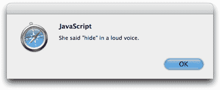

图 2.3. 字符串的值显示没有引号。

**简单 JavaScript**

**28**

**字符串运算**

我们无法对字符串执行像对数字那样的操作，但我们可以使用几个非常有用的运算符。

如果你想将两个字符串相加，或者将它们**拼接**，你可以使用与处理数字相同的`+`运算符：

```
var complete = "com" + "plete";
```

`complete`的值现在将是`"complete"`。

再次，你可以配合`+`运算符组合字符串和字符串变量：

```
var name = "Slim Shady";
```

```
var sentence = "My name is " + name;
```

`sentence`的值将是`"My name is Slim Shady"`。

你可以对字符串使用`+=`运算符，但不能`++`运算符——对字符串递增没有意义。所以之前的语句可以重写为：

**29**

**使用 JavaScript 编程**

```
var name = "Slim Shady";
```

```
var sentence = "My name is ";
```

```
sentence += name;
```

字符串拼接还有一个最后的技巧：你可以将数字和字符串拼接，但结果始终将是一个字符串。如果你尝试将一个数字加到字符串上，JavaScript 将自动将数字转换为字符串，然后拼接两个生成的字符串：

```
var sentence = "You are " + 1337
```

`sentence`现在包含`"You are 1337"`。当你想要为你的`h4x0r`朋友们输出句子时，可以使用这个技巧。

## 布尔值

布尔值其实非常简单——它们要么是`true`（真），要么是`false`（假）。

最简单的方法是将布尔值想象成可以开启或关闭的开关。它们主要用于我们在做决策时，正如我们在几页之后将要看到的那样。

为了给变量赋值布尔值，你只需要指定你希望它处于哪种状态。`true`和`false`是 JavaScript 中的关键字，所以你不需要在它们周围加上任何引号：

```
var lying = true;
```

```
var truthful = false;
```

如果你在关键字周围加上引号，它们将只是普通的字符串，而不是布尔值。

## 数组

数字、字符串和布尔值是存储单个数据项的好方法，但当你有一组想要处理的数据值时（例如一个名称列表或一组数字），会发生什么呢？你可以创建很多变量，但它们仍然没有组合在一起，你很难追踪所有的它们。

**数组**（Arrays）通过为你提供一种用于存储一组值的有序结构来解决这个问题。你可以把数组想象成一个架子，其中每个槽位都能够容纳一个不同的值。

为了创建一个数组，我们使用特殊的数组标记，即左方括号和右方括号：

```
var rack = [];
```

变量`rack`现在是一个数组，但它里面没有存储任何内容。

数组中的每个“槽位”实际上被称为**元素**（element），为了向元素中放入一些数据，你必须正确地引用你想要将数据放入的哪个元素。这种引用被称为**索引**（index），是一个表示元素在数组中位置的数字。数组中的第一个元素的索引为 0，这在起初可能会让人有点困惑，但这只是你必须习惯的编程特性。

第二个元素的索引为 1，第三个为 2，以此此类推。

要引用特定的元素，我们使用变量名，后面跟着一个左方括号，然后是索引和右方括号，如下所示：

```
var rack = [];
```

```
rack[0] = "First";
```

```
rack[1] = "Second";
```

有了数组中有了这些数据，你可以想象它看起来像图 2.4。

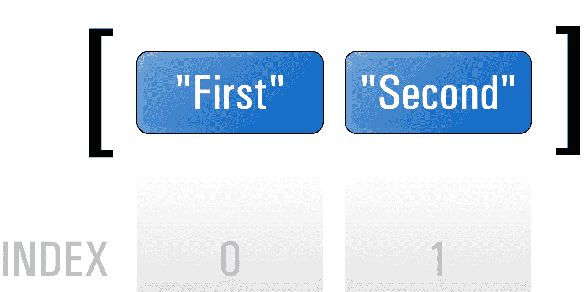

图 2.4. 顺序存储数据的数组，每个元素都有一个索引，从 0 开始

当我们想要检索特定的元素时，我们使用数组-索引表示法，就像使用普通的变量名一样。所以，如果我们有一个像上面那样的数组，我们可以这样创建一个显示第二个元素值的 alert 提示框：

```
alert(rack[1]);
```

生成的提示框如图 2.5 所示。

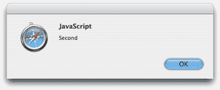

图 2.5. 显示从数组中检索值的 alert 提示框

在声明数组时就可以填充数组。我们只需要在方括号之间插入用逗号分隔的值：

```
var rack = ["First", "Second", "Third", "Fourth"];
```

该语句的意思是我们应该创建一个名为`rack`的数组，它具有这里指定的数值的四个元素。第一个值的索引为 0，第二个值的索引为 1，以此此类推。创建的数组看起来将像图 2.6。

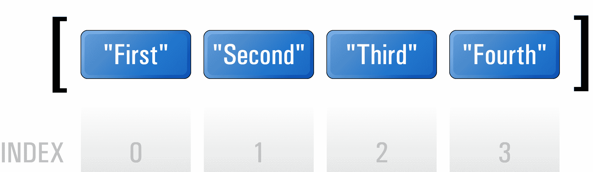

图 2.6. 结果数组

数组可以包含任何数据类型——而不仅仅是字符串——所以你可能有一个数字数组：

```
var numberArray = [1, 2, 3, 5, 8, 13, 21, 34];
```

你可能有一个字符串数组：

```
var stringArray = ["Veni", "Vidi", "Vici"];
```

一个包含多种数据类型的混合数组看起来像这样：

```
var mixedArray = [235, "Parramatta", "Road"];
```

这是一个数组的数组：

```
var subArray1 = ["Paris", "Lyon", "Nice"];
```

```
var subArray2 = ["Amsterdam", "Eindhoven", "Utrecht"];
```

```
var subArray3 = ["Madrid", "Barcelona", "Seville"];
```

```
var superArray = [subArray1, subArray2, subArray3];
```

最后一个例子是我们所说的**多维数组**——准确来说是一个二维数组——当你想要创建一组时，它非常有用。为了从一个子数组中检索值，你需要引用两个索引，如下：

```
var city = superArray[0][2];
```

如果我们翻译该语句，从右侧开始，它说：

**[2]**

第一个数组的

**[0]** 第三个元素

**in superArray**

并将该值保存到一个新变量`city`。

可以创建数组的数组的数组，以及数组的数组的数组，但你可能看出这些安排很快就会变得难以管理，所以二维数组就是你需要的。关于数组最后一点需要的是，它们带有一个非常有用的属性：`length`。有时，为了避免引用不存在的元素，你可以检查数组的`length`以查看它包含多少。因为第一个元素的索引是 0，最后一个元素的索引是`array.length - 1`：

```
var lastItem = shortArray[shortArray.length - 1];
```

这种情况可能看起来有点麻烦，直到你意识到这向数组末尾添加元素变得简单：

```
shortArray[shortArray.length] = "Fourth";
```

## 关联数组

虽然关联数组的键必须是字符串，但值可以是任何数据类型，包括其他数组或关联数组。

```
var postcodes = [];
```

```
postcodes["Armadale"] = 3143;
```

```
postcodes["North Melbourne"] = 3051;
```

```
postcodes["Camperdown"] = 2050;
```

```
postcodes["Annandale"] = 2038;
```

现在我们创建了关联数组，获取 Annandale 的邮政编码并不困难。我们只需要正确的键，值就会出现：

```
alert(postcodes["Annandale"]);
```

生成的提示框如图 2.7 所示。

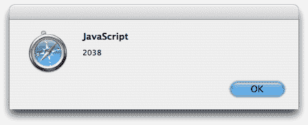

图 2.7. 使用关联数组查找邮政编码

## 条件和循环：控制

### 程序流

到目前为止，我们已经了允许你在程序内部设置和检索变量的语句。然而，为了让一个程序真正有用，它必须能够根据这些变量的值做出决策。

我们做这些决策的方法是通过使用被称为条件和循环的特殊结构，这些结构有助于控制在特定条件下运行程序的哪些部分，以及这些部分将运行多少次。

## 条件：做出决策

如果你把程序看作一张地图，而把浏览器看作在这些道路上行驶的汽车，你会发现浏览器必须能够根据用户想要去的地方采取不同的路径。虽然程序看起来像一条线性的路径——一个语句接一个语句——但**条件语句**就像路口，允许你根据给定的条件改变方向。

### `if` 语句

最常见的条件语句是`if`语句。`if`语句检查一个条件，如果满足该条件，则允许程序执行某些代码。如果条件条件，则跳过这些代码。

程序通过`if`语句的流程可以如图 2.8 所示。

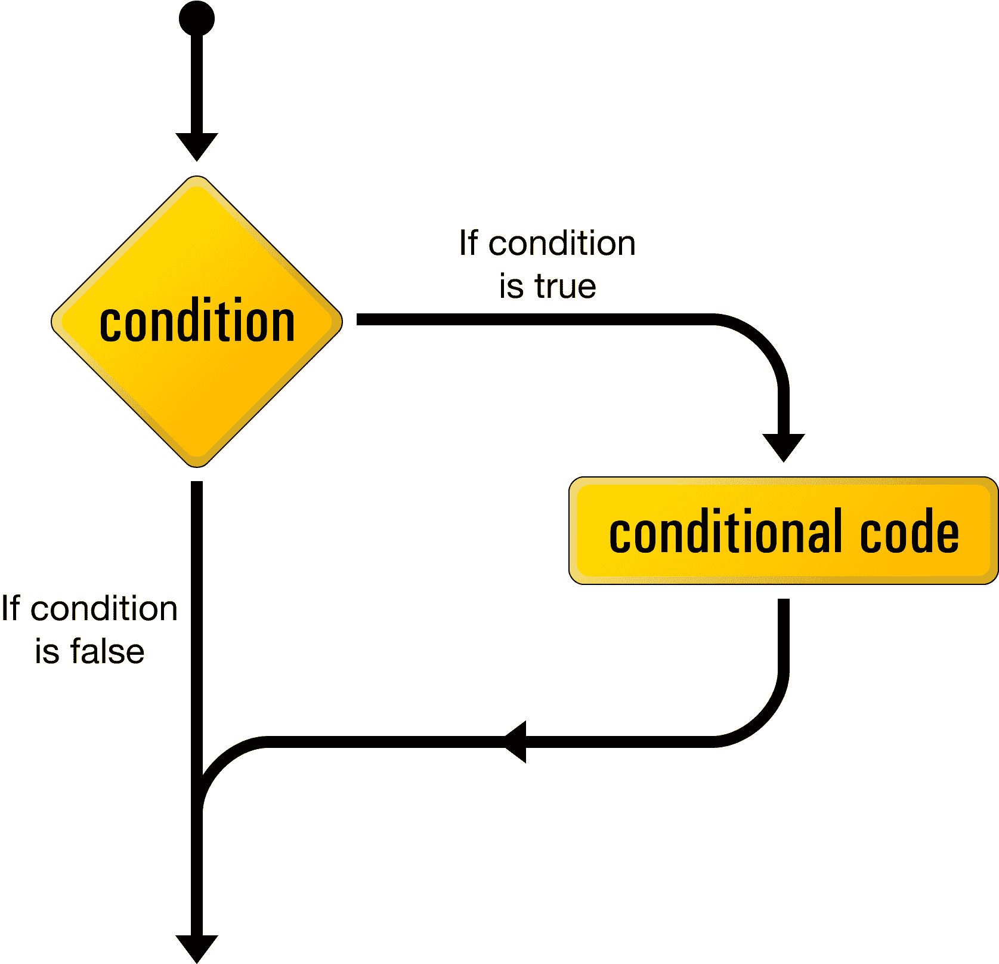

图 2.8。`if`语句的逻辑流

Simply JavaScript

36

www.allitebooks.com

用代码形式表示，`if`语句的形式如下：

```
if (condition)
{
  conditional code;
}
```

`if`语句不是以分号结束，而是以大括号（`{…}`）之间的条件代码结束。² 最佳实践是将每个大括号单独放在一行，以便尽可能容易地看出代码块的开始和结束。

 

### 代码缩进

对大括号内部的代码进行缩进是标准做法。在每个缩进行上，语句的第一个字符之前应该出现标准数量的空格或制表符。这有助于提高代码的可读性，并让你更容易跟踪程序的流程。

我们在本书中使用两个空格作为标准缩进，但你可以四个空格、一个制表符——任何你认为看起来最好的。只需保持一致即可。每当你嵌套大括号时（例如在条件代码块中的另一个`if`语句中），都应该将嵌套行的缩进增加一个标准缩进。

条件必须包含在圆括号（也称为括号）内，并被求值为布尔值，其中`true`表示大括号之间的代码将被执行，而`false`表示将对其跳过。然而，条件不需要是一个显式的布尔值——它可以是任何求值为可用作布尔值值的**表达式**。

 

### 表达式

表达式是值、变量引用、运算符和函数调用的组合，求值时会产生另一个值。在任何需要 JavaScript 值（如数字或字符串）的地方，你都可以使用表达式代替。

² 如果条件代码只包含一条语句，你可以选择省略大括号。我发现始终包含大括号更清晰，这也是我们在本书中将做的。

Programming with JavaScript

37

这是一个简单的表达式：

```
4 + 6
```

求值时，它会产生一个值（`10`）。我们可以这样写使用该表达式的语句：

```
var effect = 4 + 6;
```

现在我们的程序中有一个名为`effect`的变量，其值为`10`。

在条件语句中，最有用的表达式是那些使用**比较运算符**测试条件并返回布尔值的表达式。


你可能在某些数学课上记得**大于**（`>`）和**小于**（`<`）运算符，但还有**相等**（`==`）和**不等于**（`!=`）运算符以及它们的各种组合。基本上，每个比较运算符比较左侧与右侧的内容，求值为 `true` 或 `false`。你可以这样使用该结果：

```
var age = 27;
if (age > 20)
{
  alert("Drink to get");
}
```

大于和小于运算符实际上适用于数字，因为询问“一个字符串是否大于另一个”感觉太奇怪了。然而，相等运算符（`==`）适用于字符串和数字：

```
var age = 27;
if (age == 50){
  alert("Half century");
}
```

```
var name = "Maximus";
if (name == "Maximus")
{
  alert("Good afternoon,.");
}
```

在第一个条件中，`age` 是 `27`，我们正在测试它是否等于 `50`；显然，这个条件求值为 `false`。

在第二个条件中，`name` 是 `"Maximus"`，我们正在测试它是否等于 `"Maximus"`。这个条件求值为 `true`，并将执行条件代码。

## `==` 与 `=`

当你打算检查相等时，请注意使用两个等号而不是一个。如果你只用一个，你是将右侧的值赋值给左侧，而不是将它们比较！

我们可以通过不等于运算符（`!=`）来反转相等测试：

```
var name = "Decimus";
if (name != "Maximus")
{
  alert("You are not allowed.");
}
```

现在，因为 `name` 是 `"Decimus"` 且我们正在测试它*不*等于 `"Maximus"`，该条件求值为 `true`，条件代码将被执行。

### 表 2.1 常用比较运算符

| 运算符 | 示例 | 结果 |
| :--- | :--- | :--- |
| `>` | `A > B` | 如果 A 大于 B 则为 `true` |
| `>=` | `A >= B` | 如果 A 大于等于 B 则为 `true` |
| `<` | `A < B` | 如果 A 小于 B 则为 `true` |
| `<=` | `A <= B` | 如果 A 小于等于 B 则为 `true` |
| `==` | `A == B` | 如果 A 等于 B 则为 `true` |
| `!=` | `A != B` | 如果 A 不等于 B 则为 `true` |
| `!` | `!A` | 如果 A 为假则为 `true` |

## 多重条件

与其只使用一个测试作为条件，你可以使用逻辑运算符 AND（`&&`）和 OR（`||`）创建一个测试链。这两个运算符都可以用于组合测试。AND 运算符规定*两个*测试都求值为 `true`，整个表达式才求值为 `true`。OR 运算符规定只需其中一个测试求值为 `true`，整个表达式就求值为 `true`。

看这个条件：

```
var age = 27;
if (age > 17 && age < 21)
{
  alert("Old enough to vote, too young to drink");
}
```

在这里，`age` 大于 `17` 但小于 `21`，因为其中一个测试求值为 `false`，整个条件求值为 `false`。

另一方面，OR 运算符用于检查变量是否匹配几个值之一：³ 那是两个竖线，不是小写的 L 或数字 1。

```
var sport = "Skydiving";
if (sport == "Bungee jumping" || sport == "Cliff diving" ||
    sport == "Skydiving")
{
  alert("You're extreme!");
}
```

虽然这个表达式中的前两个测试求值为 `false`，但 `sport` 匹配最后一个测试，因此整个条件求值为 `true`。

## `if-else` 语句

`if` 语句允许在满足条件时执行某些代码，但没有为条件不满足的情况提供任何替代代码。这就是 `else` 语句的作用。

在 `if-else` 语句中，你的写法像写 `if` 语句一样开始，但在 `if` 语句的结束括号之后，立即包含一个 `else`，指定在 `if` 语句条件失败时执行的代码：

```
if (*condition*)
{
  *conditional code*;
}
else
{
  *alternative conditional code*;
}
```

这种构造的流程可以如图 2.9 所示。

要提供一些替代代码，你只需要在 `if` 语句末尾附加一个 `else` 语句：

```
var name = "Marcus";
if (name == "Maximus")
{
  alert("Good afternoon, General.");
}
else
{
  alert("You are not allowed in.");
}
```

这种方法可以避免你通过对原始条件进行否定形式化来创建一个单独 `if` 语句。

## `else-if` 语句

从技术上来说，`else-if` 并不是区别于 `if-else` 的独立语句类型，但你应该关注它，因为它非常有用。

如果你想为 `if` 语句失败的情况提供一些替代代码，但你又想进一步评估数据以决定采取何种行动，那么你需要一个 `else-if` 语句。你不需要只输入 `else`，而是输入 `else if`，后面跟着你想要测试的额外条件：

```
var name = "Marcus";
if (name == "Maximus")
{
  alert("Good afternoon, General.");
}
else if (name == "Marcus")
{
  alert("Good afternoon, Emperor.");
}
else
{
  alert("You are not allowed in.");
}
```

你可以根据需要连接任意数量的 `else-if` 语句，并在最后，你可以包含一个普通的 `else` 语句，用于所有条件失败的情况（尽管这不是必须的）。

## 循环：最小化重复

计算机是为了让生活变得更简单，对吧？那么，那些该死的机器人仆人在哪儿呢？

幸运的是，计算机有一些功能，可以在编程时为你节省思考和打字的时间。其中最有效的是**循环**，它们可以自动处理重复任务，例如修改数组中的每个元素。

有几种循环语句，但它们本质上的作用是相同的：只要指定的条件为 `true`，就一直重复一组操作。

### `while` 循环

`while` 是最简单的一种循环。它只需要一个条件和一些条件代码：

```
while (*condition*)
{
  *conditional code*;
}
```

当程序第一次遇到 `while` 循环时，它会检查条件。如果条件求值为 `true`，就会执行条件代码。当程序运行到条件代码的结尾时，它会回到条件处进行检查，如果求值仍为 `true`，就会执行条件代码……以此类推，如图 2.10 所示。

`while` 循环只有在条件求结果为 `false` 时才会结束。这意味着，在条件代码内部包含某些可以影响条件并最终使其求值为 `false` 的内容是非常重要的。否则，你的程序将永远无法离开 `while` 循环，并永远重复条件代码，导致浏览器无响应。⁴

循环与数组配合使用时非常有用，因为它们允许你按顺序遍历数组，并对每个元素执行相同的操作。

要使用 `while` 循环遍历数组，你需要一个递增计数器，它从 `0` 开始，并在每次循环执行时增加 `1`。这个递增器将跟踪我们当前正在处理的元素的索引。当我们到达数组末尾时，我们需要让它停止——这就是我们使用数组 `length` 属性的地方。

在这个示例中，我们将 `numbers` 数组的每个元素乘以 2：

```
var numbers = [1, 2, 3, 4, 5];
var incrementer = 0;
while (incrementer < numbers.length)
{
  numbers[incrementer] *= 2;
  incrementer++;
}
```

⁴ 在 Firefox 中，浏览器最终会向用户显示一条消息，抱怨你的脚本执行时间过长。噢，真丢脸！

该 `while` 循环内部的条件代码使用 `incrementer` 作为数组的索引。该变量从 `0` 开始将引用第一个元素，但由于我们在每次循环执行时都增加 1，它将按顺序遍历所有元素。一旦 `incrementer` 的值与 `numbers.length` 相等，条件就会失效，程序将退出 `while` 循环，此时数组中的所有元素都已翻倍。

**`i` 代表 `incrementer`**

变量名 `incrementer` 经常被缩短为 `i`，这是循环内部递增变量的常用名称。这个变量通常被称为**计数器**，因为它记录了循环执行了多少次。

### `do-while` 循环

`do-while` 循环的行为与 `while` 循环几乎完全相同，只有一个关键区别：条件代码被放在条件之前，因此即使条件为 `false`，条件代码至少也会执行一次。

```
do
{
  *conditional code*;
}
while (*condition*);
```

`while` 循环之后并不常用。事实上，我好好几年没用过它了⁵

### `for` 循环

`for` 循环与 `while` 循环类似，但它们提供了一些我们常用的快捷方式。考虑这个：

```
var numbers = [1, 2, 3, 4, 5];
var i = 0;
while (i < numbers.length)
{
  numbers[i] *= 2;
  i++;
}
```

⁵ [简化的 JavaScript](http://allbooks.com)

```
for (var i = 0; i < numbers.length; i++)
{
  numbers[i] *= 2;
}
```

`for` 循环有三个部分，用分号分隔：

- 初始化：声明计数器变量。
- 条件：在每次迭代前检查。
- 表达式：在每次迭代后增加计数器。

`for` 循环比 `while` 循环简洁得多，因为它将声明、条件和递增都放在了一起。

## 函数：为以后编写代码

到目前为止，我们看到的所有 JavaScript 代码（你可能尝试过的）都是在页面加载时立即执行的。它们从上运行到底部，然后停止，不再运行（至少直到页面重新加载）。

很多时候，我们希望在不同的时间执行程序的不同部分，或者多次运行相同的代码。为了实现这一点，你必须将代码放入**函数**中。

函数就像等待调用的 JavaScript 代码包。

你在本章中已经见过一个函数了——我们用于在浏览器中弹出框的 `alert` 函数。`alert` 是所有浏览器内置的函数——这意味着它是内置在浏览器 JavaScript 解释器中的——但你可以创建自己的函数，并随时调用它们。

函数基本上可以看作是代码块的封装。你只需要为该代码块命名，然后就可以在程序的任何地方随时调用它。

你可以使用 `function` 关键字来定义自己的函数。这告诉程序你正在定义一个新函数，并且紧随的大括号之间的代码应该在每次调用该函数时执行：

```javascript
function warning()
{
  alert("This is your final warning");
}
```

跟在 `function` 关键字后面的名称就是你想给函数起的名字（函数名的限制与变量名相同）。每当你想要程序运行函数内部的代码时，你就会调用这个名称。该名称后面必须跟着圆括号——在这种情况下括号内是空的，但正如你将在下一节中看到的，情况并不总是如此。

在上面的示例中，我们创建了一个名为 `warning` 的新函数，因此每当我们调用这个函数时，函数内部的语句就会执行，导致弹出警告框并显示文本“This is your final warning（这是你最后的警告）”。

与上面的函数声明一样，在调用函数时，圆括号必须紧跟在函数之后：

```javascript
warning();
```

这些括号有两个作用：它们告诉程序你想执行该函数，并且包含了你想传递给函数的数据——也称为**参数**（arguments）。⁶ 并不是每个函数都必须传递参数，但在调用函数时，你始终必须使用括号。

### 参数：向函数传递数据

如果你看看我们之前几页中使用 `alert` 函数的方法，你会注意到我们总是在函数调用的括号之间插入一个字符串：

```javascript
alert("Insert and play");
```

字符串 `"Insert and play（插入并播放）"` 实际上是我们传递给 `alert` 函数的参数；`alert` 设计的作用就是接收该参数并将其显示在浏览器的警告框中。

函数可以设计为接收任意数量的参数，而且这些参数不必是字符串——它们可以是你在 JavaScript 中创建的任何类型的数据。

⁶ 有人喜欢称这些为“参数（parameters）”。也有人喜欢吃羊脑。

当你定义函数时，可以为要传递给它的参数提供名称。这些名称包含在紧跟函数名后的圆括号中，如果有多个参数，则用逗号隔开：

```javascript
function sandwich(bread, meat)
{
  alert(bread + meat + bread);
}
```

一旦在函数声明中定义了参数名称，该参数就变成了一个变量，每次运行函数时都可用，允许你在函数*内部*使用传递给函数的数据。

正如你在上面的 `sandwich` 函数看到的，定义了两个参数：`bread`（面包）和 `meat`（肉）。这两个参数被用于调用 `alert`，并向用户产生一条毫无意义的信息。

让我们带参数 `"Rye（黑麦面包）"` 和 `"Pastrami（帕斯特米肉）"` 调用函数 `sandwich`：

```javascript
sandwich("Rye", "Pastrami");
```

当执行 `sandwich` 的代码时，这些参数将作为变量 `bread` 和 `meat` 可用。因此，如图 2.13 所示，用户最终得到一个黑麦培肉三明治。

### `arguments` 数组

除了在指定的参数名称中可用外，传递给函数的值也会在一个自动生成的名为 `arguments` 的数组变量中可用。

即使你没有在函数声明中声明任何参数名称，在调用函数时实际上也可以传递一个或多个参数。这些参数在 `arguments` 数组中仍然可用。这对于编写可以接受任意数量参数的函数非常有用。

想象我们用这些参数调用一个函数：

```javascript
debate("affirmative（正方）", "negative（反方）");
```

我们可以通过函数内部的 `arguments` 数组访问这些参数，如下：

```javascript
function debate()
{
  var affirmative = arguments[0];
  var negative = arguments[1];
}
```

### 返回语句：从函数输出数据

到目前为止，我们大多数函数的结果都是向用户显示一个包含消息的警告框。但在大多数情况下，你可能希望函数保持沉默，仅将数据传递给程序的其他部分。

函数可以将数据**返回**（return）给调用它的语句。它的好处在于，你可以将函数调用作为变量的值，该变量的值将变为函数返回的内容。

要让函数返回一个值，我们使用 `return` 关键字，后面跟着想要返回的值：


```javascript
function sandwich(bread, meat)
{
  var assembled = bread + meat + bread;
  return assembled;
}
```

如果你想让函数返回一个值，我们使用`return`关键字，后面跟着想要返回的值：

```javascript
function sandwich(bread, meat)
{
  var assembled = bread + meat + bread;
  return assembled;
}
```

如果你想让函数返回一个值，我们使用`return`关键字，后面跟着想要返回的值：

```javascript
function sandwich(bread, meat)
{
  var assembled = bread + meat + bread;
  return assembled;
}
```

如果你想让函数返回一个值，我们使用`return`关键字，后面跟着想要返回的值：

```javascript
function sandwich(bread, meat)
{
  var assembled = bread + meat + bread;
  return assembled;
}
```

如果你想让函数返回一个值，我们使用`return`关键字，后面跟着想要返回的值：

```javascript
function sandwich(bread, meat)
{
  var assembled = bread + meat + bread;
  return assembled;
}
```

如果你想让函数返回一个值，我们使用`return`关键字，后面跟着想要返回的值：

```javascript
function sandwich(bread, meat)
{
  var assembled = bread + meat + bread;
  return assembled;
}
```

如果你想让函数返回一个值，我们使用`return`关键字，后面跟着想要返回的值：

```javascript
function sandwich(bread, meat)
{
  var assembled = bread + meat + bread;
  return assembled;
}
```

如果你想让函数返回一个值，我们使用`return`关键字，后面跟着想要返回的值：

```javascript
function sandwich(bread, meat)
{
  var assembled = bread + meat + bread;
  return assembled;
}
```

如果你想让函数返回一个值，我们使用`return`关键字，后面跟着想要返回的值：

```javascript
function sandwich(bread, meat)
{
  var assembled = bread + meat + bread;
  return assembled;
}
```

如果你想让函数返回一个值，我们使用`return`关键字，后面跟着想要返回的值：

```javascript
function sandwich(bread, meat)
{
  var assembled = bread + meat + bread;
  return assembled;
}
```

如果你想让函数返回一个值，我们使用`return`关键字，后面跟着想要返回的值：

```javascript
function sandwich(bread, meat)
{
  var assembled = bread + meat + bread;
  return assembled;
}
```

如果你想让函数返回一个值，我们使用`return`关键字，后面跟着想要返回的值：

```javascript
function sandwich(bread, meat)
{
  var assembled = bread + meat + bread;
  return assembled;
}
```

如果你想让函数返回一个值，我们使用`return`关键字，后面跟着想要返回的值：

```javascript
function sandwich(bread, meat)
{
  var assembled = bread + meat + bread;
  return assembled;
}
```

如果你想让函数返回一个值，我们使用`return`关键字，后面跟着想要返回的值：

```javascript
function sandwich(bread, meat)
{
  var assembled = bread + meat + bread;
  return assembled;
}
```

如果你想让函数返回一个值，我们使用`return`关键字，后面跟着想要返回的值：

```javascript
function sandwich(bread, meat)
{
  var assembled = bread + meat + bread;
  return assembled;
}
```

如果你想让函数返回一个值，我们使用`return`关键字，后面跟着想要返回的值：

```javascript
function sandwich(bread, meat)
{
  var assembled = bread + meat + bread;
  return assembled;
}
```

如果你想让函数返回一个值，我们使用`return`关键字，后面跟着想要返回的值：

```javascript
function sandwich(bread, meat)
{
  var assembled = bread + meat + bread;
  return assembled;
}
```

如果你想让函数返回一个值，我们使用`return`关键字，后面跟着想要返回的值：

```javascript
function sandwich(bread, meat)
{
  var assembled = bread + meat + bread;
  return assembled;
}
```

如果你想让函数返回一个值，我们使用`return`关键字，后面跟着想要返回的值：

```javascript
function sandwich(bread, meat)
{
  var assembled = bread + meat + bread;
  return assembled;
}
```

如果你想让函数返回一个值，我们使用`return`关键字，后面跟着想要返回的值：

```javascript
function sandwich(bread, meat)
{
  var assembled = bread + meat + bread;
  return assembled;
}
```

如果你想让函数返回一个值，我们使用`return`关键字，后面跟着想要返回的值：

```javascript
function sandwich(bread, meat)
{
  var assembled = bread + meat + bread;
  return assembled;
}
```

如果你想让函数返回一个值，我们使用`return`关键字，后面跟着想要返回的值：

```javascript
function sandwich(bread, meat)
{
  var assembled = bread + meat + bread;
  return assembled;
}
```

如果你想让函数返回一个值，我们使用`return`关键字，后面跟着想要返回的值：

```javascript
function sandwich(bread, meat)
{
  var assembled = bread + meat + bread;
  return assembled;
}
```

如果你想让函数返回一个值，我们使用`return`关键字，后面跟着想要返回的值：

```javascript
function sandwich(bread, meat)
{
  var assembled = bread + meat + bread;
  return assembled;
}
```

如果你想让函数返回一个值，我们使用`return`关键字，后面跟着想要返回的值：

```javascript
function sandwich(bread, meat)
{
  var assembled = bread + meat + bread;
  return assembled;
}
```

如果你想让函数返回一个值，我们使用`return`关键字，后面跟着想要返回的值：

```javascript
function sandwich(bread, meat)
{
  var assembled = bread + meat + bread;
  return assembled;
}
```

如果你想让函数返回一个值，我们使用`return`关键字，后面跟着想要返回的值：

```javascript
function sandwich(bread, meat)
{
  var assembled = bread + meat + bread;
  return assembled;
}
```

如果你想让函数返回一个值，我们使用`return`关键字，后面跟着想要返回的值：

```javascript
function sandwich(bread, meat)
{
  var assembled = bread + meat + bread;
  return assembled;
}
```

**53**

**JavaScript 编程**

### 作用域：你的变量

在这一章开始时我提到，除非你打算让变量在整个程序中共享，否则始终使用`var`声明它。我们之前看到的变量不在函数内部，因此处于全局作用域。看这段代码：

```javascript
function countis()
{
  stock = 5;
  sales = 3;
  return stock - sales;
}
stock = 0;
wiis = countis();
```

运行这段代码后，`stock`的值是多少？你可能会认为是`0`，但因为`countis`没有使用`var`来声明`stock`，JavaScript 会去函数外部（全局作用域）查找该变量是否存在。确实存在，所以 JavaScript 将`5`赋值给该全局变量。

我们真正的意图是让`countis`使用自己的`stock`。为了实现这一点，我们需要将该变量声明为**局部作用域**。局部作用域的变量仅在创建它的函数内部有效。它的优先级高于全局作用域——如果局部变量和全局变量同名，函数将始终使用局部变量。

如何声明局部变量？在它前面加上`var`。让我们重新组织代码：

```javascript
function countis()
{
  var stock = 5;
  var sales = 3;
  return stock - sales;
}
stock = 0;
wiis = countis();
```

声明在`countis`函数外部的`stock`变量将不受`countis`内部声明的`stock`变量的影响——我们的函数可以与其他宇宙和谐共处。

这里的教训是，除非你打算在整个程序中共享变量，否则始终使用`var`声明。⁷严格来说，在函数外部创建的变量始终处于全局作用域，无论是用`var`声明还是通过简单为未声明的变量名赋值创建的。然而，对所有变量都使用`var`是一个良好的习惯，也被认为是最佳实践。

**54**

**对象**

现在我们已经查看了变量和函数，终于可以查看**对象**了。对象本质上只是无形的编程块。它们是所有其他数据类型的混合体，主要是为了方便程序员的生活。尽管如此，它们的性格模糊性并不意味着它们没有用。

对象作为一种将变量和函数组织成逻辑分组的方式而存在。

它们在另一个领域与兔子有关。对象通过将一组**属性**和**方法**组合来实现这一点。

属性是只能通过其对象访问的*变量*，而方法是只能通过其对象访问的*函数*。通过要求所有对属性和方法的访问都通过包含它们的对象进行，JavaScript 对象使得管理你的程序变得容易得多。

我们实际上已经已经玩过对象了——当你创建一个新数组时，你实际上创建了内置`Array`对象的一个新实例。数组的`length`实际上是该对象的一个属性，数组还拥有像`push`和`splice`这样的方法，我们在本书的后面会用到它们。

数组是一个原生对象，因为它是内置在 JavaScript 语言中的，但使用`Object`构造函数可以轻松创建你自己的对象：

`var Robot = new Object();`

 

**命名规范**

变量名以小写字母开头，而对象名以大写字母开头。事实就是如此。在经过几十年精细的编程实践后，这种约定帮助所有人区分这两者。

一旦你实例化了新对象，你就可以自由地向它添加属性和方法，修改现有属性的值，并调用对象的方法。对象的属性和方法都使用点号（`.`）语法进行访问：

`Robot.metal = "Titanium";`

`Robot.killAllHumans = function()`

`{`

`alert("Exterminate!");`

`};`

`Robot.killAllHumans();`

这段代码的第一行向我们空的`Robot`对象添加了一个`metal`属性，并为它赋值为值`"Titanium"`。注意，当我们声明属性时，不需要使用`var`关键字，因为属性始终处于**简单 JavaScript**

**56**

在**对象作用域**中——它们必须通过包含它们的对象进行访问。

从第二行开始的语句为我们的`Robot`对象添加了一个`killAllHumans`方法。注意，这与我们之前用于声明独立函数的语法稍有不同；这里，我们的方法声明采用了赋值语句的形式（注意赋值运算符`=`，以及代码块末尾的分号）。

 

**独立函数的备用语法**

事实证明，如果你愿意，也可以使用这种语法来声明独立函数。绝不要让别人说 JavaScript 没给你提供选择！之前，我们使用了这种函数声明：

`function sandwich(bread, meat)`

`{`

`alert(bread + meat + bread);`

`}`

如果你喜欢，JavaScript 允许你将其写成变量赋值的形式：

`var sandwich = function(bread, meat)`

`{`

`alert(bread + meat + bread);`

`};`

正如你所预期的那样，这两种代码风格的效果之间存在非常细微的差异：用前一种语法声明的函数可以被文件中的任何代码使用，即使它在函数声明之前。用后一种语法声明的函数只能由执行声明该函数的赋值语句之后的代码使用。不过，如果你的代码组织良好，这种差异将并不重要。

最后，我们程序的最后一行调用了`Robot`对象的`killAllHumans`方法。

与很多 JavaScript 代码一样，我们可以使用对象字面量语法来快捷完成这整个序列：

**57**

**使用 JavaScript 编程**

`var Robot =`

`{`

`metal: "Titanium",`

`killAllHumans: function()`

`{`

`alert("Exterminate!");`

`}`

`};`

与其先创建一个空对象，然后使用一系列赋值语句向其填充属性和方法，不如**对象字面量语法**允许你通过单条语句创建对象及其内容。

在对象字面量语法中，我们用大括号表示一个新对象；在这些大括号内部，我们列出对象的属性和方法，并用逗号隔开。对于每个属性和方法，我们使用冒号（`:`）而不是赋值运算符来赋值。

一旦你使用标准赋值语法了一段时间，对象字面量语法可能会变得有点难读，但它*确实*稍微更简洁。

我们将在本书中一直使用这种对象字面量语法创建整洁的自包含功能包，你可以轻松地在页面间传输这些包。

**真实世界中的非侵入式脚本**

读完第 1 章后，你已经在脑海中相当清楚 HTML 是用于内容的，而 JavaScript 是用于行为的，两者永远不会交汇。然而，在现实世界中情况并非那么简单。

如果你仔细观察，发现 HTML 是用于内容的，而 JavaScript 是用于行为的，两者永远不会交汇。然而，在现实世界中情况并非那么简单。

如果你仔细观察，发现 HTML 是用于内容的，而 JavaScript 是用于行为的，两者永远不会交汇。然而，在现实世界中情况并非那么简单。

如果你仔细观察，发现 HTML 是用于内容的，而 JavaScript 是用于行为的，两者永远不会交汇。然而，在现实世界中情况并非那么简单。

如果你仔细观察，发现 HTML 是用于内容的，而 JavaScript 是用于行为的，两者永远不会交汇。然而，在现实世界中情况并非那么简单。

如果你仔细观察，发现 HTML 是用于内容的，而 JavaScript 是用于行为的，两者永远不会交汇。然而，在现实世界中情况并非那么简单。

如果你仔细观察，发现 HTML 是用于内容的，而 JavaScript 是用于行为的，两者永远不会交汇。然而，在现实世界中情况并非那么简单。


如果你仔细观察，发现 `HTML` 是用于内容的，而 `JavaScript` 是用于行为的，两者永远不会交汇。然而，在现实世界中情况并非那么简单。

（注：原文提供的待翻译文本在中间部分出现了大量重复的“如果你仔细观察，发现 HTML 是用于内容的...”段落，根据指令“一定不要重复输出原文”，译文已去重并保持逻辑贯。）

数组是一个原生对象，因为它是内置在 `JavaScript` 语言中的，但使用`Object` 构造函数可以轻松创建你自己的对象：

```javascript
var Robot = new Object();
```

**命名规范**

变量名以小写字母开头，而对象名以大写字母开头。事实就是如此。在经过几十年精细的编程实践后，这种约定帮助所有人区分这两者。

一旦你实例化了新对象，你就可以自由地向它添加属性和方法，修改现有属性的值，并调用对象的方法。对象的属性和方法都使用点号（`.`）语法进行访问：

```javascript
Robot.metal = "Titanium";
Robot.killAllHumans = function()
{
  alert("Exterminate!");
};
Robot.killAllHumans();
```

这段代码的第一行向我们空的`Robot`对象添加了一个`metal`属性，并为它赋值为值`"Titanium"`。注意，当我们声明属性时，不需要使用`var`关键字，因为属性始终处于对象作用域中——它们必须通过包含它们的对象进行访问。

从第二行开始的语句为我们的`Robot`对象添加了一个`killAllHumans`方法。注意，这与我们之前用于声明独立函数的语法稍有不同；这里，我们的方法声明采用了赋值语句的形式（注意赋值运算符`=`，以及代码块末尾的分号）。

**独立函数的备用语法**

事实证明，如果你愿意，也可以使用这种语法来声明独立函数。绝不要让别人说 `JavaScript` 没给你提供选择！之前，我们使用了这种函数声明：

```javascript
function sandwich(bread, meat)
{
  alert(bread + meat + bread);
}
```

如果你喜欢，`JavaScript` 允许你将其写成变量赋值的形式：

```javascript
var sandwich = function(bread, meat)
{
  alert(bread + meat + bread);
};
```

正如你所预期的那样，这两种代码风格的效果之间存在非常细微的差异：用前一种语法声明的函数可以被文件中的任何代码使用，即使它在函数声明之前。用后一种语法声明的函数只能由执行声明该函数的赋值语句之后的代码使用。不过，如果你的代码组织良好，这种差异将并不重要。

最后，我们程序的最后一行调用了`Robot`对象的`killAllHumans`方法。

与很多 `JavaScript` 代码一样，我们可以使用对象字面量语法来快捷完成这整个序列：

```javascript
var Robot =
{
  metal: "Titanium",
  killAllHumans: function()
  {
    alert("Exterminate!");
  }
};
```

与其先创建一个空对象，然后使用一系列赋值语句向其填充属性和方法，不如**对象字面量语法**允许你通过单条语句创建对象及其内容。

在对象字面量语法中，我们用大括号表示一个新对象；在这些大括号内部，我们列出对象的属性和方法，并用逗号隔开。对于每个属性和方法，我们使用冒号（`:`）而不是赋值运算符来赋值。

一旦你使用标准赋值语法了一段时间，对象字面量语法可能会变得有点难读，但它*确实*稍微更简洁。

我们将本书中一直使用这种对象字面量语法创建整洁的自包含功能包，你可以轻松地在页面间传输这些包。

**真实世界中的非侵入式脚本**

读完第 1 章后，你已经在脑海中相当清楚 `HTML` 是用于内容的，而 `JavaScript` 是用于行为的，两者永远不会交汇。然而，在现实世界中情况并非那么简单。

（注：由于提供的原文中存在大量重复段落，此处译文已根据“一定不要重复输出原文”的原则进行了去重处理。）

哪些部分是文本，哪些部分不是等等。为了让糟糕的 `JavaScript` 程序员不必重复完全相同的工作，浏览器会将对 `HTML` 代码的解释存储为 `JavaScript` 对象的结构，称为**文档对象模型**，或 **DOM**。

在这个模型中，`HTML` 文档中的每个元素都变成一个对象，所有的属性和文本也是如此。`JavaScript` 可以内置函数独立地访问这些对象中的每一个，这些函数能够方便我们随时查找并修改我们想要的内容。

由于 `HTML` 的编写方式——即由起始和结束标签标记的嵌套元素组成的层级结构——DOM 为每个元素创建一个不同的对象，但将每个元素对象链接到它的包含（或父级）元素。这在元素之间创建了显式的父子关系，使得 DOM 的可视化最自然地呈现为树形结构。

例如，来看这段 `HTML`：

```html
<!DOCTYPE html PUBLIC "-//W3C//DTD XHTML 1.0 Strict//EN"
"http://www.w3.org/TR/xhtml1/DTD/xhtml1-strict.dtd">
<html xmlns="http://www.w3.org/1999/xhtml" lang="en-US">
<head>
  <title>DOMinating JavaScript</title>
  <meta http-equiv="Content-Type" content="text/html; charset=utf-8" />
</head>
<body>
  <h1>DOMinating JavaScript</h1>
  <p>
    如果你在你的 JavaScript 方面需要一些帮助，你可能喜欢
    阅读来自 <a href="http://www.danwebb.net/" rel="external">Dan Webb</a> 的文章，
    <a href="http://www.quirksmode.org/" rel="external">PPK</a>
    以及 <a href="http://adactio.com/" rel="external">Jeremy Keith</a> 的文章。
  </p>
</body>
</html>
```

## 简单的 JavaScript

这些在 DOM 中映射的元素，最容易像图 3.1 所示那样被理解。

图 3.1。 HTML 页面上的每个元素链接到它在 DOM 中的父元素

为文档创建 DOM 时，`HTML` 中的每个元素由被称为**节点**（node）的东西表示。节点在 DOM 树中的位置由它的父节点和子节点决定。

元素节点通过其元素名称（`head`、`body`、`h1` 等）来区分，但这不必是唯一的。除非你提供某些标识特征——比如`id`属性——否则一个段落节点看起来和另一个无相同。从技术上讲，有一个特殊的节点始终包含在文档中，无论该文档的内容是什么。它始终位于树的最顶端，被称为**文档节点**（document node）。考虑到这一点，图 3.2 将是 DOM 更准确的表示。

## 文档访问

图 3.2. DOM 树，包括文档节点

**元素节点**（即代表 `HTML` 元素的节点）是节点的一种，它们定义了 DOM 大部分的结构，但文档的实际*内容*包含在另外两种类型的节点中：文本节点和属性节点。

### 文本节点

在 `HTML` 代码中，任何不包含在角括号之间的内容都将被解释为 DOM 中的**文本节点**。在结构上，文本节点的处理方式与元素节点几乎相同：它们位于相同的树形结构中，并且可以像元素节点一样被访问；然而，它们不能拥有子节点。

如果我们重新考虑之前看到的 `HTML` 示例，并将文本节点包含在我们的 DOM 可视图中，它会变得大得多，正如图 3.3 所示。

图 3.3。完整的 DOM 树，包括文本节点

尽管那些文本节点看起来非常相似，但每个节点都有自己的值，该值存储了节点所代表的实际文本。因此，此示例中`title`元素内部文本节点的值将是“DOMinating JavaScript”。

### 空格可能会产生文本节点

除了可见字符外，文本节点还包含不可见字符，如换行符和制表符。如果你缩进代码以提高可读性（正如我们在书中所做的），你用于分隔任何标签或文本的每一行和制表符都将被包含在一个文本节点中。

这意味着可能会在相邻元素之间产生文本节点，或者在文本节点的开头或结尾有额外的空白。浏览器处理这些**空白节点**（whitespace nodes）的方式不同，这种 DOM 解析的变异正是为什么你在依赖 DOM 中节点的数量或顺序时必须非常小心的原因。

### 属性节点

标签和文本被元素和文本节点覆盖后，DOM 中唯一需要考虑的信息就是属性了。初一看，属性似乎是元素的一部分——在某种意义上确实如此——但它们仍然占据着自己的节点类型，方便地被称为**属性节点**（attribute nodes）。

在我们之前看到的示例 DOM 中，两个锚元素中的任意一个都可以像图 3.4 所示带有元素的属性节点进行可视化。

图 3.4. `href` 和 `rel` 以及属性节点

## 访问节点

现在我们已经知道了 DOM 是如何结构的，我们对将要访问的内容类型有了大致的了解。尽管不同技术之间操作元素的方式差异很大，但我们查找它们的过程惊人地相似。

### 通过 ID 查找元素

访问元素最直接的路径是通过其`id`属性。`id`是可选的 `HTML` 属性，可以添加到页面上的任何元素上，但你使用的每个 ID 在该文档内必须是唯一的：

```html
<p id="uniqueElement"></p>
```

如果你打算通过 ID 查找元素，你将需要做一个很大的假设：即你想要的元素有一个 ID。有时，这个假设意味着你需要预先处理你的 `HTML` 代码，以确保该元素有一个 ID；在其他时候，该 ID 会自然地出现在 `HTML` 中（作为结构的一部分）。但一旦元素确实有了 ID，`JavaScript` 查找它就会变得特别容易。

如果你想在 CSS 中通过 ID 引用特定元素，将使用以`#`开头的 ID 选择器：

```css
#uniqueElement {
  color: blue;
}
```

粗略翻译，这段 CSS 的意思是：找到 ID 为`uniqueElement`的元素。将其颜色变为蓝色。

CSS 是一种非常简洁的语言。`JavaScript` 不是。因此，在 `JavaScript` 中通过 ID 引用元素，我们使用`getElementById`方法，该方法仅适用于`document`节点。它接受一个字符串作为参数，然后找到 ID 为该字符串的元素。

一次处理一个元素——极具针对性。例如，假设我们的文档包含了以下 `HTML`：

```html
<h1>
  Sniper (1993)
</h1>
<p>
  在这部电影杰作中，
  <a id="berenger" href="/name/nm0000297/">Tom Berenger</a> 扮演了一名在巴拿马丛林中工作的美国士兵。
</p>
```

我们可以获取该 ID 为`berenger`的 `HTML` 元素的引用，无论它是什么类型的元素：

```javascript
var target = document.getElementById("berenger");
```

变量`target`现在将指向 Tom Berenger 名字周围锚点元素的 DOM 节点。但让我们假设该 ID 被移动到了另一个元素上：

```html
<h1 id="berenger">
  Sniper (1993)
</h1>
<p>
  在这部电影杰作中，
  <a href="/name/nm0000297/">Tom Berenger</a> 扮演了一名在巴拿马丛林中工作的美国士兵。
</p>
```

现在，如果我们执行相同的 `JavaScript` 代码，我们的`target`将引用`h1`元素。一旦你获取了元素的引用，就可以对它使用许多原生方法和属性来获取有关元素的信息，或者修改其内容。

随着本书的进行，你将探索许多此类方法和属性。

如果你想尝试获取刚刚找到的元素的一些信息，可以访问该元素节点的一个或多个原生属性。其中一个属性是`nodeName`，它会告诉你你引用的节点的确切标签名。要显示`getElementById`捕获的元素的标签名，你可以运行这段代码：

```javascript
var target = document.getElementById("berenger");
alert(target.nodeName);
```

将弹出一个警告对话框显示标签名，如图 3.5 所示。

图 3.5. 使用`nodeName`属性显示元素的标签名

如果不存在你寻找的特定 ID 的元素，`getElementById`不返回节点引用——相反，它将返回值`null`。`null`是一个特殊值，通常表示某种错误。本质上，它表示在通常认为存在对象时对象不存在。

如果你不确定文档中是否包含你寻找的特定 ID 的元素，最安全的方法是检查`getElementById`是否确实返回了节点对象，因为在`null`值上执行大多数操作会导致你的程序报告错误并停止运行。你可以使用条件语句轻松地执行此检查，验证`getElementById`返回的引用不是`null`。


`var target = document.getElementById("berenger");`

```
if (target != null)
{
    alert(target.nodeName);
}
```

## 文档访问

### 通过标签名查找元素

如果你想一次修改一个元素，使用 ID 定位元素是非常好的，但如果你想找到一组元素，`getElementsByTagName` 是适合你的方法。

它在 CSS 中的等同于元素类型选择器：

```
li
{
    color: blue;
}
```

与 `getElementById` 不同，`getElementsByTagName` 可以作为任何元素节点的方法执行，但它最常在 `document` 节点上调用。

看看这个文档：

```html
<!DOCTYPE html PUBLIC "-//W3C//DTD XHTML 1.0 Strict//EN" "http://www.w3.org/TR/xhtml1/DTD/xhtml1-strict.dtd">
<html xmlns="http://www.w3.org/1999/xhtml" lang="en-US">
<head>
  <title>Tag Name Locator</title>
  <meta http-equiv="Content-Type" content="text/html; charset=utf-8" />
</head>
<body>
  <p>此 body 中有 3 种不同的元素：</p>
  <ul>
    <li>paragraph</li>
    <li>unordered list</li>
    <li>list item</li>
  </ul>
</body>
</html>
```

我们可以使用一行 JavaScript 获取所有这些列表项元素：

`var listItems = document.getElementsByTagName("li");`

通过执行该代码，你是在告诉程序搜索 `document` 节点的所有后代，获取所有标签名为 `"li"` 的节点，并将该组赋值给变量 `listItems`。

`listItems` 最终包含一个名为 **node list**（节点列表）的节点集合。节点列表是一个 JavaScript 对象...

`getElementsByTagName`，用于获取它包含的列表项。组合多个 DOM 方法调用是你们应该很快学会的技巧。最佳方法通常取决于你正在处理的 HTML 结构。

## 通过类名查找元素

根据类名（class name）而不是标签名（tag name）来查找元素通常是非常实用的。尽管我们无论走到哪里都受限于那 91 个 HTML 元素，但我们可以轻松地自定义类名，以创建符合我们目的且易于引用的元素组。

与通过标签名搜索相比，使用类名作为选择器可以是一种更细粒度的元素查找方式（因为它允许你获取特定标签名组的子集），也可以是一种更广泛的元素查找方式（因为它允许你选择一组具有不同标签名的元素）。

遗憾的是，没有内置的 DOM 函数可以让你通过类名来获取元素，因此我认为是时候编写我们的第一个真正的函数了！一旦完成，我们就可以将该函数添加到自定义的 JavaScript 库中，并在我们需要获取具有特定类的所有元素时随时调用它。

## 开始编写你的第一个函数

当你编写函数或程序时，第一步应该是用简单的英语清晰地定义你想让它做什么。如果你正在处理一个相对简单的问题，你可能可以直接将该描述翻译成 JavaScript，但通常你将需要任务分解为简单的步骤。

我们在这里想要做的事情的完整描述可能是：“在文档中找到所有具有特定类的元素。”

这听起来似乎非常简单；让我们将其拆解为更具逻辑的步骤：

1. 查看文档中的每个元素。
2. 对于每个元素，执行一个检查，将其类名与我们正在寻找的类名进行比较。
3. 如果类名匹配，将该元素添加到我们的元素组中。

从这些步骤中，你应该能立即注意到几点。首先，每当你看到“对于每个”（for each）这个短语时，很可能你需要一个循环（loop）。其次，每当有像“如果匹配”这样的条件时，你都需要一个条件语句。最后，当我们谈论“组”（group）时，它通常意味着一个数组（array）或节点列表（node list）。

考虑到这些预测，让我们把三个步骤转换为代码。

## 查看所有元素

首先，我们需要获取文档中的所有元素。我们使用 `getElementsByTagName` 来此，但我们不会寻找特定的标签；相反，我们将向该方法传递特殊值 `"*"`，它告诉它返回所有元素。

遗憾的是，Internet Explorer 5.x 不理解那个特殊值，因此我们必须编写额外的代码来支持该浏览器。在 Internet Explorer 5.x 中，微软创建了一个包含文档中所有元素的特殊对象，并将其命名为 `document.all`。`document.all` 基本上是一个所有元素的节点列表，因此它与调用 `document.getElementsByTagName("*")` 是同意的。

大多数其他浏览器没有 `document.all` 对象，但那些实现它的浏览器与 Internet Explorer 一样，所以我们的代码可以简单地测试 `document.all` 是否存在。如果存在，我们就使用 Internet Explorer 5.x 的方法获取所有元素。如果不存在，我们就使用标准方法：

```javascript
var elementArray = [];
if (typeof document.all != "undefined")
{
    elementArray = document.all;
}
else
{
    elementArray = document.getElementsByTagName("*");
}
```

上面的条件语句使用 `typeof` 运算符来检查 `document.all` 是否存在。`typeof` 检查其后跟的值的数据类型，并产生一个描述该值类型的字符串（例如 `"number"`、`"string"`、`"object"` 等）。即使值为 `null`，它仍然会返回类型（`"object"`），但如果你向 `typeof` 提供一个完全没有分配过任何值的变量或属性名，它将返回字符串 `"undefined"`。这种技术被称为**对象检测**（object detection），是测试对象（如 `document.all`）是否存在的最安全的方法。如果 `typeof` 返回 `"undefined"`，我们就知道浏览器没有实现该功能。

无论浏览器决定执行条件语句的哪部分，我们最终都会地为 `elementArray` 分配文档中每个元素的节点列表。

## 检查每个元素的类名

现在我们有了一组元素要查看，我们可以检查每个元素的类名：

```javascript
var pattern = new RegExp("(^| )" + theClass + "( |$)");
for (var i = 0; i < elementArray.length; i++)
{
    if (pattern.test(elementArray[i].className))
    {
        // ...
    }
}
```

第一行中赋值给变量 `pattern` 的值对你来说可能非常陌生。事实上，这是一个**正则表达式**（regular expression），我们将在第 6 章中更深入地探索。现在，你需要知道的是正则表达式帮助我们在字符串中搜索特定的类。

处理 `className` 属性的特点在于，它实际上可以包含多个类，并用空格分隔，例如 `<div class="article summary">`。因此，仅仅检查 `class` 属性是否等于该名称并不总是足够的。在检查 `class` 是否包含特定类时，我们需要使用更高级的方法在属性值内部进行搜索。

## 将元素添加到我们的组

一旦我们确定一个元素符合标准，我们需要将其添加到我们的组中。但我们的组在哪里？之前我说过节点列表非常像数组。我们实际上无法创建节点列表——我们能创建的最接近的东西是数组。

在 `for` 循环之外，我们创建一个用于存储元素的数组，然后在找到每个匹配元素时将其添加到数组：

```javascript
var matchedArray = [];
var pattern = new RegExp("(^| )" + theClass + "( |$)");
for (var i = 0; i < elementArray.length; i++)
{
    if (pattern.test(elementArray[i].className))
    {
        matchedArray[matchedArray.length] = elementArray[i];
    }
}
```

在我们上一步中编写的 `if` 语句内部，我们将任何新匹配的元素添加到 `matchedArray` 的末，使用其当前的 `length` 作为新元素的索引（记住数组的 `length` 总是比最后一个元素的索引大1）。当 `for` 循环执行完毕，文档中所有所需类的元素都将被引用在 `matchedArray` 中。

## 整合在一起

我们函数的内核现在已经大部分完成。我们只需要将它们拼接在一起并放在一个函数中：

**core.js** *(excerpt)*

```javascript
Core.getElementsByClass = function(theClass)
{
    var elementArray = [];
    if (document.all)
    {
        elementArray = document.all;
    }
    else
    {
        elementArray = document.getElementsByTagName("*");
    }

    var matchedArray = [];
    var pattern = new RegExp("(^| )" + theClass + "( |$)");
    for (var i = 0; i < elementArray.length; i++)
    {
        if (pattern.test(elementArray[i].className))
        {
            matchedArray[matchedArray.length] = elementArray[i];
        }
    }
    return matchedArray;
};
```

`matchedArray[matchedArray.length] = elementArray[i];`

```
}

return matchedArray;
};
```

我们将新函数命名为 `Core.getElementsByClass`，该函数定义包含一个参数——`theClass`——这是我们用来构建正则表达式的类名。除了将代码放在函数块内部之外，我们还包含了一个 `return` 语句，将 `matchedArray` 返回给调用 `Core.getElementsByClass` 的语句。

现在它已成为我们 `Core` 库的一部分，我们可以在 JavaScript 代码的任何地方使用此函数来根据类查找一组元素：

`var elementArray = Core.getElementsByClass("dataTable");`

## 遍历 DOM 树

到目前为止我描述的查找 DOM 元素的方法相当有针对性——我们直接跳转到树中的特定节点，而不必担心中间的连接。

当目标元素具有某些允许我们识别它的区分性特征（如 ID、标签名或类名）时，这种方法运行良好。但如果你想根据元素与其周围节点的关系来获取元素该呢？例如，如果我们有一个列表项节点（list item node）并想要获取它的父级 `ul`，我们该如何做？此外，我们该如何获取列表中的下一个项目？

对于树中的每个节点，DOM 都规定了若干属性，正是这些属性允许我们一次移动一步树。如果说 `document.getElementById` 类的方法类似于直接地图引用（“前往 S37° 47.75’, E144° 59.01’”），那么这些 DOM 属性就像是提供方向：“左转进入 Bayshore 高速公路，右转 Amphitheater Parkway”。有些人将这个过程称为**遍历 DOM (walking the DOM)**。

## 文档访问

### 查找父节点

每个元素节点（文档节点除外）都有一个父节点。因此，每个元素节点都有名为 `parentNode` 的属性。当我们使用该属性时，我们就目标父元素的引用。

考虑以下 HTML：

```html
<p>
  <a id="oliver" href="/oliver/">Oliver Twist</a>
</p>
```

一旦我们获得了锚点元素的引用，就可以使用 `parentNode` 来获取其父段落的引用：

`var oliver = document.getElementById("oliver");`

`var paragraph = oliver.parentNode;`

### 查找子节点

父子关系不是单向的。你可以使用 `childNodes` 属性找到元素的所有子节点。

一个元素只能有一个父节点，但它可以有很多子节点，因此 `childNodes` 实际上是一个包含该元素所有子节点的节点列表，按源代码顺序。

例如，如下所示：

```html
<ul id="baldwins">
  <li>Alec</li>
  <li>Daniel</li>
  <li>William</li>
  <li>Stephen</li>
</ul>
```

该无序列表节点将有四个子节点，¹，每个节点都匹配一个列表项（list item）。要获取上述列表中的第三个列表项（即包含“William”的那个），我们仅需获取 `childNodes` 列表中的第三个元素：

`var baldwins = document.getElementById("baldwins");`

`var william = baldwins.childNodes[2];`

有两个快捷属性可以帮助我们获取元素的第一个子节点或最后一个子节点：分别是 `firstChild` 和 `lastChild` 属性。

要获取“Alec”列表项，我们可以直接使用：

`var alec = baldwins.firstChild;`

要获取“Stephen”列表项，我们可以使用：

`var stephen = baldwins.lastChild;`

我不认为 `firstChild` 比输入 `childNodes[0]` 简单多少，但 `lastChild` 确实比 `childNodes[childNodes.length – 1]` 短得多，所以它是我经常使用的快捷方式。

### 查找兄弟节点

除了上下移动 DOM 树，我们还可以通过获取同一层级上的下一个或上一个节点来左右移动。我们为此使用的属性是 `nextSibling` 和 `previousSibling`。

如果我们继续刚才看到的示例，可以使用 `nextSibling` 从“William”获取到“Stephen”列表项：

`var stephen = william.nextSibling;`

¹ 如本章开头所述，节点数量取决于相关浏览器是否计算每个列表项之间的空白字符。

我们可以使用 `previousSibling` 获取“Daniel”列表项：

`var daniel = william.previousSibling;`

如果我们处于某层级的最后一个节点并尝试获取 `nextSibling`，则该属性将为 `null`。同样地，如果我们处于某层级的第一个节点并尝试获取 `previousSibling`，该属性也将是 `null`。你应该检查 DOM 中的一个..--.

--

--

--

-

---

-properties

² 如本章开头所述，节点数量取决于相关浏览器是否计算每个列表项之间的空白字符。

## 与属性交互

[...

如果你在执行此 DOM 更改后将浏览器对文档的内部表示转换为 HTML，你将得到以下内容：

`<a id="koko" href="http://www.koko.org/"

`title="Web site of the Gorilla Foundation">让我们一起拥抱

`Koko</a>`

## 修改样式

你页面的几乎每个方面都可以通过 DOM 访问，包括它的外观。

每个元素节点都有一个名为 `style` 的属性。`style` 是一个极具扩展性的对象，它允许你更改元素外观的每个方面，从文本颜色、行高到在其周围绘制的边框类型。对于适用于元素的每个 CSS 属性，`style` 都有一个等效的属性，允许我们更改该属性的值。

要更改元素的文本颜色，我们使用 `style.color`：

`var scarlet = document.getElementById("scarlet");`

`scarlet.style.color = "#FF0000";`

要更改其背景颜色，我们使用 `style.backgroundColor`：

`var indigo = document.getElementById("indigo");`

`indigo.style.backgroundColor = "#000066";`

这里没有足够的空间列出你可能更改的每个属性，但有一个很好的经验法则：如果你想访问特定的 CSS 属性，只需将其作为 `style` 对象的属性附加即可。任何包含连字符的属性（如 `text-indent`）都应转换为驼峰命名法（`textIndent`）。如果你保留了连字符，JavaScript 将尝试从一个单词中减去另一个单词，这听起来就像那句话毫无意义！

对 `style` 对象的任何更改将立即作用于页面显示。使用 `style`，只需三行代码就可以将图 3.7 那样的页面改为图 3.8 那样的页面。


## 文档访问

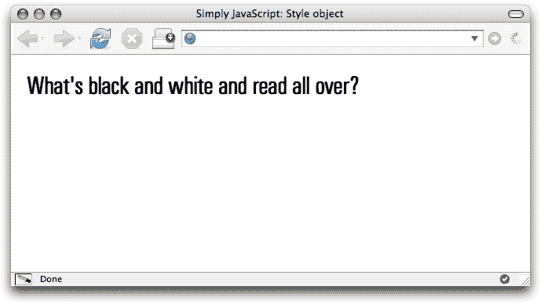

图 3.7。标准页面

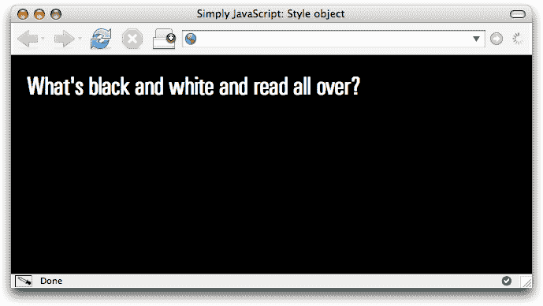

图 3.8。使用 `style` 修改后的相同页面

以下是产生巨大差异的代码：

**style_object.js** *(节录)*

```
var body = document.getElementsByTagName("body")[0];
body.style.backgroundColor = "#000000";
body.style.color = "#FFFFFF";
```

`color` CSS 属性会被子元素继承，因此在 `body` 元素上更改 `style.color` 也会影响 `body` 内部所有未分配特定颜色的元素。

`style` 对象直接访问 HTML 的 `style` 属性，因此我们刚刚看到的 JavaScript 代码实际上等同于此 HTML：

```
<body style="background-color: #000000; color: #FFFFFF;">
```

由于它*确实*是元素的内联样式，如果你对元素的 `style` 属性进行更改，且该更改与你 CSS 文件中的任何规则冲突，则 `style` 属性将具有优先权（当然，标记为 `!important` 的属性除外）。

## 使用类修改样式

在 CSS 世界中，使用内联样式来设置元素外观被认为是一种坏做法。同样，在 JavaScript 中，使用 `style` 属性作为设置元素外观的手段也被认为是一种坏做法。

正如我们在第 1 章中讨论的，你希望保持分层分离，因此 HTML 不应该包含样式信息，JavaScript 应该包含样式信息。

使用 JavaScript 更改元素外观的最佳方法是更改它的类（`class`）。这种方法有几个优点：

-   我们没有将行为与样式混合。
-   我们不需要在 JavaScript 文件中查找更改样式。
-   样式更改可以由制作样式的人完成，而不是 JavaScript 程序员。
-   在 CSS 中编写样式更加简洁。

在大多数情况下，对元素外观的更改可以定义为在其 `class` 中描述的特定状态的更改。你应该通过 JavaScript 控制的是这些状态变化，而不是其外观的特定属性。

只有在需要动态计算 CSS 值时，使用 `style` 属性的情况才是可以接受的。这通常发生在你在屏幕上移动对象时（例如为了跟随光标），或者当你对特定属性进行动画时，例如在“黄色渐变”技术中（它通过增量更改元素的 `background-color`）。

## 比较类

当我们检查 `className` 是否包含某个特定类时，我们需要使用特殊的搜索，就像我们在本章较些时候编写 `Core.getElementsByClass` 时使用的那样。事实上，我们可以使用相同的正则表达式创建一个函数，该函数可以告诉我们元素是否关联了特定类：

**core.js** *(节录)*

```
Core.hasClass = function(target, theClass)
{
  var pattern = new RegExp("(^| )" + theClass + "( |$)");
  if (pattern.test(target.className))
  {
    return true;
  }
  return false;
};
```

`hasClass` 两个参数：一个元素和一个类。正则表达式中的类与元素的 `className` 进行比较。如果 `pattern.test` 返回 `true`，意味着元素*确实*拥有该类，我们可以从函数返回 `true`。如果 `pattern.test` 返回 `false`，`hasClass` 默认返回 `false`。现在，我们可以很容易地在条件语句中使用此函数，当元素拥有（或没有）匹配的类时执行某些代码：

```
var scarlet = document.getElementById("scarlet");
if (Core.hasClass(scarlet, "clicked"))
{
}
```

## 添加类

当我们检查 `className` 是否包含某个特定类时，我们需要使用特殊的搜索，就像我们在本章较些时候编写 `Core.getElementsByClass` 时使用的那样。事实上，我们可以使用相同的正则表达式创建一个函数，该函数可以告诉我们元素是否关联了特定类：

**core.js** *(节录)*

```
Core.hasClass = function(target, theClass)
{
  var pattern = new RegExp("(^| )" + theClass + "( |$)");
  if (pattern.test(target.className))
  {
    return true;
  }
  return false;
};
```

`hasClass` 两个参数：一个元素和一个类。正则表达式中的类与元素的 `className` 进行比较。如果 `pattern.test` 方法返回 `true`，意味着元素*确实*拥有指定的类，我们可以返回 `true`。如果 `pattern.test` 返回 `false`，`hasClass` 默认返回 `false`。现在，我们可以很容易地在条件语句中使用此函数，当元素拥有（或没有）匹配的类时执行某些代码：

```
var scarlet = document.getElementById("scarlet");
if (Core.hasClass(scarlet, "clicked"))
{
}
```

我们使用 `hasClass` 来检查元素是否已经拥有我们尝试添加的类。如果是，就没有必要再次添加该类。但如果元素已经有一些类，我们必须遵循多个类的语法，即每个类由空格分隔。因此，我们在 `className` 的末尾添加 `theClass`。

当我们向元素添加类时，我们必须像添加类时一样小心。为了确保我们不会覆盖拥有某些类的元素，我们使用 `Core.hasClass` 来检查元素是否已经拥有该类。如果是，就没有必要再次添加该类。但如果元素已经有一些类，我们必须遵循多个类的语法，即每个类由空格分隔。因此，我们在 `className` 的末尾添加 `theClass`。

只有在需要动态计算 CSS 值时，使用 `style` 属性是可以接受的。这通常发生在你在屏幕上移动对象时（例如为了跟随光标），或者当你对特定属性进行动画时，例如在“黄色渐变”技术中（它通过增量更改元素的 `background-color`）。

我们页面的视觉效果将从图 3.9 所示切换到图 3.10 所示。

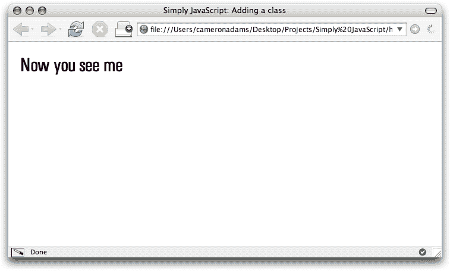

图 3.9。开始之前的页面

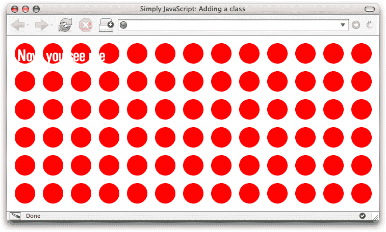

图 3.10。更改 `body` 元素后的显示

## 移除类

当我们想要从元素移除类时，我们使用相同的正则表达式（这是一个非常实用的，对吧？），但稍有不同：

**core.js** *(节录)*

```
Core.removeClass = function(target, theClass)
{
  var pattern = new RegExp("(^| )" + theClass + "( |$)");
  target.className = target.className.replace(pattern, "$1");
  target.className = target.className.replace(/ $/, "");
};
```

检查 `className` 是否包含某个特定类时，我们需要使用特殊的搜索，就像我们在本章较些时候编写 `Core.getElementsByClass` 时使用的那样。事实上，我们可以使用相同的正则表达式创建一个函数，该函数可以告诉我们元素是否关联了特定类：

在 `Core.removeClass` 中，我们不是使用正则表达式检查目标元素是否拥有该类，而是假设它拥有该类，并用正则表达式将该类替换为空字符串，从而从 `className` 中移除它。

然后，我们在 CSS 文件中为该类指定一些 CSS 规则：

**class.css**

```
.unreadable
{
  background-image: url(polka_dots.gif);
  background-repeat: 15px 15px;
  color: #FFFFFF;
}
```

现在 `Core.addClass` 执行了所有这些检查，当我们想向元素添加新类时，使用它就非常简单：

**class.js** *(节录)*

```
var body = document.getElementsByTagName("body")[0];
Core.addClass(body, "unreadable");
```

为了实现这一点，我们使用了一个名为 `replace` 的内置字符串方法。该方法接受一个正则表达式和一个替换字符串，然后将匹配正则表达式的出现替换为替换字符串。在这种情况下，我们使用空字符串作为替换内容，因此任何匹配项都将被擦除。如果类存在于 `className` 内部，它就会消失。

第二次调用 `replace` 只是为了清理 `className`，移除类之后可能遗留的任何多余空格（如果 `className` 开头有空格，某些浏览器会报错）。由于我们将这两个操作都重新赋值回 `className`，`target` 元素的类名将立即更新更改，我们可以无需费力地从函数中返回。

## 示例：制作条纹表格

在本章稍早之前，我们创建了第一个真正的*函数*——`Core.getElementsByClass`，但现在我想你已经准备好编写你的第一个真正的*程序*了，而且是一个非常实用的程序！

在我当 HTML 兵兵的日子，有一项任务比其他任何任务都让我感到恐惧，那就是制作条纹表格。在静态页面上，你必须手动编写表格，使得每一个奇行都有一个像 `alt` 这样的特殊类，但我很清楚，一旦我为 45 行不同的代码设置了类，我的经理就会过来告诉我想在最顶部再添加一行。这样，每一个奇行都会变成偶行，每一个偶行都会变成奇行。然后我必须删除 45 个类，并把它们添加到另外 45 行中。啊！

当然，那是在我认识 JavaScript 之前了。有了 JavaScript 和 `for` 循环的魔法，你可以在页面中包含一个 JavaScript 文件，然后坐下来休息，随心所欲地更改表格。显然，在这个例子中，我们将使用 JavaScript 为每第二行添加一个类。但再次将预期的结果拆解为一系列简单的步骤，可能会有所帮助。

为了实现条纹表格，我们需要：

-   找到文档中所有类名为 `dataTable` 的表格。
-   对于每个表格，获取表格行。
-   对于每隔一行，添加类 `alt`。

## 纯 JavaScript

到这里，扫一眼那个列表应该会让你几个核心想法浮现在脑海中。在等式的编程结构方面，你应该考虑循环，而且是大量的循环。但在 DOM 方面，你应该考虑 `getElementsByTagName`、`className`，甚至可能是我们自己的自定义函数 `Core.getElementsByClass`。如果你在阅读列表中的步骤时，发现自己正低声念着其中任何一个名字，请给自己拍拍掌。

### 查找所有类为 dataTable 的表格

第一步非常简单，因为我们在章节中间部分已经完成了大部分相关工作。我们不想对文档中的每个表格都应用条纹效果（以防有人调皮用它做布局），所以我们只对标记有类 `dataTable` 的表格应用条纹。要做到这一点，我们只需要激活 `Core.getElementsByClass`——它能够去找到所有的 `dataTable` 元素：

**stripy_tables.js** *(节选)*

```javascript
var tables = Core.getElementsByClass("dataTable");
```

搞定。你无法超越你自己的自定义库！

### 记得加载你的库

记得在 HTML 文档中添加一个 `<script>` 标签，在运行你程序的 `<script>` 标签之前加载 `Core` 函数库（**core.js**），如下方的代码所示。否则，你的程序将找不到 `Core.getElementsByClass`，你的浏览器将报告 JavaScript 错误。

**stripy_tables.html** *(节选)*

```html
<script type="text/javascript" src="core.js"></script>
<script type="text/javascript" src="stripy_tables.js"></script>
```

## 文档访问

### 获取每个表格的表格行

又是那个“每一个”（for each）短语。在变量 `tables` 内部，我们有一个等待添加条纹的表格集合——我们只需要使用 `for` 循环遍历其中的每一个即可。

每当我们移动 `for` 循环时，我们都想要获取该特定表格的行。这听起来还可以，但没那么简单。让我们来看看一个语义良好且可访问的表格的标记：

**stripy_tables.html** *(节选)*

```html
<table class="dataTable">
  <thead>
    <tr>
      <th scope="col">Web Luminary</th>
      <th scope="col">Height</th>
      <th scope="col">Hobbies</th>
      <th scope="col">Digs microformats?</td>
    </tr>
  </thead>
  <tbody>
    <tr>
      <td>John Doe</td>
      <td class="number">6</td>
      <td>Surfing, skateboarding</td>
      <td class="yes"></td>
    </tr>
  </tbody>
</table>
```

其中有一行我们不希望受到条纹影响——`thead` 内部的行。为了避免通过我们的条纹影响这一行，我们需要获取 `tbody` 内部的行。这意味着我们必须在代码中添加一步——我们需要获取表格中所有的 `tbody` 元素（HTML 允许存在多个），然后获取每个 `tbody` 内部的行。这个过程实际上需要*两个* `for` 循环——一个用于遍历文档中的每个 `table` 元素，另一个在*内部*用于遍历每个 `tbody` 元素——但这没关系；这只是意味着计算机要做更多工作。由于变量 `i` 被用于外层 `for` 循环的计数器，我们将内部 `for` 循环中的计数器命名为 `j`：

**stripy_tables.js** *(节选)*

```javascript
for (var i = 0; i < tables.length; i++) {
  var tbody = tables[i].getElementsByTagName("tbody");
  for (var j = 0; j < tbody.length; j++) {
    var rows = tbody[j].getElementsByTagName("tr");
  }
}
```

在代码中两次使用 `getElementsByTagName` 的结果将仅限于当前表格，因为我们将其作为特定元素的方法来使用。变量 `rows` 现在包含了当前表格 `tbody` 元素内部的所有 `tr` 元素的集合。

### 为每第二行添加类 alt

在这里，“每一个”（for every）等同于“每一个”（for each），所以我们知道要使用另一个 `for` 循环。不过它将是一个不同的 `for` 循环，因为我们只想修改每第二行。为了做到这一点，我们将计数器从第二个索引开始，每次递增二：

**stripy_tables.js** *(节选)*

```javascript
for (var i = 0; i < tables.length; i++) {
  var tbody = tables[i].getElementsByTagName("tbody");
  for (var j = 0; j < tbody.length; j++) {
    var rows = tbody[j].getElementsByTagName("tr");
    for (var k = 1; k < rows.length; k += 2) {
      Core.addClass(rows[k], "alt");
    }
  }
}
```

我们已经使用了 `i` 和 `j` 作为外层 `for` 循环的计数器，我们不想覆盖它们的值，所以创建一个新的计数变量 `k`。`k` 从 1（第二个索引）开始，每执行一次内部循环，我们就将其增加二。

这个内部循环的条件代码只有一行，使用我们预定义的 `addClass` 函数为当前行添加类 `alt`。一旦内部 `for` 循环结束，每第二行都会被标记此类，一旦外层 `for` 循环结束，每个数据表格都将拥有条纹。

### 汇总


我们的函数主要代码已经完成；我们只需要将其封装在一个自包含的对象中：

**stripy_tables.js** *(节选)*

```javascript
var StripyTables = {
  init: function() {
    var tables = Core.getElementsByClass("dataTable");
    for (var i = 0; i < tables.length; i++) {
      var tbody = tables[i].getElementsByTagName("tbody");
      for (var j = 0; j < tbody.length; j++) {
        var rows = tbody[j].getElementsByTagName("tr");
        for (var k = 1; k < rows.length; k += 2) {
          Core.addClass(rows[k], "alt");
        }
      }
    }
  }
};
```

在页面加载时使用`Core.start`启动它：

**stripy_tables.js** *(节选)*

```javascript
Core.start(StripyTables);
```

现在，每当你在页面上包含此脚本文件（以及`Core`库）时，`StripyTables`就会行动，自动为所有表格添加条纹：

**stripy_tables.html** *(节选)*

```html
<!DOCTYPE html PUBLIC "-//W3C//DTD XHTML 1.0 Strict//EN"
"http://www.w3.org/TR/xhtml1/DTD/xhtml1-strict.dtd">
<html xmlns="http://www.w3.org/1999/xhtml" lang="en-US">
<head>
  <title>Stripy Tables</title>
  <meta http-equiv="Content-Type"
```

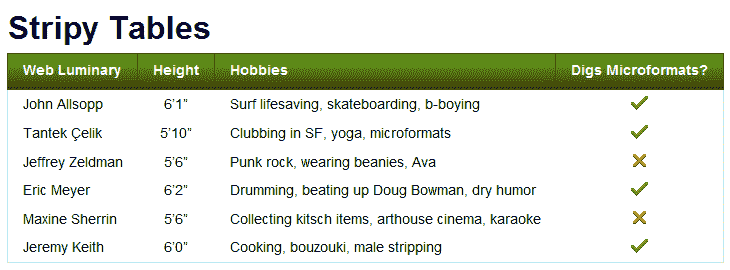

图 3.11. 无条纹且难以阅读的表格内容

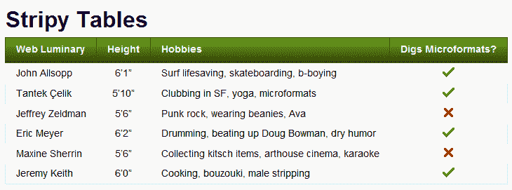

图 3.12 使用脚本生成条纹表格并提高文档的可用性

`content="text/html; charset=utf-8" />`

`<link rel="stylesheet" type="text/css" href="stripy_tables.css" />`

`<script type="text/javascript" src="core.js"></script>`

`<script type="text/javascript" src="stripy_tables.js"></script>`

你可以使用简单的 CSS 规则以你想要的方式设置`alt`类：

**stripy_tables.css** ***(节)***

```css
tr.alt {
  background-color: #EEEEEE;
}
```

**Simply JavaScript**

**98**

你可以花费非常少的精力，将像图 3.11 那样普通且难以阅读的表格转变为更加实用的东西——就像图 3.12 所示。

这种类型的脚本是渐进式增强的极佳示例。禁用了 JavaScript 浏览的用户仍然可以完美地访问表格；然而，脚本为那些可以运行它的用户提供了一个极佳的改进。

## 探索库

大多数可用的 JavaScript 库都包含一些小的辅助函数，可以帮助你扩展 DOM 的功能。这些函数从整洁的小快捷方式到完全不同的查找和操作元素的方法应有尽有。

### Prototype

Prototype 是最早将输入痛苦的`document.getElementById`替换为超紧凑的`$`的库之一。

Prototype 中的`$`函数不仅充当`document.getElementById`的直接替代品，还对其进行了扩展。你可以通过 ID 获取单个元素的引用，因此这段普通代码：

`var money = document.getElementById("money");`

将变为：

`var money = $("money");`

但你不必止于获取一个元素；你可以指定你需要的整个元素 ID 列表，`$`将它们全部作为数组的一部分返回。因此这段普通代码：

`var elementArray = [];`

`elementArray[0] = document.getElementById("kroner");`

`elementArray[1] = document.getElementById("dollar");`

`elementArray[2] = document.getElementById("yen");`

变得简短得多：

**99**

**文档访问**

`var elementArray = $("kroner", "dollar", "yen");`

在本章较早之前，我们创建了自己的库函数来通过类名获取元素。Prototype 有一个类似的函数，功能稍强一些。它创建了 document 节点的扩展，称为`getElementsByClassName`。就像我们的函数`Core.getElementsByClass`一样，该方法允许我们检索具有特定类的元素数组：

`var tables = document.getElementsByClassName("dataTable");`

它还接受一个可选的第二个参数，允许我们指定用于搜索的父元素。只有作为指定元素后代且具有特定类的元素会被包含在数组中：

`var tables = document.getElementsByClassName("dataTable", $("content"));`

变量`tables`现在是一个数组，其中包含 ID 为`content`的元素的后代且类名为`dataTable`的元素。

Prototype 还复制了我们为自己的库创建的所有类函数。这些函数接收与我们的函数完全相同的参数，但函数本身是 Prototype 的`Element`对象的方法。因此，Prototype 提供了`Element.hasClassName`、`Element.addClassName`和`Element.removeClassName`：

`var body = document.getElementsByTagName("body")[0];`

`Element.addClassName(body, "unreadable");`

`if (Element.hasClassName(body, "unreadable"))`

{

  `Element.removeClassName(body, "unreadable");`

}

### jQuery

jQuery 是最早支持完全不同的 JavaScript 查找元素方法的库之一：它允许我们使用 CSS 选择器查找一组元素。

**Simply JavaScript**

**100**

jQuery 中的主函数也称为`$`，但因为使用了 CSS 选择器，这个函数比 Prototype 版本要强大得多，并成功地将多个 Prototype 的函数合并为一个。³

如果你想使用 jQuery 通过 ID 获取元素，可以输入以下：

`var money = $("#money");`

`#`在 CSS 中表示 ID 选择器，因此`$("#money")`等同于输入`document.getElementById("money")`。

要通过标签名获取一组元素，你可以向`$`传递 CSS 元素类型选择器：

`var paragraphs = $("p");`

要通过类名获取一组元素，你可以使用类选择器：

`var tables = $(".dataTable");`

而且，就像 CSS 一样，你可以将所有这些简单选择器类型组合，例如后代选择器：

`var tables = $("#content table.dataTable");`

`tables`现在是一个数组，其中包含 ID 为`content`的元素的后代且类名为`dataTable`的元素。

### Dojo

Dojo 在处理 DOM 的方式上紧随之前的库。

它有自己的`document.getElementById`快捷方式，但它对其进行了扩展：

`var money = $("money");`

它还有自己的`getElementsByClassName`：

`var tables = document.getElementsByClassName("dataTable");`

该方法允许我们检索具有特定类的元素数组：

`var tables = document.getElementsByClassName("dataTable", $("content"));`

Dojo 还复制了我们为自己的库创建的所有类函数。这些函数接收与我们的函数完全相同的参数，但函数本身是 Prototype 的`Element`对象的方法（注：此处原文应为 Dojo）。因此，Dojo 提供了`Element.hasClassName`、`Element.addClassName`和`Element.removeClassName`：

`var body = document.getElementsByTagName("body")[0];`

`Dojo.addClassName(body, "unreadable");`

`if (Dojo.hasClassName(body, "unreadable"))`

{

  `Dojo.removeClassName(body, "unreadable");`

}

## 总结

理解 DOM 是使用 JavaScript 的核心，这就是 Web 上的 JavaScript 使用被称为“DOM 脚本”。

**Simply JavaScript**

**102**

**文档访问**

**103**

## 一段跌宕的历史

得益于文档对象模型（DOM）标准的广泛采用，在 JavaScript 代码中访问 HTML 元素在每个浏览器中的工作方式非常相似。如果 JavaScript 的各个方面都能如此就好了！事实上，响应事件运行 JavaScript 代码是当前浏览器中少数几个实现方式极其迥异的特征之一。

消息并非全是坏的。它们之间存在着某种共同点。自浏览器支持 JavaScript 以来，它们一直有一个简单的处理事件的模型——使用事件处理器（event handlers）——尽管从未为它们编写过完整的标准，¹但所有当前浏览器都为这些处理器提供了兼容支持。正如我们后将看到的，这些技术具有局限性，你可以在可能的情况下尽量避免使用它们，但它们提供了一个很好的备选方案。

### DOM Level 0

W3C DOM 规范的第一版本被称为文档对象模型 Level 1。由于事件处理器（以及许多其他非标准 JavaScript 特性）早于该规范，开发者喜欢称它们为文档对象模型 Level 0。

进入 21 世纪后，万维网联盟（W3C）开发了 DOM Level 2 事件标准，² 它提供了一种更强大的处理事件手段，称为事件监听器（event listeners）。几乎所有浏览器现在支持这一标准，唯一的例外是包括 IE 7.0 在内的 Internet Explorer。Internet Explorer 有它自己的处理方式，尽管它的方法几乎同样强大，但它也足够不同，迫使我们编写额外的代码来适应这个流行的浏览器。

有趣的是，微软参与了 W3C 内部 DOM Level 2 事件规范的开发，但在发布 IE 5.5 时，微软选择不在该浏览器中支持该规范。在自那时 Internet Explorer 的两个主要版本中（IE 6.0 和 7.0），没有看到微软添加对此标准支持的迹象。

¹ HTML 4 规范在“固有事件”（Intrinsic Events）标题下简要讨论了它们 [http://www.w3.org/TR/html4/interact/scripts.html#h-18.2.3]。

² http://www.w3.org/TR/DOM-Level-2-Events/

### 纯 JavaScript

幸运的是，我们不需要等待微软。使用事件监听器的益处（无论是 W3C 标准版本还是 Internet Explorer 的独特替代方案）都是如此巨大，以至于大量的专业极客研究了这些不兼容性并想出了合理的解决方案。通过一点努力，我们可以将这些解决方案构建到我们的`Core`库中，这样我们就可以自由使用事件监听器，而不会遇到浏览器兼容性问题。

### 事件处理器

响应事件运行 JavaScript 代码的最简单方法是使用**事件处理器**。事件处理器的存在与浏览器支持 JavaScript 的历史一样，并且早于 DOM 标准。事件处理器是一个 JavaScript 函数，它被“插入”到 DOM 节点中，以便当该元素发生特定事件时，它会被自动调用。图 4.1 解释了这一概念。

图 4.1. 插入单个事件处理器函数以响应特定事件

让我们从一个明显的例子开始——用户点击像这样的链接：

**linkhandler.html** *(节选)*

```html
<p>The first captain of the USS Enterprise NCC-1701 was`
`<a id="wikipedia" href="http://en.wikipedia.org/...">Christopher`
`Pike</a></p>`
```

当用户点击这样的链接时，浏览器会生成一个`click`事件。默认情况下，浏览器将通过导航到链接指定的 URL 来响应该`click`事件。但在发生这种情况之前，我们可以插入我们自己的事件处理器来响应该事件。

假设你想显示一个警框，通知用户他们正在离开你的网站。事件处理器只是一个 JavaScript 函数，所以我们可以写一个函数来呈现警框。像往常一样，我们不想干扰其他脚本，因此我们将此函数封装在一个具有唯一名称的对象中：

**linkhandler.js** *(节选)*

```javascript
var wikipediaLink =
{
  clickHandler: function() {
    alert("Don't believe everything you read on Wikipedia!");
  }
};
```

设置一个函数作为事件处理器是简单的。你只需要指向你想要处理事件的 DOM 元素的引用。然后，你设置元素的`on*event*`属性，其中*event*是你想要处理的事件类型：

`*element*.on*event* = *eventHandler*;`

为了用我们的`clickHandler`函数处理上述`wikipedia`链接的`click`事件（该函数是我们`wikipediaLink`对象的方法），我们这样写：

**linkhandler.js** *(节选)*

```javascript
var link = document.getElementById("wikipedia");
link.onclick = wikipediaLink.clickHandler;
```

但有一个陷阱：在元素加载之前，我们无法为我们的元素分配事件处理器。幸运的是，我们已经知道如何编写在整个文档加载后执行的代码：

**linkhandler.js**

```javascript
var wikipediaLink = {
  init: function() {
    var link = document.getElementById("wikipedia");
  link.onclick = wikipediaLink.clickHandler;
  },
  clickHandler: function() {
    alert("Don't believe everything you read on Wikipedia!");
  }
};
Core.start(wikipediaLink);
```

这个示例的代码简单得具有欺骗性。正如图 4.2 所示，代码执行分为三个阶段：

图 4.2. 执行的三个阶段

1. 浏览器遇到`<script>`标签并加载`wikipediaLink`对象，然后调用`Core.start`来请求`init`方法被调用。

2. 文档加载完成后，`init`方法被调用，发现`link`的`click`事件。

3. 用户点击链接，生成了`click`事件。浏览器调用`clickHandler`，即`click`事件处理器，显示了图 4.3 所示的警框。

图 4.3. 事件处理器的动作

一旦用户点击 **OK** 按钮消除警框，浏览器将正常跟随链接。

### 作为 HTML 属性的事件处理器

如果你去寻找，你会发现许多网站使用 HTML 属性设置事件处理器，如下：

`<a href="..." onclick="JavaScript code here">...</a>`

正如我在第 1 章中提到的，这相当于使用`style`属性为元素分配 CSS 属性。它是混乱的，违反了将动态行为与文档内容分离的原则，而且*非常丑陋*。

### 默认操作

正如我们刚刚看到的，事件处理器允许通过运行你喜欢的 JavaScript 代码来响应用户操作。但通常，浏览器仍然拥有决定权。看看我们刚刚看到的例子：无论我们的事件处理器中的代码有多创意、神奇，一旦它完成，浏览器将接管并正常跟随链接。不知道你们怎么想，但我认为那是做人的奴隶，我不接受。浏览器执行各种此类操作：

- 在用户点击时遵循链接。

- 在用户点击 **Submit** 按钮或按下 **Enter** 时提交表单。


在用户按下 `Tab` 时在页面上移动键盘焦点。

这些被称为**默认操作**——浏览器在响应事件时*通常*会做。在大多数情况下你会希望浏览器执行这些事情，但有时你会希望阻止它们的发生。

阻止浏览器响应事件执行默认操作的最简单方法是为该事件创建一个返回 `false` 的事件处理器。例如，我们可以修改上面创建的链接 `click` 事件处理器，在跟随链接之前向用户请求确认：

**clickprompt.js** *(节选)*

```javascript
clickHandler: function() {
  if (!confirm("Are you sure you want to leave this site?")) {
    return false;
  }
}
```

如图 4.4 所示，这段新代码向用户显示“你确定要离开此网站吗？”的消息，如果用户点击**取消**，它将导致我们的 `clickHandler` 方法返回 `false`。这反过来阻止了浏览器执行 `click` 事件的默认操作，因此浏览器不会跳转到链接。

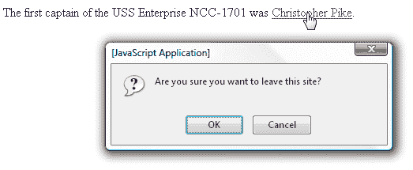

 

## 精简代码

如果你感到特别平静，可能已经发现了当我们希望 `clickHandler` 返回 `false` 时，`confirm` 也会返回 `false`。由于这些值是匹配的，如果你愿意，可以简化 `clickHandler` 的代码：

```javascript
clickHandler: function()
{
  return confirm("Are you sure you want to leave this site?");
}
```

这个版本的代码简单地返回 `confirm` 的任何返回值，而这恰正是我们想要的。

## `this` 关键字

到目前，我们只创建了一个事件处理器来处理发生在某个特定 HTML 元素上的某个特定事件——听我的，这相当可怜。真正的乐趣在于编写一个可以处理*许多* HTML 元素事件的事件处理器！

## 纯正 JavaScript

112

现在，虽然为许多不同的元素分配事件处理器相对简单，但要让它为每个元素执行某些*合理*的操作可能会很棘手，这就是 `this` 关键字派上用场的地方。

Web 开发客户的一个常见需求是让外部网站的链接在新浏览器窗口或标签页中打开。无论你原则上对此有什么看法，链接的打开方式被视为页面*行为*的一部分，因此应该由你的 JavaScript 代码来控制（如果有的话）。³

要在新窗口或标签页中打开 URL，只需使用 JavaScript 内置的 `open` 函数即可：⁴

`open(*URL*);`

因此，编写一个在新窗口中打开特定 URL 的 `click` 事件处理器是非常轻易的：

```javascript
clickHandler: function()
{
  open("http://en.wikipedia.org/wiki/Christopher_Pike");
  return false;
}
```

但我们如何对页面上的*每一个*外部链接这样做呢？我们绝对不想为每个外部链接都写一个独立的 `click` 处理器。

解决方案是编写单个处理器，使用 `this` 关键字获取刚刚点击的链接的 URL：

³ 在 HTML 标准的早期版本中，你可以设置链接的 `target` 属性来控制它的打开方式。该属性在 HTML 4 中被弃用，取而代之的是 JavaScript 替代方案。

4 你会在许多书籍和在线教程中看到引用 `window.open`，因为从技术上说，所有内置函数实际上都是全局 `window` 对象的方法。但你并没有看到他们讨论 `window.alert`，对吧？

113

事件

**newwindow.js** *(节选)*

```javascript
clickHandler: function()
{
  open(this.href);
  return false;
}
```

`this` 是一个特殊的 JavaScript 关键字，它的行为像变量，不同之处是你不能给它赋值——它的值是当前执行的函数作为方法调用的对象。换句话说，如果你调用 `*object*.method()`，那么在 `*method*` 的代码中，`this` 关键字将引用 `*object*`。当当前执行的代码不在函数内部，或者函数不是作为对象的方法被调用时，那么 `this` 指向包含所有全局变量和函数的全局对象。

由于浏览器是以事件发生元素的方法的方式调用事件处理器的，因此你可以在事件处理器内部使用 `this` 来获取该元素的引用。在上面的代码中，我们使用 `this` 获取用户点击的链接的引用，然后使用它的 `href` 属性获取链接指向的 URL。

通过使用 `this` 从元素本身检索响应事件所需的信息，我们创建了一个可以分配给页面上所有外部链接的事件处理器。我们只需要在 HTML 代码中用类名来标识它们，并在脚本的 `init` 方法中使用它：

**newwindow.js**

```javascript
var externalLinks = {
  init: function()
  {
    var extLinks = Core.getElementsByClass("external");
    for (var i = 0; i < extLinks.length; i++)
    {
      extLinks[i].onclick = externalLinks.clickHandler;
    }
  },
  clickHandler: function()
  {
    open(this.href);
    return false;
  }
};
Core.start(externalLinks);
```

纯正 JavaScript

114

138

## 事件处理器的问题

许多 JavaScript 开发者喜欢事件处理器，因为它们简单实用，而且在所有浏览器中都能运行。不幸的是，它们有一个巨大的限制：

*你只能给特定的 HTML 元素分配一个事件处理器。* 简单来说，当事件发生时，你无法轻松地执行多一件事。考虑以下代码：

```javascript
element.onclick = script1;
element.onclick = script2;
```

当在 `*element*` 上点击时，只有 `script2` 中的 `clickHandler` 会执行，因为第二个事件处理器替换了第一个。

你可能会想我们是否真的需要多个处理器。到底你有多频繁地响应事件？解决方案有很多，……（此处对应原文 "There are solutions to all of these, but they involve complicated code" 之后的部分重复或乱码）。

（注：由于原文后部分存在大量重复和 OCR 错误，译文已根据逻辑流进行了整合与清理）。

任何使用事件监听器的脚本都需要对所有支持它的浏览器使用 `addEventListener`，并对不支持的 Internet Explorer 浏览器使用 `attachEvent`。

确保你的脚本使用正确的方法简单来说是使用一个 `if-else` 语句来检查当前浏览器中是否存在 `addEventListener` 或 `attachEvent` 方法：

```javascript
if (typeof *element*.addEventListener != "undefined")
{
  *element*.addEventListener("*event*", *eventListener*, false);
}
else if (typeof *element*.attachEvent != "undefined")
{
  *element*.attachEvent("on*event*", *eventListener);
}
```

这是对象检测技术的另一个例子，我们在第 3 章中首次看到过这种技术的应用。

让我们用这种技术来在响应特定链接的 `click` 事件时显示警报框，正如我们在在本节早期使用事件处理程序所做的那样：

**linklistener.js** ***（节选）***

```javascript
var wikipediaLink =
{
  init: function()
  {
    var link = document.getElementById("wikipedia");
    if (typeof link.addEventListener != "undefined")
    {
      link.addEventListener("click", wikipediaLink.clickListener, false);
    }
    else if (typeof link.attachEvent != "undefined")
    {
      link.attachEvent("onclick", wikipediaLink.clickListener);
    }
  },
  clickListener: function()
  {
    alert("Don't believe everything you read on Wikipedia!");
  }
};
Core.start(wikipediaLink);
```

当然，这并不像设置事件处理程序那么简单，但这段代码并不复杂，而且它允许另一个脚本为链接添加它自己的 `click` 事件监听器，而不会移除我们在这里设置的那个。

虽然你通常只需要向 DOM 节点添加事件监听器并遗忘它们，但如果你需要，也可以从 DOM 节点中“拔掉”事件监听器。在 W3C 标准事件监听器模型中，我们使用 `removeEventListener` 方法来实现，而在 Internet Explorer 中，我们使用 `detachEvent`。无论哪种情况，传递给方法的参数与我们添加监听器时使用的相同：

```javascript
if (typeof *element*.removeEventListener != "undefined")
{
  *element*.removeEventListener("*event*", *eventListener, false);
}
else if (typeof *element*.detachEvent != "undefined")
{
  *element*.detachEvent("on*event*", *eventListener);
}
```

### 默认动作

你可能记得可以简单地从事件处理程序返回 `false` 以防止浏览器执行事件的默认动作，例如跟随被点击的超链接。事件监听器也让你能够这样做，但方式略有不同。

在 W3C 标准事件监听器模型中，浏览器始终向事件监听器函数传递一个**事件对象**。事件对象的属性包含有关事件的信息（例如事件发生时光标的位置），而它的方法则允许我们控制浏览器如何处理该事件。

为了防止浏览器执行事件的默认动作，我们只需调用事件对象的 `preventDefault` 方法即可：

```javascript
clickListener: function(event)
{
  if (!confirm("Are you sure you want to leave this site?"))
  {
    event.preventDefault();
  }
}
```

如果一个事件关联了多个监听器，那么其中任何一个监听器调用 `preventDefault` 都足以停止默认动作的发生。

Internet Explorer 的事件模型显然相似但又有不同之处。在 Internet Explorer 中，事件对象不是作为参数传递给事件监听器的；它是作为一个名为 `event` 的全局变量可用。此外，事件对象没有 `preventDefault` 方法；相反，它有一个名为 `returnValue` 的属性，我们可以将其设置为 `false` 以防止默认动作的发生：

```javascript
clickListener: function()
{
  if (!confirm("Are you sure you want to leave this site?"))
  {
    event.returnValue = false;
  }
}
```

再次，使用对象检测技术来确定当前浏览器支持哪种事件模型，我们可以写一个能够在任何一种事件模型中取消默认动作的事件监听器：

**clickpromptlistener.js** ***（节选）***

```javascript
clickListener: function(event)
{
  if (typeof event == "undefined")
  {
    event = window.event;
  }
  if (!confirm("Are you sure you want to leave this site?"))
  {
    if (typeof event.preventDefault != "undefined")
    {
      event.preventDefault();
    }
    else
    {
      event.returnValue = false;
    }
  }
}
```

3.

在**冒泡阶段**，事件会沿 DOM 树向上移动，再次逐个访问元素的祖先，直到到达文档节点。在路径上的每个停点，浏览器都会检查是否存在*不是*捕获阶段的事件监听器，并运行它们。

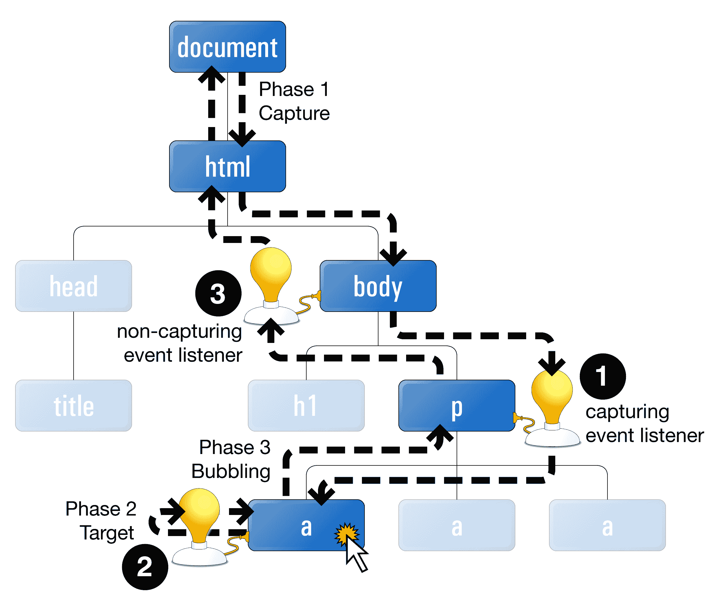

 

**并非所有事件都会冒泡**

所有事件都会经过捕获和目标阶段，但某些事件会跳过冒泡阶段。具体来说，`focus` 和 `blur` 事件分别在键盘焦点赋予和移除元素时发生，不会冒泡。在大多数情况下，你不需要为这个细节过度担心，但正如我们将看到的巨大差异，由于在本章稍后的“示例：折叠面板”节中，分配给链接本身的事件监听器在冒泡阶段仍然会被触发，这偶尔会让你的生活变得更加棘手。

所以，我为什么要用这些关于事件传播的细节来烦扰你呢？毕竟，你可以给预期发生事件的元素分配一个事件监听器，当该事件发生时，你的监听器就会运行。难道非要比这更复杂吗？在大多数情况下，不——并不如此。但有时你想得更有创意一点，而创意不可避免地会带来复杂性。请继续听听。

假设你是一个特别热心的人——我指的是那种大多数人都会觉得很烦的热心。如果用户不小心点击了页面上非链接区域，你可能想显示一条“帮助性”消息：

**strayclickcatcher.js** ***（节选）***

```javascript
strayClickListener: function(event)
{
    alert("Did you mean to click a link? " +
    "It's that blue, underlined text.");
},
```

为了捕捉文档中任何地方的点击，你只需将此赋值为文档节点的 `click` 监听器。无论目标元素位于文档的何处，该监听器都会在 `click` 事件的冒泡阶段被触发。

但当用户*确实*点击链接时，如何防止消息出现呢？你需要做的是阻止*那些* `click` 事件冒泡以触发你的事件监听器。为了实现这一点，你需要另一个事件监听器来停止这些事件的传播。

在 W3C 事件模型中，要停止事件的传播，你需要调用传递给事件监听器的对象的 `stopPropagation` 方法。在 Internet Explorer 的事件模型中没有这种方法；相反，你需要将事件对象的 `cancelBubble` 属性设置为 `true`。生成的监听器看起来如下所示：

**strayclickcatcher.js** ***（节选）***

```javascript
linkClickListener: function(event)
{
    if (typeof event == "undefined")
    {
        event = window.event;
    }
    if (typeof event.stopPropagation != "undefined")
    {
        event.stopPropagation();
    }
    else
    {
        event.cancelBubble = true;
    }
}
```

只需将第二个监听器函数分配到文档中的每个链接，它就会在 `click` 事件到达链接时停止其传播。这防止了这些点击冒泡到文档元素以触发第一个事件监听器。图 4.7 显示了当你点击文档未链接到任何内容的部分时会发生什么。然而，如果你点击链接，浏览器将毫无意见地遵循它。

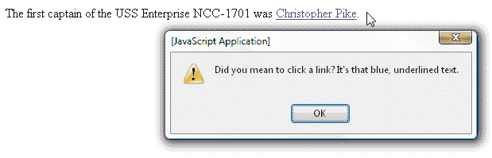

这里是完整且非常有用/烦人的脚本：

**strayclickcatcher.js**


```javascript
var strayClickCatcher =
{
    init: function()
    {
        var links = document.getElementsByTagName("a");
        if (typeof document.addEventListener != "undefined")
        {
            document.addEventListener("click",
                strayClickCatcher.strayClickListener, false);
            for (var i = 0; i < links.length; i++)
            {
                links[i].addEventListener("click",
                strayClickCatcher.linkClickListener, false);
            }
        }
        else if (typeof document.attachEvent != "undefined")
        {
            document.attachEvent("onclick",
                strayClickCatcher.strayClickListener);
            for (var i = 0; i < links.length; i++)
            {
                links[i].attachEvent("onclick",
                strayClickCatcher.linkClickListener);
            }
        }
    },
    strayClickListener: function(event)
    {
        alert("Did you mean to click a link? " +
        "It's that blue, underlined text.");
    },
    linkClickListener: function(event)
    {
        if (typeof event == "undefined")
        {
            event = window.event;
        }
        if (typeof event.stopPropagation != "undefined")
        {
            event.stopPropagation();
        }
        else
        {
            event.cancelBubble = true;
        }
    }
};
Core.start(strayClickCatcher);
```

**`this` 关键字**

在本章稍早之前，我们努力解决如何编写一个可以应用于许多不同元素的单个事件处理程序的问题。我们了解到可以使用`this`来引用分配给处理程序的元素，并从中获取我们可以用于控制处理程序响应方式的信息。如果我们能对事件监听器也这样做，就太好了……那么，我们可以这样做吗？

请记住，JavaScript 函数内部`this`的值取决于函数被调用的方式。如果它是作为对象的方法被调用的，`this`指向该对象。如果它是作为独立函数被调用的，`this`指向包含所有全局变量和函数的全局对象。问题是，浏览器是如何调用事件监听器的呢？

令人惊讶的是，W3C 事件模型标准对此主题未发表任何说明，因此由每个浏览器自己来决定在事件监听器内部使用`this`时它指向哪个对象。幸运的是，每个支持 W3C 事件模型的浏览器都会将事件监听器作为其被分配的元素的方法来调用的，因此`this`指向该元素，就像它在事件处理程序中一样。

并不那么意外的是，Internet Explorer 在事件监听器上采取了不同的方法：Internet Explorer 事件监听器是作为独立函数调用的，因此`this`指向相对没用的全局对象。

到目前，我们已经能够通过简单的对象检测来运行每个浏览器所需的代码，处理两种事件监听器模型之间的所有不兼容。然而，在解决`this`的问题时，事情并没有那么简单。如果你感兴趣的话，这里是解决方案：

```javascript
if (typeof *element*.addEventListener != "undefined")
{
    *element*.addEventListener("*event*", *eventListener*, false);
}
else if (typeof *element*.attachEvent != "undefined")
{
    var thisListener = function()
    {
        var event = window.event;
        if (Function.prototype.call)
        {
            *eventListener*.call(*element*, event);
        }
        else
        {
            target._currentListener = *eventListener*;
            target._currentListener(event);
            target._currentListener = null;
        }
    };
    *element*.attachEvent("on*event*", thisListener);
}
```

现在，暂不考虑这段代码是如何工作的细节，你能想象每每次设置事件监听器时都要输入这一整个怪物吗？我不介意告诉你，如果 JavaScript 是这样要求我们的，我就不会坐在这里写这本书了。

有一种让自己的生活变得更轻松的方法，我将在“综合运用”节中展示给你。

**Internet Explorer 内存泄漏**

在让你的生活变得困难方面，Internet Explorer 还有一个花招。如果围绕`this`关键字的灾难还不足让你想放弃 Internet Explorer 的事件模型，那么这个就会了。

在 Internet Explorer 中，如果你为一个元素设置了一个包含该元素（或者实际上是 DOM 中的任何其他节点）引用的事件监听器，内存 oc-

被该监听器复制的内容以及相关的 DOM 节点在用户导航到另一个页面时不会被释放。我承认这些是非常技术性的内容，但归根结底，某些类型的事件监听器会导致 Internet Explorer 内存泄漏，从而导致用户的计算机变慢，直到这些用户被迫重启浏览器。

解决此问题的方案是对全局`window`对象的`unload`事件设置一个特殊的事件监听器，该对象代表包含该页面的浏览器窗口。当用户导航到另一个页面时，会发生`unload`事件，特殊的事件监听器也会被触发。在这个事件监听器中，你可以利用机会移除文档中设置的所有事件监听器，从而防止它们导致内存泄漏。

虽然这个解决方案非常优雅，但实现它的 JavaScript 代码却并不优雅。目前，我就不再详细详述细节了，因为正如我们在下一节中将看到的，你不必担心它们。

## 汇总总结

你是否一直在关注在使用事件监听器时需要处理的所有跨浏览器兼容性问题？没关系——我已经记录了：

- Internet Explorer 使用`attachEvent`/`detachEvent`来添加和移除事件监听器，而不是`addEventListener`/`removeEventListener`。

- Internet Explorer 对事件使用`"on*event*"`命名样式，而不是仅用`"*event*"`。

- Internet Explorer 使用全局`event`变量，而不是将事件对象作为参数传递给监听器。

- 为了防止默认行为，Internet Explorer 要求你设置事件对象的`returnValue`属性，而不是调用它的`preventDefault`方法。

- Internet Explorer 不支持事件传播的捕获阶段。

- 要停止事件传播，Internet Explorer 要求你设置事件对象的`cancelBubble`属性，而不是调用它的`stopPropagation`方法。

- Internet Explorer 将事件监听器作为独立函数调用，而不是作为方法，这要求开发者费尽周折才能获取目标元素的引用，而不是直接使用`this`。

- 当以特定方式使用事件监听器时，Internet Explorer 会内存泄漏，除非你费尽精力清理所有的事件监听器。

……而且这还没有谈及获取键盘和鼠标事件细节时的差异。⁸

这些问题导致一些开发者放弃放弃，只使用事件处理器（event handlers）。事实上，有些专家甚至走到了使用事件处理器为基础编写了自己的事件监听器系统的步地⁹ 虽然这种方法确实有其理由，但我认为应该接受大多数浏览器内置的事件监听器支持，并将复杂的代码留给真正需要的浏览器——Internet Explorer。

为此，你在本书的代码存档中找到的`core.js`库包含了四个方法，让你能够使用事件监听器而不必担心我上面列出的任何问题。以下是它们的工作原理：

### Core.addEventListener

此方法为特定元素上的特定事件类型设置事件监听器函数。它的工作方式与标准的`addEventListener`方法一样，只不过我们将元素作为方法的第一个参数传递。它不支持创建捕获事件监听器，因此不接受最后的布尔参数：

`Core.addEventListener("*element*", "*event*", *eventListener*);`

在 Internet Explorer 中，此方法设置事件监听器，使得事件对象作为参数传递给监听器函数（就像标准事件模型一样），并且让监听器作为其赋值元素的方法调用（这样我们就可以用`this`指该元素）。

### Core.removeEventListener

它还负责在文档卸载时自动清理监听器，以免在 Internet Explorer 中导致内存泄漏。

此方法移除之前先添加到元素上的事件监听器。它的工作方式与标准的`removeEventListener`方法一样，只不过我们将元素作为方法的第一个参数传递，并且像`Core.addEventListener`一样，它不接受最后的布尔参数：

`Core.removeEventListener("*element*", "*event*", *eventListener*);`

### Core.preventDefault

此方法防止与事件相关的默认行为发生。它的工作方式与标准的`preventDefault`方法一样，只不过我们将事件对象作为方法的参数传递：

`Core.preventDefault("*event*");`

### Core.stopPropagation

此方法停止事件进一步传播，并可能触发分配给当前事件监听器祖先元素的事件监听器：

`Core.stopPropagation("*event*");`

就这样，你所有的事件监听器兼容性烦恼都消失了！在本书剩余的内容中，每当我们处理事件监听器，都会使用这些方法。

8 为了涵盖这些头疼问题以及一些可用的解决方案，请参考《JavaScript Anthology》（Melbourne: SitePoint, 2006）。

9 http://dean.edwards.name/weblog/2005/10/add-event/

## 实现功能

既然精细制作的静态页面已经就绪，我们现在可以设置一些事件监听器，以便在响应用户事件时触发我们希望发生的更改。

对于每个带有`title`属性的链接，我们希望在两种情况下显示富丰富的提示框（tooltip）：当光标悬停在链接上时（`mouseover`事件），或者链接获得键盘焦点（`focus`事件）。当鼠标移开时（`mouseout`事件）或失去键盘焦点时（`blur`事件），我们希望隐藏该提示框。

你现在应该能够很熟练地写出此类脚本的`init`方法了：

**tooltips.js**（节选）

```javascript
var Tooltips =
{
  init: function()
  {
    var links = document.getElementsByTagName("a");
    for (var i = 0; i < links.length; i++)
    {
      var title = links[i].getAttribute("title");
      if (title && title.length > 0)
      {
        Core.addEventListener(links[i], "mouseover",
        Tooltips.showTipListener);
        Core.addEventListener(links[i], "focus",
        Tooltips.showTipListener);
        Core.addEventListener(links[i], "mouseout",
        Tooltips.hideTipListener);
        Core.addEventListener(links[i], "blur",
        Tooltips.hideTipListener);
      }
    }
  },
```

如你所见，这段代码使用`getElementsByTagName`获取页面中所有`a`元素的列表，并获取每个元素的`title`属性值。如果`title`属性存在且值大于 0 个字符（`if (title && title.length > 0)`），我们就为我们感兴趣的四个不同事件设置了事件监听器。

尽管我们在每个链接上都注册了四个事件监听器，但你可以看到实际上只有两个事件监听器方法：`showTipListener`，它在响应`mouseover`或`focus`事件时显示提示框；以及`hideTipListener`，它在响应`mouseout`或`blur`时隐藏提示框。

现在，我们可以直接在这两个方法中编写实际显示和隐藏提示框的代码，但我更倾向于在脚本中使用独立的方法来实现这些“动作”，这样控制响应事件发生*什么*的代码与控制*如何*发生的代码就分开了。因此，我们的事件监听器方法往往相对简单：

**tooltips.js**（节选）

```javascript
showTipListener: function(event)
{
  Tooltips.showTip(this);
  Core.preventDefault(event);
},

hideTipListener: function(event)
{
  Tooltips.hideTip(this);
}
```

`showTipListener`调用`showTip`，该方法将实际显示提示框，并向其传递被鼠标悬停或获得键盘焦点的链接的引用。然后它调用`preventDefault`以防止浏览器在响应事件时显示其自身的提示框。

`hideTip`方法更为简单：它只是调用`hideTip`，后者将执行隐藏提示框的工作。

## 核心工作方法

我们已经尽可能地推迟了这件事，但现在是时候编写实际创建我们富提示框的代码了。

## 事件

到目前，我们编写的每个脚本要么显示了某种形式的消息框，要么修改了页面中现有元素的样式。然而，要实际显示某些*新*内容——即动态向页面添加内容——是一项完全不同的技巧。

使用 JavaScript 修改页面 HTML 内容有两种方法：

-   通过 DOM API

-   通过非标准的`innerHTML`属性

在本书中，我们只使用第一种方案。正如我们在第 3 章中所学习的，DOM API 是一个 W3C 标准，在可预见的未来会被所有 Web 浏览器支持，而且它的文档修改功能几乎胜任任何任务。相比之下，`innerHTML`属性没有在任何标准中被描述，事实上像 Firefox 这样的浏览器在与 XHTML 等新标准结合时，偶尔会在一致性实现上遇到困难。尽管如此，`innerHTML`也有其支持的理由，如果你感兴趣，可以在本节末尾的“innerHTML 选项”中阅读更多关于这种替代方案的内容。

在第 3 章中，我们集中于如何访问和修改 HTML 文档中的现有元素，但 DOM 也允许我们创建并向页面添加新内容。那些私下希望自己拥有像瓦工一样手臂力的 Web 开发者将此称为 **DOM 构建**。

为了在页面上显示提示框，我们将在相关链接内部添加一个包含提示框文本的`span`元素。如果提示框是直接在文档中编写的，那么标记看起来如下：

`<a href="...">链接文本<span class="tooltip">提示框文本</span></a>`

要通过 DOM 创建此元素，我们将使用`document`节点的节点的`createElement`方法：

**tooltips.js**（节选）

```javascript
var tip = document.createElement("span");
```

一旦创建了`span`，我们就可以设置它的`class`属性：

**tooltips.js**（节选）

```javascript
tip.className = "tooltip";
```


接下来，我们需要将提示框文本放入`span`中。在 DOM 中，这将是一个文本节点，我们可以通过`document`节点的`createTextNode`方法创建它。我们需要传递给该方法的是我们希望节点包含的链接标题：

**tooltips.js**（节选）

```javascript
var tipText = document.createTextNode(link.title);
```

为了将我们的文本节点放入`span`中，我们需要使用`span`的`appendChild`方法：

**tooltips.js**（节选）

```javascript
tip.appendChild(tipText);
```

DOM 树中的每个元素都支持`appendChild`方法，你可以用它将任何节点作为最后一个节点！为了向你展示我的意思，我们将再次使用它——将提示框作为子节点添加到链接：

**tooltips.js**（节选）

```javascript
link.appendChild(tip);
```

这就是我们的 DOM 构建，通过少量的最后的修饰，我们就拥有了`showTip`方法：

**tooltips.js**（节选）

```javascript
showTip: function(link)
{
  Tooltips.hideTip(link);
  var tip = document.createElement("span");
  tip.className = "tooltip";
  var tipText = document.createTextNode(link.title);
  tip.appendChild(tipText);
  link.appendChild(tip);
  link._tooltip = tip;
  link.title = "";
  // 修复 Safari2/9 问题
  document.documentElement.style.position = "relative";
},
```

在构建新的提示框之前，该方法调用`hideTip`以确保任何现有的提示框已被移除，这样我们就不会出现两个（这在用户悬停在已焦点的链接上可能会发生）。一旦新的提示框构建并插入，该方法会将提示框的引用存储为链接的一个属性，命名为`_tooltip`。^(11) 这使得`hideTip`之后移除提示框变得更容易，因为它只需要它获取的链接引用。最后，该方法将链接的`title`属性设置为空字符串，这样文档就不会包含两次提示框文本。整洁就是神圣，正如他们所说！

11 属性名称开头的下划线（`_`）表示这是一个“私有”属性——不供其他脚本使用的属性。它实际上并没有*阻止*其他脚本访问它，但它向其他开发者提供了一个明确信号，表明它不是标准的 DOM 属性，这会让他们在使用时三思而后虑。

**tooltips.js**（节选）

```javascript
hideTip: function(link)
{
  if (link._tooltip)
  {
    link.title = link._tooltip.childNodes[0].nodeValue;
    link.removeChild(link._tooltip);
    link._tooltip = null;
    // Fix Safari2/Opera9 重绘问题
    document.documentElement.style.position = "static";
  }
},
```

在移除提示框（tooltip）之前，此方法需要检查是否真的有一个需要移除的提示框。由于我们在链接的`_tooltip`属性中存储了当前显示的提示框的引用，我们只需要检查该属性是否有值即可。在确定当前正在显示提示框的情况下，我们需要从从中获取提示框文本并将其存储在链接的`title`属性中。你可以使用其`nodeValue`属性获取存储在文本节点中的文本，由于文本节点是提示框元素的第一个子节点，我们可以通过`link._tooltip.childNodes[0].nodeValue`访问它。这听起来有点啰嗦，但它是有效的。

当提示框文本被安全地妥善收好后，我们就可以使用`removeChild`移除提示框。由于提示框是链接的子元素，我们在链接上调用`removeChild`，并向它传递我们想要从文档中移除的节点引用——即提示框。

最后，为了指示该链接不再显示提示框，我们将它的`_tooltip`属性设置为`null`。

与`showTip`一样，我们需要用修复 Safari 2 和 Opera 9 重绘 Bug 的方法来为此方法结尾。由于我们在显示提示框时将`position`设置为`relative`，因此在隐藏提示框时，只需将其设回`static`以强制进行再次重绘。

## 139

## 事件

 

### `innerHTML`

尽管它不是任何 W3C 标准，但每个主流浏览器都支持在每个 DOM 元素上使用`innerHTML`。该属性的值是其当前包含的内容的 HTML 代码，通过更改该值，你可以更改该元素的内容。

`innerHTML`提供的最大优势是性能。如果你正在创建或修改复杂的文档结构，让浏览器使用`innerHTML`批量进行文档修改，会比逐个执行一系列单独的 DOM 修改要快得多。在某些情况下，非常复杂的 JavaScript 应用*必须*使用`innerHTML`才能获得合理的性能。此外，许多开发者很快就厌倦了编写 DOM 操作所必需的冗长 JavaScript 代码，而`innerHTML`提供的“一站式服务”是一个极具吸引力的替代方案。因此，大多数主流 JavaScript 库都包含了让 DOM 操作更简便利的工具程序，甚至出现了许多如 Dan Webb 的 DOM Builder 这样的微型库也应运而生，专门解决这个问题。^(12)

### 动态样式

在编写了按需要添加和移除提示框的所有 JavaScript 代码后，我们唯一要做的工作就是编写 CSS 代码，让这些普通的`span`元素真正吸引用户的注意力。

首先，我们需要确保提示框位于周围文档内容之上。由于我们的提示框是在超链接内部生成的，我们可以对链接应用必要的样式。首先，我们将所有链接的定位模式设为`relative`：

**tooltips.css**（节选）

```css
a:link, a:visited {
  position: relative;
}
```

12 http://www.webstandards.org/2006/04/13/

仅凭这一条规则对我们链接的外观没有任何影响，但它确实允许我们在需要时修改这些链接的`z-index`属性——特别是当链接被悬停或获得键盘焦点时：

**tooltips.css**（节选）

```css
a:hover, a:focus, a:active {
  z-index: 1;
}
```

这解决了将提示框显示在周围元素之上的问题。现在让我们来看提示框本身：

**tooltips.css**（节选）

```css
/* 提示框（动态样式） */
.tooltip {
  display: block;
  font-size: smaller;
  left: 0;
  padding: 5px;
  position: absolute;
  text-decoration: none;
  top: 1.7em;
  width: 15em;
}
```

这是此规则中各种属性声明的详细说明：

- `text-decoration: none;`：移除某些浏览器中从链接继承的下划线
- `display: block;`：将提示框显示为宽度为 15 em 的块级元素
- `width: 15em;`
- `position: absolute;`：将框定位在链接下方，并与其左边缘对齐
- `top: 1.7em;`
- `left: 0;`

## 141

## 事件

- `font-size: smaller;`：调整提示框的外观，使其更清晰地与主文档内容区分开
- `padding: 5px;`

这些声明负责处理提示框的基本外观。我们现在可以对颜色、背景和边框等细节进行调整，以获得想要的效果，根据链接的类编写不同的提示框样式：

**tooltips.css**（节选）

```css
.federation .tooltip {
  background: url(starfleet.png) top left-repeat;
  color: #2E2E3;
  min-height: 54px;
  padding: 5px;
}

.kation .tooltip {
  background: url(empire.png) top left-repeat;
  color: #FFF;
  min-height: 54px;
  padding: 5px;
}
```

### 汇总

这就是制作精棒提示框所需的全部内容了！这里是方便参考的完整 JavaScript 代码：

**tooltips.js**

```javascript
var Tooltips = {
  init: function() {
    var links = document.getElementsByTagName("a");
    for (var i = 0; i < links.length; i++) {
      links[i].addEventListener("mouseover", Tooltips.showTipListener);
      links[i].addEventListener("focus", Tooltips.showTipListener);
      links[i].addEventListener("mouseout", Tooltips.hideTipListener);
      links[i].addEventListener("blur", Tooltips.hideTipListener);
    }
  },
  showTip: function(link) {
    if (!link._tooltip) {
      var tip = document.createElement("span");
      tip.className = "tooltip";
      var tipText = document.createTextNode(link.title);
      tip.appendChild(tip);
      link.appendChild(tip);
      link._tooltip = tip;
    }
    link.title = "";
    // Fix Safari2/Opera9 重绘问题
    document.documentElement.style.position = "relative";
  },
  hideTip: function(link) {
    if (link._tooltip)
    {
      link.title = link._tooltip.childNodes[0].nodeValue;
      link.removeChild(link._tooltip);
      link._tooltip = null;
      // Fix Safari2/Opera9 重绘问题
      document.documentElement.style.position = "static";
    }
  },
  showTipListener: function(event) {
    Tooltips.showTip(this);
    event.preventDefault();
  },
  hideTipListener: function(event) {
    Tooltips.hideTip(this);
  }
};

Core.start(Tooltips);
```

## 140

## 纯 JavaScript

### 示例：折风琴

如图 4.9 所示，折风琴折叠内容以节省页面空间，允许用户一次展开一个“折叠”内容进行阅读。这种界面增强是 JavaScript 如何在基础页面上提升用户体验的绝佳示例。

### 静态页面

如常，我们首先创建一个带有整洁 HTML 和 CSS 代码的静态页面，然后再添加任何 JavaScript。折风琴本质上是一个可折叠列表，因此我们使用类为`accordion`的`ul`元素来表示它：

**accordion.html**（节选）

```html
<ul class="accordion">
  <li id="archer">
    <h2><a href="#archer">Jonathan Archer</a></h2>
    <p>舰船注册: NX-01</p>
    <p>假设指挥时间: 2151</p>
    <div class="links">
      <h3>档案</h3>
      <ul>
        <li><a href="…">Memory Alpha</a></li>
        <li><a href="…">Wikipedia</a></li>
      </ul>
    </div>
  </li>
  <li id="pike">
    ⋮
  </li>
  ⋮
</ul>
```

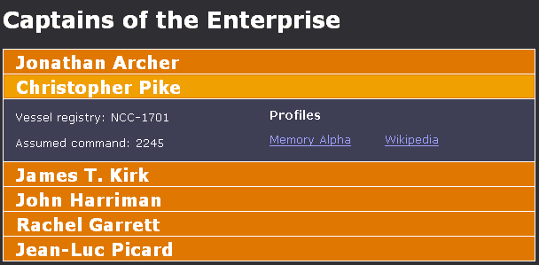

图 4.9. 一个手风琴控件

注意，我们为每个列表项都应用了 ID，并从项内部的标题链接到该 ID。虽然我们现阶段的重点是创建一个合理的 HTML 文档，但你也可以寻找添加有意义结构的机会，这将帮助你编写所需的动态行为脚本。

在这种情况下，我们可以预测将会希望用户能够点击标题，以展开手风琴相应的折叠部分。虽然我们可以通过直接在标题上添加`click`事件监听器来实现此功能，但使用链接可以更容易支持键盘用户。链接可以通过 Tab 键进行切换，并使用浏览器的内置键盘支持进行“点击”，而要让可点击的标题从键盘可访问，则需要额外的 JavaScript 代码。

## 145

## 事件

下一步是编写 CSS 代码为页面的静态版本设置样式，使其即使在不支持 JavaScript 的浏览器中看起来也很美观。由于这不是一本 CSS 书，我将为你省去代码，直接向你展示图 4.10 中的结果。如果你好奇，可以随时去代码存档中查看代码。

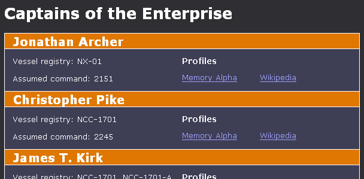

图 4.10. 在没有 JavaScript 时的样式化页面

### 主力方法

现在我们已经有了一个完美的页面，现在可以编写一个脚本来增强它。我们将从通常的脚本骨架开始：

**accordion.js**（节选）

```javascript
var Accordion =
{
  init: function()
  {
    ⋮
  },
  ⋮
};

Core.start(Accordion);
```

## 简单的 JavaScript

## 146

此脚本将主要负责展开和折叠我们手风琴列表的折叠部分，让我们从编写完成此任务的方法开始。

正如我们在第 3 章中所学习的，动态修改元素外观的最佳方法是为它们分配 CSS 类，然后在我们的样式表中定义这些每个类的实际外观。所以，让我们分别为展开和折叠的折叠部分分配`expanded`和`collapsed`类名。做出这个决定后，编写一个折叠给定折叠部分的方法就再不过简单了：

**accordion.js**（节选）

```javascript
collapse: function(fold)
{
  Core.removeClass(fold, "expanded");
  Core.addClass(fold, "collapsed");
},
```

现在你可以自由地在这一点上采取不同的方法，但对我个人来说，我希望一次只允许手风琴的一个折叠部分展开。因此，展开一个折叠也应该折叠页面上的所有其他折叠部分。因为在任何情况下，折叠页面上的所有折叠都是很有用的功能，我们将编写一个单独的方法来完成它：

**accordion.js**（节选）

```javascript
collapseAll: function(accordion)
{
  var folds = accordion.childNodes;
  for (var i = 0; i < folds.length; i++)
  {
    if (folds[i].nodeType == 1)
    {
      Accordion.collapse(folds[i]);
    }
  }
},
```

## 147

## 事件

此方法接受一个想要完全折叠的手风琴元素的引用作为参数，因此从逻辑上讲，我们要做的第一件事是获取该元素的子节点列表——代表手风琴折叠部分的列表`li`元素。


这段代码使用了 DOM 访问方面的一个新技巧：使用`if`语句检查每个列表项的`nodeType`属性。我们需要这样做是因为，无法保证列表的所有子节点都是元素节点（即列表项）。取决于使用手风琴的浏览器，代码中列表项之间的空白字符可能会被表示为文本节点，它们也会被列为`ul`元素的子节点。节点的`nodeType`属性可以告诉你正在处理的是元素节点、文本节点还是属性节点。由于只对元素（列表中的列表项）感兴趣，我们检查`nodeType`值是否为`1`。

除了这个新技巧外，该方法非常直观。它获取手风琴中所有折叠部分的列表，然后调用`Accordion.collapse`来折叠每一个。现在我们已经有了编写`expand`方法所需的所有内容：

**accordion.js** *(节选)*

```javascript
expand: function(fold)
{
  Accordion.collapseAll(fold.parentNode);
  Core.removeClass(fold, "collapsed");
  Core.addClass(fold, "expanded");
},
```

## 动态样式

现在我们已经有了负责更改手风琴外观的方法，让我们转换一下，编写控制那些外观的 CSS。目前为止的工作涵盖了基础部分，但为了增加一点趣味，我们可以改变展开的、鼠标悬停或获得焦点的折叠标题的背景颜色：

**accordion.css** *(节选)*

```css
/* 手风琴样式（动态） */
ul.accordion li.collapsed * {
  position: absolute;
  left: -10000px;
}

ul.accordion li.collapsed h2, ul.accordion li.expanded h2,
ul.accordion li.collapsed h2:link,
ul.accordion li.collapsed h2:visited,
ul.accordion li.expanded h2:link,
ul.accordion li.expanded h2:visited {
  position: static;
}
```

## 简单的 JavaScript

左移定位（Offleft positioning）对屏幕阅读器来说是一个巨大的福音，因为屏幕阅读器软件会像这些内容可见一样读取它们。这种方法的副作用是，对于键盘用户来说，这些内容仍然是页面的一部分，他们将被通过 Tab 键遍历隐藏内容中的任何链接或元素，尽管这些内容对他们是不可见的。

然而在这个特定的示例中，我们可以将其转化为优势，因此左移定位是最佳选择。

下一步是编写 CSS 代码为页面的静态版本设置样式，使其即使在不支持 JavaScript 的浏览器中看起来也很美观。由于这不是一本 CSS 书，我将为你省去代码，直接向你展示图 4.10 中的结果。如果你好奇，可以随时去代码存档中查看代码。

## 事件

回到 JavaScript 世界，我们现在可以编写让事情发生的代码，设置响应用户操作的事件监听器。由于我们希望在文档加载完成后立即设置事件监听器，我们将注意力转向脚本的`init`方法。

让我们列解在该方法中想要实现的任务：

1. 找到页面中的手风琴列表。
2. 对于每个手风琴，折叠它包含的所有折叠部分。
3. 当用户点击折叠面板标题中的链接时，展开它；如果它已经展开，则将其折叠。

这是一个并不糟糕的开端，所以让我们把这些计划转换为 JavaScript 代码。如果你有信心，可以尝试在看下面的代码之前自己动手实现——你可以仅使用我们在书中已经见过的 JavaScript 技术和功能来实现这些中的每一个步骤：

**accordion.js** *(节选)*

```javascript
init: function()
{
  var accordions = Core.getElementsByClass("accordion");
  for (var i = 0; i < accordions.length; i++)
  {
    var folds = accordions[i].childNodes;
    for (var j = 0; j < folds.length; j++)
    {
      if (folds[j].nodeType == 1)
      {
        Accordion.collapse(folds[j]);
        var foldLinks = folds[j].getElementsByTagName("a");
        var foldTitleLink = foldLinks[0];
        Core.addEventListener(foldTitleLink, "click",
        Accordion.clickListener);
      }
    }
  }
},
```

这段代码获取了所有类名为`accordion`的元素的列表，并使用`for`循环逐个处理它们。对于每个折叠列表，它获取了其子节点列表（即折叠部分），并再次使用`for`循环逐个遍历它们。在确认列表中的每个节点确实是元素节点后，它调用`collapse`方法来折叠该折叠。

然后，它获取了折叠中第一个链接的引用（这将是折叠标题内部的那个），并为其添加了一个事件监听器，以响应用户的点击。下面是该事件监听器：

**accordion.js** *(节选)*

```javascript
clickListener: function(event)
{
  var fold = this.parentNode.parentNode;
  if (Core.hasClass(fold, "collapsed"))
  {
    Accordion.expand(fold);
  }
  else
  {
    Accordion.collapse(fold);
  }
  Core.preventDefault(event);
},
```

再次，这里的内容相对直接。监听器获取了折叠面板的引用，它是刚刚点击的链接的父节点的父节点。然后它检查折叠面板当前的 CSS 类，以确定该折叠是否已折叠。如果是折叠状态，代码会展开它；如果是展开状态，代码会将其折叠。

监听器结束于调用`Core.preventDefault`，这会阻止浏览器尝试跟随链接。虽然浏览器真的去跟随链接也不会产生什么灾难性的后果（毕竟，它只是链接到折叠面板本身），但这可能会导致页面滚动到该折叠处，而我们想要的是一种流畅、无缝的效果。

通过目前为止看到的代码，折叠面板将完全按照我们想要的方式为鼠标和屏幕阅读器用户工作，但我们仍然需要解决左侧定位给键盘用户带来的问题。请记住，尽管折叠面板的内容被隐藏在屏幕左侧，但键盘用户仍然会发现自己正在通过 **Tab** 键穿过这些折叠的内容。

从表面上看，这似乎是一个没有两胜的困地，但让我们尝试一种大多数主流软件公司使用的策略：如果我们认为这是一个功能而不是一个 Bug 呢？如果我们无法阻止键盘用户 **Tab** 进隐藏的折叠面板中，为什么不让在他们这样做时发生一些*有用*的事情呢？具体来说，当用户 **Tab** 进一个折叠时，我们可以展开它！

在理想世界中，实现此点的一种简单方法是为每个折叠添加一个`focus`事件监听器，并捕获`focus`事件从折叠内接收焦点的特定元素冒泡上时，但正如我们在本章早些部分学到的那样，`focus`事件是不冒泡的。(14)

相反，我们需要为折叠面板中每个可能接收键盘焦点的元素挂载`focus`事件监听器。在这个示例中，我们将范围限制在超链接上，但如果你向折叠面板添加了表单元素，你也将需要为它们设置此种监听器：(15)

**accordion.js** *(节选)*

```javascript
init: function()
{
  var accordions = Core.getElementsByClass("accordion");
  for (var i = 0; i < accordions.length; i++)
  {
    var folds = accordions[i].childNodes;
    for (var j = 0; j < folds.length; j++)
    {
      if (folds[j].nodeType == 1)
      {
        Accordion.collapse(folds[j]);
        var foldLinks = folds[j].getElementsByTagName("a");
        var foldTitleLink = foldLinks[0];
        Core.addEventListener(foldTitleLink, "click",
        Accordion.clickListener);
        for (var k = 1; k < foldLinks.length; k++)
        {
          Core.addEventListener(foldLinks[k], "focus",
          Accordion.focusListener);
        }
      }
    }
  }
},
```

14 如果你想表现得挑剔一点，它们在 Firefox 等 Mozilla 浏览器中确实是冒泡的，但这种行为直接违反了 W3C 事件标准，因此我不惊讶会在这些浏览器的未来版本中看到它被改变。

15 如果你想处理得特别周全，可以为折叠面板内的*每一个*元素添加此监听器，但如此大量的监听会对性能带来压力，因此我建议使用更轻量的方法。

**accordion.js** *(节选)*

```javascript
focusListener: function(event)
{
  var element = this;
  while (element.parentNode)
  {
    if (element.parentNode.className == "accordion")
    {
      Accordion.expand(element);
      return;
    }
    element = element.parentNode;
  }
}
```

这段代码展示了使用`parentNode`属性向上查找的常用方法。由于我们知道`this`是折叠面板中的某个元素，我们可以使用`while`循环向上查找，直到找到类名为`accordion`的元素。

**accordion.html** *(节选)*

```html
<ul class="accordion">
  <li id="archer">
  <li id="pike">
</ul>
```

如果页面上的链接指向某个特定的折叠（例如`accordion.html#pike`），在页面加载时自动展开该折叠将是好的。这为我们的`init`方法增加一个小功能：

**accordion.js** *(节选)*

```javascript
init: function()
{
  var accordions = Core.getElementsByClass("accordion");
  for (var i = 0; i < accordions.length; i++)
  {
    if (location.hash.length > 1)
    {
      var activeFold = document.getElementById(
        location.hash.substring(1));
      if (activeFold && activeFold.parentNode == accordions[i])
      {
        Accordion.expand(activeFold);
      }
    }
  }
},
```

全局`location`变量是一个包含页面信息的对象。它的`hash`属性包含 URL 的标识符（例如`"#pike"`），我们可以利用 JavaScript 内置的`substring`方法获取标识符从第二个字符开始的部分：

**accordion.js** *(节选)*

```javascript
var activeFold = document.getElementById(
  location.hash.substring(1));
```

在展开元素之前，我们需要检查该 ID 是否对应于页面中的一个元素，以及该元素的父元素是否是我们正在设置的折叠面板：

**accordion.js** *(节选)*

```javascript
if (activeFold && activeFold.parentNode == accordions[i])
{
  Accordion.expand(activeFold);
}
```

现在，你得到了：一个健壮且可访问的面板控件，你可以轻松将其插入到任何喜欢的网页中。在在你喜欢的浏览器中加载它并尝试一下。尝试使用键盘 **Tab** 遍历折叠面板及其内容，看看额外的代码如何让你的网站对更广泛的受众友好。

这里是完整的 JavaScript 代码：

**accordion.js**

```javascript
var Accordion =
{
  init: function()
  {
    var accordions = Core.getElementsByClass("accordion");
    for (var i = 0; i < accordions.length; i++)
    {
      var folds = accordions[i].childNodes;
      for (var j = 0; j < folds.length; j++)
      {
        if (folds[j].nodeType == 1)
        {
          Accordion.collapse(folds[j]);
          var foldLinks = folds[j].getElementsByTagName("a");
          var foldTitleLink = foldLinks[0];
          Core.addEventListener(
            foldTitleLink, "click", Accordion.clickListener);
          for (var k = 1; k < foldLinks.length; k++)
          {
            Core.addEventListener(
              foldLinks[k], "focus", Accordion.focusListener);
          }
        }
      }
    }
  },
  clickListener: function(event)
  {
    var fold = this.parentNode.parentNode;
    if (Core.hasClass(fold, "collapsed"))
    {
      Accordion.expand(fold);
    }
    else
    {
      Accordion.collapse(fold);
    }
    Core.preventDefault(event);
  },
  focusListener: function(event)
  {
    var element = this;
    while (element.parentNode)
    {
      if (element.parentNode.className == "accordion")
      {
        Accordion.expand(element);
        return;
      }
      element = element.parentNode;
    }
  }
};
```


```javascript
Core.addEventListener(
  foldLinks[k], "focus", Accordion.focusListener);
);
}
}
if (location.hash.length > 1)
{
  var activeFold = document.getElementById(
    location.hash.substring(1));
  if (activeFold && activeFold.parentNode == accordions[i])
  {
    Accordion.expand(activeFold);
  }
}
}
},
collapse: function(fold)
{
  Core.removeClass(fold, "expanded");
  Core.addClass(fold, "collapsed");
},
collapseAll: function(accordion)
{
  var folds = accordion.childNodes;
  for (var i = 0; i < folds.length; i++)
  {
    if (folds[i].nodeType == 1)
    {
      Accordion.collapse(folds[i]);
    }
  }
},
expand: function(fold)
{
  Accordion.collapseAll(fold.parentNode);
  Core.removeClass(fold, "collapsed");
  Core.addClass(fold, "expanded");
},
clickListener: function(event)
{
  var fold = this.parentNode.parentNode;
  if (Core.hasClass(fold, "collapsed"))
  {
    Accordion.expand(fold);
  }
else
{
  Accordion.collapse(fold);
  }
  Core.preventDefault(event);
},
focusListener: function(event)
{
  var element = this;
  while (element.parentNode)
  {
    if (element.parentNode.className == "accordion")
    {
      Accordion.expand(element);
      return;
    }
    element = element.parentNode;
  }
}
};
Core.start(Accordion);
```

## 事件

## 探索库

大多数 JavaScript 库都包含了解决事件监听器浏览器兼容问题的解决方案，我们在这一章中处理过这些问题。尽管我们认为为本书开发的`Core`库非常值得使用，但根据你的偏好，你可能会发现这些替代方案稍微方便、高效，或者更让人困惑。

例如，`Prototype`库为标准的`addEventListener`和`removeEventListener`方法提供了跨浏览器替代方案，分别称为`Event.observe`和`Event.stopObserving`：

```javascript
Event.observe("element", "event", eventListener);
Event.stopObserving("element", "event", eventListener);
```

这些方法的工作方式与我们的`Core.addEventListener`和`Core.removeEventListener`方法非常相似，它们会透明地调用正确的方法在当前浏览器中添加和删除事件监听器，并确保完成必要的清理，以避免在 Internet Explorer 中出现监听器相关的内存泄漏。

然而，这些方法仍然留了一些未解决的问题——例如监听器函数内部`this`值的上下文不一致性。Prototype 并没有自动确保`this`指向应用事件监听器的元素，而是通过为每个函数添加一个`bindAsEventListener`方法，让你精确指定想要让`this`指向哪个对象。

因此，在 Prototype 中设置事件监听器的正确方法如下：

```javascript
Event.observe("element", "event", eventListener.bindAsEventListener("element"));
```

我在这里假设我们希望`this`指向添加监听器的元素，但我们可以将任何喜欢的对象作为参数传递给`bindAsEventListener`，当调用事件监听器函数时，它将作为`this`的值。

调用`bindAsEventListener`还解决了剩余的跨浏览器兼容性问题，例如确保即使在 Internet Explorer 中，事件对象也会作为参数传递给监听器函数。

遗憾的是，这种方法稍微复杂化了*移除*事件监听器的过程。由于我们需要向`Event.stopObserving`传递相同的参数才能使其生效，我们需要存储调用`bindAsEventListener`的结果：

```javascript
var myEventListener = eventListener.bindAsEventListener("element");
Event.observe("element", "event", myEventListener);
Event.stopObserving("element", "event", myEventListener);
```

如果说 Prototype 让注册事件监听器变得有点复杂，它简化了对事件传播和默认行为的控制。Prototype 没有提供单独的`preventDefault`和`stopPropagation`方法，而是提供了一个兼顾两者：

```javascript
Event.stop(event);
```

在复杂性的另一端是`jQuery`库，它让管理事件监听器的代码极其简单。它拥有非常易用的`bind`和`unbind`方法，可以处理所有的跨浏览器兼容性问题。

## 第 5 章

### 动画

你准备好开启进入……之旅了吗？（伴随着幽异的音乐。）动画的核心在于时间——停止时间，弯曲时间以产生你想要的效果。它们是什么呢？你必须继续读下去才能发现！但首先，让我们仔细看看动画到底是什么。

### 动画原理

如果你像我一样是周六早晨动画的鉴赏家，你可能对动画的基本原理很熟悉。如图 5.1 所示，我们在电视屏幕上看到的并不是铁臂在飞翔，而是一系列快速播放的图像，每幅图像之间有细微的变化，从而产生了铁臂可以移动的错觉。

标准电视显示器每秒显示 25 到 30 张图片（或**帧**），但我们并不会感知到每一帧——我们将它们看作一个连续的运动图像。动画与现场直播的区别仅在于制作方式。实际的显示技术是相同的——通过一系列快速显示的图像来欺骗大脑，看到连续的运动。


图 5.1 使用逐渐变化的图像创造运动的错觉

在界面中添加动画与为电视制作没有区别，尽管它看起来没那么艺术。如果你想让下拉菜单真正*向下*落下，你需要从关闭状态开始，以打开状态结束，并包含大量的中间步骤，让它看起来是移动过的。

你想要移动得越快，在起始帧和结束帧之间的步骤就越少。目前，没有动画的下拉菜单类似于传送——菜单直接从 A 点移动到 B 点，中间没有任何步骤。如果你只添加一个步骤，它就不完全是传送，但比你眨眼还要快。添加十个步骤，菜单看起来就会平滑移动。

## 总结

在本章中，我们在动画领域迈出了大一步——我们还学会了如何停止时间、启动时间以及弯曲时间以产生你想要的效果。创建动画实际上并不需要学习很多新的 JavaScript——只需要两个小函数。

你找到最佳间隔，从而让你在菜单打开时获得那种美妙、愉悦的感觉。

### 使用 JavaScript 控制时间

关于动画最直观的思考方式将其视为时间的切片。我们正在捕捉并显示时间中的离散瞬间，以便让它们看起来像一个连续的体验。但是，考虑到我们在 JavaScript 中处理动画的方式，更准确的可能是将自己看作是在插入*暂停*——在时间切片*之间*放置间隙，如图 5.2 所示。

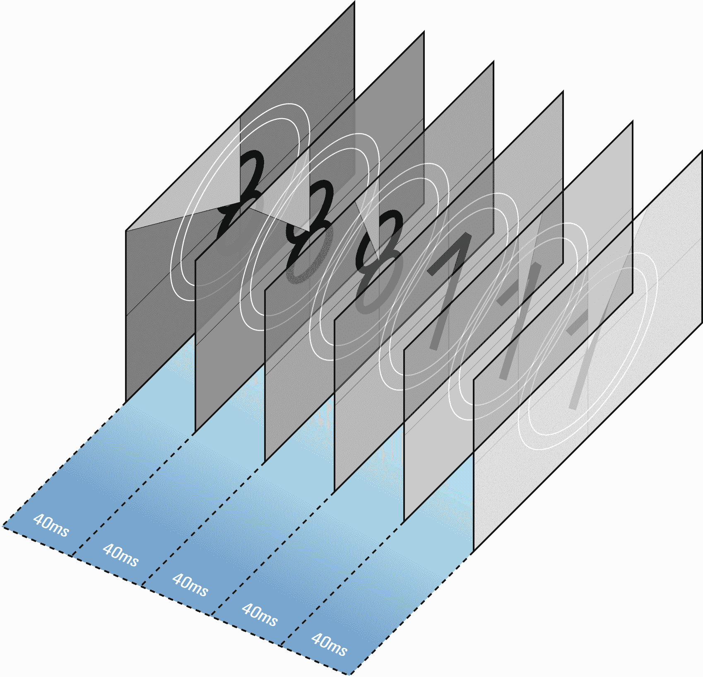

图 5.2. 一个正在以每秒 25 帧的速度运行的动画，其中每个时间“切片”之间的间隙为 40 毫秒。

在正常的程序流中，浏览器将尽可能快地执行 JavaScript，只要指令可以处理，就会向 CPU 发送指令。这意味着你整个 5,000 行的程序执行速度可能比你呼吸的速度还要快。如果你正在进行长时间计算，这很棒；但如果你在创建动画，它就毫无用处。用 7.3 秒看完《白雪公主和七个矮人》可能是高效的，但对剧情并没有太大帮助。

为了创建流畅、可信的动画，我们需要能够控制每一帧在何时显示。在传统动画中，**帧率**（即每秒显示的图像数量）是固定的。关于你如何划分间隔、在哪里划分以及划分什么，所有决定都由你决定，但它们始终以完全相同的、经过测量的节奏进行显示。

在 JavaScript 中，你可以创建相同的切片并控制相同的方面，但你也被赋予了对暂停的控制权——从一个图像显示到另一个图像需要多长时间。你可以随心所欲改变暂停，减慢时间、加速或完全停止（尽管大多数时候你可能希望它保持稳定）。我们在 JavaScript 中使用`setTimeout`来控制时间。

`setTimeout`并不是让你的程序尽可能快地执行每条语句，而是告诉你的程序等待一会儿——喘口气。该函数接受两个参数：你希望它之后执行的下一条语句，以及程序在执行该语句之前应该等待的时间（以毫秒为单位）。

为了防止`setTimeout`调用内部的语句被立即求值，我们必须将其转换为字符串。因此，如果我们想在一条秒后显示警报框，`setTimeout`调用看起来像这样：

`setTimeout("alert('等待得值吗?')", 1000);`

从这条语句执行的刻起，我们的程序将等待 1000 毫秒（一秒），然后才执行字符串内部的代码，并产生图 5.3 所示的弹出窗口。

从技术上讲，当调用`setTimeout`时，发生的情况是浏览器将该语句添加到某种“待办列表”中，而你的程序的其他部分继续运行而不暂停。一旦它完成了当前正在的工作（例如，执行一个事件监听器），浏览器就会查看它的待办列表，并执行它在其中安排的任何任务。

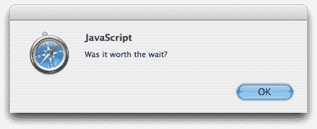

图 5.3. 使用`setTimeout`在指定的毫秒数后执行代码。

通常，当你从另一个函数内部调用一个函数时，外部函数的执行会停止，直到内部函数执行完毕。因此，像这里所示的函数实际上是图 5.4 所示的方式执行的：

```javascript
function fabric()
{
  ...
  alert("拦住那个人!");
  ...
}
```

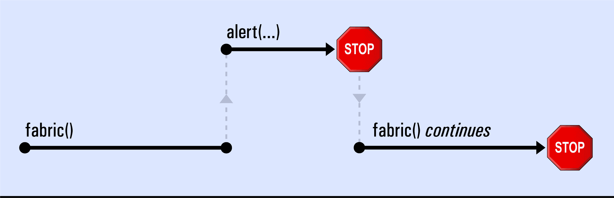

图 5.4. 在另一个函数内部调用函数

但如果你在代码中间有一个`setTimeout`调用，会发生什么？

```javascript
function fabric()
{
  ...
  setTimeout("alert('等待得值吗?');", 1000);
  ...
}
```

在这种情况下，传递给`setTimeout`的语句执行被推迟了，而`fabric`的其余部分会立即执行。安排的任务会等待指定的时间过去，*并且*浏览器完成它正在做的工作，然后才执行。图 5.5 说明了这一概念。

严格来说，当你调用`setTimeout`时指定的延迟将是安排的任务在发生之前必须经过的*最小*时间。如果该时间到达时浏览器仍在忙于其他事情，你的任务将被推迟，直到所有其他任务都完成，如图 5.6 所示。¹

## 在`setTimeout`中使用变量

传递给`setTimeout`的语句在全局作用域中运行。我们在第 2 章中讨论过作用域，所以如果你想复习一下，可以回到那一章。作用域在这里产生的影响是，`setTimeout`执行的代码将无法访问调用`setTimeout`的函数中的任何局部变量。看这个：

```javascript
function periscope()
{
  var message = "准备浮出!";
  setTimeout("alert(message)", 2000);
}
```

在这里，变量`message`是`periscope`的局部变量，但传递给`setTimeout`的代码将完全离开`periscope`独立运行。因此，它将无法访问`message`。由于我们想在一秒后显示警报框，`setTimeout`调用看起来像这样：

`setTimeout("alert('等待得值吗?')", 1000);`

从这条语句执行的刻起，我们的程序将等待 1000 毫秒（一秒），然后才执行字符串内部的代码，并产生图 5.3 所示的弹出窗口。

从技术上讲，当调用`setTimeout`时，发生的情况是浏览器将该语句添加到某种“待办列表”中，而你的程序的其他部分继续运行而不暂停。一旦它完成了当前正在的工作（例如，执行一个事件监听器），浏览器就会查看它的待办列表，并执行它在其中安排的任何任务。


图 5.3. 使用`setTimeout`在指定的毫秒数后执行代码。

通常，当你从另一个函数内部调用一个函数时，外部函数的执行会停止，直到内部函数执行完毕。因此，像这里所示的函数实际上是图 5.4 所示的方式执行的：

```javascript
function fabric()
{
  ...
  alert("拦住那个人!");
  ...
}
```


图 5.4. 在另一个函数内部调用函数

但如果你在代码中间有一个`setTimeout`调用，会发生什么？

```javascript
function fabric()
{
  ...
  setTimeout("alert('等待得值吗?');", 1000);
  ...
}
```

在这种情况下，传递给`setTimeout`的语句执行被推迟了，而`fabric`的其余部分会立即执行。安排的任务会等待指定的时间过去，*并且*浏览器完成它正在做的工作，然后才执行。图 5.5 说明了这一概念。


严格来说，当你调用`setTimeout`时指定的延迟将是安排的任务在发生之前必须经过的*最小*时间。如果该时间到达时浏览器仍在忙于其他事情，你的任务将被推迟，直到所有其他任务都完成，如图 5.6 所示。¹

传递给`setTimeout`的语句在全局作用域中运行。我们在第 2 章中讨论过作用域，所以如果你想复习一下，可以回到那一章。作用域在这里产生的影响是，`setTimeout`执行的代码将无法访问调用`setTimeout`的函数中的任何局部变量。看这个：

```javascript
function periscope()
{
  var message = "准备浮出!";
  setTimeout("alert(message)", 2000);
}
```

在这里，变量`message`是`periscope`的局部变量，但传递给`setTimeout`的代码将完全离开`periscope`独立运行。因此，它将无法访问`message`。由于我们想在一秒后显示警报框，`setTimeout`调用看起来像这样：

`setTimeout("alert('等待得值吗?')", 1000);`

从这条语句执行的刻起，我们的程序将等待 1000 毫秒（一秒），然后才执行字符串内部的代码，并产生图 5.3 所示的弹出窗口。

从技术上讲，当调用`setTimeout`时，发生的情况是浏览器将该语句添加到某种“待办列表”中，而你的程序的其他部分继续运行而不暂停。一旦它完成了当前正在的工作（例如，执行一个事件监听器），浏览器就会查看它的待办列表，并执行它在其中安排的任何任务。


图 5.3. 使用`setTimeout`在指定的毫秒数后执行代码。

通常，当你从另一个函数内部调用一个函数时，外部函数的执行会停止，直到内部函数执行完毕。因此，像这里所示的函数实际上是图 5.4 所示的方式执行的：

```javascript
function fabric()
{
  ...
  alert("拦住那个人!");
  ...
}
```


图 5.4. 在另一个函数内部调用函数

但如果你在代码中间有一个`setTimeout`调用，会发生什么？

```javascript
function fabric()
{
  ...
  setTimeout("alert('等待得值吗?');", 1000);
  ...
}
```

在这种情况下，传递给`setTimeout`的语句执行被推迟了，而`fabric`的其余部分会立即执行。安排的任务会等待指定的时间过去，*并且*浏览器完成它正在做的工作，然后才执行。图 5.5 说明了这一概念。

严格来说，当你调用`setTimeout`时指定的延迟将是安排的任务在发生之前必须经过的*最小*时间。如果该时间到达时浏览器仍在忙于其他事情，你的任务将被推迟，直到所有其他任务都完成，如图 5.6 所示。¹

当然，如果变量的字符串值恰好包含一个或多个单引号，这种方法除非你费用反斜杠转义每个单引号，否则将会崩溃。虽然这可行，但涉及的代码并不有趣。

最后一种选项，也是复杂脚本中更常用的选项，是使用**闭包**。闭包是一个微妙的 JavaScript 概念，它允许在函数内部定义的任何函数访问外部函数的局部变量，无论它们何时运行。换句话说，函数可以访问它们定义时的上下文，即使该上下文已经停止执行。所以，即使外部函数可能在几分钟前已经执行完毕，执行期间定义的函数仍然能够访问它的局部变量。

考虑到`setTimeout`将字符串作为第一个参数这一事实，这对我们有什么帮助？呢，它也可以接受函数：

```javascript
function periscope()
{
  var message = "准备浮出!";
  var theFunction = function()
  {
    alert(message);
  };
  setTimeout(theFunction, 2000);
}
```

或者更简洁地：

```javascript
function periscope()
{
  var message = "准备浮出!";
  setTimeout(function(){alert(message);}, 2000);
}
```

当你将函数传递给`setTimeout`时，`setTimeout`并没有立即执行它；是在指定的延迟后执行该函数。由于该函数是在`periscope`内部定义的，函数创建了一个闭包，使其能够访问`periscope`的局部变量（在本例中为`message`）。

尽管`periscope`在两秒后内部函数执行时已经执行完毕，但`message`仍然可用，且`alert`的调用将弹出正确的消息。

闭包的概念很难理解，所以目前，如果你只是对它们有一个大致的感受，就可以自满意了。

## 停止计时器

当`setTimeout`执行时，它会创建一个计时器，开始“倒计时”直到指定的代码应该被执行的时刻。`setTimeout`函数返回该计时器的 ID，以便你稍后在脚本中访问它。到目前为止，我们调用`setTimeout`时一直没有理会它的返回值，但如果你想干预计时器的倒计时，就必须注意这个值。

要在倒计时结束之前停止计时器，我们需要将计时器的 ID 捕获在一个变量中，并将其传递给一个名为`clearTimeout`的函数。`clearTimeout`会立即取消关联计时器的倒计时，而预定的任务将永远不会发生：

`var timer = setTimeout("alert('This will never appear')", 3000);`

`clearTimeout(timer);`

上述代码中的`alert`将永远不会显示，因为我们使用`clearTimeout`立即停止了`setTimeout`调用。

让我们考虑一些稍微更有用的东西。假设我们创建一个显示两个按钮的页面：

**clear_timeout.html** ***（节选）***

`<button id="start">Start</button>`

`<button id="stop">Stop</button>`

我们可以用一个短程序为这些按钮添加一些行为：

**Simply JavaScript**

**172**

**clear_timeout.js**

`var ClearTimer =`

{

`init: function()`

{

`var start = document.getElementById("start");`

`Core.addEventListener(start, "click", ClearTimer.clickStart);`

`var stop = document.getElementById("stop");`

`Core.addEventListener(stop, "click", ClearTimer.clickStop);`

},`

`clickStart: function()`

{

`ClearTimer.timer = setTimeout("alert('Launched')", 2000);`

},`

`clickStop: function()`

{

`if (ClearTimer.timer)`

{

`clearTimeout(ClearTimer.timer);`

}

`alert("Aborted");`

}`

};`

`Core.start(ClearTimer);`

该程序首先通过`Core.start`运行`ClearTimer.init`，它通过为每个按钮添加`click`事件监听器来初始化页面。当 **Start** 按钮被点击时，将调用`ClearTimer.clickStart`；当 **Stop** 按钮被点击时，将调用`ClearTimer.clickStop`。

`ClearTimer.clickStart`使用`setTimeout`来调度一个`alert`，但我们将该调度`alert`的 ID 存储在变量`ClearTimer.timer`中。每当`ClearTimer.clickStop`被按下时，我们将`ClearTimer.timer`传递给`clearTimeout`，计时器就会停止。

所以，一旦你点击 **Start**，你就有两秒的时间点击 **Stop**；否则，`alert`对话框将会出现并显示消息“Launched。”这个简单的例子

**173**

**Animation**

很好地说明了通过用户交互控制计时器所涉及的内容；我们将在本章稍后部分 look将如何在更复杂的界面中使用它。

## 创建循环计时器

还有另一个计时函数与`setTimeout`非常相似，但它允许你调度一段重复的代码。这个函数被称为`setInterval`。

`setInterval`的参数与`setTimeout`完全相同，在执行时，它以完全相同的方式等待。但一旦预定的代码执行完毕，乐趣并没有停止——`setInterval`会再次、再次、再次、再次地调度代码，直到你告诉它停止。如果你告诉它等待 1,000 毫秒，`setInterval`将调度代码每 1,000 毫秒运行一次。

每个间隔都被调度为一个单独的任务，因此如果预定代码的某次运行时间比间隔时间长，那么下一次执行将在它完成后立即执行，因为浏览器会忙于追赶。

在本章开始时，我提到过 JavaScript 中实际上有一个半函数可以用来控制时间。这是因为`setInterval`并不常用。

由于`setInterval`无论这些任务实际执行多长时间，都会按照指定的间隔无情地调度任务，长时间运行的任务可能会产生不希望的堆积，导致快速运行的任务立即运行，它们之间没有任何暂停。

在动画中，这可能是灾难性的，因为每帧之间的暂停对于产生运动的幻觉至关重要。

涉及到动画时，通常最好依赖于链式的`setTimeout`调用，包括在预定代码的末尾包含一个对相同代码的`setTimeout`调用。这种方法确保了你在任何时候都只调度了一个任务，并且帧与之间的关键暂停在整个动画过程中得以保持。你将在本章编写的每个动画程序看到这种技术的示例。

**Simply JavaScript**

**174**

**Stopping setInterval**

就像`setTimeout`一样，`setInterval`也返回一个计时器 ID。要停止`setInterval`执行任何预定代码，我们将此 ID 传递给`clearInterval`：

`var timer = setInterval("Do this over!", 3000);`

`clearInterval(timer);`

**Revisiting Tooltips**

对`setTimeout`有个感觉最简单的方法是：用它为一个操作设置延迟。我将通过修改第 4 章的 Rich Tooltips 脚本来演示，让 tooltip 的行为更真实。在原始脚本中，事件监听器`showTipListener`立即调用`showTip`。但在延迟脚本中，我们希望将该调用放入`setTimeout`中：

**tooltips_delay.js** ***（节选）***

`showTipListener: function(event)`

{

`var link = this;`

`this._timer = setTimeout(function()`

{

`Tooltips.showTip(link);`

}, 500);`

`Core.preventDefault(event);`

},`

关于此`setTimeout`用的另一个注意点是，我们将返回值赋值给锚元素的自定义属性`_timer`。我们存储这个值，这样如果用户在 tooltip 出现之前移出了锚元素，我们就可以停止`setTimeout`调用。为了取消该方法调用，我们使用`clearTimeout`调用更新`hideTipListener`：

**tooltip_delay.js** ***（节选）***

`hideTipListener: function(event)`

{

`clearTimeout(this._timer);`

`Tooltips.hideTip(this);`

}`


图 5.8. 我们将用于创建动画的“胶卷”

如果你有一个真实的胶卷，你会把它通过投影仪，每一帧都会一个接一个地逐个投影到屏幕上。对于这卷虚拟的电影胶卷，我们的投影仪将是一个空的`div`：

**robot_animation.html** ***片段)***

```html
<div id="robot"></div>
```

该`div`将被设置为与帧完全相同的尺寸（150x150px），这样我们就可以在里面恰好显示一帧：

**robot_animation.css** ***片段)***

```css
#robot {
  width: 150px;
  height: 150px;
}
```

如果我们使用机器人条带作为背景图像，我们就可以更改`background-position` CSS 属性来移动图像，并显示条带的不同部分：

**robot_animation.css** ***片段)***

```css
#robot {
  width: 150px;
  height: 150px;
  background-image: url(../images/robot_strip.gif);
  background-repeat: no-repeat;
  background-position: 0 0;
}
```

动画

现在明白这个思路了吗？你可以把`div`想象成一个小窗口，我们在窗口内部移动条带，如图 5.9 所示。

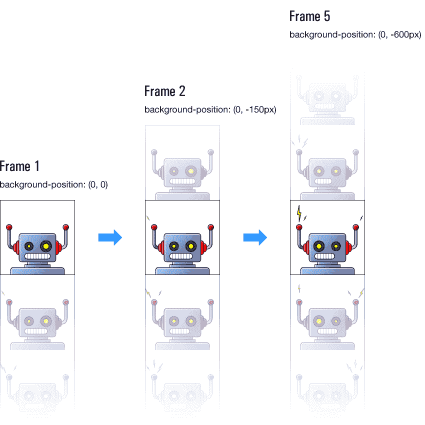

图 5.9. 通过更改背景图像的位置来指定哪一帧显示在视野中

所以，我们知道如何让任何一帧出现在`div`窗口内，但页面仍然是静态的——没有动画。这就是那老牌 JavaScript 魔法大显用场的地方！

为了创建一个流畅的动画，我们需要按照固定间隔更改`background-position`，快速切换帧，使它们看起来像一个连续的运动图像。由于本章中提到了多次`setTimeout`，你可能已经猜到函数是这一切的关键。但你错了。抱歉，*对的*：

**robot_animation.js**


```javascript
var Robot = {
  init: function() {
    Robot.div = document.getElementById("robot");
    Robot.frameHeight = 150;
    Robot.frames = 10;
    Robot.offsetY = 0;
    Robot.animate();
  },
  animate: function() {
    Robot.offsetY -= Robot.frameHeight;
    if (Robot.offsetY <= -Robot.frameHeight * Robot.frames) {
      Robot.offsetY = 0;
    }
    Robot.div.style.backgroundPosition = "0 " + Robot.offsetY + "px";
    setTimeout(Robot.animate, 75);
  }
};
Core.start(Robot);
```

`Robot` 对象包含两个方法。包含 `Robot.init` 主要是为了声明一些变量并启动动画。我将变量写在这里，而不是在 `Robot.animate` 中，因为 `Robot.animate` 会调用很多次，声明一次变量比在动画的每一帧中都声明一次更有效。

## 动画

这里是该脚本的亮点：


初始化的变量包含了对我们要修改的 `div` 元素的引用，以及两个常量——`frameHeight` 和 `frames`——它们告诉程序每帧的高度为 150 像素，总共有十帧。这些值在整个动画执行过程中将保持不变，但通过提前声明它们，你会发现以后如果需要，修改帧尺寸和帧数会更容易。如果你创建了自己的动画，应该根据需要修改这些变量。

另一个变量 `Robot.offsetY` 是我们将唯一动态更新的变量。它最初被设置为 `0`，但用于记录动画图像的当前垂直位置，这样我们就能知道处于哪一帧。

在 `init` 方法执行完毕后，我们进入了 `Robot.animate` 的第一次迭代。

如果你看函数的末尾，你会看到该函数通过 `setTimeout` 延迟调用了自己。这让你知道我们正在设置一个定时重复的任务。

函数中的第一条语句将 `Robot.offsetY` 减少一个帧的高度。我们在这里计算的是查看下一帧所需的垂直 `background-position`。然而，我们的动画图形不是无限延伸的；如果我们只是一直减小 `Robot.offsetY` 的值，最终将耗尽所有帧并得到一个空框。为了避免这种情况，我们需要在合适的时刻回到条带的开头。

接下来是一个 `if` 语句，用于检查新的 `Robot.offsetY` 值是否超出了动画条带的范围。如果是，我们将其设回 `0`。

有了新的偏移值，我们准备好更新图像的位置了。为了做到这一点，我们修改 `div` 的 `backgroundPosition` 属性，使用 `Robot.offsetY` 作为垂直坐标（因为我们不需要水平移动）。

## 简单 JavaScript

### 需要单位

记得在所有非零 CSS 值末尾包含单位，否则你的更改将被忽略。在本例中我们使用像素，所以我们在值的末尾加上 `px`。

更改 `div` 的样式会将新帧提交给浏览器显示。完成后，我们使用 `setTimeout` 调度下一次更改。等待下一次帧的时间为 75 毫秒，这将产生每秒约 13 帧的帧率。你可能需要根据你想要的快慢或流畅程度来调整此速率。最满意的结果通常通过尝试获得。

一旦程序执行了多次 `Robot.animate`，你就拥有了一个动画。由于我们的代码中没有停止该方法的重复调用，动画将持续进行。如果你愿意，可以像本章之前那样提供开始和停止按钮，允许用户停止和重启动画。或者，你也可以通过在每次 `Robot.offsetY` 返回 `0` 时增加计数器变量来限制动画循环次数。

## 路径运动

我们用于制作数字胶卷的 JavaScript 技术适用于任何你想随时间产生一系列渐进更改的场景。你只需要将 `background-position` 替换为你想要修改的属性：颜色、宽度、高度、位置、透明度——任何你能想到的属性。

在下一个示例中，我们将观察 HTML 元素沿着线性路径移动。因此，我们不是更改目标元素的 `background-position`，而是更改它的实际位置。

当你想要移动一个元素时，通常知道它现在在哪里（即起始位置），以及你想让它去哪里（即终点位置），如图 5.10 所示。

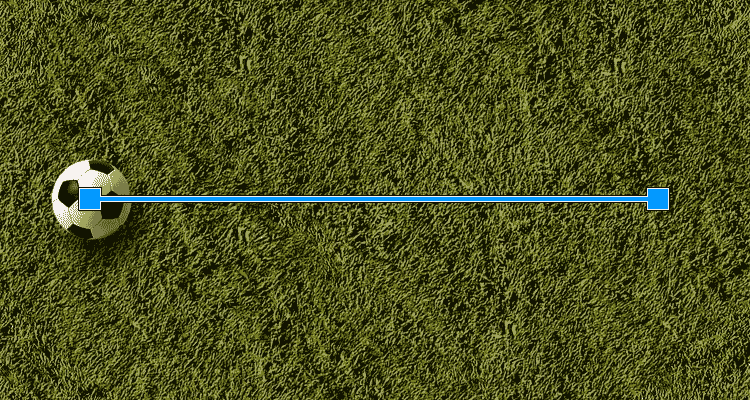

图 5.10. 从对象的起始位置到你想让它到达的终点的路径可视化


图 5.11. 计算从 A 点移动到 B 点需的步骤

由于运动将由动画函数自动执行，我们唯一需要识别出：

**简单 JavaScript**

-   我们想要移动的元素

-   我们想要它移动到的位置

-   它到达目的地需要多长时间

我们将使用足球和草地背景作为工作示例的基础。

此文档的 HTML 相当简单：

**path-based_motion.html** ***（节选）***

```html
<div id="grass">
  <div id="soccerBall"></div>
</div>
```

有许多方法可以定位足球球，但对于这个示例，我选择了使用绝对定位：

**path-based_motion.css** ***（节选）***

```css
#soccerBall {
  background-image: url(soccer_ball.png);
  background-repeat: no-repeat;
  height: 125px;
  left: 0;
  margin-top: 25px;
  position: absolute;
  top: 75px;
  width: 125px;
}
```

## 定位与动画

如果你要对元素的移动进行动画，该元素需要相对于定位或绝对定位；否则，更改其 `left` 和 `top` 属性将不会产生任何效果。

我们用于之前电影胶片示例动画的 JavaScript 为任何动画提供了一个非常好的模板，因此我们将使用它的结构来帮助我们定义此新动画中需要的移动。在 `init` 内部，我们声明了一些将需要的变量，然后开始实际动画：

### 动画

**path-based_motion.js** ***（节选）***

```javascript
var SoccerBall = {
  init: function() {
    SoccerBall.frameRate = 25;
    SoccerBall.duration = 2;
    SoccerBall.div = document.getElementById("soccerBall");
    SoccerBall.targetX = 600;
    SoccerBall.originX = parseInt(
      Core.getComputedStyle(SoccerBall.div, "left"), 10);
    SoccerBall.increment =
      (SoccerBall.targetX - SoccerBall.originX) /
      (SoccerBall.duration * SoccerBall.frameRate);
    SoccerBall.x = SoccerBall.originX;
    SoccerBall.animate();
  },
  ⋮
};
```

前两个变量控制动画的速度。

`SoccerBall.frameRate` 指定了我们希望动画移动的每秒帧数。该属性在我们设置 `setTimeout` 调用的延迟时间时使用，并决定了足球移动的“平滑度”。`SoccerBall.duration` 决定了动画完成需要多长时间（秒为秒），并影响球看起来移动的速度。

`SoccerBall.div` 是不言自明的。

`SoccerBall.targetX` 指定了我们移动足球的所在位置。一旦到达该点，动画就应该停止。

为了支持足球的任意起始位置，`SoccerBall.originX` 实际上是根据浏览器对 `div` 的计算后样式（computed style）计算的。遗憾的是，Internet Explorer 暴露计算样式的方式与其他浏览器实现的方式之间存在差异。元素的计算样式是在所有 CSS 规则和内联样式应用到它*之后*的样式信息。因此，如果一个元素的 `left` 位置在外部样式表中已指定，那么获取元素的计算样式将使你能够访问该值。Internet Explorer 在每个元素上暴露了一个 `currentStyle` 属性，其属性与 `style` 完全相同，因此你可以使用 `element.currentStyle.left` 确定元素的计算后左位置。其他浏览器要求你使用方法 `document.defaultView.getComputedStyle` 获取计算后样式对象。该方法接受两个参数——第一个是你请求的元素；第二个必须是 `null`——然后返回一个结构与 Internet Explorer 的 `currentStyle` 属性相同的样式对象。为了规避这些浏览器差异，我们将创建一个新的 Core 函数，允许我们从元素中获取特定的计算后样式：

**core.js** ***（节选）***

```javascript
Core.getComputedStyle = function(element, styleProperty) {
  var computedStyle = null;
  if (typeof element.currentStyle != "undefined") {
    computedStyle = element.currentStyle;
  } else {
    computedStyle = document.defaultView.getComputedStyle(element, null);
  }
  return computedStyle[styleProperty];
};
```

`Core.getComputedStyle` 进行了一小的检测，以检查我们应该以何种方式检索计算样式，然后返回相应属性方法的值。我们可以在不需要在脚本中硬编码值的情况下获取 `SoccerBall.originX` 的正确起始点。

让我们回到上面的 `init` 方法：

有了 `SoccerBall.originX` 和 `SoccerBall.targetX`，我们可以计算每帧中需要移动足球的增量，以便它在动画指定的持续时间内到达目标位置。这是一个简单的问题，找到需要移动的距离（`SoccerBall.targetX – SoccerBall.originX`）并将其除以动画中的总帧数（`SoccerBall.duration * SoccerBall.frameRate`）。在初始化期间计算此数字而不是在实际动画函数内部，可以减少我们在动画每一步中必须完成的计算次数。我们声明的最后一个变量是 `SoccerBall.x`。它的作用类似于 `Robot.offsetY`，用于跟踪元素的水平位置。虽然可以使用元素的实际 `style.left` 值来跟踪足球的位置，但该值必须是整数，而 `SoccerBall.x` 可以是浮点数。这种方法产生了更准确的计算和更平滑的动画。

在 `SoccerBall.init` 完成所有属性的声明后，我们通过调用 `SoccerBall.animate` 开始动画。这是该方法的代码：

**path-based_motion.js** ***（节选）***

```javascript
animate: function() {
  SoccerBall.x += SoccerBall.increment;
  if ((SoccerBall.targetX > SoccerBall.originX &&
      SoccerBall.x >= SoccerBall.targetX) ||
    (SoccerBall.targetX <= SoccerBall.originX &&
    SoccerBall.x <= SoccerBall.targetX)) {
    SoccerBall.x = SoccerBall.targetX;
  } else {
    setTimeout(SoccerBall.animate, 1000 / SoccerBall.frameRate);
  }
  SoccerBall.div.style.left = Math.round(SoccerBall.x) + "px";
}
```

此 `animate` 方法与我们在上一个示例看到的 `Robot.animate` 之间的相似之处非常显著。它们的流程基本上都是：

1. 计算新位置。

2. 检查新位置是否超过限制。

3. 将新位置应用到元素。

4. 在延迟后重复过程。

在这种情况下，我们通过向当前位置增加需要移动的总距离的一个“切片”来计算新位置：

**path-based_motion.js** ***（节选）***

```javascript
SoccerBall.x += SoccerBall.increment;
```

然后，我们检查该新位置是否超出了动画的终点：

向右侧。如果是那样，当 `SoccerBall.x` 大于 `SoccerBall.targetX`，足球球将超出终点。

在第二种状态（`SoccerBall.targetX < SoccerBall.originX && SoccerBall.x <= SoccerBall.targetX`）下，如果 `SoccerBall.targetX` *小于* `SoccerBall.originX`，足球球将向*左侧*移动，当 `SoccerBall.x` *小于* `SoccerBall.targetX` 时，它将超出终点。通过在条件判断中包含这两个独立的状态，我们允许足球球向任何方向移动，而无需修改代码。

如果新计算出的足球球位置超过了终点，我们自动将新位置设置为终点：

**path-based_motion.js** ***（节选）***

```javascript
if ((SoccerBall.targetX > SoccerBall.originX &&
SoccerBall.x >= SoccerBall.targetX) ||
(SoccerBall.targetX < SoccerBall.originX &&
SoccerBall.x <= SoccerBall.targetX))
{
  SoccerBall.x = SoccerBall.targetX;
}
```

否则，足球球需要继续移动，因此我们调度另一个动画帧：

**path-based_motion.js** ***（节选）***

```javascript
else
{
  setTimeout(SoccerBall.animate, 1000 / SoccerBall.frameRate)
}
```

注意，`setTimeout` 的延迟设置为1000 毫秒（一秒）除以指定的帧率。此计算将帧率转换为延迟所需的毫秒格式。

**188**

我们每帧需要做的最后一件事是将新计算的位置应用到足球球的 `style.left` 属性。这一步会导致浏览器显示更新：

**path-based_motion.js** ***（节选）***

```javascript
SoccerBall.div.style.left = Math.round(SoccerBall.x) + "px";
```

该语句使用 `Math.round` 将 `SoccerBall.x` 转换为整数，它会将任何数字四舍五入到最近的整数。我们需要这样做，是因为 `SoccerBall.x` 可能是一个浮点数，而 CSS 像素值不能带有小数。

最后两个语句（`setTimeout` 和 `style` 更改）通常会以此处显示的相反顺序编写，但为了代码效率，`setTimeout` 被放置在 `else` 语句内部。如果我们把它放在 `style` 赋值之后，`setTimeout` 将需要一个额外的条件检查。通过这种方式，我们可以避免对脚本性能产生负面影响。

一旦我们将 `init` 和 `animate` 函数都组合在一个对象中，并使用 `Core.start` 对其进行初始化，我们就完成了程序。我们已经准备好让那只足球在绿油油的草场上滚动了：

**path-based_motion.js**


```javascript
var SoccerBall = {
  init: function()
  {
    SoccerBall.frameRate = 25;
    SoccerBall.duration = 2;
    SoccerBall.div = document.getElementById("soccerBall");
    SoccerBall.targetX = 600;
    SoccerBall.originX = parseInt(Core.getComputedStyle(SoccerBall.div, "left"), 10);
    SoccerBall.increment = (SoccerBall.targetX - SoccerBall.originX) / (SoccerBall.duration * SoccerBall.frameRate);
    SoccerBall.x = SoccerBall.originX;
    SoccerBall.animate();
  },
  animate: function()
  {
    SoccerBall.x += SoccerBall.increment;
    if ((SoccerBall.targetX > SoccerBall.originX && SoccerBall.x >= SoccerBall.targetX) ||
    (SoccerBall.targetX < SoccerBall.originX && SoccerBall.x <= SoccerBall.targetX))
    {
      SoccerBall.x = SoccerBall.targetX;
    }
    else
    {
      setTimeout(SoccerBall.animate, 1000 / SoccerBall.frameRate)
    }
    SoccerBall.div.style.left = Math.round(SoccerBall.x) + "px";
  }
};
Core.start(SoccerBall);
```

**189**

**动画**

## 在二维空间中动画

上面的示例只对足球球进行了水平方向的动画，但修改我们的程序来处理垂直移动也非常简单：

**path-based_motion2.js**

```javascript
var SoccerBall = {
  init: function()
  {
    SoccerBall.frameRate = 25;
    SoccerBall.duration = 2;
    SoccerBall.div = document.getElementById("soccerBall");
    SoccerBall.targetX = 600;
    SoccerBall.targetY = 150;
    SoccerBall.originX = parseInt(Core.getComputedStyle(SoccerBall.div, "left"), 10);
    SoccerBall.originY = parseInt(Core.getComputedStyle(SoccerBall.div, "top"), 10);
    SoccerBall.incrementX = (SoccerBall.targetX - SoccerBall.originX) / (SoccerBall.duration * SoccerBall.frameRate);
    SoccerBall.incrementY = (SoccerBall.targetY - SoccerBall.originY) / (SoccerBall.duration * SoccerBall.frameRate);
    SoccerBall.x = SoccerBall.originX;
    SoccerBall.y = SoccerBall.originY;
    SoccerBall.animate();
  },
  animate: function()
  {
    SoccerBall.x += SoccerBall.incrementX;
    SoccerBall.y += SoccerBall.incrementY;
    if ((SoccerBall.targetX > SoccerBall.originX && SoccerBall.x >= SoccerBall.targetX) ||
    (SoccerBall.targetX < SoccerBall.originX && SoccerBall.x <= SoccerBall.targetX))
    {
      SoccerBall.x = SoccerBall.targetX;
      SoccerBall.y = SoccerBall.targetY;
    }
    else
    {
      setTimeout(SoccerBall.animate, 1000 / SoccerBall.frameRate)
    }
    SoccerBall.div.style.left = Math.round(SoccerBall.x) + "px";
    SoccerBall.div.style.top = Math.round(SoccerBall.y) + "px";
  }
};
Core.start(SoccerBall);
```

对于我们对*x*坐标进行计算的每一个实例，都为*y*坐标添加一个相应的语句。因此，`SoccerBall.init`拥有`SoccerBall.targetY`垂直终点、`SoccerBall.originY`垂直起点以及`SoccerBall.y`垂直位置。这些变量由`SoccerBall.animate`用于增加垂直位置并将其写入`style.top`属性。我们唯一需要做的更改是对球的起始位置进行微调：

**path-based_motion2.css** ***（节选）***

```css
#soccerBall {
  top: 0;
}
```

一旦完成这些，我们就得到了一个在两个维度上移动的球，如图 5.12 所示。

**191**

## 创建真实的运动

到目前，我们创建的动画是匀速的——每一帧移动量相同，球没有加速度。但这并不是现实世界中物体运动的方式：它们会加速，也会减速。如果我们想让足球停下来，我们需要使用不同的算法来计算运动，对程序进行一些微调：

**path-based_motion3.js**

```javascript
var SoccerBall = {
  init: function()
  {
    SoccerBall.frameRate = 25;
    SoccerBall.deceleration = 10;
    SoccerBall.div = document.getElementById("soccerBall");
    SoccerBall.targetX = 600;
    SoccerBall.targetY = 150;
    SoccerBall.originX = parseInt(Core.getComputedStyle(SoccerBall.div, "left"), 10);
    SoccerBall.originY = parseInt(Core.getComputedStyle(SoccerBall.div, "top"), 10);
    SoccerBall.duration = 2;
    SoccerBall.x = SoccerBall.originX;
    SoccerBall.y = SoccerBall.originY;
    SoccerBall.animate();
  },
  animate: function()
  {
    SoccerBall.x += (SoccerBall.targetX - SoccerBall.x) * 0 * (SoccerBall.targetX - SoccerBall.originX) / (SoccerBall.duration * SoccerBall.frameRate); // 此处逻辑根据示例简化为：
    SoccerBall.x += (SoccerBall.targetX - SoccerBall.x) / SoccerBall.deceleration;
    SoccerBall.y += (SoccerBall.targetY - SoccerBall.y) / SoccerBall.deceleration;
    if ((SoccerBall.targetX > SoccerBall.originX && Math.round(SoccerBall.x) >= SoccerBall.targetX) ||
    (SoccerBall.targetX < SoccerBall.originX && Math.round(SoccerBall.x) <= SoccerBall.targetX))
    {
      SoccerBall.x = SoccerBall.targetX;
      SoccerBall.y = SoccerBall.targetY;
    }
    else
    {
      setTimeout(SoccerBall.animate, 1000 / SoccerBall.frameRate)
    }
    SoccerBall.div.style.left = Math.round(SoccerBall.x) + "px";
    SoccerBall.div.style.top = Math.round(SoccerBall.y) + "px";
  }
};
Core.start(SoccerBall);
```

*(注：由于原文文本中代码逻辑在示例处可能存在占位或简化描述，此处翻译保持了代码结构的一致性)*

当你使用这样的方程时，需要注意的一个陷阱是，如果不听其发展，`SoccerBall.x`永远无法到达终点。动画函数会不断将剩余距离切分成越来越小的步，产生无限循环。为了应对这个问题（并防止动画永远运行下去），我们在检查它是否到达终点之前，使用`Math.round`将`SoccerBall.x`四舍五入到最近的整数。一旦`SoccerBall.x`距离终点在 0.5 像素以内——当位置以像素表示时，这足够让球到达目标——四舍五入就会导致动画结束。

**192**

图 5.13. 通过改变移动足球球的算法来模拟真实的减速

如果你想让球移动得慢一些——更平滑地滑动到最终位置——请增加减速因子。如果你想让球更快到达目的地——以更突然的方式停止——请减小减速因子。

将该因子设置为`1`会导致球直接跳到目的地。

**快点！**

如果你想加速足球球——让它从缓慢开始并逐渐变快——那么你就必须反转我们用于减速的算法：

**path-based_motion4.js** ***（节选）***

```javascript
var SoccerBall =
{
  init: function()
  {
    SoccerBall.frameRate = 25;
    **SoccerBall.acceleration = 2;**
    **SoccerBall.threshold = 0.5;**
    SoccerBall.div = document.getElementById("soccerBall");
    SoccerBall.targetX = 600;
    SoccerBall.targetY = 150;
    SoccerBall.originX = parseInt(
      Core.getComputedStyle(SoccerBall.div, "left"));
    SoccerBall.originY = parseInt(
      Core.getComputedStyle(SoccerBall.div, "top"));
    **if (SoccerBall.targetX < SoccerBall.originX)**
    {
      **SoccerBall.x = SoccerBall.originX - SoccerBall.threshold;**
    }
    else
    {
      **SoccerBall.x = SoccerBall.originX + SoccerBall.threshold;**
    }
    SoccerBall.distanceY = SoccerBall.targetY - SoccerBall.originY;
    SoccerBall.animate();
  },
  animate: function()
  {
    **SoccerBall.x += (SoccerBall.x - SoccerBall.originX) /
    SoccerBall.acceleration;**
    var movementRatio = (SoccerBall.x - SoccerBall.originX) /
    (SoccerBall.targetX - SoccerBall.originX);**
    var y = SoccerBall.originY + SoccerBall.distanceY *
    movementRatio;**
    if ((SoccerBall.targetX > SoccerBall.originX &&
      SoccerBall.x >= SoccerBall.targetX) ||
      (SoccerBall.targetX < SoccerBall.originX &&
      SoccerBall.x <= SoccerBall.targetX))
    {
      SoccerBall.x = SoccerBall.targetX;
      y = SoccerBall.targetY;
    }
    else
    {
      setTimeout(SoccerBall.animate, 1000 / SoccerBall.frameRate)
    }
    SoccerBall.div.style.left = Math.round(SoccerBall.x) + "px";
    **SoccerBall.div.style.top = Math.round(y) + "px";**
  }
};
Core.start(SoccerBall);
```

在这里，`SoccerBall.deceleration`变量被替换为`SoccerBall.acceleration`，并且值被降低了以提供更快的启动速度。计算增量的算法现在使用到起点的距离来确定增量，因此随着球离起点越远，增量越大，从而让球移动得更快。

由于该算法使用`SoccerBall.x` – `SoccerBall.originX`作为计算的基础，我们需要`SoccerBall.x`初始时稍微偏离`SoccerBall.originX`，否则球将永远不会移动。`SoccerBall.x`必须朝着目的地的方向偏移，因此在初始化期间，我们检查目的地相对于起点的方向，并根据情况增加或减去一个小值——`SoccerBall.threshold`。为了获得更准确的模型，你可以将`SoccerBall.threshold`降低到`0.5`以下，但你不会看到很大的区别。

该算法与减速算法的另一个区别在于垂直位置的计算方式。由于我们使用了固定的加速度，如果分开计算，那么两个维度上的加速度将是相同的——*y*位置的速度增加率将与*x*位置相同。如果你的*y*目的地坐标比*x*目的地坐标近，足球球将在到达最终*x*位置之前更快到达最终*y*位置，从而产生一些奇怪的（非线性）运动。

为了防止这种情况发生，我们根据足球球*x*位置的值来计算其*y*位置。在计算出新的*x*位置后，计算移动距离与总距离之间的比例，并将其放入变量`movementRatio`中。将该数字乘以起点与目标之间的总垂直距离，即可得到足球球准确的*y*位置，从而产生直线运动。

简单的 JavaScript

## 重新回顾手风琴

现在，我们不希望在对手风琴进行动画时内容溢出；我们希望父元素隐藏任何溢出的内容。此此的方法是调整父容器的 CSS，并指定`overflow: hidden`属性。当执行此操作并指定高度（或宽度）时，任何溢出的内容将从视图中隐藏。

## 让手风琴看起来像动画一样

一旦我们确保溢出的内容被正确隐藏，就可以开始对容器进行动画处理。要做到这一点，我们将逐渐改变它的高度，使其看起来像正在展开或折叠。


```javascript
var accordions = Core.getElementsByClass("accordion");

for (var i = 0; i < accordions.length; i++)
{
  var folds = accordions[i].childNodes;
  for (var j = 0; j < folds.length; j++)
  {
    if (folds[j].nodeType == 1)
    {
      var accordionContent = document.createElement("div");
      accordionContent.className = "accordionContent";
      for (var k = 0; k < folds[j].childNodes.length; k++)
      {
        if (folds[j].childNodes[k].nodeName.toLowerCase() != "h2")
        {
          accordionContent.appendChild(folds[j].childNodes[k]);
          k--;
        }
      }
      folds[j].appendChild(accordionContent);
      folds[j]._accordionContent = accordionContent;
      Accordion.collapse(folds[j]);
      var foldLinks = folds[j].getElementsByTagName("a");
      var foldTitleLink = foldLinks[0];
      Core.addEventListener(foldTitleLink, "click", Accordion.clickListener);
      for (var k = 1; k < foldLinks.length; k++)
      {
        Core.addEventListener(foldLinks[k], "focus", Accordion.focusListener);
      }
    }
  }
  if (location.hash.length > 1)
  {
    var activeFold = document.getElementById(location.hash.substring(1));
    if (activeFold && activeFold.parentNode == accordions[i])
    {
      Accordion.expand(activeFold);
    }
  }
}
```

在这段代码中，我们添加了两个熟悉的动画常量，以及了一段修改菜单 HTML 的全新代码。为什么呢？

在使用 `overflow: hidden` CSS 属性时需要注意的一点是，它在 Internet Explorer 6 中可能会产生一些奇怪的视觉效果。根据我们设置折叠面板标题的方式，如果对这些列表项应用 `overflow: hidden`，它们在 IE 中看起来会完全扭曲。为了规避这个陷阱，我们通过将内容放在其自己的 `div` 元素中，将标题（用户点击的部分）与折叠面板中给定部分的其余内容隔离开。如果我们可以将容器折叠为高度 0，处理动画也将简单得多，而无需担心是否为标题留了足够的高度。

但这并不是去手动修改 HTML 的理由！正如上面的代码所示，我们可以轻松地用 JavaScript 完成这些更改：

在 `init` 内部，我们创建了一个新的 `div` 并为它分配了类名 `accordionContent`。

接下来，我们必须将列表项的当前内容移动到这个新容器中。我们使用一个 `for` 循环遍历列表项的每个 `childNodes` 来实现这一操作。

我们不想将 `h2` 移动到那个新容器中，因为它是折叠面板的可点击部分，所以我们对它进行了检查并跳过它，同时包含了其他所有内容。

你只需要将元素附加到新的父元素，即可将元素从一个父元素移动到另一个父元素。DOM 将自动完成在指定位置移除并添加元素的过程。

该 `for` 循环的一个技巧是，每当移动一个子元素时，计数器就会减 1。这是因为计数器在每次循环执行时会自动递增，但如果我们从 `childNodes` 中删除一个元素，它的下一个兄弟元素就会向下移动以获取它的索引，因此如果我们真的递增索引，就会开始跳过元素。递减操作可以抵消这种影响。

一旦所有现有内容都移动到新容器中，我们就可以将该容器附加到列表项中，完成对 DOM 的修改。现在，我们的列表项只包含两个元素——标题和内容——而且再也没有变得更聪明了！

最后，为了方便以后使用，我们将对 `accordionContent` 元素的引用存储为列表项的一个属性：`_accordionContent`。

添加 `accordionContent` `div` 的另一个优势是它简化了 CSS。例如，隐藏折叠面板面板内容的 CSS 可以精简为如下内容：

**accordion_animated.css**

```css
.accordionContent {
  overflow: hidden;
}
li.collapsed .accordionContent {
  position: absolute;
  left: -9999px;
  /* 修复阻止展开内容显示的的 Safari 漏洞。
     参见 http://tech.virginia.edu/bugs/safari-sticky.html */
}
li.collapsed .accordionContent p {
  position: relative;
}
```

得益于这段代码，`overflow: hidden` 将始终应用于类为 `accordionContent` 的元素，使我们能够正确地对它们进行动画处理。纯 JavaScript

在原始脚本中，我们的 `expand` 函数更改了一些类以使选中的折叠面板项弹出，但在制作折叠面板动画时，我们需要先使用 `expand` 进行一些准备工作：

**accordion_animated.js**

```javascript
expand: function(fold) {
  var content = fold._accordionContent;
  Accordion.collapse(fold.parentNode);
  if (!Core.hasClass(fold, "expanded")) {
    content.style.height = "0";
    content._height = 0;
    Core.removeClass(fold, "collapsed");
    Core.addClass(fold, "expanded");
    content._increment = content.scrollHeight / (Accordion.frameRate * Accordion.duration);
    Accordion.expandAnimate(content);
  }
},
```

`content` 变量只是 `fold._accordionContent` 属性的快捷方式——然后调用 `collapseAll` 方法来重置折叠面板，并将注意力放在当前内容上。

虽然之前当 `expand` 在展开的折叠面板上调用时（例如，响应于内链接之间的焦点移动）并没有影响，但我们更改了此方法以启动动画。因此，我们需要这个 `if` 语句来避免对已展开的折叠面板执行动画。

在更改类使其可见之前，我们将 `content` 的 `style.height` 设置为 `0`。这一步确保了当类切换内容从折叠变为展开时，它将保持不可见，因为没有高度。

为了跟踪内容的实际计算高度，我们在内容上创建了 `_height` 属性。正如之前的动画示例，该属性允许我们对折叠面板的移动进行精确计算。一旦高度重置，我们可以移除“collapsed”类并添加“expanded”类。

我们已经准备好执行动画了，但在此之前，我们需要确定要展开折叠面板项的高度。由于我们将从 0 开始增加项目的高度，因此必须知道内容何时显示完毕，以便确定何时停止。`scrollHeight` 属性让我们做到这一点——无论我们是否使用显式高度和 `overflow: hidden` 截断它，它都能计算内容的高度。

通过预先计算我们在动画每帧中应用的移动增量，可以节省动画函数内部的一些重复计算。这是通过将内容的总高度（`content.scrollHeight`）除以总帧数（`Accordion.frameRate * Accordion.duration`）得到的。该计算结果赋值给 `content` 的 `_increment` 属性。

在完成所有设置后，我们可以调用 `expandAnimate`，这是我们设计的用于折叠面板展开的新方法。让我们来看看动画方法：

**accordion_animated.js**

```javascript
expandAnimate: function(content) {
  var newHeight = content._height + content._increment;
  if (newHeight > content.scrollHeight) {
    newHeight = content.scrollHeight;
  } else {
    content._timer = setTimeout(function() {
      Accordion.expandAnimate(content);
    }, 1000 / Accordion.frameRate);
  }
}
```

`content._height = newHeight;`

`content.style.height = Math.round(newHeight) + "px";`

`content.scrollTop = 0;`

},

`expandAnimate` 首先计算内容的新高度：

`content._height + content._increment`.

这个 `newHeight` 变量被用在一个条件测试中，用于检测动画是否应该结束。

如果 `newHeight` 大于 `content.scrollHeight`，我们将 `newHeight` 设置为等于内容的高度，并且不再调度任何动画循环。

但如果 `newHeight` 小于内容的高度，我们会调度 de另一个 `setTimeout` 调用，指向同一个函数。这一步产生了我们所寻找的迭代动画。`setTimeout` 的 ID 被赋值给 `content` 元素的 `_timer` 属性，这样，如果在动画中途点击了另一个手风琴组件，我们就可以停止展开动画的继续。

在我们确定了内容的新高度应该是多少之后，我们使用该新高度来更新元素的 `_height` 属性，然后使用一个取整后的值通过 `style.height` 来改变它的外观。动画的这一帧现在已经完成。

在某些浏览器中，如果键盘焦点移动到手风琴折叠部分内部的超链接上，浏览器会误导地尝试滚动该折叠内容，以便让链接可见。如果保持原样，内容一旦展开，将无法正常显示。幸运的是，修复方法很简单——在动画的每一帧之后，我们都会将 `content` 的 `scrollTop` 属性重置为零，这会重置它的垂直滚动位置。

通过这两种方法，你可以看到动画是如何工作的——事件监听器只触发一次，并为动画设置初始值。然后，通过 `setTimeout` 调用迭代函数，以产生达到最终状态所需的视觉变化。

**205 动画**

折叠一个项目的工作方式非常相似：

**accordion_animated.js** **（节）**

```javascript
collapse: function(fold)
{
  var content = fold._accordionContent;
  content._height = parseInt(content.style.height, 10);
  content._increment = content._height / (Accordion.frameRate * Accordion.duration);
  if (Core.hasClass(fold, "expanded"))
  {
    clearTimeout(fold._accordionContent._timer);
    Accordion.collapseAnimate(fold._accordionContent);
  }
  else
  {
    Core.addClass(fold, "collapsed");
  }
}
```

对于 `collapse` 方法，我们必须将类的更改移动到动画方法中，因为我们需要项目保持展开状态，直到动画结束（否则它会立即消失，在动画来得及发生之前）。为了启动动画，我们检查当前项目是否具有 `expanded` 类，如果是，我们就让浏览器去执行 `collapseAnimate`，但在那之前，我们必须取消任何正在进行的展开动画。如果我们不先取消展开，折叠动画可能会与一个正在进行的展开动画重叠，在这种情况下，我们最终会导致手风琴卡住（这绝不是什么好看的景象——视觉也不好听）。

当启动折叠时，如果元素上没有 `expanded` 类，我们只需添加 `collapsed` 类并放弃动画。这处理了页面首次加载且我们需要隐藏所有菜单项的情况。

**简单 JavaScript 206**

`collapseAnimate` 与 `expandAnimate` 非常相似，但方向相反：

**accordion_animated.js** **（节）**

```javascript
collapseAnimate: function(content)
{
  var newHeight = content._height - content._increment;
  if (newHeight < 0)
  {
    newHeight = 0;
    Core.removeClass(content.parentNode, "expanded");
    Core.addClass(content.parentNode, "collapsed");
  }
  else
  {
    content._timer = setTimeout(function()
    {
      Accordion.collapseAnimate(content);
    }, 1000 / Accordion.frameRate);
  }
  content._height = newHeight;
  content.style.height = Math.round(newHeight) + "px";
}
```

我们的目标是让 `content` 元素的 `height` 变为 `0`，因此我们不是增加量，而是减去它。

当我们达到目标高度时使用的 `if-else` 语句与上面看到的略有不同，因为我们必须更改当前项目的类。否则，它与 `expandAnimate` 是一致的。

由于双向都有动画，我们现在有了一个功能完备的手风琴。当然，如果你查看文件中的演示，将最好看到它的效果，但图 5.16 显示了当你点击打开一个新项目时发生的情况。

**207 动画**

图 5.16。我们的动画手风琴在一个项目折叠而另一个项目展开时的进展过程

## 探索库

相当多主要的 JavaScript 库并没有处理动画；相反，它们专注于 DOM 操作和样式表等核心任务。然而，围绕这些库出现了许多专门用于动画任务的小型库，而且执行得非常好。

动画库比我们在这里编写的脚本要通用得多，因此根据你的心情，可能可以使用它们在几乎任何元素上应用一系列效果。

### script.js

script.js 可能是可用的最著名的特效库。它实际上是 Prototype 的插件，Prototype 使用它来进行 DOM 访问和功能，所以如果你想运行 script.js，还需要包含 Prototype。

script.js 自带了在所谓的 Web 2.0 时代流行的特效：淡入、高亮、缩小以及许多其他过渡效果。它最近还包含了较大的功能，如拖放和滑块组件。在这里，我们将重点放在特效。

script.js 中的所有效果都通过 `Effect` 对象可用，如果你在页面上包含了 script.js 文件，该对象就会在你的程序中可用。

让我们假设有一段想要高亮的文字：

**简单 JavaScript 208**

**script_highlight.html** **（节）**

```html
<p id="introduction">
  Industrial Light & Magic (ILM)是一家电影视觉特效公司，由 George Lucas 于 1975 年 5 月创立并归 Lucasfilm 所有。当他的《星球大战》获得通过，二十世纪影业特效部门关闭时，Lucas 创建了这家公司。
</p>
```

我们可以通过将 ID 字符串传递给 `Effect.Highlight` 来这样做：

```javascript
new Effect.Highlight("introduction");
```

一旦你进行了此调用，特效就会应用到元素上，如图 5.17 所示。

图 5.17. 使用 script.js 创建黄色淡入效果

`Effect.Highlight` 也允许你传递一个 DOM 节点引用，因此你可以这样将特效应用到段落：

```javascript
new Effect.Highlight(document.getElementsByTagName("p")[0]);
```

script.js 中的大多数特效都有可选参数，允许你自定义特效的各个方面。这些参数作为属性指定在一个对象字面量内部，该对象本身被作为参数传递给特效。


例如，默认情况下，`Effect.Highlight` 将背景从黄色淡入白色，但可以指定起始颜色和结束颜色，所以我们可以像这样创建一个特别刺眼的红色到蓝色的淡入：

```javascript
new Effect.Highlight("introduction", {startcolor: "#FF0000", endcolor: "#0000FF"});
```

### 动画

这些可选参数会根据效果的不同而异，因此如果你想自定义特定的效果，必须仔细阅读`script.aculo.us`的文档。

大多数效果都有一个`duration`（时长）参数，允许你指定效果发生的速度。该参数以秒为单位，所以如果你想要一个持续两秒的鲜艳红蓝渐变效果，你需要包含所有这些参数：

**scriptaculous_highlight.js** ***（节选）***

```javascript
new Effect.Highlight("introduction",
  {startcolor: "#FF0000", endcolor: "#0000FF"},
  duration: 2
});
```

`script.aculo.us` 还有一个非常棒的小型事件模型，允许你在效果执行期间或结束后触发函数。这些事件同样是以参数的形式在对象字面量中指定的，并以函数名作为值。当事件触发时，就会调用该函数：

```javascript
function effectFinished()
{
  alert("The introduction has been effected");
}

new Effect.Highlight("introduction",
  {afterFinish: effectFinish});
```

那段代码在渐变结束后会弹出一个警示框，告诉我们已完成。`script.aculo.us` 确实是一个强大且灵活的效果库。它的流行在很大程度上归于其易于集成和执行。如果这些优势还不够显而易见，我留给你这句金句：使用`script.aculo.us`，我们只需要一行代码就能让我们的足球动起来：

```javascript
new Effect.MoveBy("soccerBall", 150, 600);
```

但那样玩起来没这么多意思了，不是吗？

### 总结

HTML 的设计初衷是一个静态媒介，但通过 JavaScript，我们可以赋予它生命。毫无疑问，动画可以为界面增添许多润色——它不仅仅是中中之物！动画在引导用户以及提供功能和状态的视觉提示方面具有真正的益处。我相信在阅读过程中，你的脑海中已经产生了不少实用的主意。本章让你领略了使用基于时间的处理可以做什么，但一旦你学会了基础，还有许多内容值得探索。

接下来，我们将深入探讨一个 Web 应用开发的核心议题：表单。

## 第6章 表单增强

HTML 在过去的十年里并没有发生太大变化。自从浏览器在 1997 年左右实现 HTML 4 的更改以来，我们在 Web 上使用的标签和属性集合基本上保持不变。得益于浏览器对 CSS 支持的持续改进，我们已经能够利用这些有限的标记创建出更丰富、更复杂的设计。就像每季在 T 台上展示的时尚设计一样，风格始终是新颖的，即使底层模型看起来惊人地相似。

但 Web 设计中有一个方面是 CSS 无法掩盖 HTML 停滞的：表单。无论我们如何装饰它们，HTML 在过去的十年里只支持以下这组有限的表单控件：

- 文本输入字段
- 复选框
- 单选按钮
- 下拉菜单和列表
- 多行文本区域
- 按钮

由于这些选择如此有限，表单是实验 JavaScript 增强的开发者最早关注的 HTML 部分之一。

在本章中，我们将自己构建许多实用的、可复用的表单增强功能。这将让你有机会应用到目前为止在书中积累的许多技能，并学习一两个新妙招。

### HTML DOM 扩展

表单控件并非日常常见的 HTML 元素。它们提供的内置行为和交互性远超通过`click`、`mouseover`、`mouseout`、`focus`和`blur`等事件，以及`id`和`className`等属性可以描述范围。因此，除了我们在书中已经玩过的标准 DOM 属性、方法和事件外，表单相关元素还支持一大系列定义在 DOM 标准独立章节中的额外属性和方法。¹ 这些属性和方法中，最有用的分别列在表 6.2 和表 6.1 中。表单控件还支持一些额外事件，列在表 6.3 中。

**表 6.1. HTML 表单控件的额外 DOM 方法**

| 方法 | 元素(s) | 描述 |
| :--- | :--- | :--- |
| blur | input, select, textarea | 从此表单控件移除键盘焦点 |
| click | input | 在此控件上模拟鼠标点击 |
| focus | input, select, textarea | 给此表单控件赋予键盘焦点 |
| reset | form | 将此表单的所有控件恢复到默认值 |
| select | input, textarea | 选择此控件的文本内容 |
| submit | form | 提交表单而不触发`submit`事件 |

¹ http://www.w3.org/TR/DOM-Level-2-HTML/

### 依赖字段

在接下来的两个示例中，我们将尝试这些特定功能（但并非全部）。一旦你对它们有了感觉，请回到这些表格，思考其他可以增强表单的其他方法。

**表 6.2. HTML 表单控件的额外 DOM 属性**

| 属性 | 元素(s) | 描述 |
| :--- | :--- | :--- |
| disabled | form | 包含所有的节点列表 |
| checked | input | 如果控件被选中则为 true |
| index | option | 此控件的索引 |
| selected | option | 如果控件当前选中则为 true |
| value | input | 此控件当前的数值 |

**表 6.3. HTML 表单控件的额外事件**

| 事件 | 元素(s) | 描述 |
| :--- | :--- | :--- |
| change | input | 当值改变时触发 |
| focus | input, select, textarea | 控件获得焦点 |
| blur | input, select, textarea | 控件失去焦点 |
| click | input | 控件被点击 |

你并不总是需要用户填写每一个字段。有时，与其让用户自己判断哪些字段是相关的，为什么不使用 6.2 节提到的`disabled`属性来禁用它们呢？在图 6.1 中，单选按钮后面的复选框只有在该按钮被选中时有效。我们可以使用 JavaScript 来禁用它。

实现依赖字段的最佳方法（可以说）取决于你表单的特定逻辑，但为了本例的目的，我们可以采用一种足够通用的方法。为此，我们做了以下假设：

- 每个表单只有一层依赖关系（依赖字段不能依赖另一个依赖字段）。
- 依赖字段只能是`text`、`password`、`checkbox`或`radio`类型的`input`元素。
- 依赖字段只能依赖这些类型的`input`元素。
- 依赖字段在文档中紧跟在其所依赖的字段之后。
- 依赖字段包含在`label`元素中。

当这种标记被交给禁用了 JavaScript 的浏览器时，表单的依赖字段将一直保持启用状态。我们将脚本放在一个名为`DependentFields`的对象中：

**dependentfields.html** ***（节选）***

```html
<div>
  <label for="ncc1701">
    <input type="radio" name="whichenterprise" value="ncc1701" id="ncc1701" />
    USS Enterprise NCC-1701 (Constitution class)
  </label>
  <label for="ncc1701refit" class="secondary">
    <input type="checkbox" class="dependent" name="ncc1701refit" value="ncc1701refit" id="ncc1701refit" />
    Post-refit
  </label>
</div>
```

**dependentfields.js** *(节选)*

```javascript
var DependentFields = {
  init: function()
  {
    ⋮
  },
  ⋮
};

Core.init(DependentFields);
```

让我们从编写核心函数开始编写脚本，这些函数将根据需要启用或禁用表单字段：

**dependentfields.js** *(节选)*

```javascript
disable: function(field)
{
  field.disabled = true;
  Core.addClass(field, "disabled");
  Core.addClass(field.parentNode, "disabled");
},

enable: function(field)
{
  field.disabled = false;
  Core.removeClass(field, "disabled");
  Core.removeClass(field.parentNode, "disabled");
},
```

这足够简单，对吧？两个函数都从设置字段的`disabled`属性开始。第一个函数随后在字段本身以及包含它的元素（字段的标签）上应用`disabled`类；第二个函数则从字段及其包含的元素中移除该类。我们将使用`disabled`类来为禁用的字段（及其标签）设置样式：

**dependentfields.css** *(节选)*

```css
label.disabled {
  color: #A0A0A0;
}
```

如果你愿意，实际上可以使用像离左对齐定位（我在第 4 章中描述过）这样的技术来完全隐藏禁用的字段！

现在，我们可以通过多种方式处理代码，以调用我们刚刚看到的`disable`和`enable`方法。最明显的方法是为具有一个或多个依赖字段的每个`input`元素添加监听器，并让这些监听器启用或禁用相关的依赖字段。

在尝试了这种方法后，我现在可以告诉你这种方法虽然显而易见，但存在问题。例如，单选按钮在取消选择时并不总是产生有用的事件。有时，JavaScript 获取到单选按钮被取消选择的唯一提示是来自其相邻单选按钮的`click`事件。

另一个选项是为页面上的每个表单添加几个事件监听器。这些监听器将监控从表单中*任何*字段冒泡出来的`click`和`change`事件，并在每次此类事件后更新该表单中所有依赖字段的状态：

**dependentfields.js** *(节选)*

```javascript
init: function()
{
  var forms = document.getElementsByTagName("form");
  for (var i = 0; i < forms.length; i++)
  {
    Core.addEventListener(forms[i], "change", DependentFields.changeListener);
    Core.addEventListener(forms[i], "click", DependentFields.clickListener);
```

为了让这些监听器的工作变得更轻松（毕竟，它们运行得非常频繁），`init`方法还将扫描每个表单，以构建其包含的依赖字段列表，并为每个字段存储一个对其所依赖字段的引用：

**dependentfields.js** *(节选)*

```javascript
var fields = forms[i].getElementsByTagName("input");
var lastIndependentField = null;
forms[i]._dependents = [];

for (var j = 0; j < fields.length; j++)
{
  if (!Core.hasClass(fields[j], "dependent"))
  {
    lastIndependentField = fields[j];
  }
  else
  {
    if (lastIndependentField)
    {
      forms[i]._dependents[forms[i]._dependents.length] = fields[j];
      fields[j]._master = lastIndependentField;
    }
  }
}
```

这段代码乍看可能有点复杂，所以让我为你详细拆解一下：

- 我们获取表单中所有`input`元素的列表。
- 我们为表单创建了一个名为`_dependents`的自定义属性，在其中我们将存储表单中所有字段的列表。
- 然而，我们首先用一个空数组初始化它。
- 对于表单中的每个字段，我们执行一个检查以判断它是否为依赖字段。
- 如果是独立字段，我们将它的引用存储在名为`lastIndependentField`的变量中。
- 如果是依赖字段，我们再次检查是否已经获取了它将要依赖的字段引用。
- 然后，我们在表单的`_dependents`数组中添加该依赖字段的引用。
- 最后，我们在一个名为`_master`的自定义属性中存储该依赖字段所依赖的字段的引用。

这段代码为我们提供了每个表单中所有依赖字段的列表 (`form._dependents`)，以及从每个依赖字段到其依赖字段的链接 (`dependentField._master`)。

我们的`init`方法对每个表单执行的最后一件事是设置所有依赖字段的初始状态。由于这是一个相当复杂的过程，我们将编写一个名为`updateDependents`的单独方法来实现：

**dependentfields.js** *(节选)*

```javascript
DependentFields.updateDependents(forms[i]);
```

我们的两个事件监听器都会启动更新依赖字段状态的相同过程，因此两个监听器都将调用同一个方法：

**dependentfields.js** *(节选)*

```javascript
changeListener: function(event)
{
  DependentFields.updateDependents(this);
},

clickListener: function(event)
```

剩下的工作就是编写至关重要的`updateDependents`方法，它将根据依赖的字段来启用或禁用表单中的每个依赖字段：

**dependentfields.js** *(节选)*

```javascript
updateDependents: function(form)
{
  var dependents = form._dependents;
  if (!dependents)
  {
    return;
  }

  for (var i = 0; i < dependents.length; i++)
  {
    var disabled = true;
    var master = dependents[i]._master;

    if (master.type == "text" || master.type == "password")
    {
      if (master.value.length > 0)
      {
        disabled = false;
      }
    }
    else if (master.type == "checkbox" || master.type == "radio")
    {
      if (master.checked)
      {
        disabled = false;
      }
    }

    if (disabled)
    {
      DependentFields.disable(dependents[i]);
    }
    else
    {
      DependentFields.enable(dependents[i]);
    }
  }
}
```


**简单的 JavaScript**
**222**

再次，让我们逐一分析：

- 我们首先获取由 `init` 方法生成的依赖字段列表。
- 我们逐个遍历这个列表。
- 对于每个字段，我们首先假设它将被禁用（等等，文中说我们首先假设它将被禁用，然后去确定这个假设是否错误）。
- 为了确定，我们需要查看它所依赖的字段——这些信息从我们创建的。
- 如果主字段是 `text` 或 `password` 字段，我们检查其 `value` 属性的 `length`。如果大于零，该依赖字段就不应被禁用。
- 如果主字段是 `type checkbox` 或 `radio`，我们查看它是否被 `checked`。如果是，该依赖字段就不应被禁用。
- 现在我们确定了该依赖字段应该或不应该被禁用，就可以调用 `disable` 或 `enable` 方法来设置相应的状态。

大功告成！我们的脚本使用了许多 HTML DOM 扩展：

- 我们为某些表单控件生成的 `change` 事件设置了事件监听器。
- 我们使用了所有表单控件都支持的 `disabled` 属性在适当的情况下禁用字段。
- 我们使用了各种表单控件的 `type`、`checked` 和 `value` 属性来确定字段是否已填写，从而确定我们是否应该启用其依赖字段。

虽然我们的示例只包含一个依赖字段，但你可以将此脚本复用在任何带有任意数量依赖字段的页面，只要满足我们在本节开头说明的假设即可。以下是完整的 JavaScript 代码：

**dependentfields.js** *(节选)*

```javascript
var DependentFields =
{
  init: function()
  {
    var forms = document.getElementsByTagName("form");
    for (var i = 0; i < forms.length; i++)
    {
      Core.addEventListener(forms[i], "change",
      DependentFields.changeListener);
      Core.addEventListener(forms[i], "click",
      DependentFields.clickListener);
      var fields = forms[i].getElementsByTagName("input");
      var lastIndependentField = null;
      forms[i]._dependents = [];
      for (var j = 0; j < fields.length; j++)
      {
        if (!Core.hasClass(fields[j], "dependent"))
        {
          lastIndependentField = fields[j];
        }
        else
        {
          if (lastIndependentField)
          {
            forms[i]._dependents[forms[i]._dependents.length] = fields[j];
            fields[j]._master = lastIndependentField;
          }
        }
      }
      DependentFields.updateDependents(forms[i]);
    }
  },
  disable: function(field)
  {
    field.disabled = true;
    Core.addClass(field, "disabled");
    Core.addClass(field.parentNode, "disabled");
  },
  enable: function(field)
  {
    field.disabled = false;
    Core.removeClass(field, "disabled");
    Core.removeClass(field.parentNode, "disabled");
  },
  updateDependents: function(form)
  {
    var dependents = form._dependents;
    if (!dependents)
    {
      return;
    }
    for (var i = 0; i < dependents.length; i++)
    {
      var disabled = true;
      var master = dependents[i]._master;
      if (master.type == "text" || master.type == "password")
      {
        if (master.value.length > 0)
        {
          disabled = false;
        }
      }
      else if (master.type == "checkbox" || master.type == "radio")
      {
        if (master.checked)
        {
          disabled = false;
        }
      }
      if (disabled)
      {
        DependentFields.disable(dependents[i]);
      }
      else
      {
        DependentFields.enable(dependents[i]);
      }
    }
  },
  changeListener: function(event)
  {
    DependentFields.updateDependents(this);
  },
  clickListener: function(event)
  {
    DependentFields.updateDependents(this);
  }
};
Core.start(DependentFields);
```

### 示例：级联菜单

另一种使用 JavaScript 将多个表单字段结合在一起非常有用的情况，就是当你有一个像图 6.2 所示的复杂的 `select` 菜单时。

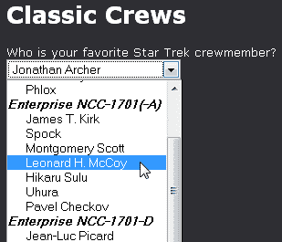

图 6.2. 由 `optgroup` 和 `option` 组成的两级菜单

这里有一个包含多个 `optgroup` 元素的 `select` 元素，每个元素又包含若干个 `option` 元素。实际上，我们这里有两个层菜单——用户必须首先找到正确的选项组，然后选择所需的选项。为什么不像图 6.3 所示，将其拆分为两个菜单来让用户用得更方便呢？

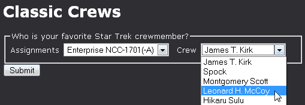

图 6.3. 将单菜单拆分为一对级联菜单以提高可用性

当用户从第一个菜单中选择一个选项时，我们的 JavaScript 代码就会开始工作，更新第二个菜单中的选项列表。这节省了用户翻阅那些不在他们感兴趣的小组之外的菜单选项的时间。

当然，我们的表单在 JavaScript 被禁用时仍然必须正常工作，因此我们将使用单个 `select` 编写表单的 HTML 代码，然后在脚本的初始化期间将其拆分为两个菜单。然而，为了使脚本具有复用性，我们需要确保单菜单包含了生成两个级联菜单所需的所有信息：

**cascadingmenu.html** *(节选)*

```html
<label for="crewselect">你最喜欢的星际迷航船员是谁？</label>
<select id="crewselect" name="crewselect" class="cascading" title="Assignments">
  <optgroup title="Crew" label="Enterprise NX-01">
    <option value="1">Jonathan Archer</option>
    <option value="2">Pol</option>
    <option value="3">Charles Tucker</option>
    <option value="4">Malcolm Reed</option>
    <option value="5">Hoshi Sato</option>
    <option value="6">Travis Mayweather</option>
    <option value="7">Phlox</option>
  </optgroup>
  <optgroup title="Crew" label="Enterprise NX-101">
  </optgroup>
</select>
```

接下来，我们将创建 `legend` 元素，并把 `label` 的所有子节点移动到其中中。

将 DOM 节点从一个元素移动到另一个元素其实出奇地简单。只需创建一个使用 `hasChildNodes` 方法的 `while` 循环来检查源元素是否还有子节点，只要它还有子节点，就不断将其第一个子节点追加到目标元素中。由于一个节点在同一时间只能存在于一个位置，将其添加到目标元素会自动将其从源元素中移除。

现在，我们可以创建 `fieldset` 元素，并将刚刚创建的 `legend` 添加到其中。

得益于 `replaceChild` 方法，将 `select` 菜单替换为新创建的 `fieldset` 非常容易，该方法会在 `select` 的父节点中将 `fieldset` 插入到 `select` 所在的位置。一旦完成，我们就可以将 `select` 插入 `fieldset` 中。

由于我们已经找到并处理了要找的 `label`，我们可以直接从 `convertLabelToFieldset` 方法中 `return`，而不是让 `for` 循环继续遍历文档。

接下来是 `extractMasterMenu` 方法，它将创建一个并返回一个新的 `select` 菜单，并将原始菜单中的 `optgroup` 作为 `option` 其中：

**cascadingmenu.js** *(节选)*

```javascript
extractMasterMenu: function(menu)
{
  var masterMenu = document.createElement("select");
  masterMenu.id = menu.id + "master";
  masterMenu.setAttribute("name", masterMenu.id);
  masterMenu.setAttribute("title", menu.getAttribute("title"));
  masterMenu._slave = menu;
  while (menu.hasChildNodes())
  {
    var optgroup = menu.firstChild;
    if (optgroup.nodeType == 1)
    {
      var masterOption = document.createElement("option");
      masterOption.appendChild(document.createTextNode(
        optgroup.getAttribute("label")));
      masterMenu.appendChild(masterOption);
      var slaveOptions = [];
      while (optgroup.hasChildNodes())
      {
        var option = optgroup.firstChild;
        slaveOptions[slaveOptions.length] = option;
        optgroup.removeChild(option);
      }
      masterOption._slaveOptions = slaveOptions;
      menu.setAttribute("title",
        optgroup.getAttribute("title"));
    }
    menu.removeChild(optgroup);
  }
  menu.parentNode.insertBefore(masterMenu, menu);
  return masterMenu;
},
```

这是一个相当复杂的逻辑，但其中几乎没有你以前没过的东西。尽管如此，让我来分解一下这个方法的几个步骤：

首先，我们为新菜单创建一个新的 `select` 元素。我们设置它的 `id` 属性和 `name` 属性以与现有 `select` 的 ID 匹配，但在后面添加了“master”一词。我们直接从现有的 `select` 中获取 `title`。由于每当用户从新主菜单中做出选择时，我们都需要更新现有的“从”菜单的内容，因此我们在主菜单的自定义属性 `_slave` 中存储了对从菜单的引用。

现在，我们需要在主菜单中为从从菜单中的每个 `optgroup` 创建一个 `option`。正如我们在 `convertLabelToFieldset` 方法中所做的那样，我们将使用带有 `hasChildNodes` 方法的 `while` 循环，从从菜单中获取第一个 `optgroup`，然后将其从该菜单中移除，为下一次循环做准备。

由于菜单的子节点可能包含空白节点，我们需要检查每个子节点的 `nodeType`，以确保我们处理的是 `optgroup` 元素之一。对于从菜单中的每个 `optgroup`，我们都会创建一个 `option` 并将其插入主菜单。每个 `option` 的文本将从对应 `optgroup` 的 `label` 属性中获取。

为了我们能够向从菜单中填充与主菜单选择相对应的 `option`，我们将相关的 `option` 元素封装成一个数组，并将其存储在主菜单内 `option` 元素的自定义属性 `_slaveOptions` 中。

当我们处理每个 `optgroup` 时，我们会获取其 `title` 属性，并将从菜单的 `title` 设置为该值。我们在此处假设每个 `optgroup` 具有相同的 `title`，因此从菜单的最终 `title` 将取自最后一个处理的 `optgroup` 这一事实并不是一个问题。

最后，我们从从菜单中移除 `optgroup`，为 `while` 循环的下一次迭代做准备。

现在我们已经为主菜单填充了 `option`，可以使用 `insertBefore` 方法将其插入到文档中，紧邻现有菜单——这是另一个我们以前没见过的有用 DOM 方法。与 `appendChild` 类似，它将传递的第一个节点作为调用调用元素的子节点添加。然而，与 `appendChild` 不同的是，它不会将此子节点放在元素的末尾；而是将其放在传递的第二个节点*之前*。

最后，我们 `return` 一个新主菜单的引用，以便 `init` 能够对该菜单执行额外的设置任务。

与上一个方法相比，`createLabelFromTitle` 简直非常简单：

**cascadingmenu.js** *(节选)*

```javascript
createLabelFromTitle: function(menu)
{
  var title = menu.getAttribute("title");
  menu.setAttribute("title", "");
  var label = document.createElement("label");
  label.setAttribute("for", menu.id);
  label.appendChild(document.createTextNode(title));
  menu.parentNode.insertBefore(label, menu);
},
```

该方法从接收到的 `select` 元素中获取 `title`，为该 `select` 构建一个包含文本的标签，并将其插入到文档中 `select` 之前。

与主菜单选择相对应的 `option` 处理也同样直接：

**cascadingmenu.js** *(节选)*

```javascript
updateSlaveMenu: function(masterMenu)
{
  var selectedOption = masterMenu.options[masterMenu.selectedIndex];
  while (masterMenu._slave.hasChildNodes())
  {
    masterMenu._slave.removeChild(masterMenu._slave.firstChild);
  }
  for (var i = 0; i < selectedOption._slaveOptions.length; i++)
  {
    masterMenu._slave.appendChild(selectedOption._slaveOptions[i]);
  }
```


`masterMenu._slave.selectedIndex = 0;`

`},`

## 表单增强

如既往一样，由于我们在核心方法中完成了所有工作，我们的事件监听器是最简单的写法：

```javascript
changeListener: function(event)
{
  CascadingMenu.updateSlaveMenu(this);
}
```

`CascadingMenu.createLabelFromTitle(menus[i]);`

`CascadingMenu.updateSlaveMenu(masterMenu);`

`Core.addEventListener(masterMenu, "change", CascadingMenu.changeListener);`

`}`

`},`

```javascript
convertLabelToFieldset: function(menu)
{
  var menuId = menu.id;
  var labels = document.getElementsByTagName("label");
  for (var i = 0; i < labels.length; i++)
  {
    if (labels[i].getAttribute("for") == menuId)
    {
      var label = labels[i];
      label.parentNode.removeChild(label);
      var legend = document.createElement("legend");
      while (label.hasChildNodes())
      {
        legend.appendChild(label.firstChild);
      }
      var fieldset = document.createElement("fieldset");
      fieldset.appendChild(legend);
      menu.parentNode.replaceChild(fieldset, menu);
      fieldset.appendChild(menu);
      return;
    }
  }
},
```

```javascript
extractMasterMenu: function(menu)
{
  var masterMenu = document.createElement("select");
  masterMenu.id = menu.id + "master";
  masterMenu.setAttribute("name", masterMenu.id);
  masterMenu.setAttribute("title", menu.getAttribute("title"));
  masterMenu._slave = menu;
  while (menu.hasChildNodes())
  {
    var optgroup = menu.firstChild;
    if (optgroup.nodeType == 1)
    {
      var masterOption = document.createElement("option");
      masterOption.appendChild(document.createTextNode(optgroup.getAttribute("label")));
      masterMenu.appendChild(masterOption);
      var slaveOptions = [];
      while (optgroup.hasChildNodes())
      {
        var option = optgroup.firstChild;
        slaveOptions[slaveOptions.length] = option;
        optgroup.removeChild(option);
      }
      masterOption._slaveOptions = slaveOptions;
      menu.setAttribute("title", optgroup.getAttribute("title"));
    }
    menu.removeChild(optgroup);
  }
  menu.parentNode.insertBefore(masterMenu, menu);
  return masterMenu;
},
```

```javascript
createLabelFromTitle: function(menu)
{
  var title = menu.getAttribute("title");
  menu.setAttribute("title", "");
  var label = document.createElement("label");
  label.setAttribute("for", menu.id);
  label.appendChild(document.createTextNode(title));
  menu.parentNode.insertBefore(label, menu);
},
```

```javascript
updateSlaveMenu: function(masterMenu)
{
  var selectedOption = masterMenu.options[masterMenu.selectedIndex];
  while (masterMenu._slave.hasChildNodes())
  {
    masterMenu._slave.removeChild(masterMenu._slave.firstChild);
  }
  for (var i = 0; i < selectedOption._slaveOptions.length; i++)
  {
    masterMenu._slave.appendChild(selectedOption._slaveOptions[i]);
  }
  masterMenu._slave.selectedIndex = 0;
},
```

```javascript
changeListener: function(event)
{
  CascadingMenu.updateSlaveMenu(this);
}
};
```

`Core.start(CascadingMenu);`

## 表单验证

像我们在本章目前为止看到的这些易用性改进固然很好，但到目前为止，处理表单时 JavaScript 最常用的用途是客户端验证。

现在让我明确一点：任何接受各种类型用户输入的网站在接收端（即服务器端）都需要一个程序，以确保这些输入符合预期的格式，并且是安全的。这就是所谓的**服务端验证**，无论你在浏览器中对 JavaScript 做了什么，它都是绝对必不可少的。另一方面，**客户端验证**仅仅是一个早期的警报系统。它完成的工作与服务端验证相同——而且速度快得多——但你不能依赖它每次都能正常工作。

客户端验证发生在浏览器中，在用户提交输入进行处理之前。这里的优势是，用户不需要等待请求传输到服务器、在服务器上进行验证，以及服务器以新页面的形式返回响应。通过 JavaScript，你几乎可以立即告诉用户即将提交的值是否存在错误。

当然，用户始终可以禁用 JavaScript 来绕过你的客户端验证，因此确保你也准备了服务端验证以拦截任何无效的提交是非常重要的。

### 拦截表单提交

客户端验证的关键是我在第 6.3 表中提到的 `submit` 事件。每当用户尝试提交表单时（无论是点击提交按钮还是直接在文本字段中按**回车键**），相应的 `form` 元素上就会触发一个 `submit` 事件。该事件的默认操作是提交表单，但正如我们在第 4 章中学到的，如果你需要，可以使用 JavaScript 取消该事件的默认操作。

那么，客户端验证的基本技术是为表单的 `submit` 事件设置一个处理程序或事件监听器，并在表单不符合要求时取消默认操作。以下是使用处理程序时，客户端验证的基本实现方法：

```javascript
form.onsubmit = function() {
  if (form input not valid) {
    return false;
  }
};
```

如果是使用事件监听器，则如下：

```javascript
Core.addEventListener(form, "submit", function(event) {
  if (form input not valid) {
    Core.preventDefault(event);
  }
});
```

一如既往，我建议坚持使用事件监听器以便享受我们在第 4 章描述的优点，但请记住 Safari 2.0 及之前的版本不支持取消事件监听器的默认操作。如果你需要在这些版本中支持客户端验证，请查看以 `-dom.js` 结尾的 JavaScript 文件。这些文件使用的是处理程序而不是事件监听器。以下是一个简单的示例，我们可以验证用户是否填充了某个特定字段：

**requiredfield.js（片段）**

```javascript
var RequiredField = {
  init: function() {
    var requiredField = document.getElementById("requiredfield");
    var theForm = requiredField.form;
    Core.addEventListener(theForm, "submit", RequiredField.submitListener);
  },
  submitListener: function(event) {
    var requiredField = document.getElementById("requiredfield");
    if (requiredField.value == "") {
      requiredField.focus();
      alert("请填写此必填字段.");
      Core.preventDefault(event);
    }
  }
};
Core.start(RequiredField);
```

大部分代码你现在应该很熟悉了，但这里是要点的回顾：

- 因为 `submit` 事件的目标是 `form` 元素而不是任何单个表单控件，所以在注册事件监听器之前，我们需要使用所需字段的 `form` 属性来获取包含它的表单引用。
- 我们可以通过 `value` 属性检查文本字段的值。
- 一旦发现某个字段存在问题，调用其 `focus` 方法赋予键盘焦点，帮助用户发现并纠正错误。
- 我们显示一条用的消息让用户知道他们做了什么，如图 6.5 所示。
- 我们通过取消 `submit` 事件的默认操作来防止表单提交。

当然，有时仅仅填充了字段是不够的；有时值必须符合特定的格式。这时正则表达式就派上用场了。

## 正则表达式

我们使用**正则表达式**来搜索和替换文本模式。它们存在于许多编程语言和环境中，在 JavaScript 等 Web 开发语言中尤为流行。

正则表达式的流行完全取决于它们有多用，而与用起来有多易用完全无关——它们一点都不易用。事实上，对于大多数第一次接触它们的人来说，正则表达式看起来就像是你睡着时脸脸按在键盘上可能产生的乱码。

例如，这是一个相对简单的（是的，真的！）正则表达式，它可以匹配任何可能的有效电子邮件地址的字符串：

`^[\w\.\-]+@([\w\-]+\.)+[a-zA-Z]+$`

看起来很吓人对吧？到本节结束时，你实际上能够理解它的了。

在 JavaScript 中创建正则表达式，请使用正斜杠（`/`）包裹表达式，就像在字符串周围使用单引号或双引号一样：

`var regex = /pattern/;`

### 转义正斜杠！

要将正斜杠作为正则表达式的一部分，你必须在它前面加上反斜杠（`\/`）进行进行转义；否则，它将被解释为标记模式的结束。

或者，如果你需要动态构建正则表达式（例如，使用变量的值），你可以使用这种替代语法从字符串创建正则表达式：

`var regex = new RegExp("pat" + variable + "tern");`

## 表单增强

本质上，正则表达式表示用普通和特殊字符指定的模式。例如，如果你想要一个匹配字符串“JavaScript”的模式，你的正则表达式模式可以是：

`JavaScript`

然而，通过包含特殊字符，你的模式也可以是：

`^Java.*`

脱字符（`^`）、点（`.`）和星号（`*`）都是在正则表达式内部具有特定含义的特殊字符。具体来说，脱字符意味着“字符串的开头”，点意味着“任意字符”，而星号意味着“前一个字符出现零或多次”。

因此，模式 `^Java.*` 不仅匹配字符串“JavaScript”，还匹配“Javascript”、“JavaHouse”、“Java, the most populous island in the world”以及任何其他以“Java”开头的字符串。

是一些是最常用的正则表达式特殊字符（尝试不要为了背记这些内容而失掉太多睡眠）：

- `.` **点 (dot)**：这是通配符字符。它匹配除换行符（`\r` 和 `\n`）之外的任何单个字符。
- `*` **星号 (asterisk)**：星号要求前一个字符出现零或多次。匹配时，星号是**贪婪的**，会尽可能包含多个字符。例如，对于字符串“a word here, a word there”，模式 `"a.*word"` 将匹配“a word here, a word”。为了实现最小匹配（仅“a word”），请使用问号字符（见下文）。
- `+` **加号 (plus)**：该字符要求前一个字符出现一次或多次。匹配时，加号是贪婪的（就像上面描述星号一样），除非你使用问号字符（见下文）。
- `?` **问号 (question mark)**：该字符使前一个字符变为可选。如果放在加号或星号之后，它则规定对前一个符号的匹配将是**最小匹配**，包含尽可能少的字符。
- `^` **脱字符 (caret)**：脱字符匹配字符串的开头。它不包含任何字符——它仅仅考虑位置本身。
- `$` **美元符号 (dollar)**：美元符号匹配字符串的结尾。它不包含任何字符——它仅仅考虑位置本身。
- `|` **管道符 (pipe)**：管道符使正则表达式匹配管道左侧的模式或右侧的模式。
- `()` **圆括号 (round brackets)**：圆括号定义了一组必须一起出现的字符，你可以通过在闭右括号后放置 `*`、`+` 或 `?` 等修饰符。你也可以在之后引用正则表达式的括号部分，以获取它匹配的字符串*部分*。
- `[]` **方括号 (square brackets)**：方括号定义了一个**字符类**。字符类匹配方括号内列出的字符中的*一个*。字符类可以包含显式字符列表（例如 `[aqz]`，它与 `(a|q|z)` 相同），或字符范围（如 `[a-z]`）。

## 仅仅是 JavaScript

`*regex*``.test(``*string*``

如果调用该方法的正则表达式匹配了你作为参数传递给它的字符串，则 `test` 方法将返回 `true`。

为了展示该方法的一个简单示例，我们可以回到我们在第 3 章中创建的 `hasClass` 方法：

**core.js** ***（节选）***

```javascript
Core.hasClass = function(target, theClass)
{
  var pattern = new RegExp("(^| )" + theClass + "( |$)");
  if (pattern.test(target.className))
  {
    return true;
  }
  return false;
};
```


该方法判断特定的类（class）是否出现在给定的 HTML 元素的`class`属性中。请记住，该属性是一个由空格分隔的类列表（例如，`classa classb classc`）。

首先，该方法构建了一个包含我们要搜索的类名的正则表达式，格式为`(^| )``*theClass*``( |$)`。到目前为止，你应该已经很容易地解读这个表达式了：它首先匹配字符串的开头或空格（`(^| )`），然后是类名，最后是空格或字符串的末尾（`( |$)`）。

接下来，该方法测试元素的`class`属性属性值（`target.className`）是否匹配该模式。如果是，该方法返回`true`。否则，它返回`false`。

不坏，对吧？让我们深入研究一个更大的示例看看我们将如何操作。在此期间，如果你想查看更全面的正则表达式语法列表，请访问`regularxpressions.info`；关于 JavaScript 中正则表达式的更多信息，请参阅我在 SitePoint 上的文章*Regular Expressions in JavaScript*。

## 示例：可重用的验证脚本

在我们被正则表达式那迷人的光芒分心之前，我似乎记得这一章是关于表单的。我们不要尝试通过使用正则表达式来验证表单，将两者结合起来呢？

正则表达式对于验证表单非常有用，因为我们只需要一个正则表达式就可以对字段表示非常复杂的限制。例如，我们可以用一个非常简单的表达式来测试一个字段是否已填写：
`.`

没错没错，它只是一个点（`.`）。由于它会匹配任何字符，因此唯一不匹配它的字符串是空字符串（`""`）。

当然，用户可以在字段中输入一个空格字符来满足此模式，那么我们要求字段中至少包含一个非空白字符怎么样呢？同样，这是一个很容易编写的表达式：
`\S`

让我们让事情变得复杂一点。一个需要正整数且不包含任何其他内容的字段又如何？

`^\d*[1-9]\d*$`

此模式检查字符串是否包含至少一个 1 到 9 之间的数字（即不是 0），前面和/或后面可以是任意数量的数字（包括 0）。字符串开始（`^`）和字符串结束（`$`）字符确保了字符串中没有其他内容。

如果我们愿意允许 0 作为一个值，可以将模式简化为：
`^\d+$`

想允许负数吗？简单！只需添加一个可选的负号即可：
`^-?\d+$`

如果是像`12.345`这样的小数呢？足够简单：
`^-?\d+(\.\d+)?$`

此模式允许一个可选的小数点（`\.`），后面跟一个一个或多个数字。让我们再复杂一点，检查一个有效的电话号码。电话号码格式因国家而异，但通常它们由一个可选的国家代码（北美为`+1`，澳大利亚为`+61`）、一个可能包含或不包含括号的可选区号，然后是一个或多组数字。这些元素中的每一个都可以由空格、破折号或不分隔。

这是我们需要的表达式：
`^(\+\d+)?( |\-)?(\(?\d+\)?)?( |\-)?(\d+( |\-)?)*\d+$`

如果你能在脑海中记住这个表达式，你就可以放心地声称掌握了正则表达式的基础知识。祝你好运！为了增加挑战，尝试调整该模式以允许用字母拼写的电话号码，例如“`1-800-YOU`”。

为了构建一个可重用的表单脚本，我们可以将目前看到的所有正则表达式封装到一个 JavaScript 对象中：

**formvalidation.js** ***（节选）***

```javascript

var FormValidation = {

  rules: {

    required: /./,

    requiredNotWhitespace: /\S/,

    positiveInteger: /^\d*[1-9]\d*$/,

    positiveOrZero: /^\d+$/,

    integer: /^-?\d+$/,

    decimal: /^-?\d+(\.\d+)?$/,

    email: /^[\w\-]+@([\w\-]+\.)+[a-zA-Z]+$/,

    telephone: /^(\+\d+)?( |\-)?(\(?\d+\)?( |\-)?(\d+( |\-)?)*\d+$/

  },

```

对于每个模式，我们还可以存储一条错误消息，在模式被满足时显示：

**formvalidation.js** ***（节选）***

```javascript

  errors: {

    required: "请填入此字段。",

    requiredNotWhitespace: "请填入此字段。",

    positiveInteger: "此字段只能包含一个正整数。",

    positiveOrZero: "此字段只能包含一个非负整数。",

    integer: "此字段只能包含一个整数。",

    decimal: "此字段只能包含一个数字。",

    email: "请在此处输入有效的电子邮件地址。",

    telephone: "请在此处输入有效的电话号码。"

}

```

然后我们可以使用定义的标签为表单中的字段进行标记。例如，一个必填字段的`class`设置为`required`：

**formvalidation.html** ***（节选）***

```html

<input type="text" class="required" id="username" />

```

同样，这里有一个包含有效电子邮件地址的字段：

**formvalidation.html** ***（节选）***

```html

<input type="text" class="email" id="email" />

```

剩下的就是编写 JavaScript 来使用指定的正则表达式测试表单字段，并允许提交。`init`方法非常简单。我们只需要为页面上的每个表单添加一个`submit`事件监听器：

**formvalidation.js** ***（节选）***

```javascript

init: function()

{

  var forms = document.getElementsByTagName("form");

  for (var i = 0; i < forms.length; i++)

  {

    Core.addEventListener(forms[i], "submit", FormValidation.submitListener);

  }

},

```

正则表达式，以便我们可以使用它找到给定字符串中的*所有*匹配项，而不仅仅是第一个。


在大多数情况下，使用正则表达式只需要`test`方法就足够了。但当你配合全局修饰符（global modifier）工作时，使用更高级的方法更好：`exec`。这个方法的工作原理与`test`相似，不同之处在于它会返回关于所匹配字符串部分的信息。当`exec`应用于包含全局修饰符的正则表达式并找到匹配项时，它会返回一个数组，我们将将其存储在`classResult`变量中。


该数组的第一个元素（索引为`0`）包含由整个正则表达式匹配的字符串部分；在这种情况下，字符串部分可能包含类名之前或之后的空格，所以对我们没用。数组中的第二个元素（索引为`1`）包含由正则表达式中第一个括号部分匹配的字符串部分（在这种情况下，是类名之前的空格，如果有的话）。数组中的第三个元素（索引为`2`）包含由表达式第二个括号部分匹配的字符串部分，在这种情况下它是实际的类名——这正是我们想要的！

当反复调用时，`exec`方法将在字符串中搜索连续的匹配项，这就是为什么我们可以在`while`循环中这样使用它的原因。在循环的第一次迭代中，`classResult[2]`将包含`class`属性中的第一个类名；第二次循环时，`classResult[2]`将包含第二个类名，依此类推，直到属性中的所有类名都被找到。此时，`exec`将返回`null`且`while`循环将结束。


现在我们已经得到了单独的类名，可以检查我们是否有用于验证带有该类的字段的正则表达式。

请记住，我们把所有的验证表达式都存储在`FormValidation.rules`对象的属性中。通常，你使用点和属性名来访问对象的属性（例如，`FormValidation.rules.required`），但如果属性名是存储在变量中的（就像现在这样），我们就不能这样做了。如果我们输入`FieldValidation.rules.oneClass`，JavaScript 实际上会寻找一个名为`oneClass`的属性，而不是使用存储在`oneClass`变量中的名称。使用存储在变量中的属性名来访问属性的技巧是将对象当作数组处理，并使用属性名作为索引。因此，我们可以通过`FormValidation.rules[oneClass]`获取特定类的正则表达式。这听起来并不完全合逻辑，但这只是你通过经验学到的 JavaScript 奇怪现象之一。

由于我们可能具有也可能不具有与给定类名对应的正则表达式，因此我们需要检查是否真的为`rule`变量获取了值。最后，我们可以使用`test`方法检查我们的正则表达式是否匹配用户为字段提供的值。如果不匹配，则该值无效的，因此我们将焦点置于该字段，以便用户可以更正它。然后我们显示与类名对应的错误消息，再次使用将`FormValidation.errors`对象当作数组的技巧。

由于字段的值无效，我们取消`submit`事件的默认操作，这样表单就不会被提交。最后，我们立即`return`，这样用户每次提交只会收到一个错误提示。如果我们漏掉这一步，用户将一个接一个收到表单中每一个无效字段的通知，我认为如果用户只是在填写之前直接提交了表单，这可能有点严苛了。

你已经搞定了——仅需 66 行代码，一个可重用的表单验证脚本。在我们代码中包含的简单示例页面上尝试一下，然后在你自己的表单上用用看！最后，尝试添加一些你自己设计的正则表达式（以及相应的错误消息），让这个库变得*更*有用！

## 表单增强

 

### 厌烦弹窗吗？

如果你像许多人一样觉得 alert 框很烦人，你可能希望将验证错误显示在页面内，就在表单字段旁边，而不是在弹出消息框中。这种技术在 SitePoint 的书籍*The JavaScript Anthology*(Melbourne: SitePoint, 2006) 中有所演示。

### 自定义表单控件

将多个字段连接起来并进行客户端验证都是增强目前 HTML 提供的相当有限表单控件的有用方法，但要真正超越这些控件的局限性，你需要创建完全自己的控件！

仅使用 HTML、CSS 和 JavaScript 的功能创建完善的用户界面元素是一项艰巨的任务。内置表单控件具有许多使用 JavaScript 难以甚至无法实现的细微功能。考虑一下基础文本字段支持的右键菜单以及所有的快捷键！

然而，通过设定现实的目标并在适当的情况下利用现有表单控件，你可以制作出非常有用的用户界面元素。让我们来看一个吧？

### 示例：滑块

滑块控件可以为用户提供一种在给定范围内选择值的非常直观的方法。该控件让用户直观感知当前值在可用范围内的位置，并允许用户轻松地操作该值，并实时看到变化。


图 6.6 一个典型的滑块控件

纯文本字段可以存储与滑块相同的值，因此为了让使用 JavaScript 浏览的用户也能访问页面，我们将任何带有`slider`文本字段转换为滑块控件：

**slider.html** *(节选)*

`<label for="percent">Percentage`
`<input id="percent" name="percent" type="text" value="0" class="slider from0 to100 scale4" />`
`</label>`

注意应用到此字段的其他类：`from0`、`to100`和`scale4`。这些类控制了从此字段创建的滑块控件的不同方面：

**from0**: 使用滑块可以选择的最小值将是 0。

**to100**: 使用滑块可以选择的最大值将是 100。

**scale4**: 字段值每变化1，滑块将移动四像素。

这些类共同描述了一个宽度为 400 像素的滑块，并允许选择 0 到 100 范围内的值。

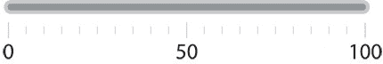

图 6.7. 滑块轨的图像

我们还需要为滑块控件的可拖拽部分——“滑块（thumb）”创建一个单独的图像。我创建的宽 20 像素，高 35 像素，如图 6.8 所示。


图 6.8. 滑块的图像

现在，考虑到我们希望让文本字段对于键盘和屏幕阅读器用户都可见且可用，我们需要什么样的额外的 DOM 结构和 CSS 样式来生成这个控件呢？嗯，我想这样的结构效果会很好：

```html

<label for="percent">Percentage

<span class="sliderControl">

  <span class="track"></span>

  <span class="thumb"></span>

<input id="percent" name="percent" type="text" value="0" class="slider from0 to100 scale4" />

</span>

</label>

```

记住：这并不是你将要添加到 HTML 中的代码——我们将使用 JavaScript 来生成这些新元素。

我使用了`span`元素，因为在 HTML 中任何允许`input`的地方它们都是合法的。`sliderControl span`为我们定位滑块控件的不同元素提供了一个容器，`track span`是我们用来显示轨道图像的元素，而`thumb span`将为我们显示滑块图像。我还将将现有的`input`放在`sliderControl span`内部，因为这让我们能够自由地相对于滑块控件的元素定位该字段。

以下是用于样式化所有内容的 CSS：

**简单的 JavaScript**
**258**

**slider.css** (节选)

```css

span.sliderControl {


  display: block;

  height: 79px;

  position: relative;

}

span.sliderTrack {


  background: url("slider_scale.jpg");

  display: block;

  height: 72px;

  left: 0;

  position: absolute;

  top: 7px;

  width: 430px;

}

span.sliderControl span.sliderThumb {


  background-image: url("slider_thumb.gif");

  cursor: w-resize;

  height: 35px;

  position: absolute;

  top: 0;

  width: 20px;

}

span.sliderControl input.slider {


  margin-left: 430px;

}
```


这并不是一本关于 CSS 布局的书，但让我快速总结一下这些规则各自的作用：


包含构成滑块的所有元素的 `span` 将作为一个块级元素（block）显示，其高度应足够容纳滑块控件（具体来说是轨道背景图像以及你想在周围留留的任何空间）。设置 `position: relative` 让你能够相对于其包含的所有元素相对于左上角进行定位。


`sliderTrack span` 实际上只是一个画布，在上面作为背景图像显示滑块轨道。它以所需尺寸的块级元素显示，**259**
**表单增强**，并且其定位方式使得当滑块位于 `sliderControl` 容器的左边缘时，它出现在轨道的左端。


`sliderThumb span` 的设置也类似，以采用显示滑块图像作为背景所需的精确尺寸。然而，请注意，它没有为 `left` 属性设置值，因为它的水平位置将由我们的 JavaScript 动态控制。不过，它确实显示了水平缩放光标，以帮助用户如何使用该控件

最后这条规则将文本字段定位在 `sliderControl` 内部。在这种情况下，我给它了足够的外边距（margin），以便将其放置在滑块控件元素旁边。

**slider.js** ***(节)***

```
var value = parseInt(sliderFields[i].value, 10);
thumb.style.left = ((value - from) * scale) + "px";
```

上述第一行根据文本字段的字符串值获取一个数字。
第二行计算了该值与滑块最小值之间的差值，
将该差值乘以滑块的比例（scale），然后将滑块手柄（thumb）定位在滑块左侧相应的像素处。

这就是我们创建的滑块。现在我们只需要事件监听器来让它运行起来：

**slider.js** ***(节)***

```
Core.addEventListener(sliderFields[i], "change",
Slider.changeListener);
Core.addEventListener(thumb, "mousedown",
Slider.mousedownListener);
}
},
```

当用户更改文本字段的值时，我们的 `change` 事件监听器将
相应地更新滑块。相反，当用户点击滑块手柄时，
我们的 `mousedown` 事件监听器将处理拖拽操作，并更新
文本字段的值。

让我们从 `change` 事件监听器开始，因为我们之前处理过这种类型的事件：

**slider.js** ***(节)***

```
changeListener: function(event)
{
var thumb = this._thumb;
```


```
var value = parseInt(this.value, 10);
if (value < thumb._from)
```


```
{
value = thumb._from;
}
else if (value > thumb._to)
{
value = thumb._to;
}
thumb.style.left =
((value - thumb._from) * thumb._scale) + "px";
```


```
this.value = value;
```


```
},
```

虽然这里的代码相对直观，但让我详细解释一下它在做什么：


由于我们正在响应针对文本字段的事件，我们可以通过在 `init` 中创建的自定义属性 `_thumb` 来获取滑块手柄的引用。


我们检查用户输入的值是否在为滑块指定的限制范围内。
如果值太大，我们就将其减小到允许的最大值。
如果值太小，我们就将其增加到允许的最小值。


一旦我们确定了一个可接受的值，我们将手柄移动到
相应的位置。


最后，我们将确定的值写回表单字段，
这样任何由于滑块限制而产生的调整
都会反映在字段的值中。

现在，该轮到你一直等待的部分：让滑块手柄变得可拖拽的代码。
每次拖拽操作都涉及三种事件：

1. `mousedown` 事件表示用户在光标置于可拖拽元素上时
   按下了鼠标键。
2. 当用户在页面上移动光标时，会生成一系列 `mousemove` 事件。
3. `mouseup` 事件信号用户已松开鼠标键，完成了拖拽操作。

## 简易 JavaScript

我们已经在 `init` 中在滑块手柄上注册了 `mousedown` 事件监听器，
所以让我们来看看：

**slider.js** ***(节)***

```
mousedownListener: function(event)
{
this._valueorigin =
parseInt(this.style.left, 10) / this._scale - this._from;
```


```
this._dragorigin = event.clientX;
```


```
document._currentThumb = this;
```


```
Core.addEventListener(
document, "mousemove", Slider.mousemoveListener);
```


```
Core.addEventListener(
document, "mouseup", Slider.mouseupListener);
```


```
Core.preventDefault(event);
```


```
},
```

此监听器负责启动拖拽操作：


我们通过记录整个拖拽过程中需要的若干数值开始，
其中第一个是滑块开始时的值。在随后的步骤中，
我们将跟踪鼠标离开起始位置的距离，并使用该数字
来确定滑块的值相对于这个起始值应该改变多少。


显然，我们还需要记录鼠标指针的起始位置。
任何事件 `event` 对象的 `clientX` 属性提供了事件发生时
在浏览器内的水平位置。
正如我们稍后看到的，在整个拖拽过程中我们需要一种方便
的方法来访问手柄，因此会在 `document` 对象的自定义
属性中存储该元素的引用。


现在拖拽操作已经开始，我们需要响应 document 中的
每一个 `mousemove` 事件——无论光标是否停留在手柄
元素上。因此，我们在 `document` 节点上添加了 `mousemove` 监听器。此监听器将捕获来自 document 中任何元素的冒泡事件。

同样，我们需要在用户松开鼠标键时知道，无论那时
光标位于，所以我们在 `document` 对象上添加了 `mouseup` 事件
监听器。由于这两个事件监听器是注册在 document 而不是手柄上的，
它们无法通过 `this` 访问手柄。这就是我们在 document 中
记录手柄引用的原因。

最后，我们防止浏览器响应鼠标按下按下执行任何默认
动作（例如开始文本选择）。当用户按住鼠标在页面上
移动光标时，我们将通过动态更新手柄的位置和
字段的值来响应每一个 `mousemove` 事件：

**slider.js** ***(节)***

```
mousemoveListener: function(event)
{
var thumb = document._currentThumb;
```


```
var value = thumb._valueorigin +
(event.clientX - thumb._dragorigin) / thumb._scale;
```


```
if (value < thumb._from)
{
value = thumb._from;
}
else if (value > thumb._to)
{
value = thumb._to;
}
thumb.style.left =
((value - thumb._from) * thumb._scale) + "px";
```


```
thumb._input.value = value;
```


```
Core.preventDefault(event);
},
```

## 简易 JavaScript

此监听器的工作原理与我们之前看到的 `changeListener` 非常相似，
不同在于它不是从表单字段获取更新后的值，而是
根据鼠标指针相对于其起始位置的位置以及
拖拽操作开始时的原始值来计算该值：


我们正在响应一个冒泡到 document 节点的 `mousemove` 事件，
但我们需要的所有信息都锁在手柄元素中。
幸运的是，我们在 `document` 对象的自定义 `_currentThumb`
属性中存储了该元素的引用。


在这里，我们计算对应当前鼠标位置的滑块值。
我们从拖拽开始时的滑块值（`thumb._valueorigin`）开始，
加上当前位置（`event.clientX`）与起始位置（`thumb._dragorigin`）之差，除以滑块比例（`thumb._scale`）。


与 `changeListener` 一样，我们将计算值限制在允许范围内。


为了产生用户正在实际拖拽滑块手柄的幻觉，我们
根据计算的值调整其位置。再次，这段
代码与 `changeListener` 中的对应代码工作相同。


我们还动态更新文本字段的值。


```
Core.removeEventListener(document, "mouseup", Slider.mouseupListener);
}
```

这段代码非常通俗易懂。它移除了存储在 `document` 对象中对滑块（thumb）的引用，并移除了 `mousemove` 和 `mouseup` 监听器，保留 `mousedown` 监听器以便开始下一次拖拽。

正如你可能观察到的，在 Web 上创建可拖拽元素是一门黑艺术，当你想要允许用户将可拖拽元素*放置*到一个或多个目标元素上时，情况会变得更加复杂。⁴

然而，目前我们已经通过复杂的监听器网络让元素拖拽看起来非常自然，这精细地控制了浏览器对相关鼠标事件的响应。这证明了如果你愿意亲自动，使用 JavaScript 可以取得巨大的成就。图 6.9 显示了完成后的滑块控件的样子。

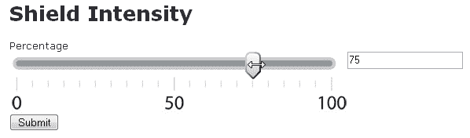

图 6.9. 完成的滑块控件

这里是滑块控件的完整 JavaScript 代码。考虑到它能为表单的可用性带来的提升，我认为它是简洁得令人惊喜！

⁴ 这在 SitePoint 的书籍《The JavaScript Anthology》（Melbourne: SitePoint, 2006）中会有详细介绍。

**Simply JavaScript**
**268**

**slider.js**

```javascript
var Slider = {

  init: function() {

    var sliderFields = Core.getElementsByClass("slider");

    for (var i = 0; i < sliderFields.length; i++) {

      var fromMatch = /(^| )from(\d+)( |$)/.exec(sliderFields[i].className);

      var from = parseInt(fromMatch[2], 10);

      var toMatch = /(^| )to(\d+)( |$)/.exec(sliderFields[i].className);

      var to = parseInt(toMatch[2], 10);

      var scaleMatch = /(^| )scale(\d+)( |$)/.exec(sliderFields[i].className);

      var scale = parseInt(scaleMatch[2], 10);

      var slider = document.createElement("span");

      slider.id = sliderFields[i].id + "slider";

      slider.className = "sliderControl";

      var track = document.createElement("span");

      track.id = sliderFields[i].id + "track";

      track.className = "sliderTrack";

      var thumb = document.createElement("span");

      thumb.id = sliderFields[i].id + "thumb";

      thumb.className = "sliderThumb";

      thumb._input = sliderFields[i];

      thumb._from = from;

      thumb._to = to;

      thumb._scale = scale;

      sliderFields[i]._thumb = thumb;

      slider.appendChild(track);

      slider.appendChild(thumb);

      sliderFields[i].parentNode.replaceChild(slider, sliderFields[i]);

      slider.appendChild(sliderFields[i]);

      var value = parseInt(sliderFields[i].value, 10);

      thumb.style.left = ((value - from) * scale) + "px";

      Core.addEventListener(sliderFields[i], "change", Slider.changeListener);

      Core.addEventListener(thumb, "mousedown", Slider.mousedownListener);

    }

  },

  changeListener: function(event) {

    var thumb = this._thumb;

    var value = parseInt(this.value, 10);

    if (value < thumb._from) {

      value = thumb._from;
```


    } else if (value > thumb._to) {

      value = thumb._to;

    }

    `thumb.style.left = ((value - thumb._from) * thumb._scale) + "px"`;

    `this.value = value`;

  },

  `mousedownListener: function(event) {

    this._valueorigin = parseInt(this.style.left, 10) / this._scale - this._from;

    this._dragorigin = event.clientX;

    document._currentThumb = this;

    Core.addEventListener(document, "mousemove", Slider.mousemoveListener);

    Core.addEventListener(document, "mouseup", Slider.mouseupListener);

    Core.preventDefault(event);

  }`,

  `mousemoveListener: function(event) {

    var thumb = document._currentThumb;

    var value = thumb._valueorigin + (event.clientX - thumb._dragorigin) / thumb._scale;

    if (value < thumb._from) {

      value = thumb._from;

    } else if (value > thumb._to) {

      value = thumb._to;

    }

    thumb.style.left = ((value - thumb._from) * thumb._scale) + "px";

    this.value = value;

  }`

};

```

**269**
**表单增强**

**Simply JavaScript**
**270**

**Simply JavaScript**
**271**
**表单增强**
**探索 JavaScript**
**表单验证**
**272**
**Simply JavaScript**
**273**
**表单增强**

## 自定义控件

正如我之前提到的，Dojo 库关注的重点之一是创建丰富的小部件，以补充纯 HTML 提供的用户界面元素。其中包含了一系列丰富的表单控件（Form Widgets），它们的工作方式与我们在本章中开发的滑块控件相同，通过在标准 HTML 表单字段之上提供一个丰富的、由 JavaScript 驱动的用户界面。

以下是部分 Dojo 表单控件的快速列表：

- **Button（按钮）**：HTML `button` 元素的高级版本
- **Checkbox（复选框）**：类似于标准的 HTML 复选框，但使用自定义图像作为复选框
- **ColorPalette（调色板）**：显示颜色色网格，用户可以从中选择
- **ComboBox（组合框）**：类似于标准的文本字段，但在响应用户输入时会弹出建议值列表
- **DatePicker（日期选择器）**：显示用于选择日期的交互式日历
- **TimePicker（时间选择器）**：显示用于选择一天中某个时间的丰富界面
- **Editor2（富文本编辑器）**：一个所见即所得（WYSIWYG）HTML 编辑器，允许用户输入并格式化作为 HTML 提交的富文本
- **HslColorPicker（HSL 颜色选择器）**：显示用于选择颜色值的丰富界面
- **Select（选择框）**：HTML `select` 元素的高级版本
- **Slider（滑块）**：一种图形化滑块控件，类似于我们在本章中构建的
- **Spinner（数字调节器）**：一个输入字段，允许您通过点击向上和向箭头来选择数字

再次，截至本书编写，Dojo 小部件的文档较少，因此在没有高级 JavaScript 经验的情况下尝试使用它们可能会令人沮丧。

Yahoo! UI 库 (YUI) 提供的控件集合较少，⁷ 但它提供的控件文档非常详尽，并有许多适合初学者的示例。以下是目前的表单相关 YUI 控件列表：

- **AutoComplete（自动补全）**：可以在响应用户输入时弹出建议值列表的文本字段
- **Calendar（日历）**：用于选择日期的丰富界面
- **Slider（滑块）**：一种图形化滑块控件，类似于我们在本章中构建的

请务必花时间玩玩这些小部件库，并特别关注它们在如何很好（或者糟糕，通常是糟糕）处理键盘导航、屏幕阅读器可访问性以及语义化 HTML 代码等问题上。虽然盲目信任这些小部件库可能很有诱惑，但我相信你会发现，“自己动手做”的选项仍然非常有价值。无论你决定如何，保持清醒是重要的，而且通过理解（至少在原理上）如何自己构建自定义表单控件，你将能够更好地评估此类预包选项。

## 总结

早些当 JavaScript 支持首次被添加到网页浏览器时，人们几乎能想到的唯一用途就是增强 HTML 表单。我们在本章中看到的任务——表单字段的互连、对表单提交进行客户端验证、以及创建新类型的表单控件——这些都是 JavaScript 最擅长的事情，仅仅是因为它已经做了很长一段时间了。

尽管这些表单增强功能可能不像书中其他示例那样华丽和新颖，但我们用于实现这些功能的技术——渐进式增强、DOM 操作和非侵入式脚本——确实是。如果最初尝试增强 HTML 表单的 JavaScript 先驱们当时有这些技术可供，那么今天遍布 Web 的 JavaScript 增强型表单运行起来会比现在得多。

⁷ http://developer.yahoo.com/yui/#elements

## 第 7 章

## 错误与调试

许多 JavaScript 书不会告诉你的事实是：JavaScript 是一种很难一次就写正确的语言。

到现在，你应该对 JavaScript 这种语言有了相当扎实的感受，并知道如何使用事件监听器和 DOM API 等工具来丰富你构建的网站。但如果你真的尝试过编写属于自己的原始脚本，很可能你最后会感到挫败，甚至可能有一点愤怒。

这种挫败感可能部分源于，JavaScript 与所有运行在浏览器中的语言一样，默认被设计为“静默失败”。当你编写的代码出现问题时，没必要向你那些不幸的访问者大声叫叫，所以浏览器只会静静地搁置损坏的脚本并忽略它们。本章的指令将教你如何让浏览器“开口”，这样你就能在 JavaScript 错误发生时发现它们。

然而，即使你能够*看到*错误信息，你可能会发现大多数 JavaScript 错误并没有多大帮助——特别是如果你是该语言的新手。大多数错误信息是用“程序员术语”编写的，或者当问题实际上在其他地方时，它们却抱怨代码中某个完全正确的部分。因此，我们将在本章中花时间解读你可能遇到的最常见的错误信息，以及它们的真实含义。

掌握了这些工具后，你应该能够追踪到浏览器能为你检测出的问题。但你可能仍然会纳闷，为什么你精心编写的脚本（在浏览器看来它是完全没问题的）会表现出那种行为。有了正确的工具，你可以……

### 什么都没发生！

花费两个小时时间来拼凑出“什么都没发生”这一事实，这并不令人鼓舞。好消息是，如果你工作得当，JavaScript 的静默失败意味着用户永远不知道你的代码没有运行。

当你尝试追踪代码中的问题时，通常会先打开错误控制台，并点击**Clear（清除）**按钮来清空可能显示的积压条目。然后你可以在主浏览器窗口中刷新页面，并注意错误控制台中出现的通知。如果有很多通知，你可能可以先点击**Errors（错误）**按钮只查看最严重的错误，并集中修复它们，然后再返回**All（全部）**视图修复不那么严重的问题。

要在 JavaScript 错误发生时了解它们，取决于你使用的是什么浏览器，方法各不相同。Firefox 有一个非常好的错误控制台，可以通过选择**工具 > 错误控制台**来访问。这会打开图 7.1 所示的窗口。控制台不仅显示 JavaScript 错误，还显示 CSS 代码错误甚至是浏览器内部生成的错误。

对于控制台中的每个条目都会显示生成它的特定文件和行号。根据条目的性质，错误控制台甚至可以向你显示所在的行，并用箭头指向生成条目的精确代码。


图 7.1. Firefox 错误控制台

可见，Firefox 错误控制台显示的不仅仅是错误：

- **Errors（错误）**：阻止浏览器继续执行脚本的问题
- **Warnings（警告）**：代码中的问题，浏览器可以绕过，但可能表明脚本的行为不符合你的预期
- **Messages（消息）**：来自代码的注释，用于告知它正在做什么，通常作为浏览器扩展开发者的调试工具——你不会看到很多这类消息

Opera 的错误控制台如图 7.2 所示，其工作方式与 Firefox 非常相似。你可以点击**工具 (Tools)** > **高级 (Advanced)** > **错误控制台 (Error Console)** 来进入它。

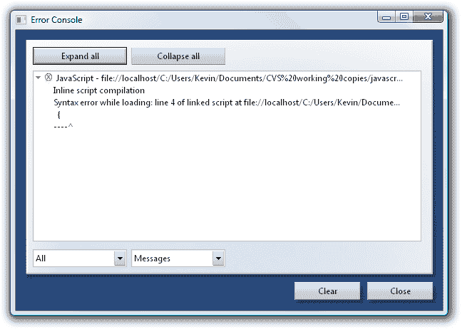

图 7.2. Opera 错误控制台

窗口底部的两个下拉菜单是查看感兴趣通知的关键。第一个菜单控制显示的通知来源，如果你在编写脚本，可以从该菜单选择 **JavaScript** 来过滤掉 HTML 和 CSS 错误等。第二个下拉菜单的作用与 Firefox 错误控制台中的通知过滤按钮类似，允许你设置在控制台中显示的条目的严重程度。默认选择**消息 (Messages)** 将允许显示消息、警告和错误。

在 Internet Explorer 中，寻找有用的错误信息要困难。要查看它们，你需要打开 Internet 选项窗口（**工具 (Tools)** > **Internet 选项 (Internet Options)**），然后在**高级 (Advanced)** 选项卡中，找到**浏览 (Browsing)** 下的**对每个脚本错误显示通知 (Display a notification about every script error)** 。确保它已勾选，如图 7.3 所示。

**纯粹 JavaScript**

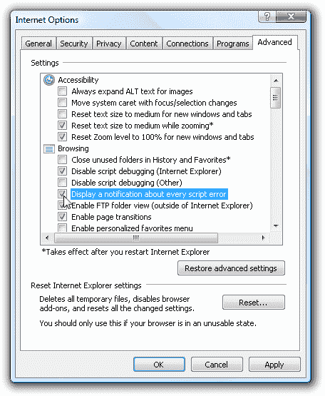

图 7.3. 在 Internet Explorer 中启用 JavaScript 错误

一旦设置了此选项，只要发生 JavaScript 错误，你就会收到通知，此时会弹出一个极其没用的对话框，类似于图 7.4 所示。

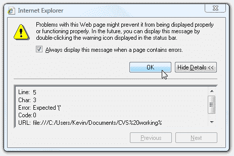

图 7.4. Internet Explorer 中的 JavaScript 错误通知

### 错误与调试

该窗口中你唯一应该真正关注的是以 **Error:** 开头的行行。该对话框中的所有其他信息（包括行号和字符数）通常都是错误的。老实，从 Internet Explorer 7 开始，甚至该窗口顶部的消息也是错误的！如果你取消勾选**页面包含错误时始终显示此消息 (Always display this message when a page contains errors)** 复选框，它提到的状态栏中的警告图标实际上不会显示。

如你所见，在 Internet Explorer 中查找并修复 JavaScript 错误并非易事。有一些工具可以让它变得简单一点，但由于大多数 JavaScript 问题会影响*所有*浏览器，你通常最好在不同的浏览器中进行 JavaScript 开发，并将 Internet Explorer 的 JavaScript 错误报告作为针对该浏览器特定问题的最后手段。

要访问 Safari 的错误控制台，你需要启用该浏览器的隐藏功能。打开终端（Terminal）窗口并输入：

```
defaults write com.apple.Safari IncludeDebugMenu 1
```

按下**回车 (Enter)**，然后退出终端应用程序。下次启动 Safari 时，你将在**帮助 (Help)**菜单旁边看到一个新的**调试 (Debug)** 菜单。确保菜单中勾选了**记录 JavaScript 异常 (Log JavaScript Exceptions)** ，如图 7.5 所示，然后点击**显示 JavaScript 控制台 (Show JavaScript Console)** 弹出图 7.6 所示的错误控制台。

你会注意到，在我们节讨论的四个浏览器中，Safari 提供的错误信息最简练且最没用。至少它通常能找对文件名和行号。

现在你已经可以*看到* JavaScript 错误信息了，你需要学习如何解释它们。

### 常见错误

每个浏览器对 JavaScript 错误信息都有特定的方言。几乎总是，Firefox 在所有当前浏览器中产生最合理、最有用的信息，因此当你面对一个令人困惑的消息时，最好的办法是在 Firefox 中打开页面，查看它的错误控制台说了什么。

1 http://blogs.msdn.com/ie/archive/2004/10/26/247912.aspx

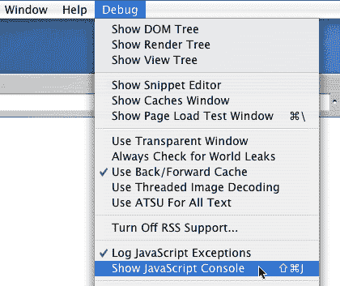

图 7.5. Safari 隐藏的**调试 (Debug)** 菜单

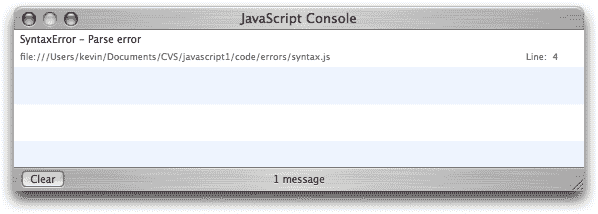

图 7.6. Safari 的错误控制台

JavaScript 中可能发生三种错误：

- 语法错误
- 运行时错误
- 逻辑错误

只有前两种会产生错误信息。

### 语法错误

**语法错误**由于你的代码违反了 JavaScript 语言的基本规则（或语法）而引起。它是浏览器在表达：“你在胡说什么呢，威利斯？”² 在浏览器会告知你的错误中，语法错误最容易修复，但在你的代码中最难被发现。

这是一个包含许多语法错误的简单脚本：

**syntax.js**

```javascript
// 此脚本包含四个错误
var MyScript = {
  init: function
  {
    MyScript.doSomething();
  }
  doSomething: function()
  {
    alert("Hold onto your hat!");
    // 发生
  }
};

Core.start(MyScript);
```

如果你在 Firefox 中加载链接到此脚本的页面（如代码存档中的 **syntax.html**），错误控制台将显示图 7.7 所示的错误信息。

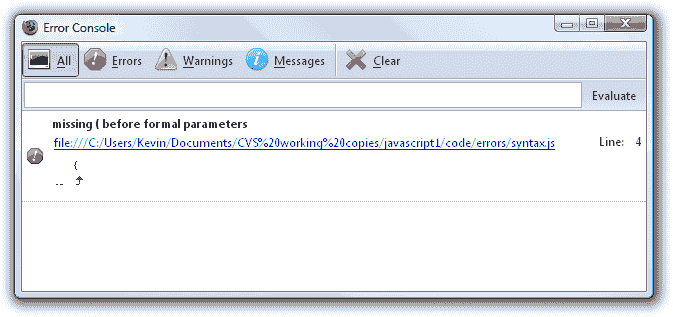

图 7.7. 语法错误

2 http://www.imdb.com/title/tt00703/quotes

一旦设置了此选项，只要发生 JavaScript 错误，你就会收到通知，此时会弹出一个极其没用的对话框，类似于图 7.4 所示。

由于浏览器在尝试理解你的脚本时遇到语法错误就会放弃，你只会收到给定脚本中的第一个错误通知。如你所见，在这种情况情况下，错误信息是“缺少形式参数 (formal parameters)”，而浏览器在 **syntax.js** 第四行遇到了这个大括号 (`{`)。

回看脚本，你可能无法一眼看出问题在哪里。这个大括号显然在正确的位置，而且它是标记 `init` 方法体开始必需的，所以浏览器为什么会抱怨它？而且“形式参数”到底是什么？

真正的问题发生在上一行：在 `function` 关键字后面必须的括号被漏掉了！这些括号包围了函数的参数列表（也称为**形式参数 (formal parameters)**），并且它们是必须的。修复后的代码如下所示：

```javascript
3 init: function()
4 {
5   MyScript.doSomething();
```

事实证明，大多数语法错误发生在浏览器期望某种东西但却遇到了另一种东西时。在这种情况下，它期望一个左括号 (`(`)，却遇到了一个左大括号 (`{`)。这就是为什么错误信息指向了看似无辜的大括号。

通常，错误信息会告诉你浏览器原本期望找到什么（在这种情况下，它抱怨“缺少 `(`”），但如果该消息对你来说不合逻辑，一个很好的策略是查看代码中错误发生地之前的内容，并尝试识别你可能漏掉了什么。

如果你修复了这个错误并重新加载页面，当你看到图 7.8 所示的错误信息时，将有一个尝试这种技巧的绝佳机会。

你能找到问题所在？再次，浏览器在抱怨缺少一个字符——在这种情况下是一个右大括号 (`}`)——但如果你查看错误之前的行，那里已经有一个右大括号了！

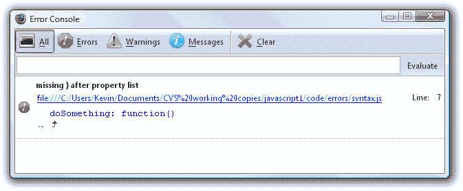

图 7.8. 另一个语法错误

**syntax.js** *(部分)*

```javascript
6 }
7 doSomething: function()
```


另一个属性，在这种情况下你漏掉了一个逗号，”但遗憾的是，浏览器还没有那么聪明（目前）。你需要自己察觉什么时候错误信息是基于浏览器的错误假设，并采取相应的行动。

如果你修复了这个错误并重新加载页面，你将看到另一个示例错误，如图 7.9 所示。这是一个很容易的错误，所以在继续阅读之前看看你能不能推想出来。

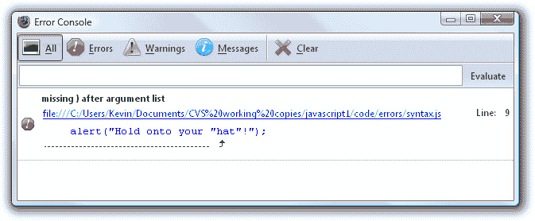

图 7.9. 另一个语法错误

从错误信息来看，当浏览器到达`hat`中的`h`时，它实际上期望一个右括号（`)`），因为它认为它已经到达了`alert`函数调用的参数列表的末尾。为什么它会在参数中间那样想呢？

再次查看紧接错误之前的代码以获取解释。在`h`之前是一个双引号（`"`），浏览器将其解释为字符串`"Hold onto your "`的结束——这是你`alert`函数调用中的第一个参数。在这个参数之后，它期望看到一个逗号（`,`）后跟下一个参数，或者一个右括号来完成参数列表。错误信息假设你本想选择后者。

当然，在这种情况下，你这两者都没想——你实际上并不想让那个双引号标记第一个参数的结束！要修复这个问题，使用反斜杠转义字符串中的双引号：

 

```javascript
alert("Hold onto your \"hat\"!");
```

图 7.10 显示了浏览器在该脚本中遇到的最终错误。

## 错误与调试


图 7.10. 猜猜看！（是的——又是另一个语法错误）

好了，这道题我给你放了便宜。只是为了让你看到这种情况*确实*会发生，这个错误信息准确地说明了它的含义。行开头的反斜杠被称为**非法字符**（illegal character），这是一种高级的说法，意思是“清醒点——你在这里甚至*不允许*输入反斜杠！”

问题当然在于，注释必须以双斜杠开头，而不是双反斜杠：

 

```javascript
// something happens
```

如你所示，一旦你发现了错误出在哪里，语法错误是很容易修复的，但浏览器显示的错误信息往往具有误导性。通常这归于遗忘了一两个字符，或者在想用某种类型的括号时不小心用了另一种。

好消息是，你写的 JavaScript 越多，就会对这种语言的细节越熟悉，遇到语法错误的几率也就越低。

## 运行时错误

**运行时错误**（Runtime errors）发生在一段完全有效的 JavaScript 代码尝试执行它不被允许执行、或者完全无法实现的操作时。这些错误之所以这样命名，是因为它们发生在脚本实际运行时。与语法错误信息不同，运行时错误产生信息往往非常中肯。关键在于弄清楚错误发生的原因。

此脚本包含许多运行时错误：

**runtime.js**

```javascript
1 // This script contains runtime errors
2 var MyScript = {
3     init: function() {
4         var example = document.getElementsById("example");
5         
6         for (var i = 0; i < example.length; i++) {
7             Core.addEventListener(example[i], "click", doSomething);
8         }
9         
10        var links = document.getElementsByTagName("a");
11        var firstLink = links[0];
12        
13        if (firstLink && firstLink.className == "") {
14            alert("The first link has no class assigned to it!");
15        }
16    },
17    doSomething: function(event) {
18        alert("Hold onto your hat");
19    }
20 };
21 Core.start(MyScript);
```

再次启动 Firefox 加载相应的 HTML 文件（**runtime.html**）来查看此脚本产生的第一个错误——如图 7.11 所示。运行时错误看起来和语法错误一样，区别在于错误没有显示导致运行时错误的代码行。

“not a function”（不是函数）错误通常意味着你拼错了尝试调用的函数或方法名称，或者你尝试调用的函数或方法根本不存在。


图 7.11. 一个运行时错误……新奇！

作为 JavaScript 新手，你可能会经常看到这种信息——特别是你不习惯 JavaScript 的大小写敏感。例如调用`Alert`而不是`alert`将产生此错误信息。但它也可以发生在更微妙的情况下，比如在文本节点（不是字符串）上调用类似`toLowerCase`的字符串方法，而不是在文本节点的`nodeValue`上（它是字符串）。在这个例子中，原因简单得多：开发者尝试调用一个名为`getElementsById`的方法，但并没有这种方法。开发者可能想用的是`getElementById`（没有“s”）。因为文档中只能有一个给定 ID 的元素，所以存在名为`getElementsById`的方法是不符合逻辑的。

在这种情况下，修复方法显而易见：

```javascript
5 var example = document.getElementById("example");
```

但事实证明，修复这个问题导致了另一个运行时错误，如图 7.12 所示。“has no properties”（没有属性）错误意味着你正试图通过访问属性或方法将一个非对象当作对象处理。这种错误最常见的原因是通常返回对象（如`getElementById`）返回了`null`。如果你的代码假设返回的是对象并对其处理，就会得到这样的错误。

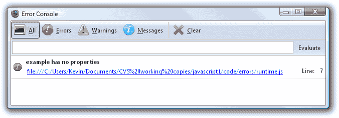

图 7.12. 一个不太清晰的运行时错误

在这种情况下，错误是由以下行代码引起的：

**runtime.js (excerpt)**

```javascript
3 init: function() {
4     var example = document.getElementsById("example");
5     
6     if (example) {
7         Core.addEventListener(example, "click", doSomething);
8     }
```

如果你检查**runtime.html**，你会发现实际上没有 ID 为`example`的元素，所以我们上面修复的`getElementById`调用返回了`null`，当这个`for`循环尝试读取该`null`值的`length`属性时，它产生了我们正在看到的错误信息。

显然，写这个脚本的人假设虚构的`getElementsById`方法会返回一个数组。由于`getElementById`返回单个元素或`null`，我们需要将`for`循环替换为`if`语句：

修复此后，图 7.13 显示了该脚本中的最后一个运行时错误。


图 7.13. 一个容易修复的运行时错误

“is not defined”（未定义）错误是最容易修复的错误之一。与我们之前看到的“is not a function”错误一样，它通常是由简单的拼写错误引起的，但它与不是函数或方法名的拼写错误，“is not defined”表示你尝试使用一个不存在的变量或属性。

在这种情况下，错误非常直观：

**runtime.js** (节选)

```javascript
12 var links = documents.getElementsByTagName("a");
```

如你所示，开发者仅仅将`document`拼成了`documents`。

修复这个错误后，脚本将成功显示警告消息：“第一个链接没有分配类！”

## 逻辑错误

逻辑错误与其说是错误，不如说是脚本中的 bug。代码按照其编写的方式运行良好——只是它的行为并没有在你编写它时预期的那样。这类错误可能极其难找，因为对浏览器来说，脚本运行得完全正常，所以你永远看不到错误消息。

由于每个逻辑错误都是不同的，每一个错误都提出了一个新挑战。以防你不完全清楚逻辑错误*到底是什么*，这里有一个包含几个逻辑错误的脚本：

**logic.js**

```javascript
1 // 这个脚本包含了三个逻辑错误
2 var MyScript = {
3     init: function() {
4         var links = document.getElementsByTagName("a");
5         var exampleLinks = [];
6         for (var i = 0; i < links.length; i++) {
7             if (links[i].className = "Example") {
8                 Core.addEventListener(
9                     links[i], "click", MyScript.doSomething);
10                exampleLinks[exampleLinks.length] = links[i];
11                i--;
12            }
13        }
14    },
15    doSomething: function(event) {
16        alert("Hold onto your hat!");
17    }
18 };
19 Core.start(MyScript);
```

这个脚本*本应该*找到并构建一个数组，其中包含文档中所有`class`属性为`example`的链接，并为每个链接分配`doSomething`方法作为`click`事件监听器。由于某种可以描述为逻辑错误的“完美风暴”，这个脚本实际上尝试将*设置*文档中*每一个*链接的`class`属性为`Example`，但在设置完文档中的第一个链接后就进入了导致浏览器挂起的无限循环。很妙对吧？如果这能让你宽慰一点，你必须非常倒霉才能偶然写出一个包含如此严重逻辑错误组合的脚本。然而，这个脚本中的每个逻辑错误都是你在编写代码时可能会遇到的常见类型 bug。

脚本中最严重的问题是无限循环，这是你通过逻辑错误所能造成的最糟糕的问题了。旧版浏览器在遇到无限循环时会无响应，必须由用户强制终止。如今，浏览器会检测脚本是否运行了很长时间，并显示一条类似图 7.14 所示的消息，提议停止脚本并将控制权交给用户。无限循环最终会产生。让我们从修复这个问题开始。这里是负责无限循环的代码：

**logic.js** (节选)

```javascript
12 exampleLinks[exampleLinks.length] = links[i];
13 i--;
```

当脚本发现一个它想要添加到`exampleLinks`数组的链接时，它通过这两个语句中的第一条来实现此操作。不幸的是，开发者似乎脑子抽了，认为将链接的引用添加到`exampleLinks`数组的末尾会将其从存储在`links`中的节点列表中移除。为了弥补这种想象中从`links`丢失的项，开发者用第二条语句递减了计数器变量（`i--;`）。事实上，链接仍然留在`links`节点列表中，所有的`i`递减所做的只是让`for`循环反复处理同一个链接——我们的无限循环。

我们可以简单通过删除第二条语句来避免无限循环：

```javascript
7 for (var i = 0; i != links.length; i++) {
8     if (links[i].className = "Example") {
9         Core.addEventListener(
10            links[i], "click", MyScript.doSomething);
11        exampleLinks[exampleLinks.length] = links[i];
12    }
13 }
```

运行这段修复后的代码，你发现的将是`click`事件监听器被分配给了文档中的*每一个*链接。

这种错误的原因是初学者一个非常常见的错误，他们经常混淆赋值运算符（`=`）和相等运算符（`==`）。这显而易见。`if`语句正在寻找`className`为"Example"（大写 E），但链接的`class`属性是`example`（小写 e）。类名对大小写敏感，因此我们需要确保脚本匹配文档中的实际值：

```javascript
9 if (links[i].className == "Example")
```

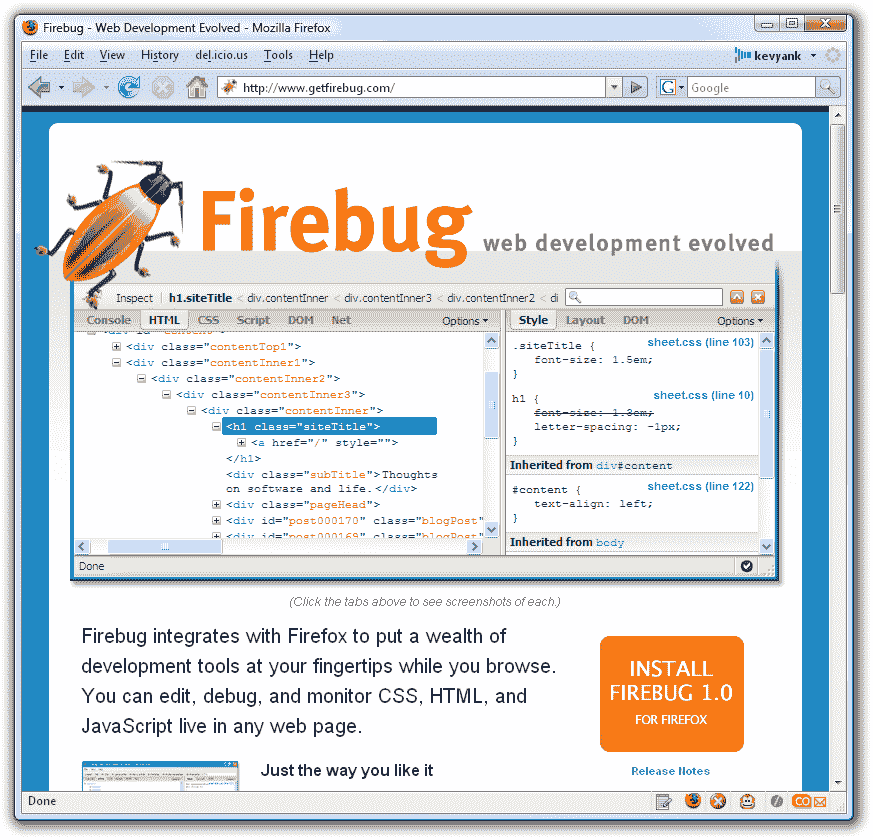
图 7.15. 获取 Firebug

让我向你展示如何使用 Firebug 来追踪我们在上一节中修复的那个无限循环：

1.  在浏览器中打开页面，并等待“脚本无响应（Unresponsive Script）”警告。点击**停止脚本（Stop script）**。

2.  按下 **F12**，或者点击浏览器窗口底部新的 Firebug 状态图标来打开 Firebug 面板，如图 7.16 所示，显示在浏览器的底部。

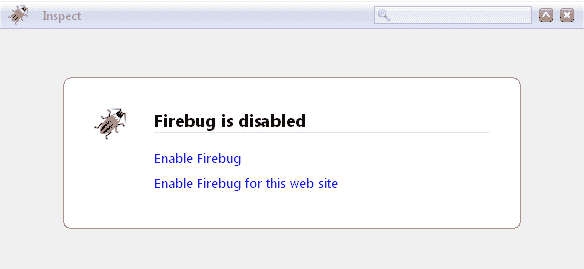
图 7.16. Firebug 面板

3.  由于 Firebug 会减慢浏览器的性能，因此默认是禁用的。点击**启用 Firebug（Enable Firebug）** 链接之一来启用 Firebug。你看到的第一个内容是图 7.17 所示的**控制台（Console）**标签页。

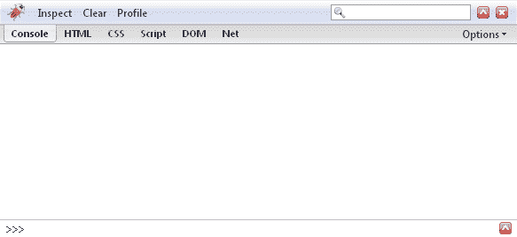
图 7.17. **控制台（Console）**标签页

类似于 Firefox 的错误控制台，Firebug 的**控制台**标签将显示 JavaScript 和 CSS 错误。如果你在**选项（Options）**菜单上选择**显示 XMLHttp 请求（Show XMLHttpRequests）**，它还会显示有关 Ajax 请求的有用信息，你将在下一章学习。你可以在标签底部的命令行输入任何 JavaScript 语句或表达式，Firebug 将当前显示的页面中执行它并在控制台中显示结果。

4.  然而，为了修复此页面中的无限循环，我们需要比**控制台**标签更强大的工具。点击**脚本（Script）**标签页查看 Firebug 的 JavaScript 调试器，如图 7.18 所示。

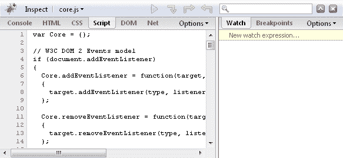
图 7.18. **脚本（Script）**标签页

5.  调试器允许你暂停脚本的执行并逐行通过，在执行过程中观察变量的值和 DOM 的结构。由于问题可能在**logic.js**文件中，首先从 Firebug 标签页顶部的下拉菜单中选择它，如图 7.19 所示。

6.  Firebug 现在显示**logic.js**文件的代码。我们可以从浏览器卡住的状态判断我们正在处理一个无限循环，而代码中唯一的循环是第 7 行的`for`循环，因此点击该行号旁侧的行隙（gutter），如图 7.20 所示。这设置了一个**断点（breakpoint）**，用红色圆圈表示，它告诉调试器在到达该行时暂停脚本的执行。

7.  设置好断点后，重新加载页面。如图 7.21 所示，断点上方将出现一个黄色箭头，表示脚本的执行已在该行处被暂停。调试器右侧面板中的**监视（Watch）**标签页还将显示该行上存在的局部变量及其当前值。

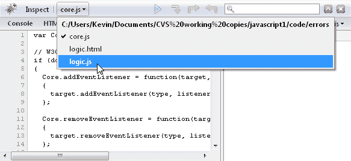
图 7.19. 选择要调试的文件

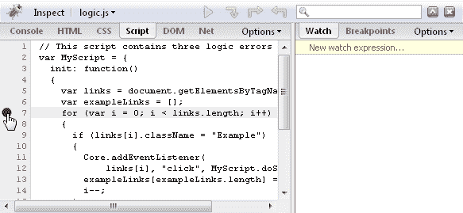
图 7.20. 设置断点

当调试器暂停时，你可以点击 Firebug 面板顶部的四个按钮之一来控制脚本的执行。蓝色箭头恢复脚本的正常执行，它将继续执行直到遇到下一个断点（如果有）。三个金色箭头允许你一次一个语句地逐行执行脚本。第一个**单步跳过（Step Over）**简单地执行当前语句并在当前代码列表的下一行再次暂停执行。第二个**单步跳入（Step Into）**的作用与**单步跳过**相同，区别在于当当前语句包含函数或方法调用时。在这种情况下，调试器将*进入*调用，在函数/方法内部的第一行暂停执行。第三个箭头**单步跳出（Step Out）**允许脚本执行完当前函数，并在调用它的代码下一行暂停执行。

8.  点击一次**单步跳过**以移动到`for`循环内部的第一行。

9.  现在，如果能知道`for`循环正在处理的当前链接`links[i]`就好了。你可以通过查看**监视**面板中`i`的值来肉眼观察，然后展开该面板中的`links`变量以找到数组中对应的元素。或者，你可以点击标记为**新建监视表达式（New watch expression）**的区域，输入`links[i]`并按**回车（Enter）**将该表达式添加到**监视**面板的局部变量列表中，如图 7.22 所示。这样我们就可以知道在第一次循环时，`links[i]`指向指向`logic.html`的链接。

10. 点击行隙中的黄色箭头设置另一个断点，这次在第 9 行。

11. 点击蓝色箭头恢复脚本执行。它将继续执行直到遇到下一个断点（如果有）。三个金色箭头允许你一次一个语句地逐行执行脚本。第一个**单步跳过（Step Over）**简单地执行当前语句并在当前代码列表的下一行再次暂停执行。第二个**单步跳入（Step Into）**的作用与**单步跳过**相同，区别在于当当前语句包含函数或方法调用时。在这种情况下，调试器将*进入*调用，在函数/方法内部的第一行暂停执行。第三个箭头**单步跳出（Step Out）**允许脚本执行完当前函数，并在调用它的代码下一行暂停执行。

XMLHttpRequest 是 Ajax 中唯一真正新出的部分。Ajax 交互的其他所有部分——触发它的事件监听器、更新页面的 DOM 操作等——在本书之前的章节中都已经被涵盖了。因此，一旦你学会了如何发送异步请求，就可以开始操作了。

## 创建 XMLHttpRequest 对象

Internet Explorer 5 和 6 是第一批实现`XMLHttpRequest`的浏览器，它们使用 ActiveX 对象来实现：¹

```javascript
var requester = new ActiveXObject("Microsoft.XMLHTTP");
```

其他支持`XMLHttpRequest`的浏览器（包括 Internet Explorer 7）都是在不使用 ActiveX 的情况下实现的。这些浏览器的请求对象如下：

```javascript
var requester = new XMLHttpRequest();
```

## ActiveX 不可靠

在 Internet Explorer 6 及更早版本中`XMLHttpRequest`的实现方式意味着，如果用户禁用了*信任的* ActiveX 控件，即使启用了 JavaScript，你也无法使用`XMLHttpRequest`。许多人会禁用*不受信任的* ActiveX 控件，但禁用信任的 ActiveX 控件并不常见。

我们可以使用`try-catch`语句轻松地协调两种对象创建方法之间的差异，它会自动检测创建`XMLHttpRequest`对象的正确方式：

**try-catch_test.js** *(节选)*

```javascript


`try`

{

  `var requester = new XMLHttpRequest();`

}

`catch (error)`

{

  `try`

{

    `var requester = new ActiveXObject("Microsoft.XMLHTTP");`

  }

`catch (error)`

{

    `var requester = null;`

  }

}

```

¹ ActiveX 对象是微软对可重用软件组件的术语，提供封装的、可用的功能。在 Internet Explorer 中，此类对象通常允许客户端脚本访问操作系统的设施，如文件系统，或者在 `XMLHttpRequest` 的情况下访问网络层。

`try` 语句允许你尝试执行代码块，但如果该块中的任何内容导致错误，程序不会完全停止执行；相反，它会进入 `catch` 语句并运行其中的代码。如图 8.2 所示，整个结构就像一个 `if-else` 语句，不同之处在于选择的分支取决于是否发生了错误。

我们需要使用 `try-catch` 语句来创建 ActiveX 对象，因为对象检测测试会显示，即使用户禁用了 ActiveX 控件，它们仍然是可用的（尽管当你实际上尝试创建 ActiveX 对象时，脚本会抛出错误）。

## 造成的损害

如果在 `try` 语句内部发生错误，程序不会恢复到执行 `try` 语句之前的状态——相反，它会立即切换到 `catch` 语句。因此，任何在错误发生*之前*创建的变量仍然存在。然而，如果在变量赋值时发生错误，则该变量将不会被创建。

上述代码中发生了以下情况：

我们尝试使用跨浏览器方法创建一个 `XMLHttpRequest` 对象。如果我们的尝试成功，变量 `requester` 将是一个新的 `XMLHttpRequest` 对象。但如果 `XMLHttpRequest` 不可用，代码将导致错误。我们可以在 `catch` 语句内部尝试另一种方法。

图 8.2. `try-catch` 语句的逻辑结构。

`catch` 语句“捕获”导致 `try` 语句失败的异常。该异常通过 `catch` 后面括号中出现的变量名来标识，并且必须给该异常命名（即使我们不打算使用它）。你可以给异常命名任何名称，但我认为 `error` 更具描述性。

在 `catch` 内部，我们尝试通过 ActiveX 创建 `XMLHttpRequest` 对象。如果该尝试成功，`requester` 将是一个有效的 `XMLHttpRequest` 对象，但如果我们仍然无法创建对象，第二个 `catch` 语句会将 `requester` 设置为 `null`。这便于我们测试当前用户代理是否支持 `XMLHttpRequest`，并跳转到某些非 Ajax 的备用方案（例如正常提交表单的方案）：

```
if (requester == null)
{
  // 非 Ajax 客户端的代码
}
else
{
  // 针对启用 Ajax 的客户端的代码
}
```

幸运的是，浏览器对 `XMLHttpRequest` 实现之间的显著差异在创建阶段之后就结束了。所有的基本通信方法都可以使用相同的语法进行调用，无论它们运行在何种浏览器中。

## 调用服务器

一旦创建了 `XMLHttpRequest` 对象，我们必须调用两个单独的方法——`open` 和 `send`——以便让它从服务器检索数据。`open` 初始化连接并接受两个必需的参数：第一个参数是你想要发送的 HTTP 请求类型（GET、POST 等）；第二个参数是你想要请求数据的位置。例如，如果我们想使用 GET 请求来访问网站根目录下的 `feed.xml`，我们将如下初始化 `XMLHttpRequest` 对象：

`requester.open("GET", "/feed.xml", true);`

URL 可以是相对的或绝对的，但由于跨域安全限制，目标必须与请求它的页面位于同一域。

## 仅限 HTTP

许多浏览器只允许通过 `http://` 和 `https://` URL 进行 `XMLHttpRequest` 调用，因此如果你通过 `file://` 开头的 URL 在本地查看网站，你的 `XMLHttpRequest` 调用可能不会被允许。

`open` 的第三个参数是布尔值，指定请求是异步的（`true`）还是同步的（`false`）。同步请求将冻结浏览器直到请求完成，期间不允许用户交互。异步请求在应用程序后台运行，允许脚本同时运行并允许用户访问浏览器。建议你使用异步请求；否则你可能会面临浏览器在等待出错请求时卡死的风险。`open` 还有可选的第四和第五参数，用于在请求密码保护 URL 时指定用户名和密码。

一旦使用 `open` 初始化连接，`send` 方法将激活连接并发出请求。`send` 接受一个参数，允许在 POST 请求中发送编码数据，格式与表单提交相同：

```
requester.setRequestHeader("Content-Type", "application/x-www-form-urlencoded");
requester.open("POST", "/query.php", true);
requester.send("name=Clark&email=superman@justiceleague.com");
```

## 需要 Content-Type

Opera 要求使用 `setRequestHeader` 方法设置 POST 请求的 `Content-Type` 头。其他浏览器并不要求，但为了兼容所有浏览器，这是安全的方法。

要使用 GET 请求模拟表单提交，你需要将名称和值硬编码到 `open` URL 中，然后带有 `null` 值执行 `send`：

```
requester.open("GET", "query.php?name=Clark&email=superman@justiceleague.com", true);
requester.send(null);
```

Internet Explorer 不需要你向 `send` 传递任何值，但如果没有传递任何值，Mozilla 浏览器将返回错误；这就是为什么代码中包含了 `null`。

一旦你调用了 `send`，`XMLHttpRequest` 将连接服务器并检索你请求的数据。在异步请求的情况下，创建连接的函数在检索发生时可能已经执行完毕。

在程序流方面，发起一个 `XMLHttpRequest` 调用非常类似于 `setTimeout`，你可能在第 5 章中遇到过它。

我们使用事件处理器来通知服务器已返回了响应。在特定情况下，我们需要处理 `XMLHttpRequest` 对象的 `readyState` 属性值的变化，该属性指定对象连接的状态，可以取以下任何一个值：

- **0**: 未初始化
- **1**: 加载中
- **2**: 已加载
- **3**: 交互中
- **4**: 已完成

我们可以通过处理 `readystatechange` 事件来监控 `readyState` 属性的变化，每当该属性的值发生变化时，该事件就会被触发：

`requester.onreadystatechange = readystatechangeHandler;`

`function readystatechangeHandler()`
`{`
*code to handle changes in XMLHttpRequest readystate*
`}`

`readyState` 从 `0` 增加到 `4`，每次增量都会触发一次 `readystatechange` 事件。然而，我们真正只想知道连接是什么时候完成的（即 `readyState` 等于 `4`），因此我们的处理函数需要检查此值。

在连接完成后，我们还需要检查 `XMLHttpRequest` 对象是否成功检索了数据，或者是否收到了如 `404`（页面未找到）之类的 HTTP 错误代码。你可以通过请求对象的 `status` 属性判断此，它包含一个整数值。`200` 表示请求完成；你应该检查该值，同时检查 `304`（未修改），因为这些值表示数据已成功检索。然而，`status` 的值可以是服务器能够返回的*任何* HTTP 码，因此你可能想编写一些条件来处理其他代码。但总之，如果请求未成功，你需要为程序指定要采取的行动：

`requester.onreadystatechange = readystatechangeHandler;`

`function readystatechangeHandler()`
`{`
`if (requester.readyState == 4)`
`{`
`if (requester.status == 200 || requester.status == 304)`
`{`
*code to handle successful request*
`}`
`else`
`{`
*code to handle failed request*
`}`
`}`
`}`

与其将在其他地方定义的函数作为 `readystatechange` 事件处理器，你可以在内联声明一个新的匿名（未命名）函数：

`requester.onreadystatechange = function()`
`{`
`if (requester.readyState == 4)`
`{`
`if (requester.status == 200 || requester.status == 304)`
`{`
*code to handle successful request*
`}`
`else`
`{`
*code to handle failed request*
`}`
`}`
`}`

这种内联指定 `readystatechange` 回调函数的优势是，通过闭包，可以在该函数内部访问 `requester` 对象。如果 `readystatechange` 处理函数是分开声明的，你将需要费一番周章才能在处理函数内部获取 `requester` 对象的引用。

## XMLHttpRequest 是不可循环复用的

尽管 `XMLHttpRequest` 对象允许你多次调用 `open` 方法，但每个对象实际上只能用于一次调用，因为一旦 `readyState` 变为 `4`，`readystatechange` 事件将不再再次触发（在 Mozilla 浏览器中）。因此，每当你想要从服务器检索新数据时，都必须创建一个新的 `XMLHttpRequest` 对象。

## 处理数据

如果你发送了成功请求，下一个逻辑步骤是读取服务器的响应。`XMLHttpRequest` 对象的两个属性可以用于此目的：

**responseXML**

该属性存储一个代表检索数据的 DOM 树，但仅当服务器指示响应的 `content-type` 为 `text/xml` 时有效。可以使用我们在第 3 章中探索的标准 JavaScript DOM 访问方法和属性对此 DOM 树进行遍历和修改，例如 `getElementsByTagName`、`childNodes` 和 `parentNode`。

**responseText**

该属性将响应数据作为单个字符串存储。如果服务器提供的数据 `content-type` 为 `text/plain` 或 `text/html`，则这是唯一包含数据的属性。在 `text/xml` 响应的情况下，该属性也将 XML 代码作为文本字符串包含在内，作为 `responseXML` 的替代方案。

在简单的情况下，纯文本作为传输和处理响应的手段效果非常完美，因此 `XMLHttpRequest` 对象并不完全名副其实。然而，当我们处理更复杂的数据结构时，XML 可以为这些结构提供一种方便的表达。

## 将 Ajax 投入实践

现在你了解了 Ajax 的基础知识——如何创建和使用 `XMLHttpRequest` 对象。但如果你尝试一个简单的示例，可能会更容易理解 Ajax 如何融入 JavaScript 程序中。

在本示例中，我们将根据用户从图 8.3 所示的小部件中进行的选择获取相关信息。该工具允许用户选择三个城市中的任意一个；每次选择都会更新部件的显示，显示该位置的天气。

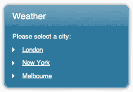

图 8.3。在我们的天气小部件中，用户被要求选择一个特定的城市

该小部件的 HTML 如下：

**weather_widget.html** ***（节选）***

```html
<div id="weatherWidget">
  <h2>Weather</h2>
  <p>Please select a city:</p>
  <ul>
    <li>
      <a href="/weather/london/">London</a>
    </li>
    <li>
      <a href="/weather/new_york/">New York</a>
    </li>
    <li>
      <a href="/weather/melbourne/">Melbourne</a>
    </li>
  </ul>
</div>
```

我们将用 Ajax 代码覆盖这些锚点，但重要的是，每个锚点的 `href` 属性都指向一个有效的位置。这意味着禁用了 JavaScript 或 `XMLHttpRequest` 的用户仍然能够获取信息；他们只是不会我们使用 Ajax 获取信息的这种酷炫方式大大震惊而已。

在创建 Ajax 功能时，你通常可以遵循以下模式：

1. 初始化事件监听器。
2. 处理事件触发器。
3. 创建一个 `XMLHttpRequest` 连接。
4. 解析数据。
5. 修改页面。

为了处理此天气小部件的行为，我们将创建一个 `WeatherWidget` 对象。它的初始化函数将从开始向这些锚点标签添加事件监听器，以捕获用户进行的任何点击：

**weather_widget.js** ***（节选）***

```javascript
var WeatherWidget = {
  init: function() {
    var weatherWidget = document.getElementById("weatherWidget");
    var anchors = weatherWidget.getElementsByTagName("a");
    for (var i = 0; i < anchors.length; i++) {
      Core.addEventListener(anchors[i], "click", WeatherWidget.clickListener);
    }
  },
  ⋮
};
```

现在每个锚点都都有了一个 `click` 事件监听器，但当事件触发时会发生什么呢？让我们填充监听器方法 `clickListener`：

**Simply JavaScript**

```javascript
clickListener: function(event) {
  try {
    var requester = new XMLHttpRequest();
    
  } catch (error) {
    try {
      var requester = new ActiveXObject("Microsoft.XMLHTTP");
    } catch (error) {
      var requester = null;
    }
  }
  if (requester != null) {
    
    var widgetLink = this;
    widgetLink._timer = setTimeout(function() {
    
      requester.abort();
      WeatherWidget.writeError("The server timed out while making your request.");
    }, 10000);
    var city = this.firstChild.nodeValue;
    
    requester.open("GET", "ajax_weather.php?city=" + encodeURIComponent(city), true);
    
    requester.onreadystatechange = function() {
    
    if (requester.readyState == 4) {
      clearTimeout(widgetLink._timer);
      if (requester.status == 200 || requester.status == 304) {
        WeatherWidget.writeUpdate(requester.responseXML);
      } else {
        WeatherWidget.writeError("The server was unable to be contacted.");
      }
    }
    };
    requester.send(null);
  }
}
```


`Core.preventDefault(event);`

```
if (requester != null) {
  // ...
}
```

该函数的开头由我们在本章早些时候过的标准 `XMLHttpRequest` 创建代码占据。当 `requester != null` 成立时，这意味着禁用了 JavaScript 或 `XMLHttpRequest` 的用户仍然能够获取信息；他们只是不会被我们使用 Ajax 获取信息的这种酷炫方式大大震惊而已。

在创建 Ajax 功能时，你通常可以遵循以下模式：

1. 初始化事件监听器。
2. 处理事件触发器。
3. 创建一个 `XMLHttpRequest` 连接。
4. 解析数据。
5. 修改页面。

为了处理此天气小部件的行为，我们将创建一个 `WeatherWidget` 对象。它的初始化函数将从开始向这些锚点标签添加事件监听器，以捕获用户进行的任何点击：

每个锚点现在都有了一个 `click` 事件监听器，但当事件触发时会发生什么呢？让我们填充监听器方法 `clickListener`：

该函数的开始处被占据了我们在本章早些时候过的标准 `XMLHttpRequest` 创建代码。当 `requester != null` 成立时，这意味着禁用了 JavaScript 或 `XMLHttpRequest` 的用户仍然能够获取信息；他们只是不会被我们使用 Ajax 获取信息的这种酷炫方式大大震惊而已。

在函数的开始处，我们通过 `this.firstChild.nodeValue` 获取城市。随后，我们向 `ajax_weather.php?city=` 发起 GET 请求。这种方式允许在 `requester != null` 成立时处理响应。

我们设置了 `onreadystatechange` 回调函数。当 `readyState == 4` 时，清除 `widgetLink._timer`。如果状态码为 200 或 304，则调用 `WeatherWidget.writeUpdate` 处理响应 XML；否则，调用 `WeatherWidget.writeError` 提示无法连接到服务器。

最后，我们调用 `requester.send(null)`，并使用 `Core.preventDefault(event)` 阻止浏览器的默认行为。

……连接到 JSP 脚本、Ruby on Rails 动作或 .NET 控制器。无论使用何种技术，我们只需要它返回某些格式格式的 XML 即可。

如果请求成功，我们会调用 `writeUpdate` 方法，并将服务器返回的 `responseXML` 数据传递给它。如果请求*未成功*，我们会调用 `writeError` 并给它传达一个合适的错误消息。

当调用 `writeUpdate` 时，我们知道已经有一些 XML 数据等待着解析并添加到我们的 HTML 中。为了使用这些数据，我们需要从 XML 中提取特定的数据点，然后将它们插入到页面中相应的元素中。

当你与自定义的服务器端脚本通信时，你必须就 XML 格式达成一致，以便服务器端脚本可以正确写入，而 JavaScript 能够正确读取。对于本示例，我们假设 XML 的格式如下：

**melbourne.xml**

```xml
<?xml version="1.0" ?>
<city>
  <name>Melbourne</name>
  <temperature>18</temperature>
  <description>Fine, partly cloudy</description>
  <description_class>partlyCloudy</description_class>
</city>
```

了解这种结构使我们很容易编写 `writeUpdate` 来提取相关数据：

**weather_widget.js** *(节选)*

```javascript
writeUpdate: function(responseXML)
{
  var nameNode = responseXML.getElementsByTagName("name")[0];
  var nameTextNode = nameNode.firstChild;
  var name = nameTextNode.nodeValue;

  var temperatureNode = responseXML.getElementsByTagName("temperature")[0];
  var temperatureTextNode = temperatureNode.firstChild;
  var temperature = temperatureTextNode.nodeValue;

  var descriptionNode = responseXML.getElementsByTagName("description")[0];
  var descriptionTextNode = descriptionNode.firstChild;
  var description = descriptionTextNode.nodeValue;

  var descriptionClassNode = responseXML.getElementsByTagName("description_class")[0];
  var descriptionClassTextNode = descriptionClassNode.firstChild;
  var descriptionClass = descriptionClassTextNode.nodeValue;

  var weatherWidget = document.getElementById("weatherWidget");
  while (weatherWidget.hasChildNodes())
  {
    weatherWidget.removeChild(weatherWidget.firstChild);
  }

  var h2 = document.createElement("h2");
  h2.appendChild(document.createTextNode(name + " Weather"));
  weatherWidget.appendChild(h2);

  var div = document.createElement("div");
  div.setAttribute("id", "forecast");
  div.className = descriptionClass;
  weatherWidget.appendChild(div);

  var paragraph = document.createElement("p");
  paragraph.setAttribute("id", "temperature");
  paragraph.appendChild(document.createTextNode(temperature + "°C"));
  div.appendChild(paragraph);

  var paragraph2 = document.createElement("p");
  paragraph2.appendChild(document.createTextNode(description));
  div.appendChild(paragraph2);
}
```

`writeUpdate` 内部的前四行代码用于解析 XML 以获取特定的标签值。如你所见，解析 XML 可能相当繁琐，但因为我们知道数据的语法，可以直接定位到需要的元素并相当轻松地提取它们的值。

## Ajax

在完成数据解析后，我们获取小部件容器的引用，并通过移除其所有子节点来清理其内容。这为我们提供了一个空元素，我们可以在其中插入新数据。

利用这个空白状态，我们可以开始创建代表天气预报的新 HTML 元素。我们将使用来自 XML 的数据来创建相关内容。

如果你眼睛敏锐，会注意到我们为 `paragraph` 的内容指定的特殊文本。那个 "°C" 到底是什么意思呢？事实上，它将显示为 °C（例如“It’s a lovely °C outside”）。代码 `°` 是 Unicode 编号 00B0 的 JavaScript 字符，即度数符号。

在 HTML 文档中，你可以直接键入该字符（前提是你精通 Unicode 且你的 HTML 是用 UTF-8 编码编写的），或者你可以使用 HTML 实体 `&deg;`。另一方面，JavaScript 字符串在旧版浏览器中仅支持 Latin-1 (ISO-8859-1) 字符，完全不支持 HTML 实体。

因此，每当你需要在 JavaScript 字符串中包含一个无法在英文键盘上轻松输入的字符时（这意味着它可能不在 Latin-1 字符集中），你最好的办法是查找它的 Unicode 编号（使用诸如 Windows 内置的字符表或 Mac 的字符面板等工具），并将其替换为该代码。

在完成 DOM 操作后，天气小部件的 HTML 看起来大致如下：

```html
<div id="weatherWidget">
  <h2>Melbourne Weather</h2>
  <div id="forecast" class="partlyCloudy">
    <p id="temperature">18°C</p>
    <p>Fine, partly cloudy</p>
  </div>
</div>
```

`forecast` 元素上的 `class` 允许我们通过一个小图标对天气预报进行样式处理，生成一个类似于图 8.4 的更新小部件。我们的 Ajax 程序几乎完成了。剩下的只需处理当服务器没有返回正确数据时将返回的错误：

**weather_widget.js** *(节选)*

```javascript
writeError: function(errorMsg)
{
  alert(errorMsg);
}
```

这非常简单：传递给 `writeError` 的错误消息会弹出的对话框中，让用户知道发生了错误。我们所做的是将它们整合到一个对象中，并用 `start` 方法初始化它：

**weather_widget.js**

```javascript
var WeatherWidget = {
  start: function()
  {
    var weatherWidget = document.getElementById("weatherWidget");
    var anchors = weatherWidget.getElementsByTagName("a");
    for (var i = 0; i < anchors.length; i++)
    {
      Core.addEventListener(anchors[i], "click", WeatherWidget.clickListener);
    }
  },

  clickListener: function(event)
  {
    try
    {
      requester = new XMLHttpRequest();
    } catch (error)
    {
      try
      {
        requester = new ActiveXObject("Microsoft.XMLHTTP");
      } catch (error)
      {
        requester = null;
      }
    }

    if (requester != null)
    {
      var widgetLink = this;
      widgetLink._timer = setTimeout(function()
      {
        requester.abort();
        WeatherWidget.writeError("The server timed out while making your request.");
      }, 10000);

      var city = this.firstChild.nodeValue;
      requester.open("GET", "ajax_weather.php?city=" + encodeURIComponent(city), true);
      requester.onreadystatechange = function()
      {
        if (requester.readyState == 4)
        {
          clearTimeout(widgetLink._timer);
          if (requester.status == 200 || requester.status == 304)
          {
            WeatherWidget.writeUpdate(requester.responseXML);
          }
          else
          {
            WeatherWidget.writeError("The server was unable to be contacted.");
          }
        }
      };
      requester.send(null);
      Core.preventDefault(event);
    }
  },
```

```javascript
var descriptionClassTextNode = descriptionClassNode.firstChild;
var descriptionClass = descriptionClassTextNode.nodeValue;

var weatherWidget = document.getElementById("weatherWidget");
while (weatherWidget.hasChildNodes())
{
  weatherWidget.removeChild(weatherWidget.firstChild);
}

var h2 = document.createElement("h2");
h2.appendChild(document.createTextNode(name + " Weather"));
weatherWidget.appendChild(h2);

var div = document.createElement("div");
div.setAttribute("id", "forecast");
div.className = descriptionClass;
weatherWidget.appendChild(div);

var paragraph = document.createElement("p");
paragraph.setAttribute("id", "temperature");
paragraph.appendChild(document.createTextNode(temperature + "°C"));
div.appendChild(paragraph);
```


`var paragraph2 = document.createElement("p");`

`paragraph2.appendChild(document.createTextNode(description));`

`div.appendChild(paragraph2);`

},

`writeError: function(errorMsg)`

{

  `alert(errorMsg);`

}

};

`Core.start(WeatherWidget);`

现在你有了：这是一个简单的 Ajax 天气小部件，你可以将其放入任一网站的侧边栏中，让用户无需离开页面即可立即查看天气。Ajax 提供了无限可能；你只需要记住我在本示例开头所描述的模式，即使是最复杂的交互，你也能触手可及。

## 简单的 JavaScript

## 使用 Ajax 实现无缝表单提交

正如我们在第 6 章看到的，表单是大多数网站提供的用户体验中不可或的一部分。Ajax 允许我们做的之一是通过将表单内容传输到服务器来简化表单提交过程，而无需在浏览器中加载整个新页面。

扩展我们在上一个示例中使用的 Ajax 代码以提交表单非常简单。考虑图 8.5 所示的联系表单，它使用了以下代码：

**contact_form.html**（摘）

```html
<form id="contactForm" action="form_mailer.php" method="POST">

  <fieldset>

    <legend>

      联系表单

    </legend>

    <label for="contactName">

      姓名

    </label>

    <input id="contactName" name="contactName" type="text" />

    <label for="contactEmail">

      邮箱地址

    </label>

    <input id="contactEmail" name="contactEmail" type="text" />

    <label for="contactType">

      消息类型

    </label>

    <select id="contactType" name="contactType">

      <option value="1">咨询</option>

      <option value="2">垃圾邮件</option>

      <option value="3">求婚</option>

    </select>

    <label for="contactMessage">

      消息

    </label>

    <textarea id="contactMessage" name="contactMessage"></textarea>

    <input id="contactNewsletter" name="contactNewsletter" type="checkbox" value="1" />

    <label for="contactNewsletter">

      我想接收您的每小时通讯报

    </label>
```

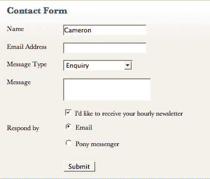
图 8.5。我们将应用 Ajax 提交技术的示例表单。

```html
    <fieldset>

      <legend>

        回复方式

      </legend>

      <input id="contactMethodA" name="contactMethod" type="radio" value="1" />

      <label for="contactMethodA">

        邮箱

      </label>

      <input id="contactMethodB" name="contactMethod" type="radio" value="2" />

      <label for="contactMethodB">

        信马信使

      </label>

    </fieldset>

    <input type="hidden" name="id" value="SS56789" />

    <input type="submit" value="提交" />

  </fieldset>

</form>
```

为了使用 Ajax 提交表单内容，我们需要做几几点：

1. 覆盖默认的表单提交行为。
2. 获取表单数据。
3. 将表单数据提交到服务器。
4. 检查提交的成功或失败。

我们将在名为 `ContactForm` 的对象内部创建此功能。初始化对象时，我们只需要做一件事覆盖表单的默认提交操作。这可以通过事件监听器拦截表单的 `submit` 事件来轻松实现：

**contact_form.js**（摘）

```javascript
var ContactForm = {

  init: function()

  {

    var contactForm = document.getElementById("contactForm");

    Core.addEventListener(contactForm, "submit", ContactForm.submitListener);

  },
```


### Ajax 与表单验证

为元素为特定事件添加多个事件监听器是有风险的，因为你无法控制它们被调用的顺序。因此，分配一个 Ajax 表单提交器和一个客户端验证器是安全的。如果你这样做，Ajax 表单提交器可能会在验证器之前执行，从而导致无效数据发送到服务器。如果你在表单提交之前执行 Ajax 表单提交器，那么你就可以将验证器和提交器关联起来，确保验证在表单提交之前进行。现在，在表单提交之前，`submitListener` 方法将运行。在这个函数内部，我们收集数据，发送 Ajax 请求，并取消正常的提交：

**contact_form.js**（摘）

（此处省略代码块翻译）

`submitListener` 方法最重要的部分之一是 `formElements` 数组。表单可能包含许多元素。

切换。然而，在将复选框和单选按钮添加到提交的元素列表之前，我们需要测试这些复选框或单选按钮是否被 `checked`（选中）。我们不希望提交未选中的复选框的值，也不希望提交组中错误的单选按钮。

在遍历 `inputs` 节点列表的 `for` 循环内部，我们结合每个 `input` 的 `type` 和其 `checked` 属性来决定其是否应该被添加到 `formElements`。`if` 语句使用了多个 OR（或）条件来执行此检查，逻辑如下：

1. 如果 `input` 的 `type` 为 `null`（它默认将是文本 `input`）
2. 或者 `input` 的 `type` 为 `text`
3. 或者 `input` 的 `type` 为 `hidden`
4. 或者 `input` 的 `checked` 属性存在且为 `true`
5. 那么将 `input` 添加到 `formElements`

上面的第四点同时涵盖了复选框*和*单选按钮。任何选中的复选框都应该提交其值，而单选组中只有一个单选按钮会被 `checked` 为 `true`，因此提交它也是安全的。

一旦所有有效元素都被添加到 `formElements`，我们需要以序列化的方式写出它们的名称/值对。此过程适用于所有表单元素类型，为什么我们可以通过提前构建 `formElements` 数组来减少代码重复。

当我们将每个表单元素添加到序列化字符串时，必须检查它是否被分配了 `name`。

如果它*确实*有一个名称，我们希望将其值发送到服务器，因此我们获取 `name`，紧接着是 `=`，然后是 `value`，并将整个字符串添加到 `parameters` 的末尾。`parameters` 中的每个名称/值对都用 ampersand（`"&"`）分隔。

**335**

**Ajax**

你会注意到，我们再次使用 `encodeURIComponent` 对表单元素的名称和值进行编码，以确保无论用户在表单中输入什么特殊字符，请求数据保持有效。

现在我们准备好将序列化的表单数据字符串提交到服务器了。你现在应该对 `XMLHttpRequest` 代码非常熟悉了：

记住我们必须在 POST 请求的头中设置 `content-type`，以便请求在 Opera 中能够正常工作。

这次，当我们 `open` `XMLHttpRequest` 对象时，将使用 `"POST"` 方法。服务器请求的 URL 直接从表单本身的 `action` 提取的，这增加了此脚本的可重用性。

在 `readystatechange` 处理器中，我们做的只是等待服务器返回成功代码。我们实际上并不不在乎它给了我们什么数据，只要我们知道它收到了联系信息即可。一旦收到该确认（以成功状态码的形式），我们就可以执行 `ContactForm.writeSuccess`，这将让用户知道操作成功：

**contact_form.js** ***（节）***

```
writeSuccess: function(form)
{
var newP = document.createElement("p");
newP.setAttribute("id", "success");
newP.appendChild(document.createTextNode(
"Your message was submitted successfully."));
form.parentNode.replaceChild(newP, form);
},
```

对于此示例，成功处理器会将联系表单替换为一段显示“Your message was submitted successfully”的段落，如图 8.6 所示。

同样地，如果服务器没有成功收到联系信息，`ContactForm.writeError` 可以按它选择的任何方式处理错误——用简单的 alert 提示用户重试、错误消息，甚至通过左右剧烈抖动浏览器窗口——任何适合你应用程序的方式即可。

**Simply JavaScript**

**336**

图 8.6 表单提交成功后出现的消息：

**contact_form.js** ***（节）***

```
writeError: function(errorMsg)
{
alert(errorMsg);
}
```

使用最后那个方法，`readystatechange` 处理器已准备好触发。由于这是一个 POST 请求，我们将 `parameters` 传递给 `send` 方法，而不是将其包含在 URL 中。

**360**

**Simply JavaScript**

**探索库**

**Ajax**

**337**

**Dojo**

对于 Prototype、jQuery、YUI 和 MooTools，我们将这段低级代码翻译为相应的库代码：

```
try
{
var requester = new XMLHttpRequest();
}
catch (error)
{
var requester = null;
}
```

```
requester.open("GET", "library.php?dewey=005", true);
requester.onreadystatechange = readystangeHandler;
requester.send(null);
```

```
function readystangeHandler()
{
if (requester.readyState == 4)
{
if (requester.status == 200 || requester.status == 304)
{
writeUpdate(requester);
}
}
}
```

```
function writeUpdate(requestObject)
{
document.getElementById("container").childNodes[0].nodeValue =
requestObject.responseText;
}
```

**338**

**Prototype**

Prototype 处理 Ajax 方法代表了其他库的范式。它提供了一个 `Ajax` 对象，其中包含用于请求的方法。我们通过调用 `Ajax.Request` 并传递一个字面量形式的参数来启动基础 Ajax 请求。如果你指定了 `onComplete` 函数，它将在服务器调用完成后自动被调用：

```
var requester = new Ajax.Request("library.php",
{
method: "get",
parameters: "dewey=005",
onComplete: writeUpdate;
});
```

```
function writeUpdate(requestObject)
{
document.getElementById("container").childNodes[0].nodeValue =
requestObject.responseText;
}
```

**339**

**Ajax**

**jQuery**

jQuery 使用 `ajax()` 方法简化了过程。该方法消除了手动创建 `XMLHttpRequest` 对象并处理 `readyState` 变化的需求：

```
$.ajax({
url: "library.php",
type: "GET",
data: { dewey: 005 },
success: function(data) {
writeUpdate(data);
},
error: function(error) {
alert("Error: " + error.status);
}
});
```

```
function writeUpdate(data)
{
document.getElementById("container").childNodes[0].nodeValue = data;
}
```

**340**

**MooTools**

MooTools 使用 `Tools.request` 方法处理 Ajax。与 jQuery 类似，它使用配置对象以及成功和错误场景的回调：

```
Tools.request({
method: "ajax",
url: "library.php",
method: "GET",
data: { dewey: 005 },
success: function(response) {
writeUpdate(response.body);
},
error: function(response) {
alert("Error: " + response.status);
}
});
```

```
function writeUpdate(data)
{
document.getElementById("container").childNodes[0].nodeValue = data;
}
```

**341**

**YUI**

YUI 使用 `YUI.request.get` 方法。它需要一个配置对象，在其中你定义 URL 和回调函数：

```
YUI.request.get({
url: "library.php",
method: "GET",
data: { dewey: 005 },
success: function(response) {
writeUpdate(response.responseText);
},
error: function(response) {
alert("Error: " + response.status);
}
});
```

```
function writeUpdate(data)
{
document.getElementById("container").childNodes[0].nodeValue = data;
}
```

用于指定该元素的 ID。因此，它避免了你创建自己的回调函数的需要：

```
var requester = new Ajax.Updater("container", "library.php",
{
  method: "get",
  parameters: "dewey=005",
});
```

这非常简洁！

**Dojo**

要使用 Dojo 的 Ajax 处理器，我们只需调用 `dojo.io.bind` 并传入一个包含适当参数的字面量对象：

```
dojo.io.bind(
{
  url: "library.php?dewey=005",
  load: writeUpdate,
  mimetype: "text/plain"
});
```

```
function writeUpdate(type, data, event)
{
  document.getElementById("container").childNodes[0].nodeValue = data;
}
```

Dojo 的 Ajax 实现有两个小技巧。在对象字面量内部指定 `mimetype` 决定了请求完成后 Dojo 将向你的 `load` 函数传递什么类型的数据（文本或 XML）。`load` 函数接收三个参数：

- **type**: 一个多余的变量，其值始终为 `"load"`
- **data**: 你唯一会用到的变量，因为它包含了来自服务器响应的数据
- **event**: 包含一个用于执行服务器通信的低层传输对象的引用（目前，它不可避免地是 `XMLHttpRequest` 对象。）

**jQuery**

和 jQuery 中的所有功能一样，Ajax 功能是作为 `$` 对象的一部分提供的。`$.ajax` 允许你指定一个非常熟悉的对象字面量，其中包含了你为调用所需的特定配置：

```
$.ajax(
{
  type: "GET",
  url: "library.php",
  data: "dewey=005",
  success: writeUpdate
});
```

```
function writeUpdate(data)
{
  document.getElementById("container").childNodes[0].nodeValue = data;
}
```

同样，在 jQuery 中（就像在 Dojo 中），`responseXML` 或 `responseText` 其中之一将直接传递给 `success` 函数——传递的属性取决于从服务器返回数据的 MIME 类型。

**YUI**

按照真正的 Yahoo! UI 风格，Yahoo! 给其 Ajax 对象（它称为连接管理器 Connection Manager）起的名字相当冗长，但在大多数其他方面，它与我们目前看到的非常相似：

```
var handlers = {
  success: writeUpdate
}
```

```
YAHOO.util.Connect.asyncRequest(
"GET",
"library.php",
handlers,
"dewey=005"
);
```

```
function writeUpdate(requestObject)
{
  document.getElementById("container").childNodes[0].nodeValue = requestObject.responseText;
}
```

`handlers` 变量允许你同时指定成功 Ajax 请求的处理器函数，以及发生错误时要调用的函数。这些函数接收的是完整的 `XMLHttpRequest` 对象，而不仅仅是数据。

**MooTools**

MooTools 的 Ajax 处理器基于 Prototype 自带的处理器，因此两个处理器具有相似的语法。MooTools 的处理器甚至提供了一个快捷方式，可以直接将返回的数据放入元素中，而无需指定回调函数：

```
var requester = new Ajax("library.php?dewey=005",
{
  method: "get",
  onComplete: writeUpdate;
});
```

```
requester.request();
```

```
function writeUpdate(requestObject)
{
  document.getElementById("container").childNodes[0].nodeValue = requestObject.responseText;
}
```

这两个库之间的区别在于，MooTools 对象在初始化后不会自动发送请求；你必须在想要发送时调用 `request`。

如果你想使用元素插入快捷方式，代码看起来如下：

```
var requester = new Ajax("library.php?dewey=005",
{
  method: "get",
  update: "container";
});
```

```
requester.request();
```

`update` 属性接收你想要更新内容的元素的 ID。

**总结**

Ajax 绝对会一直留下去，随着用户和开发者逐渐习惯它的行为，用它来增强 Web 界面的方法将只会增加。

正如你在这一章中看到的，Ajax 的实际通信机制相对简单。*初始化-检索-修改*的模式很大程度上利用了你在学习前七章时学到的所有技术，因此 Ajax 是本书书中所有实践工作的完美终点。但请继续读下去，以发现 JavaScript 的未来可能将你引向何方……

**第 9 章**

**展望**

当你第一次拿起这本书时，你无疑已经意识到 JavaScript 的异军崛起。然而，尽管它如此受欢迎，JavaScript 仍然非常不成熟。有些人可能认为这种不成熟是一件坏事，但我接受它。如果你把 JavaScript 看作是 HTML 的插件，那么从基于页面的模型进行转换就会变得容易得多。尽管近期交互设计的很多重点都放在了 Ajax 上，但它并不是你创建可用界面的唯一方式。有时，你只需要思考如何以不同的方式来表示你的界面。

**轻松探索**

以 Travelocity 网站为例。它的创建者意识到你正在寻找住宿，你通常会有一个或两个想要使用的变量来缩小选择范围。为了让你对选择产生的影响获得快速反馈，他们将这些变量实现为 JavaScript 滑块，如图 9.1 所示。如果你想仅用服务器端计算来实现这种功能，获取正确的数据将需要大量实际的表单提交。该网站的用户可能在发现自己真正想要之前就放弃了，或者妥协选择他们并不想要的住宿。通过这个易用的界面元素，网站实际上鼓励用户探索所有选项，让他们在整个过程中更加愉快，并有更大的机会找到理想匹配。

**轻松可视化**

在 Flickr 上使用的所有 Ajax 魔法中，我最喜欢的功能之一是 9.2 所示的内联编辑功能。这种交互工具有两个用途。首先，使用 Ajax 调用更新信息……

这意味着用户的更改非常快速地应用到页面上。为了增强这种速度感，只发送了少量数据（这对于 Flickr 有时加载缓慢的页面至关重要），而且画廊视图可以轻松对多张照片进行批量更改。

图 9.2. Flickr 上消除了全页加载的内联编辑区域

内联编辑的另一个大优势是，你可以在浏览相册页面时，发现想要更改的地方（例如图 9.3 中的拼写错误），并立即进行修改。你看到的数据与用户看到的完全一致，而不是处于一种与数据最终呈现呈现方式完全不联系的形式中。因此，管理与展示之间常见的隔阂消失了。

**简单的 JavaScript**

**348**

图 9.3. 内联编辑数据，正如它出现在你的页面上一样

**独特的交互**

你可以使用 JavaScript 进行成千上万种可用性改进，但它们本质上仍然像静态 HTML 一样运行——只是等待时间短了一些。到目前为止最具前瞻性——让我们面对吧，更*酷炫*的示例是那些利用 JavaScript 的交互能力来创建传统客户端-服务器技术无法实现的东西。

我最喜欢的示例之一是 Meebo，如图 9.4 所示.³ 它（以及它基于 Web 的 IM 兄弟软件）将原本基于桌面的即时消息应用移动到了免费的基于 Web 的平台上，从而将它们的实用性增加了约 15 倍。⁴

通过浏览器可以使用即时消息，与朋友保持联系变得眨眼一样简单。拥有完全基于浏览器的聊天客户端意味着

3 http://www.meebo.com/

4 注：仅为作者个人估计。实际结果可能与包装上所示的不同——编辑。

**349**

你不需要安装任何软件（这在许多企业系统中是不可能的），你可以切换工作站并继续使用服务——而无需传输 IM 账户详情。这些服务还非常擅长破解用于拦截 IM 端口的防火墙。（我不确定这对雇主来说是否算是一件好事！）如果没有 JavaScript，这种复杂的界面将是不可能的——使用普通的页面请求架构将花费太长的时间。

图 9.4. Meebo 基于 JavaScript 和 Ajax 的浏览器内即时消息客户端

如果你想向未来迈出更大一步，可以将 JavaScript 与新兴的矢量渲染标准相结合，这允许你创建自己的*真正*定制的界面。在本书编写时，当时非常的新服务是图 9.5 所示的 Yahoo! Pipes 服务。⁵ 它使用 `canvas` 元素（在许多浏览器中可用）来创建一个独特的界面，该界面最适合其特定的功能：连接无限数量的数据模块。

5 http://www.pipes.yahoo.com

**简单的 JavaScript**

**350**

图 9.5. Yahoo! Pipes 直观且独特的界面

`canvas` 及其表兄弟 SVG 为设计师提供了为 Web 界面创建轻量级、高度适应的矢量图形的能力。与 JavaScript 的交互性相结合，这些技术终于赋予了 Web 应用程序其桌面端多年来享有的力量，从而消除了完全基于 Web 的应用系统普及的最大障碍之一。

当然，JavaScript 的世界并不全是西装和公文包；它还有让你的思绪放飞并产生一些无聊但有趣的娱乐的潜力，这正是 Flash 闻名的那种类型——我的《捕兔游戏》（Bunny Hunt）游戏就是一个例子。⁶ 上限无限！

6 http://www.themaninblue.com/experiment/BunnyHunt/

**351**

**展望未来**

图 9.6. 《捕兔游戏》，一个风格你通常会与 Flash 联系起来的游戏

**富集 Web 应用**

正如你在阅读上一节时可能注意到的，JavaScript 和其他新技术的引入正在推动 Web 重心的转移。此前，网站在很大程度上限于存储信息，除了无处不在的表单字段外，提供的交互性极少。

随着 JavaScript 让越来越多的桌面式交互成为可能，我们开始看到 Web 转变为桌面的扩展。最终，谁知道呢？我们可能会失去桌面端。

**简单的 JavaScript**

**352**

**富集 Web 应用**

**353**

**展望未来**

**354**

**简单的 JavaScript**

……。正是基于这一事实，许多人正试图寻找减轻压力最可行的方法。

如果 JavaScript 遵循大多数其他编程语言的路径——从库的兴起来看，它很可能会变成这样——那么流行的应用程序功能不可避免地将集中在几个框架中，这些框架将有助于减轻上述前两个问题的负担。至于第三个问题能否解决，还有待观察。

### 小部件 (Widgets)

许多应用程序的设计中存在着许多共同主题。在桌面端，这些功能上的共性包括如文件处理和窗口控制等任务，以及对话框、工具栏和菜单等工具。你可以使用一系列此类标准组件来构建桌面应用程序，这样你就不需要每创建一个新应用程序时都重新发明轮子。通过使用这些组件，你利用了有助于可用性的既定约定——用户已经知道菜单长什么样、对话框是如何工作的，以及他们应该对按钮做什么。

Web 端的应用程序设计中也开始出现类比。一些交互现在已经变得足够常见，足以创建可重用的组件，或称为**小部件（widgets）**，这些组件在被放入页面时，*可以直接运行*。以前，这些小部件可能零散落在 Web 上的十几个网站中，而现在它们开始被聚合到大型库中，变成你可能会说的**组件框架**。

这些框架提供的不仅仅是解决特定浏览器差异的少量抽象代码；它们提供了一种全新的开发模式。你不再为某个特定功能编写所有的 HTML、所有的样式和所有的 JavaScript，只需要包含一个小部件——可能只有一行代码——你的应用程序就会自动拥有曾经需要编写数百行代码才能实现的功能。

然而，框架不仅让编码变得更简单；它们对语言本身也有影响。如果你开始用一行 Dojo 代替百行 JavaScript，你是在是在写 JavaScript 还是在写 Dojo 呢？

**355**

### 展望

### 脱离 Web 的 JavaScript

随着 Web 开发技术的普及持续激增，JavaScript 已经成为软件开发中一种非常强大的力量。Web 标准中严格表达的结构、样式和行为的分离，实际上是在 Web 上及脱离 Web 开发应用程序和小部件的理想平台。

随着仪表小部件（Dashboard Widgets）的引入（图 9.8 显示了其中的示例），Apple 的 Mac OS X 将 HTML、CSS 和 JavaScript 的结合带到了桌面，让人们创建自己的原生应用程序变得容易得多。那些在 Web 页面上磨练开发技能的大众现在能够将这些技能直接迁移到桌面端。而小部件数量的增长揭示了这种技能转移是多么容易实现。

图 9.8. 使用 HTML、CSS 和 JavaScript  MacOS X 小部件创建微应用程序

### 纯正 JavaScript

**356**

除了 MacOS X 之外，Yahoo! 发布了自己的桌面小部件工具；Windows 的最新版本——Vista——也紧随其后，它支持类似的项目，被称为“小工具（gadgets）”。

除了小部件之外，还可能使用 JavaScript 创建整个应用程序。市场份额增长最快的浏览器之一——Firefox 是完全用 JavaScript 构建的；使用了一种名为 XUL 的应用程序开发语言来提供用户界面元素。再次，这里结构、样式和行为的分离允许应用程序能够通过 CSS 轻松进行换肤（皮肤），并邀请通过 JavaScript（包含在 Firefox 扩展中）添加新功能。

### 探索库

Web 上可用的 JavaScript 库数量正在主要根据其使用程度逐渐减少，但它们的持久性也受到功能、集成易性和可用文档等因素的影响。

在我看来，库可以向两个方向发展：小而轻，或者大而全。保持库的简洁具有某些优势——特别是在 Web 上，下载时间仍然是一个问题，加上客户端处理能力和代码复杂性。像 jQuery^(11) 和 moo.fx^(12) 这样的库完美地填充了这一空白，提供了一个高效的 JavaScript 函数“瑞士军刀”，帮助你完成工作。

在天平的另一端，大型库变得越来越大。越来越多的功能被吸收到其腹中，以涵盖可以想象到的在浏览器中发生的任何所有类型的交互。这些库变得越来越像从中挑选所需元素的库，而越来越像框架，其中库变成了语言，而你的程序被提炼成极简的 API 代码行。

这些大型框架的各种风格各异。有些试图维持长期以来 Web 开发特征的分层分离，而另一些则尝试通过在服务器端逻辑和浏览器实现之间创建翻译来完全抽象 Web 层。要涵盖这些框架的细节

11 http://jquery.com/
12 http://moofx.mad4milk.net/

**357**

### 展望

**381**

涵盖这些框架的细节将需要比我们拥有的页面多得多，但我将尝试让你浅略了解一下它们是如何运作的。

### Dojo

在整本书中我们已经仔细观察了 Dojo，但仅仅是作为一个库，而不是框架。Dojo 提供的不仅仅是辅助函数——它实际上提供了一个开发接口的完整系统。Dojo 目前可用的小部件超过一百个，包括如折叠面板菜单、组合框、日期选择器、进度条、滑块和树形菜单。在 Dojo 中实现小部件有两种方式：结构化和编程。如果你使用结构化方法，你必须修改 HTML 以包含小部件。例如，通过在 HTML 元素上添加非标准属性，可以将 `select` 框转换为组合框（允许输入并接收建议的框）：

```
<select dojoType="ComboBox" dataUrl="example.php" name="state">
</select>
```

13 http://jotkit.org/

### 纯正 JavaScript

**358**

编程创建 Dojo 小部件在你想动态创建新元素，或者不想让你的 HTML 被不必要的属性污染时非常有用。你在 JavaScript 中创建新小部件，然后将其包含在页面中。

如果你想通过编程包含 `ComboBox`，你可以编写一个脚本创建一个 `ComboBox` 小部件，然后将其添加到页面。

接下来，在 HTML 页面上包含该元素以及 Dojo 库和 ComboBox 模块：

```
<!DOCTYPE html PUBLIC "-//W3C//DTD XHTML 1.0 Strict//EN"
"http://www.w3.org/TR/xhtml1/DTD/xhtml1-strict.dtd">
<html xmlns="http://www.w3.org/1999/xhtml" lang="en-US">
<head>
<title>ComboBox</title>
<meta http-equiv="Content-Type"
content="text/html; charset=utf-8" />
<script type="text/javascript" src="dojo.js"></script>
<script type="text/javascript">
dojo.require("dojo.widget.ComboBox");
</script>
```

⋮

结果是一个在用户输入时提供建议的自定义表单元素，如图 9.9 所示。

图 9.9. 使用 Dojo ComboBox 小部件将 select 元素转换为用户输入时可自动补全的字段

**359**

### 展望


`var comboBox = dojo.widget.createWidget("ComboBox", { dataUrl: "../../tests/widget/comboBoxData.js" });`

`document.getElementsByTagName("body")[0].appendChild(comboBox.domNode);`

新组件是使用`dojo.widget.createWidget`方法创建的，该方法接收组件名称，随后紧跟一组以对象字面量表示的选项设置。在这种情况下，我们为`ComboBox`组件提供的唯一选项是`dataUrl`路径。

一旦创建了该组件，我们就会获得一个以 JavaScript 对象形式存在的该组件引用，但为了将其包含页面上，我们必须使用它的`domNode`属性，该属性充当实际对象的 HTML 接口。一旦完成这一步，我们的界面中就将有一个可以运行的`ComboBox`组件。

在上面的示例中，`ComboBox`实际上是由 Ajax 驱动的——它将使用`dataUrl`属性指定的 URL 来检索与用户输入内容匹配的列表。然而，这一解释强调了该组件在使用渐进增强方式上的一个缺陷。

在使用`select`框时，没有 JavaScript 的用户会期望点击该框，并收到若干`option`从中进行选择。实现此点的唯一方法是将所有的`option`都包含在 HTML 中。`ComboBox`的目标之一是通过仅检索与用户输入内容匹配的数据，来*减少*客户端和服务器之间传输的数据量。然而，初始让`select`框为空对于没有启用 JavaScript 的用户来说是毫无用处的。这并不是渐进增强。但反过来说，如果我们在 HTML 中包含了`select`框的所有`option`，那么我们就去除了`ComboBox`的主要优势之一。

也许`ComboBox`可以被认为更像是一个纯文本字段（尽管 Dojo 的`ComboBox`组件并不与文本字段一起工作，所以这纯粹是一个学术论点）。非 JavaScript 用户可以在该字段中输入他们想要的任何值，但他们无法获得可能值的列表。

## 纯 JavaScript

这些问题凸显了富交互应用程序（Rich Internet Applications）引起的一些问题。JavaScript 和 HTML 赋予我们极大的灵活性来创建我们想要的任何内容，但有时这种灵活性是以牺牲访问性为代价的。是否有更好的答案？只有时间能给出答案。

## Google Web Toolkit

Google Web Toolkit (GWT) 使用 Java 作为其引擎的基础。(14) 如果你不想，你永远不需要编写 JavaScript、HTML 或 CSS。使用 GWT 的 API，你可以用 Java 创建整个应用程序。GWT 编译器会将所有 Java 代码翻译成浏览器代码（HTML、CSS 和 JavaScript），以便包含在你的网站中。

这种风格的框架使得 Web 应用开发类似于传统的应用程序开发——所有代码都由开发者编写，然后编译执行。在 GWT 的情况下，编译包含了创建 HTML 和 JavaScript 文件的过程，这些文件将帮助在浏览器中运行应用程序。

这个框架与我们在书中看过的任何内容都截然不同，但作为一个示例，这个 Java 类用于创建一个带有按钮的页面，该按钮会启动一个显示“Hello, JavaScript:”的警报框：

```java
public class Hello implements EntryPoint {
  public void onModuleLoad() {
    Button b = new Button("Click me", new ClickListener() {
      public void onClick(Widget sender) {
        Window.alert("Hello, JavaScript");
      }
    });
    RootPanel.get().add(b);
  }
}
```

GWT 虽然是 Java 开发者创建 Web 应用程序的一种非常快速的方法，但它极度缺乏访问性。应用程序没有提供静态 HTML 作为结构，并且每个界面元素都是通过 JavaScript 创建的。因此，如果 JavaScript 不可用，浏览器基本上没有任何文档可供回退。倒霉的用户什么也得不到，完全什么都没有。如果你不担心这个问题，你可能想尝试一下 GWT。但就我个人而言，这让我胆战不已。

## 总结

JavaScript 的未来是光明的。它作为 Web 端首选语言的统治地位已经十多年未受挑战，只要 HTML（或类似的东西）存在，JavaScript 就会在那里与它并肩。

然而，问题仍然存在：JavaScript 的未来将如何？它足够灵活，可以适应各种环境——正如我们在本章中讨论的——它的最终形式在很大程度上取决于哪种技术让其崛起。但无论哪种技术脱颖而出，我非常确定 JavaScript 将与它并肩存在，让它完成所有*真正*酷炫的事情。

## 附录 A：核心 JavaScript 库

书中的大多数示例都依赖于包含在`core.js`文件中的小型有用方法库。这个库允许我们跳过在大多数脚本中需要执行的某些常用任务的繁琐细节，专注于每个示例更独特的方面。

在某些情况下，这个库太复杂，在当时无法解释。因此，本附录包含了对 Core 库的完整描述，以及每个方法的工作原理。

### 对象

与书中的大多数示例一样，Core 库将所有函数封装在一个 JavaScript 对象中：

```javascript
var Core = {
  method1: function() {},
  method2: function() {}
};
```

我们之所以对 Core 使用这种替代风格的原因是，它让我们能够根据运行脚本的浏览器自由地定义每个方法的不同版本：

```javascript
// core.js (excerpt)
var Core = {};

// W3C DOM 2 模型
if (document.addEventListener) {
  Core.addEventListener = function(target, type, listener) {};
}

// Internet Explorer 模型
else if (document.attachEvent) {
  Core.addEventListener = function(target, type, listener) {};
}
```

### 事件监听器方法

正如我们在上一节所看到的，我们能够为两种事件模型分别实现这些事件监听器方法。W3C DOM 2 版本的事件监听器只是标准方法的简单封装：

```javascript
// core.js (excerpt)
// W3C DOM 2 模型
if (document.addEventListener) {
  Core.addEventListener = function(target, type, listener) {
    target.addEventListener(type, listener, false);
  };

  Core.removeEventListener = function(target, type, listener) {
    target.removeEventListener(type, listener, false);
  };

  Core.preventDefault = function(event) {
    event.preventDefault();
  };

  Core.stopPropagation = function(event) {
    event.stopPropagation();
  };
}
```

Internet Explorer 的版本要复杂得多，因此我们将逐一查看它们。从根本上说，这些函数对 Internet Explorer 内置事件监听器功能进行了以下增强：

- 防止同一个函数/方法多次被赋值为同一个元素上同一个事件的监听器。
- 将 Internet Explorer 的全局`event`对象作为参数传递给事件监听器。
- 以这种方式调用事件监听器：在监听器内部，`this`代表分配给监听器的对象。
- 在文档卸载时清理所有注册的事件监听器，以防止 Internet Explorer 中的内存泄漏。

这些函数的代码基于书籍 *JavaScript: The Definitive Guide, 5th Edition* 中提供的脚本。¹

`addEventListener`是这些方法中最复杂的，所以让我们一步步来分析：

1 David Flanagan, *JavaScript: The Definitive Guide, 5th Edition* (Sebastopol: O’Reilly, 2006).

**core.js** *(excerpt)*

```javascript
Core.addEventListener = function(target, type, listener)
{
  // 防止重复添加同一个监听器，因为 DOM 2 事件
  // 会忽略此类的重复项
  if (Core._findListener(target, type, listener) != -1) return;
```

我们首先检查指定的目标对象、事件类型和监听器函数的组合是否已经在此文档中注册。为了实现这一点，我们使用一个名为`_findListener`的私有方法，我们稍后会查看它的实现。如果监听器已经注册，我们什么都不操作，并立即从该方法返回。

现在，我们不能直接使用传递给`addEventListener`的监听器函数。如果这样做，Internet Explorer 将不会将事件对象作为参数传递给它，而且`this`将指向函数内的全局上下文，而不是指向`target`。为了解决这些问题，我们可以将提供的监听器封装在一个函数内部，该函数会进行必要的更改：

**core.js** *(excerpt)*

```javascript
// listener2 通过两种方式之一作为 target 的方法调用 listener，
// 这取决于此 IE 版本支持什么，
// 并将全局事件对象作为参数传递给它
var listener2 = function()
{
  var event = window.event;
  if (Function.prototype.call)
  {
    listener.call(target, event);
  }
  else
  {
    target._currentListener = listener;
    target._currentListener(event);
    target._currentListener = null;
  }
};
```

你可以看到，`listener2`是一个函数，它首先获取全局`event`对象。然后它以这种方式调用`listener`，使得`target`成为`this`的值并将事件对象作为参数传递给它。这是通过两种方式之一实现的，取决于运行脚本的 Internet Explorer 版本。

在 Internet Explorer 5.5 或更高版本中，所有函数都支持名为`call`的方法，它允许函数像指定对象的方法一样被调用。如果此函数可用（我们可以通过检查`Function.prototype.call`是否存在来测试），我们可以使用它将`listener`作为`target`的方法调用，并将`event`作为参数。

在之前的 Internet Explorer 版本中，无法使用`call`方法，因此我们将`listener`存储在`target`的一个名为`_currentListener`的临时属性中，这使我们能够将`listener`作为`target`的方法调用。同样，我们将`event`作为参数传递。一旦完成，我们将`_currentListener`设置为`null`。现在我们已经得到了封装好的`listener2`，可以使用 Internet Explorer 的`attachEvent`方法将其注册为事件监听器：

**core.js** *(excerpt)*

```javascript
// 使用 IE 的 attachEvent 添加 listener2
target.attachEvent("on" + type, listener2);
```

接下来，我们需要做一些簿记记录工作，以确保我们在`addEventListener`顶部调用的`_findListener`方法能够告知此监听器已注册。我们将创建一个包含我们刚刚添加的监听器所有相关信息的对象：

**core.js** *(excerpt)*

```javascript
// 创建一个描述此监听器的对象以便我们可以清理它
var listenerRecord = {
  target: target,
  type: type,
  listener: listener,
  listener2: listener2
};
```

为了让`_findListener`发挥作用，我们只需将此对象添加到存储为`target`属性的数组中。但只要我们保留事件监听器的记录，我们就设置好结构，以便在页面卸载时轻松清理文档中的所有监听器。为此，我们将`listenerRecord`存储在一个由文档中所有监听器共享的对象中：

**core.js** *(excerpt)*

```javascript
// 获取包含 target 的窗口对象的引用
var targetDocument = target.document || target;
var targetWindow = targetDocument;

// 为此监听器创建一个唯一 ID
var listenerId = "l" + Core._listenerCounter++;

// 将监听器记录存储在窗口中
if (!targetWindow._allListeners)
{
  targetWindow._allListeners = {};
}
targetWindow._allListeners[listenerId] = listenerRecord;
```

（注：根据上下文逻辑补充初始化部分）

```javascript
Core._listenerCounter = 0;
```

`addEventListener`部分已经处理完毕！稍后我们将介绍实际上用于移除所有监听器的方法`_removeAllListeners`。

得益于我们在`addEventListener`中做的大量记录工作，`removeEventListener`的实现相对直观：

**core.js** *(节选)*

```javascript
Core.removeEventListener = function(target, type, listener)
{
  // 检查监听器是否已添加到 target
  var listenerIndex = Core._findListener(target, type, listener);
  if (listenerIndex == -1) return;

  // 获取包含 target 的窗口对象引用
  var targetDocument = target.document || target;
  var targetWindow = targetDocument.parentWindow;

  // 从窗口对象获取监听器记录
  var listenerId = target._listeners[listenerIndex];
  var listenerRecord = targetWindow._allListeners[listenerId];

  // 移除监听器，并从 target 中移除其 ID
  target.detachEvent("on" + type, listenerRecord.listener2);
  target._listeners.splice(listenerIndex, 1);

  // 从窗口对象中删除监听器记录
  delete targetWindow._allListeners[listenerId];
};
```


我们的首要任务是确定指定的`target`、`type`和`listener`组合是否对应一个已注册的事件监听器。我们可以使用在`addEventListener`顶部使用的同一个`_findListener`方法来实现。该方法返回监听器在`target`的`_listeners`数组中的索引，如果没有注册过该监听器，则返回`-1`。

在确认指定的监听器已注册后，我们需要获取存储在全局`_allListeners`对象中对应该监听器的“监听器记录”对象。与`addEventListener`中一样，我们首先开始获取对窗口的引用。

我们从`target`的`_listeners`数组中获取监听器的唯一 ID（使用从`_findListener`获取的`listenerIndex`），然后使用它来访问`_allListeners`中的监听器记录。

拿到监听器记录后，我们可以使用 Internet Explorer 的`detachEvent`方法来注销监听器。请记住，由于我们通过将其封装在一个新函数中对`listener`进行了增强，因此传递给`detachEvent`的监听器应该是`listenerRecord`的`listener2`属性，而不是`listener`本身。

注销监听器后，我们现在需要移除对其存在的记录。首先，我们从`target`的`_listeners`数组中移除相关项。为此，我们使用所有 JavaScript 数组都支持的方法：`splice`。我们向该方法传递要从数组中删除的第一个元素的索引，以及要删除的元素数量（在这种情况下为`1`）。

最后，我们从全局`_allListeners`对象中删除包含监听器记录的属性。为此，我们利用了罕见的 JavaScript `delete`语句，它可以删除对象中的属性。

以上这些都明白了吗？如果你无法跟上`addEventListener`和`removeEventListener`中所有的代码逻辑，也不要太担心——它们相当高级，而且归结底，你真的不需要理解这种复杂级别的 JavaScript 就能完成添加和移除监听器这么简单的操作。这就是为什么我们决定将这些代码隐藏在书的末尾，这也是为什么我们一有机会就会模拟 Internet Explorer 的模型。相比之下，Internet Explorer 版本的`preventDefault`和`stopPropagation`就简单得多：

**core.js** ***节选)***

```javascript
Core.preventDefault = function(event)

{

  event.returnValue = false;

};

Core.stopPropagation = function(event)

{

  event.cancelBubble = true;

};
```

为了防止 IE 中与事件关联的默认操作，我们只需要将事件的`returnValue`属性设置为`false`。同样，为了在 IE 中停止事件的传播，我们将它的`cancelBubble`属性设置为`true`。这就是这些方法需要做的所有。这处理了我们方法在 Internet Explorer 中的版本，但我们仍然需要查看它们依赖的两个辅助方法——`_findListener`和`_removeAllListeners`：

**core.js** ***节选)***

```javascript
Core._findListener = function(target, type, listener)

{

  // 获取添加到 target 的监听器 ID 数组

  var listeners = target._listeners;

  if (!listeners) return -1;

  // 获取包含 target 的窗口对象引用

  var targetDocument = target.document || target;

  var targetWindow = targetDocument.parentWindow;

  // 反向搜索（以提高处理速度），

  // 寻找监听器

  for (var i = listeners.length - 1; i >= 0; i--)

  {

    // 从 target 获取监听器的 ID

    var listenerId = listeners[i];

    // 从窗口对象获取监听器记录

    var listenerRecord = targetWindow._allListeners[listenerId];

    // 将类型和监听器与获取的记录进行比较

    if (listenerRecord.type == type && listenerRecord.listener == listener)

    {

      return i;

    }

  }

  return -1;

};
```

`_findListener`查看指定`target`的`_listeners`数组，对于其中包含的每个监听器 ID，它从全局`_allListeners`对象中查找对应的监听器记录。如果找到与指定的`target`、`type`和`listener`匹配的监听器记录，它返回该监听器 ID 在`target`的`_listeners`数组中的索引。如果没有找到匹配的记录，则返回`-1`。

**core.js** ***节选)***

```javascript
Core._removeAllListeners = function()

{

  var targetWindow = this;

  for (id in targetWindow._allListeners)

  {

    var listenerRecord = targetWindow._allListeners[id];

    listenerRecord.target.detachEvent("on" + listenerRecord.type, listenerRecord.listener2);

    delete targetWindow._allListeners[id];

  }

};
```

`_removeAllListeners`执行了一项我们在书中其他地方都未实际需要过的操作——逐个遍历对象的属性。具体来说，它遍历存储在`_allListeners`对象属性中的监听器记录。要遍历对象的属性，我们使用如下如下形式的`for-in`循环：

```javascript
for (propertyName in object)

{

  // 通过 object[propertyName] 访问每个属性

}
```

除了这口额外的“语法糖”之外，`_removeAllListeners`是一言自明的。在`for-in`循环中，该方法获取每个监听器记录对象，使用 Internet Explorer 的`detachEvent`方法移除对应的监听器，然后从`_allListeners`中删除该属性。

## 脚本引导 (Bootstrapping)

从我们在书中看到的几乎第一个脚本开始，我们就使用 Core 库的`start`方法在文档加载完成后立即运行脚本的`init`方法。

`Core.start(runnable)`

该方法在文档加载完成后立即运行给定脚本对象（*runnable*）的`init`方法。

正如我们在书中多次看到的，这里是我们如何使用`Core.start`在页面加载后初始化一个对象的：

```javascript
var MyScript =

{

  init: function()

  {

    // ...

  },

  // ...

};

Core.start(MyScript);
```

正如我们在第 4 章所示，该方法简单地调用`addEventListener`方法，将脚本的`init`方法注册为窗口的`load`事件监听器：

**core.js** ***节选)***

```javascript
Core.start = function(runnable)

{

  Core.addEventListener(window, "load", runnable.init);

};
```

静态内容开始加载，你的 JavaScript 将被触发，动态功能将瞬间出现。如果用户在图像加载时就开始阅读页面，这种突然的（且可能是剧烈的）变化可能会让人感到迷失方向——并且很苦恼。

理想情况下，JavaScript 代码应该在它所需的文档元素加载完毕并可用于脚本操作的瞬间开始运行。究竟如何检测元素的可用性，以及在页面加载过程的各个阶段 JavaScript 允许执行的操作，是另一个由模糊的标准和跨浏览器不兼容性构成的混乱泥潭。

在缺乏早期启动（bootstrapping）清晰标准的情况下，我们决定在本书中始终使用标准的、可靠的`load`事件。

尽管如此，*确实有*一种方法在 Firefox 和 Opera（9 或更高版本）浏览器中可以可靠运行：`DOMContentLoaded`事件。这是一个非标准事件，这些浏览器在文档 HTML 内容加载完成后（即在图像和其他外部资源加载之前）就会生成它。如果所有浏览器都支持此事件，我们可以如下所示重新实现 Core 库的`start`方法：

`Core.start = function(runnable)`
`{`
`Core.addEventListener("document", "DOMContentLoaded",`
`runnable.init);`
`};`

通常情况下，我们会避开这种非标准的解决方案，但它对用户的益处是如此显著，以值得花些时间思考如何让这种解决方案能够跨浏览器工作。

如果能检测浏览器是否支持`DOMContentLoaded`事件，并在可用时让`start`方法使用它，不支持时回退到`load`事件，那就太好了。遗憾的是，目前没有一种可靠且面向未来的方法来检测此类事件。

相反，我们可以做的是为*两个*事件注册监听器，并进行一些额外工作，以确保*确实*支持`DOMContentLoaded`的浏览器不会最终两次调用脚本的`init`方法：

## 简单的 JavaScript
376

`Core.start = function(runnable)`
`{`
`var initOnce = function()`
`{`
`if (arguments.callee.done) return;`
`arguments.callee.done = true;`
`runnable.init();`
`};`
`Core.addEventListener(document, "DOMContentLoaded", initOnce);`
`Core.addEventListener(window, "load", initOnce);`
`};`

此版本的方法首先创建一个名为`initOnce`的新函数。该函数第一次被调用时，它将调用给定脚本的`init`方法。然而，如果再次被调用，它将什么都不做。这是如何工作的？该函数在第一次被调用时会在自己身上设置一个名为`done`的属性（函数代码可以通过`arguments.callee`访问函数本身），并在后续调用中检查该属性以停止执行并立即返回到调用该方法的代码。

我们现在可以将此`initOnce`函数注册为文档的`DOMContentLoaded`事件和窗口的`load`事件的监听器。在 Firefox 和 Opera 中，`initOnce`会因两个事件都被调用，但只会在第一个事件上运行脚本的`init`方法。其他浏览器只会调用一次`initOnce`——即在`load`事件发生时。

尽管尽管具有非标准状态，但这种方法足够可靠，推荐用于生产环境。秉持渐进式增强的精神，它始于一种在标准浏览器中运行良好的方法（`load`事件），然后对其添加了一个增强项（`DOMContentLoaded`事件），在支持它的浏览器处提升用户体验。如果你希望你的脚本在 Firefox 和 Opera 浏览器中更早启动，请随时用上面的最终版本替换 Core 库的`start`方法。

对于其他浏览器可以做些什么吗——比如 Internet Explorer？嗯，JavaScript 社区中一些高水平成员通过尝试 IE 对`<script>`标签的`defer`属性的支持取得了一些成功。其他人还尝试过诸如反复检查所需的 DOM 元素是否存在（这种方法被称为**轮询**），并在其出现时立即启动脚本。许多主要的 JavaScript 库，如 jQuery、MooTools 和 Yahoo! UI Library，甚至采用了这些解决方案的不同组合。

然而，简短的答案是——特别是自从 Internet Explorer 7 发布以来（它显然引入了一些与这些解决方案相关的新 bug），没有一种单一方案是 1000% 可靠的。出于这个原因，我们建议坚持上述提供的简单方法。

如果你对 JavaScript 社区解决早期启动问题的完整故事感兴趣，在本文期间关于该主题最完整、最新的文章是 Peter Michaux 的 *The window.onload problem* *（仍然）*。²

## CSS 类管理方法
377
附录 A：Core JavaScript 库

Core 库中的接下来四个方法与操作应用于你的 HTML 文档元素上的 CSS 类有关：

`Core.addClass(target, theClass)`
该方法向 *target* 的`className`属性添加指定的 CSS 类（*theClass*），而不移除任何已应用的类。

`Core.getElementsByClass(theClass)`
该方法返回文档中具有指定类的元素数组。

`Core.hasClass(target, theClass)`
如果 *target* 已应用了指定的类，则该方法返回`true`，否则返回`false`。

`Core.removeClass(target, theClass)`
该方法从 *target* 的`className`属性中移除指定的类（*theClass*），而不移除任何其他已应用的类。

## 获取计算样式
我们库中的最后一个方法是`getComputedStyle(element, styleProperty)`。在所有 CSS 样式（链接样式表、嵌入样式、内联样式以及动态应用的样式）应用于 *element* 后，该方法获取由 *styleProperty* 指定的有效值。

该方法在第五章中有详细描述；但是，该方法的完整代码也重现在以下章节。

## 完整的库
这里是 JavaScript 库的完整代码。

```javascript
var Core = {};

// W3C DOM 2 事件模型

if (document.addEventListener)

{

  Core.addEventListener = function(target, type, listener)

  {

    target.addEventListener(type, listener, false);

  };

  Core.removeEventListener = function(target, type, listener)

  {

    target.removeEventListener(type, listener, false);

  };

  Core.preventDefault = function(event)

  {

    event.preventDefault();

  };

  Core.stopPropagation = function(event)

  {

    event.stopPropagation();

  };

}

// Internet Explorer 事件模型

else if (document.attachEvent)

{

  Core.addEventListener = function(target, type, listener)

  {

    // 防止重复添加监听器，因为 DOM 2

    // 事件会忽略此类重复

    if (Core._findListener(target, type, listener) != -1)

      return;

    // listener2 以两种方式之一作为 target 的方法调用 listener

    // 取决于此版本的 IE 支持什么，

    // 将全局事件对象作为参数传递它

    var listener2 = function()

    {

      var event = window.event;

      if (Function.prototype.call)

      {

        listener.call(target, event);

      }

      else

      {

        target._currentListener = listener;

        target._currentListener(event)

        target._currentListener = null;

      }

    };

    // 使用 IE 的 attachEvent 方法添加 listener2

    target.attachEvent("on" + type, listener2);

    // 创建一个描述此监听器的对象，以便

    // 之后进行清理

    var listenerRecord =

    {

      target: target,
```


# 380
## 简单的 JavaScript

```javascript
`type: type,`
`listener: listener,`
`listener2: listener2`
};

// get a reference to the window object containing target
var targetDocument = target.document || target;
var targetWindow = targetDocument.parentWindow;

// create a unique ID for this listener
var listenerId = "l" + Core._listenerCounter++;

// store a record of this listener in the window object
if (!targetWindow._allListeners)
    targetWindow._allListeners = {};

targetWindow._allListeners[listenerId] = listenerRecord;

// store this listener's ID in target
if (!target._listeners) target._listeners = [];
target._listeners[target._listeners.length] = listenerId;

// set up Core._removeAllListeners to clean up all
// listeners on unload
if (!targetWindow._unloadListenerAdded)
{
    targetWindow._unloadListenerAdded = true;
    targetWindow.attachEvent(
    "onunload", Core._removeAllListeners);
}
};

Core.removeEventListener = function(target, type, listener)
{
    // find out if the listener was actually added to target
    var listenerIndex = Core._findListener(
    target, type, listener);
    if (listenerIndex == -1) return;

    // get a reference to the window object containing target
    var targetDocument = target.document || target;
    var targetWindow = targetDocument.parentWindow;

    // obtain the record of the listener from the window object
    var listenerId = target._listeners[listenerIndex];
```

# 381
## 附录 A：Core JavaScript

```javascript
var listenerRecord =
    targetWindow._allListeners[listenerId];

// remove the listener, and remove its ID from target
target.detachEvent("on" + type, listenerRecord.listener2);
target._listeners.splice(listenerIndex, 1);

// remove the record of the listener from the window object
delete targetWindow._allListeners[listenerId];
};

Core.preventDefault = function(event)
{
    event.returnValue = false;
};

Core.stopPropagation = function(event)
{
    event.cancelBubble = true;
};

Core._findListener = function(target, type, listener)
{
    // get the array of listener IDs added to target
    var listeners = target._listeners;
    if (!listeners) return -1;

    // get a reference to the window object containing target
    var targetDocument = target.document || target;
    var targetWindow = targetDocument.parentWindow;

    // searching backward (to speed up unload processing),
    // find the listener
    for (var i = listeners.length - 1; i >= 0; i--)
    {
        // get the listener's ID from target
        var listenerId = listeners[i];

        // get the record of the listener from the window object
        var listenerRecord =
            targetWindow._allListeners[listenerId];

        // compare type and listener with the retrieved record
        if (listenerRecord.type == type &&
            listenerRecord.listener == listener)
        {
            return i;
        }
    }
    return -1;
};

Core._removeAllListeners = function()
{
    var targetWindow = this;
    for (id in targetWindow._allListeners)
    {
        var listenerRecord = targetWindow._allListeners[id];
        listenerRecord.target.detachEvent(
        "on" + listenerRecord.type, listenerRecord.listener2);
        delete targetWindow._allListeners[id];
    }
};

Core._listenerCounter = 0;
}
```

# 382
## Simply JavaScript

```javascript
Core.addClass = function(target, theClass)
{
    if (!Core.hasClass(target, theClass))
    {
        if (target.className == "")
        {
            target.className = theClass;
        }
        else
        {
            target.className += " " + theClass;
        }
    }
};

Core.getElementsByClass = function(theClass)
{
    var elementArray = [];
    if (document.all)
```

# 383
## 附录 A：Core JavaScript

```javascript
{
    elementArray = document.all;
}
else
{
    elementArray = document.getElementsByTagName("*");
}

var matchedArray = [];
var pattern = new RegExp("(^| )" + theClass + "( |$)");

for (var i = 0; i < elementArray.length; i++)
{
    if (pattern.test(elementArray[i].className))
    {
        matchedArray[matchedArray.length] = elementArray[i];
    }
}

return matchedArray;
};

Core.hasClass = function(target, theClass)
{
    var pattern = new RegExp("(^| )" + theClass + "( |$)");
    if (pattern.test(target.className))
    {
        return true;
    }
    return false;
};

Core.removeClass = function(target, theClass)
{
    var pattern = new RegExp("(^| )" + theClass + "( |$)");
    target.className = target.className.replace(pattern, "$1");
    target.className = target.className.replace(/ /, "");
};

Core.getComputedStyle = function(element, styleProperty)
{
```

# 384
## Simply JavaScript

```javascript
    var computedStyle = null;
    if (typeof element.currentStyle != "undefined")
    {
        computedStyle = element.currentStyle;
    }
    else
    {
        computedStyle = document.defaultView.getComputedStyle(element, null);
    }

    return computedStyle[styleProperty];
};

Core.start = function(runnable)
{
    Core.addEventListener(window, "load", runnable);
};
```


# 附录 A：Core JavaScript

## 索引

**A**
- 绝对定位, 183
- 动画 (animation), 195–197
- 折叠面板控制 (accordion control), 144–158
- 动画, 163–211
- 沿线性路径, 181–190
- 以及, 183
- 使用 JavaScript 控制时间, 165–175
- 修改代码, 199–207
- 展开, 203–205
- 折叠, 147–148
- 内容溢出, 198–200
- 展开, 148
- 动态样式, 148–150
- 静态页面, 144–146
- 核心方法, 146–148
- 不可靠性, 307
- 增加并赋值 (`+=`), 25
- `addEventListener`, 366, 368, 371
- `addEventListener` 方法, 117, 118, 122, 129, 130, 158
- 给变量增加 1, 26
- 添加类, 89–91
- 将两个字符串合并, 29
- 加法运算符 (`+`), 24
- Ajax, 305–343
- 以及表单验证, 331
- 以及屏幕阅读器, 316
- 调用服务器, 310–314
- 分段处理大小内容块, 306–316
- 处理数据, 314–316
- 库, 337–343
- 投入运行, 316–328
- 无缝表单提交, 329–337
- `XMLHttpRequest`, 306–316
- Ajax 请求, 306
- Ajax 气部件, 317–328
- `Ajax.Request`, 339
- `Ajax.Updater`, 339
- 警框, 32, 48, 256, 325
- 警框函数, 48, 50, 296
- `_allListeners` 属性, 370
- `"alt"` 类, 96, 98
- AND 运算符, 40
- `animate` 方法, 186, 187
- 动画, 163–211
- 折叠面板控制, 198–207
- 沿线性路径, 181–190
- 以及, 183
- 使用 JavaScript 控制时间, 165–175
- 修改代码, 199–207
- 展开, 203–205
- 折叠, 147–148
- 内容溢出, 198–200
- 展开, 148
- 动态样式, 148–150
- 静态页面, 144–146
- 核心方法, 146–148
- 不可靠性, 307

**B**
- 背景颜色, 85, 142
- 背景属性, 177, 181
- 定期更改, 178
- 使用 `setTimeout`, 178
- 给变量增加 1, 26
- 添加类, 89–91
- 将两个字符串合并, 29
- 加法运算符 (`+`), 24
- Ajax, 305–343
- 以及表单验证, 331
- 以及屏幕阅读器, 316
- 调用服务器, 310–314
- 分段处理大小内容块, 306–316
- 处理数据, 314–316
- 库, 337–343
- 投入运行, 316–328
- 无缝表单提交, 329–337
- `XMLHttpRequest`, 306–316
- Ajax 请求, 306
- Ajax 气部件, 317–328
- `Ajax.Request`, 339
- `Ajax.Updater`, 339
- 警框, 32, 48, 256, 325
- 警框函数, 48, 50, 296
- `_allListeners` 属性, 370
- `"alt"` 类, 96, 98
- AND 运算符, 40
- `animate` 方法, 186, 187
- 动画, 163–211
- 折叠面板控制, 198–207
- 沿线性路径, 181–190
- 以及, 183
- 使用 JavaScript 控制时间, 165–175
- 修改代码, 199–207
- 展开, 203–205
- 折叠, 147–148
- 内容溢出, 198–200
- 展开, 148
- 动态样式, 148–150
- 静态页面, 144–146
- 核心方法, 146–148
- 不可靠性, 307

**C**
- `appendChild` 方法, 137, 234
- 参数名, 51
- 参数, 50–52
- 参数数组, 52
- 数组索引表示, 32
- 数组标记 `[]`, 31
- 数组数组, 33
- 数组, 30–34
- 将元素添加到末尾, 34
- 以及节点列表, 77
- 关联的, 34
- 数据类型中的, 33
- 元素, 31
- 索引, 31
- 长度, 34, 56
- 多维的, 33
- 填充, 32
- `while` 循环使用与, 44

**Soccerball**
- 创建真实的运动, 192–198
- 在两个维度上, 190–192
- 线性路径, 181–190
- 加速, 195–197
- 停止其无限运行, 194
- 二维的, 190–192

- 页面请求机制, 306
- 响应语句, 17
- 支持 `XMLHttpRequest`, 307
- 冒泡阶段, 123
- 捕鼠大游戏, 351
- 按钮, 213

**C**
- 调用服务器, 310–314
- 驼峰命名, 22
- 取消按钮, 111
- `cancelBubble` 属性, 124, 129, 373
- `canvas` 元素, 350, 354
- 捕获阶段, 122
- 捕获事件监听器, 122
- 插入符 (`^`), 245
- 级联菜单, 226–239
- 完整的 JavaScript, 236–239
- 从单个菜单创建, 227
- 处理步骤, 228
- 为了提高可用性, 227
- `catch` 语句, 308, 309
- CDATA, 10
- 改变事件, 216
- 复选框, 213, 216, 334
- 依赖前一个字段, 217
- `checked` 属性, 215
- `childNodes`, 80, 81
- Chrome 错误, 278
- 分块处理, 13
- `class` 属性, 77, 136
- 添加类, 89–91
- 使用其修改样式, 87–92
- 比较类, 88
- 移除类, 91
- 类名
  - 查找元素, 74–79
- `className` 属性, 76, 88, 92
- 内部的多个类, 77
- `classResult` 变量, 254
- `clearTimeout`, 172, 176
- 点击事件监听器, 318
- 点击事件, 108
- 防止冒泡, 124, 125
- `click` 方法, 214
- `clickHandler` 函数, 108, 110, 112, 113
- `clickListener`, 318, 320, 321
- 客户端验证, 239, 240
  - 使用事件处理程序, 240
  - 使用事件监听器, 240
- 闭包, 171
- `collapseAll` 方法, 203
- `collapseAnimate`, 206, 207
- 颜色, 85, 87, 142
- ComboBox 部件, 359–361
- 注释, 18
  - 以斜杠 (`//`) 开头, 18
  - 多行, 19
- 比较运算符, 38, 40
- 组件框架, 355
- 计算样式, 184
- 数字和字符串的拼接, 30
- 字符串拼接, 29
- 条件语句, 36–43
  - 比较运算符, 38
  - `else-if` 语句, 42
  - `if` 语句, 36–39
  - 多重条件, 40
  - `if-else` 语句, 41–42
  - 与 `return` 语句一起, 53
- `ContactForm`, 331
- `ContactForm.writeError`, 336
- `ContactForm.writeSuccess`, 336
- 页面内容, 3
  - HTML 格式, 5, 6–8, 58
- 内容溢出, 199
- Content-Type Header, 311, 336
- `convertLabelToFieldset` 方法, 230, 233
- Core, 59
- Core JavaScript 库, 363–385
  - 完整库文件, 379–385
- CSS 类管理方法, 378
- 事件监听器方法, 364–374
  - 对象, 363–364
- 获取计算样式, 379
- 脚本引导, 375–378
- `Core.addClass`, 89, 96, 378
- `Core.addEventListener`, 130, 131, 159, 160, 365
- `Core.getComputedStyle`, 185, 379
- `Core.getElementsByClass`, 79, 88, 92, 100, 378
- `Core.hasClass`, 88, 89, 248, 378
- `Core.js` 库, 79
  - (*另参见* Core JavaScript 库)
- `core.js` 库, 130
- `Core.preventDefault`, 131, 152, 337, 365
- `Core.removeClass`, 91, 378
- `Core.removeEventListener`, 131, 159, 160, 365
- `Core.start` 方法, 59, 131, 173, 189
- `Core.stopPropagation`, 131, 365
- 计数器变量, 45
- `createElement` 方法, 136
- `createLabelFromTitle` 方法, 230, 234

## CSS
- 元素选择器, 70, 101
  - 用于演示, 5
  - 用于网页页, 2, 4, 8–9
- ID 选择器, 67
- CSS 类管理方法, 378
- CSS 类名, 7
- CSS 样式
  - 用于演示, 6
  - 嵌入样式, 8
  - 外部样式, 9
  - 内联样式, 6, 8
  - CSS 支持, 4
- 滑块控制, 258–260
- `currentStyle` 属性, 185
- 自定义表单控件, 256–271
- 库, 274–275

## D
- Dashboard 部件, 356
- `"dataTable"`, 92, 101
- 调试菜单 (Safari), 282
- 使用 Firebug 调试, 296–303
- 小数, 23, 25
- 声明变量, 20
- 赋值, 20
- 递减运算符 (`=` 和 `--`), 27
- 默认操作 (事件处理程序), 111–112
- 默认操作 (事件监听器), 119–121
- `default.htm`, 2
- 依赖字段 (表单控制), 216–226
- 假设, 216
- 禁用和启用, 218, 223
- 设置初始状态, 221
- 桌面浏览器, 4
- `detachEvent` 方法, 119, 129, 372, 374
- `disable` 方法, 222, 223
- `disabled` 属性, 215, 216, 218
- `display` 属性, 149
- `div` 元素, 177, frame, 77
- 赋值 (`/=`), 27
- 除法运算符 (`/`), 24
- 文档访问, 61–103
- 文档节点, 63, 136
- 文档模型 (DOM), 61–66
  - 修改样式, 85–92
  - 组合方法, 74
  - 元素节点, 66–79
  - 层 0, 106
  - 层 1, 106
  - 层 2 标准, 106
  - 节点, 63–66
  - 树结构, 62, 64, 65, 79–82
- `document.all` 对象, 75
- `document.all` 对象的存在, 75
- `document.getElementById`, 99, 102
- Dojo 库, 102, 272, 358–361
- Ajax 处理程序, 340
- 自定义控件, 274–275
- Form 部件, 274–275
- 验证部件, 358–361
- 符号字符 (`$`)
  - 在正则表达式中, 245
- 符号函数 (`$`), 99, 101
- 元符号 (`$`)
  - 在变量名中, 22

## DOM
- DOM 构建, 136
- DOM 事件
  - 用于 HTML 表单控件, 216
- DOM 方法
  - 用于 HTML 表单控件, 214
- DOM 节点
  - 从一个元素迁移到另一个, 231
- DOM 属性
  - 用于 HTML 表单控件, 215
- DOM 树, 62, 63
- 查找父节点, 80
- 查找子节点, 80–81
- 查找兄弟节点, 81
- 包含文档节点, 64
- 包含文本节点, 65
- 使用元素属性移动, 82
- 导航, 79–82
- `DOMContentLoaded` 事件, 376–377
- 点 (`.`), 244, 249
- 双引号 (字符串), 27, 29
- `do-while` 循环, 46
- 逻辑流通过, 47
- 可拖动滑块手, 264–268
- 下拉菜单和列表, 213

## E
- `Effect` 对象, 208
- `Effect.Highlight`, 209–210
- 元素类, 76–77
- 元素节点, 63, 64, 66
- `getElementByTagName` 的执行, 70, 72
- 按类名查找, 74–79
- 将匹配的元素添加到我们的元素组, 77
- 检查每个元素的类, 76–77
- 查看所有元素, 75
- 将其整合在一起, 78–79
- 开始你的第一个函数, 74
- 按 ID 查找, 67–69
- 按标签名查找, 70–74
- 原生属性, 68
- 按类名对比标签名搜索, 74
- `Element` 对象, 100
- `Element.addClassName`, 100
- `Element.hasClassName`, 100
- `Element.removeClassName`, 100
- `elementArray`
- 计算样式, 184
- 沿着线性路径移动, 181
- `elements` 属性, 215

用于跟踪无限循环, 297–302

Firefox, 357

`DOMContentLoaded` 事件, 376

`getAttribute` 问题, 83

Firefox 错误控制台, 278, 282

显示的错误、警告和消息, 279

语法错误, 284, 286, 288

`firstChild` 属性, 81

Flash, 346, 351

Flickr

内联编辑能力, 348

浮点数 (float), 23, 24

焦点事件, 123, 134, 153, 175

`focus` 方法, 214

`for` 循环, 46–48, 76, 77, 94

功能性, 47

通过的逻辑流, 49

表单控件, 213

(*另参见* HTML 表单控件)

级联菜单, 226–239

依赖字段, 216–226

滑块, 256–271

表单增强, 213–275

表单字段

禁用的, 218

启用的, 218

表单属性, 215

表单提交

拦截, 240–242

验证用户是否为特定字段填写了值, 241–242

使用 Ajax, 329–337

成功/失败消息, 336

表单验证, 239–256

以及 Ajax, 331

客户端验证, 239

错误消息, 251

拦截表单提交, 240–242

库, 272–273

可重用的验证脚本, 249–256

服务器端验证, 239

形式参数, 285

`formElements`, 334

`FormValidation.errors`, 255

`FormValidation.rules`, 254

正斜杠 (`/`)

用于创建正则表达式, 243

帧率, 166

`frameHeight` 属性, 180

`frames`, 177

`frames` 属性, 180

`from0` (滑块控件), 257

作为变量的函数参数, 51

函数调用, 50

函数声明, 51, 57

`function` 关键字, 48

函数名, 50

函数, 48–55

参数, 50–52

定义你自己的, 48

保持变量分离, 54–55

从中输出数据, 52–53

向传传递数据, 50–52

`return` 语句, 52–53

范围, 54–55

**G**

GET 请求, 311

`getAttribute` 方法, 83

`getComputedStyle` 方法, 379

`getElementById` 方法, 67, 69, 73

检查其是否为空, 69

`getElementsByClass`, 102

`getElementsById` 方法, 290, 291

`getElementsByTagName` 方法, 70–72, 93, 95, 134

通过使用 `"*"` 返回所有元素, 75

按源顺序返回节点列表, 71

获取属性, 83–84

全局修饰符, 253

全局作用域, 54

全局变量, 54, 170

Google 日历接口, 353

Google Web Toolkit (GWT), 361

大于 (`>`) 运算符, 38

**H**

`hasChildNodes` 方法, 231, 233

`hasClass` 方法, 248

`head`, 14

`hideTip` 方法, 135, 138

`hideTipListener`, 135, 176

`href` 属性, 83, 318, 320

`href` 属性, 114

HTML

以及文档对象模型 (DOM), 62–66

应用程序, 1

编辑, 4

用于内容, 5, 6–8, 58

用于网页, 2

演示性的

页面内容的语义, 7

HTML DOM 扩展, 214–216

HTML 表单控件

DOM 事件, 216

DOM 方法, 214

DOM 属性, 215

HTML 表单, 213

HTTP 错误代码, 312

连连字符, 85

**I**

`id` 属性（元素）, 67

IDs

查找元素, 67–69

`if` 语句, 36–39

条件代码, 37

表达式, 37

表单, 37

缩进代码, 37

逻辑流的, 36

多个条件, 40

`if-else` 语句, 41–42

逻辑流, 41

非法字符, 288

浏览器内即时消息客户端, 350

自增运算符 (`++`), 26, 29

放置, 26

`_increment` 属性, 204

计数器 (`i`), 44

缩进代码, 37

索引（数组）, 31

`index` 属性, 215

`index.html`, 2

不等于运算符 (`!=`), 38, 39

无限循环, 294–295

使用 Firebug 跟踪, 297–302

`init` (方法), 59, 114, 132, 134, 180, 183, 186, 220, 221, 223, 228, 260, 377

内联编辑, 347

内联样式, 6, 8

`innerHTML` 属性, 136, 140

输入元素, 219, 220

整数 (int), 23, 24

交互, 349–351

Internet Explorer

以及事件监听器, 116, 117, 119, 127, 128

计算样式, 185

错误消息, 280–282

事件模型, 364, 366–374

GET 请求, 311

`getAttribute` 问题, 83

内存泄漏, 128

DOM Level 2 接受

事件标准, 106

支持 `XMLHttpRequest`, 307

Internet Explorer 5.x, 75

添加到网页, 9

为 Web 带来丰富, 346–351

在 HTML 之前, 58

对于内容的行为, 5, 9–10, 58

用于网页, 2

在 `<script>` 标签中, 9

在独立文件中, 10

在外部文件中, 15

向前, 345–362

在 Web 上, 356–357

与 HTML 的关系, 61

用值替换变量名, 22

时间控制, 165–175

使用正确的方法, 11

使用 HTML, 14

没有发生什么, 278–282

代码片段, 12

JavaScript 错误, 277

JavaScript 库, 11, 17, 99–102, 158–160, 357–362

Ajax 代码, 337–343

核心库, 363–385

自定义表单控件, 274–275

表单验证, 272–273

jQuery, 100–102, 160, 341

MooTools, 342–343

Prototype, 99–100, 158, 273, 339

Yahoo! UI, 341

JavaScript 对象, 363–364

JavaScript 编程, 13–60

条件语句, 36–43

循环, 48–55

对象, 55–58

语句, 17

变量类型, 23–35

变量, 19–22

JavaScript 程序运行, 14–17

JavaScript 支持, 4

`.js` 文件, 12, 16

Ajax 调用, 341

`.js` 文件扩展, 16

**K**

K.I.S.S. 原则, 6

**L**

`lastChild` 属性, 81

数组长度, 34, 56, 78

节点长度, 72

小于 (`<`) 运算符, 38

（JavaScript）, 11, 17, 99–102, 158, 271–275, 337–343, 357–362, 363–385

库（非 JavaScript）, 208

`script.ulo`, 208–210

线性路径（动画）, 181–190

从点 A 移动到点 B 需要的步骤, 182

`listenerIndex`, 372

`listenerRecord`, 369, 372

`load` 事件, 132, 375

`load` 函数, 340

局部作用域, 54

局部变量, 54

逻辑错误, 292–296

独特的交互, 349–351

**Rich Internet Applications, 352–355**

**M**

多维数组, 33

从中获取数据, 33

多行文本区域, 213

乘法并赋值运算符 (`+=`), 27

乘法运算符 (`*`), 24

多单词变量名, 22

**N**

命名规范, 56

负值（数字）, 23

`new Ajax.Request`, 339

`newHeight`, 205

`nextSibling` 属性, 81

节点列表, 71, 75

与数组的相似性, 77

`nodeName` 属性, 69

节点, 63

访问你想要的, 66–85

属性, 64

元素, 63

文本, 64

空白, 65

`nodeType` 属性, 148

`nodeValue`, 290, 320

`mimetype` 属性, 340

MooTools 库, 342–343

Ajax Handler, 347–351

`mousedown` 事件, 263, 265

`mousemove` 事件, 264, 268

`mouseover` 事件, 134, 175

`mouseup` 事件, 268

**O**

对象构造函数, 56

对象检测, 76, 118

对象字面量语法, 58

对象名, 56

对象作用域, 57

对象, 55–58

(*另参见* Document对象模型 (DOM))

方法, 56, 59

属性, 56

独立函数替代语法, 57

左偏移定位, 149, 219

OK 按钮, 111

`onclick` 属性, 83

`oneClass` 变量, 255

`onreadystatechange`, 321

`open` 函数, 113

`open` 方法, 310, 311

**Opera**

`DOMContentLoaded` 事件, 376

设置 Content-Type 头部, 311, 336

Opera 错误控制台, 280

运算符, 24

(*另参见*特定类型，例如等等运算符)

`optgroup` 元素, 227, 233

`option` 元素, 227

`options` 属性, 215

或 运算符, 40

运算顺序（数学）, 24

溢出内容, 198

**P**

页面请求机制, 306

参数变量, 334

元素父子关系 (DOM), 62

`parentNode` 属性, 80, 154

`parentWindow` 属性, 369

`parseInt` 函数, 261

基于路径的运动, 181–198

线性路径, 181–190

`pattern` 变量, 76

`pattern.test` 方法, 88

暂停, 166

电话号码

验证, 250

相册页面

内联编辑, 347–348

加 (`+`)

在正则表达式中, 244

轮询, 378

定位

以及动画, 183

POST 请求, 311, 336

内容的展示, 3

使用 CSS, 5, 8–9

表现性类名, 6

表现性 HTML, 6

`preventDefault` 方法, 119, 121, 129, 131, 135, 160, 372

防止默认行为, 119

在 Internet Explorer 中, 120

在 Safari 2.0.3 及早期版本中, 121

`previousSibling` 属性, 81

编程

将程序拆分为易于处理的小块, 13

用简单的英语清晰地定义你想做什么, 74

语法, 13

使用 JavaScript 编程, 13–60

注释, 18

条件语句, 36–43

函数, 48–55

循环, 43–48

对象, 55–58

语句, 17

变量类型, 23–35

变量, 19

程序, 17

渐进式增强, 5

属性 (对象), 56

Prototype 库, 99–100, 158, 273

Ajax 调用, 339

`push`, 56

**Q**

Query 库, 160

问号 (`?`), 245

引号 (字符串), 27, 29

转义, 28

**R**

单选按钮, 213, 216, 219, 335

`readyState` 属性, 312

监控其变化, 312

`readystatechange` 回调函数

指定内联, 313

`readystatechange` 事件处理程序, 313, 321, 336, 337

`readystatechange` 事件, 312

Really Easy Field Validation 库, 273

正则表达式, 76, 243–248

替代语法, 243

创建, 243

转义序列, 246–247

用于表单验证, 249–256

特殊字符, 244–246

验证脚本, 249–251

相对代码, 140

相对定位, 183

`_removeAllListeners` 方法, 373, 374

`removeEventListener` 方法, 119, 129, 131, 158, 371

移除类, 91

重复计时器, 174

`replaceChild` 方法, 231

`requester` 变量, 308

`requester.open`, 321

`reset` 方法, 214

`responseText` 属性, 314, 339

`responseXML` 属性, 314, 315, 322

返回组合结果, 53

`return` 关键字, 52

返回匹配的数组, 79

`return` 语句, 52–53

放置, 53

与条件语句一起使用, 53

返回值, 52

`returnValue` 属性, 120, 121, 129, 373

可重用验证脚本, 249–256

基于正则表达式, 249–251

当模式不符合要求时的错误信息, 251

富交互式应用 (RIAs), 352–355

客户端, 352

复杂性, 353

示例, 352

富文本工具提示 (*参见* tooltips)

机器人动画, 177–181

`Robot.animate`, 179, 187

`Robot.offsetY`, 180

圆括号 (`...`), 245

RSS 格式, 4

运行 JavaScript 程序, 14–17

运行时错误, 288–292

**S**

Safari

调试菜单, 282

错误控制, 282

`scale4` (滑块控制), 257

作用域, 54–55

全局, 54

局部, 54

对象, 57

屏幕阅读器, 316

脚本启动, 375–378

`<script>` 标签, 9, 14

页面允许的数字, 17

`src` 属性, 15, 16

`script.aculo.us` 库, 208–210

`scrollHeight` 属性, 204

`scrollTop` 属性, 205

使用 Ajax 的无缝表单提交, 329–337

选择元素, 227, 228, 230

`select` 事件, 216

`select` 方法, 214

`selected` 属性, 215

`selectedIndex` 属性, 215, 236

语义化标记, 7

语义 (页面内容的), 7

重要性, 4, 5

重要性 (页面的), 3

序列化内容, 334

调用, 310–314

读取响应, 314

服务器端验证, 239

`setAttribute` 方法, 84

`setInterval`, 174

`setTimeout`, 166–168, 312, 320

创建一个重复计时器, 174

在代码中间, 167

停止计时器, 172–174

改变背景位置, 178

在动画中使用, 188

使用变量, 168–172

闭包, 171

将变量连接到字符串, 170

全局变量, 170

设置属性, 84

`showTip` 方法, 135, 137, 175

`showTipListener`, 135, 175

单菜单, 226, 227

单引号 (字符串), 27, 29

斜杠 (`//`), 18

滑块控制, 256–271

代码, 260–261

完整 JavaScript, 268–271

创建, 262

CSS 方案, 258–260

探索应用, 346

完成版本, 268

球动画

创建真实的运动, 192–198

在维度中, 190–192

线性路径, 181–190

减慢球速, 193–195

加速球速, 195–197

停止无限运行, 194

`span` 元素, 136, 258, 262

特殊字符 (正则表达式), 244–246

`splice`, 56

方括号 `[...]`, 245

`src` 属性, 15, 16

独立函数, 127

声明, 57

`start` (方法), 59

“底部开始”方案, 5

开始按钮, 173

语句, 17

静态页面 (手风琴控制), 144–146

静态页面 (工具箱), 133

`status` 属性, 312

停止按钮, 173

停止 `setInterval`, 175

停止事件传播, 124

停止计时器, 172–174

`stopPropagation` 方法, 124, 129, 160, 372

意外点击产生的有用/烦人的消息, 124, 125

严格类型变量, 23

字符串操作, 29

字符串, 27–29

连接, 29

定义, 27

在数组中, 33

使用引号指定, 27

条纹表格

创建 (示例), 92–99

`StripyTables`, 97

`style` 属性, 87, 110

样式更改, 85–92

添加类, 89–91

比较类, 88

移除类, 91

使用类, 87–92

`style` 属性, 85

`style.backgroundColor` 代码, 85

`style.backgroundPosition`, 180

`style.color` 代码, 85, 87

`style.height` 属性, 203, 205

`style.left` 属性, 186, 189

`style.top` 属性, 192

提交按钮, 111

`submit` 事件, 216, 331

`submit` 事件监听, 252

`submit` 方法, 214

`submitForm` 方法, 334

`submitListener` 方法, 331–334

减法运算符 (`-`), 24

语法, 13

语法错误, 283–288

**T**

Tab, 111, 132, 152, 156

表格

条纹, 92–99

每隔一行添加 `"alt"` 类, 96

查找所有类为 `"data-Table"` 的表格, 93

表格化, 152

`tbody` 元素, 95

`thead` 元素, 95

`theClass`, 76

传送, 164

文本输入字段, 213

文本节点, 64

`this` 关键字

使用事件处理程序, 112–114

使用事件监听器, 127–128

值的, 127

三层结构的, 27

JavaScript 中的行为, 4–5

HTML 格式的内容, 5–6

CSS 中的展示, 5–9

时间控制, 165–175

创建一个重复计时器, 174

`setTimeout`, 166–168

停止计时器, 172–174

使用变量使用, 168–172

值错误, 251, 255, 256

`value` 属性, 215

`var` (关键字), 20, 21, 54

变量赋值, 57

变量名, 22

多单词, 22

命名规范, 56

不允许包含空格的, 22

包含符号的, 22

变量类型, 23–35

数组, 30–34

布尔值, 30

数字, 23

数学运算, 24–27

字符串, 27–29

连接, 29

定义, 27

在数组中, 33

使用引号指定, 27

字符串操作, 29

变量, 19–22

赋值, 20

关联数组, 34

计数器, 45

声明, 20, 54

全局, 54

局部, 54

松散类型, 23

强类型, 23

配合 `setTimeout` 使用, 168–172

矢量渲染标准, 350

可视化, 347–348

视障用户, 4

**W**

遍历 DOM, 79

警告 (Firefox), 279

天气小组件, 317–328

Ajax 功能, 318–322

完整代码, 325–328

如果服务器未返回正确数据的错误处理, 325

提取相关数据, 322–324

HTML 代码, 317, 324

更新的内容, 325

XML 代码, 322

`XMLHttpRequest` 连接, 318, 320

Web

设计并非支持应用程序, 354

Web 应用标准, 354

Web 设计

在其中使用的混合代码, 2

Web 超文本应用技术工作组 (WhatWG), 354

Web 页面

函数, 2

使用的混合代码, 2

关注点分离, 3

`wForms` 库, 272

`while` 循环, 43–45, 46, 231

完成, 44

逻辑流, 45

配合数组使用, 44

空白节点, 65, 315

整数, 23

小组件, 355, 356

Dojo 库, 358–361

`window` 对象, 129, 132

`window.event`, 121

Windows Vista

支持“小部件 (gadgets)”, 357

`writeError`, 325

`writeUpdate` 方法, 322, 323

**X**

XHTML 和嵌入式 JavaScript, 15

`XMLHttpRequest`, 306–316

从服务器检索数据, 311

`XMLHttpRequest` 对象

检查数据是否成功接收, 312

请求失败时的应对措施, 313

创建, 307–310

使用跨浏览器方法, 308

库, 337–343

读取服务器响应, 314–316

`readyState` 属性, 312

返回 HTTP 错误代码, 312

仅限单调用, 314

`status` 属性, 312

使用事件处理器通知服务器已返回响应, 312

`extractMasterMenu` 方法, 236

**Y**

Yahoo!

小组件工具, 357

Yahoo! Pipes 直观且交互的界面, 351

Yahoo! UI 库, 160

Ajax 对象, 341

**Z**

`z-index` 属性, 141
