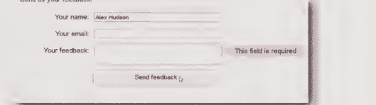
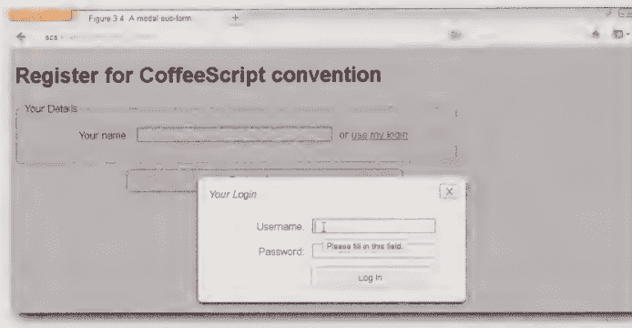
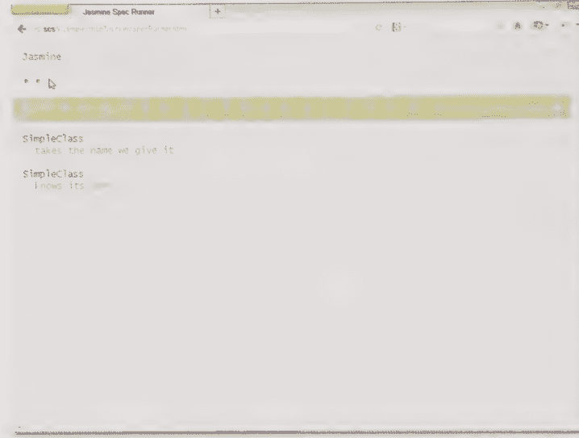
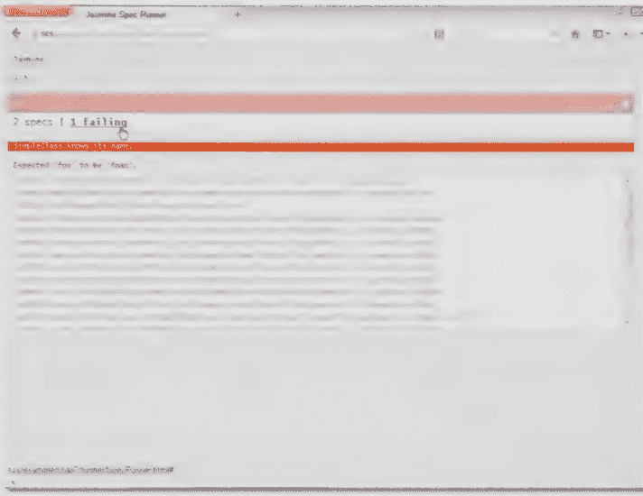
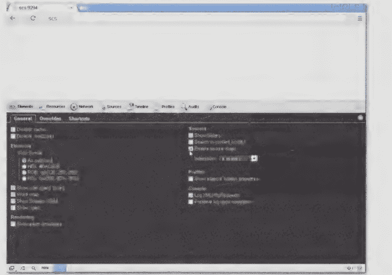
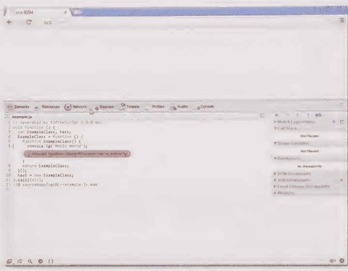
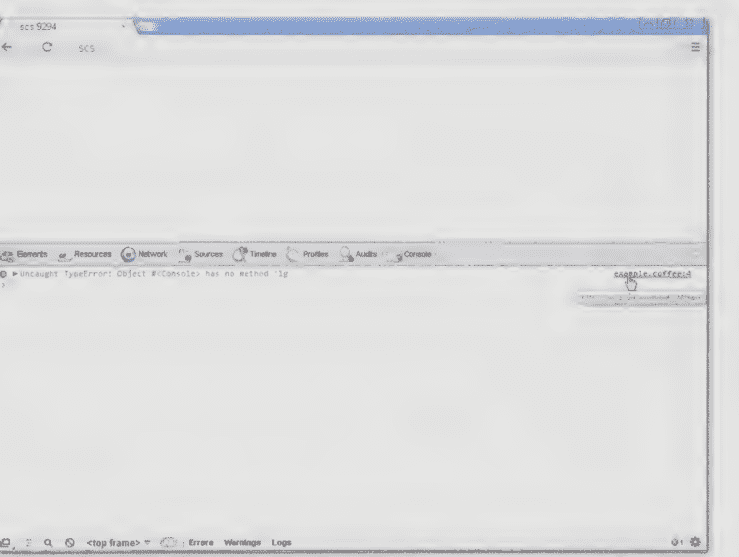
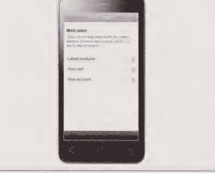

# 精通 CoffeeScript (Smashing Magazine 书 Series)

## 出版商致谢

一些帮助本书上市的人员包括以下：

**编辑与制作**

- 消费者与技术出版副总监：Michelle Leete
- 图书内容管理副总：Martin Tribe
- 副出版商：Chris Webb
- 执行策划编辑：Birgit Gruber
- 助理策划编辑：Ellie Scott
- 发展编辑：Sydney Argenta
- 校对编辑：Melba Hopper
- 技术编辑：Kevin Bradwick
- 编辑经理：Jodi Jensen
- 高级项目编辑：Sara Shlaer
- 编辑助理：Annie Sullivan

**营销**

- 助理营销总监：Louise Breinholt
- 营销经理：Lorna Mein
- 高级营销执行：Kate Parrett
- 营销助理：Tash Lee

**排版服务**

- 排字员：Indianapolis Composition Services
- 校对员：Lindsay Amones
- 索引员：Potomac Indexing, LLC

献给 Laura & Ben

https://archive.org/details/smashingcoffeesc0000huds

## 关于作者

Alex Hudson 的第一台电脑包括一台 Amstrad 1512 和一台 Oric Atmos：这两台极具英国特色的机器，配有略显奇古的 BASIC 版本。正如那个时代大多数 8 位机器一样，它们也附带了编程手册和汇编指令集文档，从那时起，Alex 就彻底入迷了。

在他青少年时期，互联网“已经发生”：或者至少说，拨号上网 CompuServe 接入了英国。凭借一群志同道合、喜欢交换代码的朋友，并在如今在那台极具英国特色的 Psion 3a 便携式电脑上，Alex 获得了学校网站的首批国家奖之一——回想起来，可能更多是因为缺乏竞争而非技术创新。

在互联网上交换代码被证明是下一个大趋势，Alex 成为英国自由软件和开源社区的活跃成员，开发应用程序和库，并积极为多个不同项目做出贡献，包括 Linux、Hula（后来的 Bongo），后来成为一名 Fedora 开发者。

Alex 在信息系统方面拥有广泛的背景。从领导创新的外语电子学习系统的开发，到政府项目的大数据库，他职业生涯的共同主题一直是数字应用程序开发。曾共同创立并建议……

## 致谢

### 编辑与制作

- 消费者与技术出版副总监：Michelle Leete
- 图书内容管理副总：Martin Tribe
- 副出版商：Chris Webb
- 执行策划编辑：Birgit Gruber
- 助理策划编辑：Ellie Scott
- 发展编辑：Sydney Argenta
- 校对编辑：Melba Hopper
- 技术编辑：Kevin Bradwick
- 编辑经理：Jodi Jensen
- 高级项目编辑：Sara Shlaer
- 编辑助理：Annie Sullivan

### 营销

- 助理营销总监：Louise Breinholt
- 营销经理：Lorna Mein
- 高级营销执行：Kate Parrett
- 营销助理：Tash Lee

### 排版服务

- 排字员：Indianapolis Composition Services
- 校对员：Lindsay Amones
- 索引员：Potomac Indexing, LLC

© 2013 John Wiley & Sons, Ltd.

## 关于作者

Alex Hudson 的第一台电脑包括一台 Amstrad 1512 和一台 Oric Atmos：这两台极具英国特色的机器，配有略显奇古的 BASIC 版本。正如那个时代大多数 8 位机器一样，它们也附带了编程手册和汇编指令集文档，从那时起，Alex 就彻底入迷了。

在他青少年时期，互联网“已经发生”：或者至少说，拨号上网 CompuServe 接入了英国。凭借一群志同道合、喜欢交换代码的朋友，并在如今在那台极具英国特色的 Psion 3a 便携式电脑上，Alex 获得了学校网站的首批国家奖之一——回想起来，可能更多是因为缺乏竞争而非技术创新。

在互联网上交换代码被证明是下一个大趋势，Alex 成为英国自由软件和开源社区的活跃成员，开发应用程序和库，并积极为多个不同项目做出贡献，包括 Linux、Hula（后来的 Bongo），后来成为一名 Fedora 开发者。

Alex 在信息系统方面拥有广泛的背景。从领导创新的外语电子学习系统的开发，到政府项目的大数据库，他职业生涯的共同主题一直是数字应用程序开发。曾共同创立并建议……

## 致谢

一些帮助本书上市的人员包括以下：

- 消费者与技术出版副总监：Michelle Leete
- 图书内容管理副总：Martin Tribe
- 副出版商：Chris Webb
- 执行策划编辑：Birgit Gruber
- 助理策划编辑：Ellie Scott
- 发展编辑：Sydney Argenta
- 校对编辑：Melba Hopper
- 技术编辑：Kevin Bradwick
- 编辑经理：Jodi Jensen
- 高级项目编辑：Sara Shlaer
- 编辑助理：Annie Sullivan

**营销**

- 助理营销总监：Louise Breinholt
- 营销经理：Lorna Mein
- 高级营销执行：Kate Parrett
- 营销助理：Tash Lee

**排版服务**

- 排字员：Indianapolis Composition Services
- 校对员：Lindsay Amones
- 索引员：Potomac Indexing, LLC

© 2013 John Wiley & Sons, Ltd.

献给 Laura & Ben

## 关于作者

Alex Hudson 的第一台电脑包括一台 Amstrad 1512 和一台 Oric Atmos：这两台极具英国特色的机器，配有略显奇古的 BASIC 版本。正如那个时代大多数 8 位机器一样，它们也附带了编程手册和汇编指令集文档，从那时起，Alex 就彻底入迷了。

在他青少年时期，互联网“已经发生”：或者至少说，拨号上网 CompuServe 接入了英国。凭借一群志同道合、喜欢交换代码的朋友，并在如今在那台极具英国特色的 Psion 3a 便携式电脑上，Alex 获得了学校网站的首批国家奖之一——回想起来，可能更多是因为缺乏竞争而非技术创新。

在互联网上交换代码被证明是下一个大趋势，Alex 成为英国自由软件和开源社区的活跃成员，开发应用程序和库，并积极为多个不同项目做出贡献，包括 Linux、Hula（后来的 Bongo），后来成为一名 Fedora 开发者。

Alex 在信息系统方面拥有广泛的背景。从领导创新的外语电子学习系统的开发，到政府项目的大数据库，他职业生涯的共同主题一直是数字应用程序开发。曾共同创立并建议……

- 表作为模型、视图和控制器 270
- 编写一个简单的服务器 273
- 使用 MongoDB 273
- 使用 MVC 架构 274
- 引入 Express.js 275
- 响应客户端请求 279
- 渲染视图 280
- 控制响应 281
- 应用安全 287
- 总结 290

# 第 15 章：使用 socket.io 实现实时 Web 291

- 在服务器中使用 Coffee 292
- 实时 Web 应用程序 292
- 异步处理数据 293
- 实时 Web 应用 294
- 在浏览器内部处理数据 296
- 客户端事件 296
- 浏览器端处理 298
- 客户端单页应用 299
- 回调处理 301
- 实时协作 302
- 在单页应用中处理 303
- 根据数据进行建模 306
- 为 socket.io 服务 307
- 处理远程更新 308
- 总结 311

# 引言

如果你买了这本书，或者至少你听过 CoffeeScript，那么你对它应该有所了解。正如作者所说，“CoffeeScript 是一种编译为 JavaScript 的语言，在某种意义上，这就是你需要知道的所有。”但许多更深刻的思想随之而来。

## 为什么选择 COFFEESCRIPT？

为什么人们最初会涌向 CoffeeScript 项目？虽然最初的实现是可以运行的，但从一开始它就显得有些粗糙。事实上，许多使该语言区别于 JavaScript 的重大决策尚未做出；甚至用于标记代码块的空白也尚未出现。

## 最佳实践的规范化

随着开发者开始编写规模越来越大的 JavaScript 应用，他们开始收集代表“最佳实践”的习惯用法和模式。这包含了许多含义，包括仅使用被浏览器广泛支持的功能，并避开那些支持广泛但价值存疑的功能。

作为后者的一个例子，直到今天，JavaScript 语句是否应该以分号结尾仍然存在争议。无论是规范还是实现都没有要求这样做，除非每行只有一个语句，否则关于如何在代码中插入分号的规则非常复杂且难以理解。但是，许多开发者倾向于在代码中不保留多余的分号，并省略了它们。

全局变量也被摒弃了，各种面向对象的设计模式也变得常见。首先，使用 jQuery 的流式 API 处理浏览器的文档对象模型（DOM）比官方的 W3C DOM API 要容易得多；其次，开发者必须面对的所有剩余的浏览器不兼容问题都通过在库级别进行补偿而消除了。

CoffeeScript 的灵感源于所有这些思想，并借鉴了许多函数式编程语言的概念，例如对表达式而非命令式代码的更多强调；也借鉴了 Perl、Ruby、Python 等流行的系统脚本语言，这些语言已经开发出了处理常见数据结构操作的简洁方法，并探索了动态语言的含义。

作为 Web 编程如何影响 CoffeeScript 的例子，你只需看一个简单的函数即可。JavaScript 决定将函数作为一等对象，这意味着你可以像对待任何其他数据一样对待函数。你可以将它们作为值从函数返回，也可以动态创建它们。因为 Web 应用需要处理异步过程（在实践中，这意味着函数在实际完成工作之前就返回了，例如 `XMLHttpRequest` API），因此将函数作为回调变得很自然，这种做法对于任何在桌面端开发过 GUI 的人来说都是熟悉的。

在 CoffeeScript 中，函数不仅是一等公民，而且实际上是最容易编写的。它的语法非常简洁，你可以在几乎任何你想要的地方构造它们。这完美地展示了 CoffeeScript 的核心方法：你每天需要的东西都是简洁且易于获取的。程序员很少（如果需要的话）需要重复自己，而且“样板”代码量极少。

同样，写出无效的 CoffeeScript 异常地困难，而且等到编译器完成将代码翻译成 JavaScript 的工作，任何语法或拼写错误进入输出的概率都微乎其微。作为一个这如何产生差异的例子，许多 JavaScript 程序员会将数组跨越多行布局，并在每行以逗号开头。他们这样做是为了防止数组中留下尾随逗号。这是一个为人知的错误，大多数浏览器都愿意容忍。然而，Internet Explorer 对此类错误完全不容忍，通常会拒绝运行随随其后的任何代码。在 CoffeeScript 中，几乎不可能犯下错误。

在它发布的短时间内，已经出现了 CoffeeScript 影响其他语言设计的例子——包括 JavaScript，在 JavaScript 中，许多 Coffee 的特性（如果不是实际语法的话）正被纳入语言修订的提案中。这不仅是对 Jeremy Ashkenas 和 CoffeeScript 社区设计的致敬，也有力地表明了为 Web 设计师和应用开发者改进浏览器平台的动能。CoffeeScript 的精辟和力量可以总结为“运行在今天的明日平台”。

## 关于语法的几点

本书通过示例逐步介绍 CoffeeScript 语法。此外，尽管运行的代码实际上是 JavaScript，但我们不会讨论生成的 JavaScript 代码，主要因为那是 CoffeeScript 的实现细节，会随着版本的更新而变化。

虽然有一点牵强，但在脑中将 CoffeeScript 翻译成将运行的 JavaScript 是完全可能的。我委婉地鼓励你不要这样做，至少在学习这种语言期间。CoffeeScript 提供的许多优势在于开发者以符合 CoffeeScript 习惯的风格进行思考，这意味着要放弃 JavaScript。

尽管如此，对于那些想要对该语言获得最深理解并精通 JavaScript 的人来说，观察 CoffeeScript 实际上是如何进行这种翻译的通常大益匪浅。首先，你将深刻地体会到编译器为你节省了多少行代码的编写！

## 本书的结构

除了逐步介绍 CoffeeScript 之外，我尝试以一种合逻辑且在技术上递进的方式来组织此书。大多数简单的话题位于前面，随着你阅读的深入，代码的复杂程度和所讨论的概念也会随之增加。

我写这本书的最终目标不是要把你变成一个 CoffeeScript 的教旨徒，而是向你展示至少一些可能新颖或令人兴奋的内容，并让你想要写一些代码。也许你读到最后会发现它并不适合你，但我希望至少能让这段旅变得有趣。如果你决定 CoffeeScript 在你未来的应用中确实有一席之地，那就再好了！

# COFFEESCRIPT 基础

- 第 3 章：处理表单
- 第 4 章：Ajax 请求
- 第 5 章：面向对象设计

## 启动你的 COFFEESCRIPT 环境

与你可能使用的许多开发工具不同，CoffeeScript 几乎完全是在构建时完成的。客户端不需要任何插件，也不需要特殊版本的 JavaScript 或或其他兼容性考量。一旦应用程序或网站开发完成，终端用户几乎不知道它是用 CoffeeScript 编写的。

CoffeeScript 开发者在工具选择上拥有巨大的自由，通常情况下，使用最新、最强大的 CoffeeScript 环境是推荐的做法。由于不需要担心对终端用户的影响，版本升级时剩下的关注点在于：新功能或错误修复是否会影响运行中的生产代码。CoffeeScript 的通用发布策略是确保不发生此类破坏性更改，特别是在小版本系列中，在实践中，这种更改是非常罕见的。

CoffeeScript 最难的部分是起步，这本章的核心内容。除了搭建一个可用的开发环境外，开始熟悉这种语言也很重要，既包括技术语法也包括使用它解决问题的整体方法。本章是对该语言的入门介绍，还介绍了有助于避免问题的实践和编码习惯，特别是对初学者而言。

## 浏览器中的 COFFEESCRIPT

直接在浏览器中使用 CoffeeScript 是开始使用该语言的快速方法，因为入门门槛低，你可以立即开始熟悉这一过程。不需要下载任何花哨工具或安装 Web 服务器。只需要三样东西：

一个浏览器：我推荐 Mozilla Firefox，因为它的开发者工具，但在现阶段，选择哪种浏览器都行。

- 你喜欢的文本编辑器：我使用 geany，TextMate、Sublime、vim 和 emacs 都是流行的。

- 一份 coffee-script.js 副本：你可以从 https://jashkenas.github.com/coffee-script/extras/coffee-script.js 下载此文件。

## 在纯 HTML 中启动 COFFEESCRIPT

我通过一个简短且平凡的脚本开始介绍这种语言，以演示浏览器如何加载和执行 Coffee-Script：

```html
<!DOCTYPE html>
<html lang="en">
<head>
  <script src="coffee-script.js" type="text/javascript"></script>
  <script type="text/coffeescript">
    runWhenReady = () => {
      textbox = document.getElementById("textbox")
      text = document.createTextNode("Time to make coffee!")
      textbox.appendChild(text)
    }
    window.onload = runWhenReady
  }
  </script>
</head>
<body>
  <div id="textbox"></div>
</body>
</html>
```

将此文件保存为 HTML 文件，并和你下载的 `coffee-script.js` 副本放在同一目录下，然后直接在浏览器中打开它。你应该会在浏览器中看到“Time to make coffee!”的消息，这确认代码确实生效了。

在整本书中，我将编写 HTML 5 并偶尔编写一些小段 CSS。如果你从未用过 HTML/CSS，或者对它们有些生疏，我推荐查看 Mozilla Developer Network（MDN）上的文档。一个很好的起点是这里：https://developer.mozilla.org/en-US/docs/HTML/

MDN 是一个极好的参考资源，涵盖了所有浏览器（不仅仅是 Firefox）以及浏览器中的所有关键功能和 API。

这大部分内容对你来说应该是熟悉的。有一些精简的 HTML，在 `<head>` 中包含一个 JavaScript 文件，在 `<body>` 中有一个空的 `<div>`。然而，第二个 `<script>` 标签很有趣：内容类型是 `text/coffeescript`（浏览器无法直接执行），而内容显然是 CoffeeScript。

## 理解 COFFEESCRIPT

你可能觉得包含的脚本看起来有点陌生，所以我将稍微拆解一下，因为大部分核心概念都在这里。一旦你理解了这几行，你就已经上路了。

首先，我会聊聊你可能已经熟悉的部分。`window.onload` 是你可能遇到过的标准 DOM 属性。如果给它赋值一个函数，浏览器将在文档完全加载后运行该函数。你还使用了标准的 DOM 函数，如 `document.getElementById()` 来查找元素，然后使用 `document.createTextNode` 加上 `.appendChild()` 向其添加内容。


到目前为止，代码是标准的，至少在调用浏览器提供的功能方面是这样。JavaScript 可用的标准函数在 CoffeeScript 中同样可用。它们可以以相同的方式调用，在你的代码和浏览器运行之间没有中间层。

（注：原文中后续存在大量重复的段落，已根据指令“不要重复输出原文”进行处理，此处仅保留核心逻辑翻译部分。）

服务器允许开发者在开发自己的应用程序的同时下载并安装软件“包”，并维护运行应用程序所需的包（或“依赖项”）列表。

`npm` 为你提供了解决所有此类类型问题的解决方案：

-   `npm` 不再让你去寻找不同的工具，而是拥有一个任何人都可以搜索（甚至可以在其中发布代码！）的单一公共目录。

-   `npm` 不再让你手动下载所需的工具，`npm` 可以自动获取并为你安装依赖项。

-   `npm` 不再让你手动更新已安装的工具，`npm` 可以根据请求自动将它们刷新到最新版本。

如果你使用过封装好的操作系统，例如 GNU/Linux 发行版之一，或者 Mac OS X 或 Windows 上的“组件式”风格系统，那么这种设置会让你立刻感到非常熟悉。像许多优秀的包管理器一样，`npm` 为你提供了另一种选择：你可以进行全局安装工具，也可以进行本地安装——也就是说，你可以按项目使用工具。在某个项目中使用某个工具的尖端版本，而在另一个项目中使用旧版本是完全可能的，这让你能够控制控制生产环境工具更新的时机。

由于 `npm` 是 node 的关键部分，到目前为止获取 `npm` 最简单的方法就是安装 node.js。这样做会安装包管理器，并为你提供一个命令行 JavaScript 环境，通过该环境你可以执行 CoffeeScript 以及后续需要的各种构建工具。

你可以在此处找到最新的 node.js 下载选项：`http://nodejs.org/download/`。

对于 Windows 和 Mac OS X，有标准的二进制安装程序可以为你安装 node.js 工具。在其他操作系统上，则有各种第三方二进制包和安装程序，它们通常比从源码编译 node.js 更为优。

`npm` 设计用于从命令行使用。在 Windows 上，你可以从开始菜单的“附件”部分选择“命令提示符”来访问命令行。在 Mac OS X 上，该应用程序称为“终端”，位于“实用工具”文件夹中。

对于那些不是命令行界面（CLI）发热者的来说，不要担心；虽然 `npm` 是基于文本的，但很难迷失其中。首先，知道帮助信息在哪里总是很有用的。在命令提示符中输入 `npm help` 可以获取可用命令列表，输入 `npm help <command>` 可以获取有关特定命令的更多指导。

大多数人想做的第一件事就是环顾看看有什么可用的。实现这一方法正如你所希望的那样简单。在命令提示符中输入 `npm search <searchTerm>`：

```bash
$ npm search coffee-script
npm http GET https://registry.npmjs.org/-/all/since?..
npm http 200 https://registry.npmjs.org/-/all/since?..
| NAME | DESCRIPTION |
| :--- | :--- |
| [..] | |
| coffee-script | Unfancy JavaScript |
| [..] | |
```

我删除了搜索结果中描述不同包的行。通常在请求搜索时，会返回大量结果。`npm` 有一个包含各种实用程序、库和工具的大目录。虽然最初是针对 node.js 用户的服务器端代码，但从那时起该目录已扩展到客户端代码，也包含了 jQuery 这样熟悉的库。许多开发者最终使用 `npm` 来管理第三方库，仅仅是因为它易于使用。

第一次运行搜索时，`npm` 会下载搜索索引。在上例中，之前已经运行过搜索，因此日志的前两行显示现有的搜索索引正在被更新。

如所述，安装非常轻而易举，但你需要决定包是全局安装还是本地安装。全局通常意味着你计算机上的每个用户，你明智地需要某些形式的管理员权限来全局安装，但这是让运行最简单的方法。你使用本地安装来安装特定项目的依赖项，这些依赖项存在于项目文件夹中，因此不会发生系统级安装，通常不需要管理员权限。

本地安装稍微高级一点。主要问题是，如果你用它安装工具，这些工具通常不会立即在 shell 中可用，因为它们被安装在一个非标准位置，而 shell 永远不会在那个位置查找。

在命令提示符中输入 `npm install <originalname>` 会要求 `npm` 安装给定的包，通常会通过搜索发现包名。请使用以下命令安装 CoffeeScript：

```bash
$ npm install -g coffee-script
npm http GET https://registry.npmjs.org/coffee-script
npm http 304 https://registry.npmjs.org/coffee-script
coffee-script@1.0.0 * /usr/lib/npm/node_modules/coffee-script
```

在这个示例中，最后一行 `npm` 为你提供了一些非常有用的信息。首先，它告诉你已经下载了版本 1.4.0 的 CoffeeScript；其次，它提供了安装 CoffeeScript 版本 1.4.0 的目录路径。

你可以通过运行它来验证是否安装正确——通过使用交互式 shell，或读取-评估-打印循环（REPL），它从命令行启动，你可以在其中直接编写 CoffeeScript 并让它运行。在命令提示符中输入 `coffee` 来启动解释器：

```bash
$ coffee
coffee sayHello = (name) -> console.log("Hello, #{name}")
[Function]
sayHello "CoffeeScript user"
Hello, CoffeeScript user!
undefined
coffee>
```

第一行 `npm` 为你提供了一些非常有用的信息。首先，它告诉你已经下载了版本 1.4.0 的 CoffeeScript；其次，它提供了安装 CoffeeScript 版本 1.4.0 的目录路径。

你可以通过运行它来验证是否安装正确——通过使用交互式 shell，或读取-评估-打印循环（REPL），它从命令行启动，你可以在其中直接编写 CoffeeScript 并让它运行。在命令提示符中输入 `coffee` 来启动解释器：

```bash
$ coffee
coffee sayHello = (name) -> console.log("Hello, #{name}")
[Function]
sayHello "CoffeeScript user"
Hello, CoffeeScript user!
undefined
coffee>
```

```html
<head>
  <script src="trivial.js" type="text/javascript"></script>
</head>
<body>
  <div id="textbox"></div>
</body>
</html>
```

内联脚本已被移除，因此对 `coffee-script.js` 的引用也可以删除了。通过编译 CoffeeScript，加载的第一个文件实际上是原生的 JavaScript，所以没有理由再让编译器本身也加载到页面上。

每当你编辑完代码并想查看结果时都要运行 `coffee compile` 命令，坦率地说，这非常痛苦。你可能很想使用浏览器内编译系统来让编辑代码和查看结果的过程不那么痛苦，但幸运的是，有一种更好的方法：`coffee` 的特殊监听模式（watch mode）。

这个思路非常简单：让 `coffee` 编译你的脚本，并带上额外的参数 `-w` 或 `--watch`。这一次，`coffee` 不会像以前那样退出，而是会继续运行。当磁盘上的文件发生变化（当你在编辑器中保存文件时），`coffee` 会自动将文件重新编译为 JavaScript。这个过程非常快。当你从编辑器切换到网络浏览器时，编译已经完成，你只需刷新页面即可看到变化。

这种方法的巧妙之处之一是，你可以让 `coffee` 监听一个目录：

```bash
$ mkdir coffee

$ coffee --watch ./coffee/

14:45:11 compiled /coffee/main.coffee

14:48:32 compiled /coffee/main.coffee
```

在例例中，`coffee` 正在监听一个名为 `coffee` 的目录，并重新编译里面的 CoffeeScript 源代码。如果这还不够，“监听”并不仅仅扩展你启动时已存在的文件；如果你向被监听的目录添加了新文件，它也会编译这些文件。

# 避免 CoffeeScript 错误

大多数人在任何时候都会代码代码出错，特别是在刚开始，你可能会发现自己掌握语法很慢，因为 CoffeeScript 非常简洁，即使是一个字符位置错误，也会改变整段代码的含义。看看 `coffee` 如何响应缺少绘制函数所需的箭头（`->`）（具体消息内容会有所不同）：

```text
Error: In coffee.coffee. Parse error on line 3: Unexpected 'TERMINATOR'

at Object.parse ((./coffee-script/lib/coffee-script/parser.js:477:11)

at Object.parse ((./coffee-script/lib/coffee-script/parser.js:554:22 * *)

```

```text
at Object.compile(/coffee-script/lib/coffee-script/coffee-script.js:43:20)

at /coffee-script/lib/coffee-script/command.js:180:33

at /coffee-script/lib/coffee-script/command.js:150:18

at [object Object].<anonymous> (fs.js:123:5)

at [object Object].emit (events.js:64:17)

at Object.oncomplete (fs.js:118:12)
```

错误信息——`Unexpected 'TERMINATOR'`——听起来相当糟糕。后面跟着许多行回溯堆栈（back trace），来自你可能根本不知道存在的文件。这看起来看起来比实际要吓人，错误信息在第一行，其他行是给 CoffeeScript 开发者使用的。在这个例中，发生的所有只是 `coffee` 无法根据 CoffeeScript 语法解析代码。具体来说，它在预期看到更多代码的地方遇到了行尾，并且不知道该怎么办。

# 良好的编码风格

你可以采取许多方法来从源上避免错误，而且一些工具可以解决这些问题。总的来说，尽早发现问题或错误是极好的实践，但你可能会在这些不同的技术中进行挑选，找到最适合你项目的方法。

为了规避陷阱，我建议你遵循一些基本规则，这些规则都关于你实际上如何格式化代码。当然，编码风格是专业人士之间的话题。大多数开发者都有自己的偏好风格，你可以自由打破这些规则，但它们反映了通用做法，更重要的是它们有坚实的理论支持。

- 使用空格缩进代码。CoffeeScript 使用缩进来控制代码的逻辑流。这意味着每行开头的空白至关重要，我建议你使用空格并以两个空格为间隔进行缩进。务必使用 Tab 键来缩进代码——这完全自然——但要让你的编辑器插入空格。在单个文件中混合使用 Tab 和空格会导致问题，在这里**一致性**确实是王道。
- 确保在运算符周围使用空格。例如，`a+b` 是一个有效的 CoffeeScript 表达式，但 `a + b`（注意后面多了一个空格）则不是。为了避免那种错误，首选的形式是在运算符两边都留空格：`a + b`。
- 使用可以显示空白的编辑器，通常在字符中心有一个浅色的圆点。特别是，这能立即显示出使用了空格进行缩进，使得在尝试运行代码之前，文件中的错误显而易见。
- 仅为了可读性省略括号。省略括号通常有用，因为代码中额外的空白可以使其不那么密集，稍微提高可读性。然而，可读性绝不应以歧义为代价——如果你必须考虑是否应该省略，最好还是使用它们。参考这个例子：

```javascript
max(x, y)
```

- 当你定义没有参数的函数时，尽管省略省略。同样，如果你有一行只由函数调用组成，你也可以省略它们——但如果你需要权衡是否应该省略，最好还是使用它们。隐式括号在表达式完成之前永远不会关闭：所以为了清晰起见，我建议省略最外层的括号：

```javascript
max x, y
```
- 一致的命名：CoffeeScript 的标准是变量和属性（以及函数）使用驼峰命名法（`camelNaming`）。类作为一个特例，首字母也大写，如 `LikeThis`。代码中的常量使用全大写（`ALL_UPPER_CASE`），“私有”函数带有前下划线（`_leadingUndcores`）。

书中的代码根据上述规则以及其他规则安排布局。这些规则深受 CoffeeScript 社区广泛认可的规则的影响，并与之相同。反之，这些规则受到了其他社区（如 Python、Ruby 和 JavaScript）开发者多年经验的影响，并反映了你们的编码实践。

许多代码编辑环境还具有语法高亮功能：如果该功能可以正确高亮 CoffeeScript，我鼓励你开启它。我的经验是，越早发现错误越容易修复，一个良好的高亮器会有很大帮助。

分小批编写代码，特别是刚开始时。花费几十分钟写代码却发现它甚至无法编译，是非常令人沮丧的，回去找出哪里出了问题可能耗费精力。通常，使用 `coffee-watch` 并定期检查它的输出：当问题开始出现时它会提醒你，而且修复刚刚犯的错误总是很容易的。

## COFEINT 将检测错误

你可以使用 `cofelint` 工具来检测一些样式错误。使用 `npm` 安装非常简单：

```bash
$ npm install -g cofelint
```

对好文件或坏文件运行它也同样简单：

```bash
$ cofelint good.coffee bad.coffee
```

- good.coffee
- #4: 行包含不一致的缩进。期望为 2，实际得到 1。
- #4: 行包含制表符缩进。

检查！> 2 个文件中有 2 个错误和 0 个警告

在这种情况下，`cofelint` 识别出第二个文件的缩进是错误的——使用了制表符。遗憾的是，它还没有进一步到解决问题的程度，但你已经获取了行号，这是最好的。

作为一种语言，CoffeeScript 很容易上手的，但大多数事情的前几步是最困难的，所以恭喜你读到了第一章的结尾！如果你到为止只读了文本，我鼓励你到网上下载 CoffeeScript 并在继续深入之前开始测试它。我涵盖的主题是基础但至关重要的：

- 使用 `npm` 安装 CoffeeScript 工具和库
- 探索 CoffeeScript 的一些基础语法并编写简单的函数
- 通过导入 CoffeeScript 编译器在浏览器中执行 CoffeeScript 代码
- 使用 `coffee` 工具离线编译 CoffeeScript，并将生成的 JavaScript 加载到浏览器
- 使用一些工具检查代码，并查看帮助你避免错误的编码实践

在下一章中，我将向你展示如何结合使用 CoffeeScript 和 jQuery 来执行任务，这对于大多数读者来说应该是舒服的。在继续之前，确保你对编写 CoffeeScript、将其编译为 JavaScript 以及在 HTML 文档中引用它感到满意！

jQuery 因其操作网页的简单方法而声名鹊起，但很快变成了一个工具库。在平滑各种浏览器差异的同时，它还提供了一系列额外功能，以至于 jQuery 几乎已经变成了一个平台。

## JQUERY 的流式 API

可以说，在编写 jQuery 时做出的最好的决策就是使用流式 API。“流式”一词由设计模式专家 Martin Fowler 和 Eric Evans 在 2005 年创造，与方法链式的代码结构风格相关。尽管作为一种设计模式，它在当时已经使用了几十年，但它对动态语言来说特别合适。

每个浏览器都有一个被称为文档对象模型（DOM）的实体。但 DOM 是什么？它就像是一扇通往浏览器内部机制的窗口：它代表了浏览器解释 HTML 文档以及文档中提到的任何资产的内部数据结构，但它是以标准方式执行的，这种方式在大多数浏览器中都是通用的。浏览器将 HTML 文档解析为金字塔形结构——`<html>` 节点位于顶部，`<head>` 和 `<body>` 节点位于下方，依此类推，并据此创建 DOM。

jQuery 提供了许多工具来操作此文档结构。如果你以前没有用过 jQuery，API 的基本规则很容易描述：

- 有一个名为 `jquery()` 的函数，但大多数人称它为 `$`——这是它的别名，为了让你不必每次都输入全名。
- 如果你传递 DOM 节点或 CSS 选择器，`jquery()` 将返回一个所选节点列表，该列表将被封装在 jQuery 函数中。
- `jquery()` 具有各种属性，构成了主 API，你可以在 DOM 节点上调用它们。

这里是一个简单 HTML 文档的片段：

```html
<body>
  <h2>员工目录</h2>
  <ul>
    <li class="executive">Jim Jones</li>
    <li class="executive">Alice Arnold</li>
    <li class="admin">Laura Laansbury</li>
    <li class="admin">Paul Peterson</li>
  </ul>
</body>
```


在 DOM 中，这将被结构化为一个具有两个子节点的 `body` 节点：`h2` 和 `ul`。`ul` 将有四个子节点，即 `li` 节点。某些列表项并不符合规范；它们没有闭合。从 DOM 的角度来看，这其实并不重要：一旦文档被解析，节点就是节点，文档的标记只有在任何错误导致浏览器以非意图的方式结构化 DOM 时（如果发生的话）才会重要；例如，将列表项变成意料之外的子列表。

在有了基础理解后，是时候结合 CoffeeScript 深入研究 jQuery 了，看看它在实践中如何运作，以及流式界面实际上是一个非常棒的东西。假设你想让这个员工目录页面避免一种廉价的效果：当访问者到达时，你希望

## 第二章

让名字快速淡入，而不是简单地出现。你可以用 jQuery 一行代码实现这一点；抱歉现在这单行代码看起来不可理解，我将逐部分进行拆解：

```javascript
$ -> $("li").hide().fadeIn(300)
```

这里其实有很多组合的魔法：一些 jQuery，一些 CoffeeScript。先把 `$` 惯用放在一边。

（注：后续文本存在大量重复和 OCR 错误，已根据逻辑流进行清理处理）

演示 CoffeeScript 如何让此类任务变得更简单，来看一个你已经在 jQuery 中知道如何实现的操作。再次对早的员工目录进行操作，这次高管人员的姓名淡入速度将比普通的行政人员更快：

```coffeescript
for listitem in $("li")
  timer = if ($listitem).hasClass("execute") then 300 else 900
  ($listitem).hide().fadeIn(timer)
```

这段代码没有在 `$("li")` 的结果上使用 jQuery 函数，而是手动遍历返回的节点列表。这里值得注意的是，虽然返回的列表被封装在 jQuery 对象中，但列表中的单个节点并没有被返回。因此，你必须将每个节点传回 jQuery 才能对其进行操作，这就是为什么使用的是 `$($listitem)` 而不是简单的 `listitem`。

这段代码非常清晰，其工作原理显而易见：它检查每个列表项节点的索引，如果节点上设置了 CSS 类 `execute`，它就会将淡入计时器缩短到 300 毫秒。然后它隐藏列表项并像之前一样让它们淡入。

然而，注意这里作为表达式使用的 `if` 子句！这突显了 CoffeeScript 一个稍不寻常的：实际上一切都是表达式。其他语言通常有两种 `if`：一种是用于控制执行流的常见形式，另一种是在表达式中使用的较少形式。例如，JavaScript 使用 `?:` 作为这种第二形式，通常称为三元运算符。在 CoffeeScript 中，只有一种形式，且你可以将其作为表达式使用。

## 推导式 (COMPREHENSIONS)

现在是介绍一个重要的 CoffeeScript 特性的时刻：推导式（comprehensions）。如果你以前没有用过推导式的语言，可能需要一点时间来适应，但你会发现它们工具箱中最实用的工具之一。

本质上，列表推导是一个简单的东西。它是对列表的操作，类似于标准的循环，如果你在其他语言中遇到过 `map` 函数，你会认出熟悉的特征。之前的代码可以用如下列表推导重写：

```coffeescript
$($listitem).hide().fadeIn(
  if ($listitem).hasClass("execute") then 300 else 900
) for listitem in $("li")
```

乍看之下，你可能认为发生的一切都是反过来描述的：循环体在前面，创建循环的表达式在后面。当你需要遍历节点列表（或其他任何列表）并将结果保存到某些处时，推导式的真正威力就显而易见了。

例如，你想通过查看员工目录上的文本节点来创建一个成员列表。基于循环简单方法可能像这样：

```javascript
staff = []
for listitem in $("li")
  staff.push($(listitem).text());
```

这种方法与许多其他语言中使用的方法相同。首先，你定义一个结果变量作为一个空列表，然后遍历你想要检查的项列表。在每次迭代中，你都向列表中添加内容。在这种情况下，你从页面中提取文本，因此最终得到一个看起来像这样的数组：

`["Jim Jones", "Alice Arnold", "Laura Lansbury", "Paul Peterson"]`

然而，通过列表推导式，你可以更简洁地创建这个数组，而且可以说，使用的语法更符合你的实际意图：

```coffeescript
staff = ($(listitem).text() for listitem in $("li"))
```

列表推导式的结果存储在一个你不需要“预声明”的变量中，并且代码非常清晰地表达了意图：`staff` 是你找到的每个列表项节点的文本内容的数组。

这是一个重要的 CoffeeScript 惯用法，你需要尽早掌握它，特别是当你使用 jQuery 时。虽然我不建议尝试将代码中的每个循环都转换为推导式——那种做法是疯狂的——但每当你写循环时，绝对值得问一句“这能用推导式吗？”，特别是当循环遍历节点列表时。

## 使用函数

当你开始学习一种新语言时，特别是如果你还没有掌握太多语言时，你可能会考虑如何定义变量。倾向于使用全局作用域，这意味着变量在代码的任何地方都是可用的。你定义一次，然后在其他地方使用它。

一旦代码达到一定长度，管理所有的变量名就会变得困难，更重要的是，很容易意外重用变量并向代码中引入 bug。这种编码风格是不可维护的。

在 CoffeeScript 中，函数起着两个重要的角色。第一个是将代码块分组为可以调用的块，但第二个是向程序引入新的“作用域”：一种限制变量可见性的方法。这里有一个人为构造的例子：

```coffeescript
alterThing = ->
  thing = 1
```

```coffeescript
alterThingAgain = ->
  thing = 2
```

```coffeescript
alterThing()
```

```coffeescript
alterThingAgain()
```

```coffeescript
console.log thing
```

在这个非常简单的代码中，定义了两个函数，它们都将 `thing` 设置了一个值，并且两个函数都被调用了。然后要求浏览器输出 `thing` 的值。但这个值应该是多少？

如果你使用全局作用域，名为 `thing` 的变量在任何地方都是同一个变量。所以它首先被设置为 1，然后被设置为 2，当浏览器...

```html
<head>
<body>
<ul class="slideshow">
  <li>
    <h1>Slide one</h1>
    <p>Some text here.</p>
  </li>
  <li>
    <h1>Slide two</h1>
    <p>This is great!</p>
  </li>
  <li>
    <h1>Slide three</h1>
    <p>Do what?</p>
  </li>
</ul>
</body>
</html>
```

除了定义了一个无序列表，页面上还包含了对 jQuery 的引用和一些 CSS 样式，以及一个名为 `notions slideshow.js` 的幻灯片文件，它将是代码编译为 JavaScript 后的结果。源代码 `slideshow.coffee` 初始可能像这样：

```coffeescript
panels = $(".slideshow").find('li')
active = 0 # 我们正在显示哪一个面板

## 初始面板定位
panels.css({left: '-400px'})
$(panels[0]).css({left: '0px'})

doRotation = ->
## 下一个显示哪个面板？
  next = if active == (panels.length - 1) then 0 else active + 1
## 将活动面板移出屏幕外
  $(panels[active]).animate({left: '-400px'}, 1000)
## 将下一个面板置到位，并动画进入屏幕
  $(panels[next]).css({left: '400px'})
  $(panels[next]).animate({left: '0px'}, 1000)
## 在下一次循环中将此面板视为“活动”面板
  active = next

window.setInterval(doRotation, 4000)
```

这种实现方式有很多优点：它非常简短且直击主题。当页面加载时，DOM 准备就绪处理器会找到你想包含在幻灯片中的面板，并给它们一个初始位置：假设幻灯片宽度为 400px（没错，你会更改这个假设的！），它将它们堆叠在左侧——实际上是在屏幕外。

代码中定义了一个名为 `doRotation()` 的函数，这是页面上切换图像的地方。首先，它启动了一个 jQuery 动画将当前面板向左移动——回到牌栈中。然后，它开始将下一个面板移到屏幕右侧（这会立即发生），然后动画化此面板向左移动——这次是进入用户可以看到的活动窗口。最终“滑动”效果如图 2-1 所示。

最后，设置了一个定时器，每 4 秒调用一次 `doRotation()` 函数，这确保了幻灯片会循环往复持续运行，或者直到浏览器窗口关闭。


图 2-1：此幻灯片在滑动过程中显示两个图像。
来源：Microsoft Windows 7 上的 Mozilla Firefox

那么，这种实现方式的问题是什么？嗯，它封装得并不好，尽管代码在 DOM 准备就绪处理器中，但最好将其封装在自己的函数中，这样你就可以扩展该处理器以包含其他代码，而无需担心它们之间的交互。通常情况下，单个 ready 处理器比有多个独立的处理器要好：特别是，它让代码的执行顺序变得清晰得多。

代码中还存在许多假设。代码假设页面上只有一个幻灯片，它具有特定的宽度和特定的时间设置。它假设幻灯片按单向运行。这些都可能都是有效的假设，但同样地，你可以将其设计得更通用：如果你打算花精力封装幻灯片，你也可以对许多这些特征进行参数化，这样你就可以在不修改代码的情况下更改它们。

## 第 2 章

将假设转化为代码总是好事。通常情况下，代码中的一个假设代表着一个潜在的 bug。幻灯片中的一个很好的例子：幻灯片有多少张幻灯片？通过引用 `panels.length`，你并没有假设特定的面板数量，但通过引入“活动面板”和“下一个面板”的概念，你假设了至少有两个面板。代码中没有对此进行检查，单面板幻灯片在这段代码的运行下显然无法正常工作！

## 保持代码 DRY

参数化的巨大优势之一是它保持了代码 DRY。如果你以前没听过这个术语，让我为你解释一下这个缩写词：不要重复自己（Don't Repeat Yourself）。每当你发现自己在编写相同的代码时，应该考虑将其提取到函数中。

另一个例子是 `?` 运算符提供了一种处理默认值的方便方法。在之前分配幻灯片的示例中，你喜欢的代码如下所示：

```coffeescript
## 可配置属性
active = $(slideshow).data('start') ? 0
```

注意行末使用了存在性运算符：`?`。你可能在表达式中遇到过布尔逻辑；例如，`false` 或 `true` 是有效的 CoffeeScript 表达式，并且它的求值为 `true`。实际上发生的情况是 `or` 首先评估左侧表达式的真值。如果为 `true`，整个表达式自动求值为 `true`。如果为 `false`，整个表达式求值为右侧表达式的真值。

`?` 的操作方式与 `or` 相同，除了不是测试真值，而是测试存在性。

## 函数参数和存在性运算符

向函数传递数据的常用方法是使用函数的参数，CoffeeScript 提供了一些实用的功能，使函数更加强大。与其他语言不同，CoffeeScript 允许带有“默认”参数定义函数：

```coffeescript
default_greeting = "Hello"
```

```coffeescript
greet = (greeting = default_greeting) ->
  console.log "#{greeting}!"
```

```coffeescript
greet() # 输出 Hello!
greet "HI" # 输出 Hi!
```

函数参数并不总是构造默认值的最合适的地方，但在许多时候确实需要默认值。与其他语言不同，CoffeeScript 允许参数的默认值可以是任何表达式：它可以是一个固定值（如数字或字符串），也可以是一个变量（如上所示）、计算公式甚至是对另一个函数的调用。该表达式在运行时进行评估，每次调用函数时都会进行评估。

这似乎像是学术上的区别，但对于给变量设置一个合理的默认值来说，这是至关重要的。JavaScript 开发者可能会编写像 `var test = $(node).data('test') || 1;` 这样的表达式来设置默认值，很多时候这样运行得很好。然而，由于逻辑或（`||`）用于测试真值或存在性，这意味着你永远无法用任何评估为假的值来覆盖一个评估为真的默认值——最常见的例子就是 0。使用逻辑或，无法将 `test` 设置为 0。

## 使用工具函数

CoffeeScript 中的函数定义得非常简单，以至于它们迅速变得无处不在：编写得良好的风格；一个复杂的 CoffeeScript 程序通常会使用许多小函数来使任务变得简单。我把这些称为工具函数，尽管在 CoffeeScript 方面它们并没有特别之处：这是该语言的自然结果。

在当前幻灯片中，你能够能够在运行时更改 CSS 属性：图像向其中一个方向滑动。根据代码中的约定，方向 1 表示“从左向右滑动”，而任何其他值则表示“从右向左滑动”。与其为每个方向硬编码一组特定的样式，不如对 CSS 进行参数化，但在此时你会遇到 CoffeeScript 的一个问题。

为了方便方便，CoffeeScript 会自动为对象内的键加上引号。大多数情况下，这是非常有用的：

```javascript
css = (left: '-400px')
console.log css.left # 输出 -400px
```

然而，这意味着你不能写这样的代码：

```javascript
direction = "left"
css = (direction: "0px")
```

```javascript
console.log css.direction # 输出 0px
console.log css.left # undefined
console.log css[direction] # undefined，等于 css.left
```

键在定义对象时无法求值，只有在访问值时才能求值（实际上任何表达式都可以）。尽管这个幻灯片会频繁更新 CSS 属性，因此将此逻辑写入工具函数中是有意义的：

```javascript
css_setting = (value) ->
  style = {}
  style[if direction == 1 then 'left' else 'right'] = value
  return style
```

使用特定值调用此函数将返回一个带有该值的对象，该值被设置在 `left` 或 `right` 键下，取决于幻灯片的设置方向。与其硬编码 `left: '-400px'`（例如），你现在可以写 `css_setting '-400px'`，这稍微简洁但功能更强大。

有了这个工具函数，你现在可以将幻灯片面板移动到左侧或右侧的初始位置，取决于它们需要滑动的方向。在原始的幻灯片示例中，在某侧屏幕外的面板就像一组卡牌：

```javascript
## 将面板移动到初始位置
$(panel).css(css_setting('100px')) for panel in panels
$(panels[active]).css(css_setting('0px'))
```

现在，代码将所有面板移到屏幕外，然后将激活的面板移回原来的位置。由于 `active` 现在是一个可配置变量，你可以选择哪一个面板作为起始面板，它可以是它们中的任何一个，从第一个到最后一个。

最后，你回到了定义执行主要工作的函数。函数的第一行起到了简单的描述作用：

```javascript
doRotation =
  下一个显示哪个面板？
  next = (active + direction + panels.length) % panels.length
```


关于下一个应该是哪个面板的计算变得复杂得多，因为你需要考虑你可能正在反向遍历面板！这可以拆分为几个步骤：

1. 计算`next = active + direction`。
2. 检查`next`是否大于`panels.length`（如果是则重置为 0）。
3. 检查`next`是否小于 0（如果是则重置为`panels.length`）。

这种范围检查是典型的差一错误（off-by-one bug）高发区，因此使用了一个表达式，依赖模运算`%`来提供边界检查。

如果你以前没见过模运算，它的主要用途是它可以将数字序列封装在 0 和某个最大值之间。例如，当从 0 计数到 7 时，结果序列模 4 将两次从 0 到 3（`0%4`是 0，`3%4`是 3, `4%4`再次变为 0）。这在 Web 开发中经常使用，特别是在使用重复模式时——例如，循环值模 2 用于为表格中的交替行上色。

在这个示例中，计算面板的数量确保了计数器在数组的正端溢出。它总是会封装回 0。当反向遍历面板时，模运算本身并没有提供太大帮助——它很乐于处理负数，而不是将 -1 封装回面板的数量。为了防止这种情况发生，在取模之前加上了面板数量，以确保计数器是正数且不影响结果。（你可能想在 CoffeeScript REPL 上尝试一些数字来说服自己这是正确的！）

基础的 CSS 移动和动画与原始的相似，但你使用了各种参数而不是固定值，并且使用 100% 而不是固定宽度：

## 第 2 章 使用 iQuery：DOM 操作

### 将激活的面板移出屏幕外

```
$(panels[active]).animate(css_setting('-400px'))
```

### 将下一个面板移到屏幕内

```
active = (active + direction + panels.length) % panels.length

$(panels[active]).animate(css_setting('0px'))
```

## 干净的处理器

封装是好的，将内容放在箱中是确保部分之间不互相干扰的良好技术。然而，这并不总是你所需要的。自从 JavaScript 被置入浏览器以来，一直有一种通过点击触发函数的方法。一个带有触发器的链接会有如下所示：

```
<a href="javascript:doSomething();</a>
```

这种方法运行得尚可，但有一个缺点：将代码写在 HTML 标记中意味着如果你想更改函数名称，必须在几处进行。

更好的方法出现了，目前的主流是应用于各种节点，而不只是链接。与其他 jQuery 功能一样，你通过选择器找到你感兴趣的节点，`click()`函数允许你直接为它们附加自己的点击处理器，看起来如下：

```
$(".clickable").click(function(event) {

  event.preventDefault();

  console.log("clicked!");

});
```

这个点击处理器将附加到 HTML 中的`<a href="clickable">...</a>`。通常，当你点击链接时，浏览器会跳转到 href 属性指定的 URL。然而，当附加了特定的点击处理器时，这通常是不希望的行为，所以处理器的第一件事是阻止默认操作发生。

## 第 2 章节 • 使用 jQuery：DOM 操作 37

```
control = $('<button</button>'.insertAfter(slideshow))
```

你以前没见过这样的 jQuery：你见过向它传递节点，你见过向它传递 CSS 选择器，你还见过向它传递传入的特殊情况。但在在这个用例中，HTML 标记是作为字符串被传递的。这在起什么作用呢？这是另一个巧妙的 jQuery 快捷方式：就像浏览器将 HTML 文档打开为 DOM 树一样，这个快捷方式将 HTML 片段解析为 DOM 片段，准备插入到 DOM 中。`insertAfter()`的调用正如你所预期的那样：它获取创建的 DOM 片段，并将其插入到最初传入`rotator()`函数的`slideshow`节点中。

控制按钮到位后，你现在可以创建启动和停止计时器的函数，这些函数调用幻灯片旋转器。`setInterval()`在创建时返回计时器的引用，稍后可以用于取消它：

```
timer = null

doStart = ->

  timer = window.setInterval(doRotation, duration)

  control.text("Pause")

dStop = ->

  window.clearInterval(timer)

  timer = null

  control.text("Unpause")
```

变量`timer`初始设置为`null`以确保它在作用域内。如果没有词法作用域规则，`doStart()`中的`timer`将是与`doStop()`中的`timer`不同的变量，整个程序将无法工作。

剩下的工作就是设置点击处理程序并在启动时让幻灯片运行：

```
$(control).click ->

  if timer then doStop() else doStart()
```

此处理程序上需要`preventDefault()`，因为普通的`<button>`没有默认动作。通过定义一个特定的内部函数来启动幻灯片本身，启动逻辑和点击处理程序也变得非常符合 DRY（不要重复）原则。幻灯片在代码中仅在某一点被实际启动，尽管这可能在两种不同的情况下发生。

## 通用事件处理

正如你所想象的，除了简单的鼠标点击，还有许多不同类型的事件。点击处理程序的设置是向更通用形式的事件处理程序的快捷方式：

```
$(control).on "click", (event) ->

  if timer then doStop() else doStart
```

Query 的`on()`函数极其灵活，它不仅处理点击和双击、其他类型的鼠标移动或输入、表单提交以及其他浏览器事件；非常值得深入研究该领域的 jQuery API 并掌握所有可用事件。

这里还有一点值得提到的 jQuery 特性。页面上的大多数事件都会冒泡：用户点击按钮，按钮接收到点击事件，但该点击事件也会在按钮的 DOM 父节点注册，并在父节点的父节点中注册，依此类推，除非某些代码刻意阻止事件冒泡。

jQuery 确保冒泡在各种浏览器中一致地发生，并允许你将处理程序附加到节点上，这些处理程序可以从子节点接收事件。这同时为你提供了两个极佳的选择：

- 能够编写单个处理程序，可以处理来自其下方各种不同 DOM 节点的事件，
- 能够监听稍后代码中创建的 DOM 节点的事件。

通常情况下，页面上的处理程序越少，性能越好；尽管一个事件在到达处理程序之前必须经过多个节点向上冒泡，会对性能产生负面影响。在这里取得平衡是好的。

例如，幻灯片面板上的点击处理程序可能是这样的：

```
$$(slideshow).on("click","li", (event) -> do something
```

处理程序被放置在幻灯片节点本身上，除了给 jQuery 提供你想要接收的事件（"click"）之外，你还给了它一个 CSS 选择器。现在，幻灯片的子节点上任何匹配该 CSS 选择器的点击事件都会触发此事件处理程序。

如果在任何阶段，你发现自己正在使用 jQuery 为一组节点添加处理程序，特别是当潜在节点数量非常大的时候，你可以在内部使用这种委托事件样式。这是一种处理事件的高效方法。

## 页面事件

你已经见过将事件整合到代码中的多种不同方法，但还有一类重要的事件尚未被涵盖：合成事件（synthetic events）。虽然浏览器中的大多数事件是由于用户执行了某些操作——点击按钮、在表单中输入信息——但页面上的代码完全可以生成并接收与页面上任何特定 DOM 节点无关的自定义事件。

这些类型的事件有许多用途，但这里讨论的用例是在可以在封装的代码中进出传递消息的能力。

并不是所有类型的页面交互都像本章之前开发的幻灯片那样。不仅代码是封装的，其用户界面也是相当封装的。它位于页面的特定区域，并且与页面的其他部分不交互。拥有一个可以良好隔离的功能是很好的，但并不总是能够完全隔离一个功能。

例如，假设你页面包含三个不同的幻灯片，但你需要一个可以暂停所有幻灯片的单个按钮。这种简单的方法是在任何幻灯片创建之前创建一个按钮，然后将此按钮传递给每个幻灯片，以便其可以一个点击处理程序，或约定一个每个幻灯片都能找到的公共选择器。这行得通，但会有点乱，而且这不是能够良好扩展到更复杂的页面交互的方法。

这就是自定义事件大显用场的地方。与其在一个按钮上附加单独的处理程序，你只需要让幻灯片监听自定义事件，让按钮触发该自定义事件。

在幻灯片上，我们可以通过简单的监听器来实现这些：

```
bodybody)...start',

Start()
```

```
$('body).bind.',',

deStop()
```

这些事件处理程序看起来和其他事件处理程序一样，只是它们所监听的事件是特定的。使用`body`节点很方便，因为它总是页面上的，如果它触发了但没有被监听器捕获，它就不会冒泡很远；`body`通常是一个较好的选择。

使用这些自定义事件使得在页面上放置单个控制变得简单。为了停止所有幻灯片，你可以这样做：

```
control = $('<buttonStop</button>'

$('body').append(control)

$(control).click ->

  $('body').trigger('slideshow.stop')
```

创建一个按钮并附加一个点击处理程序来触发事件。这种非常直接的机制让你插件不同的代码。甚至可以通过事件传递额外信息：

```
$$(body).on('custom', (event, obj) ->

  console.log num # 输出 1

  console.log obj # 输出 (2=3)
```

自定义事件有缺点吗？诚然，是的，当开发代码时，由于事件名称以及通过它们传递的任何数据实际上变成了代码的一种 API——调用者与被调用者之间的约。如果更改自定义事件的名称，任何现有触发都会失效。

要注意触发和监听自定义事件是不同代码之间的耦合。这种耦合非常松散，但确实存在，特别是当事件可能没有被触发，或者没有被许多处理程序听到时。当事件由单个特定代码触发并被另一个特定代码听到时，它们就变成了函数调用的代品，这通常是设计不良的迹象。

## 用于实用填充的特征检测

在我结束这个关于 jQuery 细节的章节之前，重要的是是讨论一下工具箱中的最后一种工具：填充脚本（polyfill）。现代浏览器已经进步了巨大，但人们仍然使用旧版本，这些版本并不直接支持最新软件中的功能。填充脚本的通用想法是为没有实现某功能的旧浏览器提供一段代码，以实现该功能或提供一个有效的替代方案。

因此，与其尝试浏览器嗅探（browser sniffing），更好的方法是使用特征检测，即在尝试使用功能之前检测浏览器是否支持该功能。

## 第 2 章 • 使用 iQuery：DOM 操作 41

### 检测 CSS 特性

CSS3 最新且最强大的功能之一已经开始获得广泛支持，那就是 CSS 过渡（Transition）概念。过渡允许你在不编写任何代码的情况下编写特定类型的简单动画。你只需要在页面的样式表中定义它们即可。

这种方法的优点是多多的：在浏览器的 JavaScript 引擎内部控制动画需要每秒执行多次以“运行”动画并为下一帧正确地确定元素的位置，这意味着运行代码其他部分所需的时间被减少了。此外，浏览器通常可以访问图形加速硬件，这意味着动画效果通常可以卸载到显卡，在减少浏览器负载的同时，也让效果更加平滑。

检测 CSS 特性的通用方法简单来说检查 DOM 并查看是否有可用的 CSS 样式，这在 CoffeeScript 中很容易实现，可以大量使用存在性操作符（existential operators）。

在 DOM 上选取一个节点是第一步，这样你就可以检查`node.style`中可用的各种属性。这构成了检测函数的前几步。你可能找不到 DOM 节点，尽管这在浏览器中非常罕见，但在像 node.js 这样的浏览器外环境中更有可能。DOM 节点也可能没有定义 CSS 样式，因此在两种情况下，函数都会提前返回`false`。存在性操作符可以用于：

```
supportsCss = [property] ->

  node = document.body ? document.documentElement

return false if not node?.style
```

如果代码通过了那里，就可以测试特定的 CSS 特性支持。在第一种，这很容易：如果属性存在，返回`true`。然而，CSS 并没有那么简单！某个功能可能已经实现但隐藏在厂商前缀（vendor prefix）之后。这通常在测试某项功能或支持率尚未 100% 完成时完成。是否测试厂商前缀样式取决于你，但其实现方法如下：

```
return true if node.style[property]

prefixes = ['Moz', 'WebKit', 'KHTML', 'ms', 'Oac']

return true for prefixes in when node.style['#' + prefix + '#{property}']

return false
```

测试各种前缀使用了你见过的最多的列表推导式（list comprehension），值得完全理解那行代码在做什么。`when`过滤掉了不存在的前缀属性；如果存在前缀属性，则触发返回语句（return clause）。而且，如果测试的属性都不存在，函数简单地返回`false`。

在实践中使用这样的检测是是直接的。通常，你会有想要运行的代码和一个回退方案（fallback）。想象一个幻灯片版本，它定义了`doCssRotate()`使用 CSS 过渡而不是 jQuery 动画。以下`doStart()`的实现将使用它：

```
animator = if cssSupport('Transition') then doCssRotate else doRotate

doStart = ->

    timer = window.setInterval(animator, duration)

    control.text('Pause');
```

你不需要在每次需要时都实现你的补丁（polyfill）。那样会有点浪费。然而，了解它们如何使用以及何时使用它们至关重要。对于更深入的补丁系统，请查看 http://modernizr.com 的 modernizr 库。

## 总结

jQuery 是一个优秀的库，完全值得单独写一本书，无需多说，我在如此长度的章节中对其涵盖的内容只是冰山一角。CoffeeScript 设计用于此类交互式、事件驱动的 Web 应用代码，我希望它开始让你清楚为什么我认为它非常适合 jQuery 用户。

本章大部分内容都是关于函数的使用。将 CoffeeScript 标记为真正意义上的“函数式编程”可能有些牵强，但恰当地使用函数对于良好的 CoffeeScript 风格至关重要，如果你还没有这样做的话，它无疑会让你以更函数化的方式思考问题。

# 第 3 章

## 处理表单

**绝不**，表单是 Web 开发中最令人兴奋的部分。事实上，尽管数据输入可能是最不令人兴奋的技术领域之一，但它仍然是最关键的之一。配备了一些智能明的技术和 CoffeeScript，你可以花极少的精力在表单上做很多事情。

HTML 5 改变了这一点，近期浏览器中可用的数据表单新功能可以使用标准的补丁技术适配到旧版客户端。然而，客户端的表单逻辑确实仍然起着作用，本章涵盖了 CoffeeScript 和 jQuery 应用于表单的工具和技术。到章节结束时，你将知道如何创建具有复杂特性的交互表单以改善用户体验，以及如何将这些技术应用到网站上常见的各种表单中。

多年来，Web 表单的技术标准似乎停滞不前。尽管表单在浏览器中的实现方式是一致的，并且通常可以使用 CSS 以开发者任何意愿的方式进行样式化，但也存在许多缺失的功能，导致人们使用 JavaScript 开发了客户端解决方案来解决许多缺点。

## 基础 HTML5 表单

在查看如何在 CoffeeScript 中处理表单之前，先看看表单本身以及如何在 HTML 5 中实现它们。让用户能够通过提供用户名和密码登录网站是一项常见功能，而该表单并不复杂：

```
<body>

  <fieldset>

    <legend>Enter username & password to log in</legend>

    <form method="POST" id="login">

      <p><label>Username:</label>

        <input type="text" name="username" required>

      </p>

      <p><label>Password:</label>

        <input type="password" name="password" required>

      </p>

      <p><input type="submit" value="Login"></p>

    </form>

  </fieldset>

</body>
```


## 基础 HTML5 表单

在查看如何在 CoffeeScript 中处理表单之前，先看看表单本身以及如何在 HTML 5 中实现它们。让用户能够通过提供用户名和密码登录网站是一项常见功能，而该表单并不复杂：

```html
<body>
  <fieldset>
    <legend>Enter username & password to log in</legend>
    <form method="POST" id="login">
      <p><label>Username:</label>
        <input type="text" name="username" required>
      </p>
      <p><label>Password:</label>
        <input type="password" name="password" required>
      </p>
      <p><input type="submit" value="Login"></p>
    </form>
  </fieldset>
</body>
```

## 第 2 章 • 使用 iQuery：DOM 操作 41

## 检测 CSS 特性

CSS3 最新且最强大的功能之一已经开始获得广泛支持，那就是 CSS 过渡（Transition）概念。过渡允许你在不编写任何代码的情况下编写特定类型的简单动画。你只需要在页面的样式表中定义它们即可。

这种方法的优点是众多的：在浏览器的 JavaScript 引擎内部控制动画需要每秒执行多次以“运行”动画并为下一帧正确地确定元素的位置，这意味着运行代码其他部分所需的时间被减少了。此外，浏览器通常可以访问图形加速硬件，这意味着动画效果通常可以卸载到显卡，在减少浏览器负载的同时也让效果更加平滑。

检测 CSS 特性的通用方法简单来说检查 DOM 并查看是否有可用的 CSS 样式，这在 CoffeeScript 中很容易实现，可以大量使用存在性操作符（existential operators）。

在 DOM 上选取一个节点是第一步，这样你就可以检查`node.style`中可用的各种属性。这构成了检测函数的前几步。你可能找不到 DOM 节点，尽管这在浏览器中非常罕见，但在像 node.js 这样的浏览器外环境中更有可能。DOM 节点也可能没有定义 CSS 样式，因此在两种情况下，函数都会提前返回`false`。存在性操作符可以用于：

```coffee
supportsCss = [property] ->
  node = document.body ? document.documentElement
  return false if not node?.style
```

如果代码通过了那里，就可以测试特定的 CSS 特性支持。在第一种，这很容易：如果属性存在，返回`true`。然而，CSS 并没有那么简单！某个功能可能已经实现但隐藏在厂商前缀（vendor prefix）之后。这通常在测试某项功能或支持率尚未 100% 完成时完成。是否测试厂商前缀样式取决于你，但其实现方法如下：

```coffee
return true if node.style[property]
prefixes = ['Moz', 'WebKit', 'KHTML', 'ms', 'Oac']
return true for prefixes in when node.style['#' + prefix + '#{property}']
return false
```

测试各种前缀使用了你见过的最多的列表推导式（list comprehension），值得完全理解那行代码在做什么。`when`过滤掉了不存在的前缀属性；如果存在前缀属性，则触发返回语句。而且，如果测试的属性都不存在，函数简单地返回`false`。

在实践中使用这样的检测是直接的。通常，你会有想要运行的代码和一个回退方案（fallback）。想象一个幻灯片版本，它定义了`doCssRotate()`使用 CSS 过渡而不是 jQuery 动画。以下`doStart()`的实现将使用它：

```coffee
animator = if cssSupport('Transition') then doCssRotate else doRotate
doStart = ->
  timer = window.setInterval(animator, duration)
  control.text('Pause');
```

你不需要在每次需要时都实现你的补丁（polyfill）。那样会有点浪费。然而，了解它们如何使用以及何时使用它们至关重要。对于更深入的补丁系统，请查看 http://modernizr.com 的 modernizr 库。

## 总结

jQuery 是一个优秀的库，完全值得单独写一本书，无需多说，我在如此长度的章节中对其涵盖的内容只是冰山一角。CoffeeScript 设计用于此类交互式、事件驱动的 Web 应用代码，我希望它开始让你清楚为什么我认为它非常适合 jQuery 用户。

本章大部分内容都是关于函数的使用。将 CoffeeScript 标记为真正意义上的“函数式编程”可能有些牵强，但恰当地使用函数对于良好的 CoffeeScript 风格至关重要，如果你还没有这样做的话，它无疑会让你以更函数化的方式思考问题。

# 第 3 章

## 处理表单

**绝不**，表单是 Web 开发中最令人兴奋的部分。事实上，尽管数据输入可能是最不令人兴奋的技术领域之一，但它仍然是最关键的之一。配备了一些智能明的技术和 CoffeeScript，你可以花极少的精力在表单上做很多事情。

HTML 5 改变了这一点，近期浏览器中可用的数据表单新功能可以使用标准的补丁技术适配到旧版客户端。然而，客户端的表单逻辑确实仍然起着作用，本章涵盖了 CoffeeScript 和 jQuery 应用于表单的工具和技术。到章节结束时，你将知道如何创建具有复杂特性的交互表单以改善用户体验，以及如何将这些技术应用到网站上常见的各种表单中。

多年来，Web 表单的技术标准似乎停滞不前。尽管表单在浏览器中的实现方式是一致的，并且通常可以使用 CSS 以开发者任何意愿的方式进行样式化，但也存在许多缺失的功能，导致人们使用 JavaScript 开发了客户端解决方案来解决许多缺点。

## 基础 HTML5 表单

在查看如何在 CoffeeScript 中处理表单之前，先看看表单本身以及如何在 HTML 5 中实现它们。让用户能够通过提供用户名和密码登录网站是一项常见功能，而该表单并不复杂：

## 第一部分

HTML 5 有许多实用的验证功能。`required`属性顾如其名，它确保特定的表单元素在提交前必须填写完整。此外，还提供了新的输入类型，如 email、url、tel、number、date 和 search。主要是，这些新的输入类型允许浏览器根据用户情况调整其用户界面。例如，在手机手机上，当在`<input type="tel">`中输入数据时，弹出的虚拟键盘可能只包含数字，并提供在用户通讯录中查找电话号码的能力。但作为一项次要功能，新类型的表单输入也提供了一定程度的验证（视浏览器而异），以确保输入的数据是正确的类型。

尽管 HTML 5 已经很优秀，但客户端验证在脚本编写中仍然有其用武之地。在某些情况下，对数据的要求是 HTML 无法表达的——例如，要求至少填写一个输入框。不过，这并不会阻止你同时使用 HTML 5 标记和客户端验证——它们是互补的技巧，彼此不会产生干扰。

现在我们在这里使用脚本来验证登录表单。这段代码还确保了密码具有特定长度，并且包含数字和字母字符。通常，这种严谨性应用于注册表单而非登录表单，但它展示了原理：

```javascript
form = $(form#login');
form.submit(event) => {
  data[input.name] = input.value for input in form.serializeArray();
  if (data.password.length < 6)
    invalid_reason = "密码太短!"
  if (!/\d/.test(data.password))
    invalid_reason = "密码必须包含数字!"
  if (!/\w/.test(data.password))
    invalid_reason = "密码必须包含字母!"
  if (invalid_reason) {
    event.preventDefault();
    alert(invalid_reason);
  }
}
```

如所述，该代码等待 DOM 准备就绪，然后在表单上挂载一个提交事件处理器。当用户尝试提交表单时，该事件处理器就会运行。

验证过程非常直观：在数据输入到表单时收集数据，然后检查你感兴趣的数据项。如果验证失败，告知用户原因并阻止表单提交。

## 第 3 章 • 处理表单

此示例将验证作为一种安全措施。通过检查密码是否符合系统规则，它可以在数据提交到服务器之前捕捉拼写错误和遗漏字符。在稍后的用户注册示例中，你会看到类似的规则。需要注意的是，客户端验证仅是为了帮助用户；它并不属于任何安全系统的一部分，因为很容易被绕过。永远不要依赖这种类型的验证来对你开发的系统执行安全策略！

## 验证系统化

编写一个函数来验证特定表单并将其挂载为提交处理器以执行验证是很有诱惑力的，但这种方法往往会导致代码重复。更好的方法是考虑验证的各个独立组成部分以及它们如何被结合在一起。

从下往上考虑，显然需要验证函数。它们将接收一个值，并根据该值是否可以通过验证来返回`true`或`false`。需要某种描述或映射来确定在哪些表单元素上需要哪些验证函数，最后需要一个整体函数来将所有部分整合起来。

描述或映射是开始的起点，因为它可以作为一个简单的数据结构来描述你想要执行的验证：

```javascript
loginValidation = [
  name: 'password',
  humanName: 'Password',
  valid: [
    {type: 'length', config: {min: 6}},
    {type: 'regex', config: {regex: /\d/, message: 'must contain a number'}},
    {type: 'regex', config: {regex: /\w/, message: 'must contain a letter'}}
  ]
];
```

值得考虑的是首先通过考虑解决问题所需的合理数据结构来思考。在这个示例中，验证规则或模式（schema）仅仅是一个对象数组，意图是为每个需要验证的数据准备一个对象。然而，每条数据都需要针对一些规则进行验证；因此，每个对象都有一个`valid`数组，其中包含了你想验证数据的每个规则。

每个验证器在执行验证时都需要不同的信息，这就是为什么每个规则上都有一个`config`对象——每个验证的细节都下推到了每个规则中。

## 第二部分：CoffeeScript 基础

接下来需要的是用于验证单个值的函数。这些函数显然需要接收值，而且它们还需要接收`config`对象以确切知道如何验证日期。可以让它们根据验证是否通过来返回`true`或`false`。在这种情况下，我让它变得稍微复杂一点，在适当的情况下还返回验证失败的原因：

```coffscript
validateLength = {value, config} ->
  if config.min?
    return [false, 'too short'] if value.length < config.min
    if config.max?
      return [false, 'too long'] if value.length > config.max
  return [true, '']
```

```coffscript
validateRegex = (value, config) ->
  return [false, config.message] if not config.regex.test(value)
  return [true, '']
```

主验证函数将遍历 schema，逐一检查规则。如果数据未通过，它将结果设为`false`并原因添加到列表中。完成后，它返回结果和列表（理想情况下为空）：

```coffscript
validate = {data, schema} ->
  valid = true
  messages = []
  for input in schema
    result = validators[input.type](data[input.name], input.config)
    if not result[0]
      valid = false
      messages.push("#{input.humanName}: #{result[1]}")
  return [valid, messages]
```

验证器定义如下：

```coffscript
validators =
  length: validateLength
  regex: validateRegex
```

提交处理器现在变得简单得多。它收集表单数据，将其连同 schema 发送到验证器，如果结果不是 true，则停止提交。

```javascript
$ => {
  form = $('form#login');
  form.submit(event) => {
    data = {};
    data[input.name] = input.value for input in form.serializeArray();
    result = validate(data, loginValidation);
    if (!result[0]) {
      event.preventDefault();
      alert(result[1].join(", "));
    }
  }
}
```

总体来说，这个验证器的前期代码比最初挂载的简单验证函数多得多。但大部分代码是完全重用的。要验证另一个表单，你只需要定义一个新的验证 schema 并将验证器作为提交处理器即可。该验证可以在不同的表单上反复使用，由于被重用，整体代码量会少得多。

## 常见表单技术

到为止，本章的重点一直是收集和验证数据，以及使用表单所需的基础知识。现在是时候更进一步了。客户端脚本对于提供浏览器能力之外的验证有用，但它的功能远不止于此。本节将介绍如何使用已涵盖的技术扩展表单功能，进一步提升用户体验。

## 在线显示验证结果

验证是一个向用户提供信息的过程。其目的不是阻碍他们（尽管从用户的角度来看可能是这样），而是为了确保尽可能发送到服务器的数据是正确的。

到为止涵盖的示例在验证数据方面做得还可以，但在向用户反馈问题方面很糟糕。在验证失败时使用通常不受欢迎的原生`alert()`对话框并不会产生优秀的用户界面。

更好的主意是向用户提供反馈，你可以通过结合验证和辅助 CSS 样式来实现。你之前可能见过的一种常见方案是在输入元素周围使用有不同颜色的边框来表示其当前的验证状态，如下：

- 空元素没有边框，表示它尚未经过验证，且不是必填输入。
- 空元素带有黄色边框，表示它尚未经过验证，但是一个必填输入。
- 红色边框带有关联的警告消息，表示输入验证失败。
- 输入验证成功后，绿色边框后跟一个绿色勾选标记表示验证通过。

最后一点至关重要。对于这类任务，仅依赖颜色通常是一个坏主意，在这种情况下尤为如此，因为人口中有一比例的人患有红绿色色盲。无法轻松区分“有效”和“无效”状态将导致糟糕的用户体验（见图 3-1）。



图 3-1：这是你的输入表单可能的外观之一。
来源：Windows 7 上的 Mozilla Firefox

大多数验证状态可以通过 CSS 类直接控制，而 jQuery 提供了从代码中设置和取消这些状态的能力。然而，为了显示有用的消息，还需要额外的功能将消息插入到 DOM 中。你可以使用像这样的实用函数：

```javascript
addWarning = (node, message) ->
  label = `$(`<label role='alert' for='${node.name}'>\${message}</label>`)
  $(node).insertBefore(label)
```


此函数的作用仅仅是在给定的表单输入框之前插入另一个标签（label），该标签本身可以使用 CSS 进行样式处理，使其显示在正确的位置。`role='alert'` 是一段很小的可访问性代码，让使用网络浏览器的用户有机会理解为什么这个标签会突然出现。

核心验证函数将发生巨大变化。第一个变化不是传递一组数据，而是传递表单，这样就可以识别无效输入并在它们旁边放置警告标签。在某些情况下，空但必填的输入也应该获得警告，因此为函数添加了一个额外的参数，默认值为 `false`：

```
validate = (form, schema, warnRequired: false) ->
  valid = true
```

该验证器的目标是更改表单的用户界面以反映当前的验证状态。因此，首要任务是撤销任何之前的更改，因为它们现在可能已经过时：

## 移除任何验证 UI

```
form.find('[role=alert]').remove()
form.find(':input').removeClass('invalid')
```

jQuery 的 `:input` 选择器非常有用。它可以匹配任何输入框，无论是 `<input>` 节点还是像 `<select>` 这样特殊的元素。代码中没有使用`$(':input')`，因为那会选择页面上所有的表单。使用`find()`意味着你只查找作为表单节点的子 DOM 节点。

下一步是再次遍历验证模式（schema），执行验证测试，但现在会在适当的地方添加 CSS 类：

```
for input in schema
  messages = []
  inputNode = form.find("input[name=#{input.name}]")
  value = inputNode.attr('val')

  if value == '' and not inputNode.attr('required')
    next # 空的、可选的，输入是有效的

  for test in input.valid
    result = validators[test.type](value, test.config)

    if not result[0] # 值无效
      valid = false
      messages.push("#{input.humanName} #{result[1]}")
```

```
if messages.length > 0 # 则此输入无效
  addWarning inputNode, messages.join(", ")
  inputNode.addClass('invalid')
else
  inputNode.addClass('valid')
```

现在验证器直接在表单上操作，大部分代码都涉及查询或调整带有表单的 DOM 节点。核心验证测试与之前相同，但它会跳过空输入，这样验证器就可以在用户完成表单之前激活。如果不跳过，验证器将抱怨用户尚未到达的输入未完成——这会困扰用户，而不是让他们感到方便。

还剩下一个验证任务：找到那些是必填但在模式中没有关联特定条目的输入。如果它们已经完成，你需要确保它们被标记为有效：

```
## 找到任何未验证的必填字段，如果已填写则将其标记为有效
for inputNode in form.find(':input[required]')
  value = $(inputNode).val()

  if value != "" and not $(inputNode).hasClass("invalid")
    $(inputNode).addClass("valid")
  else if value == ""
    valid = false
    if warnRequired
      addWarning inputNode, "This field is required"

return valid
```

新的`warnRequired`参数。如果设置为`true`，它会将空的必填项标记为带有警告，就像输入无效的一样。这会在用户尝试提交表单时提醒他们漏掉的输入，但用户在完成表单之前不应该被这些警告所打扰——该输入已经标记了黄色边框，表示它是必填的。

最后的更改是该验证器简单地返回`true`或`false`，而不是返回各种验证消息。因为消息现在直接插入到表单中，所以没有需要将它们传回。

## 持续验证

在提交时触发验证非常有意义。但并不是验证的唯一方法。早早运行验证可以让用户有机会纠正他们刚刚输入的数据。由于验证器现在可以在任何时候运行，因此应该尽早频繁触发，如下：

```
form = $('#feedback')

validationHandler = (event) ->
  warnRequired = event?.type == "submit"
  if not validate(form, schema, warnRequired)
    event.preventDefault()
```

```
form.submit validationHandler
form.on 'keyup', ':input', validationHandler
validationHandler()
```

## 控制提交按钮交互

验证函数需要一个额外的参数——`warnRequired`——用于指示用户正尝试提交表单，并对任何为空但必填的输入项标记为验证错误。

解决同一个问题的另一种方法是在整个表单通过验证之前防止用户提交表单。这略微简化了验证器，去除了`warnRequired`参数以及实现它所需的逻辑，从而使事件处理器变得更加直观：

```
$form = $('form#feedback')

validationHandler = (event) ->
  disabled_submit = false
  if not validate(form, loginValidation)
    disabled_submit = true
  event.preventDefault()

form.find('input[type="submit"]').attr('disabled', disabled_submit)
form.submit validationHandler
form.on('keyup', ':input', validationHandler)
validationHandler()
```

这种验证的结果是：如果表单通过验证，则禁用提交按钮（或者如果表单无效，用户将无法点击提交按钮来提交表单）。提交事件处理程序保持绑定，因为还有其他提交表单的方法（在许多浏览器中，用户可以按 Enter 键提交表单），但删除了表单提交的特殊逻辑。

这种方法是否合理取决于你以及表单需要运行的上下文。通常情况下，在不告诉用户为何操作不可行的情况下阻止他们采取操作并不是良好的做法。

## 预填充表单元素

有时，预填充表单元素是有用的。你可以通过在 HTML 中手动设置值，或在服务器端生成 HTML 时设置来实现，但也可以在客户端完成。这在许多不同场景中都是既简单又实用的，例如查看和编辑系统中已有的数据。

```
populate = (form, data) ->
  for key, value of data
    form.find('input[name='+key+']').val(value)
```

## 第 3 章 • 处理表单

设置表单数据在许多方面比最初获取数据要简单得多；jQuery 简化了这一点：卓越的`:input`选择器和`val()`函数，它们既可以写入值也可以读取值。

这里使用的一个值得注意的 CoffeeScript 特性是对对象的循环。对比列表循环的语法与对象循环的语法：

```
for value in some_list
for key, value of some_object
```

它们的工作方式非常相似。此时，你必须能够识别`in`（循环列表）和`of`（循环对象）之间的区别。这些运算符还可以测试数组和属性的成员关系：

```
some_list = [...]
some_object = {one: 1, two: 2}

5 in some_list # true
11 in some_list # false
'one' of some_object # true
'three' of some_object # false
```

## 多步骤表单

对于许多项目，小型的单区域表单就足够了。例如，简单的登录框和用户注册等表单几乎不需要扩展，甚至用于内容管理和其他复杂应用程序的一些较复杂表单也是如此。

然而，有时将表单拆分为多个步骤是有用的。表单可能太大，无法在页面上舒适地显示——对于针对移动设备的开发者来说这是一个重要的理由。此外，如果表单按照逻辑块构建为单独的步骤（例如分段执行验证），这通常是一种可用性的增强，因为它允许用户在处理各个步骤时更容易地纠正错误。此外，如果表单对已输入的信息具有更高的响应性，就可以根据已收到的响应来定制或省略表单的后续部分——这对最终用户来说是一个巨大的收益。

## 选择性表单显示

使用现有表单状态来显示或调整页面元素（这些元素在逻辑上无法被选择，或为了突出最可能的选项），会带来高度交互且易用的用户界面，你可以使用多种不同的技术方法来实现这种交互水平。

从开始，就要区分表单处理代码中的各种关注点。人们往往忍不住使用用于验证表单的逻辑（例如），添加代码段来控制表单部分的显示，或者在各种表单元素上设置单独的事件处理器，触发切换其他元素切换的逻辑。

这两种想法都源于简单化，但都不代表良好的设计实践。控制表单部分显示的逻辑实际上是一段状态，随着状态数量的增加和改变状态规则的增加，管理控制表单状态的逻辑变得越来越困难。

现在，来看一个可能用于注册 CoffeeScript 会议的示例单。虽然这是一个为期两天的会议，但许多游客只参加一天，所以对他们来说，注册不参加的讲座是没有意义的。这是选择性表单显示的一个理想用例。

HTML 看起来非常直观：

```html
<body>
<h1>注册 CoffeeScript 大会</h1>
<form id="event">
<fieldset>
<legend>您的详情</legend>
<p><label for="name">您的姓名:</label>
<input type="text" name="name" autofocus required>
</p>
<p>您将参加的天数:</p>
<ul class="checklist">
<li><label>
周六 <input type="checkbox" name="attend" value="sat"></label>
</li>
<li><label>
周日 <input type="checkbox" name="attend" value="sun"></label>
</li>
</ul>
</fieldset>
<fieldset id="attend-sat">
<legend>周六安排</legend>
<ul class="checklist">
<li><label>
HTML 入门 <input type="checkbox" name="attend" value="html"></label>
</li>
<li><label>
高级 jQuery <input type="checkbox" name="attend" value="jquery"></label>
</li>
<li><label>
使用 Node.js <input type="checkbox" name="attend" value="node"></label>
</li>
</ul>
</fieldset>
<fieldset id="attend-sun">
<legend>周日安排</legend>
<ul class="checklist">
<li><label>
CSS 3 和 jQuery <input type="checkbox" name="attend" value="css3"></label>
</li>
<li><label>
调试 CoffeeScript <input type="checkbox" name="attend" value="debugging"></label>
</li>
<li><label>
后对派 <input type="checkbox" name="attend" value="party"></label>
</li>
</ul>
</fieldset>
<input type="submit" value="注册">
</form>
</body>
```

```javascript
form = $('form#event');

form.on('change', ':input', function() {
  updateFormState(form);
});
```

这种工作原理与绑定表单验证器的方式类似。事实上，在某些情况下，允许表单状态仅通过验证为正确的数据进行更新是有意义的。

## 验证部分表单数据

尽管我建议不要将验证与表单显示状态混合，但显而易见，有时这两项任务需要某种配合进行：

- 如果表单的某些部分被隐藏，这并不意味着其中的输入框突然变为空或有效——没有什么比在用户看不见的表单区域出现验证问题更让用户感到抓狂的了！
- 同样，一个之前是有效的表单可能仅仅因为打开了某个新部分而变得无效，因此验证器需要对整个表单运行，而不仅仅是单个输入框。

在某种程度上，甚至还不清楚应该先发生什么。如果表单状态应该只对验证输入做出反应，那么验证器需要在表单状态改变之前运行。但随后表单状态可能会影响表单是否有效——至少在理论上，这是一个“先有鸡还是先有蛋”的问题。

在实践中，良好的折中方案是先运行验证器，然后允许无效的表单项隐藏，或者确保它们是可选的，否则可以重置为有效状态。哪种方法取决于最佳的用户体验是什么。重置输入状态会有效丢失数据，这通常是一件坏事，尽管可以通过将信息缓存在其他地方并在以后需要时重新填充表单来。

## 模态表单 UI

在很多情况下，强制用户在继续之前完成某些操作是良好的做法。这可能是一个整个表单（用户必须在继续之前提交更多信息），也可能是表单的一小部分。模态基本上禁用了页面的其余部分，将用户的注意力集中在一个重要区域，尽管它很容易被滥用——例如，用于显示警告或其他用户通常会关注的其他信息。

该功能作为表单一部分的一个用例是引入可能完全改变表单的信息。例如，如果表单请求的数据可能已经是用户登录个人资料中的部分内容，那么表单可以为未知用户提供先登录的能力，这样存储为他们存储的现有信息就可以被复用，从而避免他们再次填写相同的信息。（见图 3–4。）

# 第一部分 • CoffeeScript 基础



图 3-4：注册表单上出现了一个模态登录提示。
来源：Microsoft Windows 7 上的 Mozilla Firefox

模态 UI 很容易实现。一个完整的模态登录表单：

```html
<div id="modal" style="display:none;">
  <div id="modal-bg">
    <div id="modal-form">
      <div class="modal-close"><a href="#">[ 关闭 ]</a></div>
      <form id="login">
        <fieldset>
          <legend>您的登录</legend>
          <label for="username">用户名:</label>
          <input type="text" name="username" autofocus required>
          <label for="password">密码:</label>
          <input type="password" name="password" autofocus required>
          <input type="submit" value="登录"/>
        </fieldset>
      </form>
    </div>
  </div>
</div>
```

此标记代码只有三个显著区别：表单完全包含在一个隐藏的`<div>`中，有了一个空的“模态背景”`<div>`，并且在表单上放置了一个关闭按钮。这个按钮很重要，因为必须有一个明显的方法来退出模态表单。

为了实现模态功能，表单依赖于页面样式。第一个，模态背景，实际上覆盖了页面上的所有内容——实际上禁用了它，确保点击和其他输入不会传递到它背后的元素。其次，表单必须位于背景之上：

```css
#modal-bg {
  position: fixed;
  width: 100%;
  height: 100%;
  top: 0;
  left: 0;
  z-index: 1000;
  background: rgba(0, 0, 0, 0.4);
}
```

```css
#modal-form {
  position: fixed;
  z-index: 1001;
  background: #fff;
}
```

调出模态表单非常简单：


```coffscript
$('.modal-close').modal.click ->
  $('#modal').hide();

$('#use-login').click ->
  $('#modal-form').show();

$('#modal-form').css(
  left: ($(window.width() - $('#modal-form').width()) / 2,
  top: ($(window.height() - $('#modal-form').height()) / 2
)
```

除了适当显示和隐藏表单外，这段代码中主要的关注点是表单尺寸的动态计算。这种情况必须在表单“显示”之后发生，因为隐藏元素的页面大小通常为 0，但浏览器在脚本完成点击处理器之前实际上不会显示这些更改。

## 将子表单作为数据助手

使用模态表单时，处理提交有许多选项。首先，使用表单从服务器往返发送信息，这种方法可行，但在用户体验方面可能很笨拙。

为了充分利用 AJAX 架构，你需要了解底层到底发生了什么，因此在本章中，我将不仅深入探讨如何发送 AJAX 请求，还会探讨发生的情况，以及所有开发者都需要注意的一些安全影响。

# 从服务器获取和发送数据

你可能在引言中记得，XHR API 最初由微软在 Internet Explorer 中引入，主要用于其网页邮箱产品。在那时，用户已经习惯了在有新邮件到达时让电脑弹出一个窗口，而微软意识到，在现有的浏览器架构中，如果不不断刷新页面，是无法实现这一点的。

XHR API 本质上只有一个功能：它允许客户端代码向服务器发送请求，而无需刷新页面。无论是检查邮件还是下载大量数据，它都允许开发者编写一个在单个页面上加载的应用程序，且该页面永远不需要刷新。这种架构风格最初被称为 AJAX（高级 JavaScript 和 XML），现在有时被称为富互联网应用（RIA），它是构建 Web 应用程序的一种完全不同的方法。

在之前的章节中，我在本章中一直使用 jQuery 库来提供许多传输数据所需的基础函数。虽然每个浏览器中的基础 XHR API 是相似的，但 jQuery 处理了执行 AJAX 请求的许多细节，并确实在所有浏览器中提供了一个非常一致的接口。

在深入研究如何创建请求之前，我想稍微回顾一下 HTTP 请求在底层是如何工作的。使用 XHR 方法向服务器发出的请求与浏览器的任何其他请求（例如加载页面的请求）几乎相同，因此关于表单如何工作（例如）的许多知识是可以立即迁移的。

## HTTP 请求

每个 HTTP 请求由几个关键信息组成：浏览器尝试访问的路径、目标网站的主机名以及方法（有时称为“动词”）。考虑像`http://www.example.com/index.html`这样的 URL。它被分为路径（`/index.html`）和主机名（`www.example.com`），选择默认方法是 GET。

这些信息被放在请求头（request headers）中，以及各种其他信息（例如，发送请求的浏览器类型标识，以及发送任何可能设置的 cookie）。请求由这些头和一个请求体（request body）组成。

请求通常会添加一个关键信息：M 类型，它告诉服务器接收的是什么类型的数据。例如，HTML 文件的 MIME 类型通常为`text/html`。然而，不仅服务器的响应有类型，发送到服务器的请求也有类型。

有许多方法供你使用，但只有四种方法被 Web 常用：GET、POST、PUT 和 DELETE。尽管对你们许多人来说，这只是这些方法工作原理的复习。

## GET 和 POST

在四个常用的动词中，这些是最重要的。从用法的角度来看，将它们大致类比为“读”和“写/修改”并不太离谱。

请求的 URL 整体上通常应该标识服务器上的某个资源。对于静态内容，URL 是文件，但它们也可以指向数据库的内容，例如——GET 请求实际上是在索取该资源的内容。需要注意的是，GET 请求应该是**等等的**（idempotent）的——这是一种华丽的说法，意味着如果浏览器发送了这样的请求，服务器端不应该有任何修改，这样（通常情况下）浏览器连续发送两次请求，它将获得完全相同的响应。

通常在发送 GET 请求时，请求体是完全空的，浏览器想要发送的任何额外数据由附加在 URL 上的编码参数组成。

因为 POST 请求的设计是为了修改服务器上的资源，所以不是等等的。这种请求的作用在于服务器的状态可能会（也可能不会！）改变。请求体通常用于发送额外数据。此部分可以编码的数据比附加到 URL 的数据多得多，使得这种请求类型甚至适用于上传文件等大任务。

## PUT 和 DELETE

与 POST 类型紧密相关的是 PUT 请求。它们的功能几乎完全相同，但 PUT 的角色更类似于“创建”而不是“修改”。尽管它修改了服务器状态，但 PUT 是一个等等的操作。对同一个资源使用两次 PUT 的效果与使用一次相同。

DELETE 相对显而易见。其意图是删除服务器上的资源。它确实会修改服务器状态，但连续执行两次的效果与执行一次相同，因此 DELETE 也是等等的。和 GET 一样，通常不使用请求体。

## 理解缓存

为什么理解这些方法如何工作以及它们是否等等很重要？对于你这个开发者来说，关键问题实际上是缓存，无论是服务器缓存、浏览器缓存还是代理缓存（或者更糟糕的，在这些位置的每一个都进行缓存）。

服务器生成输出可能需要一些时间，让它们为每个访问者花费时间重新创建已经创建的数据并不是一个好主意。此外，如果浏览器已经下载了一个文件并且有一个良好的副本，它就不会再花时间重新下载它。这种缓存对性能完全有益。

## 缓存

尽管缓存对性能有益，但如果没有适当控制，可能会造成破坏性影响。例如，如果股票应用程序持续拉取已缓存且是几小时前的股票报价，该应用程序对所有用户来说都将毫无用处。

HTTP 请求的规则可以被缓存，以及缓存多久是非常复杂的。然而，通常只需要理解为：POST、PUT 和 DELETE 会失效缓存条目，但 GET 请求可以愉快地缓存在各个点。

## 轻松检索信息

在回顾了某些复杂性后，是时候查看实际中是如何发送请求的。`.ajax()` API 既简单又：传递一个对象来配置请求，通常不需要传递比上一个示例更多的信息：

- url: 请求发送到哪里

- type: 在请求中使用哪种 HTTP 方法

- dataType: 期望响应的数据类型

## 第 4 章 • Ajax 请求

XHR 请求返回浏览器可以处理的任何格式的数据。现在最常见的模式之一是直接返回 JSON 格式的结构化数据。驱动此内容的目录内容并不复杂：

```javascript
$.ajax({
  url: './testdata.json',
  type: 'GET',
  dataType: 'json',
  done: function(data) {
    $('#staff').append('<li>'+m.name+'</li>') for m in data.members
  }
}
```

你可以设置多个处理器（handler），而且并不总是需要为每个事件都设置处理器。不过，我建议你始终设置某种错误处理器。否则，很容易漏掉错误，特别是在开发环境中。

回看上一个请求的成功处理器（success handler）：

```javascript
.done(data) ->
$('staff').append("<li>${m.name}</li>") for m in data.members)
```

这只是简单的函数，期望的数据结构与`testdata.json`文件的内容相同。由于`$.ajax()`配置为接收请求的 JSON 响应，响应体（`testdata.json`文件的内容）会被解析为实际的结构。

## 跨域请求处理

在此，我想对现代浏览器中发现的一些安全特性进行说明。在不同浏览器中开发 XHR API 的早期，显然存在重大的安全考虑。请考虑以下场景：

- 1. 用户 Joe 访问了 nefarious.com。

- 2. nefarious.com 上的一个脚本尝试向 popular-email.com 发起 XHR 请求，理由是许多人都在使用它并且保持登录状态。

- 3. 遗憾的是，Joe 是 popular-email.com 的用户并处于登录状态。

- 4. 向 Joe 收件箱发起的 XHR 请求成功了，脚本发起了另一个 XHR 请求，将其私人邮件发送给 nefarious.com 网站的运营者。

如果没有在这里采取某种安全措施，这种场景将很容易受到攻击。而且由于有许多热门网站——不仅是电子邮件，还有电子商务和银行网站——不久之后，这些网站的用户很可能会中招。

在标准化的进程早期，各个浏览器制造商都讨论了这种场景以及许多其他类似的情况。他们意识到，如果允许客户端代码向它喜爱的任何服务器发送请求，将存在一个根本性的安全问题，终端用户无法得到保护。

浏览器开发者并没有允许这种可能性，而是决定浏览器应该将 XHR 请求限制在脚本来源的相同位置——这种安全措施被称为**同源**（same origin）。

## 理解浏览器请求源

源（origin）定义为主机名、协议和端口号（给定）的组合。因此，`http://example.com/test.js`与`https://example.com/testdata.json`具有相同的源，但它与`https://popular-email.com/inbox/`甚至与`https://example.com/testdata.json`（注意协议不同）不是同一个源。

## 第 4 章 • Ajax 请求

对不同源资源的请求会被浏览器拒绝。通常情况下（也是最令人恼的），浏览器不会向发起 XHR 请求的代码发出警告，也不会向浏览器用户发出警告。请求会直接失败。这就是我始终建议为 XHR 请求设置一个错误处理器的另一个原因。错误处理器会在识别到请求被拒绝时触发，即使它没有标明请求被拒绝的原因。

## JSONP 请求

虽然拥有额外的浏览器安全机制通常不是坏事，但在某些情况下它确实会产生阻碍。其他源的资源并不总是应该被视为受保护的。因此，尽管默认情况下它们会被浏览器拦截，但通过一些工作，可以发出不受限制的请求。

你已经能够将来自不同源的脚本放置在同一个 HTML 页面中，并允许它们交互——例如，托管网络分析脚本或其他第三方工具。通过利用这一特性并在页面加载后向页面注入额外的脚本，可以让浏览器以类似于 XHR 的样式发送 GET 请求，但没有同等的限制。

浏览器没有提供某种事件让脚本知道另一个脚本已加载到页面，因此回调函数（callback）是由远程服务器返回的。它将返回的数据封装在一个函数调用中，通常根据客户端给定的 URL 参数。

这个系统有点复杂，用示例来说效果最好。在许多可用的公共 JSONP API 中，Twitter 提供了一个公共馈源（feed）。接下来，我们来看看如何使用这个馈源。

## 查询 twitter.com 时间线

该查询的框架在 HTML 方面是非常直观的：使用表单来获取要查询的 Twitter 用户名，但这里没什么异常：

```html
<body>

  <form id="search">
    <p>
      <label for="username">Twitter username:</label>
      <input type="text" id="username" name="username" value="ealexhudson" />
    </p>
    <p><button id="getTweets">Get Tweets</button></p>
  </form>

  <ol id="tweets"></ol>

</body>
```

出于本次练习的目的，实际上从远程服务获取推文的操作是手动完成的。将用户名输入表单中，用户点击 Get Tweets，然后发起一次对 Twitter API 的调用（该 API 显然在另一个源）。

设置一个点击处理器很容易：

```javascript
$ ->
$('#getTweets').click(function(e) {
  e.preventDefault()
  fetchTweets()
})
```

逻辑的主体在这里：

```javascript
fetchTweets = function() {
  username = $('#username').val()
  call = $.ajax({
    url: '/api.twitter.com/1/statuses/user_timeline.json/',
    type: 'GET',
    dataType: 'json',
    timeout: 3500,
    data: {
      screen_name: username,
      include_entities: true,
      count: 10
    },
    success: function(data) {
      $('#tweets').empty()
      for (tweet in data) {
        $('#tweets').append("<li>${tweet.text}</li>")
      }
    }
  })

  timer = setInterval(function() {
    call.abort()
    $('#tweets').empty("<li>Couldn't retrieve tweets</li>")
  }, 4000)
}
```

首先，检查这些更改：

- 类型是 JSONP 而不是 JSON

- 你为主 AJAX 调用设置了 3.5 秒的超时

- 你还设置了一个 4 秒的定时器来通知用户

```text
/api.twitter.com/1/statuses/user_timeline.json?screen_name=username&include_entities=1&count=10
```

这就是 Twitter 识别它们请求了哪些内容的方式。

# 第一部分 • CoffeeScript 基础

为了在这一阶段更彻底地探索 AJAX 的世界，有必要有一个可用的服务器，以便发送一些请求。幸运的是，你在本书开头开始安装 CoffeeScript 的同时安装的 node.js 系统是一个极佳的 Web 服务器系统。

我不打算在此时深入介绍编写服务器端代码的过程——那将在第 14 章中介绍。现在，你需要查看一下代码以及如何运行它，以便对它有一个大致的理解：

```javascript
http = require 'http'
fs = require 'fs'
url = require 'url'
restify = require 'restify'
port = 8080

users = {
  username: 'alexh',
  password: 'alexh',
  email: 'alexh@example.com',
}

checkUsername = (username) ->
  valid = true
  for user in users
    valid = false if user.username == username
  return (
    'valid': valid,
    'reason': if valid then '' else 'Username already taken'
  )

respond = (req, res, next) ->
  res.send 'hello ' + req.params.name
  return next

server = restify.createServer()
server.use restify.bodyParser(next)

server.post('/registration/', (req, res, next) ->
  result = checkUsername req.params.username
  result.var = 'username'

  invalid = (foo for foo in [result] when not result.valid)
  if invalid.length > 0
    res.send 401, invalid
  else
    res.send 200, { 'status': 'ok' })
  return next

server.post('/registration/username', (req, res, next) ->
  result = checkUsername req.params.username
  code = if result.valid then 200 else 401
  res.send(code, result)
  return next()

server.listen port, "localhost", ->
  console.log "# #{server.name} listening at #{server.url}";
```

将此代码保存为`server.coffee`。在运行它之前，你可能需要先安装一个依赖：

```
$ npm install restify
```

然后，你可以通过执行`coffee server.coffee`来运行这段简单的代码，此时（假设 node.js 已正确安装），它将显示一个它正在监听的 URL。服务器将继续运行并响应任何传入的请求，直到用 Ctrl+C 停止。

默认情况下，服务器的基 URL 为`http://127.0.0.1:8080/`，这是一个仅可在运行它的计算机上访问的本地地址。定义了几个 URL，它们将返回特定的响应，尽管对`/registration/username`的请求会检查用户是否已经在服务器注册。简单的服务器仅有一个包含单个初始用户的数组——该数组在重启服务器时会重置。你使用`/registration/`向该数组添加新条目。这是 URL 方案的典型。通过仅消费和产生 JSON 数据，实现服务比实现从模板创建 HTML 页面的“旧式”服务容易得多。

## 简单的前端


由于逻辑在后端处理且请求是异步发生的，因此不需要各种模板。此注册表单的 HTML 可以根据执行的请求进行修改：

```html
<!DOCTYPE html>
<html lang="en">
<head>
  <meta charset="utf-8">
  <title>User registration</title>
  <script src="user-registration.js" type="text/javascript"></script>
  <script src="user-registration.js" type="text/javascript"></script>
  <link rel="stylesheet" type="text/css" href="form.css">
</head>
<body>
  <fieldset>
    <legend>Create your Account</legend>
    <form id="registration" novalidate>
      <p><label for="username">Preferred username:</label>
      <input type="text" name="username" required></p>

      <p><label for="name">Your name:</label>
      <input type="text" name="name" required></p>

      <p><label for="email">Your email:</label>
      <input type="email" name="email" required></p>

      <p><input type="submit" value="Register"></p>
    </form>
  </fieldset>
</body>
</html>
```

界面的主要部分是一个标准表单，前端逻辑的复杂性包含在注册代码中。特别注意表单在这里没有设置`action`，因为 CoffeeScript 代码将处理向服务器发送请求的整个过程。现在，检查 HTML 中引用的前端脚本：这将是编译为`user-registration.js`的代码：

```javascript
registrationValidation = [
  name: 'name',
  humanName: 'Name',
  valid: {
    type: 'length', config: { min: 6 }
  },
  name: 'username',
  humanName: 'User name',
  valid: {
    type: 'ajax', config:
      url: 'http://localhost:8080/registration/username'
  }
]
```

首先定义了一个验证模式，对名称的限制——即必须至少某些字符——与之前看到的验证方法类似。然而，用户名的验证是异步的。但是，用户名的验证会检查用户是否已在服务器注册。

（此处翻译为：通过仅消费和产生 JSON 数据，实现服务比实现从模板创建 HTML 页面的“旧式”服务容易得多。*注：原文中该段逻辑略显混乱，已根据上下文进行了平顺*）

简单的服务器仅包含一个包含单个初始用户的数组——该数组在重启服务器时会重置。你使用`/registration/`向该数组添加新条目。这是 URL 方案的典型。通过仅消费和产生 JSON 数据，实现服务比实现从模板创建 HTML 页面的“旧式”服务容易得多。

## 简单的前端

由于逻辑在后端处理且请求是异步发生的，因此不需要各种模板。此注册表单的 HTML 可以根据执行的请求进行修改：

（HTML 代码块保持不变）

界面的主要部分是一个标准表单，前端逻辑的复杂性包含在注册代码中。特别注意表单在这里没有设置`action`，因为 CoffeeScript 代码将处理向服务器发送请求的整个过程。现在，检查 HTML 中引用的前端脚本：这将是编译为`user-registration.js`的代码：

（JavaScript 代码块保持不变）

首先定义了一个验证模式，对名称的限制——即必须至少某些字符——与之前看到的验证方法类似。然而，用户名的验证是异步的。

## AJAX 请求

当使用异步接口时，并不总是会有问题和答案之间的延迟。首先考虑验证器：

```javascript
validators =
  length: (name, value, config) ->
    promise = $.Deferred()
    if config.min? and value.length < config.min
      promise.reject({ valid: false, reason: 'Too short'})
    else if config.max? and value.length > config.max
      promise.reject({ valid: false, reason: 'Too long' })
    else
      promise.resolve({ valid: true })
    return promise
```

当使用异步接口时，并不总是会有问题和答案之间的延迟。例如，对于一个 XHR 请求：

```javascript
ajax: (name, value, config) ->
  promise = $.Deferred()
  data = {}
  data[name] = value
  $.ajax({
    url: "#{config.url}"
    type: 'POST'
    dataType: 'json'
    timeout: 2000
    data: data
  })
  .done(data) ->
    promise.resolve(data)
  .fail(data) ->
    data = { valid: false, reason: 'Server error' }
    try
      data = JSON.parse(data.responseText)
    catch e
      pass
    promise.reject(data)
  return promise
```

## 第 4 章

验证器接收一个 promise，并在其上附加一个回调，该回调解释结果并相应地更改用户界面。

在这个示例中，同一个回调被用于处理成功和失败，这是可能的，因为通过 promise 解析出的数据在任何情况下都是受控的，包括 AJAX 错误处理器——当与服务器通信失败时，它会有效地创建一个新错误。在其他情况下，promise 并不受到如此严密的控制，更常见的是使用两个不同的回调。

尽可能，实际的验证状态是通过用户界面中的 CSS 和视觉类来传达的。然而，系统也会返回可读的消息，并将其插入到界面中。在界面中内置这种灵活性是非常方便的，因为它允许后端在不同情况下产生更有用的错误信息。

例如，如果服务器连接的数据库在每周一上午 9 点到 10 点之间需要维护，那么注册可能会被拒绝，并向用户传达维护时间段的错误。这很有帮助，因为它告诉了用户两个关键点：第一，重试成功的概率极低；第二，服务何时再次可用。

没有太多代码可以看。首先设置表单验证：

```javascript
$ -> form = $('form#registration')

validateItem = (event) ->
    validateElement event.target, registrationValidation

form.on('change', ':input', validateItem)
```

验证被设置为每次表单元素变化时都发生，再次在发现问题时警告用户。

最后要做的事情是在用户对他们输入的数据满意时，执行实际的注册请求：

```javascript
form.submit (event) ->
    event.preventDefault()
    data = form.serializeArray()
    form.find('.label[role*="alert"]').remove()
    form.find(':input').removeClass('valid invalid')

$.ajax
    url: 'http://localhost:8080/registration/'
    type: 'POST'
    data: data
    dataType: 'json'
```

## 第一部分

```javascript
timeout: 2000
.done(data) ->
  alert 'Registered'
fail(data) ->
  problems = []
  try
    problems = JSON.parse(data.responseText)
    for in problems
      input = form.find(':[name='#{problem.var}')
      setValidationState(input, problem.valid, problem.reason)
```

`$.ajax`调用正在执行实际的用户注册调用，服务器在注册之前会验证用户名。与所有正确的表单验证方案一样，向用户提供信息并在客户端进行快速验证是极佳的，但它不能替代服务器端验证。

## 错误处理

如之前讨论的，在调用`$.ajax()`时，知道`.done()`处理器应该什么样以及在请求成功时做什么是非常直接的；然而，正确处理错误要模糊得多，因为可能会发生各种错误。

检查一段相对简单的代码，它在响应按钮点击时发出 XHR 调用：

```javascript
setResult = (text) ->
  $('#result').text(text)

makeRequest = ->
  $.ajax(
    url: 'http://localhost:8081/'
    type: 'GET'
    dataType: 'json'
    timeout: 4000
  )
  .done(data) ->
    setResult 'Succeeded'
  .fail(data) ->
    Result 'Fail'
```

```javascript
$ ->
  $('#start').click(e) ->
    makeRequest()
```

成功处理器没有什么大错，但错误处理器可以进行很多改进。这些是需要问的关键问题：

- 为什么调用失败了？

- 它是临时性失败还是永久性失败？

## 第 4 章 • Ajax 请求

- 是否你可以要求用户做什么来增加成功的机会？

- 如果代码在这里失败了会发生什么？

开发者经常对检查错误这个想法就此束手无策了。毕竟，在部署的系统中，这些错误很少发生。但通常可以采取措施来缓解甚至解决错误。

XHR 请求可能因为多个原因失败。有时，它们失败是因为网络流量暂时中断，或其他瞬态性原因——例如，它们超时了，用户等得无聊并尝试刷新页面，而第二次成功了。

但特别让用户感到抓狂的是，他们花时间向系统输入数据，结果发现最后的保存失败了，而应用程序仍然继续，这实际上丢弃了他们精心制作的信息。

## 生成错误

这听起来很奇怪，但你能做的最积极的事情之一就是使用可以创建错误的环境。错误很少发生，等待一个错误的发生并查看应用程序如何崩溃并不高效。一旦它们被写出来，错误处理器并不经常被测试，尽管它们最初可能有效，但宿命的“比特腐烂”（即使代码没有更改，正常运行的代码也会）会发生，导致它们不再按预期工作。

持续地创建错误并测试如何处理它们是一种非常实用的技术。为了让你能够正确探索处理错误的不同方法，请让我介绍另一段 CoffeeScript 服务器代码：

```javascript
http = require 'http'
fs = require 'fs'
url = require 'url'
port = 8081

calls = 0

http.createServer(request, response) ->
  query = url.parse(request.url, true).query
  calls++
  if calls % 2 == 0
    response.writeHead(200, {
      'Access-Control-Allow-Origin': '*',
      'Access-Control-Allow-Credentials': true,
      'Access-Control-Allow-Methods': 'POST, GET, OPTIONS',
      'Content-Type': 'application/json'
    })
    response.end(JSON.stringify({result: "ok"}))
  else
    response.writeHead(500)
    response.end(JSON.stringify({result: "error"}))
```

（注：提供的最后一页 OCR 文本是高度碎片化的/损坏的。我将根据可用片段重构逻辑。）

实际上，再次查看提供的文本：

`[PAGE 95]` 包含`if calls % 2 == 0`，`response.writeHead(200, { 'Access-Control-Allow-Origin': '*', ...`，`response.end(JSON.stringify({result: "ok"}))`，`else response.writeHead(500)`等。

让我们根据提供的片段提供干净的版本：

## 第 4 章

验证器接收一个 promise，并在其上附加一个回调，该回调解释结果并相应地更改用户界面。

在这个示例中，同一个回调被用于处理成功和失败，这是可能的，因为通过 promise 解析出的数据在任何情况下都是受控的，包括 AJAX 错误处理器——当与服务器通信失败时，它会有效地创建一个新错误。在其他情况下，promise 并不受到如此严密的控制，更常见的是使用两个不同的回调。

尽可能，实际的验证状态是通过用户界面中的 CSS 和视觉类来传达的。然而，系统也会返回可读的消息，并将其插入到界面中。在界面中内置这种灵活性是非常方便的，因为它允许后端在不同情况下产生更有用的错误信息。

例如，如果服务器连接的数据库在每周一上午 9 点到 10 点之间需要维护，那么注册可能会被拒绝，并向用户传达维护时间段的错误。这很有帮助，因为它告诉了用户两个关键点：第一，重试成功的概率极低；第二，服务何时再次可用。

没有太多代码可以看。首先设置表单验证：

```javascript
$ ->

form = $('form#registration')

validateItem = (event) ->
    validateElement event.target, registrationValidation

form.on('change', ':input', validateItem)
```

验证被设置为每次表单元素变化时都发生，再次在发现问题时警告用户。

最后要做的事情是在用户对他们输入的数据满意时，执行实际的注册请求：

```javascript
form.submit (event) ->
    event.preventDefault()
    data = form.serializeArray()
    form.find('.label[role*="alert"]').remove()
    form.find(':input').removeClass('valid invalid')

$.ajax
    url: 'http://localhost:8080/registration/'
    type: 'POST'
    data: data
    dataType: 'json'
```

## 第一部分


```javascript
timeout: 2000
.done(data) ->
  alert 'Registered'
fail(data) ->
  problems = []
  try
    problems = JSON.parse(data.responseText)
    for in problems
      input = form.find(':[name='#{problem.var}')
      setValidationState(input, problem.valid, problem.reason)
```

`$.ajax` 调用正在执行实际的用户注册调用，服务器在注册之前会验证用户名。与所有正确的表单验证方案一样，向用户提供信息并在客户端进行快速验证是极佳的，但它不能替代服务器端验证。

## 错误处理

如之前讨论的，在调用 `$.ajax()` 时，知道 `.done()` 处理器应该什么样以及在请求成功时做什么是非常直接的；然而，正确处理错误要模糊得多，因为可能会发生各种错误。

检查一段相对简单的代码，它在响应按钮点击时发出 XHR 调用：

```javascript
setResult = (text) ->
  $('#result').text(text)

makeRequest = ->
  $.ajax(
    url: 'http://localhost:8081/'
    type: 'GET'
    dataType: 'json'
    timeout: 4000
  )
  .done(data) ->
    setResult 'Succeeded'
  .fail(data) ->
    Result 'Fail'
```

```javascript
$ ->
  $('#start').click(e) ->
    makeRequest()
```

成功处理器没有什么大错，但错误处理器可以进行很多改进。这些是需要问的关键问题：

- 为什么调用失败了？
- 它是临时性失败还是永久性失败？

### 第 4 章 • Ajax 请求

- 是否你可以要求用户做什么来增加成功的机会？
- 如果代码在这里失败了会发生什么？

开发者经常对检查错误这个想法就此束手无策了。毕竟，在部署的系统中，这些错误很少发生。但通常可以采取措施来缓解甚至解决错误。

XHR 请求可能因为多个原因失败。有时，它们失败是因为网络流量暂时中断，或其他瞬态性原因——例如，它们超时了，用户等得无聊并尝试刷新页面，而第二次成功了。

但特别让用户感到抓狂的是，他们花时间向系统输入数据，结果发现最后的保存失败了，而应用程序仍然继续，这实际上丢弃了他们精心制作的信息。

### 生成错误

听起来很奇怪，但你能做的最积极的事情之一就是使用可以创建错误的环境。错误很少发生，等待一个错误的发生并查看应用程序如何崩溃并不高效。一旦它们被写出来，错误处理器并不经常被测试，尽管它们最初可能有效，但宿命的“比特腐烂”（即使代码没有更改，正常运行的代码也会）会发生，导致它们不再按预期工作。

持续地创建错误并测试如何处理它们是一种非常实用的技术。为了让你能够正确探索处理错误的不同方法，请让我介绍另一段 CoffeeScript 服务器代码：

```javascript
http = require 'http'
fs = require 'fs'
url = require 'url'
port = 8081

calls = 0

http.createServer(request, response) ->
  query = url.parse(request.url, true).query
  calls++
  if calls % 2 == 0
    response.writeHead(200, {
      'Access-Control-Allow-Origin': '*',
      'Access-Control-Allow-Credentials': true,
      'Access-Control-Allow-Methods': 'POST, GET, OPTIONS',
      'Content-Type': 'application/json'
    })
    response.end(JSON.stringify({result: "ok"}))
  else
    response.writeHead(500)
    response.end(JSON.stringify({result: "error"}))
```

#### 第一部分 jQuery 基础

```javascript
$.ajax({
  url: 'http://localhost:8081/',
  type: 'GET',
  dataType: 'json',
  timeout: 4000,
  fail: (data) => {
    requests++
    if requests < 3
      $.ajax(this).doneSuccess()
    else
      setResult('Fail!')
  }
}).doneSuccess
```

为了稍微简化逻辑，我删除了根据失败类型来决定何时重试请求的决策——在实践中，简单重试每个失败的请求并不总是一个好主意。

重试逻辑非常直观。如果决定重试请求，错误处理器就不需要重新创建请求。在失败处理器的范围内，特殊变量 `this` 实际上是原始请求的副本。只需要对原始的成功处理器在新的承诺（promise）上进行重置。

尽管这种逻辑会重试每次失败，但它只会尝试三次。如果没有某种限制，代码可能会进入无限循环；如果请求失败得非常快（例如不是超时），循环将迅速导致页面完全失去响应。

重置 promise 的要求稍微有点麻烦，如果 promise 正被发送到其他地方或稍后由其他处理器设置它，重试逻辑就会变得越来越复杂。然而，你可以轻松封装 `$.ajax()` 调用，以提供一个包含重试逻辑的一致性 promise：

```javascript
requestCache = {}
dAjax = (options) => {
  if options.url not in requestCache
    requestCache[options.url] = {
      promise: $.Deferred(),
      tries: 0
    }

  promise = requestCache[options.url].promise

  extended_options = $.extend({
    success: (data) =>
      promise.resolve data,
    error: (data) => {
      requestCache[options.url].tries++
      if requestCache[options.url].tries < 3
        $.ajax(this)
      else
        promise.reject()
    }
  }, options)

  if !navigator.onLine
    // 延迟逻辑将在这里处理
  else
    $.ajax(extended_options)

  return promise
}
```

实现相同的逻辑但更抽象化，`doAjax()` 包装器的行为与 `$.ajax()` 几乎完全相同，可以无缝替换。然而，它返回的不是基于 XHR 请求的 promise，而是返回一个完全不同的 promise，稍后通过 `$.ajax()` 调用的 `success()` 和 `error()` 事件返回。

到目前为止，Promise 接口一直被专门使用，而 `success()`/`error()` 是新的；然而，粗略来说，之前灵活性较差的实现已经取代了它们。尽管如此，使用它们可以简化问题，而且一直非常有用的 Promise 接口可以手动维护。

`makeRequest()` 的实现现在变得极其简单：

```javascript
makeRequest = () =>
  dAjax({
    url: 'http://localhost:8081/',
    type: 'GET',
    dataType: 'json',
    timeout: 2000
  })
  .done((data) =>
    setResult('Succeeded'))
  .fail((data) =>
    setResult('Failed!'))
```

事实上，它基本上与原始不感知重试的版本相同。唯一的变化是 `$.ajax()` 调用被封装起来了。寻找像这种可以在许多地方重用的抽象有用功能的机会，对于保持 DRY（不要重复原则）至关重要，尽管要正确实现它需要几次尝试，但通常会有回报，特别是在处理核心功能时。

这个包装器现在可以扩展各种逻辑来重试临时性失败，这样它永远不会重试非幂等的 POST 请求或其他功能，最棒的一点是逻辑集中在了一个地方。大多数应用程序会在多个地方发出 XHR 请求，这种类型的包装器可以避免重复逻辑或（更糟糕的）遗漏。

### 使用队列推迟和取消请求

通常，作为开发者，你在设计 Web 应用程序时假设它们是持续在线的——这部分是因为这样做更容易，另一部分是因为处理不同类型的错误可能比较难测试，并且需要对 HTTP 以及“底层”实际发生的情况有相当的了解。

然而，这种观点变得越来越难以辩护，因为使用在线应用程序的移动用户越来越多，而他们发现网络并不靠谱，而且实际上会“消失”几分钟甚至更久。

以用户在火车上尝试访问应用程序为例，穿过隧道时会丢失几分钟的移动网络。你对准备这种情况的初步反应可能是沮丧，因为除了可能的请求失败外，用户还需要在网络恢复时做好准备。

经过思考，即使是这种情况，与用户通信也相对容易，特别是考虑到现代浏览器现在拥有更多信息，特别是关于用户是否认为自己在线的标识。例如，大多数使用笔记本电脑或其他移动设备的人对浏览器的离线模式很熟悉，并且通过关闭 WiFi 设备（或其他手动让机器断开网络）很容易触发。在大多数情况下，浏览器会立即注意到网络已消失，并能够告知脚本正在运行。

#### 推迟请求的策略

在处理错误时，没有一种正确的方法来决定何时或如何推迟请求。事实上，推迟请求是否有意义取决于应用程序的上下文：

- 当请求尝试将用户数据保存回服务器时，通常认为推迟请求比完全丢弃它要好。
- 如果请求仅仅是询问服务器是否有“新内容”，那么推迟它可能不值得。
- 如果请求是幂等的且已经推迟，那么最好稍后询问。

这里的区别是策略（policy）与机制（mechanism）。策略是关于何时推迟，并且会根据应用程序而异。机制是关于如何推迟，尽管正如前面提到的重试机制，也有通用的机制来推迟请求。

扩展包装器以处理推迟请求并没有增加多少代码：

```javascript
requestCache = {}
deferQueue = []

doaAjax = (options) => {
  if options.url not in requestCache
    requestCache[options.url] = {
      promise: $.Deferred(),
      tries: 0
    }
```

请求缓存被补充了一个队列——在本例中只是一个数组——请求在稍后发送之前会存储在其中。那么。

```javascript
defer = !navigator.onLine
promise = requestCache[options.url].promise

extended_options = $.extend({
  success: (data) =>
    promise.resolve data,
  error: (data) => {
    requestCache[options.url].tries++
    if requestCache[options.url].tries < 3
      $.ajax(this)
    else
      promise.reject()
  }
}, options)

if defer
  deferQueue.push(extended_options)
else
  $.ajax(extended_options)

return promise
```

推迟决定——策略是基本的。它询问浏览器是否在线，并在未在线的情况下推迟请求。在实践中，你可以为特定的应用程序使其变得更“智能”，但将请求选项添加到数组而不是立即发送请求的机制是相同的。

还要注意，如果请求被推迟了，promise 仍然会被返回。在请求的情况下，promise 可能会很长时间才解析——甚至超过了请求可能设置的通常超时。这是否是正确行为取决于应用程序。你可以使用定时器在处理过程中从队列中移除请求并拒绝 promise。对于代码代码来说，这意味着请求已经发送过但失败了。但这会显著增加逻辑复杂性，包括实现上以及确保实现正常所需的测试上！

```javascript
processDeferQueue = () =>
  return if deferQueue.length == 0
    req = $.ajax deferQueue.shift()
    req.complete() =>
      processDeferQueue()
```

#### 第一部分

```javascript
processDeferQueue()

$('@online-status').text(status)
```

清空队列所需的剩余功能包含一些技巧。`updateOnlineStatus()` 是一个处理器，它检查浏览器的在线/离线状态，如果浏览器处于在线状态，它将通过调用 `processDeferQueue()` 开始清空队列。

我们并不是一次性发送所有延迟请求（这会让逻辑更简单，但会导致浏览器出现问题），`processDeferQueue()` 的实现是将自身绑定到它从队列中移除的每个 promise 的完成回调上。这确保了当请求完成时（无论成功与否），下一个延迟请求都会从队列中移除并被调用。

设置和使用这个包装器仍然简单：

```javascript
makeRequest = ->
setResult = (text) ->
$('#result').text(text)

dAjax(
url: http://localhost:5081/
type: 'GET'
dataType: 'json'
timeout: 2000
).done (data) ->
setResult "Succeeded"
.fail (data) ->
setResult "Failed!"
```

```javascript
$ ->
$('#start').click (e) ->
makeRequest()
```

```javascript
updateOnlineStatus()
$(window).bind("online offline", updateOnlineStatus)
```

发送请求的过程几乎没有变化。同样，包装器正在被使用，调用者并不知道这个请求在失败时可能会重试，或者在网络断开时被队列。

唯一的真实区别是浏览器的在线和离线事件绑定到了在线状态检查器，而检查器会在浏览器发现自己重新在线时再次触发延迟队列的清空。

#### 取消请求的策略

在机制方面，取消请求意外地简单。如果请求已以任何方式进入队列，可以简单地将其从队列中移除，任何剩余的 promise 将被拒绝。

### 第4 章 Ajax 请求

如果请求已经在“进行中”（已启动但尚未完成），可以通过对 `$.ajax()` 返回的 `jXHR` 对象调用 `.abort()` 来取消它，相应的 promise 会自动被拒绝。

然而，决定何时取消请求（策略）要困难得多。从根本上说，取消请求实际上意味着丢弃原本打算往服务器的数据。在许多情况下，这些数据是有价值的，丢弃它们并不是选项。

有时，更好的做法是在积极开始取消请求之前警告用户情况正在变糟。尝试确保用户数据不丢失通常是一个好的经验准则，如果数据面临风险，与其保留它们并让它们被取消，不如不发送任何请求。

#### 本地存储与离线应用

你可以使用多种不同的策略来使应用程序在面对网络失败时具有韧性。延迟到网络恢复运行，甚至在适当的情况下取消它们，即使速度会稍微慢一点，也能带来满意的用户体验。

在某些情况下

#### 本地存储简史

从一开始开始，最早的浏览器就提供了某种形式的本地存储。发展最快的功能是 cookie，它在今天仍然在使用。cookie 的表面上设计是为了浏览器能够保留身份验证令牌和其他用户数据，但实际上在通常提供的内容方面，cookie 实际上是非常大慨的。一个网站最多可以存储 20 个 cookie，每个 cookie 至少存储 4Kb 的数据，这是一个基本要求，大多数浏览器提供了存储更多的能力。

cookie 有许多缺点：

- 尽管 20 × 4Kb 的数据量并不小……

作为超超文本应用技术工作组 (WHATWG) 在 HTML 5 中重振 HTML 努力的一部分，本地存储问题再次出现，并提出了更现代、更实用的解决方案。我将检查其中两个主要的：`LocalStorage` 和 `IndexedDB`。

#### LOCALSTORAGE

第一个提出的解决方案在起初得到了大量的支持，它的名字并不完全没有想象力，叫做 `LocalStorage`。它在今天几乎每个拥有市场份额的浏览器中都有实现（版本 8 之前的 Internet Explorer 除外），并且实现标准出奇地一致。

`LocalStorage` 直接解决了 Web 应用程序面临的许多本地存储问题：

- 尽管存储区域的大小无法保证，但到目前为止浏览器一直允许存储多达 5M 的数据。
- 浏览器可能会询问用户是否允许应用程序在本地存储信息，但一旦获得，该权限将被存储供以后使用。
- 接口支持良好且极其直观。

使用 `LocalStorage` 并不比在 CoffeeScript 中访问一个对象复杂多少。像往常一样，测试这些功能是否存在是有用的：

```javascript
if window?.localStorage is null
console.log("Local storage is not supported in this browser!")
```


鉴于对此 API 的广泛支持，你通常不会遇到不支持此功能的浏览器；但是，如果代码需要在服务器环境中运行，这个测试仍然是合适的。

如果 API 可用，你可以通过引用`localStorage`来访问它：

```javascript
localStorage.username = "test";
```

真的就是这样！一旦新的数据被存储在`localStorage`对象中，它将在下一次页面请求、下一个浏览器标签页或下一次访问该应用程序时再次存在。

删除数据如预期的那样：

```javascript
delete localStorage.username;
```

查看本地存储的所有信息同样简单：

```javascript
for key, value of localStorage
console.log("Key is #" + key + ", value is #" + value + "}");
```

每当`localStorage`对象发生变化时，还会触发一个有用的事件：

```javascript
$(window).bind('storage', (event))
console.log(`localStorage.#event.key} changed from\n${event.oldValue} to #${newValue}`);
```

我需要提到事件传递的另一个信息：变化时的实际 URL。遗憾的是，这是一个在浏览器间不一致的实现。它有时被称为`event.uri`，但通常作为`event.url`可用。

## 避免存储问题

我之前暗示过`localStorage`之外还有其他本地存储解决方案，即`IndexedDB`。鉴于目前对`localStorage`的描述，很难看出为什么这个解决方案是不够的。遗憾的是，有很多问题——特别是许多人反对它，尽管它目前已经相对成熟并受到了支持。

第一个问题是，尽管接口表面看起来和行为很像传统的对象，但底层存在一些怪癖。这里有一个例子：

```javascript
localStorage.doesNumbers = 1
console.log typeof 1
console.log typeof localStorage.doesNumbers
```

在本地存储中存储数字应该是简单的；然而，事实并非如此。上一个示例的输出两行，第一行只是`number`，因为那是`1`的值。但第二行是`string`，因为存储在`localStorage`中的值总是以字符串形式返回，即使它们最初不是这样。

这导致了开销，因为忽略类型的选项并不真正可用：`1 + 1 == 2`，但`"1" + "1" == "11"`——在数字上下文中，它的求值结果是`11`，这是一个潜在的灾难。

鉴于类型无法忽略，需要某些选项在从`localStorage`返回值时进行转换。有多种选项可用：

- 手动记住哪个键对应什么类型并在访问时进行转换（痛苦且易错！）。

- 使用类似匈牙利表示法的方案将类型编码到键名中（不易错但仍然痛苦）。

- 将所有值存储为序列化的 JSON 对象（不易错，不那么痛苦，但仍然会产生开销）。

这些选项都不特别吸引人，尽管问题是可以解决的，但对于一个非常简单的 API 来说，这大大损害了它的体验，因为它需要额外的逻辑层包装而不是直接访问。

还有一个进一步的问题：`localStorage`没有考虑到浏览器可能在多个窗口或标签页中打开了同一个应用程序。这导致了这样一种可能性：标签页中的应用程序可以从本地存储中读取信息并响应用户输入将其写回，但此时，另一个标签页中的相同应用程序可能已经修改了信息，这意味着过时信息被修改后再次被存储。

除了这些问题外，还没有办法有效地从本地存储中查询特定的键或某个值——而且这些实现的性能起初就不尽如人意——许多开发者认为这投入的精力并不划算。

## IndexedDB

为了解决`localStorage`的各种弊端，各种结构化数据提案以不同方式借鉴现有的 SQL，提供等同于数据库的功能，并作为一种本地存储的形式可用。

正如许多标准一样，最初不同的浏览器厂商开发了许多相互竞争但相似的实现。然而，这些观点最终汇聚到一个现在被称为`IndexedDB`的单一提案上。

`IndexedDB`与服务器端用于存储海量信息的系统数据库并不相似。这里不需要创建数据模式、编写查询来检索数据，以及开发复杂的映射来将数据在程序和数据库之间进行转换。`IndexedDB`是一种对象数据库，可以直接存储 JavaScript（以及 CoffeeScript！）对象。

尽管它与类似于`LocalStorage`的键值存储非常相似，但`IndexedDB` API 几乎完全是异步的，这意味着对 API 的调用将立即返回，但需要设置处理程序来监控调用的成功（或失败）情况。此外，正如其名称所示，`IndexedDB`包含索引的概念。也就是说，它存储了内部的部分信息，使得对内部对象的查询可以执行得非常快。可以任意方式添加索引，因此（例如）如果数据库存储了一个用户列表，可以在名称上添加索引，这样通过名称查询就可以快速找到相应的条目。

看一些简单的示例，就会发现这完全是另一个层级的复杂度：

```javascript
idb = window.indexedDB ||
window.webkitIndexedDB ||
window.mozIndexedDB ||
window.moz_indexedDB
```

## 第 4 章 • Ajax 请求

```javascript
idbtranst = window.IDBTransaction ||
window.webkitIDBTransaction ||
(READWRITE: 'readwrite')
```

```javascript
if not idb
  console.log('IndexedDB is not supported in this browser!');
  return
```

首先注意到的是，此时 API 名称尚未设置。对于大多数实现，主入口点带有厂商前缀，以指示它通常被认为完全符合标准。因此，使用该 API 的第一要任务就是确定如何访问它！

```javascript
version = 1
db_request = idb.open("Test", version)
ndb_request.onupgradeneeded = (event) ->
## 数据库版本与我们需要的不匹配
db = event.target.result
store_request = db.createObjectStore('bucket')
keyPath: 'id'
store_request.transaction.complete = (event) => dbReady
```

```javascript
db_request.onsuccess = (event) ->
## db_request.transaction.oncomplete = (e) ->
dbReady event.target.result
```

一旦确认了入口，就可以打开本地数据库。如果是第一次访问数据库，则需要对其进行初始化。内置的每个数据库，如果该版本与传递给`open()`调用的版本不匹配，`onupgradeneeded`事件将首先触发。

当对象被写入数据库时，它们被写入特定的对象存储器。将对象存储器视为目录、将对象视为文件并不太牵强，尽管在这种情况下，这种层级结构只有一层。

在使用对象存储器之前，必须创建它，并且必须在`upgradeneeded`事件处理程序中进行。作为良好的实践，每个版本都需要指明特定对象存储器的存在。因此，在版本一中，有一个名为`"bucket"`的存储器。如果你之后添加另一个名为`"users"`的存储器，则需要将版本增加到 2。没有版本的数据库将初始化为两个存储器。

当数据库初始化后，它就可以用于存储和检索对象了：

```javascript
dbReady = (db) ->
  transaction = db.transaction(['bucket'], idbtranstype.READ_WRITE)
  store = transaction.objectStore('bucket')
```

## 第一部分

```javascript
store.add({'id': 2, 'number': 1, 'test': 'yes'}).success = =
console.log('The content of the object with ID 2 is: ');
store.get(2).result
```

无法直接访问存储器；必须通过事务访问，并指定访问存储器是只读还是读写。这允许浏览器进行大量的性能改进，代价是代码变得更加复杂。通过这种方式，对象可以存储在数据库中，并以它们存储时的原始格式被检索。

`needed`处理程序在特殊的事务中执行，允许创建或删除存储器本身。

## 存储选项

正如许多标准一样，最初不同的浏览器厂商开发了许多相互竞争但相似的实现。然而，这些观点最终汇聚到一个现在被称为`IndexedDB`的单一提案上。

`IndexedDB`与服务器端用于存储海量信息的系统数据库并不相似。这里不需要创建数据模式、编写查询来检索数据，以及开发复杂的映射来将数据在程序和数据库之间进行转换。尽管它与类似于`LocalStorage`的键值存储非常相似，但`IndexedDB` API 几乎完全是异步的，这意味着对 API 的调用将立即返回，但需要设置处理程序来监控调用的成功（或失败）情况。此外，正如其名称所示，`IndexedDB`包含索引的概念。也就是说，它存储了内部的部分信息，使得对内部对象的查询可以执行得非常快。可以任意方式添加索引，因此（例如）如果数据库存储了一个用户列表，可以在名称上添加索引，这样通过名称查询就可以快速找到相应的条目。

看一些简单的示例，就会发现这完全是另一个层级的复杂度：

```javascript
idb = window.indexedDB ||
window.webkitIndexedDB ||
window.mozIndexedDB ||
window.moz_indexedDB
```

为了解决`localStorage`的各种弊端，各种结构化数据提案以不同方式借鉴现有的 SQL，提供等同于数据库的功能，并作为一种本地存储的形式可用。

# 94 第一部分

## 类与继承

虽然使用 jQuery 等库来编写代码非常直观，但即使是编写过程化代码的新手也能很快发现——仅仅在页面上写出一系列裸露的语句是走不了多远的。工具箱中的第一个工具是函数，它允许你编写一系列语句并将它们封装起来，以便它们可以被重复使用/调用。这一原则非常基础：“不要重复（Don't repeat yourself）”。

函数在 JavaScript 中是强大的工具，因此在 CoffeeScript 中也是如此。函数可以在其作用域内包含变量甚至其他函数。这种组合允许开发者将这种封装推得进一步，将大段逻辑封装到单个函数中，从而从调用它们的代码中隐藏其实现细节。这是另一个被称为“松耦合”的基本原则的应用。

尽管函数非常有用，但单靠它们能带你走的路是有限的。下一步是利用一组相关的原则，这些原则结合在一起就是面向对象编程。

## 面向对象意味着什么？

令人惊讶的是，目前并没有一个关于什么是面向对象（通常称为“OO”）的通用公认定义，或许更惊讶的是，这个术语通常指的不是通用语言的一系列特性，而是一系列能力。几乎没有一种语言使得无法以面向对象的方式进行编程；然而，程序员倾向于将提供特定语法结构来管理对象的语言称为面向对象语言。

虽然没有一个明确的属性或能力列表来判定一种语言是否是面向对象的，但有一些与面向对象编程密切相关的特征，大多数程序员期望在这样的语言中看到它们：封装、继承和“子类型多态”。

- **封装（Encapsulation）**：简单来说，封装意味着在你编写代码周围设置道屏障，向使用该代码的人隐藏实现细节。这有点像给电子设备套上一个外壳。例如，我的收音机封装在一个盒子里，我基本上并不知道它的内部实现原理。它提供了一系列按钮，我可以按下它们来执行某些操作，就像库提供 API 一样。

功能和数据都可以被封装（无论是单独还是整体），并且在某种意义上，对象是对某个已封装之物的引用：内部行为和数据通过接口与代码分离。

- **继承（Inheritance）**：这个概念很有趣，仅仅因为它暗示了一些函数以及一种结构，但它也是 CoffeeScript 和 JavaScript 对象之间最大的语法差异之一。在这种语境下，“继承”意味着从另一个对象的定义中继承行为或数据。在其他语境下，继承暗示了父/子关系，继承自另一个对象的对象通常被视为它的后代。

## 第 5 章 • 面向对象设计

现在，这些在继承中使用的对象定义在哪里呢？在 CoffeeScript 中，像其他语言一样，有类（classes）。对象的模板（可以包含数据或功能），新对象根据类定义创建。然而，在 JavaScript 中，情况略有不同：没有类。要创建一个对象，你只需要复制一个现有的对象。这被称为原型继承（prototypical inheritance），因为你复制的对象是你对象的模板。

- **子类型多态（Subtype polymorphism）**：一个针对非常简单想法的极其复杂的名称。正如前面提到的，继承有效地创建了父/子关系，但孩子可以有多个；事实上，可能有很多兄弟节点。这些就是子类，而在静态类型语言（例如 Java）中，由于类也是一种类型，子类型多态指的是：你可以在任何使用主类（类型）的地方使用子类（子类型）。

CoffeeScript 当然不是静态类型语言，那么这些信息在这里适用吗？嗯，在很大程度上是适用的，因为这里涉及另一个复杂名称的思想：里氏替换原则（Liskov substitution principle）。（我稍后会在节的“类的可替换性”部分回到这个原则，因为虽然理论很简单，但在实践中它有点复杂。）

尽管你的子类在内部的功能可能不同，但通过它们继承的 API——即它们向自父类的其他部分暴露的接口——行为应该是相同的。

## 用于封装的函数与对象

理论部分就够了。这对代码有什么影响？在看具体的定义之前，先考虑一下第 2 章中简单的封装的 jQuery 旋转器。数据和功能被很好地组合在一起并履行了封装的那部分要求，但没有接口！如果程序员想在旋转器创建后更改旋转速度，目前没有简单的方法可以这样做。

实际上，将该代码重写为类是很容易的，并在进入各种技术细节之前，展示类的许多重要特性：

```javascript
class Rotator {
  constructor(slideshow) {
    this.panels = $(slideshow).find('li');
    if this.panels.length < 2
      throw "can't rotate with fewer than 2 panels!"

    configurable attributes
    this.active = $(slideshow).data('start') ? 0
    this.direction = $(slideshow).data('direction') ? 1
    this.speed = $(slideshow).data('speed') ? 1000

    # moves panels to initial position
    $(panel).css(this.css_setting '100%' for panel in this.panels)
    $(this.panels[this.active]).css(this.css_setting '0px')
```

```javascript
# start
window.setInterval(function() {
  rotator.rotate()
}, rotator.speed)

rotator = new Rotator('#slideshow')

rotator.rotate = function() ->
  this.panels[this.active].removeClass('active')
  this.active = (this.active + 1) % this.panels.length
  this.panels[this.active]].addClass('active')

rotator.css_setting = (val) ->
  val
```

为了清晰起见，以下是符号：

- 基础函数的定义方式如下：

```javascript
# start
window.setInterval(function() {
  rotator.rotate()
}, rotator.speed)

rotator = new Rotator('#slideshow')

rotator.rotate = function() ->
  this.panels[this.active].removeClass('active')
  this.active = (this.active + 1) % this.panels.length
  this.panels[this.active]].addClass('active')

rotator.css_setting = (val) ->
  val
```

- 其他函数的定义方式如下：

```javascript
# start
window.setInterval(function() {
  rotator.rotate()
}, rotator.speed)

rotator = new Rotator('#slideshow')

rotator.rotate = function() ->
  this.panels[this.active].removeClass('active')
  this.active = (this.active + 1) % this.panels.length
  this.panels[this.active]].addClass('active')

rotator.css_setting = (val) ->
  val
```

- 最后的函数的定义方式如下：


# 第 5 章 • 面向对象设计

## 类的扩展

在看过了 CoffeeScript 中对象的封装后，你已经准备好学习继承了。继承是代码复用的重要形式，同时也涉及到设计和风格问题。以面向对象的方式进行编程时，类继承层次与程序架构的任何其他方面同样重要，设计糟糕的结构会导致代码非常难以维护。

之前提到的图像旋转器，即使转换成类格式，仍然存在许多内置假设。主要由于过渡类型被硬编码在主要代码块中；如果以后其他开发者想要实现一种可能从上向下移动的新过渡，他们将面临许多困难。显然，为了消除这些假设，他们需要替换已经编写的代码。

识别代码的关键要素并找到一个更通用的函数版本作为许多更特定代码的基础，这种消除假设的过程通常被称为抽象（abstracting）。

是否可以教程序员如何抽象？遗憾的是，不能。首先，一个抽象随时间推移如何表现，很大程度上取决于软件需求随时间如何变化。无论设计多么漂亮，如果不符合程序的需求，它就一无用处，而且程序员通常不是预言家。这就是经验很重要的地方，但新程序员会学习哪些设计能经得起时间的考验。

图像轮器的抽象版本可能如下所示：

```javascript
class AbstractRotator
  min_length: 1

  constructor: (slideshow) ->
    panels = $(slideshow).find('li')
    if @panels.length < (@min_length - 1)
      throw ***Can't rotate with fewer #{@min_length} panels,
             only found #{@panels.length} ***

    # (configurable attributes)
    active = $(slideshow).data('start') ? 0
    speed = $(slideshow).data('speed') ? 1000
    duration = $(slideshow).data('duration') ? 4000

    # move panels into initial position
    transition_off($(@panels), false) for panel in @panels
    transition_on($(@panels[active]), false)

    # start
    window.setInterval(@do_rotation, @duration)

transition_on: (slide, gradual) =>
  throw "Not implemented"

transition_off: (slide, gradual) =>
  throw "Not implemented"

choose_next: =>
  (@active + @panels.length + 1) % @panels.length

do_rotation: =>
  # which panel to show next?
  next = @choose_next()

  # move the active panel off-screen
  transition_off($(@panels[active]), true)

  # put the next panel in position, and animate on-screen
  transition_on($(@panels[next]), true)

  # treat the next panel as the 'active' one next loop
  @active = next
```

首先，这个符号似乎消失了；在之前的版本中，它随处可见。事实上，由于这个点符号非常常见，CoffeeScript 使用了`@`符号代替它，这使得代码变得明显简洁。

其次，这段代码没有进行任何 CSS 更改或动画调用。它对幻灯片的摆位置完全一无所知。它实现了两个函数：`transition_on()`和`transition_off()`，这两个函数执行该任务，但它们只是存根，在被调用时会抛出错误。通常，抽象类或基类不会是一个完整的实现。扩展类和子类会填补空白，提供一个可行的解决方案。

图像轮器的最小实现完全不需要实现任何特殊的过渡；它只需要在需要时显示图像，如下：

```javascript
class NoAnimationRotator extends AbstractRotator
  transition_on: (slide, gradual) =>
    slide.css({'left': '-100%'});

  transition_off: (slide, gradual) =>
    slide.css({'left': '100%'});
```

该类的定义方式与任何其他类相同，但`extends`关键字告诉 TypeScript 此定义继承自之前提供的定义。父类`AbstractRotator`也定义了`transition_on()`和`transition_off()`，但此类给出的定义覆盖了它们。每当在子类中定义同名的函数时，它都会完全替换之前的定义。

通常，这种实现是一种糟糕的抽象。如果一个子类并没有多少内容，那么它是否应该是子类仍然值得疑问，或许应该是父类中的一小段逻辑。在这种特定情况下，实现是空壳的；其他功能更丰富的子类的实现将大得多。这里是一个使用动画的更复杂的实现：

```javascript
class LeftRightRotator extends AbstractRotator
  min_length: 2

  constructor: (slideshow) ->
    super(slideshow)
    @direction = $(slideshow).data('direction') ? 1

  css_setting: (value) =>
    style = {}
    style[if this.direction == 1 then 'left' else 'right'] = value
    return style

  choose_next: () =>
    (@active + @panels.length + @direction) % @panels.length

  transition_on: (slide, gradual) =>
    @transition_off(this.slide, false)
    slide.animate(this.css_setting '0px', this.speed)

  transition_off: (slide, gradual) =>
    if gradual
      slide.animate(this.css_setting '-100%', this.speed)
    else
      # 立即移动到准备进入屏幕的位置，
      # 这简化了 transition_on() 的定义
      slide.css(this.css_setting '100%')
```

虽然让幻灯片产生动画的逻辑被带回来了，但很明显，这个类的功能仍然主要是关于定位。唯一重新实现的逻辑是`choose_next()`。

这里的构造函数是最有趣的部分，它的开头如下：

```javascript
constructor: (slideshow) ->
  super(slideshow)
```

之前，在子类中定义的函数会覆盖父类中定义的函数。这是 true，但并不是理想的。有时你希望确保原始功能仍然运行，同时也对其进行扩展。CoffeeScript 允许你通过`super()`做到。事实上，我通常建议不要构造函数之外这样做，因为这增加了子类与其父类之间的依赖关系。

早些时候，我承诺过重新回顾里氏替换原则并对其进行更充分解释，因为这对良好的对象设计至关重要。在之前定义的图像轮器中，你会发现抽象类与实现之间存在某些依赖，特别是：

- 抽象基类调用了方法，并期望这些方法在子类中定义。
- 子类可以调用父类中定义的函数，例如`choose_next()`。

这些函数是类公共定义的一部分，它们实际上构成了 API 的一部分。替换原则说，如果你创建一个新的子类，它必须实现与父类相同的接口。例如，如果我写了一个新的轮器，在没有注意的情况下实现了`transition_off(slide, gradual)`，代码将会失败。

需要注意的是这并不意味着每个函数的行为必须完全相同。这是行为的改变，但并不是预期的真正改变；它仍然返回单个整数。

## 在 CoffeeScript 中使用此功能

在某种程度上，我含糊带过了这到底是什么。JavaScript 运行环境存在一些复杂性，但 CoffeeScript 的实现也有一些细节。虽然`@`是此的别名，但它通常可以用在某些不能使用它的地方。

考虑这个类定义：

```javascript
class HowThisWorks
  constructor: (name) ->
    @name = name
  print_name: =>
```

这是相对标准的，尽管构造函数中使用了一个很方便的快捷方式：如果参数被`@`引用，构造函数会自动在新的实例上设置该属性。因为这种模式非常普遍，CoffeeScript 使其变得简单。那么，在实例上，`print_name()`会如你预期的那样输出`name`。设置在实例上的：

```javascript
obj = new HowThisWorks('Fred')
obj.name = 'Steve'
```

print_name()

```但在类定义内部，`@`仍然可用，但含义完全不同。考虑这个类：

```javascript
class HowThisWorks

  @static_name: 'static'

  @print_name: =>

    console.log @static_name
```

在这里，`@`指的是类本身，而不是实例。这些被称为静态成员，因为它们定义在类中，而不是实例上。你可以这样使用它们：

```javascript
HowThisWorks.print_name()
```

不需要实例。

## 私有和保护成员

其他语言的支持者可能已经想过这些问题，但值得直接询问：

- 是否可以隐藏 CoffeeScript 类的成员，使得类的用户完全看不到它们？
- 同样，是否可以隐藏成员，使得只有子类可以访问它们？

对类的其他部分完全隐藏的成员通常被称为*私有*；除了子类外部分隐藏的被称为*保护*；不同语言对这些概念可能有不同的名称。

再次，由于它是构建在 JavaScript 之上的，CoffeeScript 在可以提供的功能方面受到限制，至少在不进行大幅扭曲的情况下是这样。我应该说，在动态语言中，这些数据隐藏并不是完全必要的。由于类定义 API 范围的缩小，编译速度更快。在编译语言中，它们被使用得更频繁，因此通常是在私有成员名称前加一个下划线。这样，子类在需要时可以访问私有数据，但对于使用这些成员的调用者来说更加清晰。

你可以通过将其声明为类定义的一部分来创建静态函数：

```javascript
class WithPrivateMember

  priv = ->

    console.log 'This is private, but static'

  constructor:

    priv
```

```javascript
obj = new WithPrivateMember()

# 这不起，因为 priv() 是私有的：

# obj.priv()
```

事实上，你还可以创建静态变量，尽管它们通常没用。私有静态函数用于创建不属于公共 API 的辅助函数，即使在这里使用它们也值得疑问。如果一个类要被完全扩展，这样的辅助函数对潜在的子类几乎总是有。

## 混合和接口

继承是向对象添加功能的方法之一，但另一种有效的方法是常见的混合（mixin）。这些有时被认为是多重继承，即子类从多个父类继承行为。这会导致许多问题，并且通常是不受推崇的。（例如，如果每个父类都定义了一个构造函数，你调用哪一个？按什么顺序调用？）

但作为一种“装饰”的形式，混入（mixins）偶尔是有用的，它们可以在不影响继承层次结构的情况下向类中添加额外的通用功能。

CoffeeScript 没有对混入提供原生支持，但由于 JavaScript 的底层特性，添加一个是非常简单的：

```coffee
class Mixin

  extend = (class, mixin) ->

    kiass::[name] = method for name, method of mixin::

    class

class Permission

  can_login: =

    if @name == 'alex'

      return true

  return false

class Person

  constructor: (@name) ->

    Mixin.extend @. Permission
```


`Mixin` 类是一个简单的辅助类，带有一个静态方法`extend()`。`extend()`接收两个参数：要扩展的类以及带有要扩展方法的类。这些方法通过遍历捐赠类的原型来找到，并使用此前未见的`:` 运算符进行访问。

例如，定义了一个`Permission` 类和一个`Person` 类。权限是一个可以应用于多个不同对象的概念，这些对象之间可能无法相互替换，因此在父类中定义它们是有意义的。在这个示例中，混入中的权限检查检查了类的`name` 成员，使得混入完全独立于类的定义。在实践中，混入的实现将与给定对象的定义及其实现分开进行。如果一个功能可以以独立的方式实现并应用到不同类层次结构的多个对象，那么通常使用混入来实现该功能是有意义的。

对`extend()`的静态调用位于`Person` 定义的末尾，此时，`@` 仍然指向`Person` 类，而不是它的实例。因此，`Person` 的类定义被`Permission` 的方法扩展了。

## 总结

面向对象编程是 Web 开发者的一种关键风格：你可能发现自己并不是用这种方式编写一切，但对基于类的对象定义的良好支持是许多开发者开始学习 CoffeeScript 的原因之一。关于这个话题很容易写更多内容，但本章涵盖了基础知识：

- 使用类定义对象，并理解 CoffeeScript 程序员用于标记公共和私有接口的约定
- `this` 在不同语境下的含义及其极其有用的别名：`@`
- 关于良好的类设计的提示，特别是可替换原则，以及查看如何将过程化代码转换为类
- 使用混入在类定义后扩展类

# 部分

# COFFEESCRIPT 项目

- 第 6 章：使用 JavaScript 库
- 第 7 章：使用 Jasmine 进行测试
- 第 8 章：调试 CoffeeScript
- 第 9 章：使用 cake 和 hem 构建资源

# 第 6 章

## 使用 JavaScript 库

当开发者迁移到一种新语言或迁移到他们已经在使用的语言的更新版本时，他们通常必须丢弃大部分甚至全部之前编写的代码。这可能是因为语法太不同，也可能是因为其库使用了不同的 API，而且尝试将代码从旧样式转换为新样式并不总是实际。但对于 CoffeeScript，情况大不相同：它编译成 JavaScript。

由于它是可用的，所以对 JavaScript 的所有投资都没有白费。这比向后兼容更好——而且 CoffeeScript 也是向后兼容的！你可以用 CoffeeScript 编写新代码并将其集成到现有的 JavaScript 项目中。本章将向你展示如何。

对于已经在使用 JavaScript 的开发者来说，迁移到 CoffeeScript 要容易得多，因为不存在那些问题。旧代码仍然可用。

由于需要，你会发现大量的 JavaScript 示例——不要让那些示例让你望而却步！你需要检查那些落满灰尘的角落。然而，在章节末尾时，你已经探索了 JavaScript 的一些深层方面，并应该对 CoffeeScript 编译器为你所做的工作产生新的认识。

## 简易调用约定：不要丢弃那些现有的代码！

为什么开发者要混合 CoffeeScript 和 JavaScript 代码？这是一个重要的问题。从我的角度来看，诚实的回答是，通常这样做不是一个好主意。此外，用多种语言开发项目会增加查找和修复 bug 的难度。然而，在许多情况下，这样做是有意义的：

- 使用现有库：这可能是大多数开发者开始使用 CoffeeScript 的主要原因。很难想象，如果开发者无法继续使用 jQuery，这种语言还会变得流行——可以说，它的流行恰恰是因为它更容易使用！
- 迁移现有项目：这不像上一个原因常见，但想要使用 CoffeeScript 但拥有现有大型 JavaScript 代码库的开发者，可能会有一段时间在开发新功能的同时使用 CoffeeScript 新代码。如果没有迁移能力，开始使用 CoffeeScript 将变得困难得多。
- 创建新库：CoffeeScript 提供了许多大型项目编程功能，使其能够编写供他人开发的整洁 API，并且在 CoffeeScript 中编写新代码是有意义的。

这三种场景几乎涵盖了三种可能性：从 CoffeeScript 应用调用 JavaScript，从 JavaScript 应用程序调用 CoffeeScript，以及在 CoffeeScript 中编写 JavaScript。

由于需要，你会发现大量的 JavaScript 示例——不要让那些示例让你望而却步！你需要检查那些落满灰尘的角落。然而，在章节末尾时，你已经探索了 JavaScript 的一些深层方面，并应该对 CoffeeScript 编译器为你所做的工作产生新的认识。

## 从 CoffeeScript 调用 JavaScript

当我说“调用约定”时，我到底是指什么？在大多数情况下，我谈论的实际上是 JavaScript 世界中的“命名约定”。有一个变量`no_elements`和一个函数`clearDisplay()`。它们在 JavaScript 中有显而易见的名字。它们能简单地翻译成 CoffeeScript 吗？`Mixin` 类是一个简单的辅助类，带有一个静态方法`extend()`。所有`extend()`接收两个参数：要扩展的类以及带有要扩展方法的类。这些方法通过遍历捐赠类的原型来找到，并使用此前未见的`:` 运算符进行访问。

例如，定义了一个`Permission` 类和一个`Person` 类。权限是一个可以应用于多个不同对象的概念，这些对象之间可能无法相互替换，因此在父类中定义它们是有意义的。在这个示例中，混入中的权限检查检查了类的`name` 成员，使得混入完全独立于类的定义。在实践中，混入的实现将与给定对象的定义及其实现分开进行。如果一个功能可以以独立的方式实现并应用到不同类层次结构的多个对象，那么通常使用混入来实现该功能是有意义的。

对`extend()`的静态调用位于`Person` 定义的末尾，此时，`@` 仍然指向`Person` 类，而不是它的实例。因此，`Person` 的类定义被`Permission` 的方法扩展了。

第 6 章 • 使用 JavaScript  109

对于函数，情况实际上非常清晰。通过在 JavaScript 中定义函数，你正在创建一个可以使用名称调用的代码块。这些名称在 JavaScript 中是清晰易懂的。它们能简单地翻译成 CoffeeScript 吗？`Mixin` 类是一个简单的辅助类，带有一个静态方法`extend()`。所有`extend()`接收两个参数：要扩展的类以及带有要扩展方法的类。这些方法通过遍历捐赠类的原型来找到，并使用此前未见的`:` 运算符进行访问。

例如，定义了一个`Permission` 类和一个`Person` 类。权限是一个可以应用于多个不同对象的概念，这些对象之间可能无法相互替换，因此在父类中定义它们是有意义的。在这个示例中，混入中的权限检查检查了类的`name` 成员，使得混入完全独立于类的定义。在实践中，混入的实现将与给定对象的定义及其实现分开进行。如果一个功能可以以独立的方式实现并应用到不同类层次结构的多个对象，那么通常使用混入来实现该功能是有意义的。

对`extend()`的静态调用位于`Person` 定义的末尾，此时，`@` 仍然指向`Person` 类，而不是它的实例。因此，`Person` 的类定义被`Permission` 的方法扩展了。

对于函数，情况实际上非常清晰。通过在 JavaScript 中定义函数，你正在创建一个可以使用名称调用的代码块。这些名称在 JavaScript 中是清晰易懂的。它们能简单地翻译成 CoffeeScript 吗？

变量，但是，完全是另一回事。变量总是具有范围，以至于很难说某个特定变量是“全局的”，尽管通常有一个外层范围表现得非常全局。在浏览器中，该范围通常是`window`，事实上，一个全局变量将是`window.no_elements`。在服务器端，它可能是`global.no_elements`，取决于执行代码的服务器。

幸运的是，在 JavaScript 其他地方访问变量的次数实际上需要的非常非常少，而且在使用第三方库时，这种情况几乎闻所未闻。函数和对象，对于 API 而言，是统治性的。

## 构建对象

通常，JavaScript 世界有两种创建新对象的方法，尽管它们或或等效，但之间存在细微差异。

第一种形式使用`new`关键字并充分利用 JavaScript 使用的原型系统：

```javascript
user = new User();
```

除了末尾的分号外，这直接翻译成 CoffeeScript，带有`new`关键字。

第二种形式回避了`new`关键字，而是倾向于提供一个返回新对象的函数：

```coffee
user = User();
```

当将这种用法翻译成 CoffeeScript 时，很容易重新插入`new`关键字以使调用看起来像任何其他对象构造。尽管这在很多情况下行之，但可能会产生隐蔽的 bug——特别是当 JavaScript 函数正在实现诸如单例模式并在每次调用都返回同一个对象实例时，例如。

```javascript
no_elements = 5;

function clearDisplay() {
  for (i = 0; i < no_elements; i++) {
  }
}
```

这里的规则其实很好记：当使用 JavaScript 中定义的对象构造函数时，在 CoffeeScript 中使用直接翻译，并且不要在原生不支持使用的地方插入`new`。

## 从 JAVASCRIPT 调用 COFFEESCRIPT

反过来，在 CoffeeScript 中编写新代码但从 JavaScript 中调用它，实际上相对容易——尽管有一些技巧需要注意。

类（Classes）和对象（objects）的转换非常容易且原生。事实上，它们的用法非常相似，你只需要知道相应的 JavaScript 语法。再次看一个简单的类：

```javascript
class User
  constructor: (@name) ->
  getName: =>
    @name
```

JavaScript 中的这种构造与 CoffeeScript 的版本几乎完全相同：

```javascript
var user = new User('test');
console.log("The user's name is " + user.getName());
```

许多 JavaScript 库不再要求使用`new`关键字来创建对象的新实例，但在使用在 CoffeeScript 创建的代码时，这几乎是强制性的：通常情况下不使用`new`也能运行，但当出现问题时，错误信息会非常奇怪且难以调试。

## 使函数可用

在 CoffeeScript 中定义类然后在 JavaScript 代码中使用它们是很容易的。但对函数进行相同的操作要困难得多，因为 CoffeeScript 通常不会为函数命名。

没有名称，调用的 JavaScript 无法直接访问该函数；它需要某种对函数的引用才能调用它。在后面的 CommonJS 部分，我将介绍一种获取函数引用的方法，但现在，假设这几乎是不可能的。毕竟，获取所需数据的通常方法是通过调用函数，这引入了“鸡生蛋还是蛋生鸡”的问题。

最简单的方法是让名称可用，由于 CoffeeScript 编译器不这样做，你必须手动完成。这里有一个针对 node.js 的示例：

```javascript
global.Test = ->
  console.log("I can be called from JavaScript now")
```

现在 JavaScript 代码可以自由地调用`Test()`，并且按照预期工作。

正如之前讨论的，虽然`global`通常被服务端 JavaScript 实现使用，但在浏览器上，最顶层的作用域是`window`。也许你乐于为特定的实现编写代码，或者如果没有，你可能正在编写一些额外代码来处理这种差异——例如：

```javascript
test =
  console.log "I can be called from JavaScript now"

window.Test = test
global.Test = test
```

注意，这里发生了少量的重复，但通常情况下这样运行得良好，如果需要导出许多函数，也有方法可以让这些额外代码变得简单。

最后，在许多环境中，这（在类定义之外使用时）指的是任何正在充当全局作用域的对象，这意味着作为最后的简化步骤，函数可以写成：

```javascript
console.log "I can be called from JavaScript now"
```

## 使用 COMMONJS 模块

现在很清楚，你可以以多种方式编写库，正如预期的那样，不同的开发者会利用所有方法，有时甚至是同时使用。这个问题扩展到了不同的项目中，但幸运的是，我们现在有了缓解问题的方法，最有效的解决方案之一来自 CommonJS。

CommonJS 的核心仅仅是一群开发者，目标是让广泛的 JavaScript 生态系统更具一致性和凝聚力。他们在许多领域定义了方法，而模块加载是他们闻名的领域之一。

对于任何规模较大的 JavaScript 项目，代码在早期就会被分成许多不同的文件。这些文件通常为了部署目的被缝在一起，但很快就会出现问题：它们需要按照特定的顺序缝合吗？如何确定需要哪些文件？CommonJS 模块加载是对这些问题及更多问题的答案。

模块加载基于一个简单的想法：表达依赖关系。如果一段代码使用了某个类或函数，它需要一种方式来说“我需要这个”。如果一段代码提供了某个类或函数，它需要一种方式来说“我提供这个”。

## 构建 API

在 CoffeeScript 中定义类然后在 JavaScript 代码中使用它们是很容易的。但对函数进行相同的操作要困难得多，因为 CoffeeScript 通常不会为函数命名。

... （其余文本根据提供的逻辑继续）

（注：提供的文本以“在 JavaScript 中设计，因此尝试引用 module.exports 将导致错误。”结束）

JavaScript 世界中一种常见的模式是使用工厂函数（factory functions）来创建特定类型的新对象，而不是使用原型对象：第一次尝试：

```javascript
function User(name) {
  var user = {
    name: name
  };
  user.getName = function () {
    return user.name;
  };
  return user;
}
```

这种 API 相当常见，因为它不需要调用者使用`new`来创建新对象。你只需要调用该函数即可。然而，这种模式完全忽略了原型。如果你想在 CoffeeScript 中以这种方式扩展对象，你可以尝试这样做作为第一次尝试：

```coffee
class CoffeeUser extends User {
  getName: () => 'Coffee user ' + name
}
```

遗憾的是，这是行不通的。当一个类继承另一个类时，底层真正发生的情况是 JavaScript 的原型被复制到了该继承中。对于像前面那样的工厂函数，原型与它所创建的对象的原型之间没有关系——因此，通过`new CoffeeUser()`返回的对象与标准的`User()`没有区别，新功能并不存在。

当原型被绕过时，很难直接对代码中定义的对象进行对齐。

## 在 COFFEESCRIPT 中编写 JAVASCRIPT 库

CoffeeScript 提供了一个理想的环境，用于创建供原生 JavaScript 使用的库。它具有某种程度的混淆性。CoffeeScript 尽力确保代码不会意外污染全局作用域，或执行其他会干扰共存代码的其他操作。

## 提供自然的接口

CoffeeScript 自然地对世界采取了相对面向对象的视角，人们可能会被诱惑将库的 API 定义为一系列对象，就像开发者为 Java 应用程序编写一系列组件一样。然而，思考代码在 JavaScript 内部如何被使用，以及什么可能是最自然的接口，通常是值得考虑的。

一种流行的方法是创建一个 API，它只返回一个单一类型的对象，其成员函数始终返回对象本身。这就是 jQuery 创建的流式接口（fluent interface），它在各种语境下都有意义。尽管它在 jQuery 中主要用于 DOM 操作，但类似的接口也被用于查询数据库和过滤计划。

另一种不那么流行但仍然常见的接口更进了一步。它不是返回单一类型的对象，而是通过函数调用返回一个类型的单一实例。每当调用该函数时，无论调用者在哪里，返回的都是同一个实例。这在技术上被称为单例模式（Singleton pattern）。

## 代码文档化

CoffeeScript 没有任何官方的文档系统，但如果说考虑一个半官方的系统，将会是 Docco——它同样由 Jeremy Ashkenas 编写。它贯穿整个 CoffeeScript 网站，是生成代码逐行风格文档的工具，涵盖了 CoffeeScript 的源代码。（见图 6-1）

``

图 6-1：Docco 提供了清晰且整齐的代码相关注释。来源：coffeescript.org/documentation/docs/scope.html

## 第二部分 CoffeeScript 项目

尽管最终输出往往非常可读性且易于访问，但它适用于散文形式的注释。看看这个来自 CoffeeScript cake 源码的示例：

```coffee
## 调用当前 Cakefile 中的另一个任务。
invoke(name) ->
  missingTask name unless tasks[name]
  tasks[name].action options
```


Docco除了函数前的注释外什么都不需要，也不支持很多花哨的选项。除了用于基础格式化和超链接的Markdown语法外，这里没有任何结构化信息。一个特定参数描述得好取决于作者，而且没有描述参数的标准方法。

从CoffeeScript 1.5开始，由于它支持Markdown语法（此处原文文本似乎存在重复或逻辑断层，根据语意翻译）……（注：原文文本在多处存在明显的重复和乱码内容，译文已根据技术文档的语境进行了连贯性翻译）。

（由于原文文本存在大量重复和逻辑混乱段，以下译文基于核心技术含义进行了重组）

有时，将JavaScript分分开更好，因为这提醒你正在使用两种不同的语言。但对于较小的JavaScript代码段，反引号是一个很有实用的工具。例如，如果你想使用一个在CoffeeScript中不可用的JavaScript库：

## 混合JavaScript——绝对需要

```coffee
hide_content =
  .each('.panel', function (i, panel) {
    $(panel).hide();
  });
  $('.message').text("Panels hidden");
  true
```

`hide_complicated()`

我故意编写了复杂的JavaScript来演示这里这一点。JavaScript被反引号包裹，以标记该块不是CoffeeScript且不需要翻译。

这是因为CoffeeScript函数在没有显式返回语句的情况下，会返回最后一个表达式的值。如果CoffeeScript函数只有一个JavaScript主体，所发生的是第一个JavaScript表达式被求值并返回。JavaScript块是这样的表达式，但当它转换为JavaScript时，它不再是单一表达式而是一系列语句，因此返回语句出现在第一个语句之前。

遗憾的是，这种方法确实有效——尽管仅仅是碰巧，而且如果CoffeeScript的缩进不正确，编译器就会抛出错误。我必须强调这一点：千万不要这样做！未来更聪明的CoffeeScript编译器很有可能会抛弃这种写法，而且关于这个主题还有很多变体，它们现在无法工作，将来也无法工作。

为了明智地使用这一特性，我强烈建议遵循以下规则：

- 尽量只包含单条语句。
- 如果你必须在块中使用多个语句，请确保该块没有被用在求值为表达式的上下文，例如在条件语句内部或作为函数的唯一体。
- 确保被包含的代码是独立运行的——你不能将JavaScript拆分到多个块并期望它能够工作。

## 总结

本章涵盖的主要要点有：

- 从CoffeeScript代码中调用JavaScript函数
- 从JavaScript代码中调用CoffeeScript函数
- 混合并匹配CoffeeScript和JavaScript

当两个不同的系统进行接口交互时，细节决定成败，将JavaScript和CoffeeScript直接结合也不例外。这里有许多需要避免的边缘情况和错误，我已经涵盖了重要的部分。你现在应该能够熟练地让不同的代码相互协作了。

你还查看了在CoffeeScript中开发JavaScript原生API的过程，作为一个额外，我演示了CoffeeScript开发者可以使用的文档系统。

## 第7章 使用JASMINE进行测试

在许多职业中，专家们对一组非常好的做法达成共识，但行业内很少有人积极遵循这些惯例。在Web开发领域，自动化代码测试就是这样一个好想法。并不是开发者认为这样做是个坏主意，而是他们很少有时间花在上面。

对于许多人来说，自动化代码测试的想法对于API既定且很少变化的库效果非常好，但在外围应用逻辑（特别是用户界面）的背景下，自动化测试变成了一个复杂得多的命题。现在有多种工具可以用于这些不同的情况，使自动测试变得真正简单。

本章介绍的关键工具是Jasmine，它是一个编写和运行测试套件的系统。Jasmine测试描述了代码简单的可观测行为，然后运行代码查看该行为是否发生。作为对代码应该如何行为的基础描述，这些类型的测试也可以被视为对问题的规范，并引导你从不同的方式思考你的代码。

## 介绍JASMINE

Jasmine是最初设计用于JavaScript的库之一，是一个行为驱动的测试套件。关于如何设计测试以及如何将它们集成到项目中，有很多不同的观点。行为驱动开发(BDD)测试的核心思想是测试应该是简单且具有描述性的；阅读它们类似于阅读英语。

Jasmine在让编写测试的过程变得非常简单的同时，还提供了一系列可以运行和评估测试的接口。它提供了一个你可能预期的命令行界面，但你也可以在浏览器中或通过库API运行测试。这允许你能够在许多语文中调用和使用测试，从而使特定项目测试套件的价值最大化。

## 设置特定区域以运行Jasmine测试

你可以通过多种方式运行Jasmine测试，但最简单最直接的方法是从命令行测试运行器开始。测试运行器是定位和执行测试的支架，它通常报告结果。刚开始，从常用的npm来源获取`jasmine-node`包就足够满足这些了。安装该包很容易：

```
npm install jasmine-node
```

正如名称所示，该运行器使用Jasmine和node来运行测试。按照惯例，测试存储在`spec/`中（尽管也可以有其他名字），有时通过将不同的测试放在不同的子目录下来对测试进行分类。

测试不需要非常复杂。这里有一个简单的规范，测试了一个非常基础的CoffeeScript脚本的功能：

```javascript
class SimpleClass
  constructor: (@name) ->
```

```javascript
describe 'SimpleClass', ->
```

```javascript
it 'takes the name we give it',
  obj = new SimpleClass('foo')
  expect(obj.name).toEqual('foo')
```

在测试本身的同一个文件中使用代码是不寻常的。相反，在现实世界中，测试通过`require()`访问`SimpleClass`，但为了这些目的，这有助于说明这一点。将此文件保存为`spec/simple.spec.coffee`。文件名中包含`spec`是重要的，因为这让运行器知道哪些文件包含Jasmine测试。你可以执行运行器：

```
jasmine-node --coffee spec/
```

在0.01秒内完成
1个测试, 1个断言, 0次失败

这是一个成功的输出示例。Jasmine正在它完成了一个测试，在该测试中有一个断言（`expect()`调用），并且没有测试失败。如果测试失败，输出将更像这样：

```
Jasmine-node --coffee spec/
F
```


失败：

- `SimpleClass` takes the name we give it
  Message:
  Expected undefined to equal 'foo'.
  Stacktrace:
  Error: Expected undefined to equal 'foo',
  at jasmine.ExpectationResult (jasmine-2.0.0.rcl.js:102:32)

- `SimpleClass` takes the name we give it
  Message:
  Expected undefined to equal 'foo'.
  Stacktrace:
  Error: Expected undefined to equal 'foo',
  at jasmine.ExpectationResult (jasmine-2.0.0.rcl.js:102:32)

- `SimpleClass` takes the name we give it
  Message:
  Expected undefined to equal 'foo'.
  Stacktrace:
  Error: Expected undefined to equal 'foo',
  at jasmine.ExpectationResult (jasmine-2.0.0.rcl.js:102:32)

- `SimpleClass` takes the name we give it
  Message:
  Expected undefined to equal 'foo'.
  Stacktrace:
  Error: Expected undefined to equal 'foo',
  at jasmine.ExpectationResult (jasmine-2.0.0.rcl.js:102:32)

- `SimpleClass` takes the name we give it
  Message:
  Expected undefined to equal 'foo'.
  Stacktrace:
  Error: Expected undefined to equal 'foo',
  at jasmine.ExpectationResult (jasmine-2.0.0.rcl.js:102:32)

- `SimpleClass` takes the name we give it
  Message:
  Expected undefined to equal 'foo'.
  Stacktrace:
  Error: Expected undefined to equal 'foo',
  at jasmine.ExpectationResult (jasmine-2.0.0.rcl.js:102:32)

- `SimpleClass` takes the name we give it
  Message:
  Expected undefined to equal 'foo'.
  Stacktrace:
  Error: Expected undefined to equal 'foo',
  at jasmine.ExpectationResult (jasmine-2.0.0.rcl.js:102:32)

在 0.01 秒内完成
1 个测试, 1 个断言, 0 次失败

这是一个成功的输出示例。`Jasmine` 正在说它完成了一个测试，在该测试中有一个断言（`expect()` 调用），并且没有测试失败。如果测试失败，则：

- `SimpleClass` takes the name we give it
  Message:
  Expected undefined to equal 'foo'.
  Stacktrace:
  Error: Expected undefined to equal 'foo',
  at jasmine.ExpectationResult (jasmine-2.0.0.rcl.js:102:32)

- `SimpleClass` takes the name we give it
  Message:
  Expected undefined to equal 'foo'.
  Stacktrace:
  Error: Expected undefined to equal 'foo',
  at jasmine.ExpectationResult (jasmine-2.0.0.rcl.js:102:32)

- `SimpleClass` takes the name we give it
  Message:
  Expected undefined to equal 'foo'.
  Stacktrace:
  Error: Expected undefined to equal 'foo',
  at jasmine.ExpectationResult (jasmine-2.0.0.rcl.js:102:32)

在 0.01 秒内完成
1 个测试, 1 个断言, 0 次失败

这是一个成功的输出示例。`Jasmine` 正在说它完成了一个测试，在该测试中有一个断言（`expect()` 调用），并且没有测试失败。如果测试失败，则：

- `SimpleClass` takes the name we give it
  Message:
  Expected undefined to equal 'foo'.
  Stacktrace:
  Error: Expected undefined to equal 'foo',
  at jasmine.ExpectationResult (jasmine-2.0.0.rcl.js:102:32)

- `SimpleClass` takes the name we give it
  Message:
  Expected undefined to equal 'foo'.
  Stacktrace:
  Error: Expected undefined to equal 'foo',
  at jasmine.ExpectationResult (jasmine-2.0.0.rcl.js:102:32)

- `SimpleClass` takes the name we give it
  Message:
  Expected undefined to equal 'foo'.
  Stacktrace:
  Error: Expected undefined to equal 'foo',
  at jasmine.ExpectationResult (jasmine-2.0.0.rcl.js:102:32)

在 0.01 秒内完成
1 个测试, 1 个断言, 0 次失败

这是一个成功的输出示例。`Jasmine` 正在说它完成了一个测试，在该测试中有一个断言（`expect()` 调用），并且没有测试失败。如果测试失败，则：

- `SimpleClass` takes the name we give it
  Message:
  Expected undefined to equal 'foo'.
  Stacktrace:
  Error: Expected undefined to equal 'foo',
  at jasmine.ExpectationResult (jasmine-2.0.0.rcl.js:102:32)

- `SimpleClass` takes the name we give it
  Message:
  Expected undefined to equal 'foo'.
  Stacktrace:
  Error: Expected undefined to equal 'foo',
  at jasmine.ExpectationResult (jasmine-2.0.0.rcl.js:102:32)

- `SimpleClass` takes the name we give it
  Message:
  Expected undefined to equal 'foo'.
  Stacktrace:
  Error: Expected undefined to equal 'foo',
  at jasmine.ExpectationResult (jasmine-2.0.0.rcl.js:102:32)

在 0.01 秒内完成
1 个测试, 1 个断言, 0 次失败

这是一个成功的输出示例。`Jasmine` 正在说它完成了一个测试，在该测试中有一个断言（`expect()` 调用），并且没有测试失败。如果测试失败，则：

- `SimpleClass` takes the name we give it
  Message:
  Expected undefined to equal 'foo'.
  Stacktrace:
  Error: Expected undefined to equal 'foo',
  at jasmine.ExpectationResult (jasmine-2.0.0.rcl.js:102:32)

- `SimpleClass` takes the name we give it
  Message:
  Expected undefined to equal 'foo'.
  Stacktrace:
  Error: Expected undefined to equal 'foo',
  at jasmine.ExpectationResult (jasmine-2.0.0.rcl.js:102:32)

- `SimpleClass` takes the name we give it
  Message:
  Expected undefined to equal 'foo'.
  Stacktrace:
  Error: Expected undefined to equal 'foo',
  at jasmine.ExpectationResult (jasmine-2.0.0.rcl.js:102:32)

在 0.01 秒内完成
1 个测试, 1 个断言, 0 次失败

这是一个成功的输出示例。`Jasmine` 正在说它完成了一个测试，在该测试中有一个断言（`expect()` 调用），并且没有测试失败。如果测试失败，则：

- `SimpleClass` takes the name we give it
  Message:
  Expected undefined to equal 'foo'.
  Stacktrace:
  Error: Expected undefined to equal 'foo',
  at jasmine.ExpectationResult (jasmine-2.0.0.rcl.js:102:32)

- `SimpleClass` takes the name we give it
  Message:
  Expected undefined to equal 'foo'.
  Stacktrace:
  Error: Expected undefined to equal 'foo',
  at jasmine.ExpectationResult (jasmine-2.0.0.rcl.js:102:32)

- `SimpleClass` takes the name we give it
  Message:
  Expected undefined to equal 'foo'.
  Stacktrace:
  Error: Expected undefined to equal 'foo',
  at jasmine.ExpectationResult (jasmine-2.0.0.rcl.js:102:32)

在 0.01 秒内完成
1 个测试, 1 个断言, 0 次失败

这是一个成功的输出示例。`Jasmine` 正在说它完成了一个测试，在该测试中有一个断言（`expect()` 调用），并且没有测试失败。如果测试失败，则：

- `SimpleClass` takes the name we give it
  Message:
  Expected undefined to equal 'foo'.
  Stacktrace:
  Error: Expected undefined to equal 'foo',
  at jasmine.ExpectationResult (jasmine-2.0.0.rcl.js:102:32)

- `SimpleClass` takes the name we give it
  Message:
  Expected undefined to equal 'foo'.
  Stacktrace:
  Error: Expected undefined to equal 'foo',
  at jasmine.ExpectationResult (jasmine-2.0.0.rcl.js:102:32)

- `SimpleClass` takes the name we give it
  Message:
  Expected undefined to equal 'foo'.
  Stacktrace:
  Error: Expected undefined to equal 'foo',
  at jasmine.ExpectationResult (jasmine-2.0.0.rcl.js:102:32)

在 0.01 秒内完成
1 个测试, 1 个断言, 0 次失败

这是一个成功的输出示例。`Jasmine` 正在说它完成了一个测试，在该测试中有一个断言（`expect()` 调用），并且没有测试失败。如果测试失败，则：

- `SimpleClass` takes the name we give it
  Message:
  Expected undefined to equal 'foo'.
  Stacktrace:
  Error: Expected undefined to equal 'foo',
  at jasmine.ExpectationResult (jasmine-2.0.0.rcl.js:102:32)

- `SimpleClass` takes the name we give it
  Message:
  Expected undefined to equal 'foo'.
  Stacktrace:
  Error: Expected undefined to equal 'foo',
  at jasmine.ExpectationResult (jasmine-2.0.0.rcl.js:102:32)

- `SimpleClass` takes the name we give it
  Message:
  Expected undefined to equal 'foo'.
  Stacktrace:
  Error: Expected undefined to equal 'foo',
  at jasmine.ExpectationResult (jasmine-2.0.0.rcl.js:102:32)

在 0.01 秒内完成
1 个测试, 1 个断言, 0 次失败

这是一个成功的输出示例。`Jasmine` 正在说它完成了一个测试，在该测试中有一个断言（`expect()` 调用），并且没有测试失败。如果测试失败，则：

- `SimpleClass` takes the name we give it
  Message:
  Expected undefined to equal 'foo'.
  Stacktrace:
  Error: Expected undefined to equal 'foo',
  at jasmine.ExpectationResult (jasmine-2.0.0.rcl.js:102:32)

在 0.01 秒内完成
1 个测试, 1 个断言, 0 次

- `SimpleClass` takes the name we give it
  Message:
  Expected undefined to equal '10
  0:
  0: 0,  1, 0：

- `SimpleClass` takes the name we give it
  Message:
  Expected undefined to equal 'foo'.
  Stacktrace:
  Error: Expected undefined to equal 'foo',
  at jasmine.ExpectationResult (jasmine-2.0.0.rcl.js:102:32)

- `SimpleClass` takes the name we give it
  Message:
  Expected undefined to equal 'foo'.
  Stacktrace:
  Error: Expected undefined to equal 'foo',
  at jasmine.ExpectationResult (jasmine-2.0.0.rcl.js:102:32)

- `SimpleClass` takes the name we give it
  Message:
  Expected undefined to equal 'foo'.
  Stacktrace:
  Error: Expected undefined to equal 'foo',
  at jasmine.ExpectationResult (jasmine-2.0.0.rcl.js:102:32)

在 0.01 秒内完成
1 个测试, 1 个断言, 0 次失败

这是一个成功的输出示例。`Jasmine` 正在说它完成了一个测试，在该测试中有一个断言（`expect()` 调用），并且没有测试失败。如果测试失败，则：

- `SimpleClass` takes the name we give it
  Message:
  Expected undefined to equal 'foo'.
  Stacktrace:
  Error: Expected undefined to equal 'foo',
  at jasmine.ExpectationResult (jasmine-2.0.0.rcl.js:102:32)

- `SimpleClass` takes the name we give it
  Message:
  Expected undefined to equal 'foo'.
  Stacktrace:
  Error: Expected undefined to equal 'foo',
  at jasmine.ExpectationResult (jasmine-2.0.0.rcl.js:102:32)

- `SimpleClass` takes the name we give it
  Message:
  Expected undefined to equal 'foo'.
  Stacktrace:
  Error: Expected undefined to equal 'foo',
  at jasmine.ExpectationResult (jasmine-2.0.0.rcl.js:102:32)

在 0.01 秒内完成
1 个测试, 1 个断言, 0 次失败

这是一个成功的输出示例。`Jasmine` 正在说它完成了一个测试，在该测试中有一个断言（`expect()` 调用），并且没有测试失败。如果测试失败，则：

- `SimpleClass` takes the name we give it
  Message:
  Expected undefined to equal 'foo'.
  Stacktrace:
  Error: Expected undefined to equal 'foo',
  at jasmine.ExpectationResult (jasmine-2.0.0.rcl.js:102:32)

- `SimpleClass` takes the name we give it
  Message:
  Expected undefined to equal 'foo'.
  Stacktrace:
  Error: Expected undefined to equal 'foo',
  at jasmine.ExpectationResult (jasmine-2.0.0.rcl.js:102:32)

- `SimpleClass` takes the name we give it
  Message:
  Expected undefined to equal 'foo'.
  Stacktrace:
  Error: Expected undefined to equal 'foo',
  at jasmine.ExpectationResult (jasmine-2.0.0.rcl.js:102:32)

## 编写 JASMINE 测试

`Jasmine` 是最初设计用于 JavaScript 的库之一，是一个行为驱动的测试套件。关于如何设计测试以及如何将它们集成到项目中，有很多不同的观点。行为驱动开发 (BDD) 测试的核心思想是测试应该是简单且具有描述性的；阅读它们类似于阅读英语。

`Jasmine` 在让编写测试变得非常简单的同时，还提供了一系列可以运行和评估测试的接口。它提供了一个你可能预期的命令行界面，但你也可以在浏览器中或通过库 API 运行测试。这允许你能够在许多语文中调用和使用测试，从而使特定项目测试套件的价值最大化。

## 设置特定区域以运行 Jasmine 测试

你可以通过多种方式运行 `Jasmine` 测试，但最简单最直接的方法是从命令行测试运行器开始。测试运行器是定位和执行测试的支架，它通常报告结果。刚开始，从常用的 npm 来源获取 `jasmine-node` 包就足够满足了。安装该包很容易：

```
npm install -g jasmine-node
```


`npm install jasmine-node`

正如名称所示，该运行器使用 Jasmine 和 node 来运行测试。按照惯例，测试存储在 `spec/` 中（尽管也可以有其他名字），有时通过将不同的测试放在不同的子目录来对测试进行分类。

测试不需要非常复杂。这里有一个简单的规范，测试了一个非常基础的 CoffeeScript 脚本的功能：

```javascript
class SimpleClass

  constructor: (@name) ->
```

```javascript
describe 'SimpleClass', ->
```

```javascript
it 'takes the name we give it',

  obj = new SimpleClass('foo')

  expect(obj.name).toEqual('foo')
```

在测试本身的同一个文件中使用代码是不寻常的。相反，在现实世界中，测试通过 `require()` 访问 `SimpleClass`，但为了这些目的，这有助于说明观点。将此文件保存为 `spec/simple.spec.coffee`。文件名中包含 `spec` 是重要的，因为这让运行器知道哪些文件包含 Jasmine 测试。你可以执行运行器：

```bash
jasmine-node --coffee spec/
```

## 使用 Jasmine 进行窥探（Spy）

在继续之前，我想深入研究 Jasmine 一个特别实用的高级功能：窥探（spy）。窥探的概念非常简单：它是一段在运行时插入到被测试软件部分的代码，以覆盖原本会被调用的函数引用，让测试套件对代码实际在做什么有更多洞察。这种形式的运行时被称为“猴子补丁”（monkey patching），通常是不受欢迎的，但它是测试框架的一个有用部分。这里的示例是之前测试类的稍微扩展版本：

```javascript
class SimpleClass

  constructor:(name)

    attrs =

      name: name
```

```javascript
int_get_attr: (attr)

@attrs[attr]

getName:

@int_get_attr 'name'
```

该值已从内部 map 的一个属性中移动。该类的行为仍然可以通过之前的用例进行测试，但重要的是，要检查是否正在了查找该属性的内部接口，而不是在 `getName()` 方法内部进行查找。通常情况下，这非常很难测试，但间探器（spies）允许进行如下测试：

```javascript
describe 'SimpleClass',

  it knows its name', () => {

    obj = new SimpleClass('foo')

    spyOn(obj, 'int_get_attr').callThrough()

    expect(obj.getName()).toBe('foo')

    expect(obj.int_get_attr()).toHaveBeenCalled()

  }
```

第一次调用是针对 `spyOn()`。这意味着测试应该对 `obj` 的 `int_get_attr()` 方法进行间探。随后，该方法在运行时会被替换为由间探器定义的函数，因此对该方法的任何调用实际上都会通过 Jasmine 间探器，而不是对象本身。

在指令中添加 `addCallThrough()` 会告诉间探器拦截对 `int_get_attr()` 的调用，并将该调用传递给原始方法。从所有意义上来说，间探器中补丁的方法对于调用代码几乎是无法检测的。

在第一个测试通过并获取名称后，可以设置另一个 `expect`——即 `int_get_attr()` 方法已被调用。间探器可以执行的操作之一是记录某个方法是否被调用；它还可以计算调用次数，并检查所使用的参数或它们的返回值。

间探器有多种用途。最强大的用途之一是创建模拟对象（mock objects）的工具。对于不熟悉模拟对象的人来说，其核心思想是：当一个复杂对象（甚至仅仅是函数调用）产生外部请求或与某些其他代码高度耦合时，最好用一个行为足够相似且可以使用的简单对象来替换它。

例如，与其依赖 Ajax 请求从服务器获取数据，可以使用具有相同 API 的模拟对象，该对象返回某些预先计算的值，而不是执行实际请求。这种方法可以产生更可靠、可预测的测试结果，而使用模拟对象将代码部分解耦可以使测试更加独立。

# 第 7 章 · 使用 Jasmine 进行测试

模拟对象的一个缺点是，为了正确实现，几乎不可避免地你需要创建一个模拟 API 的完整拷贝，对于某些对象来说，那是极其大量的工作。然而，间探器可以极大地简化这一点：你不需要模拟整个整个对象，而是可以使用间探器来补丁不需要的部分，而保持其他部分完好。

间探器也是诱错误的极佳方法。例如，你可以使用它们来强制对象或函数返回特定的错误代码，而无需手动提供触发错误的路径。对于测试来说，这是一个极好的消息：处理错误的代码逻辑流通常是应用程序中最少使用且最未经过测试的部分，因为错误通常很少发生。

## 行为驱动开发：什么是好的测试？

在世纪交替前后的几年里，测试驱动开发（TDD）非常风靡。这场运动的一部分无疑是对企业开发环境的一种直觉反应，这些环境严重依赖人工 QA 团队来完成大部分测试，但这一切都随着开发者对敏捷（Agile）开发方法的热情而平息了。

敏捷开发的目的是纠正这样一个事实：在许多项目中，关于最终产品应该是什么样子的信息不足——特别是在项目之初。敏捷开发者不再尝试管理和规划一个可能无法满足最终用户需求的开发工作，而是假设项目会发生重大变化。

事实证明，为变化计划是可以快速完成的。这意味着以小单元进行开发，并与最终用户进行定期测试，以查看开发是否符合预期。（你可以使用这种方法进行渐进式的更改，以微调开发方向，而不是进行大规模的项目重置。）这种方法意味着编写具有适应性的软件。

编写具有适应性的软件听起来像是一场灾难的配方。构建不必要功能的诱惑是巨大的，导致了交付时间过长的过度工程化解决方案。事实证明，还有另一种确保软件具有适应性的方法：让它易于重构（refactoring）。

重构是将应用程序的内部机制从一种设计或架构变为另一种设计的过程，它有时意味着更改某些关键代码。这时故事又回到了测试：通过在不同层级对应用程序功能进行全面测试，你会发现重构应用程序将变得更加容易且更可靠。

一个完备、工程良好的测试套件既是开发工具，也是应用程序的一部分。由于了做出激进变化并证明应用程序仍然符合规范的能力，你在创建新功能或执行例行维护和清理时，在工作的各个方面都可以变得更加大胆。

## 单元测试与集成测试

编写测试时要考虑的关键点之一是，该测试预期是单元测试还是集成测试。一些开发者会将它们搞混；另一些开发者则看不到其中一种类型测试的价值。

单元测试应该是对特定代码段（通常是类或函数）功能的一个相对独立的测试。单元测试不应该同时测试其他代码段，这意味着测试本身和被测试的产物尽可能是分离的：理想情况下是独立独立的。当类或函数与另一段代码耦合时，你可以使用模拟对象/函数或存根（stubs）来消除依赖。

集成测试几乎完全相反。我们不是孤立地测试代码，而是测试代码组合时如何工作，而理想的集成测试是对整个应用程序进行测试。集成测试不可避免地依赖于多个代码段（即使不是整个应用程序），并且通常不使用模拟对象或其他“伪”测试框架。

当使用测试来驱动开发时，测试是最重要的。这些测试指定了新代码应该如何工作，并且在理想情况下在编写代码之前就会失败。另一方面，集成测试为发布过程提供了某种程度的信心，使得测试套件的通过意味着至少应用程序的关键功能仍在正常工作。

尽管 Jasmine 可以用于集成测试，但我认为它的主要优势在于单元测试，并且认为为应用程序编写的类进行测试具有巨大的价值，即使只是作为一种文档形式。

那么，在考虑一个好的测试应该是什么样时，请考虑以下因素：

- 该测试是否向我或合作开发者说明了关于应用程序应该如何行为的信息？
- 在所查看的功能方面，测试有多彻底？
- 测试是否涵盖了应用程序内部所有的代码路径？
- 测试的抽象级别是否正确，以确保它们测试的是通用功能，而不是实现细节？

## 浏览器内测试运行器

出于许多原因，浏览器内测试运行器也是测试工具箱中极佳的补充：

- 大部分客户端代码往往关注 UI（用户界面）。这意味着它在一个具有可用 DOM 的环境中运行。
- 不同的浏览器提供不同的环境。拥有浏览器内测试运行器可以让同一套测试部署在不同的浏览器上，从而确保兼容性。
- 通常，图形化程度更高的测试运行器更易使用。

然而，浏览器内测试运行器也有一些缺点。显然，被测试的代码需要在该环境中运行，因此这种方法不适用于测试服务器代码片段，尽管可以测试特定功能，而且某些浏览器的性能不如其他浏览器，导致某些测试运行需要一些时间。

要开始某些浏览器内测试，请先从 <https://github.com/pivotal/jasmine/downloads> 下载 Jasmine 独立版本。

目前，该包以包含各种文件和目录的 ZIP 存档的形式发布：

```text
|-- Lib
|   |-- jasmine-1.3.1
|       |-- jasmine.css
|       |-- jasmine-html.js
|       |-- jasmine.js
|       |-- MIT.LICENSE
|-- spec
|   |-- PlayerSpec.js
|   |-- SpecHelper.js
|   |-- SpecRunner.html
|-- src
|   |-- Player.js
|   |-- Song.js
```

此时，你可以删除 `src/` 和 `spec/` 中的内容；`src/` 包含被测试的应用代码，`spec/` 包含要运行的各种测试。为了开始，我将演示使用之前使用的测试的运行器。

默认情况下，运行器——`SpecRunner.html` 包含大量的 JavaScript，对 CoffeeScript 并不友好。作为第一步，重写运行器使其更易于管理：

```html
<doctype html>

<html

<head>

<title>Jasmine Spec Runner</title>

<link rel="shortcut icon" type="image/png">
```

```html
href="/lib/jasmine-1.3.1/jasmine-favicon.png">

<link rel="stylesheet" type="text/css" href="/lib/jasmine-1.3.1/jasmine.css">

<script type="javascript" src="/lib/jasmine-1.3.1/jasmine.js"></script>

<script type="javascript">

window(function() {

  window.jasmineEnv = 

});

</script>

<!-- 在此处包含源文件 -->

<!-- 在此处包含测试规范文件 -->

<script type="javascript" src="/spec/simple.spec.js"></script>

<script type="javascript" src="/spec/spy.spec.js"></script>

<script type="javascript" src="runner.js"></script>

</head>

<body>

</body>

</html>
```

测试规范文件包含被测试的源码，虽然没有列出源码链接，但对于更关键的应用，你会发现一组源码测试规范以及测试脚本。所有这些内容都从 CoffeeScript 编译为 JavaScript，而运行器代码已经提取并翻译成了 CoffeeScript：

```javascript
jasmineEnv = jasmine.getEnv()

jasmineEnv.updateInterval = 1000

htmlReporter = new jasmine.HtmlReporter

jasmineEnv.addReporter(htmlReporter)

jasmineEnv.specFilter = (spec) ->

  htmlReporter.specFilter spec

currentWindowOnload = window.onload

window.onload = -> {

  currentWindowload?()

  jasmineEnv.execute()

}
```

一旦启动，你就可以在浏览器中打开测试运行器。它不需要通过 Web 服务器提供，直接从磁盘加载文件即可。屏幕看起来会像图 7-1 那样。

不过，这里有几点烦恼：

- 每当编写新的规范，都需要手动将其添加到运行器中。
- 为应用程序编写的每个新代码也需要手动添加。
- 没有自动编译步骤将 CoffeeScript 源码翻译为 JavaScript。



随后，我提供了一些解决这些问题的方案，使用 hem 系统编译源码并泛帮助托管 Jasmine 系统，使其成为一个集成程度更高的工具。Jasmine 集成到开发环境得越好，它就越可能被正确使用，从而为开发者提供最大的价值。

当测试失败时（事实上它们确实会在某个时刻发生）——浏览器中的测试运行器也会采用一种相当“愤怒”的配色方案。（参见图 7-2）

回溯信息仍然包含大量 Jasmine 特有的行，但使用浏览器访问这些信息的关键优势之一是，它们并不都在控制台缓冲区中。你可以上下滚动页面来查看哪些运行正常，哪些异常，并通过深入研究失败的特定规范及其内部测试进行更深层的调查。这是一个更易用的环境。



图 7-2：

## UI 测试规范

到目前为止，测试的是源码，虽然没有列出源码链接，但对于更关键的应用，你会发现一组源码测试规范以及测试脚本。所有这些内容都从 CoffeeScript 编译为 JavaScript，而运行器代码已经提取并翻译成了 CoffeeScript：

除了扩展了一些现有的匹配器之外，Jasmine jQuery 测试套件还提供了一系列新的匹配器。这里列出了其中最重要的一些匹配器：

- `toBeVisible`
- `toBeEmpty`
- `toHaveCSS`
- `toHaveAttr`
- `toHaveClass`
- `toBeFocused`

Jasmine Spy 网络也得到了某种程度的升级，获得了监视事件的能力。这些可以是“正常的”的浏览器事件，例如鼠标点击或表单提交，或者是其他的合成 jQuery 事件。

```javascript
spyEvent = jasmine.createOn('form.main', 'submit')

fill in form invalidly, trigger enter key - this should be captured

expect(spyEvent).not.toBeTriggered()
```

除了检查事件是否被触发外，间谍（spies）甚至可以测试事件是否被触发后随后被阻止，以及它是否在页面上的特定元素上触发：

```javascript
jasmine.createSpy('login', 'click')

expect('app:login:show').toBeTriggeredOn('body')

// 在不填写详情的情况下登录

expect('app:login-form button').click()

expect('click').toBePreventedOn('.login_form button')

expect('app:login:success').not.toBeTriggered()
```

## 固件（Fixtures）

大多数测试无法独立运行；虽然通过传递少量数据可以测试某些函数，但非本质函数需要更多的数据才能可用。在大多数情况下，如果这些数据仅与测试套件相关，它就被称为固件（fixture）。

固件不需要是绝对真实的。它们可以是真实对象的缩减版本，关键在于它们是可预测的，数据中具有现实生活中可能遇到的尽可能多的变性总是一个加分项。

Jasmine jQuery 有加载几种不同类型固件的能力。例如，HTML 固件可以从像这样的短片段中加载：

```html
<div id="testform">

<form method="POST">

<input type="text" name="username">

<input type="submit">

</form>

</div>
```


## 第二部分（PART II）

默认情况下，固件加载器会在`spec/javascript/fixtures/`中查找（尽管这是可以配置的，而且加载内容非常简单：测试调用`loadFixtures("testform.html")`，运行器会自动将该片段加载到页面中）。

这样做的好处之一是，除了页面可以使用片段外，运行器还确保它被加载在一个在测试之间会被清理的容器中，确保测试之间不会相互影响。固件在运行期间也会缓存，因此同一个固件可以反复加载而性能损耗微乎其微。

可以使用`loadFixtures()`传递一个固件列表，或者通过调用`appendLoadFixtures()`同时加载多个固件。此外还有一个`readFixture()`函数，它能将固件的内容作为字符串返回；这对于测试模板等场景非常有用。

你可以以相同的方式加载样式表和 JSON 数据；每个数据都有自己的函数，并且独立沙箱化，这样数据在下一次测试运行之前就会从页面上正确清除：

- `loadStylextures()`和`appendStyleFixtures()`的工作原理与其 HTML 对应项类似。
- `getJSONFixture()`返回固件文件中包含的 JSON 数据，格式为结构而非字符串。

JSON 固件非常有用：通过将 Jasmine 监控函数的能力与从文件加载 JSON 数据的能力相结合，你可以轻松地创建模拟 AJAX 请求。这样做在许多方面都是有用的，最当然是使用像 Jasmine 这样的框架对应用程序进行测试。然而，你也可以在其他方式下使用良好的模拟框架。例如，如果到服务器的 AJAX 查询都经过模拟，你就可以开发前端，而无需联系实际服务器获取 AJAX 信息。

## 总结（SUMMARY）

测试代码有时可能很枯燥，但有了 CoffeeScript，就有很多工具和库可以承担工作中的大部分繁琐劳动。良好的测试的重要性再怎么强调都不为过，特别是对于在敏捷开发方法项目上工作的开发者来说。

在本章中，你学习了：

- 使用 Jasmine 执行基于行为的测试
- 如何使用间谍（spies）进行复杂的运行时检查，并在测试前 stub 出功能
- 如何从命令行和 Web 浏览器环境运行测试
- 使用 jQuery 测试 Web 端 UI 并加载测试固件

# 第 8 章（CHAPTER 8）

## 调试 COFFEESCRIPT

无论程序员多么精通，某些系统调试始终是必不可少的。初刚开始学习的开发者往往会退回到向控制台“打印”输出。虽然这种方法有效并让你洞察代码的内部运行机制，但它的扩展性不好，持续时间也不长。

随着代码复杂性的增加，Bug 的复杂性也随之增加；事实上，它们往往会领先一两个步骤。你需要的是更好的工具，而由于浏览器环境目前是最受欢迎的开发平台之一，工具非常丰富。大多数开发者将处于令人羡慕的地位，可以选择那些最符合他们需求、感觉最舒适且能让他们发挥最高生产力的东西。

本章涵盖了多种可以在 CoffeeScript 程序运行时用于检查的工具。有许多方法可以尝试检测和防止 Bug，但有时最简单的方法是观察程序在做什么以及它是否按照预期方式运行。对于 CoffeeScript 来说这个过程稍微复杂一些，因为它是一种编译语言，这在 Web 世界并不寻常。不过，你会高兴地发现，许多特性让调试变得更加高效。

## 编写可靠的软件（WRITING RELIABLE SOFTWARE）

对于想要创建可靠软件的开发者有很多可用工具。例如，使用测试框架可以证明代码是有效的，并确保其行为随时间推移而发生改变。

大多数开发者（包括我）认为调试是一种必要的恶。有了良好的调试器，几乎没有任何阻止你用任何喜欢的语言编写应用程序，但在 Web 上，情况并非如此。软件会表现出各种被称为 Bug 问题，通常需要使用不同类型的调试器来发现问题。传统上，Web 并没有提供出色的调试支持。尽管许多开发者使用 JavaScript，并且浏览器内置了对 JavaScript 的基本支持，但非 Web 开发者很少能接触这些工具。

有趣的是，CoffeeScript 编译过程的一个关键目标之一是让转换变得尽可能容易理解。一个了解 JavaScript 的开发者只需要理解少数规则，就能很好地判断 CoffeeScript 如何将某些内容编译为 JavaScript：

- 变量始终在函数内部定义，从不使用全局变量；事实上，输出的代码通常封装在一个函数内部。
- 函数是没有命名的；它们被创建为匿名函数，并使用变量保留对它们的引用。
- 通过缩进创建的代码块直接翻译为括号结构；数组等数据结构也是如此。

Coffee 编译器的输出通常是非常易读的 JavaScript；可读性较差的代码通常意味着开发者在偷懒，例如没有声明变量或未检查变量是否有定义值。但那种代码与 Crockford JSLint 洁净的代码看起来非常相似。以这个例子为例：

```coffeescript
ellipse = (input) -> if input?.length < 30 then input else *#{input[0..27]}..."
```

```coffeescript
test = ellipse "The cat sat on the very mat."
```

这个函数修剪了过长的句子。转换为 JavaScript 的过程非常清晰：

```javascript
// Generated by CoffeeScript 1.4.0

(function() {

  var ellipse, test;

  ellipse = function(input) {

    if (input != null && input.length < 30) {

      return input;

    } else {

      return "" + input.slice(0, 28) + "...";

    }

  };

  test = ellipse("The cat sat on the mat");

}).call(this);
```

输出的 JavaScript 中有大量的合理性检查，编译器尽力通过将代码封装在匿名函数中来确保生成的代码不会与其他代码冲突。尽管核心逻辑是相同的。尽管`if`语句更加冗长，且 CoffeeScript 中的`return`是隐式的，但很容易看出 JavaScript 的各个部分源自何处。

在某些情况下，输出的 JavaScript 比输入的 CoffeeScript 简洁得多。毕竟，CoffeeScript 让某些事情变得极其方便。如果不这样做，使用它就没有什么意义了。推导式（Comprehensions）就是一个很好的例子：

```coffeescript
double = (x) -> x*2
```

```coffeescript
evens = [double x for x in [1..10]]
```

这是非常简洁的代码，但生成的 JavaScript 完全不是如此：

```javascript
// Generated by CoffeeScript 1.4.0

function() {

  var double, evens, x;

  double = function(x) {

    return x * 2;

  }

  evens = [

    function() {

      var _i, _results;

      _results = (function() {

        for (_i = 1; _i <= 10; x = ++_i) {

          _results.push(double(x));

        }

        return _results;

      })()

    }()

  ];

}.call(this);
```

同样，很多意图是很清晰的，而推导式只不过是一个被装饰过的循环，但这完全不是这个循环如此庞大的原因。CoffeeScript 编译器再次使用匿名函数来封装代码，并确保它不会在别处引起副作用，它还生成了许多在原始 CoffeeScript 源码中并未出现的内部变量。

以下划线开头的变量（例如上例中的`_i`或`_results`）是自动创建的变量。出于这个原因，在 CoffeeScript 中避免使用此类命名的变量通常是有用的，这样可以明显看出哪些变量引用了原始源码，除非是在命名类属性或方法时（此时前导下划线表示类的私有部分）。

到为止我建议最好不要过度纠结 JavaScript 输出，而是尝试根据 CoffeeScript 本身的价值来学习。然而，随着你编写越来越复杂的软件，你不可避免地会发现自己越来越关注编译后的输出。

## 第 8 章 · 调试 CoffeeScript

熟悉输出并不是什么坏事。事实上，尽管起初看起来可能非常复杂，但很快你就能识别出 CoffeeScript 输出的各种结构并理解它们源自哪里。

我发现的另一个方面是，阅读输出偶尔会让我感到惊讶；JavaScript 的构造并不是我预期的，如果是手工编写，会有所不同。在 CoffeeScript 的问题跟踪器中，关于编译器到底应该发出什么样的代码有很多争论。输出的内容是这些争论的结果：CoffeeScript 社区的 JavaScript 知识。我经常告诉人们，学习 JavaScript 的最好方法就是研究 CoffeeScript 编译器的输出。

## 使用 FIREBUG

能够阅读 JavaScript 胜利了一半，但你可以运用其他技巧和窍门让调试体验稍微愉快一些。首先，我将讨论在 Mozilla Firefox 浏览器上使用 Firefox。我发现这是较好的环境之一。（在其他浏览器上的 Firefox 绝对不是一回事）。然而，Google Chrome 内部的开发者工具有很多推荐理由。

如果你还没有安装，可以在此网页上找到 Firebug，地址为：<https://addons.mozilla.org/en-US/firefox/addon/firebug/>。

只需点击“Download Now”即可安装 Firebug 插件。理论上，也可以通过从“Tools”菜单选择“Add-Ons”在浏览器内获取。然而，当你搜索 Firebug 时，系统会弹出数百条目。（等等，原文写的是 "hundreds of entries"，我将保留原文）。然而，当你搜索 Firebug 时，系统会弹出数百条目。

该面板包含几个标签页：

- HTML：允许探索 DOM。
- CSS：显示样式表的详情。
- Script：显示加载脚本的详情。
- Net：列出网络连接。
- Resource：允许检查所有资源。

激活后，面板看起来应该像图 8-1 所示。

## 第二部分

图 8-1：控制台显示正在执行。

网页开发者没有意识到的一个趣点是，断点也可以在代码内部设置。考虑这段短代码：

```coffeescript
brokenFunc = ->
  debugger

console.log("This won't work")
```

```javascript
brokenFunc();

).call(this);
```

通常，输出的 JavaScript 是经过格式化打印的（pretty-printed），也就是说缩进正确，且每个语句单独行。然而，使用`debugger`语句时，该行会与代码中的下一行合并。这实际上非常有用：当断点被触发时，它触发在 CoffeeScript 的下一行。

使用`debugger`语句是精确定程序执行位置以及引用了原始 CoffeeScript 哪个部分的准确方法。

## 使用 ACEBUG

Firebug 非常有用：它几乎是凭一己之力将 Firefox 变成了一个实用的开发平台，并成为浏览器最流行的插件之一。然而，值得一提的是 Acebug，它实质上也是 Firefox 的插件。

与 Firebug 类似，Acebug 可以从 Mozilla Add-Ons 目录获取，你可以在这里 <https://addons.mozilla.org/firefox/addon/acebug> 找到它。

Acebug 为 Firebug 主 UI 添加了少量功能，而不是提供完全不同的东西。例如，它让 Firebug 内部的源码视图能够显示带有语法高亮的源码。但人们感兴趣的主要原因是它扩展了 Firebug，让你能够在运行时评估 CoffeeScript。

一旦安装，Acebug 仅在 Firebug 主界面上多增加了一个简单的上箭头按钮。该按钮位于控制台输入的最右侧。点击此按钮可以打开图 8-3 所示的更强大的 Acebug 控制台窗口。

首先，控制台期望的是 JavaScript。按下 Shift+Return 打开 Acebug 命令提示符，并使用`lang=cs`将控制台切换到 CoffeeScript 模式。之后，输入到控制台的所有脚本都将被预期为 CoffeeScript，并可以使用窗口下方的控制控件进行运行。脚本也可以被加载和保存，这在你需要加载特定代码进行调试时非常有用。

然而，尽管 Acebug 控制台非常有用，但“能够输入 CoffeeScript 并测试其工作原理”与“直接在浏览器上下文中直接调试 CoffeeScript 源码”之间存在巨大差异。读取 JavaScript 并理解它是如何被翻译的，可以更广泛地使用现有的 JavaScript 调试工具，但仍然缺少了一块内容——源码映射（source maps）。

图 8-3：右侧 Acebug 窗口正在运行 CoffeeScript。

## 构建源码映射

对于如何在浏览器中原生调试 CoffeeScript 这一难题，有一个答案。虽然 CoffeeScript 本身正变得越来越流行，但它实际上是一组编译为 JavaScript 的语言之一。其他项目（如 Google 的 Dart 项目）寻求实现类似的目标，而某些项目（如 escript）的目标则从上不同。

所有这些语言和编译器都使用 JavaScript 运行时作为执行代码的平台。益于现代 JavaScript 引擎（特别是浏览器中）的速度，这种做法才成为可能。随着它成为一个更热门的选择，越来越多的开发者遇到了如何调试原生代码的问题。

源码映射是这一问题以及其他问题的解决方案。源码映射最初由 Google 提出，其技术规范是与其他浏览器制造商共同完成的，到目前在大多数主流浏览器中都获得了支持（Internet Explorer 除外）。

源码映射的唯一目标是将可执行的语句（在本例中为 JavaScript）连接回原始源代码中的某一行。这在两种情境下都非常有用：

- 如果 CoffeeScript 已被转换为 JavaScript，运行时发生的任何 JavaScript 错误都可以追溯到原始的 CoffeeScript 源码。
- 如果 JavaScript 经过了预处理器、压缩化（minified）或其他压缩，源码映射可以将错误从压缩后的源码追溯到原始的未压缩版本。

从技术特性的角度来看，源码映射在概念上相当简单。浏览器中的现代调试器在发生错误时已经可以给出合理的输出，明确是哪一行的哪一列触发了错误。源码映射只需将（文件、行、列）元组翻译回原始源码，然后浏览器显示该信息即可。

现在，有一个坏消息：在写本文时，CoffeeScript 的当前版本（`1.4`）并不支持生成源码映射。虽然源码映射在概念上非常简单，但它们实现起来其实是个“恶魔”。编译器在实际编译过程之前，会对源码进行大量工作，将其转换为内部数据结构：人们往往倾向于认为它们是逐行处理源码的，但它们的工作方式并非如此。关于源码的信息需要贯穿整个编译过程，以便在结束时可用于生成源码映射。

## 引入 COFFEE REDUX

尽管当前版本的 CoffeeScript 不支持生成源码映射，但另一个版本的 CoffeeScript 是支持的：CoffeeScript Redux，可以在 GitHub 的 <https://github.com/michaelfcarra/CoffeeScriptRedux> 获得。

CoffeeScript 最初被写成一个 Ruby 程序，然后用 CoffeeScript 重写以实现自托管（self-hosting）。编译器可以编译自身。成为自托管是编译器的一个里程碑，表明它的功能是完备且输出可预测的。然而，在编译器理论中，事情可能会变得更加复杂。

Michael Ficarra 是 CoffeeScript 社区中极其活跃的成员，恰好也是伍彻斯特理工学院（WPI）的硕士生——读音为 "I am reliable, 'Whoopee!'”。在意识到现有 CoffeeScript 中的各种实现后，他提出了一个基于知名技术编写新编译器的计划。当他在 Kickstarter 上公布该项目时，不到两个月就实现了他所带来的成果：

- 它分阶段将源码解析为抽象语法树（AST），这允许编译器对代码进行优化。
- 原始源码信息通过这些 AST 节点传递编译过程，为格式错误的输入提供了更好的错误信息。
- 源码信息允许编译器准确地构建源码映射。
- 内部定义的变量不会与程序定义的变量发生冲突。

Redux 正在变成一个出色的编译器。尽管还有一些粗糙的边缘且尚未正式发布，但我用它测试的大部分代码都能顺利编译。虽然我之前说过 Redux 与 CoffeeScript 是兼容的，但这只有一半是事实。它在所有重要的方面都是兼容的，例如语言语法、输出样式以及两个系统生成的代码相互操作的能力。然而，该编译器具有相同的功能和二进制名称，但遗憾的是参数不同（尽管理由充分），导致它无法作为直接替换品。

## 使用 COFFEESCRIPT REDUX

现在，在尝试 Redux 时，建议将其与其他 npm 模块分开存放。然后，如果你决定切换，可以替换掉普通的 CoffeeScript 版本。获取副本最简单的方法是直接从 GitHub 安装：`npm install git://github.com/michaelfcarra/CoffeeScriptRedux`。

安装后，Redux 提供了一个新的`coffee`二进制文件可以使用，检查此二进制文件的版本可以确认正确的编译器已可用：

```bash
$ coffee -v

CoffeeScript version 2.0.0-dev
```


使用 Redux 编译 CoffeeScript 是一项完全不同的练习，它更倾向于通过 STDIN 获取输入并通过 STDOUT 输出，如下简单的示例所示：

```javascript
class ExampleClass {

  constructor: ->

    console.log "Hello world";

}
```

`test = new ExampleClass`

# 146 第二部分

如果此文件被保存为`example.coffee`，那么将其编译为 JavaScript 的正确调用命令应该是：

```
coffee --js <hello.coffee >hello.js
```

如前所述，Redux 的命令行选项与传统编译器完全不同。刚才展示的命令等同于`coffee -c hello`。传统编译器只能编译为 JavaScript，而 Redux 还有更多选项，这让事情变得稍微复杂了一些。看看编译器对源码中各种错误的是如何反应。例如，如果定义构造函数的行部分缺少了一个字符，你将得到如下输出：

```
Syntax error on line 3, column 18: unexpected '>' (>)

1: class ExampleClass
2:
3:   constructor: >
^       -------
4:   console.log "Hello world"
5:
6: test = new ExampleClass
```

这与传统编译器的正常输出相比非常好，传统编译器会开始将该行解析为“大于”比较，并发现自己完全不知所措。

Redux 编译器还可以直接执行代码，运行时错误也会产生类似的有用响应：

```
hello.coffee:6
  console.lg('Hello world');
^
TypeError: Object <Object> has no method 'lg'
```

## 使用源码映射 (Source Maps)

在完成之前所有的工作后，你终于可以构建源码映射了。为了演示，这个带有调用`console.lg()`运行时错误的“Hello world”版本将这段 HTML 一起编译：

```html
<html>
<head>
  <title>Source Map test</title>
</head>
<body>
  <script src="example.js" type="text/javascript"></script>
</body>
</html>
```

页面上真的没有其他其他内容了。对于这项测试，我使用的是 Google Chrome 浏览器，因为它对源码映射的支持最好，且该功能非常稳定。打开浏览器后，按 F12 打开页面上的开发者工具窗口。在右下角你会看到一个齿轮图标，点击它可以调出开发者工具设置窗口。（见图 8-4。）



图 8-4：在 Google Chrome 开发者设置中，你可以启用源码映射。

在 Scripts 标题下选择 Enable Source Maps 选项（这是 Google Chrome 20 版本的路径；对于较后的版本，你可能会发现这一步是不必要的，但值得检查一下。）此时，加载页面只会会在控制台中显示一个运行时错误，请注意浏览器对`example.js`中的第 6 行报错了，如图 8-5 所示。

显然，这不是我们预期的结果。你希望在这个面板中看到一个错误指向原始的 CoffeeScript。实现这一点的第一步是构建源码映射。这是作为一个独立于编译的步骤来完成的，与其通过 STDIN 给编译器提供代码，不如知道它应该读取的实际文件。文件名被构建在源码映射中，并且是浏览器显示的信息的一部分：

```
coffee -js -i example.coffee >example.js
coffee --source-map -i example.coffee >example.js
```

## 第二部分



图 5：Google Chrome JavaScript 控制台显示了一个错误。

按照惯例，源码映射除了现有扩展外，还会被赋予 .map 文件扩展名。这并不是完全必要的，因为浏览器不会根据名称去寻找。实际上，需要明确告诉浏览器源码映射所在的位置。这些信息随后作为最后一行添加到`example.js`文件中：

```
// Generated by CoffeeScript 2.0.0-dev
void function () {
  var ExampleClass, test;
  ExampleClass = function () {
    function ExampleClass() {
      console.log('Hello world');
    }
    return ExampleClass;
  };
test = new ExampleClass();
test.call(this);
//# sourceMappingURL=example.js
```

该文件的其余部分由编译器输出。

虽然如果编译器自动包含该信息会很方便，但由于几个原因，这实际上是不可行的。首先，编译器使用不同的命令生成源码映射。它并不知道自己何时正在输出 JavaScript 之后才会被要求生成源码映射。其次，映射关系实际上是一个 URL——浏览器稍后从那里获取映射的 URL。如果不了解页面加载的上下文，很难或无法知道实际的 URL 应该是什么。源码映射可能位于相同的地方，也可能位于完全不同的地方。

尽管如此，这不应该是一个手动过程。如果应用程序中使用源码映射，当 JavaScript 输出以各种方式合并时（连接源文件、压缩化等），源码映射可能会变得越来越复杂。但是，有的工具可以作为这些过程的一部分来操作源码映射。再次强调，这些工具极依赖于应用程序。

一旦加载到浏览器中，出现的错误将正确指向原始代码中的某行。（见图 8-6。）



图 8-6：错误指向原始 CoffeeScript。

尽管如此，这并不是我们预期的结果。你希望在这个面板中看到一个错误指向原始的 CoffeeScript。实现这一点的第一步是构建源码映射。（见图 8-7。）


图 8-7：错误指向源文件。

## 调试

调试 CoffeeScript 比原生稍微困难。本章将涵盖以下关键主题：

- 理解浏览器
- 使用断点
- 生成源码映射

## 使用 Cake 构建资源

在 CoffeeScript 开发后不久，人们意识到需要某种构建工具。构建工具（如 make 和 ant）在其他平台上很常见。通常，构建工具提供以下关键功能：

- 表达源文件之间的依赖关系，以便将其包含在一起
- 感知源文件的最后修改时间以便重新编译
- 提供编译项目部分而非整体选项

CoffeeScript 的构建工具从流行的 make 工具中汲取了许多灵感，并以此命名。普遍认为，尽管 cake 是一个强大的工具，但非常简单。

## 开始使用 Cake

尽管 cake 是工具，但工具最重要的部分实际上是配置——Cakefile。该文件定义了项目所需的各种任务，而 cake 执行的就是这些任务。没有 Cakefile，cake 根本不知道该做什么。

任务的定义直接写在 CoffeeScript 中，这给了你足够的灵活性和责任来确保它们运行良好。任务依赖于其他任务，也就是说一个任务可以请求完成另一个任务。

一个基础的任务定义看起来非常简单。现在，来看一个实际运行的 Cakefile（你需要将文件字面地命名为 Cakefile，通常位于项目根目录）：

```
fs = require 'fs'

option '-o', '--output [DIR]', '编译代码的目录'

task 'watch', '监听当前目录的变化', (options) ->

  (spawn) = require 'child_process'

  args = ['-w', '-c']

  if options.output

    args = args.concat ['-o', options.output]

  args = args.concat ['/']

  process.chdir = _originalDirname

  coffee = spawn('coffee', args)

  coffee.stderr.on('data', (data) ->

    process.stderr.write(data.toString())

  coffee.stdout.on('data', (data) ->

    console.log(data.toString())
```

# 第 9 章 • 使用 Cake 和 Helm 构建资源 153

任务（task）是 Cakefile 的核心部分。它是 Cakefile 定义的工作单元之一。本质上，任务是一个简单的函数，它接收一组选项，并被赋予一个命令名称和描述——任务中具体的内容是灵活的，因为毕竟，这仅仅是 CoffeeScript。前面的代码中描述的`watch`任务正在使用 coffee 编译器将指定区域内的源代码重新编译为 JavaScript。

`fs` 和 `child_process` 是两个 node.js 库，分别用于从文件系统读取内容和执行程序（这是一种过度简化，但目前足够了！），因此，这个任务仅仅是带有相应的参数执行 coffee 编译器。

如果从命令行调用`cake`且不带任何参数，它将使用任务定义来描述可用的任务：

```
cake
Cakefile 定义了以下任务：
```

```
cake watch # 监控当前目录的代码变化
-o. --output      编译后代码的输出目录
```

`cake`的关键特性之一是它会搜索父目录查找是否存在 Cakefile。这意味着一个项目中只需要一个 Cakefile，即使源代码跨越了多个深层目录。如果 Cakefile 位于不同的目录，变量`__originalDirname`会标识它是从哪里被调用的。

上述定义的`watch`任务这种方式使得 CoffeeScript 编译器在当前目录下被调用，而该目录可能比 Cakefile 所在的目录深几层。通常，Cakefile 中的任务将在 Cakefile 定义任务所在的目录内运行。这允许你在任何子目录中调用`cake watch`，并且只监控该子目录中的代码变化并可能进行重新编译。

## 思考项目布局

到此时，你需要开始开发一种一致的方法来布局项目目录，并对代码位置保持某种约定。这样做有助于简化任务和 Cakefile 的定义，使其在不同项目之间甚至与其他用户之间实现标准化。

在书的后面使用框架开发较大的应用程序时，你将发现一些关于 Web 应用项目可能如何布局的建议；然而，通常情况下，项目及其目标的人员是项目布局的首要指南。

例如，我打算将源文件保留在`src/`目录中，但如果我正在开发一个包含 CoffeeScript 和 JavaScript（或其他语言）编写源代码的项目，我可能会再次进行拆分，而不是将两组文件放在同一个目录中。

只需记住，一致性和良好的结构是项目布局至关重要的组成。

## 来自 CAKE 的测试

在项目中包含测试是一个好主意，但除非你能轻松地运行测试、查看结果并进行更改，否则它们的价值就会缩减，可能到如果运行频率太低，它们的输出就永远不会被使用的程度。

出于这个原因，将测试基础设施和一组测试任务构建到项目 Coffeefile 中，是新项目和现有 CoffeeScript 项目的优先事项。

Jasmine 非常友好地提供了一个 API，你可以用它将测试构建到 cake 任务中：

```javascript
task 'test', 'Run jasmine tests', (options) ->

  (executeSpecsFolder) = require 'jasmine-node'

  dir = _originalDirname

  executeSpecsFolder dir . './spec', runner, log) ->

    if runner.results().failedCount == 0

      process.exit 0

    else

      process.exit 1
```

再次，目录布局非常重要。我的个人偏好是在源代码目录正下方放置一个`spec/`目录，用于包含该源代码的测试。其他人可能倾向于在项目根目录下放置一个“全局”`spec/`或`test/`目录，包含整个项目的测试，在这种情况下，任务就不需要根据`__originalDirname`来定义。

对于这个示例，一个包含失败测试的简单测试文件保存在`spec/simple-test.coffee`中：

```javascript
class SimpleClass

  constructor: (@name) ->

describe 'SimpleClass', ->

  it 'takes the name we give it', ->

    obj = new SimpleClass('foo')

    expect(obj.name).toEqual('foo')

  it 'fails an obvious error', ->

    obj = new SimpleClass('foo')

    expect(obj.name).toEqual('')
```

现在运行测试就像在命令行上调用单个任务一样简单：

```bash
$ cake test
```

失败结果：

```
1) fails an obvious error
Message:
Expected 'foo' to equal
Stacktrace:
Error: Expected 'foo' to equal
at [stack trace removed]
```

耗时 0.021 秒
2 个测试，2 个断言，1 处失败。

使用 Cafefiles 构建 CoffeeScript 项目的更多示例可以在 CoffeeScript 项目网站上找到：https://github.com/jashkenas/coffee-script/wiki/%5BHowTo%5DCompiling-and-Setting-Up-Build-Tools。

由于任务是使用 CoffeeScript 代码定义的，从字面上讲，它们几乎无所不能，根据原则，工具中可以构建的自动化越多越好，我建议你始终关注那些可以定义为 cake 任务的工作，无论是测试代码、转换数据还是编译 CoffeeScript。

## 将源代码编译为单文件以供生产部署

最终，识别特定页面所需的各种源文件并确保它们被正确包含的任务感觉确实很枯燥——这是一个真正应该自动化的典型任务。你可以通过多种不同的方法解决这个问题，但最简单、最明显的方法是在编译源文件的同时将它们合并到单个文件中。

你可以通过 cake 任务手动编写此：

```javascript
source = [

  'src/users.coffee',

  'src/groups.coffee',

]

task 'build', 'Build merged file for production', (options) ->

  (exec) = require 'child_process'

  content = []

  for file, index in source then do

    fs.readFile(file, 'utf8', (err, fileContents) ->

      if err return err

      content[index] = fileContents

      if index == source.length - 1

        coffee = content.join('\n')

        fs.writeFile('output.coffee', coffee, 'utf8', (err) ->

          if err return err

          command = 'coffee --compile output.coffee'

          exec(command, stdout, stderr) ->

            if err return err

            console.log stdout
```

这个过程有两个值得注意的阶段。首先，必须在数组中定义源文件，构建正确的合并顺序。对于某些代码，合并顺序无关，但在某些情况下（特别是初始化对象或其他结构时）。

其次，源代码在合并后转换为 JavaScript。这样做并非绝对必要，但它减少了咖啡执行的各种开销，例如输出周围的闭包。

## 用于进一步压缩的 HEM

高级工具 hem 整合了之前讨论的许多构建功能，这样你就不需要手动编写各种任务。此时，hem 可能不在你的系统中，但像这里使用的所有其他包一样，你可以通过命令行调用`npm install hem`来轻松安装它。

hem 对项目目录布局有稍强的预期，虽然这些是可配置的，但默认值是合理的：

- `/app/`——包含应用程序源码。
- `/css/`——包含项目使用的所有样式表。
- `/public/`——包含任何外部资源，如图像。
- `/test/specs/`——包含任何测试文件。

一个姐妹命令 Spine.app 会创建一个已经具备这种布局的项目。同样，通过`npm install spine.app`轻松安装，Spine 提供了许多功能，我将在第 10 章深入介绍这些；但目前感兴趣的命令是

```bash


# 使用 Cake 和 Ham 构建资源

## 使用标准化的位置

进入`new-path`目录，执行`spine app ./new-path`，这在`new-path`目录下创建了标准的文件布局，以及一些描述项目的文件。创建这些文件后，你需要进行一些简单的设置来引入构建系统的各种库依赖：

```bash
$ cd ./new-path
$ npm install
```

尽管这安装了许多不同的库，但这些库中都不会成为项目的一部分；它们仅仅是为了各种`hem`函数的使用。

首先，你创建一个标准的`index.coffee`文件来表示正在编写的应用程序：

```coffee
require('lib/setup')
Spine = require('spine')

class App extends Spine.Controller
  constructor: ->
    super

module.exports = App
```

乍看之下，这真的并没有什么用处，但它使用了熟悉的 CommonJS 模块加载器。现在，用新内容替换这个`index.coffee`文件：

```coffee
require('lib/setup')
User = require('lib/user')

class App
  constructor: ->
    u = new User('alex')
    console.log u.name

module.exports = App
```

在`app/lib/user.coffee`中，保存以下内容：

```coffee
class User
  constructor: (@name) ->
```

```coffee
module.exports = User
```

这就是`hem`开始变得巧妙的地方。在有了 CommonJS 模块加载系统的基础上，构建应用程序的代码已经显式地定义了不同文件之间的依赖关系。通过将`index.coffee`作为主应用程序文件的单一入口，`hem`可以遵循各种模块依赖声明，构建出应用程序所需的源文件列表以及它们应该合并的顺序。

现在，你有两种方法让`hem`完成全部构建工作。第一种，也是最直接的方法是让它直接进行构建：

```bash
hem build
Built application
```

`hem`并没有非常显式，但它让世界知道它做了一些事情。事实上，`hem`发生了以下情况：

- `hem`按照前文描述遵循了模块之间的依赖关系。
- 所需的模块源码合并在一起并使用一个名为`stitch`的工具编译成 JavaScript。
- 从`slug.json`配置文件中识别出额外的需求（可能是 JavaScript），并将其包含在源码中。
- 生成的 JavaScript 经过压缩化处理，尽可能地剥离大量多余内容，并保存为单个文件。

在此过程完成后，`public/application.js`文件包含了所有编写的应用程序代码，以及应用程序所需的任何依赖项——包括需要的 jQuery，或任何其他第三方库。从字面上说，整个项目被简化为了单个文件。

`hem`还包含一个内置服务器，可以访问这些资源。默认情况下，`hem`在根目录下提供`./public/index.html`文件，该文件包含了 Spine 启动指南的引用。启动服务器很容易：

```bash
$ hem server
>> Strata web server version 0.15.1 running on node 0.6.18
>> Listening on 0.0.0.0:9294, CTRL+C to stop
```

它现在正在提供服务，可以通过浏览器访问 http://127.0.0.1:9294 访问。

默认对启动指南的引用可以删除，只留下对`/application.js`和`/application.css`的引用。内容更新后，服务器会在收到请求时在后台自动构建这些内容。这个环境对于测试非常有用，因为交付到浏览器的代码与生产环境完全一致。

## 总结

大多数项目最终都需要某种构建系统。你不太可能希望以开发时的完全相同的形式将资源交付给最终用户。

在本章中，你检查了一些用于为 CoffeeScript 应用程序构建部署文件的工具：

- 为 CoffeeScript 项目设计合理的应用程序布局
- 使用 `cake` 定义并运行构建任务，作为开发过程的一部分
- 使用 `hem` 将各种源文件和其他项目资源汇成可以部署的包

# 第二部分 • CoffeeScript 项目

## 第 10 章：使用 Spine 编写应用程序

编写 Web 应用程序既是一门艺术，也是一门技能。许多技术可以应用于提供一致性和结构，但说到底，良好的常识也起了作用。使用之前编写的框架如 Spine.js 有助于这一点。即使你从不使用这个框架，你也能在学习这些模式时发现价值。

本章引入了 Spine.js，或者简单地作为一个用于构建应用程序的框架。作为一个框架，Spine 是轻量级的，并且与其他 Web 开发工具如 Stylus 和 Jasmine 良好集成，确保了大型应用程序项目是可维护的。

### 引入 Spine

选择 Web 框架是一个让许多开发者恼火的话题。由于框架编码了（或者糟糕的是！）强制了特定的实践，人们对框架的态度往往与他们认为这些实践是好是坏以及是否具有价值密切相关。对我来说，有两个关键点让 Spine 值得研究：第一：

- 数据和相关逻辑存储在模型中。
- 数据通过视图呈现给用户。
- 模型中的更改反映在视图中，用户与控制器交互。

### 创建 Spine 应用程序

此操作将安装 Spine 框架的一个副本、处理项目所需的工具，以及`hem`服务器（该服务器可运行应用程序或创建其适用于部署的版本）。

`spine`工具有多个选项：

```
usage: spine [options]
```

使用指定的命令行选项生成 spine 应用

options:

- `- app path` — 生成一个新的 Spine 应用程序
- `- mobile path` — 生成一个新的 Spine Mobile 应用程序
- `controller name` — 生成一个 Spine 控制器
- `model name` — 生成一个 Spine 模型

目前，请忽略 mobile 选项，我将在第 12 章中详细介绍它，而且你可以很容易看出该工具的使用方式。第一步是创建一个新应用程序。然后，你根据需要向应用程序中添加控制器和模型。

在本章课程中，我将以一个基于日历的活动预订应用程序作为示例，展示 Spine 内置的各种功能，并说明它们如何在现实世界中发挥作用。任何其他 Spine 应用都从这个精简的模板开始：

```
spine app booking_app
cd booking_app/
npm install .
```

对于你启动的每个应用程序，这些初始步骤都是相同的：在特定目录下创建应用程序；然后在该目录下安装运行程序所需的依赖项的本地副本。请务必注意最后一行末尾的点！

Spine 的依赖项很少，默认应用程序也是如此，这就是为什么需要再次执行`npm install`的原因。然而，完成后，应用程序就可以运行了。幸运的是，`hem`可以轻松做到这一点。只需运行`hem server`，它会给你如下输出：

```
>> Strata web server version 0.15.1 running on node 0.8.9
>> Listening on 0.0.0.0:9294, CTRL-C to stop
```

运行此代码后，你不需要返回命令行提示符。服务器正在运行，并等待处理请求。还有一个悬而的问题：应该访问哪个 URL？简短的答案是 http://localhost:9294/，但稍微复杂且更准确的答案是，“这情况”。

你可能已经注意到它捕到了 IP 地址`0.0.0.0`。这是计算机术语，意为“我将监听任何可用地址”，这意味着如果你的防火墙规则允许，该服务器从外部也是可用的。对于大多数人来说，本地地址（称为`localhost—127.0.0.1`或`::1`）是首选。然而，如果你在另一台机器上运行`hem`，那么你就需要该服务器的主机名或 IP 地址。

尝试同时运行两个绑定在相同端口的默认服务器会导致失败，并产生长且看起来非常愤怒的错误信息，其关键行如下：

```
Error: listen EADDRINUSE
```

两个服务器无法在 IP 地址上共享同一个端口。你可以通过向命令添加`-p`选项来指定不同的端口，例如：

```
hem server -p 8080
```

尽管如此，并非所有端口都可用，且 1024 以下的端口通常需要管理员权限才能使用。

一旦服务器启动且你在浏览器中有了正确的 URL，如果你可以上网，将看到默认的 Spine 页面。（图 10-1）。


图 10-1：Spine 默认页面打开。

这些链接甚至默认页面本身都没有构建在所创建的应用程序中。它们是从外部收集的。如果你没有互联网连接，此页面将是空白的，这也可以。

### Spine 应用程序剖析

在继续处理新创建的应用程序之前，先看看磁盘上实际存在的内容：

```
|-- app
|   |-- controllers
|   |-- index.coffee
|   |-- lib
|   |   |-- setup.coffee
|   |   |-- models
|   |-- views
|-- css
|   |-- index.styl
|   |-- mixin.styl
|-- .npmignore
|-- package.json
|-- Procfile
|-- public
|   |-- favicon.ico
|   |-- index.html
|-- slug.json
|-- test
|   |-- public
|   |   |-- lib
|   |   |   |-- jasmine.css
|   |   |   |-- jasmine.html.js
|   |   |   |-- jasmine.js
|   |-- specs
```

广义来说，顶层目录是最有趣的：`app/`是主应用程序代码存放的地方，`css/`用于创建样式表，`public/`包含可能需要的静态内容，`test/`包含应用程序的各种测试套件，由于它是基于 Jasmine 的，你应该比较熟悉。

两个最有趣的顶层文件是`package.json`和`slug.json`，它们分别持有 npm 和这里的的一些配置。从表面上看，它们的内容非常相似：它们可能包含应用程序的依赖信息。`slug.json`作为这里的文件，关注的是前端代码的浏览器。它问：“为了让客户端部分正确运行，还需要向浏览器发送哪些其他库？” 另一方面，`package.json`关注的是后端代码，“构建或运行此应用程序还需要哪些其他库？”

在剩余的文件中，`Procfile`只有在你使用 Heroku 时才有意义，而`.npmignore`则告知哪些不被包含。

### 默认页面

应用程序中的一个步骤是，HTML 看起来像这样：

```html
<!DOCTYPE html>
<html>
<head>
<meta charset="utf-8">
<title>App</title>
<link rel="stylesheet" href="application.css">
<script src="application.js"></script>
</head>
<body>
<script type="text/javascript">
var jQuery = require("jquery");
var exports = this;
jQuery(function(){
  var App = require("index");
  exports.app = new App({el: $(body)});
});
</script>
</body>
</html>
```

你可能已经注意到它捕到了 IP 地址`0.0.0.0`。这是计算机术语，意为“我将监听任何可用地址”，这意味着如果你的防火墙规则允许，该服务器从外部也是可用的。对于大多数人来说，本地地址（称为`localhost—127.0.0.1`或`::1`）是首选。然而，如果你在另一台机器上运行`hem`，那么你就需要该服务器的主机名或 IP 地址。

尝试同时运行两个绑定在相同端口的默认服务器会导致失败，并产生长且看起来非常愤怒的错误信息，其关键行如下：

```
Error: listen EADDRINUSE
```

两个服务器无法在 IP 地址上共享同一个端口。你可以通过向命令添加`-p`选项来指定不同的端口，例如：

```
hem server -p 8080
```

尽管如此，并非所有端口都可用，且 1024 以下的端口通常需要管理员权限才能使用。

一旦服务器启动且你在浏览器中有了正确的 URL，如果你可以上网，将看到默认的 Spine 页面。（图 10-1）。

这些链接甚至默认页面本身都没有构建在所创建的应用程序中。它们是从外部收集的。如果你没有互联网连接，此页面将是空白的，这也可以。

### 引导应用程序

最后一个要检查的步骤是实际启动应用程序的流程，这发生在这段代码中。

#### 创建 Spine 应用程序

此操作将安装 Spine 框架的一个副本、处理项目所需的工具，以及`hem`服务器（该服务器可运行应用程序或创建其适用于部署的版本）。

`spine`工具有多个选项：

```
usage: spine [options]
```

使用指定的命令行选项生成 spine 应用

options:

- `- app path` — 生成一个新的 Spine 应用程序
- `- mobile path` — 生成一个新的 Spine Mobile 应用程序
- `controller name` — 生成一个 Spine 控制器
- `model name` — 生成一个 Spine 模型

目前，请忽略 mobile 选项，我将在第 12 章中详细介绍它，而且你可以很容易看出该工具的使用方式。第一步是创建一个新应用程序。然后，你根据需要向应用程序中添加控制器和模型。

在本章课程中，我将以一个基于日历的活动预订应用程序作为示例，展示 Spine 内置的各种功能，并说明它们如何在现实世界中发挥作用。任何其他 Spine 应用都从这个精简的模板开始：

```
spine app booking_app
cd booking_app/
npm install .
```

这些初始步骤对于你启动的每个应用程序都是相同的：在特定目录下创建应用程序；然后在该目录下安装运行程序所需的依赖项的本地副本。请务必注意最后一行末尾的点。

Spine 的依赖项很少，默认应用程序也是如此，这就是为什么需要再次执行`npm install`的原因。然而，完成后，应用程序就可以运行了。幸运的是，`hem`可以轻松做到这一点。只需运行`hem server`，它会给你如下输出：

```
>> Strata web server version 0.15.1 running on node 0.8.9
>> Listening on 0.0.0.0:9294, CTRL-C to stop
```

运行此代码后，你不需要返回命令行提示符。服务器正在运行，并等待处理请求。还有一个悬而的问题：应该访问哪个 URL？简短的答案是 http://localhost:9294/，但稍微复杂且更准确的答案是，“这情况”。

你可能已经注意到它捕到了 IP 地址`0.0.0.0`。这是计算机术语，意为“我将监听任何可用地址”，这意味着如果你的防火墙规则允许，该服务器从外部也是可用的。对于大多数人来说，本地地址（称为`localhost—127.0.0.1`或`::1`）是首选。然而，如果你在另一台机器上运行`hem`，那么你就需要该服务器的主机名或 IP 地址。

尝试同时运行两个绑定在相同端口的默认服务器会导致失败，并产生长且看起来非常愤怒的错误信息，其关键行如下：

```
Error: listen EADDRINUSE
```

两个服务器无法在 IP 地址上共享同一个端口。你可以通过向命令添加`-p`选项来指定不同的端口，例如：

```
hem server -p 8080
```

尽管如此，并非所有端口都可用，且 1024 以下的端口通常需要管理员权限才能使用。

一旦服务器启动且你在浏览器中有了正确的 URL，如果你可以上网，将看到默认的 Spine 页面。（图 10-1）。

### Spine 应用程序剖析

```
|-- app
|   |-- controllers
|   |-- index.coffee
|   |-- lib
|   |   |-- setup.coffee
|   |   |-- models
|   |-- views
|-- css
|   |-- index.styl
|   |-- mixin.styl
|-- .npmignore
|-- package.json
|-- Procfile
|-- public
|   |-- favicon.ico
|   |-- index.html
|-- slug.json
|-- test
|   |-- public
|   |   |-- lib
|   |   |   |-- jasmine.css
|   |   |   |-- jasmine.html.js
|   |   |   |-- jasmine.js
|   |-- specs
```


广义来说，顶层目录是最有趣的：`app/` 是主应用程序代码存放的地方，`css/` 用于创建样式表，`public/` 包含可能需要的静态内容，`test/` 包含应用程序的各种测试套件，由于它是基于 Jasmine 的，你应该比较熟悉。

两个最有趣的顶层文件是 `package.json` 和 `slug.json`，它们分别持有 npm 和这里的的一些配置。从表面上看，它们的内容非常相似：它们可能包含应用程序的依赖信息。`slug.json` 作为这里的文件，关注的是前端代码的浏览器。它问：“为了让客户端部分正确运行，还需要向浏览器发送哪些其他库？” 另一方面，`package.json` 关注的是后端代码，“构建或运行此应用程序还需要哪些其他库？”

在剩余的文件中，`Procfile` 只有在你使用 Heroku 时才有意义，而 `.npmignore` 则告知哪些不被包含。

## 引导应用程序

最后一个要检查的步骤是实际启动应用程序的流程，这发生在这段代码中：

```html
<!DOCTYPE html>
<html>
<head>
<meta charset="utf-8">
<title>App</title>
<link rel="stylesheet" href="application.css">
<script src="application.js"></script>
</head>
<body>
<script type="text/javascript">
var jQuery = require("jquery");
var exports = this;

jQuery(function(){
  var App = require("index");
  exports.app = new App({el: $(body)});
});
</script>
</body>
</html>
```

此操作将安装 Spine 框架的一个副本、处理项目所需的工具，以及 hem 服务器（该服务器可运行应用程序或创建其适用于部署的版本）。

`spine` 工具有多个选项：

```
usage: spine [options]
```

使用指定的命令行选项生成 spine 应用

options:

- `- app path` 生成一个新的 Spine 应用程序
- `- mobile path` 生成一个新的 Spine Mobile 应用程序
- `controller name` 生成一个 Spine 控制器
- `model name` 生成一个 Spine 模型

目前，请忽略 mobile 选项，我将在第 12 章中详细介绍它，而且你可以很容易看出该工具的使用方式。第一步是创建一个新应用程序。然后，你根据需要向应用程序中添加控制器和模型。

在本章课程中，我将以一个基于日历的活动预订应用程序作为示例，展示 Spine 内置的各种功能，并说明它们如何在现实世界中发挥作用。任何其他 Spine 应用都从这个精简的模板开始：

```
spine app booking_app
cd booking_app/
npm install .
```

这些初始步骤对于你启动的每个应用程序都是相同的：在特定目录下创建应用程序；然后在该目录下安装运行程序所需的依赖项的本地副本。请务必注意最后一行末尾的点！

Spine 的依赖项很少，默认应用程序也是如此，这就是为什么需要再次执行 `npm install` 的原因。然而，完成后，应用程序就可以运行了。幸运的是，hem 可以轻松做到这一点。只需运行 `hem server`，它会给你如下输出：

```
>> Strata web server version 0.15.1 running on node 0.8.9
>> Listening on 0.0.0.0:9294, CTRL-C to stop
```

运行此代码后，你不需要返回命令行提示符。服务器正在运行，并等待处理请求。还有一个悬而的问题：应该访问哪个 URL？简短的答案是 `http://localhost:9294/`，但稍微复杂且更准确的答案是，“这情况”。

你可能已经注意到它捕到了 IP 地址 `0.0.0.0`。这是计算机术语，意为“我将监听任何可用地址”，这意味着如果你的防火墙规则允许，该服务器从外部也是可用的。对于大多数人来说，本地地址（称为 `localhost`—`127.0.0.1` 或 `::1`）是首选。然而，如果你在另一台机器上运行 hem，那么你就需要该服务器的主名或 IP 地址。

尝试同时运行两个绑定在相同端口的默认服务器会导致失败，并产生长且看起来非常愤怒的错误信息，其关键行如下：

```
Error: listen EADDRINUSE
```

两个服务器无法在 IP 地址上共享同一个端口。你可以通过向命令添加 `-p` 选项来指定不同的端口，例如：

```
hem server -p 8080
```

尽管如此，并非所有端口都可用，且 1024 以下的端口通常需要管理员权限才能使用。

一旦服务器启动且你在浏览器中有了正确的 URL，如果你可以上网，将看到默认的 Spine 页面。（图 10-1）。


图 10-1：Spine 默认页面打开。

这些这些链接甚至默认页面本身都没有构建在所创建的应用程序中。它们是从外部收集的。如果你没有互联网连接，此页面将是空白的，这也可以。

## Spine 应用程序剖析

在继续处理新创建的应用程序之前，先看看磁盘上实际存在的内容：

```
|-- app controllers
|-- index.coffee
|-- lib
|   -- setup.coffee
|   -- models
|-- views
|-- css
|-- index.styl
|   -- mixin.styl
|-- .npmignore
|-- package.json
|-- Procfile
|-- public
|   -- favicon.ico
|   -- index.html
|-- slug.json
test
|-- public
|   -- lib
|     -- jasmine.css
|     -- jasmine.html.js
|     -- jasmine.js
|-- specs
```

广义来说，顶层目录是最有趣的：`app/` 是主应用程序代码存放的地方，`css/` 用于创建样式表，`public/` 包含可能需要的静态内容，`test/` 包含应用程序的各种测试套件，由于它是基于 Jasmine 的，你应该比较熟悉。

两个最有趣的顶层文件是 `package.json` 和 `slug.json`，它们分别持有 npm 和这里的的一些配置。从表面上看，它们的内容非常相似：它们可能包含应用程序的依赖信息。`slug.json` 作为这里的文件，关注的是前端代码的浏览器。它问：“为了让客户端部分正确运行，还需要向浏览器发送哪些其他库？” 另一方面，`package.json` 关注的是后端代码，“构建或运行此应用程序还需要哪些其他库？”

在剩余的文件中，`Procfile` 只有在你使用 Heroku 时才有意义，而 `.npmignore` 则告知哪些不被包含。

## 引导应用程序

最后一个要检查的步骤是实际启动应用程序的流程，这发生在这段代码中：

```html
<!DOCTYPE html>
<html>
<head>
<meta charset="utf-8">
<title>App</title>
<link rel="stylesheet" href="application.css">
<script src="application.js"></script>
</head>
<body>
<script type="text/javascript">
var jQuery = require("jquery");
var exports = this;

jQuery(function(){
  var App = require("index");
  exports.app = new App({el: $(body)});
});
</script>
</body>
</html>
```

# 第 10 章

提前准备好，而不是通过一个运行中的实例来提供。事实证明这非常容易实现：

```
hem build
```

字面上来说只有这些了。`application.js` 和 `application.css` 随后会被构建并放置在 `public/` 目录下，与其他静态媒体一起，准备好作为 Web 根进行部署，由你喜爱的 Web 服务器提供服务。

## 构建应用程序

当骨架应用程序就绪并等待时，现在可以进入主题的核心了：构建应用程序功能。到为止，我们已经在抽象层面讨论了模型-视图-控制器（Model-View-Controller）模式。现在，是时候回顾实际需要实现的组件了。大多数应用程序至少包含以下内容之一：

-   Models（模型）：这些是管理数据并为应用程序提供状态的类。
-   Views（视图）：这些负责向用户展示数据，本质上只是 HTML 模板，其中包含了一部分逻辑片段，以正确显示数据。
-   Controllers（控制器）：在在 Spine 中，它们执行几个不同的函数，但用于修改模型并将它们传递给视图进行渲染。

Spine 还提供了：

-   Stacks（栈）：Web 应用中最常见的任务之一是控制屏幕上任何时候显示的内容，Spine 提供了栈将控制器组合在一起，以控制哪些是激活状态。栈实际上是特化的控制器，具有一个额外的管理器组件，用于控制在任何时候哪个是激活的。
-   Modules（模块）：除了使用 AngularJS 的原生继承外，Spine 还提供了使用 `Spine.Module` 混合额外类或实例功能的能力。该类实际上形成了所有 Spine 类的基类。
-   Events（事件）：因为将 DOM 事件绑定到逻辑中是一种极其常见的模式，Spine 将其作为一个特定模块提供。它可以被混合到其他类中，而且模型和控制器默认都混合了该功能。
-   Routes（路由）：控制器用于将 URL（无论是虚拟 URL 还是 HTML5 本地历史支持的真实 URL）映射到视图，路由允许用户以受控的方式在应用程序内部进行导航。路由模块默认混合到控制器中。

尽管这看起来并不多，但大多数实用的任务都可以使用这些类中的一个或多个来完成。在基础之上编写和构建额外功能非常容易；事实上，本章还深入探讨了如何在该框架上构建强大的移动设备支持。

# 第三部分 • CoffeeScript 应用程序开发

提醒一下，书中给出示例的完整源代码可以从 `wiley.com/go/smashingcoffeescript` 获取。由于本章中的应用程序示例特别复杂，我建议下载它们并结合正文一起使用。

## 准备工作

对于日历预约应用程序，我使用了一个预写的组件来实际展示日历：Adam Shaw 的 "FullCalendar" jQuery 插件，地址为 `http://arshaw.com/fullcalendar`。

在很多情况下，一个应用程序是这样开始的：已经有了针对客户端或服务器部分的库代码片段，首要工作是将该库（或多个库）加载到项目中并使它们可用，以便你可以开始构建应用程序。

现在，可以下载 FullCalendar 插件并按照说明使用它，将各种脚本放入 `public/` 文件夹，修改 `public/index.html` 文件将脚本添加到页面，然后编写使用这些脚本的代码。不过，这并不是 Spine 的做法。

更理想的方式是将各个代码片段包含在系统内部，以便 `hem` 能够获取它们并以与其他系统部分相同的方式工作，因此这是下一项工作。

下载并解压 FullCalendar 插件后，你会发现许多文件。此列表显示了你需要的文件以及它们应该的位置：

-   `fullcalendar/fullcalendar.js` 是主脚本文件；将其拷贝到 `.lib/`。
-   `jquery/jquery-ui-X.X.X.custom.min.js` 包含一些 jQuery 例；也将其拷贝到 `.lib/`。
-   `jquery/jquery-X.X.X.min.js` 是 jQuery 的副本；将其拷贝到 `.lib/`。
-   `fullcalendar/fullcalendar.css` 是主样式表；将其拷贝到 `.css/`

实际上，jQuery UI 文件的情况稍微复杂一点。FullCalendar 使用了 jQuery UI 的某些特定交互——主要是拖放行为——来提供特定功能。然而，如果你使用只包含这些行为的自定义代码版本，那么应用程序可能还需要其他功能，也包括完整版本的 jQuery UI（或至少是为应用程序定制的版本）。FullCalendar 不会介意；它需要那些行为。

包含 JavaScript 是很简单的：一旦文件进入项目，就需要通过编辑 `slug.json` 告诉 `hem` 它是一个依赖项。但是，这里有一个小小的波折：作为一个相对标准的 jQuery 插件，FullCalendar 期望挂载到 `jquery` 对象上，这并不自然适合 `jqueryify`。

你这里有两个选择。第一个比较复杂，是像 jquery 封装 jquery 那样封装 FullCalendar，以便 FullCalendar 能够作为一个标准的 Node 模块引入项目。关于这个过程有许多值得推荐的，但目前来说有点复杂。这是第二种选择：移除 `jqueryify` 并包含标准的 jQuery 脚本。虽然这样启动更快，但这种方法并没有丢弃第一个过程的任何优点；它只是没有通过 `require()` 引用库的能力。

因此，除了下载的其他脚本外，获取一个 jQuery 副本（记住，它不需要精简版本——`hem` 会完成这项工作）并将其保存在那里。

# 移除 jqueryIFY

移除 `jqueryify` 并不困难。首先，更新 `package.json` 以反映新的依赖。它现在看起来如下：

```json
"dependencies": [
  "es5-shim",
  "jqueryify",
  "spine",
  "spine/local",
  "spine/ajax",
  "spine/route",
  "spine/manager"
],
"libs": [
  "jquery-1.8.3.custom.min.js",
  "jquery-ui-1.8.2.js",
  "fullcalendar.js"
]
```

最后，移除 `jqueryify` 并不影响很多。更新 `index.coffee`。它现在看起来这样：

```html
<script type="text/javascript" charset="utf-8">
var exports = this;

jQuery(function() {
  var App = require("index");
  exports.app = new App({el: '$(body}'});
});
</script>
```

到此，JavaScript 部分已完成，但样式表也拷贝到了相应位置。

你可能也遇到过像 Stylus 这样的工具。LESS 和 SASS 是人们所说的 CSS 预处理器的两个明显例子，这些工具通过额外的语法为样式表添加功能，从而让你编写样式表更加简洁。Stylus 也从这些工具中汲取了大量灵感，特别是 SASS，因此拥有 LESS 或 SASS 的经验将对你大有帮助。

好的例子比任何说明都说服力，所以来看看这段稍显复杂的 CSS，并检查用于生成它的 Stylus 代码：

```css
nav ul {
  border: 1px #3b3b3b;
  padding: 0;
  margin-top: 0;
}

nav ul li {
  list-style: none outside none;
  display: inline-block;
  color: #555;
}

nav ul li:hover {
  color: #666;
}
```

这是一段相当典型的 CSS：所使用的选择器中存在大量重复，而且设置的颜色显然彼此相关，都是灰色系（尽管它们之间的关系并不完全清晰）。如果这些规则变得非常复杂，你会发现开始包含有关这些规则应如何以及为何一起使用的注释将是非常有用的。

在 Stylus 中，情况要清晰多。这是等效的规则：

```styl
$theme-menu = #555

nav {
  border 1px darken($theme-menu, 30%)
  padding 0
  margin-top 0
}

li {
  list-style none outside none
  display inline-block
  color $theme-menu
}

&:hover {
  color lighten($theme-menu, 10%)
}
```

这可能不需要太多的解释，这说明了该系统的清晰性。声明了一个变量来存储对所用主色的引用，但 Stylus 很好地理解颜色的概念并对其进行操作。因此，在需要的地方列出单独的颜色，现在可以说“那种颜色，但亮 10%”，而这就是 Stylus 输出的内容。

顺便说一下，变量不需要 `$` 前缀就可以被视为变量。这仅仅是我的个人偏好；我发现有助于突出样式表中以此方式设置的术语。

不同节点之间的关系通过显著性空白进行索引，因此不再需要反复重复选择器信息。此外，CSS 中的各种大括号和其他标点符号消失了。你仍然可以使用它们，但它们是可选的，没有它们通常更清晰。

不过出现了一个标点符号：`&`。这个父引用始终指向父选择器。在最后一个示例中，编写 `&:hover` 等同于编写 `li:hover`，因为上面的选择器是 `li`。使用父引用进一步减少了重复代码量，允许规则更容易移动，并且实际上在下一节中讨论的 Stylus 混合入（mix-ins）中变得更加有用。

## 深入研究 STYLUS 特性

介绍完这些之后，是时候介绍一些最有用的 Stylus 特性了。系统的完整文档可以在 `http://learnboost.github.com/stylus` 获取。

然而，以下是我反复使用的关键功能。

## 混合入（Mix-Ins）和函数（Functions）

模板语言倾向于有一个宏的概念——在许多不同地方可以复用的代码。混合入和函数在 Stylus 中扮演着这种角色，尽管它们的最终定义方式相似，但它们的作用完全不同：混合入本质上是将 CSS 规则导入到当前声明中，而函数则用于计算一个值：

```styl
fs(a)
  min(s, 10)

fw(w)
  font-weight w

div.title
  font-size fs(11)
  fw(bold)
```


在这个示例中，`fw()`是一个混合入，`fs()`是一个函数。（我不建议这种命名策略！）。`fs()`调用用于计算字体大小，`fw()`调用用于设置字体粗，结果如下：

```css
div.title {
  font-size: 10;
  font-weight: bold;
}
```

函数的结果是一个或多个值，是函数中最后评估的内容——完全类似于CoffeeScript。混合入和函数都可以使用条件——`if`和`else`语句，以及`unless`后置条件——同样类似于CoffeeScript：

```styl
boxify[width]
  display: block
  width > 300 ? width : 300
  if width > 400
    height 200px
  margin 10 unless <= 400
```

```css
div.content {
  boxify 800px
}
```

这说明了Stylus正确处理单位的能力，以及作为混合入一部分（或者是函数）的逻辑。这些规则产生了以下结果：

```css
div.content {
  display: block;
  width: 800px;
  height: 200px;
  margin: 10;
}
```

这是一个强大的工具，它让Stylus在向成为一种编程语言的道路上利大于弊。在样式表中放入过多的逻辑是灾难的根源，因此限制使用它是有意义的。

## 变量和属性查找

变量在这一点上可能并不陌生，同样类似于CoffeeScript，但通过不同的语法，可以将插值到字符串中。这样做最明显的原因是方便地生成前缀：

```styl
prefix(property, args...)
  -(moz- + property) args
  -(webkit- + property) args
  -(-o- + property) args
```

```css
div.box {
  prefix(border-radius, 5px);
}
```

结果如下：

```css
div.boxy {
  -moz-border-radius: 5px;
  -webkit-border-radius: 5px;
  -o-border-radius: 5px;
  border-radius: 5px;
}
```

（显式设置）变量在许多情况下是非常有用的工具，你可能的信息已经在规则的某处：

```css
img.photo {
  width: 100px;
}
```

`@-`符号是属性查找，同样类似于CoffeeScript，并且在混合入中非常有用，同一个混合入可以在多个不同的地方使用并正常运行：

```css
img.photo {
  width: 100px;
  min-height: 100px;
}
```

## 内置函数

Stylus有多种内置函数，主要支持样式表内部的数据类型：颜色、单位和磁盘上的文件。数学能力包括使用`min()`和`max()`计算两个数字的最小值和最大值，以及使用`ceil()`向上取整和`floor()`向下取整。这些函数（再次类似于CoffeeScript）因为可以轻松计算尺寸而成为了最常用的功能之一。

它对数组和对也有很好的支持，可以使用`push()`将值推到数组末尾，使用`shift()`将它们移动到数组开头，以及`find()`和`values()`。甚至还有一个`join()`函数将数组转换为单个值，尽管在编写时还没有`split()`。此外，可以对数组进行迭代以一次性创建多个规则。

最后，还有一些有点晦涩的函数，但它们非常强大，值得作为功能广泛性的例子被提到。你可以使用`match()`测试字符串是否匹配特定的正则表达式，这是一个绝对应该稀少使用的功能，但它可能是救星。`image-size()`也很有趣：它接受图片的路径，并为该图片创建正确的宽度和高度声明。

我建议阅读完整文档以获得Stylus整个库的全貌。我还警告说80/20原则非常适用：大约20%的功能集将成为使用的主流，对于大多数人来说，它将是一个类似的集合。你可能倾向于使用系统内越来越聪明的特性，除非你有充分理由，否则最好避免这样做。你通过减小样式表尺寸而获得的，可能会在下一个开发者出现并花时间搞清楚发生了什么时丢失。

我建议的最后一点是查看名为`nib`的项目。这是一个为Stylus设计的混合入库，旨在充分利用CSS 3。它可以在`http://vision.github.com/nib`获取。

如果你有一个想要使用的CSS 3特性，很有可能`nib`已经有一个混合入可以让该特性变得更易用，并且默认就是跨浏览器兼容的。

## SPINE的默认样式

现在，看看Spine应用提供的默认文件：`./css/index.styl`和`./css/mixin.styl`。关键文件是第一个，在它未被修改的状态下，它是非常直接：

```css
@import 'mixin'
```

注意`@import`是CSS文件中有效的声明，通常请求浏览器去获取另一个样式表。然而，在这种情况下，它没有获取完整的URL，事实上，文件名甚至缺少文件扩展名！

在这里发生的是Stylus系统接管了这一特定声明并内联了`mixin.styl`的内容。如果引用的是`.css`扩展的文件，内容将内联而不进行处理，实际上只是节省工作并获取它需要获取的好方法。如果没有扩展名，Stylus将该文件视为另一个Stylus样式表：内容被拉入，就像规则直接写在文件中一样，并且样式表会被进一步处理。

`mixin.styl`文件要有趣得多。正如其名所示，这是一系列提供的混合入，旨在让你的生活变得简单一些，并对可能发生的情况提供提示。以下是这些函数的示例：

```css
border-radius()
  -moz-border-radius: arguments
  -webkit-border-radius: arguments
  border-radius: arguments
```

## 第三部分 - Coffee应用开发

当浏览器开始实现CSS3标准的部分时，为框添加圆角的能力是开发者们首批尝试的功能之一。在此之前，实现圆角需要在一个框内仔细地放置四张图片，确保它们相对于边界边缘达到像素级对齐，这样既能覆盖角，又能与侧边对齐。然而，尽管CSS是一种更健壮的解决方案，但它为了广泛的兼容性需要厂商前缀，而当许多框都需要圆角时，这会导致CSS样式表不必要的膨胀。

`border-radius()` mix-in很好地解决了这个问题。一个简单的Stylus规则如下：

```stylus
.title
  border-radius: 8px
```

会生成如下这样的完整CSS规则：

```css
.title {
  -moz-border-radius: 8px;
  -webkit-border-radius: 8px;
  border-radius: 8px;
}
```

在一个大型样式表中，很容易看出使用mix-ins（混入）是一个强大的工具：它保持了代码的简洁，同时保持了代码的DRY（记住：不要重复你自己！）！如果`border-radius`规则需要新的厂商前缀，只需添加一行代码，当CSS重建时，它会流到所有使用该mix-in的规则中。

这个示例是：

```stylus
vbg-gradient(fc = #FFF, tc = #FFF)
  background: fc;
  background: -webkit-gradient(linear, left top, left bottom, from(fc), to(tc))
  background: -moz-linear-gradient(top, fc, tc)
  background: linear-gradient(top, fc, tc)
```

在元素上设置垂直渐变是一项常见任务，是的，这处理了一些厂商前缀。但实际上，这里添加了更多价值：该规则的WebKit版本与Mozilla的实现或原生CSS3版本并不太相似。

根据我的经验，当厂商前缀需要略有不同的语法，或者更糟糕——它们以不同的顺序接收相同的参数时，这就是产生Bug的根源。你不会在CSS中发现错误；事实上，CSS看起来更正确，因为浏览器会融入其周围环境。只有在相关的浏览器上测试CSS才能发现问题。

你可以使用mix-ins来缓解这种痛苦。当CSS声明在不同浏览器之间不一致时，你可以使用mix-in有效地标准化整个样式表中的语法或调用约定。

## 第10章

在之前使用的垂直背景渐变示例中，你只需要像这样将其混入你的规则中：

```stylus
div.content
  vbg-gradient tc=#ddd;
```

注意，只给了混入的颜色；混入的颜色是从默认参数提供的。它生成了此CSS规则：

```css
div.content {
  background: #ddd;
  background: -webkit-gradient(linear, left top, left bottom, from(#ddd), to(#fff));
  background: -moz-linear-gradient(top, #ddd, #fff);
  background: linear-gradient(top, #ddd, #fff);
}
```

通过这个简单的mix-in，写错规则变得困难得多，反之意味着输出的CSS更有可能是正确的。

现在你已经看了默认文件，很容易看出如何包含Full Calendar插件的CSS。我的规则是使用`index.style`作为导入样式的地方，然后它提供了一个关于定义顺序的合理概述：

```stylus
@import './mixin'
// 外部样式
@import './fullcalendar.css'
```

使用`@import`配合Styles之前涵盖过；但将其与CSS文件配合则更好。默认情况下，Styles会透传引用CSS文件的声明。也就是说，`.style`引用会被处理，`.css`引用保持原样，由浏览器来处理它们。对于某些目的来说这是可以的，但这样做没有实际意义。浏览器必须下载原始文件，即使它们在单独的文件中也仍然可能发生冲突。

Stylus在被询问时也会处理这两类文件，并会像处理另一个Style一样导入原始CSS内容。这是一个新功能，通过在命令行中提供`--includeCSS`选项启用。如果你使用的版本没有此功能，则包含CSS文件引用的`@import`行将按原样输出。在这种情况下，一种简单的变通方法是在相同路径的`public/`目录下留一个CSS副本，让浏览器从那里加载。

除之外，该文件具体应该如何布局取决于你。CSS重置通过详尽地定义默认CSS规则以确保它们在所有浏览器之间保持一致，这非常流行且应该排在第一位。我打算将基础布局部分（可能是网格定义之类的）与任何可能需要的外部样式表一起包含。只有在包含了所有这些之后，我才会考虑添加应用样式表，同样，我会将它们结构分为不同的文件（分离字体、布局、用户界面、配色方案等）。

## 从控制器开始

现在系统中已经设置好了各种库，如果看到它们运行就太棒了；实现此最直接的方法是将调用注入到主应用程序文件`app/index.coffee`中：

```coffee
require('lib/setup')
Spine = require('spine')

class App extends Spine
  constructor: ->
    super
```

在之前使用的垂直背景渐变示例中，你只需要这样将其混入你的规则：

```stylus
div.content
  vbg-gradient tc=#ddd;
```

注意只给了混入的颜色；混入的颜色是从默认参数提供的。它生成了此CSS规则：

```css
div.content {
  background: #ddd;
  background: -webkit-gradient(linear, left top, left bottom, from(#ddd), to(#fff));
  background: -moz-linear-gradient(top, #ddd, #fff);
  background: linear-gradient(top, #ddd, #fff);
}
```

通过这个简单的mix-in，写错规则变得困难得多，反之意味着输出的CSS更有可能是正确的。现在你已经看了默认文件，很容易看出如何包含Full Calendar插件的CSS。我的规则是使用`index.style`作为导入样式的地方，然后它提供了一个关于定义顺序的合理概述：

```stylus
@import './mixin'
// 外部样式
@import './fullcalendar.css'
```

使用`@import`配合Styles之前涵盖过；但将其与CSS文件配合则更好。默认情况下，Styles会透传引用CSS文件的声明。也就是说，`.style`引用会被处理，`.css`引用保持原样，由浏览器来处理它们。对于某些目的来说这是可以的，但这样做没有实际意义。浏览器必须下载原始文件，即使它们在单独的文件中也仍然可能发生冲突。Stylus在被询问时也会处理这两类文件，并会像处理另一个Style一样导入原始CSS内容。这是一个新功能，通过在命令行中提供`--includeCSS`选项启用。如果你使用的版本没有此功能，则包含CSS文件引用的`@import`行将按原样输出。在这种情况下，一种简单的变通方法是在相同路径的`public/`目录下留一个CSS副本，让浏览器从那里加载。除之外，该文件具体应该如何布局取决于你。CSS重置通过详尽地定义默认CSS规则以确保它们在所有浏览器之间保持一致，这非常流行且应该排在第一位。我打算将基础布局部分（可能是网格定义之类的）与任何需要的外部样式表一起包含。只有在包含了所有这些之后，我才会考虑添加应用样式表，同样，我会将它们结构分为不同的文件（分离字体、布局、用户界面、配色方案等）。

现在系统中已经设置好了各种库，如果看到它们运行就太棒了；实现此最直接的方法是将调用注入到主应用程序文件`app/index.coffee`：

```coffee
require('lib/setup')
Spine = require('spine')

class App extends Spine
  constructor: ->
    super
```

尽管这段代码非常空陋，但构造函数只是调用了继承的构造函数，所以那两行也是多余的。这是一个控制器（controller）最极致的形式了。

为了让测试通过，代码需要定义创建一个FullCalendar组件的控制器：

```javascript
class Calendar extends Spine.Controller
  tag: "div"
  constructor: ->
    super
    @el.fullCalendar
      height: 600
      width: 600
      defaultView: "month"
  render: ->
    @el.fullCalendar "render()"
```

根标签`@el`被指定为`<div>`，然后构造函数在该元素本身上调用了FullCalendar插件。这并不是向页面添加功能的正确方法，因为大多数时候`@el`是其他元素的容器。在这种情况下这样做是合理的，因为这个控制器本质上只是一个组件（widget），但通常的模式是创建新的DOM节点并将其附加到容器`@el`上。

日历本身的创建是在控制器的一部分完成的。虽然这并不是作为标准流程的一部分被调用的，但命名为`refresh()`可能更好。这是一个惯用的命名，而不是Spine API的一部分。

## 控制页面

有必要讨论一下原生的`Spine.Controller`在后台做了什么。它做的第一几件事之一是创建`<div>`节点，你可以通过`@tag`属性来覆盖它。通常人们即使在使用默认值时也会包含`-tag`——如前面的示例所示——这样更加显式。

这里有一些实用的默认属性：

- `className`: 由于控制器正在创建DOM节点，它会查看此属性是否有特定的CSS类应该设置在节点上。
- `attributes`: 与`className`类似但更通用；它允许默认在节点上设置其他属性。甚至可以设置`class`属性，这会覆盖`className`。（但我强烈建议不要使用那个“功能”！）
- `events`: 开发者在前端代码中执行的最常见操作之一是使用处理器监听事件。Spine通过将功能构建在控制器本身来实现这一点，使用采用`{"事件选择器": "方法名"}`格式的字典。
- `elements`: 与`events`的用例类似，可以通过在该字典中列出选择器（格式为`("选择器": "属性名")`）快速为DOM节点设置对象属性。

这两项内容如此重要，以至于值得过一个具体的示例：

```javascript
Spine = require('spine');

class Example extends Spine.Controller {
  events:
    "selector": "button"
  elements:
    ".button": "button"
    ".label": "label"
  constructor() ->
    super
  @html ***
  <p class="button">Click me</button></p>
  <p class="text"></p>
  ***
  buttonclick: (e) =>
}
```


`e.preventDefault();`

`$(label).text 'Button clicked!'`

`}`

```
```

`html()` 方法是“用此内容替换 `@el` 的内容”的简写。在这个示例中，该方法在构造函数中使用来设置输出；否则它将被分离到模板中，这在本章稍后我详细介绍视图（views）时会变得更清晰。

`buttonclick()` 是附加到页面按钮上的点击处理程序，注意它不是被手动附加的：`Spine.Controller` 通过查找 `@events` 正在处理这项工作。在这个示例中，`Spine.Controller` 看到它需要将任何类名为 `.button` 的节点的点击事件传递给 `buttonclick()` 方法。所有引用都通过使用字符串完成，因此不需要直接的函数引用。

在点击处理程序内部是对 `@label` 的引用，再次，这不是手动设置的内容。`@elements` 用于根据选择器查找页面部分，所以 `@label` 和 `@button` 都是自动设置的。

## 第三部分 184 页

除了控制器上的 `html()` 方法外，还提供了几个其他实用函数：

- `append(elements...)`: 向 `@el` 添加新的 DOM 节点
- `prepend(elements...)`: 同样向 `@el` 添加新的 DOM 节点，但通过在现有内容之前插入它来实现
- `appendTo(element)`: 将 `@el` 附加到元素 `el` 本身上（这使得使用它将控制器附加到其他控制器非常方便）
- `replace(element)`: 移除现有的节点 `@el` 本身并用给定的新节点替换它

这些实用函数可能让你觉得熟悉，因为它们类似于 jQuery 的节点操作方法。然而，使用这种方法而不是手动设置属性的有趣的副作用是：`@elements` 中的信息被用于更新对象上自动设置的属性，确保引用始终是正确且最新的！

`@events` 中设置的句程序也是如此：如果 `@el` 的内容在稍后更改，正确的事件处理程序仍然会触发。在以前的示例中，如果我们在 `@events` 处理后添加它，将没有任何影响，这不仅使得使用这种基础设施变得简单，而且是有益的。手动处理事件的时代结束了。

还有几个非 DOM 相关的方法可用。最有用的是来自 `Spine.Log` 混入的 `log()`。（默认情况下，它只混入控制器，但也可以混入其他地方。）如果对象上的属性 `@trace` 为 `true`，则调用 `@log()` 会导致一个具有相同参数的 `console.log(@log)`，但带有 `@logPrefix` 内容的前缀：

```javascript
class Example extends Spine.Controller
```

```javascript
logPrefix: '[Example]'
trace: true
```

当此控制器被实例化时，浏览器会显示该消息。通过使用 `@trace`，可以按类开启日志功能。我强烈建议使用这种方法而不是从代码中删除它们。

## 第10章 • 使用 Spine 编写

作为最后的润色，Spine 提供了一个控制器方法 `$`。这是限定在 `@el` 上的 jQuery API（或者如果你喜欢更轻量的版本，则是 Zepto）。简单来说，这意味着这种类型的查询是不必要的：

```javascript
$(@el).find('.button')
```

这个版本更简洁且执行相同的操作：

```javascript
$$('.button')
```

正如你所想象的，`@events` 和 `@elements` 中使用的选择器是以完全相同的方式限定的。开发者需要警惕不同的选择方式。ID 的优点是返回的元素完全就是你想要的，但缺点是它们可能会冲突。类（Classes）不会冲突，但你需要记住最好的类名可能在其他地方被使用。通过这个内置系统，你兼得了两者的之好：确定选择器仅在模板上操作，并确保模板不会破坏页面的其他部分。

我强烈建议使用这些内置类来操作 DOM 和设置事件。可以使用普通的 jQuery 接口，但可能会让一个控制器中的代码轻而易举地检查或修改另一个控制器“拥有”的 DOM 节点。无意这样做是有问题的；故意为之则是糟糕的设计。这不应该需要后者，而且通过一致使用 `$`，前者变得是不可能的。

## 添加控制器

完成这一步——为日历编写一个在正确的 DOM 元素上运行的控制器，并配备基础测试套件——是很好的，但应用程序本身还没有做任何有趣的事。控制器已经就绪，但它还没有被使用。

Spine 应用程序可以被视为控制器的树。主应用程序类本身就是一个控制器，它的主要工作是实例化所需的其他控制器并在它们之间调调。简单的应用程序可能只有几个控制器，但通过对 UI 元素使用控制器，你可以在不经意的情况下快速生成几十个东西。

将日历控制器添加到应用程序的一种简单方法是修改 `app/index.coffee` 中的根控制器：

```coffee
class App extends Spine,
```

```coffee
constructor: ->
  super
  @calendar = new("controllers/calendar")()
  @calendar.appendTo(@)
```

这里添加的只有两行代码。第一行仅创建了一个从 `app/controllers/calendar.coffee` 文件导出的控制器，不需要直接引用控制器的类名。这种模式在 Spine 应用中非常常见，特别是在视图模板中。它非常简洁，并且在调用处直接包含了文件名的引用。

另一种方法是在文件顶部执行类似 `Calendar = require("controllers/calendar")` 的操作，然后稍后调用 `new Calendar()`。这种替代方案不够简洁，但除非控制器需要访问大量的模板，否则就不是问题。

## 栈控制器 (STACK CONTROLLERS)

大多数在 Spine 等框架下开发的应用程序旨在成为单页应用（SPA），有时称为富交互网络应用（RIA）。Spine 有两个关键特性可以让你从一开始就轻松地构建应用程序：栈（stacks），它确保了一组内始终只有一个控制器处于激活状态；以及路由（routes），它将 URL 映射到控制器。

这两个特性可以单独使用，但我认为它们结合使用时最有价值。例如，定义一个 `stack = require("spine/lib/manager").Stack`：

```javascript
Stack = require("spine/lib/manager").Stack
{PageView, PagePrint, PageEdit} = require("controllers/pages")
```

```coffee
class Pages extends Spine.Stack
controllers:
  view: PageView
printable: PagePrint
edit: PageEdit
routes:
  /pages/:id: 'view'
  /pages/:id/print: 'printable'
  /pages/:id/edit: 'edit'
default: 'view'
```

此栈在创建后首先会根据默认属性激活标记为 "view" 的控制器（即 `PageView`）。

各个控制器在 `controllers` 属性下被单独标记，然后根据浏览器中当前设置的 URI 通过标签进行引用。此示例中配置的路由识别了三种不同的 URI 格式，每个格式都有一个标识作为变量组件。根据这组规则，路径 `/pages/123/edit` 会路由到 `PageEdit` 控制器。

跳转到某个 URL 可以由多种方式引起。应用程序可以通过调用 `@navigate(path)` 触发跳转，但用户点击链接同样可以触发跳转。几乎所有浏览器都支持哈希片段导航（hash fragment navigation），生成的路径看起来像 `example.com/#internal/path`。对于应用程序而言，`#` 符号之前及包含的内容都会被忽略。相反，浏览器主要关心 URL 中 `#` 之前的部分，并忽略其后的任何变化。这种约定确保了浏览器留在页面上，而应用程序则根据变化识别不同的位置。

现代浏览器还提供了使用 HTML 5 History API 的选项，它提供了在不使用页面内锚点（在 URL 后面附加 `#` 和额外信息）的情况下确保浏览器不会离开页面的功能。在应用程序启动早期，通过调用 `Spine.route.setup(history: true)` 来启用 History API。遗憾的是，仅针对那些支持该功能的浏览器开启此功能几乎是不可能的。

当触发跳转到特定 URL 时，将查询路由规则以确定激活哪个控制器。然后会调用每个控制器的 `active()` 方法，并传入路由中识别出的任何潜在变量参数：

```javascript
class PageEdit extends Spine.Controller
active: (params) => {
  super
  page = Page.find(params.id)
  @render()
}
```

在这个示例中，路由包含一个变量标识组件——在路由中命名为 `id`——因此在 `active(params)` 中可以通过 `params.id` 使用。

除了管理哪个控制器处于激活状态外，栈还会修改分配为控制器容器的 DOM 节点。每当对控制器调用 `active()` 时，CSS 类会被设置在其容器节点上，并从栈中的任何其他控制器中移除。这确保了非激活状态的控制器可以通过简单的 CSS 规则隐藏视图：

```css
.stack > :not(.active) {
  display: none
}
```

## 查看结果 (VIEWING THE RESULTS)

通过编写几段 HTML 片段就走了这一步，可能有点奇怪。视图是“输出”发生的地方，因此它是应用程序的关键部分之一。在深入理解什么是控制器之后，现在可以查看视图处于什么位置了，坦率地说，Spine 中的视图非常简单。

生成应用程序所需的 HTML 有多种不同的方法。像 Spine 这样的框架直指“单页应用”，即应用程序完全运行在客户端。用户不会访问其他页面，浏览器也不会从服务器刷新页面。使用 him（以及底层的 `stitch`）来编译和交付 JavaScript 和 CSS 效果良好，但它并没有真正解决如何或何时向浏览器交付 HTML 标记的问题。

你可以采取以下几种不同方法：

- 将所有所需的 HTML 写入单个页面，并在开始隐藏所有内容：这种方法的优点是快速简单，但缺乏可维护性，并且会导致初始页面加载非常缓慢。
- 在不同的文件中编写 HTML 并使用编译器生成单个页面：这种方法比第一种方法更具维护性。
- 按加载 HTML，例如通过 AJAX：这种方法要轻量得多，但需要专门的处理。
- 在控制器中动态生成 HTML：这种方法很轻量，但需要额外工作。

这些解决方案都不是理想的，幸运的是 Spine 提供了一种替代方案：HTML 可以写在不同的文件中，并将视图结构化。Spine 通过集成模板引擎提供了这一功能。我建议阅读一下以了解其原理。

## 使用 ECO 模板 (USING ECO TEMPLATES)

虽然我刚刚说 Spine 提供了一个模板引擎，但实际上有两种可以使用的形式：标准 Eco 模板和特定的“Eco”模板。它们的差异将在本章后面详细探讨，但既然模板语法和表达式是相同的，主要的区别在于 Eco 模板包含了一些逻辑。

Eco 与常见的服务器端模板系统具有可比性：概念是相同的，语法看起来非常相似。

Eco 最基础部分是表达式的使用。模板通过向模板提供一组数据（数据即为上下文”）来“渲染”。Eco 解析模板内的各种表达式并输出字符串。表达式基本上是 CoffeeScript 表达式，因此模板可能像这样：

```html
<% if @categories.length: %>
<ul>
  <% for category in @categories %>
    <li>
      <a href="<%= category.url %>"><%= category.name %></a>
    </li>
  <% end %>
</ul>
<% else: %>
<p>没有可显示的类别。</p>
<% end %>
```

这里有一些明显的细微差别，例如：在 CoffeeScript 中，代码可以通过缩进轻松地划分块。在 HTML 语文中这并不可行，因此通过在 Eco 标签内的循环或条件判断中使用冒号来创建块。为了视觉上区分块，对标签进行缩进良好的良好的，但缩进本身并不被使用。

Eco 有两种主要的标签类型：`<%` 用于评估表达式但不生成输出，而 `<%=` 用于输出表达式的值。模板是在控制器提供的数据集上调用的；运行之前模板的最小示例如下：

```javascript
render: =
data = =
categories: [
  { url: '/', name: 'Home' },
  { url: '/contact', name: 'Contacts' },
  { url: '/tags', name: '<tags & attributes>' },
]
@html require('views/demo')(data)
```

使用这些数据，产生的 HTML 输出将是：

```html
<ul>
<li>
```

# 第三部分

```html
<<ul>
  <li>
    <a href="*"> 首页</a>
  </li>
  <li>
    <a href="contact"> 联系方式</a>
  </li>
  <li>
    <a href="tags"> 标签 & 属性</a>
  </li>
</ul>
```

使用此类系统的优势之一是内置了转义功能（escaping）：在对最后一个渲染项进行渲染时，各种特殊 HTML 字符已已转换为实体（entities），以防止它们被误读。`<==` 标签对所有数据都有效，因此在输出之前不需要进行手动转义。这不仅让代码更加直观，还让应用程序更加安全，因为使用跨站脚本攻击（XSS）漏洞或类似方法攻击应用程序的可能性大大减少了。

Eco 紧密地集成在 hem 构建系统中，因此事实上，可能如何访问模板可能并不完全清晰。这一行是关键所在：

```javascript
@html require('views/demo')
```

`@html` 方法调用是在控制器上进行的，它替换了与控制器关联元素的内容，因此可以看出 `require()` 方法是 HTML 内容真正的来源。不过，它的工作原理非常清晰。

作为构建过程的一部分，hem 会遍历项目以寻找扩展名为 `.eco`（在本例中）或 `.jeco` 的模板。它使用 Eco 编译模板，将它们转换为接受上下文作为参数的 JavaScript 函数。这些函数放在与模板同名的模块中，因此 `views/demo` 指向文件 `app/views/demo.eco`。每个模块导出这个唯一的编译后函数，因此只需通过传递数据，即可从 `require()` 调用直接运行模板。

## 数据绑定

hem 识别两种类型的 Eco 模板文件：`.eco` 类型非常直观。而 `.jeco` 类型则完全不同。

在客户端从模板生成 HTML 是一个简单的过程。开发者面临的一个常见问题是之后的下一步：响应在生成的 DOM 节点上触发的事件。通常需要在事件处理程序中使用创建模板时使用的数据。例如，如果用户界面有一个文件列表，每个文件都有一个“删除”按钮，那么为每个按钮使用同一个点击处理程序是有意义的。处理程序需要能够识别用户请求删除哪一个特定文件。

# 第 10 章 • 使用 Spine 编写应用程序

`.jeco` 模板为此问题提供了一个方便的解决方案。编译后的 `.jeco` 模板的行为与普通模板相同，但有一些不同之处：

- 它们不是导出一个返回 HTML 的函数，而是导出一个返回 DOM 树的函数。
- 用于“渲染”模板输出的数据被保存为顶层 DOM 节点上的 `$.data('item')`。
- 作为一个特殊情况，可以向模板函数传递一个数据数组。模板会为数组中的每个项目运行一次——实际上是运行了多次模板——并且每个数据项都与相关的 DOM 节点关联。这对于使用单个模板生成项目列表是理想的。

尽管这仅仅是原始的数据绑定形式，但当数据被使用且通用事件处理程序处理该列表上的事件时，该系统非常有用。它引出了一种 Spine 应用中常见的“双控制器”模式：

```javascript
class Files extends Spine.Controller
  constructor() ->
    super
    @list = new FilesList()
    @render()
  render: =>
    html = "<ul></ul>"
    @list.appendTo(el.find("ul"))
```

这是“主”控制器，它的全部工作是作为要嵌入列表的容器。例如，我直接将 HTML 嵌入到 `render` 函数中，但我不建议这种做法。嵌入 HTML 会将视图和控制器混合在一起，它们应该是分开的。将内容作为 `.eco` 模板要好得多。`@list` 是单个项目的控制器，并使用一个 `.jeco` 模板，为每个项目生成一些 UI：

```javascript
class FilesList extends Spine.Controller
  events:
    "click .action-delete": "deleteFile"
  constructor() ->
    super
    @render()
  render: =>
    data = [
      { name: 'README.md' },
      { name: 'index.html' },
      { name: 'index.css' }
    ]
```

```javascript
```


# 第三部分

```html
<ul>
  <li>
    <a href="*">首页</a>
  </li>
  <li>
    <a href="contact">联系方式</a>
  </li>
  <li>
    <a href="tags">标签 & 属性</a>
  </li>
</ul>
```

使用此类系统的优势之一是内置了转义功能（escaping）：在对最后一个渲染项进行渲染时，各种特殊 HTML 字符已转换为实体（entities），以防止它们被误读。`<==` 标签对所有数据都有效，因此在输出之前不需要进行手动转义。这不仅让代码更加直观，还让应用程序更加安全，因为使用跨站脚本攻击（XSS）漏洞或类似方法攻击应用程序的可能性大大减少了。

Eco 紧密地集成在 hem 构建系统中，因此事实上，可能如何访问模板可能并不完全清晰。这一行是关键所在：

```javascript
@html require('views/demo')
```

`@html` 方法调用是在控制器上进行的，它替换了与控制器关联元素的内容，因此可以看出 `require()` 方法是 HTML 内容真正的来源。不过，它的工作原理非常清晰。

作为构建过程的一部分，hem 会遍历项目以寻找扩展名为 `.eco`（在本例中）或 `.jeco` 的模板。它使用 Eco 编译模板，将它们转换为接受上下文作为参数的 JavaScript 函数。这些函数放在与模板同名的模块中，因此 `views/demo` 指向文件 `app/views/demo.eco`。每个模块导出这个唯一的编译后函数，因此只需通过传递数据，即可从 `require()` 调用直接运行模板。

## 数据绑定

hem 识别两种类型的 Eco 模板文件：`.eco` 类型非常直观。而 `.jeco` 类型则完全不同。

在客户端从模板生成 HTML 是一个简单的过程。开发者面临的一个常见问题是之后的下一步：响应在生成的 DOM 节点上触发的事件。通常需要在事件处理程序中使用创建模板时使用的数据。例如，如果用户界面有一个文件列表，每个文件都有一个“删除”按钮，那么为每个按钮使用同一个点击处理程序是有意义的。处理程序需要能够识别用户请求删除哪一个特定文件。

# 第 10 章 • 使用 Spine 编写应用程序

`.jeco` 模板为此问题提供了一个方便的解决方案。编译后的 `.jeco` 模板的行为与普通模板相同，但有一些不同之处：

- 它们不是导出一个返回 HTML 的函数，而是导出一个返回 DOM 树的函数。
- 用于“渲染”模板输出的数据被保存为顶层 DOM 节点上的 `$.data('item')`。
- 作为一个特殊情况，可以向模板函数传递一个数据数组。模板会为数组中的每个项目运行一次——实际上是运行了多次模板——并且每个数据项都与相关的 DOM 节点关联。这对于使用单个模板生成项目列表是理想的。

尽管这仅仅是原始的数据绑定形式，但当数据被使用且通用事件处理程序处理该列表上的事件时，该系统非常有用。它引出了一种 Spine 应用中常见的“双控制器”模式：

```javascript
class Files extends Spine.Controller
  constructor() ->
    super
    @list = new FilesList()
    @render()

  render: =>
    html = "<ul></ul>"
    @list.appendTo(el.find("ul"))
```

这是“主”控制器，它的全部工作是作为要嵌入列表的容器。例如，我直接将 HTML 嵌入到 `render` 函数中，但我不建议这种做法。嵌入 HTML 会将视图和控制器混合在一起，它们应该是分开的。将内容作为 `.eco` 模板要好得多。`@list` 是单个项目的控制器，并使用一个 `.jeco` 模板，为每个项目生成一些 UI：

```javascript
class FilesList extends Spine.Controller
  events:
    "click .action-delete": "deleteFile"

  constructor() ->
    super
    @render()

  render: =>
    data = [
      { name: 'README.md' },
      { name: 'index.html' },
      { name: 'index.css' }
    ]
```

```javascript
@html require('views/files') (data)
```

```javascript
deleteFile: (e) =>
  e.preventDefault()
  item = $(e.target).parents('li').data('item')
  confirm "你确定要删除 #{ item.name}?"
```

`render()` 函数将数组作为上下文传递给模板，而不是对象。由于 `app/views/files.jeco` 是一个隐式循环，它将数组中的每个数据项绑定到 `rendered` DOM 节点。

`deleteFile()` 通过 `@events` 表设置为点击处理程序，并接收来自简单的 `files.jeco` 模板的点击事件：

```html
<li>
  <=${name} /><button class="action-delete">Delete</button>
</li>
```

当事件触发时，点击处理程序会找到 `<li>` 并检查与该节点关联的数据。`<li>` 节点是模板片段中的根节点，也是 `data` 数组中的对象被绑定的地方。

找到模板的根节点对于查找关联数据至关重要。从 `e.target` 向上搜索 DOM 树可能会慢且容易出错。另一种方法是监听根节点项本身并适当分发它们：

与之前一样，Spine 会为代码创建一个相应的测试文件。这是一个简单的模型，最初仅表示数据，因此在这个阶段没有可测试的内容。在 `app/models/event.coffee` 中为模型添加一些额外的字段，使其看起来如下：

```coffeescript
Spine = require 'spine'

class Event extends Spine.Model
  configure('Event', 'title', 'body', 'description', 'status', 'event')

module.exports = Event
```

模型基于标准的 CoffeeScript 类，但有几处不同。模型的属性需要在类中任何其他操作之前重新声明，这正是调用 `@configure()` 方法的作用。首先传入类名，后面接着是该模型将拥有的属性列表。

在这个示例中，我为模型提供了 FullCalendar 预期的相同属性。在调用 `@configure()` 后，就可以像往常一样定义日历的其余部分。

模型定义后，可以像平常一样在应用程序的任何地方使用。如下所示，为日历创建一个新事件：

```coffeescript
event = require 'models/event'
now = new Date()

event = Event.create(
  title: 'New event'
  start: now
  end: new Date(now.getTime()) + (60 * 60 * 1000)
)
```

`create()` 是所有 Spine 模型的静态方法，允许调用者创建对象的同时进行“保存”：

```coffeescript
event = new Event(
  title: 'New event'
  start: now
  end: new Date(now.getTime()) + (60 * 60 * 1000)
)
event.save()
```

当你查看模型事件和服务器端持久化时，`save` 的实际作用会变得清晰。此时需要理解的最重要点是：`save()` 为对象提供了一个唯一标识符，以后它可以再次找到该对象：

```coffeescript
event.save()
event_id = Event.find(event_id)
```

在底层，Spine 使用了一个名为“动态记录”（dynamic records）的系统。这意味着当你请求模型中已经存在的对象时，每次返回的都是完全相同的引用。在上一个示例中，`event` 和 `retrieved_event` 包含相同的信息是 true，但它们也是完全同一个实例。如果我将 `event.title` 修改为新值，无论 `event` 是否已保存，`retrieved_event.title` 都会立即反映该新值。这是一个非常重要理解并记住的点！

# 第 10 章

## 操作模型

你已经看到了如何创建模型对象以及通过唯一标识符保存和检索它们。还有其他静态方法需要了解：

- `exists(id)`: 确定具有该唯一标识符的对象是否存在
- `destroy(id)`: 移除具有给定唯一标识符的对象
- `destroyAll()`: 移除该模型的所有对象
- `all()`: 获取该模型的所有对象
- `count()`: 统计该模型中存在的对象数量

这些方法理解起来相对简单，但最实用的静态方法很难一句话解释。`select()` 用于为特定模型“搜索”对象，并只返回符合特定标准的那些。为了实现这一点，需要放置一个回调函数，用以区分需要的对象和不需要的对象。

举个例子，假设你想搜索所有正在运行的事件。这需要搜索任何已经开始但尚未结束的事件：

```coffeescript
current_events = Event.select(event) ->
  now = new Date()
  event.start < now < event.end
```


`Event.select()`接收了一个匿名函数，该函数接受一个事件作为参数，并在事件当前正在发生时返回一个评估为`true`的表达式。`select()`将模型的每个对象传递给给定的匿名函数，如果函数评估结果为`true`，则将该对象包含在返回列表中。换句话说，它返回该模型的所有对象，但函数返回`false`的对象除外。

这是一个极其灵活的系统。过滤或搜索过程可以根据`select()`函数的编写变得简单或复杂。

除了你之前学过的静态方法外，还有一些实用的实例方法：

- `load(attrs)`: 从传入对象的属性更新模型对象的属性
- `destroy()`: 移除特定的模型对象
- `toJSON()`: 将模型对象转换为`JavaScript`对象，其中仅包含配置过的模型属性的键和值。

# 第三部分 - CoffeeScript 应用开发

我强烈建议稍后查阅详细的`Spine` API文档，特别是关于模型的部分。还有其他不常用的方法可用，在某些情况下非常有用。例如，可以直接从表单创建新的模型对象。在实践中，这并不是所有开发者都有用，但对于某些应用程序来说，这可能会节省大量时间。

# 触发模型事件

`Spine`模型有一个相关的“生命周期”，并响应各种变化发出事件。模型中的单个记录关联了四个关键事件：

- `create`：在实例首次创建时触发。
- `update`：当实例中的数据发生变化时触发。
- `destroy`：在实例被销毁时触发。
- `error`：当实例中的数据验证失败时触发。（你将在本章稍后查看验证过程。）

这额外的三个事件特定性稍低：

- `save`：在实例被创建或更新时触发。
- `change`：在实例被创建、更新或销毁时触发。
- `refresh`：当所有记录都被来自服务器的新数据替换时触发。

可以绑定到这些事件中的任何一个并驱动用户界面。创建过程如下：

1. 用户点击日历上合适的日期。
2. `FullCalendar`将事件传递给控制器。
3. 控制器接收事件并创建一个新事件。
4. 模型触发`create`事件，触发`FullCalendar`刷新。

这是一种整洁架构：不同的代码片段通过事件系统进行通信。现在看它在控制器中是如何实现的：

```
Spine = require 'spine'

Event = require 'models/calendar'

class Calendar extends Spine.Controller:

  last: "View"

  constructor: ->

    super

    El.fullCalendar

      height: 600

      width: 600

      defaultView: "month"

      events: @getEvents

    dayClick: @dayClick

Event.bind('change', (event) =>

@El.fullCalendar.refreshEvents())
```

为了监听底层数据的变化，我绑定了`Event`模型上的`change`事件。这确保了任何新的、更改的或删除的事件都能以相同的方式捕获。在这个示例中，要求`FullCalendar`清空日历并使用之前传递的`getEvents()`函数重新获取事件。

如果`getEvents()`是`AJAX`调用的封装，我不建议这种架构。丢弃良好数据并重新获取所有数据又是另一种浪费的方法。然而，对于`Spine`模型，数据通常在客户端。看一眼该函数在做什么：

```
getEvents: {start, end, callback} ->

  Event.select(event)

  start <= event.start <= end or start <= event.end <= end

  callback events
```

`FullCalendar`传递了一个日期范围和一个回调，请求获取传递给提供的函数的开始和结束日期之间的所有事件。这是一个使用模型`select()`方法创建的简单过滤器。所有在提供的日期范围内开始或结束的事件都包含在选择结果中。结果随后传递给回调函数。

剩余的工作是在响应日历点击创建事件本身：

```
dayClick: (date, allDay, jsEvent, view) ->

  ev = new Event

  title: "New event"

  allDay: allDay

  start: date

  ev.save())
```

# 198 第三部分 • CoffeeScript 应用开发

该处理程序的参数再次由`FullCalendar`定义。仅出于这些目的，我们只需要被点击的日期以及该事件是否为全天事件。程序会创建一个未设置标题的新事件，而调用`save()`方法将触发导致日历刷新的事件。

## 模型验证 (VALIDATING MODELS)

我已经演示了模型的一些功能，允许你保存和检索数据，但如果应用程序无法确定数据是正确的，那么这些功能就没太大用处。在接受数据之前，验证数据是否符合特定标准是一个非常有价值的步骤，而执行此操作的最合理位置是在模型内部。

模型验证函数的编写非常简单。以下是扩展`Event`模型以包含基础验证的方法：

```
class Event extends Spine.Model

@configure "Event", "title", "allDay", "description", "start", "end"

validate: =>

  if @start > @end

    return "事件结束时间于开始时间"

  if @title == ""

    return "事件没有标题"
```

对于任何`Spine`模型，`validate()`都会在模型保存之前立即调用。如果`validate()`返回任何内容，则表示验证失败。按照惯例，返回一个包含有用错误信息的字符串是验证失败的常用手段。

当在模型对象上调用`save()`、`create()`或`update Attributes()`方法时，会触发验证，如果验证失败，这些方法将返回`false`。（通常情况下会返回对象本身，作为某种流式 API 设计的一部分。）

除了在验证失败时更改这些方法调用的结果外，还会触发错误事件。以下是帮助你处理此事件的几个选项：

- 忽略事件总是一种可能。但这通常不是最有利于用户的方法。
- 可以将错误字符串显示给用户，希望其中的信息包含足够的内容帮助他们找出问题所在。
- 如果用户正在积极编辑某些模型数据，可以在用户界面中将特定的“无效”数据标记为无效；在数据被标记为有效之前，阻止用户保存新数据。从用户界面的角度来看，这种方法更好，但涉及更多工作。

这实际上与你在第 3 章看过的表单验证任务没有区别，类似的解决方案也可以解决这个问题。

# 第 10 章 • 使用 Spine 编写应用程序

## 日历模型数据 (THE CALENDAR MODEL DATA)

你看到的日历应用程序可以创建基础事件，但编辑这些事件的能力很小。为了变得有用，应用程序应该允许用户更改事件所包含的信息，例如标题或开始时间。`FullCalendar`插件还允许用户通过拖放来移动事件，应用程序也应该支持该功能。

从概念上讲，这个过程是简单的。应用程序将拥有用户可以使用来操纵事件数据的接口。这些更改将反映在模型中，并被保存。

由于插件支持将拖放作为更改基本信息的方法，这是一个很好的开始点。首先，需要告诉插件开启编辑功能。我将日历的创建代码修改为：

```
@el.fullCalendar

height: 600

width: 600

defaultView: "month"

events: @getEvents

dayClick: @dayClick

editable: true

eventResizeStop: @changeEvent

eventDragStop: @changeEvent

header

left: "month,agendaWeek,agendaDay"

center: "title"

right: "today prev,next"
```

将`editable`属性设置为`true`以开启编辑功能。当日历允许移动事件时，它实际上是在更改与事件关联的开始和结束日期。

插件可以通过两种方式通信这些更改：`eventResizeStop`事件（表示用户调整了事件大小，更改了结束日期）和`eventDragStop`（表示事件被拖动，更改了开始和结束日期）。我不在意开始日期是否发生了变化，我在两个事件上设置了相同的处理程序。

最后，页头配置发生了变化。这更改了日历的用户界面，允许选择日视图和周视图，以及默认的月视图。这是一个外观上的更改，影响事件变短或变长以便在最佳日和周视图中工作。

对于`FullCalendar`插件，它使用的底层事件数据是应用程序中创建的`Event`模型。这使得事件处理器变得极其简单：

```
onChange(event, jsEvent, ui, view) =>

event.save()
```

# 200 第三部分 • CoffeeScript 应用开发

保存用户界面状态的处理程序很少如此简单，在这种情况下，处理程序之所以有效是因为为事件定义的模型兼容`FullCalendar`的预期。这是插件作者`Adam Shaw`前瞻性 API 设计示例。

在其他情况下，你通常的操作看起来像这样：

1. 从界面获取新数据（可能来自表单）。
2. 在模型中找到需要更新的对象。
3. 使用新数据更新对象。
4. 保存对象。

在这样的流程中，当用户点击日历上的事件时，应该弹出一个对话框，允许编辑文本信息。`jQuery`提供了一个实用的对话框组件专门用于此目的。

`Spine`应用中一个实用的模式是将用户界面分离到单独的控制器，特别是当存在某种程度的交互性时。首先，对话框是通过以下代码创建的：

```
class EventEditor extends Spine.Controller

constructor: ->

  super

  @template = require 'views/calendar/edevent'

  @el.dialog

    autoOpen: false

    buttons:

      "Save": @save_edit

      "Cancel": @cancel_edit

render: =>

  @template(@currentEvent)

open: (event) =>

  @currentEvent = event

  @render()

  @el.dialog 'open'
```

构造函数加载模板并将`Dialog`组件添加到容器元素。默认情况下，对话框在创建时不会打开并包含两个按钮：保存和取消。这些按钮在点击时会触发不同的事件处理程序。

为了生成第一个，`render()`函数将正在编辑的事件传递给模板函数，表单每次需要编辑事件时都会重新渲染。此对话框的设计是编译后的`Eco`模板是一个函数，可以根据需要多次由`render()`调用。

`open()`函数提供了主要的 API——即由点击事件处理器调用的打开对话框的函数。它预期正在编辑的数据保存为`@currentEvent`，以便以后需要时更新。

在打开对话框之前，调用`render()`以确保表单包含最新数据。然后打开对话框，用户就可以编辑与事件关联的数据。

注意此控制器预期将正在编辑的数据注入表单。也可以在运行时加载数据，例如使用第 13 章涵盖的表单绑定系统之一。在这种情况下，每当需要编辑事件时，表单都会重新渲染。

```
<form>

  <p><input name="title" type="text" value="<%= title %>"></p>

  <p>全天？<input name="allDay" type="checkbox" value="1" if allDay %>checked="checked"<% end %></p>

  <hr>

  <p>描述:</p>

  <textarea name="description"><%= description %></textarea>

</form>
```

## 第三部分 - CoffeeScript 应用开发

之前你已经看到对话框按钮连接到事件处理程序。如果用户点击“取消”（`Cancel`），只需要关闭对话框。如果用户点击“保存”（`Save`），则需要将更新后的数据存储在模型中，然后保存模型本身：

```javascript
_done: (save) => =

  if save

    inputs = @($"form").serializeArray()

    @currentEvent(i.name) = i.value for i in inputs

    @currentEvent.allDay = 'AllDay' for i in inputs

    @currentEvent.save()

    @currentEvent = null

    @el.dialog 'close'
```

```
save_edit: => @_done true

cancel_edit: => @_done false
```

对于这两个事件，都需要关闭对话框且不应保存当前事件。这两个事件之间的区别在于对于“取消”，不应该保存数据。执行此类工作的一种方法是将事件处理程序变成对更通用函数的小封装器，这正是我在示例中所做的。

对话框位于独立控制器中的另一个益处现在变得显而易见。由于该控制器只关联了一个表单，从表单获取数据的过程非常简单：`@($"form")`仅引用`editevent.eco`模板中的表单。

对复选框（`checkbox`）进行了特殊处理。在未勾选状态下，复选框不会出现在`serializeArray()`的结果中，且`allDay`属性保持原样。这可能是错误的，因为用户可能在编辑过程中取消勾选复选框，因此如果没有复选框的数据，则应该将其设置为`false`。

注意，在事件保存后，没有向父控制器发送消息告知日历需要刷新。这仍然由模型级事件处理；对话框中的`save()`调用会触发一个更改事件。日历正在监听这些事件并自动刷新。这个示例清晰地演示了我们如何在模型上解耦用户界面逻辑，从而产生更简单、更正确的应用程序代码。

## 在服务器上存储数据

在之前的许多代码示例中，`save()`函数在模型实例上被调用。这些数据究竟储存在了哪里？答案是，目前它们并没有被保存：刷新一次浏览器页面，数据就会消失。目前`save()`唯一意义的影响就是它触发了事件。

大多数现代浏览器都提供了一个名为`LocalStorage`的系统。（事实上，你将在第 12 章中深入探讨这一点。）该系统允许`Web`应用在本地磁盘上存储数据（取决于用户的许可），允许数据在页面刷新后依然存在，并在浏览器离线时仍保持可访问。这是一个基础的提升，可以非常简单地添加到`Spine`模型中：

```javascript
class Event extends Spine.Model
  @configure "Event", "allDay", "description", "start", "end"
  @extend Spine.Model.Local
```

你需要的只是额外的扩展。该扩展钩入了常规加载和保存过程，确保数据从浏览器检索或保存到浏览器。

`LocalStorage`对于某些应用程序可能是可以的，但它是一个非常有限的系统。即使仅在浏览器中存储信息已经足够，`localStorage`在大多数浏览器中也只有`5Mb`的容量。你真正需要的是能够让`Spine`使用`AJAX`从服务器检索信息，并在创建或更新时将数据保存回的过程。

惊讶的是，将一个基于`AJAX`的持久化模型添加到模型定义中是非常简单的：

```javascript
class Event extends Spine.Model
  @configure "Event", "allDay", "description", "start", "end"
  @extend Spine.Model.Ajax
```

在基础层面上，这就是全部要求：内部数据的加载和保存再次被拦截并路由到服务器。这看起来可能太好得不可思议，在某种程度上也确实如此；虽然以这种方式扩展模型非常简单，但关于持久化层如何与服务器通信存在一些相当严格的规则。

`Ajax`持久化假设服务器端数据 API 是基于`REST`的。它的基础 URL 首先从类名派生。该名称被转换为小写并变为复数，因此预计`Event`模型在 URL `/events`上可用。

如果默认的 URL 选择不可接受，那么在类定义中添加一个静态的`@url`属性将覆盖该路径。无论哪种方式，基本的加载和保存操作都是针对路径进行的：

- `GET /events`用于检索模型的所有对象。
- `POST /events`用于为模型创建一个新对象。
- `PUT /events/:id`用于更新特定对象（将对象标识符附加到 URL 之后）。
- `DELETE /events/:id`用于删除对象。

`node.js`有许多`REST`风格的解决方案，这使得该方案的服务器端对应的开发变得非常简单。具有`Ruby`经验的读者可能在`Ruby on Rails`框架中特别熟悉这种方案，事实上，`Spine`与`Rails`的集成得非常好。

正如你预期的那样，数据以`JSON`对象的形式在服务器之间传输，但你可能没有预料这种持久化机制会一次性加载所有服务器端对象。这是出于以下几个原因：

- 它简化了获取数据的过程，因为客户端永远不需要确定服务器端有哪些对象是可以用的。
- 有用的模型功能（如`@search()`）可以假设所有对象在本地始终可用，而不是尝试构建某种服务器能理解的搜索来检索对象的子集。

这些理由完全可以理解，但它们也有自己的缺点：

- 没有机制可以让服务器通知客户端对象已更改，这使得该系统在多个用户访问相同数据时变得不再有用。
- 应用程序在执行之前必须下载所有对象，这对数据量产生了限制。
- 这种“下载所有”的行为可能会消耗大量的带宽。


这些折衷对于某些应用程序是不可接受的。如果是这样，可以使用 Spine 模型，但需要设计自定义的持久化机制。

## 总结

在本章中，你对 Spine 进行了快速深入的观察。作为一个 Web 框架，Spine 是轻量级的，但它提供了许多更大更强大的系统所依赖的核心功能：

- 模型-视图-控制器（MVC）设计模式是架构的模板。
- Stylus——一种类似于 CoffeeScript 的 CSS 解决方案——具有强大且丰富的语法，可以解决实际的开发问题。
- Eco 是一个用于 HTML 模板的引擎，而 jEco 系统有助于将模板与驱动它们的数据绑定，简化点击处理程序和视图级逻辑。
- 控制器可以解耦功能并提供高层导航和界面控制机制。
- 最后，Spine 的数据模型支持演示了基于事件如何帮助你保持视图更新，同时保持代码的松耦合。

## 第 11 章 编写查询插件

对于许多开发者来说，创建动态网站或 AJAX 应用程序的过程始于终于 jQuery。毫无疑问，jQuery 是一个非常有用的库，但人们很容易（且诱人地）继续编写过程式的 jQuery 调用，而没有利用 jQuery 提供的设施来完成库的功能，并以可维护的方式完成。虽然这在 JavaScript 中是完全可能的，但 CoffeeScript 提供的功能实际上让这变得更有用。

你不需要感到被 jQuery 束缚，因为从一开始它就被设计成易于扩展。在不触碰任何核心代码的情况下，你可以为添加新的 API 和行为。

本章探讨了如何使用 CoffeeScript 以过程和面向对象的方式编写 jQuery 插件，以及如何使用 jQuery UI 框架创建新的交互式界面元素，但它们在工作方式和基础架构上存在一些基本区别。

## JQUERY 插件的剖析

jQuery 库首次发布时，被视为一种兼容性库——一种开发者可以使用的“垫片”（shim），用来平滑不同浏览器之间的各种缝隙，让他们能够专注于开发应用程序的核心工作。

然而，没过多久，其他开发者就开始为 jQuery 添加功能了。事实上，第一个插件于 2006 年 1 月底出现——在 jQuery 正式发布大约两周后（尽管在那时，jQuery 已经开发了几个月）。

与任何扩展系统一样，你可能会奇怪为什么非要采用扩展。作为一个开源项目，编写额外的功能并进行贡献本应该不是问题——当然，前提是代码足够优秀！

良好的插件通常具有以下一一个或多个特征：

- 它们实现的功能比库的其他部分具有更高的抽象层次，可以简单地视为许多低级功能的组合。
- 它们实现的是小众需求的功能——只有极少数用户可能会使用它。
- 插件没有迫切的理由进入核心库，因为它不需要访问内部实现，或使用任何其他特殊权限。

事实上，在我看来，最后一个理由尤为充分。正如开发者使用面向对象的设计、契约设计或任何其他代码解耦方法一样，尽可能保持代码与其他代码分离，并利用一个较小但易于理解的共享 API，是软件开发的一个基本方面，它会以许多不同的形式出现。

使用插件是封装自包含功能的一种极佳方式。对于 jQuery 来说，这些插件特别擅长为页面添加行为或用户界面功能。不过，有几点警告：首先，插件的 API 极其有限，并且对访问方式有某些限制。其次，它们并不是万灵药——我所说的“自包含功能”是指像下拉菜单或某种动画之类的。应用程序无疑是自包含的；但在插件的框架内设计一个应用程序显然太复杂了。如果一个插件的代码超过了三四页，那么它可能太复杂了，应该被拆分。

## 创建骨架插件

这是另一个罕见的情况，即在 CoffeeScript 的主菜之前需要一个 JavaScript 的开胃菜。因为这是一个 JavaScript 库，大多数的插件文档（可以在 `http://docs.jquery.com/Plugins/Authoring/` 获取）都是针对 JavaScript 编写的。这个最佳实践的骨架非常有启发性，因此它是完美的起点：

```javascript
function($) {
  var methods = {
    init: function(options) {
      return this.each(function() {
        // 在此处初始化插件，为每个传入的 DOM 节点初始化一次
      });
    },
    destroy: function () {
      return this.each(function() {
        // 移除每个附加的节点
      });
    },
    reposition: function (),
    show: function (),
    hide: function (),
    update: function (content ) { }
  };
  $.fn.tooltip = function(method) {
    if (methods[method]) {
      return methods[method].slice.call(arguments, 1);
    } else if (typeof method === 'object' || method) {
      return methods.init.apply(this, arguments);
    } else {
      $.error('Method ' + method + ' does not exist on jQuery.tooltip');
    }
  };
}(}(jQuery);
```

这个插件被设计为一个工具提示（tooltip）——当用户将鼠标指针悬停在屏幕上的空白主体上时弹出一个文本框——尽管功能目前尚缺失（注意方法中空的函数体）。

作为一个 API，它再简单不过了：插件是一个函数，根据其调用方式执行稍微不同的操作：

- 如果传入了 jQuery 实例（包含关联的 DOM 节点），它会在每个传入的节点上初始化插件。
- 如果传入了 `methods` 中定义的方法，它会调用该方法。
- 如果调用不正确，会产生错误。

通过在 `$.fn` 实例上定义函数，扩展了新的 API——请记住这是在运行时发生的。

插件的核心部分是 `methods` 表——它包含了代表插件行为的各种函数，这部分将改变插件的状态。插件通常分为两个部分：设置（set-up）、拆卸（tear-down）或销毁（destroy）。

我确定关于 `init()` 的这一点很明确：这是插件执行初始工作并设置任何持续功能的地方。然而，`destroy()` 需要更多的解释——如果用户移动到另一个页面，刻意销毁插件实例的意义是什么？

首要原因是确保 DOM 节点不需要被销毁就能移除插件。插件可能因为许多原因需要被移除——例如，如果页面有大量的动态元素——但在理论上，当元素被移除时，插件也可以被移除。

对于较大的应用程序，确实某些时候插件需要被……（此处原文为重复乱码，已截断）

# 210 第三部分

# # TODO

```javascript
destroy: =
  @select.remove()
  $(@element).show()
how: =
  @showing = true
  @items.show()
hide: =
  @showing = false
  @items.hide()
setval:(value) =
  @options.value = value
  @selected_elem.text = @values[value]
```

```javascript
getval: =
  @options.value
```

每个插件都需要某种配置，通过配置，我们将在构造函数中设置 `@options`。为了设置一些合理的默认值——在构造函数和 `destroy()` 中使用 `@defaults`——是一对 getter/setter，用于获取当前选中的值，以及两个用于 `show()` 或 `hide()` 新下拉列表本身的函数。与上一个不同，这些方法中的每一个都使用胖箭头 (`=>`) 来引用插件的特定实例。

这里还有一个值得讨论的特定模式。对于许多 HTML 表单元素，元素的值和可见的文本是相同的：各种类型的 `<input>` 和 `<textarea>` 就是例子。对于 `<select>`，这种情况可能 true 也可能假，而在某些情况下，显示的值和实际值不同会更好。此插件将使用 `@values` 作为要使用的“显示”值的存储器，同时将实际的表单值分开。显示值将在初始化时存储在 `@values` 中。

现在，来看构造函数——这是完成所有实际工作的地方，设置新的页面元素，创建行为，并将它们所有整合在一起：

```javascript
constructor: (@name, @element, options) ->
  options = $.extend (), @defaults, options
  jqe = $(element)
  @showing = false
  @select = $('<div>',
    width: jqe.outerWidth()
    class: 'updateSelect'
  @selected_elem = $('<div>',
```

# 第 11 章 • 编写 jQuery 插件

```javascript
width: jqe.outerWidth()

@items = $('<ul></ul>')
.css {
  cursor: 'pointer';
  background-color: @options.background
}
.hide()
@values = {}
```

到目前为止，代码正在为新的下拉列表设置容器结构：`@select` 是这个新下拉列表的容器，`@items` 是用户点击组件时将显示的下拉列表，而 `@selected_elem` 显示当前选中的项目（并且在大多数情况下，它将填充容器）。

`jqe` 是原始的 `<select>` 元素，被 jQuery 包装，使用 `outerWidth()` 是为了确保放置在页面上的元素与现有元素的维度相同。这很重要，因为如果元素的大小发生变化，浏览器将被强制对页面进行“重流”（reflow）——该元素以及随后的其他元素最终定位可能会不同，从而给用户带来不流畅的体验。

下一步是处理被覆盖的 `<select>` 元素，查看可用的选项——这些选项将在新元素中进行复制，以确保你不需要指定某些信息：

```javascript
jqe.find('option').each (i, option) => {
  val = $(option).attr('value')
  label = $(option).text() ? val
  @values[val] = label

  item = $('<li>', {'html': $(option).html(), 'data-value': val})
  @items.append(item)}
```

```javascript
@options.value = jqe.val()
@Selected_elem.text = @values[@options.value]

@select.append(@selected_elem, @items)
```

# 处理事件和行为

当这些元素就绪后，你就可以设置各种行为事件处理器。不过，这是一个有趣的元素，因为某些行为是需要的：

- 点击元素本身（显示当前选中的值）——应该显示或隐藏下拉列表。
- 点击下拉元素应该选择该元素并隐藏下拉列表。
- 当下拉列表打开时点击其他任何地方都应该隐藏下拉列表。

注意，一些问题开始变得显现出来。这种处理器的基本实现可能如下所示：

```javascript
@select.bind('click', (e) =>
  e.preventDefault()
  if (@showing) then hide() else @show()
@select.on('click', (e) => {
  e.preventDefault()
  e.stopPropagation()
  @setval $(e.target).data('value')
  @hide()
```

第一个处理器在主元素上，用于显示或隐藏下拉列表。这足够直接了，但下拉元素的点击处理器有一个有趣的额外子句：`e.stopPropagation()`。

`preventDefault()` 被广泛使用，阻止浏览器在链接上执行默认操作——例如访问另一个页面。`stopPropagation()` 则少得多，用于防止事件冒泡。当页面上的节点接收到事件（如点击）时，它会将该事件传递给层级结构中的父节点。这就是 DOM 树中多个项目可以实现悬停状态的方式：指针悬停的节点获取 `mouseenter` 事件，该事件会冒泡到它的父节点，导致它们中的每个节点都进入悬停状态（如果它们尚未进入的话）。

如果用户点击了位于主容器之下的 DOM 节点，容器也会接收到点击事件——因为行为已经绑定到该处（以显示或隐藏下拉列表），该行为会被不恰当地触发。

防止这种情况发生的一种方法是使用 `stopPropagation()`，它确保事件不会冒泡。注意，一些问题开始变得显现出来。这种处理器的基本实现可能如下所示：

...这里还有一个值得讨论的特定模式。对于许多 HTML 表单元素，元素的值和可见的文本是相同的：各种类型的 `<input>` 和 `<textarea>` 就是例子。对于 `<select>`，这种情况可能真也可能可能假，而在某些情况下，显示的值和实际值不同会更好。此插件将使用 `@values` 作为要使用的“显示”值的存储器，同时将实际的表单值分开。显示值将在初始化时存储在 `@values` 中。

（注：由于原文文本中存在部分重复和逻辑跳转，译文已根据上下文语义进行了平滑处理并保留了所有 Markdown 格式。）

# 第 11 章 • 编写 iQuery 插件 25

```javascript
@items.fadeIn()

hide: =>
  @showing = false
  @items.fadeOut()
```

你可以将这样一个简单的更改实现为一段配置，而不是子类。对于少数功能来说，这是一种合理的方法。然而，当实现许多此类功能时，这种折中方案从远来看效果很糟糕。代码会充斥着各种 `if` 子句，根据不同的配置来改变行为。

# JQUERY UI

尽管 jQuery 的插件系统非常强大，但还有另一种开发所需的重用用户界面组件的方法——jQuery UI。

作为 jQuery 总体框架下的组件之一，jQuery UI 正如你所预期符合该库的整体理念。jQuery UI（或 jUI）的作用是提供一组效果、行为和 jUI 组件，它们可以很好地集成到基于 jQuery 的项目中，并适用于小规模和大规模的场景。

jQuery 在提供组合这些部件的代码和框架的同时，还包含了一个名为 `theme roller` 的 CSS 系统，它将用于创建部件结构的样式与用于调整部件外观和感受的样式分离开。

jUI 系统的核心基石是**小部件工厂（Widget Factory）**，也称为 `$.widget`，它是所有部件构建的基础。`$.widget` 不仅提供了通用的结构和接口，还编码了一套继承系统，允许使用它构建的部件能够被整洁且方便地扩展。

有了这个结构，部件通常比 jQuery 插件要复杂得多。特别是：

- 一旦为元素添加了效果，通常很容易移除它——很少有插件允许开发者稍后对元素进行降级。
- 更改应用于元素上的效果通常很方便。
- 插件通常不会将事件传递给调用它们的代码。

工厂包含这些标准功能：

- 将功能封装在单个对象中
- 使用 `$.data()` 将对象与其所应用的 DOM 节点关联
- 对 API 进行命名空间处理（Namespacing），以防止名称冲突或为了保持代码整洁
- 防止 jUI 组件被实例化多次

jUI 组件的最佳实践是考虑到 JavaScript 语言设计的，这用起来很舒服，但对于 CoffeeScript 来说并不理想。再次，先看看 JavaScript：

```javascript
// 如果需要，会自动创建 jQuery.custom 命名空间
$.widget("custom.widget", {
  options: {
    className:""
  },
  create: function() {
    // 此函数创建小部件
  },
  do_something: function() {
    // 这是一个“公共”方法
  },
  _widgetfunc: function() {
    // 这是一个不可调用的“私有”方法
  },
  _setOption: function(key, value) {
    // 这用于响应选项的变化
    switch (key) {
      case "some_option":
        break;
    }
    this.super("_setOption", key, value);
  },
  destroy: function() {
    // 销毁小部件
  }
});
```

这比 jQuery 的等效实现要有说服力得多。模板代码少得多，而且看起来更像一个标准对象。

将自定义选择对象转换为 jUI 部并非易事，因此将其与之前仅限 jQuery 的尝试进行比较是很有用的。部件的基础看起来与插件相似：

```javascript
$.widget('custom.updateselect',
version: '0.1')
```

# 第 11 章 编写 jQuery 插件 217

```javascript
options:
background: "white"
```

```javascript
_setOptions: ->
@super arguments
@refresh()
```

```javascript
_setOption: (key, value) ->
@super "_setOption", key, value
```

```javascript
show: ->
@showing = true
@items.show()
```

```javascript
hide: ->
@showing = false
@items.hide()
```

```javascript
setval: (value) ->
@options.value = value
@selected_elem.text @values[value]
```

```javascript
getval: ->
@options.value
```


这段代码的大部分以某种方式处理了选项和值。`@options` 是选择值所在的地方，当创建新的 UI 部件时，主要工作完成了：

```
_create: ->
// element 和 options 已经为我们设置好了
jqe = $(@element)
@showing = false
```

（注：由于提供的原始文本存在大量重复和 OCR 错误，此处已根据逻辑合并重复段落。）

```javascript
_create: ->
  @pieces = $(<input>).autocomplete
  auto: @options.values
  select: @event_select
  selected: $(<ul></ul>)
```

```javascript
$(pieces.selected).on('click', 'a', @event_remove)
```

```javascript
@refresh()
  _makeButton: (item) ->
    close = $('<a href='#'>[X]</a>')
    $('<li>${item.label} </li>').append close
```

```javascript
refresh: ->
  @pieces.selected.html('')
  for obj in @selected
    $(pieces.selected).append @makeButton obj
  $(@element).html('')
    .addClass('widget_name')
    .append(@pieces.selected)
    .append(@pieces.auto)
```

组件在开始处定义，是因为在几个地方需要用到它，以确保它不会与可能在相同 DOM 节点上激活的其他插件产生冲突。`@options.values` 代表自动完成系统弹出的默认值。这些值在创建组件时可以覆盖，并简单地传递到 `autocomplete()` 组件中。

仍然设置了两个事件处理器：`_event_select()` 在用户从自动完成下拉列表中选择一个项时触发，而 `_event_remove()` 在用户从列表中移除一个项时触发。

`_makeButton()` 是一个辅助函数。当 `_event_select()` 处理器触发时，组件需要创建内联按钮，因此由一个单一函数负责这项工作是有意义的。

事件处理器现在存储了一个复杂类型的列表：

```javascript
_event_select: (event, ui) ->
  event.preventDefault()
  self = $(event.target).parent().data(widget_name)
  self.pieces.push(ui.item)
  $(self.pieces.auto).val('')
  self.pieces.selected.append(self.makeButton ui.item)
```

# 第三部分

当从下拉列表中选择一个项时触发此部分。`self` 是通常情况下该对象的引用——qUI 自动将该对象绑定到组件的容器上，因此这是重新获取它的一种方便方式。

获取引用后，选定的值被存储在内部，代表该值的按钮显示在用户界面上，这比重新渲染组件开销更小。

移除事件执行相反的操作。它从用户界面移除按钮并从内部列表中移除该值：

```javascript
_event_remove: (event) ->
  event.preventDefault()
  self = $(event.target).parents('.{ widget_name }').data(widget_name)
  index = $(event.target).parent().index()
  $(self.pieces).find("li").slice(index,index+1).remove()
  self._selected.splice(index, 1)
```

再次，对实际实例化对象的引用必须通过 DOM 查找，因为你无法像在普通的 CoffeeScript 类实例中那样拥有它的绑定。

组件的辛苦工作已经完成，你只需要实现选项 API 即可获取选定的值：

```javascript
selected: ->
  item.value for item in _selected

_setOption: (key, value) ->
  switch key
    when "selected"
      _selected = value
      @refresh()

  @super "*setOption", key, value
```

这现在是一个完全标准的 qUI 组件，通过组件工厂创建，并且可以通过单次调用在空 div 上创建一个标签组件：

```javascript
widget = $('#widget').simplewidget()
```

# 跨越鸿沟

尽管标签组件是用相对较新的 CoffeeScript 编写的，且样板代码很少，但并不是理想的。特别是，无法使用标准的 CoffeeScript 类层次结构编写这样的组件。

在这种情况下，解释为什么这是一个问题需要费些口力。毕竟，CoffeeScript 底层不是 JavaScript 吗？简短的答案是“是的”，但遗憾的是更长更准确的答案是“是的……”

# 第 11 章 • 编写 jQuery 插件

jqUI 和 CoffeeScript 执行着相同的工作。为了允许一个组件扩展另一个组件，jqUI 建立了一个看起来有些经典的继承层次结构，就像 CoffeeScript 定义其类的方式一样。

然而，尽管这两款软件都在尝试实现相同的目标，但它们的方法不同，这可能会在结合两个系统时产生问题。例如，CoffeeScript 对象上的方法可以拥有该方法的绑定版本，而 jqUI 组件通常不会。如果一个 CoffeeScript 对象继承自一个 jqUI 对象并从绑定调用父类，就会发生奇怪的事情。

但在此时，请退一步。jqUI 组件实际上在为你做什么呢？工厂由几个不同的部分组成：

- `$.widget()`: 这是工厂的主入口点，但它主要关注此继承层次结构的功能。

- `$.widget.extend()`: 这将一个对象混合到另一个对象中。

- `$.widget.bridge()`: 该函数将 jQuery 对象上的单个函数调用转换为组件对象上的一系列方法调用。

- `$.Widget()`: 不要与其小写的兄弟混淆，它记录了组件应该遵循的接口。

查看前面的部分，你可以看到 `$.widget.bridge()` 绝对很有趣，`$.widget()` 也有一点意思，但你可能不需要它的其他部分。事实确实如此。CoffeeScript 开发者如果没有其他部分将是无法工作的。

## 总结

开发新的用户界面元素是程序员在接触 jQuery 时通常会做的第一几件事之一。本章将 jQuery 开发更向前迈了一步：

- 你学习了 jQuery 插件的基本解剖结构，并为 CoffeeScript 开发了面向过程和面向对象风格的骨架框架。

- 你研究了用于 jQuery UI 组件的骨架框架，并探索了 jQuery UI 组件工厂的细节。

- 你学习了在一套在组件工厂框架之外编写面向对象的 jQuery UI 的方法。

# 第 12 章

## 移动端 CoffeeScript 应用

当 Web 领域似乎没有新路可走、创新正在放缓时，总会有新事物出现并打破僵局。现在，这种事物就是移动端。尽管在过去的 20 多年里，人们一直能够通过各种移动系统访问互联网，但移动宽带连接和智能手机的出现标志着一个全新的移动用户的到来。

Web 开发者再次回到了浏览器兼容性忧虑和无尽测试的泥潭。幸运的是，有工具可以驯服这头猛兽。

如今的移动 Web 已经取得了长足进步，尽管它仍然不像传统体验那样丰富或吸引人，但用户期望一种功能强大且最重要的是快速的体验。功能各异的众多移动设备也将 Web 开发者拖回了……的泥潭。

本章将介绍两个开发移动应用的有用框架。`Spine.mobile` 扩展了你在第 10 章看到的 main Spine 框架，增加了许多针对移动端的功能。jQuery Mobile 是一个新项目，它为 jQuery 库增加了移动功能和用户界面，类似于 jQuery UI 的工作方式。其中任何一个单独很有用，但你也将看到这些库是如何结合的。

# 理解移动优先原则

使用移动 Web 浏览器的意义是什么？毕竟，除了带宽成本远高于有线连接外，设备更小、性能更弱，电池续航时间也很短。说它们没有提供同等的体验都是保守说法。

然而，这是一种极其愤俗的观点。在全球范围内，过去的 20 年以智能手机的出现为标志：这是一种拥有前所未有的技术规格和能力的设备。

手机不仅变得更小、更强大，而且在全球范围内畅销全球，并重新定义了个人计算的意义。在本书编写期间，一款中端手机配备了四核 CPU、2GB RAM、16GB 磁盘以及一个能够全分辨率播放高清电影内容的五英寸屏幕。（我写下这些时很清楚，这些信息会让本书很快过时，几年后，读者会对这些规格付之一笑。）

移动世界绝不仅局限于手机。平板电脑可以说是正在成为最受欢迎的硬件类别之一，尽管它们在便携性上略有欠缺，但它们自豪的技术规格和大屏幕通常比许多昂贵的笔记本电脑具有更高的分辨率。

显然，移动端并不仅仅是一种趋势或时尚。在许多方面，计算的实际定义正在发生。桌面电脑传统的“主机箱和显示器”配置现在只占整个计算机市场的一小部分，由于人们发现可以放弃键盘而使用触摸屏，笔记本电脑也变得越来越不再。

许多开发者得出了不可避免的结论：移动端不仅重要，而且可能是最重要的交付机制。“移动优先”（Mobile first）是这些开发者遵循的格言。本质上说，现有的面向桌面的网站对移动端的服务糟糕。这种观点接受移动端很重要且服务糟糕。与其继续像开发者所做那样设计桌面网站，不如让网站在移动端优先的基础上运行，然后优雅地扩展到完整的桌面体验。

这种观点有许多值得讨论的地方。与其让移动端处于次要于桌面替代方案的地位，移动优先要求读者创建一个可以在各种设备上良好运行的通用核心，并在可能时对其进行调整。理论上，这种方法可能意味着开发者的工作量减少，而在实践中，它为用户提供了更一致的体验。

移动端是奇妙的，但像其他奇妙事物一样，它也有重大的缺点。实际上，在这种情况下，有很多：

- 移动市场在技术上是碎片化的。

- 移动体验必然随地理位置而异。

# 第 12 章 移动端 CoffeeScript 应用

我想逐一探索这些各种问题，因为每一个对移动和触摸设备的开发都有直接影响。

首先是技术碎片化的市场：在许多方面，移动设备的浏览器市场非常像 Netscape 和 Internet Explorer 的“糟糕旧年代”。有许多不同版本的浏览器可用，其中许多版本对各种按键的支持很差。事实上，iPhone 原始版本的移动 Safari 被某些人讽刺地称为“新的 IE 6”，因为它们缺乏许多关键功能，对某些现代 Web 标准的支持断断续续，但拥有大量不太可能快速升级的用户群。

虽然说当前市场的状况糟糕到像“糟糕旧年代”那样有些牵强，但可以肯定的是，HTML 5 的推广尚未实现，并且在触控检测等基本功能上存在许多竞争标准。这方面的浏览器兼容性是困难的。

其次，要记住移动端往往意味着字面意义上的移动端：特别是随着 3G 和 4G 的出现，移动设备可以获得较高的带宽，允许用户下载大量数据并获得非常丰富的体验。然而，随着无线侧带宽的增加，无线电线塔的足迹减少了——特别是在大都市之外，非常很容易耗尽信号。

针对移动设备的开发者需要考虑到断开连接。缺乏网络访问并非仅仅是一种瞬态状态。

# JQUERY 与移动端

单页应用程序通常是一个很好的方法。Spine 已在第 10 章进行了详细讨论。

# SPINE MOBILE

`Spine.mobile` 是 Spine 的一个针对移动设备的变体名称，你可以通过 `http://spinejs.com/` 访问它。

许多让 Spine 具有吸引力的因素同样适用于这里。`Spine.mobile` 并不是 Spine 的重写或重大扩展，实际上是少量的库代码，使得为移动设备开发 Spine 应用变得容易得多。与主框架一样，`Spine.mobile` 使用清晰且文档齐全的 CoffeeScript 编写。

那么，`Spine.mobile` 带来了什么？关键额外功能：

- 你可以直接开箱使用针对移动的初始设置。

- 舞台（stage）和面板（panels）允许你开发移动友好的 UI。

- 过渡动画和事件针对移动硬件进行了优化。

- Hem 集成允许你将移动应用打包成易于部署的包。

# 基础 Spine.mobile 应用

下载并设置新项目非常简单，如果已经安装了 Spine，你就已经拥有了所需组件。获取这些组件只需向 npm 请求即可：

```bash
npm install -g spine.app hem
```

## 第 12 章 移动端 CoffeeScript 应用 231

如果你还没有读过书中关于 Spine（第 10 章）的内容，我建议在继续之前先读那部分。移动端框架是构建在标准的 Spine 框架之上的，在转向移动版本的差异之前，你需要对基础的 Spine 概念感到熟悉。

创建一个新项目可以使用 `spine` 命令来完成，但这次要告诉它这是一个移动端项目：

```
spine mobile ./application
```

一旦 `spine` 完成，目录树看起来与普通的 Spine 应用几乎完全相同。唯一的区别在于 `css` 目录下增加了一个 `theme.style` 文件。

在进行任何修改之前启动应用程序的方法也是一样的：在本地获取所需的任何额外模块并启动它们：

```
npm install
hem server
```

`hem` 会显示它正在监听的 IP 地址和端口，默认为 `0.0.0.0:9294`。通常，这将对应 URL `http://127.0.0.1:9294/`，尽管如果 `hem` 无法打开默认端口，你可能需要更改端口号。在浏览器中访问该 URL 可以确认一切运行正常，如图 12-1 所示。


图 12-1：`Spine.mobile` 首页在你的浏览器中打开。

启动应用程序的关键入口点在 `public/index.html` 中，这个启动页面是由添加到该页面的“Getting Started”脚本显示的——开始使用该项目的第一步之一就是移除该脚本。

与普通的 Spine 应用一样，所有其他内容都由它们打包：模型、控制器和其他代码片段被转换为单个的 `application.js` 文件，样式表也以类似的方式处理和编译。然而，从这一点开始，事情变得有点不同了。

## 搭建舞台（以及面板）

Spine 在其移动变体中提供了两个关键设施：全局舞台（global stage）和面板（panels）。大多数移动端应用的用户对应用程序在不同页面之间切换的过渡非常熟悉。他们通常习惯于向前移动是向右的过渡，而返回则是向左的过渡。为了方便这些过渡，面板用于承载用户界面的部分，以便它们根据需要进行开启或关闭。

使用面板固然，但它们需要以某种方式连接在一起，而执行此操作的对象被称为舞台（stage）。通常，一个应用程序有一个包含多个面板的单一舞台；应用程序本身是全局舞台的一个实例。

Spine 会生成这些元素的标记，而不是要求你手动创建它们；主 `index.html` 文件通常包含一个完全空的 `<body>` 标签，但查看一下它创建了什么是有用的：

```html
<body class="stage">
<header></header>
<article class="viewport">
  <div class="panel active">
    <header></header>
    <article></article>
  </div
  <div class="panel">
    <header></header>
    <article></article>
  </div>
</article>
<footer></footer>
</body>
```

这段标记展示了一个包含两个面板的单一舞台，其中第一个面板是激活状态。首先要注意到的是 HTML 5 标签的使用。`header`、`article` 和 `footer` 的语义被直接翻译到手机界面中。（参见图 12-2）。


图 12-2：基础 Spine 显示，与 HTML 标记相关

应用程序顶部和底部的工具栏并不总是存在。有些应用程序会舍弃其中一个，或者实际上两个都没有。但开发者在许多移动端应用中使用了一致的约定。顶部工具栏在舞台和面板中都映射到 `<header>`，底部工具栏是舞台的 `<footer>`。

剩余部分（在舞台和面板中均为 `<article>`）实际上是内容区域。此外，注意舞台的 `<article>` 结束处延伸到了舞台的 `<header>` 之上（通过使用 `viewport` 类）。这是因为舞台的 `<header>` 实际上并没有那么有用；它仅仅是充当一个标准的背景，以便不同面板中的工具栏能够平滑地过渡。

## 理解舞台和面板

在冲入实现之前，我想花几分钟时间谈谈舞台和面板到底是什么。尽管到目前为止我一直把这些组件当作 `Spine.mobile` 的新功能来讨论，但并不完全正确：在底层，舞台及其内部面板都仅仅是 Spine 控制器。

尽管我倾向于将舞台和全局舞台视为同一物，且对于许多应用程序来说它们确实如此，但你可以拥有多个舞台。舞台由单个管理器维护在一起，而全局舞台是应用程序中的第一个舞台。

舞台的实现非常简单，主要关注提供舞台之间的过渡支持。尽管许多应用程序没有直接使用这种支持，但它确实在那里。不过，它只是一个 Spine 控制器，可以被这样对待。


面板的故事也类似。同样，它底层只是一个控制器，尽管它继承自舞台，而不是直接继承自`Spine.Controller`。同样，代码的大部分处理面板之间的过渡，尽管在面板层面，它处理的是独立的页眉和内容区域，而不是整个容器。（由于舞台包含了包括页脚在内的所有内容，因此它可以作为一个单一容器进行过渡。）

面板层面的两个实用函数值得提到：

- `setTitle(title)` 用于更改此面板头部中标题的文本。
- `addButton(text, callback)` 用于在面板头部中添加一个按钮。

## 创建电子商务商店

为了向你展示该系统的强大，我将带你完成设置电子商务商店的某些步骤……（此处原文存在大量重复和 OCR 错误，已按要求处理核心逻辑）。

应用程序内部的`navigate()`调用不会导致 URL 的变化。这稍微令人烦恼的副作用是，如果应用程序尝试导航到一个无效的路由，什么都不会发生。移动开发有很多怪癖，而这恰好是其中之一。

这类启动点更为常见，因为虽然它们涉及一次额外的点击，但用户可以快速到达它们。导航并不非要通过主页或其他任何页面来完成；导航也可以出现在弹出窗口中，或者作为对滑动命令的响应，尽管用户有时难以发现此类解决方案。

## 处理事件

现在移动页面上添加了一些链接，但它们是处于未激活状态的且不起作用的。它们需要被挂载到`navigate()`上。你可以通过为首页面板添加一个点击处理器来实现这一点：

```javascript
events:
  'tap .nav-item': 'click'

click:
  @navigate(e.target).data('navigate'), trans: 'right'
```

这个点击处理器非常简单直接：如果被调用，它会检查事件目标是否具有`data-navigate`属性，如果是，处理器将导航到该属性对应的值。传递的对象指示了过渡将向右移动，这表示是向前而非向后进展。

此处理器也可以查看`href`属性；然而，因为 URL 实际上在服务器上并不存在，让内容可用在我看来语义上显得非常错误。这需要使用一个类或一些额外的 URL 检查逻辑，以防止内部处理器接管指向外部网站的链接（例如）。不过，我并不会说这种方法本身是错误的；你可以发现许多在线应用都是这么做的。

和任何其他 Spine 控制器一样，此处理器是由事件表触发的；但这里有一个新奇特性：`tap`（点击）事件。正如之前讨论过的，移动浏览器以不同的方式提供略不同的事件，但`Spine.mobile`尝试通过多种方式来平滑处理：

- 触摸开始和结束事件被分析并转换为滑动事件，包括方向（例如`swipeUp`、`swipeDown`、`swipeLeft`、`swipeRight`）。
- 如果设备支持触摸，点击事件会被忽略。
- 如果设备不支持触摸，点击事件将转换为`tap`事件。

这并不是理想的，因为事件在触摸设备上无法轻易合成，但它使你能够开发出一个在桌面设备上有效运行的移动站点。

## 第 12 章 移动 CoffeeScript 应用

## 模拟触摸屏 Chrome 浏览器设备

最新版本的 Google Chrome 浏览器包含了基础触摸输入仿真作为开发人员的功能。按 F12 进入开发者工具，点击右下角进入开发者设置。在“User Agent”（用户代理）标题下，有一个“Emulate Touch Events”（模拟触摸事件）选项。

当启用此选项时，可以使用鼠标在浏览器中生成触摸事件，包括滑动。然而，它并没有禁用鼠标事件，因此你可以预期会接收到鼠标悬停事件等。

接收鼠标和触摸事件听起来很奇怪，但在实践中，大多数开发者需要假设这种情况会发生。Microsoft Windows 8 的发布强调了触控型操作系统仍然将与桌面级硬件配合，并且应该预期同时拥有触摸屏和鼠标的设备。

我通常建议开发者设计仅通过触摸、仅通过鼠标或触摸与鼠标结合都能正常工作的应用程序。

## 编写可扩展面板

虽然页脚在多大程度上是应用程序的全局功能，但头部（header）并非如此。众所周知的是，在用户导航应用程序时要保持头部的所有部分不变；这可以通过创建一个抽象面板类，作为所用面板与`Spine` Panel 类之间的中间节点来实现。

在此例中，我为首页面板编写了一个导航处理器，它可能放在中间对象中更好，因为这种功能类型是应该在不同面板上反复使用的。这种方法让我有机会以一种一致的方式改变组的行为，而无需诉助于补丁父对象。

我将这个中间控制器命名为`BasePanel`，并可以像往常一样使用`spine.app`创建它：

```javascript
Spine = require 'spine'
{Panel} = require 'spine.mobile'

class BasePanel extends Panel

  constructor: ->
    super

  click: (e) =>
    @navigate $(e.target).data('navigate'), trans: 'right'

module.exports = BasePanel
```

更新后的首页控制器继承自这个新的基类：

```javascript
BasePanel = require 'controllers/basepanel'
class Home extends BasePanel {
  events:
    'tap .nav-item': 'click'

  title: 'Toy Shop'

  constructor() {
    super
    routes {
      '/home': (params) -> @active(params)
    }
  }
  render: => {
    @html require('views/home/index')
    @el.addClass('ui-page').find('.nav-list').list()
    @el.removeClass('ui-page')
  }
}
module.exports = Home
```

## 提供产品列表

电子商务网站中任何笔记的第一个页面通常显示产品目录。有时，它被设置为显示产品类别，其中产品被分组在不同的族中，用户对该层级结构进行导航。更常见的是，搜索功能要求用户输入关键词，然后向用户返回适当的产品列表。

为了这个示例的目的，我正在使用后端的一段静态数据来渲染产品列表，但没有什么能阻止基于类别或基于搜索的方法变得有用。移动端的关键在于尽可能让用户获取他们感兴趣的信息。

对于少量信息列表（例如产品目录），简单显示列表是最符合拇指操作的方法。随着列表长度增加，将其拆分为分类是有意义的。当达到一定长度时，分类变得太大，关键词搜索是更快找到正确结果的界面。

在理想的世界里，搜索引擎是此问题的最佳解决方案，但如果用户无法说明他们在寻找什么，可浏览的层级结构会更友好。

## 第 12 章 • 移动开发

此页预定义的路由为`/products`，它需要一个控制器和一个视图；在添加这些之前，你需要一个模型来表示数据：

```javascript
Spine = require('spine')

class Product extends Spine.Model
  @configure ('Product', 'name', 'price', 'description', 'image')
  @extend Spine.Model.Ajax

  @url = "/productlist.json"

module.exports = Product
```

使用标准的 Spine AJAX 模型意味着，虽然创建、加载和保存产品的大工作是不必要的，尽管此示例使用了静态文件，但很容易让此模型与从数据库或搜索引擎检索数据的后端 Web 服务通信。JSON 格式紧密遵循模型定义：

```json
{
"id": 1,
"name": "玩具熊",
"price": 1499,
"description": "一只可爱的抱抱，非常适合小儿童",
"image": "",
"new": true
}
{
"id": 2,
"name": "消防车",
"price": 2999,
"description": "用这辆结实的红色消防车扑火灾吧！",
"image": "",
"new": false
}
```

此`productlist.json`可以放在项目的`public/`文件夹中，服务器将使其可用。这种方法对于所有类型的静态数据都非常方便，并且对于快速原型不同的用户界面非常有用，而不需要工作服务器响应数据请求。

## 控制相关面板

在有了（非常简单的）产品数据库后，现在可以为各种面向产品的应用程序页面设置控制器和视图了：

```javascript
class ProductPanel extends Panel

  constructor:
    super

    @show = new ProductView
    @list = new ProductList

  routes:
    '/products/:id': (params) -> @show.active(params)
    '/products': (params) -> @list.active(params)

  Product.fetch()
```

```javascript
module.exports = ProductPanel
```

`ProductPanel`控制器是所有产品相关活动的主控制器。这里设置了两个路由——一个用于列出所有产品，另一个用于显示单个产品页面——这些路由被分配给两个尚未创建的控制器。此外，产品信息作为构造函数的一部分被加载了。

在此时，在刚开始就加载产品信息似乎并没有什么大错。毕竟，希望你的商店足够成功，以至于产品多到无法一次性全部加载到内存中！不过，这并不需要是一个直接的模型。一个在后台执行搜索或分页的更智能的模型将非常有用。

此控制器与任何视图都没有关联；它更像一把保护伞，仅用于实例化将需要的其他面板。这种模式并不常见：面板之间通常共享场景。（例如，可以有一个足够复杂的弹出对话框，它需要自己的控制器，但在弹出面板中设置控制器并没有太大意义。）在这里，有一个状态绑定将它们连接在一起（在这种情况下，是产品数据），因此按面板将它们分组是有意义的。由于此面板实际上不会直接显示任何内容，它不需要继承自`BasePanel`类。

列出商店中可用的产品需要之前设置的`ProductList`类。

```javascript
class ProductList extends BasePanel

  title: 'Products'

  className: 'products list list'

  constructor:
    super
    Product.bind 'refresh change', @render

  render:
    items = Product.all()
    @html require('views/product/list')(items)
```

到目前为止，这一切都是大家熟悉的。这个面板的行为与其他面板相似，尽管它是第一个将数据传递到模板的。这是开始使用`.js`模板格式的良好时机。记住，除了将模板编译到应用程序中，`.js`还提供了一个额外的 jQuery 代码，用于将原始数据绑定到模板输出中。在标准的 Spine 中，这对于`Spine.model`内部的列表处理非常有效。

视图位于`views/product/list.js`中，它只是单个项目的模板：

由于有一系列项目被传递到模板中，输出将是一系列`<div class="item">`，但现在事件处理变得非常简单直观了：

```javascript
item = $(e.target).data('item')
@navigate('/products', item.id, trans: 'right')
```

每当类为`item`的节点被点击时，上面的处理器就会被触发。由于`.js`模板输出的是节点，可以直接从点击目标检索原始数据项，并立即使用项目 ID 调用`navigate`。在目前阶段，这个列表并没有特别的，但它看起来和图 12-3 中的一样。


图 12-3：生成一个基础的产品列表。

## 开发产品页面

流程的下一个阶段是让用户进入产品页面。这是产生兴趣的地方。用户有机会将产品添加到篮中并开始购买流程。

看看产品页面的面板；该路由已经设置好了：

```javascript
class ProductView extends BasePanel

  title: 'Product page'

  className: 'products show'

  constructor: ->
    super
    @active (params) ->
    @change params

  render: =>
    return unless @item
    @html require('views/product/view') (@item)
    @setTitle @item.name

  change: (params) ->
    @item = Product.find(params.id)
    @render()
```

这是一个解释渲染系统如何运作的绝佳示例。渲染应该尽早地发生，这样当面板激活并过渡到屏幕上时，它已经准备就绪。如果不是这样，显示将变得很怪异，或者糟糕的是，浏览器会忙于绘制面板，导致过渡出现卡顿，网站会失去那种流畅感。

然而，产品页面并不是一个静态页面。它必须显示多个不同的产品，仅仅渲染一次是不够的。此面板并没有在构造函数中调用`render()`，而是注册了一个处理器，每当面板通过导航系统激活时，该处理器就会被调用。

该处理器是一个匿名函数，每当面板激活时都会调用`change()`，并通过调用控制器的`active()`函数进行安装。在这里，`active()`定义在`Spine Manager`中，它有两个作用：不带参数调用它会激活面板，但将函数作为参数传递可以确保每次面板激活时都调用该函数。

当面板激活时，要显示的产品 ID 会被传递进来；这是指定路由的一部分。该信息随后被用于查找产品，并调用`render()`，以便产品可以通过模板并显示在页面上。

```html
<div class="product">
  ">
  <h3><%=name %></h3>
  <p><%=description %></p>
  <p><%=price %></p>
  <button class="addToBasket" data-icon="plus">Add to basket</button>
</div>
```

允许用户将商品放入购物车。（参见图 12-4。）


图 12-4：产品页面具有基础的格式化。

## 引入 JQUERY MOBILE

尽管`Spine.mobile`在让环境变得更易用方面表现出色，但这个系统只是一个优秀的单页应用程序框架。

显然，为了给用户提供正常的移动体验，需要一个界面层。对于桌面应用程序，jQuery UI 是这种角色的示例，它不仅提供了构建组件，还为自定义组件提供了支持。

幸运的是，这种库也适用于触摸，它被称为 jQuery Mobile。可以通过 http://jquerymobile.com/ 获取。

jQuery Mobile 提供了许多功能，最重要的包括：

- 一个在各种移动浏览器中经过测试的灵活主题和布局系统
- 利用浏览器支持额外功能的增强系统
- 内置的导航、过渡和事件支持
- 广泛的移动和触摸友好组件

你可能注意到与 Spine 有重叠。虽然 Spine 没有深入组件领域，也没有深入布局领域，但它在过渡和事件部门确实做了大量工作，并有自己的导航系统。

此外，为了让 JQM 的增强良好运行，页面必须包含一些声明式内容，这与`Spine.mobile`的渲染架构配合得并不完美。如果面板需要渲染，增强系统会在正确的时间运行以增强页面。

然而，这两个系统并不不兼容，事实上，将两者结合运行会产生重大的益处。主要是你可以开始使用 JQM 的各种组件，这些组件设计良好，并能融入具有原生感的网站（即 Spine 提供的那种感觉）。这只需要额外的努力。

使此工作的第一步是引入 JQM 的样式表和代码，这需要对`public/index.html`进行编辑：

```html
<link rel="stylesheet" href="application.css" type="text/css" charset="utf-8">
<link rel="stylesheet" href="jqm/jquery.1.2.0.min.css" />

<script src="application.js" type="text/javascript" charset="utf-8"></script>
<script type="text/javascript" charset="utf-8">
var jQuery = require("jqueryify");
var exports = this;
jQuery(function() {
  var App = require("index");
  exports.app = new App({el: jQuery("body")});

})(document).bind("mobileinit", function() {
  jQuery.extend.bind(jqm,mobile, {
    ajaxEnabled: false,
    autoInitializePage: false,
  });
});
```


```javascript
activePageClass: 'active',
hashListeningEnabled: false,
linkBindingEnabled: false,
pushStateEnabled: false
));
<script>
<script src="jqm/jquery.mobile-1.2.0.js"></script>
```

`application.css` 和 `application.js` 文件已经列出；这些是正在编写的应用程序的主要包。虽然可以将 jQM 样式表打包到现有的包中，但在目前阶段这迈得太远了。

在技术上，将 jQM 的 JavaScript 文件打包也是可能的，但在目前阶段这会引起问题。为了确保 jQM 和 Spine 能够良好工作，需要先关闭 jQM 的许多自动功能。

你可以通过调整 jQuery mobile 的设置来配置 jQM 库来实现这一点，这是在接收到 `mobileinit` 事件时完成的。人们很容易认为顺序并不重要，且这种配置可以在任何时间点进行，但事实并非如此！

为了让移动体验尽可能流畅，jQM 在浏览器页面生命周期的早期就启动了许多功能。它不会等待 DOM 准备就绪才开始工作；事实上，如果带有事件处理器的脚本块放置在 jQM 脚本引用之后，那么极有可能 jQM 脚本已本地缓存，`mobileinit` 事件可能在事件处理器设置好之前就已经触发了。

以下是被禁用的关键自动功能：

- **AJAX 链接**：默认情况下，jQM 会拦截链接并尝试通过 Spine 加载它们，以便页面可以进行切换，这会干扰 Spine 的 `navigate()` 方法。
- **Hash 监听、链接绑定、推送支持**：同样，这是 jQM 导航支持的一部分，它会干扰 Spine。
- **页面初始化**：jQM 可以检查页面中的小部件并自动创建它们；这与 Spine 的渲染支持兼容性不佳。替代方案是手动实例化，这是可以的。

事实并不是说这里是划分界界线。例如，jQM 的 AJAX 链接支持可以与 `Spine.mobile` 共存。使用 jQM 的导航系统代替 `Spine.mobile` 自身的系统，或者依赖 jQM 提供的过渡系统并不困难。

然而，如果核心移动端支持由 jQM 提供，更好的方法是使用 jQM 编写标准的 Spine 应用程序，而不是尝试将其强行融入 `Spine.mobile`。事实上，你在网上很难找到仅仅这样做的例子。

## 手动激活 jQM 小部件

早些时候，一组导航链接放置在首页作为用户的启动点。这组导航链接最初仅样式化为链接列表，现在这组导航链接是 jQM 小部件的绝佳候选。该库擅长获取相对标准的标记并将元素渲染为更大、更像按钮的格式，这对于需要用拇指轻松点击的移动端用户来说是个好消息。

Home 面板中 `render()` 函数的更改非常简单：

```javascript
render: =
  @html require('views/home/index')
  @el.addClass('ui-page').find(".nav-list").listview()
```

通常，使用 jQM 的渐进增强，这种类型的小部件将通过这些代码之间的一些声明式标记自动启用：

```html
<ul data-role="listview">
  <li><a class="nav-item">_</a></li>
</ul>
```

这种 `data-` 属性非常常见。例如，极其流行的 Dojo JavaScript 库就采用了类似的方法。但因为为了与 Spine 的渲染框架正常工作而关闭了自动系统，所以需要手动实例化小部件。通常，jQM 声明式小部件的 `data-role` 与 jQM 扩展 jQuery 的函数调用相同。因此，你只需要找到元素并在其上调用 `listview()` 即可。如图 12-5 所示，添加 jQM 小部件后，首页现在看起来更漂亮了一点。



图 12-5：应用程序现在有了大型导航按钮。

## 添加购物车

“加入篮子”操作在产品页面上处于悬空状态，而且那个至关重要的购物车尚未完成。你现在可以解决这个问题。

第一步是使用 jQM 渲染按钮，并通过购物车传递产品信息：

```javascript
class ProductView extends BasePanel

events:
  'click .addToBasket': 'add'

render: =>
  return unless @item
  @Html require('views/product/view')(@item)
  @SetTitle @item.name
  @el.find('.productview').button()

add: (e) =>
  @navigate 'cart'
  item: @item
  trans: 'right'
```

每当 `render` 被调用时，按钮都会用 jQM 进行升级。这是因为每当模板引擎执行时，之前的标记会被完全替换。这看起来似乎有些浪费，尽管事实是 Spine 已经付出了很大努力来减少这种情况。

当点击“添加”按钮时，相关项目已经保存。当此面板激活时，它被设置为该项目，工作仅仅是将该信息通信给购物车。在这种情况下，它是通过导航系统完成的。

关于如何最好地做到这一点存在观点。在这种情况下，它是通过导航系统完成的。

购物车是一系列项目，但在项目下方还需要一个结算区域以便购买。如果购物车是空的，则不应该出现结算区域。可以编写一个单一的 ece 模板来手动执行循环并包含所有逻辑。这种方法丢失了 jQM 系统的主要优势：购物车项目不再自动与产生它们的数据关联。这意味着你必须编写支持代码来确定是哪一个项目。更简单的替代方案是使用几个不同的视图并用单个容器将它们连接起来。

因此，`views/cart/items.jeco` 模板仍然相当简单：

```html
<div class="item">
<div data-role="controlgroup" data-type="horizontal" class="group">
  <a href="#" data-role="button" data-iconpos="notext" data-icon="delete" class="del">Del</a>
</div>

<span class="quantity"><%= quantity %> x</span>

<%%= product?.name %>
</div>
```

`views/cart/checkout.jeco` 模板（注意是 eco，不是 jeco）更加简单：

```html
<div>
  <button class="checkout" data-iconpos="right">Checkout</button>
</div>
```

### 第三部分 • CoffeeScript 应用

每次都包含此模板并在模板中编写逻辑来决定是否添加按钮是可能的；无论哪种方式都不会节省多少空间，而且这取决于个人喜。我个人倾向于除非必要，否则不在模板中编写逻辑。

虽然已经使用了类型略有不同的模板，但它们都输出 DOM 节点，因此输出可以使用一个包含性的 `<div>` 组合起来，然后将其放置到面板上。

将购物车项的删除按钮绑定到控制器代码中并不费力，因为 `.ereco` 模板生成了 DOM 的该部分：

```javascript
class CartListItem extends BasePanel {
  events:
    '.del': 'remove'

    remove: (e) => {
      e.preventDefault()
      item = $(e.target).parents('.item').data('item')
      if item
        item.destroy()
    }
}
```

找到与节点关联的项目稍微困难一点：事件是通过位于模板主体深处的按钮触发的，而数据是与顶层包含 `<div>` 的节点关联的。遍历父节点树是找到它最简单的方法。不过，值得注意的是，用于标识容器的类不会与页面上的其他节点混淆，因为如果没有这个类，错误将难以修复。

如果找到了关联数据，则对其调用 `destroy()` 方法。这将移除相关的 `CartItem` 模型，反之会触发事件，然后导致面板重新渲染。有了了这样的事件触发器，就不需要手动调用 `render()`。重复逻辑只会使代码比所需的更加复杂。

## 跳转与历史记录

将此应用程序整合的最后任务之一是在各个面板上实现一致的导航，使用户能够顺利、快速地在应用程序中来回移动。主启动点已放置在主页上，但到目前为止每个页面上的两个工具栏仍然没有被充分探索。

如果你对用户界面设计原则有比较深入的了解，那么你可能熟悉费茨法则（Fitts' Law）。这是一条关于鼠标用户用户界面的规则，本质上是指指针距离对象越远，对象就应该越大以便于点击。屏幕的角落在这一定律下特别受到青睐，因为当指针撞击边缘时阻止其继续移动的动作增加了下方按钮的有效尺寸。这就是为什么操作系统倾向于将关键功能放在屏幕角落。

移动端设计也有类似的原理：当用户在单手模式下使用设备时，主要用拇指点击按钮，设备上有一条弧形区域在该区域内点击屏幕相对容易。左下角很容易点击，右下角稍难一点，右上角还可以，左上角稍微有点费劲（当然，这假设用户是右手子：这在很大程度上是真的，但显然并非总是如此）。

因此，对于应用程序中最重要的两个按钮，我在页脚区域的左下放置了指向主页的链接，右下角放置了指向购物车的链接。此外，我想让购物车按钮附加在页脚，向用户显示当前购物车中有多少物品。

由于页脚是全局舞台，`app/index.coffee` 文件是添加这些新功能的地方：

```javascript
class App extends Stage.Global
  events:
    'tap footer .home' -> @navigate('/home', trans: 'left')
    'tap footer .cart' -> @navigate('/cart', trans: 'right')

  constructor: ->
    super

    new Home
    new Cart
    new ProductPanel

Spine.Route.setup(shim: true)

CartItem.bind('change', @update_title)

@cart_button = $("<div class="button cart right"></</div>")
@home_button = $("<div class="button home">Home</div>")
@footer.append(@home_button, @cart_button)
@update_title: =>
  @navigate('/home')

update_title: =>
  quantity = 0
  if CartItem.count() > 0
    quantity = (item.quantity for item in CartItem.all())
      .reduce((a, b) => a + b)
  @cart_button.text = "Cart (" + quantity + ")"
```

对于构造函数来说，将按钮放入页脚是简单的事。因为页脚基本上是应用程序的一个固定装置，不需要担心渲染过程。为添加的按钮绑定了事件，并且有一次使用了向左过渡。通常情况下，当用户点击首页按钮时，感觉就像回到了起点，所以这种过渡是合适的。

为了将逻辑整合在一个地方，舞台（stage）正在监控购物车的变化，以便更新页脚按钮中的物品数量；然而，这又是一种耦合，使用合成事件会更好（由购物车发布一个更新事件，并将总数量作为元数据的一部分携带）。

应用程序现在看起来像图 12-6 一样。


图 12-6：购物车按钮反映了购物车中的物品数量。

在顶部栏的左侧，用户期望有某种返回按钮。对于某些面板，有一个明显的面板可以“返回”。

## 摘要

为移动设备开发基于 HTML 5 的应用是一种 Web 开发风格，它看起来很陌生，而且是 Web 技术领域仍然感觉不成熟且前沿的领域之一。然而，它变得越来越重要，本章了这些主要领域：

- 从可用设施方面比较移动设备与标准电脑
- 理解移动设备中的触摸事件如何工作，以及如何模拟这些事件
- 使用 `Spine.mobile` 框架架构并编写移动应用
- 使用 jQuery Mobile 库增强用户界面

### 第四部分 高级 CoffeeScript

第 13 章：数据绑定与表单元素

第 14 章：服务器端 CoffeeScript

第 15 章：使用 socket.io 实现实时 Web

## 第 13 章

数据绑定与表单元素

为 Web 应用开发**精美的界面**固然是件好事。然而，与其开发下一个闪耀的 Web 2.0 应用，通常真正需要的是一个允许用户进行大规模日常数据处理的应用程序。虽然这种应用程序对程序员来说没那么吸引人，但它是 Web 开发的核心内容。

处理大量数据是 Web 浏览器最薄弱的领域之一，无论从其提供的开发平台来看，还是从浏览器存储和操作数据集的能力来看。在这个领域工作的挑战在于，要把浏览器提升到标准桌面应用的水平，同时解决在 Web 上操作时面临的独特问题。

### 表单视图上的单向绑定

桌面应用开发者对绑定（binding）的概念并不熟悉。绑定将后台的数据模型（可能是一个简单的数据结构或某些更复杂的对象）与用于表示其全部或部分内容的用户界面结合起来。它通过在所有正确的位置注入数据，为用户界面注入活力。

在某种程度上，开发者可能已经熟悉单向绑定。当在页面上创建一个 HTML 表单时，它通常会被提交回服务器。浏览器内置了一个绑定，它可以从用户界面控件中提取数据，并将其转换为 HTTP 请求体，服务器可以很轻松地理解这些内容。此外，这些绑定实际上可以非常复杂：

- 表单元素被赋予了名称，这些元素的值随这些名称提交到服务器。
- 单个元素被赋予了名称，但名称在给定的表单内可以使用一次或多次——导致以相同名称提交不同的数据项。
- 表单元素可以向用户显示反映其存储值的标签，然后该值会被提交。一个明显的例子是 `select` 控件。

此外，关于输入是否被设置、其值是否传回服务器以及一系列不同的编码问题也有许多规则。简而言之，浏览器能够为简陋的 Web 完成大量工作。

但是，浏览器做得足够吗？将数据从页面获取并到服务器是有用的；然而，没有什么能允许数据向反方向流动。虽然浏览器从一开始就被设计得非常智能且强大，但它们也被设计为与智能服务器通信。通用的想法是，如果表单需要填充数据，服务器是执行此操作的理想位置。当然，这种设计来自 AJAX 之前的时代，尽管某些观点仍然成立，但这并不是设计这种数据共享的唯一方法。

为了做更符合 Web 2.0 世界的事，你需要稍微避开内置的绑定机制。第一步是拥有一个绑定，它能够根据给定的 JSON 结构为表单填充数据，稍后执行反向操作——将表单中的数据转换为 JSON 结构。

### 简单的绑定接口

起初，所需要的只是一个由两个步骤组成的接口：设置表单数据；获取表单数据。这里有一个如何处理 HTML 5 表单的示例：

```html
<!DOCTYPE html>
<html lang="en">
<head>
  <script src="jquery-1.8.1.min.js" type="text/javascript"></script>
  <script src="binding_onload.js" type="text/javascript"></script>
</head>
<body>
<h1>单向绑定</h1>

<button id="set">设置数据</button> <button id="get">获取数据</button>

<form id="test">
  <p>文本字段： <input type="text" name="field_text" value=""></p>
  <p>单选按钮：

  <label><input type="radio" name="field_radio" value="1"></label>
  <label><input type="radio" name="field_radio" value="2"></label></p>
  <p>复选框：
  <label><input type="checkbox" name="field_check" value="1"></label></p>
  <p>下拉列表： <select name="field_select">
  <option value="1">一</option>
  <option value="2">二</option>
  </select></p>
</form>
</body>
</html>
```

这显然是一个人为的示例，但即使在这里，也能看到表单的一些真实复杂性。它包含一组行为方式截然不同的控件。在主表单之外有两个控件，一个用于设置，另一个用于检索。

但是，浏览器做得足够吗？将数据从页面获取并到服务器是有用的；然而，没有什么能允许数据向反方向流动。虽然浏览器从一开始就被设计得非常智能且强大，但它们也被设计为与智能服务器通信。通用的想法是，如果表单需要填充数据，服务器是执行此操作的理想位置。

但是浏览器做得足够吗？将数据从页面获取并到服务器是有用的；然而，没有什么能允许数据向反方向流动。（注：此处原文重复了部分段落）

但是，浏览器做得足够吗？将数据从页面获取并到服务器是有用的；然而，没有什么能允许数据向反方向流动。


```javascript
var data = {
  field_text: "文本值",
  field_radio: "2",
  field_check: "1",
  field_select: "2"
};
var binding = new Binding();

$("#set").click(function() {
  binding.set_value("#test", data);
});

$("#get").click(function() {
  console.log(binding.get_value());
});
```

# 设置表单数据

`set_value()` 的实现没有那么直接：

```javascript
set_value: (form, data) =>
  @form = $(form)
  @form.find(":input").each(function() {
    var name = $(this).attr("name")
    if (name in data) {
      if ($(this).attr("type") in ['radio', "checkbox"]) {
        if ($(this).val() == data[name]) {
          $(this).prop("checked", true)
        }
      } else {
        $(this).val(data[name])
      }
    }
  })
  return null
```

## 第 13 章

jQuery。总而言之，这种模式广泛有用——特别是当理解过程涉及匹配或其他类型的过滤时，此时可以使用 CoffeeScript 中那个非常实用的关键字。

第二个关键点是不同类型输入内容的区分。遗憾的是，在设置输入值方面，jQuery 的 `val()` 实现略微存在重载：

- 当操作如标准文本框等输入类型时，使用 `val()` 设置值仅仅是设置了输入元素的 `value` 属性，这会立即成为文本的设定值。

- 当操作涉及选择的输入类型（如复选框）时，`val()` 再次设置输入元素的 `value` 属性，但它不会对输入的选择状态做任何更改。

最后一种场景至关重要。当输入的值和“输入被选中”这一概念是两个事物时，理解 `val()` 仅设置了输入的值是非常重要的。它不会影响输入是否被选中；那必须单独处理。

绑定所执行的实际操作与之前的描述并不完全相同。它不仅仅是将数据传输到表单；它还会查看每个元素，并根据需要调整其值以及对其进行选中或勾选。

对于这种实现，有很多优点可言。对于简单的 AJAX 应用，没有必要更复杂的设置。确实，这种实现确实带来了一些局限。例如，通过使用对象作为键值存储器，表单现在被限制包含唯一名称的元素，否则表单将不知道在重名元素中为哪一个设置特定的绑定数据。

但在其他应用程序中，同时处理数据和用户界面变得非常重要，而单向绑定最痛苦的局限性也显而易见：在更改或访问数据之前，需要先从表单中检索。在更改数据期间，必须锁定表单以确保数据不发生变化，并在用户继续操作之前将其放回。这种情况的解决方案是实现实现双向绑定。

## 双向绑定

可以使用单向绑定来根据需要检索和设置数据，但在实践中，协调这一过程通常会导致用户体验上的局限——例如，在后台加载数据时禁用表单，导致用户几乎无事可做，只能等待“加载中”的图形。

真正想要的方式是在更深层次上将表单与数据链接起来，使得一个当前的状态始终反映另一个的当前状态，如果其中一个发生了变化，另一个也会随之变化。

## 臭名昭著的“GETTER SETTER”模式

在深入双向绑定之前，这里有一个问题待考虑。如果一个数据结构要链接到一段用户界面，什么机制能让数据结构的更改被注意到？在 CoffeeScript 中简单地使用 `some_var = 1` 不触发任何特定的报警或触发器。

这类问题通常被称为门卫人问题（gatekeeper problem）。也就是说，需要某种门卫人、中间人来生成一个可以被监听的事件。如果没有事件，另一种可能性就是称为轮询（polling）的系统，它每隔几分钟检查一次是否发生了变化。“我们到了吗？”轮询很快就会变得非常无聊。

此类模式在面向对象的领域已经出现了多年，作为一种控制数据访问的方法，特别是确保只有有效数据可以被写入，事实上，这种写访问甚至是允许的。这些模式通常看起来像这样：

```coffscript
class GetterAndSetter{
  getName: =>
    @name

  setName: (newName) =>
    @name = newName

obj = new GetterAndSetter()
obj.setName('test')
console.log obj.getName()
```

表面上看，这看起来并不是一个巨大的额外负担——与其直接访问 `obj.name`（实际上这是可能的），不如在类中添加两个或辅助函数来获取和设置属性。在这个示例中，这些额外的函数是非常听从的，但例如，可以检查用户的登录凭据，并判断他们没有足够的权限更改数据。

按照惯例，这种模式作为模式并不受推崇。这些额外的函数实际上是样板代码（boilerplate）的一种——即额外的、重复的、但作用很小的代码。这种代码显然不是 **DRY**（不要重复）。

更有用的方法是简单地编写一个 getter 和 setter 的单一实现，并将其复用到类中感兴趣的每个属性。实现这一点非常简单：

```coffscript
class Observable
  @attribute: (name, options={}) ->
    @schema ||= {}
    @schema[name] = options

  constructor: (attributes) ->
    @attributes = {}
    for name, options of @constructor.schema
      @attributes[name] = attributes?[name]?.default

  @check: (name) ->
    unless @constructor.schema[name]
      throw Error('#Property ' + name + ' not defined.')

  get: (name) =>
    @check name
    @attributes[name]

  set: (name, value) =>
    @check name
    if value != @attributes[name]
      @attributes[name] = value

class WithGetterAndSetter extends Observable
  @attribute "name"

obj = new WithGetterAndSetter()
obj.set("name", "test")
console.log obj.get("name")
```

正如许多解决方案一样，一旦它们开始变得抽象，它们就会立刻变得不再容易理解——所以现在逐条查看这段实现代码。

`WithGetterAndSetter` 的实现（即获取 getter/setter 功能的抽象类）是静态方法和实例方法的混合，其中第一个是静态方法——`attribute()`。

通过在类定义体内使用静态调用，可以设置对该类所有实例都有效的数据。在类定义体内部——即 `@` 表示静态（`this-static`）。`attribute()` 是在父类 `Observable` 中定义的函数，它将一个属性注册到该类的模式（schema）中。在这个示例中，每个属性都可以有一系列选项（这在之前的示例中没有使用，但当以后每个属性需要更丰富的元数据来描述时，将会派上用场）。

关于 `Observable` 的其他感兴趣的方法是实例方法。在构造时，对象根据模式设置内部属性。有两个通用函数可用，`set()` 和 `get()` 用于修改这些属性。在允许使用之前，每个函数都会检查属性名称以确保它们已定义为模式的一部分。

为什么这个类被称为 `Observable`（可观察对象）？嗯，目前只有两个函数可以为对象上定义的任何属性设置和检索数据。

## 隐式 GETTER SETTER

通过将样板代码量减少为 `get()` 和 `set()` 的通用实现，可以构建双向绑定的实现。会有监控更改的门卫入口，但所有调用此实现的其他代码都要求遵守使用特定函数的特殊惯例。这并不理想。每当需要对某些代码执行某种“特殊”操作时，通常可以预测开发者会忘记并产生 Bug。

更好的方法是让这种实现变得不可见或透明，但这可以通过一些平台支持来实现。好消息是这种平台确实存在；坏消息是，遗憾，它并不特别一致，目前还没有良好的解决方案来隐藏这种不一致性。我们可以带着一个解决方案继续进行：

# 第 13 章 · 数据绑定与表单元素 26

实现的实现非常相似，不同之处在于生成的属性可以像任何普通对象属性一样访问。`obj.name` 现在可以用于获取和设置，而在幕后，这种访问仍然在通过中介进行处理。

在 `Observable` 的这个新实现中，关键功能是在静态上下文中调用了 `Object.defineProperty()`。这是一个泛型函数，用于修改任意对象上的属性，在本例中，是 `Observable` 对象正在修改自身。它不再需要从代码内部手动调用特定的具名函数，而是提供了两个匿名函数，底层的 JavaScript 解释器使用它们来代替普通的对象访问。

此外，其实实现方式也极其相似，同样依赖于相关类定义中预定义的模式（schema）。尽管正如我所说的，这种功能的支持在不同平台之间并不一致，但 true 的是，今天使用的所有键都有某种程度的 `Object.defineProperty` 实现，包括 Internet Explorer 9 及以上版本。在旧版浏览器中，通常也以不同的语法形式支持相同的功能——例如专有的且现在已废弃的 `__defineGetter__` API。

# 观察变化

有了实用的 `Observable` 实现，现在可以定义它的子类，并作为双向绑定的基础。首先，从“在理想世界中这看起来像什么样？”的角度出发，考虑最终结果。

双向绑定需要将数据结构与实现的 HTML 表单连接起来，因此需要某种对两者如何连接的描述或 `mapping`（映射）。为了简单起见，该绑定假设一个属性直接映射到一个输出上，并且双向绑定通过这个唯一绑定将它们连接：`FormMapper`

```javascript
class DemonstrationForm extends FormMapper

@attribute "text", input:"field_text", default: "Hello there!"
@attribute "radio", input:"field_radio", default: "0"
@attribute "check", input:"field_check", default: "0"
@attribute "select", input:"field_select", default: "0"
```

这是对需求的相当好的描述。这是一个由四个属性组成的双向绑定，它们链接到四个输入，并且设置了默认值。`attribute()` 的定义完全没有变化——之前未使用的 `options` 参数现在被用于存储此绑定中每个映射的额外元数据。

现在可以考虑实际实现了。以 `Observable` 为基础，存在一个单一的守护者（setter），可以使用它可以监听数据变化。为了简单起见，可以扩展这个 setter 一个抽象方法，该方法会在数据变化时被调用：

```javascript
@attribute:(name, options={}) -> 
# getter setter etc. removed
```

```javascript
@__setter__ name, (value) ->
if value != @attributes[name]
  @attribute_change(name, @attributes[name], value)
  @attributes[name] = value

attribute_change: (name, old_value, value) =>
  return true
```

为了让 Observable 特性化，它必须是可子类的，但如果每个子类都知道 setter 是如何定义的将错误的。通过将此额外方法放入 setter 中，子类只需要知道该方法存在并在数据变化时调用它即可。

此外，为了让它更有用，这个额外方法可以返回 true 或 false 来控制数据是否可以被修改。默认实现是空的，允许所有数据被修改。

编写双向绑定的所有部分现在已就绪：

```javascript
class FormMapper extends Observable

set_form: (form) =>
  @form = $(form)

for name, options of @constructor.schema
  continue unless options.input
  for el in @form.find(:input[name=#{options.input}])*
    options.nodes ||= []
    options.nodes.push(el)
    $(el).data "attr_name", name
  if options.default
    @attribute_change(name, null, options.default)

  @form.on "keyup change", :input, @element_change

element_change: (event) =>
  event.preventDefault()
  name = $(event.target).data "attr_name"
  value = $(event.target).val()
  @[name] = value

attribute_change: (name, old_value, new_value) =>
  options = @constructor.schema?[name]
  return false unless options
  return true if old_value == new_value

for node in options.nodes
  input = $(node)
  if input.attr("type") in ["radio", "checkbox"]
    if input.val() == new_value
      input.prop "checked", true
else
    input.prop 'checked', false
else
  input.val new_value

data =>
  result = {
    for name, options of @constructor.schema
      result[name] = [@name]
    return result
  }
```

```javascript
reset =>
  for name, options of @constructor.schema
    if options.default
      [@name] = options.default
```

这种实现有很多变动部分。最重要的一点是变化可以来自两个方向，要么来自数据的改变，要么来自表单的修改。

系统的表单端是较简单的一侧。在实践中，当数据加载到表单时会有一个起点，当当将其发送回服务器时有一个终点；然而，这两个点之间的行为非常不同，表单的变化会立即反映在数据中，反之亦然。

可以更进一步，有效地让表单从类中提供的描述来构建自己。

首先，描述数据模式的属性需要某种程度上扩展，以引入构建表单所需的额外数据：

```javascript
class ContactForm extends FormMapper

@Attribute "phone", (input: "phone", validate: "phone_number",
label: "Form Number", type: "phone"
@Attribute "date", (input: "date", validate: "future_date",
label: "Date", type: "date"
@Attribute "message", (input: "message", label: "Message,
type: "textarea"

@Attribute "_meta", action: "/thanks", submit: "Request a call back!",```

这些额外数据主要是基于 UI 的，描述了应该使用的表单元素类型以及可能使用的任何标签。从原理上讲，这里可以包含其他元数据，例如要应用的 CSS 类、放置输入内容的容器类型等。

实例化表单将略有不同。为了这些目的，将有一个单独的类来渲染表单：

> 另一种方法是让表单自己渲染自己，但我稍后会讨论为什么我认为这种方法不如那种方法论好用：

```javascript
obj = new ContactForm()

renderer = new FormMapperRenderer()
```

## 第13 章 数据绑定与表单元素 269

表单创建后，将直接传递给渲染器——不需要其他操作。渲染器将负责将表单放置在页面上合适的容器中，并初始化绑定。

到目前为止一切顺利。拼图的最后一块是渲染器类：


```javascript
class FormMapperRenderer {

  render: (container, object) => {
    inputs = []
    meta = object.constructor?.schema?._meta

    for (name, attribute of object.constructor?.schema) {
      if (name == "meta")
        continue
      if (attribute.type == "textarea")
        input = `<<textarea></textarea>`;
      else
        input = `<<input type="${attribute.type}">`;
      input.attr("name", attribute.input)

      layout = `<<p>${attribute.label}</p>`.append(input)
      inputs.push(layout)
    }

    content = `<<form method="post"></form>`;
    content.append(inputs)
    if (meta) {
      content.attr("action", meta.action)
      content.append(`<<p><input type="submit" value="${meta.submit}"></p>`);
    }

    $(container).html(content)
    object.set.form_content
  }
}
```

为了简单起见，我使用了字符串构建和 DOM 操作的结合，尽管没有理由不完全使用其中一种方式，或者实际上，通过一个真正的模板系统从现有标记中创建表单。

查看模式（schema）并恰当地构建表单元素是创建适用于表单绑定的标记的有效方法——这样 HTML 页面只需要一个容器。这种方法可以用于许多场景：

- 在公共格式中存在大量格式相同但数据需求略有不同的表单时
- 表单属性可能根据访问表单的用户类型或之前在表单中输入的数据而变化时
- 服务器端实际上为客户端动态创建类定义供其使用时

缺点是，如果表单在提供的布局和样式属性上缺乏足够的灵活性，它看起来往往是公式化且人工制造的，但对于许多任务来说，这实际上更多是一个特性而非问题。

## 将表单作为模型、视图和控制器

在定义此类对象时，当数据模式驱动某个内容的视图，以及像验证之类的业务逻辑，以及潜在的数据存储或其他任务时，你需要仔细地分离关注点（concerns）。否则，结果将是一个执行各种不同任务的对象，并随着开发的进行变得越来越大越来越复杂。

可以由表单类创建它自己的 HTML 标记，在某些方面这可能是更优的。这种渲染与 FormMapper 的实现紧密耦合——因为它正在检查附载在构造函数上的模式——而这种紧密耦合通常是类应该合并的可靠信号。

然而，在这种情况下，将任务完全分离到不同的逻辑单元是困难的。渲染是一个相对重要的分离任务；通常同一个表单定义需要在不同的上下文中使用，在这些文中表单在页面上的视觉呈现必须非常不同。额外的外观和感觉数据可以传递给渲染器，由渲染器封装决定在不同场景下使用何种 HTML 标记的逻辑。

尽管如此，但紧密耦合导致类之间高度相互依赖。在某种意义上，将映射器（mapper）和渲染器（renderer）视为一组相关的类更好，尽管它们之间没有继承或其他技术联系。

## 总结

这是对 HTML 中处理表单的不同方式的相对深入的观察。尽管这是一个令人兴奋的话题，表单仍然是许多 Web 应用的基石，你查看了一些让处理表单更容易、让表单数据使用更动态的技术。

将数据绑定到表单（无论是单向还是双向）对于桌面应用程序程序员来说是一个熟悉的概念，但 Web 浏览器在该概念上的支持往往相对较差。然而，你已经看到，通过智能使用浏览器功能和重要的观察者模式（observable pattern），构建并不困难，这可以用来使应用程序更具交互性。

# 第 14 章：服务端 CoffeeScript

你到目前在书中看到的 CoffeeScript 最适合被描述为客户端。CoffeeScript 被设计为解决 Web 开发人员面临的各种问题的解决方案，这些通常意味着代码在 Web 浏览器环境中运行。尽管 CoffeeScript 的许多功能和特性是为了解决客户端问题设计的，但这并不是故事的全貌。

在过去的几年里，JavaScript 作为一种服务端脚本语言经历了爆炸式增长，原因是一个名为 Node.js 的项目，或简单称为 `node`。

`node` 在 Web 服务器的技术架构上采用了不同的方法，要求 JavaScript 开发者编写高度事件驱动和以函数为导的代码。

事实证明，`node` 要求的事件驱动编码风格与 CoffeeScript 契合得天完美：所有让 CoffeeScript 在客户端环境中具有吸引力的特性都直接转移到服务端环境，而且基于 `node` 的服务器开发甚至更加简单。

## 将 CoffeeScript 放入服务器

在深入研究细节之前，我想花几分钟时间回顾一下 JavaScript 漫长而辉煌的历史，从 Netscape 的早期开始。从一开始初，JavaScript 就被设计为一种服务端语言和一种客户端语言，Netscape 的早期版本之一就包含了对它的支持。到 1996 年，微软也在其 Web 服务器产品中包含了对该语言的支持。

JavaScript 原本可能变得强大，但由于许多原因，它并没有火起来，最大的障碍是服务端实现比浏览器更缺乏标准。

随着 Web2.0 的到来发生了两件重要事情。首先，JavaScript 注入了新的生命力，它作为语言和开发平台的流行爆炸式增长。其次，Web 开发者越来越关注他们的平台，云计算兴起，开发能够服务许多用户的“网络规模”应用的挑战被许多人接受。

## Node.js 和 CoffeeScript

本章关注服务端的 Node.js，使用 CoffeeScript 而非传统的 JavaScript。CoffeeScript 的许多特性在 Node.js 中并不显而易见。Node.js 提供了一个先进的 JavaScript 平台，不仅提供了优秀的语言支持，还提供了丰富的库和工具来构建软件。然而，CoffeeScript 带来的更自然的类支持和其他大型编程设施在这个环境中是一个巨大的福音，并被许多爱好者认为是大型服务器数据库开发和持续维护必不可少的。

Node.js 库管理器 `npm` 你在这个阶段应该熟悉了。我在本章中继续使用它来组装构建功能 Web 服务器应用程序所需的各种依赖。

此外，我使用了 MongoDB 文档数据库，它在所有平台上都可以通过 `www.mongodb.org` 获取。该数据库的安装和设置超出了本书的范围，但在大多数情况下过程是简单的。

我很少使用这个数据库的特性集；我选择它的原因是其 Node.js API 既简单又成熟。一个使用 SQL 方言的数据库也是另一个不错的选择，而且在很多情况下，迁移到这样的系统并不复杂。

## 编写一个简单的服务器

在第 4 章中，我从客户端的角度检查了 HTTP 请求的细节。从服务器的角度来看，情况是非常相似的：

- 入站 HTTP 请求主要通过 GET 或 PUT 等动词以及包含主机名和文档路径的 URL 来标识，但它们还包含各种标头（headers）以及可能存在的响应体。
- 服务器处理请求并发布响应，响应由标头和响应体组成。
- 客户端可能会同时发出几个请求，由于 HTTP 通常是无状态的，因此需要像 cookie 这样的机制来正确识别同一个客户端。

根据异步服务器的经验，你可能不会惊讶服务器端的调用是异步的——而且确实如此。为了尽可能地交付代码，Node.js 要求在执行线程上是同步的。

起初，这看起来可能很突兀。虽然浏览器端的调用是异步的，但例如从磁盘读取数据，从计算机的角度来看是一个极其缓慢的过程，是异步的。

## 使用 MongoDB

为了说明尽可能异步地编写代码的需求，我展示了 Mongoose 的，它被称为对象映射器（ODM）。与其直接访问 MongoDB，我演示了 Mongoose。使用 ODM 需要预先定义数据模式（schema），一旦你提供了模式，它就创建了访问数据库所需的脚手架，包括保存和智能查询。

在本章中显示的示例是一个微博客应用，类似于 twitter.com 之类的服务。由于代码很多，我会将其拆分成块。该应用程序的主要数据是关于用户账户和微博客的信息。Mongoose 的初始界面如下：

```javascript
mongoose = require 'mongoose'
db = mongoose.createConnection('localhost', 'demo')

User = db.model('User', new mongoose.Schema({
name: 'string',
password: 'string',
follows: [ type: mongoose.Schema.Types.ObjectId, ref: 'User' ]
})

Blog = db.model('Blog', new mongoose.Schema({
author: mongoose.Schema.Types.ObjectId, ref: 'User',
blog: 'string',
date: { type: Date, default: Date.now }
}))
```

在 Mongoose 库导入代码后，打开了 MongoDB 服务器的连接。在这种情况下，假设数据库运行在本地主机上，并且有一个名为 `demo` 的“数据库”可用。Mongo 的内部结构非常简单：文档（Documents，类似于文件）在集合（Collections，类似于文件夹）中读写，数据库类似于磁盘分区。

这里使用的模式定义了两个类，尽管看起来不像 CoffeeScript。这里存储了关于用户的三个信息：名称（字符串）、密码（也是字符串）以及用户关注的其他用户列表。

实际上，这里存储了四部分信息。除了列出的显字段，每个对象都被赋予了一个属性 `_id`，用于唯一标识集合中的对象。这些标识符用于引用对象，当用户有一个其他用户列表（followers）时，它实际上是一个对象数组。

微博客具有类似的结构：单个作者、博客文本以及默认设置为 Blog 对象创建时间的发布日期。到目前为止一切良好。

## 使用 MVC 进行架构设计

在进一步进行之前，花一点时间考虑一些架构问题是值得的。你可能遇到过 MVC 这个缩写。它代表模型（Model）、视图（View）和控制器（Controller），是一种追溯到早期图形界面的软件设计模式。

当开发者开始编写图形化桌面应用程序时，他们不断遇到许多类似的问题。检索数据的逻辑和关于如何处理数据的业务规则通常被硬编码在用户界面代码中。这意味着每当用户界面需要更新时，所有为界面获取数据的代码都需要重新实现。

显然，这并不是正确的做法。关注点分离（Separation of concerns）成了一个准则，当开发者分析他们的软件时，他们发现了三个主要的关注点：

- 数据处理、验证和业务逻辑（模型 models）
- 数据的显示和编辑（视图 views）
- 将软件各种功能连接在一起的逻辑（控制器 controllers）

通过将某些任务分离到特定的软件部分，并确保这些不同部分之间不会紧密耦合，开发者以这种方式构建软件，能够进行重大更改——例如更改软件写入数据的方式——而不影响前端用户界面，反之亦然。

随着 Web 开发（特别是客户端）变得日益复杂，为浏览器创建软件的开发者从这些大型应用程序中学了这些教训，并开始将其应用于新环境中。MVC 模式变得如此流行，不仅对于你所想象的任何实现 MVC 模式的语言都有框架，而且你几乎确定会有这样的框架供你选择。

# 第四部分：高级 CoffeeScript

结构已经构建在那个层中了，开发者仅将该层视为模型（model），而任何无法放入这些模型中的内容最终都会被放在控制器（controller）中，因为没有其他地方可以放置它们。

根据我的经验，这是一个糟糕的设计。控制器越智能，应用程序的不同部分之间的耦合就越紧密——关注点分离原则就瓦解了。相反，我的直觉是在应用程序中的模型的基础上进行构建，以至于我经常将数据库层仅仅视为一种存储机制，并将构建在其之上的我的“真实”模型视为另一系列独立的类。这就是我在示例中使用的设计——所以请注意，它看起来似乎略显刻意，因为在一个如此小的应用程序中，几乎不需要分层。然而，正如大多数结构性的考量一样，及早择机加固基础的决定在未来会有回报。

因此，此应用程序的模型层被设计为一个直接的 CoffeeScript 类：

```javascript
fetch_user: (user_id, callback) =>
  User.findById(user_id, (err, user) =>
    if err
      return callback status: "error", reason: "No user #{user_id}"
    return callback status: "ok", user: user
```

该模型上的方法——`fetch_user(id, callback)`——说明了在代码其余部分中反复使用的异步编程通用原则。仅函数签名就是典型的。像任何其他函数一样，除了许多参数外，还提供了一个最终参数，指向一个在所有工作完成后之后调用的函数。

这里提供了一个获取用户的简单实现。该函数接收了用户的标识符，因此函数调用 Mongoose 数据库接口，从 `User` 集合中获取具有该标识符的文档。

确保你透彻理解此时阶段发生了什么。如果有代码调用了 `fetch_user()`，那么在函数中发生的一切只是调用了 `User.findById()` 并将其传递给 `findById()`，而 `findById()` 不会执行任何工作并立即返回；代码离开 `fetch_user()` 的速度几乎和进入一样快。

立即进入并离开听起来似乎没用，事实确实如此；在那个时间点，它并不在那里。Node.js mongo 驱动程序查询数据库，稍后带着答案返回，该答案会被传递给提供 `findById()` 的匿名函数。原始的回调函数最终被触发，带有数据指示调用是否成功。

像 `fetch_user()` 这样的简单函数内部有一层回调。然而，当需要更多层时，情况并不需要变得复杂得多。为了安全地存储用户密码，某些哈希函数必须：

## 第 14 章

```javascript
bcrypt = require('bcrypt')
bcrypt_rounds = bcrypt.genSalt(10)
```

在数据库中创建用户的函数需要许多层：

```javascript
create_user: (name, password, callback) =>
  hashed_password = bcrypt.hash(password, bcrypt_rounds)
  User.find({name: name}, (err, users) =>
    if err
      callback status: "error", reason: err
    if users?.length > 0
      callback status: "error", reason: "That user exists"
    user = new User({name: name, password: hashed_password})
    user.save(() =>
      callback status: "ok", user: user
```

示例中的 `create_user()` 执行了两次 I/O 操作。首先，它查找用户以确保该用户不存在。如果不存在，函数尝试创建他们，这触发了第二次数据库操作。通过这两个操作，匿名回调被调用，一个嵌套在另一个之中。而且这并不是完全异步的：生成密码哈希的各种 `bcrypt` 调用是同步执行的。要使其成为真正的异步，还需要另外两层回调来等待每个操作的结果。

这种嵌套回调的过程不幸地被称为“回调地狱”（callback hell）。它是现代事件驱动中等同于“面条式代码”。想象一个需要十个不同请求的函数。如果每个请求都嵌套，代码将导致严重缩进，影响可读性，更重要的是影响了可维护性。

到目前为止，我已经涵盖了如何通过标识符或参数查找 Mongoose 模型，但还没有真正实质性查询的示例。获取用户博客列表的函数需要：

```javascript
get_blogs: (user, callback) =>
  blog_author_list = []
  for u in user.follows
    blog_author_list.push(u._id)
  User.where({'_id':in(user.follows})
    .sort('-date')
    .limit(20)
    .exec((err, posts) =>
      status: "ok"
      blogs: posts
      following: following
      usermap: {})
```

该函数最初接收一个用户对象，并从该用户的关注列表（他们关注的其他用户）中，使用推导式创建一个新的标识符列表，包括该用户的标识符。此列表被用作查询的一部分，以返回这些标识符代表的所有 `User` 文档，并创建一个从标识符到用户名的映射。

然后运行查询来查找由列表中某个用户编写的博客，限制为最近的 20 篇。在实践中，数据库上的大多数查询比此示例更复杂，但有趣的启示是，链式接口风格（fluent interface style）在这里被复制并使得可行。每个额外的过滤器都是链中的另一个调用，使用 `exec()` 来检索最终结果（一如既往，使用异步回调）。

掌握了这些知识，你现在可以理解模型的其余部分，它主要由其他操作 `User` 和 `Blog` 两种文档类型的实用函数组成：


```javascript
verify_user: (name, password, callback) =>
  hashed_password = bcrypt.hashSync(password, bcrypt_rounds)
```

```javascript
User.find(name: password, hashed_password, (err, users) =>
  if err
    console.log err
  if users?.length
    callback users[0]
  callback null
```

```javascript
post_blog: (user, status, callback) =>
  blog = new Blog(author: user.id, blog: status)
  blog.save(() ->
    callback status: "ok", blog: blog
```

```javascript
delete_blog: (user, blog_id, callback) =>
  Blog.findById(blog_id, (err, blog) =>
    if err
      callback status: "error", reason: "You don't own this post"
    blog.remove(() ->
      callback status: "ok")
```

```javascript
get_people: (user_id, callback) =>
  fetch.user(user_id, (result) =>
    if result.status == "error"
      callback result
    user = result.user
    follow_list = (#{id}) for id in user.follows)
```

## 第 14 章 服务端 CoffeeScript

```javascript
User.find({}, (err, people) =>
  result_list = []
  if err
    callback status: "error", reason: "Couldn't find users"

  if people?.length
    for person in people
      result = { user: person, following: false }
      if "#{person._id}" in follow_list
        result.following = true
      else
        if "#{person._id}" != "#{user._id}"
          result_list.push result

  callback status: "ok", people: result_list
```

```javascript
set_follow_status(user_id, follow_id, status, callback) =>
  @fetch_user(user_id, (result) =>
    if status == "error"
      callback result
    user = result
    user.follows = user.follows.filter((other_id) ->
      "#{other_id}" isnt "#{follow_id}")
    if status is true
      user.follows.push follow_id
    callback status: "ok"
```

```javascript
module.exports = {
  Database: Database
}
```

### 响应客户端请求

现在你就可以进入核心问题：编写与浏览器直接通信的 Web 应用程序代码。遵循 MVC 架构的粗略指导，模型部分已经处理完毕，留下了控制器和视图。

再次，MVC 社区中的许多成员对这些术语有略有不同的解释。我的观点是，视图应该是无副作用的（也就是说视图中的代码永远不应该更改任何应用程序状态），并且尽可能少

#### 第四部分

尽可能将逻辑构建在模型中。控制器应该根据请求来编排各种模型的变化，然后向客户端渲染相应的视图，同时确保控制器中只存在必要的逻辑，而本该归属于模型的应用程序状态或业务规则不应渗透到控制器中。

尽管如此，就像任何良好的规则一样，总会有例外。我的经验是，不同的应用程序至少需要略有不同的设计，有时有充分的理由让某些部分的隔离程度比应有的要低。我的首要原则是避免构建任何以后难以重构的东西。我曾违反过这些规则，并对自己的决定感到后悔！

### 渲染视图

视图是应用程序中最简单的组件，也是容易描述的。然而，在查看视图之前，先来看看最简单的控制器：

```javascript
app.get('/', (req, res) =>
  res.render 'index.eco',
    locals:
      title: 'Home'
  )
```

这几行代码中包含了大量操作。`app` 是代表整个应用程序的实例，目前你不需要精确知道它是如何设置的。只需要说，`get()` 方法定义了所谓的路由（route）。

该方法的命名与 HTTP 动词相同并非巧合——`app` 同样拥有 `post`、`delete` 和 `put` 方法——此调用将请求中使用的视图和路径与处理特定请求的函数（即控制器）链接起来。每个此类控制器都有 `(req, res)` 签名。第一个参数代表 HTTP 请求，第二个代表响应。

这个控制器本质上没有做任何工作。它调用了响应上的 `render()` 方法，告诉它要使用哪个模板文件以及要向模板传递哪些变量。这是过程的最后阶段，客户端的请求已经得到处理，正在生成响应。

在这些示例中，我使用了一个名为 Eco 的模板系统。与 MVC 框架一样，模板系统很容易满足所有的需求和测试。我选择 Eco 进行练习是因为它允许在模板中使用 CoffeeScript 表达式，同时也因为它是用 CoffeeScript 编写的。源代码非常有启发性，我建议去看看它，以欣赏它实际上是一个多么简单的系统。

模板文件非常简洁：

```html
<!DOCTYPE html>
<html lang="en">
<head>
</head>
<body>
  <h1><%= title %></h1>
</body>
</html>
```

`title` 变量在控制器中作为视图的局部变量，通过 Eco 的 `<% %>` 标签输出，该标签会评估包含的表达式并打印转义后的结果。`<%- %>` 用于简单评估（不输出），而 `<% %>` 可用于输出原始未转义的代码（这通常是禁忌，也是业内所说的*坏代码异味*；它的存在表明在其他地方做出了糟糕的设计决策）。

可以使用少量的逻辑；由于 Eco 会求值每个 CoffeeScript 表达式，因此可以使用条件逻辑和循环：

```javascript
<% if following?.length > 0: %>
  <ul class="following">
    <% for user in following: %>
      <li><%= user.name %></li>
    <% end %>
  </ul>
<% else: %>
  <p>You aren't following anyone!</p>
<% end %>
```

与 CoffeeScript 不同，在 HTML 模板中，缩进并不适合用于标记代码块的结束，因此使用了一些细小的补充：使用冒号来标记块的开始，并使用新的 `end` 关键字来标记结束。在其他所有方面，表达式都是相同的，包括非常实用的存在性安全链（existential soaking）。

### 控制响应

现在你已经知道如何定义模型以及如何渲染视图，剩下的需要查看方面是控制器和应用程序的整体定义。对于这个方面，你只需要一个简单的 Express.js 设置。遗憾的是，我说的简单并不意味着简短。这里有一些程度的样板代码：

```javascript
express = require 'express'
app = module.exports = express()
eco = require 'eco'
csrf = require 'csrf'
flash = require 'connect-flash'

(Database) = require './model'
db = new Database()
```

```javascript
port = 8015
secret = 'some long string with random characters'
app.configure ->
  app.engine '.eco', render
  app.set 'views', "#{__dirname}/views")
```

```javascript
app.use express.logger()
app.use express.bodyParser()
app.use express.methodOverride()
app.use express.cookieParser(secret)
app.use express.session({
  key: 'sid',
  cookie: {
    maxAge: 60000
  }
});

app.use csrfMiddleware()
app.use app.router()
```

```javascript
app.configure('development', () => {
  app.use express.errorHandler(
    dumpExceptions: true,
    showStack: true));
});
```

```javascript
app.configure('production', () => {
  app.use express.errorHandler()
});
```

```javascript
app.get('/', (req, res) => {
  if (req.session.user_id) {
    req.flash('success', 'Authenticated')
    res.redirect('/dashboard')
  }
```

```javascript
  res.render('index.eco', {
    locals: {
      title: 'Home'
    }
  })
```

```javascript
if not module.parent
  app.listen(port)
  console.log("Express listening on port " + port)
```

中间件的主要用途是执行本会在控制器中重复的全局任务。使用中间件是确保代码不会过度重复的极佳方法。在之前的示例中，中间件在响应上下文中设置了一个局部变量，这意味着为该应用程序编写的模板都可以依赖于模板中的 `csrf`。这些信息用于防止跨站请求伪造（CSRF）攻击，这是 Web 应用程序中常见的漏洞。

> CSRF 攻击将在本章的安全措施章节中进行讨论。

完成中间件配置后，剩下的任务是将某些 URL 路由到正确的控制器，并使用 `app.listen()` 启动整个应用程序。

### 身份验证流程

一次考虑整个应用程序的设计可能具有挑战性，因此首先检查从注册到注销的身份验证过程。模型已经就绪，并包含了许多查找和验证用户请求的功能。为用户添加一个在系统中创建新账户的表单并不复杂：

```html
<h1>Sign up!</h1>
```

```html
<form method="POST" action="/signup">
  <% csrf_input() %>
  <label>Username:</label>
  <input type="text" name="username" value="<%= username %>">
</form>
```

<p><label>密码:
  <input type="password" name="password"></label></p>

<p><input type="submit" value="注册"></p>

</form>

这是一个标准的表单，只有两个微小的改进：一个 CSRF 输入框（在本文章稍后的安全措施章节中会介绍），以及如果这不是用户的第一次尝试，则在表单中预先填充用户名（例如，如果用户最初没有提供密码，导致注册请求被拒绝）。

为了处理此请求，需要一个路由和一个控制器：

```javascript
app.post('/signup', (req, res) => {

  params = req.body

  db.create_user(params.username, params.password, (result) => {

    if (result.status == 'ok')

      req.session.user_id = result.user._id

      res.redirect('/dashboard')

    else

      res.redirect('/')

  })

})
```

`db` 对象是应用程序首次启动时创建的模型实例。控制器的工作仅仅是协调所需的模型调用，如果成功，它会将用户重定向到他们的仪表板。在另一个应用程序中，注册可能不会自动为用户登录（例如，可能需要验证电子邮件地址），但控制器内部的逻辑仍然是类似的。它在区分成功的请求和失败的请求，并恰当地选择方式。

`req.session` 是请求的一个特殊部分，代表了从一个请求到下一个请求维护的用户会话（session）。通过在会话中存储用户标识符，你可以在随后的请求中检索它并使用它来识别用户。在 Express.js 配置部分，会话被配置为完全基于 cookie 的，数据在服务器端进行加密，以防止恶意客户端冒称他们不是的人。

由于登录状态仅仅取决于用户会话中是否有正确的数据，因此注销操作可以视为清除当前会话的请求：

```javascript
app.get('/logout', (req, res) => {

  req.session.destroy(() => res.redirect('/'))

})
```

### 显示仪表板

一旦用户登录，应用程序将显示系统的仪表板，允许用户查看其他用户的帖子并创建帖子。这一次，由于控制器的参与程度更高，我将其定义为一个独立函数：

```javascript
dashboard = (req, res) ->

  user = db.fetch_user req.session.user_id, (result) ->

    if result.status == "ok"

      db.get_blogs result.user, (result) ->

        res.render 'dashboard.eco',

          locals:

            user_id: req.session.user_id

            posts: result.blogs

            umap: result.usermap

            following: result.following

    else

      # 找不到用户

      res.redirect '/'
```

控制器调用了仪表板视图，但目前还没有与它关联的路由。因此，实际上并没有一个控制器调用的 URL。几条信息通过模板文本传递：用户的标识符、该用户最新的帖子以及他/她所关注的用户，以及那些被关注用户的名称和标识符。

视图模板利用这些不同的上下文片段来填充整个页面：

```html
<!DOCTYPE html>
<html lang="en">
<head>
  <link rel="stylesheet" type="css" href="media/style.css">
</head>
<body>
  <div class="dashboard">
    <form method="POST" action="/dashboard">
      <% @csrf_input() %>
      <textarea name="blog"></textarea>
      <input type="submit" value="更新状态">
    </form>
    <h2>关注中</h2>
    <% if @following?.length > 0: { %>
      <ul class="following">
        <% for user in @following: %>
          <li><%= user.name %></li>
        <% end %>
      </ul>
    <% } else: { %>
      <p>你还没有关注任何人！</p>
    <% end %>
    <form method="get" action="/logout">
      <input type="submit" value="注销">
    </form>
  </div>
  <form method="get" action="/dashboard">
    <input type="submit" value="刷新">
  </form>
  <?php if ($posts?.length > 0): ?>
    <ol class="posts">
      <?php for ($post as $post): ?>
        <li>


进入`/path/to/xxx`目录，找到`xxx.json`。

在表达式`cvar = avar + bvar`中，加法运算符（`+`）将`avar`与`bvar`相加，得到它们的和`cvar`。

在`List.of(arg0, arg1, arg2)`中，`List`接口的工厂方法`of()`接受一系列的元素，返回包含它们的只读列表。

之后我们这样调用`cmd`命令：`cmd arg0 arg1 arg2`。

```
if (condVar > someVal) {console.log("xxx")}
```


除非绝对需要，否则永远不要向浏览器发送信息；相反，使用`session`。

尽可能跟上技术潮流。几年前，SQL 注入（一种对错误信任的输入的攻击）曾风靡一时，但总有新的攻击就在咫尺。

遗憾的是，仅仅作为 CoffeeScript 用户并无多少益处（尽管系统为你执行的编译和运行时的许多检查是有价值的），如果你刚刚开始练习你的服务端开发技能，这些设计因素中的许多将让你感到有些陌生。不要让这击败你；阅读该主题，更重要的是，把自己置于攻击者的位置并思考弱点。

## 总结

本章代表了本书向服务端编程的首次尝试。开发者通常会惊讶于他们拥有的许多客户端技能可以转移到服务端，而且在像`node`这样的事件驱动系统中，环境实际上非常相似。

你现在应该基本上熟悉了在 Node.js 下运行应用程序，但也熟悉了 Express.js 框架，该框架可以实现复杂的服务端 Web 应用程序。此外，你还查看了：

- 使用 MongoDB 数据库服务器作为一种方法
- 使用 Eco 作为模板引擎
- 防御 CSRF 攻击

# 第 15 章

# 使用 SOCKET.IO 实现实时 Web

**实时 Web 伴随着服务器客户端通信的重大变化**——尽管 HTTP 协议起初并不是为了此设计的，但它被扩展到几乎可以做到。与其使用 Web 2.0 以及间性连接性问题，开发者需要以更抽象的方式进行思考。

# 定义实时应用

在开始查看代码之前，理解什么是实时是重要的。你可以发现许多不同的定义，其中一些比更容易实现。

然而，在传统的计算机科学中，实时有一个特定的含义，指的是软件在给定时间范围内完成工作的能力。例如，如果计算机控制一台洗衣机，计算机必须以及时的方式计算水位，以免溢出。

相反，就 Web 而言，实时系统是指试图反映变化状态的系统，无论它是电子邮箱收件箱随着新邮件进入而改变数量，还是股票交易系统显示股价。

在 Web 上，传统的架构是客户端执行请求，服务器创建响应。通常，服务器无法在该框架之外联系客户端。除非客户端发出请求，否则服务器没有任何任何类型的响应。从客户端的角度来看，这种架构在显示最新信息方面几乎毫无用处。

# 轮询服务器数据

虽然 HTTP 作为一种协议并不是真正为了服务器通信而设计的，但它从一开始就被扩展到几乎可以。Netscape Navigator 的早期版本包含了一种服务器推送功能，可以被视为当前技术的先驱。与 Navigator 的许多功能不同，它很少被使用也没有被竞争对手复制，但它允许服务器在请求后保持开启并在需要时推送数据。

# 第 15 章 • 使用 Socket.io 实现实时 Web

## 用于轻量级轮询的 COMET

在 AJAX 流行的同时，一种在服务器端进行实时更新的新方法也流行；由于许多不同的开发者开始使用这种技术，它被非正式地称为 Comet（彗星）。Comet 利用了服务器不需要立即给客户端响应的这一事实，它借鉴了轮询（polling）的架构，但将其变成了真正的实时：客户端打开连接并发送请求，但服务器在有事件数据可以响应之前不会做出回应（或者直到连接超时——这可能是一个非常长的时间）。

与轮询相比，Comet 消耗的资源更少，但需要完全不同的技术设置，Comet 与 AJAX 技术非常契合，尽管也可以通过其他方法（例如 iframes）来实现。然而，这在很大程度上是一个拼凑的解决方案。它在本质上仍然是一种轮询机制，这增加了额外的资源成本，并可能对 Web 缓存产生不利的副作用。

直到 HTML 5 实现，更好的解决方案才出现。在经历了等待之后，两种解决方案应运而生：服务器事件（Server-Side Events）和 WebSockets，它们都在作为 HTML 5 努力的一部分进行标准化。

## 服务器端事件与 WebSockets

服务器事件，或 SSE（不要与英特尔指令集技术混淆），是由 Opera 浏览器的开发者提出的。它们是事件驱动设计的简单实现，并且确实是单向的。一旦浏览器向服务器打开了连接，服务器就会使用该连接向浏览器发送更新，而不是用于双向转换。除了 Internet Explorer 之外，所有 A 级浏览器都支持 SSE，监听 SSE 事件非常简单：

```
if 'EventSource' of window
events = new EventSource '/some/url'
events.addEventListener 'message', => =>
  if e.origin == 'example.com'
    console.log e.data
```

这段代码首先检查浏览器是否支持该接口，然后连接到 URL 监听事件。它使用一个简单的事件处理器来监听消息——就像处理点击或其他事件一样——尽管出于安全考虑应该始终检查事件的来源（origin），但建立连接非常容易，因为浏览器完成了大部分其他管理工作。

当然，该接口还有很多深度，能够发送自定义事件并获取更详细的状态信息。

WebSockets 要复杂得多，因此使用也更困难。事实上，它们一直很难实现，以至于一些浏览器花费了多次尝试以安全的方式实现它们——与 SSE 不同，WebSockets 与 Web 服务器之间引入了一个完整的全双工通信通道，尽管在理论上基于 HTTP，但实际上是一个全新的协议。浏览器到该系统的接口再次通过 HTML 5 项目进行标准化，但协议本身是另一回事，它在 IETF 流程中以 RFC 6455 这个亲切的名字通过。

虽然 WebSockets 享受到略微广泛的浏览器支持——因为 Internet Explorer 10 内置了支持（尽管它发布较晚）——但该协议有许多不同的版本，现实中，在 2012 年之前发布的浏览器就已经支持最新的（更安全的）变体。然而，考虑到其广泛的接受程度，该协议的未来非常光明。

连接到 WebSocket 类似于 SSE：

```
'WebSocket' of window
socket = new WebSocket 'ws://example.com:8080/updates'

socket.onload = =>
socket.send 'Some message'

socket.onmessage = (event) =>
console.log e.data
```

第一个显而易见的区别是，除了监听消息外，客户端有机会向服务器传回消息。这是一种幸运还是诅咒很难判断。虽然提供了一个完美工作的通信通道（标准 AJAX），但为了在服务器端 SSE 使用它，它需要将传入的 AJAX 请求与传出的 SSE 通道绑定起来，以提供类似于 WebSocket 的功能。

另一个主要区别是，WebSocket 端点的 URI 不是 http——它使用`ws://`方案来表示它是 RFC 6455 协议（或者它可能指定`wss://`作为安全的加密替代方案）。

选择使用哪种类型的系统（是使用基于 HTML 5 的最新系统，还是类似于早期的轮询式机制）通常更多是服务器端的考虑，而不是客户端的考虑。在使用现有的 Web 服务框架时，选择可能较少，特别是在 WebSockets 的部署上。然而事实也是，将现有服务转换为具有实时能力的服务是一个如此激进的步骤，通常需要进行或或完全的重新设计。

## 在实时中进行微日志

既然我刚刚说了选择系统可能很困难，我将至少在客户端为你们指一条出路：`socket.io`。

在众多的可用选项中，你可能会认为选择太多了，而且不同的选项基本上都在做相同的事情。`socket.io`抽象了视图并为套接字（socket）提供了一个抽象接口，你不需要担心运行代码的浏览器中提供了哪些各种 API。就像 jQuery 抽象了 DOM 操作的细节一样，`socket.io`简化了通过浏览器进行服务器与客户端通信的过程。

除了支持各种浏览器内 API 之外，`socket.io`还提供了一个基于 Flash 的替代方案——这意味着在各种旧版本的 Internet Explorer 上，回退到轮询的概率非常小，几乎所有 A 级浏览器用户都将获得真正的类 WebSocket 体验。

此外，`socket.io`提供了命名空间（namespaces）和多路复用（multiplexing），允许在在 socket 上运行许多不同类型的消息，而无需担心实现复杂的逻辑来进行分离。

总之，`socket.io`提供了一个简单的 API，在客户端和服务器端大同小异。从客户端使用`socket.io`访问服务器非常简单：

```
socket = io.connect('http://127.0.0.1/')
socket.on('connection', () => {
  socket.send('Initial message');

socket.on('message', (msg) => {
  # 执行一些操作
  console.log(msg);
});
});
```

`socket.io`连接通常会在服务器上获得一个 http 端点，该端点直接是一个`socket.io`服务器或者至少是一个可以传递给`socket.io`处理的连接。

就像客户端中的 AJAX 一样，初始连接以及消息的发送和接收都是异步发生的，因此匿名一直是常态。

## 集成静态与实时内容

将此集成到 Express.js 应用中也非常直接：

```
express = require('express')
app = express()
io = require('socket.io').listen(app)
```

```
io.sockets.on('connection', (socket) => {
  socket.emit('event', {'initial': 'data'})

  socket.on('other event', (data) =>
    console.log data
  )
});
```

## 在客户端进行渲染

更好的解决方案是让系统从一开始就是 AJAX 原生的，这样所有的关键渲染都在客户端进行。乍一看，这似乎意味着页面加载时间稍长——页面需要完全加载，然后请求第一批数据，只有然后才会进行渲染。然而，有一个巧妙的技巧——你可以进行“预热（prime the pump）”，并将第一组数据包含在页面本身中，从而消除了对初始 AJAX 调用的需求。

# 第 15 章

页面可能还需要进一步的更新——可能是为了响应 AJAX 请求，也可能是为了通过`socket.io`接收到的消息——但这些更新在最初渲染页面之前复用了与之前相同的客户端基础设施。

因此，一个简单的客户端渲染函数可能如下所示：

```
function renderPosts = (posts, container) => {
  let content = "<p>You haven't posted anything yet</p>";
  if (posts.length > 0) {
    content += '<ol class="posts">';
    for (let post of posts) {
      content += `<li
        ${post.blog}
<p class="footer">Posted by ${post.author} on ${post.date}</p>
      </li>`;
    }
    content += '</ol>';
  }
  return content;
}
```

```javascript
$(container).html = content;
```

然后，作为静态页面的一部分，应用程序不再逐个渲染博客，而是将数据作为 JSON 数据结构注入页面，并将这些数据传递给`renderPosts()`。

为了监听博客的更新，需要一个`socket.io`事件监听器，鉴于大多数基础设施已经就绪，设置它非常简单：

```javascript
socket = io.connect('http://127.0.0.1/blogupdates');
socket.on('connect', () => {
  socket.on('blog', (data) => {
    posts.unshift(data);
    renderPosts(posts, '#post_container');
  });
});
```

这也许被过于简化了。如果保持开启状态，随着更多博客的传入，`posts`数组将不断增长，在现实中，需要某种限制。然而，作为一种特性，数据注入有助于构建优雅的架构：

- 服务器端处理生成数据结构，这些结构可以直接注入模板中，或通过 AJAX/WebSocket 请求发送。
- 客户端模板在从页面或其他请求中收到的数据上运行，以创建或更新页面。

当然，这并不总是完全适用，例如，模板的某些可能会根据用户的安全上下文进行渲染或不渲染，但通常情况下即使在这些情况下，你也可以设计一个遵循这种架构的系统，而不会损害安全性、性能或其他理想属性。

## 在客户端复用服务器端代码

自 node.js 出现以来，开发者们一直在问“圣杯”是否可触：一个单一代码库部分执行在服务器上，部分执行在客户端，双方之间共享代码以简化开发并加速交付。

乐观的态度有一些显而易见的理由。由于服务器端和客户端都拥有 JavaScript 环境，加上开发者对代码复用的天生偏好，为在客户端和服务器端执行而开发代码似乎是一个极佳的结合。

Web 社区某些人对此持有不同意见。尽管承认理论上的优势，但许多开发者认为在客户端和服务器端之间共享代码是糟糕的做法，因为这两个环境截然不同。另一些人则认为这整个想法在原理和实践上都是背道而驰的，因为双方的考虑因素和工作量是如此不同。

我倾向于对此持中立态度：对于大多数应用程序，我认为这既可能是收益，也可能是劣端，而且这种差异在实际尝试之前可能并不明确。尽管如此，以下是关于我的经验中对于哪些情况可能产生“成功”或“失败”的的一些思考。

## 共享模板

对我来说，创建或修改标记的模板代码是客户端和服务器之间共享的最有力候选者。本书到目前为止的示例依赖于 Pug 引擎在 node.js 环境中执行。实际上，没有任何要求要求它必须在那个环境中执行，而且，Pug 附带了一个编译器，可以将模板转换为可以直接调用的 JavaScript 函数。

巨大的优势是可以在服务器上或客户端为给定的模板生成相同的标记，在保持模板本身 DRY（不重复）的同时，不会显著增加系统的复杂性。

主要的缺点是，通过客户端传递模板是一项更复杂的事——应用程序实际上在创建它通常会处理的数据。如果通过客户端传递模板，也可以使用服务器端模板来生成模板，然后将模板传递给客户端。这种方案乍看可能很聪明，但在实践中绝对是一场噩梦。它会导致应用程序变得脆弱，偶尔生成无效的模板，导致令人沮丧的调试。

除了 Pug 之外，还有许多其他模板系统可用，其中许多是“纯”JavaScript，设计用于浏览器内部，但也可以部署在服务器端。对于那些主要需求在客户端、但偶尔的服务器端渲染有帮助的场景，这些解决方案对于代码代码更为适用。

## 共享模型

由于你正处于代码库的末端，可能会想允许应用程序的核心逻辑在客户端使用——例如，用它在数据发送回服务器之前验证数据输入。我也曾看到开发者尝试对其数据存储进行足够的抽象，以便与 MongoDB 等服务器端技术以及`indexedDB`等客户端技术配合。通常情况下——我这话用得很轻——这些尝试注定会失败。这是一个说明平台之间的相似性往往会被掩盖的极佳例子。在服务器端，有许多来自不同用户的请求进入，性能在执行速度和内存消耗方面至关重要。潜在成本是为了确保查询尽可能快完成而所需的磁盘空间。

在客户端，需求几乎完全相反。系统只有一个用户，且只有该用户的数据在系统上，而不是多个用户及其相关数据。同样，存储量的影响很大，因为本地存储机制对存储量有限制。为了确保代码保持兼容，迟早一个或双方的模型级逻辑都会变得糟糕。

## 处理回调

开发事件驱动的应用程序通常意味着使用异步 API——这些 API 接受回调作为参数并在完成后完成。回调是在请求工作完成后被调用的。回调指的是一个依赖于其他回调的代码块。通常情况下这涉及到读取文件或访问数据库的多个独立调用。想象一个服务器端视图，它会自动为用户登录账户，如果账户不存在则创建一个，然后更新上次登录时间：

```javascript
auto_account: (req, res, next) =>
  params = req.body
```

```javascript
@db.verify_user params.username, params.password, (user) =>
  if not user
    @db.create_user params.username, params.password, (result) =>
      if result.status == "ok"
        user = result.user
        req.session.user_id = user.id
        user.update_last_logged_in()
        @db.save_user user, () =>
          res.redirect "/dashboard"
    else
      next req, res
  else
  req.session.user_id = user.id
  user.update_last_logged_in()
  @db.save_user user, () =>
    res.redirect "/dashboard"
```

正如你所见，随着每个连续的回调，代码缩进得越深。这通常被称为回调地狱。在代码变得过深之前，回调的有限的。

解决此类问题的一种良好方法是记住可以在函数内部创建函数。之前的示例可以这样写：


```javascript
auto_account: (req, res, next) =>
  params = req.body

onLogin = (user) =>
  req.session.user_id = user.id
  user.update_last_logged_in()
  @db.save_user user, () =>
    res.redirect "/dashboard"

@db.verify_user params.username, params.password, (user) =>
  if not user
    @db.create_user params.username, params.password, (result) =>
      if result.status == "ok"
        mLogin result.user
    else
      next req, res
  else
    mLogin user
```

# 第 15 章 使用 Socket.io 构建实时 Web 应用

解决此问题的另一种方法是重用 jQuery 中的 `$.Deferred` 支持。在第 4 章中，你已经了解如何通过在标准 jQuery 函数周围构建一个包装器（wrapper）来作为处理异步回调的句柄：没有理由这种方法不能在这里同样使用。使用 Promise（承诺）可能是一个有限的答案，因为它们无法复制实践中可能需要的各种逻辑分支；但它们提供了一种原生的回调链方式，并在出现问题时，关键性地提供了有用的失败路径。

在这里有一个值得提到的项目是 Iced CoffeeScript，可以在此处获取：`http://maxtaco.github.com/coffee-script/`。

这是主 CoffeeScript 编译器的分支，在语言语法中添加了两个额外的关键字：`await` 和 `defer`。关于这一差异的详细讨论超出了本章的范围，但这一扩展对 CoffeeScript 的益处在于，它允许通过编译过程创建回调。对于任何异步设计，这都能导致更整洁的代码。

管理回调没有一劳永逸的方法。不同的应用程序会有不同的文件或数据库访问模式示例，从而导致不同的内部结构和回调要求。根据我的经验，提前花时间思考异步应用程序的架构会获得丰倍的回报。

# 单个应用内的实时协作

协作对不同的人意味着许多不同的含义。例如，对于某些人来说，互相发送邮件文档就足够是协作了。然而，我发现一旦你将“实时”（real-time）这个词放在术语之前，它就开始产生特定的含义：与多个人同时完成工作。

尽管技术一直将人们聚集在一起并让他们更好地交流，但直到最近，这种类型的通信才被真正实现；在我们对 Web 协作的集体理解上，开发出的许多有趣的产品实际上都已经被遗弃了。

Google 在这一领域付出的努力比大多数人都要多。你可能对 Google Apps 系列产品熟悉，它们被设计为 Web 环境下的办公套件，但也提供了强大的实时协作功能：例如，能够看到你在编辑文档时，另一个人也在同时编辑该文档，或者有一个聊天房间来讨论正在编写的文档。

然而，他们在这一领域发布的最有趣的产品被称为 Google Wave。它有点像聊天室或电子邮件，它允许用户进行实时对话，并且与其他任何产品不同的是，可以同时开发内容。（这里使用过去式是因为遗憾的是，Google Wave 之前的许多类似产品都已取消。）

尽管 Wave 在 Apache 基金会的项目中继续进行，但它略微领先于时代，在某种程度上是一个寻找问题的解决方案。但它是否强调了一个对于分布式多用户实时协作至关重要的极其开发模式：操作转换（Operational Transform）。

# 操作转换

任何对操作转换（Operational Transformation，简称 OT）的文本描述都是不完全充分的，因为该系统本质上是代数的一种形式。不要让这让你退却！OT 最初被开发为一种允许多个用户同时处理一个文档的方法，它是一种思考信息如何在应用程序内被使用的方式。

举一个简单的例子，想象两个用户正在协作句子“The cat sat on the mat.（猫坐在垫子子上）。”第一个用户可能想把猫变成棕色；第二个用户可能想让垫子变成红色；在这种情况下，结果将是“The brown cat sat on the red.（棕色的猫坐在红色的……）。”然而，有两种可能的中间阶段，取决于谁先进行第一次编辑。如果软件按整个句子运行，将无法进行这种同时的编辑——其中一个将会丢失。

OT 的点在于以一种方式描述用户所做的更改，允许顺序和时间上的变化。文档的更改被分解为最小的适当描述——例如，“在红色和 mat 之间插入单词。”这种方法使得即使顺序发生变化，组合它们也变得容易，而且更改本身可能会发生冲突（尽管当然，如果两个用户尝试更改同一个单词，编辑冲突是不可避免的）。

OT 本身并不是一种单一的技术。或者类似它的东西实际上可以通过多种方式实现，而原始操作（作为 OT 货币的微小单元）将根据不同的应用程序而异。对于文本文档，插入和删除字符可能足够了；对于图形化应用程序，则需要更广泛的潜在操作。

# 将输入与操作分离

OT 的核心启示是输入（input）和操作（operation）应该是几乎完全分离的。如果一个应用程序有多个并发用户，几乎就像单台计算机有若干不同的键盘，用户在上面输入不同的内容。这需要管理这些不同的输入，并将每个用户的按键流转换为一个有序的过程。

为了做到这一点，OT 要求你将应用程序可能对其现有数据所做的更改视为一系列转换（transforms），并将输入到应用程序的内容仅仅视为执行该转换的特定操作的请求。

从这个角度来看，这种应用程序的架构开始自然地浮现。从相关的数据模型开始，创建一个接口，使用一系列原始操作（如插入或删除字符，或添加/删除/调整大小/旋转图形）以某些方式转换数据——无论是通过本地鼠标、触摸或键盘，还是通过某些网络套接字的远程输入——将其转换为一系列原始操作，并将这些操作本地发送到网络供其他用户访问。

# 第 15 章 • 使用 Socket.io 构建实时 Web 应用 303

冲突问题到为止一直被刻意回避，所以现在让我来处理它吧。在任何多个用户同时做出更改的系统中，几乎可以肯定系统会产生无法调和的请求——例如，两个用户更改句子中的一个单词。

所以通常，问题不是“我如何避免冲突？”而是“我如何处理冲突？”而且像许多其他问题一样，正确的解决方案取决于观察者。尽管如此，这里有一些常见的策略：

- 软件选择胜者。通常，先的更改胜出，冲突的更改被撤销。
- 两个更改都失败。在冲突的情况下，两个更改都回滚，用户需要重新输入。
- 用户选择胜者。这通常通过冲突解决（即，做出解决冲突的进一步更改）来完成，但也可能通过选择其中一个更改来完成。

这些方法没有明显的对错之分，尽管（例如）如果数据很重要且丢弃冲突是极不可取的，那么手动解决的过程可能很有吸引力。同样，如果更改通常不重要，最好将它们丢弃。

理想情况下，在所有情况下，算法失败端的用户将受到某种形式的警告——至少向他们显示未被更改。然而，到此为止，用户界面开始类似于版本控制系统——即并不简单易用，且用户通常对冲突编辑的概念感到困难。

# 构建会议白板应用

为了演示更广泛意义上的协作，一个更贴地的例子是合适的，为此，我将带你一起了解提供实时会议白板的想法。使用 `Socket.io` 和 HTML 5 的 `<canvas>` 控件，想法是直观的。我们为用户提供绘板，但将用户的绘画传输到服务器，服务器将这些绘画广播给连接到同一绘板的其他用户。

该应用程序的起点是一个单用户白板，展示了绘图模式和所涉及的数据结构。作为一般原则，这是设计过程错误方法，这个示例说明了原因——正如通常情况所示，检查过程中犯的错误比最终的解决方案更有启发性！

## 304 第四部分 高级 CoffeeScript

要在页面上实现白板，你只需要创建一个类的实例并为它提供一个容器 `<div>` 即可：

```html
<body>
  <h1>白板</h1>
  <div id="whiteboard"></div>
</body>
```

```javascript
$ -
whiteboard = new Whiteboard('#whiteboard')
```

然后，创建画布的主要工作将在对象创建时完成。这是该类的构造函数：

```coffee
class Whiteboard
  width: 800
  height: 400

  constructor: (@container) ->
    canvas = `${@container}`
      .css(`height: @height, width: @width, border: '1px solid black'`)
      .attr(height: @height, width: @width)[0]
    ${@container}.append(@canvas)
    @ctx = canvas.getContext("2d")
    @is_drawing = false

    ${@canvas}.on("mousedown mouseup mousemove", (event) =>
      x = event.pageX - offset.left
      y = event.pageY - offset.top
      @draw(x, y, @handleObj.type)
```

尽管 `<canvas>` 元素对你来说可能是新的，但该构造的其余部分应该是熟悉的。创建了 `<canvas>` 节点，赋予了一些基本样式，并通过提供的容器将其添加到文档中。同时也获取了画布的 `drawing` 上下文——这被用于执行绘制操作——并设置了事件监听器，以便画布上的任何鼠标移动都能触发绘制。

所有有趣的逻辑都包含在类的 `draw()` 函数中：

```coffee
draw: (x, y, type) =>
  switch type
    when "mousedown"
      @ctx.beginPath()
      @ctx.moveTo(x, y)
      @is_drawing = true
```

## 第 15 章 • 使用 Socket 实现实时 Web

```coffee
when "mousemove"
if @is_drawing
    @ctx.lineTo(x, y)
    @ctx.stroke()
else
    @ctx.closePath()
    @is_drawing = false
```

这是一个非常好的实现。根据发生的事件，会采取不同的操作。白板的初始状态是鼠标未在绘图，直到用户按住鼠标按钮进入绘图模式，触发初始的 `mousedown` 事件，设置 `this.is_drawing`，并将上下文移动到当前鼠标位置以开始绘图。

如果白板不在绘图模式，则会忽略鼠标移动；但如果处于绘图模式，则会画一条连接到当前鼠标位置的线。如果是第一次移动，线条将从初始坐标绘制；否则，线条将从上一条绘制线条的终点开始绘制。一旦释放鼠标按钮，绘图模式就会停止，“当前路径”会被关闭——这样未来的线条将从下一组坐标开始绘制，而不是简单地从上一条线条的结尾开始。

编译并运行这些代码将得到类似于图 15-1 的显示。

图 15-1：使用单用户白板进行草图绘制。

## 第四部分

尽管这并不是世界上最漂亮的系统，但初始目标已经实现了！用户可以在表面上画，而且从原则上说，没有任何阻止这些信息通信到服务器，以便广播给其他用户。

## 根据 OT（操作转换）进行信息建模

我之前声称从一个单用户应用设计开始可能不是正确的启动方式，所以现在让我更完整地解释这一陈述，以及目前给出的白板设计如何结合了操作转换的思想。

在任何发生实时协作的系统中，必须仔细考虑更新信息是如何进入系统和各个客户端的，以及这些客户端如何解决与其他客户端接收到相同数据但顺序可能不同或时间略有差异的问题。

在这个案例中，有一个特定的问题：画布绘制上下文。正如代码所示，该系统通过将短线端对端相连来绘制形状，其中新线是从上一个停止的地方开始绘制的。这产生了以下影响：

- 同时绘制多个这样的段落是不可能的。
- 必须将整个段落通信到服务器；否则，一个停止发送线条末端的客户端将实际上阻碍绘图接收任何更新。

这两个实用功能都无法实现，事实上，情况会稍微糟糕一点。如果系统只能与整个段落进行通信，实时性实际上就丢失了。用户的屏幕在当前绘图操作结束之前实际上一直处于冻结状态，在那个时刻，它才会根据在此期间发生的任何变化进行更新。这可以通过轮询轻松实现。

因此，事实上需要一种不同的模型。与其依赖画布上下文来连接这些线，传递给客户端的信息应该是正在绘制的整条线——两个 x, y 坐标确保绘制操作是原子性的并快速完成的，以便系统的实时性显而易见。如果三个人同时绘图，他们的图形将在每个用户的白板视图中立即更新。

这是一个极佳的例子，说明了单用户应用合理的数据模型在多用户环境中几乎没有意义——或者事实上，损害了预期设计会是什么样子。尽管画布的技术局限性被用作讨论这些问题的方便引入，但它们在许多场景中都会发挥作用：

- 在绘制聊天时，用户的文本被正确排序重要吗？用户 B 的响应被用户 C 看到重要吗？

## 第 15 章

- 在设计游戏时，事情的顺序重要吗？如果玩家被击中，但随后的更新说他们移动了，该如何解决？
- 如果两个用户正在协作一份文档，如果他们都尝试修改同一部分，会发生什么？

遗憾的是，这些问题没有简单的解决方案。例如，对于计算机游戏，更强调协议和客户端安全，因为作弊者擅长修改他们感知到的数据。构建工作接近实时的分布式应用在许多情况下是一个极其困难的挑战。

## 提供简单的 .IO 信息

在继续使用 `socket.io` 在不同板之间进行通信的新实现之前，请查看用于方便协作的服务器端实现：

```javascript
io = require('socket.io').listen(8016)

current_drawing = []

socket.sockets.on('connection', (socket) => {

  socket.emit('initialize', current_drawing)

  socket.on('draw', (segment) => {
    current_drawing.push(segment)
    socket.broadcast.emit('draw', segment)
  })

  socket.on('clear', () => {
    current_drawing = []
    socket.broadcast.emit('clear')
  })
})
```

正如你从这个简短列表所看到的，这显然是一个过度简化的应用版本。特别是，该服务器有一个严重的限制，只支持一个协作绘制。绘制在内部被建模为数组，尽管这可以通过多种方式扩展以同时支持多个绘制。

服务器一直监听传入的 WebSocket 连接，在接收到连接时，它做的第一件事是将当前绘制发送给客户端——也就是说，它发送了所拥有的所有绘制数据。这对于第一个连接的用户没有作用，但对于在其他人开始绘图后连接的用户，它允许他们的白板更新以反映之前所有的绘制内容。

这展示了一个重要的原则：对于任何类型的客户端编程，假设软件是稳定或可靠的都是危险的。毕竟，用户只需要花秒钟时间点击浏览器中的刷新按钮即可让页面返回整洁状态。尽可能，要让系统能够恢复访问的客户端。

# 308 第四部分

恢复到一个已知状态，这样例如，如果他们的浏览器崩溃，他们就不会丢失已有的工作（或者至少尽可能少地丢失工作！）

服务器实现的清空事件是：它将客户端恢复到画布完全空白的已知状态。再次强调，这非常简化了。取决于具体情况，这种类型的函数将受到某种安全措施和某种授权机制的最小程度保护。

在继续之前，我想快速说明一下，虽然初始数据是使用 `socket.emit()` 发送给客户端的，但后续调用都是 `socket.broadcast.emit()`。

## 处理远程更新

有了服务器之后，现在可以查看白板应用需要如何重写以利用这个新框架。并没有真正需要更改 API，但类的构造函数需要更新：

```javascript
constructor: (@container) ->
@canvas = `<canvas>`
css(@height: @height, width: @width, border: "1px solid black")
attr(@height: @height, width: @width) [0]
@container).append(@canvas)

@ctx = @canvas.getContext('2d')
@is_drawing = false

$(canvas).on("mousedown mousemove", (event) => \
  offset = $(event.target).offset(0)

  x = event.pageX - offset.left
  y = event.pageY - offset.top

  @canvas_handler(x, y, event.handleObj.type)
```

此时，构造函数基本上是相同的，尽管之前的 `draw()` 函数已更改为 `canvas_handler()`，以强调处理事件与实际执行绘制操作之间的分离。在此之后，引入了 `socket.io`：

```javascript
@socket = io.connect('http://localhost:8016/')

@socket.on('initialize', (drawing) => \
  for segment in drawing
    @draw_segment segment
```

```javascript
@socket.on('clear', \
  @clear())
```

```javascript
@socket.on 'draw', (segment)
  @draw_segment segment
```

在某种意义上，这可以被视为服务器代码的完全相反，值得对比查看这两部分代码，因为当它们匹配时很快就会变得清晰。


在初始连接时，服务器将回传其当前状态下的绘制信息。可以将这些信息作为一系列独立的绘制事件发送，但那在资源方面将是浪费的（因为会触发大量的客户端事件，对于较大的绘图来说可能会导致变慢）；然而，将它们视为批处理的绘制事件是合理的，代码也是这样处理它们的。

另外设置了两个事件，一个用于绘制事件，一个用于清空事件。这些事件的主逻辑显然在其他地方，所以先看新的`canvas_handler()`函数，它也使用了`draw_segment()`函数：

```javascript
canvas_handler: (x, y, type) => {
  switch type {
    when "mousedown"
      @last_x = x
      @last_y = y

    when "mousemove" = true
      if (@is_drawing)
        @draw_segment([@last_x, @last_y, x, y])
        @socket.emit "draw", [@last_x, @last_y, x, y])
      @last_x = x
      @last_y = y
    else
      @is_drawing = false
  }
}
```

以前，等效的操作依赖于画布上下文来记住上一次绘制操作的结束坐标——这已不再可能，所以这个处理程序专门根据之前的事件记录了`@last_x`和`@last_y`。

虽然现在大部分是在调整内部状态，但当处理程序处于绘制模式时，它做了两件事：第一，它从鼠标指针的上一个坐标画一条线；第二，它将该信息直接发送到服务器，以便立即广播给所有连接到该绘制的客户端。

现在，该类中剩下的两个函数需要解释：

```javascript
draw_segment: (segment) => {
  [x1, y1, x2, y2] = segment
  ctx.moveTo(x1, y1)
  ctx.lineTo(x2, y2)
}
```

```javascript
@ctx.stroke()
@ctx.closePath()
```

```javascript
clear :==
@ctx.clearRect(0, 0, @width, @height)
```

这里的`clear()`实现非常直观——使用画布已知的宽度和高度，简单地清除整个画布上的矩形区域。

然而，`draw_segment()`的逻辑与之前使用的非常不同。不再是从鼠标按下开始、绘制线条以反映鼠标移动并在鼠标松开时关闭线段，现在只是一个短线段，用于反映此时正在绘制的线条。使用了解构赋值从一个四元素数组中提取坐标，该数组在这里被用作基本数据类型（用于表示线段）。

当服务器运行并且在两个不同的浏览器窗口中打开同一个绘图时，该系统的实时性在图 15-2 中清楚地得到了展示。


图 15-2：同时打开同一个白板。

## 总结

编写实时应用需要用心，但实际上并不太困难。本章让你了解了客户端和服务器之间实时连接是如何工作的，如何构建应用程序的不同逻辑部分，以及实时功能可能会随着它在不同浏览器中变得更加普及而发生变化。

# 314 索引

camelCase 命名, 19

- 与服务器端共享代码, 298

# B

- Backbone.js 框架, 163

- socket.io, 294

- 坏代码气味 (bad code smell), 281

- Spine 及其客户端应用

- 带宽, 229

- 框架, 126

- base, 99

- 客户端代码测试, 127

- BasePanel, 237, 240, 252, 253

- 验证, 46–78

- bcrypt 调用, 227

- 闭包 (lambda), 12

- 行为驱动

- 在...避免错误, 17–18

- (BDD) 测试, 121, 126–127

- 基础规则, 18–19

- 最佳实践

- 与数据绑定, 28

- 作为繁琐的模板代码, 16

- “模板”代码 (boilerplate), 316, 264, 21

- ...的正式化, 3–4

- jsUI 组件, 216

- 客户端, 14, 64, 68

- 插件, 206–207

- 编译 CSS, 15–16

- 绑定, 258. 另见 data

- 转换,

- Binding 类, 260

- 事件驱动风格, 271

- 类块, 208

- ...的文档, 115–117

- Mongo DB, 278

- 编辑, 19

- n 对象, 274

- HTTP 规则, 76, 81

- <body>, 22, 39

- ...的缩进,

- “模板”代码, 316, 264, 保留 31–32, 83

- border-radius() mix-in, 178

- 混合器 (mixer),

- 浏览器兼容性, 229

- 使用, 298–299

- 冒泡, 212

- 重写为类, 95–96

- 桶存储 (bucket store), 91

- 服务器, 72, 88

- 漏洞, 267

- ...的样式指南, 19

- 构建工具/系统, 152, 156, 158

- 测试, 127

- 编写应用, 229

- 内置函数, 176–177

- 代码环境, 18

- @output, 183

- handleClick(), 183

- 咖啡啤酒, 119

- 按钮, 218, 220

- 咖啡工具, 15, 16

# C

- C++, 1, 2

- .coffee-watch,

- C10 问题, 272

- .coffee 文件源, 15

- 缓存, 65–66

- .Docflex, 116

- cake (构建), 152–155

- coeslint 工具, 202

- cake task, 154

- cake watch, 153

- Cakefile, 152–158

- Calendar(1), 186

- 回调函数, 24, 276, 229

- 作为可转发的

- 回调地狱 (callback hell), 277, 300

- 对设计的影响

- 回调负载 (callback payloads), 299–301

- 调用语言, 4, 15

- 调用/, 108

- 烹饪, 87

- CoffeeScript. 以及与 JavaScript 相比的特定主题, 2, 16, 97–138

- CoffeeScript 2.0, 145

- coffee-script 包, 15

- CoffeeRedux, 144–146

- coffee-script.js, 10, 17

- 协作, 301, 306

- 冒号, 189

- Comet, 293

- 命令行界面 (CLI), 13

- 逗号, 3

- CommonJS, 111–113, 157

- 编译过程, 117

- 复杂的 Redux, 15

- 导导式, 25–26

- 配置对象, 47

- @configure(1), 94

- console.log(1), 15, 28, 146

- const names, 19

- const objects, 109

- @constructor, 96

- 控制器 (MVC), 180–187

- controllers 属性, 187

- controllers/home.coffee, 234

- 用于 UI 测试, 131–132

- CORS (跨域资源共享), 71

- count() 静态方法, 195

- create_method(), 196

- create_user(), 277

- Crockford JS-lint, 137

- 跨域资源共享 (CORS), 71

- 跨站请求伪造 (CSRF), 288, 283

- + @csrf, 238

- 文件扩展, 116

- CSRF 攻击, 228–289

- csr input, 284

- @csrf, 238

- cssMiddleware, 283

- CSS (层叠样式表) 在运行时更改属性, 33

- CSS Transition, 41–42

- 检测功能, 41–42

- 可执行类, 25

- HTML/CSS, 10

- 伪选择器, 269

- 样式表, 168

- 主题, 215

- 用于验证, 50–51, 77

- CSS 3, 41, 178

- css/directory/, 156

- css 规则, 172, 174, 178, 199

- css 文件扩展, 177

- css 引用, 179

- @import.style 文件, 177

- @css/min_style 文件, 177

- 自定义事件, 39–40, 62

# D

- Dahl, Ryan, 208

- 仪表, 213

- 显示, 284–286

- 属性, 312

- 动态表单, 268–270

- 数据和代码示例, 190–194

- 'getter setter', 262–265

- 局部作用域/范围, 28

- 单向绑定, 258–261

- 设置数据, 261–266

- 简单绑定, 258–260

- 双向绑定, 261–268

- 数据隐藏, 102

- 导航属性, 236

- 角色, 246

- datepicker, 215

- day() 函数, 197

- 数据对象, 284

- 调试器语句, 141

- 装饰, 103

- 默认属性, 182–183

- 默认页面, 167

- @defaults, 210

- 防御性编程, 81

- 延迟事件处理器, 53

- delete / events /id, 203

- delete/method, 64–66, 280

- deleteFile(), 192

- 类之间的依赖, 100

- 定义, 157

- 遵循它们, 158

- 如果默认, 168

- 在新应用中, 172

- 使用本地安装, 144

- 依赖帮助, 122

- depend, 94

- describe() 调用, 124

- 设计, 206

- 设计模式, 297

- 桌面电脑, 228

- destroy() 方法, 195, 196, 207–210

- destroyall(), 195

- 解构赋值, 113

- 目录结构, 156

- directory.coffee, 67

- <div class="*">1, 249

- <div> 标签, 61, 82, 250, 304

- dojax() 封装, 83

- Docco, 115–116

- docs.Coordinate(), 41

- DOM对象模型 (DOM), 3, 11–22

- 文档, 115–117, 174, 206

- document.getElementById(), 11

- dojo JavaScript 库

- done(), 67, 75, 78

- 不要重复自己 (DRY), 31, 35, 178, 262, 296, 298

- duration(), 335

- durationStart(), 371

- durationStop(), 37

- draw(), 304, 308, 309

- draw_segment(), 309, 310

- 绘制内容, 304

- 动态表单构建, 268–270

- 动态记录, 194

- eventResizeStop, 事件, 199

- Spine提供的事件, 169

- 事件默认属性, 182–183

- @events, 183, 184, 185, 192

- Event.select(), 195

- 伪造请求, 288

- 动态表单, 268–270

- 表单数据, 44–46

- 表单元素, 258

- FormMapper, 270

# E

- .eco, 190

- Eco, 189–190, 280–281, 298

- eco 模板, 249

- 电子商务

- 添加购物车, 247–250

- 创建电子商务商店, 234–238

- 开发产品页, 242

- 跳转和历史记录, 250–253

- 提供列表/目录, 238–243

- editevent, .eco 模板, 202

- /rule, 177

- @ele, 182, 184

- element_change(), 267

- @elements, 183, 184, 185

- 元素语句, 175

- emacs (编辑器), 110

- emit(), 296

- 封装, 28–31, 94

- 错误, 83, 198

- 错误处理, 68–69, 71, 78–83

- 错误响应, 81

- 避免错误, 17–18

- 拾取, 20–81

- 生成, 79–90

- 临时, 81–83

- 用户注册表单, 75–76

- 事件传播 (Propagating), 212

- 事件处理/事件处理器, 37–38, 46, 53, 211–213, 225, 236, 237, 241, 293, 295

- 事件驱动编程, 272, 293

- eventEditor, 200

- Facebook, 219

- face(), 67, 71, 80

- false, 32, 33, 41, 195, 198

- 胖箭头 (fat arrow), 96, 224

- 功能检测, 40–42

- 提供用户, 45–50

- 反馈循环, 162

- fetch_user(), 276

- Ficara, Michel (社区), 144

- <fieldset>, 57

- files.jpeg 模板, 192

- find(), 151

- findBy(), 276

- Firebug, 139, 242

- Firebug Lite, 239, 255

- 500 HTTP 码, 56, 81

- fuzz, 133

- floor(), 176

- fluent API, 22

- 粉丝, 274

- 列表, 278

- <<footer>>, 标签, 233

- 表单, 270

- 普通技术, 49–55

- 模态表单 UI, 59–62

- 多步骤, 55–59

- 预填充, 54–55

- 示例交互, 88

- 示例登录提示, 60

- 用户注册表单, 71–78

- 选择性显示, 55–59

- 子表单, 61–62

# G

- G, 229

- fs(), 174

- fs.node 库, 153

- Fullcalendar (插件), 170–171, 179, 182, 193, 197, 199

- Function, 15

- 函数参数, 32–33

- 函数签名, 48

- 函数式编程, 42

- 功能性开销, 112

- functions. 另见 specific

- 匿名, 12, 13

- 构建-样式, 176

- 在子类中定义, 99–100

- 描述, 94

- 工厂, 114

- 作为第一等且最容易类型, 3

- 使它们可用, 110

- 命名, 19, 109

- 嵌套, 28

- 未命名, 137

- 私有状态, 102

- 在 Stylus 中, 174–

- 工具, 33–35, 50, 184, 234, 267

- 验证, 47

- 变量, 27

- 使用, 26–28

- fw(mix)插件, 174

- 画廊 (图片幻灯器), 28–29

- Garrett, James (作者), 1

- 守门人问题, 262

- 普通发布策略, 9

- get(), 67, 263, 264, 280

- get 方法, 64, 36

- get 请求, 70, 71, 273, 286

- getEvents() 数据源, 197, 203

- getJSONFixture(), 34

- getName(), 225

- “getter setter”, 226–265

- getVal(), 214

- GutHub, 144

- 全局, 111

- 全局安装, 14

- 全局作用域, 26, 109, 111, 114, 137, 209, 214, 223, 232, 237, 252

- Google, 1, 12, 143, 148, 219, 229, 232

- Google Apps, 301

- Google 的 Dart 项目, 143

- Google Wave, 301

- 渐进, 138

- 列表, 245

- <header>, 233

- 系统, 130

- 源, 229

- WebSockets, 293, 224

# 318 索引

## JavaScript

## K

## M

- 与 CoffeeScript 相比, 2

- 编译 CoffeeScript, 到 12

- 历史, 1–2, 272

- CoffeeScript 的影响, 19

- 混合, 在绝对需要时, 117–119

- 格式化输出, 142

- jeco 模板, 188–191, 241, 249–250

- keys(), 176

- 关键字, 96–99, 109, 111, 113, 114, 301

- Kickstarter, 144

- klass, 254

- Knockout.js 框架, 163

- 模式, 138

- Mac OS X, 13

- 宏, 174

- make (构建工具), 221

- makeButton(), 221

- makeRequest(), 81, 83

- map 文件扩展名, 148

- 映射, 265

- Markdown 语法, 116

- match(), 177

- 匹配器, 124


- 移动电子商务（`mobile commerce`），234
- `.jeco`，190
- `join()`，176
- `jqe`，211
- `jQxhr` 对象，87
- `jQxhr.status`，80

# L

- `@label`，183
- `lambda`（闭包），12
- 笔记本电脑，228
- `@last_x`，309
- `@last_y`，309
- `AJAX` 请求，64
- `API` 密钥，24
- 冒泡，38
- `S. Deferred`，301
- 描述，21
- 驱动器，132–153
- 同样容易，205
- 事件处理器支持，23
- 作为熟悉的库，14
- 流式 API，32
- 流式事件，115
- `FullCalendar`（插件），170
- 插件，206–214
- `polyfill`（垫补），42
- 规则，62
- `LESS`，173
- 词法作用域，27, 28, 37
- `<li>` 节点，22, 23, 192
- 库. 还有 `jQuery`
- `child_process.node js`，271
- `createsflow`，108
- `Dojo JavaScript` 库，246
- `fs`，153
- 现有库的制作，108
- 现代化，42
- `er-core.js` 库，163
- 编写 `JavaScript` 库，114–177
- `MDN`（`Mozilla` 网络），10
- 会议白板应用，303–308
- 成员，私有和保护，102
- `method` 属性，74
- 方法（动词），64
- 微博客，274, 294–297
- 微软，1, 64
- `Windows 8`，237
- 中间件，283, 288
- `MIME` 类型，64
- `min()`，176
- 压缩/最小化，156, 158
- `Mixin` 类，103
- `mix-ios`，172–174
- 移动应用，228–229
- 还有 `jQuery`（`Mobile`）：`Spine.mobile`
- 移动电子商务（`m-commerce`），234
- UI. 见 `jQuery`，91
- `jQuery()`，22
- `jQuery API`，185
- `jQuery Mobile`（`JQM`），227–229–230, 247
- `jQuery UI`
  - 桥接，222–225
  - 介绍，215
  - 标签组件，228–222
  - 作为用户界面库，243
  - 小部件，215–218
- `jqueryify` 默认功能，168–170
- `juUI`，215
- `jQxhr` 事件，67
- `.js equals`，15
- `JSON`，67, 118, 204, 258, 260, 273, 297
- `JSONP`，69, 315
  - * 使用，315

# 索引 319

- `modules` 目录，166
- 取模运算运算符（`%`），34
- `MongoDB`，272–274, 277–279
- `Mongoose`，274–277
- "猴子补丁（`monkey patching`）"，124
- `mousedown`，205
- `Mozilla Developer Network`（`MDN`），10
- `Mozilla Firefox`，1, 10, 139, 142
- 多重继承，102–103
- `obj`，125
- 对象文档映射器（`ODM`），273
- `Object.defineProperty()`，265
- 面向对象（`OO`），94–95
- 面向对象设计模式，3
- 对象对象编程（`OOP`），93, 193, 262
- 对象，19
- `obj.name`，262, 265
- `Observable` 类，263–264, 265
- `Perl`（脚本），3
- `Permission` 类，103
- `Person` 类，103
- `PhoneGap`，235
- 普通 `<button>`，37
- 平台支持，264
- 插件，206–215
- 轮询，262–293
- `polyfill`（垫补），40–42, 43
- `$.post()`，67
- `POST` 方法，64–66, 203, 280
- `POST` 请求，286
- `option`，165
- `prepend()`，184
- 格式化输出，`as`，142
- `preventDefault()`，37, 212
- 原生操作，302
- `print_name`，101
- 私有成员，102
- 私有静态函数/变量，102
- 命名属性，138
- 类，19
- 约定，28, 109
- 变量，11, 138
- `navigate()`，236
- 历史，252
- 导航（`path`），187
- 嵌套函数，238
- 嵌套（对象），55
- `on`，38
- 升级事件，92
- 框，286
- `open()`，51, 201
- `openQueue()`，86
- `profile` 文件，106
- `product` 列表，238–243
- `product` 页面，242
- 生产部署，155–156
- `productList` 面板，240
- `productlist.json`，239
- `ProductPanel` 控制器，240
- `project` 目录，153
- `projects` 事务，108
- `Netscape Enterprise`，272
- `Netscape Navigator`，1, 229, 292
- `new()`，114
- `new` 关键字，109, 113, 114
- `new-path` 目录，156
- `next`，283
- `project`，177
- `Promise` 接口，67, 75, 83
- 属性查找，176
- 保护成员，102
- `prototype` 对象，114
- 原型变异，95
- 伪-CSS，266
- `no_elements` 变量，109
- `node`，271
- `node.js` 包管理器，122
- `node.js` 项目，123
- `node.js`/`Node`，13, 42, 71, 153, 168, 231, 272, 278
- `node.style`，41
- `@notation`，176
- `.important`，214
- `npm`（包管理器），12–14, 20, 135, 242
- 观点性框架，275
- `options` 参数，265
- `@options`，210
- `@options.value`，217, 222
- `or`，332
- `origin`，68
- `_Originalname` 变量，121, 153, 154
- `outerWidth()`，211
- `Look Aside Web`，1

# P

- 包管理器，12–13
- `package.json` 文件，166, 172
- 包，安装/搜索，14
- 页面事件，38–40
- 页面初始化，245
- 页面交互性，39
- 面板，232–240
- 参数化，31
- `params`，`sect`，249
- `params.id`，187
- 父选择器，176
- 括号，`out`，178
- 解析错误响应，81
- 外围应用逻辑，121
- `npm install`，156
- `npm` 来源，122
- `npm` 模块，145
- `npm uninstall jquery`，172
- `.npmignore`，416
- 数字，46
- `public/` 目录，156, 169, 170, 179, 233
- `public/application.js` 文件，158
- `public/index.html` 文件，158, 167, 170, 171, 244
- 标点，174
- 冒号，189
- 分号，3, 11, 109
- `push()`，176
- 推送支持，245
- `PUT` 方法，64–66, 280
- `PUT` 请求，273
- `Python`，3, 11, 19, 117
- `retry_logic`，82
- `retry` 包装器，84
- `return`，137
- `send()`，296
- 关注分离，275
- `serializeArray()`，44, 45, 202
- `server`，272–279, 292
- `server_push`，292
- `server_coffee.code`，73

# Q

- 队列，使用，83–87

# R

- `Read Loop`（`REPL`），15, 136
- `readFeatures()`，134
- `"ready"` 事件，22
- `ready` 处理器，30
- `OOP` 原则，93
- 异步响应，273
- `code`，14, 288, 97
- 开发，121
- 实时，292, 294
- 实时协作，301
- 实时数据，集成，296
- 实时功能，291
- 路由，169–187, 280
- `Ruby`，3, 194, 204
- `Ruby on Rails` 框架，203
- `Redux`，144
- 重构，126
- `render()`，182, 196, 201, 235, 242, 246, 249, 280, 270, 296
- `renderPosts()`，279
- `reject()`，75
- 远程更新，308
- `replace()`，184
- `runReady`，11, 12

# S

- 全局使用，107
- 不受影响，65
- 手动设置，54
- 与客户端共享代码，298
- `socket.io`，295
- 模板系统，189
- 验证，78
- `Server-Side`（`SSE`），293–294
- `set()`，263, 267, 214, 234
- `set_form()`，267
- `set_value()`，260
- `setInterval()`，37
- `setTitle`，234
- `set.couple`，180
- `show()`，214
- `simple` 类，112
- 单页应用，186, 229
- 同源限制，68
- 示例，252
- 输入表单，50
- 交互表单，58
- 模态登录提示，60
- `product` 列表，241
- `product` 页面，243
- 用户注册表单，71–78
- `SAS` 工具，173
- `save()`，204, 194, 198, 202, 263, 265, 268–270
- 保存编码，199
- `schema_at`，49, 51–52, 74, 76, 90
- `(req, next)` 签名，283, 280
- `req.session`，284
- 请求伪造，208
- `request-model`，291
- `requests`，见特定请求: `AJAX` 请求
- 伪造请求，208
- `HTTP` 请求. `HTTP`，327
- `Web` 客户端，168
- `XHR` 请求，279
- `require()`，112, 123, 126, 178, 171, 190
- `required` 属性，44, 46
- `resolve()`，控制的，75, 281–286
- 基于 `REST`/`REST` 风格的解决方案，203
- `slideshow.coffee` 源码，29
- 幻灯片，29, 35
- `slug.json` 文件，158, 166, 178, 171
- 手机，228
- 浸泡，53
- `socket`，295
- `socket.broadcast.emit()`，210
- `socket.emit()`，308
- `socket.io`，294–297, 308
- 编写可靠的软件，136
- 识别源文件，155
- `Source maps`，143–150
- 空，188

# Python: Ruby

- 搜索命令，14, 46
- `@select` 模型功能，204
- `@select`，211
- `some`，45, 51–209
- `@selected_elem`，211
- 选择器，24–25
- `Selenium`（系统），131
- `self`，222
- 分号，3, 11, 109
- `pagaghetti something`，277
- `spec/` 目录，122, 128, 154
- `SpecRunner.html` 运行时，128

# Sphinx, 117

- `spies`，124–126, 133
- `Spine`，156, 158
- `Spine.app`/`spine.app`，156, 237
- `Spine.Controller`，182, 233
- `Spine`/`js` 替代方案，163
- 应用解剖，166
- 引导应用，168
- 构建应用，169–172
- `client-data`，193–204
- `controllers`（`MVC`），180–187
- 创建新应用，163–169
- 默认页面，165
- 样式，177
- 编辑模型数据，194–202
- 模型事件，196
- 本质，172
- 准备地面，170–171
- 移除默认页面，167–168
- 移除 `jquery`，171–172
- 在服务器上存储数据，202–204
- 验证模型，198
- 视图记录，185–183
- 模型，
- `Spine.model`，238, 245, 241
- `Spine.Module`，169
- `Spine.Panel`，类，237
- `split()`，176
- `poppy()` 调用，125
- `SQL`，90, 273, 289
- `src/` 目录，128, 153
- `stacks`，186–187
- `@stage`，253
- `stages`，232–234
- 标准化位置，157
- 状态，定义，162
- 静态数据，集成，296
- 静态成员，101
- 静态方法，195
- `STDIN`，145
- `STDOUT`，145
- `stitch` 工具，158, 188
- 存储设备，89
- `sheet` 系统，168
- `.style` 引用，199–180
- 子类，192
- `Sublime`（编辑器），10
- 提交处理器，47, 49
- `submit()`，61
- `submit` 输入控制器，滚动，54
- 类型多态，95
- `event()`，事件，83
- 成功处理器，67–68, 71
- `super()`，100
- `sweep events`，236
- `swipeDown`，236
- `swipeLeft`，236
- `swipeRight`，236
- `swipeUp`，236
- `Sync` 后缀，277
- `then` 方法，185
- `tests`/`testing`
  - 行为驱动开发（`BDD`）测试，121, 126–117
  - 来自 `case`，154
  - 控制控制器，181–185
  - 在浏览器中，127–134
  - 单元测试集成，`test`，127
  - 一个好的测试应该是什么样的，127
  - 编辑器，推荐，10
- `<textarea>`，210
- `text/script` 类型，11
- `text/html` `MIME` 类型，64
- `textMate`（编辑器），10
- `theme` 滚器，215
- `then()`，67
- `hin arrow ->` 运算符，11
- `thing` 变量，27
- `this` 变量，82–96, 101, 111, 217, 222
- `this.is_drawing` 设置，305
- `3G`，229
- `timoment` 参数，81
- `toBe`，124, 132
- `toBeEmpty`，123
- `toBeEqual`，124
- `toBeFocused`，133
- `toBeNull`，124
- `toBeUndefined`，124
- `toHaveAttr`，133
- `toHaveClass`，133
- `toHaveCSS`，133
- `toJson()`，195
- `tokens`，288
- `tomatch`，124
- `toBeNot`，124
- `toNotBeEqual`，124
- `totMatch`，124
- `toolpit`，207
- 触摸输入模拟，237
- 触摸屏设备，模拟，237
- `@trace`，186
- `transition_off()`，99, 100
- `transition_on()`，98, 199
- 转换，41–42
- `trivial.coffee` 文件，15

# T

- 台电脑，228
- `tag`，182
- `@tag` 属性，182
- `tapping` 组件，采样，215
- `tap` 事件，236
- 任务定义，152
- 任务，定义，153
- 模板/模板系统，18–190, 280, 289
- `Test()`，110
- `test/` 目录，154, 166, 180
- 测试框架，136
- 测试运行器，122, 123–130
- 测试驱动开发（`TDD`），126–117


- `/test/specs/`目录，156

322 **索引**

`trivial.js`，16 `values()`，176 `nib` project，177

`true`，33，41，52，118，184，195，199，266 `@values`，210 `node.download`，13

`twitter`，69–71，274 插件文档，206

HTTP 状态码，76 变量 示例来源，170

`type`属性，53 变量 `timer`，`Spine.230`

`as`定义的函数，27–28，137 使用结构，155

`using Cafelakes`，155

命名，11，19，138 WebSockets，293–294，307

`private static`变量，102 `when`子句，41

`in Structs`，175–176 白板，308–303

`with`带下划线，138 赛空间，189

`vendor`前缀，178 `Widget Factory`/`widget factory`，215，223

动词，64 `viewport`类，233 `$.widget`，215，223

视图，169–281 `$.widget.bridge()`，223，225 `$.widget.extend()`，223，225 249 widgets

目录视图，190，205，241

`vim`（文本编辑器），176 激活，28

# U

UI，131–132，215–225

`<node`，22

`undefined`值，15，53

Underscore.js 库，163

意外 'TERMINATOR' 错误消息，18

单元测试，121

`user-event`事件用例，132

`unless`条件，175 `\unshift()`，176

`updateAttributes()`，18 事件，196

`updateOrderLineStatus()`，186

`url`，46

URLs，685

`use()`，283

`User`，114

用户界面，121，250

`user`对象，278

用户注册，71–78

用户名验证，74

`user-registration.js`，74

`user stores`，91

工具函数

`on controller`上，184

`at panel`层级，234

`sample`，50

`in`双向绑定中，267

`using`，33–55

`validationHandler()`，530

# W

W3C DOM API，3

`warnRequired`参数，52，54

`watch`，176

`task watch`，153

`-- (watch)`参数，172

Wave，301

Web，250，257，258，291

web 应用，161，267–289

web 表单，103

web 框架，选择，162

Web Hypertext Application Application 变量，215–225

`window`变量，109

`window.no_elements`，109

`window.onload`，111

`Node.js`，`js`，13

Windows，238

# X

XHR API，64

XHR 请求，失败，79

XMLHttpRequest API，1，3

# Y

`yielding`，233

# Z

Zepto，185

# V

V8，272

`val()`，55，260，261

`valid`数组，47

`valid()`，198

`validation`，39，45–193

`validation`函数，47，48

`validationHandler()`，53

`validators`，48–49，51

`validators`对象，48

Acebase，142

浏览器内事件，128

CoffeeScript 下载，110

e-commerce 应用，234

Firebug，139

FullCalendar（插件），170

GitHub，144，145

HTML/CSS 文档，10

Iced CoffeeScript，301

Jasmine query 项目，132

jQuery Mobile，230，244

微博客应用，274

modernizr 库，42

`MongoDB.DB`，272

`WithGetterAndSetter`，263

Worcester Polytechnic Institute (WPI)，144

`// scheme`，294

`- (watch)`参数，176

# 精通 COFFEESCRIPT 并比以往任何时候都更快、更轻松地构建复杂的 JAVASCRIPT 应用程序

CoffeeScript 语言具有极强的描述性且易于阅读，它为 JavaScript 增加了语法糖（syntactic sugar），使得比以往任何时候都创建复杂的 JavaScript 应用更加快速和简单。除了比 JavaScript 少三分之一的代码外，CoffeeScript 还允许你使用更高级的功能进行编程，例如列表推导式和模式匹配。

起初掌握 CoffeeScript 可能会有点困难，特别是对于那些在 JavaScript 的括号、符号以及经常令人沮丧的特性中成长的程序员来说。本书由专家 Alex Hudson 编写，将让你立即上手使用 CoffeeScript。书中包含大量的彩色插图和截图，这本循序渐进的指南将帮助：

- 快速掌握 CoffeeScript 语言、语法和模式

- 用三分之一的时间编写更简洁、质量更高的代码

- 在 CoffeeScript 中掌握高级 HTML5 特性和实时通信

- 在 Node.js 项目中使用 CoffeeScript

- 将 JavaScript 与 CoffeeScript 结合，以获得极佳的结果

在《Smashing CoffeeScript》的指导下，你很快就能用 CoffeeScript 编写完美的代码，并简化你的 JavaScript 开发。

Alex Hudson 是一位技术专家和程序员。作为一名职业黑客，他喜欢跟进新技术。他主要使用 C、C#、JavaScript、Perl、PHP、Python 和 Vala 进行编程，由于工作需要，他对 HTML5、CSS、SQL 和 NoSQL 有浓厚的兴趣。

访问 `www.wiley.com/go/smashingcoffeescript` 下载示例代码文件
