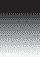
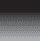
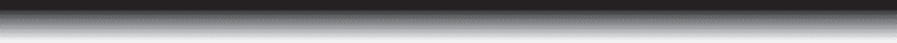
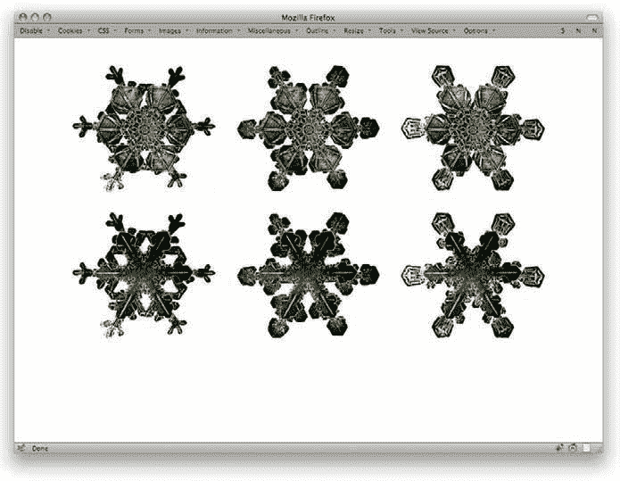
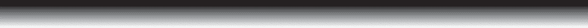
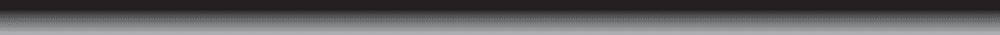
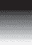
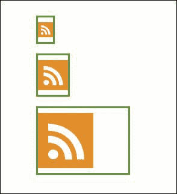
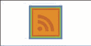

# Smashing CSS：现代布局专业技术

## BLISHER 的致谢

以下是对本书出版提供过帮助的人员：

### 编辑与制作

- 消费者与技术出版总监：Michelle Leete
- 图书内容管理副总：Martin Tribe
- 副出版经理：Chris Webb
- 出版助理：Ellie Scott
- 项目编辑：Brian Herrmann
- 文字校对：Debbye Butler
- 编辑经理：Jodi Jensen
- 高级项目编辑：Sara Shlaer
- 编辑助理：Leslie Saxman

### 营销

- 高级营销经理：Louise Breinholt
- 营销执行：Kate Parrett

### 排版服务

- 排字员：Jennifer Mayberry
- 校对员：Susan Hobbs
- 索引编制：Potomac Indexing, LLC

由 CJK 在美国印刷

Eric, Carolyn, and Rebecca

看起来就像我所有的梦想

## 关于作者

Eric Meyer 是 HTML、CSS 领域国际认可的专家，自 1993 年后期以来一直从事 Web 工作。他是 CSS Consulting 的创始人，其客户包括 On-Line、Apple、Adobe、Progressive Insurance、Sherwin-Williams 等；他是 microflow 的联合创始人；他与 Jeff Zeldman 共同创立了 Event Apart 联合创始人（这是一个为制作网站的人们举办的会议）。他是五本关于 CSS 和 HTML 畅销书的作者。

## 致谢

感谢 Chris Webb 邀请我加入，并耐心引导我度过了所有的挫折和跌倒。有些时候项目看起来可能会停滞，而每次 Chris 都会带着幽默感和无限耐心推动它前进。感谢 Debbye Butler 和 Brian Herrmann 在编辑过程中对我的帮助，并指出我偏入胡同、解释笨拙的地方，感谢每位继续阅读我写内容的人，无论是在纸质书还是网络上：感谢你们，数量远超我能列举的，更不用说。

A. Meyer

俄亥州克利夫兰高地

2010年8月

索引 269

## 引言

CSS 的成功是惊人的——其成功几乎不亚 HTML 本身——以至于有时让人难以捉摸。它现在无处不在，从 Web 浏览器到应用商店再到聊天客户端，没有任何褪色的迹象。随着这种语言的使用不断扩展，它的能力也在不断演进。

本书包含了近 100 个技巧、技术、工具和窍门，用于使用 CSS 制作出色的网站。每一部分内容都是独立的：你可以翻到随机任意一页，阅读你发现的内容，而无必担心漏掉了本章之前的某些关键内容。这意味着文本假设你至少对 CSS 及其用法有一定的程度的了解。假设的熟练程度最好被描述为“高级初学者到中级”。因此，如果你刚刚起步，或者你通常对 CSS 的了解比编写规范的人员还要多，那么你可能无法从书中获得太多益处。但对每个人来说，都有大量值得学习和享受的内容。

在书的第一部分，我们对实用工具和基础技术进行了概述，包括一些较为冷门的 CSS 选择器。第二部分介绍了你使用 CSS 可以完成的各种功能，包括有趣的特效、实现同一目标的不同路径、布局等。第三部分是高级的尖端技术，这些技术可能在本月还无法在你的项目中使用，但随着时间的推移，它们将成为你的工作中越来越核心。

请访问 `www.wiley.com/go/smashingcss` 下载示例样本。

十多年前，如果你认为 CSS 已经处于临终状态或许是可以被原的，但截至 2010 年，它比以往任何时候都更有活力和吸引力。我希望你像我喜欢编写这本书一样，喜欢书中发现的内容！

## 第一部分 基础知识

- 第一章：工具
- 第二章：选择器

# 第一章 工具

构建 Web 页面（或应用程序）的本质与任何其他事情一样，通过使用工具得到了极大提升。涉及到 CSS 时，既有帮助我们编写 CSS 的工具，也有构建帮助我们工具的工具。甚至还有某些工具可以让浏览器支持比其原生代码库能够承受更多的 CSS。你是一个构建者、工匠、制造者——本章详细介绍了一些将真正丰富你工具箱的内容。

Firebug（见图 1-1）是任何 Web 创作者工具箱中两个必不可少的工具之一。（对于 Chrome 用户，请跳至“Web 开发者”部分。）它是针对 Firefox 的完全免费工具。如果你使用其他浏览器，请继续阅读：访问 `getfirebug.com`。点击 Install 按钮（在本书期间它是免费的）并让它安装。重新启动 Firefox，准备好惊喜。事实上，单条技巧不足以涵盖 Firebug 的所有功能。

HTML 标签页（见图 1-2）在左侧显示文档结构。请注意，当你悬停在 HTML 标签页中的元素上时，该元素会在页面本身中高亮。这通过颜色编码包含了元素的内容区域、内边距（padding）和外边距（margins）。在本书期间，内容区域为浅蓝色，内边距为浅黄色，但颜色并不重要，重要的是你可以直接在页面上看到它们。

在 HTML 标签页的右侧，你可以点击 Style 标签（见图 1-3）查看应用于当前检查元素的 CSS。这不仅包含你编写的内容，还包含浏览器本身从内置样式表中应用的内容。如果你看到来自 `html.css` 或 `quirk.css` 的样式，例如那些是内置样式。这些被称为“UA 样式”，即用户代理样式（user agent styles）。你可以通过 Style 标签页的弹出菜单更改它们是否被应用。

需要注意的是，Firebug 有时会向你显示你未指定的属性，例如 `background-clip`。除非你确定显式声明了这些属性，否则你可以在很大程度上忽略它们。此外，如果你使用简写属性，它将展开为单独属性。也就是说，像这样的内容：`font: 1em "Andale Mono", "Courier New", Courier, monospace;`——在 Firebug 中将表示为：

- `family: "Andale Mono","Courier New", Courier, monospace;`
- `size: 1em;`
- `size-adjust: none;`
- `stretch: normal;`
- `style: normal;`
- `variant: normal;`
- `weight: normal;`
- `height: normal;`

当 Style 标签页完全生效时，Firebug 会拆分到单独窗口。这种表示方式并不一定是坏事——它确实提醒你，简写属性的内容往往比你实际描述的要多——起初可能会令人困惑。（关于简写属性的更多信息，请参见第 2 章。）

另一点需要注意的是，Style 标签页中显示的规则按**反向选择性**（reverse-specificity）列出——也就是说，第一个是应用于检查元素的特定具体的规则，下一个是次之具体的，依此类推。（关于选择性的更多信息，请通过通过右键点击任何元素并在弹出的上下文菜单中选择“检查元素”（Inspect Element）来查看“选择性”（Specificity）（见图 1-4）。你也可以点击 Firebug 图标旁边的小指针和箭头，以切换到检查模式。当你在页面上移动时，元素将显示轮廓，点击其中一个即可对其进行检查。点击任何声明左侧的复选框以通过 Firebug 禁用该声明。在尝试通过逐一关闭属性来测试属性之间如何相互作用时，这非常有用。如图 1-5 所示，当你将鼠标指针悬停在值上时，还可以看到一个显示相应颜色的小色块。

Computed 标签页（见图 1-6）显示元素的计算样式——这意味着它将向你显示浏览器为每个已知 CSS 属性应用的值，无论是否有人提到过它们。这种视图非常有用，例如当你想确切知道浏览器为标题提供了多少像素的行高（line-height）时。

Layout 标签页（见图 1-7）让你查看元素盒模型组件的精确维度和大小：高度、宽度、内边距、外边距等。这些内容以一种更酷的方式显示：当你悬停在面板中显示的框上时，像素尺会出现在原位，放置在元素外框边缘的顶部和左侧。正如图 1-8 所示，你可以通过在 Firebug 界面中的几乎任何地方点击或右键，编辑元素属性值（如元素内容本身、添加或编辑 CSS 属性和值以及更多内容）。

- 1-7：布局（Layout）标签页。
- 1-8：在样式（Style）标签页中即时编辑 CSS。

> 警告：当你在 Style 标签页中检查元素的 CSS 时，不会看到影响该元素的伪元素（pseudo-element）驱动的规则。例如，如果你有一个选择器 `p:first-letter`，当你检查一个 `p` 元素时，该规则不会出现。伪类（pseudo-classes）会显示，但伪元素不会。如果你正在使用涉及生成内容的清除浮（clearfix）解决方案，这可能会令人困恼（更多信息请参见第 4 页的“清除浮”）。

如果你正在使用 Firefox 进行开发，但想获得 Firebug 的核心功能，请访问 `firebug.com/lite.html`（如图 1-9 所示），并根据你的情况遵循 Internet Explorer、Opera 或 Safari 的说明。你可以将其链接到你正在测试的任何浏览器中，或将其作为书签脚本（bookmarklet）添加到书签栏（我推荐这样做）。

在 Internet Explorer 中运行的 Firebug Lite 并不像 Firefox 扩展那样功能全——这也是它被称为“Lite”版的原因——但它仍然非常强大且实用。

## 网页开发者工具栏

除了 Firebug，网页开发者工具栏（Web Developer Toolbar, WDT）是任何创作者工具箱中的另一个核心工具。它是完全免费的 Firefox 的完全免费扩展。要获取你的副本，请访问 `chrispederick.com/work/web-developer` 并安装。或者，你可以访问 `addons.mozilla.org`，搜索 Web Developer Toolbar，并从那里的 WDT 页面进行安装（见图 1-10）。

图 1-10：`addons.mozilla.org` 上的网页开发者工具栏页面。

通过 Firebug，我无法涵盖 WDT 能够完成的所有操作；事实上，用一整个章节都不够。这里是一些精选菜单的亮点，但当然，在安装 WDT 之后，你应该花时间探索所有可用的菜单和选项。

CSS 菜单可以禁用页面缓存，如果你正在进行大量微小更新且浏览器缓存变得“顽固”，这会很有用。你还可以关闭 JavaScript（见图 1-11），这对于发现当所有脚本功能失效或你的脚本框架未加载时页面会发生什么情况非常有帮助。

CSS 菜单中的样式由 Firebug 涵盖，但非常棒的一点是能够仅关闭嵌入样式、或仅关闭链接样式（如图 1-12 所示），或内联样式（不是说你不应该使用样式！）。如果你想看到一些奇异的效果，甚至可以杀死浏览器的内置样式。

信息（Information）菜单（图 1-13）包含许多有趣的冷知识，包括显示文档中的 ID 信息；页面 div 顺序的统计；页面中使用的颜色等。你还可以调用一个元素工具，让你点击任何元素来查看其属性和字体信息的摘要、其祖先和后代元素，它在提供的信息方面与 XRAY 非常相似；关于 XRAY 的更多信息请见后续。

图 1-12：通过 CSS 菜单禁用链接样式表。

图 1-13：通过信息菜单显示类名和 ID 值。

图 1-14 所示的轮廓（Outline）菜单允许你划分元素的类——所有的行、所有的链接、所有定位元素、所有表格单元等等——并设置自定义的元素集合和颜色。你还可以选择在勾勒时是否在页面上显示名称。这个菜单比初看起来要复杂得多。我将其视为“布局诊断菜单”，因为我勾勒一组元素是为了快速查看它们彼此之间的布局情况，以及可能出现问题的地方在哪里。

通过轮廓菜单对块级元素进行勾勒和识别可以让你快速访问许多验证器、错误检查器和调试器。不过，它最好的功能之一是存在验证本地 HTML（Validate Local HTML）和验证本地 CSS（Validate Local CSS）项目（见图 1-15）。在这两种情况下，你当前正在查看的页面会被封装成序列化字符串并发送给相应的验证器。因此，如果你验证本地 HTML，页面的标记将发送到 HTML 验证器并返回报告。这对于验证来自防火墙后、本地硬盘的页面非常有用——即那些不在公共网上、因此验证器服务无法访问的页面。有了本地验证，这不再是一个问题。

图 1-15：工具（Tools）菜单。

一旦进入 IE 开发者工具栏，你会在浏览器窗口处打开一个类似 Firebug 的面板，如图 1-17 所示。面板顶部还有一些网页开发者菜单。你可以点击面板右上角关闭按钮旁的小“双窗口”图标，将整个面板生成到独立的窗口中。以这种方式扩展面板，在笔记本电脑显示器和投影仪等演示设置中可能特别有价值。

***19***

图 1-17：IE 开发者工具栏演示。

工具栏的一个优秀特性是，你可以通过“显示默认样式值”（Show Default Style Values）复选框（图 1-18）轻松地在显示计算样式和仅显示样式之间切换。

同样，你可以使用“显示只读属性”（Show Read-Only Properties）来显示受影响元素 DOM（文档对象模型）属性的每一个细节。如果你不熟悉 JavaScript 和 DOM 脚本，那么这可能不适合你。（对我来说肯定也不适合。）

禁用了“显示默认样式”的 IE 开发者工具栏。

IE 开发者工具栏包含了 Web 开发者工具栏的部分功能，但最实用的功能（如勾轮元素、验证本地 HTML 和 CSS）出现在“元素”（Elements）层中。视图还有一个非常实用的入口叫做“CSS 选择器匹配”（CSS Selector matches）（见图 1-19）。

它会打开一个窗口，显示 CSS 中的所有规则，以及每个选择器匹配文档中元素的次数。任何显示“0 次匹配：”（0 match(es) for:）的规则都没有匹配页面，你应该考虑删除该规则。

***21***

图 1-19：选择器匹配报告。

IE 开发者工具栏内置了开发者工具，因此你不需要安装任何额外内容。文档是线上的，而且在编写本文时，它所在的 URL 比工具栏的 URL 稍微没那么难懂。所以，只需在你喜爱的搜索引擎中输入“Discovering Internet Explorer Developer Tools”，就能通过顶部搜索结果找到它。

要打开工具，请在 IE 的“工具”菜单中选择“开发者工具”（图 1-20 所示），或者按下键盘上的 F12。是的，就是这样。你得到的是与 IE 开发者工具栏非常的东西，换句话说，它是 Firebug 和 Web 开发者工具栏的混合体。标签大部分与 IE7 工具栏相同，但下方的标签更像 Firebug 而不是 IE7 工具栏。

IE8 中的开发者工具。

我个人觉得开发者工具的“样式”（Style）标签中令人困惑的一点是，样式的顺序对我来说并不符合逻辑。它显然不是按优先级排序的。列表确实显示了哪些声明被其他声明覆盖，但由于缺乏 Firebug 那种合理的排序，处理起来会更困难。

虽然工具栏和工具并没有涵盖 Web 开发者工具栏的所有功能，但它们非常有用，并且理应该是任何 Internet Explorer 安装程序的一部分，用于追踪其他奇异问题。

## AGONFLY（针对 OPERA）

如果你使用的开发浏览器是 Opera，那么你将想要使用 Dragonfly，这是一个内置在 Opera 9.5 及更高版本中的开发环境。访问 `opera/dragonfly` 获取更多信息。

***23***

要打开 Dragonfly，默认路径是下拉“工具”菜单，然后在“高级”（Advanced）下选择“开发者工具”。然而，你可以通过访问 `opera/dragonfly` 并找到安装链接来安装“调试”（Debug）菜单。安装完成后，就可以轻松打开 Dragonfly 以及该菜单中的若干功能了。无论哪种方式，你都可以按 Option+Command+I（Mac 用户）或 Option+Control+I（Windows 用户）来调它。一个异常情况是这个键盘快捷键不是切换键：如果 Dragonfly 已经打开，你无法用键盘关闭它。这时，你需要使用鼠标，或者使用 Command+W（Control+W）关闭它。如果 Dragonfly 在单独窗口中打开，这种方法效果很好。但如果 Dragonfly 停靠在浏览器窗口中，只有当你通过点击其内部内容使其获得焦点时，Command+W 才会关闭 Dragonfly。否则，它会关闭整个窗口。

调试菜单的另一个功能是它有直接指向 HTML、CSS 和其他配置的链接。另一个有趣的区域是“布局”（Layout）子菜单，它可以让你设置 Opera 的布局模式，如“模拟文本浏览器”和“显示结构元素”。甚至还有一个“怀旧”模式（图 1-22 所示），它会让任何 1980 年代计算领域的老兵感到暖心。

图 21：怀旧视图下的 Dragonfly 页面。

尽管 Dragonfly 的布局与 Firebug 非常相似，但仍有一些显著差异。首先，右侧的“样式”标签可以显示计算样式以及声明的样式（见图 1-23），并且每个分组都可以展开或收起。因为，你在这里看到的并不完全是声明的内容，简写属性被拆分成了单独的属性。一个很棒的细节是，如果你想查看属性，Dragonfly 会为你显示它们——至少在计算样式中。与 Firebug 的一个欢迎区别是，任何被覆盖的声明都会变灰，并在旁边带有橙黄色的 [overwritten] 文字（见图 24）。这会让界面变得杂乱，并且更难看到覆盖样式中的值。

***25***

图 23：使用“计算”分组的 Dragonfly。

图 24：“样式”标签中显示的被覆盖样式。

图 25：“布局”标签。

除了显示正在检查的元素的布局框尺寸外，它还会告诉你各种属性，如 `offsetTop` 和 `scrollLeft`。

### 计算样式

### 普通样式和布局分组

如果你正在寻找一个轻量级的跨浏览器元素检查器，那么图 1-29 所示的 XRAY 正合你的胃。它的功能范围非常有限，但只要你需要的正是有限范围，这种专注性实际上是它的优势所在。

## XRAY 页面

访问 `westciv.com/xray`，将巨大的 XRAY 框拖动到你的书签栏（或者如果你想隐藏它，可以拖到菜单栏中）。然后，每当你进入一个页面并想要检查某个元素时，调用 XRAY 并选择你感兴趣的元素即可。


如果你选择了一个元素，它会被高亮显示，并向所有方向显示尺寸信息，而图 1-30 所示的 XRAY 框将提供关于该元素在文档树中位置的额外信息、任何 ID 或类值以及一组核心 CSS 属性值。如果你选择继承层级下的任何元素，XRAY 将切换到检测该元素。若想在下次需要它之前移除 XRAY，只需点击框右上角的关闭按钮即可。

**运行中的 XRAY。**

另一个用途不同的工具是 MRI (`westciv.com/mri`)，它让你输入一个 CSS 选择器，然后显示页面上该选择器会选中哪些元素。

### SELECTORACLE

Selectoracle（见图 1-31）听起来像是一个数据库产品的广告。实际上，它是一个在线工具，可将有效的选择器翻译成类似于英语的内容。（该名称来自“Selector”和“Oracle”的组合。）

访问 `selector.theopalgroup.com/selectoracle`，输入一个或多个有效的 CSS 选择器，无论它们有多复杂。保持英语或切换语言到西班牙语，点击 Explain This! 按钮。你将获得输入的每个选择器的解释，例如：

`li:child(2n+3):not(:last-child)`

检查解释：

`li` 元素，它是一个从第三个元素开始的奇数子元素，并且是 `ul` 元素后代的子元素。

**1-31：Selectoracle 页面。**

### 诊断样式表

如果你希望浏览器在加载带有过时、损坏标记的页面时向你“尖叫”，你可以使用诊断样式表。通过诊断样式表，你可以快速获得视觉提示，明确页面页面标记在何处出了问题。诊断样式表的一个示例可以在 `css.com/tools/css/diagnostic` 找到（兼容 CSS3 和 IE7），类似的资源位于 `accessibility.org/site/2006/07/angry-text`。例如，诊断样式表中的一行代码是：

```
* {outline: 5px solid red;}
```

这会在任何带有 `style` 属性的元素周围加上一圈粗实线红框。你可以使用类似 `background-color: lime` 的内容进一步加强效果，真正突出重点。其核心思想是捕捉标记出现的地方（无论是通过 CMS 输入还是其他手段），这些验证无法捕捉的地方。考虑 JavaScript 链接的常见例子：`<a href="javascript:nextPage()">Next</a></a>`。问题在于对于 JavaScript 来说，该链接将没有任何作用。其 `href` 属性应该有某种非 JS 回退值（这适用于属性选择器；更多信息请见第 2 章中的“简单属性选择”）。

你如何使用诊断 CSS？你可以将其导入开发站的 CSS 中并在发布前移除，或者将其设置为浏览器中的用户样式表，以应用于你访问的任何页面。诊断样式表可以执行诸如此类操作：查找没有内容的元素、没有 `alt` 或 `title` 属性的页面以及空页面、查找带有无效 `scope` 值的表头，以及带有空 `title` 和 `href` 属性的链接。注意，此版本的属性选择器在 IE7 中无法工作。由于 `:not()` 伪类，该版本在 IE8 中无法工作。图 1-32 显示了此诊断 CSS 的测试页面。

```css
span:empty, p:empty, th:empty {padding: 0.5em; background: yellow;}
h1, h2, h3, h4 {outline: 5px solid red;}
*[id=""] {outline: 5px dotted red;}
[class=""] {border: 3px dotted red;}
input[type="text"] {border: 5px solid red;}
a[href=""] {outline: 3px dotted fuchsia;}
img[alt=""] {outline: 5px solid fuchsia;}
[summary=""] {outline: 5px solid red;}
[name=""] {outline: 3px dotted red;}
col, th[scope="row"] {border: none;}
t([title]) {border: 5px solid red;}
[style=""] {outline: 3px dotted red;}
[target=""] {background: lime;}
{background: fuchsia;}
```

“无样式”（但实际上经过了大量样式处理）文档。

应用了基础重置 CSS 的文档。

10/5/10 7:39 PM

10/5/10 7:39 PM

35

……的人使用这种方法，主要是因为它简单。但对其他人来说，问题在于这种方法会应用于文档中的所有元素，包括文本输入和选择框等表单元素。由于浏览器目前处理表单元素 CSS 的方式各不相同（有些完全不支持），这种“全元素”的方法意味着，在尝试让浏览器与重置样式保持一致时，表单的结果变得非常不一致。

人们开发了更复杂的重置方案。一个相当流行的重置可以在 `memeyer.com/eric/tools/css/reset` 找到。它的开头如下所示：

```css
*, body, div, span, applet, object, iframe,
h2, h3, h4, h5, h6, p, blockquote, pre,
bbr, acronym, address, big, cite, code,
dfn, em, font, img, ins, kbd, q, s, samp,
li, strike, strong, sub, sup, tt, var,
a, i, center,
dt, dd, ol, ul, li,
dset, form, label, legend,
em, caption, tbody, tfoot, thead, tr, th, td {
    margin: 0;
    padding: 0;
    border: 0;
    outline: 0;
    font-size: 100%;
    vertical-align: baseline;
}

body {
    line-height: 1;
}
```

这包含了大量的元素。之所以这样做是为了选中所有不是表单输入（`input`, `select`, `textarea`）的元素，并让它们以相似的方式运行。该规则显式地将 `margin`、`padding`、`border` 和 `outline` 设置为零，并强制所有元素使用相同的字体大小和文本垂直对齐。第二个规则将 `body` 元素设置为较小的行高，该值会被所有自 `body` 元素的后代元素继承。

`meyerweb` 重置中还有更多规则，包括移除列表项目符号以及 `blockquote` 和 `q` 元素周围由 CSS 生成的引号等。再次，其核心点是在编写让页面变好看的 CSS 之前，尽可能让所有浏览器处于同一基线上。

关于这一点，你可能会想：“等一下，这意味着我必须撤销我所做的一切了！我绝不希望页面行高为 1——那太拥挤了！而且我不想弄乱上标和下标的垂直对齐！”这些都是合理的顾虑。你需要做的是修改样式表以满足你的偏好。假设你总是从 1.4 的行高开始，以获得你的文本具有那种良好的透气感，只需修改重置样式中的那行：

```css
body {
    line-height: 1.4;
}
```

在这里，你可能还想添加标准的页面背景和使用你喜欢的 `body` 字体的文本：

```css
body {
    font: Helvetica, sans-serif;
    background: #ABAC;
    color: #444;
}
```

那个移除列表项目符号的规则——因为你知道你永远不想改变列表的缩进距离、段落之间的间距以及你对 `strong` 的样式化偏等等等等，你拥有的不再是一个重置样式表，而是一个**增强样式表**（booster stylesheet）。你正在进入你偏好的基线来对文档样式化，建立一个自定义的基础，你可以在此基础上构建任何项目。有了这个增强器，你可以在每个新项目中获得一个结果，使其成为每个最终样式表围绕的核心。

说认真的，IE9.js 可以让 IE5 到 IE8 在处理 CSS 和 HTML 方面表现得更像（截至本文写作时仍是如此）IE9。你可以在 `google.com/p/ie7-js` 找到它——是的，`ie7` 部分是正确的（参见图 1-35）。该项目最初是 IE7.js，当 IE8 和 IE9 出世时，新版本的 JavaScript 程序会通过页面的 CSS 和 HTML 检查浏览器是否为 Internet Explorer 的版本，并确定哪些部分不受支持。然后它会执行一系列复杂的变通方案让这种支持透明地发生。例如，IE5 和 IE6 不支持属性选择器。因此，如果你有一个像 `text-decoration: none; color: red;` 的规则，IE5 和 IE6 将完全忽略它，你的链接将保持原样。（虽然这会让 Jakob Nielsen 感到高兴，但该项目的设计者的印象会小得多。）不过，有了 IE9.js，这种复杂的脚本调度会设置好，让 IE5 和 IE6 能够对链接应用样式，从而*直接生效*（Just Works）。你只需要在任何需要的页面中链接到 IE9.js，就大功告成了。

当然，如果禁用了 JavaScript，这一切将不会产生任何影响，这意味着你必须权衡此脚本的益处与你对网站受众的预期。他们很多人使用 IE6 吗？他们可能禁用了 JavaScript 吗？等等。当然，这些都是我们在设计任何网站时必须权衡的问题，所以至少这是一个熟悉的流程。通常的使用建议是用条件注释包裹链接 IE9.js 的脚本元素，如下所示：

```html
<!--[if IE 9]>
<script src="/code/IE9.js" type="text/javascript"></script>
<![endif]-->
```

1-35: IE7.js 页面。

### 选择器

在某种意义上，选择器是 CSS 的核心。没有它们，我们无法无法为元素分配样式。通过赋予我们定位一组元素的能力，我们可以完成很多工作。在本章中，我们将深入探讨明智使用选择器的细节，并广泛介绍广泛支持和使用的选择器类型。

***41***

2-1: 放大 `h1` 的第一个字母。

...通过将句点改为冒号，从而产生 `li:first-child`，你无需在标记标记中到处撒满类名（`classes`）即可得到相同的结果。

你可能已经注意到了用于伪元素（pseudo-elements）的双冒号语法。这是在 CSS 2.1 之后引入的。截至本文写作，没有浏览器要求你在伪元素之前使用双冒号：单冒号也完全可以。

顺带一提，CSS3 添加了以下伪类（pseudo-classes），截至目前其中大多数尚未被广泛支持：

- `:target`

- `:root`

- `:nth-child()`

- `:nth-of-type()`

- `:nth-last-of-type()`

- `:first-of-type`

- `:last-of-type`

- `:only-of-type`

- `:only-child`

- `:last-child`

- `:empty`

- `:not()`

- `:enabled`

- `:disabled`

- `:checked`

### 带有样式的目标

`:target` 伪类对于指向文档内的片段标识符（fragment identifier）非常有用。你问那是什么？简单如下：

`<a href="http://example.com/law.html#sec2-7">第 2.7 节</a>`

点击该链接（如果浏览器处理正确）不仅会跳转到目标元素，还会落在页面上该片段标识符（即 `#sec2-7` 部分）所在的位置。

这有时通过锚点（anchor）来实现，但直接使用 ID 更好。这里的问题在于：虽然浏览器会跳转到文档中的该点，但并没有视觉提示告诉你你已经到达了那里。通过 `:target` 伪类，你可以提供一个提示。例如，如果你想为任何作为片段目标的 `h3` 提供特定的提示（见图 2-2），你可以这样写：

```css
h3:target {
  color: maroon;
  background: #FFA;
}
```

### 高亮显示目标元素

你可能只想将该样式应用到任何目标元素，无论它是什么，所以只需删掉 `h3` 部分并在前面添加一个通用选择器，如下：

```css
* {
  color: maroon;
  background: #FFA;
}
```

***43***

从技术上讲，在这种情况下通用选择器是可选的；你可以直接写 `:target`。

如果你想让目标样式更具 Web 2.0 感，可以设置一个动画，让页面背景的一部分从黄色变为白色，以告知你已经执行了某些操作。这种“你做到了”的效果可以通过 `:target` 和动态 GIF 轻松地实现。

```css
target {
  background: yellow;
}
```

只需创建一个从黄色到白色的平滑淡入动画（如果那是你网站的颜色），并将其作为背景图像使用：

```css
target {
  background: url(/pix/yellow-fade.gif);
}
```

### 优先级 (SPECIFICITY)

优先级（Specificity）很难快速口述，甚至更难彻底掌握，但它是理解 CSS 规则如何相互作用的关键。优先级是选择器“权重程度”的数值表示。用于确定选择器优先级的有三个部分：

- 每个元素描述符（element descriptor）贡献 0,0,0,1。

- 每个类名（class）、伪类（pseudo-class）或属性描述符（attribute descriptor）贡献 0,0,1,0。

- 每个 ID 描述符（ID descriptor）贡献 0,1,0,0。

不要惊慌（暂时不要）！来看几个例子：

| 选择器 | 优先级 |

| :--- | :--- |

| `ul li` | 0,0,0,2 |

| `.aside ul li` | 0,0,1,3 |

| `:hover` | 0,0,1,1 |

| `.navlinks:hover` | 0,0,2,2 |

| `title em` | 0,0,0,1 |

| `#title em` | 0,1,0,1 |

| `table tbody tr td` | 0,0,0,4 |

| `div ul li ol li` | 0,0,0,5 |

等等，让我根据文本逻辑重新计算一下：

- `ul li`: 2 个元素 = 0,0,0,2

- `.aside ul li`: 1 个类, 3 个元素 = 0,0,1,3

- `:hover`: 1 个伪类 = 0,0,1,1

- `.navlinks:hover`: 1 个类, 1 个伪类 = 0,0,2,2

- `title em`: 2 个元素 = 0,0,0,2

- `#title em`: 1 个 ID, 1 个元素 = 0,1,0,1

- `table tbody tr td`: 4 个元素 = 0,0,0,4

- `div ul li ol li`: 5 个元素 = 0,0,0,5

这让你开始对优先级值是如何构建的有了概念。现在，为什么要用逗号？逗号分隔符有助于保持清晰，否则选择器可能会被写成“10”和“13”，导致产生数字越高优先级越高的错误印象。

另一个常见的误解是，结构上的接近程度会影响优先级。例如，假设你写了：

```css
html {
  font-style: normal;
}

ul {
  font-style: italic;
}
```

哪一个胜？它们都有两个元素描述符，意味着优先级都是 0,0,0,2。因此，后写的胜出。

你可能在疑惑优先级表示中的第一个零是干什么的，考虑到我提到过元素会贡献优先级。那个第一个零用于内联样式（inline styles），且只有内联样式使用它。因此，给定下面的样式和标记，`div` 的背景将是蓝色：

```css
div {
  background: purple; /* 0,1,0,0 */
}
```

`<div id="header" style="background: blue;"> <!-- 1,0,0,0 --></div>`

## IMPORTANT

有一种可以覆盖优先级，那就是 `!important`。如果你是程序员，现在纠正一个误解：它并不意味着“不”。它的工作原理是你可以将任何单独声明标记为重要。这里有一个例子：

```css
a {
  color: red !important;
  text-decoration: none;
}
```

在这个例子中，`color: red` 被标记为重要，但 `text-decoration` 没有。你每一个想要标记为重要的声明都需要单独的声明。任何重要的声明都会覆盖任何非重要的声明，如此。给定如下，结果将是一个绿色的链接：

```css
a#home {
  color: red;
}

a {
  color: green !important;
}
```

***45***

## 当你省略简写值时会发生什么

你都熟悉简写属性：`background`、`border`、`font`、`margin` 和 `padding` 是最常用的。它们是一次性表达许多内容的简洁紧凑的方式。但如果你漏掉了其中某些内容会发生什么？考虑：

```css
strong {
  font: bold italic small-caps medium/1.2 Verdana, sans-serif;
}
```

将如图 2-3 所示，为 `strong` 元素产生加粗、斜体、小型大写、中号 Verdana 其他无衬线字体，行高为 1.2。

然而，假设我们将该值删减：

```css
strong {
  font: medium Verdana, sans-serif;
}
```

结果是中等大小的 Verdana（如果没有 Verdana，则使用其他无衬线字体）字重。加粗效果消失了（见图 2-4）。

这是当你省略了简写属性的某些值时，缺失的部分是对应属性的默认值。因此，通过省略字体字重、样式和变体，你实际上是在说：


```css
font: normal normal normal small/normal Verdana, sans-serif;
```

行高会被填充为默认值，这可以覆盖任何继承的行高。

不小心加粗。如果你不小心如何设置样式，就会变成问题。考虑使用两条规则，第一条来自全站样式表，第二条来自添加的样式。

```css
.page {
  background-color: #FCC;
  background-image: url(/i/pagebg.gif) 10px 25% no-repeat fixed;
}

body {
  background-image: url(i/body-bg.gif);
}
```

由于这两个规则，涉及的页面将有一张新图像从左上开始铺满整个背景，并在页面滚动时移动。这是因为显示的背景等同于以下代码：

```css
background: transparent url() 0 0 repeat scroll;
```

如果你想让这种情况发生，那么这就是做法。更可能的情况是你想用一张图像替换另一张。在这种情况下，你只需要设置特定的 `background-image`：

```css
background-image: url(i/body-bg.gif);
}
```

47

至少大多数简写属性都是这样工作的。例外是 `margin`、`padding`、`border-style`、`border-width` 和 `border-color`。在这些情况下，缺失的值是从提供的值中“复制”而的。这里是一些功能等效声明的列表：

- `margin: 1em; margin: 1em 1em 1em 1em;`
- `padding: 10px 25px; padding: 10px 25px 10px 25px;`
- `border-color: red green blue; border-color: red green blue green;`

当然，这些值的顺序是上-右-下-左，即 TRBL（这让你记住 TRouBLe/麻烦）。

## 选择性地覆盖简写属性

因为简写属性会填充未声明的默认值，但这并不意味着我们必须使用它们。事实上，用简写属性声明 80% 你想要的内容，然后在一个地方覆盖它以获取剩下的 20%，是非常有用的。

假设你正尝试获得一个宽度为三像素、点状、且三侧为黑色、第四侧为红色的边框（见图 2-5）。你可以一个侧一个地写，但那样会很重复。相反，你可以声明：

```css
border: 3px dotted black;
border-left-color: red;
```

通过这种方式，你只需要调整那一个与其余部分不同的小细节。更好的是，你可以在同一个规则内完成所有操作。

2-5：将边框的一侧变为红色。

选择性覆盖简写属性的常见示例是标题，除了字体大小外，它们有许多共同点。如果你对默认字体大小满意，那么你只需这样做：

```css
h1, h2, h3, h4, h5, h6 {
  font-weight: normal;
  font-style: italic;
  font-family: Helvetica, sans-serif;
  font-size: 1.5em;
}
```

另一方面，如果你将设置自己的标题大小，如图 2-6 所示，然后发现：

```css
h1, h2, h3, h4, h5, h6 {
  font: italic 100%/1.5 Helvetica, sans-serif;
}
h1 { font-size: 225%; }
h2 { font-size: 185%; }
h3 { font-size: 140%; }
```

当你进行这种选择性覆盖时，确保覆盖的内容与简写属性匹配是一个好主意。这样，如果（通常如此）选择器具有相同的优先级，覆盖将胜过简写属性。

使用选择性覆盖设置标题大小。

49

## 通用选择器

我将向你展示在选择器中使用星号符号（`*`）的用法。不要过度兴奋：它并不像你想象中那样是一个通配符。这里有一个基础示例：星号被称为通用选择器。它的作用是直接选择文档中的每个元素并将这些样式应用到它们。它看起来像通配符，在某种方面它确实是，因为你可以用它来选择大量元素而无需直接命名它们。例如，假设我想选择这个 `div` 内部的所有元素：

```html
<div>
  <h1>Hey ho!</h1>
  <p>paragraph</p>
  <ul>
    <li>One</li>
    <li>Two</li>
    <li>Drei</li>
  </ul>
</div>
```

只需简单写为：

```css
* {
  border: 1px solid red;
}
```

结果与我写以下内容完全相同：

```css
div h1, div p, div em, div ol, div li {
  border: 1px solid red;
}
```

几乎完全一样。视觉结果是相同的，如图 2-7 所示，但存在一个非常微小的差别，即在优先级上。你会发现，通用选择器的优先级贡献为 0,0,0,0。这意味着 `div` 的优先级是 0,0,0,1，而该分组选择器中的所有其他元素的优先级是 0,0,0,2。除此之外，结果是相同的。你可能希望这能让你用 `*` 来选择所有标题，而不是 `h1, h3, h4, h5, h6`。抱歉，不是的。它不是这样运作的。你可以像之前那样将它作为元素的通配符匹配。仅此而已。

任何有抱负的 Web 样式师面临的首个问题都是：我应该使用 `class` 还是 `id`？就像生活中的事情一样，这个问题有一个简单的答案，然后有一个更复杂的答案。简单的答案是：使用 `class` 用于任何可能在页面中出现一次的“标签”，使用 `id` 用于任何只会出现一次的内容。我所说的“标签”是指你可能附加到元素上的单词，这是 `class` 和 `id` 占占 44% 的情况。典型的 `id` 值示例是 `header` 和 `footer`，前提是任何页面只有一个 header 和 footer。`class` 值则分散得多，可以是从链接到更多信息，到任何导航选项卡，到表格中的每一行。复杂的答案不仅需要权衡标签的唯一性，还需要考虑 `id` 和 `class` 的优先级影响。由于包含 `id` 的选择器优先级高于仅包含 `class` 的选择器，你会遇到无法通过单一规则解决的情况。一个简单的示例。假设你在站点样式中写了：

```css
body { background: black; }
a { color: white; }
```

当你决定你的联系页面应该不那么令人生畏，所以你想让 `header a` 变成漂亮的浅灰色，让所有的导航链接 `a` 变成中灰色，你写道：

```css
.contact { background: #BBB; }
.contact a { color: #257000; }
```

不幸的是，头部的导航链接将保持白色，这归于 `header a` 更高的优先级，如图 2-8 所示。

2-8：头部不好看的链接。

可以通过这种方式来解决问题：

```css
header a, .navlinks a { color: #257000; }
```

甚至：

```css
header .navlinks a, .navlinks a { color: #257000; }
```

任何方法都有效，但它们看起来有点笨拙，不是吗？（虽然不像在 `.navlinks a` 规则上强加 `!important` 标签那么笨拙，但仍然如此。）处理这种情况的另一种方法是在标记中将包含 `header` 的 `id` 转换为 `class`。所以你有：

```html
class="header">
```

那么你就不必那么担心 ID 创建难以解决的优先级冲突了。

如图 2-9 所示。

active links in the header.

takes. So that’s a rationale for making most or all of your labels classes.

being repetitive. header is actually a great example, because it’s possible a page

multiple headers. If that seems weird, think of a news site or other portal. Every

and sidebar box could have its own little header—and, for that matter, footer.

em all consistently makes a lot of sense.

might well argue that those aren’t real headers and footers like those on a page—

dlines or additional information or what-have-you. That’s a semantic argument,

e that can be definitively resolved. What you call a topline, I might call a header.

any point to using id? Of course. There are situations where you can be certain a

ent will be unique within the page, and will never be duplicated. There are also

where you want the increased specificity an id selector confers, because it lets you

er selectors very easily. And ids can be crucial for scripting, link targeting, and

gs beyond CSS. You just have to use them with a bit of care when it comes to

ur CSS.

o an alternate way to address IDs that doesn’t carry the same concerns about

with it; see “ID vs. Attribute Selector" later in this chapter.)

## 使用 `class` 和 `id`

occasionally be situations where you have an element that is unique, and yet is part

r class of elements. For example, suppose you have a bunch of little panels in your

ar. Each one gets a box around it, and has a certain color and font combination, but

also unique in its own way, such as each getting a different background image.

such cases, you can associate both class and id with the elements, like so:

```html
class="panel" id="weather">
class="panel" id="stocks">
class="panel" id="latest">
```

n, in CSS, you can address each bit as needed.

```css
.panel {
  border: 1px solid silver;
  background: #EEE top left no-repeat;
  color: #333;
  font: x-small sans-serif;
}

.weather {
  background-image: url(/pix/panel-weather.jpg);
}

.stocks {
  background-image: url(/pix/panel-stocks.jpg);
}

.latest {
  background-image: url(/pix/panel-latest.jpg);
}
```

can even combine the two in a single selector, like so:

```css
.panel#weather { font-weight: bold; }
.latest.panel { color: #511; }
```

order you write them in doesn’t matter, as you can see there, and so doesn’t have to reflect

order you put them in the HTML.

## 多类选择

often-overlooked capability of the `class` attribute is that you can have a space-separated

of as many words as you like. In other words, you can attach multiple classes to an

ment.

In example, let’s take the markup from the preceding entry and modify it to use no `id`

tributes. It would look like this:

```html
<div class="panel weather">
<div class="panel stocks">
<div class="panel latest">
```

n the CSS would just need to be adjusted to deal with classes instead of IDs.

```css
.panel {
  border: 1px solid silver;
  background: #EEE top left no-repeat;
  color: #333;
  font: x-small sans-serif;
}

.weather {
  background-image: url(/pix/panel-weather.jpg);
}

.stocks {
  background-image: url(/pix/panel-stocks.jpg);
}

.latest {
  background-image: url(/pix/panel-latest.jpg);
}

.weather { font-weight: bold; }
.panel { color: #511; }
```

you write the classes in the HTML source doesn’t matter to the order you write

e style sheet; `.panel.weather` has exactly the same effect as `.weather.panel`.

ht down to the specificity, and no matter which order the two are listed in the

rce. It also doesn’t matter if they’re separated by other class names in the source,

```html
class="weather alert tornado watch panel">
```

nt will still be selected by both `.panel.weather` and `.weather.panel`.

y fading note of caution: IE6 (and earlier) gets confused by multiclassing in your

Where you write `.panel.weather`, it only sees `.weather`. You can still have

ass names in the HTML and address them from your CSS, but you can only do it

ame at a time. So `.weather` and `.panel` will work just fine in IE6, correctly

he example markup from before. It will just assume that `.weather.panel`

any element with a class value containing the word panel, which probably isn’t

want.

## 属性选择

selectors were introduced in CSS2 and expanded upon in CSS3, and are as of this

pported by all major browsers. (They were not supported in IE6; if that’s a concern,

tion "IE9.js" in Chapter 1.)

dea is that you can select based on having an attribute, or based on

ct of the value of an element’s. So you can select all

with an attribute. Therefore, it does not select

any element that lacks an attribute. For example:


`color: green;}`

这是屏幕显示的画面，见图 2-10。

在这一点上你可能在想：“嘿，太棒了。我一直想知道如何用更长、更复杂的语法来检测类。”啊，但记住：属性选择器并不限于我们习惯于选择的那两个不足道的属性——即`class`和`id`。你可以根据任何值可以是由空格分隔的单词列表的属性进行选择，这里我说的“单词”是指“字符字符串”。

这里有几种使用这种选择器的其他方式的示例：

- `img[alt~="figure"]`：任何备选文本包含“figure”一词的图像

- `table[summary~="data"]`：任何摘要文本包含“data”一词的表格

- `[title~="2009"]`：任何标题文本包含“2009”一词的元素

## 属性选择器 VS 选择器

你不仅可以将属性选择器作为替换类选择器的冗长方式，还可以将其用作 ID 选择器。以下两条规则将选择同一个元素：

```css
.lead-in {font-weight: bold;}
[id="lead-in"] {font-weight: normal; font-style: italic;}
```

等等，好吧，但请花时间考虑这两条规则的视觉结果：lead-in 图将既是加粗又是斜体的，如图 2-12 所示。

这是因为属性选择器的权重贡献是`0,0,1,0`——与类或伪类相同。因此，第一条规则的权重是`0,1,0,1`，第二条是`0,0,1,1`。在`font-weight`属性上，所示的第一条规则由于其更高的权重而胜出。

这是权重中那些有趣的小细节之一，它们可以为新的创作形式开启大门。例如，你可能记得之前在“ID vs. Class”章节中讨论过 ID 如何轻易击败类，因此你可能会考虑为所有内容标记上 ID 标签。如果你的用户群体都使用支持属性选择器的浏览器，那么你可以采用 ID 和类的混合，然后在每当引用 ID 时只需使用属性选择器即可。这样，你就不需要担心`#ID`选择器模式会覆盖你尝试编写的所有其他内容的权重了。

## 字符串属性选择

一旦完成，工作立即开始了 CSS 的下一个版本，我们可能会称其为 CSS3，尽管已经不再有单一的规范了。（这是一个很长的故事。）最受关注的问题是选择器，属性选择器也不例外。它们引入了一组子字符串匹配模式，所有模式都极其有用。

基础的是子字符串匹配器。为了看到它如何用的，请考虑一个旧示例。要选择指向该精确 URL 的任何链接，使用`a[href="http://w3.org/"]`。但是，假设你有许多指向 W3C 网站的链接，而不是首页，但你又想对它们应用相同的样式。

实现这一点的好方法是仅对 URL 中的`w3.org`部分进行选择（见图 2-13）。方法如下：

```css
a[href*="w3.org"] {font-weight: bold;}
```

这在图 2-13 中所示：选择所有 URL 中包含`w3.org`的链接。要这样做：只需在等号之前包含一个星号即可。不，这不是通配选择器。你可以在值中放置星号来创建 UNIX 或 grep 风格的通配符。始终，这可以用于任何元素和属性。回到唯一选择公司 Logo 图像的示例，你可以写：

```css
img[src*="mainlogo.png"]
```

这将选择任何指向名为`mainlogo.png`文件的`img`，或者实际上在`src`值中任何地方包含`mainlogo.png`字符的`img`。因此，它将同时选择以下两个：

```


```

不过可能不应该那样命名你的文件和目录。我的意思是，我只是随口说说。使用这种特殊力量有很多创造性的方法。你只需通过选择 URL 中对应于该目录的部分即可选择任何来自特定目录的图像。就此而言，你可以通过`href`值中出现的目录对所有进入特定区域的链接设置样式。

```css
a[href*="/contact"] {color: maroon;}
a[href*="/news"] {font-weight: bold;}
```

记住属性值应该被视为区分大小敏感的。（这样比较简单）。因此，你将在以下三个示例中的前两个中获得匹配，但不会匹配第三个：

```css
img[alt="Figure"] {border: 1px solid gray;}
```

```


```

没有匹配，因为“figure”不等于“Figure”。在这种情况下，当然可以看作是好事，因为（根据`alt`文本）第三张图像并不代表正式意义上的 figure（人物/图形）。它只是恰好在文本中包含了“figure”一词。

当你知道大小写仅会有这种差异时，可以这样解决这种限制。请注意，以下也会被规则匹配：

```

```

那个“Figure.”匹配了！

如果你想确保选中所有的“Figure”和“figure”，请使用以下选择器：

```css
[alt*="figure"] {border: 1px solid gray;}
```

这将匹配任何这些字符的实例，包括“configure”、“disfigure”、“figures”（仅举几个）。这并不是子字符串选择的终点——也不是开头，可以说。请查看下一节的解释。

## 子字符串属性选择

虽然任意属性值的子字符串匹配很棒（见前节），但有时需要将查找范围限制在属性值的开头或结尾。幸运的是，有方法可以这样做。

要根据属性值开头的子字符串进行选择，请使用：

`a[href^="http"]`

通过使用脱字符（^），该规则选择任何`href`以`http`开头的`a`。这是选择所有指向外部站点链接的方法，假设你所有的内部页面都是或站点相对路径，且你从未在网站文件系统中使用`http`字符串。你可以执行简单的操作：

```css
a[href^="http"] {font-weight: bold;}
```

**63**

css

```css
li {list-style-type: upper-alpha;}
```

2-16: 仅选择作为有序列表（ordered-list）元素的子列表项。

大于符号 `>` 将选择限制为`ol`元素的子元素。如果将其移除，它将应用于任何后代自`ol`的列表项，即使这些项是嵌套有序列表中的列表项（参见图 2-17）。

2-17: 让无序列表变为有序。

这种情况确实发生，而且不，我没有作弊。图 2-17 是一个带有有序列表标记的无序列表，之所以这样做仅仅是因为我移除了子元素组合器。

## 模拟部分子选择

如果你必须支持像 IE6 这样不支持子元素组合器的旧浏览器，并且你不愿意依赖 JavaScript 为这些浏览器添加支持（参见第 1 章中的“IE9.js”），你可以通过通用选择器来模拟子选择。

假设我们想为任何`id`为`main`的`div`的子元素`div`添加边框（参见图 2-18）。使用子元素组合器的方法是：

```css
div > div {border: 1px solid gray;}
```

我们如何在不使用子选择的情况下模拟这种效果呢？如下：

```css
div ~ div {border: 1px solid gray;}
div ~ div {border: 0;}
```

`~`规则选择任何后代自`main` `div`的任何元素的`div`。实际上，它抵消了第一条规则的效果。两者都适用于`div#main`的直接子元素`div`，并且两者都在设置边框，因此它们存在冲突。由于优先级相同，所以最后一个声明的规则获胜。`div#main`的`div`仅被这两个规则中的第一条选中，因此边框得以保留。

有一点必须非常牢：这种“伪造”的子选择技术对于非继承属性来说效果非常好。但对于继承属性，你可能会产生一些意外之外的副作用。例如，假设你写了：

```css
ul {font-weight: bold;}
li {font-weight: normal;}
```

假设你有这样一种情况：希望某个特定类的无序列表加粗（参见图 2-19）：

```css
ul {font-weight: bold;}
```

加上额外的规则后，这些无序列表中的列表项将……不会加粗。之前显示的`ol * li`规则直接应用于这些列表项。它分配的`font-weight`值`normal`覆盖了通常会从`ol`规则继承的`bold`值。

**65**

2-19: 继承的样式被直接赋值的样式覆盖。

如果你使用非继承属性（如`background`、`color`、`display`、`margin`、`padding`等），则不会出现这个问题。如果你不确定给定属性是否被继承，请参`w3.org/TR/CSS2/properties.html`或 CSS 规范中该属性的描述。

## 兄弟选择

除了能够根据父子关系和祖后关系进行选择外，还可以根据元素之间是否为兄弟关系来选择元素——即它们共享一个共同父元素。我们可以在图 2-20 中看到这一点，图中兄弟元素被高亮显示了。

2-20: 高亮显示的兄弟元素。

像列表项这样的元素是显而易见的兄弟，但任何共享共同父元素的元素集合都是兄弟元素。

`+`符号定义了一个组合器，允许你根据其前一个兄弟元素来选择元素。例如，如果你想移除紧跟在`h1`之后的任何段落的顶部外边距（参见图 2-21），只需简单地写：

```css
h1 + p {margin-top: 0;}
```

`~`组合器是为某些元素组合设置样式极极方法，例如紧跟在表格或标题之后的列表之间的空间。`~`组合器允许选择跟随其但并非紧随其后的兄弟元素。例如：

```css
h2 ~ ul {list-style-type: lower-alpha;}
```

如果这些元素共享同一个父元素（`body`），那么它们都是兄弟元素。第一个列表并没有紧跟在`h1`之后，因此不会被`h1 ~ ul`选中。其余的，即使之间有其他元素，也会被选中。

## 生成内容

CSS 模糊了内容与表现之间的通常界限，它提供了一种生成内容并将其插入文档的方法。这是通过使用伪元素`:before`和`:after`以及`content`属性实现的。这里有一个生成内容的示例示例（图 2-22 所示），在任何列表项的文本前面放置一点内容：

```css
li:before {content: "Item: "; border-bottom: 1px solid gray;}
```

注意，`content`值内部的空格将作为值字符串的一部分插入。如果那里有空格，元素文本将更靠近生成的内容，除非对生成的内容应用了右侧内边距（padding）（这是完全可能的；我们只是在在这里没有这样做）。

清楚了，你只能插入文本，不能插入结构。如果你尝试在`content`值中放入标记语言（markup），它将作为原始文本传递到页面（参见图 2-23）。

```css
li:before {content: "<em>Item:</em> "; border-bottom: 1px solid gray;}
```

另一方面，你可以插入浏览器能够支持的任何字符字形。你只需要知道它的十六进制字符数字。在它前面加一个反斜杠（也称为“转义符”），就就定定了。

```css
li:before {content: "\2012 "; border-bottom: 1px solid gray;}
```

你也可以通过直接在 CSS 中输入 Unicode 字符并提供具有完整 Unicode 支持的样式表来插入任何 Unicode 字符。然而，这可能会与未配置为发送 ASCII 以上内容的服务器产生问题。如果你能解决这类问题，就可以使用转义十六的方法并直接使用字符。不过，要在可能无法优雅处理 Unicode 的旧浏览器中进行彻底测试。

`:before`和`:after`之所以是伪元素，是因为它们插入元素就像封装在元素中一样。这个伪元素放置在元素内容的开头或结尾，取决于你使用了哪种伪元素。你可以像对相同位置的`span`元素一样对其设置样式。

生成内容有很多有趣的地方，但你必须对“生成”保持谨慎。如果 CSS 没有加载或不受支持（例如在移动设备上），你的页面会怎样？如果你使用生成内容来插入对阅读页面至关重要的内容，那么当内容没有生成时，可能会遇到真正的麻烦。强烈建议你仅将生成内容用于“激进增强”（aggressive enhancement），即使用高级功能添加你可以无视的增强。

一个很好的示例是将超链接 URL 插入到页面的打印副本中（见 3-2）。要实现这一点，请在你的打印媒体样式表中添加以下规则：

```css
a[href]:after {content: " [" attr(href) "]"; font-size: smaller;}
```

2-25: 在打印样式中插入 URL。

这被视为一种渐进增强，因为在不支持该功能的浏览器中，打印页面只会显示链接而没有生成的 URL，就像它们一直一常做的那样。而在能够支持的情况下，打印页面得到了显著的增强。（关于此技术的更多信息，请参阅`http://alistapart.com/articles/goingtoprint`中的“Going To Print”。）

对生成内容的支持相当广泛，但直到 IE8 发布才触及 Internet Explorer。你可以随时使用 IE9.js（见第 1 章）为旧版本的 Explorer 植入支持。

## 核心内容
第 3 章：技巧
第 4 章：布局
第 5 章：效果

## 章节技巧
### 献智者的几句老话

**可以**使用一些好的技巧在极短时间内搞定一切。

我最喜欢的两个技巧是“总是住在风景好的街道上，而不是繁忙的街道上”以及“不要吃铅”。而且

在本章中，我们讨论了值的顺序的重要性、无单位值的正确用法、让元素消失的方法、控制边框外观的方法、列表技巧、打印样式开发以及更多内容。

这些！

对你来说可能已经**老掉牙**了。你可能会奇怪，为什么我要在如此显而易见的话题上浪费墨水。然而，你实际上多久验证一次呢？是在项目结束时，还是贯穿始终？

我并不是让你每次在正在构建的文档上点击“保存”时都进行验证，但养成在开发过程中定期进行验证的习惯是一个好主意。这样，你就能在问题感染整个页面之前捕获它们。

目前针对 HTML 和 CSS 都有一些非常好的验证器。在 HTML 领域，最广泛使用的验证器是由 W3C 提供的，位于`validator.w3.org`（见图 3-1）。它以 CSS 为核心的兄弟版本位于`jigsaw.w3.org/validator/`，同样受欢迎。

W3C 的 HTML 验证器。

如果你被困在防火墙后开发，或者在笔记本电脑上进行所有开发而没有运行 Web 服务器？那么使用 Firebug 以及其他工具中的“验证本地（Validate local）”功能。只要你能浏览网页，就可以验证你正在查看任何页面，无论该页面是否可以被公开浏览。（即使页面在公共网站上，我几乎一直都使用“验证本地”，只是为了养成本地验证的习惯。）

### 字体值的排序

这是 CSS 的小怪癖之一，许多人都会在这里绊壳，有时会纳闷是什么难倒了他们。大多数接受多个关键字的属性允许你以基本上任何顺序列出它们，并不要求你包含其中的每一个。（例如，`background`允许你指定从一到五个关键字，并且不在乎你如何排列它们。）

少数例外之一是`font`，它不仅有一组最少的必需关键字，而且要求特定的顺序。你可以拥有的最基础的字体声明是：

```css
font: 100% 16px sans-serif;
```

当然，你会用实际值替换这些括号内的术语，例如：

```css
font: bold 100% sans-serif;
```

关键点在于，你必须包含这两个值，并且它们必须按照该顺序——大小，后是字体。如果你反转了它们，或者漏掉其中一个，任何现代浏览器都会直接忽略整个声明。此外，如果你在声明中包含其他关键字，它们所有（除了一个，它是下一节的主题）都必须排在必需值之前。

```css
font: bold italic 100% sans-serif;
: italic small-caps 125% Georgia, serif;
: bold small-caps 200% Arial, sans-serif;
```

大小之前的那些值可以随意乱排，这并不重要。重点是它们必须都在大小之前。如果把它们放在后面，浏览器将再次忽略该声明。

我以为上一节的字体值模式有点奇怪，但从这里开始我们就变得非常诡异了。我说过为了获得最少的字体值，“你必须包含这两个值，它们必须按照该顺序——大小，后是字体。”这是真的，但恰好你可以放置一个可选的行高（`line-height`）值作为大小的一种附属值（见图 3-4）。它看起来像这样：

```css
font: 100%/2.5 Helvetica, sans-serif;
```

### 值

`line-height`可以接受无单位数字值。你也可以给`line-height`继承值，尽管通常你不应该这样做。区别在于？当你定义一个带单位的值时（如`1em`或`100%`），你是在设置将计算结果传递给任何后代元素。例如，假设 CSS 应用于包含以下标记的文档：

```html
li {font-size: 15px; line-height: 1em;}
li {font-size: 80%;}<li><small>small text</small></li>
```


`li`元素的`line-height`被计算为15px，因为对于`line-height`，基于单位的值是使用元素本身的计算`font-size`作为百分比值来计算的。由于我直接声明了`font-size`，我们知道它以像素为单位的计算值。

这里可能是令人惊讶的部分：15px的计算值是传递给后代元素的。换句话说，`li`和`small`元素将继承15px的`line-height`值。就此结束。它们不会根据自己的`font-size`改变它；它们完全不改变。它们只是获取那15px并使用它，就像我写了下面一样：

```css
li {font-size: 15px; line-height: 1em;}
li {font-size: 10px; line-height: 15px;}
li {font-size: 80%; line-height: 15px;}
```

现在，假设我去掉了该`line-height`值中的`em`，使得样式变为：

```css
li {font-size: 15px; line-height: 1;}
li {font-size: 10px;}
li {font-size: 80%;}
```

```html
<li>I’m a list item with <small>small text</small></li>
```

现在传递给后代元素（`li`和`small`元素）的是那个原始数字，这些后代元素使用该数字作为缩放因子——如果说是乘数——以及计算结果。

所有继承该`1`值的元素都会获取该值并与其计算出的`font-size`相乘。声明为`font-size: 10px`的列表项，其计算出的`line-height`将为10px。然后它将该`1`传递给`small`元素，该元素将其与其计算出的`font-size`相乘。那是8像素；因此，它的计算`line-height`也是8像素。

这是一个相当差异（见图3-3）。这就是为什么如果你要设置`line-height`，我们总是强烈建议使用无单位数字，无论设置在像`li`或`body`这样的元素上，还是在任何将拥有后代元素的元素上。

带单位行高与无单位行高值的区别。

## 无样式的边框值

边框为任何设计增添了亮点，但如果没有样式，你想要创建的边框将不会生效。

我所说的“无样式”不是指CSS样式，而是指`border-style`值。假设你写了：

```css
p {border: 2px gray;}
```

那么你的表单周围就不会有任何边框。原因很简单：`border-style`值意味着`border-style`的默认值——那个默认值是什么呢？`none`。因此，前面的规则完全等同于：

```css
p {border: 2px gray none;}
```

只要`border-style`为`none`，无论你将`border-width`设置得多大，都不会绘制——因为不存在的边框无法拥有宽度。

## 带有颜色的滚轮边框外观

你可能会发现自己需要（或仅仅是想要）创建一个内凹边框（`inset`）。我不是来评价的，但我在这里指出一个可能的陷阱。考虑一下：

```css
div {border: 5px red outset;}
```

呃，对吧？但看看它在不同浏览器中是如何处理的（见图3-4）。

3-4：不同浏览器之间内凹（`inset`）和外凸（`outset`）的差异。

这不是错误，没有任何浏览器是错误的。CSS规范并没有说明应该如何修改边框颜色来创建内凹或外凸的错觉。它是这样说的，我直接引述：

*为`groove`、`ridge`、`inset`和`outset`值绘制的边框颜色取决于元素的边框颜色属性，但UA（用户代理）可以选择它们自己的算法来计算实际使用的颜色（[www.w3.org/TR/CSS21/box.html#border-style-properties）。*

最后一部分：“UAs [用户代理]可以选择它们自己的算法……” 这是Web开发中一个经久公认的真理：如果有机会选择不同的方案，浏览器总是会这样做。而它们也确实如此。

如果你对这些边框的差异觉得无所谓，那也很好；再次强调，我不是来评价你的。但如果你希望这些边框阴影在不同浏览器中保持一致（如图3-5所示），那么你真正想要的是声明一个实边框并自己设置颜色：

```css
div {border-color: #800 #F88 #F88 #800;}
div {border-color: #F88 #800 #800 #F88;}
```

使用带颜色的实边框获得一致的内凹和外凸边框是困难的。这仅适用于内凹和外凸边框。要创建颜色一致的`groove`和`ridge`边框（见图3-6），你需要为元素包裹一个容器（或直接复制元素），用特定的颜色对每个元素的实边框进行样式设置，以创建你想要的效果。如下：

```html
<div class="wrap">
  <div style="border: 3px solid; border-color: #800 #F88 #F88 #800;">...</div>
  <div style="border: 3px solid; border-color: #F88 #800 #800 #F88;">...</div>
</div>
```

（见图3-6中一致的`ridged`边框）。

## 隐藏元素显示

如何让一个元素从页面上消失，而不实际上将其从文档源中移除？有几种方法可以实现，每种都有其优缺点。接下来的章节将讨论各种方法。

让元素消失最明显的方法是关闭它的显示。

```css
div {display: none;}
```

这意味着任何元素都不会生成任何盒子。因此，它对任何其他元素的布局都不会产生影响。它就像从未存在过一样。不过，`display: none`有两个陷阱——一个是潜在的，另一个是持续性的问题：如果你通过JavaScript直接设置了`none`值，那么你该如何取消设置呢？这比看起来的要复杂得多。假设你写了：

```javascript
obj = document.getElementById('linker');
obj.style.display = 'none';
```

稍后在JS中，你想再次显示该元素。你给它赋什么值？这取决于元素：如果它是`span`，你可能希望它是`inline`的；如果是`div`，你可能希望它是`block`的。（尽管如此，也许并不一定：你可以很容易地让`span`和`div`生成盒子。）有一个相当常见的解决方案：什么值都不赋：

```javascript
obj.style.display = '';
```

这将导致元素回退到CSS其他部分调用的任何`display`值，或者取决于浏览器的内置样式。另一种常见的解决方案是不直接设置`display`值，而是给元素添加一个类，例如`hide`。当你想要再次显示它时，只需移除该类即可。这稍微复杂一点，因为需要你编写（或找到）能够添加或移除类值的JavaScript，但这是一个非常可行的解决方案。

持续性的问题是（截至本文写作时），`display`为`none`的元素不会被绝大多数辅助技术（如屏幕阅读器）看到。由于元素没有渲染到屏幕上，阅读器就找不到它，因此就不会读取它。这通常正是人们想要的，但在其他时候，这恰恰不是想要的。例如，假设你的页面中有辅助性链接（通常称为“跳过链接”）。你希望使用屏幕阅读器的人能看到这些链接以便跳转，但你不希望它们出现在屏幕上干扰视力用户。如果你将它们的容器设置为`display: none`，那么它们对所有人都消失了。需要它们的人也听不到它们。

## 隐藏元素可见性

与抑制元素的显示类似，你可以通过声明其为隐藏来将其可见性降为零。

```css
visibility: hidden;
```

这使得元素变得不可见，听起来和没有显示非常相似。但关键区别在于：设置为`visibility: hidden`的元素仍然留在页面布局中，如图3-7所示。占据了空间，不可见的元素有什么用？鼠标用户无法与之交互，无法通过键盘访问，你也根本看不到它。那么为什么要这么费劲呢？对于已经不参与布局的绝对定位元素，你可以在隐藏和可见之间切换它们，而不影响页面布局。作为额外奖励，你避免了显示部分中提到的潜在问题。

## 将元素抛到屏幕外

你想向视觉用户隐藏一个元素，但让它对屏幕阅读器可用。如何做到？这里有一种方法：

```css
position: absolute; top: -10000em; left: -10000em;
```

这样做之后，第三段（在图3-7中创建了大空白区域的段落）基本上从页面上移除了，如图3-8所示。这样做会将元素从视觉上移除，然而它仍然会被某些屏幕阅读器读取。这就是为什么这种技术通常被认为是隐藏元素的较差方案。

话虽如此，你将元素的左上角放置在第10,000个位置，即该元素字体大小的一万倍——位于该元素包含块边界的上方和左侧10,000 em处。在很多情况下，那里就是根元素。在其他情况下，它可能是文档中的另一个元素。无论哪种情况，鉴于上述样式，它将变得非常远、非常远，处于视线之外。

回到这里，你有几个选择。如果你想让它进行绝对定位，那么只需要设置它的`top`和`left`将其放置在你想要的地方即可。就像这样：

```css
top: 0; left: 0;
```

另一方面，如果你想让它回到文档的正常流中，可以将定位设为CSS默认值：

```css
position: static;
```

通过这种方法，你就不需要重置`top`和`left`的值，因为在布局静态定位的元素时，这些属性会被完全忽略。无论你是否重置它们，都没有区别。

如果你想让元素回到正常流中，但又作为它所包含元素的包含块，那么`position`就会派上用场。如果你对要带回屏幕的元素内部的元素进行绝对定位，就会出现这种情况。例如，你可以让该元素为相对定位，但你必须声明：

```css
position: relative; top: 0; left: 0;
```

如果你漏掉了`top: 0; left: 0;`部分，那么该元素将相对于它在正常流中的位置发生偏移。这会在页面上留下一个洞，如果它没有被向上和向左移动10,000 em的话，它本在那里显示。当然，你在这里不需要恰好使用10,000 em。你可以使用任何喜欢的数字——在某些非常旧的浏览器中使用5，在Safari 3中是16777271，在其他浏览器中是2147483647。你可以使用任何有效的CSS测量单位，从em到像素、pica再到英寸。关键是使用一个极大的数字，这样在你需要它之前，它基本上没有机会可见。

## 图像替换 (IMAGE REPLACEMENT)

CSS中运行最久的设计技巧之一是图像替换。这种技术允许你使用图像来代替文本，但文本对于打印、可访问性等仍然可用。图像替换（IR）通常用于较小的、受限的应用，例如公司标志、页面标题（见图3-9）等。它不适合替换整个段落。

10/5/10 7:46 PM
10/5/10 7:46 PM

最流行的IR技术被各种称为Phar方法或Rundle方法。（这流行程度有多大？人们甚至为它制作了T恤。）基本上，你做的是通过使用负的文本缩进将文本向左侧甩到非常远的地方：

```css
height: 140px; text-indent: -9999px;
background: url(page-header.gif);
```

3-9：使用图像替换的标题。

这在许多方面与使用绝对定位将整个元素隐藏在屏幕外的技巧相似。在这里，我们是将元素的文本内容隐藏在屏幕外的很远处，而实际上并没有将元素框移动到任何地方。

幸运的是，背景图像几乎不会被打印。虽然有打印的选项，但默认是不打印背景，而且几乎没有人会更改它。因此，在打印样式中（更多信息请见下一节），你可以简单地说：

```css
text-indent: 0; background: none;
```

`background: none`实际上只是一个预防措施——几乎没有人开启过背景打印。尽管如此，万一他们开启了，这也会防止`h1`文本在背景图像上打印。

10/5/10 7:46 PM
10/5/10 7:46 PM

这种替换失效的边缘情况是用户使用的浏览器禁用了CSS图像显示，或者更常见的，如果图像由于某些原因未能加载，标题将直接消失（如图3-10所示），而不会被背景图像替换。大约有十余种不同的图像替换技术，每种技术都有其处理问题的方法。有些方法涉及将元素内容封装在`span`中并将其`display`设置为离屏；另一些方法要求你添加一个额外的图像作为背景。这里有一个值得提一下的技术：在内容中使用图像。例如：

```html
<h1></h1>
```

图像将同时显示在屏幕和打印中，因为浏览器确实会打印。它对屏幕阅读器也非常友好，因为阅读器知道使用`alt`文本。不过，如果用户抑制了图像加载，这种方法再次失效，但在图像启用但加载失败的情况下，文本应该显示在图像的位置。

10/5/10 7:46 PM
10/5/10 7:46 PM

## 打印样式 (PRINT STYLES)

如果你还没有为打印创建样式，现在可能是考虑它的好时机。即使你希望你的网站在页面上和屏幕上看起来基本相同，你仍然可以利用机会针对可能输出的、无背景颜色的灰度输出来优化颜色对比度。这很容易。你可以通过三种方式将它们与页面关联：

- `<style type="text/css" media="print">...</style>`
- `<link type="text/css" rel="stylesheet" media="print" href="print.css">`
- `@import url(print.css) print;`

大多数人都使用`link`方式。这是因为在每个页面中嵌入样式表很麻烦，而且在每个页面中导入样式表也很麻烦。此外，针对打印的导入样式表在很一段时间内存在浏览器Bug。打印样式表本身是你处理诸如取消图像替换效果（见前一节）的地方。

***89***

3-11: 在浏览器中预览打印样式。

玩转`display`属性是在HTML标记上进行有趣布局的基石之一。在本牌组中，最好的技巧之一是让超链接（通常创建内联框，`inline box`）可以生成一个块级框（`block-level box`）。

为了理解为什么，请考虑页面侧边栏中的链接列表。这些可能都是有序列表，每个列表项目一个链接，或者具有非常相似的结构。事实上，考虑两组相同的链接列表。唯一的区别是，其中一个列表具有块级链接，而另一个不是（见图3-12）。我们将为链接设置背景以使区别一目易见。

3-12: 两个链接列表——一个是块级的，另一个不是。

内联链接对用户友好性低得多——可点击区域较小。因此，如果我们想寻找链接上的悬停效果，内联链接只会在文本背后“亮起”，而不是整个框。

制作块级链接其实非常简单：

```css
a {display: block;}
```

我之前需要将块级框链接放入图3-12。当一个元素生成块框时，它的行为与通常由段落、`div`等生成的框完全相同——因为它是完全同类型的框。你可以给它设置外边距（`margins`）以及所有其他属性。

## 外边距还是内边距？

你是否考虑过——我是说，真的考虑过——列表的缩进？或者默认环绕页的“间隙”（`gutter`）？如果是，你是否考虑过它们是如何创建的？事实证明，并没有通用的正确答案。

对于初学者来说，页面内容周围的空间。大多数人所知，有一些空间将页面内容与浏览器窗口边缘隔离开。如图3-13所示，你可以通过重置样式移除该空间，或者通过对`body`本身进行样式。但你应该如何设置样式？是移除外边距还是移除内边距？为了兼容各种浏览器，答案是两者都有。这是因为大多数浏览器会使用8像素的外边距来创建间隙，Opera除外，它使用的是8像素的内边距。

如果你开始查询古老的挪威诅咒，就会发现没有人能够消除所有已知浏览器中的间隙。没有规范规定具体的如何创建间隙（甚至没有规定必须有一个）。有一个强有力的理由认为内边距是更好的选择。不过这并不重要，因为浏览器之间对此存在分歧：

```css
body {padding: 0; margin: 0;}
```

3-13: 文档内容周围“间隙”的特写。

同样，列表缩进（无论是有序还是无序）是通过左外边距或内边距实现的，取决于浏览器。因此，如果你声明以下内容：

```css
ol {margin-left: 0;}
```

你将在移除某些而非所有浏览器中的列表缩进。如果你想在浏览器间保持一致，你还需要移除内边距。当然，你不局限于移除缩进。一旦你习惯了使用左外边距和内边距来更改列表缩进，你就可以决定哪种最有效。也许你认为所有浏览器都应该使用内边距来缩进列表，那么：

```css
ol {margin-left: 0; padding-left: 2.5em;}
```

也许你想要折中求其次：

```css
ol {margin-left: 1.25em; padding-left: 1.25em;}
```

如果你习惯于使用外边距而不使用内边距，那么这就是你的菜：

```css
ol {margin-left: 2.5em; padding-left: 0;}
```


如果你为列表分配了背景，那么怎么做其实并不重要。这时它突然变得重要了（见图3-14）。这在很大程度上是因为列表符号、正方形、字母等被放置在每个列表项目的一侧，并在那里进行绝对定位。（它们实际上并没有使用绝对定位，但效果非常非常相似。）所以它们会悬在列表的左侧内边距或外边距上。如果你让它们出现在可见背景的“内部”，你就希望通过内边距完成缩进。如果你想让它们悬在背景之外，请使用外边距。

图3-14：列表缩进技术的比较。

### 列表悬悬

我们刚才在讨论列表缩进，现在又在讨论悬悬（outdentation）？这是一个词吗？也许不是，但它比“悬挂缩进”好。我在这里说的是让列表项目的第一行悬挂在其他部分左侧的技术（见图3-15）。它是有效的，因为它让你能够区分不同的列表项目，而不需要用符号或各种杂乱的东西弄乱。这样做也很容易：

```css
li {indent: -2em; list-style: none;}
```

图3-15：悬悬。

就是这样。注意，我确保在那里包含了`list-style: none;`。如果我没加，每个列表项目的行都会悬悬，文本将与符号重叠。所以不要将悬悬与列表标记混合使用。当然，你可以悬悬任何内容，从段落到标题、从`div`、`pre`再到表格。只是在列表中最为常见。

### 为列表添加符号

有很多方法可以给列表添加符号。最简单但不精确的方法是使用CSS内置的列表样式属性。假设我们有一个距离地球最近的恒星列表，我们希望每个项目都有一个小符号，而不是圆圈、圆或正方形（见图3-16）。

```css
stars {list-style-image: url(star.gif);}
```

图3-16：更改标记颜色。

这里的潜在缺点是你无法控制标记的颜色。为了让标记颜色不同，你必须封装每个列表项目的内容——使用一个`div`或`span`。（注：此处原文逻辑有缺失，已根据上下文重构）。

要设置标记样式：

```html
<ol>
  <li><div>the Sun</div></li>
  <li><div>65 Centauri (Proxima Centauri)</div></li>
  <li><div>Alpha Centauri A</div></li>
</ol>
```

```css
li {color: red;}
div {color: black;}
```

### 背景符号

你想想要设置自定义的图像列表标记，但你不满足于让浏览器随心所欲地放置它。没关系：只需关闭列表标记，并将你的图像放入列表项目的背景中（见图3-18）。

```css
ol {list-style: none;}
li {background: url(star.gif) 0 0.1em no-repeat; padding-left: 16px;}
```

让我们来看看背景。

你可以将图像放置在背景的任何位置，这比那种老旧的列表样式图片要灵活得多。你确实需要记得添加一些内边距（padding），当然，还要加上它——否则元素内容将显示在背景之上！

如果你想让图像与文本的第一行对齐，这需要一点技巧，而且绝对无法保证与（例如）第一行文本的基线（baseline）实现像素级的对齐。你可以做到非常接近，在很多情况下也会处于正确的位置，但这永远不是百分之百确定的。在这种情况下，你必须接受潜在的缺陷，或者尝试不同的方法。

如果这种特殊的方法是你不受限于文本的第一行呢？那么你就可以让标记相对于整个列表项目进行垂直居中，即使它跨越了多行。结合图3-19所示的中间边框，这可以形成一种视觉效果。

图3-19：垂直居中的背景标记。

如果你想为特定类型的列表项目置入不同的变体标记（参见图3-20），这只需要为列表项目添加类并引入新图像即可简单。

```css
.stars {list-style: none;}
.stars li {
  background: 0 0 0.1em no-repeat;
  padding-left: 16px;
}
.stars li.m { background-image: url(star-m.gif); }
.stars li.k { background-image: url(star-k.gif); }
```

```html
<ul class="stars">
  <li class="g">太阳</li>
  <li class="m">半马座V645（比邻星）</li>
  <li class="g">半人马阿尔法星A</li>
  <li class="k">半人马阿尔法星B</li>
</ul>
```

这种方法的缺点是，由于图像位于背景，大多数用户打印时不会显示它们。因此，你可能需要在打印样式表或类似的地方中声明普通的列表标记。

### 符号标记

有一种更高级的方法来创建自定义的列表标记，尽管它兼容旧版本的浏览器。在这种方法中，你将悬挂缩进（out-denting）与生成的内容结合起来（参见图3-21）。

```css
i:before { content: url(star.gif); margin-right: 8px; }
i { text-indent: -20px; list-style: none; }
```

你不需要添加任何额外的元素，因为生成的内容实际上变成了每个列表项目内容开头的它自己的标记。这意味着图像被视为内联内容，因此你可以相对于文本的基线对其进行垂直对齐，你也可以针对特定的类获取特定的图标（参见图3-22）。

```css
i.m:before { content: url(star-m.gif); }
i.k:before { content: url(star-k.gif); }
```

图3-21：生成标记。
图3-22：生成变体标记。

这种方法的优点是，你不需要加载图像，只需要插入独立于内容的字符，不需要额外的元素。以下是你可以使用Unicode标记的方法，结果如图3-23所示：

```css
i { text-indent: -1.25em; list-style: none; }
i:before { content: "\2605"; margin: 0.75em; }
i.m:before { color: red; }
i.k:before { color: orange; }
```

这里的精度没有使用图像和像素那么高，因此第一行可能无法与后续行的文本精确对齐。不过，你可以做到非常接近，而且，只有当你的列表项目有多行文本时，这才是一个问题。

### 有比你想象的更多的容器

通常的做法是将整个页的内容封装在一个“包装器”（wrapper）div中，如下所示：

```html
<div class="wrapper">
  ...
</div>
```

这里的通常是因为你想让内容居中，或者其他让几个容器位于内容之外。在这种情况下，是`body`和`div`。因此，在这种设置下，你经常看到这样的CSS：

```css
body { background: #ABACAB; text-align: center; }
.wrapper { width: 800px; margin: 0 auto; text-align: left; }
```

这是经典的“即使在旧版本的IE中也让设计居中”技术（IE不理解自动居中，但认为应该使用`text-align`来居中元素块）。

即使没有额外的包装器，已经有两个包含页面内容的元素了：`body`和`html`元素。是的，你可以为`html`设置样式。为什么不呢？对于CSS来说，它只是另一个元素。没有任何神奇或特别的地方，除了它是文档树中根元素，因此是“根”元素。

我们可以只需对前面的规则进行稍微修改：

```css
html { background: #ABACAB; text-align: center; }
body { width: 800px; margin: 0 auto; text-align: left; }
```

然后我们可以完全移除“包装器”div，而不会改变布局，如图3-24所示。如果你意识到`body`和`html`都可以用于样式，你可以进行许多有趣的操作。例如，假设你有一个设计要求在页面顶部有一条双色条纹，并在其中有一个标志。你可能能想到用`div`来实现这一点的方法。这里有一种不需要`div`的替代方案（参见图3-25）：

```css
html { border-top: 5px solid navy; }
body { border-top: 5px solid silver; margin: 0; padding: 0; }
```

你当然可以使用重复背景图像实现非常相似的操作（参见图3-26）。

```css
background: url(stars-m.png) 14px 41px repeat-y, url(stars-k.png) 54px -20px repeat-x;
```

图3-26：许多星星。

### 文档背景

我们以前都在`body`上设置背景并使其填充整个窗口。但猜猜如果你也为`html`元素设置背景会发生什么？

```css
{ background: #ABACAB; }
{ background: #DED; }
```

如图3-27所示，浏览器窗口由`html`元素的背景填充，而`body`的背景只填充该元素的内容区域和内边距。无论`body`元素的高度是否足以使其底部到达窗口底部，情况都是如此。如果它没有达到，那么`html`的背景在下方可见。如果`body`元素有底部外边距、`html`元素有底部内边距，或者两者都有，情况也是如此。

`body`元素并不总是填满视口。

不过，如果在样式表中给出了`html {background: yellow;}`规则，`body`将被填充为白色。

因为HTML规范规定，画布（即绘制图形的区域）的背景从`html`元素获取。如果没有背景颜色，它将从`body`元素获取背景。如果`body`也没有背景颜色，浏览器就会填充某种默认颜色。

这是规范中详细描述的一个特殊情况；在任何其他情况下，背景（或任何其他CSS属性）都不会在文档树中向上应用。只需记住你正在设置一个`html`背景即可。

### 针对服务器的CSS

你经历过以下场景多少次？

- 对你的样式表进行了本地更改。
- 将更改推送到暂存服务器。
- 回到浏览器并选择刷新。
- 什么都没有发生。
- 再次刷新。什么都没有发生。

10/5/10 7:46 PM
10/5/10 7:46 PM

***105***

回去确保上传已完成并成功。

再次刷新。还是什么反应没有。

尝试加入`!important`。上传，刷新，无反应。

开始对着你的电脑大大特骂。

检查Firebug查看是什么覆盖了你的新样式。发现它们根本没有被应用。

以此这种情绪持续了几分钟后，你才意识到你刚才是在看实时生产服务器时点击了刷新的，而不是暂存服务器。

前往暂存服务器，看到你所有的更改。

开始为自己的愚蠢咒骂。

这种情况在我身上发生的比我愿意承认的要多。上一次发生时，我意识到如果我只是从暂存服务器提供一个特殊的额外样式表（一个让在暂存服务器上显而易见但不会破坏整个设计的文件），就能省去很多沮丧。

`{background: url(staging-bg.png) 100% 50% repeat-y;}`

事实证明，你可以通过多种方式实现此。最优雅的方法是使用HTTP头部发送一个额外的样式表。如果你的网站运行在Apache上，你可以通过向服务器根目录下的`.htaccess`文件添加以下行来实现：

```apache
Header add Link "</staging.css>;rel=stylesheet;type=text/css"
```

你只需要让`staging.css`位于开发服务器的根目录下，就大功告成了。你也不局限于这个位置：你可以将`staging.css`放在服务器的任何地方，只需修改括号中的URL以匹配其新位置即可。如果你愿意，可以使用完全限定的URL，例如`http://example.com/staging.css`。确保保留角括号，因为它们是必须的。

当然，始终存在可能将`staging.css`和访问文件都迁移到生产服务器的风险。你可以通过不使用`.htaccess`设置`staging.css`来避免这种情况，而是通过在`httpd.conf`中添加来发送它。它看起来如下：

```apache
<Directory /path/to/website/rootlevel>
    Header add Link "</staging.css>;rel=stylesheet;type=text/css"
</Directory>
```

在此处，你需要修改`/path/to/website/rootlevel`以匹配你的本地安装。它只是Web网站所在目录的绝对文件系统路径。这里的优势是，你极不太可能把`httpd.conf`从一台服务器复制到另一台服务器。虽然并非不可能，但可能性非常大。

10/5/10 7:46 PM
10/5/10 7:46 PM

使用HTTP头部提供样式表的缺点是，它在Explorer或Safari中均不起作用。这就是为什么这种技术很少用于在公共网站上提供CSS。当然，在开发环境中它是没问题的，只要你使用Opera作为你的开发浏览器。

对于那些既不运行Apache又无法摆弄其配置，但仍然想要IIS服务器的人，你可以按照`https://techn.microsoft.com/en-us/library/cc753133.aspx`提供的说明通过HTTP头部发送CSS——要么通过IIS服务器界面，要么通过命令行。另一方面，如果对所有页面都使用PHP，那么你完全不需要处理配置了，尽管你必须向每个提供暂存服务器样式的页面添加一个PHP指令。作为额外，这种方法在所有浏览器中都有效。简单的方法是在每个页面的`head`元素中添加以下：

```php
<?php if ($_SERVER['HTTP_HOST'] == "staging.example.com") { ?>
<link rel="stylesheet" href="staging.css" type="text/css">
<?php } ?>
```

只需编写指向样式表的链接，如果某个浏览器不支持它，尽管显示任何CSS即可。对于任何域名中包含特定字符串的服务器，甚至对于运行在你个人机器上的本地服务器，一个更健壮的解决方案如下：

```php
<?php if (preg_match("/staging|dev|localhost|127\.0\.0\.1/", $_SERVER['HTTP_HOST'])) { ?>
<link rel="stylesheet" href="staging.css" type="text/css">
<?php } ?>
```

也使用PHP有条件地输出HTTP头部以引入样式表；如果你已经在每个页面上进行了服务器检测，那么你不妨直接使用`link`元素。上面的代码应该为解决细节提供一个良好的开始。对于各种Web开发语言，无疑存在不同的方法：Zachary Johnson (`http://www.zachstr.com/`)、Alan Hogan (`http://alogan.com/`)和Peter Wilson (`http://lson.cc/`)为我指引了IIS方向和学者。

10/5/10 7:46 PM
10/5/10 7:46 PM

**第四章 布局**

设计师想要用CSS做的事情之一——布局，有时更具挑战性（CSS布局并不是一种完全直观的布局方式，人们只是习惯了表格布局。）本章将介绍简化布局的一些想法，并涵盖许多常用且实用的布局技术。

### 边框的影响

我想谈谈`outline`（轮廓）的使用，它从乍一看和`border`（边框）非常相似，但在布局方面有显著差异。`outline`可以用于布局，并且在创建和调试布局时是非常有用的诊断工具。

### 环绕区块框

你希望在一个容器内将整个元素水平居中（即使该容器有大大的虚线轮廓时）。CSS中没有专门的元素居中属性，但你可以通过外边距（margins）来实现这种效果。

如果你有一个非常紧凑的布局，那么就非常简单：计算出居中元素两侧各剩余多少空间，并设置相应的外边距（见图4-4）：

```css
main {width: 800px;}
#main {width: 760px; margin: 0 auto 20px;}
```

在这种情况下，这只是简单的数学计算。事实上，你甚至不需要`div#main`规则。你可以在容器上使用内边距（padding）：

```css
main {width: 760px; padding: 0 20px;}
```

结果，有不同的方法：

当你有一个特定宽度的元素，但不知道容器有多大时，你仍然使用外边距。你只需要稍微“巧妙”一下。

### 4-4：一个盒子居于另一个盒子内部。

考虑一种`div`是`body`元素的情况。你想要让它居中，但由于每个浏览器窗口的宽度可能不同，你不知道`body`会多宽。只要你给`div`指定一个特定的宽度，就没问题：将左右外边距设置为`auto`（见图4-5）。

```css
main {width: 55em; margin: 0 auto;}
```

这种方法之所以有效，是因为CSS规范规定：当元素具有特定宽度，且左右外边距由自动确定时，浏览器会取元素与其容器宽度之间的差值，将该差值平分，将一部分应用于左外边距，另一部分应用于右外边距。这样盒子就居中了。

当然，它不会让该盒子内的文本也居中。如果你也想这样做（另见图4-6）：

```css
main {width: 55em; margin: 0 auto; text-align: center;}
```


注意，在`div`宽度大于容器的情况下，浏览器在从左到右的语言中会将盒子（内容）左对齐，在从右到左的语言中会将盒子右对齐。

使用自动外边距使盒子居中。

使用自动外边距和`text-align`使盒子和文本居中。

### 浮动包含：溢出

浮动元素是当前 CSS 布局中非常重要的部分，通常你需要一个元素来包含一些环绕其它的浮动元素。这在默认情况下不会发生（出于某些完全合理的理由；详情请见 http://complexspiral.com/publications/containing-floats/ 的第一部分），因此可能会遇到如下情况：

```
main {border: 2px dashed gray; background: #9AC;}
column {float: left; width: 28%; margin: 0 1%; padding: 0 1%;}
```

图 4-7 中列上方的那条虚线是什么？那是`#main`周围的完整边框。只是这个`div`的高度为 0 像素，而浮动的列`div`出了（再次强调，这并不是 CSS 的错误或缺陷；请参前述 URL 以解释原因）。

4-7：一个塌陷的盒子未能从视觉上包含其浮动后代。

有多种方法可以让`div#main`“环绕”浮动列。最简单的是利用`overflow`的行为（见图 4-8）：

```
main {border: 2px dashed gray; background: #9AC; overflow: auto;}
```

使用`overflow`在视觉上包含浮动后代。是的，这有其原因。不，我们在这里不会深究它（但如果你赶时间，请看第 10.6.7 节）。如果你想避开 IE 的某些故障，请为你的`overflow`元素添加一个显式宽度：

```
main {border: 2px dashed gray; background: #9AC; overflow: auto; width: 100%;}
```

值不一定非恰好是 100%：它可以可以是任何非`auto`的值。而且它必须存在，以防止旧版本的 IE 也变成那样。如果你不支持旧版本的 IE，那么可以完全删除`width`声明。这种方法的优点是它让包含元素（`div#main`）留在文档宽度内。这意味着它将保持其下方的后续内容，即使它比后续内容窄。它也会默认与容器一样宽。然而，由于我们的示例为`div#main`设置了边框，声明`width: auto`将阻止这一点——整个元素（包括边框）实际上将超出其容器 4 像素——但你可能会遇到旧版 IE 的问题。

你想清除紧随其后的任何元素。如果是已知元素，你可以直接给它赋值，如下所示（假设`footer`位于`div#main`之后）：

```
{clear: left;}
```

如果你确定同一个元素总是紧跟在`div#main`之后，你可以使用通配选择器的相邻兄弟选择器（见图 4-10）：

```
* {clear: left;}
```

相邻兄弟元素和`clear`将页脚推到浮动列下方。

### 浮动包含：浮动

包含浮动的另一种技术是让容器也浮动。

```
main {border: 2px dashed gray; background: #9AC; float: left;}
column {float: left; width: 28%; margin: 0 1%; padding: 0 1%;}
```

这种方法有效，是因为浮动被定义为包含任何后代元素。它们也被定义为根据内容所需的宽度，而不会更宽。在这种特定情况下，这是危险的：列被设置为`div#main`宽度的三分之一，但因为它是浮动的，由浏览器决定`div#main`有多宽。通过给`div#main`设置显式宽度可以轻松解决这个问题（见图 4-9）：

```
main {border: 2px dashed gray; background: #9AC; float: left; width: 100%;}
```

4-9：使用`float`在视觉上包含浮动后代。

### 清除 (CLEARING)

“clearfix”是一种较老的技巧，在很大程度上已被前述两种技术所取代，但在某些情况下，使用清除方法更为简单。这些情况通常出现在旧版本的 Internet Explorer 中，在某些情况下，它们无法通过之前讨论的技巧正确包含浮动元素（floats）。

最简单的清除方法是在文档中插入一个元素并将其设置为清除。例如：

```
main * {clear: left;}
```

```
<div class="column one">...</div>
<div class="column two">...</div>
<div class="column three">...</div>
<p class="clearfix"><br></p>
```

这里的`br`元素是关键。它会将自己（因此以及随其后的任何内容）推到之前浮动列的下方。为了实现这一点，你需要使用以下 CSS：

```
.clearfix {display: block; clear: both;}
```

4-11：使用“clearfix”方法将页脚推到浮动列下方。

这将确保`br`元素位于两个浮动列的下方。它也可能在旧版浏览器中添加一个空行，因此如果你打算使用这种方法，请先进行测试。如果它添加了空行，尝试这样修改你的 CSS：

```
.clearfix {display: block; clear: both; margin: 0; height: 0;}
```

有些人还使用`hr`代替`br`，其理论是清除元素是一个独立的元素，他们希望它在不支持 CSS 的浏览器中也是可见的。然而，这会在支持 CSS 的浏览器中创建一个间隙，因为`hr`占据了布局空间。你可能通过`display: none`来防止这一点，但如果你那样做，`hr`就不会影响浮动元素了！因此它就无法在浮动元素下方进行清除！因此，该空间通常通过一些技巧来闭合：

```
.clearfix {display: block; clear: left; margin: 0; height: 0; overflow: hidden; .66em 0;}
```

这在基本上与之前相同，尽管你确实应该进行测试以万万无一。如果你需要元素精确到像素的定位，这种特定的变体并不是你的最佳选择；使用`br`会更好。

另一种方法依赖于生成内容（generated content），但由于现代浏览器对生成内容处理方式的改变，这种方法已经过时了，而且在很大程度上被之前讨论的浮动包含技巧所取代。如果你对历史好奇心被激发，请访问 http://positioniseverything.net/easy.html（但注意顶部的注释）。

### 相邻清除 (ADJACENT CLEARING)

前述技巧是一种清除紧跟另一个另一个之后的元素的方法，其中要清除的元素与浮动元素具有相同的父元素。这种标记：

```
<div class="column one">...</div>
<div class="column two">...</div>
<div class="column three">...</div>
<p>...</p>
```

在最后一个列`div`和段落之间没有元素。那么段落是如何位于两个列的下方的呢（见图 4-12）？很简单：

```
.column + p {clear: both;}
```

4-12：使用相邻兄弟元素和清除 (clear) 将页脚推到浮动列下方。

由于列和段落共享同一个父元素，它们是兄弟元素。因此，我们可以使用相邻兄弟选择器（+)来选择段落并对其进行清除。

更通用的解决方案是将`p`替换为通用选择器：

```
.column three + * {clear: both;}
```

这样来，任何元素，无论是段落、列表、表格、预格式代码还是其他任何内容，都会清除。陷阱在于，有一种简单的方法可以破坏这种方法，并将列封装在它们自己的`div`中。

```
<div class="columns">
  <div class="column one">...</div>
  <div class="column two">...</div>
  <div class="column three">...</div>
</div>
<p>...</p>
```

使用这种标记，段落将不会被清除。这是因为再不再与列共享父元素，因此它不是兄弟元素。这阻止了兄弟选择器的起作用。对于这种模式，你将希望使用之前的浮动技巧之一，例如`overflow: auto`。

### 简单列 (SIMPLE COLUMNS)

将文本列并排设置非常简单：如果你需要清除它们，请看之前的技巧，或者只需清除任何随其后的元素。这种标记：

```
<div class="column one">...</div>
<div class="column two">...</div>
<div class="footer">...</div>
```

为了使其有趣，你唯一的真正决定是哪一个在左侧或右侧。如果你想让它在右侧，没问题：`float: right`。要让两列并排显示，它们会挤在一起，但通过一点 CSS 工作，我们可以让它们看起来尚可（另见图 4-13）：

```
.column {float: right; width: 50%}
.footer {clear: both;}
```

页脚并不完全是我们想要的——它的顶部边框现在横跨了列的顶部。很简单：一个简单的双列布局包含了两个美之处。首先，无论它们的源顺序如何，你都可以将列放置在任何想要的地方。其次，如果你改变了主意，交换它们就像将`float: right`改为`float: left`一样简单。轻而易举！你可以对任何种宽度执行此操作——这取决于你希望列的宽度是“流动的”（即在浏览器中灵活）还是“固定的”（设置一个不可移动的像素值）。讨论哪种更好或更差可以单独成一章，所以选择适合设计的那个并继续吧。

### 三列简单 (THREE COLUMNS)

从两列跳转到三列（见图 4-14）非常直观。添加另一个`div`，对其进行适当分类，并浮动这些列。

```
<div class="column one">...</div>
<div class="column two">...</div>
<div class="column three">...</div>
<div class="footer">...</div>
```

4-13：三列简单。

基础练习。它本身只是一个简单的双列布局加上一列。我提到这一点是为了探索浮动列样式的几点。首先，正如你在此处或之前的章节中注意到的，左侧和右侧的浮动元素不会“合并”。相反，它们的外边距边缘会并在一起。因此，在之前的代码中，列之间将有10%的间距——各5%。如果我们把 5% 转换为 20px，那么列之间的距离将是 40 像素。很难在列之间放置“全高”的分割符。这是困扰了人们十多年的问题之一，但它仍然存在，我们正在处理它。然而，在三列布局中，如果你知道中间列（我指的是总是）是最高的，你可以给它添加侧边框来创建好看的分割符，但效果并不理想（见图 4-15）。

```
.column {width: 20%; margin: 0 2%; padding: 0 2%; float: left;}
.footer {width: 30%; border: 1px solid gray; border-width: 0 1px;}
```

***123***

4-15: 使用最高列的边界作为列分隔符。

如果中间列最高，则它的边界充当分隔符。我们必须调整列的外边距（margin）和内边距（padding），以保持分隔符远离列内容，这并不是什么问题。事实上，我们完全只需要调整中间列而保持列规则（column rule）不变，如下：

```
.column {width: 20%; margin: 0 5%; float: left;}
.column {width: 30%; border: 1px solid gray; border-width: 0 1px; margin: 0; padding: 0 4%;}
```

结果相同，可能在分隔符的对齐上有一两个像素的差异。

你可能对这里的某些数字表示怀疑，而且这很有道理。内边距是从哪里来的？5% 除以 2 等于 2% 的结果怎么回事？

这引出了我的第 3 点，即处理流式列（fluid columns）和边界时必须小心。假设你只是将 5% 的外边距平分。在有边界的情况下，这样做是有风险的（见图 4-16）。

```
.column {width: 20%; margin: 0 2.5%; padding: 0 2.5%; float: left;}
.column {width: 30%; border: 1px solid gray; border-width: 0 1px;}
```

无意中丢失了第三列。

第三列掉到了另外两列下方，是因为没有足够的空间并排放置。这是因为宽度、外边距、内边距和边界的总和超过了 100%——实际上是 100% 加上两个像素。即使超过 100% 一个像素也多了。

除了“检查你的数学计算”，我没有解决方案。对于全高分隔符，接两个章节可能会提供答案。

### 列 (COLUMNS)

这种 CSS 技术最早由 Dan Cederholm（[一篇文章](http://simplebits.com/a 2004) 发表于 A List Apart）推广，“伪列”（faux columns）是解决 CSS 中创建等高列这一棘手问题的经典方案。

要创建伪列，你首先需要这些列。

```
<div class="column one">...</div>
<div class="column two">...</div>
<div class="column three">...</div>
```

***125***

它们很可能是浮动的（floated），因为定位（positioning）对于列布局来说通常是非常糟糕的解决方案。这种技术生效的关键（见图 4-17）是确保列具有固定的像素宽度，并且对一切进行像素化（除了我们希望的字体大小）。

```
.column {width: 300px; margin: 0 5px; padding: 0 5px; float: right;}
```

4-17: 放置三列。

我们只需要一种方法来“绘制”一组分隔符。我们需要至少与列一样高的元素，理想情况下是完全一样。类似于一个容器`div`。

```
<div class="contain">
  <div class="column one">...</div>
  <div class="column two">...</div>
  <div class="column three">...</div>
</div>
```

现在我们需要两件事。首先是包含浮动的列。

```
.contain {width: 960px; overflow: auto;}
```

其次是一个图像，当它填充到该容器的背景时，将定义列分隔符，如图 4-18 所示。

包含列分隔符的背景图像必须有很多像素高，因为它将垂直重复（见图 4-19）。

```
.contain {width: 960px; margin: 0 auto; overflow: auto; background: url(separators.png) 0 0 repeat-y;}
```

完成！任何重复图案都可以用于填充色的列背景（见图 4-20）。只需快速更改图像：

```
.contain {width: 960px; margin: 0 auto; overflow: auto; background: url(filled-columns.png) 0 0 repeat-y;}
```

***127***

这种列技术可以支持任意数量的列；只需设置好背景即可。如果你使用像素宽度布局，这都太棒了，而且许多人确实这样做。这样做存在潜在问题，但许多问题已通过现代浏览器中的“页面缩放”被消除了。不过并非所有如此：如果用户的浏览器窗口比你的布局窄，他们将看到水平滚动条。反之，如果他们的浏览器窗口比你的布局宽，则设计的侧面会有大量空隙。这些可能性可能对你并不重要，但值得考虑。如果你想获得一种适用于流式布局的类伪列技术，那么下一节适合你。在这种情况下，Liquid Bleach 适合你。

### BLEACH

这种多列布局技术由 Doug Bowman（因 Sliding Doors 出名）和 Eric Meyer 于 2004 年底开发，其名称源于它对流式布局的支持，以及 Doug Bowman 在开发时使用的主题名称（“Bleach”）。

Liquid Bleach 的起点与伪列相似，但增加了一个层次。

```
<div class="contain">
  <div class="inner">
    <div class="column one">...</div>
    <div class="column two">...</div>
    <div class="column three">...</div>
  </div>
</div>
```

在这项工作中，你每一对列之间的间隙都需要一个容器；或者，如果你喜欢，比列的数量少一个容器。由于这里有三列，我们需要两个容器。此外，每个容器还需要一个分隔符和/或背景图案。最后，我们将添加一些流式宽度的样式。

```
.column {width: 20%; margin: 0 5%; float: left;}
.column {width: 30%;}
```


只需要一张背景图像。注意图 4-21 显示的只是图像的一部分，它实际上有 3,000 像素宽（真的！）。第一个分隔符图像在分隔符左侧有填充颜色，右侧完全透明。

重要部分是：分隔符必须与两列之间的间隙对齐。在这种情况下，我们将它放置在最左侧列和中间列之间（见图 4-22）。我们希望它落在容器宽 25% 处。因此需要完成两件事。首先，如前图所示，分隔符图像位于 3,000 像素宽的 25% 处。因此，其中点距离左边缘 750 像素。CSS 如下：

```css
.contain {background: url(lb01.png) 25% 0 repeat-y; overflow: auto;}
```

**129**

4-22: 放置第一个背景图像。

看，看到了吗？背景图像中距离左边缘 750 像素（25%）的点与容器 25% 处的点对齐。只要容器宽的 25% 小于 750 像素，就没有问题！

在右侧分隔符处，我们只需要另一个设置类似于第一个的图像。情况下，最右侧列的宽度为 30%——宽度占 20%，两侧外边距各占 5%。这意味着我们需要分隔符落在巨大图像的 70% 处，对于 3,000 像素的图像来说就是 2,100 像素。分隔符左侧是透明的；右侧是填充颜色。稍加 CSS 即可就位：

```css
.contain {background: url(lb02.png) 0 70% repeat-y; overflow: auto;}
```

无论浏览器窗口宽度如何，分隔符都会处于正确的位置；只要窗口宽度小于 3,000 像素，该技巧就不会失效。这里的小技巧：如果你想为中间列填充颜色（见图 4-24），你不需要添加任何标记。你只需要给外部容器分配一个背景颜色。

```css
.contain {background: #DECADE url(lb02.png) 70% 0 repeat-y; overflow: auto;}
```

正在绘制第二张背景图像。

为第三列填充背景颜色。

颜色“透出”背景图像的透明部分，一切正常。

在你不希望填充列背景，但只需要适用于流式布局的分割符的情况下，你可以使用相同的 CSS 并替换图像。你只需要垂直重复的、没有额外宽度的分隔符图像；因此，它们的宽度可以是 2 像素、5 像素或任意多个像素，以仅包含分隔符。然后你使用与之前相同的 CSS 将它们垂直重复。

```css
. {background: url(sep01.png) 25% 0 repeat-y; overflow: auto;}
.tain {background: url(sep02.png) 75% 0 repeat-y; overflow: auto;}
```

这就足够了。如果你发现分割符在水平方向偏移了一个或两个像素，只需为分隔符图像添加一或两个像素的透明度即可。

## 单真布局 (ONE TRUE LAYOUT)

这种布局技术的名字带有一丝幽默感，但它的用处不容置疑。它由 Alex Robinson 在 2005 年底流行（参见 http://positionindependent.net/articles/onetruelayout/），其核心信息是：你可以让列以独立于文档源码的顺序进行排列。这是对简单浮动列（见前面的章节）的重大改进，后者的布局是与源码顺序绑定的。

要实现这一目标，你只需要将列放在 `div` 中，并使用一些 CSS。不需要额外的容器元素，这与之前允许独立于源码的布局的尝试不同了。

按照惯例，先从三列开始。在这种情况下，页面的“主内容”在第一列，而“次要”内容和导航链接进入后两列。

```html
<div class="column one">...</div>
<div class="column two">...</div>
<div class="column three">...</div>
```

开始操作，我们将它们全部向左浮动并设置一些宽度（参见图 4-25）。为了简单起见，我们将使用像素宽度，但请注意，这种方法使用 em 或百分比同样有效。（唯一的限制是所有列在宽度上必须使用相同的单位，即使这一点也是灵活的。）

```css
.column {float: left; padding: 0 20px; margin: 0 20px;}
.one, .three {width: 200px;}
.two {width: 300px;}
```

绘制这三列。

现在假设我们想让第一列在中间，第二列在右侧，第三列在左侧，如图 4-26 所示。这需要另外两条规则：

```css
.one {height: 300px; margin-left: 300px;}
.three {margin-left: -920px;}
```

全部就是这样。

它有效吗？嗯，第一列的左外边距将其推开，打开出一个巨大的空间，其宽度与第三列的整体相同——包括内容、内边距加上第一列原始的左边距（20 像素）。在准备好之后，第三列的外边距将它向左拉，超过前面的两列，并消除了第一列顶部的左边距。这就足够了。

如果我们想要第二列在左侧，第三列在右侧，只需移动列的位置（参见图 4-27）。这很简单。保留 `.one` 规则并去掉 `.three` 规则，添加这条规则：

```css
.two {margin-left: -640px;}
```

主意完全相同。只需要确保为应该放在那里的列留出空间，然后将该列拉相应的距离。

你也可以将这一切反过来，向右移动：

```css
. {float: right; padding: 0 20px; margin: 0 20px;}
.one {width: 200px;}
.two {width: 300px; margin-right: 320px;}
.three {margin-right: -640px;}
```

不仅限于三列。如果你有四列、五列甚至更多列，你可以按照任何喜欢的顺序排列它们。当然，随着列数量的增加，情况会变得复杂，但如果这很容易，任何人都能做到，对吧？

如果你想在浏览器窗口中居中列，你需要在列周围放置一个容器。类似这样的：

```html
<div style="width: 1000px; margin: 0 auto;">
  <div class="column one">...</div>
  <div class="column two">...</div>
  <div class="column three">...</div>
</div>
```

早些，在此提示中使用像素是因为它们让数学计算更容易理解。然而，该技术并不依赖像素。你可以使用基于百分比的列（参见图 4-28）来实现同样的效果，获得那种流动感：

```css
. {float: right; padding: 0 2.5%; margin: 0 2.5%;}
.one {width: 20%;}
.two {width: 30%; margin-right: 32.5%;}
.three {margin-right: -70%;}
```

## 圣杯 (HOLY GRAIL)

作为“单真布局”，圣圣圣杯技术是另一个带有幽默名字的严肃工具。它在“单真布局”出现几个月后由 Matthew Levine 推广，在 Alex 的基础上加入了一些贡献，创建了独立于源码顺序的混合布局。（参见 http://positionindependent.com/articles/holygrail 获取原始内容。）

假设我们想让侧栏与内容区域稍微拉开。这通过重新处理中间列，使其使用边框（borders）和内边距（padding）组合来实现：

```css
padding: 2em;
border: 1em solid white;
border-width: 0 15em;
```

现在我们在侧边有了巨大的边框。这就是撑开两列的句源。因此，我们必须调整侧栏的位置。对于此示例中的第二个列——我们只需要增加右侧的值，使其等于（也是中间列左边框的宽度）加上它的左内边距：

```css
width: 13em; margin-left: -100%; right: 15em;
```

对于最右侧的列，你可能倾向于直接增加 margin 的负值。不过，这并不总是奏效。相反，保持 margin 不变并添加一个左偏移量：

```css
width: 15em; margin-right: -15em; left: 2em;
```

当然，使用负右偏移量同样可行。无论哪种方法，我们最终得到了图 4-32 所示的布局：放置最右侧列的另一种方法。这种方法的微妙益处是，如果你以后想在列后面放置纯色，只需在中间列上设置边框颜色即可。我们可能还有一件事应该做，那就是防止设计变得太窄。这可以通过对 body 进行一些样式处理来实现：

```css
min-width: 50em;
```

通过这种方式，body 元素无法比 50em 更窄。这意味着有足够的空间容纳两个侧栏，并为中间列留出另外 2em 的空间。

## 网格 (GRIDS)

网格技术最早由 Ethan Marcotte（详见 http://alist.com/articles/fluidgrids）详细描述，是一种将刚性的基于网格的布局转换为流式布局的方法，这种布局大量使用了百分比和 em 的混合组合。更棒的是，你可以随时随地将这种混合从 em 更改为其他度量。

- 从像素开始。如果你是从一个完成的布局设计（例如在 Photoshop 中）开始并从那里着，那么这样做是最简单的。虽然你最终不会使用任何像素单位，但没关系。一切都会变成 em。图 4-33 显示了一个布局原型，其上方放置了一些“顶层”度量，以可视化页面的布局需求。

- 数学计算。如果我们把所有数字加起来，总共是 1010 像素。现在我们只需要将这些数字中的每一个除以 1010，得到相应的百分比。

- 我们将如何划分空白空间？使用 margin 还是 padding？在两个元素之间均匀分配像素，还是将它们全部分配给其中一个？诚实地说，这些问题中没有标准答案。答案取决于设计，而且很容易地取决于个人品味。

在这里，我们假设暂时不考虑容器。在我们组装布局时，它将保持事物的受控状态，确保元素落在它们应该去的地方。现在看 `#main` 内部各个的度量（见图 4-35）。将它们转换为某些 CSS：

```css
width: 575px; padding-left: 140px;
.info { float: left; width: 95px; }
.main { float: right; width: 575px; }
```

我没有为 `.info` 和 `.main` 之间的间隔定义任何内容。这是因为它们向不同的方向浮动，所以我们可以依靠它们来保持分离。现在将那些像素值除以 715 像素（即 `#main` 的宽度）。这产生了下面的 CSS，如 4-36 所示：

```css
width: 80.4196%; padding-left: 19.5804%;
.info { float: left; width: 13.2867%; }
.main { float: right; width: 80.4196%; }
```

4-36：使用百分比正确放置元素。列之间的垂直对齐还需要处理，但一点顶部 margin 就能解决。

你可能会问：当我们已经有了完美的像素时，为什么要进行这些数学计算？因为现在我们可以更改容器的宽度，而网格将保持所有元素尺寸正确。例如：

```css
width: 70em;
width: 90%; margin: 0 5%;
```

现在世界由你说了算。不过，如果你这样做，请确保世界不会变得太瘦，如下所示：

```css
width: 90%; min-width: 960px; margin: 0 5%;
```

## 基于 em 的布局 (EMBASED LAYOUT)

这与流式网格技术非常相似，这里的布局维度使用的是 em 而不是百分比。关联 CSS（见图 4-37）：

```css
width: 1010px;
.extra { float: left; width: 715px; padding: 20px 35px 20px 25px; }
.main { width: 190px; padding: 20px 10px 20px 35px; }
```

再次进行数学计算。这一次我们将所有这些数字除以页面使用的字体大小。这通常是为 body 或设置的字体大小。如果你放弃使用所有的 font-size，大多数浏览器的基准字体大小将是 16 像素，因为这是默认偏好，几乎没有人改变。相反，如果你设置了类似

```css
font-size: 0.8215em;
```

那么你设置的基准就是 13 像素。

一旦你确定了基准，就可以将所有像素值除以该数字。得到的数字将是 em 单位。因此，假设基准为 13 像素：

```css
main {width: 77.692em;}
#extra {float: left;}
.entry {width: 55em; padding: 1.538em 2.692em 1.538em 1.923em;}
.meta {width: 14.615em; padding: 1.538em 0.769em 1.538em 2.692em;}
```

配合 `#main` 部分内部的内容。

```css
h2 {width: 575px; padding-left: 140px;}
.info {float: left; width: 95px;}
.text {float: right; width: 575px;}
```

在这里，我们将它们全部除以 13（见图 4-38）。

```css
.info {float: left; width: 7.308em;}
.text {float: right; width: 44.231em;}
```

图 4-38：使用 em 正确放置大部分组件。

值得注意的是，我省略了包含条目标题的 h2。这是因为 h2 的尺寸比默认大，所以我们不能简单地除以 13。让我们看看它在 CSS 中其他地方的尺寸。

```css
h2 {font-size: 1.6em;}
```

它的字体大小是 13 乘以 1.6，即 25.6。因此，我们需要将它的两个测量除以这个数（见图 4-39）。

```css
h2 {width: 27.644em; padding-left: 6.731em;}
```

修正了标题的位置。

毫无疑问，这可能会变得有点棘手。这里美之处在于，如果你上下调整了条目的基准字体大小，整个布局都会随之缩放。例如，假设你将 CSS 改为：

```css
html {font-size: 90%;}
```

整个布局会随文字变大，这意味着行宽保持一致，布局保持一个整体，并且对于任何使用浏览器默认设置或喜欢为了可读性调大文本尺寸的人来说，它都是完美扩展的。

然而，如图 4-40 所示，这意味着布局可能会比浏览器窗口宽。这是基于 em 的布局的一个潜在缺点，而且是你无法真正规避的。事实上，基于 em 的布局的重点在于无论浏览器窗口有多大多小，它都能保持行宽和元素位置。如果这对你不重要，那么基于 em 的布局也不适合你。

图 4-40：当浏览器窗口太窄时，会出现水平滚动条。

这种方法甚至可以扩展到文字图片。假设你有一个宽度为 88 像素的图片。将其除以周围文字的大小（我们采用 16），并赋予它所得宽度，如下：

```html

```

在此处，图片将根据文字大小的变化而等比例放大或缩小。显然，不会对每张图片都这样做，但它对于章节标题或其他集成图片可能非常有用。

## 流中的负外边距 (NEGATIVE MARGINS IN FLOW)

外边距对于保持元素之间的距离非常好，但你知道负外边距可以缩小距离，甚至完全覆盖它吗？举个简单的例子，假设你在页面上总是希望元素紧贴 h2 底部下方。最常见的情况是第一个兄弟标题，它与前一个标题之间没有“空行”（见第 2 章中的“兄弟元素选择器”）。另一种方法（图 4-41）是在 h2 上设置一个负的下边距。

```css
h2 {margin: 1px; font-size: 150%; margin-bottom: -0.67em;}
```

将一个标题与其随后的元素拉近。你可能认为段落缺少了顶部外边距，事实并非如此。它仍然在那里。只是因为 h2 的底部实际上靠近 h2 文本的顶部。段落及其外边距位于该位置下方，而不是该元素的底部。使用这种通用技术将部分内容放置在“同一行”，是因为它们在视觉上是对齐的。考虑一下：

```html
<ul class="jump">
  <li class="prev"><a href="ch03.html">Salaries</a></li>
  <li class="next"><a href="ch05.html">Punching the Clock</a></li>
</ul>
```

如果我们想让这些内容在同一行内并排（如图 4-42 所示），我们可以将它们都浮动，但还有另一种方法。

```css
li {list-style: none; line-height: 1; width: 25em; margin: auto; padding: 0.25em 1em; border: 1px solid;}
li.next {text-align: right; margin-top: -1em;}
```

等等，`li.next` 的负 1em 上外边距恰好将它向上拉了所需的距离（因为我们已经定义了该元素的行高为 1）。

另一个实用的技巧是将元素部分移出容器。假设你希望一个章节的标题位于一个在分割线上居中的框中（如图 4-43 所示）。这是标记和 CSS：

```css
section {border-top: 1px solid gray;}
section h2 {width: 80%; background: #FFF; border: 1px solid gray; margin: -0.67em auto 0; text-align: center;}
```


图 4-43：在分割线上居中对齐。

另一方面，你可能希望框是根据文字内容“收缩包裹”的，而不是固定的宽度。在这种情况下，你需要稍微多标记，只需要一点：

如果你只是调整一下 CSS（也见图 4-44）：

```css
section h2 {margin: -0.67em auto 0; text-align: center;}
```

当然，前提是文字不会超过一行。如果文字超过了一行，框将从分割线悬挂下来，而不是重新居中；而且框将位于行与行之间。使用负外边距解决这个问题真的没有好的解决方案。直接删掉边框并保留白色背景即可。这并不完美，但足够了。

***151***

```html
<legend>
  <form>
    <input type="text" name="terms" id="terms">
    <input type="submit" value="Search">
  </form>
</legend>
```

你可以定位三个元素：logo、导航链接和搜索框。但你可能并不想把它们全部定位。试想一下如果你这样做会发生什么：`header` `div` 将不包含任何标准流（normal-flow）内容，因此不会有任何高度。它的高度将为零像素。或者可能是一行文本的高度，这取决于你具体定位了什么，以及浏览器如何处理剩余的空白。无论如何，它的高度都不会足够。

假设 logo 是你未进行定位的元素。这样你就可以随心所欲地将导航链接和搜索框放在任何地方。首先，为实现这一点建立一个包含块（containing block，定位上下文的专业术语）。

```css
header {
  position: relative;
}
```

这为任何后代元素建立了一个定位上下文。所以，如果你想把链接放在右上角，可以从这里开始：

```css
.navlinks {
  position: absolute;
  top: 0;
  right: 0;
}
```

也许你想将搜索表单放在右下角。结果如图 4-45 所示。

```css
header form {
  position: absolute;
  bottom: 0;
  right: 0;
}
```

当然，这里还有其他的 CSS 在起作用（否则导航链接将变成项目列表），但你明白意思了。多亏了定位，你可以将这些元素放在 `header` 内部的任何地方。想把搜索框放在顶部而链接放在下方吗？在 `navlinks` 规则中将 `top` 交换为 `bottom`，在 `form` 规则中反之亦然，结果如图 4-46 所示。

```css
.navlinks {
  position: absolute;
  bottom: 0;
  right: 0;
}

header form {
  position: absolute;
  top: 0;
  right: 0;
}
```

图 4-45：在另一个元素内部定位元素。

虽然定位让你能够控制被定位元素的位置，但你必须担心重叠问题。例如，假设导航链接增长到两或三行文本。它们可能会开始重叠搜索框。这就是为什么你在网上看到大多数布局使用浮动（floats）而不是定位；浮动自然不会产生重叠。尽管如此，只要使用得当，定位可以让重新排列像页脚这样的区域的内容变得容易得多。

## 在包含块之外

绝对定位的一个惊人特性是，你可以将元素定位到作为包含块（定位上下文）的元素之外。这种实现方式比你想象的要容易得多。例如，你可以将结构上位于 `header` `div` 内部的导航链接放置在紧邻该 `div` 的正下方。考虑以下标记结构（完整细节请见下一节）：

```html
<header class="header">
  <a href="/"></a>
  <nav class="nav"><ul>...</ul></nav>
  <form id="search-form" action="/search">...</form>
</header>
```

现在，在（此处省略了一些其他颜色、字体和相关样式）的基础上应用以下样式来放置导航和搜索表单（见图 4-47）：

```css
.header {
  position: relative;
  margin-bottom: 1.5em;
}

.navlinks {
  position: absolute;
  top: 100%;
  right: 0;
}

header form {
  position: absolute;
  top: 0;
  right: 0;
}
```

链接现在正位于 `header` `div` 底部的正下方。为了让链接有足够的空间避免与 header 之后的内容重叠，对 `header` 应用了外边距（margin）。这使得搜索框（仍在 header 内部）和导航链接发生重叠的概率大大降低。

你可能认为链接离 header 太近了。这很容易修复：增加 `top` 值。但也许你想将链接精确地放置在 header 底部 7 像素处。在这种情况下，你可以定义 header 的精确高度，然后通过计算得出什么种百分比值可以增加 7 像素的偏移。或者你也可以为导航定义一个 7 像素的 `margin-top`（见图 4-48）。

```css
.navlinks {
  position: absolute;
  top: 100%;
  right: 0;
  margin-top: 7px;
}
```

图 4-47：将链接放在 header 之外。
图 4-48：使用顶部外边距将链接向下推一点。

由于 `top` 和 `margin-top` 具有独立的影响，你可以以模拟简单方程的方式来实现。也就是说，导航区域的顶部位于 header 顶部下方 `100% + 7px` 处（在这种情况下，“100%” 意味着“header 的高度”）。将信息放置在其包含块之外的另一个有趣示例是将博客文章的日期时间信息提取并放在侧边。考虑此标记：

```html
<article class="entry">
  <h2>Positioning in Context</h2>
  <ul class="datetime">
    <li>Tuesday, 18 May 2010 15:26:37 -0400</li>
  </ul>
  <div class="content">
    条目的内容，然后是发布日期和时间信息。我们还有更多内容，比如分类或标签，但为了保持简单，我们只保留日期时间。
  </div>
</article>
```

多亏了绝对定位，我们可以将其放置在外部边缘的任何位置。在视觉上，创建一个包含块，同时为信息的生存留出空间：创建 `ul` 并将其放置在 `entry` `div` 的左边缘之外（见图 4-49）。

```css
.entry {
  position: relative;
  margin-left: 10em;
}

.datetime {
  position: absolute;
  width: 9em;
  left: -10em;
  top: 0;
  padding: 0;
}

li {
  list-style: none;
  font-style: italic;
}
```

将条目的元数据定位在某一侧，是为了防止内容的右边缘过于靠近条目内容的左边缘。就这样，我们把日期和时间放在了左侧。而将此移动到右侧同样简单（另见图 4-50）：

```css
.entry {
  position: relative;
  margin-right: 10em;
}

.datetime {
  position: absolute;
  width: 9em;
  right: -10em;
  top: 0;
  padding: 0;
}
```

图 4-50：将元数据移动到右侧。

***155***

多亏了定位，我们可以将元素放在任何地方。这是一股力量。请负责任地使用它。

***157***

图 4-52: 将主内容向下推，以避免被固定头部重叠。

图 4-53: 对头部和主内容都使用固定定位。

结果是头部永远不会与内容重叠，且“向上页”和“向下页”功能正常。

d. 这也意味着内容的滚动条可能位于你熟悉的浏览器内部，就像以前的框架（frames）一样。和许多布局技术一样，也有需要考虑的缺点。请谨慎选择。

## 章节：特效

能够改变颜色和字体之后，每个人都渴望更多——那种老式的华丽闪烁。要把所有这些东西归类可能很难，但这里的范围如此广泛，以至于很难做其他事情。在本章中，你将看到如何实现圆角、溢出容器、伪造扭变滤镜、将图片滑入标签页、创建视差效果等等。

## LEXSPIRAL

老旧但经典，如果我可以这么说的话（我确实是这么说的）。这就是所谓的“视差演示”，因为这是我在 2001 年创建它时给它的称呼。即使它的主要用场景已被透明 PNG 和 RGBa 颜色所掩盖，这把老兵依然很有生命力。

对于这项工作，你至少需要两张背景图片（见图 5-1）。我们将一张分配给 `body` 背景，另一个分配给包含页面大部分内容的 `div` 背景（见图 5-2）。这里是 CSS 和 HTML 骨架代码。

```css
body {
  background: white url(shell.jpg) top left no-repeat fixed;
}

div {
  background: white url(shell-rippled.jpg) top left no-repeat fixed;
}
```

```html
<div id="main">
  content...
</div>
```

图 5-2: 最终结果。

这里的关键是 `fixed` 关键字。在两种情况下，它都使背景图像的左上角位于视口的左上角（在本例中为浏览器窗口），并将其固定在原处。即使文档滚动，它们也不会移动。因此，它们“堆叠”在彼此之上。

为了理解这意味着什么，请考虑一个更简单的示例，它在视口的左上角固定两个不同尺寸的背景图像（另见图 5-3）。

```css
body {
  background: transparent top left no-repeat fixed;
}

.red-box {
  background-image: url(red-box.gif);
}

.green-box {
  background-image: url(green-box.gif);
}
```

当两张图像固定在视口时，即使页面已经滚动到了底部，图像仍在窗口的左上角。同样，它们相对于视口固定。因此，它们永远不会移动。

视差演示。它需要两张尺寸相同的图像，其内容对齐，以便你可以在 `div` 与 `body` 背景重叠的地方看到一个重叠在另一个上面。`div` 的波纹外壳并没有与自身的左上角对齐，而是与视口的左上角对齐。如果你想为内容中的标题创建第三种扭变效果，如图 5-4 所示。

图 5-4: 显示波纹外壳。
图 5-5: 要添加的第三张图片。

图 5-9: 链接下方的弹出文本。

这种技术可以一直扩展到多层嵌套菜单——你将在下一节中看到。

## 菜单 (MENUS)

如果你喜欢，可以使用 CSS 弹出原理来制作多个嵌套的弹出菜单。

并不是说我喜欢。我通常受不了弹出菜单。不过，我也受不了巧克力、咖啡、碳酸饮料或几乎任何形式的酒精，所以我又能懂什么呢？）这种特定技术的奇妙之处之一在于，它展示了悬停效果不仅限于链接。

这里是基础设置（为了清晰起见，使用了非常简单的 URL；另见图 5-10）：

```html
<ul class="menu">
  <li class="sub">
    <a href="/s1/">Section 1</a>
    <ul>
      <li><a href="/s1/ss1/">Subsection 1</a></li>
      <li><a href="/s1/ss2/">Subsection 2</a></li>
      <li><a href="/s1/ss3/">Subsection 3</a></li>
    </ul>
  </li>
  <li class="sub">
    <a href="/s2/">Section 2</a>
    <ul>
      <li><a href="/s2/ss1/">Subsection 1</a></li>
      <li><a href="/s2/ss2/">Subsection 2</a></li>
    </ul>
  </li>
</ul>
```

现在，隐藏子菜单。

```css
.sub ul {
  display: none;
}
```

当然，你需要把子菜单显示回来。最简单（且视觉效果最不惊艳）的方法是写：

```css
:hover > ul { display: block; }
```

但这会导致子菜单弹回原位，将随其后的所有内容向内推。不过，只要添加一些定位，你就可以让它们直接在旁边弹出（如图 5-11 所示），而不会改变文档其他部分的布局。

```css
:hover > ul {
  display: block;
  position: absolute;
  top: 0;
  left: 100%;
  background: white;
}
```

事实上，这种技术可以达到任何层级的嵌套菜单。如果你愿意，甚至可以拥有深达十七层的嵌套菜单。你可能应该对这种欲望感到羞愧，但无论如何你都可以做到。

在菜单的放置方面，你的限制仅是页面的二维平面和你自己的想象力。你可以将顶层菜单项放在页面顶部，将第一级子菜单放在它们下方（如图 5-12 所示），第二级及之后的菜单向侧边弹出。这只是编写必要的 CSS 的问题。代码如下：

```css
menu > li { display: inline; position: relative; }
menu ul { display: none; }
menu li.sub:hover > ul { display: block; position: absolute; white-space: wrap; }
menu li.sub:hover > ul { top: 100%; left: 0; }
menu ul li.sub:hover > ul { top: 0; left: 100%; }
```

通过这种方式，只有顶层菜单会下拉。其他部分将出现在父元素的右侧。

## 下拉菜单：挖孔 (DROPDOWN MENUS: PUNCHING)

有时，你希望事情看起来有点不规则。挖孔技术（punching technique）是在视觉上移除框框部分的方法。它只对纯色背景有效，但它留下了很大的操作空间。

最简单的挖孔形式是将一个框放在另一个框的角上（见图 5-14）。确保它的背景与周围内容匹配，而不是与其父元素匹配。

```html
<div class="main">
  <h1>Wow, a punched greeting.</h1>
</div>
```

为了让情况变得复杂一点，你可以为挖孔处设置背景色，并设置一个粗边框以将其与框的其他部分隔离开，如图 5-14 所示。

```css
.punch {
  background: #C0FFEE;
  font-size: 500%;
  margin: 0 0.1em 0 0.1em;
  padding: 0.1em;
  border: 2em solid #C0FFEE;
  border-width: 0 0.2em 0.2em 0;
}
```

一个问题是，只要你的主框没有边框，一旦你添加了边框，它就会绕过挖孔元素运行，这看起来就不那么对了。

```css
.main {
  background: #C0FFEE;
  font-size: 500%;
  margin: 0 0.1em 0 0.1;
  padding: 0.1em;
  border: 3px solid black;
}
```

没关系，你可以解决这个问题。这只需要在挖孔处添加几个边框，并使用负边距（另见图 5-16）：

```css
.punch {
  background: #C0FFEE;
  font-size: 500%;
  float: left;
  margin: -3px 0.1em 0.1em -3px;
  padding: 0.1em;
  border: 3px solid black;
  border-width: 0 3px 3px 0;
}
```

这是将挖框的框提取出来并与边框整合。

```html
<div class="main">
  <h1>Wow, a punched greeting.</h1>
  <b class="rounded c tl"></b>
  <b class="rounded c tr"></b>
  <b class="rounded c bl"></b>
  <b class="rounded c br"></b>
</div>
```


最简单的挖孔形式是将一个框放在另一个框的角上（见图 5-14）。确保它的背景与周围内容匹配，而不是与其父元素匹配。这创造了一个圆角框的错。

只要你的主框没有边框，这种方法就有效。一旦你添加了边框，它就会绕过挖孔元素运行，这看起来就不那么对了。

挖孔技术是在视觉上移除框框部分的方法。它只对纯色背景有效，但它留下了很大的操作空间。

将`b`元素放置在角落。

看，每个元素都坐在它们所属的角落里，一个较小的 20x20 方框内。这已经指向了一个问题：它们位于各自角落的内部。红色背景重叠了`div`的边界，如图 5-20 所示。因此：

```css
{top: 0; left: 0; margin: -2px 0 0 -2px;}

{top: 0; right: 0; margin: -2px -2px 0 0;}

{bottom: 0; left: 0; margin: 0 0 -2px -2px;}

{bottom: 0; right: 0; margin: 0 -2px -2px 0;}
```

将每个`b`元素向外拉，恰好覆盖`div`的边界即可；如果`div`的边界较厚，你就需要相应地向外拉`b`元素。

现在需要的解决方案是一个图片来填充角落。我指的是单张图片：只使用像图 5-21 那样的图片。

图 5-20：角落的新位置（特写）。

你是否会有计数的麻烦：这张图片是 40x40 像素的。它实际上是一个带有圆形镂空透明度的 PNG 图片，镂空部分有边界，且外部设为与整个页面背景相同的颜色。为了清晰起见，将其命名为`corners.png`。

现在修改 CSS：

```css
{position: absolute; height: 20px; width: 20px; background-image: url(corners.png) no-repeat;}
```

这里你只需要写这些就了。`background-color`的默认值`transparent`（透明）、`background-attachment`的默认值`scroll`（滚动）以及`position`的 0 0 都是隐式对齐的。

现在也是删除红色背景规则的好时机，尽管这并不是绝对必要的，因为这条规则的隐式透明会覆盖它。

现在，更改`b`元素按需要对齐图片（见图 5-22）：

```css
{top: 0; left: 0; margin: -2px 0 0 -2px; background-position: top left;}

{top: 0; right: 0; margin: -2px -2px 0 0; background-position: top right;}

{bottom: 0; left: 0; margin: 0 0 -2px -2px; background-position: bottom left;}

{bottom: 0; right: 0; margin: 0 -2px -2px 0; background-position: bottom right;}
```

图 5-22：填充进元素的图片创建了角落。

就这样，实现了圆角。这种技术的奇妙之处在于，你不局限于向外弯曲的边界。你可以同样轻松地创建波浪角、对角切角或任何你脑海中想到的形状（示例见图 5-23）。你所做的更换用于创建角落的图片，并且可能还需要调整`b`元素的大小。

角落的另一种替代方案。在那里，你不被强制总是拥有四个角。如果你只需要圆化两个，只需包含相关的`b`元素即可。例如，对于页面底部的页脚，你可能想圆化上角。

```html
<div class="rounded-footer">...</div>

<div class="rounded-footer">...</div>
```

我注意到我将`b`元素放在了元素内容的后面，因为它们是使用绝对定位放置的，所以它们放在哪里并不重要。它们可以放在开头、结尾，或者根据你认为最符合逻辑的地方随机混在一起。这种方法的优点之一是，如果你更改了页面的背景颜色，必须重新创建图片以匹配它；此外，如果整个网站有不同的页面颜色，你需要为每个页面准备单独的角落图片。一个可能更大的缺点是，如果你的圆角元素背景不是单一颜色（例如渐变或平铺图案），角落与周围页面将出现不匹配。这种技术的最佳之处是尽可能减少这些情况的发生。

### CSS3 圆角

在历史兼容性方面，除非你给`div`一个显式的宽度，否则它在 IE6 中无法按预期工作。你可以使用像素、ems 或任何单位；如果你坚持使用默认值 auto，下角将无法到达它们该去的地方。这是一个微小的困扰，但值得注意。IE6 也不支持 PNG 透明度，所以你还必须用一个替代的 GIF，或者完全在 IE6 中隐藏这些内容。反正对于 IE6 用户来说，页面没有圆角也不会受到太大影响。

一旦你掌握了曲线是如何调整尺寸的，这就再简单不过了。优点是它们完全是由 CSS 驱动的，不需要额外的标记，而且不需要圆角元素周围有平的背景。缺点是支持程度相当有限——截至本文写作时，没有任何版本的 Internet Explorer 支持它们（尽管已承诺 IE9 将支持）——并且需要厂商前缀。现在，参考前一节中的图 5-22。要使用 CSS3 创建相同的基本效果，你实际上只需要这个：

```css
.rounded {background: #FFF; border: 2px solid #000; border-radius: 20px;}
```

就是如此！只是它在几乎任何浏览器中无法运行，因为`border-radius`尚未标准化。为了使其在支持的浏览器（如 Safari/Chrome 和 Firefox 等）中生效，你必须添加厂商前缀——实际上是两次（见图 5-24）。然后保留不带前缀的版本，以便当浏览器支持时它就在那里。

```css
.rounded {background: #FFF; border: 2px solid #000; -webkit-border-radius: 20px; -moz-border-radius: 20px; border-radius: 20px;}
```

图 5-24：非常简单的圆角。

另一种获取圆角的方法，如果支持圆角，你是否也需要为不相等的大小声明`border-radius`？结果如图 5-26 所示：半径不等的角。

### Sprites

这就是两者之间出现所有空白的原因，正如稍后你看到的。通过这种方法，你可以在导航栏的链接旁边显示图标。

```css
a {
  background: url(sprites.png) 5px 50% no-repeat;
  height: 30px;
}
```

将它们正好位于链接的垂直中间位置，一直到左侧边缘。现在，为了让链接在悬停时“点亮”（请参见图 5-28），请更改背景图的位置。

```css
a:hover {
  background-position: -395px 50%;
}
```

无论悬停还是未悬停状态。

水平偏移是关键：它将背景图向右移动 395 像素，即`sprites.png`中 400 像素空白区域减去原始的 5 像素偏移。“点亮”变体图标距离背景左边缘 400 像素，正好结束在相同的位置。

***181***

可以扩展到任意数量的链接状态，直到所有的状态。你可以为未访问、已访问、悬停、聚焦和活动链接设置不同的图标（参见图 5-29）：

```css
nav li a:link {background-position: 5px 50%;}

nav li a:visited {background-position: -395px 50%;}

nav li a:hover {background-position: -795px 50%;}

nav li a:focus {background-position: -1195px 50%;}

nav li a:active {background-position: -1595px 50%;}
```

5-29：各种链接状态的精灵图图标。

对于关心的链接，你可以设置一张包含不同类型链接图标及其变体条带的图像。你只需要将每个图标集设置在自己的条带中，并留足够的逻辑间隔，以便它们不会出现在彼此的链接中。

在这种情况下，你只需为每种类型编写像素单位的垂直偏移。以下是我编写的代码片段：

```css
nav li a.internal:link {background-position: 0 0;}

nav li a.external:link {background-position: 50px 0;}

nav li a.internal:visited {background-position: 0 –400px;}

nav li a.external:visited {background-position: 50px -400px;}
```

你可能会认为这会让图像比两张单独的图像大得多，但事实如此。由于 GIF 算法的工作方式，无论变体图标相隔 4 像素还是 4,000 像素，文件大小基本上是相同的，假设所有中间像素具有相同的（或无）颜色，就像这里一样。一旦考虑到额外的头部尺寸以及服务器处理两个连接（每个图像一个连接）的负载，使用精灵图（sprites）最终会更高效。

这是理解为什么有些网站实际上会获取所有的图标、圆角的图像装饰元素，并将它们全部挤到一张大图中，然后通过简单使用`background-position`按需显示的关键。这种方法对你的网站来说可能有些过度，但精灵图的使用比最初看起来的要多。

### 滑动门（SLIDING DOORS）

“滑动门”由 Doug Bowman（以全 CSS 重设计闻名）首次推广，它是一种利用文本导航创建非常漂亮的标签页的方法。然而，通用方法也适用于标签之外的特效。它描绘了你希望在最终结果看到的内容。你可以使用静态图像来实现，但如果存在多个标签状态，更改标签上的文字就会变得异常。让标记语言看起来像下面这样容易得多：

```html
<nav>
  <li><a href="index.html">首页</a></li>
  <li><a href="products.html">产品</a></li>
  <li><a href="buy.html">立即购买！</a></li>
  <li><a href="contact.html">联系我们</a></li>
</nav>
```

这很不错，但标签页呢？嗯，首先你需要一张大的标签图像。像图 5-31 那样大。将大标签图像切成两部分：左侧的一个窄条，以及其余所有部分，如图 5-32 所示。

5-32：每个标签的两个“门”。

无论如何，在图像方面，你只需要这些。现在，你需要适当的 CSS（参见完成品）：

```css
nav ul, nav li {float: left; margin: 0; padding: 0; list-style: none;}

nav a {width: 100%;}

nav li {background: url(tab-right.png) no-repeat 100% 0;}

nav li a {background: url(tab-left.png) no-repeat; display: block; padding: 10px 25px 5px; font-weight: bold; font-size: 1em sans-serif; text-decoration: none; color: #000;}
```

5-33：最终结果。

搞定了——你有标签页了！这种方法之所以有效，如果你临时从页面中移除背景图像，就很容易看出。一旦丢掉它们，你就能看到巨大的标签右侧图像填充了列表项。当然，链接位于其内部，所以当你将标签左侧条带添加到链接的左侧时，它会覆盖在列表项背景的左侧。

现在，假设你想让标签在悬停时点亮。有两种方法，通过利用任意元素的悬停。最简单的方法是更换图像。

```css
nav li:hover {background-image: url(tab-right-hover.png);}

nav li:hover a {background-image: url(tab-left-hover.png); color: #FFF;}
```

这种方法的缺点是，页面加载后第一次悬停标签时，会有从服务器获取图像的轻微延迟。为了避免这种情况，请将 CSS 精图技术（参见前面的章节）与此技术结合。现在标签切片看起来就像图 5-34 所示。

5-34：用于水平标签的精灵图标签。

***185***

水平方向的标签。最终的 CSS 如下：

```css
nav ul, nav li {float: left; margin: 0; padding: 0; list-style: none;}

nav a {width: 100%;}

nav li {background: url(tab-bottom.png) no-repeat 0 100%;}

nav li a {background: url(tab-top.png) no-repeat 0 0; display: block; padding: 5px 15px 5px; font-weight: bold; font-size: 1em sans-serif; text-decoration: none; color: #000;}
```

如图 5-36 所示屏幕中的结果。

一组水平标签的两个半部分。

原始“滑动门”技术的缺点之一是它迫使你将背景作为标签的一部分包含进来。只要标签周围的背景是从不改变的单色，没问题。但如果你想把标签放在具有不同背景的变文本中，甚至放置在像图案背景之类的东西上呢？

要实现这一点，你仍然需要与之前相同的基本标签切片，只是带有透明部分，旨在让周围区域能够“透出来”。

标签的两个部分。

使用 GIF89a 还是带透明通道的 PNG 取决你和你的网站受众。

Gs，它们能创建更平滑的透明边缘。

你只需使用前述相同的标记和 CSS 将它们直接放置在相应位置即可。

你最终将得到图 5-38 所示的屏幕。

将图像放置在前述技巧标记上的结果。

你已经完成了一半。每个标签的右侧一切正常，但在左侧，`li`元素的`d`图像会通过`a`背景的透明部分可见，包括左上角！

要解决这个问题需要一点技巧。首先，将`a`元素向左移出`li`，可以采用几种方法。也许最简单的方法是将它们相对定位到（见图 5-39），并确保有足够的空间让它们落下。

```css
.nav li {float: left; margin: 0; padding: 0; list-style: none;}

td {width: 100%;}

{background: url(tab-clip-right.gif) no-repeat 100% 0;
height: 25px;}

a {background: url(tab-clip-left.gif) no-repeat;
display: block; padding: 10px 0 5px 25px;
position: relative; left: -25px;}
```

使裁剪后的标签对齐。

这样做了吗？每个`a`元素向左移动了 15 像素。仅凭这一点是不够的，这意味着从第二个到最后一个链接将重叠包含它们的列表项。给这些列表项留出 15px 的右边距恰恰留出了足够的空间让它们落下而不产生重叠或间隙。

10/5/10 7:58 PM

10/5/10 7:58 PM

然而，有一个小问题；每个标签的右侧将变得不可点击，因为链接已移动左侧（仔细观察图 5-39，可以看到最后一个上方的空白箭头）。

所以，更好的方法是使用一点外边距技巧。在这种情况下，将最后一条规则修改为：

```css
.nav li a {background: url(tab-clip-left.gif) no-repeat;
display: block; padding: 10px 25px 5px; margin-left: -25px;}
```

通过这种设置，每个超链接的左边缘被向左拉了项目左边缘 15 像素。这导致链接覆盖了从上一个列表项延伸出来的右边距，就像相对定位的方法一样。不过，这样做是链接的右边缘与列表项的右边缘对齐，而不是移开它。因此，效果符合预期，正如图 5-40 中的魔术手指手势所示，而且裁剪后的标签让页面背景透了过来！

5-40：功能完全的裁剪标签。

### 视差（PARALLAX）

视差是一种微妙的技巧，作为网站的“彩蛋”使用时非常有趣，而且也揭示了简单直接的基于百分比的背景图像重新定位如何产生意想不到的结果。（这非常非常很难在印刷物中说明，所以你绝对想亲自尝试一下。）

首先，考虑基于百分比的定位是如何实现的。假设你为背景设置了 50% 50% 的位置。这将导致它的中心与背景区域的中心对齐。同样，如果你分配了 100% 100%，那么它的右下角将与背景区域的右下角对齐。参见图 5-41 的两种不同图像放置的示例。这意味着背景图像定位的百分比值实际上分两步：第一次是在背景区域中找到定义的点；第二次是在图像本身中找到定义的点。然后将这两个点对齐。当背景区域的大小动态变化时会发生什么？考虑这条规则：

```css
{background: url(ice-1.png) 75% 0 no-repeat; width: 100%;
height: 0; margin: 0;}
```


10/5/10 7:58 PM

假设`ice-1.png`宽400像素。在正好为800像素的浏览器窗口中，`ice-1.png`左边缘的第300个像素将与`body`左边缘的第600个像素对齐，如图5-42所示。冰凌就位。

想象一下当浏览器窗口（因此是`body`）变窄时，冰凌会发生什么。当然，冰凌相对于页面布局向左移动，因为`body`中的75%点向左移动了。如果将窗口和`body`变宽，冰凌将向右移动。考虑如果将图像水平位置改为50%会发生什么。它将在`body`中居中，它的移动速度将比在75%时低。一直降到0%，将其放在`body`的左边缘，那么当`body`调整大小时，它将完全不会移动（相对于整个页面布局）。

假设你有两个背景，一个左对齐，另一个在75%，且两者都水平重复（见图5-43）。例如：

```css
body {background: url(ice-1.png) 0 0 repeat-x; width: 100%; height: 0; margin: 0;}
main {background: url(ice-2.png) 75% 0 repeat-x; width: 100%;}
```

5-43：两组冰凌。

一种层次感。更重要的是，当窗口变窄或变宽时，`div#main`冰凌会滑过`body`上的冰凌。这本身就很有趣，但更进一步，偏移`body`的背景使其不是左对齐。

```css
body {background: url(ice-1.png) 25% 0 repeat-x; width: 100%; height: 0; margin: 0;}
main {background: url(ice-2.png) 75% 0 repeat-x; width: 100%;}
```

浏览器窗口大小变化时，两组冰凌都会移动，但速度不同。事实上，`body`冰凌移动速度是尺寸变化的四分之一，而`main`冰凌移动速度是其的四分之三。因此，如果你以每秒4像素的速度调整窗口，`body`背景将以每秒3像素的速度移动，而`main`背景将以每秒9像素的速度移动。

### 浮动（FLOATS）

许多设计师愿望清单上的事情是让文字沿着每天处理的无聊框框不规则边缘流动。嗯，这不仅可行，而且简单可靠，尽管需要付出标记成本。

要让你的文字沿着缓慢倾斜的曲线流动，如图5-44所示。

***191***

5-44: 文字沿曲线流动的预期效果。

初看之下似乎不可能，对吧？实际上非常简单。你所做的就是将曲线切割成一叠，然后让所有图片浮动。创建高度为20像素的曲线切片，确保它们在曲线之外有透明区域（见图5-45）。

5-45: 带有切分引导线的曲线。

每个切片的宽度仅恰好能包含曲线的可见部分，并在你想要曲线结束的地方之前，将这些切片放入标记语言中：

```html
<div class="curves">
  
  
  
  
  
</div>
```

切片越多，`img`元素就越多，但你明白意思了。CSS部分实际上是：

```css
img {float: left; clear: left; margin-right: 1em;}
```

这可以防止文字离切片太近，并根据需要进行调整。要为图片添加临时边框（如图5-46左上角所示），你可以：

```css
img {border: 1px solid red;} /* temporary */
```

5-46: 开启边框以便可视化的曲线切片。

***193***

这种技术也不限于简单的曲线。通过相同的方法，任何不规则的形状（例如图5-47所示的曲线）都可以让文字流过它的峰值并进入它的谷底（见图5-47）。

5-47: 带有切分引导线的更复杂的曲线。

用于此版本技术的CSS与处理曲线时使用的完全相同。只是形状发生了变化。

注意：相邻两个切片之间的宽度变化越剧烈，文本与图像之间发生重叠的概率就越大。这是因为浏览器不会测试沿行框边缘的每一个像素来检查它是否与浮动元素重叠。例如，它们可能只测试框的左上角。如果该点仅比一张宽得多的浮动图片上方几个像素，那么该行中的文本就会重叠那张较宽图片。

5-48: 浏览器中的锯齿浮动。

创建所有这些切片有点麻烦，而且，下一节将解释的服务器端版本又是怎样的呢？

### 锯齿浮动（RAGGED FLOATS）

在上一节解释的“锯齿浮动”技术中，Nilesh Chaudhari在同名的Evolt文章中提出了他所说的“超级锯齿浮动”（www.evolt.org/article/Super_Ragged_Floats/22/50410/）。Nilesh建议，与其切割图像，不如将其放在背景中，并在上方覆盖`div`框。他的这种方法的缺点是，它需要你将浮动切片和随前一节标记语言出现的内容包裹在一个共同的`div`中。

在Nilesh对原始方案改进的基础上，这里有一个变体可以让你使用少量的标记来创建曲线和锯齿轮廓。假设你将所有这些图像转换为原始的、未切割的曲线图像（见图5-49）。

```html
<div class="curves">
  <div id="sl1"></div>
  <div id="sl2"></div>
  <div id="sl3"></div>
  <div id="sl4"></div>
  <div id="sl5"></div>
</div>
```

5-49: 在Photoshop中显示的原始、未切割的曲线图像。

***195***

此时，你已经拥有了使文本流曲线所需的一切。只需要在CSS中进行一些尺寸设置和背景定位（见图5-50）：

```css
div {float: left; clear: left; margin-right: 20px; height: 20px; width: 0; background: url(curve.png) no-repeat;}
#sl1 {width: 42px; background-position: 0 -20px;}
#sl2 {width: 21px; background-position: 0 -40px;}
#sl3 {width: 10px; background-position: 0 -60px;}
#sl4 {width: 5px; background-position: 0 -80px;}
```

5-50: 使用背景定位将曲线置于浏览器中。

如果你有兴趣，也可以通过内联CSS完成这些工作。但这需要为所有的ID规则以及ID本身编写代码，让你只剩下保留自己的部分。另一方面，你的HTML中会出现大量的CSS杂乱。请明智选择。

你并不限于让所有的`div`高度相同。如果曲线足够弯，你可以将`div`拉伸到合适的高度。你可以通过先在图像编辑程序中画出曲线来规划此。图51描述了可以直接复制到你的文档中的框。

```html
<div class="curves">
  <div id="sl1" style="width: 8px; height: 40px; background-position: 0 -260px;"></div>
  <div id="sl2" style="width: 25px; height: 20px; background-position: 0 -240px;"></div>
  <div id="sl3" style="width: 50px; height: 15px; background-position: 0 -225px;"></div>
  <div id="sl4" style="width: 75px; height: 15px; background-position: 0 -210px;"></div>
  <div id="sl5" style="width: 92px; height: 20px; background-position: 0 -190px;"></div>
  <div id="sl6" style="width: 97px; height: 15px; background-position: 0 -175px;"></div>
  <div id="sl7" style="width: 100px; height: 50px; background-position: 0 -125px;"></div>
  <div id="sl8" style="width: 97px; height: 15px; background-position: 0 -110px;"></div>
  <div id="sl9" style="width: 92px; height: 20px; background-position: 0 -90px;"></div>
  <div id="sl10" style="width: 75px; height: 15px; background-position: 0 -75px;"></div>
</div>
```

5-51: 在Photoshop中可视化的流框。

***197***

### 获取图像（GET YOUR IMAGES）

大多数人没有关于图片的这一点：它们具有与任何元素相同的盒模型。这意味着你可以对带有透明部分的图像应用背景和内边距等属性。

你会这样做吗？嗯，一个例子是为带有透明部分的背景图标填充颜色。它如下所示（见图5-53）：

```css
img {background-color: #826;}
img:hover {background-color: #C40;}
```

使用各种`div`将波浪到位。你可以将图像放入图像的背景中，如图5-54所示，这可以在悬停和非悬停状态下产生意料之外的组合效果。

  

***199***

```css
.flake1 {background-image: url(flake1.png) center no-repeat;}
.flake2 {background-image: url(flake2.png) center no-repeat;}
.flake3 {background-image: url(flake3.png) center no-repeat;}
```

```html


```



5-54: 组合雪花。

样式可以同样很容易地应用于图像上。事实上，通过内边距（padding）、背景颜色和边框（border）的组合，你可以让图像看起来像是双色边框（见图5-55）。

```css
.twotone {background: #C40; padding: 5px; border: 5px solid #4C0;}
```


图5-55: 带有内边距和边框的双色框。

  

再加上轮廓（outline），你就能得到看起来像三层边框的效果（见图5-56）。

```css
.one {background: #C40; padding: 5px; border: 5px solid #4C0; outline: #40C;}
```

### 训练图像

在用图像玩耍的话题下，这里有一种方法可以让图像保持尽可能大，而不会溢出它们的父元素，也不会强制它们放大到超过原始尺寸。这是一个非常实用的效果，特别是如果你打算在页面中包含可能较大的图像，并想确保它们在窄窗口情况下不会溢出。

```css
img {width: 100%;}
```

该规则将保持图像宽度不大于包含它们的元素，但如果父元素比图像宽，它们将保持原始尺寸。你可以像这样增强父元素内的图像：

```css
img {height: 100%; display: block; margin: 0 auto;}
```

图7显示了同一张图像在三个不同宽度的父元素中的示例：两个比图像窄，一个比图像宽。（父元素的边缘用边框标记。）



同一张图像的三个实例。



图5-56: 带有内边距、边框和轮廓的三色框。


这显然会让你受限于浏览器缩放程序的处理，它们会缩小图像。幸运的是，大多数浏览器在这样做时已经做得很好，没有产生太多的水渍伪影。

## 第一部分：前沿

### 第6章：表格

### 第7章：（近期）未来

### 表格

现在——多年来你一直听到“表格是邪恶的”，而且没有人会在页面布局中使用它们。这是因为表格不应该用于布局。另一方面，布局表格是一项极佳且值得的追求。毕竟，有时你确实需要展示数据表格。

在本章中，你将探索将表格转换为完全不同的视觉化形式的方法，例如地图或条形图。希望当你完成时，你会发现表格只是样式的丰富来源。

***209***

考虑以下标记代码：

```html
<table>
  <thead>
    <tr>
      <th>Pageviews（页面浏览量）</th>
      <th>Visitors（访问人数）</th>
    </tr>
  </thead>
  <tbody>
    <tr>
      <th>2010年1月</th>
      <td>1,367,234</td>
      <td>326,578</td>
    </tr>
    <tr>
      <th>2010年2月</th>
      <td>1,491,262</td>
      <td>349,091</td>
    </tr>
  </tbody>
</table>
```

`tbody`中的每一行都以一个`th`元素开头。这些是行表头。作为人类，你可以推断出它们与该行中后续出现的数据相关。即使是浏览器也能做出这种推断。尽管如此，显式地写会更好，像这样：

```html
<table>
  <thead>
    <tr>
      <th scope="col">Pageviews（页面浏览量）</th>
      <th scope="col">Visitors（访问人数）</th>
    </tr>
  </thead>
  <tbody>
    <tr>
      <th scope="row">2010年1月</th>
      <td>1,367,234</td>
      <td>326,578</td>
    </tr>
    <tr>
      <th scope="row">2010年2月</th>
      <td>1,491,262</td>
      <td>349,091</td>
    </tr>
  </tbody>
</table>
```

通过为你的`th`元素添加适当值的`scope`属性，你已经准确地告诉了浏览器`th`元素是如何与其周围的单元格相关的（见图6-4）。对于浏览器来说，这并不是什么大事，尽管你可以用属性选择器来为它们设置唯一的样式：

```css
[scope="col"] {border-bottom: 1px solid gray;}
[scope="row"] {border-right: 1px solid gray;}
```


这为你的样式设置提供了一个方便的挂载钩子。在这种情况下，仅使用`thead th`和`tbody th`就能实现相同的结果，但有时会出现`thead`中存在行表头或`tbody`中存在列表头的情况。因此，随手掌握这些技术是好的。

对于浏览器来说，`scope`值理论上可以用于将列和行表头的内容与每个单元格的内容关联，从而使表格更容易导航。如果一个语音读器遍历之前显示的表格，对于第一行，它可以说：“二零一十年一月一百三十六万七千二百两百三十四访问者，二零一十年一月三十十二万六千两百七十八访问者”（在我输入破折号的地方，它可能会说“数据单元格”类似的内容，但你明白我的意思。）

然而，在这种情况下，至少某些语音读器支持通过`scope`来进行此类判断，但这种能力通常不是默认的。

### 列向样式设置

CSS用于设置表格行的样式，但有时你想要设置并样式表格列。事实证明，简单地做到这一点很难，而通过一些丑陋的CSS技巧可以（相对）容易地做到（你听懂那句话了吗？）。标记路径的方法是使用`col`元素。以这个简单的表格为例：

```html
<table>
  <col span="2" />
  <col span="3" />
  <tr>
    <td>行 1 单元格 1</td>
    <td>行 1 单元格 2</td>
    <td>行 1 单元格 3</td>
    <td>行 1 单元格 4</td>
    <td>行 1 单元格 5</td>
  </tr>
  <tr>
    <td>行 2 单元格 1</td>
    <td>行 2 单元格 2</td>
    <td>行 2 单元格 3</td>
    <td>行 2 单元格 4</td>
    <td>行 2 单元格 5</td>
  </tr>
</table>
```

这设置了三列，其中一列每行“跨”两个单元格，另外两列每行包含一个单元格。这总共每行四个单元格，但你可以看到每行都有五个。（等一下，让我重新数数……）。

实际上：

```html
<table>
  <thead>
    <tr>
      <th>Pageviews（页面浏览量）</th>
      <th>Visitors（访问人数）</th>
    </tr>
  </thead>
  <tbody>
    <tr>
      <th>2010年1月</th>
      <td>1,367,234</td>
      <td>326,578</td>
    </tr>
    <tr>
      <th>2010年2月</th>
      <td>1,491,262</td>
      <td>349,091</td>
    </tr>
  </tbody>
</table>
```

等等，让我们看图6-5：

```html
<table>
  <thead>
    <tr>
      <th>Pageviews（页面浏览量）</th>
      <th>Visitors（访问人数）</th>
    </tr>
  </thead>
  <tbody>
    <tr>
      <th>2010年1月</th>
      <td>1,367,234</td>
      <td>326,578</td>
    </tr>
    <tr>
      <th>2010年2月</th>
      <td>1,491,262</td>
      <td>349,091</td>
    </tr>
  </tbody>
</table>
```

等等，让我们看这个例子：

```html
<table>
  <tr>
    <td>行 1 单元格 1</td>
    <td>行 1 单元格 2</td>
    <td>行 1 单元格 3</td>
    <td>行 1 单元格 4</td>
    <td>行 1 单元格 5</td>
  </tr>
  <tr>
    <td>行 2 单元格 1</td>
    <td>行 2 单元格 2</td>
    <td>行 2 单元格 3</td>
    <td>行 2 单元格 4</td>
    <td>行 2 单元格 5</td>
  </tr>
</table>
```

这设置了三列，其中一列每行“跨”两个单元格，另外两列每行包含一个单元格。这总共每行四个单元格，但你可以看到每行都有五个。（等一下，让我重新数数……）。

实际上：

```html
<table>
  <thead>
    <tr>
      <th>Pageviews（页面浏览量）</th>
      <th>Visitors（访问人数）</th>
    </tr>
  </thead>
  <tbody>
    <tr>
      <th>2010年1月</th>
      <td>1,367,234</td>
      <td>326,578</td>
    </tr>
    <tr>
      <th>2010年2月</th>
      <td>1,491,262</td>
      <td>349,091</td>
    </tr>
  </tbody>
</table>
```

等等，让我们看图6-5：

```html
<table>
  <tr>
    <td class="c1">行 1 单元格 1</td>
    <td class="c2">行 1 单元格 2</td>
    <td class="c3">行 1 单元格 3</td>
    <td class="c4">行 1 单元格 4</td>
    <td class="c5">行 1 单元格 5</td>
  </tr>
  <tr>
    <td class="c1">行 2 单元格 1</td>
    <td class="c2">行 2 单元格 2</td>
    <td class="c3">行 2 单元格 3</td>
    <td class="c4">行 2 单元格 4</td>
    <td class="c5">行 2 单元格 5</td>
  </tr>
</table>
```

`tbody`中的每一行都以一个`th`元素开头。这些是行表头。作为人类，你可以推断出它们与该行中后续出现的数据相关。即使是浏览器也能做出这种推断。尽管如此，显式地写会更好，像这样：

```html
<table>
  <thead>
    <tr>
      <th scope="col">Pageviews（页面浏览量）</th>
      <th scope="col">Visitors（访问人数）</th>
    </tr>
  </thead>
  <tbody>
    <tr>
      <th scope="row">2010年1月</th>
      <td>1,367,234</td>
      <td>326,578</td>
    </tr>
    <tr>
      <th scope="row">2010年2月</th>
      <td>1,491,262</td>
      <td>349,091</td>
    </tr>
  </tbody>
</table>
```

通过为你的`th`元素添加适当值的`scope`属性，你已经准确地告诉了浏览器`th`元素是如何与其周围的单元格相关的（见图6-4）。对于浏览器来说，这并不是什么大事，尽管你可以属性选择器来为它们设置唯一的样式：

```css
[scope="col"] {border-bottom: 1px solid gray;}
[scope="row"] {border-right: 1px solid gray;}
```

这为你的样式设置提供了一个方便的挂载钩子。在这种情况下，仅使用`thead th`和`tbody th`就能实现相同的结果，但有时会出现`thead`中存在行表头或`tbody`中存在列表头的情况。因此，随手掌握这些技术是好的。

对于浏览器来说，`scope`值理论上可以用于将列和行表头的内容与每个单元格的内容关联，从而使表格更容易导航。如果一个语音读器遍历之前显示的表格，对于第一行，它可以说：“二零一十年一月一百三十六万七千二百两百三十四访问者，二零一十年一月三十十二万六千两百七十八访问者”（在我输入破折号的地方，它可能会说“数据单元格”类似的内容，但你明白我的意思。）

然而，在这种情况下，至少某些语音读器支持通过`scope`来进行此类判断，但这种能力通常不是默认的。

### 列向样式设置

CSS用于设置表格行的样式，但有时你想要设置并样式表格列。事实证明，简单地做到这一点很难，而通过一些丑陋的CSS技巧可以（相对）容易地做到（你听懂那句话了吗？）。标记路径的方法是使用`col`元素。以这个简单的表格为例：

```html
<table>
  <col span="2" />
  <col span="3" />
  <tr>
    <td>行 1 单元格 1</td>
    <td>行 1 单元格 2</td>
    <td>行 1 单元格 3</td>
    <td>行 1 单元格 4</td>
    <td>行 1 单元格 5</td>
  </tr>
  <tr>
    <td>行 2 单元格 1</td>
    <td>行 2 单元格 2</td>
    <td>行 2 单元格 3</td>
    <td>行 2 单元格 4</td>
    <td>行 2 单元格 5</td>
  </tr>
</table>
```

这设置了三列，其中一列每行“跨”两个单元格，另外两列每行包含一个单元格。这总共每行四个单元格，但你可以看到每行都有五个。（等一下，让我重新数数……）。

实际上：

```html
<table>
  <thead>
    <tr>
      <th>Pageviews（页面浏览量）</th>
      <th>Visitors（访问人数）</th>
    </tr>
  </thead>
  <tbody>
    <tr>
      <th>2010年1月</th>
      <td>1,367,234</td>
      <td>326,578</td>
    </tr>
    <tr>
      <th>2010年2月</th>
      <td>1,491,262</td>
      <td>349,091</td>
    </tr>
  </tbody>
</table>
```

等等，让我们看图6-5：

```html
<table>
  <tr>
    <td class="c1">行 1 单元格 1</td>
    <td class="c2">行 1 单元格 2</td>
    <td class="c3">行 1 单元格 3</td>
    <td class="c4">行 1 单元格 4</td>
    <td class="c5">行 1 单元格 5</td>
  </tr>
  <tr>
    <td class="c1">行 2 单元格 1</td>
    <td class="c2">行 2 单元格 2</td>
    <td class="c3">行 2 单元格 3</td>
    <td class="c4">行 2 单元格 4</td>
    <td class="c5">行 2 单元格 5</td>
  </tr>
</table>
```

**209**

考虑以下标记代码：

```html
<table>
  <thead>
    <tr>
      <th>Pageviews（页面浏览量）</th>
      <th>Visitors（访问人数）</th>
    </tr>
  </thead>
  <tbody>
    <tr>
      <th>2010年1月</th>
      <td>1,367,234</td>
      <td>326,578</td>
    </tr>
    <tr>
      <th>2010年2月</th>
      <td>1,491,262</td>
      <td>349,091</td>
    </tr>
  </tbody>
</table>
```

`tbody`中的每一行都以一个`th`元素开头。这些是行表头。作为人类，你可以推断出它们与该行中后续出现的数据相关。即使是浏览器也能做出这种推断。尽管如此，显式地写出来会更好，像这样：

```html
<table>
  <thead>
    <tr>
      <th scope="col">Pageviews（页面浏览量）</th>
      <th scope="col">Visitors（访问人数）</th>
    </tr>
  </thead>
  <tbody>
    <tr>
      <th scope="row">2010年1月</th>
      <td>1,367,234</td>
      <td>326,578</td>
    </tr>
    <tr>
      <th scope="row">2010年2月</th>
      <td>1,491,262</td>
      <td>349,091</td>
    </tr>
  </tbody>
</table>
```

通过为你的`th`元素添加适当值的`scope`属性，你已经准确地告诉了浏览器`th`元素是如何与其周围的单元格相关的（见图6-4）。对于浏览器来说，这并不是什么大事，尽管你可以使用属性选择器来为它们设置唯一的样式：

```css
[scope="col"] {border-bottom: 1px solid gray;}
[scope="row"] {border-right: 1px solid gray;}
```

这为你的样式设置提供了一个方便的挂载钩子。在这种情况下，仅使用`thead th`和`tbody th`就能实现相同的结果，但有时会出现`thead`中存在行表头或`tbody`中存在列表头的情况。因此，随手掌握这些技术是好的。

对于浏览器来说，`scope`值理论上可以用于将列和行表头的内容与每个单元格的内容关联，从而使表格更容易导航。如果一个语音读器遍历之前显示的表格，对于第一行，它可以说：“二零一十年一月一百三十六万七千二百两百三十四访问者，二零一十年一月三十十二万六千两百七十八访问者”（在我输入破折号的地方，它可能会说“数据单元格”类似的内容，但你明白我的意思。）

然而，在这种情况下，至少某些语音读器支持通过`scope`来进行此类判断，但这种能力通常不是默认的。

### 列向样式设置

CSS用于设置表格行的样式，但有时你想要设置并样式表格列。事实证明，简单地做到这一点很难，而通过一些丑陋的CSS技巧可以（相对）容易地做到（你听懂那句话了吗？）。标记路径的方法是使用`col`元素。以这个简单的表格为例：

```html
<table>
  <col span="2" />
  <col span="3" />
  <tr>
    <td>行 1 单元格 1</td>
    <td>行 1 单元格 2</td>
    <td>行 1 单元格 3</td>
    <td>行 1 单元格 4</td>
    <td>行 1 单元格 5</td>
  </tr>
  <tr>
    <td>行 2 单元格 1</td>
    <td>行 2 单元格 2</td>
    <td>行 2 单元格 3</td>
    <td>行 2 单元格 4</td>
    <td>行 2 单元格 5</td>
  </tr>
</table>
```

这设置了三列，其中一列每行“跨”两个单元格，另外两列每行包含一个单元格。这总共每行四个单元格，但你可以看到每行都有五个。（等一下，让我重新数数……）。

实际上：

```html
<table>
  <thead>
  </thead>
</table>
```


等等，让我们看图 6-5：

```html
<table>
  <tr>
    <td class="c1">行 1 单元格 1</td>
    <td class="c2">行 1 单元格 2</td>
    <td class="c3">行 1 单元格 3</td>
    <td class="c4">行 1 单元格 4</td>
    <td class="c5">行 1 单元格 5</td>
  </tr>
  <tr>
    <td class="c1">行 2 单元格 1</td>
    <td class="c2">行 2 单元格 2</td>
    <td class="c3">行 2 单元格 3</td>
    <td class="c4">行 2 单元格 4</td>
    <td class="c5">行 2 单元格 5</td>
  </tr>
</table>
```

（注意：用户提供的输入文本包含一些重复和片段化的句子。我已按要求翻译了内容，但结构反映了所提供来源的不一致性。）

## **215**

使用这种方法需要注意的一点是，任何颜色的表格单元格都会破坏效果。不过，如果你正在让单元格跨列显示，你可能根本没有使用全列宽样式。（嗯，好吧，你确实用了。但大多数人并没有这样做。）如果你正在使用跨列单元格，那么类（classes）可能是你的最佳选择。

## 映射（MAPPING）

有时你可能拥有一组具有地理相关的数据：例如按州划分的销售额、按地区划分的民意调查结果等。数据最好的结构通常是表格，并不意味着你必须以那种方式布局。事实上，为什么不把它们放在地图上呢？要做到这一点，除了 CSS 之外，你还需要另外两个东西。首先，你需要在标记中准备好相应的类 ID。以下是一个美国州示例的部分标记代码。

```html
<table>
  <thead>
    <tr>
      <th scope="col">State</th>
      <th scope="col">Representatives</th>
    </tr>
  </thead>
  <tbody>
    <tr>
      <th scope="row">AL</th>
      <td>7</td>
    </tr>
    <tr>
      <th scope="row">AK</th>
      <td>1</td>
    </tr>
    <tr>
      <th scope="row">WY</th>
      <td>1</td>
    </tr>
  </tbody>
</table>
```

加上其他 47 行数据，现在需要被放置在地图上。这就是你需要的第二个东西：一张地图图片（图 6-9）。

有了地图，你就可以开始考虑想把数据放在哪里。在这种情况下，每个州的近似中点在哪里。我的方法是用 Photoshop 等编辑器打开图片，利用它来确定每个点的 X、Y 坐标，并将它们写在列表中。如下：

| X | Y |
| :--- | :--- |
| 692 | 448 |
| 210 | 560 |
| 330 | 300 |

这些是你放置每个数据点。但不要只停留在简单的像素值；这些值需要转换为图像尺寸的百分比。这张地图是 1000x700 像素的图像。因此，将每个水平测量值除以 1,000，将每个垂直测量值除以 700，得到：

| 像素 | 百分比 |
| :--- | :--- |
| 692 | 69.2% |
| 448 | 64% |
| 210 | 21% |
| 560 | 80% |
| 330 | 33% |
| 300 | 42.9% |

**先搁一下列表**，因为现在你要开始编写 CSS 让一切运转起来了。首先，确保地图能够显示：

```css
table * {margin: 0; padding: 0; font: 1em/sans-serif;}
table {display: block; width: 1000px; height: 700px; background: url(us-state-map.gif) no-repeat;}
```

现在，地图已经就位，但所有数据都在左侧，没有拉伸（见图 6-10）。看起来不太对，对吧？这是因为表格单元格仍然以表格的方式聚在一起，而 `table` 元素本身不再像通常那样起作用。它现在正在生成一个块级盒子（block box），就像任何 `div` 这样做一样。因此，`table` 元素与行、单元格以及其他一切之间的布局关联已经打破了。是的，真的。我们需要把所有数据位都放到位置。第一步是让它们全部生成块，然后对它们进行定位（在理论上，定位会强制它们生成块，但我喜欢显式地声明一个临时边界，这样你就能看到东西所在的位置（见图 6-11））。

```css
td {display: block; position: absolute; top: 0; left: 0; color: #527435; border: 1px dotted red;}
```

地图和数据。

定位数据的第一步：它们都在地图的左上角，而不是它们应该的位置。这个百分比列表派上用场了。每个水平百分比变成左偏移量，每个垂直百分比是顶部偏移值（见图 6-12）。

```css
69.2%; top: 64%;
21%; top: 80%;
33%; top: 42.5%;
```

它们大部分已经到位了。它们之所以没有对齐，是因为在你写列表时选择的是每个州的中点（或至少是中心）。提供这些百分比作为顶部和左侧的偏移，放置的是所选点的左上角。因此，定位后的 `tr` 元素位于所选点的下方和右侧。

将数据放入每个州中，仍然是那些微小的东北部州数据相互重叠的问题（但那是以后要处理的事情）。克服这一点最简单的方法是给每个 `tr` 分配宽度和高度，然后按照分配尺寸的一半将其向左上方移动。经过一些实验，得到了以下结果（另见图 6-13）：

```css
position: absolute; top: 0; left: 0; width: 2em; height: 2em; margin-left: -1em; margin-top: -1em; color: #527435; border: 1px dotted red;
```

调整每个数据框的位置。

完成！数据大体上都处于你想要的地方。显然还有改进空间——例如，佛罗里达州的框似乎有点偏——但整体看起来还不错。至少在东北部之外是如此。文本有点没对齐——调整一下以及其他一些问题。

```css
position: absolute; top: 0; left: 0; width: 2em; height: 2.2em; margin-left: -1em; margin-top: -1.1em; color: #527435;
tbody td {text-align: center; font-weight: bold; border-bottom: 1px solid gray;}
```

## **221**

地图和数据。

实际上打算让它保持现状。它完美地说明了为什么在将数据映射到表格上时必须小心。是的，确实有方法可以隐藏那些微小州中的数据片段，并在悬停时显示它们。更好的方法是选择一张有足够空间放置每个州数据的地图，然后数据可以放置在每行标注文字的末尾。我把这留给你的想象吧。

表格是：

```html
<table summary="Server hits and pageviews for meyerweb.com over the period">
  ...
</table>
```

## **223**

### Web 流量

| 天 | 访问量 | 浏览次数 |
| :--- | :--- | :--- |
| 1/10/10 | 151,308 | 70,342 |
| 1/10/11 | 138,887 | 70,410 |
| 1/10/12 | 106,563 | 58,383 |
| 1/10/13 | 117,551 | 64,181 |
| 1/10/14 | 251,969 | 171,790 |
| 1/10/15 | 213,228 | 134,238 |
| 1/10/16 | 186,099 | 113,014 |
| 1/10/17 | 246,637 | 161,287 |
| 1/10/18 | 210,124 | 135,479 |
| 1/10/19 | 168,413 | 115,541 |

在浏览器中，原始数据看起来如图 6-16 所示。

将表格转换为图表其实非常简单。你只需要将每一天放在合适的位置，然后将表格单元格扩展到所需的高度即可。简单！

也许没那么容易。但正如你所看到的，它并不复杂。首先，设置你将处理的表格。

```css
td {
  outline: 1px dotted red;
  display: block;
  position: relative;
  height: 300px;
  width: 600px;
  font-family: sans-serif;
}
```

高度和宽度可以是任何一组测量，但像素会让你在后续过程中更容易维护数学部分。不过，请放心，你所做的任何都不会浪费像素。完成后，你可以将这些值更改为任何需要的，直到数据被图表化。`outline` 规则是临时的，仅存在于你在表格中进行定位。

```css
td {
  display: block;
  position: absolute;
  left: 0;
  bottom: 0;
  width: 10%;
  height: 100%;
}
```

## **225**

`tbody` 行的宽度被设置为 10%，是因为你想让它们并排显示（参见图 6-17）。它们共有 10 行，所以 100%（表格的完整宽度）除以 10 等于 10%。

```css
tr:nth-child(1) { left: 10%; }
tr:nth-child(2) { left: 20%; }
tr:nth-child(3) { left: 30%; }
tr:nth-child(4) { left: 40%; }
tr:nth-child(5) { left: 50%; }
tr:nth-child(6) { left: 60%; }
tr:nth-child(7) { left: 70%; }
tr:nth-child(8) { left: 80%; }
tr:nth-child(9) { left: 90%; }
```

为图表的每个条状图设置容器是相当繁琐的部分：写出每一行的左偏移量。想象一下为整个一个月写这些代码吧！（当然，这就是为什么你会得到一个脚本来为你编写这类内容，而不是手动完成。稍后会进行详细介绍。）

让条状图按要求立起来是真正繁琐的地方，因为每个条的高度都必须计算并分配。要开始之前，需要确定最高值；在这种情况下，它是 251,969。然后选择一个高于该值的值作为图表的最顶端。它可以是 260,000；275,000 或 300,000。对于这个例子，采用 260,000。

完成后，接下来将每个值除以该最大值以得到百分比。因此，对于包含 151,308 和 70,342 数字的第一行，百分比分别为 58.2% 和 27.05%。这些就是分配给该行中 `td` 元素的高度值。

```css
td.hits { height: 58.2%; }
td.views { height: 27.05%; }
```

同样，第二行的值是 53.42% 和 27.08%。（手动完成所有这一切是很痛苦的，是的。自动化脚本会更好。在本章稍后的部分会讨论。）

```css
td.hits { height: 53.42%; }
td.views { height: 27.08%; }
```

对所有十行执行相同的过程将得到如图 6-18 所示的布局结果。

条状图看起来稍微有点阶梯状，但仍然很难看清条状图。添加一些颜色会让条状图变得可见。

```css
td.hits { background: #444; }
td.views { background: #ED; }
```

## **227**

添加颜色让条状图更明显。首先，去掉图表底部的虚线轮廓框。

```css
td {
  outline: none;
}
```

#### 6-20: 清理头部单元格

日期与条状图不对齐。这是因为你给 `td` 元素设置了偏移量，但没有给 `th` 元素设置。所以通过将 `width: 90%; left: 5%` 移动到 `tbody td` 来解决这个问题。

这让条状图看起来有点偏移，但居中会让情况看起来更好（图 6-21）。如果你想居中大部分内容，可以在表格的更高处这样做。

```css
tr {
  display: block;
  position: relative;
  height: 300px;
  width: 600px;
  border: 1px solid #999;
  border-width: 0 0 1px 0;
  font-family: sans-serif;
  text-align: center;
}

tbody td {
  width: 90%;
  left: 5%;
  bottom: 0;
  top: -1.33em;
}
```

`thead` 和 `caption` 仍然堆在右上角：将 `caption` 移动到表格下方、居中并加粗，如下所示：

```css
caption {
  position: absolute;
  bottom: -1.75em;
  width: 100%;
  text-align: center;
  font-weight: bold;
}
```

## **229**

我们将 `thead` 转换为图表的图例。反正，你需要的信息已经在那里了。

第一步是“取消定位” `thead` 中的 `tr` 和 `th` 元素。目前根据 `tr, th, td` 规则，它们是绝对定位的。所以通过显式分配默认值 `static` 来覆盖它，这基本上意味着“未定位”。

```css
thead {
  position: static;
  padding: 0.25em;
}
```


或者，你可以将`tr`、`th`、`td`规则的选择器调整为`tbody tr`、`tbody th`、`tbody td`。这样你就不需要取消定位`thead`的后代了，但你将需要编写`thead * {display: block;}`来让单元格堆叠在一起。

让服务器来处理。在这种情况下，被绘制图表的数据来自数据库，而页面是由某种类型的模板生成的。在这种情况下，只需在模板中构建计算各种所需值的机制，并为它们编写单独的样式表即可。

或者是编写一些JavaScript来完成繁重的工作。在这种方法中，各种样式将不会与图表的其他样式一起包含在样式表中。当页面加载时，JS将遍历表格两次：第一次收集所有数据并确定最大值，第二次动态地将高度值分配给各自的`td`元素。

## 第X章：（近）的未来

重点在于即将到来的东西——即你在近期内将使用的技术。从为元素设置样式，到根据参数重新排列布局，再到疯狂的选择模式，以及元素布局的变换，这些都是你明天、下个月或明年可能用到的技术。由于浏览器的部分支持，它们现在都处于Web设计的最前沿。

等等，小心别被切着了！许多网站可以帮助你找到使用这些技术时所需的确切模式。

- //css3please.com/
- //css3generator.com/
- //www.westciv.com/tools/gradients/
- //gradients.glrzad.com/

此外，许多JavaScript库可以将高级CSS的支持扩展回浏览器中，在某些情况下甚至可以追溯到IE/Win 5.5。某些库非常针对特定的浏览器家族，而另一些则更广泛地旨在支持所有浏览器。当你的访问者尚未完全跟上潮流，但你又不想让他们错过所有乐趣时，这些工具非常有用。

- //css3pie.com/
- //www.useragentman.com/blog/csssandpaper-a-css3-javascript-library/
- //www.keithclark.co.uk/labs/ie-css3/
- //code.google.com/p/ie7-js/ (实际上比它听起来要强大得多)
- //ecsstender.com/

许多CSS增强功能也以插件的形式存在于jQuery等流行的JavaScript库中。如果你是此类库的用户，一定要挖掘一下看看创建了哪些内容。

小心！虽然这些技术非常强大并能为你的网站带来巨大功能，但你需要在当前的浏览器中对它们进行彻底测试，以确保你没有无意中让在旧版浏览器中的页面完全无法读取。

### HTML 5

HTML 5与为HTML 4设置样式并无区别。有一系列新元素——为它们设置样式基本上与设置任何其他元素的样式相同。它们生成的与与任何`div`、`span`、`h2`、`a`或其他元素一样。

在本书期间，HTML 5规范仍在制定中，因此可能会发生一些变化，但以下声明对于不知道如何处理新元素的旧版浏览器可能有用。

```css
aside, canvas, details, embed, figcaption, figure, footer, header, menu, nav, section, summary {display:block;}

datalist, keygen, mark, meter, progress, rp, rt, ruby, time, wbr {display:inline;}
```

你可能注意到我遗漏了一些相当重要的新元素：音频（`audio`）和视频（`video`）。因为很难确定具体该如何处理它们。块级？行内？这完全取决于你计划如何使用它们。像IE6这样非常老旧浏览器呢？（注意我说的是“旧”，而不是“未使用”。在一种有趣的流行文化中，浏览器的流行程度与年龄几乎没有关系。）对于那些浏览器，你需要使用一些JavaScript来让浏览器识别它们，从而能够对其设置样式。在`http://remy.com/html5.js`有一个很好的脚本，可以自动强制旧版本的IE与HTML 5良好兼容。如果你打算使用并为它们设置样式，绝对应该获取该脚本并放入。一旦你理顺了，就可以开始设置样式了。记住：使用这些新元素设置样式其实并没有新奇（见图7-1）。例如：

```css
figure {
  float: left;
  border: 1px solid gray;
  padding: 0.25em;
  margin: 0 0 1.5em;
}

figcaption {
  text-align: center;
  font: italic 0.9em Georgia, "Times New Roman", serif;
}
```

<figure>
  
  <figcaption>水花水花！水花！！！</figcaption>
</figure>

7-1: 设置了样式的HTML 5 figure和标题。

### 看起来像HTML 5

你喜欢HTML 5的新语义，但你还没有准备好将你的网站迁移到HTML 5。也许你网站的用户群大部分使用旧浏览器，而你更倾向于坚持HTML 4或XHTML等实体。不用担心：你可以使用经典的`class`属性兼顾两者优点。Jon Tan在他在`http://jontangerine.com/03/preparing-for-html5-with-semantic-class-names`的文章中记录了这一点。基本思想是使用像`div`和`span`这样的传统元素，并为它们添加与HTML 5中元素名称完全匹配的`class`。这里有一个代码示例。图7-2显示了这个示例。

```html
<div class="figure" style="float: left; border: 1px solid gray; padding: 0.25em; margin: 0 0 1.5em;">
  
  <div class="figcaption" style="text-align: center; font: italic 0.9em Georgia, 'Times New Roman', serif;">荡入春天。</div>
</div>
```

7-2: 设置了样式的HTML 4类名figure和标题。

将那里的样式与上一节中的样式进行比较，你会发现唯一的区别是`figure`和`figcaption`名称前面有一个点——即将它们作为类名。当然，标记略有不同，尽管结构是一样的。这种方法的用处是，当你决定使用HTML 5时，你只需要更改标记以使用HTML 5元素代替类名`div`，然后去掉点以将类选择器转换为元素选择器。

### 媒体查询 (MEDIA QUERIES)

媒体查询老实说可以单独成章，甚至可以是一本书。因此，后续内容注只是对可能性的简要尝试。你绝对应该进行更多研究，因为在很多方面，这就是Web样式的未来。媒体查询的意义是为不同的媒体环境设置条件样式块。例如，你可以为竖屏显示编写一套样式，为横屏显示编写另一套。你可能会根据显示器的位深更改颜色。你可能会根据显示器的像素密度更改字体。你甚至可以根据可用的宽度或像素数量调整页面布局（见图7-3）。

7-3: 基础三栏布局。

考虑一些用于三列布局的基础布局样式。

```css
.column {
  background: #FFF;
  color: #000;
  font-family: Arial, sans-serif;
}

.container {
  position: relative;
  margin: 3em 1%;
  padding: 0.5em 1.5%;
}

.border {
  border: 1px solid #AAA;
  border-width: 1px 1px 0 1px;
}

.clear {
  clear: both;
}

.float-right {
  float: right;
  width: 20%;
  height: 40%;
}
```

这种方法（以极简主义的方式）可能是可行的，但在较窄的显示器上可能会遇到问题。如果你能神奇迹地在这些显示器上切换到不同的布局呢？

首先，将三列布局限制在宽度大于800像素的环境中。这是通过将布局部分拆分为独立的声明来实现：

```css
.column {
  background: #FFF;
  color: #000;
  font-family: Arial, sans-serif;
}

.container {
  position: relative;
  margin: 3em 1%;
  padding: 0.5em 1.5%;
}

.border {
  border: 1px solid #AAA;
  border-width: 1px 1px 0 1px;
}

.clear {
  clear: both;
}

.float-right {
  float: right;
  width: 20%;
  height: 40%;
}
```

并将最后两个声明放在一个媒体查询中：

```css
@media (min-width: 800px) {
  .float-right {
    float: right;
    width: 20%;
    height: 40%;
  }
}
```

`@media`规则表示：“此大括号块内的规则适用于所有显示宽度为800像素的媒体。”低于该值的任何内容，无论什么种媒体，该块都会被忽略。注意`min-width`属性周围的括号，每当你有一个术语和值（称为表达式）时，这些括号都是必要的。

到此时，什么都不会发生真正变化，除非你缩小浏览器窗口直到它向文档提供的宽度小于800像素（见图7-4）。在那时，列将完全停止排列。

图7-4：在800像素以下发生的情况。

此时你可以做的是编写另一个媒体查询块，其内部的布局规则适用于更窄的条件。例如，你想在500像素到800像素之间使用两列布局，如图7-5所示。

```css
@media (min-width: 500px) and (max-width: 799px) {
  .col { float: left; width: 20%; }
  #two { float: right; width: 69%; }
  #three { clear: left; margin-top: 0; }
}
```

最后，你可以为任何显示宽度像素较少的媒体应用单列样式（见图7-6）。

```css
@media (max-width: 499px) {
  body { text-align: center; }
  li {
    display: inline;
    list-style: none;
    padding: 0 0.5em;
    border-right: 1px solid gray;
    line-height: 1.66;
  }
  li:last-child { border-right: none; }
}
```

在所有这些查询中，布局样式都是相对于显示宽度渲染的。在所有查询中，布局样式是相对于显示宽度渲染的。7-6：在800像素以下应用单列布局样式。

例如：

```css
@media (min-width: 800px) {
  .float-right {
    float: right;
    width: 20%;
    height: 40%;
  }
}
```

`@media`规则表示：“此大括号块内的规则适用于所有显示宽度为800像素的媒体。”低于该值的任何内容，无论什么媒体，该块都会被忽略。注意`min-width`属性周围的括号，每当你有一个术语和值（称为表达式）时，这些括号都是必要的。

到此时，什么都不会发生真正变化，除非你缩小浏览器窗口直到它向文档提供的宽度小于800像素（见图7-4）。在那时，列将完全停止排列。

图7-4：在800像素以下发生的情况。

此时你可以做的是编写另一个媒体查询块，其内部的布局规则适用于更窄的条件。例如，你想在500像素到800像素之间使用两列布局，如图7-5所示。

```css
@media (min-width: 500px) and (max-width: 799px) {
  .col { float: left; width: 20%; }
  #two { float: right; width: 69%; }
  #three { clear: left; margin-top: 0; }
}
```

最后，你可以为任何显示宽度像素较少的媒体应用单列样式（见图7-6）。

```css
@media (max-width: 499px) {
  body { text-align: center; }
  li {
    display: inline;
    list-style: none;
    padding: 0 0.5em;
    border-right: 1px solid gray;
    line-height: 1.66;
  }
  li:last-child { border-right: none; }
}
```

在所有这些查询中，布局样式都是相对于显示宽度渲染的。7-

例如：

```css
@media (min-width: 800px) {
  .float-right {
    float: right;
    width: 20%;
    height: 40%;
  }
}
```

`@media`规则表示：“此大括号块内的规则适用于所有显示宽度为800像素的媒体。”低于该值的任何内容，无论什么媒体，该块都会被忽略。注意`min-width`属性周围的括号，每当你有一个术语和值（称为表达式）时，这些括号都是必要的。

到此时，什么都不会发生真正变化，除非你缩小浏览器窗口直到它向文档提供的宽度小于800像素（见图7-4）。在那时，列将完全停止排列。

图7-4：在800像素以下发生的情况。

此时你可以做的是编写另一个媒体查询块，其内部的布局规则适用于更窄的条件。例如，你想在500像素到800像素之间使用两列布局，如图7-5所示。

```css
@media (min-width: 500px) and (max-width: 799px) {
  .col { float: left; width: 20%; }
  #two { float: right; width: 69%; }
  #three { clear: left; margin-top: 0; }
}
```


最后，你可以为任何显示宽度像素较少的媒体应用单列样式（见图 7-6）。

```css
@media (max-width: 499px) {
  body { text-align: center; }
  li {
    display: inline;
    list-style: none;
    padding: 0 0.5em;
    border-right: 1px solid gray;
    line-height: 1.66;
  }
  li:last-child { border-right: none; }
}
```

在所有这些查询中，布局样式都是相对于显示宽度渲染的。

考虑一些用于三列布局的基础布局样式。

```css
.column {
  background: #FFF;
  color: #000;
  font-family: Arial, sans-serif;
}
.container {
  position: relative;
  margin: 3em 1%;
  padding: 0.5em 1.5%;
}
.border {
  border: 1px solid #AAA;
  border-width: 1px 1px 0 1px;
}
.clear {
  clear: both;
}
.float-right {
  float: right;
  width: 20%;
  height: 40%;
}
```

这种方法（以极简主义的方式）可能是可行的，但在较窄的显示器上可能会遇到问题。如果你能神奇地在这些显示器上切换到不同的布局呢？

首先，将三列布局限制在宽度大于 800 像素的环境中。这是通过将布局部分拆分为独立的声明来实现：

```css
.column {
  background: #FFF;
  color: #000;
  font-family: Arial, sans-serif;
}
.container {
  position: relative;
  margin: 3em 1%;
  padding: 0.5em 1.5%;
}
.border {
  border: 1px solid #AAA;
  border-width: 1px 1px 0 1px;
}
.clear {
  clear: both;
}
.float-right {
  float: right;
  width: 20%;
  height: 40%;
}
```

并将最后两个声明放在一个媒体查询中：

```css
@media (min-width: 800px) {
  .float-right {
    float: right;
    width: 20%;
    height: 40%;
  }
}
```

`@media` 规则表示：“此大括号块内的规则适用于所有显示宽度为 800 像素的媒体。”低于该值的任何内容，无论什么媒体，该块都会被忽略。注意 `min-width` 属性周围的括号，每当你有一个术语和值（称为表达式）时，这些括号都是必要的。

到此时，什么都不会发生真正变化，除非你缩小浏览器窗口直到它向文档提供的宽度小于 800 像素（见图 7-4）。在那时，列将完全停止排列。

图 7-4：在 800 像素以下发生的情况。

此时你可以做的是编写另一个媒体查询块，其内部的布局规则适用于更窄的条件。例如，你想在 500 像素到 800 像素之间使用两列布局，如图 7-5 所示。

```css
@media (min-width: 500px) and (max-width: 799px) {
  .col { float: left; width: 20%; }
  #two { float: right; width: 69%; }
  #three { clear: left; margin-top: 0; }
}
```

最后，你可以为任何显示宽度像素较少的媒体应用单列样式（见图 7-6）。

```css
@media (max-width: 499px) {
  body { text-align: center; }
  li {
    display: inline;
    list-style: none;
    padding: 0 0.5em;
    border-right: 1px solid gray;
    line-height: 1.66;
  }
  li:last-child { border-right: none; }
}
```

在所有这些查询中，布局样式都是相对于显示宽度渲染的。7-6：在 800 像素以下应用单列布局样式。

```css
@media all (min-width: 60.01em) and (max-width: 75em) {
  .quotebox:nth-child(4n+1) {clear: left;}
}
@media all (min-width: 45.51em) and (max-width: 60em) {
  .quotebox:nth-child(3n+1) {clear: left;}
}
@media all (min-width: 30.01em) and (max-width: 45.5em) {
  .quotebox:nth-child(2n+1) {clear: left;}
}
@media all (max-width: 30em) {
  .quotebox {float: none;}
}
```

7-10: 自适应浮动网格的两种视图。

注意，这组特定的查询是基于浏览器显示区域宽度（以 `em` 为单位）的。这有助于布局更灵活地适应文本大小和浏览器窗口的变化。

如果你感兴趣选择每隔一个元素——例如，每隔一个表格行——除了 `2n+1`，还有更符合人类习惯的选择。你可以使用 `:nth-child(even)` 和 `:nth-child(odd)` 来选择偶数或奇数元素，例如所示：

```css
:nth-child(odd) {background: #EEF;}
```

### 样式化偶尔列

为交替表格行设置样式很容易，但表格列呢？通常，得益于 `:nth-child` 和 `:nth-of-type` 选择器，这同样简单。对于仅由数据单元（即 `td` 元素）组成的表格，你可以像这样选择每隔一列（参见图 7-11）：

```css
:nth-child(odd) {background: #FED;}
```

如果你想为奇数列和交替列设置样式，如图 7-12 所示？轻而易举！

```css
:nth-child(odd) {background: #FED;}
:nth-child(even) {background: #DEF;}
```

如果你想为每第三列（图 7-13）、第四列、第五列或类似的间隔设置样式，则可以使用 `+1` 模式：

```css
:nth-child(3n+1) {background: #EDF;}
```

如果你想同时为奇数和偶数列设置样式呢？这些都相对直接。

7-13: 为每第三列数据列设置样式。

这些都相对直接。现在，当你在行的开头放置 `th` 时会发生什么？从某种意义上说，什么都没有发生。选中的列没有变化；你仍然在选择 `tr` 元素的第一个、第四个、第七个等子元素。从另一个意义上说，选中的列发生了偏移，因为你不再是在选择第一个、第四个、第七个等数据列了。你现在选择的是第三个、第六个等数据列。由 `th` 元素组成的第一行完全没有被选中，因为选择器只匹配 `td` 元素（参见图 7-14）。

7-14: 使用行头破坏模式。

你只需要更改 `:nth-child` 选择器的参数（参见图 7-15）：

```css
:nth-child(3n+2) {background: #EDF;}
```

或者，如图 7-16 所示，你可以保留原始模式并将 `:nth-child` 切换到 `:nth-of-type`：

```css
:nth-of-type(3n+1) {background: #FDE;}
```

为了通过调整选择公式来保持模式，你可以使用 `nth-of-type`，因为它会选择给定类型（在本例中为 `td` 元素）的每第 `n` 个元素，并跳过选择器中未命名的任何其他元素。

### 颜色

颜色可能是所有 CSS 中熟悉的内容之一；有些人能够根据十六进制表示法估计颜色的外观。使用 `rgb()` 表示法定义颜色并不十分常见，但 `rgba()` 表示法非常流行。值中的一部分是 alpha 通道，例如透明度。因此，你可以提供一种部分透明的颜色（参见图 7-17）：

```css
background: rgb(255,255,255);
background: rgba(255,255,255,0.5);
```

你也可以在 RGBA 中使用 RGB 值的百分比形式。alpha 值始终表示为 0 到 1 之间的数字，0 表示“完全不透明”，1 表示“完全不透明”。因此，半不透明（即半透明）无法在其中使用百分比，这是由于某些历史原因，原因复杂不在此详述。如果你提供了一个 0 到 1 范围之外的数字，它将（用规范的话）被“限制（clamped）”在允许范围内。所以，如果你给出的 alpha 值为 4.2，浏览器将将其视为你写了 1。

此外，目前还不清楚当使用 0 的 alpha 时会发生什么。由于颜色是完全透明的，例如不可见的文本会发生什么？你可以选中它吗？如果它在链接上，链接可以点击吗？这两个都是没有确定答案的有趣问题，所以请小心。

RGBA 可以用于任何接受颜色值的属性，例如 `color` 和 `background-color`。为了防止旧版浏览器出现问题，建议在 alpha 颜色之前使用非 alpha 颜色。其格式将如下所示：

```css
color: rgb(0,0,0);
color: rgba(0,0,0,0.75);
```

旧版浏览器看到第一个值并知道如何处理。然后它们看到第二个值并不知道如何处理，因此会忽略它。这样一来，至少旧版浏览器显示是正确的。另一方面，现代浏览器理解这两个值，并得益于级联用第二个值覆盖第一个。

RGBA 颜色没有十六进制形式。因此，你无法编写带有 alpha 的 `#000000`。

7-17: 不透明和透明的 RGB 背景。

7-18: 一个 HSL 颜色选择器。

7-19: 各种 HSL 颜色表。

7-20: 不透明和透明的 HSL 背景。

阴影。记得投影阴吗？在 20 世纪 90 年代，万物都有投影阴。那时候，阴影是嵌入在图像中的，并用比通常更复杂的表格方式构建的。现在，你可以通过非常简单的 CSS 来重温那些黄金时代，实际上有两个可用的属性：`text-shadow` 和 `box-shadow`。先看后一个。下面的 CSS 将产生图 7-21 所示的图像。

```css
text-shadow: gray 0.33em 0.25em 0.1em;
```

第一个（`0.33em`）表示水平偏移；第二个（`0.25em`）表示垂直偏移。第三个是模糊半径，即阴影模糊的程度。这些值可以接受任何长度单位，所以如果你想对所有的阴影偏移和模糊都使用像素，就用像素即可。模糊半径不能为负数，但偏移可以是：负的水平偏移会将阴影向左推，而负的垂直偏移则会让阴影向上移动。

为标题添加投影阴。

在图 7-22 中，你甚至有了多个阴影！当然，是否应该这样做取决于主观意见。

```css
text-shadow: gray 0.33em 0.25em 0.1em, -10px 4px 7px blue;
```

阴影的颜色可以放在所有长度之前，也可以在之后，取决于你的喜好。你还会注意到 CSS 3 规范说第一个阴影在“最上方”，这是很直观的。随后的阴影在你观察它们时，会被依次放置在离你越来越远的地方。因此，灰色阴影放置在蓝色阴影之上。

为元素框添加阴影（见图 7-23）。这几乎是一样的操作，只是名称不同。

```css
box-shadow: gray 0.33em 0.25em 0.25em;
```

带有多个阴影的标题。

7-23：为标题的元素框添加阴影。

尽管 `h1` 没有明显的元素框，阴影仍然会被生成。它也只绘制在元素之外，这意味着即使元素具有透明（或使用 RGBA 颜色时为半透明）背景，你也无法在元素后面或下方看到它。阴影刚好绘制在边界边缘之外，所以你可能给任何带阴影的框添加边界或可见的背景（或两者都有）会更好。你可以有多个框投影，如图 7-24 所示，就像你可以有阴影一样。

```css
box-shadow: gray 0.33em 0.25em 0.25em, -10px 2px 6px blue;
```

7-24：标题元素框上的多个阴影。

在这里我必须承认一个小谎言：之前的示例是理想情况。在写此本文时，它们在浏览器中实际上并不能工作。事实上，这些图表是使用与文中不同的语法生成的。截至 2010 年中期，为了让单阴影生效，你实际上需要写：

```css
-moz-box-shadow: gray 0.33em 0.25em 0.25em;
-webkit-box-shadow: gray 0.33em 0.25em 0.25em;
box-shadow: gray 0.33em 0.25em 0.25em;
```

这将涵盖截至 2010 年中旬的所有现代浏览器。随着时间的推移，对前缀属性（`-moz-` 和 `-webkit-`）的需求将会消失，你将能够只写单阴影声明。具体何时会发生呢？这完全取决于你的设计、你的访问者以及你自己的舒适感。

如果你还想在旧版本的 Internet Explorer 中为框添加投影阴，那么你就需要添加 IE 专用的阴影滤（Shadow Filter）。详情请参见 `http://robertnyman.com/2003/16/drop-shadow-with-css-for-all-web-browsers/`。

### 多重背景

CSS 3 中真正巧妙的特性之一是它支持在元素上使用多个背景图像。如果你曾经为了嵌套多个 `div` 元素只为了显示出一堆背景图像，那么这一节就是为你准备的。

例如，这组简单的样式和标记用于展示一段引用，其结果如图 7-25 所示：

```css
.blockquote {
  background-color: #F0FFEE;
  font-family: Georgia, serif;
  font-size: 195%;
  padding: 80px 40px;
  width: 16em;
  margin: 2em auto;
  font-style: italic;
  display-align: right;
  position: relative;
}
```

```html
<blockquote class="quote">
  Christopher Benson 有一种方式可以在背景中让自己编造，并突然变成了人们想要做的事。
</blockquote>
```

```css
blockquote {
  background: url(bg01.png) top left no-repeat;
  background-color: #FFF;
}
```

7-25：添加单个背景。

如果你想在每个角都放一个小四分之一轮（见图 7-26）会怎样？以前，你会在 `blockquote` div 内部嵌套一堆 `div`。使用 CSS 3，只需将它们保持在背景中即可（见图 7-27）。

```css
blockquote {
  background: url(bg01.png) top left no-repeat;
  background-color: #FFF;
}
```

7-27：应用两个背景。

在元素上，这种效果与嵌套一堆 `div` 非常相似。使用 CSS 3，你只需将它们保持在背景声明中而不需要。

```css
blockquote {
  background: url(bg01.png) top left no-repeat;
  url(bg02.png) top right no-repeat;
  background-color: #FFF;
}
```

7-28：在单个元素上应用四个背景。

如果你把背景颜色放在错误的位置，会怎样？毕竟，这些背景值是叠加的。

```css
blockquote {
  background: url(bg01.png) top left no-repeat;
  url(bg02.png) top right no-repeat;
  url(bg03.png) bottom right no-repeat;
  url(bg04.png) bottom left no-repeat;
  background-color: #FFF;
}
```

7-29：元素，应用五个背景。

由于涉及的可能的复杂性，我更倾向于将任何背景颜色分开写，如前文所示。因此，我会写前面的：

```css
blockquote {
  background: url(bg01.png) top left no-repeat;
  url(bg02.png) top right no-repeat;
  url(bg03.png) bottom right no-repeat;
  url(bg04.png) bottom left no-repeat;
  url(bgparch.png) center repeat;
  background-color: #FFF;
}
```

当你使用分开的属性时，颜色放置在所有图像之后，当你重新排序图像或向堆中添加新图像时，你不需要移动它。

编写前面的样式的另一种方式是：


```css
blockquote {
  background-repeat: no-repeat, no-repeat, no-repeat, no-repeat, repeat;
  background-image: url(bg01.png), url(bg02.png), url(bg03.png), url(bg04.png), bgparch.png;
  background-position: top left, top right, bottom right, bottom left, center;
  background-color: #FFF;
}
```

不同的格式，相同的结果。这看起来冗长，而且在这种情况下确实如此。如果你丢掉羊皮背景（这将导致截图），那么你可以大幅简化第一个声明了：

```css
blockquote {
  background-repeat: no-repeat;
  background-image: url(bg01.png), url(bg02.png), url(bg03.png), url(bg04.png);
  background-position: top left, top right, bottom right, bottom left;
  background-color: #FFF;
}
```

7-30：相似的背景，另一种语法。

在样式中，没有任何背景图像会被重复，因为单个`no-repeat`被应用于分配给该元素的所有背景上。之前必须写出所有重复（`repeat`）值的原因是，前四个值都有一个值，它有另一个值。

是否可以在`background-repeat`中为背景写两个值？

```css
{
  background-repeat: no-repeat, repeat-y;
  background-image: url(bg01.png), url(bg02.png), url(bg03.png), url(bg04.png);
  background-position: top left, top right, bottom right, bottom left;
  background-color: #FFF;
}
```

所以，第一张和第三张图像将不会重复，而第二张和第四张将沿 y 轴重复。如果有三个重复值，它们将分别应用于第一、第二和第三张图像，而第四张图像将采用第一个。

### 变换 (TRANSFORMS)

如果你曾经想旋转或倾斜一个元素、边框以及文字，那么这一节就是为你准备的。

然而，有一个警告：为了保持内容的可读性，本节使用了不带前缀的`transform`属性版本。在编写本文时，在浏览器中执行变换需要多个带前缀的声明，如下所示：

```css
-webkit-transform: ...;
-moz-transform: ...;
-o-transform: ...;
transform: ...;
```

这在一两年内将不再是必要的（我希望如此！）但在此期间，在阅读本节时请记住，变换已经简化为不带前缀的版本！可能最容易理解的变换是旋转（参见图 7-31）。（在接下来的及后续图中，红色虚线表示原始元素在进行变换之前放置的位置。）

```css
{
  transform: rotate(33.3deg);
}
{
  transform: rotate(-90deg);
}
```

7-31：旋转的元素框。红色虚线显示了元素在旋转之前的原始位置。

从某种意义上说，变换非常相对定位：元素被正常放置并进行变换。你可以变换任何元素，在旋转的情况下，可以使用实数的角度（`degrees`）、弧度（`radians`）或梯度（`grads`）来指定旋转角度。如果你曾经想让你的博客旋转 $e$ 弧度或 225 梯度，现在机会来了。

你无疑注意到，上一个示例中的框是绕着它们的中心旋转的。这是因为默认的变换中心是 50% 50%，即元素的中心。你可以使用`transform-origin`改变点（参见图 7-32）。

```css
1 {transform: rotate(33.3deg); transform-origin: bottom left;}
2 {transform: rotate(-90deg); transform-origin: 75% 0;}
```

绕中心以外其他点旋转的元素。

首先，负角度可以等同于正角度。因此，在元素的最终定位中，`270deg`等于`–90deg`，就像`0deg`和`360deg`等效一样。

其次，你可以指定大于表面最大值的角度。如果你声明了`450deg`，元素的最终旋转看起来与你声明了`90deg`以及`–180deg`, `900deg`等完全相同。如果你使用了过渡效果（`transitions`，参见下一节），中间结果可能会不同，但最终的“静止”状态将是等效的。

旋转如此简单，缩放（`scaling`）也是如此，图 7-33 所示。正如你预期的，这会缩放元素的大小，使其变大或变小。你可以沿着两个轴一致地缩放，或者沿每个轴以不同的程度进行缩放。

```css
{
  transform: scale(0.5);
}
{
  transform: scale(2, 1.5);
}
```

7-33：缩放的元素。正如你预期的，这会缩放元素的大小，使其变大或变小。`scale()`值意味着元素绕其中心进行缩放。如果有两个值，第一个指定水平（x）缩放，第二个指定垂直（y）缩放。

```css
1 {transform: scale(0.5);}
2 {transform: scale(1, 1.5);}
```

```css
1 {transform: translate(0,50px);}
2 {transform: translate(5em,10em);}
```

```css
1 {transform: translateY(50px);}
2 {transform: translateY(5em);}
```

7-34：缩放的元素。

```css
1 {transform: translateX(50px);}
2 {transform: translateX(5em);}
```

7-35：平移的元素。

```css
1 {transform: rotate(0.5);}
2 {transform: rotate(1.5);}
```

7-36：绕不同点旋转的元素。

这就是倾斜（`skew`）的工作原理：想象有两条穿过该元素的条线，分别沿着 x 轴和 y 轴运行。当你沿 x 方向进行倾斜处理时，y 轴会旋转 `w` 角度。是的，在`skewX()`操作中，旋转的是 y（垂直）轴。正角度为逆时针方向，负角度为顺时针方向。这就是为什么第一个示例中的第一个框看起来是向右倾斜的：因为 y 轴向顺时针方向倾斜了 33.3 度。

`skewY()`也发生了相同的基础情况：x 轴会按指定的度数倾斜，正角度使其逆时针倾斜，负角度使其顺时针倾斜。

这里有趣的地方在于原点（`origin`）起起的作用。如果原点位于中心且你提供了一个负的`skewX()`，那么元素的顶部将向原点的右侧滑动，而底部将向左侧滑动。但如果将原点改为元素的底部，整个元素就会从元素的底部向右倾斜（见图 7-41）。

```css
{transform: skewX(-23deg);}
{transform: skewY(-23deg); transform-origin: bottom center;}
```

图 7-41：两个倾斜的元素，每个都有不同的倾斜原点。

垂直倾斜也会产生类似的效果。

这些就是你可以执行的变换类型。但如果你想执行多个变换该呢（见图 7-42）？没问题！只需按照你想要变换的顺序列出它们即可。

默认情况下，变换是按顺序一个一个执行的，从第一个开始。这可能会产生差异。考虑一下相同变换在不同顺序下的不同结果（见图 7-43）。

```css
{transform: translateX(50px) rotate(23deg);}
{transform: scale(0.75) translate(25px,-2em);}
{transform: rotate(45deg) skew(-45deg);}
{transform: skew(-45deg) rotate(45deg);}
```

图 7-43：多个变换的实际效果。

另一个需要介绍的变换值类型：`matrix()`。这种值类型允许你通过六部分来定义变换矩阵，其中最后两部分定义平移（例如），这将在图 7-44 中所示。

```css
{transform: matrix(0.67,0.23,0,1,25px,10px);}
{transform: matrix(1,0.13,0.42,1,0,-25px);}
```

图 7-44：矩阵变换。

（注：提供的文本似乎是技术书籍的一个碎片索引/术语表。由于 OCR 质量和源材料的性质，我根据可见的片段将索引条目重构为逻辑逻辑列表。）

- **背景（backgrounds）**, 103

- **边框（borders）**, 78–80

- **元素（elements）**, 81–84

- **字体（fonts）**, 75

- **图像（images）**, 85–86

- **行高（line height）**, 75–77

- **列表（lists）**, 90–95, 97–98, 100

- **打印样式（printing styles）**, 88

- **特定服务器的 CSS（server-specific CSS）**, 105–106

- **针对包装器 div（for wrapper div）**, 101, 103

- **工具 (tools)**

    - 诊断样式表 (diagnostic style sheets), 31–32

    - Firebug, 7

    - IE9.js, 36–37

    - 重置样式 (reboot styles), 33–36

    - SelectORacle, 30

- **颜色 (color)**

    - 向后兼容 (backwards-compatibility), 248

    - 边框颜色 (of borders), 78–80

    - 列表符号颜色 (of bullets), 94

    - 对比 (contrasting), 87

    - 角的陷阱 (corners, pitfalls with), 176

    - HSL alpha 颜色 (HSL alpha color), 248–249

    - 带 Liquid Bleach 输出 (with Liquid Bleach output), 129–131

    - 打印 (printing), 87

    - RGB alpha 颜色 (RGB alpha color), 246–248

    - 白色 (white), 254

- **列 (columns)**

    - 在媒体环境中 (in media environments), 236, 238, 239

    - 选择性样式设置 (selective styling), 243–246

    - 切换 (switching), 132–133

    - 在表格中 (in tables), 210–215

    - 种类 (types of), 120–127

- **商业效果 (commercial effects)**

    - 关于 (about), 159

    - 盒模型穿透 (boxpunching), 169–172

    - 复杂螺旋 (complexspiral), 160–165

    - 菜单 (menus), 167–169

    - 视差 (parallax), 187–190

    - 弹出窗口 (popups), 165–167

    - 圆角 (rounded corners), 172–179

    - 雪碧图 (sprites), 179–182

- **图像 (images)**

    - 盒模型布局 (boxing), 198–200

    - 受限制的 (constrained), 200–201

    - 不规则浮动元素 (ragged floats), 190–198

    - 滑动门 (sliding doors), 182–187

    - 复杂螺旋 (complexspiral), 160–165

- **complexspiral.com (网站)**, 113

- **计算样式 (computed styles)**

    - 在 Dragonfly 中, 24

    - 在 Firebug 中, 10

    - 在 Safari 中, 27, 28

    - 切换 (toggling), 19

    - 条件样式 (conditional styles), 235

- **一致性 (consistency)**

    - 跨浏览器 (across browsers), 79–80

    - 针对它的样式重置 (rebooting styles for), 33

- **嵌套图像 (nested images)**, 201

- **嵌套块 (nested blocks)**, 155

- **用户窗口 (user windows)**, 90

- **过渡 (transition)**, 67–69, 118

- **便利性 (convenience)**, 152

- **元素菜单 (element menus)**, 8

- **到 HTML 5 的选项 (option to HTML 5)**,

- **X/Y**, 216

- **表单 (forms)**, 259–261, 3–265

- **圆角的 (rounded)**, 172–179

- **浏览器使用 (browser usage)**, 172

- **可访问性 (accessibility)**, 79–80

- **检查 (inspection)**, 29

- **排版字体 (typography)**, 90

- **层级样式表 (CSS)**

    - 规则 (rules), 118

    - 选择器 (selectors), 10–12

    - *参见* 效果 (*see* effects

- **未来发展 (future developments)**

- **未来技术 (future techniques)**

    - 绝对的 (absolute), 107

    - 绝对定位 (absolute positioning), 50–152

    - 元素清除 (element clearing), 18–120

    - 弹性盒 (flex boxes), 110–112

    - 浮动清除 (clearfixing), 117–118

    - 列 (columns), 120–127

    - 包含块 (containing blocks), 152–155

    - 基于 em 的 (em-based), 144–147

    - 浮动包含 (float containment), 113–116

    - 流体网格 (Fluid Grids), 140–143

    - 页脚 (footers), 155–158

    - 页头 (headers), 155–158

    - “圣杯布局” (“Holy Grail,”), 135–139

    - Liquid Bleach, 127–131

    - 负外边距 (negative margins), 147–150

    - 单真布局 (one true layout), 131–135

    - 轮廓 (outlines), 108–110

    - 菜单 (menus), 14, 15, 167–169

    - 视差 (parallax), 187–190

    - 弹出窗口 (popups), 165–167

    - 圆角 (rounded corners), 172–179

    - 选择器 (selectors). *参见* 选择器 (*see* selectors)

    - 特定服务器的 (server-specific), 104–106

    - 雪碧图 (sprites), 172, 179–182, 185

    - 表格 (tables). *参见* 表格

    - 提示 (tips). *参见* 提示

    - 工具 (tools). *参见* 工具

- **验证 (validation)**

    - 带有标记语言 (markup language with), 32

    - css3generator.com (网站), 232

    - css3pie.com (网站), 232

    - css3please.com (网站), 232

    - 数据映射 (data mapping), 215–222

    - 在图表中 (in graphs), 227–228

- **调试 (debugging)**

    - 诊断样式表 (diagnostic style sheets), 31–33

    - 禁用 (disabling), 8

    - 声明样式 (declared styles), 9, 14, 15

    - 重要性 (importance), 44–45

    - 在 Dragonfly 中 (in Dragonfly), 24, 19

    - 在 Safari 中 (in Safari), 27

    - 切换 (toggling), 19

- **默认值 (defaults)**

    - CSS, 84

    - 显示 (showing), 20

    - 后代元素 (descendant elements), 115

    - 行高值 (line height values), 76–77

- **Safari 开发菜单 (Develop menu (Safari))**, 27


# 索引

## D

- **Debug**
  - Debug, 127, 182
  - Dan, 124, 36
  - Daniel, 194, 106
  - Deborah, 135, 140, 127
  - 未来毫秒 (`future ms`), 256–259, 265–266
  - 颜色 (`color`), 4–235
  - 布局模式 (`layout patterns`), 32
  - 尺寸 (`dimensions`), 40–243, 43–246, 250–251
  - 基于 `em` 的布局 (`em based layout`), 144–147
  - 伪列 (`faux columns`), 125, 127
  - 在 `Firebug` 中 (`in Firebug`), 10
  - 在 `Fluid Grids` 中 (`in Fluid Grids`), 140–142
  - 字体 (`fonts`), 48, 75
  - “圣杯” (“Holy Grail,”), 135–139
  - 在 `Liquid Bleach` 中 (`in Liquid Bleach`), 128–29
  - 单真布局 (`one true layout`), 131–132
  - 在 `Safari` 中 (`in Safari`), 27
  - 三列布局 (`three-column layout`), 124
  - 两列布局 (`two-column layout`), 120–121

- **禁用 (Disable)**, 13–14

- **禁用 (disabling)**
  - 缓存 (`caching`), 13
  - 声明 (`declarations`), 8
  - 图像显示 (`image display`), 86
  - 抑制 (`suppression`), 80–82
  - `divs`, 94
  - 轮廓 (`outlines around`), 108–109

- **文档对象模型 (DOM)**
  - 创建 (`creating`), 206
  - 属性 (`properties`), 19
  - 文档背景 (`documents background`), 103–104
  - `Firebug` 结构 (`Firebug structure`), 6
  - 美元符号 (`$`), 61
  - 双冒号语法 (`double-colon syntax`), 41

- **下载 (downloading)**
  - `Firebug`, 6, 12
  - `Internet Explorer` 开发者工具 (`IEDT`), 17–18
  - `Web` 开发者工具 (`Web Developer Toolbar`), 13
  - `XRAY`, 29
  - `Dragonfly` (for Opera), 22–26
  - 阴影 (`drop shadows`), 250–251
  - 下拉菜单 (`dropdown menus`), 81, 83, 169

## E

- `cssstender.com` (网站), 232

- **编辑 (editing)**
  - 属性和元素 (`attributes and elements`), 10
  - `CSS`, 10–12

- **Edwards, Dean (开发者)**, 36

- **效果 (effects)**
  - 关于 (`about`), 159
  - 盒模型穿透 (`boxpunching`), 169–172
  - 复杂螺旋 (`complexspiral`), 160–165
  - 菜单 (`menus`), 167–169
  - 视差 (`parallax`), 187–190
  - 弹出窗口 (`popups`), 165–167

## F

- 渐变背景效果 (`fading-background effect`), 43
- `Firefox` 工具 (`Firefox tools`), 6–12
- `Firebug` 中 (`Firebug in`), 12
  - 带圆角的 (`rounded corners with`), 177
- 固定页脚 (`fixed footers`), 155–158
- 固定页头 (`fixed headers`), 155–158
- 灵活标签 (`flexible tabs`), 184
- 浮动列样式 (`floated-column styling`), 122
- 浮动包含 (`floats containment`), 113–116, 118
- 重叠对比 (`overlap compared with`), 152
- 不规则浮动元素 (`ragged floats`), 190–198
- 流体列 (`fluid columns`), 123–124
- 流体网格 (`Fluid Grids`), 140–144
  - 编码 (`coding`), 75
  - 尺寸调整 (`sizing`), 48, 75
- 脚 (`foot`), 206–208
- 页脚 (`footers`), 155–158
- 正斜杠 (`forward slash`), 76

## 未来发展 (future developments)

- 2D 变换 (`2D transforms`), 256–259, 261–263, 265–266
- 关于 (`about`), 231–232
- `HSL alpha` 颜色 (`HSL alpha color`), 248–249
- `HTML 5` 类名 (`HTML 5 classes`), 234–235
- 样式设置 (`styling`), 232–233
- 媒体环境 (`media environments`), 235–240
- 多重背景 (`multiple backgrounds`), 251–256
- `RGB alpha` 颜色 (`RGB alpha color`), 246–248
- 选择性样式设置子元素 (`selective styling, children`), 240–243
- 列 (`columns`), 243–246
- 阴影样式 (`shadowy styles`), 250–251

## G

- `Gecko`, 179
- 地理数据映射 (`geographic data mapping`), 215–222
- 媒体环境术表 (`glossary, media environments`), 239–240
- `Google Chrome` 带圆角 (`Google Chrome, rounded corners with`), 177
- 表格中的列 (`table columns in`), 211
- 渐变背景 (`gradients, background`), 85, 131, 251–256
- 盒模型布局 (`boxing`), 198–200

## H

- `Hogan, Alan` (开发者), 106
- 水平元素偏移 (`horizontal elements offset`), 180
- 百比比 (`percentages`), 218
- 滚动条 (`scrollbars`), 127

## 悬停 (hovering)

- 带背景效果 (`background effects with`), 90
- 快速 (`fast`), 179
- 带高亮 (`highlighting with`), 6
- 在颜色块上 (`over color boxes`), 9
- 在标签上 (`over tabs`), 184, 185
- 带标尺的 (`rulers with`), 10

## I

- `IDs`
  - 锚点或 (`anchors or`), 42
  - 属性选择器 (`attribute selectors`), 57–58
  - 类和 (`class and`), 50–53

***277***

- 图形数据地图, 215, 14–15
- `Internet Explorer` (版本 7, 8, 9, 36)
- 阴影, 251
- 在, 12
- 页眉, 105–106
- 圆角带有, 2, 177, 178
- 内部列, 212–38
- `Internet Explorer` (开发者工具栏), 17–21, 21–22
- `rs`, 106
- 放置 (`IR`), 6
- 声音, 85, 131, 1–256, 198–200
- 复杂的螺旋, 0–162
- 维护, 200–201
- `ness`, 174, 175, 177
- `S` 精灵, 181–182
- 禁用, 86
- 215–222
- `ning`, 94, 96, 187
- `g`, 85–87, 98
- 锯齿浮动, 194
- 选择器 `ce`, `of`, 5
- 跨浏览器不一致性, 79–80
- 减少, 33
- 列表符号缩进, 94
- 列表, 90–92
- 信息菜单, 14, 15
- 继承属性, 64–65
- 墨盒, 颜色使用, 87
- 内联元素链接, 89–90
- 样式, 14
- 内嵌边框, 79–80
- `Instant Messenger` (`AOL`) 服务链接, 62
- `Internet` 浏览器
  - 向后兼容性, 232–234, 248
  - `Chrome`
    - 圆角带有, 177
    - 表格列, 211
  - 兼容性, 172
  - 跨浏览器用法兼容性, 172
  - 一致性, 79–80
  - 元素检查, 29
  - 友好, 90
  - `CSS`, 118
  - 差异, 78–79, 90
  - 文档对象模型, 206
  - `Firefox`
    - 在 `Firebug` 中, 12
    - 版本 7, 8 和 9 的代码, 36
    - 投影投影, 251
    - 在 `Firebug` 中, 12
    - 圆角带有, 177
  - `HTTP` 头, 105–106
  - 带有 `Liquid Bleach` 输出, 129
  - `Netscape` 4, 90
  - 页面缩放, 127
  - 打印样式,开发, 87–89
  - 圆角带有, 172, 177, 178
  - 带有行头, 210
  - `Safari`
    - 在 `Firebug` 中, 12
    - 圆角带有, 172, 177
    - 表格列, 211
  - 缩放程序, 200
  - 样式差异, 33, 35
  - 表格列, 211, 213
  - 窗口显示区域, 238, 243

- `Internet Explorer` 开发者工具栏 (`IEDT`)
  - `IE7`, 17–21
  - `IE8`, 21–22

## Internet 网站

- `sites.org`, 31
- `alanhogan.com`, 106
- `alistapart.com`, 69, 135, 140
- `chrispederick.com`, 13

***279***

- (续)* `com`, 36, 232
- `al.com`, 113
- `r.com`, 232
- `y`, 22, 23
- `dows`, 251
- `m`, 6, 12
- `ds`, 140
- `m`, 31, 35, 13
- `m`, 232
- `cc`, 106
- `rything.net`,
- `remysharp.com`, 233
- `robertnyman.com`, 251
- `simplebits.com`, 124
- `technet.microsoft.com`, 106
- `opalgroup.com`, 30, 31
- `useragentman.com`, 232
- `w3.org` 属性, 55, 56, 58
- `westciv.com`, 29, 30, 232
- `wikipedia.org`, 268
- 通配符, 49, 59
- `zachstronaut.com`, 106

- `IR` (图像替换), 84–86
- 斜体字体, 75
- 用于向后兼容的 `JavaScript`, 232, 233
- 带有诊断表, 32
- 对旧浏览器的支持, 232
- 升级, 36–38
- `Web` 网站, 232
- `Zachary` (开发者), 106
- `jontine.com` (网站), 234
- `keithclark.co.uk` (网站), 232
- `Safari` 中的快捷键, 26
- 横屏显示, 235
- 语言 (标记语言) 的大小写敏感性, 56
- 代码排序, 53, 54
- 复杂的螺旋, 160
- 元素, 206–208
- `HTML` 4, 207, 232, 234
- `HTML` 5, 207, 232–235
- `HTML` 标签, `Firebug`, 6–7

***281***

- 带有 `Internet Explorer`, 6
- 在, 16, 20, 74
- 验证器, 32
- 调试 `us`, 16
- `ab`
- `gonfly`, 26
- `bug`, 11
- 技术, 107
- `e` 定, 0–152
- `nt` 清除, 8–120
- 盒子, 110–112
- `ixing`, 117–18
- `ns`, 120–127
- `ning` 块, 2–155
- `sed`, 144–147
- 包含, 3–116
- `Grids`, 140–143, 155–158
- `s` “Grail,” 135–139
- `Liquid Bleach`, 127–131
- `ve` 边距, 7–150
- `ue` 布局, 131–135
- `s`, 108–110
- `Matthew-eloper` (开发者), 135
- 颜色, 248
- 行高, 75–78
- 链接方法, 87
- 链接样式, 14, 15
- 块级链接, 89–90
- `Liquid Bleach`, 127–131

## 列表

- 列表, 93–100
- 缩进, 90–92
- `outdenting`, 92–93
- `lite` 版本, `Firebug`, 12
- 本地验证, 16, 20, 74
- 低分辨率设置, 17–18
- `Mac` 用户, 23
- 映射, 215–222
- `Marcotte, Ethan` (开发者), 140
- 关于, 90–92
- 块盒子, 110
- 居中, 101, 110
- 负值, 147–150
- 轮廓带有, 109
- 标记语言的大小写敏感性, 56
- 代码排序, 53, 54
- 复杂的螺旋, 160
- 元素, 206–208
- `HTML` 4, 207, 232, 234
- `HTML` 5, 207, 232–235
- `HTML` 标签, `Firebug`, 6–7
- 带有 `Internet Explorer`, 36
- 验证, 16, 20, 74
- 验证器, 32
- 上下文, 8, 9
- 媒体环境, 235–240
- 调试, 23
- 下拉, 81, 83, 169
- 信息, 14, 15
- 布局菜单, 23
- 嵌套, 167–169
- 轮廓, 16
- 页面, 17
- 弹出窗口, 7, 165, 167
- 显示样式标签, 7, 18, 21, 22, 23
- 隐藏菜单, 168
- `Meyer, Eric` (开发者), 127
- `meyerweb.com`, 31, 35, 164, 222
- 文档链接, 62
- , 7, 8
- `rs`, 105–106
- `ness` 带有, 178
- `s` 在, 212
- 圆角带有, 53–54
- 圆, 250
- 表单, 266, 258
- 偏移量, 147–150, 167–169
- 非继承属性, 64–65
- 编号列表, 92
- 奇异性, 快捷键, 23, 26
- 离外功能, 83–84
- 真布局, 131–135
- 缩进在, 90
- 排序, 56
- 编码, 75
- 字体, 75
- 在表格中, 207
- 列表缩进, 92–93
- 轮廓布局, 108–110
- 外凸边框, 79–80
- 布局溢出, 113–115
- 堆叠浮动或, 152
- 覆盖选择性, 48
- 样式, 24–25
- 内边距, 90–92
- 文档页面背景, 103–104
- 图像, 85, 131, 160–162
- 带有列表, 92
- 多重, 251–256
- 带有推拉门, 185
- 视差, 187–190
- 父子选择, 65
- 部分子选择, 63–65
- 重复, 164
- 用于 `Web` 网站, 232
- 百比定位, 187
- `peterwilson.cc` (网站), 106
- `PHP` 方法, 85
- `PHP` 指令, 106
- 背景颜色, 85, 131, 251–256
- 盒子, 198–200

***282***

- 图形数据地图, 215, 14–15
- `Internet Explorer` (版本 7, 8, 9, 36)
- 阴影, 251
- 在, 12
- 页眉, 105–106
- 圆角带有, 2, 177, 178
- 内部列, 212–38
- `Internet Explorer` 开发者工具栏 (`IEDT`), 17–21, 21–22
- `rs`, 106
- 放置 (`IR`), 6
- 声音, 85, 131, 1–256, 198–200
- 复杂的螺旋, 0–162
- 维护, 200–201
- `ness`, 174, 175, 177
- `S` 精灵, 181–182
- 禁用, 86
- 215–222
- `ning`, 94, 96, 187
- `g`, 85–87, 98
- 锯齿浮动, 194


# 索引

## A

- 选择器 `ce`, `of`, 5
- 跨浏览器不一致性, 79–80
- 减少, 33

## B

- 列表符号缩进, 94
- 列表, 90–92
- 信息菜单, 14, 15
- 继承属性, 64–65
- 墨盒, 颜色使用, 87
- 内联元素链接, 89–90
- 样式, 14
- 内嵌边框, 79–80

## C

- `Instant Messenger` (AOL) 服务链接, 62
- `Internet` 浏览器
  - 向后兼容性, 232–234, 248
  - `Chrome`
    - 圆角带有, 177
    - 表格列, 211
    - 兼容性, 172
    - 跨浏览器用法兼容性, 172
    - 一致性, 79–80
    - 元素检查, 29
    - 友好, 90
    - `CSS`, 118
    - 差异, 78–79, 90
    - 文档对象模型, 206
  - `Firefox`
    - 在 `Firebug` 中, 12
    - 版本 7, 8 和 9 的代码, 36
    - 投影投影, 251
    - 在 `Firebug` 中, 12
    - 圆角带有, 177
    - `HTTP` 头, 105–106
    - 带有 `Liquid Bleach` 输出, 129
    - `Netscape 4`, 90
    - 页面缩放, 127
    - 打印样式,开发, 87–89
    - 圆角带有, 172, 177, 178
    - 带有行头, 210
  - `Safari`
    - 在 `Firebug` 中, 12
    - 圆角带有, 172, 177
    - 表格列, 211
    - 缩放程序, 200
    - 样式差异, 33, 35
    - 表格列, 211, 213
    - 窗口显示区域, 238, 243
- `Internet Explorer` 开发者工具栏 (`IEDT`)
  - `IE7`, 17–21
  - `IE8`, 21–22
- `Internet` 网站
  - `sites.org`, 31
  - `alanhogan.com`, 106
  - `alistapart.com`, 69, 135, 140
  - `chrispederick.com`, 13
  - `(续)* com`, 36, 232
  - `al.com`, 113
  - `r.com`, 232
  - `y`, 22, 23
  - `dows`, 251
  - `m`, 6, 12
  - `ds`, 140
  - `m`, 31, 35, 13
  - `m`, 232
  - `cc`, 106
  - `rything.net`,
  - `remysharp.com`, 233
  - `robertnyman.com`, 251
  - `simplebits.com`, 124
  - `technet.microsoft.com`, 106
  - `opalgroup.com`, 30, 31
  - `useragentman.com`, 232
  - `w3.org` 属性, 55, 56, 58
  - `westciv.com`, 29, 30, 232
  - `wikipedia.org`, 268
  - 通配符, 49, 59
  - `zachstronaut.com`, 106
- `IR` (图像替换), 84–86
- 斜体字体, 75
- 用于向后兼容的 `JavaScript`, 232, 233
- 带有诊断表, 32
- 对旧浏览器的支持, 232
- 升级, 36–38
- `Web` 网站, 232
- `Zachary` (开发者), 106
- `jontine.com` (网站), 234
- `keithclark.co.uk` (网站), 232
- `Safari` 中的快捷键, 26
- 横屏显示, 235

## D

- 语言 (标记语言) 的大小写敏感性, 56
- 代码排序, 53, 54
- 复杂的螺旋, 160
- 元素, 206–208
- `HTML 4`, 207, 232, 234
- `HTML 5`, 207, 232–235
- `HTML` 标签, `Firebug`, 6–7
- 带有 `Internet Explorer`, 6
- 在, 16, 20, 74
- 验证器, 32
- 调试 `us`, 16
- `ab`
  - `gonfly`, 26
  - `bug`, 11
  - 技术, 107
  - `e` 定, 0–152
  - `nt` 清除, 8–120
  - 盒子, 110–112
  - `ixing`, 117–18
  - `ns`, 120–127
  - `ning` 块, 2–155
  - `sed`, 144–147
  - 包含, 3–116
  - `Grids`, 140–143, 155–158
  - `s` “Grail,” 135–139
  - `Liquid Bleach`, 127–131
  - `ve` 边距, 7–150
  - `ue` 布局, 131–135
  - `s`, 108–110
- `Matthew-eloper` (开发者), 135

## E

- 颜色, 248
- 行高, 75–78
- 链接方法, 87
- 链接样式, 14, 15
- 块级链接, 89–90
- `Liquid Bleach`, 127–131
- 列表列表, 93–100
- 缩进, 90–92
- `outdenting`, 92–93
- `lite` 版本, `Firebug`, 12
- 本地验证, 16, 20, 74
- 低分辨率设置, 17–18

## F

- `Mac` 用户, 23
- 映射, 215–222
- `Marcotte`, `Ethan` (开发者), 140
- 关于, 90–92
- 块盒子, 110
- 居中, 101, 110
- 负值, 147–150
- 轮廓带有, 109
- 标记语言的大小写敏感性, 56
- 代码排序, 53, 54
- 复杂的螺旋, 160
- 元素, 206–208
- `HTML 4`, 207, 232, 234
- `HTML 5`, 207, 232–235
- `HTML` 标签, `Firebug`, 6–7
- 带有 `Internet Explorer`, 36
- 验证, 16, 20, 74
- 验证器, 32
- 上下文, 8, 9
- 媒体环境, 235–240
- 调试, 23
- 下拉, 81, 83, 169
- 信息, 14, 15
- 布局菜单, 23
- 嵌套, 167–169
- 轮廓, 16
- 页面, 17
- 弹出窗口, 7, 165, 167
- 显示样式标签, 7, 18, 21, 22, 23
- 隐藏菜单, 168

## G

- `Meyer`, `Eric` (开发者), 127
- `meyerweb.com`, 31, 35, 164, 222
- 文档链接, 62
- `, 7, 8`
- `rs`, 105–106
- `ness` 带有, 178
- `s` 在, 212
- 圆角带有, 53–54
- 圆, 250
- 表单, 266, 258
- 偏移量, 147–150, 167–169
- 非继承属性, 64–65
- 编号列表, 92

## H

- 奇异性, 快捷键, 23, 26
- 离外功能, 83–84
- 真布局, 131–135
- 缩进在, 90
- 排序, 56
- 编码, 75
- 字体, 75
- 在表格中, 207
- 列表缩进, 92–93
- 轮廓布局, 108–110
- 外凸边框, 79–80
- 布局溢出, 113–115
- 堆叠浮动或, 152
- 覆盖选择性, 48
- 样式, 24–25
- 内边距, 90–92
- 文档页面背景, 103–104
- 图像, 85, 131, 160–162
- 带有列表, 92
- 多重, 251–256
- 带有推拉门, 185
- 视差, 187–190
- 父子选择, 65
- 部分子选择, 63–65
- 重复, 164
- 用于 `Web` 网站, 232
- 百比定位, 187
- `peterwilson.cc` (网站), 106
- `PHP` 方法, 85
- `PHP` 指令, 106
- 背景颜色, 85, 131, 251–256
- 盒子, 198–200

## I

### 索引 (Index)

### `CSS`

- 关于, 65–66
- 盒模型打击, 169–172
- 复杂螺旋, 160–165
- 菜单, 167–169
- 视差, 187–190
- 弹出窗口, 165–167
- 圆角, 72–179
- `es`, 179–182
- `ng`, 198–200
- 训练, 200–201
- 浮动, 190–198
- 门, 182–187
- 排序, 56
- `istic`, 31–33
- `ying`, 35–36
- `g`, 87, 88
- `gonfly`, 24, 25
- `bug`, 8–12
- `s`, 78–80
- 差异, 33
- `ges`, 22
- `ning`, 58
- 色调, 235
- `ng`, 9, 14, 15
- 阴影, 250–251
- `g`, 7
- `it`, 24–25
- `g`, 87–89
- `ng`, 33–36
- `3`, 90
- 与, 46
- `ri`, 28
- `ve`
  - `ren`, 240–243
  - `mns`, 243–246
  - `wy`, 250–251
  - `ng off`, 14
  - 在表格中, 206
  - 目标元素, 41–43
  - 之间切换, 19
- 样式化
  - `HTML 5`, 232–233
  - 子字符串匹配器之, 58–60
- 子字符串
  - 作为属性选择器, 58–62
  - 匹配, 58–62
  - 网站的语法, 232

### 表格

- 关于, 205
- 主体, 206–208
- 列, 210–215
- 页脚, 206–208
- 图表, 222–230
- 头部, 206–208
- 映射, 215–222
- 行头, 208–210
- 选项卡, 182–187

## J

### `Jon Tan` (开发者), 234

- 带有样式的目标, 41–43
- `technet.microsoft.com`, 106

### 技术（布局）

- 关于, 107
- 绝对定位, 150–152
- 相邻清除, 118–120
- 块级盒子, 110–112
- 容器块, 152–155
- 基于 `em`, 144–147
- 浮动包含, 113–116
- 流式网格, 140–142
- 字体, 48, 75
- “圣杯布局,” 135–139
- 在 `Liquid Bleach` 中, 128–129
- 圣真布局, 131–132
- 在 `Safari` 中, 27
- 三栏布局, 124
- 两栏布局, 120–121
- 元素倾斜, 256, 263–265
- 跳过链接, 81
- 斜杠分隔值, 178
- 滑动门, 182–187
- 小型大写字母, 编码, 75
- 间距，缩小, 147
- `span`, 94
- 选择器权重, 43–44, 49, 57
- 贴图, 172, 179–182, 185

## S

- 工作室效果
  - 关于, 159
  - 盒模型打击, 169–172
  - 复杂螺旋, 160–165
  - `CSS` 菜单, 167–169
  - 视差, 187–190
  - 弹出窗口, 165–167

### `Dave Shea` (开发者), 179

- 简写关键字
  - 省略, 45–47
  - 覆盖, 47–48
- 简写属性
  - `Firebug`, 7–9
  - `Safari`, 27
  - 显示开发菜单, 26
- 兄弟元素
  - 组合器, 214
- 选择器
  - 关于, 65–66
  - 行高值, 76–77
  - 视觉用户, 81, 83, 86
- `simplebits.com` (网站), 124
- 模拟，子选择, 63–65
- 尺寸调整
  - 受限制图像, 200
  - 基于 `em` 的布局, 144–147
  - 伪列, 125, 127
  - 在 `Firebug` 中, 10
  - 浮动包含, 114, 115
  - 在流式网格中, 140–142
  - 字体, 48, 75
  - “圣杯布局,” 135–139
  - 在 `Liquid Bleach` 中, 128–129
  - 圣真布局, 131–132
  - 在 `Safari` 中, 27
  - 三栏布局, 124
  - 两栏布局, 120–121
  - 元素倾斜, 256, 263–265
  - 跳过链接, 81
  - 斜杠分隔值, 178
  - 滑动门, 182–187
  - 小型大写字母, 编码, 75
  - 间距，缩小, 147
  - `span`, 94
  - 选择器权重, 43–44, 49, 57
  - 贴图, 172, 179–182, 185
