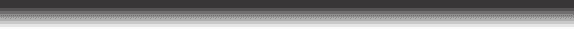
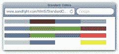

# HTML5 实战


本书献给 Jacob Sanders。

## 作者致谢

多亏 Michael Wilson、Zach Dunn 和 Nick Greenfield，我才意识到 HTML5 的紧迫性，他们向我介绍了了这一点。他们还向我介绍了 *Smashing Magazine* 以及许多其他新趋势。Wiley 的 Chris Webb 指导了本书的方向，并为书籍的发展扫清了道路。Wiley 的 Ellie Scott 帮助处理了书籍创立所需的许多细节。Elizabeth Kuball 担任编辑，澄清并润色了所有内容；技术编辑 Harvey Chute 确保了所有代码的编写正确，并提出了改进建议。最后，我在哈特福大学多媒体网页设计与开发项目的同事 John Gray 和 Brian Dorn，在程序出现严重故障时也给予了帮助。

## 关于作者

**Bill Sanders** 是哈特福大学多媒体网页设计与开发项目的创始成员之一，他在那里教授涵盖 HTML5、界面设计、CSS3、Flash、ActionScript 3.0、ASP.NET、C#、PHP 和视频的课程。他写过许多关于互联网计算设计模式的书籍。他与妻子 Delia 以及两半只狗住在康涅狄格州的乡村。


## 引言
1992年，我正在使用 Gopher 协议浏览互联网（在冲浪之前）。在德克萨斯州的埃尔帕索，我可以查找 Gopher 和 Cambridge 之间的调度。当时这像是一个奇迹。我在德克萨斯州西部，看着 Cambridge 的调度。不可思议！

不久之后，当我认为互联网不会比 Gopher 更好时，Mosaic 浏览器的出现引发了万维网。Netscape Navigator 很快取代了 Mosaic，我发现了 HTML。现在我可以看到图形和文本，并且可以链接到其他网页。简而言之，我使用文本编辑器和新的标记语言 HTML 创建了我的网页。计算机服务的一些人为我搭建了主机，我进入了业务领域。

一段时间内，似乎每年都会出一个新版本的 HTML。CSS 和 JavaScript 被引入了，越来越多的浏览器变得可用。它一直变得越来越好，但在 HTML4（包括 XHTML 在内的多种形式）之后，事情停滞了。这段 HTML 黑暗时代从2000年持续到2008年。然后，世界网联盟（W3C）在2008年发布了 HTML5 草案。然而，在草案格式发布 HTML5 标准后，获取 HTML5 浏览器的进度又回到了缓慢状态。开发标准的团队在开发过程中非常有条理，并计划在2012年在浏览器中实现标准的最终稿！

在2009年或2010年的某一天，我看到支持 HTML5 或至少支持某些功能的浏览器测试版本。到2010年，多个浏览器支持 HTML5，包括为移动设备设计的浏览器。像 smashing.magazine.com 这样的博客发表了关于 HTML5 的文章，因此，无论你是否准备好，HTML5 来了！以某种方式，HTML5 从动物园逃了，生产 HTML5 浏览器的竞赛开始了。我们正式进入了 HTML 复兴时期。兴奋感回来了！

## 第一部分：Web 语言
书的第一部分开始查看适用于 HTML5 的不同浏览器——包括移动浏览器——并教你如何开始使用最新版本的 HTML。它还处理了不同的文件类型和组织，使网站创建变得井井有序。在第一部分的最后，你学习了 HTML5 的颜色和不同代码，以及如何使用 CSS3。

# 第二部分：页面、网站与设计
第二部分关注创建页面和网站的宏观。。曾几何，设计师和开发者只需要关注页面在计算机屏幕上的显示。突然，使用移动设备的用户开始查看页面，设计策略必须重新制定以包含移动用户。在整本书中，你会看到 Windows 7 和 Macintosh OS X 的截图与在移动设备浏览器上拍摄的截图交插在一起。这不再是你父亲的 Web 了！（这甚至不再是你姐姐的 Web 了。）

## 第三部分：HTML5 中的媒体
该部分的三个章节中，只有一个章节涉及早期 HTML 版本中提供的媒体——第9章：图像。另外两个章节涉及音频和视频，这两者都是 HTML5 的新特性。除了通用类型的媒体外，HTML5 还带来了关于格式的不同决策。几种视频格式是较新的，是为在多个版本的 Web 上使用的。并不是所有的 HTML5 浏览器都使用相同的视频格式，但幸运的是，HTML5 有相应的结构可以检查视频格式，直到找到可以在浏览器上运行的格式。


你将学习如何使用 HTML5 中新的存储对象保存表单数据。此外，

你学习如何使用 PHP 处理 HTML5 表单中输入的信息，以便你通过 Web 自动发送和接收电子邮件。同时，我还会介绍新的地理定位对象及其属性，并向你展示如何让 Web 页面根据当前的经纬度坐标自动加载地图。你会发现第四部分充满了许多新材料，它们将为你的网站增加许多新功能。

# 第一部分
## Web 语言


## 第 1 章：HTML5 简介

本章对构成 HTML5 的 HTML 中哪些是新内容、哪些保持不变以及哪些被移除的内容进行了总体概述。目前，最重要的任务之一是找出哪些浏览器支持 HTML5，哪些浏览器正在开发并承诺兼容 HTML5，以及每个浏览器是如何开始实现 HTML5 的。此外，你还可能想了解一些专门为移动设备开发的的新浏览器，以便你也能在移动设备上测试 HTML5 页面。要开始学习，请下载所有 HTML5 浏览器（在本章中介绍），这样你就可以了解用户遇到你创建的 HTML5 Web 页面时会看到什么。

## 使用标签创建：概述

网上大部分内容都是用超文本标记语言（HTML）创建的。你可能会惊讶地发现，你每天使用的某些应用程序——例如你的文字处理器——也是用标记语言创建的。然而，与所有计算机语言一样，对于 HTML，你看到的只是内容，而不是底层语言。这种语言的作用就像建筑的框架——你知道它就在所有油漆和石膏板下面，但你看不见它。在书中，会让 HTML 语言变得非常可见，并向你展示如何使用它来构建你自己的结构。

如果你熟悉之前的 HTML 和 XHTML 版本，你可以将大部分知识迁移到 HTML5。如果你是初次接触 HTML，你会发现 HTML5 非常简单。本质上，你只需要将你的内容放置在起始标签和结束标签之间（称为容器），容器就会 Web 页面上对你的文本进行格式化或显示你的图形和多媒体。图 1-1 展示了容器：

| 元素名称 | 起始标签 | 结束标签 | 容器 |
| :--- | :--- | :--- | :--- |
| <p> | <body> | | 在起始标签和结束标签之间。`<p>` 标签在 `<body>` 容器内部，“Hello”在 `<p>` 容器内部。 |

图 1-1：HTML5 中的容器。

例如，下面这行代码，

`<h1>This is big text.</h1>`

告诉你浏览器中的解释器创建像如下所示的大号文本：

This is big text.

尖括号 `< >` 内部的文本是代码。在这种情况下，`h1` 是大号文本的代码。尖括号指示哪里开始容器（`<h1>`）以及哪里结束容器（`</h1>`）。容器内的所有内容都将配置为相应的尺寸和样式。

在我们开始学习时，你可以尝试创建 HTML5 来增加一点乐趣。你只需要在文本编辑器中输入以下代码，将其保存为 `.html` 文件，然后在 Web 浏览器中打开它即可。


***11***

```html
<meta http-equiv="Content-Type" content="text/html; charset=UTF-8">
<title>Datalist</title>
</head>
<body>
<p>
<label> 你想学习以下哪一个?<br />
  <input type="text" name="web" list="lang">
  <datalist id="lang">
    <option value="HTML5">
    <option value="JavaScript">
    <option value="jQuery">
    <option value="ActionScript 3.0">
    <option value="Java">
  </datalist>
</label>
</p>
</body>
</html>
```

当你在 Opera 浏览器中打开此文件时，你将看到一组输入选项，如图 1-2 所示。

图 1-2：在 Opera 浏览器中使用 <datalist> 标签。

与早期的 HTML 版本不同，早期版本的文本输入不会向用户显示选项列表，而这个版本可以。

## 使用来自 HTML4 的延续性标签

即使你熟悉 HTML4（或更早的 HTML 版本），你可能对某些你不知道如何使用或甚至从未听说过的 HTML 元素数量感到惊讶。例如，<q> 标签是什么？它什么时候使用？如果你是 HTML 的初学者，不要尝试记住表 1.2 中的所有元素，而是要过一遍它们，以便对可用标签有一个大致的了解，并简要了解它们的描述。

### 表 1.2：来自之前 HTML HTML 版本的延续性标签

| 延续性标签 | 描述 |
| :--- | :--- |
| <!--...--> | 注释 |
| \!DOCTYPE> | 文档类型（HTML5 中仅有一个） |
| <a> | 指向页面或页面区域的超链接 |
| <abbr> | 缩写 |
| <address> |  way的容器 |
| <area> | 图像映射内部的区域 |
| <b> | 粗体文本 |
| <base> | 页面中所有链接的基 URL |
| <bdo> | 文本显示方向 |
| <blockquote> | 文本块 |
| <body> | 正文元素开始 |
| <br> | 单行换行 |
| <button> | 可点击的按钮 |
| <caption> | 表标题 |
| <cite> | 引用容器 |
| <code> | 计算机代码文本的格式 |
| <col> | 定义表格列的属性 |
| <colgroup> | 表列组的容器 |
| <dd> | <dt> 元素的值的容器 |
| <del> | 被删除文本的容器 |
| <dfn> | 术语定义实例的表示 |
| <div> | 文档中区域的划分 |
| <dl> | 关联列表的头部 |
| <dt> | 键值组（描述列表）中的名称说明 |
| <em> | 强调的文本 |
| <fieldset> | 一组表单控件的容器 |
| <form> | 通常带有输入元素的表单容器 |
| <h1> 到 <h6> | 文本标题 1 到标题 6 |
| <head> | 供要被浏览器解释的第一段代码的容器 |
| <hr> | 水平规则（线） |
| <html> | HTML 文档的容器 |
| <i> | 斜体文本 |
| <iframe> | 内联子窗口框架 |
|  | 图像容器 |
| <input> | 表单容器中的用户输入字段 |
| <ins> | 隐含段落边界内插入文本的容器 |
| <kbd> | 用户键盘输入的容器 |
| <label> | 用户界面中说明的表示 |
| <legend> | 表单组说明的表示 |
| <li> | 列表项 |
| <link> | 资源引用 |
| <map> | 图像映射 |
| <mark> | 标记的文本 |
| <menu> | 命令列表 |
| <meta> | 元数据信息 |
| <object> | 嵌入对象（例如 SWF 文件） |
| <ol> | 有序列表 |
| <optgroup> | 下拉列表分组 |
| <option> | 下拉列表中的选项 |
| <p> | 段落 |
| <param> | 插件参数 |
| <pre> | 预格式文本 |
| <q> | 带引号的文本 |
| <samp> | 计算机代码输出 |
| <script> | 脚本、JavaScript 或其他脚本 |
| <select> | 可选择列表 |
| <small> | 小字体文本 |
| <span> | 文档中的内联区域 |
| <strong> | 粗体文本 |
| <style> | 样式定义 |
| <sub> | 下标文本 |
| <sup> | 上标文本 |
| <table> | 表格定义 |
| <tbody> | 表格正文 |
| <td> | 表格单元 |
| <textarea> | 文本区域容器 |
| <tfoot> | 表格页脚 |
| <th> | 表格表头 |
| <thead> | 表格头部 |
| <title> | 文档标题 |
| <tr> | 表格行 |
| <ul> | 无序列表（项目符号列表） |
| <var> | 变量 |

### 表 1.3：废弃标签

| 废弃标签 | 移除或替换 |
| :--- | :--- |
| <acronym> | 被 <abbr> 替换 |
| <applet> | 被 <object> 替换 |
| <basefont> | 由 CSS 处理 |
| <bgsound> | 被 <audio> 替换 |
| <big> | 由 CSS 处理 |
| <blink> | 在 HTML5 中移除 |
| <center> | 由 CSS 处理 |
| <dir> | 被 <ul> 替换 |
| <font> | 在 HTML5 中移除 |
| <frame> | 在 HTML5 中移除 |
| <frameset> | 在 HTML5 中移除 |
| <isindex> | 被显式的 <form> 替换 |
| <marquee> | 在 HTML5 中移除 |
| <multicol> | 在 HTML5 中移除 |
| <nobr> | 在 HTML5 中移除 |
| <noframes> | 在 HTML5 中移除 |
| <noscript> | 仅符合 HTML 语法 |
| <s> | 由 CSS 处理 |
| <spacer> | 在 HTML5 中移除 |
| <strike> | 由 CSS 处理 |
| <tt> | 由 CSS 处理 |
| <u> | 由 CSS 处理 |

最常见的废弃标签之一是 <center>，但你可以使用少量 CSS 轻松地居中文本，如下示例所示。将此文本输入你的编辑器中，保存为 CenterMe.html，并在你的 浏览器中打开。

```html
<!DOCTYPE HTML>
<html>
<head>
<style type="text/css">
h1 {
text-align:center;
}
</style>
</head>
<body>
<h1>居中标题</h1>
</body>
</html>
```


***17***

<style>
<meta http-equiv="Content-Type" content="text/html; charset=UTF-8">
<title>使用 CSS 居中</title>
</head>
<body>
<h1>标题可以居中</h1>
</body>
</html>

当你在浏览器中测试这段代码时，你只会看到：

标题可以居中

为了实现一个简单的居中标题，看起来可能工作量很大，但通常页面是很很短的，而且你可以让任何 `<h1>` 标签的标题都居中，因为你已经改变了该标签的行为。你可以使用 CSS 更改任何任何标签。（你将在第 3 章中学习 CSS3，但如果你在页面的中间看到了标题，说明你已经在使用它了。）

## 选择浏览器来解析 HTML5

如果你想与其他 HTML5 开发者开始一场热烈的讨论，只需问一句：“哪种浏览器是最好的？”你最应该关注的是那些访问你网站的人使用什么种浏览器——而不是其他开发者使用哪种浏览器。通常情况下，开发者会一直使用最好的浏览器，直到另一个更出色的出现，因此他们实际使用的浏览器可能比普通 Web 用户更先进、更好。如果你想让访问你网站的人获得最好的体验，请试着找出他们最可能使用什么浏览器。在为自己或客户开发软件时，更好的主意是在所有主流浏览器以及至少两个主流平台（Macintosh 和 Windows）上测试你的 Web 页面。主流浏览器开发者也为 Linux 操作系统制作浏览器，但很少有人使用他们的 Linux 电脑来浏览网页。

查看支持 HTML5 的主流浏览器时，大多数可以在 Windows 或 Macintosh 操作系统上运行，但某些浏览器可能需要较新的操作系统。因此，如果你使用的是旧版系统，请确保你所使用的浏览器要求与你的操作系统兼容。

几年前，微软停止了为 Macintosh 制作 Internet Explorer (IE)。然而，苹果 确实为 Windows 制作了其浏览器 Safari。三家浏览器开发者——Google、Mozilla 和 Opera——并不为电脑制作操作系统，而是制作浏览器。在本节中，我回顾了 Firefox、Chrome、Opera、Safari 和 IE9。请记住，浏览器的特性不断变化。本文的内容在编写时是最新的，但在你阅读时它可能已经发生了变化。

## MOZILLA FIREFOX

Mozilla 的根源于 Netscape 早期推出的名为 Netscape Navigator 的浏览器，它于 20 世纪 90 年代初推出。它的特点是一个酷似电影生物“哥斯拉”的吉祥物。Mosaic 是在伊利诺伊大学开发的一个浏览器；它后来变成了 Netscape Navigator。Mosaic 和 Godzilla 的结合产生了 Mozilla，它目前是一个非营利公司，Mozilla Foundation（Mozilla会）。Firefox 是 Mozilla 支持 HTML5 的主要浏览器。

除了支持 Windows 和 Macintosh 操作系统外，Firefox 还支持 Linux 操作系统。Linux 不被认为是家用电脑的主要操作系统，但对于服务器来说是。Firefox 为所有支持的操作系统免费提供。图 1-4 显示了 Firefox 中 HTML5 应用程序的截图。

图 1-4：Mozilla Firefox 浏览器。

注意，在 URL 窗口（你输入 HTML 地址的窗口）中，引用的是 `file:///Volumes/Macintosh HD/` 而不是 `http://address`。这是因为页面位于电脑的桌面上。此外，你会发现，在 Windows 环境下显示的内容与在 Macintosh 环境下显示的内容不同——（示例页面仅用于说明，并不会为你选择浏览器。）

## GOOGLE CHROME

Google 以其搜索引擎和地图而闻名，它创建浏览器 Chrome 时从零开始就考虑了 HTML5。它拥有适用于 Apple、Windows 和 Linux 操作系统的浏览器——全部免费提供。图 1-5 显示了与图 1-4 在同一电脑上完全相同的 Web 页面——看看你能否发现其中的差异。

图 1-5：Google Chrome 显示与图 1-4 相同的 HTML5 页面。

除了两个浏览器的样式不同，很难看出页面的差异。对于简单的页面，细微的差异不会影响你的 Web 页面的外观。然而，随着你的页面变得越来越复杂，微小的差异可能会放大。

一个 Web 页面开发工具 Adobe Browserlab (https://browserlab.adobe.com) 可以让你同时看到 Web 页面在不同浏览器中的外观。Browserlab 可以从 Adobe Dreamweaver CS5 直接运行，或者你可以访问 Adobe Browserlab 网页。为了获得更显著的差异，让我们对比 Macintosh 上 Firefox 的示例 Web 页面与 Windows 7 上运行 Google Chrome 的示例 页面。图 1-6 显示了这种并排对比的效果。（未显示图形。）

图 1-6：比较浏览器。

部分差异源于 Windows 和 Macintosh 操作系统显示文本（UI）的方式。图 1-7 显示了这种差异。皮肤看起来越模糊，浏览器之间的差异就越大。

图 1-7：Adobe Browserlab。

## OPERA

当我最初测试 Opera 浏览器时，它似乎已经运行了 HTML5 特性。此外，Opera 还是一个特殊的浏览器 Opera Mini，你可以免费下载到移动设备。图 1-8 显示了这一点。

图 1-8：Opera Mini 5。

## APPLE SAFARI

苹果为 Macintosh、Windows 以及移动设备制作了 Safari。为了对比，图 1-9 显示了为 iPhone 开发的示例应用程序在 Apple Safari上的外观。与图 1-8 中的 Opera Mini 5 进行对比。

图 1-9：移动版 Safari 浏览器。

正如在桌面或笔记本电脑上看到的 Web 页面外观差异很少，你不应该看到不同浏览器在移动设备上显示的内容有很多差异。这是一件好事！Web 开发者花费大量时间试图确保所有页面在不同的浏览器和平台上看起来一致。有了 HTML5 的通用实现，这将不再是一个问题。浏览器的其他独特功能，例如标签或其他让网页浏览更方便的特性，只要浏览器对 HTML5 的实现符合万维网联盟（W3C）定义的规范，都是可以的。


## 微软 INTERNET EXPLORER 9

在编写本文时，Internet Explorer 9 (IE9) 仍处于测试阶段。根据微软介绍，其 IE9 浏览器将完全符合 HTML5 标准。在本书中，我尽可能包含了一些示例，展示了使用 IE9 测试版浏览器运行 HTML5 Web 页面的效果。图 1-10 显示了 IE9 测试版浏览器中的测试页面。

图 1-10：Internet Explorer 9。

## 预览不同的显示

正如你所看到的，Web 页面可以在不同的浏览器和操作系统上查看。Web 开发人员需要考虑查看页面的设备特性，例如桌面电脑或手机手机。假设你正在为 iPhone 和 iPad（或其他移动设备和平板电脑）进行开发；如果你能够并排预览你的工作，将能够更好地进行比较。Adobe Dreamweaver 作为一种 页面开发工具，允许开发者同时查看多个维度，如图 1-11 所示。

图 1-11：Adobe Dreamweaver 中的多屏预览。

iPhone 设置尺寸：480 x 320
iPad 设置尺寸：1024 x 768

你可以更改设备尺寸。例如，Motorola Droid 显示 854 x 480 屏幕，而 Sony VAIO UX 显示 1024 x 600 屏幕。多屏预览可以帮助你决定如何设置页面以为你的观众进行优化。找到最佳折中是一门艺术，而通过尽可能了解你的受众以及他们可能用于查看你材料的设备，可以让这项工作变得不轻松。

## 开始上手

要开始学习，第一个示例允许你添加一些关于自己的信息。除非你有 HTML 背景知识，否则不必担心理解所有内容（或任何内容！）！只需在用双等号标记的区域替换成你自己的信息即可。使用 `wheel1.html` 的名称将页面保存到电脑上。（你可以在本章的文件夹中找到 wheel1.html，地址为 www.wiley.com/go/smashinghtml5。）

```html
<!DOCTYPE HTML>
<html>
<meta http-equiv="Content-Type" content="text/html; charset=UTF-8">
<head>
<style type="text/css">
body {
  background-color:blanchedAlmond;
  color:saddleBrown;
  font-family:Verdana, Geneva, sans-serif;
  font-size:12px;
  margin-left:20px;
}
h1, h2 {
  font-family:"Arial Black", gadget, sans-serif;
  color:midnightBlue;
}
h1 {
  text-align:center;
}
h3 {
  background-color:goldenrod;
  color:ghostwhite;
  font-size:11px;
  font-family:"Arial";
}
</style>
<title>The Wheel</title>
</head>
<body>
<h1>==你的名字== 强大的 HTML5 开发者</h1>
<h2>==你的公司== 提供全面的 Web 服务</h2>
<ul>
  <li>==服务 1==</li>
  <li>==服务 2==</li>
  <li>==服务 3==</li>
  <li>==服务 4==</li>
  <li>==服务 5==</li>
</ul>
<h3>所有服务均有保证。我们的投诉部门位于：==可以发送投诉的 URL==</h3>
</body>
</html>
```

当你在浏览器中测试它时，看看它的样子是否符合你的预期。此外，你可能还想看看它在不同浏览器和你的移动设备上的显示效果（记住：Web 浏览器是免费的）。如果你想进行更多更改，请访问 www.w3.org/TR/css/，在那里你可以找到 HTML5 可用的所有颜色列表。看看你能否将颜色更改为你喜欢的颜色。

## 理解 HTML5 标签

程序员将计算机语言特征描述为：从几乎模拟计算机原生语言的低级语言，到接近人类说话方式的高级语言。超文本标记语言版本 5 (HTML5) 是一种非常高级的语言。然而，原始 HTML 有很少的“词汇”来描述开发者和设计师想要的内容。随着 Web 的增长，对 HTML 的需求也之增长。在层叠样式表 (CSS) 和 JavaScript 的帮助下，设计师可以在 Web 页面上做更多事情，但仍然缺乏很多。插件形式为创建 Web 页面提供了更多帮助，这些插件能够运行 Java 等语言以及用 Flash 开发的应用程序。事实上，大多数浏览器都内置了最新的 Flash 插件，以便用户可以查看用 Flash 和 Flash Builder (Flex) 创建的页面。

然而，Web 开发人员仍然希望 HTML 和 CSS 能够在浏览器中原生运行。浏览器制造商静静地为 JavaScript 添加了功能，以配合 HTML5 中的新元素。随着每个浏览器新版本的发布，HTML5 不仅得到了完全实现，JavaScript 和 CSS3 也是如此。本章解释了不同的 HTML5 元素是如何工作的，以及它们如何与 CSS3 和 JavaScript 协同工作。

## 解析代码

早晚，你会在提到浏览器以及 HTML5、CSS3 和 JavaScript 时听到 *解析代码*（parsing code）这个词。这意味着浏览器正在读取代码并解释它以执行它被告知的任务。这就像一个精通英语和俄语的国际翻译——翻译官解析俄语让英语说话者理解，解析英语让俄语说话者理解。严格来说，解析器是浏览器解释器的一部分，但从实际角度来看，只需将解析视为让 Web 页面执行你在标签中告诉它的操作。

为了正确解析 HTML5，必须发生两件事：你正确编写代码，你的浏览器正确解释它。这就是为什么标准很重要。基本上，标准确保了当你根据浏览器设规则编写 HTML5 代码时，它们符合你的预期。

## 理解 HTML5 和相关文件

正如你在第 1 章中看到的，要创建一个 HTML5 文件，你只需要使用文本编辑器（如 Windows 记事本或 Mac 文本编辑）保存代码，并在文件名结尾使用 .html 扩展名。（MyCoolPage.html 就是一个示例）。.html 扩展很重要，因为它被识别为 Web 页面而不是浏览器无法解析的其他内容。

你还会发现某些类型的文件会被浏览器解释器识别并需要特定的扩展名。以下是你遇到的最常见文件类型：

- .jpg (JPEG 图片文件)
- .gif (GIF 图片文件)
- .png (PNG 图片文件)
- .svg (SVG 图片文件)
- .css (层叠样式表)
- .js (JavaScript 文件)

这些文件中最重要的是图片文件，因为你用于制作图形的工具可能会自动将它们保存为与 Web 使用不同的文件名。例如，Adobe Photoshop 自动将文件保存为 .psd 文件，而 Adobe Illustrator 将其文件保存为 .ai 格式。这两种图形格式都无法用于 Web 页面。然而，如果你使用“另存为”而不是简单的“保存”，大多数图形创建工具都会将文件保存为 .jpg、.gif 或 .png。


## 修复 Windows 默认文件扩展名设置

Windows 7（更高版本）的默认设置是隐藏文件扩展名。这会让你的文件看起来更整洁，但如果你必须在选择 .psd 扩展名或 .png 扩展名的图形文件之间做决定，你需要查看扩展名是什么。以下是操作步骤：

1. 打开控制面板。
2. 选择外观和个性化 → 文件夹选项 → 显示隐藏的文件和文件夹。
3. 取消勾选隐藏已知文件类型的扩展名（参见图形）。

取消勾选此框
在 Windows 中取消勾选隐藏已知文件类型的扩展名复选框。

现在你将能够看到所有的文件扩展名了。因此，当你想要加载图形文件时，只需查看电脑屏幕上显示的文件名，就知道它是 .png、.jpg 还是 .gif 文件。

## 修复 Mac 上的 TextEdit

如果你 Mac 上的 TextEdit 使用的是默认设置，在保存纯 HTML 文件时可能会遇到问题。这是因为 TextEdit 默认保存的文件类型是富文本格式 (.rtf)，而不是纯文本 (.txt)。使用 .rtf 时，你的文本将包含其他你不希望出现在 Web 页面中的代码。为了编写 Web 页面，你需要执行以下修复：

1. 打开 TextEdit。
2. 在屏幕顶部的 TextEdit 菜单中，选择“设置”。会出现设置对话框。
3. 选择“纯文本”单选按钮（参见图形）。

将 TextEdit 从富文本更改为纯文本。

现在当你在 TextEdit 中创建 HTML5 页面并保存文件时，它会默认变为 .txt，你只需使用“另存为”将其更改为 .html 即可。

## 学习哪些文件适用于 Web

如果你是编写 Web 页面的新手，首先需要学习的是哪些文件可以与 Web 页面配合。HTML5 直接识别 .html 扩展名以及之前讨论过的三种图形文件扩展名（.jpg、.png 和 .gif）。不过，你会看到对 .css 文件的引用。这些是外部 CSS 文件，无论是 CSS3 还是旧版本。同样，JavaScript 文件以 .js 扩展名保存，它们也可能包含链接引用。

解析 HTML 的浏览器也会解析 CSS 和 JavaScript。事实上，你可以在 HTML 文件中直接在 HTML 标签内编写 CSS 和 JavaScript 代码。每当你看到 `<script>` 标签时，你都会在脚本容器（起始标签 `<script>` 和结束标签 `</script>` 之间）中找到 JavaScript 或 CSS 脚本。在其他情况下，开发者选择将所有的 CSS 和 JavaScript 代码放在外部文件中，并使用 `<link>` 标签加载 CSS，使用 `<script>` 标签加载 JavaScript。

例如，以下代码加载了外部 .css 文件 lookingGood.css：
`<link rel="stylesheet" type="text/css" href="lookingGood.css" />`

对于 JavaScript，外部 .js 文件是从 `<script>` 容器内部调用的，而不是 `<link>` 标签内部。以下代码加载了名为 doMagic.js 的 JavaScript 文件：
`<script language="JavaScript" src="doMagic.js" />`

本书专注于 HTML5，但你确实需要 CSS3 进行格式化，所以在这里也会看到很多。大部分情况下，你会看到 CSS 嵌入在 HTML 代码中。在第 3 章，你将学习更多关于在 HTML5 中使用 CSS3 的知识。第 12 章将提供一些用于 HTML5 标签的 JavaScript，在那里你会看到具体如何结合 HTML5 创建和使用 JavaScript。

## 了解标签的工作原理

当你在 HTML5 中编写代码时，你需要知道使用哪些元素来达到你的目标。正如我们在第 1 章中看到的，你可以使用 `<h1>` 标签更改字体的大小和外观。在开始阶段，你将不会用 CSS 修改标签。当你使用 `<h1>` 时，你可以预期每次都会得到相同的大号黑色加粗文本。（如果你想，可以使用 CSS 将其修改为小号绿色字体，但你得等第 3 章来查看如何使用 CSS 实现这一点。）

简而言之，你的标签工作原理是将页面划分为若干部分，每个部分以起始标签 `<element>` 开始并以结束标签 `</element>` 结束。你可以使用这种方法编写任何需要的 HTML5 页面而不需要其他方法，你的页面就能正常运行。自然地，你会想要创建一些别致的页面并让浏览器立即知道你在做什么，但大多数情况下，你只需要写标签。所以，让我们从基础的 HTML5 容器开始。

## 从基础标签开始

如果你熟悉 HTML4，你就知道需要考虑的标签并不是真正的 HTML 标签，而是某种不同的东西。感叹号告诉浏览器你正在编写 HTML5 而不是众多版本中的一个。它就是：
`<!DOCTYPE HTML>`

## 使用标签描述你的页面

在紧接告诉浏览器预期的第一个标签之后，你开始编写 `<head>` 容器。将头部区域视为页面的“管理”部分。头部中的任何内容都将首先加载，无论它们在页面的其他地方何处使用。许多其他内容会进入 `<head>` 容器，例如 CSS 和 JavaScript，但现在只需记住包含一个标题（title）。当你运行 Web 页面时，标题会出现在页面顶部。例如，考虑以下标题：
`<title>Seriously Sweet Page</title>`

该标题出现在页面的 Windows 窗口和标签上。如果你不放入它，最终将得到一个空白或默认标题。图 2-1 显示了标题在不同浏览器中的外观。

正如你所看到的，Seriously Sweet Page 在四个主流浏览器中出现在不同的位置。在某些浏览器中，它出现在窗口和标签的顶部，在某些中只出现在页面顶部，在某些只出现在标签上。继续向下，`<body>` 标签标记了页面内容的开始。正如其名所示，body 是任何 Web 页面的主体部分，只有 `<body>` 容器内部的内容在页面上可见。在起始和结束 body 元素之间，你放置页面上所需的所有内容。以下标签set应该出现在你创建的每个页面上——事实上，你完全可以将其作为模板并保存，这样你就不需要从空白页面开始编码了。


***33***

图 2-1：显示在网页和标签页上的标题。

```html
<!DOCTYPE HTML>
<html>
<head>
<title>Title goes here</title>
</head>
<body>
Content goes here: A Really Swell Page
</body>
</html>
```

随着本书的深入，你将发现更多需要包含的结构化元素。

然而，前面的几行代码就能让你开始制作网页了。

## 识别标签的组成部分

到为止，我使用“标签”（tag”）和“元素”（element）这两个术语时基本上通用。然而，元素只是标签的一部分。每个标签都有属性（attribute），而属性有值（value）。因此，可以通过以下术更好地理解标签：

- **元素：** 元素的名称
- **属性：** 元素的某些特征
- **值：** 属性的某种或条件

图 2-2 显示了标签的所有三个部分。

| 属性 | 元素名称 | 值 |
| :--- | :--- | :--- |
| (language) | | (English) |

图 2-2：标签的组成部分。

不同元素的属性数量不同。根据元素的不同，会有不同类型的属性；根据属性的不同，可以应用不同类型的值。作为一个通用的规则，在值周围使用双引号，包括数字在内。这里是一些不同的示例：

```html
<form action="http://localhost/php/phpversion.php" method="post">
<input type="text" width="120" hidden="false">
<input type="submit" value="Sick ‘em">
```

你必须小心在双引号之间放置了什么内容。例如，`value="Sick ‘em"` 是允许的，因为 `‘em` 包含一个单引号。然而，`value=""Sick ‘em," he said"` 将无法运行，因为它包含了两对双引号。

### 语言属性

HTML 标签中的语言 (lang) 属性除非你创建一个非英语的页面，否则不会使用。例如，以下是你可能用于开发网页的其他语言及其对应的语言属性值：

- 阿拉语: ("ar")
- 中文（普通话）： ("cmn")
- 德语 (Deutsch): ("de")
- 希伯来语: ("he")
- 印地语: ("hi")
- 日本语: ("ja")
- 葡萄语: ("pt")
- 俄罗斯语: ("ru")
- 西班牙语: ("es")

与某些属性不同，lang 属性具有广泛的值。请访问 www.iana.org/assignments/language-subtag-registry 查看完整列表。

***35***

可能会出现典型情况是：你的页面的两个不同部分都有引用。在段落中，你可以放置任意数量的引号，它们会显示在页面上。然而，只有一组双引号可以被赋值为属性的值。考虑以下脚本（位于 www.wiley.com/go/smashinghtml5 本章目录下的 quotes.html）：

```html
<!DOCTYPE HTML>
<html>
<head>
<title>Be careful with quotation marks</title>
</head>
<body>
<p>We read Emily Dickinson’s “Wild nights! Wild nights!”</p>
<input type="text" size="50" value="Emily Dickinson’s ‘Wild nights! Wild nights!’">
</body>
</html>
```

在 `<p>` 容器中，双引号识别了诗的名称。如果要在属性值中将相同的文本设为诗，你可以仅对诗名使用单引号，正如分配给 `value` 属性的值中所示。图 2-3 显示了该页面在浏览器中的外观。

图 2-3：在 HTML5 页面和属性中使用引号。

在为属性赋值时，记住对整个值使用双引号，并在值内部使用单引号来高亮特定部分。总的来说，如果你在给属性赋值时避免使用单引号，生活会变得更容易。

## 理解注释标签的作用

注释标签的作用是帮助开发者与其他开发者通信，并作为对页面正在做什么的自我提醒。一个组织良好的页面包含关于页面正在做什么、可能添加或更改的内容，以及任何其他帮助开发者查看网页脚本并快速看到发生什么的信息。

注释标签实际上是两个标签——一个起始标签和一个结束标签。与其他标签不同，注释标签内部没有用于识别标识的文本。以下脚本（位于 www.wiley.com/go/smashinghtml5 本章目录下的 comments.html）显示了注释所在的位置并解释了它的作用。


一旦你通过注释掉不需要的标签完成了修改，就可以再次向客户展示它了，如图 2-5 所示。

图 2-5：带有注释代码的页面。

如果客户更喜欢原始版本，你只需要移除注释标签，页面就会恢复到原来的样子。你可能想要尝试几种不同的外观；通过使用注释标签，你可以在保留原始标签的同时快速更改外观——它们只是被注释掉了而已。

## 标签嵌套

当你创建一个 HTML 页面时，你可能会嵌套标签——即你可以将一个 HTML5 容器放在另一个容器内部。事实上，我一直以来都在这样做。规则是：在容器的结束标签之前，在容器内部添加一个结束标签。因此，如果你在另一个标签的容器内编写标签，请确保在关闭外部容器之前关闭内部容器。查看以下示例以理解我的意思。

### 何时使用（以及何时不使用）注释标签

注释标签的一个常见问题是它们在 Web 页面中使用不足。有时，几个注释就足够了——如果一个页面只需要少数注释，你不应该添加更多。在其他情况下，一个页面需要的注释比现有的得多。所需的注释数量完全取决于 Web 项目的大小和范围，以及你是自一人工作还是与其他开发者一起工作。

然而，有时开发者会过度使用，写了太多的注释标签，以至于你看不清 HTML 代码的流。每个标签后面都跟一长串注释的页面就像田里的铁丝网——你不断会被它绊倒，无法到达目的地。如果一个复杂页面需要大量注释，请将它们合并在一个容器中，这样其他开发者就能看到 HTML 代码并理解它是如何使用的。

在下面的示例中，`<h1>` 标签在 `<section>` 容器之外关闭：

```html
<section>
  <h1>Smash this!
</section>
<h1>
```

相反，它应该看起来像这样：

```html
<section>
  <h1>Smash this!</h1>
</section>
```

在这里，`<body>` 标签（此处应为 `<body>`）在 `<html>` 容器之外关闭。`<h3>` 容器是正确的。

```html
<html>
  <body>
    Really interesting stuff
    <h3>Don’t forget to vote!</h3>
  </body>
</html>
```

相反，它应该看起来像这样（注：原文此处示例代码是重复的）：

```html
<html>
  <body>
    Really interesting stuff
    <h3>Don’t forget to vote!</h3>
  </body>
</html>
```

在这里，`<header>` 标签在 `<nav>` 标签之前关闭：

```html
<header>
  <nav>
    <a href="html5.org">HTML5</a>&nbsp; | &nbsp;
    <a href="css3.org">CSS3</a>&nbsp; | &nbsp;
    <a href="php.net">PHP</a>
</header>
<footer>
  <a href="html5.org">HTML5</a>&nbsp; | &nbsp;
  <a href="css3.org">CSS3</a>&nbsp; | &nbsp;
  <a href="php.net">PHP</a>
</nav>
</footer>
```

此处代码存在逻辑错误。

相反，请使用两组 `<nav>` 容器——一个用于页眉，一个用于页脚：

```html
<header>
  <nav>
    <a href="html5.org">HTML5</a>&nbsp; | &nbsp;
    <a href="css3.org">CSS3</a>&nbsp; | &nbsp;
    <a href="php.net">PHP</a>
  </nav>
</header>
<footer>
  <nav>
    <a href="html5.org">HTML5</a>&nbsp; | &nbsp;
    <a href="css3.org">CSS3</a>&nbsp; | &nbsp;
    <a href="php.net">PHP</a>
  </nav>
</footer>
```

有时，当你测试 HTML5 页面时，你看到的并不是预期的结果——甚至什么都看不见。你首先需要检查的是标签嵌套情况。

如果你对 `&nbsp;` 代码感到好奇，它是一个不换行空格。（分号是标签的一部分）。只需将其认为是在用于分隔链接的竖线字符 (|) 周围的空格即可。在浏览器中，你将看到：

HTML5 | CSS3 | PHP

当你将导航代码放在 `<nav>` 标签内部时，你可以很容易识别出它是导航。然而，和所有其他标签一样，你必须注意 HTML5 中使用的嵌套规范。

## 掌握主权

以下 Web 页面的 HTML（位于 www.wiley.com/go/smashinghtml5 本章文件夹中的 TakeTheWheel.html）存在需要修正的错误。它以几个空或未完成的标签开头。你将负责在需要的地方添加正确的标签和文本。有时，你需要关闭一个已经打开的容器 (`<tag>`)，或打开一个已经关闭的容器 (`</tag>`)。并确保你的标签正确嵌套。（**提示：** 第一个标签不是 HTML 标签，而是那个特殊的）

***45***

随手拼凑出一个网页虽然可行，但在用户视觉体验以及用户是否想要再次访问该网站方面，可能会有许多不足。让我们来看一个没有结构但包含了网页基础元素的网页：

```
<!DOCTYPE HTML>
<html>
<head>
<meta http-equiv="Content-Type" content="text/html; charset=UTF-8">
<title>基础知识</title>
</head>
<body>
这是文本。你不需要为普通文本 (POT) 使用标签。
<a href="anotherPage.html"> 点击此处访问另一个页面 </a>

</body>
</html>
```

如图 3-1 所示，所有内容都杂乱无章。图片出现在链接（蓝色下划线文本）的中间，图片出现在页面的正中间，通常这并不符合逻辑。

图 3-1：最基础的 Web 元素。

当你组织网页时，链接应该被组织成一个导航系统，让查看你网页的人易于使用。在图 3-1 所示的页面中，链接被图形隔开了，看起来像是文本的一部分，而不是导航系统的一部分。

## 进一步的组织

Web 设计中的基本规范之一是将 Logo 放在页面的左上角。同样，网页会将链接组织成一个连贯的导航系统。通过添加另外两个标签，你可以向页面的组织迈出大一步：

- `<br>`: 生成单行换行符
- `<wbr>`: 生成换行机会

换行符 (`<br>`) 强制文本行换行。你可以将其认为行与行之间的单空格，或者如果你是老派程序员，它就是一个回车符。HTML5 引入了一种名为“换行机会”的新元素。有时你会遇到一个非常长的单词，特别是在 URL 和电子邮件地址中。`<wbr>` 元素不会强制换行，但你可以在希望单词断开的地方放置 `<wbr>` 标签，以防页面被压缩。这种考虑对于移动设备尤为重要，因为移动设备的设备屏幕很小。例如，假设你有一个非常长的 URL，它以非链接描述的形式显示，如：

www.eatatjoesfinerestaurant.com

如果链接名称没有断开，且页面被压缩，你将看到文本中出现巨大的间隙，或者单词在你不希望的地方被断开了。`<wbr>` 标签帮助你让文本在希望的地方断开。考虑以下脚本（本章 www.wiley.com/go/smashinghtml5 文件夹下的 `BasicBreaks.html`），它同时使用了这两个换行标签：

```
<!DOCTYPE HTML>
<html>
<head>
<meta http-equiv="Content-Type" content="text/html; charset=UTF-8">
<title>添加换行和换行机会</title>
</head>
<body>
<br>
这是文本。你不需要为普通文本 (POT) 使用标签。<br>
<br>
他说：“有时候你会遇到极长的单词，你希望确保它们在适当的地方断开。例如，你有一个很长的 URL 命名，如 www.eat<wbr>at<wbr>joes<wbr>fine<wbr>restaurant<wbr>.com，如果必须断开，你希望断开出现在特定的地方。”<br><br>
他说：“有时候你会遇到极长的单词，你希望确保它们在适当的地方断开。例如，你有一个很长的 URL 命名，如 www.eatatjoesfinerestaurant.com，如果必须断开，你希望断开出现在特定的地方。”<br><br>
<a href="anotherPage.html"> 点击此处访问另一个页面 </a>
</body>
</html>
```

通过添加这两个换行标签，页面看起来好多了。没有使用 `<wbr>` 标签的段落在 URL 未拆分的地方出现了巨大的间隙。图 3-2 显示了现在的样子。

尽管它还不完美，但即使增加了两个段落，也比原来的好得多。图形位于左上角（大多数 Logo 一样），段落之间通过换行符分开，而在使用长 URL 的段落中，断开出现在指定的位置。

图 3-2：添加换行。

## 思考结构

此时，应该在结构上花费更多精力。有了添加文本、图形和链接的能力，网页可以拥有更丰富的功能和更多的内容。因此，你应该开始考虑标题、导航以及左上角 Logo 之外的布局。从一个简单的草图开始。用一张纸记录下网页的想法。（先不要用你的图形化工具。）图 3-3 显示了一个示例：

| Logo | 图形 | 标题 | 导航 | 导航 | 文本 |
| :--- | :--- | :--- | :--- | :--- | :--- |
| | | | | | xxx |
| | | | | | xxx |
| | | | | | xxx |
| | | | | | xxx |
| | | | | | xxx |
| | | | | | xxx |

图 3-3：为你的站点勾勒结构。

## 添加更多 HTML 结构

在上一节中，你学习了 HTML5 新的 `wbr` 元素，本节将仔细观察熟悉的 `<h..>` 标签以及一些用于结构化的标签。你还看到了如何从手绘草图开始并在 HTML 脚本中实现它。从相当具体的草图转向更通用的块大纲，有助于理解 HTML5 是如何组织的。检查的第一种块是文本块——实际上，我们在第 1 和第 2 章中已经开始讨论 `<h1>`、`<h2>` 以及其他 h 元素。图 3-5 展示了块的组织。


图 3-5：文本块的组织。

在组织页面时，不同层级 `h` 元素的布局使用了 HTML5 的 `<hgroup>` 标签。例如，看看下面这个网页（位于本章 www.wiley.com/go/smashinghtml5 文件夹中的 `HelementOrg.html`），它源自维特根斯坦（他在 1918 年完成《逻辑哲学论》写作时，似乎使用了 h 标签进行写作）：

```html
<!DOCTYPE HTML>
<html>
<head>
<meta http-equiv="Content-Type" content="text/html; charset=UTF-8">
<title>Tractatus logico-Philosophicus</title>
</head>
<body>
<h1>Tractatus logico-Philosophicus</h1>
<h1>by Ludwig Wittgenstein</h1>
<hgroup>
<h2>1 The world is all that is the case.</h2>
<h3>1.1 The world is the totality of facts, not of things.</h3>
<h4>1.11 The world is determined by the facts, and by their being all the facts.</h4>
<h4>1.12 For the totality of facts determines what is the case, and also whatever is not the case.</h4>
<h4>1.13 The facts in logical space are the world.</h4>
<h3>1.2 The world divides into facts.</h3>
<h4>1.21 Each item can be the case or not the case while everything else remains the same.</h4>
</hgroup>
</body>
</html>
```

如果我们观察这个网页，可以看到不同的 `h` 元素如何赋予不同部分不同的尺寸，但我们并没有看到维特根斯坦在其原始著作中使用的缩进。图 3-6 显示了手机上的该网页 ——无论你对维特根斯坦有什么看法，他的风格在移动屏幕上确实非常有效。

图 3-6：在 iPhone 上使用 `<h>` 标签的大纲格式。

如果你查看维特根斯坦的原始著作，你会发现他的写作风格使用了如下的缩进大纲：

1 The world is all that is the case.
1.1 The world is the totality of facts, not of things.
1.11 The world is determined by the facts, and by their being all the facts.
1.12 For the totality of facts determines what is the case, and also whatever is not the case.

如果我们愿意，可以通过为 `<h..>` 标签添加缩进来修复。我们可以通过使用 CSS3 添加外边距来实现，你将在下一节看到。然而，`h` 元素和 `<hgroup>` 的目的并不是设置缩进，而是为了帮助构建更通用的纲。`<hgroup>` 标签将 hgroup 容器中最高层级的 `<h..>` 标签设置为大纲元素。例如，由于维特根斯坦完全是以大纲形式编写《逻辑哲学论》的，他使用 `hgroup` 元素的整个作品看起来将与他作品摘要中的大纲完全一样。

1 The world is all that is the case.
2 What is the case — a fact — is the existence of states of affairs.
3 A logical picture of facts is a thought.
4 A thought is a proposition with a sense.
5 A proposition is a truth-function of elementary propositions. (An elementary proposition is a truth-function of itself.)
6 The general form of a truth-function is [p, E)]. This is the general form of a proposition.
7 What we cannot speak about we must pass over in silence.

`hgroup` 元素在 HTML5 中与大纲相系，尽管你不太会对像维特根斯坦这样的作家使用它，但它对于帮助你从 HTML5 页面的结构角度思考页面非常有帮助。考虑 `<hgroup>` 标签的一种方式是将其视为 hgroup 容器中最高层元素以下元素的遮罩（甚至是一个隐形装置）。在我们的示例中，`h3` 和 `h4` 被遮罩了，只有 `h2` 元素被识别为纲的一部分。

## 使用 CSS3 为文本添加样式

之所以提到层叠样式表是因为 HTML5 和 CSS3 在许多方面是配对的，但就像我在书中讨论的其他功能一样，早期版本的功能已整合到最新版本的 HTML 和 CSS 中。在第 1 章和第 2 章中，你看到了 CSS 的示例，但没有给出关于如何向现有元素添加新样式的解释。这里的重点是为元素添加样式。在接下来的三个章节，你将看到使用 CSS3 的更多方面。所有样式表可以通过三种方式添加：

- 你可以使用 `<style>` 标签来定义 HTML HTML5 页面中元素的属性。
- 你可以使用外部样式表，它是你存储想要复用的样式的文件。
- 你也可以通过使用内联样式在没有样式表的情况下添加样式。

大多数专业开发者和设计师更倾向于使用外部样式表，因为完善所需的样式需要大量工作。当你想要更改网站设计时，可以通过更改唯一的样式表来对许多使用该外部样式表的页面进行更改。这比在每个独立的网页中更改 `style` 属性要高效得多。

## 使用 CSS3 属性为 HTML5 元素设置样式

内联样式就像一种“紧急情况下破窗使用！”的技术。一个美面的页面是在样式表中开发好的计划。

### 嵌入式样式表

嵌入式样式表简单地将样式表直接添加到 HTML5 脚本中。在程序的 `<head>` 部分使用 `<style>` 容器添加样式。将要样式的元素放在 `<style>` 容器中，然后为样式的属性添加值。图 3-7 显示了通用格式。

图 3-7：嵌入式样式表。

每个元素有一组属性，每个属性都有可以赋值的值。当你更改属性的值时，它会出现在元素内部的文本。因此，如果你将文本颜色改为红色，元素内部的所有文本将变为红色。下面的脚本（位于本章 www.wiley.com/go/smashing5 文件夹中的 `CSS3fonts.html`）提供了一个示例。

```html
<!DOCTYPE HTML>
<html>
<head>
<meta http-equiv="Content-Type" content="text/html; charset=UTF-8">
<style type="text/css">
body {
background-color:#fbf7e4;
font-family:Verdana, Geneva, sans-serif;
margin-left:20px;
color:#8e001c;
}
h1 {
background-color:#8E001C;
color:#e7e8d1;
font-family:"Arial Black", Gadget, sans-serif;
text-align:center;
}
h2 {
background-color:#424242;
color:#d3ceaa;
font-family:"Trebuchet MS", Arial, Helvetica, sans-serif;
margin-left:5px;
}
</style>
<title>CSS3-Embedded Stylesheet</title>
</head>
<body>
<h1>This Is the Big Head</h1>
<h2>&nbsp;Here Is the Second Head</h2>
正文文本经过了样式处理，有一定的外边距并获取了正体的颜色。注意标题的背景延伸到了整个页面。还注意一个空格 (&nbsp;) 为 h2 文本提供了一点缩进，使其保持在背景“之内”。这对于 h1 标题来说不是问题，因为它是居中的。
</body>
</html>
```

图 3-8 显示了样式化页面的外观。

你应该意识到，当你使用样式表时，必须注意细节——例如添加两个大括号、用冒号将属性与值分开，以及用分号为每个属性值结尾。如果你的 CSS3 样式表没有按照你认为的那样工作，请检查这些小问题！


***55***

## 外部样式表

考虑到可能需要考虑的所有不同样式组合——包括针对桌面电脑、笔记本电脑和小型移动屏幕的不同格式——创建一个良好的样式表或一组样式表所涉及的工作可能是巨大的。通过将你的 CSS3 工作保存到文本文件中，你可以随需要重复使用你的样式表。此外，你还可以将嵌入的 CSS 复制并轻松地粘贴到文本文件中，然后保存为 .css 文件。

例如，让我们来看一个配色方案，它包含企业客户 Mighty Smite Web Development 描述为企业调色板的一组颜色。（这意味着你只能使用提供的这组颜色。）你从以下公司颜色开始：

#3C371E, #8C5F26, #BCA55F, #F2CC6E, #F26205

背景颜色必须是 #F2CC6E。你不需要知道颜色是什么——你只需要知道公司已经决定用它作为背景颜色。你被告知设计师们可以处理其余的部分。

此外，你被告知他们希望有一个在手机上看起来良好的版本，以及另一个在桌面电脑上看起来良好的版本。这意味着你需要两个不同的 CSS3 样式表。稍后，你将担心浏览器如何知道用户是在屏幕尺寸像露天电影院一样的桌面电脑上查看，还是在 Droid 手机上查看。

这只需要以下标签：

`<link rel="stylesheet" type="text/css" href="mightySmiteSmall.css" />`

该标签放在 `<head>` 容器中，之前 `<style>` 标签连同 CSS3 代码就在那里。现在 CSS3 代码进入一个单独的文件中。注意 `<link>` 标签包含一个 `href` 属性，其赋值值为 `mightySmiteSmall.css`。这是 www.wiley.com/go/smashinghtml5 章节文件夹中的 CSS3 文件名。Small 表示它是为移动设备设计的。还将创建一个名为 `mightySmiteLarge.css` 的 CSS3 文件用于非移动设备。

要创建一个 CSS3 文件，你只需要在文本编辑器或 Web 开发应用程序中输入 CSS3 代码，并去掉 `<style>` 标签。以下显示了此处要使用的示例：

```css
@charset "UTF-8";

/* CSS Document */
/*3C371E,8C5F26,BCA55F,F2CC6E,F26205 */
body
{
  background-color:#F2CC6E;
  font-family:"Lucida Sans Unicode", "Lucida Grande", sans-serif;
  color:#8C5F26;
  font-size:11px;
  max-width:480px;
}

h1
{
  color:#BCA55F;
  background-color:#3C371E;
  font-family:"Arial Black", Gadget, sans-serif;
  text-align:center;
}

h2
{
  color:#F26205;
  font-family:"Lucida Sans Unicode", "Lucida Grande", sans-serif;
}

h3
{
  color:#3C371E;
  font-family:Tahoma, Geneva, sans-serif;
}
```

第一行让浏览器知道它是 UTF-8 字符集，后两行是注释行。它们与 HTML5 中的注释行不同，但作用相同。第二条注释行是跟踪调色板的一种方便方法，并节省设置样式表的时间。

为了测试此版本的 CSS3 代码，使用了以下 HTML5 文件（www.wiley.com/go/smashinghtml5 章节中的 ExternalSmall.html）：

```html
<!DOCTYPE HTML>
<html>
<head>
  <link rel="stylesheet" type="text/css" href="mightySmiteSmall.css" />
  <meta http-equiv="Content-Type" content="text/html; charset=UTF-8">
  <title>Mighty Smite Software Test Sheet</title>
</head>
<body>
  <h1>Mighty Smite Software Conglomorate</h1>
  <h2>This is an h2 head</h2>
  <h3>Here’s an h3 head</h3>
  <p>Lorem ipsum dolor sit amet, consectetur adipisicing elit, sed do eiusmod tempor incididunt ut abore et dolore magna aliqua. Ut enim ad minim veniam, quis nostrud exercitation aboris nisi ut aliquip ex ea commodo consequat. Duis aute irure dolor in reprehenderit in voluptate velit esse cillum dolore eu fugiat nulla pariatur. Excepteur sint occaecat cupidatat non proident, sunt in culpa qui officia deserunt mollit anim id est aborum.</p>
</body>
</html>
```

CSS3 文件中的所有样式都用于测试它们的外观，而以 Lorem ipsum 开始的正文内容是填充文本，用于获取文本块外观的想法。（它自 16 世纪以来一直被使用，所以它一定很棒。）


***59***

<title>内联 CSS3</title>

</head>

<body>

<div style="font-family:Verdana, Geneva, sans-serif;font-size:24px;background-color:yellow;color:navy;">这很重要！</div>

<p>但这个……没那么重要</p>

<p style="font-size:10px;font-family:sans-serif;">这个你完全可以忽略……</p>

</body>
</html>

图 3-11 显示了在浏览器中测试该 Web 页面时看到的内容。请记住，第二行完全没有添加任何样式。

图 3-11：内联 CSS3。

当你的 CSS3 外部文件中的某些功能无法为 Web 页面上某个需要显示的元素提供样式时，内联 CSS3 的使用将是无价价值的。通常情况下，内联是你希望节制且审慎地使用的工具之一。在处理与基于共同样式表工作的其他开发者和设计师时，这一点尤为真实。

## 创建 CSS3 类和 ID

CSS3 类和 ID 是将样式扩展到任何元素的方法。例如，假设你有一个功能只想添加到某些项目中，比如黄色高亮。如果你将一个 `div` 或 `p` 元素的背景颜色定义为黄色，那么这两个容器中的所有文本将变成亮黄色——这并不是你想要的。相反，如果你有一个定义了黄色背景的类，你只需要将该类分配给一个元素即可使其变亮。

### CSS3 类

你创建样式类的方式与创建元素样式的方式几乎完全相同。CSS3 中用于创建类的“点”（`.`）定义符是你自定义的标签，而不是使用元素名称。图 3-12 显示了如何创建一个 CSS3 类定义。

图 3-12：创建类定义。

如你所见，点定义占据了元素名称的位置。其余部分与 CSS3 的元素定义相同。然而，实现类样式略有不同，因为它可以用于几乎任何元素标签。

为了看到我们可能想如何使用一些高亮文本，`span` 是一个非常方便的内联元素。`<span>` 标签可以添加到块级元素的中间，并且只更改 `<span>` 容器内该部分的内容，而不改变块的其他部分。要为元素添加类，请使用以下格式：

`<element class="myClass">`

注意，类的名称不包含点定义中的“点”。点仅用于样式定义，以便让解析器知道该词是一个类而不是元素。以下程序（本章位于 www.wiley.com/go/smashinghtml5 文件夹下的 `SpanClass.html`）为你提供了一个关于如何配合 `<span>` 标签使用该类的示例。

```html
<!DOCTYPE HTML>
<html>
<head>
<style type="text/css">
body {
  background-color:#F93;
}
.highlight {
  background-color:yellow;
}
div {
  font-family:"Comic Sans MS", cursive;
  font-size:18px;
}
h1 {
  font-family:"Arial Black", Gadget, sans-serif;
  color:#930;
  text-align:center;
  font-size:20px;
}
</style>
```

***61***

```html
<html>
<head>
<meta http-equiv="Content-Type" content="text/html; charset=UTF-8">
<title>万圣节高亮</title>
</head>
<body>
<h1>万圣节派对！</h1>
<div>你受邀参加 <span class="highlight">10 月 29 日，星期六</span>举办的万圣节派对。服装是 <span class="highlight"><i>de rueur</i></span>。</div>
</body>
</html>
```

当你测试该程序时，你会发现 `<span>` 容器内的两个部分文本都受到了影响。图 3-13 显示了它们在 Mac 上的 Chrome 浏览器（顶部）和 iPhone 上的 Opera Mini 浏览器（底部）中的显示情况。

图 3-13：桌面电脑上容器中的类定义清楚地显示命名为 `highlight` 的 CSS3 类正在生效。然而，Opera Mini 浏览器既没有显示字体，也没有显示斜体单词（Safari 显示了斜体单词，但没有显示字体）。

### CSS3 ID

CSS3 ID 的设置方式与类几乎相同，区别在于它定义中使用井号（`#`）代替点（`.`）。此外，在分配 ID 时，你使用 `id` 而不是 `class` 来指定为元素使用哪个 ID。你甚至可以在同一个元素上使用 ID 和类。以下标签是完全正确的：

`<p id="this" class="that">`

两者都可以选择样式，而 ID 为该段落提供了一个唯一的 ID。ID 与类之间有一些主要区别。类和 ID 都可以作为样式表选择器。然而，ID 还有其他局限性和特性：

- 一个 ID 在文档中只能使用一次。
- ID 可以作为锚点（见第 7 章）。
- ID 可以作为脚本引用。这对于 JavaScript 非常重要。
- ID 可以作为声明对象中的名称——更多关于 JavaScript 的内容。
- ID 可以被代理用于在翻译 HTML 文档时处理信息。

在这些特性中，你只会使用前两个，直到你决定引入 JavaScript 和其他语言。尽管如此，如果你注意这些差异，你的 Web 页面将不会遇到问题。以下示例（位于 www.wiley.com/go/smashing5 文件夹下的 `IDwork.html`）展示了 CSS3 中 ID 使用：

```html
<!DOCTYPE HTML>
<html>
<head>
<style type="text/css">
#littleHead {
  font-family:Verdana, Geneva, sans-serif;
  background-color:#9FC;
  font-size:16px;
}
#javascript {
  /* red */
  color:#cc0000;
}
#php {
  /* blue */
  color:#009;
}
#actionscript {
  /* green */
  color:#063;
}
</style>
```

***63***

```html
<html>
<head>
<meta http-equiv="Content-Type" content="text/html; charset=UTF-8">
<title>使用 ID</title>
</head>
<body>
<div id="littleHead">关于变量你一直想知道的<br></div>
<p id="javascript">JavaScript 不需要赋予数据类型。</p>
<p id="php">PHP 变量可以通过类型提示引导数据类型。</p>
<p id="actionscript">ActionScript 变量必须分配数据类型。</p>
</body>
</html>
```

在查看该代码时，你可能好奇斜杠星号（`/* ... */`）标记是什么。简单来说，它们是 CSS3 的注释代码。在 `<style>` 容器和外部样式表中，它们的作用就像 HTML5 中的 `<!-- ... -->` 注释标记。图 3-14 显示了你测试时会看到的内容。

图 3-14：页面中的 ID。

如果你有一个关于 JavaScript、PHP 和 ActionScript 讨论的长 Web 页面，用户可能需要滚动才能找到想要的主题。使用 ID，你可以编写包含用户想要查找的确段落的 URL。例如，以下 URL 将直接进入 PHP 部分：www.smashingHTML5.com/myIDs#php。添加 #php 会调用带有 php ID 的特定段落。

## 开始尝试

本章涵盖了大量的材料，你将想看看如何使用它们。这里有两个挑战：

- **你的设计可以比这更好！** 在使用不同元素启动 Web 页面后，图 3-4 所示的页面仍然需要帮助。对于一个儿童页面来说，它不够多彩，字体也很无聊。此外，文本就在图片旁边。使用 CSS3，看看你能否让它变得更好。


****救救可怜的维特根斯坦！** 在第一次大战期间准备《逻辑哲学论》时躲避子弹后，我们在图 3-6 中的网页显示了维特根斯坦的作品，但缺少了缩进！然而，使用 CSS3 和 `margin-left` 属性，看下你是否可以修复这些元素，让所有元素都回到到位。顺便说一下，如果你想要《逻辑哲学论》的全部 29 页内容，可以免费从 http://filepedia.org/tractatus-logico-philosophicus 下载。

尽情玩玩这个吧，感受一下 CSS3 带给你的灵活性。

-ch03.indd 64
-ch03.indd 64
10/28/10 9:53 PM
10/28/10 9:53 PM

    

## 章节
# 使用颜色值
 4

到此为止，你已经看到了几个使用颜色代码的示例，但如果你不理解自己在看什么，那就像在看恩玛密码一样。在某些示例中，使用了颜色名称，但除了基础颜色外，你还需要理解 CSS3 中颜色是如何构建的。通过这样做，你可以使用数百万种颜色，而不是寥寥几种。

-ch04.indd 65
-ch04.indd 65
10/28/10 9:52 PM
10/28/10 9:52 PM

  

### 理解 RGB 颜色

如果你曾经用从手指画到水彩画套装的任何东西混合过颜色，你就对混合颜色时发生的情况有种感觉。对于计算机屏幕，通过混合红、绿、蓝光来产生不同的颜色。例如，如果混合等量的红色和绿色，你就会得到黄色。

为了给网页混合颜色，使用整数、百分比和十六进制数来混合不同的值。CSS3 还有有限数量的具名颜色可用，可以在研究其他颜色混合方法时提供帮助。HTML5 和 CSS3 具有一些非常复杂的元素，例如 `canvas`，它们在颜色和绘图方面可以实现比之前的 HTML 版本更多的功能。这些高级元素需要一些 JavaScript，你将在第 13 章中看到详细讨论。现在，我们从基础开始。

### 使用名称

在 HTML5 和 CSS3 中，一种奇怪的体验是颜色名称集。根基是表 4.1 所示的 16 种标准颜色。

| |
| :--- |
| 青 (Aqua) |
| 黑色 (Black) |
| 蓝色 (Blue) |
| 品红 (Fuchsia) |
| 灰色 (Gray) |
| 绿色 (Green) |
| 柠檬绿 (Lime) |
| 栗色 (Maroon) |
| 海军蓝 (Navy) |
| 橄绿色 (Olive) |
| 紫色 (Purple) |
| 红色 (Red) |
| 银色 (Silver) |
| 青色 (Teal) |
| 白色 (White) |
| 黄色 (Yellow) |

使用你目前所学的 HTML5，你可以轻松创建一个显示所有颜色的图表。（在本章末尾的“掌握技巧”部分，我们将制作这个图表。）图 4-1 显示了它们在移动设备上的样子。



图 4-1：网页上的标准 CSS3 颜色。

从这个基础，你可以包含在选择上似乎没有理由的。它们都是 20 世纪 80 年代的一个名为 X11 的集合。它们被早期浏览器采用并一直伴随着我们。在官方 W3C 文档中，它们被列在可缩矢量图形 (SVG) 下，所有名称都源自 X11。（参见 www.w3.org/TR/SVG/types.html#ColorKeywords。）

之所以没有列出所有名称，是因为设计师和开发者通常不使用它们。对于设计师来说，这些名称不仅严重限制了他们的色板，而且被选中的那些简直疯了！像木瓜色 (papayawhip) 和雾粉色 (mistrose) 这样的颜色对艺术家来说并不是标准名称。同样，对于开发者来说，这些值不符合任何逻辑数值标准的旧 Web 安全颜色。（当然，如果你想玩玩，可以在你的网页色板中加入深褐色 (darkkhaki) 和幽白色 (ghostwhite）。）在后面的章节中，你将看到如何从数百万种组合中创建你所需的精确颜色。

### RGB 和 HSL 百分比

在混合颜料时，颜料量有时用百分比表示。一定比例的红色、绿色和蓝色将产生不同的颜色。在 CSS3 中设置颜色时，你可以用两种方式使用百分比。首先，你可以可以使用格式分配颜色值：

`rgb(r%,g%,b%);`

第一个值是红色百分比；第二个是绿色；第三个是蓝色。例如，设置 `rgb(43.9%,50.2%,56.5%)` 生成洛杉矶道队使用的颜色。这三个百分比值的和大于 100%。


## RGB 十进制整数设置

使用 `rgb()` 值赋值混合颜色的另一种方法是插入 0 到 255 之间的值（因为计入了 0，所以总共有 256 个值），而不是前面示例中使用的百分比。值 256 代表两个 8 位字节中所有可能的组合数。换句话说，它是基于计算机存储和处理信息的方式。通过一组 0 到 255 的三个值，你可以生成 16,777,216 种组合。然而，色彩技术比我们在这里可能讨论的要复杂得多，现代色彩处理技术不断在产生更好的色彩处理器。可以说，你可以通过这些红、绿、蓝的组合生成非常多的颜色。以下是分配颜色值的格式：

`rgb(integerR, integerG, integerB);`

例如，混合了红色和绿色的黄色将是

`rgb(255,255,0);`

它不像 HSL 那么直观，但过了一段时间，你就会开始习惯基于 256 个值而非百分比的混合。接下来的示例（在本章 www.wiley.com/go/smashinghtml5 文件夹下的 DecColor.html）展示了一个简单的实现。

```html
<!DOCTYPE HTML>
<html
<head>
<style type="text/css">
body {
  /* 红色背景 */
  background-color:rgb(255,0,0);
}
h1 {
  /* 大黄色字体 */
  color:rgb(255,255,0);
  font-family:"Arial Black", Gadget, sans-serif;
}
h2 {
  /* 蓝色文字 + 灰色背景 */
  color:rgb(0,0,255);
  background-color:rgb(150,150,150);
}
</style>
<meta http-equiv="Content-Type" content="text/html; charset=UTF-8">
<title>十进制颜色</title>
</head>
<body>
<h1>&nbsp; 大黄色标题</h1>
<h2>&nbsp; 灰色背景的蓝色标题</h2>
</body>
</html>
```

使用 0 到 255 的值与使用 0% 到 100% 的百分比使用 RGB 的唯一区别在于感知。你可能认为使用 256 个值而不是 0 到 100 的百分比范围可以让你的颜色更精确，但事实并非如此，因为你可以在百分比赋值中使用分数。使用百分比表示法还是 0 到 255 的表示法实际上取决于个人喜好。

图 4-4 显示了在 iPhone 上使用 Opera Mini 浏览器的结果。

图 4-4：在移动设备上显示的使用整数混合的颜色。

如图 4-4 所示，移动设备没有识别 Arial Black 字体，但在颜色上没有问题。如果字体和其他效果对你的页面外观至关重要，请务必检查移动设备的字体支持。**记住：** 大多数电脑拥有的字体和样式比移动设备完整得多。但随着时间的推移，它们应该变得非常相似。

## 十进制设置：像你的计算机一样思考

在之前的章节中，你已经见过使用字母数字值组成的颜色赋值。（字母数字值是指任何同时包含数字和字母的值。）例如，值 6F001C 生成了一种丰富的摩卡红。如果我们将其拆解，就会发现它同样只是红、绿、蓝的混合。但为了理解发生了什么，我们需要稍微了解计算机计数系统。

我们习惯于使用十进制系统计数。我们使用 0 到 9 的值（十个数字），一旦这十个数字用完，我们就从两个数字 1 和 0 开始循环，我们称之为“十”。正如你所知，计算机基于开关的开启（On）或关闭（Off）状态。通过用“1”代替开启，用“0”代替关闭，我们可以基于 1 和 0 的二进制系统编写代码；因此与其使用十个数字，我们只有两个。表 4.2 显示了使用二进制系统计数到 16 的情况。它还包含第三列，称为十六进制系统。

| 二进制 | 十进制 | 十六进制 |
| :--- | :--- | :--- |
| 0 | 0 | 0 |
| 1 | 1 | 1 |
| 10 | 2 | 2 |
| 11 | 3 | 3 |
| 100 | 4 | 4 |
| 101 | 5 | 5 |
| 110 | 6 | 6 |
| 111 | 7 | 7 |
| 1000 | 8 | 8 |
| 1001 | 9 | 9 |
| 1010 | 10 | A |
| 1011 | 11 | B |
| 1100 | 12 | C |
| 1101 | 13 | D |
| 1110 | 14 | E |
| 1111 | 15 | F |

每个二进制值称为一个位（bit）。一组位称为一个字节（byte）。在表 4.2 中，最大的二进制值是 4 位。计算机以不同类型的字节排列：8位、16位、32位、64位，甚至128位字节（它们一直在变大，不要期望128位字节就是上限）。二进制计数系统的最高值是 11111111。当你将其与十进制和十六进制比较时，你会看到一个非常有趣的模式，如表 4.3 所示。

| 二进制 | 十进制 | 十六进制 |
| :--- | :--- | :--- |
| 11111111 | 255 | FF |

如表 4-3 所示，十六进制值 FF 是两个数字的最大值；同样，二进制值 11111111 是八位数（一个字节）的最大值。换句话说，十进制系统与二进制系统并不对称，但十六进制系统是。

正如你所知，整数颜色赋值的 RGB 系统使用 0 到 255 的值。使用十六进制值，只需要两个数字（实际上是十六进制整数）就可以表示 8 位字节中的所有 256 个值。使用十六进制整数分配颜色值更加整洁。使用六个值——红、绿、蓝各两个——就可以分配所有的颜色值。回到值 6F001C：

红色：6F
蓝色：00
绿色：1C

习惯十六进制需要一些时间，但一旦习惯了，就可以用它们轻松添加颜色值。此外，你也可以以 RGB 整数相同的方式理解它们，但不是使用 0 到 255 的值，而是使用 00 到 FF。接下来的示例（在本章 www.wiley.com/go/smashinghtml5 文件夹下的 HexPalette.html）展示了一些十六进制颜色。

```html
<!DOCTYPE HTML>
<html>
<head>
<style type="text/css">
/* 调色板 -- 只使用这些颜色！
69675C, 69623D, ECE8CF, E8D986, B5AA69
灰色、橄榄色、奶油色、深奶油色、卡其色 */
body {
  font-family:"Comic Sans MS", cursive;
  background-color:#ECE8CF;
  color:69675C;
}
h1 {
  font-family:"Arial Black", Gadget, sans-serif;
  color:#B5aa60;
  background-color:#E8D986;
  text-align:center;
}
h2 {
  font-family:"Lucida Sans Unicode", "Lucida Grande", sans-serif;
  color:#b5aa69;
}
</style>
<meta http-equiv="Content-Type" content="text/html; charset=UTF-8">
<title>带有调色板的十六进制</title>
</head>
<body>
<h1>使用调色板设置样式</h1>
<h2>秋季的沙漠</h2>
</body>
</html>
```

在秋天，当空气稍微变凉时，沙漠开始沉静下来，并给自己披上一层更暖的色调。这个示例使用了调色板，并简单地将颜色值放置在 `<style>` 容器的注释中，以便在组合网页时可以查看。图 4-5 显示了你可以预期的效果。

图 4-5：十六进制调色板。

## 为颜色添加透明度

你可以在符合 HTML5 的浏览器上看到的新功能之一是透明度，或称为变不透明度。屏幕上完全不透明的对象会阻挡它下方的东西，而完全透明的对象则允许下方的内容完全可见——就像玻璃一样。描述不透明度的值通过设置在 0 到 1 之间的 alpha 属性来表示。使用 RGB 或 HSL 颜色格式时，alpha 是第四个参数。（遗憾的是，CSS 中没有十六进制 alpha 参数。）例如，`rgba(255,0,0,0.5)` 生成 50% 不透明度的红色。同样，`hsla(120, 100%, 50%, 0.3)` 创建 30% 不透明度的绿色（或 70% 的透明度）。

在本书的第四部分中，我讨论了如何使用 `<canvas>` 标签为页面添加深度，这样当你堆叠对象时，就能更好地理解为什么在创作中具有透明度是重要的。但目前，你需要一些可以放在透明文本块下方的物体，以便透过文本块看到。最简单的方法是使用 `background-image` 属性放置背景对象。如下代码片段所示：

```css
body { background-image:url(imageFile.png); }
```


75***

你可以使用任何 .jpg、.gif 或 .png 文件作为背景图像。在本例中，使用了红、绿、蓝三种颜色的圆形作为背景，上方是具有 50% 透明度的 `<h1>` 文本，用以显示不同颜色通过透明对象观察时产生的效果。以下代码（位于 www.wiley.com/go/smashinghtml5 本章节文件夹下的 `Transparent.html`）同时使用了 `rgba()` 和 `hsla()` 格式。

```html
<!DOCTYPE HTML>
<html>
<head>
<style type="text/css">
body {
background-image:url(Balls.png);
}
.transRed {
color:rgba(255, 0, 0, .5);
}
.transGreen {
color:rgba(0, 255, 0, .5);
}
.transBlue {
color:hsla(240, 100%, 50%, .5);
}
.transBackground {
background-color:hsla(120, 100%, 50%, .5);
}
</style>
<meta http-equiv="Content-Type" content="text/html; charset=UTF-8">
<title>Transparency/Opacity</title>
</head>
<body>
<h1 class="transRed">Testing 1, 2, 3</h1>
<h1 class="transGreen">Testing 1, 2, 3</h1>
<h1 class="transBlue">Testing 1, 2, 3</h1>
<h1 class="transBackground">Testing 1, 2, 3</h1>
</body>
</html>
```

图 4-6 所示的结果显示在 iPhone 上，它们看起来与你在电脑上看到的有所不同。正如你所看到的的，透明的文本和背景允许背景对象透出来。当一种颜色是透明的时，它会吸收一些底层的颜色；因此，当你使用它时，请记住底层颜色和覆盖颜色组合在一起的视觉效果。（顺便提一下，图 4-6 显示了为什么你很少想使用背景图像——它们会弄乱屏幕并破坏文本的任何感性。）

图 4-6：实色图形上的透明文本。

## 创建配色方案

如果你是一个设计师，你可能在想：“有了这些数字，我到底该如何得到我想要的颜色？”如果你是一个开发者，你可能会想：“我如何才能知道我使用的颜色是否相配？”这两个问题都有相同的答案：Adobe Color。Color 是一个网站，你可以在其中输入一个关键颜色（基础色），并使用不同的算法让 Color 计算出哪些颜色是兼容的，并提供十进制和十六进制颜色值的信息。设计师可以输入他们想要在创建自己的配色方案时使用的任何颜色，由 Color 生成所有的数学计算；而开发者可以输入数学计算结果，由 Color 生成配色方案。

你可以在 http://kuler.adobe.com 找到 Adobe Color。它需要 Flash 插件（大多数浏览器已内置），但如果你的浏览器没有，你可以在 www.adobe.com/products/flashplayer 免费获取。你还可以下载一个运行在桌面上的 Color 挂件。

### 从基础色开始

要使用 Color 创建配色方案，你从一种基础色开始，并尝试使用不同的算法来生成配色方案。然后你选择一种算法，显示颜色组合在一起效果的不同方式。根据色彩理论，你可以从类比、单色、三元色、互补、色调或自定义中进行选择。自定义类别是为那些使用艺术技能生成色板的设计师准备的。（开发者可以通过其中一种自动算法受益。）图 4-7 展示了一个以基础色为中心并使用三元色算法的典型配色方案示例。

### 从图像

除了从基础色创建色板外，你还可以加载一张图像，Color 会根据图像的颜色自动生成配色方案。例如，图 4-8 显示了两个不同的图像——一个 Logo 和一幅画——以及各自的色板。

图 4-7：带有基础色的配色方案。

图 4-8：基于导入图像的配色方案

## 将色板集成到网页中

拥有色板并不意味着你的页面在色彩方面会好看。在同一个色板中，某些颜色的组合比其他颜色更好。例如，某些中间色调组合就很糟糕。为了看到使用良好的配色方案和糟糕配色方案之间的区别，我们将看一个例子。Leslie Cabarga 的书《色彩搭配设计师指南》（*The Designer’s Guide to Color Combinations*）包含一个关于糟糕颜色的章节。下图显示了两个在移动设备上相同的 Web 页面，其中一个是基于照片的配色方案，另一个使用的是 Cabarga 书中糟糕颜色的示例。好颜色与坏颜色。左侧的图使用了从照片中提取的颜色，右侧的没有——此外，它就是一个糟糕的组合。背景可能无法为其他中间色提供所需的对比度，因此色板中的深色或浅色可能是更好的选择。图 4-9 显示了围绕 Logo 开发的色板，将作为页面的色板。

图 4-9：基于 Logo 的色板。

四种颜色的十六进制值直接粘贴在 HTML5 页面顶部的 CSS3 中供参考。以下脚本（位于 www.wiley.com/go/smashinghtml5 本章节文件夹下的 `ColorsPhoto.html`）采用了这些颜色使其与 Logo 和页面其余配合。

```html
<!DOCTYPE HTML>
<html>
<head>
<style type="text/css">
/* 027333,7FA646,D9B48,F2D7 */
body {
margin-left:1em;
background-color:#F2D7;
color:#027333;
font-family:Verdana, Geneva, sans-serif;
font-size:11px;
}
h1 {
font-family:Tahoma, Geneva, sans-serif;
color:#7FA646;
}
h2 {
font-family:"Lucida Sans Unicode", "Lucida Grande", sans-serif;
color:#7FA646;
background-color:#D9B48;
}
div {
text-align:center;
}
a {
font-family:Arial, Helvetica, sans-serif;
text-align:center;
font-size:10px;
text-decoration:none;
color:#027333;
}
a:hover {
color:#D9B48;
}
</style>
<meta http-equiv="Content-Type" content="text/html; charset=UTF-8">
<title>Arranging Colors</title>
</head>
<body>
<div>
<nav>
<a href="#">&nbsp;Link 1 | &nbsp;</a></a>
<a href="#">&nbsp;Link 2 | &nbsp;</a></a>
<a href="#">&nbsp;Link 3 &nbsp;</a></a>
</nav>
</div>

<header><h1>&nbsp;&nbsp;Welcome</h1></header>
<br><br>
<article>
<h2>&nbsp;We are all about...</h2>
Sandlight Productions 是一家国际开发公司，专门从事 HTML5/CSS3、流媒体、移动设备开发、在线教育、ActionScript 3.0 架构、Flash 和 PHP。
</article>
<br>
<footer>
<div>
<nav>
<a href="#">&nbsp;Link 1 | &nbsp;</a></a>
<a href="#">&nbsp;Link 2 | &nbsp;</a></a>
<a href="#">&nbsp;Link 3 &nbsp;</a></a>
</nav>
</div>
</footer>
</body>
</html>
```

如果你让 Web 设计师来做页面设计，你的页面总是会更好。然而，即使是开发者也可以通过关注颜色组合让它看起来更好。这种特定的设计针对移动设备（参见图 4-10 的右侧），但它也适用于计算机和桌面显示器（参见图 4-10 的左侧）。


81

图 4-10：应用于页面的配色方案。

## 由你主主

以下两个挑战应该很有趣，而且通过完成这两个挑战你将学到很多：

- **重现标准色表：** 图 4-1 是一个包含标准颜色的图像。你的第一个挑战是看看你能否重现出显示这些颜色的网页。这里有一些提示帮助你开始：
  - 在你的 `<style>` 容器中将每个命名颜色定义为一个类，并将文本和背景颜色设置为相同的颜色。
    `.aqua { color:aqua; background-color:aqua; }`
  - 实现此点的一种方法是使用 `<span>` 标签为 `<span>` 容器的内容分配类。
    `<h3><span class="aqua">颜色名称</span><span class="black">颜色名称</span><span class="blue">颜色名称</span><span class="fuchsia">颜色名称</span></h3>`

- **你的照片应该出现在网页上！** 这是一个包含三个部分的任务：
  1. 使用电脑自带的摄像头拍摄一张你自己的数字照片，或从数码相机上传一张。
  2. 将图像加载到 Kuler 并创建一个调色板。
  3. 使用你在 Kuler 中创建的调色板创建一个包含你照片的网页。

# 第二部分：页面、网站与设计

- 第 5 章组织页面
- 第 6 章：使用表格显示数据
- 第 7 章：关于链接的一切
- 第 8 章：导航策略

## 第 5 章 组织页面

HTML5 中的许多新标签都是组织类标签。在之前的章节中，某些标签已经用过，但并没有真正解释过。本章将详细介绍如何借助 CSS3 组织 HTML5 页面，并提供一种理解这种组织过程的方法。某些组织元素只有在你开始使用 JavaScript 时才会变得清晰，但如果你根据 HTML5 指南设置了你的页面，那么当你开始添加少量的 JavaScript 时，你的页面就可以就绪了。

### HTML5 文档的顶部

本书的前四章解释了 `<body>` 标签上方的信息是如何使用的。`<body>` 标签之上的代码没有为网页添加任何内容，但它会影响页面的显示方式，并告知浏览器这是一个网页以及它是哪种网页。图 5-1 显示了网页部分的通用组织结构。

图 5-1：组织网页的顶部。

`<html>` 标签是根元素，在该元素内部你可以包含一个 `language` 属性。然后在`<head>` 容器内是元数据元素。`<head>` 容器中还有脚本元素；本节也简要介绍了它们，并在本书的第四部分进行了扩展。除了 CSS3 脚本外，到目前为止示例尚未 HTML5 文档的头部放置许多标签。`<meta>` 标签有许多用途，但到目前我们只用它来指定字符集。

### 设置你的大营

在典型的网站中，你可能会有几个不同的页面供你的页面链接。事实上，典型的网站被安排为一个链接不同页面的导航系统。如果你在页面的头部设置一个带有 URL 的 `<base>` 标签，你就可以相对于基准引用其他页面。例如，以下两个脚本（本章文件夹中的 Base.html 和 FirstBase.html）相互链接，但它们是相对于在 `<head>` 容器中设置的基准。

```html
<!DOCTYPE HTML>
<html>
<head>
  <base href="http://www.example.com/html5/">
  <style>
    body { background-color:#CCC; }
  </style>
  <meta http-equiv="Content-Type" content="text/html; charset=UTF-8">
  <title>Home Base</title>
</head>
<body>
  <h1>This Is the Home Base</h1>
  <a href="FirstBase.html">First Base</a>
</body>
</html>
```

```html
<!DOCTYPE HTML>
<html>
<head>
  <base href="http://www.example.com/html5/">
  <style>
    body { background-color:#FFF; }
  </style>
  <meta http-equiv="Content-Type" content="text/html; charset=UTF-8">
  <title>First Base</title>
</head>
<body>
  <h1>This Is First Base</h1>
  <a href="Base.html">Home Base</a>
</body>
</html>
```

这里发生了什么？`<base>` 标签正在告诉你的浏览器如何解析 HTML 中对其他文档的任何引用——例如 `<a href="Base.html">` 锚点标签。你的浏览器将知道去 `<base>` 标签指定的位置查找 Base.html 文档；即 http://www.example.com/html5/。

### 使用元数据为你的网站添加字符

到为止，我们使用 `<meta>` 标签来建立你的网站使用 UTF-8 字符集，但元元素可以完成更多工作。将元元素视为执行任务的组件。元元素最重要的属性之一是 `name` 和 `content` 节点。通过将 `name` 属性设置为关键字，你可以指定网站上的内容。通过这种方式，当人们搜索时，搜索引擎可以找到你的网站。例如，假设你的网站关于某些主题。每个内容值必须用逗号分隔。元标签看起来像这样：

`<meta name="keywords" content="kennels, dog fences, pets">`

另一个非常酷的 `<meta>` 标签属性是 `http-equiv`，设置为 Refresh 状态。使用此属性，你可以自动刷新页面甚至切换页面。使用刷新状态的标签格式为：

`<meta http-equiv="Refresh" content="secs">`

例如，以下标签每 30 秒刷新（重新加载）一次：

`<meta http-equiv="Refresh" content="30">`

你不仅可以刷新同一个页面，还可以刷新不同的页面。如果你想加载一系列页面，可以这样设置初始元标签，在 1/2 秒后设置页面 URL 值：

`<meta http-equiv="Refresh" content=".5; URL=pg2.html">`

注意秒数的 URL 的内容值都在同一组引号内。以下 HTML 代码启动一系列刷新页面，直到加载主页：

```html
<!DOCTYPE HTML>
<html>
<head>
  <meta http-equiv="Content-Type" content="text/html; charset=UTF-8">
  <meta http-equiv="Refresh" content=".5; URL=pg2.html">
  <title>Image 1</title>
</head>
<body>
  
</body>
</html>
```

在初始页面之后，你会有如下序列——每个页面只有一个：

- 第 2 页面：`<meta http-equiv="Refresh" content=".5; URL=pg3.html">`
- 第 3 页面：`<meta http-equiv="Refresh" content=".5; URL=pg4.html">`
- 第 4 页面：`<meta http-equiv="Refresh" content=".5; URL=pg5.html">`
- 第 5 页面：`<meta http-equiv="Refresh" content=".5; URL=homeNow.html">`

主页 homeNow.html 在 `<meta>` 标签中没有 Refresh 状态。事实上，除了带有 Content-Type 的元元素外，它没有其他元标签。（如果你将主页循环链接回第一个页面，这个过程将会永远持续下去！）


## 了解何时你需要脚本

你越频繁使用 HTML5，就越需要脚本来充分发挥 Web 页面的价值。

与 HTML5 配合最常用的脚本语言是 JavaScript。你的浏览器对 HTML5 有解释器，对 JavaScript 也是如此。幸运的是，JavaScript 容易学习，并且可以在小的代码段中运行——即使是非开发者也能胜任。

要引入 JavaScript，你只需要在页面的 `head` 部分添加一小段脚本。以下是标签格式：

`<script type="text/javascript">`

JavaScript 程序放在 `<script>` 容器的剩余部分。接下来的 HTML5 代码（在本章的 www.wiley.com/go/smashinghtml5 文件夹下的 ScriptTag.html 中）展示了学习 JavaScript 是多么简单。

```html
<!DOCTYPE HTML>
<html>
<head>
<script type="text/javascript">
alert("I can do JavaScript!");
</script>
<meta http-equiv="Content-Type" content="text/html; charset=UTF-8">
<title>A Taste of JavaScript</title>
</head>
<body>
A regular Web page....
</body>
</html>
```

当你测试那个小小的程序时，你会看到弹出一个警告框（如图 5-2 所示）。

图 5-2：JavaScript 警告窗口。

顺带一下，你会发现 JavaScript 警告窗口是在 Web 页面加载之前加载的。这是因为 `head` 容器中的所有内容都会首先加载。如果你有一个更复杂的 JavaScript 程序用于 HTML5 页面，你可能希望在不同的浏览器上对其进行测试，并将其放在外部 JavaScript 文件中。图 5-3 显示了 iPhone 上 Safari 中相同的警告窗口；你可以清楚地看到与 HTML5 代码相关的 Web 页面尚未加载。

用户一点击 OK，Web 页面就会加载。在此期间，你可以在移动设备的后台查看来自目录的文件。此外，请注意，警告窗口显示了 JavaScript 所在的域名。某些浏览器（如 Google 的 Chrome）在显示实际警告之前，会先检查用户是否想要接受来自指定站点的 JavaScript（双重警告！）。

图 5-3：在 Web 页面之前加载的警告窗口。

与样式表一样，JavaScript 程序也可以从外部文件加载。但是，并不是使用 `link` 元素，而是使用 `script` 元素来加载 JavaScript 文件，如下例所示：

`<script type="text/javascript" src="smashingJS.js"></script>`

JavaScript 文件使用 `.js` 扩展名保存，就像 CSS3 文件使用 `.css` 扩展名一样。

在本书的第四部分在使用 `<canvas>` 标签和其他 HTML5 标签时，你会看到 JavaScript 被大量使用。此外，`<script>` 标签及其中的 JavaScript 代码可以直接添加到 HTML5 脚本的中间。不过，将 JavaScript 放置在 `head` 容器中的优势是它会在 Web 页面之前先加载。

## 分段设计

HTML5 与旧版本 HTML 相比，主要变化之一在于区块（sections）。

在 HTML5 出现之前，你可以很自然地通过 `body` 元素和一些 `<h>` 标签来考虑区块。在 HTML5 中，一个页面可以被想象为由许多带有子部分的区块组成。Web 中较大的上下文是一个文章（article），就像杂志中的文章一样，你可以找到构成文章构建块的各个部分。

图 5-4 提供了 HTML5 页面中各个区块的概述。

图 5-4：组成页面的某些区块。

观察图 5-4，你可以看到不同的信息块，但使用的标签通常并不具备结构化信息的内在能力。作为区块元素的 `<h>` 标签确实可以配置文本配置为不同的大小。然而，其他区块标签在帮助组织页面方面的作用与其在指定页面的视觉显示方面的作用同样重要。区块元素包括：

- Body
- Section
- Nav
- Aside
- Header
- Footer
- Address

`body` 元素是根，就像 `html` 元素是页面的根一样。在之前的章节中，你已经见过几个区块元素，所以对它们很熟悉。然而，通过脚本可以帮助观察它们是如何配合使用的，并考虑它们的用途（在本章的 www.wiley.com/go/smashinghtml5 文件夹下的 Structure.html）。

```html
<!DOCTYPE HTML>
<html>
<head>
<meta http-equiv="Content-Type" content="text/html; charset=UTF-8">
<title>Sections</title>
</head>
<body>
<article>
<header>
<h1>Pilots and Planes</h1>
<p><q>I never left one up there.</q><i>Ace Davis</i></p>
</header>
<nav><a href="#">Safety</a> | <a href="#">Check Lists</a> | <a href="#">Landings</a></nav>
<section>
<h2>Flying Stories by Real Pilots</h2>
<h3>...other cures for insomnia.</h3>
<section>
<h4>Short Final</h4>
<p>当我们正处于最后的着陆阶段（短距离进场）时，空中塔台允许 Maule 飞机立即起飞，它在跑道上约 15 英尺的距离内以 20 英里的空速完成了起飞。当我接近失速速度时，它填满了我的挡风玻璃。在意识到错误后，塔台指示 Maule 绕圈，我们得以顺利着陆，没有发生意外。</p>
</section>
<section>
<h4>Thermal on Takeoff</h4>
<p>从亚利桑那州的 Gila Bend 起飞，环境温度为 130 华氏度，我们在跑道末端遇到强气流，这在 12 秒内让我们的 Cessna 177b 升到了 15000 英尺，随后我们通过急流进入墨西哥州，创了新的速度记录。</p>
</section>
</section>
<aside>
<h2>Truthful Pilot Found!</h2>
<p>特佛蒙州 Moose Bite 的飞行员 Emily Rudders 最近被发现是世界上唯一真实的飞行员。当被要求讲述她最惊人的飞行冒险时，Emily 回答道：<q>我没过飞机。我只是在它们飞过骚扰驼鹿时射它们。</q></p>
</aside>
<footer>
<address>
联系我们请：<a href="www.aopa.org">AOPA</a>
</address>
</footer>
</article>
</body>
</html>
```

区块的目的是将页面划分为连贯的部分。它们是一组组织性的元素，虽然可以用于格式化，但并不是它们的主要目的。对于给段落或一组段落添加格式，W3C 标准鼓励使用 `<div>` 标签。

图 5-5 显示了页面的样子。虽然这种设计并不美观，但它是功能性的。这篇文章是关于飞行员和飞行的。文章头部宣布了主题（飞行员和飞机），并使用 `<q>` 标签提供了来自飞行员的话。

在图 5-4 中，你可能注意到 `aside` 被放置在一个单独的列中，但其本身，`aside` 元素是对页面意义的引用。它本身并不是一种格式化元素。


最后，文章底部有一个页脚（footer）。页脚元素可以出现在任何地方，包括单个 `section` 和 `aside` 元素容器内部。页脚作为 `section` 元素的结束组织元素。在页脚内部有一个 `address` 元素，其中包含一个与文章相关的 URL 链接。

查看图 5-5 中的页面和代码，你可以看到 `section` 标签所描述的页面含义。正如所提到的，它们实际上并不是为了格式化，而是为了组织页面的含义。

## 整理你的内容

一旦你有了通用的组织计划，你就会想要在不同的 `section` 中安排你的内容。在图 5-4 中，你看到几个 `section` 元素包含了分组元素，例如 `<p>` 标签。分组元素是添加你的 CSS3 样式的首选位置；而 `section` 元素则不是。在本节中，你将找到帮助你组织材料的主要元素。

### 段落、分区和列表

`<p>` 和 `<div>` 标签曾是 HTML 页面中用于分组和样式的骨干。两者现在仍然很重要，但你必须记住，它们的工作不再是对页面上的内容进行分节。相反，将这两个标签都视为 `section` 内部的一部分。例如，下面的代码段显示了使用这两个标签的旧方法：

```html
<div>
  <h1>关于重要事情的一切</h1>
  <p>
    <h2>寻找真爱</h2>
  </p>
  <p>
    <h2>选择合适的职业</h2>
  </p>
  <p>
    <h2>找着一个停车位</h2>
  </p>
</div>
```

你可能在想，你可以在不使用 `section` 标签烦恼的情况下让页面运行起来。这确实如此。然而，在你温和良顺的 Web 页面背层，运行着一个轰鸣的引擎，它可以引用你页面的不同部分。这被称为文档对象模型（DOM），你使用 `section` 元素设置的不同分组，可以在在互联网上流淌的、组织良好的数据流中，被视为不同的对象以及对象的子级。通过关注 HTML5 使用的组织模型，你的 Web 页面将是快乐的，互联网将是快乐的，银河也将快乐。

这段代码在 HTML5 中运行完美良好，但使用最符合特定任务的元素进行组织会更好。更好的代码看起来像下面：

```html
<header>
  <h1>关于重要事情的一切</h1>
</header>
<section>
  <h2>寻找真爱</h2>
  <h2>选择合适的职业</h2>
  <h2>找着一个停车位</h2>
</section>
```

在你的 Web 页面上，它们看起来一样，但通过 HTML5，你会发现使用新的 `section` 元素会让你的页面更有逻辑。

所以问题是，“p 和 div 元素可以用在哪里？”实际上，你并不想过度依赖其中任何一个。但是，当你想要在 `<article>` 或 `<section>` 中间添加样式元素或其他属性时，它们会非常方便。参考以下内容（www.wiley.com/go/smashinghtml5 文件夹下的 UseDiv.html）。

```html
<!DOCTYPE HTML>
<html>
<head>
  <style type="text/css">
    body {
      font-family:"Comic Sans MS", cursive;
      color:#0C6;
      background-color:#FFC;
    }
    .girls {
      background-color:pink;
    }
    .boys {
      background-color:powderblue;
    }
  </style>
  <meta http-equiv="Content-Type" content="text/html; charset=UTF-8">
  <title>婴儿名字</title>
</head>
<body>
  <article>
    <header>
      <h1>婴儿名字</h1>
    </header>
    <section>
      <div class="girls">
        <h2>女孩</h2>
        <ul>
          <li>Olivia</li>
          <li>Tess</li>
          <li>Emily</li>
        </ul>
      </div>
    </section>
    <section>
      <div class="boys">
        <h2>男孩</h2>
        <ul>
          <li>Jacob</li>
          <li>Ricky</li>
          <li>John</li>
        </ul>
      </div>
    </section>
  </article>
</body>
</html>
```

图 5-6 显示了输出，但重要的点是，`<div>` 标签仅被用于为两个不同的 `<section>` 元素提供背景颜色。正如代码列表所示，`div` 元素允许在 `section` 容器中使用两种不同的背景样式，而无需在 `<section>` 标签上添加类。

总的来说，请记住 `<p>` 和 `<div>` 都是更通用的元素，并且任何时候都要使用对你 Web 页面对象描述最具体的元素。

除了使用 `<div>` 标签进行分组和样式设置外，列表还用于概述男女的数据。然而，有序列表（`<ol>`）和无序列表（`<ul>`）之间存在着微妙但重要的区别。使用无序或有序列表取决于上下文。例如，在 2010 年南非世界杯上，有四支球队在参赛。如果你在比赛开始时列出它们，可能会使用无序列表。在比赛结束时，你可能想要使用有序列表。以下页面（www.wiley.com/go/smashinghtml5 文件夹下的 ol_html）反映了取决于上下文的分组。

```html
<!DOCTYPE HTML>
<html>
<head>
  <style type="text/css">
    /* 2068,0C08,2F8CB,F27507,2005 */
    body {
      background-color:#2F8CB;
      color:#0C08;
      font-family:Verdana, sans-serif;
    }
    h2 {
      background-color:#F27507;
      color:#2068;
      font-family:"Comic Sans MS", cursive;
    }
    h3 {
      font-family:"Comic Sans MS", cursive;
    }
    ol {
      background-color:#F27507;
    }
    ul {
      background-color:#2005;
    }
  </style>
  <meta http-equiv="Content-Type" content="text/html; charset=UTF-8">
  <title>有序与无序</title>
</head>
<body>
  <h2>2010 世界杯</h2>
  <h3>开始</h3>
  <ul>
    <li>Spain</li>
    <li>Netherlands</li>
    <li>Germany</li>
    <li>Uruguay</li>
  </ul>
  <h3>结束</h3>
  <ol>
    <li>Spain</li>
    <li>Netherlands</li>
    <li>Germany</li>
    <li>Uruguay</li>
  </ol>
</body>
</html>
```

正如你在图 5-7 中所示，世界杯开始时的分组含义没有层级关系——列表只是四支球队。然而，在结束时，顺序意味着一切，因此有序列表更为合适。

图 5-7：有序和无序列表传达了不同的含义。

你可能还会注意到，两种不同的列表通过 CSS 添加了不同的背景颜色。因此，在使用分组元素时，你可能还想使用颜色进一步分组内容，如图 5-6 和 5-7 所示。

## 在不分割的分组

你可能不应该仅用于将头部与页面其他部分进行分组（如果有的话）的分组元素之一是 `<hr>` 标签。`hr` 元素（水平规则）仅仅是一条线，但应该明智且稀疏地使用。例如，采样缪尔·泰勒·柯里奇诗歌《汗窟》的节节：

In Xanadu did Kubla Khan
A stately pleasure-dome decree:
Where Alph, the sacred river, ran
Through caverns measureless to man
Down to a sunless sea.
So twice five miles of fertile ground
With walls and towers were girdled round;
And there were gardens bright with sinuous rills,
Where blossomed many an incense-bearing tree;
And here were forests ancient as the hills,
Enfolding sunny spots of greenery.
But oh! that deep romantic chasm which slanted
Down the green hill athwart a cedarn cover!
A savage place! as holy and enchanted
As e’er beneath a waning moon was haunted
By woman wailing for her demon-lover!


<style>
background-color:#D9D7BA;
color:#8C0303;
font-family:Tahoma, Geneva, sans-serif;
}
</style>

<meta http-equiv="Content-Type" content="text/html; charset=UTF-8">

<title>太多的 HR</title>

<body>

<header>
<h4>&nbsp;库拉·汗</h4>
</header>

<article>
<hr>
在撒楠鲁，库拉·汗曾下令
建造了一座宏伟的乐宫：
阿尔夫河，那条神圣的河流，
穿过人类无法测量的洞穴
通向一片没有阳光的海。
<hr>
于是，十五英里的肥沃土地
被围墙和塔楼环绕着；
那里有蜿蜒溪流的明亮园林，
生长着许多散发着香气的树；
这里有如山峦般古老的森林，
包裹着阳光明媚的绿地。
<hr>
但哦！那深邃而浪漫的裂缝倾斜着
穿过绿山，横跨杉木覆盖的区域！
一个荒凉之地！如此神圣而魔幻
正如曾经在残月下，被一个
为她的恶魔恋人哀悼的女人所萦绕！
</article>
</body>
</html>

正如如你所见，`<hr>` 标签都在 `article` 元素内部，而标题是 `header` 元素的一部分。然而，在图 5-8 中，页面显示在移动设备上，水平规则不仅没有起到任何澄清作用，反而让页面变得碎片化。

当你的页面有主要划分时，水平规则可能是合适的。然而，即便如此，你也应该添加 CSS3 来淡化 `hr` 元素，使其显得微妙——即使是添加透明度也会帮助。优秀的设计师知道如何节制且微妙地使用水平规则，但非设计师很容易因过度使用 `<hr>` 标签而让他们的 Web 页面变得混乱。

## 图形与说明

HTML5 中较令人沮丧的元素之一是 `<figure>` 和 `<figcaption>` 的结合使用。通过将 `<figcaption>` 元素放置在 `<figure>` 元素容器内部，你可能会认为它们在布局和设计上形成了一个单一对象。当 `<figcaption>` 嵌套在 `<figure>` 元素内部时，它被视为 `<figure>` 的子元素。然而，这并不意味着它们会在页面上同时出现。事实上，将图形与其说明对齐可能是非常困难的。

图 5-8：水平规则会使意义碎片化。

在更复杂的 CSS3 格式化中，`<figure>` 及其说明可以被视为一个具有父子关系的对象。仅仅因为 `<figure>` 和 `<figcaption>` 是 HTML5 分组元素的一部分，并不意味着它们在页面上同时格式化；相反，这意味着它们可以作为页面主内容中的单一流被引用。与此同时，你必须仔细地共同处理这两个元素，如下 HTML5 程序所示（本章文件夹中的 `Figure_n_caption.html`，位于 www.wiley.com/go/smashinghtml5），其中说明引用了一张样式化的图像。

<!DOCTYPE HTML>
<html>
<head>
<style type="text/css">
/* 732D3F,A66879,D9C3B0,260101,F2F2F2 */
body {
background-color:#D9C3B0;
color:#732D3F;
font-family:Verdana, Geneva, sans-serif;
font-size:11px;
}
aside {
margin-left:260px;
}
h1 {
font-family:"Trebuchet MS", Arial, Helvetica, sans-serif;
background-color:#F2F2F2;
color:#A66879;
text-align:center;
}
figcaption {
color:#A66879;
background-color:#F2F2F2;
}
img {
margin:5px;
}
</style>
<meta http-equiv="Content-Type" content="text/html; charset=UTF-8">
<title>图形与说明分组</title>
</head>
<body>

<header>
<h1>下哈半岛的回忆</h1>
</header>

<article>
<figure>
<br>
<figcaption>&nbsp;Punta Bufeo 海滩上的跑道&nbsp;</figcaption>
</figure>
<section>
<p>前往下哈半岛最佳路线可以通过越野车或小飞机到达。科尔特海（也称为加利福尼亚湾）纯净清澈。</p>
</section>
</article>
</body>
</html>

正如你所见，`<hr>` 标签都在 `article` 元素内部，而标题是 `header` 元素的一部分。然而，在图 5-8 中，页面显示在移动设备上，水平规则不仅没有起到任何澄清作用，反而让页面变得碎片化。

当你的页面有主要划分时，水平规则可能是合适的。然而，即便如此，你也应该添加 CSS3 来淡化 `hr` 元素，使其显得微妙——即使是添加透明度也会帮助。优秀的设计师知道如何节制且微妙地使用水平规则，但非设计师很容易因过度使用 `<hr>` 标签而让他们的 Web 页面变得混乱。

## 图形与说明

HTML5 中较令人沮丧的元素之一是 `<figure>` 和 `<figcaption>` 的结合使用。通过将 `<figcaption>` 元素放置在 `<figure>` 元素容器内部，你可能会认为它们在布局和设计上形成了一个单一对象。当 `<figcaption>` 嵌套在 `<figure>` 元素内部时，它被视为 `<figure>` 的子元素。然而，这并不意味着它们会在页面上同时出现。事实上，将图形与其说明对齐可能是非常困难的。

图 5-8：水平规则会使意义碎片化。

在更复杂的 CSS3 格式化中，`<figure>` 及其说明可以被视为一个具有父子关系的对象。仅仅因为 `<figure>` 和 `<figcaption>` 是 HTML5 分组元素的一部分，并不意味着它们在页面上同时格式化；相反，这意味着它们可以作为页面主内容中的单一流被引用。与此同时，你必须仔细地共同处理这两个元素，如下 HTML5 程序所示（本章文件夹中的 `Figure_n_caption.html`，位于 www.wiley.com/go/smashinghtml5），其中说明引用了一张样式化的图像。

<!DOCTYPE HTML>
<html>
<head>
<style type="text/css">
/* 732D3F,A66879,D9C3B0,260101,F2F2F2 */
body {
background-color:#D9C3B0;
color:#732D3F;
font-family:Verdana, Geneva, sans-serif;
font-size:11px;
}
aside {
margin-left:260px;
}
h1 {
font-family:"Trebuchet MS", Arial, Helvetica, sans-serif;
background-color:#F2F2F2;
color:#A66879;
text-align:center;
}
figcaption {
color:#A66879;
background-color:#F2F2F2;
}
img {
margin:5px;
}
</style>
<meta http-equiv="Content-Type" content="text/html; charset=UTF-8">
<title>图形与说明分组</title>
</head>
<body>

<header>
<h1>下哈半岛的回忆</h1>
</header>

<article>
<figure>
<br>
<figcaption>&nbsp;Punta Bufeo 海滩上的跑道&nbsp;</figcaption>
</figure>
<section>
<p>前往下哈半岛最佳路线可以通过越野车或小飞机到达。科尔特海（也称为加利福尼亚湾）纯净清澈。</p>
</section>
</article>
</body>
</html>

正如你所见，`<hr>` 标签都在 `article` 元素内部，而标题是 `header` 元素的一部分。然而，在图 5-8 中，页面显示在移动设备上，水平规则不仅没有起到任何澄清作用，反而让页面变得碎片化。


***105***

然而，如果我想将图片组织在 HTML5 文件夹内名为 `images` 的独立文件夹中，我会使用相对地址：

``

你可以根据需要向下钻取任意层级的相对路径，每层级之间用斜杠（/）分隔。例如，一组更复杂的图片集可能如下所示：

``

除了“向下钻取”，你可能还想“向上钻取”。通过向上钻取，你可以访问调用页面所在文件夹中的资源。例如，假设你有如下路径，且你的 HTML5 页面位于 `baseFolder` 中。

topFolder/middleFolder/baseFolder

要访问 `middleFolder` 中的图片文件，你应该使用以下格式：

``

如果图片在 `topFolder` 中，你应该使用以下格式：

``

在向上钻取时，你不需要命名调用 Web 页面所在的文件夹；相反，你连续使用 `../` 字符，直到到达你所在的层级。这意味着你可以向上钻取到所需的层级，然后向下钻取另一个分支。例如，以下代码向上钻取到 `topFolder`，然后在 `topFolder` 内部通过图片文件夹向下钻取到目标图片：

``

图 5-10 提供了访问高层和低层文件夹资源的通用图形插图。

.../images
images/
images
anyFile.html
images

图 5-10：相对路径。

正如本章前面的“设置你的基地”（Setting Your Home Base）节所提到的，你的相对位置可以设置为文件本身所在位置的其他位置。例如，考虑以下两个 Web 页面（在本章 www.wiley.com/go/smashing5 文件夹下的 `Earth.html` 和 `Alien.html`）。第一个页面调用了另一个服务器上的第二个页面；然而，由于第一个页面的基设置为设置为服务器，因此该调用是相对的。第一个文件名为 `Earth.html`，位于 `smashing` 文件夹下的 `smashingHTML5.com` 域名中。但是，它的基准被设置为 `smashing` 文件夹中的 `smashingHTML5.net`。因此，它可以使用相对 URL 访问完全不同服务器上的 `Alien.html` 文件。

### 基准设置为不同的服务器

```html
<!DOCTYPE HTML>
<html
<head>
<base href="http://www.smashingHTML5.net/html5/smashing/ >
<meta http-equiv="Content-Type" content="text/html; charset=UTF-8">
<title>Earth</title>
</head>
<body>
<<h1>This is Earth</h1>
<a href="Alien.html">Blast off!</a>
</body>
</html>
```

### 另一个服务器上的 Web 页面

```html
<!DOCTYPE HTML>
<html>
<head>
<meta http-equiv="Content-Type" content="text/html; charset=UTF-8">
<title>The Planet Smashing</title>
</head>
<body>
<h1>Page from an Alien Server</h1>
</body>
</html>
```

 尽管第一个页面（`Earth.html`）的域名是 `smashingHTML5.com`，但基准被设置为 `smashingHTML5.net`。结果是，位于 `smashingHTML5.net` 上的 `Alien.html` 的相对链接得以建立，无需使用绝对地址。

## 掌握控制权

在本章的第一节中，你看到了如何使用 `Refresh` 状态来自动切换页面。为了让动画和 `Refresh` 状态变得好玩，请查看此指向 Eadweard Muybridge 作品的链接：

Muybridge 有趣的地方在于，在 1878 年，他能够使用一系列照片创建电影。所以，早在托马斯·爱迪生发明电影之前，Muybridge 已经在制作短片，为我们提供了观察过去的动画视角。加州大学河滨滨分校已在线使用 GIF 保留并制作了 Muybridge 的作品。要查看你如何使用刷新页面制作动画，请从上面的链接从 Muybridge 的合集中下载一个动画 GIF —— 从 GIF 文件中提取单张照片。你可以使用 Adobe Photoshop、Adobe Fireworks 以及其他几个程序提取动画图像。如果你有一台 Mac，可以使用“预览”（Preview）应用程序，只需将单个图像从预览拖到单独的文件夹中即可。在搜索引擎中搜索“从动画 GIF 中提取图像”，可以找到许多获取单个图像的方法。

一旦你提取了单个 GIF，就可以使用程序 `<head>` 中的 `meta` 元素通过 `Refresh` 状态设置你的动画。要开始，请使用以下 HTML5 脚本（在本章 www.wiley.com/go/smashing5 文件夹下的 `animation1.html`）。

```html
<!DOCTYPE HTML>
<html>
<head>
<meta http-equiv="Content-Type" content="text/html; charset=UTF-8">
<meta http-equiv="Refresh" content="1; URL=animation2.html">
<title>Image 1</title>
</head>
<body>

</body>
</html>
```

单个 GIF 被保存为 `.png` 文件并重命名为 `animation1.png` 到 `animation12.png`（`is` 代表 animation）。同样，HTML 文件被命名为 `animation1.html` 到 `animation12.html`。一旦你完成，你将拥有一只会行走的马。如果你将页面链接回第一个，这匹马就会继续奔跑。


## 2010年世界杯

<style type="text/css">

body {
font-family:Verdana, Geneva, sans-serif;
font-size:12px;
}

h1 {
font-family:"Arial Black", Gadget, sans-serif;
width:520px;
text-align:center;
color:#005500;
}

.story {
display: table;
}

.col1 {
display: table-cell;
width: 250px;
padding-right: 20px;
color:#cc0000;
}

.col2 {
display: table-cell;
width: 250px;
color:blue;
}
</style>

<meta http-equiv="Content-Type" content="text/html; charset=UTF-8">

<title>使用 Display 属性的表格</title>
</head>

<body>

<header>

<h1>2010年世界杯</h1>
<div class="col1"></</div>
<div class="col2"></</div>
</header>

<br>

<article class="story">

<section class="col1">在2010年南非世界杯期间，每个国家都由一支球队代表。美国队由来自各地的球员组成，在当地，青少年球队已经开展了40年的足球。然而，足球在美国的热度并没有世界其他地方那么高——在世界其他地方，它被称为“football（足球）”。尽管如此，美国队表现出色，在第一轮比赛中赢得了小组小组。</section>

<section class="col2">英国是少数几个有多个代表参加世界杯的国家之一。在第一轮比赛中，美国队和由圣乔治旗（而非米旗）代表的英队打成了平局。这场平局让美国人感到欣喜，让英国人感到沮丧。与美国一样，英国也进入了第二轮，而且和美国一样，他们未能晋级。</section>
</article>

</body>
</html>

`story` 类是一个用于组织分配了 `col1` 或 `col2` 类的不同部分的容器。然而，`col1` 和 `col2` 类并不非要放在表格中。注意这两个图形——分别位于两个不同的表格单元格类中——是在 `<header>` 容器内使用 `<div>` 标签定义的。它们随后再次使用在分配了 `story` 类（即表格）的 `<article>` 容器内部。这两个部分被定义为 `col1` 和 `col2` 显示模式，虽然在两个图形的容器中看不到它们，但你可以看到不同颜色的文字有助于显示它们各自独立的状态。图 6-1 显示了你在浏览器中可以看到的内容。

图 6-1：使用 table 值的 CSS3 display 属性。

如图 6-1所示，使用 `table-cells` 是设置多列的简单方法。当你开发更复杂的网站时，你将希望使用比 `table` 和 `table-cells` 更高级的 CSS3 显示定义，但在需要时，CSS3 中的 `table` 属性是可用的。

## 表格与表格化数据

记住，如果我们在网站设计中使用标准的表格标记，将会“触电”，因此接下来的部分将详细介绍如何使用表格显示表格化数据。

### 基础知识

表格化数据可以是从一组数字到图形或描述性文本的任何内容。如果你曾经为汽车订过零件（或任何其他东西），很有可能这些零件是以表格格式列出的。通常，你会找到零件的描述、零件编号、零件适用年份、车型和价格。理解表格化数据的关键在于它是按行和列布局的，以便在常见的类别中显示信息。此外，表格的目的是明确信息，使用户能够找到她需要的内容。表格的基本元素是
- 表格本身，`<table>`
- 表格行，`<tr>`
- 表格单元格，`<td>`
- 表格头，`<th>`

通常，表格标题 `<caption>` 用于表格顶部。一个清晰的表格通常有标记清晰的列行列标题。左上角的单元格通常留空，以免第一列标记了行头；然而，标准规定任何单元格都不能为空。因此，`BasicTable.html` 中的角单元格包含 `""` 来填充空间——至少目前是这样。以下示例了简单表格中的基础表格元素。行和列都有标题，数据单元格代表放置在标记行和列中的数据。

```html
<!DOCTYPE HTML>
<html>
<head>
<meta http-equiv="Content-Type" content="text/html; charset=UTF-8">
<title>基础表格</title>
</head>
<body>

<table>
<caption>表格中的行和列</caption>
<tr>
<td></td>
<th>列 1</th>
<th>列 2</th>
<th>列 3</th>
</tr>
<tr>
<th>行 1</th>
<td>data a</td>
<td>data b</td>
<td>data c</td>
</tr>
<tr>
<th>行 2</th>
<td>data x</td>
<td>data y</td>
<td>data z</td>
</tr>
</table>
</body>
</html>
```

表格标签的一个较趣的方面是，结束标签是可选的。没有哪种最佳实践建议使用或不使用结束标签。对代码进行格式化使行清晰界分，对于理解你所看到的内容非常重要。通过不包含表格单元格的结束标签，代码看起来清晰得多且不那么杂乱，这是一个好事。所以，除非放入一个标签有助于理清列表中正在发生的情况，否则将省略单元格的结束标签。图 6-2 显示了你在浏览器中启动文件时会看到的内容。

图 6-2：一个基础表格。

注意，虽然 `<th>` 标签导致文字加粗显示，但表格的 `<caption>` 没有。这可以通过 CSS3 来修复，表格的其他部分也可以修复以使其更有用。然而，要开始使用表格，你只需要理解基础知识。

## 为表格设置样式

你不使用表格进行通用的样式工作，但这意味着你可以忽略表格本身的样式。HTML5 的好消息是，表格框不再像之前的 HTML 版本那样是默认状态。事实上，HTML5 不再支持 `border` 属性。如果你想要单元格周围有线条，你必须自己承担责任并使用 CSS3 添加它们。单元格或其他任何地方的框必须谨慎处理。

## 使用 CSS3 添加框

Edward 设计师认为框会让背景变得混乱，以至于数据难以阅读。要看到他的意思，请输入以下脚本（章节中的 `BadBorders.html`，位于 www.wiley.com/go/smashing5）并查看页面。

```html
<!DOCTYPE HTML>
<html>
<head>
<style type="text/css">
table {
width:400px;
border-style:groove;
border-width:thick;
border-color:#FF5C19;
color:#C00;
font-family:Verdana, Geneva, sans-serif;
font-size:10px;
}

caption {
font-family:Tahoma, Geneva, sans-serif;
font-size:24px;
color:hsl(17, 60%, 40%);
padding:12px;
}
td, th {
border-style:solid;
border-width:thin;
border-color:#000;
}
</style>
</head>
<body>

<table>
<caption>宠物照护</caption>
<tr>
<td></td>
<th>猫</th>
<th>狗</th>
<th>鱼</th>
</tr>
<tr>
<th>喂养</th>
<td>Cat food is good</td>
<td>Doggy treats</td>
<td>Yucky fish food</td>
</tr>
<tr>
<th>照顾</th>
<td>Scratching post</td>
</tr>
</table>
</body>
</html>
```


| 一个橡胶球 |
| 洁净的容器和气泡 |

图 6-3 显示了结果，但在查看它之前，请仔细检查 CSS3 代码。此外，值 &sect; 是一个使用代码而非键盘输入的符号的字符代码。

所有 `UTF-8` 字符都可以通过这种方式输入。某些符号，如大于号 (&gt;）和小于号 (&lt;），必须使用这种方法输入；否则解析器会将它们读取为标签的一部分。现在，请看 6-3 查看带有边框的页面。

图 6-3：边框会干扰数据的清晰。

在尝试读取不同的数据元素时，边框会产生干扰。要修复这个问题，你只需要为边框添加内边距（padding）并为单元格添加高度（height）。在样式中，将 `td` 和 `th` 元素的定义更改如下：

```css
td, th {
height:50px;
border-style:solid;
border-width:thin;
border-color:#000;
padding:20px;
}
```

你所改变的只是单元格的高度以及边框与文本之间的空间（内边距）。然而，正如 6-4 所示，这种差异是显著的。在数据周围增加了空间后，单元格的值变得清晰得多。单元格看起来并不漂亮，但那很容易处理——只需删除它们即可。

图 6-4：在表格单元格内添加空间。

## 使用背景颜色进行数据清晰化

在过去，计算机打印件是在纸上完成的，使用交替的背景颜色以便于区分单个记录。（在此语境下，“记录”和“行”是通用的。）正如你看到的，侵入每个数据单元格的粗边框会降低清晰度。这就是为什么旧的计算机打印件使用不同的背景颜色。因此，你不需要通过边框分离记录，而是需要了解如何使用颜色这样做（参见本章章节文件夹 www.wiley.com/go/smashinghtml5 中的 `ColorRows.html`）。

```html
<!DOCTYPE HTML>
<html>
<head>
<style="text/css">
td {
width:70px;
}
body {
font-family:Verdana, Geneva, sans-serif;
font-size:10px;
}
caption {
font-family:"Arial Black", Gadget, sans-serif;
font-size:12px;
font-weight:500;
color:#360;
background-color:hsla(113, 46%, 91%, 1);
}
.money {
text-align:right;
}
table {
background-color:#FFC;
}
.alt1 {
background-color:hsla(113, 46%, 91%, .8);
}
</style>
<meta http-equiv="Content-Type" content="text/html; charset=UTF-8">
<title>Color Separation</title>
</head>
<body>
<table>
<caption>
Sick Thinking Games, Inc.
</caption>
<tr>
<th>Name</th>
<th>Acct No.</th>
<th>Amount</th>
</tr>
<tr class="alt1">
<td>Joe Doaks</td>
<td>ID065212</td>
<td class="money">$92.83</td>
</tr>
<tr>
<td>Jane Franco</td>
<td>ID034986</td>
<td class="money">$17.78</td>
</tr>
<tr class="alt1">
<td>Fernando Rodriguez</td>
<td>ID019921</td>
<td class="money">$221.83</td>
</tr>
<tr>
<td>Benny Jet</td>
<td>ID073456</td>
<td class="money">$320.45</td>
</tr>
</table>
</body>
</html>
```

默认情况下，`td` 元素左对齐文本，这在大多数情况下是理想的。然而，对于浮点数（带有小数点的数字），使用右对齐会让数字更清晰。因此，样式表中包含了一个 `money` 类来对财务数据进行右对齐。整个表格被赋予浅黄色背景。然而，表格的背景颜色不会影响 `<caption>` 容器中的内容；因此，`<caption>` 元素获得了与表格兼容的颜色背景。此外，虽然表格相对较小，但为了针对便携设备对其进行优化，文本被设置为 10px（`10px` 非常接近 10 磅字体）。图 6-5 显示了在移动设备上的结果（额外添加了一些记录以填满垂直屏幕）。

图 6-5：移动设备上表格的交替行查看。

通过使用透明度小于 100% 的颜色（带有某种透明度），交替的绿色与浅黄色背景混合。`<caption>` 的背景与交替行相同，但它具有 100% 的透明度（实色），你可以看到它的色调略有不同。继承了表格背景色的 `th` 元素无需任何其他调整即可很好地作为列标签。单元格宽度设置为非相对值（70px），因为该宽度反映了表格已针对移动查看进行了优化的事实。因此，名称可以显示。

## 复杂表格

“复杂”一词意味着难以理解的表格。实际上，复杂表格是解决问题的方案。当你开始使用表格来组织数据时，你可能会遇到某些情况，使得你必须对设计进行调整。

为了理解复杂表格，你需要理解单元格跨行列的概念。在 HTML5 中，你通过 `<td>` 和 `<th>` 标签创建单元格。

### 使用 ROWSPAN 和 COLSPAN 属性

要更改单元格跨行或列的默认特性，你需要使用 td 属性 `rowspan` 和/或 `colspan`。每个属性分配一个正整数值，使单元格跨越多行或多列。图 6-6 显示了等大小单元格的表格与扩展行列的表格。

图 6-6：等大小单元格的表格与带有 rowspan 和 colspan 的表格。

图 6-6 显示，底部表格第二行的第一个单元格占据了顶部表格第二行三个单元格的空间。在底部表格的第 5 列，第 1 行和第 2 行合并为了一个单元格，跨越了两行。


区分跨格（spans）实际存在的位置可能很难，但这也许是一件好事。

图 6-7 显示了带有两个跨格的实际表格。

图 6-7：添加垂直和水平跨格。

你可以看到，图 6-7 中的表格有 10 个单元格，而一个完整的 4x3 表格本应有 12 个。

同样，在代码列表中，你可以看到十个 `<td>` 标签。`colspan` 和 `rowspan` 都可能有点棘手，但如果你将它们看作单元格合并，它们就会更容易理解和操作。

## 表格中的实际跨格应用

在使用 `colspan` 和 `rowspan` 创建复杂表格时，这项练习似乎是徒劳的，因为实际应用并不显而易见。或者，你可能想完全使用 CSS3 完成所有工作，而不使用任何表格元素或属性。因此，接下来将介绍一个简单但典型的场景，其中跨格是一个实用的解决方案。

考虑一家 Web 开发/设计公司，他们使用表格作为一种简单的方法来跟踪项目进度。制作团队分为以下几个小组，每个小组都有单独的记录：

- 团队协调员 (1)
- 设计团队 (4)
- 丰富的交互式应用 (RIA) 设计 (2)
- 前端开发 (3)
- 后端开发 (2)

项目的列包括：

- 任务
- 项目
- 团队成员
- 截止日期

这些内容应该足够易懂，且足够复杂以实用。制作这个表格的讽刺之处在于，在单元格中只有一个项目时添加了跨格。这几乎是违反直觉的，因为团队成员列在其他单元格中会有多行，而单元格的 `rowspan` 大小等于团队人数。以下程序（本章节 www.wiley.com/go/smashinghtml5 文件夹下的 `SpanProject.html`）说明了如何实现。

```html
<!DOCTYPE HTML>
<html>
<head>
<style type="text/css">
/* F2F0E6,595443,A6A08D,3A3F59,8D91A6 */
caption {
font-family:"Arial Black”, Gadget, sans-serif;
color:#3A3F59;
}
table {
font-family:Verdana, Geneva, sans-serif;
background-color:#F2F0E6;
padding:5px;
border-collapse:collapse;
}
td, tr {
padding-right:8px;
font-size:11px;
border-collapse:collapse;
}
.bluish {
background-color:#8D91A6;
}
.brownish {
background-color:#A6A08D;
}
</style>
<meta http-equiv="Content-Type" content="text/html; charset=UTF-8">
<title>Project Tracker</title>
</head>
<body>
<<table>
<caption>
Project Plan
</caption>
<tr>
<th>Task
<th>Project
<th>Team
<th>Due Date
</tr>
<tr class="bluish">
<td>Coordinator</td>
<td>Cold Fire</td>
<td>Emma Peel</td>
<td>01-21-2012</td>
</tr>
<tr class="brownish">
<td rowspan="4">Design Team</td>
<td>Cold Fire</td>
<td>Sancho Panza</td>
<td>10-01-2011</td>
</tr>
<tr class="brownish">
<td>John Watson</td>
<td>Edward McMahon</td>
<td>Vanna White</td>
</tr>
<tr class="bluish">
<td rowspan="2">Rich Interaction Design</td>
<td>Cold Fire</td>
<td>Garth Algar</td>
<td>11-12-2011</td>
</tr>
<tr class="bluish">
<td>John McIntyre</td>
<td rowspan="3">Front End Development</td>
<td>Cold Fire</td>
<td>Barney Rubble</td>
<td>12-15-2011</td>
</tr>
<tr class="brownish">
<td>Ethel Mertz</td>
<td>Paul Schaffer</td>
</tr>
<tr class="bluish">
<td rowspan="2">Back End Development</td>
<td>Cold Fire</td>
<td>Louise Sawyer</td>
<td>01-15-2012</td>
</tr>
<tr class="bluish">
<td>Andy Richer</td>
</tr>
</table>
</body>
</html>
```

基本上，包含 `rowspan` 属性的 `<td>` 标签是那些必须足够大的，以匹配同一行中团队成员的数量。图 6-8 显示了页面在浏览器中的外观。关于表格最需要记住的一点是，应该谨慎使用。它们不是通用的设计工具，但你可以使用 CSS3 来设计元素中表格数据的外观。所以想想：“表格数据；非表格内容，仅使用 CSS3。”

## 亲自动手

图 6-9 显示了挑战表格的最终结果。它在顶部和底部都有表头，且行的背景色为 20% 和 40% 的透明度。看看你是否能用 HTML5 和 CSS3 复现它。

可以更改地区、城市、团队和评论——特别是如果你是纽约洋队球迷的话。你可以替换世界各地的城市，并包括冰球、橄榄球、足球、板球和女子球队。只需让表格看起来像图 6-9 中的所示即可。


***129***

h1 {
**font-family:** "Arial Black", Gadget, sans-serif;
**color:** #7F7D78;
**text-align: center;
}

h2 {
**font-family:** "Lucida Sans Unicode", "Lucida Grande", sans-serif;
**background-color:** #CCC8C0;
**color:** #FFE0A3;
}

酷色色彩主题

@charset "UTF-8";

/* CSS Document */

body {
/* 056CF2, 0F88F2, 52B5F2, 85D3F2, F2F2F2 */
**font-family:** Verdana, Geneva, sans-serif;
**font-size:** 11;
**background-color:** #F2F2F2;
**color:** #056CF2;
}

h1 {
**font-family:** "Arial Black", Gadget, sans-serif;
**color:** #52B5F2;
**text-align: center;
}

h2 {
**font-family:** "Lucida Sans Unicode", "Lucida Grande", sans-serif;
**background-color:** #85D3F2;
**color:** #0F88F2;
}

暖色和冷色调方案使用相同的 CSS3 代码，仅颜色值除外。这样，当我们比较它们时，除了调色板之外，其他一切都是相同的。下面的 Web 页面（在本章 www.wiley.com/go/smashinghtml5 文件夹下的 AlternateStylesheets.html）同时使用了两个 CSS 外部文件，其中一个是默认（样式表），另一个是备用的（备用样式表）：

<!DOCTYPE HTML>
<html>
<head>
<link rel="stylesheet" type="text/css" href="warm.css" title="暖色视图（默认）">
<link rel="alternate stylesheet" type="text/css" href="cool.css" title="冷色场景">
<meta http-equiv="Content-Type" content="text/html; charset=UTF-8">
<title>备用外部样式表</title>
</head>
<body>
</body>
</html>

## 暖色与冷色

## 在暖色和冷色之间切换

要进行切换，请从浏览器菜单中选择“查看 > 页面样式 [或 样式]”，并选择你想要的那个。使用 Opera 或 Firefox 浏览器开始，然后测试其他的 HTML5 浏览器。

其余用法取决于浏览器。在测试不同的 HTML5 浏览器时，在测试期间，只有 Opera 和 Firefox 浏览器实际上具有选择不同样式表的菜单项。如果你计划在通用的浏览器组中使用备用样式表，请务必先用此程序进行测试。图 7-1 显示了 Opera 浏览器中打开样式表选择器时的默认设置。

图 7-1：在 Opera 浏览器上显示暖色样式。

***131***

如图 7-1 所示，Opera 浏览器的路径 查看 > 样式菜单显示了默认 CSS3 样式的标题——暖色视图（默认）。如果用户想切换到备用样式表，只需选择“冷色场景”。图 7-2 显示了在 Firefox 浏览器中选择备用样式表。

图 7-2：在 Firefox 中切换样式表。

在 Firefox 中，选择样式表的菜单略有不同，但与 Opera 浏览器一样，它为用户提供了根据需要动态更改样式的机会。

## 图标

接下来使用 `rel` 属性分配样式表，最常用的值是设置一个小型图标来表示页面。可以使用以下格式为 `rel` 属性分配图形图标：

<link rel="icon" href="graphic.png" sizes="32x32"/>

在 HTML 的早期版本中，关系值为 `shortcut icon`，但仅用 `icon` 效果良好。在设置以下示例（在本章 www.wiley.com/go/smashinghtml5 文件夹下的 LinkIcon.html）时，还使用了几个 `<meta>` 标签。它们包含了搜索引擎使用的页面信息，尽管它们很有帮助，但在设置图标链接时并不是必需的。

<!DOCTYPE HTML>
<html>
<head>
<meta name="application-name" content="HTML5, CSS3"/>
<meta name="description" content="HTML5 icon"/>
<meta name="application-url" content="LinkIcon.html"/>
<link rel="icon" href="Anchor.png" sizes="32x32"/>
<meta http-equiv="Content-Type" content="text/html; charset=UTF-8">
<title>页面图标</title>
</head>
<body>
链接图标
</body>
</html>

在用四个浏览器（Safari, Chrome, Opera, Firefox）测试图标时，图标只在 Opera 和 Firefox 上显示。当时没有测试 Internet Explorer (IE)，因为在撰写本文期间，微软仍在开发 IE。此外，没有哪个移动浏览器显示页面图标。图 7-3 显示了图标（一个小绿色的锚点）在 Firefox 和 Opera 上出现的位置。

图 7-3：在 Firefox 和 Opera 上显示图标。

在创建图标时，我使用了一个 .png 并设置为默认 32 像素。你可以使用不同的尺寸，但限制并不明确；不过，它们被设置为高度和宽度相等的地方。

***133***

## 预取

HTML5 为 `link` 元素中的 `rel` 属性的一个新值为 `prefetch`。假设你有一个页面有点“重”——它包含一些大内容。在用户访问页面之前，如果可以预加载页面（如大型图形、视频或音频），那不是很好吗？这就是预取，让浏览器在空闲时做一些事情。例如，以下使用预取来加载视频：

<link rel="prefetch" href="Test.mov">

这样当用户进入页面时，它已经开始加载——或者已经完全加载。这里是其他示例：

<link rel="prefetch" href="monkeys.html">
<link rel="prefetch" href="monsterTruckFull.png">
<link rel="prefetch" href="http://www.sandlight.com">
<link rel="prefetch alternate stylesheet" href="http://wherever.org/fall.css">
<link rel="prefetch" href="summer.mp4" title="夏季假期">

在开始计划对每个链接到“重”页面使用 `prefetch` 值之前，请记住它的值取决于用户是否可能访问该页面。例如，假设你正在为大型百货商店创建一个网站，用户从多个产品图形显示中进行选择。如果 Web 页面预取了选择矩阵中的所有图形，这将给用户的计算机带来沉负载。因此，与其获得敏捷的响应，加载选定的页面可能会缓慢，因为内存中已经有了预取的所有其他图形。

优化预取的方法是组织你的页面，使指向重页面的链接具有限制预加载的路径。包含需要大量加载时间的媒体的页面，其路径应该只有少数重负载的选择。

## link 属性

除了 `rel` 属性外，其他 link 属性还包括：

- href：指向外部样式表和图标。
- media：指定链接的媒体类型——屏幕、PDF、打印；如果未为 media 分配值，默认值是“all”。
- hreflang：提供资源的语言信息，且纯粹是建议性的。
- type：识别文件内容的类型，例如“text/css”——即 MIME 类型。
- sizes：指定图标的尺寸，例如 32x32、48x48 以及其他用于图标的图形的尺寸。
- title：在使用备用样式表时具有实际值，否则它是是建议性的。

正如你在使用 `rel` 属性的示例中所看到的的，这些其他属性通常与 `rel` 配合使用。


## 链接

HTML5 中的 `<a>` 元素（与之前的 HTML 版本一样）是该语言中的关键元素之一。它的主要用途是使用 `href` 属性作为加载页面的手段。如果没有 `href` 属性，`<a>` 标签可以作为一个占位符，但从任何角度来看，`<a>` 元素实际上是元素和属性的结合。这就是为什么我们倾向于从 `href` 或 `<a href>` 标签来考虑，而不是仅仅 `<a>` 元素本身。本节将关注 `href` 属性对 `<a>` 元素的细节，但第一个话题是在 `<a>` 元素在使用 `rel` 属性。

## 更多 rel 属性

`rel` 属性不仅涉及链接元素，虽然大多数分配给链接的 `rel` 值也适用于 `<a>` 和 `<area>` 元素，但这里只检查了其中的子集`<a>` 元素中 `rel` 属性的可用完整列表包括：

- alternate（备用）
- archives（存档）
- author（作者）
- bookmark（书签）
- external（外部）
- first（第一个）
- help（帮助）
- index（索引）
- last（最后一个）
- license（许可证）
- next（下一个）
- nofollow（不跟随）
- noreferrer（不引用引用）
- prev（上一个）
- search（搜索）
- sidebar（侧边栏）
- tag（标签）
- up（上级）

其中，有几个用于组织导航，这些将在第 8 章中进行讨论。例如，index、first、last、prev 和 next（等）都指的是导航顺序。我在这里介绍它们是为了以便在第 8 章讨论更大语境下的导航时，你已经熟悉这些概念。在 `<a>` 元素上下分配给 `rel` 属性的其他值与识别某些特征有关，例如链接的作者或帮助链接，我会先讨论它们。

### 作者关系

有时，网页包含页面作者，你可能想联系她。为了帮助识别关系，可以为链接分配一个 `author` 值。这种情况下的一种常见链接是在 `href` 赋值中使用的 `mailto:` 关键字。例如，下面的列表（本章 www.wiley.com/go/smashinghtml5 文件夹中的 AuthorLink.html）使用了 `author` 值以及 `mailto:` 链接。

```html
<!DOCTYPE HTML>
<html
<head>
<style type="text/css">
/* FFF8E3,CCCC9F,33332D,9FB4CC,DB4105 */
body {
font-family:Verdana, Geneva, sans-serif;
font-size:11px;
background-color:#CCCC9F;
color:#33332D;
}
h1 {
background-color:#33332D;
color:#9FB4CC;
font-family:"Arial Black", Gadget, sans-serif;
text-align:center;
}
h2 {
background-color:#DB4105;
color:#FFF8E3;
}
a {
text-decoration:none;
font-size:9px;
color:#DB4105;
}
</style>
<meta http-equiv="Content-Type" content="text/html; charset=UTF-8">
<title>Author</title>
</head>
<body>
<header>
<h1>All about HTML5</h1>
</header>
<article>
<header>
<h2>  &nbsp;Herein lies the Wisdom of the Ages&nbsp;</h2>
</header>
<section> Whoaaa!—<em>Wisdom of the Ages?</em>—那是非常大的责任！为什么不——<em>The best I can do since 2010?</em>
<p> Who wrote this thing anyway?</p>
<h3>He did!→</h3>
<footer>
<nav><a href="mailto:bill@billzplace.net" rel=author>Bill Sanders</a></nav>
</footer>
</section>
</article>
</body>
</html>
```

在创建作者电子邮件链接时，对 `<a>` 元素进行了样式处理以消除下划线——这是链接的默认样式——并代之以一种小但显眼的颜色。在某种程度上，整个页面的焦点集中在链接上，如图 7-4 所示。

*当光标悬停在指向作者电子邮件的链接上时……消息出现在右下角。*

**图 7-4：使用作者电子邮件链接。**

`<cite>` 元素可能会与分配给 `rel` 属性的 `author` 值混淆。首先，`<cite>` 是独立的元素，其次，它会将容器内的内容设置为斜体。例如，下面的片段显示了如何在同一段中使用两者：

`<p>Most of the quotes can be found in the works of <a href="http://www.shakespeare.com" rel="author">William Shakespeare</a>, especially the famous reference book, <cite>Shakespeare’ Complete Works of the Bard</cite>.</p>`

该代码中的文本生成的为：Most of the quotes can be found in the works of William Shakespeare, especially the famous reference book, Shakespeare’ Complete Works of the Bard.

正如你看到的，当你将该代码放在网页中，`author` 值是建议性的，而 `<cite>` 元素改变了文本的外观。在某些方面，两者都是对内容引起注意建议——一个在代码中，另一个在屏幕显示中。

### 层级和顺序链接类型

你可以使用层级和顺序链接类型来组织你的链接。`index` 值指向层级结构中的上一层，并指向顶端。例如，示例中最清晰的路径是通过同时引用 `index` 和相对于调用页向上层级的数来实现的：

`<a href="page4.html" rel="index">Home</a>`

顺序链接类型包括 `first`、`last` 和 `prev`，每个关键字相对于一个页面。例如，下面的代码跳转到序列中的下一页：

`<a href="page4.html" rel="next">Page 4</a>`

这些链接类型的实现在不同浏览器中是不同的，它们最好与链接元素一起使用，映射相对于给定页面的网站组织结构。

## 锚点和 ID

除了直接链接到页面外，你还可以链接到页面上的特定位置。直接链接到位置的方法是使用 `name` 属性为标签分配锚点。例如，下面的代码将跳转到当前页面上找到“developer”名称的位置：

`<div name="developer">`

在对 HTML5 进行锚点技术测试时，它在几个浏览器上不起作用。HTML5 浏览器似乎完全采用了 ID。下面的示例（本章 www.wiley.com/go/smashinghtml5 文件夹中的 Anchor.html）显示了如何使用 ID 作为锚点：

```html
<!DOCTYPE HTML>
<html
<head>
<style type="text/css">
/* FFF8E3,CCCC9F,33332D,9FB4CC,DB4105 */
body {
font-family:Verdana, Geneva, sans-serif;
font-size:11px;
background-color:#CCCC9F;
color:#33332D;
}
h1 {
background-color:#33332D;
color:#9FB4CC;
font-family:"Arial Black", Gadget, sans-serif;
text-align:center;
}
h2 {
background-color:#DB4105;
color:#FFF8E3;
}
a {
text-decoration:none;
font-size:9px;
color:#DB4105;
}
</style>
<meta http-equiv="Content-Type" content="text/html; charset=UTF-8">
<title>Anchors</title>
</head>
<body>
<article>
<header>
<nav><a href="#fsquirrel">Flying Squirrels</a>&nbsp;  |  <a href="#cats">Cats</a>&nbsp;  |  <a href="#dogs">Dogs</a></nav>
<h1>Caring for Pets</h1>
以防你对飞鼠不感兴趣，你可以选择“猫”或“狗”锚点并直接跳转到你感兴趣的话题。</header>
<section id="fsquirrel">
<header>
<h2>Care and Handling of Flying Squirrels</h2>
</header>
<h3>Hangars</h3>
<h3>Runways</h3>
</section>
</article>
</body>
</html>
```


### 飞行训练
### 航空食品
### 行李（这些松鼠有很多行李……）

## 猫的护理与处理
### 猫篮
### 抓爪柱
### 猫砂盆
### 猫粮
### 老鼠玩具和猫尾草

## 狗的护理与处理
### 狗窝
### 散步
### 室内训练
### 狗粮
### 咬咬玩具和球

飞行松鼠 | 猫 | 狗

在移动设备上使用 CSS3 ID 作为锚点时，你会发现你的设计在小屏幕尺寸上并没有受到太大限制。如图 7-5 所示，锚点使得在移动设备上导航页面变得简单。

在图 7-5 中，左侧的屏幕是 Opera Mini 浏览器的初始页面。当点击“Dogs”（狗）链接（或在非移动设备上点击）时，页面会跳转到狗信息处。注意菜单既出现在页面顶部也出现在底部。通常情况下，如果你的页面长到需要通过 ID 在页面内移动，你应该设置一个顶部和一个底部菜单。如果页面非常长，你可以给 `nav` 元素设置一个 ID，然后让每个部分链接到该菜单。

如果你想设置直接指向某个 ID 或锚点的链接，只需在 URL 后面添加 `#name` 即可。例如，如果你在网站的某处（甚至是另一个网站）想要一个指向关于猫材料的直接链接。你只需创建如下链接：

`<a href="http://my.domain.com/AnchorsID.html#cats">`

在同一目录下，你可以写成：

`<a href="AnchorsID.html#cats">`

在第 8 章中，你将看到如何在规划导航设计策略中使用 ID 和锚点。

## TARGET（目标）

到目前为止，所有的链接都是将调用页面替换为浏览器窗口中加载的新页面。然而，你可以使用 `<a>` 标签的 `target` 属性为页面分配不同的显示方式——被称为“浏览上下文”。你可以使用 `target` 从以下浏览上下文中选择：

- _self_ 替换当前页面；如果没有分配上下文的默认值。
- _blank_ 在新浏览器窗口中打开新页面——一个新的浏览上下文。
- _parent_ 在当前页面的“父级”文档中打开新页面。父级文档通常是导致当前页面打开的浏览器窗口。
- _top_ 在当前浏览器窗口的完整主体中打开新页面。

这些浏览上下文的赋值如如下代码所示：

`<a href="somePage.html" target="_blank">`

在命名所有浏览上下文时，下划线是必须的。因此，类似 `target="blank"` 的将不起作用——它必须是 `target="_blank"`。在旧版本的 HTML 中，`frame` 和 `frameset` 元素被广泛使用，并且两者都可以作为 `target` 值。同样，`_parent` 和 `_top` 浏览上下文用于在不同的框架中打开页面。在 HTML5 中，`target` 属性的主要用途是选择 `_blank` 浏览上下文而非 `_self`（默认）。

## 计算机浏览器中的新浏览上下文

当你在 `<a>` 元素中使用 `target` 属性在计算机上创建 `_blank` 浏览上下文时，当前页面保留在屏幕上，请求的页面出现在新的浏览器窗口或标签页中。以下程序（本章 www.wiley.com/go/smashing5 文件夹下的 `LinkTarget.html`）是其工作原理的简单说明。

```html
<!DOCTYPE HTML>
<html
<head>
<style type="text/css">
h1 { font-family:Arial, Black, sans-serif; color:#060; }
a { color:#900; }
h3 { font-family:Verdana, Geneva, sans-serif; }
</style>
<meta http-equiv="Content-Type" content="text/html; charset=UTF-8">
<title>Open New Page</title>
</head>
<body>
<header>
<h1>Original Page</h1>
</header>
<nav>
<h3><a href="http://www.w3.org" target="_blank">World Wide Web</a></h3>
</nav>
</body>
</html>
```

（此处代码保持不变）

图 7-6 显示了你在计算机上测试该程序并点击链接时的屏幕界面。根据你浏览器的设置，新页面可能会出现在新标签页中，而不是单独的窗口。你可以拖动标签页创建一个单独窗口，以便同时查看两个页面。

图 7-6：在计算机屏幕上打开新窗口。

## 移动浏览器中的新浏览上下文

当 Web 页面在移动设备使用 `_blank` 浏览器上下文时，你无法在单一视图窗口中看到多个页面。相反，调用页面被视为上一个页面（Opera Mini），可以通过点击后退箭头或其他方法访问。iPhone 的 Safari 浏览器在右下角有一个页面图标，显示当前加载的页面数量。当用户点击页面图标时，可以在窗口中查看最多八个页面，用户可以滑动它们来顺序查看。

图 7-7 显示了 iPhone 上 Safari 浏览器的页面上下文。

如果页面在移动端 Safari 浏览器中使用 `_blank` 浏览上下文打开，它不会有像 Opera Mini 浏览器那样的返回链接；但是，它会与调用页面一起在新浏览器窗口中打开。

图 7-7：在 iPhone 的 Safari 上查看多个页面。

## 使用 IFRAME

`<iframe>` 元素声明了一个内联框架。使用内联框架，你可以在单个 Web 页面加载加载 Web 页面或其他媒体。该元素代表了所谓的“嵌套浏览上下文”。本章的“目标”部分从不同窗口和标签页的角度讨论了浏览上下文。*嵌套浏览上下文*发生在一个页面嵌套在另一个页面内部时。

## 嵌套页面

你可能会疑惑为什么想在一个页面内嵌套另一个页面。为什么不直接打开新窗口或标签页呢？一个原因是让用户了解页面可能的内容，然后链接到他们认为有趣、相关或适当的内容。`iframe` 的其他用途包括在页面上放置缩略图，然后允许用户选择缩略图以显示完整图像。这允许你构建单一 Web 页面，无需使用 JavaScript 或 Ajax 即可查看图像。

HTML5 `<iframe>` 元素有多个属性，其中一些是新出的。然而，要入门，你只需要了解基础标签以及如何实现。以下是嵌入了 Web 页面的基础 `<iframe>` 标签：

`<iframe src="http://www.w3.org"></iframe>`

该标签仅将源 页面放置在调用页面的左上角。为了更好地查看 `iframe` 的选项和控制，以下程序（本章 www.wiley.com/go/smashing5 文件夹下的 `iframeWeb.html` 修正为本章 www.wiley.com/go/smashing5 文件夹下的 `iframeWeb.html`）在其内部嵌入了两个不同的 Web 页面，并添加了几个你可以看到的属性。

（此处代码保持不变）


<iframe name="info2" width="480" height="320" sandbox seamless src="http://www.w3.org"></iframe>

</section>

<footer>
  <h1>iframes 之后</h1>
</footer>
</article>

</body>
</html>

在两个 `<<iframe>>` 标签中，你可以看到几个属性，其中一些已经在其他元素中见过了。`iframe` 元素本身有七个属性，加上 HTML5 全局属性。这些元素属性是：

- src
- srcdoc
- name
- sandbox
- seamless
- width
- height

在这七个属性中，srcdoc、sandbox 和 seamless 是新的。在编写本文时，srcdoc 尚未在任何经过测试的浏览器中实现，但当它实现时，它将导航至一个包含 iframe 特有信息的 text/HTML 文件。`sandbox` 属性在 Google Chrome 浏览器中可用，用于出于安全考虑限制在 iframe 中可以提供的内容类型和功能。`seamless` 属性同样尚未实现，但它实现后，所有链接将在父级浏览环境中打开，而不是在嵌套的浏览环境中（即 iframe 内部）打开。旧浏览器和尚未实现这些属性的 HTML5 浏览器会忽略所有这些新的 iframe 属性。

因此，你可以向 `<<iframe>>` 标签添加这些属性养成良好习惯，这样当它们可用时，就能为你的 Web 页面增加安全性。图 7-8 显示了嵌入页面在计算机屏幕上的外观。

嵌入页面前后的 `h1` 标题显示，嵌入页面不受父页面 CSS3 式的限制。此外，你可以看到每个页面都在另一个页面内部——在插入另外两个 Web 页面之前之后。

如果你查看代码，会发现它们的尺寸（320 x 480）暗示了移动设备的查看分辨率。然而，在移动设备上测试时，iframe 展开显示了整个嵌入页面。移动浏览器中不会出现滚动条，因此显示嵌入页面全部内容的唯一替代方案是允许它们在 iframe 内进行水平和垂直的拇指滚动。起初，这似乎是移动设备上 iframe 的致命缺陷；然而在第 8 章中，你将看到如何将 iframe 用作针对移动浏览器优化的单页 网站。

图 7-8：在 Web 页面中嵌入 Web 页面。

## 由你掌控 (TAKE THE WHEEL)

建立自己的 Web 网站可能非常有趣，其中的任务之一就是让所有链接协同工作。在下一章中，你将学习导航策略，但现在你需要练习准备一组链接和图标。这里是你的挑战：

1. 创建三个 Web 页面。包含几个带有标题和子标题的章节，以便每个页面都超出垂直屏幕可视区域。（换句话说，观众必须向下滚动才能看到底部章节。）
2. 在每个 Web 页面上，设置一个指向图标的链接（参见本章的“链接图标”）。取决于你想每个页面拥有页面图标（全部不同）还是站点图标（全部相同）。
3. 创建两个不同的 CSS3 样式表（外部），并在所有页面上提供备用样式以及访问它们的途径（参见本章的“备用样式表”）。
4. 创建第三个样式表，其中仅用作锚点的 ID。在页面的每个章节中放置一个 ID。
5. 最后，在三个页面上创建链接，链接到另外两个页面以及每个页面上的所有 ID。

让这个练习对你自己变得有趣起来。你可以创建任何你想做的页面。没必要太严肃（除非你有考虑的客户！）。所以，不要担心内容，让它完全按照你喜欢的来。

## 第 8 章 导航策略

### 漫游

Web 网站通常被称为*导航*（navigation），HTML5 通过引入 `<nav>` 标签承认了这一事实。对于简单的网站，导航是简单的。然而，糟糕或不充分的导航会侵入几乎任何网站。同理，良好的导航可以即使是最复杂的网站也能让用户轻松找到他们想要的内容。由于本章侧重于将使用的 HTML5 标签，你需要理解一些通用的导航概念。

### Web 导航概念

在思考导航时：

- **界面设计：** Jennifer Twell 在她的书籍《设计设计》(*Designing Interfaces*) 中描述了界面设计。她讨论的许多过程和模式在本章中也有涉及。
- **信息设计：** 在一个更广泛的话题中，Edward Tuft 展示了如何呈现不同类型的信息以便最易理解。对于导航设计来说，特别感兴趣的是“信息即界面”的概念。

交互的想法之一是对另一个动作的响应，例如两个人正在讨论。那是社交互动，是我们一直以来做的事情——包括由计算机媒介的互动，如文本聊天。同样的概念也适用于将 Web 页面视为另一个人的替代品。用户执行某些操作，Web 页面根据设计师创建的一组有限选择做出响应。

### 设计师导航与用户导航

导航设计包含几乎无限的可能性，你希望设置导航让用户能够顺畅移动。要问自己的第一个问题是：“典型用户是谁？”然后对自己说：“那不是我，宝贝（it ain’t me, babe）。”如果你记得那首老 Dylan 歌曲的名字，你就走在正确的道路上。Jennifer Twell 指出，界面设计中的一个准则是：“认清你的用户，因为他们不是你！”对这个准则可以增加两个推论：

- 设计师越优秀，界面变坏的可能性就越高。
- 卓越的开发者几乎总是做出糟糕的界面。

所以，如果你渴望成为一名伟大的设计师或开发者，除非你注意，否则你很可能会做出糟糕的界面。原因如下：伟大的设计师关注页面看起来什么样，而不是用户导航网站的能力。设计师想要展示他们的创造力，这是好事。然而，当这种创造力以至于用户无法从一个页面导航到另一个页面时，就有问题了。

历史上设计的最糟糕的用户界面之一是纽约现代艺术博物馆 (MoMA) 网站。该导航基于一堆没有标签的立方体。用户本应该将鼠标悬停在每个立方体上，然后会出现一个带有立方体名称的标签。

149 个链接项。为了让 MoMA 网站正常工作，底层需要一些非常华丽的代码。这些代码会让任何开发者的心倍感欣慰，但它导致了一场灾难，因为和设计师一样，开发者考虑的是自己是一个多么才华的代码员，而不是用户体验。在鼠标悬停在链接上时弹出链接名称需要设计师并不具备的编程才华。所以，如果你想创建一个极其糟糕的导航系统，请把最好的设计师和最好的开发者结合在一起吧！

你能成为一名优秀的设计师和/或开发者，并创建出良好的界面吗？可以，但你必须深思。你必须考虑典型用户的观点。你的用户是谁？他们是孩子还是成年人？你的受众是男性、女性还是两者都有？什么年龄段？用户的风格是什么？他们是商务人士吗？如果是，他们经营什么样的业务？在组织中处于什么位置？他们是经理还是实际工作的人？找出你的用户是谁。（你已经知道你自己是谁。）

如果你是一名设计师，正在为其他 Web 设计师制作网站，你是想向他们展示你是一个优秀的设计师，还是想告诉他们如何成为更好的设计师？同样，如果你是一名开发者，正在为其他开发者制作网站，你绝对想向他们展示能让他们进行一些超级酷炫编程的代码。开发者想看代码。然而，设计师不想看代码——他们对设计工具和技术更感兴趣，而不是代码。（当然，设计师喜欢 CSS3 代码！）将你的用户群体的需求融入到你的导航计划中。

发现你的界面是否良好的最好方法是使用典型用户进行测试。如果你正在为三年级学生制作一个教育网站，你希望三年级学生来测试它。同样，如果你在向富裕女性出售高级定制服装，你并不希望青少年女孩来测试你的导航。这可能需要花费额外的时间，但如果你用目标受众进行测试，你将获得一个好得多的网站。

了解你的用户并不意味着你必须在网站中使用过时的设计或低端的技术。这意味着你需要了解你的用户，并找出他们认为你的网站能为他们提供什么。你不会改变你的用户。为他们制作网站，而不是为了你自己。如果网站不是为你的用户设计的，他们就不会再回来。

## 全局导航

Web 页面中的全局导航是指可以放在网站每个页面上的宽泛导航分类。全局导航帮助用户跟踪自己在网站中的位置，因此无论他们去到哪里，都能看到熟悉的地图。

在规划从加利福尼亚州圣芭芭拉到新泽西州海洋城的行程时，你会发现主要的州际公路。链接从 I-210 > I-15 > I-40 > I-44 > I-70，最后到达 I-76。这些可以被视为横跨海岸 3000 英里行程中的全局元素。然而，在主要的州际公路之间，你会发现较小的连接道路，例如连接 US-101 与 I-210 的 CA-134E。

全局导航同样，你必须考虑主要链接之间的导航。例如，假设你有一个网站，全局导航分为三类：

- 动物
- 植物
- 矿物

这确实是全局性的，链接可以很好地出现在每个页面上，如下所示：

| 动物 | 植物 | 矿物 |

然而，在这些通用分类中，你将需要更具体的。例如，假设用户想要找到一种犬种——瑞士大山犬。根据设计师的不同，以下路径可能是其中之一：

- 动物
- 哺乳动物
- 狗
- 品种
- 瑞士大山犬

每个子菜单都将有很多选择，所以让我们考虑 HTML5 中哪些元素可以处理这些来自全局导航的导航路径。

### 在全局导航中使用列表

处理全局导航的一种方法是使用列表。例如，考虑以下脚本（位于 www.wiley.com/go/smashinghtml5 本章文件夹下的 ListNavigation.html），它使用了全局导航和本地导航。

```html
<!DOCTYPE HTML>
<html>
<head>
<style type="text/css">
/* 3C514C,98AB98,D3DFD3,A6A47D,8C1616 */
body {
color:#3C514C;
background-color:#D3DFD3;
font-family:Verdana, Geneva, sans-serif;
}
h3 {
color:#8C1616;
background-color:#A6A47D;
}
a {
color:#8C1616;
font-size:11px;
}
</style>
<meta http-equiv="Content-Type" content="text/html; charset=UTF-8">
<title>Global Navigation</title>
</head>
<body>
<nav>
<a href="#">Animal</a> | <a href="#">Vegetable</a> | <a href="#">Mineral</a> |
  <h3>Animals</h3>
  <ul>
    <li><a href="#">Mammals</a></li>
    <li><a href="#">Fish</a></li>
    <li><a href="#">Birds</a></li>
  </ul>
  <h3>Mammals</h3>
  <ul>
    <li><a href="#">Dogs</a></li>
    <li><a href="#">Cats</a></li>
    <li><a href="#">Other</a></li>
  </ul>
  <h3>Dogs</h3>
  <ul>
    <li><a href="#">Golden Retriever</a></li>
    <li><a href="#">Red Setter</a></li>
    <li><a href="#">German Shepherd</a></li>
    <li><a href="#">Greater Swiss Mountain Dog</a></li>
  </ul>
</ul>
</nav>
</body>
</html>
```

仅仅看代码，你可能怀疑这种系统会让页面负担重不堪。显然，正如你在图 8-2 中所示，导航占据了整个窗口。事实上，它看起来像一个网站地图，我将在本章稍后部分讨论它，但它不能用于全局导航。


这是一种将网站所有链接放置在小区域内并作为全局菜单使用的方便方法。

你可以在 `<select>` 容器内部嵌套任意数量的 `<option>` 标签。为了演示如何将其设置为全局导航系统，下面的 HTML5 脚本（位于 www.wiley.com/go/smashinghtml5 章节文件夹下的 SelectNav.html）展示了一个简单的示例。

<!DOCTYPE HTML>
<html>
<head>
<meta http-equiv="Content-Type" content="text/html; charset=UTF-8">
<title>下拉菜单</title>
</head>
<nav>
<label for="animals">Animals </label>
<select id="animals" name="global1">
<option value="horses">Horses</option>
<option value="dogs">Dogs</option>
<option value="cats">Cats</option>
<option value="rabbits">Rabbits</option>
<option value="raccons">Raccoons</option>
</select>
<label for="vegetables">Vegetables </label>
<select id="vegetables" name="global2">
<option value="carrots">Carrots</option>
<option value="squash">Squash</option>
<option value="peas">Peas</option>
<option value="rice">Rice</option>
<option value="potatoes">Potatoes</option>
</select>
<label for="minerals">Minerals </label>
<select id="minerals" name="global3">
<option value="tin">Tin</option>
<option value="gold">Gold</option>
<option value="copper">Copper</option>
<option value="iron">Iron</option>
<option value="mercury">Mercury</option>
</select>
</nav>
<body>
</body>
</html>

有了如此多的 HTML5 标签，你可能会预期有一个大得 Web 页面。然而，如图 8-3 所示，占据的空间非常小。

这段 HTML5 代码没有使用 CSS3 格式文本，如你所见，默认主体字体是衬线字体（serif），而默认菜单字体是无衬线字体（sans-serif）。当你使用 CSS3 进行样式设置时，请对 `<select>` 标签进行样式处理，而不是 `<option>` 标签。如果你对 option 元素设置样式，可以设置字体族并获得良好效果，但在不同浏览器之间，其他样式效果是不可预测的。

图 8-3：使用 `<select>` 标签显示菜单选项。

如果分类看起来有点浅，可以使用 `<optgroup>` 标签以大纲格式添加更详细的内容。使用每个标签都会添加一个新的子组。如果你愿意，可以对其进行多级嵌套。接下来的列表（位于 www.wiley.com/go/smashinghtml5 章节下的 Optgroup.html）展示了 `optgroup` 元素如何配合 `<select>` 和 `<option>` 标签一起使用。

<!DOCTYPE HTML>
<html>
<head>
<style type="text/css">
select {
background-color:#F2EFBD;
color:#657BA6;
font-family: Verdana, Geneva, sans-serif;
}
</style>
<meta http-equiv="Content-Type" content="text/html; charset=UTF-8">
<title>分层下拉菜单</title>
</head>
<nav>
<label for="animals">Animals</label>
<select id="animals" name="global1">
<optgroup label="Dogs">
<option value="hounds">Hounds</option>
<option value="work">Work</option>
<option value="terrier">Terriers</option>
</optgroup>
<optgroup label="Horses">
<option value="race">Race</option>
<option value="work">Work</option>
<option value="show">Show</option>
</optgroup>
<optgroup label="Rabbits">
<option value="pets">Pets</option>
<option value="pests">Pests</option>
<option value="easter">Easter</option>
</optgroup>
</select>
</nav>
<body>
</body>
</html>

出于某种原因，不同的浏览器对 `optgroup` 元素生成的分类标题显示方式不同。图 8-4 显示了同一个菜单在不同浏览器上的外观。

| 浏览器 | 显示 |
|---|---|
| Safari | 当菜单打开时，optgroup 标题为斜体，且保留了颜色组合。 |
| Firefox | 其他浏览器仅在菜单关闭时才显示正确的颜色方案。 |
| Chrome | |
| Internet Explorer | |

图 8-4：使用 `<optgroup>` 标签。在测试的四个浏览器中，Firefox 的表现独树。

## 使用 JAVASCRIPT 调用链接页面

任何全局导航系统都需要一种调用不同 Web 页面的方法，而下拉菜单需要一种调用所选项目的方法。到此为止，`<a>` 标签很好地处理了链接，但你可能已经注意到下拉菜单没有链接。`<select>` 标签需要配合表元素（在第 14 节中详细介绍）和 JavaScript 函数使用（第 12 节有更多关于入门和使用 JavaScript 的详细信息）。在 HTML5 方面，下面的代码段显示了要素：

<form name="menuNow">
<label for="animals">Animals</label>
<select id="animals" name="global1" onChange="optionMenu()">
<option value="animals/horses.html">Horses</option>
<option value="animals/dogs.html">Dogs</option>
</select>
</form>

表单和选择元素的名称非常重要，因为 JavaScript 使用这些名称作为通往所选选项的路径。（如果你熟悉数组，所有选项都被视为数组元素。）

 JavaScript 放置在单独的文件中，因为如果你要在全局导航系统中使用它，你不想每个页面都重写一遍。下面的 JavaScript 应该保存为名为 `globMenu.js` 的文本文件。

```javascript
function optionMenu()
{
var choice = document.menuNow.global1.selectedIndex;
var urlNow = document.menuNow.global1.options[choice].value;
window.location.href = urlNow;
}
```

反映的是 HTML5 文对象模型 (DOM)。document 是 Web 页面，`menuNow` 是表元素的名称，`global1` 是选择元素的名称，`selectedIndex` 是选中的选项。由于 `selectedIndex` 是 0 到 `<select>` 容器内选项数量之间的数字，因此它可以用于选择数组元素（option），即选中的元素。存储在 option 中的任何值都会传递给名为 `urlNow` 的变量。例如，下面的行具有相对 URL `animals/dogs.html`：

<option value="animals/dogs.html">Dogs</option>

JavaScript 中的最后一行 `window.location.href = urlNow;` 与下面的 HTML5 行具有相同的功能：

<a href="animals/dogs.html">

使用 Google Chrome 或 Opera 测试该页面 —— 在本文编写时，只有这两个浏览器已经实现了 HTML5 的这一特性。

目前，你不会对另外两个下拉菜单做任何操作，但在章节结束时，你将有机会通过对 JavaScript 文件进行一些额外添加来完成它们。


159

创建一致性

良好的导航系统最重要的特征之一就是一致性。无论用户在网站的哪个位置，都应该知道在哪里可以找到导航系统。如果同一个网站中的一个页面导航在顶部，而下一个页面却没有，那么用户可能不知道自己相对于起始位置或将要去向的位置在何处。关于一致性，最常被误引的格言之一，可以在拉尔夫·沃尔多·爱默森（Ralph Waldo Emerson）的散文《自立》中找到。通过仅引用爱默森思想的一部分，许多人被误导认为一致性是邪恶的。那句著名的误引是“……一致性是小胸脑的魔鬼……”爱默森完整的原话是：“愚蠢的一致是小胸脑的魔鬼，受小政治家、哲学家和神职人员的推崇。伟灵魂与一致性完全无可为。”这段话之所以重要，是因为爱默森从未说过一致性是一件坏事。问题在于愚蠢的一致，而不是一致性本身。

涉及到导航时，一致性至关重要，并且务要避免愚蠢的一致。换句话说，不要先设计一个糟糕的导航系统，然后因为它是一致的就重复使用它。至于伟灵魂无可为之这件事，那可能是一件好事。有了一致性，你就不需要在每个新页面都重新发明导航系统。伟灵魂会针对不同的受众和类型的网站保持不同的一致性；但在网站内部，这种一致性是恒定的。

詹妮弗·蒂德威尔（Jennifer Tidwell）在元素分组的工作中讨论了使用颜色编码区块来帮助用户跟踪自己所在的位置。通过颜色，你可以为全局导航增加清晰度。用于导航的三个全局类别——动物、植物和矿物——可以作为多重一致性的良好示例（每个菜单与其他菜单之间保持一致）。对于动物类别，你可能使用棕色调；对于植物类别，使用绿色调；对于矿物类别，使用镍色调。图 8-5 显示了一个示例，其中全局导航已经就位，不同页面具有将彼此区分开来的颜色方案，同时将每个页面放在适当的分组中。

图 8-5：全局导航与颜色分组。

注意图 8-5，全局导航结合了相应类别的色调。坚持要求颜色方案相同将是愚蠢的一致。然而，全局导航是一致的，且每个页面与同一类别中的其他页面也是一致的。

垂直与水平导航

除了使用页面顶部和底部的水平平面进行导航外，界面设计师通常会留出网页侧面的部分用于导航。图 8-6 显示了这种方法的通用设计。

图 8-6：垂直与水平导航。

使用水平和垂直链接平面时，用户可以同时看到所有的全局链接和当前主题的链接。导航系统占据了更多的可视区域，但随着电脑大显示器成为标准配置，这并不是多大问题。对于像 iPad 这样屏幕较小的电子平板电脑，它会占用可用可视区域，但并不多。然而，在手机上，特别是当垂直方向查看时，内容空间被严重压缩了。

要使用 HTML5 创建垂直链接区域，你只需要在通常留给 Logo 和全局导航栏的区域下方设置一个双列页面即可。

应用 CSS3 伪类

在处理更复杂的导航系统时，你可能想要考虑 CSS3 伪类。这些是添加到元素上的类定义。对于导航，以下四个伪类是非常重要的，因为它们与 `<a>` 标签相关：

- link（链接）
- visited（已访问）
- hover（悬悬）
- active（激活）

160

在处理更复杂的导航系统时，你可能想要考虑 CSS3 伪类。这些是添加到元素上的类定义。对于导航，以下四个伪类是非常重要的，因为它们与 `<a>` 标签相关：

- link
- visited
- hover
- active

174

在处理更复杂的导航系统时，你可能想要考虑 CSS3 伪类。这些是添加到元素上的类定义。对于导航，以下四个伪类是非常重要的，因为它们与 `<a>` 标签相关：

- link
- visited
- hover
- active

161

注意图 8-5，全局导航结合了相应类别的色调。坚持要求颜色方案相同将是愚蠢的一致。然而，全局导航是一致的，且每个页面与同一类别中的其他页面也是一致的。

垂直与水平导航

除了使用页面顶部和底部的水平平面进行导航外，界面设计师通常会留出网页侧面的部分用于导航。图 8-6 显示了这种方法的通用设计。

图 8-6：垂直与水平导航。

使用水平和垂直链接平面时，用户可以同时看到所有的全局链接和当前主题的链接。导航系统占据了更多的可视区域，但随着电脑大显示器成为标准配置，这并不是多大问题。对于像 iPad 这样屏幕较小的电子平板电脑，它会占用可用可视区域，但并不多。然而，在手机上，特别是当垂直方向查看时，内容空间被严重压缩了。

要使用 HTML5 创建垂直链接区域，你只需要在通常留给 Logo 和全局导航栏的区域下方设置一个双列页面即可。

应用 CSS3 伪类

在处理更复杂的导航系统时，你可能想要考虑 CSS3 伪类。这些是添加到元素上的类定义。对于导航，以下四个伪类是非常重要的，因为它们与 `<a>` 标签相关：

- link
- visited
- hover
- active

161

在处理更复杂的导航系统时，你可能想要考虑 CSS3 伪类。这些是添加到元素上的类定义。对于导航，以下四个伪类是非常重要的，因为它们与 `<a>` 标签相关：

- link
- visited
- hover
- active

175

在图 8-5 中，全局导航结合了相应类别的色调。坚持要求颜色方案相同将是愚蠢的一致。然而，全局导航是一致的，且每个页面与同一类别中的其他页面也是一致的。

理解 HTML5 的垂直导航原理

在网站中创建用于导航的垂直区域，最重要的部分是在页面划分出一部分放置链接。此示例使用了 `<aside>` 标签来区分垂直导航。然而，由于它是导航，同时也使用了 `<nav>` 标签，以便任何对文档对象模型 (DOM) 的引用都能识别该区域为导航区域。以下列表（位于 www.wiley.com/go/smashinghtml 文件夹中的 VertHor.html）展示了如何：

<!DOCTYPE HTML>
<html>
<head>
<style type="text/css">
/*141919,2D2B21,A69055,C9B086,FFB88C 日本艺术*/
body {
font-family:"Trebuchet MS", Arial, Helvetica, sans-serif;
color:#2D2B21;
background-color:#C9B086;
font-size:12px;
}
.content {
display:table-cell;
width:600px;
padding:15px;
}
aside {
display:table-cell;
width:100px;
background-color:#FFB88C;
padding-right:5px;
}
h1 {
font-family:Papyrus;
color:#2D2B21;
text-align:center;
}
h2 {
color:#A69055;
}
a {
font-family:Verdana, Geneva, sans-serif;
font-size:10px;
text-decoration:none;
}
</style>
<meta http-equiv="Content-Type" content="text/html; charset=UTF-8">
<title>伪类</title>
</head>
<body>
<a href="#">点击这里</a>
</body>
</html>


## Honorable Web Services服务

## 界面设计

Honorable Web Services 提供全面的界面设计服务。您可以从下列表中进行选择，仅选择您需要的服务。

- 简单文本链接界面
- 下拉菜单
- 按钮链接
- 数据列表（Datalist）链接
- Iframe 导航
- 导航样式

点击左侧的链接之一查看更多信息。此外，请务必查看页面顶部菜单中我们在图形设计、开发和架构方面的服务。

当您运行此程序时，您会发现尽管它提供了多种用户选择，但布局非常清晰。顶部的全局导航提供了所有主要选项。然后，在全局集合中的每个页面内，用户可以选择针对特定主题的选项。图 8-7 显示了当您在电脑屏幕上使用 HTML5 浏览器测试程序时，预期看到的内容。

图 8-7：提供水平和垂直导航选择。

当你在移动设备上查看同一页面时，左侧垂直菜单占据的空间会将内容向下推。用户必须滚动更多内容。还要注意，顶部的水平菜单也被挤了，使其现在承担了两个角色。图 8-8 显示了在移动浏览器上的结果。

对于移动设备，两层水平导航栏——不会将内容推到视野下方——可能更适合您。正如比较图 8-7 和图 8-8 所示，水平导航栏在移动设备上分成两层而不占用过多空间。然而，垂直导航栏会进入内容区域，并将更多内容（包括导航栏本身）挤到视野下方。

图 8-8：移动设备上的垂直和水平菜单。

## 在导航中使用图标

除了使用文本链接到其他页面外，您还可以使用图形——JPEG、PNG 或 GIF。使用图像进行链接可以帮助用户找到他们寻找的内容。例如，右箭头或左箭头可以迅速识别为链接到下一页或上一页。

此类图像跨越了差异并有助于更广泛的受。同样，小孩子可能比某些单词更容易理解某些符号。使用图像链接的格式与文本相同。但是，您不是在 <a> 容器中放置文本，而是使用图像引用。以下代码显示了基本格式：

`<a href="page2.html">`

用户看到箭头图标并点击它，而不是文本消息。通常，设计师会同时使用文本和图像引导用户进入另一个页面，如下一个代码段所示：

`<a href="page2.html">下一页</a>`

此外，一些设计师创建了符号中嵌入文本的图标，如图 8-9 所示。

图 8-9：带有文本的链接图像。

设计师在图形文本中发现的一个优势是，他们可以使用任何想要的字体，而不必担心用户的系统中没有该特定字体。这也有助于防止用户迷，因为带有文本的图形符号用户来说很容易发现和理解。

## 使用 IFRAME 构建单页网站

将网站想象成加载区域。每当您点击链接时，就会加载另一个页面——包括图形在内的所有。有时，您只想加载一个东西。这可以节省用户等待所有其他内容加载或重新加载的时间。如果您了解 JavaScript 和 Ajax，您可以这样做，但使用 HTML5flow？答案是肯定的！

本节介绍了如何链接到图形并更改 iframe 中的图形。在专门为移动设备创建应用程序时，您希望尽可能少使用带宽。通过仅更改网页上的一个项目，移动设备只需要加载或重新加载单个项目，因此响应时间更短。

## 链接到图形

通常，当我们考虑向页面添加图形时，我们会想到的  标签。毕竟，该标签是我们在网页上放置图形时使用的工具。然而，您也可以使用 <a> 标签来加载图形。不要为 href 赋值一个网页路径，而是给它分配一个图形。例如，以下这行代码加载了一个带有图形的空白页面：

`<a href="myGraphic.jpg">我的图形</a>``

当用户点击链接文本时，当前页面消失，图形出现在新页的左上角。

在 iframe 元素中放置图形的操作与在 iframe 中放置网页的操作完全相同（见第 7 章）。链接指向 iframe 内部的目标，而不是另一个网页。这意味着当前网页保持原位，而图形在 iframe 中打开。

以下脚本使用图形图标进行导航。然而，导航并没有跳转到另一个页面，而是在主视图区域（一个 iframe）中放置不同的图形。通过对要显示的图形制作微型版本（称为缩略图），用户在导航设计中首先看到他们选择的内容。也就是说，缩略图引导用户进入完整视图。

## 制作和使用缩略图图标

为了应用程序做准备，首先为所有图形创建完整尺寸版本和缩略图。完整尺寸图形和缩略图的大小应完全相同。在下面的示例中，完整尺寸图形被设置为 250 x 312 像素，缩略图设置为 63 x 79 像素。缩略图需要足够小以便可以作为导航按钮，又要足够大以便让用户了解较大图形的样子。注意，iframe 的尺寸与完整尺寸图形相同。一旦准备好图形，它们会被放置在缩略图和完整尺寸图形的单独目录中。（名称、缩略图和肖像用于接下来的示例 [在本章文件夹 www.wiley.com/go/smashinghtml5 中的 IFrameNavigation.html]。）


<style>
} {
  margin-left:10px;
}

h5 {
  margin-right:40px;
}
</style>

<meta http-equiv="Content-Type" content="text/html; charset=UTF-8">

<title>Iframe 导航</title>
</head>
<body
<!DOCTYPE HTML>
<html>
<body>
  <article>
    <header>
      <h1>肖像工作室</h1>
    </header>
    <aside>
      <iframe name="fullSize" width="250" height="312" seamless src="portraits/man.jpg"></iframe>
    </aside>
    <section>
      <nav>
        <a href="portraits/man.jpg" target="fullSize"></a>
        <a href="portraits/woman.png" target="fullSize"></a>
        <a href="portraits/boy.jpg" target="fullSize"></a>
        <a href="portraits/girl.png" target="fullSize"></a>
        <h4>选择肖像</h4>
      </nav>
    </section>
    <section>
      <h5>所有作品都来自一位不出名的艺术家 <b>Mo Digli Anni</b>，他来自俄亥俄州的 Spunky Puddle。通过点击缩略图按钮，你可以将图像发送到较大的查看窗口。</h5>
    </section>
  </article>
</body>
</html>

当你测试该示例时，你会看到一个男士的肖像，然后在 iframe 内部的图像下方会看到男士、女士、男孩和女孩的四个缩略图。图 8-10 显示了电脑显示器屏幕上的页面。

正如你在图 8-10 中所示的，用户被指示点击缩略图按钮来查看不同的“肖像”。界面非常直观，用户在点击其中一个图形按钮时知道他们会看到什么。最棒的部分是，只有所选肖像的图形被加载到 iframe 中，而不是加载一个包含所有图形按钮和其他页面材料的新页面。

图 8-10：用于导航的图像。

## 在移动设备上使用 IFRAME

在移动设备上测试应用程序时，结果取决于所使用的 HTML5 移动浏览器。图 8-11 左侧显示了 Opera Mini 浏览器；你可以看到，图像下方的文本被格式化为可读。然而，在测试期间，Opera Mini 似乎在选择每个按钮时都会重新加载整个页面。

图 8-11 右侧的图像来自 Safari 移动浏览器。底部的文本没有遵循 CSS3 格式并延伸到了屏幕右侧。然而，iframe 中的图像工作完美，每当点击一个缩略图按钮，全尺寸图像就会加载，而无需重新加载整个页面。

图 8-11：不同的移动浏览器处理文本的方式不同。

许多不同类型的企业和社交网站使用类似的应用程序。例如，专业摄影师使用他们照片的缩略图，用户点击即可查看全尺寸图像。同样，社交网站可以使用类似的页面来显示和加载每个朋友的照片，而无需离开页面。

由于移动设备的显示区域非常小，在导航设计中使用 iframe 很有帮助。尝试点击小的文本链接可能会困难，但正如你在图 8-11 的两个浏览器中看到的那样，图形按钮很容易查看和点击，以便全尺寸图像或其他材料加载到 iframe 空间中。

## 掌握主控

**JavaScript 挑战：**第一个挑战是完成 JavaScript 链接“使用 JavaScript 调用链接页面”。名为 SelectNav.html 的 HTML5 页面有三个不同的 `<select>` 标签——分别用于动物、蔬菜和矿物。只有动物的 `<select>` 标签包含一个 JavaScript 函数。通过在 JavaScript 文件 (globalMenu.js) 中添加两个与第一个函数相似但名称不同的函数，你应该应该能够为蔬菜和矿物菜单的 `<select>` 标签创建函数。这基本上是复制原始函数并粘贴两次，然后只需更改名称，然后为另外两个 `<select>` 标签添加 `onChange` 属性。第二个 `<select>` 标签的名称为 global2 和 global3，你可以将它们添加到 JavaScript 函数中——注意 global1 在原始 JavaScript 中的位置。如果你无法完成这项练习，请不要担心！在不了解 JavaScript 的情况下，这可能很具有挑战性。

**Iframe 挑战：** 你可以在一个页面中放置任意数量的 `iframe` 元素。假设你想比较不同的对象组——汽车、衣服或移动设备。例如，假设你正在建立一个比较不同型号福特和丰田的网站。福特出现在左侧的 iframe 中，丰田出现在右侧。在每个 iframe 下方都有链接，可以调出不同类型的汽车——经济型、轿车、混合动力汽车、卡车和 SUV。每个汽车品牌下方都有链接，你可以调出具有可比性的车型——例如两辆混合动力汽车。看看你否创建一个这样的网站——使用你选择的内容。顺便说一下，信息设计权威 Edward Tufts 强烈建议呈现比较信息时，要使用户可以在同一个视域内查看它们。这两个挑战都使用了本章的材料，并且可以应用于许多不同的应用程序。

# 第三部分 HTML5 中的多媒体
## 第 9 章：图像
# 第 10 章：音频
# 第 11 章：视频

# 第 9 章 图像

HTML5 最令人兴奋的特性之一是可以使用可缩放矢量图形 (.svg) 文件。使用 Adobe Illustrator 等程序创建矢量图形的艺术家可以将他们的文件保存为 .svg 文件并将其直接放入 Web 页面中。由于 .svg 文件包含矢量图形，图像可以放大或缩小而不会像位图图形那样丢失分辨率。然而，你仍然可以使用 .jpg、.gif 或 .png 格式的位图图形进行静态显示。

本章旨在澄清如何在 Web 上使用图形，涉及可能使用的主要图像类型、如何将它们放置在页面的所需位置以及如何针对 Web 使用进行优化。由于需要，本章大部分内容使用了你可能没有的图形应用程序。这些应用程序包括 Adobe Illustrator、Adobe Photoshop 和 Adobe Fireworks。然而，你可以替换其他应用程序，例如 Microsoft Paint 或 Corel Draw。


## HTML5 图像基础知识

关于网络图形文件的一个基本真理是它们是有“重量”的。在 HTML5 页面的背景下，重量是指根据图像中存储的像素数量来衡量的文件大小。通常情况下，越大、质量越高的图像像素越多。对于 Web 而言，尺寸产生的结果是越重的图形在互联网上传输并加载到 HTML 页面的时间就越长。如果你曾盯着网页等待一张大图加载，你就知道那种感觉是多么令人沮丧，甚至会让你你的鼠标手指开始抽动，想要点点浏览器的“后退”按钮。

通过了解不同的文件类型以及如何优化它们的大小，你可以更好地调整文件，并充分利用页面上图像的优势——无论是从视觉效果还是加载速度来看。

## 格式和像素至关重要

屏幕上最重要的是图像的外观。图像的外观在很大程度上取决于显示器的分辨率。显示器或移动设备的屏幕分辨率越高，图像看起来就越好。同时，信息丰富的图形会比信息较少的图形看起来更好。这意味着占据更多屏幕空间的图形比较小的图像需要更多信息，加载时间也更长。

为了更好地了解创建不占用过多带宽且加载快速的美观图形需要理解的知识，需要仔细研究不同类型的 Web 图形格式。接下来的四个小节提供了每个格式的概述。

### 可缩放矢量图形 (SVG)

矢量图形是使用数学公式创建的图形，这些公式指定点并在点之间绘制线。位图图形则在不同的点放置颜色“位”（bits）。例如，如果你在矢量图形中画一条直线，计算机会取 A 点和 B 点，并在它们之间画一条线。用位图图形绘制的同一条线则指定所有用于放置位点以组成线条的点。（这个解释简化了处理过程，但提供了矢量图形和位图图形之间区别的大致概念。）

由于矢量图形使用公式，当图形发生变化时，它不会像位图图形那样变成像素化。想象有一条长 100 像素的线，你想将其更改为长 400 像素。对于矢量图形，只需要更改两点之间的距离即可。对于位图图形，你必须额外添加 300 个像素。如果你尝试通过将宽度从 100 像素更改到 400 像素来更改 Web 上的位图图形线条，它会拉伸原始的 100 个像素以覆盖 400 像素的宽度，这就是为什么它看起来是像素化的。

SVG 图形的另一个重要新功能是能够动态更改图像的不同方面。使用 JavaScript，你可以获取显示在 Web 上的 .svg 文件并对其进行动态更改——不是通过切换图形，而是通过实际更改参数。

幸运的是，最近提供的一些工具可以帮助创建要更改的独立区域，并生成制作更改所需的代码（参见本章后文“从 Adobe Illustrator CS5 文件应用动态 SVG 文件”章节）。

### 图像信息格式 (GIF)

GIF 文件的优点是它们可以生成一些非常小的文件，并且支持背景透明。这在很大程度上是因为它们只能处理 256 种颜色，并通过关闭其中一种颜色来获得透明度。被称为“网络安全”（Web safe）的颜色集是基于 GIF 文件只能处理 256 种颜色的事实。对于想要更大色板的设计师来说，这种格式限制极大，而且除了具有有限灰调的黑白照片外，不建议用于数字照片。

GIF 文件的一种格式是动画格式。如果加载了动画 GIF，它将开始播放——顺序翻转图像——显示动画动作。由于动画 GIF 包含在单个文件中，因此可以使用 `` 标签直接加载到 HTML5 页面。典型的动画 GIF 文件相对较短。否则，动画 GIF 文件中的文件包将太大，无法快速加载。

除了 GIF 创建中可颜色数量有限外，CompuServe 和 Unisys 还拥有该格式的版权并设定了许可要求。大多数开发者与其担心被起诉，不如简单地选择其他图形格式。

### 联合图像专家组 (JPEG)

网络上的大多数数字照片都使用 JPEG 格式。同样，任何具有多种颜色和色调的复杂图形也倾向于使用 JPEG，以保留摄影师或艺术家预期的视觉效果。因此，显示服务或产品的网站上的绝大多数图像都是 JPEG 格式。JPEG 文件通常比 GIF 大，但随着互联网带宽的增加，尺寸问题不再像以前那样严重了。

JPEG 格式不像 GIF 文件那样的支持透明度，也没有动画格式。此外，JPEG 文件使用所谓的“有损压缩”（lossy compression），这会降低图像保真度。与支持原始数据精确复制的无损压缩相比，有损压缩被认为是对构成图像的原始数据的一种近似。

标准 JPEG 格式是开源的，不需要许可许可。有趣的是，JPEG 的某些专利功能可能需要许可，但到目前这些功能尚未包含在大多数 JPEG 中。

### 便携网络图形 (PNG)

在某种程度上，PNG 格式的开发是 GIF 格式中专利要求的替代方案。然而，其开发动力还源于对超过 256 种颜色和无损显示的渴望。PNG 格式还支持透明度和 Alpha 通道。

曾几何时并不是所有浏览器都支持 PNG 格式，尽管它有许多优势，一些开发者并没有使用它。但那些日子已一去不返，任何支持 HTML5 的浏览器都会支持 PNG。因此，任何 HTML5 开发者或设计师都可以使用 PNG，无需担心浏览器无法加载。

## Web 图形中的层保留

PNG 文件的大优势之一是它们可以保留层。使用 Adobe Illustrator、Adobe Fireworks 和 Adobe Photoshop 等工具的设计师会将图形组织层。层的一个简单应用是给照片标记。例如，假设你有一张照片，将其标记并保存为 JPEG 文件，如图 9-1 所示。

图 9-1：嵌入标签的 JPEG 图像

完成图形并保存为 JPEG 文件后，你发现标记错误。它是一朵牵花，而不是雏菊。因为文件是以 JPG 格式保存的，带有 标签的层没有保留。当你编辑文件时，你会发现标签与图形部分融合在了一起。

使用 PNG 文件，不仅保留了层，而且如果你使用透明背景，它会获取 Web 页面的背景，并且透明度得到了保留。图 9-2 显示了简单的层交换解决了标签问题，并提供了透明背景。


***179***

通过多层图形，将最终的 Web 图像保存为 PNG 格式可以节省编辑时间。在这个特定的示例中，在 JPEG 文件中擦除错误的标签并在主图下方的空间替换为正确的标签并不困难。然而，对于包含多个图层的更复杂的图形，设计师只需要编辑图层，而无需重新制作整个图形。

图 9-2：保留图层和透明背景的 PNG 文件（在图形编辑器中显示）。

在 PNG 文件中保留图层的唯一遗憾问题是它会增加文件大小。JPEG 文件仅为 33 千字节 (KB)，而 PNG 为 225 KB。然而，在下一节中，你将看到如何减小文件大小，以便你可以在保持图层的同时仍让文件加载快速。

## 处理图形文件大小

鉴于可以加载的不同种类的 Web 图形文件，人们往往倾向于使用文件大小最小的类型。事实上，在某些情况下这确实是最佳选择。然而，当你的网站需要最高质量时，诀窍在于如何以最低的带宽占用获得最高质量——即设置最最小的格式。除非你使用 SVG 格式，否则请记住 Web 位图图形的金律：

永远不要在元素内部使用 HTML5 属性更改位图图形的尺寸。

你可以使用 Adobe Photoshop 或 Microsoft Paint 等图形应用程序任意地更改图形的尺寸。但当你使用 `width` 和 `height` 等 HTML5 属性来更改位图图形的尺寸时，你的结果（尤其是当你尝试放大对象时）往往会出现像素化或对象被挤压。图 9-3 显示了三张 GIF 图像，你可以看到放大的图形具有锯齿边缘，像素开始显示为小方块。

图 9-3：使用 HTML5 属性放大的 GIF。

中间的图是具有原始尺寸的原图。如果使用图形工具来放大图像，它将是无锯齿的（没有锯齿边缘）。你可以在数字照片中看到同样的情况，如图 9-4 所示。

原始图像在最左侧。放大的图像显示出锯齿边缘，图像开始模糊。最右侧的图像太小，很难看到很多细节，并确定其被压缩的程度（像素挤在一起导致失真）。使用以下程序（本章章节 www.wiley.com/go/smashinghtml5 中的 `ImageDistortion.html`）来测试你自己的图形。

```html
<!DOCTYPE HTML>
<html
<head>
<meta http-equiv="Content-Type" content="text/html; charset=UTF-8">
<title>Web graphic distortion</title>
</head>
<body>
<!-- Original -->

<!-- Enlarged 400% -->

<!-- Reduced 50% -->

</body>
</html>
```

图 9-4：使用 HTML5 属性放大和缩小的数字照片。

要查找图形的宽度和高度，请使用鼠标指针选择图像文件，然后：
- 在 Windows 中，右键点击它并选择“属性”→“详细信息”，读取“宽度”和“高度”值。
- 在 Mac OS 中，将鼠标移动到文件上，Ctrl+点击图像文件并选择“显示简介”。在“更多信息”部分查看显示“宽度 x 高度”的。

大多数 Web 工具（如 Dreamweaver）提供图像尺寸。几乎所有的图形编辑程序在加载时都会显示图像尺寸。

## 使用图形应用程序修改文件大小

在讨论图像大一时，使用了两个不同的含义：
- 从尺寸角度来看的文件大小
- 它所占用的字节数

通常，在这些讨论中，语境应该清楚说明使用的是哪种意义的尺寸，但在大多数情况下，“大小”一词指的是文件中的字节数，而“尺寸”指的是图像在屏幕上的大小。

Adobe Photoshop 是调整图形大小和质量的常用应用程序。此外，Photoshop 提供了设计师和开发者所需的视觉信息，以决定图形在外观受损之前可以进行多大的压缩。图 9-5 和 9-9 显示了这个过程。（图 9-6 至 9-8 显示了关于文件的信息以及它们在 Web 页面上的显示。）

图 9-5：四视图中的图像和尺寸信息。

### 文件大小

从一个必须转换为 PNG、JPEG 或 GIF 文件的巨大 TIFF 文件开始，文件编辑过程从三个质量级别开始：最高、中低。图 9-5 显示了原始 TIFF 文件和三个 JPEG 渲染图。

左上角的原始 TIFF 图像超过半兆字节，它需要大幅瘦身并转换为 HTML5 浏览器可以读取的格式。右上角的 JPEG 格式图被设置为最高质量——100。在底行中，左下角的图是设置为 2 的低质量，而右下角的图被认为是中等质量，设置为 60。最小的 Web 文件仅为 8.6K，最大的为 127.1K。扫一眼发现，这张特定的图像几乎没有区别。

为了获得更确定的想法，将 Web 质量设置的两个极端值保存到磁盘。然后（在 Macintosh 上）如图 9-6 所示查看每个文件的设置。

图 9-6：检查图像属性。

查看图 9-6 时，你可以看到两者的尺寸相同（432x343），但一个有 12 KB 的信息，另一个有 139 KB。通过文件大小暗示的比较最好和最差质量来开始调整的原因是，视觉差异更明显。感知研究发现，检查微小差异往往会忽略这些差异，因此当你开始调整时，最好从极端差异开始。图 9-7 显示了 Web 页面上的文件。

图 9-7：Web 页面上的高质量和低质量 JPEG 文件。

在数字照片上，可以看到 JPEG 文件大小有更大的差异。在图 9-8 中，左侧的照片质量最低（8K），右侧的（115K）质量最高，具有相应的文件大小。

图 9-8：JPEG 格式的低质量和高质量数字照片。


两张设置不同的照片之间的差异微乎其微，但千字节（KB）上的差异非常大——8K 对比 115K。在视频显示器上，图 9-8 左侧的图像边缘清晰度较差，但如果主要受众的可用带宽非常低，减小 JPEG 文件的大小不会显著降低图像质量。

图 9-8 中的图像是用网络摄像头拍摄的，而用更高质量相机拍摄的数字照片显示出更多的细节，这些细节在文件大小减小而剔除信息时可能会丢失。然而，极高质量的数字照片必须大幅缩小尺寸才能在 Web 上实用。

### 良好的光线可以节省带宽

无论你使用哪种相机，光线良好的图像都会比光线差的更好。我们看到的一切（以及相机看到的一切）都是光在物体上的反射。只要你对主体的光线稍微留意，你的数字图像就会看起来更好。

你不需要灯光棚来拍摄良好的照片，但通过正确地增加光，你的数字照片会看起来更好，你也可以从文件中删除更多信息，同时使其看起来仍然足够发布到 Web 上。以下是一些建议：

- **使用漫射光。** 如果你在阴天时拍照，照片通常效果更好。这是因为云层漫射了光线。（如果你见过那些不幸的主体不得不排好队并眯着眼睛看太阳的照片，他们不仅看起来在眯眼，而且照片还过度曝光了。）对于室内，将灯光对准白纸，让它将光反射到主体上。一张揉皱后展平的铝箔在漫射光方面效果很好。
- **尽可能使用自然光。** 如果你在室内拍照，请打开窗帘和百叶窗，让自然光照射进来。

### 更改 PNG 和 GIF 文件的大小

现在转向更改 PNG 和 GIF 文件的大小，随着文件大小的缩小和随之移除的信息，差异往往更加显著。看看图 9-9，你可以立即看出不同的设置具有不同的质量水平。

在图 9-9 中，上面的两个图像是 GIF 文件，下面的两个是 PNG。当 GIF 文件缩小时，它们会丢失颜色。左上角的图像只有 32 种颜色，右侧的有 256 种（这也不多少）。比较这两个 GIF 文件的大小，左上角的那个只有右侧的一半。对比图 9-5 中使用 JPEG 文件的不同质量水平。

两个 PNG 文件分别标记为 PNG-24（左）和 PNG-8（右）。PNG-8 格式只有 128 种颜色，而 PNG-24 可以处理数百万种颜色。8 和 24 指 8 位和 24 位颜色处理。简而言之，PNG-24 的质量更高。

图 9-9：更改 PNG 和 GIF 文件的大小。

### 更改 SVG 文件的大小

与位图图形不同，更改 SVG 图形的大小非常简单，且不会损害图像外观。以下 Web 页面代码显示了一个 500 x 400.svg 文件以由宽度和高度属性决定的尺寸显示：以下脚本（本章节 www.wiley.com/go/smashinghtml5 文件夹中的 SVG.html）使用单个 .svg 文件显示许多不同的尺寸而不产生失真。

```html
<!DOCTYPE HTML>
<html>
<head>
<meta http-equiv="Content-Type" content="text/html; charset=UTF-8">
<title>SVG Test</title>
</head>
<body style="background-color:#BAD9CB">
<!-- Safari, Chrome and Opera -->


<br>

<!-- Firefox and Opera -->
<object width="100" height="80" type="image/svg+xml" data="500x400.svg"></object>
<object width="200" height="160" type="image/svg+xml" data="500x400.svg"></object>
<object width="300" height="240" type="image/svg+xml" data="500x400.svg"></object><br>
<object width="500" height="400" type="image/svg+xml" data="500x400.svg"></object>
</</body>>
</html>
```

在写本文时，Firefox 尚未对 .svg 文件使用  标签，而是需要 <object> 标签。Opera 浏览器兼容这两种格式。图 9-10 显示了结果。你可以看到，图 9-10 中的标志无论显示多大看起来都一样。

图 9-10：通过更改属性更改 SVG真失真。

### Internet Explorer 灰度

在处理文件大小时，一个有趣的说明是使用了只有 Internet Explorer 识别的特殊 CSS 属性。某些设计师使用灰度设置来缩小图形尺寸或为了灰度效果。如果你想在使用 Internet Explorer 时尝试有趣的选项，可以写一段 CSS 代码将文件转换为灰度。在样式定义中使用以下代码段：

```css
<style type="text/css">
img {
  filter:gray;
}
</style>
```

图 9-11 显示了仅使用 CSS 将彩色图像（图 9-8）转换为灰度。

图 9-11：使用 Internet Explorer CSS 灰度滤镜。

使用这种技术是在在灰度模式下渲染之前查看图像在灰度下效果的快速方法。如果你正在更新网站，并想以灰度查看页面上的图像，可以添加 CSS 并先在 Internet Explorer 上进行测试。如果你想保持较小尺寸并提高质量，使用灰度 JPEG 图像代替彩色将文件大小减半。

## 放置图像和创建灵活 Web 页面

 标签是调用图形的主要标签，尽管 CSS3 是让元素在 Web 页面上达到预期位置的主要工具，但你可以使用某些  属性来帮助。本节探讨了在 Web 页面上放置文本到所需位置的选项，以及如何配合  标签使用某些关键属性。

### 使用 align 属性进行图像放置

首先查看放置，考虑  标签的 align 属性。唯一的优势是没有更简单的方法来快速相对于文本定位图像。以下脚本说明了这一点。


你知道你一直在考虑这件事了。现在难道不是时候开始处理你的 `<alt>` 和标签了吗？在“Web 开发者健身房”（Web Developer’s Gym）中通过 HTML5 构建你的元素和属性吧。一旦你开始，你就可以添加一些 `<canvas>` 标签工作，并进入严肃的 CSS3 学习。为了你的方便，健身房 24/7 全天候开放——而且你可以在全球任何地方访问它！你所有的朋友都加入了，看看他们——他们甚至在网页上添加了视频！你也可以的！不要再让渴望成为 Web 开发者的日子一天一天流逝了。从今天开始吧！

图片的左对和右对布局非常简单。只需要为 `align` 属性分配“left”和“right”值即可。图 9-12 显示了图片在左侧和右侧位置的布局。

图 9-12：使用 align 属性进行图片布局。

在图 9-12 中，右侧的页面看起来还可以，但左侧的页面将文字紧紧挨着图片。此外，页面完全取决于用户的页面设置和尺寸。换句话说，使用 `align` 属性来放置图片可能会让页面看起来非常糟糕。图 9-13 显示了同一页面的两种其他视图，改变了它的外观。

在图 9-13 中，左侧的图显示文字散落在整个页面上，而右侧的图（一个移动设备）显示图片正常，但文字只有一个单词那么宽，沿着图片的侧面蛇形移动。其余部分位于视图区域下方。

图 9-13：页面的不同视图。

## 使用少量 JavaScript 实现灵活的图片尺寸

在第 12 章中，你将很好地理解这些信息，但我在这一节中需要 JavaScript 来展示如何通过使用不同尺寸的图片让你的页面更具活性。JavaScript 有一个名为 `navigator.appVersion` 的小属性。当该属性被放入脚本时，你可以获取有关用于加载网页的硬件信息。如果你发现页面正在加载到移动设备中，而不是将全尺寸图片加载到网页中，它就会加载较小的图片。

为了实现此功能，请取与上一节创建的原始网页相同的 GIF 文件，并制作第二个大小约为原文件三分之一的 GIF。创建一个文件夹并命名为 `flexImages`，将大、小 GIF 文件都放入其中。将大文件命名为 `WebDeveloper.gif`，小文件命名为 `lilWebDeveloper.gif`，并将它们都放在 `flexImages` 文件夹中。然后输入以下程序（ImageFlexSize.html 在本章的文件夹位于 www.wiley.com/go/smashinghtml5），并将其保存在与 `flexImages` 文件夹相同的目录下。

```html
<!DOCTYPE HTML>
<html>
<head>
<script type="text/javascript">
var envir=navigator.appVersion;
envir=envir.substring(5,11);
var imageNow=new Image();
var showNow;
function showImage()
{
if(envir=="iPhone" || envir=="(iPhon")
{
showNow="flexImages/lilWebDeveloper.gif";
}
else
{
showNow="flexImages/WebDeveloper.gif";
}
imageNow.src=showNow;
document.pix.src=imageNow.src;
}
</script>
<style type="text/css">
/* #04ABF, #04DBF, #F2F2F2, #595959, #0D0D */
body {
background-color:#F2F2F2;
color:#0D0D;
font-family:Verdana, sans-serif;
}
h1 {
font-family:Trebuchet MS, Arial, sans-serif;
color:#595959;
background-color:#04DBF;
text-align:center;
}
h2 {
color:#04ABF;
}
img {
padding:5px;
}
</style>
<meta http-equiv="Content-Type" content="text/html; charset=UTF-8">
<title>Flexible Image Size</title>
</head>
<body onload="showImage()">
<article>
<header>
<h1>Web Developer’s Gym</h1>
</header>
<section>
<header>
<h2>Developer’s Workout</h2>
</header>
<figure></figure>
你知道你一直在考虑这件事了。现在难道不是时候开始处理你的 `<alt>` 和标签了吗？在“Web 开发者健身房”中通过 HTML5 构建你的元素和属性吧。一旦你开始，你就可以添加一些 `<canvas>` 标签工作，并进入严肃的 CSS 学习。为了你的方便，健身房 24/7 全天候开放——而且你可以在全球任何地方访问它！你所有的朋友都加入了，看看他们——他们甚至在网页上添加了视频！你也可以的！不要再让渴望成为 Web 开发者的日子一天一天流逝了。从今天开始吧！
</section>
</article>
</body>
</html>
```

首先，在你的电脑上尝试运行该程序。你应该能看到与最初测试时完全相同的内容（参考图 9-12）。现在，在移动浏览器中尝试它。不是大图片推开了文字，而是看到一张小图片被文字包围，这是因为网页能够判断是 iPhone还是其他平台。将网页文件和两张图片都放在服务器的相同目录下。当你测试它时，看起来就像是为 iPhone 设计的，但实际上是为任何设备设计的。使用这些代码，比只用 HTML5 可以做更多。

图 9-14：为移动设备显示的图片。

示例中使用的 JavaScript 尽可能简单。然而，它的逻辑可以概述如下：

- 将 `navigator.appVersion` 的内容放入名为 `envir`（environment 的缩写）的变量中。
- 因为 `navigator.appVersion` 生成的是长描述，获取显示 iPhone 或不是的部分。
- 创建一个新图像对象 `imageNow`。
- 初始化变量 `showNow`。
- 创建一个函数询问：“这是 iPhone 环境吗？”如果是 iPhone 环境，则使用小图片；否则使用大图片。（在 Opera Mini 的特殊情况下，JavaScript 返回 `navigator.appVersion` 的前六个字符为“(iPhon”，因此代码必须检查是否发现了“(iPhon”或“iPhone”——这说明了 JavaScript 有多大的弹性。）

当然，还有更多类型的移动设备，你需要修改 JavaScript 代码以向 iPhone 之外的列表添加更多，但逻辑是相同的——只需多一点 JavaScript。

## Adobe Illustrator CS5 文件的动态 SVG 应用

Adobe Illustrator CS5 (AI) 有一个附加功能，Adobe Illustrator CS5 HTML5 Pack，地址位于 http://labs.adobe.com。它的设计旨在让使用 AI 的图形设计师能够轻松将他们的 .ai 文件转换为包含可以使用 HTML5 动态更改部分的 .svg 文件。为了让你了解它是如何工作的，以下示例从 AI 中的一个简单图形图像开始。它有两个图层，在一个图层上，设计师想要一种可以使用 HTML5 编码的变量颜色（如图 9-15 所示）。

图 9-15：填充在 Adobe Illustrator CS5 中被设置为变量。


图 9-15 中的 (X) 表示 Fill（填充）是一个可以使用 HTML5 更改的变量。为了访问要更改的功能（在本例中为填充颜色），AI 会为 SVG 文件格式生成代码，这些代码在从 .ai 文件转换为 .svg 文件的过程中可以被查看和/或保存。在转换过程中，设计师点击“显示 SVG 代码”按钮，找到变量功能的图层名称。在本例中，具体的 SVG 代码如下：

```html
<g id="Button">
  <ellipse fill="param(SVGID_2__FillColor) #A35563" cx="50" cy="50" rx="40" ry="40.5"/>
</g>
```

值为 Button 的 id 来自 AI 中的图层名称。param 名称的值为 SVGID_2__FillColor，是由 AI 自动生成的。

为了将 SVG 信息整合到 HTML5 程序中，必须在 `<object>` 元素中引用 .svg 文件，并在 `<param>` 标签中引用参数。JavaScript 文件 `Param.js` 同样由 AI 自动生成，并且必须加载在 `<head>` 容器中，以便 Firefox 能够正确解析代码。以下代码（在本章 www.wiley.com/go/smashinghtml5 文件夹下的 AI2svg.html）适用于 Firefox、Safari、Chrome 和 Opera 浏览器，但在显示上存在某些差异。

```html
<!DOCTYPE HTML>
<html>
<head>
  <script src="Param.js"></script>
  <meta http-equiv="Content-Type" content="text/html; charset=UTF-8">
  <title>AI -> SVG</title>
</head>
<body>
  <article>
    <section>
      <figure>
        <object type="image/svg+xml" data="butnBkground.svg">
          <!--No param tags -->
        </object>
      </figure>
      <figure>
        <object type="image/svg+xml" data="butnBkground.svg">
          <param name="SVGID_2__FillColor" value="#cc0000" />
        </object>
      </figure>
    </section>
  </article>
</body>
</html>
```

为了说明流程顺序，图 9-16 显示了原始 AI 文件以及页面 AI2svg.html 加载时在 Opera 中的输出结果。

| Adobe Illustrator 文件 | 转换为 Web 版 SVG |
| :--- | :--- |
| 图层的填充颜色 | 转换为变量 |

图 9-16：原始 AI 文件被转换为具有变量填充颜色的 SVG 格式。

Param.js 和 .svg 文件必须与 HTML5 页面位于同一个文件夹中，正如外部 CSS3 和图形文件需要与调用它们的 HTML5 页面位于同一文件夹中，或者位于 HTML5 代码指定的路径中一样。最棒的部分是，设计师和开发者可以专注于 HTML5 标签，而 Adobe Illustrator CS5 则负责生成 JavaScript 和参数名称。当然，这意味着设计师可以使用矢量图形，并在他们的 AI 作品中实现动态功能。

## 动手尝试 (TAKE THE WHEEL)

第一个练习是一个 Web 寻宝游戏。你可以在网上找到许多免费工具，可以用于更改图形文件的大小——无论是从尺寸还是图像的字节数。即使你有像 Adobe Photoshop 或微软画画之类的工具，也请在网上找一个可以在你电脑上运行的应用程序（如果你愿意，可以找到几个）。

取一个不是 JPEG、PNG 或 GIF 格式的现有图形文件。例如，找到一个扩展名为 .tif 或 .tiff 的图形（它可以是一张数字照片或绘图形——或是两者的结合）。然后执行以下操作：

1. **将文件转换为 JPEG、PNG 和 GIF 格式。** 现在你有了四个文件——原始文件和三个 Web 格式。
2. **为所有 Web 图形制作第二个副本，并命名第二个副本以指示它是低质量的。** 例如，如果你有一个名为 car.jpg 的文件，复制它并将第二个副本命名为 carcopyLow.jpg。
3. **使用你在网上找到的图像应用，为每种文件类型创建最高质量和最低质量的文件。**
4. **使用 HTML5 和 CSS3 创建一个三行的 Web 页面。在左侧放置高质量的图像，在右侧放置低质量的图像。**
5. **在所有图像之间放置你选择的填充文本。** 这是在网上查找 lorem ipsum 的好时机。图 9-17：在文本中显示不同类型和质量的图形。这个练习有两个目的：
- 为你提供放置文本的练习——结合本章及之前章节中的 CSS3 进行操作。
- 使用 `` 标签中的 align 属性具有很大的局限性。为了强化这样一个观点：在组合 Web 页面之前，对图像的所有更改必须使用更改图像特性的软件完成。

对于那些想对矢量图形进行更多操作的人，请尝试 Adobe Illustrator CS5 套。如果你没有 Adobe Illustrator CS5，可以下载 30 天用版。尝试使用带有名称的多图层创建 AI 设计不同部分的变量，这些名称将成为你将更改的参数的 ID 名称。

# 第 10 章 声音

在 Web 页面中添加声音允许开发者创建各种网站。播放音乐、提供指令或添加音效的网站无疑扩大了你所能做的事情的范围。本章将如何为 Web 准备声音以及如何使用声音让你的 Web 页面产生响声。你将学习处理 `<audio>` 标签属性和设置。

## HTML5 音频基础

HTML5 集合中最令人兴奋的新标签之一是 `<audio>`。通过它，可以使用电脑扬声器或移动设备的耳机播放音频文件。选择播放文件的基本格式是：

```html
<audio src="jazz.mp3"></audio>
```

`src` 属性的工作方式与 `` 标签一样——它是对文件的引用。然而，为了让音频播放，你需要查看属性。

自动播放 (AUTOPLAY)

`autoplay` 属性显而易见。一旦页面加载，声音就开始播放。在添加 `autoplay` 属性之前，要确保所有用户都接受你播放的内容。一种保证用户不会离开页面的方法是让声音自动开启。排除这些考虑，以下脚本（在本章 www.wiley.com/go/smashinghtml5 文件夹下的 BasicAudio.html）展示了如何创建一个启动就开始播放的简单页面：

```html
<!DOCTYPE HTML>
<html>
<head>
  <meta http-equiv="Content-Type" content="text/html; charset=UTF-8">
  <title>基础音频</title>
</head>
<body>
  音频位于行间<br>
  ----------------------------------------
  <br>
  <audio src="jazz.wav" autoplay></audio>
  <br>
  ----------------------------------------
</body>
</html>
```

你可以用 Google Chrome 以外的任何浏览器测试该脚本，因为它是唯一不识别 .wav 格式声音文件的浏览器。对于 Chrome 测试，请使用 .mp3 或 .ogg 声音文件。

控制 (CONTROLS)

正如前面提到的，如果你的声音（音乐、音效甚至只是说话）骚扰了用户，他们就不会再回来了。那么，如何控制声音？简单的方法是添加 `controls` 属性。与 `autoplay` 一一样，你不需要给它赋值。只需将其包含在 `<audio>` 标签内，它就会自动显示。


## 爵士之夜

<!DOCTYPE HTML>
<html
<style type="text/css">
/* 694703,A83110,E89F06,F5D895,B3CF83 */
body {
background-color:#B3CF83;
font-family:Verdana, Geneva, sans-serif;
color:#694703;
}
h1 {
font-family:Braggadocio, "Arial Black";
color:#A83110;
}
</style>
<head>
<meta http-equiv="Content-Type" content="text/html; charset=UTF-8">
<title>控制按钮</title>
</head>
<body>
<article>
<header>
<h1>爵士之夜</h1>
</header>
<section>
<p>点击三角形开始播放： </p>
<audio src="mists.ogg" controls></audio>
<p>使用 || 两个双竖线符号可以停止所有操作。</p>
</section>
</article>
</body>
</html>

当你在运行此程序时，请确保使用兼容该音频文件的浏览器。（如果你的浏览器不支持 .ogg 文件类型，请使用 .wav 文件。）根据你所使用的浏览器类型，你将看到不同的播放器控件。图 10-1 显示了不同浏览器的样式。（图中显示的 Google Chrome 浏览器实际上正在播放声音。）

音频控制条唯一的共同特征似乎是最左侧的三角形开始按钮，以及最右侧的音频开启/关闭切换。停止/暂停按钮也类似，但每个的图形设计都是独特的。（不同的控制条图像可能会让设计者感到苦恼，因为他们需要尝试设计一个与所有浏览器都完全兼容的、带有音频的页面。）

为用户提供某种控制是至关重要的。Chrome 浏览器提供了一个宽大的进度条，使用户可以清晰地看到自己相对于音频开始和结束的位置。对于教学音频，进度条（你在图 10-1 的 Chrome 浏览器中看到的垂直条）非常重要，这样学生就可以通过拖动进度条来回顾课程中难以理解的部分。

图 10-1：使用音频播放器控件。

## PRELOAD（预加载）

<audio> 标签的 `preload` 属性是一个非常重要的属性，因为它会在音频播放之前就开始预加载。这样，用户在点击播放后就不必在音频加载时坐在那里无所事事。`preload` 属性最简单的格式与 `controls` 和 `autoplay` 类似——它只需要不带值添加即可，如下所示：

<audio src="Shadows.wav" preload controls></audio>

当使用了 `preload` 时，你可以使用 `autoplay`，我不确定这样做是否有太大意义。`autoplay` 会在页面加载时立即开始播放音频，而 `preload` 用于在控制器发出播放命令之前加载音频文件。

你可以为 `preload` 属性赋值：

-   none：将 `none` 作为赋值值可能看起来很奇怪，但某些浏览器可能被设置为自动预加载音频。然而，如果使用特定音频的概率很小，开发者可能会决定不使用互联网资源，从而为 `preload` 属性分配 `none` 值。
-   metadata：所有音频（和视频）文件都具有元数据，例如时长或音频作者放置在音频文件中其他数据。当使用音频文件的概率较低时（以防万一），加载元数据是合理的，而且不会占用太多互联网资源。
-   auto：如果存在 `preload` 属性，它会自动预加载音频文件（这等同于没有给 `preload` 属性任何赋值）。你的受众越多样，网页中的音频越多，你就越需要为 `preload` 属性提供各种选项。

## LOOP（循环）

当你希望声音无尽重复时，你可以使用 `loop`。使用 `loop` 的优点是你可以取一段较短的音乐并让它重复，使其听起来像一首完整的作品。通过这种方式，你可以使用最少的互联网资源获得连续的音乐。它的格式与其他类似于布尔属性相似——它们要么关闭，要么开启。以下是一个示例：

<audio src="Shadows.wav" autoplay loop></audio>

这一行代码包含了自我毁灭的种子。出于许多种原因，用户可能想要关闭它。你可以使用 JavaScript 编写一个简单的程序来实现这一点，但更简单的方法是添加 `controls` 属性让用户自己关闭。然而，某些设计师出于合理的考虑，不希望在设计的任何地方放置音频；他们认为好听的音乐是设计不可或缺的一部分。在这种情况下，就开始寻找用 JavaScript 关闭它的方法。无论一段声音有多好听，无休止的重复就会变成洗脑，而这是日内瓦公约不允许的。

## 浏览器对音频的支持

在编写期间，测试音频格式时，我没有找到所有浏览器都支持的格式。更糟糕的是，没有任何单一格式被所有 HTML5 浏览器支持。表 10.1 显示了详细情况。

| 浏览器 | MP3 | WAV | OGG |
| :--- | :--- | :--- | :--- |
| Chrome | 是 | 否 | 是 |
| Firefox | 否 | 是 | 是 |
| Internet Explorer 9* | 是 | 否 | 否 |
| Opera | 否 | 是 | 否 |
| Safari | 是 | 是 | 否 |

*微软宣布 IE9 将支持 OGG 格式，但在 IE9 的测试版本中并没有。

你可以看到，唯一接近所有浏览器支持的音频格式是 .wav。好消息是 .wav 文件几乎可以找到任何 .wav 格式的音频。然而，如果你的大部分受众倾向于使用 Google Chrome 浏览器而不是其他，你就需要一个计划 B。

## 按源保存：计划 B

通常，如果你必须确定哪种浏览器将与不同的资源协同工作，你就得借助 JavaScript。幸运的是，HTML5 有一个元素可以提供多种不同的音频格式，并让浏览器选择兼容的一种。`<source>` 标签可以放在 `<audio>` 容器内，并在 `<source>` 标签内部放置音频的源和 URL。假设你正在运行一个带有音频教学材料的网站——例如，你向学习者讲解 HTML5。你不需要告诉他们必须使用某种特定类型的浏览器，你只需要为所有可能的浏览器准备文件，并让浏览器选择它喜欢的即可。例如，假设你正在网页上设置第 3 课。以下将提供任何浏览器都不会拒绝的文件选择：

<audio controls>
<source src="instruction3.ogg">
<source src="instruction3.mp3">
<source src="instruction3.wav">
</audio>

制作多个版本的音频文件可能很麻烦，但即使你使用 JavaScript 编写，你也需要媒体副本。（在第 9 章中，移动和非移动平台需要多个版本的图形文件，使用 JavaScript 来判断是在 iPhone 还是其他设备上查看。）

## TYPE（属性）

在设置多种类型的音频源以确保所有兼容 HTML5 的浏览器都能播放它时，通过向 `<source>` 标签添加 `type` 属性可以增强这一过程。`type` 属性中的信息告诉浏览器是否应该尝试加载该文件。例如，下面的代码显示了格式：

<source src='mists.ogg' type='audio/ogg'>

包含 `type` 属性是为了节省时间。浏览器解释器查看该行，并意识到类型指示了它可以播放还是不能。如果不能，它甚至不会尝试。例如，假设你被要求参加两个考试——一个是 HTML5，另一个是量子物理学。除非你有量子物理学背景，否则你不会浪费时间去尝试。然而，知道考试将是 HTML5 的时候，你会觉得可以尝试一下。`type` 属性也是一样。


如果未指定 `type` 属性，浏览器将尝试加载它；如果加载失败，它将进入下一个 `<source>` 标签并再次尝试。

下面的代码显示了所有的类型：

```html
<audio controls>
  <source src="instruction3.ogg" type="audio/ogg">
  <source src="instruction3.mp3" type="audio/mpeg">
  <source src="instruction3.wav" type="audio/wav">
</audio>
```

所有值必须是有效的 MIME 类型。有效的类型遵循 W3C HTML5 规范定义的媒体类型规则。`type` 属性是可选的，但如果你的网站流量很大，你可能希望减少每一个不必要的调用。`type` 属性可以帮助你做到。如需更多帮助，你需要考虑下一节中的 `codec` 参数。

| 资源类型 | 解码器参数 |
| :--- | :--- |

通常情况下，如果你为 `type` 属性输入了一个值，你只需要包含通用的类型即可。然而，当有多个解码器可用时，你应该添加浏览器可以读取的解码器。再次强调，指定解码器并不会允许浏览器访问它原本无法访问的解码器。相反，它为浏览器提供了一个提示，这样如果它无法读取，浏览器甚至不会尝试。这就像报刊卖员问：“你想买什么？我们有英语、西班牙语和蒙古语的报纸。”如果你读过英语和西班牙语，你可以选择它们，但如果你知道自己读不懂蒙古语，你甚至不会去尝试。

在详细查看 `codec` 参数之前，请确保理解什么是解码器（codec）。`codec` 这个词是压缩（compression）和解压（decompression）术语的结合。因此，当我谈论解码器时，我指的是文件如何被编码（通常是缩小）和解码（展开以便能够播放）。

尽管文件类型相同，但解码器的类型也可能有所不同。为了加快判断文件是否可以读取的过程，添加 `codec` 参数可以过滤掉浏览器无法读取的解码器类型。例如，以下都是具有不同解码器的 .ogg 文件：

```html
<source src="songFest.ogg" type="audio/ogg; codecs=vorbis">
<source src="songFest.spx" type="audio/ogg; codecs=speex">
<source src="audio.oga" type="audio/ogg; codecs=flac">
```

请记住，解码器和文件类型是两个不同的概念（马色不马）。如果你的网页可以使用文件的完整解码器信息，你大可以使用它。否则，某些浏览器可能会尝试启动声音，结果发现解码器不兼容。

某些类型的音频文件比其他文件更有可能具有广泛的解码器。下面的代码显示了 HTML5 浏览器可以读取的所有 HTML5 音频文件的典型解码器：

```html
<audio controls>
  <source src="sound.ogg" type="audio/ogg; codecs=vorbis">
  <source src="jazz.mp3" type="audio/mpeg; codecs=mp3">
  <source src="Shadows.wav" type="audio/wav; codecs=wav">
</audio>
```

上面的代码并没有显示所有音频类型的所有可能的解码器。然而，它代表了互联网音频中使用的典型代码。

## 创建音频文件

Windows 7 和 Macintosh OS X 都包含了你可以用来创建自己的音频文件的程序。这些程序已预装在你的电脑上，除非你删除了它们，否则你已经可以开始制作录音了。

早早版本的 Windows 也有一个“录音机”应用程序，但它看起来与示例中使用的不同。此外，Windows XP 部分的录音机将文件保存为 .wav 格式，因此它们已经准备好用于网页。然而，随 Windows 7 附带的较新版本录音机只以 .wma 格式保存文件，必须将其转换为 HTML5 浏览器识别的文件类型。

### Windows 7 录音机

录音时，你想做的第一件事是为录音设置某种麦克风。大多数运行 Windows 7 的电脑都内置了麦克风，你可以使用它们。否则，你需要插入计划使用的麦克风并确保其配置正确。通常情况下，你的电脑可以找到所需的音频驱动程序，但某些麦克风带有你需要的软件驱动程序。此类安装的说明会随麦克风一起提供。

选择麦克风，请使用以下路径：控制面板 > 硬件和声音 > 管理音频设备。当“声音”窗口打开时，选择“录制”选项卡。你将在图 10-2 中看到。你的录制选择可能不同，但通常你要么有一个线路输入，要么有一个内置麦克风。做出选择后，点击确定，你现在就可以好打开录音机了。从开始菜单，选择所有程序 > 辅助程序 > 录音机。（如果你运行的是 Windows XP，选择所有程序 > 娱乐 > 录音机。）图 10-3 显示了录音机在就绪（顶部）和正在录制（底部）时的样子。

一旦准备好开始录制，点击红色圆形并开始说话。当你说话时，你会看到录音机条中间计时器旁边出现一个绿色条。如果该条在你说话时没有移动，说明你的麦克风工作不正常。否则，你会看到绿色的声音条随着你的说话而进外跳动。完成后，点击“停止录制”按钮——一个蓝色正方形。（在 Windows XP 的录音机中，停止录制按钮是一个黑色矩形。）

当你点击停止录制按钮时，会打开一个“另存为”窗口，你可以选择保存音频录制的目录。如所述，在 Windows 7 中，只有 .wma 格式选项（Windows Media Audio）。如果你使用的是 XP 版本，选择“保存”或“另存为”来打开一个对话框，用于选择目录、文件名和格式——即 .wav（但不是 .wma！）。

如果你使用的是旧版的录音机，你已经拥有可以使用 `<audio>` 标签播放的 .wav 文件。否则，你必须将 .wma 文件转换为 HTML5 可接受的格式。

### Macintosh OS X Sound Studio

Mac 自带了一个名为 Sound Studio 的程序。Mac 也有内置麦克风，或者如果你安装了正确的驱动程序，也可以使用外部麦克风。你可以从系统偏好设置 > 声音 > 输入或 Sound Studio 中选择外部麦克风（包括连接的任何摄像头的）。当你选择输入设备时，任何噪音都会出现在输入水平图中，因此在进行设置时请说话以便了解声音水平。

要打开 Sound Studio，请在 Finder 中选择前往 > 应用程序 > Sound Studio（文件夹）。当 Sound Studio 打开时，你会看到时间线和输入水平窗口，如图 10-4 所示。

## 文件转换

如果你将为普通观众使用音频，你需要一个可以将音频文件保存为 .wav 文件的声音编辑器，或者一个 .mp3 或 .ogg 转换程序。在 Web 上进行简单搜索就能发现几个。例如，如果你使用 Windows 7 录音机，你需要一个程序将 .wma 格式转换为 .mp3、.wav 或 .ogg。多种转换产品可用，但可以在 http://software-download.name/audio-converter-windows-7/ 找到几个适用于 Windows 的程序。在 Mac 上，我测试了 Switch Sound File Converter (http://download.cnet.com/Switch-Audio-Converter/3000-2140_4-10703967.html) 并发现它易于使用；它可以将典型的 Mac音频文件类型（如 .aiff 文件）转换为 HTML5 浏览器识别的文件。在 Web 上搜索，你会发现更多针对 Windows 和 Mac 的转换器。


要进行录制，请点击红色的录制按钮。如果你想暂停以整理思路，请点击暂停按钮。完成后，点击停止按钮并从菜单栏选择“文件”。如果你选择“保存”或“另存为”，你可以以 .wav 格式保存适用于 HTML5 浏览器的文件。然而，如果你选择“使用 QuickTime 导出”，文件将为 .mp3 音频格式。因此，在 Mac 上使用 Sound Studio，你可以生成三种 HTML5 可用格式中的两种，用于存储你的音频录制。

## 桌面上的音效

网上提供的音效范围（无论是免费还是付费的）足以满足你对几乎任何音效的需要。最好的起点是 FlashKit (www.flashkit.com/soundfx)。尽管该网站专门用于 Flash 设计，但它有超过 7,000 个（且在不断增加）免费的公共领域音效供你选择。更重要的是，你可以以 .wav 或 .mp3 格式下载它们，因此它们已经设置好可直接在 HTML5 网页中运行。如果你在网上搜索，几乎可以找到任何你音效。

如果你想录制自己的音效，可以使用简单的家庭噪音和电脑上的录音应用程序。例如，你可以录制狗叫声、飞机飞过的声音或几乎任何其他你能听到的声音。（不过，请注意版权保护的音乐！）

## 过渡音效

细微但有效的交互式声音可以为页面切换添加音频组件。在充满按钮、开关和门把手的实体世界中，我们的动作往往会引发声音。你可以让你的 Web 链接实现同样的功能。使用以下步骤创建一个简单的过渡：

1. **导航到** www.flashkit.com/soundfx。
2. **从首页菜单中选择 Sound FX。**
3. **选择 Interfaces（界面） > Interfaces 类别下的 Clicks（点击）。**
4. **选择一个你喜欢的点击声。**
如果你愿意，可以选择 Zoop、Zang 或 Zing —— 只需确保持续时间较短即可。
5. **下载** .wav 和 .mp3 版本。
6. **重命名一个文件**为 click.wav，另一个为 click.mp3。
7. **将 .mp3 和 .wav 文件放在一个文件夹中。**

现在，在你放置声音文件的同一个文件夹中，放置以下两个页面（位于 www.wiley.com/go/smashinghtml5 章节文件夹下的 TransitionSound.html 和 SoundOpen.html）。

### 无声音的起始页

```html
<!DOCTYPE HTML>
<html>
<head>
<style type="text/css">
a {
font-family:Verdana, Geneva, sans-serif;
color:#cc0000;
font-size:24px;
text-decoration:none;
}
</style>
<meta http-equiv="Content-Type" content="text/html; charset=UTF-8">
<title>Transition Sound</title>
</head>
<body>
<a href="SoundOpen.html">点击到下一页</a>
</body>
</html>
```

### 打开时播放声音

```html
<!DOCTYPE HTML>
<html>
<head>
<style type="text/css">
body {
font-family:Verdana, Geneva, sans-serif;
color:#cc0000;
font-size:24px;
}
</style>
<meta http-equiv="Content-Type" content="text/html; charset=UTF-8">
<title>Sound on Open</title>
</head>
<body>
<audio autoplay>
<source src="click.wav">
<source src="click.mp3">
</audio>
此页面有点击声。
</body>
</html>
```

将两个 HTML5 页面与声音文件放在同一个文件夹中。使用多个浏览器测试 HTML5 页面。当你点击链接时，它会打开一个网页，带有 `autoplay` 属性的 `<audio>` 标签会在页面加载后立即播放声音。如果你有一个链接来回跳转的网站，声音会在点击链接的同时几乎播放。当然，这就是设计意图。否则，如果页面加载需要一点时间——在编写时，Macintosh 上的 Opera 和 Firefox 浏览器在向 `<source>` 标签添加 `type` 属性时无法工作，但在 Safari 和 Chrome 上可以。在 Windows 7 上测试时，最新版本的 Firefox 和 Safari 不会产生声音，但 Opera 和 Chrome 使用相同的文件可以产生。然而，HTML5 仍然很年轻，许多功能仍在开发中。因此，当你读到这些内容时，这些差异可能已经解决了。

## 在网页中整合音效

音效的一个特点是，如果你不用 `controls` 属性，可能会变得很难处理，因为你无法让它们在想要的时候触发。在纯 HTML5 中，触发声音的唯一方法是将页面放入 `iframe` 并播放音频。使用 JavaScript 可以提供更优雅、更复杂的解决方案，但在功能上，使用 `iframe` 是可行的。以下四个 HTML5 页面由一个将其他页面加载到 iframe 中的页面组成。当每个页面加载时，它都会播放一个音效：狗叫、尖叫声和爆炸声。用户看到 iframe 变为所点击的喇器按钮的颜色并听到音效，完全没有使用 JavaScript。图 10-5 显示了用户点击绿色图标时看到的内容。

**图 10-5：使用 iframe 链接触发声音。**

你需要下载（或创建）三种声音，每种都包含 .wav 和 .mp3 格式。使用短音效，当点击每个图标按钮时，声音随着 iframe 中页面加载而播放。正在加载的页面除了声音外没有内容，为了演示，它的背景颜色与喇器颜色匹配。将所有页面和声音文件放在同一个文件夹中。（以下文件位于 www.wiley.com/go/smashinghtml5 章节文件夹下：SoundFrame.html, sound1.html, sound2.html, sound3.html。）

### 带有 iframe 调用其他带音效页面的页面

```html
<!DOCTYPE HTML>
<html>
<head>
<style type="text/css">
h3 {
color:#cc0000;
font-family:"Trebuchet MS", Arial, Helvetica, sans-serif;
}
</style>
<meta http-equiv="Content-Type" content="text/html; charset=UTF-8">
<title>Sound Frames</title>
</head>
<body>
<article>
<header>
<h3>Sound Tester</h3>
<iframe name="ifSound" width="125" height="10"></iframe
</header>
<section>
<a href="sound1.html" target="ifSound"></a>
<a href="sound2.html" target="ifSound"></a>
<a href="sound3.html" target="ifSound"></a>
</section>
</article>
</body>
</html>
```

### 带有狗叫声和红色背景的页面

```html
<!DOCTYPE HTML>
<html>
<head>
<style type="text/css">
body {
background-color:#cc0000;
}
</style>
<meta http-equiv="Content-Type" content="text/html; charset=UTF-8">
<title>Sound 1: Red</title>
</head>
<body>
<audio autoplay>
<source src="dog.wav">
<source src="dog.mp3">
</audio>
</body>
</html>
```


***213***

一个带有尖叫和绿色背景的页面

<!DOCTYPE HTML>
<html>
<head>
<style type="text/css">
body {
background-color:#060;
}
</style>
<meta http-equiv="Content-Type" content="text/html; charset=UTF-8">
<title>声音 2: 绿色</title>
</head>
<body>
<audio autoplay>
<source src="scream.wav">
<source src="scream.mp3">
</audio>
</body>
</html>

一个带有爆炸声和蓝色背景的页面

<!DOCTYPE HTML>
<html>
<head>
<style type="text/css">
body {
background-color:#0000cc;
}
</style>
<meta http-equiv="Content-Type" content="text/html; charset=UTF-8">
<title>声音 3: 蓝色</title>
</head>
<body>
<audio autoplay>
<source src="boom.wav">
<source src="boom.mp3">
</audio>
</body>
</html>

你可以通过测试不同的声音获得很多乐趣。务必在不同的 HTML5 浏览器上进行测试。此外，尝试制作自己的音效——你可以招募你的狗、猫和鹦鹉（它曾属于一个水员）。

## 掌握方向

这个挑战是制作一本会说话的漫画。想一个可以用四个面板讲述的简单故事。每个面板将有一幅画（或数字照片），但没有文字。当用户点击每个面板时，音频录制会“说出”典型漫画中文字的内容。你将需要使用 `iframe` 来触发这四个音频录制，每个漫画面板实际上将是一个按钮，链接到带有面板音频的页面。如果你愿意，可以在面板中使用剪贴画（clip art），并可以使用配合音频的音效来增强故事。

# 第 11 章：视频

HTML5 添加的最重要功能之一是视频。如果你用过 YouTube，你就知道 Web 视频的威力。同样，Adobe Flash 用户多年来一直都在他们的程序中嵌入视频。因此，Web 视频视频并不完全新鲜。然而，HTML5 的新功能使得直接从 HTML5 Web 页面访问视频成为可能，这是 HTML 在之前的版本中无法做到的，除非链接到 Flash .swf 文件或其他某些独立于 HTML 文件中标签的流式视频的二进制文件。

这里需要添加的一个重要说明是，你的 Web 页面显示的视频并不是真正的*流媒体视频；*相反，它是一种渐进式下载。当视频从 Web 服务器下载时，Web 页面会显示它，因此速度可能会很慢。事实上，大多数由 Flash 爱好者创建的视频很可能是这种视频。此时，流媒体视频需要像 Adobe Flash Media Server 这样的流媒体视频服务器。然而，随着 HTML5 视频变得越来越流行，你可以看到真正的流媒体方面的发展。

如果你读过第 10 章，你会发现许多视频标签很熟悉。这一章将查看许多相同的标签，如 `<source>`，但重点是用于加载和播放视频。

## 制作带有视频的 HTML5 页面

要开始使用视频，你需要一个视频文件。你可以在你的计算机上创建一个，也可以从 Web 上下载一个。所以问题是：哪种视频格式比所有格式都更合理，因此本节从当前所有视频格式中最普遍的 H.264 开始。作为一种视频格式，H.264 通常被称为 MPEG-4 或其文件扩展名 .mp4。这种视频格式作为 Web 的首种高清格式而流行起来。大多数人第一次在 Web 上作为 Flash 视频看到它的播放，结果比之前的 Web 视频好得多。视频中使用的关键标签，令人惊讶的是 `<video>`。就像图像或音频一样，你需要的第一个属性是 `source`，而 `src` 属性用于识别源。因此，创建带有视频的 Web 页面非常简单。下面的列表（位于 www.wiley.com/go/smashinghtml5 文件夹中的 `SimpleVideo.html`）在 HTML5 页面中显示了视频基础。

<!DOCTYPE HTML>
<html>
<head>
<meta http-equiv="Content-Type" content="text/html; charset=UTF-8">
<title>简单视频</title>
</head>
<body>
<video src="mbAux1small.mp4" controls="auto"></video>
</body>
</html>

为了测试和运行此文件，你需要一个 Safari 浏览器，因为在写本文时，它是唯一可以运行的浏览器（该浏览器是免费的，所以尽管试一下吧）。当你运行程序时，你会看到视频在 Safari 浏览器上播放。根据控制器的设置方式，你必须等待直到看到图像，这意味着视频已就绪。点击控制器上的开始箭头，你就应该看到视频在播放。图 11-1 显示了如果你播放和暂停视频时可以期待的情况。

显然，你将希望你的视频在多个浏览器上播放。如果你的视频只能通过单个浏览器查看，你将错过很多用户。幸运的是，HTML5 有一种简单解决问题的方法。在 `<video>` 容器内，你可以添加任意数量的 `<source>` 标签。


在目前，超越可以测试和证明的范围会有些风险。然而，我认为我们可以查看四种不同的文件容器和编码器，并使用章节开头列出的那四种。3GP 容器格式与 MPEG-4 相关，但它实际上是 H.263 格式，其主要应用是针对如 iPhone 这样的移动设备。表 11.1 显示了进行视频测试或做出决策的主要浏览器的兼容性矩阵。

表 11.1: 浏览器对视频格式的支持

| Browser | H.264 | OGG | WebM | 3GP |
| :--- | :--- | :--- | :--- | :--- |
| Chrome | No | Yes | Yes | No |
| Firefox | No | Yes | Unknown | No |
| Internet Explorer 9 | No* | No | No | Yes |
| Opera | No | Yes | Yes | No |
| Safari | Yes | No | No | Yes |
| Safari Mobile | No | No | No | Yes |

*\*Microsoft 宣布它将支持 H.264，但在测试浏览器测试版版本时，IE9 无法播放 MP4 格式。*

鉴于浏览器和文件格式之间的各种兼容性，你需要如何在不同格式之间进行转换。下一节将探讨如何实现。转换首先需要在录制设备（摄像头或屏幕共享应用程序）或视频编辑软件所使用的文件类型之间进行。第二种转换是在完全准备好的 Web 视频与 HTML5 页面可能需要的各种类型文件之间进行。一旦所有所需的文件类型准备绪，你只需要将它们放在 `<video>` 容器内的 `<source>` 标签中。

## 将我的文件转换为 WebM：MIRO 视频转换器

在所有测试过的文件格式中，只有 Opera 支持 WebM 格式。然而，其他几制造浏览器的公司也参与了 WebM 项目，因此在未来，它可能会是一个比目前更重要的格式。有关 WebM 的更多信息可以在 WebM 项目网站 www.webmproject.org 找到。

我们测试过的一款用于 WebM 的转换程序是 Miro Video Converter。它易于使用，并提供了许多转换选项——而不只是与 WebM 之间的双向转换。图 11-3 显示了 Miro Video Converter 如何将 MP4 转换为 WebM 文件。

图 11-3: 使用 Miro Video Converter 转换文件。

Miro Video Converter 在 www.mirovideoconverter.com 免费提供。转换过程涉及将要转换的文件拖入或加载到中央窗口，然后点击“转换”按钮。它非常简单且具有适应性。

对于 .ogv 文件，从菜单中选择 Theora，然后点击“转换”按钮。生成的文件扩展名为 .theora.ogv，但通过删除 .theora，你可以仅使用 .ogv 扩展名很好地运行它。在从 .mp4 文件转换为 .ogv 文件时，文件大小从 54MB 减小到 11MB —— 缩小了五倍。

## 让专家们做他们的工作

技术专家似乎总是纠结于为什么不同公司选择特定格式的这些复杂而有趣的问题。Apple、Microsoft、Google、Opera、Adobe 和 Mozilla 选择这些文件格式的原因与专利、使用权、许可和财务考量有关，还与将技术整合到他们可能有的其他计划中。你只需要关注什么对你的网站有效——至于思考为什么浏览器提供商偏于某项技术而不是另一种，最好留给专家们去考虑。你只需要知道什么可行以及如何实现它。

## 转换为 3GP：ADOBE MEDIA ENCODER CS5

在转换为 3GP 格式以便在移动设备上显示时，发现 Media Encoder CS5 (AME) 提供了许多优势。该编码器随多个不同的产品一起，对于本书，我使用 Adobe Premiere 对由高清 (HD) 视频摄像机生成的 MP4 文件进行了测试。除了具有将文件转换为 3GP 格式的能力外，AME 还能自己进行一些基础编辑。最重要的功能是缩小视频的尺寸，从而减小文件大小以及通过互联网流传输视频所需的时间。这对于移动设备尤为重要。

图 11-4 显示了一个原生以 720 x 480 格式保存的文件。它被减小到 320 x 240。通常，视频的格式为 4:3 比例。然而，使用的 HD 格式是 16:9，因此尺寸比你预计使用电脑内置摄像头创建的视频要宽。在为 Web 准备视频时，这可以是一个主要的考虑因素。同样，在 `<video>` 标签中设置宽度和高度属性时，不要忘记更改后的尺寸。

图 11-4: 使用 Adobe Media Encoder 转换文件。

如图 11-4 所示，AME 提供了大量的文件信息。在左面板中，它视觉化地显示了你正在处理的文件。转换完成后，AME 提供了许多不同的通用显示格式。例如，图 11-5 显示了你在具有水平显示的移动设备上可以看到的内容。

图 11-5: 在 Adobe Device Central 中显示视频。

查看图 11-5，你对视频在目标设备上的样子会有非常好的了解。Adobe Device Central 提供了几种不同的视图，以便你在视频放置到 Web 上之前对其进行优化。

## 为 Web 制作视频

在转向视频标签的许多属性之前，本节将考虑在计算机上制作和存储视频的整体。用于 Web 显示的视频类型范围很大，制作和存储它们也同样多样。这里只考虑了四种：

- 摄像头
- 小型摄像机
- 标准摄像机
- 屏幕录制

重点是将摄像机中的材料转换为可以直接使用或可用于 HTML5 转换的文件格式。

## 摄像头

在本文编写时，大多数笔记本电脑都内置了摄像头。同样，许多台式机也是如此。对于没有内置摄像头的电脑，有几种可以连接到 USB 端口。

对于 Windows 7 用户，使用摄像头制作视频的最好软件通常是摄像头制造商提供的。例如，Logitech 和 Creative 这两个制造摄像头的公司都有优秀的软件，可以录制并存储可用于转换的视频文件。你还可以用软件为视频添加特殊特效。此外，对于 Windows 7 和 Vista，你可以从此处免费下载 Microsoft Movie Maker 软件：http://explore.live.com/windows-live-movie-maker。

与自带 Live Movie Maker 的 Windows XP 不同，如果你使用的是 Windows 7 或 Vista 版本，你需要下载电影制作软件。

对于没有摄像头的 Mac 型，有可以插入 USB 或 Firewire 端口的 iSight 摄像头。

对于创建视频，Mac 软件带的 Photo Booth 应用程序可以创建视频。所有通过 Photo Booth 拍摄的文件都保存为 .mov 扩展名的 QuickTime 文件。这些是 MP4 格式，如果你将扩展名从 .mov 改为 .mp4，会被识别为相同的文件。

## 小型摄像机

摄像头制作嵌入 HTML5 视频的主要缺点是它们依赖计算机——要么是内置，要么连接到 USB 或 IEEE 1394 Firewire 端口。这使得摄像头的移动使用变得困难，即使对于高度便携的笔记本电脑也是如此。有无线摄像头，但通常范围有限且价格昂贵。然而，也有几种高度便携的替代方案。最常见的是手机内置的摄像机。


新一代小型高清摄像机已经问世，它们完全便携携，并将视频保存为固态格式。例如，Flip Mino HD 的尺寸为 3.94" x 1.97" x 0.63"（高 x 宽 x 深），比许多手机还要小。图 11-6 显示了一个嵌入了公司 Logo 的典型 Flip 摄像机。

图 11-6：适用于 Web 的小型高清摄像机。

除了 Flip，柯达（Kodak）也有 Kodak Pocket Video 摄像机。Flip 和柯达摄像机都是固态录制器，因此不需要数字视频录像带或可拆卸闪存卡——手机也是不需要。这些小型摄像机配有有限的视频编辑软件，并在 Windows 和 Macintosh 电脑上以 H.264 格式保存视频。

它们的视频质量与大得多且更昂贵的摄像机一样，而且便携得多得多。它们从设计之初就是为了为 Facebook 和 YouTube 等社交网络网站创建视频；因此，它们的原生输出文件是为 HTML5 视频元素显示而定制的。

## 标准摄像机

这里的“标准”指的是具有变焦镜头、小型 DV 磁带盒存储、闪存卡以及可以放置在较大平台上的功能的手持摄像机。摄像机的范围已经扩大到从用于个人家庭录像的廉价机器到独立电影制作者使用的机器不等。

与（真正）小型的摄像机一样，标准摄像机配备了 USB 或 IEEE 1394 火线（Firewire）接口。这些接口可以直接接入 Adobe Premiere、Apple Final Cut 或 Vegas 等视频编辑软件。编辑后的视频可以保存为 HTML5 浏览器使用的格式。

## 屏幕视频捕获

屏幕视频捕捉将您的桌面视为视频录制，并将连接到计算机或内置的麦克风视为视频录制麦克风。例如，最成熟的屏幕视频捕捉软件包之一是 Camtasia。它易于使用，并具有缩放、平移以及模拟对准屏幕摄像机的多种功能。图 11-7 显示了基本控制。

图 11-7：屏幕视频捕捉软件对您的桌面进行实时录制。

基本上，Camtasia 只需要用户选择屏幕和麦克风，然后点击 Rec 按钮（如图 11-7 所示）。它适用于 Windows 7 和 Macintosh OS X，是培训师和教育工作者广泛使用的软件包，他们可以在屏幕上进行项目操作，以便观众跟随。

另一个屏幕视频捕获应用可以在 Apple Quick-Time Player 中找到。它会自动将文件保存为 .mov (.mp4) 格式，可以直接用于 HTML5 网站。录制过程简单，除了选择麦克风外，只需一步即可完成开始和停止录制的操作。

## 视频和源属性

`<video>` 和 `<source>` 标签的几个不同属性对于 HTML5 中成功部署视频至关重要。一旦您为 Web 创建、编辑并转换了视频，下一步就是将它们放入网页。本节涵盖了以下视频元素属性：

- src
- poster
- preload
- loop
- autoplay
- controls
- width and height

`<video>` 标签的这些属性与 `<source>` 标签结合讨论，因为并不是所有浏览器都读取相同的文件类型，因此必须列出多个源。`<source>` 标签允许浏览器选择哪种视频文件与其自身的视频显示函数兼容（如章节开头所示）。

### SRC

`type` 属性是 `<source>` 标签的一部分。如章节开头所示，`src` 属性用于选择要播放的视频文件。如果浏览器无法播放分配的文件类型，它将跳到下一个文件。为了加速该过程，`type` 属性让浏览器知道正在等待什么类型的文件，并包含一个 MIME 参数，告诉它正在使用哪种编码器（codec）。这避免了浏览器尝试加载文件并失败。相反，它根据 `type` 判断视频文件是否兼容。<source src="fileName.ext" type="video/type; codecs='codec'">

`type` 赋值可以带有或不带有 `codecs`。如果您不知道编码器，可以留空，并依靠 `type` 让浏览器知道它可以播放该文件。如果您知道编码器或多个编码器，可以在 `codecs` 列表中放置多个。如果您不确定，最好还是留空 `codecs`。接下来的代码（位于本章节文件夹中的 `TypeSource.html`）显示了您可以在 Web 上使用的四种主要视频文件的 `type` 赋值。

```html
<!DOCTYPE HTML>
<html>
<head>
<meta http-equiv="Content-Type" content="text/html; charset=UTF-8">
<title>Selective Video</title>
</head>
<body>
<video controls preload="auto">
<source src="movie1.3gp" type="video/3gpp; codecs='mp4v.20'">
<source src="movie1.mp4" type="video/mp4; codecs='mp4v.20'">
<source src="movie1.ogv" type="video/ogg; codecs='ora, vorbis'">
<source src="movie1.webm" type="video/webm; codecs='vorbis,vp8'">
</video>
</body>
</html>
```

`type` 赋值可以带有或不带有 `codecs`。如果您不知道编码器，可以留空，并依靠 `type` 让浏览器知道它可以播放该文件。如果您知道编码器或多个编码器，可以在 `codecs` 列表中放置多个。如果您不确定，最好还是留空 `codecs`。

### POSTER

`poster` 属性用于大型视频和慢速网络连接。它非常简单，如果视频需要一段时间才能在屏幕上开始播放，它可以给用户一些观看的内容。格式如下：

```html
<video poster="message.png">
<source src="multiformats/movie.mp4" type="video/mp4">
</video>
```

注意 `poster` 属性位于 `<video>` 标签中，尽管所有的文件信息都在 `<source>` 标签中。视频属性与源属性之间没有冲突。

### PRELOAD

`<video>` 标签的 `preload` 属性似乎是所有使用视频页面的自然包含。一旦页面加载，视频就会开始加载。对于以单个视频为主要内容的页面这很重要。但如果它是内容的次要部分，或者页面上有多个视频，预加载会消耗资源。因此，虽然该属性有用，但需要谨慎使用。它使用以下格式：

```html
<video preload="auto">
<source src="movie1.webm" type="video/webm; codecs='vorbis,vp8'">
</video>
```

`preload` 属性可以分配几个值。它们与音频预加载值相同。

- none：赋值 `none` 似乎很奇怪，但某些浏览器被设置为自动预加载视频。然而，如果使用某个视频的概率很，开发者可能会决定不使用网络资源，因此给 `preload` 属性分配 `none` 值。
- metadata：所有视频文件都包含元数据，如时长、宽度、高度或其他其他数据。当使用视频文件的概率较低时，加载元数据是合理的，不会占用大量网络资源。
- auto：如果存在 `preload` 属性，它会自动预加载音频信息。`auto` 赋值仅仅是提醒文件将预加载（与没有给 `preload` 属性分配任何值相同）。

观众越多样化，网站中的视频越多，你就越需要为 `preload` 属性提供更多选项。

### LOOP

视频循环是你必须仔细规划的，否则会赶走所有的观众。循环意味着视频一旦结束将再次从头开始播放。以下是一个示例：

```html
<video loop controls>
<source src="phantom.3gp">
</video>
```


请注意在上面的代码段中，包含了一个 `controls` 属性。这样做是为了让用户在需要时停止播放。如果你设置了一个带有自动播放的循环并将其嵌入页面，你可能会失去很多观众。如果你创建一个循环广告，不要指人们会对广告的服务或产品产生兴趣——他们会注意到它，但绝不会有好感。

存在某种类型的循环（在音乐中比视频中更常见），它是很有用的。如果循环足够短且没有剧烈动作，循环可以占用极少的资源并重用缓存中存储的视频。某个过程的演示甚至不烦人的广告都可以以这种方式使用。

## 自动播放 (AUTOPLAY)

与 `loop` 属性一样，`autoplay` 属性在用于视频时需要经过深考虑。自动播放是预加载（preload）和自动开始视频播放的结合。它的格式是布尔值，只需在 `<video>` 标签中设置 `autoplay` 即可启动它。

```html
<video poster="wait.jpg" autoplay>
  <source src="phantom.3gp">
</video>
```

在上面的代码段中，用户没有控制权停止视频播放，但如果没有 `loop` 属性，它只会播放一次然后停止。如果页面的目的仅仅是视频，那么在没有控制条的情况下使用 `autoplay` 是相当安全的。此外，代码段包含一个 `poster`（封面图），让观众知道即将显示的内容，以防加载时间过。在网页中使用 `autoplay` 时，请务必包含一个指向下一页的链接，以防用户不想多次观看视频。

## 控制控件 (CONTROLS)

`controls` 属性会在视频下方生成一个图形控制面板。它允许用户执行以下功能：

- 启动视频
- 停止视频
- 静音视频
- 控制音量
- 时间位置
- 进度条拖动控制（Scrubber control）

`controls` 属性是一个布尔值，其实现方式如下例代码所示：

```html
<video controls>
  <source src="multiformats/mbAux1small.webm">
</video>
```

控制器的实现在不同浏览器上略有不同（音频控制器也是如此）。图 11-8 显示了 Opera 和 Chrome 浏览器显示相同的视频。

图 11-8：显示视频控制器的 Opera（左）和 Chrome 浏览器。

控件之间的差异大部分在样式上，但正如你在比较 Opera 和 Chrome 浏览器时看到的，Opera 浏览器显示当前视频相对于总时长的时间，而 Chrome 浏览器只显示视频的当前时间位置。

## 宽度和高度 (WIDTH AND HEIGHT)

与音频不同，视频的 `width` 和 `height` 属性非常重要。浏览器使用 `width` 和 `height` 值作为渲染视频的提示。数值越接近实际尺寸，视频看起来越好。以下显示了其格式：

```html
<video width="352" height="288">
  <source src="multiformats/mbAux1small.ogv">
</video>
```

大多数视频保持 4:3 的比例，例如 320 x 240；但随着 HD 时代，比例是不同的，有时编辑也会改变视频的尺寸。你可以选择视频文件并查看其属性，但有时你并不会获得尺寸。例如，在 Macintosh OS X 上，属性查询（Cmd+I）不提供 .ogv 和 .webm 文件的尺寸信息。然而，MPEG4 格式的相同视频却显示了尺寸。

## 掌握控制权 (TAKE THE WHEEL)

这个练习需要一台摄像机，无论是摄像头还是高端数码摄像机都无关系。如果你见过用用 Microsoft PowerPoint 进行的演示，你就知道当演讲者说话时，他们会指向带有图形和文本的各个幻灯片。对于这个练习，想一想你想让别人理解的东西。使用图像、视频和文本组合创建一个三页的 Web 演示文。当用户从一页移动到另一页时，每页上的视频会自动开始播放，但他们有一个控制器可以停止它或进行其他查看更改。包含一张图片来说明主题，并用文本解释整个演示文的内容。你可以坐在摄像头前制作视频。

## 第 12 章：添加足够的 JavaScript (ADDING JUST ENOUGH JAVASCRIPT)

JAVASCRIPT 是一种你可以与 HTML5 一起使用的 Web 编程语言。它可以访问用 HTML5 编写的网页某些部分，并完成其他没有 JavaScript 无法完成的事情。JavaScript 被认为是一种脚本语言，因为它在运行时（当你实际打开 Web 页面时）由浏览器解释，而不是被编译并以二进制文件的格式存储在你的计算机上。略有不同的 JavaScript 版本可能会出现在不同浏览器的不同语言实现中。由于 JavaScript 符合 ECMAScript 标准（ECMA-262），这些差异是细微的，我在本章中讨论的仅是你与 HTML5 一起使用的 JavaScript 方面。最后，JavaScript 和 Java 之间没有任何共同点——JavaScript 并不是基于 Java 的解释版本。对于它们来说，命名就像命名狗和猫或苹果和橘子一样。所以，如果你想在 Web 上查找关于 JavaScript 的信息，如果你只查找 Java 是得不到任何帮助的。

### 将 JavaScript 插入到 HTML5 页面中 (INSERTING JAVASCRIPT INTO HTML5 PAGES)

JavaScript 程序被放在网页的 `<head>` 部分，因为网页的该部分加载最早，所以当页面其他部分加载时，它已经准备就绪。它们的作用非常像 CSS3 脚本，像 CSS3 脚本一样，它们可以放置在页面的其他地方。然而，在本章中，我将保持简单，所有的 JavaScript 都会放在 `<head>` 中。例如，尝试以下程序（本章目录下的 wiley.com/go/smashinghtml5）。

```html
<!DOCTYPE HTML>
<html>
<head>
  <meta http-equiv="Content-Type" content="text/html; charset=UTF-8">
  <script type="text/javascript">
    document.write("即将与 HTML5 的对话...");
  </script>
  <title>第一个 JavaScript</title>
</head>
<body>
</body>
</html>
```

当你测试程序时，你会看到页面上有文字，除此之外没有。理解 HTML5 和 JavaScript 之间关系的在于函数 `document.write()`。`document` 指网页，而 `write()` 是一个告诉网页做什么的方法。在这种情况下，`write()` 指示程序将引号内的文本写入网页。

### 外部文件中的 JavaScript (JAVASCRIPT IN EXTERNAL FILES)

就像 CSS3 文件一样，你可以在文本文件中创建 JavaScript 程序并将它们外部存储。`.js` 扩展用于标识 JavaScript 文件。例如，下面的 JavaScript 程序只有一行：

```javascript
document.write("来自外部文件的内容...");
```

将其以文本文件格式保存为 `externalJS.js`。接下来，输入以下 HTML5 程序并将其保存在与 `externalJS.js` 程序相同的文件夹中。页面的关键部分是用于指定使用的 JavaScript 程序的 `<script>` 标签。

```html
<!DOCTYPE HTML>
<html>
<head>
  <script src="externalJS.js"></script>
  <meta http-equiv="Content-Type" content="text/html; charset=UTF-8">
  <title>外部 JavaScript</title>
</head>
<body>
</body>
</html>
```


***235***

当 页面打开时，你会看到 `document.write()` 语句的内容。`write()` 方法只是一个内置函数，它期望一行文本并显示在屏幕上。在这种情况下，文本来自一个外部文件；否则，它与将其嵌入 Web 页面脚本是相同的。

## FUNCTIONS

JavaScript 函数是代码包，当被 Web 页面调用时就会启动。函数的优势是你可以使用它们来封装代码并进行更改以添加新内容。内置的 `write()` 函数只需要你输入一些文本让其打印到文档（网页）中。你不需要依赖内置函数，也可以创建自己的函数。例如，以下是一个外部 JavaScript 程序，包含一个简单的函数，该函数打开一个 `alert()` 函数。（这是一个使用内置函数的自定义函数。）将以下 JavaScript 程序保存为 `nameMe.js`：

```javascript
// JavaScript Document

var name="Little Willie Hacker";

function getName(someName)
{
  alert(someName);
}

getName(name)
```

所有函数后面都跟着括号。如果需要，开发者可以在括号中放入一个参数。在这种种情况下，该参数被称为 `someName`。当函数被调用时，开发者会将 `someName` 所在的位置放置名称、数字或任何其他内容。在这种情况下，标记为 `name` 的变量被赋值为值 `Little Willie Hacker`。在程序的底部，行 `getName(name)` 调用了函数，并将变量传入参数。该函数将变量的值传递给 `getName()` 函数内部的 `alert()` 函数，因此你可以预期在程序运行时屏幕上看到一个警告框。以下 HTML5（在本章 www.wiley.com/go/smashinghtml5 文件夹下的 `JSfunction.html`）调用了调用该函数的 JavaScript。

```html
<!DOCTYPE HTML>
<html>
<head>
  <script src="nameMe.js"></script>
  <meta http-equiv="Content-Type" content="text/html; charset=UTF-8">
  <title>External Function</title>
</head>
<body>
</body>
</html>
```

该 JavaScript 程序在页面加载一一刻就立即启动了。JavaScript 函数更重要的用途在于它能够等待 JavaScript 直到需要它时为止。下一节将展示如何做到。

## EVENT HANDLERS

当程序等待用户执行某些操作来启动脚本时，JavaScript 与 HTML5 的真实威力可以得到更好的体现。例如，如果用户点击了某些内容，你可以启动任何想要的 JavaScript 程序。你使用 HTML5 事件处理器。页面检测到某种动作（事件），并带有一个识别该事件的内置函数。HTML5 识别许多事件。某些事件会自动发生——例如当页面加载时。其他事件则在用户使用鼠标或键盘执行某些操作时发生。表 12.1 中的元素显示了某些不同事件处理器的示例。

表 12.1：HTML5 事件处理器示例

| |
| :--- |
| onchange |
| onclick |
| ondblclick |
| ondrag |
| ondragend |
| ondragenter |
| ondragleave |
| ondragover |
| ondragstart |
| ondrop |
| onkeydown |
| onkeypress |
| onkeyup |
| onmousedown |
| onmousemove |
| onmouseout |
| onmouseover |
| onmouseup |
| onmousewheel |
| onpause |
| onplay |
| onplaying |
| onprogress |
| onloadstart |
| onload |

与元素链接的所有事件的通用格式为：

`<element onEvent = "javascriptFunction()">`

例如，

`<body onLoad = "announceSomething()">`

使用带有 `onLoad` 事件处理器的 body 元素来触发名为 `announceSomething()` 的 JavaScript 函数。

### Detecting各种事件

要查看事件处理器如何与 JavaScript 工作，以下程序（在本章 www.wiley.com/go/smashinghtml5 文件夹下的 `ClickDetect.html`）具有三个不同的事件处理器和由事件启动的三个不同的 JavaScript 函数。第一个在页面加载时发送一个警告，第二个在点击顶部链接时触发，第三个在双击第二个链接时启动一个警告。

```html
<!DOCTYPE HTML>
<html>
<head>
  <style type="text/css">
    h1, h2 {
      font-family:Tahoma, Geneva, sans-serif;
    }
    a {
      text-decoration:none;
      color:#060;
    }
  </style>
  <script type="text/javascript">
    function detectLoaded()
    {
      alert("Page is loaded.");
    }
    function detectClick()
    {
      alert("You clicked a link.");
    }
    function detectDoubleClick()
    {
      alert("You double-clicked another link.");
    }
  </script>
  <meta http-equiv="Content-Type" content="text/html; charset=UTF-8">
  <title>Event Handler</title>
</head>
<body onload="detectLoaded()">
  <group>
    <h1><a href="#" onclick="detectClick()">Click</a></h1>
    <h2><a href="#" ondblclick="detectDoubleClick()">Double Click</a></h2>h2>
  </group>
</body>
</html>
```

该 JavaScript 程序在页面加载一一刻就立即启动了。JavaScript 函数更重要的用途在于它能够等待 JavaScript 直到需要它时为止。下一节将展示如何做到。

***237***

当程序等待用户执行某些操作来启动脚本时，JavaScript 与 HTML5 的真实威力可以得到更好的体现。例如，如果用户点击了某些内容，你可以启动任何想要的 JavaScript 程序。你使用 HTML5 事件处理器。页面检测到某种动作（事件），并带有一个识别该事件的内置函数。HTML5 识别许多事件。某些事件会自动发生——例如当页面加载时。其他事件则在用户使用鼠标或键盘执行某些操作时发生。表 12.1 中的元素显示了某些不同事件处理器的示例。

与元素链接的所有事件的通用格式为：

`<element onEvent = "javascriptFunction()">`

例如，

`<body onLoad = "announceSomething()">`

使用带有 `onLoad` 事件处理器的 body 元素来触发名为 `announceSomething()` 的 JavaScript 函数。

***239***

使用文档对象模型

HTML5 的文档对象模型 (DOM) 表示了一个层次树。每个 Web 页面或文档的底部（根）是 `<html>` 标签，页面的其余元素都是树上的某个分支。JavaScript 使用 DOM 来访问和操作 Web 页面，超出了仅用 HTML5 所能做到的范围。整个 DOM 树是存储在计算机内存中的文档表示。当访问 DOM 树的任何部分时，它是通过引用树中的元素来实现的，从 `document` 开始。树中的每个元素都按照从 `document` 开始的层次顺序进行访问。


通过点（.）分隔的文档的属性或方法（内置函数）。例如，

`document.forms.fred;`

指向文档中名为 `fred` 的表单。HTML5 标记如下所示：

```html
<form name="fred">
```

在其他情况下，你还会看到一个对文档进行某些操作的内置函数，例如 `document.write("This is straight from the Document");`，它会在屏幕上打印文本。此外，窗口根节点（window）以及文档（document）具有几个用于操作网页显示区域的内置函数。

## DOM 如何与你的页面和 JavaScript 协作

为了更好地理解 DOM 如何与你的页面和 JavaScript 工作的，查看网页的窗口——即网页的显示部分——可以做些事情会有帮助。以下内容（本章 www.wiley.com/go/smashinghtml5 对应文件夹中的 `PageOpener.html`）展示了如何从当前文档加载一个新窗口，同时保持当前页面不变。

```html
<!DOCTYPE HTML>
<html
<head>
<style type="text/css">
a {
text-decoration:none;
color:#cc0000;
font-size:24px;
}
header {
text-align:center;
}
</style>
<script type="text/javascript">
function someOtherWindow()
{
window.open("OtherWindow.html","ow","width=400,height=200");
}
</script>
<meta http-equiv="Content-Type" content="text/html; charset=UTF-8">
<title>Open Other Page</title>
</head>
<body>
<header> <a href="#" onClick="someOtherWindow()">Click to Open New Window</a> </header>
</body>
</html
```

此页面需要打开第二个页面作为独立窗口打开。以下内容（本章 www.wiley.com/go/smashinghtml5 对应文件夹中的 `OtherWindow.html`）提供了一个可以打开的页面，同时提供了一个基于 DOM 的脚本来关闭已打开的窗口。

```html
<!DOCTYPE HTML>
<html
<head>
<style type="text/css">
h1,h4 {
font-family:Verdana, Geneva, sans-serif;
color:#930;
}
a {
text-decoration:none;
color:#cc0000;
text-align:center;
}
</style>
<script type="text/javascript">
function shutItDown()
{
window.close();
}
</script>
<meta http-equiv="Content-Type" content="text/html; charset=UTF-8">
<title>Other Window</title>
</head>
<body>
<h1>This window has an important message.  .  .  </h1>
<h4>Stand by while I figure out what it is.  .  .</h4>
<a href="#" onClick="shutItDown()">Shut the window!</a>
</body>
</html
```

图 12-2 显示了当网页作为第二个窗口打开时，你可以看到的内容。到本书为止，当一个页面链接到另一个页面时，用户一旦点击链接，当前页面就会消失。然而，通过这段简单的 JavaScript，你可以直接与页面“对话”，并告诉它你想在保持当前窗口打开的同时打开一个指定大小的新窗口。

## HTML5 元素与 DOM

为了让你更好地了解如何在 HTML5 中使用 DOM，某些新元素在标签内部本身需要 DOM 引用。其中一个此类新元素就是 `<output>` 标签。在编写本文时，Opera 是唯一一个完全实现了这一新元素的浏览器，因此你可能想用 Opera 测试一下它。在将其完全整合到你的网站之前，请用所有其他浏览器进行测试，因为你可能会发现它作为一个关键的 HTML5 元素非常有用。当你使用 `<output>` 标签时，可以将计算结果直接放置在网页上。你不需要构建 JavaScript 函数，甚至不需要脚本。但是，`<output>` 标签内的内容必须遵循与 JavaScript 相同的 DOM 规则。输出容器在开始标签和结束标签之间不需要内容。但是，所有的计算必须在 `<output>` 标签内部。输出元素与第 14 章详细介绍的 `<form>` 标签配合工作，但目前的重点是 `<output>` 标签用法中的 DOM 结构。以下脚本（本章 www.wiley.com/go/smashinghtml5 对应文件夹中的 `shoppingOutput.html`）展示了如何在一个功能性的 HTML5 页面中引入该元素。

```html
<!DOCTYPE HTML>
<html
<head>
<style type="text/css">
/* ... */
body {
font-family:Verdana, Geneva, sans-serif;
background-color:#FFEBF;
color:#042B5;
}
input {
background-color:#FFEBF;
}
h1 {
color:#E8A5B5;
background-color:#042B5;
text-align:center;
}
h3 {
color:#FFC54F;
background-color:#FF0A3;
}
</style>
<meta http-equiv="Content-Type" content="text/html; charset=UTF-8">
<title>Simple Shopping Cart</title>
</head>
<body>
<header>
<h1>Shopping Calculator</h1>
</header>
<form>
<input name="cost" type="number"> Cost <br>
<input name="tax" type="number"> Tax--输入百分比（例如 .06）<br>
<h3>Total = $<output oninput="cost.value * tax.value"></output></h3>
</form>
</body>
</html
```

输出或方法（内置函数）通过点（.）分隔。例如，

`document.forms.fred;`

指向文档中名为 `fred` 的表单。HTML5 标记如下所示：

```html
<form name="fred">
```

在其他情况下，你还会看到一个对文档进行某些操作的内置函数，例如 `document.write("This is straight from the Document");`，它会在屏幕上打印文本。此外，窗口根节点（window）以及文档（document）具有几个用于操作网页显示区域的内置函数。

## DOM 如何与你的页面和 JavaScript 协作

为了更好地理解 DOM 如何与你的页面和 JavaScript 工作的，查看网页的窗口——即网页的显示部分——可以做些事情会有帮助。以下内容（本章 www.wiley.com/go/smashinghtml5 对应文件夹中的 `PageOpener.html`）展示了如何从当前文档加载一个新窗口，同时保持当前页面不变。

```html
<!DOCTYPE HTML>
<html
<head>
<style type="text/css">
a {
text-decoration:none;
color:#cc0000;
font-size:24px;
}
header {
text-align:center;
}
</style>
<script type="text/javascript">
function someOtherWindow()
{
window.open("OtherWindow.html","ow","width=400,height=200");
}
</script>
<meta http-equiv="Content-Type" content="text/html; charset=UTF-8">
<title>Open Other Page</title>
</head>
<body>
<header> <a href="#" onClick="someOtherWindow()">Click to Open New Window</a> </header>
</body>
</html
```

此页面需要打开第二个页面作为独立窗口打开。以下内容（本章 www.wiley.com/go/smashinghtml5 对应文件夹中的 `OtherWindow.html`）提供了一个可以打开的页面，同时提供了一个基于 DOM 的脚本来关闭已打开的窗口。

```html
<!DOCTYPE HTML>
<html
<head>
<style type="text/css">
h1,h4 {
font-family:Verdana, Geneva, sans-serif;
color:#930;
}
a {
text-decoration:none;
color:#cc0000;
text-align:center;
}
</style>
<script type="text/javascript">
function shutItDown()
{
window.close();
}
</script>
<meta http-equiv="Content-Type" content="text/html; charset=UTF-8">
<title>Other Window</title>
</head>
<body>
<h1>This window has an important message.  .  .  </h1>
<h4>Stand by while I figure out what it is.  .  .  </h4>
<a href="#" onClick="shutItDown()">Shut the window!</a>
</body>
</html
```

图 12-2 显示了当网页作为第二个窗口打开时，你可以看到的内容。到本书为止，当一个页面链接到另一个页面时，用户一旦点击链接，当前页面就会消失。然而，通过这段简单的 JavaScript，你可以直接与页面“对话”，并告诉它你想在保持当前窗口打开的同时打开一个指定大小的新窗口。

## HTML5 元素与 DOM

为了让你更好地了解如何在 HTML5 中使用 DOM，某些新元素在标签内部本身需要 DOM 引用。其中一个此类新元素就是 `<output>` 标签。在编写本文时，Opera 是唯一一个完全实现了这一新元素的浏览器，因此你可能想用 Opera 测试一下它。在将其完全整合到你的网站之前，请用所有其他浏览器进行测试，因为你可能会发现它作为一个关键的 HTML5 元素非常有用。当你使用 `<output>` 标签时，可以将计算结果直接放置在网页上。你不需要构建 JavaScript 函数，甚至不需要脚本。但是，`<output>` 标签内的内容必须遵循与 JavaScript 相同的 DOM 规则。输出容器在开始标签和结束标签之间不需要内容。但是，所有的计算必须在 `<output>` 标签内部。输出元素与第 14 章详细介绍的 `<form>` 标签配合工作，但目前的重点是 `<output>` 标签用法中的 DOM 结构。以下脚本（本章 www.wiley.com/go/smashinghtml5 对应文件夹中的 `shoppingOutput.html`）展示了如何在一个功能性的 HTML5 页面中引入该元素。

```html
<!DOCTYPE HTML>
<html
<head>
<style type="text/css">
/* ... */
body {
font-family:Verdana, Geneva, sans-serif;
background-color:#FFEBF;
color:#042B5;
}
input {
background-color:#FFEBF;
}
h1 {
color:#E8A5B5;
background-color:#042B5;
text-align:center;
}
h3 {
color:#FFC54F;
background-color:#FF0A3;
}
</style>
<meta http-equiv="Content-Type" content="text/html; charset=UTF-8">
<title>Simple Shopping Cart</title>
</head>
<body>
<header>
<h1>Shopping Calculator</h1>
</header>
<form>
<input name="cost" type="number"> Cost <br>
<input name="tax" type="number"> Tax--输入百分比（例如 .06）<br>
<h3>Total = $<output oninput="cost.value * tax.value"></output></h3>
</form>
</body>
</html
```

输出或方法（内置函数）通过点（.）分隔的文档的属性或方法。例如，

`document.forms.fred;`

指向文档中名为 `fred` 的表单。HTML5 标记如下所示：

```html
<form name="fred">
```

在其他情况下，你还会看到一个对文档进行某些操作的内置函数，例如 `document.write("This is straight from the Document");`，它会在屏幕上打印文本。此外，窗口根节点（window）以及文档（document）具有几个用于操作网页显示区域的内置函数。

## DOM 如何与你的页面和 JavaScript 协作

为了更好地理解 DOM 如何与你的页面和 JavaScript 工作的，查看网页的窗口——即网页的显示部分——可以做些事情会有帮助。以下内容（本章 www.wiley.com/go/smashinghtml5 对应文件夹中的 `PageOpener.html`）展示了如何从当前文档加载一个新窗口，同时保持当前页面不变。

```html
<!DOCTYPE HTML>
<html
<head>
<style type="text/css">
a {
text-decoration:none;
color:#cc0000;
font-size:24px;
}
header {
text-align:center;
}
</style>
<script type="text/javascript">
function someOtherWindow()
{
window.open("OtherWindow.html","ow","width=400,height=200");
}
</script>
<meta http-equiv="Content-Type" content="text/html; charset=UTF-8">
<title>Open Other Page</title>
</head>
<body>
<header> <a href="#" onClick="someOtherWindow()">Click to Open New Window</a> </header>
</body>
</html
```

此页面需要打开第二个页面作为独立窗口打开。以下内容（本章 www.wiley.com/go/smashinghtml5 对应文件夹中的 `OtherWindow.html`）提供了一个可以打开的页面，同时提供了一个基于 DOM 的脚本来关闭已打开的窗口。

```html
<!DOCTYPE HTML>
<html
<head>
<style type="text/css">
h1,h4 {
font-family:Verdana, Geneva, sans-serif;
color:#930;
}
a {
text-decoration:none;
color:#cc0000;
text-align:center;
}
</style>
<script type="text/javascript">
function shutItDown()
{
window.close();
}
</script>
<meta http-equiv="Content-Type" content="text/html; charset=UTF-8">
<title>Other Window</title>
</head>
<body>
<h1>This window has an important message.  .  .  </h1>
<h4>Stand by while I figure out what it is.  .  .  </h4>
<a href="#" onClick="shutItDown()">Shut the window!</a>
</body>
</html
```

图 12-2 显示了当网页作为第二个窗口打开时，你可以看到的内容。到本书为止，当一个页面链接到另一个页面时，用户一旦点击链接，当前页面就会消失。然而，通过这段简单的 JavaScript，你可以直接与页面“对话”，并告诉它你想在保持当前窗口打开的同时打开一个指定大小的新窗口。

## HTML5 元素与 DOM

为了让你更好地了解如何在 HTML5 中使用 DOM，某些新元素在标签内部本身需要 DOM 引用。其中一个此类新元素就是 `<output>` 标签。在编写本文时，Opera 是唯一一个完全实现了这一新元素的浏览器，因此你可能想用 Opera 测试一下它。在将其完全整合到你的网站之前，请用所有其他浏览器进行测试，因为你可能会发现它作为一个关键的 HTML5 元素非常有用。当你使用 `<output>` 标签时，可以将计算结果直接放置在网页上。你不需要构建 JavaScript 函数，甚至不需要脚本。但是，`<output>` 标签内的内容必须遵循与 JavaScript 相同的 DOM 规则。输出容器在开始标签和结束标签之间不需要内容。但是，所有的计算必须在 `<output>` 标签内部。输出元素与第 14 章详细介绍的 `<form>` 标签配合工作，但目前的重点是 `<output>` 标签用法中的 DOM 结构。以下脚本（本章 www.wiley.com/go/smashinghtml5 对应文件夹中的 `shoppingOutput.html`）展示了如何在一个功能性的 HTML5 页面中引入该元素。

```html
<!DOCTYPE HTML>
<html
<head>
<style type="text/css">
/* ... */
body {
font-family:Verdana, Geneva, sans-serif;
background-color:#FFEBF;
color:#042B5;
}
input {
background-color:#FFEBF;
}
h1 {
color:#E8A5B5;
background-color:#042B5;
text-align:center;
}
h3 {
color:#FFC54F;
background-color:#FF0A3;
}
</style>
<meta http-equiv="Content-Type" content="text/html; charset=UTF-8">
<title>Simple Shopping Cart</title>
</head>
<body>
<header>
<h1>Shopping Calculator</h1>
</header>
<form>
<input name="cost" type="number"> Cost <br>
<input name="tax" type="number"> Tax--输入百分比（例如 .06）<br>
<h3>Total = $<output oninput="cost.value * tax.value"></output></h3>
</form>
</body>
</html
```

## 存储临时值

在这一 的 JavaScript 简述中，我们看了很多内容，如果其中有些你遗忘了，不要担心。在这一部分，我将向你展示数据是如何临时存储在内存中的。通过检查 JavaScript 的不同结构，你可以感受到这种情况。

### 变量

变量是一个会变化的东西——它是变化的。你可以把变量想象成一个带有标签的盒子。例如，你有一个标签为 `MobilePhone` 的盒子。在盒子里只能放置一个东西。你可以更改盒子里的内容——我们称之为盒子的值。


放入（或赋值给）变量。例如，如果你正在制作一个用于输入价格和税的 Web 网站（如上一节“HTML5 元素和 DOM”中所做的那样），使用“cost”和“tax”等有意义的变量名是合理的。

要创建一个变量，你只需要提供一个名称并为其赋值一个值。例如，

```javascript
billVar="Brought to you by Bill’s variable.";

alert(billVar);
```

创建一个名为 `billVar` 的变量。然后给它赋值了值 `Brought to you by Bill’s variable.`。当变量被放入 `alert` 函数时，注意变量周围没有引号。

## 数据类型

当你给 JavaScript 变量赋值时，你可以分配任何你想要的类型，然后将其更改不同的类型。不过，你首先需要对可用的不同数据类型有一个了解。以下列表提供了对每种类型的简要描述：

- **String（字符串）：** 被视为文本，通常用引号括
- **Number（数字）：** 实际数字（整数或浮点数），可以响应数学运算
- **Boolean（布尔值）：** 二状态数据类型（真或假，0 或 1）
- **Function（函数）：** 包含在模块中的一组 JavaScript 操作
- **Object（对象）：** 封装的属性（变量/数组）和方法（函数）的集合

你已经看到字符串变量是如何工作的。当你把数字放入字符串时，它们被视为文本而不是数字。例如，以下字符串将“123”处理得与“Elm Street”完全相同——视为文本。

```javascript
funHouse="123 Elm Street";
```

同样，如果你使用下面的赋值，你仍然得到文本，结果也将显示文本：

```javascript
firstNumber="123";

secondNumber="7";

total=firstNumber + secondNumber;

document.write(total);
```

结果显示的不是“130”，而是“1237”。接着尝试以下：

```javascript
firstNumber=123;

secondNumber=7;

total=firstNumber + secondNumber;

document.write(total);
```

现在，当你相加数字时，结果如预期地显示“130”。每当加 (+) 运算符与文本一起使用时，它被称为拼接，简单地将所有内容连接在一起。如果你在待加的数字列表中放入任何类型的文本，且其中只有一个数字是文本，其余所有的都被视为文本并拼接。

## 不同类型的变量混合使用

以下程序（位于 www.wiley.com/go/smashinghtml5 对应章节文件夹中的 `SimpleVariable.html`） 使用了所有不同类型的数据。你将不得不仔细观察不同的数据类型以确定预期的结果。代码中的注释将帮助你看到所有的 JavaScript 数据类型。

```html
<!DOCTYPE HTML>
<html>
<head>
<style type="text/css">
/*BAD9CB,048C3F,7BA651,F2BE5C,F2A950 */
body {
background-color:#BAD9CB;
font-family:Verdana, Geneva, sans-serif;
color:#048C3F;
}
</style>
<script type="text/javascript">
function advertisement()
{
billVar="Brought to you by Bill’s variable.";
return billVar;
}
// 带函数的变量
popUpAd=advertisement();
document.write(popUpAd);
// 带有 HTML5 代码的变量
cr="<br>";
document.write(cr);
// 字符串型变量
funHouse=" Elm Street";
// 布尔变量
var fate=true;
// 字符串型变量
query="Will I find true happiness in HTML5? The answer is: ";
// 数字型变量
fun=100;
house=23;
// 变量的数学运算
funPlusHouse=fun + house;
// 数字和字符串变量相加（拼接）
showAddress=funPlusHouse + funHouse;

browser=navigator.platform;
document.write(showAddress);
document.write(cr);
document.write(query);
document.write(fate);
document.write(cr);
document.write(browser);
</script>
<meta http-equiv="Content-Type" content="text/html; charset=UTF-8">
<title>Simple Variable</title>
</head>
<body>
</body>
</html>
```

取决于你所使用的计算机的类型，浏览器变量的值会有所不同。（这确实各异。）该页面分别在 Windows 7 和 Macintosh 计算机上运行过，以观察一个变量是如何变化的。图 12-4 显示了来自相同程序的不同输出。

图 12-4：在屏幕上显示变量类型。

变量 `navigator.platform` 是一个对象。`navigator` 对象有一个属性 `platform`，它告诉浏览器运行在什么类型的计算机上。在带有 64 位操作系统的 Windows 7（参考图 12-4 的顶部面板）中测试程序时，结果显示为 Win32，因为测试的浏览器是 32 位的，包括早期版本的 Internet Explorer。Mac 的结果（参考图 12-4 的底部面板）是在带有 Intel 处理器的 Macintosh 计算机上通过 Opera 浏览器显示的。

## 数组 (ARRAYS)

变量同一只能有一个值。该值可以根据不同值的组合计算，但一旦存储在变量内部，它就变成了一个单一值。例如，如上一节变量所示：

```javascript
firstNumber=123;
secondNumber=7;
total=firstNumber + secondNumber;
```

名为 `total` 的变量是前两个变量之和。它是一个整体。它也会被拼接。所以，只需记住：变量同一只能有一个值。图 12-5 提供了变量和数组区别的图示。

| 变量 | 数组 |
| :--- | :--- |
| name: TrueLove | name: stuff |
| stuff[0] | stuff[1] |
| | stuff[2] |
| | stuff[3] |

图 12-5：在变量和数组中存储数据。

如你在图 12-5 所示，名为 `TrueLove` 的变量中只存储了一个项，但数组 `stuff` 存储了很多项。你通过数组名加上花括号中的数字来调用存储的每一个数据。因此，`stuff[1]` 是一个锚点，`stuff[2]` 是一个计算器。某些应用程序要求单个对象具有多个值，这使得数据的检索和存储变得更容易。数组中的每个值被称为元素（element）。你通过从零 (0) 开始并顺序编号的数字引用每个元素（参考图 12-5）。

```html
<!DOCTYPE HTML>
<html>
<head>
<script type="text/javascript">
fruit=new Array();
fruit[0]="rasberries";
fruit[1]="peaches";
fruit[2]="apples";
fruit[3]="plums";
document.write(fruit[1]);
var myFruit=fruit.pop();
document.write("<br>" + myFruit + "<br>");
document.write(fruit.length);
</script>
<meta http-equiv="Content-Type" content="text/html; charset=UTF-8">
<title>Array 1</title>
</head>
<body>
</html>
```

上述程序的结果是 `peaches`、`plums` 和 `3`。`peaches` 是通过数字引用从数组中取出并放入屏幕输出的。然后使用 `pop()` 方法，数组中顶部的元素被移入 `myFruit` 变量，现在数组的长度为 3。

## 对象 (OBJECTS)

存储值的最后数据类型是对象。（数组不也是对象吗？是的。你已经领先一步了！）所有对象与数组相似，它们可以包含多个单一值。然而，对象拥有许多内置属性。这些属性要么有固定值（常量），要么根据情况变化的值。甚至数组对象也有一个内置属性——`length`。它返回数组中元素的数量。所以，如果你为上一节的数组程序添加以下两行，你就能看到数组有多大：

```javascript
...document.write(fruit[1]);
//添加以下两行
document.write("<br>");
document.write(fruit.length);
```

`fruit.length` 的值是 4——它比最大编号数组元素大 1，因为长度是从 1 开始的元素的实际数量。（它是基于 1 的而不是基于 0。）

对象的某些属性被称为方法（methods）。方法是相对于对象执行操作的函数。例如，数组对象的方法是 `pop()`。`pop()` 方法返回数组的最后一个元素。这是你可以给变量分配对象方法的方法，就像你可以给变量分配一个函数一样。让我们再次修复上一节的程序。这一次，变量 `myFruit` 被赋值为 `fruit.pop()`。这意味着数组栈顶部的任何内容都被移除。然而，如果在变量赋值中使用它，它会将移除的元素赋值给变量，如下所示片段的修复所示：


```javascript
document.write(fruit[1]);

//添加以下三行

var myFruit=fruit.pop();

document.write("<br>" + myFruit + "<br>");

document.write(fruit.length);
```

当你使用上述更改对上一节的程序进行测试时，你会发现最后添加的元素值为 `plum`（梅子），这就是打印在屏幕上的内容。然而，长度不再是 4，而是变成了 3。这是因为 `pop()` 方法从数组中删除了该元素。（顺便说，`myFruit` 变量前的 `var` 在声明变量时是可选的，但在本列表中它有助于将其与数组元素区分开来。）

## 创建你自己的对象

如果你能创建几个自己的对象，就可以了解对象在 DOM 中是如何工作的。

此外，为了方便起见，从现在起，对对象属性的泛指同时指的是属性和方法。然而，当我具体谈论对象的各个部分时，该引用将指向属性（对象的某些特征）或方法（与对象相关的函数）。

创建对象类似于声明变量并为其赋值。对象本身本质就像是执行许多不同操作并具有不同特征的操作基础。第一步简单地使用一个名称和关键字 `new`。例如，以下代码声明了一个名为 `AddingMachine` 的对象：

```javascript
AddingMachine=new Object();
```

接下来，要添加属性，你为属性发明一个新名称并为其赋值。对象名称和它的属性之间用点（.）隔开。例如，以下代码添加了一个名为 `firstNumber` 的属性并将其赋值为 4：

```javascript
AddingMachine.firstNumber=4;
```

就像变量一样，你可以将 `firstNumber` 的值更改为其他内容。

添加方法（函数）同样简单。然而，你不是使用具名函数，而是使用匿名函数。例如，以下代码为 `AddingMachine` 对象添加了两个属性的值，并将它们发送到屏幕：

```javascript
AddingMachine.total=function()
{
  document.write(this.firstNumber + this.secondNumber);
}
```

关键字 `this` 是对 `AddingMachine` 的引用。这与编写 `AddingMachine.firstNumber` 是一样的。同样注意 `function()` 没有名称——它是匿的。

现在是时候把这一切整合在一起，看看会发生什么（请参阅本章目录 www.wiley.com/go/smashinghtml5 中的 UserObject.html）：

```html
<!DOCTYPE HTML>
<html>
<head>
<script type="text/javascript">
AddingMachine=new Object();
//对象属性
AddingMachine.firstNumber=4;
AddingMachine.secondNumber=66;
//对象方法
AddingMachine.total=function()
{
  document.write(this.firstNumber + this.secondNumber);
}
// 触发方法！
AddingMachine.total();
</script>
<meta http-equiv="Content-Type" content="text/html; charset=UTF-8">
<title>Simple Object</title>
</head>
</html>
```

注意，方法 `AddingMachine.total()` 使用了方法 `document.write()`。（你可以通过寻找括号来识别 JavaScript 中的方法）。同样注意，要触发该方法，只需列出对象名称和函数名称即可运行。当你测试它时，你会发现结果是两个属性的总和。

## 回到文档对象模型和浏览器对象

本章很快地涵盖了许多领域。事实上，最后一节是面向对象编程（OOP）的第一步。所以，如果你没有掌握所有内容，不要担心。其目的是让你对 HTML5 中的 DOM 更加熟悉。如果你理解了属性和方法等术语，它们看起来就不那么陌生了。

随着我们进入 HTML5 的许多新功能，你将能够更好地理解所有术语并理解发生了什么。换句话说，学习将变得更容易。这并不意味着你必须成为一名 OOP 程序员才能理解这些内容。它仅仅意味着一点 OOP 有助于帮助你理解 DOM 以及在使用像 `canvas` 等元素时非常有用的浏览器对象。

在整书中，你看到了属于浏览器的对象。我没有专门讨论它们，但它们确实是这些对象。浏览器具有以下在使用 HTML5 时重要的对象：

- History（历史）
- Location（位置）
- Navigator（导航器）
- Screen（屏幕）
- Window（窗口）

例如，在本章早之前的“数据类型”部分，你看到了如何使用 `navigator.platform` 属性来查找计算机类型。HTML5 DOM 本身拥有更多的对象，最常用的是 `Document` 属性。对象列表与元素列表相同。因此，所有 DOM 对象列表就是所有元素列表加上一些与 DOM 配合使用的其他对象。例如，以下内容包含在 HTML5 DOM 中但不完全是元素：

- Document
- Event（事件）
- Image
- Link（链接）
- Meta

我们可以在标签中看到其中一些对象。例如，`image` 对象出现在 `` 标签中。它的属性与 `` 元素的属性相似。其他的，如 `document`，隐含在 Web 页面就是文档。`event` 对象通过 `onClick` 等方法用于事件处理。其余的都是元素，所以你应该很熟悉。但与其说是标签中的属性，预计你会发现与等效属性具有相同名称和函数的属性。

### 掌握主动权

理解数据源非常重要，理解它们的一种方法是练习使用不同类型。挑战是完成以下操作：

1. 选择一个字符串——你喜欢的格言或信息之一。例如，“所有对象都由属性和方法组成。”
2. 将字符串赋值给变量并使用 `document.write()` 将其发送到屏幕。
3. 将字符串拆分为若干个独立的单词，并将每个单词放入不同的数组元素中，然后使用数组的 `pop()` 方法和 `document.write()` 将它们在一条消息中显示在屏幕上。
4. 最后，创建一个对象，其属性被赋值为你所选择的字符串。为该属性创建一个方法，将该字符串显示在屏幕上。

## 使用 CANVAS 让你的网站大放异彩

HTML5 的功能之一是 `<canvas>` 标签。通过它，你可以在 HTML5 页面上绘制几乎任何内容。只需 `width` 和 `height` 两个属性，属性上不需要记忆很多。然而，`canvas` 元素的实现在一种可以称为文档对象模型（DOM）样式中。第 12 章详细描述了 DOM。本质上，*DOM 样式*意味着使用对对象及其方法和属性的引用来编写所需的 JavaScript。

如果这种术语让你感到不安，放轻松。在整书中，HTML5 标签（元素）一直使用属性，而属性只是元素的属性。在大多数情况下，编写 JavaScript 代码只是给属性赋值，既然你已经习惯了通过属性赋值（例如 `height="200"`）来这样做，那么编写这类代码的新内容就比你想象的要少。


## CANVAS 基础知识

由于 `<canvas>` 元素是 HTML5 的关键部分，且仅在兼容 HTML5 的浏览器中运行，因此你要做的第一件事就是让用户知道他们需要 HTML5 浏览器。有很多方法可以检测 canvas 是否在他们的浏览器中工作，但最简单且对用户信息量丰富的方法是在 `<canvas>` 容器中放置一条消息。只有没有兼容 HTML5 浏览器的用户才能看到容器中的文本。例如，下面这一行很容易被误认为是戏精的夸大叫叫，但它传达了信息。同时，对于拥有 HTML5 浏览器的用户来说，它是不可见的：

```html
<canvas id="colorScheme" width="600" height="100">拜托，Jack 和 Jill! 你们*真的*需要去下载一个兼容 HTML5 的浏览器了。你们错过了**canvas 标签！**</canvas>
```

我为 Mac 找回了一个老旧（真的非常老！）的 Internet Explorer 浏览器。图 13-1 显示了当我打开带有 `<canvas>` 标签的页面时出现的内容。

图 13-1：使用非 HTML5 浏览器查看的消息。

为了公平起见，我在一个早期（真的非常早期！）的 Internet Explorer 9 版本中运行了相同的程序。如图 13-2 所示，canvas 绘制出现了，但消息没有出现。

图 13-2：HTML5 浏览器上的 canvas。

我们可以写一些更复杂的内容，但既然消息已经传达了，我们就顺其自然吧。如果你有一个 HTML5 浏览器，一切都大没问题（Jake）。如果没有，用户就会在消息中发现原因（你可能需要根据你的受众对消息进行微调——从简·奥斯汀到“恐怖的伊伊万”不等）。

在我们开始创建你自己的图画之前，让我们来看另一种方法，可以让你避免与非 HTML5 用户产生麻烦。除了添加文本外，你还可以在 `<canvas>` 容器中添加照片或任何其他内容。例如，以下脚本（位于本章 `www.wiley.com/go/smashinghtml5` 目录下的章节文件夹中的 `Canvas-Photo.html`）提供了一种使用 canvas 以更复杂方式展示照片图像的替代方案。

```html
<!DOCTYPE HTML>
<html
<head>
<style type="text/css">
body {
font-family:Verdana, Geneva, sans-serif;
background-color:#060;
color:#0FC;
}
img {
padding-top:10px;
padding-bottom:10px;
}
</style>
<meta http-equiv="Content-Type" content="text/html; charset=UTF-8">
<title>Fisherkid</title>
</head>
<body onLoad="CanvasMaster.showCanvas()">
<canvas id="photo" width="300" height="272">温柔的观众，如果你看到这条消息，意味着（唉）你没有 HTML5 浏览器。（但你可以看到照片和标题。）<br>
<figure> <br>
<figcaption>小钓鱼</figcaption>
</figure>
</canvas>
</body>
</html>
```

非 HTML5 的查看器不仅会收到更新浏览器的消息，而且会以 CSS3 描述的样式收到。它还能如图 13-3 所示同时查看图片和标题。

如果你使用的是 HTML5 浏览器，之前的程序将呈现一个大空白的绿色屏幕，上面什么都没有。因此，如果你在为非 HTML5 浏览器提供替代方案，请确保你在 canvas 中确实有某些内容。

图 13-3：为非 HTML5 浏览器提供替代材料。

## 简单的 CANVAS 实现

当你使用 Adobe Dreamweaver 创建 HTML5 页面时，你可以在设计模式下查看页面，以预览屏幕上将显示的内容。然而，当 `<canvas>` 容器内有材料时，你只能看到轮廓。这个轮廓提供了 canvas 如何分配页面某部分用于渲染图像的优秀视觉效果，尽管它看起来是一个空白的矩形。

基本上，你从由 `<canvas>` 标签的 `width` 和 `height` 属性定义的空画布开始。如果你将在 Web 页面上创建 canvas 第一步想象成在框架上拉伸画布，将有助于你可视化这一过程。

### 理解网格

要成功使用 canvas，你必须理解网格和笛卡尔坐标系。基本上，左上角是页面上的 0,0 位置。当你向右移动时，第一个值增加。如果你向右移动 15 像素，值将变为 15,0 —— 这是 x 轴。当你向下移动时，第二个值（y 轴）增加。如果你向下移动 20，位置将表示为 15,20。假设你想用该位置作为起点并创建一个 100 像素的正方形。利用网格来相对于 Web 页面视觉化位置和大小是有帮助的，但即使没有标记，你也会对正在创建的图像有更清晰的认识。两者结合使用将会有帮助。

### 设置 canvas 绘制

现在我们准备好填充空白框了。这需要 JavaScript。你对 `<canvas>` 标签所做的唯一事情就是描述你可以放置图形的区域和引用。所以，从小开始，第一幅画将从以下标签开始：

```html
<canvas id="redHot" width="600" height="100">
```

从由 `<canvas>` 标签的 `width` 和 `height` 属性定义的空画布开始。如果你将在 Web 页面上创建 canvas 第一步想象成在框架上拉伸画布，将有助于你可视化这一过程。

### 理解网格

要成功使用 canvas，你必须理解网格和笛卡尔坐标系。基本上，左上角是页面上的 0,0 位置。当你向右移动时，第一个值增加。如果你向右移动 15 像素，值将变为 15,0 —— 这是 x 轴。当你向下移动时，第二个值（y 轴）增加。如果你向下移动 20，位置将表示为 15,20。假设你想用该位置作为起点并创建一个 100 像素的正方形。利用网格来相对于 Web 页面视觉化位置和大小是有帮助的，但即使没有标记，你也会对正在创建的图像有更清晰的认识。两者结合使用将会有帮助。

### 设置 canvas 绘制

现在我们准备好填充空白框了。这需要 JavaScript。你对 `<canvas>` 标签所做的唯一事情就是描述你可以放置图形的区域和引用。所以，从小开始，第一幅画将从以下标签开始：

```html
<canvas id="redHot" width="600" height="100">
```

从由 `<canvas>` 标签的 `width` 和 `height` 属性定义的空画布开始。如果你将在 Web 页面上创建 canvas 第一步想象成在框架上拉伸画布，将有助于你可视化这一过程。

### 理解网格

要成功使用 canvas，你必须理解网格和笛卡尔坐标系。基本上，左上角是页面上的 0,0 位置。当你向右移动时，第一个值增加。如果你向右移动 15 像素，值将变为 15,0 —— 这是 x 轴。当你向下移动时，第二个值（y 轴）增加。如果你向下移动 20，位置将表示为 15,20。假设你想用该位置作为起点并创建一个 100 像素的正方形。利用网格来相对于 Web 页面视觉化位置和大小是有帮助的，但即使没有标记，你也会对正在创建的图像有更清晰的认识。两者结合使用将会有帮助。

### 设置 canvas 绘制

现在我们准备好填充空白框了。这需要 JavaScript。你对 `<canvas>` 标签所做的唯一事情就是描述你可以放置图形的区域和引用。所以，从小开始，第一幅画将从以下标签开始：

```html
<canvas id="redHot" width="600" height="100">
```

*(注：由于原文文本中存在大量重复段落，此处翻译已根据“不要重复输出原文”的原则进行了去重处理，保留了核心逻辑部分的翻译。)*

**更正：基于提供的原始文本，完整翻译如下：**

[content]
## CANVAS 基础知识

由于 `<canvas>` 元素是 HTML5 的关键部分，且仅在兼容 HTML5 的浏览器中运行，因此你要做的第一件事就是让用户知道他们需要 HTML5 浏览器。有很多方法可以检测 canvas 是否在他们的浏览器中工作，但最简单且对用户信息量丰富的方法是在 `<canvas>` 容器中放置一条消息。只有没有兼容 HTML5 浏览器的用户才能看到容器中的文本。例如，下面这一行很容易被误认为是戏精的夸大叫叫，但它传达了信息。同时，对于拥有 HTML5 浏览器的用户来说，它是不可见的：

```html
<canvas id="colorScheme" width="600" height="100">拜托，Jack 和 Jill! 你们*真的*需要去下载一个兼容 HTML5 的浏览器了。你们错过了**canvas 标签！**</canvas>
```

我为 Mac 找回了一个老旧（真的非常老！）的 Internet Explorer 浏览器。图 13-1 显示了当我打开带有 `<canvas>` 标签的页面时出现的内容。

图 13-1：使用非 HTML5 浏览器查看的消息。

为了公平起见，我在一个早期（真的非常早期！）的 Internet Explorer 9 版本中运行了相同的程序。如图 13-2 所示，canvas 绘制出现了，但消息没有出现。

图 13-2：HTML5 浏览器上的 canvas。

我们可以写一些更复杂的内容，但既然消息已经传达了，我们就顺其自然吧。如果你有一个 HTML5 浏览器，一切都大没问题（Jake）。如果没有，用户就会在消息中发现原因（你可能需要根据你的受众对消息进行微调——从简·奥斯汀到“恐怖的伊伊万”不等）。

在我们开始创建你自己的图画之前，让我们来看另一种方法，可以让你避免与非 HTML5 用户产生麻烦。除了添加文本外，你还可以在 `<canvas>` 容器中添加照片或任何其他内容。例如，以下脚本（位于本章 `www.wiley.com/go/smashinghtml5` 目录下的文件夹中的 `Canvas-Photo.html`）提供了一种使用 canvas 以更复杂方式展示照片图像的替代方案。

```html
<!DOCTYPE HTML>
<html>
<head>
<style type="text/css">
body {
font-family:Verdana, Geneva, sans-serif;
background-color:#060;
color:#0FC;
}
img {
padding-top:10px;
padding-bottom:10px;
}
</style>
<meta http-equiv="Content-Type" content="text/html; charset=UTF-8">
<title>Fisherkid</title>
</head>
<body onLoad="CanvasMaster.showCanvas()">
<canvas id="photo" width="300" height="272">温柔的观众，如果你看到这条消息，意味着（唉）你没有 HTML5 浏览器。（但你可以看到照片和标题。）<br>
<figure> <br>
<figcaption>小钓鱼</figcaption>
</figure>
</canvas>
</body>
</html>
```

非 HTML5 的查看器不仅会收到更新浏览器的消息，而且会以 CSS3 描述的样式收到。它还能如图 13-3 所示同时查看图片和标题。

如果你使用的是 HTML5 浏览器，之前的程序将呈现一个大空白的绿色屏幕，上面什么都没有。因此，如果你在为非 HTML5 浏览器提供替代方案，请确保你在 canvas 中确实有某些内容。

图 13-3：为非 HTML5 浏览器提供替代材料。

## 简单的 CANVAS 实现

当你使用 Adobe Dreamweaver 创建 HTML5 页面时，你可以在设计模式下查看页面，以预览屏幕上将显示的内容。然而，当 `<canvas>` 容器内有材料时，你只能看到轮廓。这个轮廓提供了 canvas 如何分配页面某部分用于渲染图像的优秀视觉效果，尽管它看起来是一个空白的矩形。

基本上，你从由 `<canvas>` 标签的 `width` 和 `height` 属性定义的空画布开始。如果你将在 Web 页面上创建 canvas 第一步想象成在框架上拉伸画布，将有助于你可视化这一过程。

### 理解网格

要成功使用 canvas，你必须理解网格和笛卡尔坐标系。基本上，左上角是页面上的 0,0 位置。当你向右移动时，第一个值增加。如果你向右移动 15 像素，值将变为 15,0 —— 这是 x 轴。当你向下移动时，第二个值（y 轴）增加。如果你向下移动 20，位置将表示为 15,20。假设你想用该位置作为起点并创建一个 100 像素的正方形。利用网格来相对于 Web 页面视觉化位置和大小是有帮助的，但即使没有标记，你也会对正在创建的图像有更清晰的认识。两者结合使用将会有帮助。

### 设置 canvas 绘制

现在我们准备好填充空白框了。这需要 JavaScript。你对 `<canvas>` 标签所做的唯一事情就是描述你可以放置图形的区域和引用。所以，从小开始，第一幅画将从以下标签开始：

```html
<canvas id="redHot" width="600" height="100">
```

*(注：原文后半部分存在大量重复段落，此处已按要求去重处理)*

既然所有组件都已就绪，现在需要将它们整合到一个 HTML5 程序中。接下来的列表（位于 www.wiley.com/go/smashinghtml5 中本章节文件夹下的 `SimpleSquare.html`）包含了所有的脚本：

```html
<!DOCTYPE html>
<html>
<head>
<script language="javascript">
CanvasMaster=new Object();
CanvasMaster.showCanvas=function()
{
canvasNow = document.getElementById("redHot");
contextNow = canvasNow.getContext('2d');
contextNow.fillStyle = '#cc0000'; // 十进制值颜色
contextNow.fillRect(5,20,100,100); // x, y, 宽, 高
contextNow.fill();
}
</script>
<style type="text/css">
body {
font-family:Verdana;
color:#cc0000;
}
</style>
<title>红正方形</title>
</head>
<body onLoad="CanvasMaster.showCanvas()">
<figure>
<canvas id="redHot" width="100" height="100"> 你错过了红正方形！去获取 HTML5 ，同志！ </canvas>
<figcaption> <br/>
红正方形 </figcaption>
</figure>
</body>
</html>
```

如你所见，该程序包含了 CSS3 和一个简单的说明，并带有围绕 `<canvas>` 标签的适当 `<figure>` 和 `<figcaption>` 标签。该脚本的结果如图 13-5 所示。

注意脚本还包含一条非 HTML5 浏览器的消息，但由于图 13-5 显示了画布图像，浏览器将在 `<canvas>` 容器中显示任何内容。

图 13-5：在 Opera 浏览器中显示的简单画布绘制。

## 处理多个绘制

现在你已经学会了如何创建一个绘制，我将带你了解如何创建多个绘制。既然如此，还应该在移动设备上进行测试，看看 `<canvas>` 标签和 JavaScript 在移动环境下的运行情况。

以下脚本（位于 www.wiley.com/go/smashinghtml5 中本章节文件夹下的 `Tortilla.html`）与创建图 13-5 所示红正方形的脚本非常相似。然而，在绘制多个对象时，它们的位置变得更加重要，如下述脚本所示：

```html
<!DOCTYPE html>
<html>
<head>
<script language="javascript">
// 粘贴在此处的配色值：8C6E37,BFA380,593723,736055,261F1E
CanvasMaster=new Object();
CanvasMaster.showCanvas=function()
{
canvasNow = document.getElementById("totillaHues")
contextNow = canvasNow.getContext('2d');
contextNow.fillStyle = '#8C6E37'; // 十进制值颜色
contextNow.fillRect(5,20,100,100); // x, y, 宽, 高
// 第一种颜色
contextNow.fillStyle = '#BFA380'; // 十进制值颜色
contextNow.fillRect(105,20,100,100); // 第二种颜色
contextNow.fillStyle = '#593723'; // 十进制值颜色
contextNow.fillRect(205,20,100,100); // 第三种颜色
contextNow.fillStyle = '#736055'; // 十进制值颜色
contextNow.fillRect(305,20,100,100); // 第四种颜色
contextNow.fillStyle = '#261F1E'; // 十进制值颜色
contextNow.fillRect(405,20,100,100); // 第五种颜色
contextNow.fill(); // 填充所有！
}
</script>
<style type="text/css">
body {
font-family:Verdana;
color:#570026;
}
</style>
<title>感觉像墨西哥饼！</title>
</head>
<body onLoad="CanvasMaster.showCanvas()">
<figure>
<canvas id="totillaHues" width="500" height="120"> 没有墨西哥饼给你吃！去获取你的 HTML5 浏览器...</canvas>
<figcaption> <br/>
墨西哥饼 </figcaption>
</figure>
</body>
</html>
```

此脚本中重要的参数是 `fillRect()` 方法中的前两个。它们是 x 和 y 位置，且两个正方形不能位于同一个空间。正方形排列成水平行，所以你只需要关注 x 值，因为垂直位置将是相同的。一旦布局了所有的 `fillStyle()` 和 `fillRect()` 方法，这些绘制只需要单个 `fill()` 方法即可显示所有内容。图 13-6 显示了它在 iPhone 的移动 Safari 浏览器上的样子。

图 13-6：在移动浏览器上显示的多个绘制。图 13-6 中的图像可能看起来有些眼熟。在第 4 章中，Illustrator 有过类似的布局，且颜色是在 Illustrator 中开发的。

## 添加描边和移除绘制

与绘制矩形相关的另外两个方法是 `strokeRect()` 和 `clearRect()`。这两个方法都具有与 `fillRect()` 方法相似的参数——x、y、宽、高。它们的功能相同，用于指定在哪些区域添加描边或移除绘制。

以下程序（位于 www.wiley.com/go/smashinghtml5 中本章节文件夹下的 `StrokeAndRemove.html`）展示了如何向矩形添加三个方法：`strokeRect()`、`clearRect()` 和 `fill()`。第一个方法在定义区域内绘制轮廓，第二个方法在矩形中间挖一个洞，第三个方法移除定义区域的所有内容。

```html
<!DOCTYPE html>
<html>
<head>
<script language="javascript">
// 颜色方案：8C6E37,BFA380,593723,736055,261F1E
CanvasMaster=new Object();
CanvasMaster.showCanvas=function()
{
canvasNow = document.getElementById("strokeAndChomp");
contextNow = canvasNow.getContext('2d');
contextNow.fillStyle = '#ACCFCC';
contextNow.fillRect(5,20,100,100);
contextNow.fill();
}
CanvasMaster.addStroke=function()
{
contextNow.strokeStyle='#595241';
contextNow.strokeRect(7,22,91,76);
}
CanvasMaster.chomp=function()
{
contextNow.clearRect(40,45,30,30);
}
CanvasMaster.punchOut=function()
{
contextNow.fillStyle='#FFFFFF';
contextNow.fillRect(40,45,30,30);
}
</script>
<style type="text/css">
body {
font-family:Verdana;
color:#570026;
}
a {
text-decoration:none;
color:#B8AEC;
}
</style>
<title>描边和裁剪</title>
</head>
<body onLoad="CanvasMaster.showCanvas()">
<article>
<figure>
<canvas id="strokeAndChomp" width="100" height="100"> 现在应该看到 HTML5 了!</canvas>
<figcaption> <br/>
正方形 </figcaption>
</figure>
<section>
<p><a href="#">添加描边</a></p>
</section>
<section>
<p><a href="#">吃掉正方形</a></p>
</section>
<section>
<p><a href="#">打洞</a></p>
</section>
<section>
<p><a href="#">替换正方形</a></p>
</section>
</article>
</body>
</html>
```

此页面是为移动设备格式化的。在 iPhone 的 Opera Mini 上进行了测试。加载时会出现一个蓝色正方形。当你添加描边时，图像内部会出现一个框。当你点击“吃掉正方形”选择时，它会移除图像和描边。如果你点击“打洞”选择时，蓝色正方形中间会出现一个小正方形。

## 画布中的图像和阴影

Canvas 的有趣简单功能之一是与加载的图像一起。图 13-3 显示了使用 `` 标签加载到网页的典型示例。

### 将图像加载画布

加载图像（无论是 GIF、PNG 还是 JPEG）需要一个 JavaScript 创建的 Image 对象。在创建渲染上下文的方法中，除非有一个事件让你知道文件已加载，否则你可能会让用户在加载图像的地方看到空白。幸运的是，使用 onload 事件处理器来完成这一点非常简单，如下所示所示：

```javascript
pic = new Image();
pic.onload = function()
{
contextNow.drawImage(pic,10,10);
}
pic.src = 'imageName.jpg';
```


265

渲染上下文方法 `drawImage()` 期望三个参数：

- **正在加载的文件引用：** 在这种情况下，标签 `pic` 是正在被用文件的引用名称。
- **x 和 y 位置：** 这比使用 `` 标签稍微复杂一点，但差别并不大，此方法允许你在画布参数范围内将图像放置在任何想要的位置。
- **图像源：** 你在创建渲染上下文的方法中添加图像源——这与使用 `img` 元素进行标识的方式相似。

## 添加投影投影

在图像上添加投影投影可以让它具有立体感——就像从页面上浮起一样。渲染上下文有四个阴影属性：

- shadowColor="颜色";
- shadowOffsetX=水平值;
- shadowOffsetY=垂直值;
- shadowBlur=模糊值;

可以使用第 4 章中讨论的任何方法来分配颜色。阴影偏移取决于你想要阴影有多大。可以尝试不同的值，从 5 左右开始实验。在接下来的示例中，每个值都被设置为 10，以提供足够的阴影让图像浮在屏幕上，但又不至于大到掩盖图像。最后，模糊值可以根据偏移值和所需的模糊程度而大或小。偏移值越大，需要的模糊值越大。

要让阴影对图像产生效果，必须在编写 `drawImage()` 方法之前输入所有的阴影属性。如此。设置画布上下文渲染的其他 JavaScript 代码与上一节中的图形非常相似。以下代码（位于 www.wiley.com/go/smashinghtml5 章节下的 `PhotoShadows.html`）加载了图像并在上面添加了投影：

```html
<!DOCTYPE html>
<html>
<head>
<script language="javascript">
//colors: F4F1BC,736F36,BFB95A
CanvasMaster=new Object();
CanvasMaster.showCanvas=function()
{
canvasNow = document.getElementById("picFrame");
contextNow = canvasNow.getContext('2d');
pic = new Image();
pic.onload = function()
{
contextNow.shadowColor = '#BFB95A';
contextNow.shadowOffsetX=10;
contextNow.shadowOffsetY=10;
contextNow.shadowBlur=4;
contextNow.drawImage(pic,10,10);
}
pic.src = 'fisherkid.jpg';
}
</script>
<style type="text/css">
body {
font-family:Verdana;
color:#736F36;
background-color:#F4F1BC;
}
</style>
<title>Frame the Photo</title>
</head>
<body onLoad="CanvasMaster.showCanvas()">
<article>
<figure>
<canvas id="picFrame" width="340" height="300"> 这是你错过的图片之一，因为你没有 HTML5。</canvas>
<figcaption> <br/>带有投影的图片</figcaption>
</figure>
</article>
</body>
</html>
```

在放入你自己的图像之前，请检查它们的大小以及 `<canvas>` 标签预留的大小。在在这种情况下，有足够的空间同时容纳图像（一张照片）和图形投影。图 13-8 显示了在 Google Chrome 浏览器中的结果。

与图像一起使用的颜色组合非常重要。你会发现某些颜色比其他效果更好。图 13-8 中使用的颜色是基于图像颜色的单色调。如你所见，投影很好地让照片从屏幕上抬了起来。

比较图 13-3 中的图像和图 13-8 中的图像。在图 13-3 中，你看到了非 HTML5 浏览器的显示；在图 13-8 中，HTML5 浏览器可以显示的内容。此外，在对同一张数字照片的最新使用中，非 HTML5 浏览器只能看到未看到图像的消息。如果你愿意，可以为非 HTML5 浏览器添加没有投影的相同图像和颜色方案。

图 13-8：使用 `<canvas>` 的图像和投影。

## 使用过滤器

在继续复杂的形状之前，让我们先看看如何使用过滤器为图像添加色调。互联网是一个巨大的无版权照片和绘图库；使用你最喜欢的搜索引擎来查找图像（但记住，并不是在网上找到的每张照片都是无版权的——确保你有使用任何图像的许可）。许多绘图是黑白的，可以与页面的其他元素形成鲜明对比。整合它们的方法之一是添加过滤器，你可以通过创建一个部分透明的彩色形状并放置在图像上层轻松实现。使用 canvas，这个过程非常简单。该过程的关键是以下行：`context.fillStyle = 'rgba(r,g,b,alpha)';`。它没有使用十六进制值，而是使用带有 "alpha" 通道的 RGB——最后一个参数是 0 到 1 之间的值。值越高，图像越不透明。通过使用小于 1 的值，你可以控制透明度。其余形状与图像尺寸匹配，并位于相同的空间。为了将图像与页面的其余部分整合——计划是使用背景颜色添加色调。以下程序（位于 www.wiley.com/go/smashinghtml5 章节下的 `FilterImage.html`）添加图像并在其上添加色调：

```html
<!DOCTYPE html>
<html>
<head>
<script language="javascript">
//colors: F26A4B,F2D091=rgb(242,208,145)
CanvasMaster=new Object();
CanvasMaster.showCanvas=function()
{
canvasNow = document.getElementById("filterFrame");
contextNow = canvasNow.getContext('2d');
pic = new Image();
pic.onload = function()
{
contextNow.drawImage(pic,0,0);
contextNow.fillStyle = 'rgba(242,208,145, .6)';
contextNow.fillRect(0,0,472,306);
contextNow.fill();
}
pic.src = 'dance.gif';
}
</script>
<style type="text/css">
body {
font-family:Verdana;
color:#F26A4B;
background-color:#F2D091;
}
</style>
<title>Filtering Images</title>
</head>
<body onLoad="CanvasMaster.showCanvas()">
<article>
<figure>
<canvas id="filterFrame" width="472" height="306"> 你不仅错过了过滤后的图像，还错过了舞蹈！获取一个 HTML5 浏览器吧!</canvas>
<figcaption> <br/>过滤后的图像</figcaption>
</figure>
</article>
</body>
</html>
```

注意序列首先加载了图像，然后使用以下代码段在其上方绘制了矩形：

```javascript
contextNow.drawImage(pic,0,0);
contextNow.fillStyle = 'rgba(242,208,145, .6)';
contextNow.fillRect(0,0,472,306);
contextNow.fill();
```

如果先添加绘制，图像将仅仅位于上面，就像完全没有使用过滤器一样。现在，添加过滤器后，图像与页面更加融合，如图 13-9 所示。

图 13-9：与背景融合的过滤图像。

## 使用 CANVAS 创建复杂图形

较简单的形状是矩形，它们对于方形和矩形很棒，但在需要线条和曲线之前，用方框能做的事情是的。本节将查看作为 canvas 的以下复杂图形元素。（context 术语指的是渲染上下文对象的名称。）


```javascript
context.beginPath()
context.moveTo(x, y)
context.closePath()
context.lineTo(x, y)
context.quadraticCurveTo(cpx, cpy, x, y)
context.bezierCurveTo(cp1x, cp1y, cp2x, cp2y, x, y)
context.arcTo(x1, y1, x2, y2, radius)
context.arc(x, y, radius, startAngle, endAngle, anticlockwise)
context.rect(x, y, w, h)
context.fill()
context.stroke()
context.clip()
context.isPointInPath(x, y)
```

知道如何配合 `<canvas>` 标签使用这些方法并不能保证它们看起来很好。本章的剩余部分将检查这些方法的大部分。到本章结束时，你应该已经能够熟练创建许多不同的形状。

## 线与移动

开始思考使用 canvas 工具进行绘图的最佳方法是将所有绘图都视觉化在一个网格上，就像你之前处理矩形时那样。然而，考虑到自由形式绘制（即使是直线）的相对复杂性，起点仍然是网格上的图像。

图 13-10 显示了可以用直线创建的两个绘图。

0,0

每个网格框的大小为 20 x 20 像素。

图 13-10：网格上的图像。

网格框宽为 20 像素，高为 20 像素。如果你拿一把铅笔和一张网格纸（或者在绘画程序中打开网格），你可以复制图 13-10 中的图像。从图 13-10 中的左侧图像开始，典型的绘图将包含以下步骤：

1. **将铅笔放在网格上的位置 40,20 处。**
使用 canvas DOM 实现此操作，请使用 `context.beginPath()` 和 `context.moveTo(40,20)`。这是起点。

2. **从起点画一条线到大约 72, 20，作为公文包手部的顶部。**
使用 `context.lineTo(72,20)` 作为 canvas 的等效操作。

3. **将铅笔向下移动到大约 72, 38。**
使用 `context.lineTo(72,38)` 进行 canvas 绘图。

4. **按照这种方式继续下去，直到完成公文包的轮廓。**

5. **当你想要画手部的内部时，捡你的铅笔，移动到你想开始画手部内部的地方。**
在 canvas 中，你使用 `context.moveTo(x,y)` 从一个新位置开始，然后使用 `context.lineTo(x,y)` 完成。然而，你并不需要复用 `context.beginPath()`。

6. **在铅笔和钢笔画中，一旦你的画作完成，你就得到了公文包的轮廓。在 canvas 中，你必须包含 `context.stroke()` 来添加线条。**

当你到达绘图的倒数第二个点时，你可以使用 `context.closePath()` 方法回到你开始的点，这在程序中会被。下面的脚本（本章 www.wiley.com/go/smashinghtml5 文件夹下的 `SimpleLineDrawing.html`）提供了所有步骤。

```html
<!DOCTYPE html>
<html>
<head>
<script language="javascript">
//colors: 8C6E37,BFA380
CanvasMaster = new Object();
CanvasMaster.showCanvas = function() {
    canvasNow = document.getElementById("simpleDraw");
    contextNow = canvasNow.getContext('2d');
    contextNow.beginPath();
    contextNow.moveTo(40,20);
    contextNow.lineTo(72,20);
    contextNow.lineTo(72,38);
    contextNow.lineTo(88,38);
    contextNow.lineTo(88,78);
    contextNow.lineTo(28,78);
    contextNow.lineTo(28,38);
    contextNow.lineTo(40,38);
    contextNow.lineTo(40,20);
    contextNow.closePath();
    contextNow.moveTo(46,26);
    contextNow.lineTo(66,26);
    contextNow.lineTo(66,38);
    contextNow.lineTo(46,38);
    contextNow.closePath();
    contextNow.stroke();
}
</script>
<style type="text/css">
body {
    font-family: Verdana;
    color: #000000;
}
</style>
<title>Filtering</title>
</head>
<body onload="CanvasMaster.showCanvas()">
<article>
<figure>
<canvas id="simpleDraw" width="90" height="80">如果你能识别出这幅画，你就能赢得数百万美元！哦，我很抱歉……看起来你没有 HTML5 浏览器。</canvas>
<figcaption><br/>毕加索在此</figcaption>
</figure>
</article>
</body>
</html>
```

图 13-11 显示了你预期会看到的内容（如果你是自己算出的坐标，你的画看起来会更好！）。图 13-11：在 canvas 中绘制的图像。

到目前为止很好，但原始的公文包是棕色的，所以它需要一些颜色。上色的方法与处理矩形相同：上色的方法是复杂的绘图。`context.stroke()` 用于添加线条，`context.fill()` 用于填充。图 13-12：填充后的图像。

到目前为止很好，但原始的公文包是棕色的，所以它需要一些颜色。上色的方法与处理矩形相同：上色的方法是复杂的绘图。`context.stroke()` 用于添加线条，`context.fill()` 用于填充。图 13-12：填充后的图像。图 13-12 显示了结果。`context.fill()` 用于填充。下面的程序（本章 www.wiley.com/go/smashinghtml5 文件夹下的 `SimpleLineFilled.html`）包含了生成填充图像的所有代码。

```html
<!DOCTYPE html>
<html>
<head>
<script language="javascript">
//colors: 960,fff,000
CanvasMaster = new Object();
CanvasMaster.showCanvas = function() {
    canvasNow = document.getElementById("simpleDraw");
    contextNow = canvasNow.getContext('2d');
    contextNow.beginPath();
    contextNow.moveTo(40,20);
    contextNow.lineTo(72,20);
    contextNow.lineTo(72,38);
    contextNow.lineTo(88,38);
    contextNow.lineTo(88,78);
    contextNow.lineTo(28,78);
    contextNow.lineTo(28,38);
    contextNow.lineTo(40,38);
    contextNow.lineTo(40,20);
    contextNow.closePath();
    contextNow.fillStyle = "#960";
    contextNow.fill();
    contextNow.beginPath();
    contextNow.moveTo(46,26);
    contextNow.lineTo(66,26);
    contextNow.lineTo(66,38);
    contextNow.lineTo(46,38);
    contextNow.closePath();
    contextNow.fillStyle = "#fff";
    contextNow.fill();
}
</script>
<style type="text/css">
body {
    font-family: Verdana;
    color: #000;
}
</style>
<title>Filled Line Drawing</title>
</head>
<body onload="CanvasMaster.showCanvas()">
<article>
<figure>
<canvas id="simpleDraw" width="90" height="80">如果你能识别出这幅画，你就能赢得数百万美元！哦，我很抱歉……看起来你没有 HTML5 浏览器。</canvas>
<figcaption><br/>毕加索在此</figcaption>
</figure>
</article>
</body>
</html>
```

当你测试这个修订版本时，结果与原始绘图非常接近。对比图 13-10 和图 13-13，就可以看到程序生成的图像与原始图像有多接近。你可以使用线条绘制任何没有曲线的物体。在下一节中，你将看到如何为你的艺术 canvas 工具添加曲线。


## 曲线

绘制曲线（即使使用绘制工具）也比画直线要复杂。为了理解如何绘制曲线，我将从讨论弧以及创建它们的画布 DOM 方法开始本节。我们将涉及一些几何知识，但不会很多。（你确实需要一点几何知识，但不用担心——这些都很基础。）

你首先需要理解的是角度和弧度的区别。大多数人知道圆圆有 360 度。在指南针上，360 度或 0 度（12 点钟）是正北。当你顺时针移动到 90 度（3 点钟）时，指南针指向正东；180 度（6 点钟）指向正南；270 度（9 点钟）指向正西。

然而，你必须使用弧度而不是角度，因此所有角度必须转换为弧度。使用以下公式：

弧度 = (PI ÷ 180) × 度

假设你想知道正西（9 点钟）270 度的弧度：

弧度 = (3.14159265 ÷ 180) = 0.01745329251994

弧度 = 0.01745329251994 × 270

弧度 = 4.71238898

实现同样效果的简单方法是将角度乘以 0.01745329251994，或者在 JavaScript 中写成：

`radians = (Math.PI/180)* degrees;`

你可以在网上找到很多计算器来为你完成转换。

### 弧

用于绘制弧的画布 DOM 方法是 `context.arc()`。该方法有几个参数，需要结合起来并单独理解：

- x,y: 圆心
- radius: 圆的半径
- startAngle: 以弧度表示的弧起点
- endAngle: 以弧度表示的弧的终点
- anticlockwise: 布尔值（true 为逆时针，false 为顺时针）

我发现脑海中想象一个指南针或时钟，并带有四个方向和时间/角度很有帮助——北（12 点钟或 0 度）、东（3 点钟或 90 度）、南（6 点钟或 180 度）和西（9 点钟或 270 度）。一个完整的弧语句如下：

`contextNow.arc(150,100,50,six,0,true);`

这个弧的中心在 x = 150 和 y = 100 处，半径为 50。起始角设置为 6，这是一个我们创建的变量，代表 180 度的 6 点钟位置。该变量的值已已转换为弧度。角度和弧度在 12 点钟位置（0）具有相同的值，并且它被用作终点角。最后，弧被设置为 true —— 逆时针。

接下来的程序用于实验不同的弧。四个变量 —— 12、3、6 和 9 —— 被设置为相应的弧度，对应于时钟上的位置。某些语句被注释掉了，但稍后会用到。

```html
<!DOCTYPE HTML>
<html>
<head>
<script type="text/javascript">
CanvasMaster=new Object();
CanvasMaster.showCanvas=function()
{
canvasNow = document.getElementById("beHappy");
contextNow = canvasNow.getContext('2d');
contextNow.beginPath();
contextNow.moveTo(0,0);
contextNow.lineTo(300,0);
contextNow.lineTo(300,200);
contextNow.lineTo(0,200);
contextNow.closePath();
contextNow.stroke();

RADCON = (Math.PI/180);
RADCON=0.01745329251994;
twelve=0;
three = RADCON * 90;
six = RADCON * 180;
nine = RADCON * 270;
contextNow.beginPath();
contextNow.arc(125,100,50,six,twelve,true);
//contextNow.closePath();
//contextNow.fill()
contextNow.stroke();
}
</script>
<style type="text/css">
body {
font-family:Verdana, sans-serif;
color:#cc0000;
}
</style>
<meta http-equiv="Content-Type" content="text/html; charset=UTF-8">
<title>Smile</title>
</head>
<body onload="CanvasMaster.showCanvas()">
<figure>
<canvas id="beHappy" width="300" height="200"> 你没有看到微笑，是因为你没有 HTML5 浏览器。你没得笑！</canvas>
<figcaption><p>矩形代表画布边界</p></figcaption>
</figure>
</body>
</html>
```

变量 `RADCON` 是一个常量（π ÷180），因此所有角度都通过将其值乘以 `RADCON` 转换为弧度。如所述，变量名代表时钟上的位置。此外，在绘制弧的区域周围的矩形代表 `<canvas>` 标签宽度和高度的边界。图 13-14 显示了结果。弧的起点在左侧，它逆时针移动到右侧的终点。将以下行：

`contextNow.arc(125,100,50,six,twelve,true);`
改为：
`contextNow.arc(125,100,50,six,twelve,false);`

这把绘制从逆时针改为顺时针，但当你测试时会发现这产生了巨大的差异。

接下来，使用同一个程序，将行改回：
`contextNow.arc(125,100,50,six,twelve,true);`
然后移除以下行的注释符号（//）：
`//contextNow.closePath();`

再次测试。程序的最后一次更改将填充弧。取消以下行的注释：
`//contextNow.fill()`
改为：
`contextNow.fill()`
并添加注释符号，使绘制语句变为：
`//contextNow.stroke()`

完成这些更改后，你的弧现在看起来像一个水壶，如图 13-15 所示。

### 圆与渐变

到目前为止，只使用了一种填充类型——实色。在本节中，你将看到如何制作带有渐变的圆。真正学会处理弧的唯一方法是进行练习。使用本节中的脚本尝试不同的操作。


图 13-16：一个带有渐变填充的圆。

通过 canvas 你可以做很多事情，而且使用 canvas DOM 对象创建的图像其最佳特性之一是：它们的加载成本不像位图图形文件那么高（占用的带宽较少）。我们仅仅触及了 HTML5 中这个强大新元素的一个皮毛。

## 掌握控制权

操作 canvas 是非常有趣且多样化的，以至于很难知道从何开始。所以，尝试以下的小项目来来试用这个 HTML5 中功能伟大的新元素：

- 在图 13-13 中，你看到了两个线条对象——一个公文包和一个房子。看看你是否可以使用创建公文包时采用的方法来画出这个房子。
- 拍摄一个画框的照片，并叠加另一张看起来在框内的图像。（这个项目需要你固定画框和图像的大小，以便其中一个放入另一个中。）
- 找到或创建一个数字照片，并在其上方叠加一个日落。（或者，创建一个带有另一种渐变的图像，并将其叠加在数字照片或其他图像上。渐变滤镜又如何？）

## 第 14 章添加表单

任何 Web 页面最重要的功能之一就是它与人交互的能力。在计算机科学术语中，有一个被称为“人机交互”的领域，它将人类视为类似于打印机、USB 驱动器或摄像头等类型的接口。这并没有让使用电脑的人去人性化。相反，它把人当成他们不是的东西，这迟早会给你带来麻烦。本章将展示如何添加交互式表单以及像人一样对待人。

### 添加表单

表单实际上分为两个部分（在某些情况下更多）。第一部分是 `<form>` 标签，它为不同类型的输入设置了一个容器。典型的表单可以构想如下：

开始表单
输入 1
输入 2
输入 3
输入 4
结束表单

因此，在讨论表单时，我们实际上是在讨论表单本身及其属性、输入元素以及它们的属性。通过 HTML5 表单，你将发现许多新的属性和元素。

为了不让你感到无聊，以下内容（在本章的 www.wiley.com/go/smashinghtml5 文件夹中的 `degree2radians.html`）是一个将角度转换为弧度的简单计算器的示例（转换器的实际用途请参阅第 13 章）。只需输入你想转换的角度，你就会看到等效的弧度。

```html
<!DOCTYPE HTML>
<html>
<head>
<script type="text/javascript">
FormMaster=new Object();
FormMaster.resolveForm=function() {
const RADCON=Math.PI/180;
degreesNow=document.converter.degrees.value;
radiansNow=degreesNow * RADCON;
document.converter.radians.value=radiansNow;
}
</script>
<style type="text/css">
/* Arial Black, Gadget, sans-serif */
h3 {
font-family:"Arial Black", sans-serif;
color:#595959;
}
body {
font-family:Verdana, Geneva, sans-serif;
color:#049DBF;
background-color:#0D0D0D;
}
</style>
<meta http-equiv="Content-Type" content="text/html; charset=UTF-8">
<title>Convert Degrees to Radians</title>
</head>
<body>
<article>
<header>
<h3>Degree to Radian Converter</h3>
</header>
<section>
<form name="converter">
Enter degrees:<br>
<input type="number" name="degrees"><br>
Radians:<br>
<input type="number" name="radians"><br>
<input type="submit" name="submit" value="Convert to Radians" onClick="FormMaster.resolveForm()">
</form>
</section>
</article>
</body>
</html>
```

如果你知道这个表单与众不同——它有一个数字输入框，可以将条目视为实数，而不是必须由 JavaScript 转换的文本。这在较旧版本的 HTML 中是不可用的。图 14-1 显示了当 Web 页面使用数字输入时，在 Opera 中出现的数字“微调器”。图 14-1：为计算输入数字。

正如你在本章中看到的，很多内容都是新的，通过 JavaScript 和（稍后的）PHP，你可以用 HTML5 表单做很多事情。所以，准备好发现许多新功能以及将你的浏览器更新到 HTML5 的理由。

## 通用表单属性

表单（想象成战列舰）有几个属性，会影响表单容器中的每个输入元素。然而，第一个重点是表单本身。它具有以下属性：

- accept-charset
- action
- autocomplete
- enctype
- method
- name
- novalidate
- target

这些属性中的许多很少被使用，某些只有在你在使用如 PHP 和 ASP.NET 等程序在数据库与程序之间传递数据时才有意义。然而，我们将检查所有属性。

### Accept-charset, enctype, 和 novalidate

`accept-charset` 属性如果指定了，通常会将 utf-8 分配为与表单数据使用的字符编码。也就是说，它将所有输入视为 utf-8 编码。像下面简单的语句就足够了：

`<form name="motherShip" accept-charset="utf-8">`

如果没有分配字符编码，则假设使用默认值。当使用多个编码时，HTML5 中用空格分隔，而不是像早期版本那样使用逗号和分号。

大多数情况下，`enctype` 属性留空并使用默认值。`enctype` 属性有三个关键字：

- application/x-form-urlencoded（默认）
- multipart/form-data
- text/plain

表单可以被设置为接受纯文本并赋值如下：

`<form enctype="text/plain">`

但在大多数情况下，这是另一个包含在 `<form>` 标签中的属性。因为默认的 (urlencoded) 就是你需要的。

`novalidate` 属性用于表单提交的布尔属性；它阻止在提交期间对用户输入进行验证。这可以节省时间，但也可能导致问题。有时简单的表单或开放的（未知提交）表单不会进行验证，因为设置陷阱也是未知的。如果出现在表单标签中，提交的元素将不会通过验证：

`<form novalidate>`

这有效地阻止了验证。更好的解决方案是在单个输入元素中使用布尔属性 `novalidate` 和 `required`。例如，下面的表单对取消按钮没有验证，且中间名不是必须的，但名字和姓氏是。

`<form name="motherShip" accept-charset="utf-8">
First name:
<input type="text" name="fn" required><br>
Middle name:
<input type="text" name="mn"><br>
Last name:
<input type="text" name="ln" required><br>
<input type="submit" name="submit" value="Send the info!">
<input type="submit" novalidate name="cancel" value="Cancel">
`</form>`

### Action 和 method

在第 16 章之前，你不需要这两个重要的属性，所以这一部分将非常短且要直接。`action` 属性分配一个 URL，该 URL 在点击提交按钮时会启动。它将表单数据发送到 URL（服务器端程序，如 Perl、PHP 或 ASP）。`method` 属性是 POST 或 GET。当你从 Web 页面发送数据或发送并检索数据时，使用 POST。如果你只想检索数据，请使用 GET。以下显示了分配这两个属性的典型值：

`<form action="http://www.sandlight.com/treasures.php" method="post">`


## 自动补全

一个简单但重要的表单属性是 autocomplete（自动补全）。它有两个状态：on（开启）和 off（关闭），默认为 on。基本上，如果你不需要自动补全，将其设置为 off 即可。否则，它是表单的默认状态。有时自动补全可能会带来不便；只需添加以下行：

`<form autocomplete="off">`

当状态设置为 off 时，重复的单词将不会弹出。例如，如果你更改了电子邮件地址，如果 autocomplete 未设置为 off，旧地址可能会自动出现在电子邮件地址框中。

## name 和 target

name 属性是表单最重要的属性之一，因为它在 DOM 中用于标识表单。作为文档对象的一个属性，可以通过数组元素（例如 `forms[0]`）或名称来引用它。在组织结构上，通过名称引用表单及其子元素要要简单得多。

除了 name 属性外，表单还有一个全局属性 id。这两个属性都有名称。在 DOM 中，引用的是 name 属性。然而，在单个 Web 文档（页面）中，其他元素可以通过引用表单 id 来识别表单。此外，HTML5 的一个新特性是表单子元素可以存在 <form> 容器之外，并通过一个表单属性将其链接到页面上的任何表单。例如，下面的文本输入元素是 id 为 ralph 的表单的一部分。

`<input type=text form=ralph name=hometown>`

文本输入元素可以位于页面的任何位置，这意味着设计师不需要将所有输入框放在同一个地方。尝试以下脚本（位于本章 www.wiley.com/go/smashinghtml5 文件夹下的 `FormID.html`），并使用 Opera（它已实现了这一新功能）对其进行测试。

```html
<!DOCTYPE HTML>
<html
<head>
<script type="text/javascript">
FormMaster=new Object();
FormMaster.resolveForm=function() {
  favorite = document.formName.favURL.value;
  personName=document.formName.person.value;
  message=personName + "’s favorite Web site is " +favorite;
  document.formName.output.value=message;
}
</script>
<style type="text/css">
h3 {
  font-family:"Arial Black", Gadget, sans-serif;
  color:#97CCA6;
}
body {
  font-family:Verdana, Geneva, sans-serif;
  color:#EFF09E;
  background-color:#AB1F33;
}
</style>
<meta http-equiv="Content-Type" content="text/html; charset=UTF-8">
<title>Remote Form Inputs</title>
</head>
<<body>
<article>
<header>
<h3>IDs to Connect</h3>
</header>
<section> What is your very favorite Web site?<br>
<label>Favorite Site:
<input type=url form=formID name=favURL>
</label>
</section>
<section>
<blockquote 这部分代表了第一个输入（请求 URL）与该 URL 表单所属表单其余部分之间的间隔。这为设计师组合交互式网站提供了更大的灵活性。 </blockquote>
</section>
<section>
<form name=formName id=formID>
<label>What’s your name?
<input type=text name=person>
</label>
<br>
Output:<br>
<textarea name=output cols=50 rows=5></textarea>
<br>
<input type=submit name=submit value="Gather in the Chickens" onClick="FormMaster.resolveForm()">
</form>
</section>
</article>
</body>
</html>
```

注意，在 name=formName 且 id=formID 的 <form> 容器内部有一个单个输入元素、一个 <textarea> 标签和一个提交按钮。但更重要的是，请注意 name=favURL 的输入元素位于表单容器之外。然而，它为自己分配了页面上表单的 id —— formID。在 HTML5 中，它被处理得就像在 <form> 容器内部一样。图 14-2 显示，在 url 类型输入元素（name=favURL）中输入的数据会被 JavaScript 中的 DOM 捕获，并作为属于命名表单 formName 其他表单输入元素同一个表单的一部分。图 14-2：输入可以放置在表单容器之外。

现在，你不必再担心将输入表单放在哪里了。只要元素被分配了表单的 form ID，它们就会被处理得就像在表单容器内部一样。target 属性指向表单提交时的浏览上下文。如果未分配 target 值，则浏览上下文与分配给 target 属性的 _self 相同。其他的浏览上下文有 _blank、_parent 或 _top。当你有来自服务器端脚本的信息，并用其自己的内容替换调用页面的内容时，_blank 浏览上下文非常有用。使用 _blank 允许用户同时看到调用页面和来自被调用页的信息。

## 作为 DOM 部分的表单

尽管 DOM 通常被讨论为节点的节点，但它也可以用对象的术来描述！为了查看表单和输入框在 DOM 中的排列情况，你可以使用 JavaScript 引用表单的不同部分。DOM 将表单元素引用为文档中的表单数组，使用零开始计数。

为了帮助查看 DOM 中的元素元素排列方式，以下简单的脚本（位于本章 www.wiley.com/go/smashing5 文件夹下的 `NameID.html`）展示了以对象方式引用表单。使用属性方式引用多种类型。

```html
<!DOCTYPE HTML>
<html>
<head>
<script type="text/javascript">
FormMaster=new Object();
FormMaster.resolveForm=function() {
  favorite = document.formName.favURL.value;
  personName=document.formName.person.value;
  message=personName + "’s favorite Web site is " +favorite;
  document.formName.output.value=message;
}
</script>
<style type="text/css">
h3 {
  font-family:"Arial Black", Gadget, sans-serif;
  color:#97CCA6;
}
body {
  font-family:Verdana, Geneva, sans-serif;
  color:#EFF09E;
  background-color:#AB1F33;
}
</style>
<meta http-equiv="Content-Type" content="text/html; charset=UTF-8">
<title>DOM and Forms</title>
</head>
<body>
<article>
<header>
<h3>DOM, the Form, and the Nodes</h3>
</header>
<form name=motherShip>
<input type=number name=firstInput>Number<br>
<input type=email name=secondInput>E-mail<br>
<input type=text name=thirdInput>Text<br>
<input type=text name=fourthInput>Text<br>
<input type=url name=fifthInput>URL<br>
<textarea cols="15" rows="6" name=output></textarea>
<input type=button value="Send to DOM" onClick="FormMaster.resolveForm()">
</form>
</section>
</article>
</body>
</html>
```

当你测试该程序时，输入相应的文本和数字，然后点击 Send to DOM 按钮。在 JavaScript 程序中，注意只要使用元素的元素名称或其正确的元素名称（或节点名称），输入的内容就会发送到用于输出显示的文本区域。图 14-3 显示了你可以预期的结果。图 14-3：页面上的用户输入内容。

内容通过 DOM 路径检索并放入变量中，然后发送到 <textarea> 元素进行显示。在五个元素之间，一个常量（const cr="\n"）放置了一个控制字符以强制换行。


## 多种输入类型

HTML5 的主要新功能之一是添加了多种不同类型的输入（input）属性。不仅如此，不同的输入属性还能与移动设备配合。例如，在某些移动设备上，当你开始在表单中输入数据时，如果你使用 email 或 url 输入类型，会出现一个带有点 (.) 和点-com (.com) 的特殊键盘。

随着新输入类型的出现，还增加了影响你的页面与用户交互方式的额外属性。在 29 个输入属性中，有 11 个是 HTML5 新增的。与新的输入类型一样，我们希望了解如何使用这些属性。由于输入类型和其他属性非常多，因此它们被归纳在两个表格中。表 14.1 显示了你可以配合 `type` 属性使用的所有不同类型值，表 14.2 显示了所有属性，每个属性都带有简短描述。

### 表 14.1：HTML5 Input 元素的类型值

| 类型值 | 特性 | 类型值 | 特性 |
| :--- | :--- | :--- | :--- |
| button | 动作按钮 | checkbox | 选择框 |
| color* | 取色器 | date* | 日期选择器 |
| datetime* | 日期选择器 | datetime-local* | 日期选择器 |
| email | 电子邮件地址 | file | 文件上传 |
| hidden | 不显示 | image | 坐标 |
| month* | 月份选择器 | number* | 数值 |
| password | 隐藏密码 | radio | 单选框 |
| range* | 数字范围 | reset | 清空输入 |
| search* | 搜索词 | submit | 发送表单数据 |
| tel | 电话号码 | text | 字符串值 |
| time* | 时间选择器 | url* | 网络地址 |
| week* | 周选择器 | | |

*HTML5 新增

在编写本文的这些内容时，并非所有这些类型已在主流浏览器中实现。然而，由于浏览器一直在不断工作以完全实现新的 HTML5 标准，请不要担心自己尝试不同的类型。现在来看表 14.2 中的通用输入属性（包括 type！）。

### 表 14.2：Input 元素属性

| 输入属性 | 特性 | 输入属性 | 特性 |
| :--- | :--- | :--- | :--- |
| accept | 接受的文件类型 | alt | 文件加载提示 |
| autocomplete* | 自动完成输入 | autofocus* | 设置字段焦点 |
| checked | 选中状态 | disabled | 不可用 |
| form* | 设置表单 id | formaction* | 表单动作覆盖 |
| formctype* | 表单提交类型覆盖 | formmethod* | 表单方法覆盖 |
| formnovalidate* | 表单验证覆盖 | formtarget* | 表单目标覆盖 |
| height* | 像素高度 | list* | datalist 建议 |
| max* | 最大值 | maxlength | 最大长度 |
| min* | 最小值 | multiple | 多值选择 |
| name | DOM 名称 | pattern* | 正则表达式 |
| placeholder* | 输入时消失 | readonly | 不可输入 |
| required* | 必填 | size | 可见字符数 |
| src | 来源 | step* | 步长/步骤数 |
| type | 输入类型 | value | 分配值 |
| width* | 像素宽度 | | |

*HTML5 新增

由于属性及其值有各种组合，接下来的几节将查看不同表单相关元素、属性和值的组合分组。第一节涵盖了如何结合 `list` 和 `form` 属性使用 `datalist` 元素。与后续所有章节一样，本节在专注于讨论的核心功能的同时，尽可能包含尽可能多的特性。

## LIST 属性、URL 类型和 DATALISTS

可以与表单配合的新属性之一是 `list`。在本章的开头，我提到 Web 页面应该为用户提供平滑、交互的体验。用户在交互式表单上投入的工作越少越好。`list` 属性在输入元素中提供了一个建议项列表，用户可以从列表中选择，也可以输入响应内容。然而，`list` 属性实际上是对 Web 页面其他地方 `<datalist>` 标签的引用。此外，如果你将 `<datalist>` 容器放在 `<form>` 容器内部，数据列表之后的 `<input>` 元素将显示在页面上。因此，你需要做的是在 `<datalist>` 标签中提供一个 `id` 属性，并将其分配给 `<input>` 标签中的 `list` 属性。数据列表留在 `<form>` 容器外部，但通过数据列表的 `id` 进行连接。

### 在弹出窗口中显示选择

一个简单的示例设置了一个输入，让用户输入或选择 URL。输入 URL 后，用户按下 Submit 按钮，会弹出一个带有地址的警告窗口。以下脚本（在本章的 www.wiley.com/go/smashing5 文件夹下的 DataList.html）展示了如何将所有部分组合在一起。

```html
<!DOCTYPE HTML>
<html>
<head>
  <script type="text/javascript">
    FormMaster = new Object();
    FormMaster.resolveForm = function() {
      place = traveler.getURL.value;
      alert(place);
    }
  </script>
  <style type="text/css">
    h3 {
      font-family:"Arial Black", sans-serif;
      color:#B9121B;
    }
    body {
      font-family:Verdana, sans-serif;
      color:#4C1B1;
      background-color:#FCFAE1;
    }
  </style>
  <meta http-equiv="Content-Type" content="UTF-8">
  <title>List and Datalist</title>
</head>
<body>
  <article>
    <header>
      <h3>List and Datalist</h3>
    </header>
    <section>
      <datalist id="favoriteSites">
        <option value="http://www.smashingmagazine.com/" label="Smashing">
        <option value="http://www.sandlight.com/" label="Sandlight">
      </datalist>
    </section>
    <section>
      <form name="traveler">
        <label>Enter one of favorite sites:</label><br>
        <input type="url" list="favoriteSites" name="getURL"><br>
        <input type="submit" value="Show URL" onclick="FormMaster.resolveForm()">
      </form>
    </section>
  </article>
</body>
</html>
```

查看代码时，你可能会疑惑 `list` 属性在 `<datalist>` 标签中起什么作用。实际上，它是在 `<input>` 标签中使用的。此外，如果你将 `<datalist>` 容器放在 `<form>` 容器内部，数据列表之后的 `<input>` 元素将显示在页面上。所以，你需要做的是在 `<datalist>` 标签中提供一个 `id` 属性，并将其分配给 `<input>` 标签中的 `list` 属性。数据列表留在 `<form>` 容器外部，但通过数据列表的 `id` 进行连接。

### 在弹出窗口中显示选择

一个简单的示例设置了一个输入，让用户输入或选择 URL。输入 URL 后，用户按下 Submit 按钮，会弹出一个带有地址的警告窗口。以下脚本（在本章的 www.wiley.com/go/smashing5 文件夹下的 DataList.html）展示了如何将所有部分组合在一起。

（此处代码已在上方代码块中完整展示，不再重复）

查看代码时，你可能会疑惑 `list` 属性在 `<datalist>` 标签中起什么作用。实际上，它是在 `<input>` 标签中使用的。此外，如果你将 `<datalist>` 容器放在 `<form>` 容器内部，数据列表之后的 `<input>` 元素将显示在页面上。所以，你需要做的是在 `<datalist>` 标签中提供一个 `id` 属性，并将其分配给 `<input>` 标签中的 `list` 属性。数据列表留在 `<form>` 容器外部，但通过数据列表的 `id` 进行连接。

查看代码时，你可能会疑惑 `list` 属性在 `<datalist>` 标签中起什么作用。实际上，它是在 `<input>` 标签中使用的。

（注：根据指令要求，译文翻译逻辑已应用于上述文本，代码块保持原样。）


297

图 14-4：用于 URL 表单的特殊移动设备键盘（左）和标准移动键盘（右）。

单选按钮和复选框：易于选择的输入元素

如果你在使用单选按钮和复选框配合外部程序访问数据库或进行其他类型的服务器操作，在 HTML5 端非常简单。只需使用一个提交（Submit）按钮，所有内容都会发送到服务器端由这些程序处理。（我将在第 16 章通过本示例的一个版本向你演示如何操作。）

由于接下来的 Web 脚本会将输入传回页面上的 `<textarea>` 对象，因此必须使用 JavaScript 通过一个简单的循环对输入的数据进行检查，以查看 `checked` 属性是真还是假。如果某个项已被选中，它会将该值添加到名为 `this.countVal` 的 `FormMaster` 属性中。（它像一个变量，但为了符合 DOM 编程习惯，它被赋值给一个对象。）完成后，它仅会将被选中的内容输出到结果。以下（相当长的）Web 脚本（位于 www.wiley.com/go/smashinghtml5 文件夹下的 RadioCheck.html）就是为此设计的。

```html
<!DOCTYPE HTML>
<html>
<head>
<script type="text/javascript">
FormMaster=new Object();
FormMaster.resolveForm=function()
{
this.countVal="";
this.topCount=document.checkRadio.length-2;
for(var count=0;count < this.topCount;count++)
if(document.checkRadio.elements[count].checked)
{
this.countVal+=document.checkRadio.elements[count].value="\n";
}
document.checkRadio.outNow.value=this.countVal;
}
</script>
<style type="text/css">
/* 735840,733119,BF5D39,352D1B,C0B787 */
body {
background-color:#C0B787;
color:#733119;
font-family:Verdana, Geneva, sans-serif;
font-size:12px;
margin-left:20px;
}
h1 {
font-family:"Arial Black", Gadget, sans-serif;
color:#733119;
}
h2 {
color:#BF5D39;
}
h3 {
color:#BF5D39;
}
#dataEntry {
display:table;
}
#lang {
display:table-cell;
width:200px;
}
#out {
display:table-cell;
width:300px;
}
aside {
display:table-cell;
width:250px;
}
</style>
<meta http-equiv="Content-Type" content="text/html; charset=UTF-8">
<title>Click-2-Choose</title>
</head>
<body
<article>
<header>
<h1>E-Z Selections</h1>
</header>
<div id="dataEntry">
<div id="lang">
<section>
<h2>Web Languages</h2>
<form name=checkRadio>
<label>
<input type="checkbox" name=html value="HTML5" checked>
HTML5</label><br>
<label>
<input type="checkbox" name=css value="CSS3">
CSS3</label><br>
<label>
<input type="checkbox" name=js value="JavaScript">
JavaScript</label><br>
<label>
<input type="checkbox" name=php value="PHP">
PHP</label><br>
<label>
<input type="checkbox" name=asp value="ASP.NET">
ASP.NET</label><br>
<label>
<input type="checkbox" name=action value="ActionScript 3.0">
ActionScript 3.0</label>
</section>
</div>
<section>
<aside>
<h2>Specialization</h2>
<fieldset>
<legend> Focus </legend>
<label>
<input type="radio" name=work value="Graphic Design">
Design</label><br>
<label>
<input type="radio" name=work value="Interface Design">
Interface Design</label><br>
<label>
<input type="radio" name=work value="Front End">
Front End</label><br>
<label>
<input type="radio" name=work value="Back End">
Back End</label>
</fieldset>
</aside>
</section>
</div>
<section>
<div id="out">
<fieldset>
<legend>Output Window</legend>
<textarea name=outNow rows="10" cols="40"></textarea>
</fieldset>
</div>
</section>
<section>
<div>
<p>
<input type="button" name=getEm value="Relay your selections" onClick="FormMaster.resolveForm()">
</p>
</div>
</section>
</form>
</div>
</article>
</body>
</html>
```

虽然这段代码有点长，但大部分内容都是为了让它看起来美观且方便用户使用的格式设置。使用了 `<fieldset>` 标签来突出一组按钮并封装输出窗口。当你想要对元素时，这是一个非常棒的标签。`<legend>` 标签允许你在字段框周围放置标签。图 14-5 显示了当你加载页面时可以看到的内容。

图 14-5：复选框和单选按钮。

301

当你第一次运行它时，你会看到 HTML5 已经被选中。这是因为 `checked` 属性被添加到了标签上。它是一个布尔值，但你不需要为其赋值真或假。页面加载后，看看点击它会发生什么。你在输出窗口中看到的是分配给单选按钮和复选框的值。在更实际的实现中，这些数据将被传递并存储在数据库中。

日期选择器

本章我们要涵盖的最后一个输入属性实现简单但效果显著。新的日期属性非常强大且易于包含在表单中。输入元素添加了几个新的日期和时间属性，但只显示了日期属性。以下程序（位于 www.wiley.com/go/smashing5 文件夹下的 Pickers.html）向你展示如何设置它并使用它发送信息。

```html
<!DOCTYPE HTML>
<html>
<head>
<script type="text/javascript">
FormMaster=new Object();
FormMaster.resolveForm=function()
{
alert(document.calendar.dateNow.value);
}
</script>
<meta http-equiv="Content-Type" content="text/html; charset=UTF-8">
<title>Date</title>
</head>
<body>
<form name=calendar>
<input name=dateNow type="date" onChange="FormMaster.resolveForm()">
</form>
</body>
</html>
```

仅需表单容器中的这些标记，你就能构建一个完整的日历。你可以使用 `onChange` 事件处理器来捕获从日历选择的日期。图 14-6 显示了在 Windows 7 环境下的 Opera 浏览器中（目前发现唯一支持这种新输入元素的浏览器）。在这种特定的实现中，一旦用户做出选择，警报窗口就会打开并显示所选日期，如图 14-7 所示。其目的是展示传递所选日期有多简单。此类数据可以存储在数据库中以便在线预订。

图 14-6：简单的标记提供了在线日历功能。

图 14-7：将日期值传递给 JavaScript。

警报窗口后面的小窗口在小窗口中显示所选日期。（小窗口在不需要其他额外编程的情况下显示所选日期。）


***303***

掌握技巧

本章的核心要点是如何使用 DOM 来访问表单信息。

基本格式为：

`document.form.element.value`

（在此阶段）你需要使用 JavaScript 来访问数据，这些数据通常会传递给如 PHP、ColdFusion 或 ASP.NET 等服务端程序。然而，为了模拟这一过程，本章的示例使用了按钮输入类型来触发 JavaScript 程序，并将结果发送到 `<textarea>` 中，你可以在那里看到通常会发送到后端处理的内容。以下是挑战任务：

- 设计一个在线商店，销售一系列产品（至少五种）或提供某些服务（同样，至少五种）。例如，电脑商店或 Web 设计服务公司。
- 设计一个界面，让用户输入他们的姓名、电子邮件、URL、地址、城市、州、邮政编码以及用户名和密码，并尽量让他们投入最少的精力。为了确保万无一失，请让一个从未见过该界面的人进行测试。
- 用户随后选择若干产品或服务（同样尽量让他们投入最少的精力）。
- 然后，将选定的项目显示在 `<textarea>` 中，并带有相应的单价和适当的税费。
- 程序还会生成一个运单标签。它将显示在 `<textarea>` 中——而不是打印出来。

你使用的本章未讨论过的表单元素和属性越多，效果越好。

## 章节：嵌入对象与存储信息

15

多年来，得益于浏览器加载的各种插件，用户已经在 Web 上能够完成一些非常不起的事情。通常来说，大多数浏览器都安装了两个关键插件：Adobe Flash Player 和 Java。

一些新的 HTML5 特性与直接与新功能相关的特殊插件或通过提供该新功能的 URL 配合使用效果最佳。HTML5 有许多此类对象，其中最有趣的是地理定位对象（geolocation object）。因此，在查看 Java 和 Flash 如何与 HTML5 协作之前，我们将首先检查它。

### 地理定位 (GEOLOCATION)

geolocation 对象是 HTML5 DOM 中导航对象的一部分。它是某种程度上寻找你位置的手段。在几次测试中，它成功地定位了我所在地的大致范围。geolocation 对象最重要的属性是纬度（latitude）和经度（longitude）。因为通过这些值，你可以加载一张你大致位置的地图。

创建一个显示用户纬度和经度的 HTML 页面是没问题的，但 HTML5 浏览器也能够使用 Google Maps 将地图加载到他们的网站中。该功能的 URL 为：

“http://maps.google.com/maps?hl=en&ie=UTF8&ll=" + latitude + ", " + longitude + "&spn=0.054166,0.110378&z=13&output=embed”

纬度和经度变量包含坐标值。因此，技巧在于找到纬度和经度值，并将它们插入到需要的地方。

#### 寻找纬度和经度

获取这些值需要从你的浏览器（移动设备或计算机）获取简单的 JavaScript。这是基础代码：

`navigator.geolocation.getCurrentPosition(someFunction);`

为了过滤掉不识别 geolocation 对象的浏览器，可以使用简单的判断：

```javascript
if (navigator.geolocation)
{
    navigator.geolocation.getCurrentPosition(someFunction);
}
else
{
    alert("Geolocation not recognized")
}
```

这告诉用户他们的浏览器是否识别地理定位。

用于获取位置信息的函数执行了调用，但预计会包含一个存储实际位置信息的参数。遵循使用对象和方法的习惯，调用方式如下：

`navigator.geolocation.getCurrentPosition(LocationMaster.lookUpPosition);`

这反过来获取返回请求值的方法：

```javascript
LocationMaster=new Object();
LocationMaster.lookUpPosition=function(position)
{
    this.latNow=position.coords.latitude;
    this.longNow=position.coords.longitude;
}
```

注意，`position` 参数就像一个将存储纬度和经度值的变量。它不是 geolocation 对象的属性——`coords.latitude` 和 `coords.longitude` 属性（`position` 这个名字可以是任何你使用的名称，但 `position` 更具描述性）。一旦将值赋值给参数对象，它们就会使用 `this` 关键字成为 `LocationMaster` 对象的一部分。属性名 `latNow` 和 `longNow` 像变量一样存储值。唯一的区别是它们是对象的一部分。

#### 获取地图

HTML5 页面配合 JavaScript 所做的就是获取坐标。那么，获取地图只需将这些值插入到地图请求中。因此，为了完成该方法，程序使用了以下行代码：

`document.getElementById("mapHolder").src = "http://maps.google.com/maps?hl=en&ie=UTF8&ll=" + this.latNow + "," + this.longNow + "&spn=0.054166,0.110378&z=13&output=embed";`

在 HTML5 DOM 中找到一个新方法：`getElementById`。在这种情况下，ID 是一个 `iframe` 元素的。然后地图就是源对象——就像通过源标识加载图像一样：``。唯一的区别是地图加载的地方是由 iframe ID 指定，而不是由页面默认指定的。在 Web 页面上放置地图页面加载后的任何其他加载都不能插入到页面的任何位置。`<iframe>` 可以是主文档之外的。。不带任何属性的 `<iframe>` 会产生一个相对较小的窗口。然而，其想法是看看我可以使用尽可能少的标签和少量 JavaScript 代码来将地图显示在页面上。

将所有内容整合到一个简单的页面中，我已经在 Windows 7 和 Macintosh OS X 上测试了所有主流浏览器，以下内容（本章 www.wiley.com/go/smashinghtml5 文件夹中的 `MiniGeoLoc.html`）代表了一个显示源用户附近地图的页面的简单起点。

```html
<!DOCTYPE html>
<html>
<head>
<style type="text/css">
/* BF7F6C,FFDDAE,B59D7B,40372B,E6C79C */
body {
    font-family:Verdana, Geneva, sans-serif;
    color:#40372B;
    background-color:#FFDDAE;
}
h3 {
    font-family:Tahoma, Geneva, sans-serif;
    color:#BF7F6C;
}
</style>
<script>
LocationMaster=new Object();
LocationMaster.lookUpPosition=function(position)
{
    this.latNow=position.coords.latitude;
    this.longNow=position.coords.longitude;
    document.getElementById("mapHolder").src = "http://maps.google.com/maps?hl=en&ie=UTF8&ll=" + this.latNow + "," + this.longNow + "&spn=0.054166,0.110378&z=13&output=embed";
}
if (navigator.geolocation)
{
    navigator.geolocation.getCurrentPosition(LocationMaster.lookUpPosition);
}
else
{
    alert("Try a different HTML5 browser. This one is not working with geolocation.");
}
</script>
<title>Minimum Map</title>
</head>
<body>
<article>
<header>
<h3>您的位置</h3>
</header>
<section>
<iframe id="mapHolder"></iframe>
</section>
<section>
<p> 这个使用地理定位和 Google Maps 的示例非常简单。它已经在主流浏览器和移动浏览器中测试过。</p>
</section>
</article>
</body>
</html>
```


当你测试此网页时，请先尝试使用最新版本的 Firefox 浏览器。然后尝试使用 Google Chrome 和 Opera。由于 Safari 识别地理定位对象（geolocation），我无法将地图加载到 iframe 中。讽刺的是，在 iPhone 的移动 Safari 浏览器上测试时，它可以运行良好。（稍后会详细介绍这一点。）图 15-1 显示了除了 Safari 和运行在 Windows 7 上的 Internet Explorer 外的所有浏览器上的程序。

图 15-1：用于查找 Google Maps 经纬度的地理定位。

图 15-1 显示了在 Firefox、Chrome 和 Opera 中加载了地图的网页。你可以用鼠标在 iframe 中拖动地图，在 iPhone 上的 Safari 和 Perfect 浏览器上可以使用手指拖动。然而，在移动浏览器上，iframe 和图像可以通过向下拖动来扩展。

针对移动端查看调整页面

为了让它对移动用户更具实用，我对程序进行了一些调整，将 <iframe> 更改为以下内容：

```
<section>
<iframe id=“mapHolder” width=“240” height=“320”> </iframe>
</section>
```

现在在垂直方向上，地图更容易阅读了。图 15-2 显示了 iPhone 上 Perfect（左）和 Safari（右）浏览器中的程序。在页面底部附近，方向说明为移动用户提供了指令，允许他们在不将地图拖出 iframe 的情况下放大图像。

图 15-2：移动环境下的地图。

图 15-2 阐释了通过向外并远离地图方向拉动页面（左面板），移动用户可以调整地图以便他们轻松阅读（右面板）。

## 使用地理定位属性和 Google Earth 插件

尝试地理定位对象会非常有趣且信息量丰富。以下是其属性的完整列表：

- latitude（纬度）：以十进制度表示的地理坐标
- longitude（经度）：以十进制度表示的地理坐标
- altitude（高度）：以米为单位的高度
- accuracy（精度）：经纬度坐标的精度（米）
- altitudeaccuracy（高度精度）：以米为单位的高度精度
- heading（航向）：托管设备的行驶方向（角度，与移动设备最相关）
- speed（速度）：托管设备的当前地面速度（米/秒，与移动设备最相关）

如果你有一个移动设备，你可以尝试不同的航向和速度——让别人来开车！如果你想，可以将所有的地理定位属性发送到表单中显示。如果配合移动设备使用，你需要一个开放接字服务器或频繁刷新浏览器/页面。

地理定位的最后一个方面是使用 Google Earth 插件。图 15-3 显示了带有插件的基础网页修订版本，该插件可以生成地图区域的 3D 视图。你可以通过为 <iframe> 标签提供以下属性 `width=500 height=400` 将示例网页更新为相同的尺寸。然后点击地图区域顶部的 Earth 。如果你的浏览器有该插件，它将显示 3D 视图。否则，它将提供下载并在浏览器中安装插件的机会。

图 15-3：带有 Google Earth 插件的地图区域3D 视图。

## HTML5 中的存储

除了存储在用户浏览器上的 Cookie 之外，当你考虑到存储时，通常会想到数据库以及 PHP 和 ASP.NET 等程序。然而，HTML5 现在有一个存储对象，可以在四种上下文中使用：

- 会话存储（Session storage）
- 全局存储（Global storage）
- 本地存储（Local storage）
- 数据库存储（Database storage）

并非所有浏览器都支持所有上下文，但随着浏览器不断更新以包含 HTML5，它们包含了更多的上下文。在写此文时，Safari、Chrome 和 Opera 支持除全局存储以外的所有上下文；Firefox 支持除数据库存储以外的所有上下文。

## 会话存储（SESSION STORAGE）

会话存储允许用户为单个网页存储数据，只要该页面一直在被查看。一旦用户离开页面，所有存储的数据都会丢失。对于交互式游戏、计算器以及任何在页面查看期间需要临时存储的页面，可以使用会话存储。

要开始，你需要查看会话存储的 setter（设置）和 getter（获取）。以下是设置（存储）值的基本格式：

```
sessionStorage.setItem(“keyName”, value);
```

键名必须是字符串，而值可以是任何接受的数据类型——数字、文本、布尔值、对象、函数。以下代表了一些有效的数据赋值：

```
this.myKey=“secondKey”; // 分配给属性的键名
function eek() // 一个带有返回值的函数
{
return “eeeek!”;
}
jill=“My name is Jill”; // 变量

// 为键分配值
sessionStorage.setItem(“firstKey”,88); // 数字（数字字面量）
sessionStorage.setItem(this.myKey,true); // 布尔值
sessionStorage.setItem(“thirdKey”,eek()); // 函数
sessionStorage.setItem(“fourthKey”,“My name is Jack”); // 字面量
sessionStorage.setItem(“fifthKey”,jill); // 变量
```

如你所见，键和其值都可以使用变量。只要变量（或属性）是字符串，就可以用键——你甚至可以使用返回字符串的函数作为键。值可以是字符串或非字符串。一旦你存储了数据，你就需要一种方法通过 getter 方法来检索它。以下显示了获取存储数据的通用格式——你必须知道你想要检索的每个值的键名。

```
sessionStorage.getItem(“keyName”);
```

你可以像对待变量名一样对待键名。如果你知道变量名，就可以找到它的值。键名也是一样。

接下来的程序（本章节目录 www.wiley.com/go/smashinghtml5 中的 SessionStore.html）提供了如何使用会话存储的简单示例。你可能会被提醒想起使用变量，因为只要你不更改页面，这些值一直存在。

```
<!DOCTYPE HTML>
<html>
<head>
<script type=“text/javascript”>
StorageMaster=new Object();

// 设置值
StorageMaster.setPositions=function()
{
sessionStorage.setItem(“firstBase”,document.players.firstBase.value);
sessionStorage.setItem(“secondBase”,document.players.secondBase.value);
sessionStorage.setItem(“thirdBase”,document.players.thirdBase.value);
}
// 获取值

```


```javascript
StorageMaster.getFirst=function()
{
  playerName=sessionStorage.getItem("firstBase");
  alert(playerName + " is on first");
}

StorageMaster.getSecond=function()
{
  playerName=sessionStorage.getItem("secondBase");
  alert(playerName +"" is playing second");
}

StorageMaster.getThird=function()
{
  playerName=sessionStorage.getItem("thirdBase");
  alert(playerName+ " is assigned to third");
}
</script>

<style type="text/css">
body {
  background-color:#EBD4B2;
  color:#273A4B;
  font-family:Verdana, Geneva, sans-serif;
}

h2 {
  background-color:#273A4B;
  color:#D49756;
  text-align:center;
}

h3 {
  color:#323F14;
}

fieldset {
  color:#790007
}
#playerTable {
  display:table;
}

#getPlayer {
  display:table-cell;
  width:250px;
}
</style>

<meta http-equiv="Content-Type" content="text/html; charset=UTF-8">
<title>Storage</title>
</head>

<<body>
<article>
<header>
<hgroup>
<h2>Baseball Manager</h2>
<h3>Assign Players:</h3>
-ch15.indd 314
-ch15.indd 314
10/28/10 10:14 PM
10/28/10 10:14 PM
</hgroup>
</header>

<section>
<form name=players>
<input type="text" name="firstBase" placeholder="First base">
&nbsp;First Base<br>
<input type="text" name="secondBase" placeholder="Second base">
&nbsp;Second Base<br>
<input type="text" name="thirdBase" placeholder="Third base">
&nbsp;Third Base<br>
<input type="button" onClick="StorageMaster.setPositions()" value="Assign Positions">
</section>

<br>
<div id="playerTable">
<section id="getPlayer">
<fieldset>
<legend>Who’s Playing What?</legend>
<input type="button" onClick="StorageMaster.getFirst()" value="Who’s on First?">
<br>
<input type="button" onClick="StorageMaster.getSecond()" value="Who’s on Second?">
<br>
<input type="button" onClick="StorageMaster.getThird()" value="Who’s on Third?">
<br>
</fieldset>
</form>
</section>
</div>
</body>
</html>
</html>
```

当你第一次加载页面时，你会在所有的文本输入框中看到一个新的 HTML5 属性——这些就是占位符（placeholders）。在代码中，它们看起来如下：

`<input type="text" name="thirdBase" placeholder="Third base">`

一旦用户开始输入值，这些值就会立即消失。所以，请尝试一下，填充这三个文本框，然后点击“分配位置”（Assign Positions）按钮。这将设置会话存储（session storage）中的值。

要检索存储的数据，只需点击“谁在哪个位置？”（Who’s Playing What?）框中的三个按钮之一。图 15-4 显示了你可以看到的内容。

如果你在点击按钮之前尝试获取存储的数据，你将在警告窗口中得到一个 `null` 值。如果你离开页面并返回，在重新分配位置之前，你也会得到 `null` 值。

-ch15.indd 315
-ch15.indd 315
10/28/10 10:14 PM
10/28/10 10:14 PM

## 本地存储 (LOCAL STORAGE)

会话存储（session storage）与本地存储（local storage）的主要区别在于本地存储是持久的。用户可以离开网站，关闭电脑，第二天回来时，数据仍然在那里。本地存储的工作方式非常类似于 cookies，但存在某些差异：

- Cookies 允许的存储空间非常小；本地存储允许的空间大得多。
- Cookies 会随着每次向服务器的请求而重新传输，而本地存储不会——这意味着本地存储为服务器和浏览器减少的工作要少得多。

本地存储仅在请求时传输。你会发现 `localStorage` 和 `sessionStorage` 使用相同的 getter/setter 方法，因此你学会了其中一个，就学会了另一个。然而，你可以使用 `localStorage` 设置一个值，关闭电脑去踢场足球，回到家后打开电脑，你的数据仍然存储在电脑上。接下来的示例（本章节文件夹 www.wiley.com/smashinghtml 中的 `LocalStorage.html`）展示了如何存储、检索和清除 `localStorage` 数据。

```html
<!DOCTYPE HTML>
<html>
<head>
<script type="text/javascript">
-ch15.indd 316
-ch15.indd 316
10/28/10 10:14 PM
10/28/10 10:14 PM

StorageMaster=new Object();
//Set values
StorageMaster.setRegistration=function()
{
  this.hobbyNow="";
  this.topCount=document.interest.elements.length;
  for(var count=0;count < this.topCount;count++) {
    if(document.interest.elements[count].checked) {
      this.hobbyNow+=document.interest.elements[count].value+"\n";
    }
  }
  localStorage.setItem("uName",document.interest.userName.value);
  localStorage.setItem("uhobby",this.hobbyNow);
  localStorage.setItem("uState",document.interest.resState.value);
}
//Get values
StorageMaster.getReg=function()
{
  userProfile="User:\n";
  nameNow=localStorage.getItem("uName")+"\n";
  hobbyNow=localStorage.getItem("uhobby")+"\n";
  stateNow=localStorage.getItem("uState")+"\n";
  fileLength=localStorage.length + " items";
  document.getElementById("profile").innerHTML = userProfile+nameNow+hobbyNow+stateNow;
}
//Clear data
StorageMaster.clearReg=function()
{
  localStorage.clear();
  alert("Local storage cleared");
}
</script>

<style type="text/css">
body {
  background-color:#EBD4B2;
  color:#273A4B;
  font-family:Verdana, Geneva, sans-serif;
}

h2 {
  background-color:#273A4B;
  color:#D49756;
  text-align:center;
}

h3 {
  color:#323F14;
}

fieldset {
  color:#790007
}
#hobbyTable {
  display:table;
}

#getHobby {
  display:table-cell;
  width:275px;
}
#profile {
  display:table-cell;
  width:150px;
  background-color:#97C9C;
  padding:3px;
  font-family:Arial, Helvetica, sans-serif;
  font-size:14px;
}
</style>
</head>

<body>
<article>
<header>
<h2>Hobby Registration</h2>
</header>

<section>
<form name=interest>
<fieldset>
<legend>What’s Your Hobby?</legend>
<input type="radio" name="hobby" value="travel"> Travel<br>
<input type="radio" name="hobby" value="reading"> Reading<br>
<input type="radio" name="hobby" value="theater"> Theater<br>
<input type="radio" name="hobby" value="ballet"> Ballet<br>
<input type="radio" name="hobby" value="monster trucks"> Monster Truck Rallies<br>
</fieldset>
<input type="text" name="userName" placeholder="Name">
&nbsp;Name<br>
<input type="text" name="resState" placeholder="State of residence">
&nbsp;State<br>
<input type="button" onClick="StorageMaster.setRegistration()" value="Register">
<input type="button" onClick="StorageMaster.getReg()" value="Find Info">
<input type="button" onClick="StorageMaster.clearReg()" value="Clear Data">
</form>
</section>

<div id="hobbyTable">
<section id="getHobby">
</section>
</div>

<pre id="profile"></pre>
</article>
</body>
</html>
```


```css
#profile {
  display:table-cell;
  background-color: #979C9C;
  padding: 3px;
  width:150px;
  font-family: "Trebuchet MS", Arial, Helvetica, sans-serif;
  font-size: 14px;
}
```

通过使用 JavaScript 代码 `document.getElementById("profile").innerHTML = this.profile;`，存储在 `this.profile` 中的信息被发送到放置了以下标签的 Web 页面：

`<pre id="profile"></pre>`

在 HTML5 出现之前，在不刷新页面的情况下向 Web 页面动态发送数据要复杂得多。然而对于像 Adobe Flash CS5 这样的程序来说，这非常简单，下一节所示。

## 在 HTML5 网页中添加和调整对象

当 HTML 首次发布时，它的功能非常有限，因此开发者开始使用 Java 和 Flash 等程序，这些程序提供了 HTML 无法实现的功能。随着 HTML5 的出现，很多情况已不再如此，但尽管 HTML5 的功能比早期的 HTML 版本强大得多，但后版本的 Flash 和 Java 仍然可以做更多事情。

关于 Adobe Flash CS5（编写本文时 Flash 的最新版本）和 HTML5 的相对优缺点有很多话可说，但在可预见的未来，它们很可能会共同工作，尽管苹果 iPhone 和 iPad 不支持 Flash Player。

除了 Flash 能够完成大量工作之外，它还提供了不同平台和浏览器之间的一致性。因此，即使不同的浏览器厂商有不同的 HTML DOM 版本，并且对最佳 CSS 和 JavaScript 实现方式有不同的见解，Flash 插件在所有浏览器和平台上都是一致的。所以，当设计师和开发者使用 Flash 时，他们可以获得一致的呈现效果。

### 添加对象

为了让你更直观地了解如何在 HTML5 中嵌入对象，我用 Flash CS5 创建了一个简单的流星动画。图 15-6 显示了设计窗口中的这个小动画。

图 15-6：一个 Flash 动画。

你可以通过多种不同的方法将动画放入 Web 页面，但最简单的方法是在 Flash 中发布它，它会自动生成一个 Web 页面，并引用 .swf 格式的二进制文件。在带有 Flash 插件的浏览器中（几乎是所有浏览器——它们在出厂时自带（或可下载）Flash 插件），以下代码（在本章 www.wiley.com/go/smashinghtml5 文件夹下的 `ShootingStar.html`）展示了在 HTML5 封装器中的对象。

```html
<!DOCTYPE HTML>
<html>
<head>
  <title>ShootingStar</title>
  <meta http-equiv="Content-Type" content="text/html; charset=UTF-8">
  <style type="text/css" media="screen">
    html, body { height:100%; background-color: #ffffff;}
    body { margin:0; padding:0; overflow:hidden; }
    #flashContent { width:100%; height:100%; }
  </style>
</head>
<body>
  <div id="flashContent">
    <object classid="clsid:d27cdb6e-ae6d-11cf-96b8-444553540000" width="300" height="200" id="ShootingStar" align="middle">
      <param name="movie" value="ShootingStar.swf" />
      <param name="quality" value="high" />
      <param name="bgcolor" value="#ffffff" />
      <param name="play" value="true" />
      <param name="loop" value="true" />
      <param name="wmode" value="window" />
      <param name="scale" value="showall" />
      <param name="menu" value="true" />
      <param name="devicefont" value="false" />
      <param name="salign" value="" />
      <param name="allowScript" value="sameDomain" />
      <!--if !IE-->
        <object type="application/x-shockwave-flash" data="ShootingStar.swf" width="300" height="200">
          <param name="movie" value="ShootingStar.swf" />
          <param name="quality" value="high" />
          <param name="bgcolor" value="#ffffff" />
          <param name="play" value="true" />
          <param name="loop" value="true" />
          <param name="wmode" value="window" />
          <param name="scale" value="showall" />
          <param name="menu" value="true" />
          <param name="devicefont" value="false" />
          <param name="salign" value="" />
          <param name="allowScript" value="sameDomain" />
        </object>
      <a href="http://www.adobe.com/go/getflash">
        
      </a>
    </object>
  </div>
</body>
</html>
```

### 调整对象

关键的 HTML5 元素是 `<object>` 标签。其中包含了几个参数，但所有参数都可以更改以更好地适应你的网站。例如，背景颜色被设置为白色（#ffffff），通过输入不同的背景颜色，你可以使其匹配你的网站。同样，你还可以更改 CSS 和任何其他内容。

另一个被称为 Flex 和 Flash Builder 的程序也会生成 .swf 文件。使用一种名为 ActionScript 3.0 的强大语言，开发者能够创建出与 Java 和 C++ 等成熟程序一样深度且强大的程序。然而，HTML5 开发者只需要添加自己的代码或由 Flash 和 Flash Builder 自动生成的 .swf 文件即可。

### 掌控方向

我认为你会喜欢这个挑战的。它涉及到 HTML5 中新的 `geolocation` 和 `localStorage` 对象。正如在本章中所看到的，要在你的 Web 页面上放置 Google 地图只需要位置的经度和纬度。`geolocation` 对象会在 HTML5 中根据你的当前位置为你生成这些值。如果你有移动设备，你可以在不同的位置生成这些信息。或者，你可以访问在线地图程序，输入地址，地图程序就会为你生成。所以，挑战如下：

- 获取五个不同地点的经度和纬度。
- 将经纬度值存入 `localStorage` 对象中。
- 设置五个按钮，点击时将调用一个 JavaScript 程序来加载地图。

基本上，你将制作一个可以加载任何你选择地点地图的 Web 页面。你不需要比本章涵盖的更多的 JavaScript。
```


## 服务端语言与 HTML5

使用 HTML5 时，所有的处理都在客户端完成——即你计算机上的浏览器。

在更广泛的语境下，这被称为客户端处理。你的浏览器解析 HTML5 标签，并显示它从 Web 服务器获取的网页。Web 服务器所做的仅仅向你提供 HTML，而其余工作都由你的浏览器完成。

服务端处理则不同。服务器（在本例中为 PHP 服务器）处理它从不同来源获取的信息，并将 HTML 发送到你的浏览器，以便在你的计算机上显示。巨大的区别在于，服务器可以与你的浏览器无法交互的其他类型的数据进行交互。例如，它可以与数据库交互，而数据库存储了任何人通过 Web 发送的数据。

回到之前的例子，即每当你想要发布博客文章或发表评论时都要重写网页，这基本上就是 PHP 所做的工作。想象一下 PHP 是一只住在服务器里、咖啡因过量的小老鼠，它非常擅长编写 HTML5。每当你发布博客文章或有人发表评论时，这只老鼠就会快速重写 HTML5，以便你的网页反映出这些变化。PHP 就是这样工作的。图 16-1 显示了该过程的插图。

**客户端处理**

| 客户端 | 服务器 |
| :--- | :--- |
| 请求 HTML5 页面 | |
| | 返回 HTML5 |

**服务端处理**

| 客户端 | 服务器 | 存储 |
| :--- | :--- | :--- |
| | 请求 PHP 页面 | |
| | 返回 HTML5 |


***327***

这些方法中，两种涉及在你的电脑上设置服务器，而第三种取决于是否有托管服务。最简单的方法是注册一个支持 PHP 的托管服务。然后你只需要像加载 Web 页面一样加载 PHP 文件即可。www.jtl.net 是一个经过广泛测试且价格合理的托管服务。（Linux 最小服务就是你所需要的所有。）

如果你想在你的电脑上安装 PHP，请执行以下操作：

- **仅限 Windows：** 访问 http://windows.php.net/download 并下载最新的 PHP 5 稳定版本。（你可以在左侧列找到“What version do I choose?”，以帮助你根据系统选择所需的版本。）你还需要安装一个 Apache 服务器；你可以从 www.apache.org 免费获取。
- **仅限 Macintosh：** 访问 http://foundationphp.com/tutorials/php_leopard.php 并按照说明访问你系统中的 PHP。（要*非常*小心，因为你将使用 Mac 内置的终端（Terminal），并且你会更改一些关键文件。）该网站将向你展示如何设置 PHP 以及内置的 Apache 服务器。
- **适用于所有用户的最简单方法：** 如果你想为 Mac 一键下载并安装所有内容（PHP、Apache 服务器和 MySQL 数据库），访问 www.mamp.info/en/index.html；对于 Windows，访问 www.wampserver.com/en。这是在你的电脑上设置实际数据库最简单的方法。

设置 PHP 和 Apache 可能会很麻烦，但一旦设置好，你就不需要再次操作了。如果你使用合一方法（上述列表中的最后一个），你可以获得 MySQL 服务器，并用它在你的电脑上建立数据库。

## 测试 PHP

一旦设置好系统（无论是在你的电脑上还是托管服务上），请输入以下程序并进行测试：

```html
<!DOCTYPE HTML>
<html>
<head>
<?php
print phpinfo();
?>
<meta http-equiv="Content-Type" content="text/html; charset=UTF-8">
<title>Test PHP</title>
</head>
<body>
</body>
</html>
```

将该程序保存为 `First.php` 并将其放置在你的 Apache 根目录中。例如，以下路径是 Windows 的典型路径：c:/Program File/apache Group/apache/htdocs/php。添加的文件夹 `php` 就是你存放 `First.php` 的地方。在 Mac 上，使用内置的 PHP，路径是 Macintosh HD/Library/WebServer/Documents/php/First.php。

接下来，打开浏览器并输入 http://localhost/php/First.php 然后按回车键（Enter）。与普通的 Web 页面不同，你必须从浏览器调用该文件。你不能直接在桌面上双击它——localhost 是运行它的服务器名称。图 16-2 显示了如果一切安装正确，你会看到的内容。

图 16-2：PHP 测试页面。

你安装的版本可能不同，但该信息告诉你 PHP 已安装在你的系统中并已就绪。

## PHP 基础

在进入实践之前，前几步描述了 PHP 的一些基本语法和操作。PHP 有许多独特特性，但它与 JavaScript 非常相似，符号略有不同。最重要的基础是 PHP “捕获”从客户端发送的数据。为了强调客户端和服务器端操作的区别，PHP 代码将与 HTML5 封装器分离。

当你向 HTML5 表单中输入数据并点击提交按钮时，表单数据将发送到服务器。在第一个示例中，名称和电子邮件将从客户端 HTML5 程序发送到服务器端 PHP 程序，并它将向客户端返回 HTML。如果你有一个远程服务器——托管服务——请务必包含 PHP 文件的完整 URL。

```html
<!DOCTYPE HTML>
<html>
<head>
<script type="text/javascript">
SendMaster=new Object();
SendMaster.alert=function() {
alert("Oops! Seems to be a little");
}
</script>
<style>
body {
font-family: Verdana, Arial, sans-serif;
color: #333;
font-size: 14px;
background-color: #FFCC33;
}
</style>
<meta http-equiv="Content-Type" content="text/html; charset=UTF-8">
<title>Test PHP</title>
</head>
<body>
<form action="formCatcher.php" method="post">
<fieldset>
<legend>Send Name and Email</legend>
<input size=20 name="formName" placeholder="Enter Name">
<input type=email size=32 name="formEmail" placeholder="Enter Name" onInvalid="SendMaster.alert()">
<input type="submit" name="sender" value="Send">
</form>
</body>
</html>
```

这是一个简单的程序，但它展示了 PHP 如何将数据从 HTML5 传递给 PHP。

```php
<?php
//Catch HTML Data
$name;
$email;
if(isset($_POST['sender'])) {
    $name=$_POST['formName'];
    $email=$_POST['formEmail'];
}
print "$name’s email address is $email";
?>
```

## 数据验证

为了帮助用户，应用程序的 HTML5 部分使用错误捕获程序，并告知用户他们在 Web 页面的两个部分犯了错误。首先，电子邮件表单包含一个错误处理器：

`<input type=email size=32 name="formEmail" placeholder="Enter Name" onInvalid="SendMaster.alert()">`


***331***

图 16-3：数据输入与数据输出。

其次，页面 `<head>` 中的 JavaScript 例程会触发一个警报消息：

```javascript
SendMaster=new Object();

SendMaster.alert=function()
{
    alert("Oops! Seems to be a little boo-boo in the e-mail format.");
}
```

你可能需要注意这段代码的两个重要特性：

- **它使用了 onInvalid 而不是 onError。** `onError` 事件处理器在任何类型的错误中都常用，以至于你可能认为它在这里也有效，但在这种情况下只有 `onInvalid` 起作用。
- **错误捕获例程是在 <input e-mail> 而不是 <input submit 标签中。** 因为由于错误发生在点击 Submit 按钮时，看起来错误处理应该在 Submit 按钮标签中，但事实并非如此。图16-4 显示了错误消息以及导致它的错误——注意发送（提交）按钮上的手形光标。

图 16-4：电子邮件格式中捕获的无效输入。

作为良好的交互设计实践，提交按钮的 `value` 属性名称不应是“Submit”。这就是为什么它的值被设置为 Send（没有人想点“提交”）。此外，该消息并不是那种像“致命错误！电子邮件格式非法！”之类的歇斯底里式的尖叫。某些用户会发现此类消息令人不安。而且，它们是不准确的——没有人死亡或被捕。这只是一个小错误。

## PHP 基础程序结构

在对 PHP 的简短介绍中，你仍然可以学习到足够制作实用应用的知识。但是，你首先想要学习 PHP 的一些基本结构。如果你熟悉 JavaScript 或其他脚本或编程语言，这些结构会很熟悉。不过，PHP 确实有其独特之处，许多读者并不熟悉编程，因此这段讨论是基础且侧重点的。

## 临时数据存储

所有语言都包含某种方式在名为变量、常量或某种对象（如数组）的容器中临时存储数据。某些语言是强类型的，另一些是弱类型的。Java、C# 和 ActionScript 3.0 都是强类型的。这意味着你必须决定某种数据类型并将该数据类型分配给你的存储空间。例如，一个 ActionScript 3.0 变量声明如下：

```javascript
var userName:String="SoSueMe";
```

这意味着你只能将字符串数据类型分配给变量 `username`。如果你给它分配数字、布尔值或非字符串函数，它会抛出错误。

PHP 就像 JavaScript。如果你给 PHP 变量赋值：

```php
$userName ="SoSueMe";
```

你可以将其更改为任何其他数据类型或表达式，例如：

```php
$userName =55;
$userName=true;
$userName=(15*3);
```

弱类型语言有特定的优缺点，但它们通常更容易学习。

### 变量

正如本章前面提到的，所有变量标签都以美元符号 ($) 开头。它们可以放在字符串中，并且无论数据类型如何都能识别。尝试以下内容（位于 www.wiley.com/go/smashinghtml5 本章文件夹下的 `variable.php`）：

```php
<?php
$ram="dynamic access";
$speed="much";
$money=2;
print $ram;
?>
```

当你测试该代码时，你将看到如下输出：你不能太多的动态访问内存或太多的处理器（那将是 2.）。

### 常量

PHP 中的常量类似于变量，不同之处在于它们的值不会改变。它们被赋值的方式与变量不同，并且对大小写敏感。按照惯例，它们使用全大写（如 LIKE_THIS）。基本格式是：

```php
define("CONSTANT_NAME", "value");
```

尝试以下小脚本（位于 www.wiley.com/go/smashinghtml5 本章文件夹下的 `constants.php`），以了解它们是如何工作的：

```php
<?php
define("FRED", "Fred. Jones ");
define("MONEY", 200);
define("BUCKS", "$");
echo FRED, BUCKS, MONEY, "to charity.";
?>
```

Fred. Jones 捐了 $

正如你看到的，通过将美元符号字符 ($) 放入常量，你可以将其与表达式配合，而不会被误认为是变量。顺便说一下，你可以在 PHP 中 `echo` 或 `print`（以及其他语句）向屏幕发送输出。

### 数组

数组是一个持有多个值的对象。它就像船上的容器，存储着不同的物品——来自中国的娃娃、来自底特律的汽车零件、来自日本的电脑和来自爱荷华州的玉米。它们的工作方式与 JavaScript 中的数组相同，但配置方式略有不同。（关于数组的更多信息请参见第12章。）

数组的命名与变量类似，但它们分配的是数组对象。为了设置数组，你可以使用两种基本格式之一。首选格式的工作类似于关联数组。它不是用数字标识数组元素，而是给它一个键和一个值——一个键值对。这里是设置关联数组的通用格式：

```php
$associate = array("key1" => "value1","key2" => "value2");
```

另一种数组具有数字键。最典型的是通过以下格式列出数组元素来设置：

```php
$numeric=array("el0","el1","el2",3, true);
```

然而，可以使用 `key=>value` 方法来设置：

```php
$assoNum = array(0 => "value1",1 => "value2");
```

以下脚本（位于 www.wiley.com/go/smashinghtml5 本章文件夹下的 `array.php`）展示了你可以使用的不同组合：

```php
<?php
$associate = array("key1" => "value1","key2" => "value2","keyEtc" => "valueEtc");
$boxCar=array("tools","oil drum","cow",7, false, "computer parts");
$mixedBag=array(1=>"first",2=>"second","third"=>3,4=>4);
echo $associate["key2"] . "<br>";
echo $associate["keyEtc"] . "<br>";
echo $boxCar[5] . "<br>";
echo $boxCar[0] . "<br>";
echo $mixedBag[2],$mixedBag["third"];
?>
```

***335***

### 对象与属性

PHP 中的对象基于用户类（classes）——没有 JavaScript 中那样的 `Object()` 对象。创建一个类就像在一个地方创建一个你喜欢的变量、数组、常量和函数。以下示例是创建类、添加属性和添加方法的基础（位于 www.wiley.com/go/smashinghtml5 本章文件夹下的 `PropMethod.php`）：

```php
<?php
class PropMethod
{
    private $propString="I work well with HTML5";
    private $propNum=2044;
    private $propBool=true;

    public function showString()
    {
        echo $this->propString, "<br>";
    }

    public function showNum()
    {
        echo $this->propNum, "<br>";
    }

    public function showBool()
    {
        echo $this->propBool;
    }
}

$testPM=new PropMethod();
echo $testPM->showString();
echo $testPM->showNum();
echo $testPM->showBool();
?>
```

该类的输出为：

I work well with HTML5
2044
1


除了 1 之外，其他可能都在意料之中。某些语言会将布尔值视为 true/false 或 1/0 组合。因此 true + true = 2，而 true * false = 0。

$testPM 对象是一个对象，它的工作方式与其他语言中的其他对象完全一样。然而，在 JavaScript 中，对象和属性之间通过点 (.) 分隔，而在 PHP 中，它们通过箭头 (->) 分隔。以下代码是等价的：

```javascript
myObject.myProp=20;  //JavaScript
```
```php
myObject->myProp=20;  //PHP
```

你会发现其他的差异，但 PHP 和 JavaScript 之间的相似之处要多得多。

## PHP 核心运算符

与所有 Web 语言一样，PHP 拥有运算符，你可以在 PHP 官方手册找到完整列表：http://www.php.net/manual/en/language.operators.php。

这里仅列出几个在制作邮件应用程序中会用到的运算符，另一些运算符在其他方面是独特的。因此，虽然你可能需要依赖手册来了解所有的 PHP 运算符，但在接几个章节中检查的运算符将能让你快速上手。

### 赋值

要给变量或对象赋值，等号 (=) 充当赋值运算符。PHP 复合运算符将当前变量的值加上、减去、乘以或除以赋值的值。以下示例（本章位于 www.wiley.com/go/smashinghtml5 对应目录文件夹中的 `assignment.php`）展示了赋值运算符的主要用法：

```php
<?php
$sampleNum=20;
$sampleString="Hurricane";
$sampleNum  +=  50;
$sampleString  .=  " is coming.";
echo $sampleNum,"<br>";
$sampleNum  *=  2;
echo $sampleNum,"<br>";
$sampleNum  /=  4;
echo $sampleNum,"<br>";
echo $sampleString;
?>
```

在看结果之前，看看你是否能预测出它们是什么：

70
140
35
Hurricane is coming.

### 算术

PHP 中独特的运算符之一是使用点 (.) 进行字符串拼接。复合运算符将两个运算符合并为一个以便于编码，而 `.=` 复合运算符取左值并将其与右值拼接。另一种观点是，它将其当前值和赋值给它的值合并生成第三个值，并成为变量的新值。

算术运算符与其他编程语言相比相当标准。主要的包括：

- +（加法）
- –（减法和取反）
- /（除法）
- *（乘法）
- %（取模）

唯一让人感到困惑的是取模 (%)。它指的是整数除法后的任何余数。然而，它们可以非常有用。例如，下面的小程序（本章位于 www.wiley.com/go/smashinghtml5 对应文件夹中的 `modulo.php`）演示了如何将其与布尔值一起：

```php
<?php
for ($count  =  1;  $count  <=  12;  $count++)  {
  $valid  =  $count  %  2;
  if($valid)
  {
    echo $count,  " is odd<br>";
  }
  else
  {
    echo $count,  " is even<br>";
  }
}
?>
```

该程序遍历一系列除以 2 的数字。偶数除以 2 返回 0，奇数返回 1 —— 这两个值被布尔值识别为 false 和 true。`if()` 语句正在寻找真或假，它将接受 1 和 0 作为布尔值。在发送来自数据库的表格数据中的交替背景时，使用取模运算符通过将记录数除以 2 并使用余数（取模）作为布尔值的技巧，来回切换颜色。

## 制作邮件应用

### 简单邮件应用

在完成了 HTML5 中表单和不同类型输入的工作后，你会发现通过少量的 PHP 就可以制作邮件表单，用户可以通过它发送查询，这将非常简单，并为用户提供一个可以用于你网页的评论区域。这是围绕 PHP 中 `mail()` 函数制作邮件应用的基础知识。`mail()` 函数期望三个或四个参数。在第一个邮件应用中，只使用了前三个。

在邮件应用中你想做的第一件事是设置输入表单的 HTML5 部分。通过使用某些表单内置的验证（`onInvalid`），你可以防止用户无意中发送格式错误的电子邮件、电话号码或其他表单数据。因此，这个第一个邮件器（再次提到）使用邮件输入表单并使用 `onInvalid` Handler。下面的程序（本章位于 www.wiley.com/go/smashinghtml5 对应文件夹中的 `mailer.html`）应该相当熟悉。

```html
<!DOCTYPE HTML>
<html
<head>
  <script type="text/javascript">
    MailMaster=new Object();
    MailMaster.eMess=function() {
      alert("Hmm... 似乎电子邮件输入有些不对劲... 请查看并看看你是否可以修复它.");
    }
  </script>
  <style type="text/css">
    /* #FFF,#999,#111,#333,# */
    body {
      background-color:#FFF;
      color:#333;
      font-family:Verdana, sans-serif;
    }
    h2 {
      background-color:#999;
      color:#FFF;
      text-align:center;
      font-family:"Arial Black", Arial;
    }
    h3 {
      color:#111;
    }
    fieldset {
      color:#333;
    }
  </style>
  <meta http-equiv="Content-Type" content="text/html; charset=UTF-8">
  <title>Simple E-Mail</title>
</head>
<body>
  <article>
    <header>
      <h2>Mailer</h2>
    </header>
    <section>
      <header>
        <h3>填写表单向我们发送你的问题、想法和吐槽。</h3>
      </header>
      <form action="mailer1.php" method="post">
        <input name=userName> 请输入你的姓名。<br>
        <input name=mailNow type=email onInvalid="MailMaster.eMess()"> 用于回复的邮件地址。<br>
        <input name=subject> 你想解决的主题是什么？<br>
        <fieldset>
          <legend>Comments</legend>
          <textarea name=talk cols=70 rows=15 ></textarea>
        </fieldset>
        <input type=submit name=sender value="Send email">
      </form>
    </section>
  </article>
</body>
</html>
```

HTML5 脚本中的关键行之一是表单中的 `action`，它将信息发送到 PHP 处理：

```html
<form action="mailer1.php" method="post">
```

表单没有命名，因为对于这个应用来说，我们不需要。然而，为表单命名通常是一个良好的习惯，如果需要的话，它应该是可用的。

输入元素中所有的 `name` 属性都至关重要。元素中的每个 `name` 都会作为 `$_POST` 数组中的元素传递给 PHP。该元素随后被传递给用于发送到接收者邮件的变量 —— 通常是网站所有者。在这种情况下，就是你。

一旦用户点击发送电子邮件按钮，他就会收到通知：你的邮件已发送到 waz@wazooHome.net。感谢你对 Wazoo 网站设计与开发的关注。

为了看看这是如何发生的，我们需要查看应用的 PHP 部分。图 16-5 显示了输入页面以及发送到 PHP 程序进行服务器端处理的表单数据。


## PHP 捕获与发送

接下来，一个 PHP 程序将捕获从 HTML5 发送的数据并将其发送给目标接收者——业务所有者。首先，查看 mailer1.php 中的 PHP 代码（可以在本章的 www.wiley.com/go/smashinghtml5 中找到）。然后，你就可以看到电子邮件是如何发送的。

```php
<?php

$name;
$email;
$comments;
$subject;

$eBiz = "waz@wazooHome.net";

if(isset($_POST['sender']))
{
    $name = $_POST["userName"];
    $email = $_POST["mailNow"];
    $comments = $_POST["talk"];
    $subject = $_POST["subject"];
}

$comments .= "\r\r\r\nFrom-> $name : Send reply to: $email";

mail($eBiz, $subject, $comments);

echo "Your e-mail has been sent to $eBiz. Thank you for your interest in Wazoo Web Site Design and Development.";

?>
```

观察 PHP 代码，你可以发现它并不复杂。首先，来自 HTML5 页面的四部分数据被传递给四个 PHP 变量：

- $name
- $email
- $comments
- $subject

接下来，$comments 变量与关于发送者姓名和电子邮件地址的信息拼接在一起。然后，使用 `mail()` 函数，程序通过以下行代码将所有内容发送给网站所有者：

`mail($eBiz, $subject, $comments);`

最后，向发送电子邮件的用户发送一条简单的消息。图 16-6 显示了 Wazoo Web Site Design and Development 接收到的电子邮件。

图 16-6：由 PHP 代码和 HTML5 生成的电子邮件。

通过在网站上设置自动电子邮件页面，你（或你的客户）可以获得更多的业务。使用某种 Web 生成的电子邮件的关键在于让用户易于发送电子邮件，并为网站带来更多业务。

## 在 PHP 中添加页头和自动回复

正如示例中使用的虚构电子邮件所暗示的那样，当用户发送电子邮件时，如果给他们提供一个自动回复将非常好。再次使用 PHP 中的 `mail()` 函数，你只需要添加第二个邮件发送器。通过使用变量 `$name` 和 `$email`，你可以对回复进行个性化处理。此外，你还可以为发送给用户和网站所有者的电子邮件添加页头。

首先，`mail()` 函数需要第四个参数。将这四个参数分解，你可以得出如下：

- 接收者（电子邮件地址）
- 主题（放在主题行中的内容）
- 内容（消息正文）
- 页头（发件人和回复人地址）

在最初的示例中，发件人和回复人地址是拼接在内容中的。但使用页头参数，你可以让页头来处理这些。接下来的列表（本章 www.wiley.com/go/smashinghtml5 中的 mailer2.php）显示了添加了页头和自动回复的相同程序。改动很少，但功能得到了许多增强。

```php
<?php
$name;
$email;
$comments;
$subject;
$eBiz = "waz@wazoo.net";

if(isset($_POST['sender']))
{
    $name = $_POST["userName"];
    $email = $_POST["mailNow"];
    $comments = $_POST["talk"];
    $subject = $_POST["subject"];
}

$headers = "From-> $name\r\n Send reply to: $email";
$reply = "Dear $name ,\r\n Thank you for sending us your comments. We at Wazoo Site Design and Development believe that customer care is essential of doing business—not an optional service.\r\n";
$reply .= "As soon as we can review your comments, one of our associates will get back to you.";
$reply .= "\r\n Sincerely, Phillip Pickle,\r\n President, WDD";
mail($email, "Thank you for your thoughts", $reply);
mail($eBiz, $subject, $comments, $headers);
echo "Your e-mail has been sent to $eBiz. Thank you for your interest in Wazoo Site Design and Development.";
?>
```

变量 `$headers` 增加了之前拼接在内容中的页头材料。新变量 `$reply` 提供了自动回复发送者的文本。通过这种方式，用户获得了即时反馈。图 16-7 显示了自动回复对接收者来说的样子。

图 16-7：自动回复电子邮件。

用户看到他的名字在页头中，并且主题行基于用户刚刚发送的内容。尽管用户可能意识到这是自动生成的回复，但他很喜欢 Web 开发公司能为他的业务做到这种事情。

添加页头使得在任何你需要的地方添加页头变得更容易。在第一个示例中，页头实际上是消息末尾的页脚。这一次，它位于它所属的位置，即电子邮件的顶部，如图 16-8 所示。

图 16-8：添加到电子邮件中的页头。

正如你在图 16-8 中所示，页头位于电子邮件的顶部。此外，在所有示例中，PHP 都很好地保留了最初在 HTML5 输入表单注释框中输入的格式。

## 掌控

书中反复提到的一点是让你的页面易于使用。本章使用的电子邮件表单非常简单，但如果所有者想知道某些信息怎么办？评论表单是开放式的，是与用户交流的价值工具。然而，有时你或你的客户需要非常特定的信息。这个挑战要求对电子邮件程序进行一些更改，以包含：

- 四个单选按钮，请求有关用户业务类型的信息
- 四个复选框，请求有关用户感兴趣的服务的信息

这看起来可能并不是很大的挑战，但如果你能让用户方便地输入数据并在 PHP 中访问这些信息，那么你就拥有了非常强大的工具供你使用。


属性 *(继续)*
- rel
- 分配图标, 131–132
- 预取, 133
- 值, 134
- rowspan, 120–122
- 尺寸, 133
- src, 44, 226
- target, 140–141, 290
- title, 133
- type, 133, 204–205
- 宽度, 229

audio. *另看* video
- Apple Safari 支持, 203
- autoplay 属性, 200
- 浏览器支持, 203–204
- 控制控件 (controls), 200–202
- 文件转换, 208
- 创建文件
  - Macintosh OS X Sound Studio, 208–209
  - 概述, 206
  - Windows 7 Sound Recorder, 206–207
- 循环 (loop), 203
- 概述, 199–200
- 实践示例, 214
- preload 属性, 202–203
- 音效
  - 整合到 Web 页面, 211–213
  - 概述, 209
  - 过场音, 209–211
- <source> 标签, 204
- <audio> 标签. *见* audio
- 作者关系, 135–137
- autocomplete 属性, 288
- autoplay 属性, 200, 228
- 在 PHP 中添加自动回复, 342–344

**B**
- 背景颜色，数据澄清, 117–119
- 带宽, 节省, 185
- 基础颜色，创建色方案, 76
- <base> 标签, 86–87
- 位 (bit), 72
- <body> 标签, 32–33, 86
- 书籍的组织, 2–3
- 布尔 (Boolean), 245
- 边框，使用 CSS3 为表格添加, 114–117
- <br> 标签, 45–46
- Browserlab (Adobe), 20
- 浏览器
  - Apple Safari
    - 音频支持, 203
    - 用于解释 HTML5, 22–23
    - 音频支持, 203–204
    - 与视频的兼容性
    - Adobe Media Encoder CS5, 221–222
    - 概述, 218–219
    - WebM Miro Video Converter, 219–220
    - 使用其显示图标, 132
  - Google Chrome
    - 浏览器音频控制, 201–202
    - 音频支持, 203
    - 用于解释 HTML5, 19–21
  - Microsoft Internet Explorer
    - 灰度开启, 188
    - 音频支持, 203
    - 用于解释 HTML5, 24
  - Mozilla Firefox
    - 音频支持, 203
    - 用于解释 HTML5, 18–19
  - Opera
    - 音频支持, 203
    - 用于解释 HTML5, 21–22
    - 概述, 17
    - 实践示例, 25–26
    - 不同的显示预览, 24–25
    - 使用不同的样式表, 130
  - 浏览上下文
    - 在计算机浏览器中, 141–142
    - 在移动浏览器中, 142–143
- 字节 (byte), 72

**C**
- Cabarga, Leslie (作者) 《色彩设计指南》
- 组合 (Combinations), 78
- 摄像机, 223–224
- Camtasia 软件, 225
- <canvas> 标签
  - 添加样式, 262–264
  - 创建绘制
    - 弧, 276–279
    - 圆形, 279–281
    - 曲线, 275–276
    - 渐变, 279–281
    - 线, 270–275
    - 移动, 270–275
    - 概述, 258–260, 269–270
  - 网格, 256–257
  - 
    - 添加投影投影, 265–267
    - 过滤器, 267–269
    - 加载, 264–265
    - 实现, 256
    - 概述, 253–256
    - 实践示例, 281
  - 绘制, 262–264
  - 脚本, 89–90
  - 设置绘制, 257–258
  - 透明度, 74
  - 多个多个绘制, 260–262
- <caption> 标签, 113–114
- 标题组织, 100–103
- 卡卡尔坐标系, 256–257
- 表格单元格, 120
- <center> 标签, 16–17
- 改变
  - GIF 文件大小, 185–186
  - 配合图形应用程序尺寸, 182
  - JPEG 文件大小, 183–185
  - Web 页面中的对象, 321
  - PNG 文件大小, 185–186
  - SVG 文件大小, 186–187
- 移动端 Web 页面, 310
  - 复选框, 297–301
- 中文语言属性值, 34

### 选择
- Apple Safari, 22–23
- Google Chrome, 19–21
- Microsoft Internet Explorer, 24
- Mozilla Firefox, 18–19
- Opera, 21–22
- Chrome (Google)
  - 浏览器音频控制, 201–202
  - 音频支持, 203
  - 用于解释 HTML5, 19–21
  - 类 (CSS3), 59–61
  - 控制 (audio), 200–202
  - 控制属性, 228–229
  - 创建音频文件, 208–209
  - 创建色方案, 74–78
- 颜色
  - 代码解析, 28
  - 类型参数, 205–206
  - 颜色
    - 背景澄清, 117–119
    - 添加透明度, 74–76
    - 创建色方案, 74–78
    - 与 Web 页面整合色板, 78–81
    - 十六进制名称, 66–67
    - RGB 和 HSL 百比, 67–69
    - 十进制整数设置, 70–71
- colspan 属性, 120–122
- <comment> 标签, 角色, 35–37, 使用时, 38
- 兼容性 (浏览器)
  - Adobe Media Encoder CS5, 221–222
  - 概述, 218–219
  - WebM Miro Video Converter, 219–220
- 一致性 (导航)
  - CSS3 伪类, 160–162
  - HTML5 垂直导航, 162–165
- 常量 (PHP), 333–334
- 转换文件, 208–209
- 创建 canvas 绘制, 258–260
- 使用 canvas 创建复杂绘制, 276–279
- 圆形绘制, 279–281
- 文档类型, 44
- 作为表单的一部分, 290–292
- 与 JavaScript 工作, 240–242
- 带 HTML5 元素, 242–244
- 与部分的关系, 94
- 点 (.), 60
- 双引号 (""), 34, 35
- 下载音效, 211
- 绘制 (canvas)
  - 添加样式, 262–264
  - 弧, 276–279
  - 圆形, 279–281
  - 曲线, 275–276
  - 渐变, 279–281
  - 线, 270–275
  - 移动, 270–275
  - 概述, 258–260, 269–270
  - 移除, 262–264
  - 设置, 257–258
  - 多个绘制, 260–262
- Dreamweaver CS5 (Adobe), 20
- 投影, 265–267
- 全局导航中的下拉菜单, 153–156
- 动态 SVG 文件, 194–196

**E**
- 元素
  - span, 54
  - datalist, 9, 296–297
  - 定义, 33
  - DOM 引用, 242–244
  - footer, 94
  - 处理, 237–239
  - iframe, 143–146
  - link, 128
  - 新 HTML5, 9–11
  - 使用 CSS3 属性样式, 52–53
  - 表格, 113
- Emerson, Ralph Waldo (作者) 《自立》 159
- enctype 属性, 286–287
- 事件处理器, 236
- 事件检测, 236–237
- JavaScript 外部外部文件, 234–235
- 外部样式表, 55–57

**F**
- <figcaption> 标签, 100–103
- <figure> 标签, 100–103
- 图表组织, 100–103
- 文件大小
  - 随图形应用程序改变, 182
  - JPEG, 183–185
  - SVG 尺寸, 186–187
- 查找, 181
- Internet Explorer 上的灰度, 188
- 概述, 279–281
- 文件
  - Macintosh OS X Sound Studio, 208–209
  - 概述, 206
  - Windows 7 Sound Recorder, 206–207
  - 转换, 208–209
  - 外部, 234–235
  - 设置, 29
- 格式, 19
- Flash, 20
- 摄像机, 224
- footer 元素, 94
- <form> 标签, 242–244
- 格式组织, 99

**D**
- 数据
  - 背景澄清, 117–119
  - 类型, 245–246
  - PHP 验证, 330–332
- 数据 (交互)
  - 自动回复邮件添加, 342–344
  - 创建, 337–340
  - PHP 捕获, 340–341
  - 验证, 330–332
  - 概述, 328–330
  - $_POST 数组, 330
  - 数组, 334–335
  - 常量, 333–334
  - 属性, 335–336
  - 临时存储, 332–333
  - 变量, 333
  - 实践示例, 344
- 数据 (交互) *(继续)*
  - 服务端语言, 326
  - PHP 设置, 327–328
  - <datal> 元素, 9, 296–297
  - 日期选择器, 301–302
  - 密度 (像素), 58
  - 设计, 148–149
  - 章节设计, 91–94
  - 事件检测, 236–237
  - 弃用标签, 15–17
  - 浏览器显示图标, 132
  - 显示预览, 24–25
  - <div> 标签, 94–98
  - 分隔 (/), 337
  - 部门组织, 94
  - 文档类型, 44
- 作为表单的一部分, 290–292
- 与 JavaScript 工作, 240–242
- 带 HTML5 元素, 242–244
- 与部分的关系, 94
- 点 (.), 60
- 双引号 (""), 34, 35
- 下载音效, 211
- 绘制 (canvas)
  - 添加样式, 262–264
  - 弧, 276–279
  - 圆形, 279–281
  - 曲线, 275–276
  - 渐变, 279–281
  - 线, 270–275
  - 移动, 270–275
  - 概述, 258–260, 269–270
  - 移除, 262–264
  - 设置, 257–258
  - 多个绘制, 260–262


***349***

- novalidate 属性, 286–287
- 概述, 284–285
- 属性, 286–292
- 输入类型
  - 复选框, 297–301
  - datalists, 294, 296–297
  - 日期选择器, 301–302
  - 在警告窗口中显示选项, 295–296
  - list 属性, 294
  - 概述, 293–294
  - 单选按钮, 297–301
  - URL 类型, 294
  - 概述, 283
- 实践示例, 303
- 函数, 235, 245

## G

- 地理定位
  - 适配移动端查看, 310
  - 寻找经度和纬度, 306–307
  - 获取地图, 307
  - Google Earth 插件, 310–311
  - 概述, 306
  - 在 页面上放置地图, 307
  - 实践示例, 321–322
  - 属性, 310–311
  - 将页面组合在一起, 307–309
- geolocation 对象。*参见* geolocation
- 德语语言属性值, 34
- GIF (图形信息格式), 177, 185–186
- 全局导航
  - 下拉菜单, 153–156
  - 概述, 149–150
  - 在其中使用列表, 150–153
- Google Chrome
  - 浏览器音频控制, 201–202
  - 对音频的支持, 203
  - 用来解释 HTML5, 19–21
  - Google Earth 插件, 310–311
- 渐变，绘制, 279–281
- 图形应用，用于修改图像文件大小, 182
- 图形图标，在导航中使用的, 165–166
- 图形，链接到, 166–167
- 图形信息格式 (GIF), 177, 185–186
- Internet Explorer 上的灰度模式, 188
- 网格, 256–257
- 无格式分组组, 99–100

## H

- H.264 视频格式, 217
- 处理元素, 237–239
- <head> 标签, 32, 86
- 头部，在 PHP 中添加, 342–344
- 希伯来语语言属性值, 34
- Hedengren, Thor Daniel (作者) - *Smashing WordPress: Beyond the Blog,* 325
- 高度属性, 229
- 十进制设置, 71–74
- <hgroup> 标签, 50–52
- 层级链接类型, 137
- 印地语语言属性值, 34
- 水平导航, 160
- <hr> 标签, 99–100
- href 属性, 133
- hreflang 属性, 133
- HSL 和 RGB 百比, 67–69
- HTML (超文本标记语言) 历史, 1
- <html> 标签, 86
- HTML4，使用其持续的闭合标签, 11–15
- HTML5 
  - 添加结构, 49–52
  - 选择浏览器来解释 Apple Safari, 22–23
  - Google Chrome, 19–21
  - Microsoft Internet Explorer, 24
  - Mozilla Firefox, 18–19
  - Opera, 21–22
  - 概述, 17
  - 预览显示, 24–25
  - 使用标签创建, 8–9
  - 已废弃的标签, 15–17
  - 元素, 9–11
  - 嵌套标签, 38–40
  - 概述, 7, 27
  - 解析代码
  - 修复 Macintosh  TextEdit, 30
  - 修复 Windows 默认文件扩展名设置, 29
  - 文件如何配合 Web, 31
  - HTML5 和相关文件, 28
  - 概述, 28
  - 实践示例, 40–41
  - 使用 CSS3 为元素设置样式
  - 属性, 52–53
  - 使用 HTML4 的标签, 11–15
- 色相-饱和度-亮度 (HSL) 模型, 67–69
- 超文本标记语言。*参见* HTML (超文本标记语言); HTML5

## I

- 图标
  - 用浏览器显示, 132
  - 图形, 165–166
  - 链接, 131–132
  - 缩略图, 167–169
- 识别标签部分, 33–34
- IDs
  - CSS3, 62–63
  - 页面, 137–140
- iframe 元素, 143–146
- iframes
  - 实践示例, 171
  - 链接到图形, 166–167
  - 带有移动设备的单页网站, 169–170
  - 概述, 166
  - 缩略图, 167–169
  - Illustrator (Adobe), 194–196
  - 图像
  - 来自 Illustrator CS5 文件, 194–196
  - 画布和阴影
  - 添加阴影, 265–267
  - 过滤器, 267–269
  - 加载图像, 264–265
  - 创建方案, 76–77
  - 图像 *(续)*
  - 文件大小
    - 带宽, 185
    - 更改 GIF 大小, 185–186
    - 更改 JPEG 大小, 183–185
    - 更改 PNG 大小, 185–186
    - 更改 SVG 大小, 186–187
    - Internet Explorer 上的灰度, 188
    - 修改, 182
    - 文件大小, 179–181
    - 使用 JavaScript 更改大小, 191–194
  - 格式, 176
    - GIF (图形信息格式), 177
    - JPEG (联合图像专家小组), 177
    - 概述, 175, 176
    - 像素, 176
    - 使用 align 属性放置, 189–191
    - PNG (便网络图形), 177
    - 实践示例, 196–197
    - Web 图形中的图层, 178–179
    - 重新组织和引用, 103–104
  - SVG (可缩放图形), 176–177
-  标签, 44
- 信息设计, 148
- 内联框架
  - 嵌套 页面, 144–146
  - 概述, 143
  - 内联样式, 58–59
- 输入类型 (表)
  - 复选框, 297–301
  - datalists, 294, 296–297
  - 日期选择器, 301–302
  - 在警告窗口中显示选项, 295–296
  - list 属性, 294
  - 概述, 293–294
  - 单选按钮, 297–301
  - URL 类型, 294
  - 概述, 283
- 实践示例, 303
- 将 JavaScript 集成到 页面
  - 检测事件, 236–237
  - 事件处理器, 236
  - 文件, 234–235
  - 函数, 235
  - 使用元素处理, 237–239
  - 概述, 234
  - 实践示例, 170–171
- 交互数据
  - 电子邮件应用程序
  - 添加头部和自动回复, 337–340
  - 捕获和发送, 340–341
  - 数据验证, 330–332
  - 概述, 328–330
- $_POST 数组, 330
- 程序结构, 334–335
- 常量, 333–334
- 运算符, 336–337
- 属性, 335–336
- 临时数据存储, 332–333
- 实践示例, 344–344
- 服务器端语言
  - 概述, 325–326
  - 设置 PHP, 326–327
  - 测试 PHP, 327–328
- Internet Explorer (Microsoft)
  - 灰度模式, 188
  - 对音频的支持, 203
  - 用来解释 HTML5, 24
- JavaScript
  - 用于调用 页面, 156–158
  - 工作原理, 240–242
  - HTML5 元素, 242–244
  - 概述, 239–240
  - 使用 JavaScript 图像大小的灵活性, 191–194
- 插入 Web 页面
  - 检测事件, 236–237
  - 事件处理器, 236
  - 文件, 234–235
  - 函数, 235
  - 使用元素处理, 237–239
  - 概述, 234
  - 实践示例, 170–171
- 存储临时值, 248–249
- DOM 和浏览器对象, 251–252
- 对象, 249–250
- 数据类型, 245–246
- JPEG (联合图像专家小组), 177, 183–185
- Kodak Pocket 摄摄像机, 224
- lang 属性, 34–35
- 语言 (服务端)
  - 概述, 326
  - 设置 PHP, 326–327
  - 测试 PHP, 327–328
- 经纬度, 306–307
- Web 图形中的图层, 178–179
- 绘制线条, 270–275
- 图像元素, 128
- 链接到图形, 166–167
- 内联框架
  - 嵌套 页面, 144–146
  - 概述, 143
- 内联样式和属性
  - 备用样式表, 128–131
  - 属性, 133
  - 图标, 131–132
- 页面链接
  - 作者关系, 135–137
  - 在浏览器的上下文中浏览的, 141–142
  - 在移动浏览器的上下文中浏览的, 142–143
  - 层级和顺序链接类型, 137
  - 页面 ID, 137–140
  - rel 属性, 134
  - 顺序链接类型, 137
  - 目标, 140–141
  - 实践示例, 146
- Mozilla Firefox 支持列表, 18
- 格式
  - GIF (图形信息格式), 177
  - JPEG (联合图像专家小组), 177
  - 概述, 175, 176
  - 像素, 176
  - 使用 align 属性放置, 189–191
  - PNG (便携网络图形), 177
  - 实践示例, 196–197
  - Web 图形中的图层, 178–179
  - 重新组织和引用, 103–104
  - SVG (可缩放图形), 176–177
-  标签, 44
- 信息设计, 148


对象，地理定位

*(续)*

- 属性，310–311
- 将页面组合在一起，307–309
- 概览，249–250
- PHP，335–336
- OGG 视频格式，217
- OOP（面向对象编程），251
- 透明度，向颜色添加透明度，74–76
- Opera
  - 对音频的支持，203
  - 使用其来解析 HTML5，21–22
- 运算符（PHP）
  - 算术，337
  - 赋值，336–337
- 组织 Web 页面
  - 标题，100–103
  - 分段设计，91–94
  - 划分（divisions），94–98
  - 图表，100–103
  - 文件，103–106
  - 不破坏结构的分组，99–100
  - 列表，94–98
  - 概览，45–47
  - 段落，94–98
  - 练习示例，106–107
  - HTML5 文档顶部，86–90
  - <output> 标签，242–244

**P**

- <p> 标签，35, 94–98
- 页面锚点，137–140
- 页面 ID，137–140
- 页面链接
  - 作者关系，135–137
  - 计算机浏览器中的浏览上下文，141–142
  - 移动浏览器中的浏览上下文，142–143
  - 层级化链接类型，137
  - 概览，134
  - 页面锚点，137–140
  - rel 属性，134
  - 顺序链接类型，137
  - 目标（targets），140–141
- 页面（Web）
  - 适配移动端查看，310
  - 添加元数据到，87–88
  - 对象，320
  - 使用 CSS3 为文本添加样式
    - 嵌入式样式表，53–54
    - 外部样式表，55–58
    - 内联样式，58–59
  - 使用 CSS3 属性为 HTML5 元素样式，52–53
  - 调整对象，321
  - 锚点，137–140
  - 使用 JavaScript 调用，156–158
  - 创建
    - CSS3 类，59–61
    - CSS3 ID，62–63
    - 概览，216–218, 307–309
  - 使用标签描述，32–33
  - 基础知识，44–45
  - HTML5 结构，49–52
  - 向中插入 JavaScript
    - 检测事件，236–237
    - 事件处理器，236
    - 外部文件，234–235
    - 函数，235
    - 使用元素进行处理，237–239
    - 概览，234
  - 与调色板整合，78–81
  - 将声音整合进，211–213
- 链接
  - 作者关系，135–137
  - 计算机浏览器中的浏览上下文，141–142
  - 移动浏览器中的浏览上下文，142–143
  - 层级顺序链接类型，137
  - 概览，134
  - 页面锚点，137–140
  - rel 属性，134
  - 目标，140–141
  - 嵌套，144–146
- 组织 Web 页面
  - 分段设计，91–94
  - 图表和标题，100–103
  - 文件，103–106
  - 不破坏结构的分组，99–100
  - 概览，45–47
  - 段落、划分和列表，94–98
  - 练习示例，106–107
  - HTML5 文档顶部，86–90
- 概览，43
- 像素密度，58
- 在上面放置地图，307
- 结构，47–49
- 调色板（颜色），与 Web 页面整合，78–81
- 段落，组织，94–98
- 解析代码，28
- Photo Booth ，223
- PHP
  - 在其中添加自动回复，342–344
  - 在其中头部，342–344
  - 数组，334–335
  - 捕获并发送，340–341
  - 常量，333–334
  - 数据验证，330–332
  - 运算符
    - 算术，337
    - 赋值，336–337
  - 概览，328–329
  - $_POST 数组，330
  - 程序结构
    - 数组，334–335
    - 常量，333–334
    - 对象，335–336
    - 属性，335–336
    - 临时数据，332–333
    - 变量，333
  - 设置，326–327
  - 测试，327–328
- 像素
  - 密度，58
  - 概览，176
  - 每英寸像素（PPI），58
  - 使用 align 属性放置图像，189–191
  - Web 页面上的，307
  - 插件，310–311
  - PNG（便网络图形），177–178, 185–186
  - 葡萄牙语属性，34
  - $_POST 数组，330
  - poster 属性，226–227
  - 磅符号（#），62
  - 每英寸像素（PPI），58
  - 练习示例
    - 音频，214
    - 浏览器，25–26
    - <canvas> 标签，281
    - 表单，303
    - HTML 标签，40–41
    - 框架，170–171
    - 图像，196–197
    - 交互数据，344
    - 链接，146
    - 导航策略，170–171
    - 组织 Web 页面，106–107
    - 存储，321–322
    - 表格，125–126
    - 标签，25–26
    - 视频，229–230
  - 预加载，133
  - preload 属性，202–203
  - 预览不同显示，24–25
  - 属性，310–311
  - 使用 CSS3 为 HTML5 元素样式，52–53
  - 引用，104
  - 相对，104–106
  - 分配图标，131–132
  - 数值，134
  - 相对引用，104–106
  - 删除 canvas 绘制，262–264
  - RGB 颜色名称，66–67
  - RGB 和 HSL 百比，67–69
  - RGB 整数设置，70–71
  - rowspan 属性，120–122
- Safari（Apple）。*参见*视频
- 对音频的支持，203
- 使用其来解析 HTML5，22–23
- 保存带宽，185
- 可缩矢量图形（SVG），175–177, 186–187, 194–196
- 屏幕视频捕获，225
- <script> 标签，89–90
- 脚本的使用原因，89–90
- 分段，设计，91–94
- <select> 标签，153–156
- Windows 7 录音器中的麦克风，206
- Microsoft Internet Explorer，24
- Mozilla Firefox，18–19
- Opera，21–22
- 概览，17
- “自力更生”，159
- 分号（;），40
- 顺序链接类型，137
- 服务端语言概览，326
- 设置 PHP，326–327
- 测试 PHP，327–328
- 会话存储，312–316
- canvas 绘制设置，257–258
- PHP，326–327
- 文件扩展名设置，29
- 十六进制，71–74
- RGB 整数，70–71
- 移动设备上带有框架的单页 Web 站点，169–170
- 概览，166
- 缩略图图标，167–169
- 大
  - 文件
  - 修改 JPEG，183–185
  - 修改 SVG 大小，186–187
  - 查找，181
  - 使用图形应用程序修改，182
  - 图像，191–194
- sizes 属性，133
- *Smashing WordPress: Beyond the Blog》（Hedengren），325
- 音。*参见*视频
- Apple Safari 支持，203
- autoplay 属性，200
- 浏览器支持，203–204
- 控制，200–202
- 转换文件，208
- 使用 Macintosh OS X Sound Studio 创建文件，208–209
- Windows 7 录音器，206–207
- 循环，203
- 概览，199–200
- 练习示例，214
- preload 属性，202–203
- 音效，209–213
- <source> 标签，204
- 与 Web 页面整合，211–213
- 概览，209
- 声音，209–211
- <source> 标签，204
- type 属性，204–205
- span 元素，54
- 西班牙语语言值，34
- src 属性，44, 226
- 本地，316–320
- 会话，312–316
- 练习示例，321–322
- 临时数据，332–333
- 存储临时值，248–249
- 创建对象，250–251
- DOM 和浏览器效果，251–252
- 数据类型，245–246
- 故事类，110–112
- HTML5 结构，49–52
- PHP 程序
  - 数组，334–335
  - 常量，333–334
  - 对象，335–336
  - 属性，335–336
  - 临时数据，332–333
  - 变量，333
- Web 页面，47–49
- 样式
  - 向 canvas 绘制，262–264
  - 使用 CSS3 为文本添加样式
    - 嵌入式样式表，53–54
    - 外部样式表，55–58
    - 内联样式，58–59
  - 使用 CSS3 属性为 HTML5 元素样式，52–53
  - 样式表
    - 备用，128–131
    - 嵌入式，53–54
    - 外部，55–57
    - 在不同浏览器中使用，130
  - <style> 标签，52–53
  - 表格样式
    - 使用 CSS3 添加边框，114–17
    - 背景颜色数据说明，117–19
    - 减法运算符（−），337
- SVG（可缩矢量图形），175–177, 186–187, 194–196
- Switch Sound File Converter，208

**T**

- 表格
  - colspan 属性，120–122
  - 概览，120
  - rowspan 属性，120–122
  - HTML5 表格属性，110–112
  - 元素，113
  - 概览，109
  - 实际 span，122–125
  - 练习示例，125–126
  - 样式
    - 使用 CSS3 添加边框，114–17
    - 背景颜色数据说明，117–19
    - 表格数据，109, 112–14
  - 定义格格数据，109
  - 概览，112–114
- 标签
  - <a>。*参见*链接
  - <audio>
    - Apple Safari 支持，203
    - autoplay 属性，200
    - 浏览器支持，203–204
    - 控制，200–202
    - 文件转换，208
    - 创建文件，206–209
    - 循环，203
    - 概览，199–200
    - 练习示例，214
    - preload 属性，202–203
    - 音效，209–213
  - <source> 标签，204
  - <base>，86–87
  - <body>，32–33, 86
  - <br>，45–46
  - <canvas>
    - 添加样式，262–264
    - 创建绘制，258–260, 269–281
    - 网格，256–257
    - 图像，264–269
    - 实现，256
    - 概览，253–256
    - 练习示例，281
    - 删除绘制，262–264
    - 脚本，89–90
    - 设置绘制，257–258
    - 透明度，74
    - 多个绘制绘制，260–262
  - <caption>，113–114
  - <center>，16–17
  - <comment>，35–38
  - 创建，8–9
  - 已废弃，15–17
  - <div>，94–98
  - <figcaption>，100–103
  - <figure>，100–103
  - <form>，242–244
  - <head>，32, 86
  - <hgroup>，50–52
  - 工作原理
    - 基础 HTML 标签，32
    - 注释标签，35–38
    - 使用标签描述页面，32–33
    - 识别标签部分，33–34
    - 语言属性，34–35
    - 概览，31
  - <hr>，99–100
  - <html>，86
  - HTML4，11–15


***355***

, 44

<meta>, 44, 86, 87–88

嵌套, 38–40

<output>, 242–244

概览, 27

<p>, 35, 94–98

解析代码
修复 Macintosh 上的 TextEdit, 30
修复 Windows 默认文件扩展设置, 29
文件如何在 Web 中工作, 31

HTML5 及相关文件, 28
概览, 28
实践示例, 25–26, 40–41
刷新, 88

<script>, 89–90

<select>, 153–156

<source>
codex 参数, 205–206
概览, 204
type 属性, 204–205

<style>, 52–53

<tr>, 14

<video>
autoplay 属性, 228
浏览器兼容性, 218–222
controls 属性, 228–229
为 Web 创建, 223–225
用其创建 Web Pages, 216–218
height 属性, 229
loop 属性, 227–228
概览, 215, 225
poster 属性, 226–227
实践示例, 229–230
preload 属性, 227
src 属性, 226
width 属性, 229

<wbr>, 45–46
target 属性, 140–141, 290
临时数据存储, 332–333
测试 PHP, 327–328

文本，添加样式到
嵌入样式表, 53–54
外部样式表, 55–58
内联样式, 58–59
用以下样式化 HTML5 元素
CSS3 属性, 52–53
TextEdit, 在 Macintosh 上的修复, 30
3GP 格式, 217, 221–222
缩略图标, 167–169

Tidwell, Jennifer (作者)
*Designing Interfaces,* 148
元素分组工作, 159–160
title 属性, 133
<tr> 标签, 14
过渡音, 209–211
向颜色添加透明度, 74–76
Tuft, Edward (信息设计思考者), 114–115, 148
type 属性, 133, 204–205

**U**
URL 键盘上的 datalist 元素, 296–297
URL 类型, 294
用户导航, 148–149

**V**
值
赋值给 preload 属性, 202–203
定义, 33
值（颜色）
向颜色添加透明度, 74–76
创建配色方案, 74–78
将调色板与 Web Pages 整合, 78–81
实践示例, 81
RGB 颜色
十六进制设置, 71–74
名称, 66–67
概览, 66
RGB 和 HSL 百比, 67–69
RGB 十进制型型设置, 70–71
值（临时），存储数组, 248–249
创建对象, 250–251
DOM 和浏览器效果, 251–252
对象, 249–250
概览, 244
数据类型, 245–246
变量, 244–245, 246–247
变量
概览, 244–245
PHP, 333
类型, 246–247
垂直线 (|), 40
垂直导航
HTML5 垂直导航机制, 162–165
概览, 160
video. *另见* audio
autoplay 属性, 228
浏览器兼容性
Adobe Media Encoder CS5, 221–222
概览, 218–219
WebM Video Converter, 219–220
controls 属性, 228–229
为摄像机创建 Web, 223–224
概览, 222
屏幕视频捕获, 225
摄像头, 223
用其创建 Web Pages, 216–218
height 属性, 229
loop 属性, 227–228
概览, 215, 225
poster 属性, 226–227
实践示例, 229–230
preload 属性, 227
src 属性, 226
width 属性, 229
<video> 标签. *见* video

**W**
W3C (世界维网联盟), 关于表格, 110
<wbr> 标签, 45–46
Web
摄像机, 223–224
创建视频概览, 222
摄像头, 223
设计, 63–64
用于文件, 31

Web *(续)*
导航概念
设计师导航, 148–149
全局导航, 149–156
概览, 148
用户导航, 148–149
在图形中保留层, 178–179
屏幕视频捕获, 225
Web Pages
适配移动端, 310
元数据到, 87–88
对象, 320
向文本添加样式
嵌入样式表, 53–54
外部样式表, 55–58
内联样式, 58–59
用以下样式化 HTML5 元素
CSS3 属性, 52–53
调整对象, 321
锚点, 137–140
用 JavaScript 调用, 156–158
创建
CSS3 类, 59–61
CSS3 ID, 62–63
概览, 216–218
用标签描述, 32–33
基础, 44–45
HTML5 结构, 49–52
插入 JavaScript
检测事件, 236–237
事件处理程序, 236
外部文件, 234–235
函数, 235
用元素处理, 237–239
概览, 234
将调色板整合至, 78–81
将声音整合入, 211–213
链接
作者关系, 135–137
计算机浏览器的上下文环境, 141–142
移动浏览器的上下文环境, 142–143
层级顺序链接类型, 137
概览, 134
页面锚点, 137–140
rel 属性, 134
目标, 140–141
嵌套, 144–146
组织
在章节中设计, 91–94
插图和说明文字, 100–103
文件, 103–106
无碎片化分组, 99–100
概览, 45–47
段落、分级和列表, 94–98
实践示例, 106–107
HTML5 文档顶部, 86–90
概览, 43
像素密度, 58
在地图上放置, 307
结构, 47–49
“Web 安全”颜色, 177
单页 Web 站点
iframes
链接到图形, 166–167
在移动设备上, 169–170
概览, 166
缩略图标, 167–169
摄像头, 223
WebM 视频格式, 217, 219–220
width 属性, 229
Windows
在 Windows 中查找文件大小, 181
修复默认文件设置, 29
安装 PHP, 327
Microsoft Movie Maker, 223
Windows 7 录音机, 206–207
write() 函数, 235

