# Smashing JavaScript：基于 Ajax 和 jQuery 的专业技术

## 关于作者

**Jake Rutter** 是一位用户界面设计师和前端开发者，对为网站应用程序编写 jQuery 有着深厚兴趣。Jake 目前是 Direct Wines 的高级 Web 设计师和开发者，这是一家在线线下销售葡萄酒的公司，他负责管理四个电子商务网站的前端。他对 Web 技术的工作充满热情，并在这个不断变化的行业中不断激励学习新知识。

在空闲时间，他在 onerutter.com 运行一个博客，在上面发布关于 jQuery、PHP、Magento、WordPress、CSS 和 HTML 的教程。Jake 与妻子和两只狗住在康涅狄格州。

## 作者致谢

非常感谢我的项目团队：Chris Webb，让我有机会写这本很棒的书；Linda Morris，我的项目编辑，纠正了我的学生气错误；以及 Andrew Croxall 和 Dennis Cohen，我的技术编辑，确保了我的代码和解释是正确的。

此外，我不能忘记感谢妻子在写书过程中给予我的支持和帮助。没有她，我无法完成这一挑战。感谢我的父母教导我努力真的会有回报，并在你尝试实现以前认为不可能的事情时为你做好准备。感谢我现任和前任雇主让我有机会与 jQuery 等开源项目合作，突破 Web 的极限。

最重要的是，非常感谢 John Resig 和 jQuery 团队创建了一个卓越的库，它为我带来了巨大的职业机会，并让我用更少的代码创建出 amazing Web 应用。

- 使用 ThemeRol 创建 UI 主题
- 创建插件
- 使用 jQuery 构建网页
- 移动浏览器
- 理解 CSS3
- 理解 HTML5
- 使用 Apple iPhone Safari 浏览器
- 根据用户使用的智能手机显示内容

索引 309

## 引言

jQuery 是现代网页设计和开发的关键部分。它以一种简单快速的方式简化了事件处理。它简化了许多对 DOM 的操作。通过 jQuery，可以轻松编写出那些使用原生 JavaScript 困难或无法实现的开发代码。它还让异步编程变得更加简单。

这本书将为你提供 jQuery 示例，并帮助你学习如何更有效地使用 jQuery，掌握异步编程，掌握 jQuery 会更好。

## 第一部分：介绍 jQuery 和 JavaScript

jQuery 是现代网页设计和开发的关键部分。它以一种简单快速的方式简化了事件处理。它简化了许多对 DOM 的操作。通过 jQuery，可以轻松编写出那些使用原生 JavaScript 困难或无法实现的开发代码。它还让异步编程变得更加简单。

这本书将为你提供 jQuery 示例，并帮助你学习如何更有效地使用 jQuery，掌握异步编程，掌握 jQuery 会更好。

## 第二部分：学习基础知识

jQuery 是现代网页设计和开发的关键部分。它以一种简单快速的方式简化了事件处理。它简化了许多对 DOM 的操作。通过 jQuery，可以轻松编写出那些使用原生 JavaScript 困难或无法实现的开发代码。它还让异步编程变得更加简单。

这本书将为你提供 jQuery 示例，并帮助你学习如何更有效地使用 jQuery，掌握异步编程，掌握 jQuery 会更好。

## 第三部分：将 jQuery 应用于你的网站

jQuery 是现代网页设计和开发的关键部分。它以一种简单快速的方式简化了事件处理。它简化了许多对 DOM 的操作。通过 jQuery，可以轻松编写出那些使用原生 JavaScript 困难或无法实现的开发代码。它还让异步编程变得更加简单。

这本书将为你提供 jQuery 示例，并帮助你学习如何更有效地使用 jQuery，掌握异步编程，掌握 jQuery 会更好。

## 第四部分：探索高级 QUERY

jQuery 是现代网页设计和开发的关键部分。它以一种简单快速的方式简化了事件处理。它简化了许多对 DOM 的操作。通过 jQuery，可以轻松编写出那些使用原生 JavaScript 困难或无法实现的开发代码。它还让异步编程变得更加简单。

这本书将为你提供 jQuery 示例，并帮助你学习如何更有效地使用 jQuery，掌握异步编程，掌握 jQuery 会更好。

### 探索 JavaScript 库

JavaScript 库允许 Web 设计师和开发者通过一套使用原生 JavaScript 原型构建的常用 JavaScript 函数框架，来扩展 Web 页面的交互性和易用性。

可以将库想象成具有一套规则和指南的框架或蓝图，它们可以帮助你构建网站。JavaScript 库让 Web 设计师和开发者的编写工作变得简单得多；它们是一个起点。许多流行的库，如 Prototype、MooTools、Dojo、YUI 以及本书重点介绍的 jQuery，在如今 Web 上被广泛使用。每个库都有特定的特定的功能集，而 jQuery 则占据了 DOM（文档对象模型）操作领域。

文档对象模型（DOM）是代表网页的实际 HTML 代码，其结构像树一样，每个分支都是在层次结构中连接在一起的节点。最常用的访问方式是通过 CSS 以及使用 JavaScript 选择器来访问节点。DOM 是一个 API（应用程序编程接口），允许 Web 设计师和开发者使用 HTML 标准委员会创建的方法来操作 Web 页面。HTML 5 提供了一套新的 API 用于与 DOM 交互，并为用户创建更丰富的互联网体验。当页面完全加载后，DOM 就可以进行交互了。

JavaScript 框架允许 Web 设计师或开发者通过在页面中添加 JavaScript 包含文件（library.js）来扩展 DOM，然后使用库中定义的特殊函数。

### 意识到使用 JavaScript 库相比传统方法的优势

使用 JavaScript 库最大的处是能够利用大量的函数，将你的 Web 页面扩展到枯燥、非交互内容之外。

JavaScript 库可以为 Web 设计师和开发者提供处理特效、动画、事件、Ajax 以及交互式用户界面组件的方法，以实现快速、高效的 Web 开发。设计师和开发者并不限于库提供的那些函数，你也可以编写自己的函数。

对于理解 DOM 的 Web 设计师来说，JavaScript 库的魅力在于：操作 DOM 变得上比使用 JavaScript 的有限 API 操作简单得多。

为了通过编写自己的 JavaScript 来实现相同的功能，你必须花费无数小时和许多长夜晚进行编程、测试和修复错误，这可能会产生大量的代码。JavaScript 库在这方面提供了极大帮助，因为它减少了实现某功能所需的代码量——而如果用原生 JavaScript 完成，代码量可能是它的四倍。

## 第 1 章：介绍 jQuery

避免重复是 JavaScript 库的另一个优势。当你开始编写 JavaScript 函数来执行相似的任务时，你会得到大量非常相似的代码——通过使用库，你可以消除这种重复。

### 了解主要的库参与者

当你选择一个框架时，大约有 20 个 JavaScript 库可以选择，其中五个是主要的参与者——YUI、Prototype、MooTools、Dojo 以及本书的主题 jQuery——它们因为其易用性和庞大的用户群而脱颖而出。大多数这些库之间的主要区别包括尺寸和对浏览的支持。

我讨论的这五个库都是开源的，这意味着都可以对构成这些库的源代码做出贡献。例如，微软的软件不是开源的——它正归微软所有。微软雇佣自己的程序员来开发它。微软随后以许可费出售其软件。许可费允许你在特定时间内使用该软件，并在你遇到问题时获得微软的支持。

开源软件则不同。任何人都可以下载源代码并对其进行贡献——这使得代码更优秀，因为它们都是在志愿者的基础上创建的，目标是编写更好的软件而不是赚钱。由于你不需要支付许可费，因此你可以随心所欲使用该库。Web 上的开源社区非常巨大，有数百万用户通过博客和论坛提供贡献，设计师和开发者在需要时可以很容易找到支持。

需要记住的一点是，当你学习一个 JavaScript 库时，你正在学习读写一种感觉像另一种语言的内容——它是对 JavaScript 语言的另一种解释。

#### YUI

YUI（Yahoo! User Interface）JavaScript 库由 Yahoo! 网络于 2005 年创建，采用 BSD（伯克利软件发行版）许可证。BSD 许可证允许软件作为无限制软件进行发行，与 GNU 通用许可证等其他许可选项相比，它在发行方面的限制最少。YUI 完全支持 Internet Explorer 6 及更高版本、Firefox 3 及更高版本、Safari 3 及更高版本。

## 第一部分：介绍 JavaScript

### Prototype

Prototype首次于 2005 年发布，是一个用于创建交互式用户界面元素的 JavaScript 库。

### MooTools

MooTools首次于 2006 年发布，是一个用于 Web 开发的 JavaScript 框架。

### Dojo

Dojo首次于 2004 年发布，是一个用于创建跨浏览器兼容 Web 应用程序以及为网站添加无缝交互的 JavaScript 框架。

### jQuery 简史

jQuery 由 John Resig 于 2006 年创建，作为更复杂的 JavaScript 库的替代方案。jQuery 让 Web 设计师和开发者能够编写更简单的 JavaScript，同时让他们能够在网站上执行高级的 JavaScript 功能。

jQuery 之所以优秀，是因为进行 DOM 操作不需要深奥的编程知识。jQuery 涉及了一些需要预先 JavaScript 知识的高级领域，例如使用 Ajax 方法获取和后送内容（见第 9 章）、创建自定义 jQuery 插件（见第 11 章）以及处理移动 Web 网站（见第 10 章）。

我认识或使用过的大多数设计师和开发者，在过去的四年里都曾在某个时候用过 jQuery。当我问及为什么时，他们通常回答：“还有什么更简单的方法吗？”它的易用性吸引了如此多的人使用 jQuery；你不需要计算机科学硕士学位就能通过 Ajax 提交表单。

你可能在好奇使用 jQuery 库可以做些什么。答案是：凡是原生 JavaScript API 能做的一切，你都可以做。在书中我将深入探讨使用 jQuery 可以做的事情，但这里是对 jQuery 主要功能的简要概述：

- 包含鼠标、键盘、表单和用户交互的事件
- 用于显示/隐藏、滑动、淡入和自定义动画的效果
- 允许你利用 CSS 和原生效果让物体移动的动画
- 使用 XML 和 JSON 与服务器端表单处理交互的 Ajax 方法
- 用于创建自己的插件以扩展 jQuery API 核心的可扩展性
- DOM 操作
- 级联样式表 (CSS) 操作
- 提供浏览器检测和更简单的常用 JavaScript 函数接口的实用程序

### 谁在用 jQuery

Web 设计师和开发者是 jQuery 的主要用户。我见过 jQuery 被应用于各种网站：从小镇的家庭网站到大型企业网站无无应有。因为 jQuery 是免费的，各种设计师和开发者都在使用它。它将 JavaScript 的优势带给了那些可能对编程一窍不通但想为自己的网站添加酷效果的 Web 设计师。

当谷歌和微软开始提供托管解决方案时，jQuery 变得更加流行。托管解决方案是将文件托管在 Web 服务器上——在这种情况下是通过 CDN（内容分发网络）——以提高使用该文件的网站的性能。谷歌和微软的此举表明，jQuery 将成为开源 JavaScript 库社区中的首选库和主要参与者。谷歌、BBC、戴尔、美国银行、大大联盟、NBC 和 Netflix 都是在其网站上使用 jQuery 的日益增加的公司。Netflix 是一个通过直邮和在线渠道向客户租赁电影的网站，多年来一直使用高级 JavaScript 来驱动用户界面。图 1-2 显示了一个悬停在电影标题上使用 jQuery 的菜单，允许用户在不离开页面的情况下查看更多信息。

图 1-2：Netflix 网站

### 观察 jQuery 如何配合网页

jQuery 设置非常简单。与其他 JavaScript 库一样，你只需要使用 `<head> </head>` 标签在页面顶部引入 JavaScript 库。以下是在你的站点中引入 jQuery JavaScript 库的方法：

```html
<!doctype html>
<html>
<head>
  <script type="text/javascript" src="jquery-1.4.2.js"></script>
  <script type="text/javascript"></script>
</head>
<body>
  <a href="http://jquery.com/">jQuery</a>
</body>
</html>
```

## 第一部分：介绍 JQUERY 和 JAVASCRIPT

在向页面添加 jQuery 库之后，你将使用 jQuery API（应用程序编程接口）编写 JavaScript 代码来访问页面的不同部分—— DOM（文档对象模型），大多数 Web 设计师和开发者都应该熟悉它。如果你是一个 Web 设计师，你每天都在与它工作，但可能甚至没有意识到。

你还可以使用 jQuery 在页面中添加和删除 HTML，并响应页面上用户的操作，例如点击链接或填写表单。你还可以创建动画并使用 Ajax 通过 Web 服务加载内容，而无需刷新页面。

### 探索 jQuery 的优势

网站已经不再仅仅是文本、图像和指向其他页面的链接。互联网用户对网站有卓越的期望，而 Facebook、谷歌、微软、Twitter 和 Foursquare 等网站和公司正在不断提高这一基准。技术在不断变化，而使用 jQuery 帮助你跟上这种快速节奏。jQuery 是一个促进网站或应用程序快速开发的库，让你能够专注于用户交互和界面设计，而无需编写冗长、臃肿的代码。

编写 jQuery 比编写 JavaScript 代码更容易，因为你是在遵循一种 API。如果你精通编写 HTML 和 CSS，你就可以理解并编写 jQuery，因为 jQuery 的功能基于 HTML 和 CSS 内部的交互性。

### 开源

JavaScript 库受到开源社区的支持，并经过了良好的测试和更新。开源社区是一个巨大的支持网络。Web 设计师和开发者不断创建教程、书籍和插件，以帮助和扩展 jQuery 库。

### 优秀的文档

到为止，jQuery 最大的益处之一是它的文档，这正是它成为一个优秀库的原因。jQuery 背后的团队花费大量时间记录该库的工作原理以及如何导航他们的 API。jQuery 文档网站拥有带有代码示例的教程，以及整个范围内庞大的支持者社区。图 1-3 显示了 jQuery 网站的文档部分。

图 1-3：jQuery 网站的文档部分

## 第一章：介绍 JQUERY

开发者社区不断创建教程、书籍和插件以帮助和扩展 jQuery 库。jQuery 库正在不断改进并发布新版本。直到 2006 年。因为 jQuery 是免费的，各种设计师和开发者都在使用它。它将 JavaScript 的优势带给了那些可能对编程一窍不通但想为自己的网站添加酷效果的 Web 设计师。当谷歌和微软开始提供托管解决方案时，jQuery 变得更加流行。托管解决方案是将文件托管在 Web 服务器上——在这种情况下是通过 CDN（内容分发网络）——以提高使用该文件的网站的性能。谷歌和微软的此举表明，jQuery 将成为开源 JavaScript 库社区中的首选库和主要参与者。谷歌、BBC、戴尔、美国银行、大大联盟、NBC 和 Netflix 都是在其网站上使用 jQuery 的日益增加的公司。Netflix 是一个通过直邮和在线渠道向客户租赁电影的网站，多年来一直使用高级 JavaScript 来驱动用户界面。图 1-2 显示了一个悬停在电影标题上使用 jQuery 的菜单，允许用户在不离开页面的情况下查看更多信息。

### 更少的代码实现相同的 JavaScript

jQuery 是 JavaScript：凡是 JavaScript 中能做的，你都可以在 jQuery 中做。可能性是无限的。我喜欢 jQuery 的点在于它提供了一个可以构建的基础，但你并不限于 jQuery 提供的功能。当你使用 jQuery 时，你有三种选择：

- 使用扩展的 jQuery API
- 使用或创建 jQuery
- 编写普通的 JavaScript

jQuery 的另一个优势是代码的简洁性。如果我想在 JavaScript 中更改背景颜色，代码如下：

```javascript
document.getElementById('mydiv').style.backgroundColor = 'red';
```

通过使用强大的选择引擎，jQuery 只需要更短的一行代码来实现：

```javascript
$('#mydiv').css('background-color', 'red');
```

这种语法比 JavaScript 更容易理解，并且是为 Web 设计师设计的。当你将其与 Prototype 或 YUI 等其他库比较时，你可以看到为什么 jQuery 已成为许多 Web 专业人士的选择。

## 链式

jQuery 最强大的功能之一是链式，允许你在一个方法之后链接多个方法。这有助于保持代码量更小，从而提高你的 jQuery 代码从 Web 服务器检索并执行的速度。

这是一个使用链式的 jQuery 代码示例：

```javascript
$('#foo').addClass('active').prev().removeClass('active');
```

这是一个不使用链式的示例：

```javascript
$('#foo').addClass('active');
```

```javascript
$('#foo').next().removeClass('active');
```

使用链式的示例是编写 jQuery 更整洁、更简洁的方式。我在书中的代码示例中都使用了链式。

### 浏览器兼容性

随着近期 Safari、Firefox、Internet Explorer、Google Chrome 和 Opera 的更新，创建一个在所有主流浏览器中都能运行的页面是当务之急。浏览器大战已成为每位 Web 设计师日常斗争的一部分。


当你使用 jQuery 时，可以放它与所有流行的浏览器都兼容，例如 Internet Explorer 6.0+、Firefox 2+、Safari 3.0+、Opera 9+ 以及 Google Chrome。

通常，JavaScript 的一个大问题是你你需要创建不同的代码来支持多个浏览器。Web 设计师和开发者会交替使用特定浏览器的样式表来支持不同浏览器中的 CSS，主要是 Internet Explorer 与其他浏览器的差异。JavaScript 也经常出现相同的问题。以下代码了如何设置一个可以在多个浏览器中运行的 Ajax 请求：

```javascript
function getXml(url) {
  if (window.XMLHttpRequest) {
    var xhr = new XMLHttpRequest();
    xhr.open("GET", url, true);
    xhr.onreadystatechange = function() {
      if (this.readyState == 4 && this.status == 200) {
        callback(this.responseText);
      }
    
    };
    xhr.send(null);
  }
}
```

使用原生 JavaScript，你必须编写两个不同的函数，测试这些函数并修复任何错误。这管理起来非常麻烦，更不用说为了支持多个浏览器而必须编写几个函数来完成相同的事情，这产生的重复工作了，而不是像 jQuery 那样用一个支持所有浏览器的脚本。

相比之下，下面的代码展示了在 jQuery 中进行 Ajax 请求是多么简单：

```javascript
$.get(url, function(data) {
  callback(data);
});
```

所有现代浏览器都支持 CSS1 和 CSS2（级样式表的前两个版本），如今大多数 Web 设计师和开发者都使用 CSS2。CSS3 正在开发中，并提供了增强的功能，如嵌入字体、圆角、高级背景图像和颜色、文本效果以及过渡。截至 2010 年 7 月，目前只有少数浏览器支持完整的 CSS3 规范——Firefox 4、Internet Explorer 9、Opera 9 和 Safari 4。这些浏览器的某些旧版本支持 CSS3 的某些功能。

# 第一部分：介绍 JQUERY 和 JAVASCRIPT

jQuery 对新选择器的 CSS3 支持。这意味着什么？CSS3 的新功能之一是额外的属性选择器，它是对 CSS2 中包含的属性选择器的改进，与 jQuery 中的属性选择器类似。这些选择器允许你根据属性对内容进行样式化，因此根据属性中找到特定值进行过滤。查看以下示例代码：

```html
p[title="foo"] [background:black;color:white]
<p class="text" title="foo is good you">这是我的示例文本</p>
```

# 练习非侵入式 JavaScript (Unobtrusive JavaScript)

你们中的很多人可能通过将 JavaScript 直接嵌入 HREF 引用中创建了弹出窗口。这段代码最大的问题是它被嵌入到了链接 HREF 中。如果用户恰好禁用了 JavaScript，这个链接极可能无法工作，而且没有回退机制让他们查看帮助信息。

```html
<a href="javascript:window.open('help.html', 'help window', height=800,width=600,toolbar=no); return false;"></a>
```

这段 HTML 是非侵入式 JavaScript 的示例。对于 Web 设计师来说，这就像是你编写内联样式而不是将表现层与内容分离。为了与阻塞式 JavaScript（obstructive JavaScript）示例形成对比，这里有一个使用 jquery 通过类似代码提供非侵入式解决方案的示例。当 JavaScript 被禁用时，这个版本没有将代码封装在点击函数内部，而是为用户提供了点击链接进入帮助页的回退方案。

```html
<!doctype html>
<html>
<head>
  <title>非侵入式 jQuery</title>
  <script type="text/javascript">
  $(document).ready(function() {
    $('.help-link').click(function() {
      var linkHref = $(this).attr('href');
      window.open(linkHref, 'help window', height=800,width=600,toolbar=no);
      return false;
    });
  });
  </script>
</head>
<body>
  <a href="help.html" class="help-link">帮助</a>
</body>
</html>
```

渐进式退化（Graceful degradation）和渐进式增强（Progressive enhancement）是处理新浏览器功能和旧版不支持浏览器的策略，同时为用户提供最佳体验。

# 第 1 章：介绍 JQUERY

渐进式增强是两种策略中较新的一种，但主要区别在于每种策略的方法。我将在接下来的章节中介绍这些。

# 渐进式退化 (Graceful Degradation)

通过渐进式退化的方法，你可以让网站在所有现代流行的浏览器中运行，然后针对旧浏览器进行以确保它们支持这些功能。Web 设计师和开发者通过为不同版本的 Internet Explorer 设置特定的样式表或浏览器 Hack（咳，不是指谁，IE6）来实践渐进式退化，因为盒模型存在布局问题。

```html
<a href="javascript:window.open('help.html', 'help window', 'height=800,width=600,toolbar=no');">帮助</a>
<script>
请升级您的浏览器或开启 JavaScript，因为您的浏览器无法与网站协作。
</script>
```

# 渐进式增强 (Progressive Enhancement)

渐进式增强指的是一种策略，从所有浏览器支持的功能基准开始，为支持这些功能的现代浏览器添加更多功能。渐进式增强是一个非常值得采用的做法，因为它让你的网站更具可访问性。目前 Safari 4 和 Opera 10 支持 HTML5 和 CSS3。渐进式增强方法并不假设每个人总是开启了 JavaScript，它为用户提供了访问内容的替代方式。相反，你可以使用锚点标签告诉浏览器在新窗口中打开链接，而不是创建一个弹出窗口。

```html
<a href="help.html" target="_blank">帮助</a>
```

非侵入式 JavaScript 和 jQuery 让实践这些策略（渐进式退化和渐进式增强）变得更容易，因为代码位于 HTML 文件之外（在 HTML 的 `<head>` 中），除非你使用 CDN。在设置网站时，始终要记住回退方法始终是一个选项。

# 开始使用 JQUERY

jQuery 是 Web 设计师和开发者的流行选择，因为入门所需的步骤非常少。你只需要下载一份 jQuery 库副本，并在网站顶部包含一个指向它的 `<script>` 标签即可。与所有的 JavaScript 库一样，它必须在你开始使用其功能之前被添加。本章将引导你如何设置可选的开发环境、选择正确的 jQuery 下载，并设置 jQuery 库以包含在你的网站中。我还会解释 jQuery 的作用。

## 设置你的开发环境

要搭建你的开发环境，首先选择你想要使用的代码编辑器。有很多流行的选择，例如 Dreamweaver、Coda、TextMate 或 EditPlus 等。我主要使用 Coda，这是一款专为 Web 设计师和开发者开发的 Mac OS 软件，用于创建网站和应用程序。该软件是一个集成工具集，具有 FTP、终端（命令行提示符）、文件管理、CSS 代码编辑器、语法高亮、自动补全、扩展查找替换功能、预览和多语言支持等功能。如果你不想使用 Coda，也可以自由使用 Notepad（Windows）或 TextEdit（Mac），但你无法获得代码编辑器可以提供的所有功能。

在开始编写 jQuery 之前，你需要一个测试工作的地方：即开发环境。开发环境可以是由本地服务器和浏览器组成的本地开发设置，也可以是外部主机。它基本上允许你在模拟环境中测试你正在做的任何工作。使用 Coda 或 Dreamweaver 等应用程序的优势在于，你可以在应用程序中设置 Web 主机，从而直接从服务器工作。

有些人可能会认为你可以直接从本地文件夹并在浏览器中打开每个文件，但这不能给你提供真实的运行视图。我认为从一开始就在尽可能接近真实的环境中工作会更好。

本地开发环境很容易设置，并且在无法访问 Internet 时非常有益。对于 Mac 用户，最流行的选择是 MAMP（www.mamp.info/），它代表 Mac/Apache/MySQL/PHP，如图 2-1 所示。它是一个一体化的开发，可以在本地运行并像在服务器上一样测试。对于 Windows 用户，Windows 版本被称为 WampServer，代表 Windows/Apache/mysql/PHP Server（www.wampserver.com/en/）。我建议尽可能使用 Apache 作为 Web 服务器。它是一个非常稳定的开源服务器，主要运行在 Linux 上。

使用 Mac OS 的 Web 开发人员的另一种选择是使用 Mac 内置的 Apache Web 服务器。要在 Mac 上设置 Apache 服务器，请遵循以下步骤：

1. 打开系统设置。你会看到一组，允许个人设置、硬件、互联网和无线、系统和其他设置。

2. 点击“共享”图标打开共享面板，然后在共享服务列表中选择“Web 共享”框。共享面板显示共享文件、屏幕、打印机等的设置。如果复选框已选中，请跳过此步骤。

3. 确保“Web 共享”框已选中，如图 2-2 所示。你已经启动了 Apache Web 服务器。你应该看到右侧的红色图标变绿，并显示文字说：“你的个人网站位于主目录的 Sites 文件夹中，可用地址为：http://xx.xx.xx.xx/~yourname。”

# 第 2 章：入门 JQUERY

4. 点击 IP 地址打开你的默认 Web 浏览器。它会加载你的默认页面。网站文件（HTML、CSS、JavaScript、图像）位于你的 `/Sites` 目录中，类似于 Web 服务器的使用方式。我所有的本地开发都使用这种形式的设置。

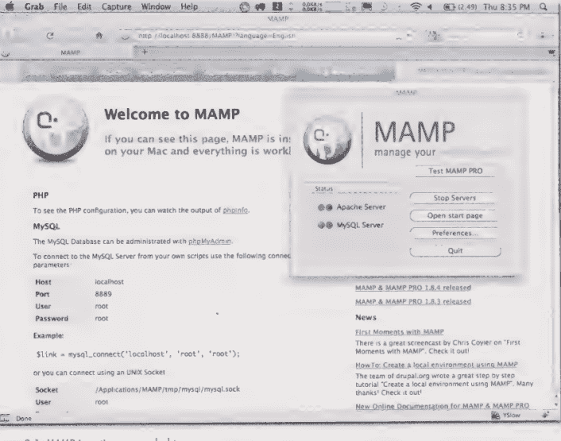

图 2-1：桌面电脑上运行的 MAMP

## 在 FIREFOX 中使用 FIREBUG

如果你没有将 Firefox 作为你的主要开发浏览器之一，我强烈建议你在继续阅读本书的后续之前下载它。例如，我使用 3.6.8 版本的 Firefox 和 1.5.4 版本的 Firefox。Hewitt 在 2006 年 12 月最初创建了 Firefox，现在它已经是一个开源开发项目。从那时起，Firefox 已经经过了多次更新，现在有超过 100 万名开发者在使用。

Firebug 是一个扩展程序，为处理 HTML、CSS 和 JavaScript 的网页设计师和开发者提供了一个工具。Firefox 是一款免费且开源的工具，通过 Firefox 扩展网站（addons.mozilla.org）供所有人使用。


图 2-2：Mac OS X 中的 Firefox 选项对话框

# 第一部分：介绍 JQUERY 和 JAVASCRIPT

Firebug 允许你随时查看和编辑你的 HTML 和 CSS（参见 Firebug 2-3），它还拥有非常强大的 JavaScript 调试器，可以帮助发现错误。控制台（console）是一个很棒的功能，因为你可以直接在控制台内的页面上执行 JavaScript，它非常有用！


图 2-3：Firebug 首页

## 如何安装并启用 Firebug

若要安装并启用 Firebug，请按照以下步骤操作：

1. 打开你的 Firebug 浏览器并访问 `www.getfirebug.com`。

2. 点击 "Install Firebug for Firefox"。

3. 弹出一个如图 2-4 所示的提示窗口，显示 "仅从受信任的作者安装扩展"。在 "Install" 按钮上，一个数字开始倒计时。当数字减到 0 时，"Install Now" 按钮将变为可用状态。点击它。

4. 接下来你会看到一个进度条，指示插件正在安装到你的浏览器中。插件安装完成后，你会看到一条确认消息和一个显示为 "Restart Firefox" 的按钮，如图 2-5 所示。

5. 恭喜，你现在准备好开始使用 Firebug 了！图 2-6 显示了安装的最后一步。


图 2-4：Firebug 安装提示


图 2-5：Firebug 安装完成

## 如何启用 Firebug

若要启用 Firebug，请按照以下步骤操作：

1. 在 Firefox 中打开一个网页。为了演示目的，我将使用 Mozilla.com。

2. 加载页面后，有几种方法打开 Firebug。简单的方法是点击浏览器右下角的 Firebug 图标。图 2-7 显示了安装 Firebug 以及浏览器右下角 Firebug 图标的示例。你也可以在浏览器窗口内右键点击，从下拉菜单中选择“Inspect Element”（检查元素）来启动 Firebug。参见图 2-8 的浏览器内下拉菜单示例。

3. 打开 Firebug 后，你会看到一系列标签页：Console、HTML、CSS、Script 和 DOM 等。


图 2-6：重启浏览器后 Firebug 的确认提示


图 2-7：网页和已安装的 Firebug


图 2-8：如何访问并打开 Inspect Element

## 如何检查和编辑 HTML

Firefox 的检查和编辑功能非常强大——它让调试 HTML 和 JavaScript 变得简单得多，尤其是当你正在动态更改 DOM 时。如果你有一个添加 HTML 的脚本，你可以打开检查窗口并实时查看更改。这始终是我调试 JavaScript 时采取的首要步骤，以确保 HTML 创建正确。参见图 2-9 的 HTML 部分。

## 如何使用控制台

Firefox 控制台是我调试 JavaScript 时采取的第二步。在修复了 DOM 的任何问题后，我会使用控制台尝试在页面上运行我的实时代码。你会看到控制台中有两个面板——左侧面板显示错误，右侧面板用于运行。

- 在 Firefox 中打开控制台

- 在控制台中查看错误

- 在控制台中运行 JavaScript


图 2-9：控制台中的 HTML


图 2-10：控制台中的 JavaScript

## 如何在 Firefox 中运行 JavaScript

Firebug 是一个为处理 HTML、CSS 和 JavaScript 的网页设计师和开发者提供工具的扩展。Firefox 是一款免费且开源的工具，通过 Firefox 扩展网站（addons.mozilla.org）供所有人使用。

Firebug 允许你随时查看和编辑你的 HTML 和 CSS（参见 Firebug 2-3），它还拥有非常强大的 JavaScript 调试器，可以帮助发现错误。控制台是一个很棒的功能，因为你可以直接在控制台内的页面上执行 JavaScript，它非常有用！

- 在控制台执行 JavaScript

- 在控制台中查看错误

- 在控制台中运行 JavaScript


图 2-11：控制台中的 JavaScript


图 2-12：控制台中的错误

## 如何在 Firebug 中运行 JavaScript

Firebug 是一个为处理 HTML、CSS 和 JavaScript 的网页设计师和开发者提供工具的扩展。Firefox 是一款免费且开源的工具，通过 Firefox 扩展网站（addons.mozilla.org）供所有人使用。

Firebug 允许你随时查看和编辑你的 HTML 和 CSS（参见 Firebug 2-3），它还拥有非常强大的 JavaScript 调试器，可以帮助发现错误。控制台是一个很棒的功能，因为你可以直接在控制台内的页面上执行 JavaScript，它非常有用！

- 在控制台执行 JavaScript

- 在控制台中查看错误

- 在控制台中运行 JavaScript


图 2-13：控制台中的 JavaScript


图 2-14：控制台中的错误

## 如何在其他浏览器中调试 JavaScript

Firebug 是一个为处理 HTML、CSS 和 JavaScript 的网页设计师和开发者提供工具的扩展。Firefox 是一款免费且开源的工具，通过 Firefox 扩展网站（addons.mozilla.org）供所有人使用。

Firebug 允许你随时查看和编辑你的 HTML 和 CSS（参见 Firebug 2-3），它还拥有非常强大的 JavaScript 调试器，可以帮助发现错误。控制台是一个很棒的功能，因为你可以直接在控制台内的页面上执行 JavaScript，它非常有用！

- 在控制台执行 JavaScript
- 在控制台中查看错误
- 在控制台中运行 JavaScript

## 高级 JavaScript 调试

Firebug 是一个为处理 HTML、CSS 和 JavaScript 的网页设计师和开发者提供工具的扩展。Firefox 是一款免费且开源的工具，通过 Firefox 扩展网站（addons.mozilla.org）供所有人使用。

Firebug 允许你随时查看和编辑你的 HTML 和 CSS（参见 Firebug 2-3），它还拥有非常强大的 JavaScript 调试器，可以帮助发现错误。控制台是一个很棒的功能，因为你可以直接在控制台内的页面上执行 JavaScript，它非常有用！

- 在控制台执行 JavaScript
- 在控制台中查看错误
- 在控制台中运行 JavaScript

# 第二章：开始使用 jQuery


例如，我是 Digg (digg.com) 的日常用户，这是一个在线新闻门户网站，根据用户投票的流行程度显示新闻。它使用了来自 Google 托管的 jQuery 库，我决定将 jQuery 添加到我的网站中。当我在浏览器中打开网站时，它会从我的浏览器缓存中获取 jQuery 的缓存版本；在这种情况下，当请求该库时，Google 会回传一个修改后的响应。在这种情况下，返回的是最新的 jQuery 库，而不是我缓存中的文件。

表 2.1 列出了 jQuery 的两个可用版本。

| 格式 | 描述 |
| --- | --- |
| 未压缩版（估计* 155 KB） | 主要用于开发工作、调试，以及希望查看代码以理解其工作原理的高级开发者。 |
| 压缩版（估计* 55 KB） | 占用空间小得多，适用于生产代码。它使用一种称为“压缩”（minification）的技术进行压缩，该技术删除了注释、换行和空格等不必要的字符以提高加载速度。 |

* 版本 1.4.2 的估计

# 第一部分：介绍 jQuery 和 JavaScript

高级用户可能想要使用 Git（源码控制软件）来访问最新版本的 jQuery 库。我不会对 Git 展开更多细节，所以如果你想了解更多相关信息，请访问 www.git.com。

## 在你的网页中引入 jQuery 库

在你决定了采用哪种方法之后——无论是下载库还是使用托管版本的 jQuery——你需要在你的网页中对其进行设置。jQuery 库可以包含在 `<script>` 标签中并位于 HTML 文档的 `<head></head>` 标签内，或者你可以在 `</body>` 结束标签之前包含 jQuery 库。

你必须在 jQuery 库和 jQuery 自定义代码之前包含每个 CSS（级联样式表），因为你希望确保在尝试用 jQuery 更改之前，所有 CSS 都已应用到 DOM（文档对象模型）。

你应该始终在 HTML 页面中包含 doctype。这样做会导致 Web 浏览器出现各种异常行为，并导致你的网页通过验证套件检查。这有助于确保你的代码在所有浏览器中都能运行。如果页面上没有 doctype，jQuery 将不会始终正确渲染。当页面没有 doctype 时，CSS 也会渲染错误。

书中的所有示例都使用 HTML 5 doctype，以确保对旧浏览器的渐式增强和优雅降级。（如果你需要提醒渐式增强和优雅降级，请参见第 1 章。）HTML5 的 doctype 设置比难以记忆的旧版本要简单得多。

以下代码是 HTML 5 的 doctype：

```html
<DOCTYPE html>
```

以下示例是一个非常基本的 HTML 文档，概述了如何在页面顶部引入 jQuery。始终包含所有 CSS 文件，以确保页面在操作 DOM 之前页面已正确渲染：

```html
<DOCTYPE html>
<head>
  <title>My jQuery Example</title>
  <link href="css/global.css">
  <script src="jquery.js" type="javascript"></script>
  <script type="text/javascript">
    // 代码写在这里
  </script>
</head>
<body>
</body>
</html>
```


或者，你也可以库包含在页面底部。这有时可以增加速度，因为不会阻塞加载。

```html
<DOCTYPE html>
<head>
  <title>My jQuery Example</title>
  <link href="css/global.css">
</head>
<body>
  <h1>Hello!</h1>
  <div id="container">
    <p>This is jQuery!</p>
  </div>
  <script src="jquery.js" type="javascript"></script>
</body>
</html>
```

如果你使用的是托管版本，设置路径：

```html
<!DOCTYPE html>
<head>
  <title>My jQuery Example</title>
  <link href="css/global.css">
  <script src="https://ajax.googleapis.com/ajax/libs/jquery/1.4.2/jquery.min.js" type="javascript"></script>
  <script type="text/javascript">
    // 代码写在这里
  </script>
</head>
<body>
</body>
</html>
```

## 理解封装器 (Wrapper)

为了解释封装器，我需要演示如何设置由美元符号 (`$`) 和 `ready()` 语句引导的对象。第一步涉及设置一个选择器作为访问 jQuery 身的别名。你在两个括号之间传递选择器；在这种情况下，我传递的是 DOM 的选择器。别名和选择器共同组成了 jQuery 封装。

```javascript
$(document)
```

`ready` 事件附加在选择器之后，并可以与其他事件互换。

```javascript
.ready()
```

函数是包含代码的部分，它在 DOM 加载并就绪后应用，且不包含图形。函数被放在 `ready` 事件的括号内，因为你正将要运行的函数传递给 `ready` 事件：

```javascript
.ready(function() {
  // jQuery DOM 代码在这里
  alert("The DOM is fully loaded and ready");
});
```

`window.load` 函数与 `document.ready()` 函数非常相似，不同在于它会等待页面上所有的图形加载后执行任何 jQuery 代码：

```javascript
$(window).load(function() {
  // jQuery 代码在这里
  alert("The window has been loaded");
});
```

## 在 DOM Ready 句柄之外运行代码

jQuery 特有的代码需要通过 `document.ready()` 事件处理程序方法进行设置。但原生的 JavaScript 变量、数组等可以设置在 `document.ready` 事件处理程序之外，因为它们不需要等待 DOM 准备就，并且由于它们是在实际脚本中指定的，它们对 DOM 是隐藏的。

下面的代码示例了一个依赖 DOM 加载后才能添加新内容的脚本。该脚本中设置了三个变量——两个在 `document.ready()` 事件之外，一个设置在 `document.ready()` 事件内部，因为它需要访问内部设置的 `for` 循环。

```html
<!DOCTYPEDOCTYPE html>
<html>
<head>
  <script src="http://ajax.googleapis.com/ajax/libs/jquery/1.4.2/jquery.min.js"></script>
</head>
<script>
  var numShows = 10;
  var numTickets = 100;
  $(document).ready(function() {
    for(i=0; i < numTickets; i++) {
      var numTotal = i + 1;
      $('.container').append('<p>There are ' + numTotal + ' tickets available</p>');
    }
  });
</script>
<body>
  <div class="container">
    <!-- -->
  </div>
</body>
</html>
```

## 防止与其他库发生冲突

如果你在编写 jQuery 时没有采取适当的预防措施，可能会与其他 JavaScript 库发生冲突。大多数冲突发生在对 `$` 别名的使用上，Prototype 也共享 `$` 作为别名。你需要采取两个步骤来消除与其他库的冲突：

1. 在你的 jQuery 库末尾添加 `noConflict` 函数。`noConflict` 函数会将 jQuery 对 `$` 别名的所有依赖归还给任何同样使用该别名的其他库。

```javascript
.noConflict();
```

2. 如如下例所示，将所有对 `$` 别名的引用更改为 `jQuery` 别名。将此：

```javascript
$(document).ready(function() { code goes here
```


# 第 2 章：上手使用 jQuery

```javascript
));
```

改为：

```javascript
jQuery(document).ready(function() {
  //code goes here
});
```

如果你不想使用 `jQuery` 别名，你也可以定义自己的别名。这通过添加一行 JavaScript 代码来定义你自己的别名来实现。在下面的示例中，我将新别名设为 `$slien`，而不仅仅是 `$J`。就是这样！

```javascript
var $slien = jQuery;

$slien(document).ready({
  // code goes here
});
```

## 将 JavaScript 用于 jQuery

变量是存储不同类型信息的极佳方法，特别是在编写 JavaScript 时。在使用 jQuery 时频繁使用变量，并在本书后后的示例中一直这样做。在编写 jQuery 时使用变量与在 JavaScript 中使用它们没有区别。你可以在 jQuery 包装器内部设置并调用变量，因为它本质上就是 JavaScript。

jQuery 的妙之处在于它就是 JavaScript，所以如果你有任何 JavaScript 的先验知识，就可以将这些知识直接应用于 jQuery。你不需要担心学习新的语法、约定或方法，因为 jQuery 的大部分功能都是基于 JavaScript 功能的，但语法要容易理解得多。

你可能在想，如果 jQuery 是 JavaScript，为什么不直接学 JavaScript 呢？答案是 jQuery 让 JavaScript 能做的一切都变得更易于实现。jQuery 的口号——“写得少，做得多”是事实如此。你可以在不知道 JavaScript 的情况下将 20 行原生 JavaScript 转换为 5 行 jQuery。对于那些对 JavaScript 感兴趣的人，学习 jQuery 可以帮助你理解 JavaScript API。

JavaScript 可能很难理解。jQuery API 让 Web 设计师更容易实现来自 jQuery API 的功能，而无需理解 JavaScript 本身的所有复杂性。jQuery 为许多以前几乎编程经验的 Web 设计师为网站添加交互性打开了大门。现在是使用 jQuery 的好时代：围绕该库的支持和社区正在以惊人的速度增长。

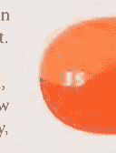

# 学习 jQuery 基础

## 第 3 章：使用选择器、过滤器和 CSS：核心

## 第 4 章：处理事件

## 第 5 章：通过效果让你的网站动起来

## 第 3 章：使用选择器、过滤器和 CSS：jQuery 核心

表 3.1 jQuery 语句的结构剖析

| jQuery 别名 | 选择器 | jQuery 方法或操作 |
|---|---|---|
| `$` 或 `jQuery` | `$(div)` | `.css('border', '1px solid #333')` |

## 使用 CSS 选择页面元素

JavaScript 拥有原生函数，可以根据 ID 和标签选择元素。这些函数的缺点是，你必须为这三种类型的元素中的每一种都使用不同的函数。此外，这会导致代码重复和膨肿，在某些情况下可能会变成的一场噩梦。当你在 jQuery 中使用选择器时，一个选择器就可以处理多种类型的元素。这使得编写整洁且易于维护的代码变得简单得多。

书中的所有示例都将浏览器输出显示为 Firebug 的输出，这样你就可以看到 DOM 中添加或更改了什么。（有关安装和使用 Firebug 的更多信息，请参阅第 2 章）。当你查看页面源代码时，看到的并不是渲染后的源码。渲染源码是浏览器加载且 JavaScript 触发后创建的实际代码，由于你正在操作 DOM，它可能会发生非常明显的变化。Firebug 显示渲染后的源码，甚至能显示源码随变化的过程，因此它是测试你的 JavaScript 和 jQuery 的完美方式。

以下列出了最常用的 jQuery 选择器，我将在本章通过代码和浏览器对其进行更深入的解释：

- `*`
- `$(p)`
- `.class`
- `$(#id)`
- `.parent ul li`

在本章中，我通过 jQuery 的 `.css()` 方法对元素应用 CSS。jQuery 中的 CSS 方法工作原理是允许你将任何 CSS 属性传递给 CSS 方法，然后这些属性会被应用于选择器匹配的元素。当 DOM 加载并准备就绪，CSS 会作为内联样式添加到元素中。

在每个示例中，你并不限于我所应用的 CSS。我只是在展示你可能自己遇到的单个问题示例，以及如何使用选择器快速解决它们。

### 使用通配符 (`*`) 选择器选择元素

如果你想选择 DOM 中的或其它元素内的所有元素，请使用通配符 (`*`) 选择器。通配符被包裹在别名后直接跟着括号内的引号中。


# 第二部分：学习 jQuery 基础

在接下来的 HTML 示例中，我使用通配符选择器选择页面上的所有元素，并为每个元素添加 CSS 边框。为了添加 CSS 边框，我使用了 `.css('border','1px solid #333');` 方法。

图 3-1 显示了打开 Firebug 标签页时，以下脚本示例的输出。在这里你可以观察 jQuery 是如何将边框内联添加到每个元素中的。

```html
<!doctype html>
<html>
<head>
  <script src='http://ajax.googleapis.com/libs/jquery/1.4.2/jquery.min.js'></script>
  <script>
  $(document).ready(function() {
    $('.').css('border','1px solid #333');
  });
  </script>
</head>
<body>
  <div class="container">
    <h1>Hello jQuery</h1>
  </div>
</body>
</html>
```

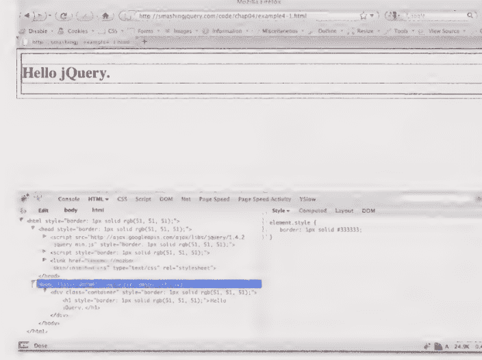

图 3-1：使用通配符选择器为页面上的每个元素添加边框的浏览器输出

### 使用 HTML 标签选择元素

在理解通配符选择器如何工作后，你可以发现其他 CSS 选择器的工作原理相同。你可以使用元素来选择 DOM 中的任何元素——你需要向选择器传递一个页面上存在的标签名。该选择器使用了原生的 JavaScript 方法 `getElementsByTagName()`。

原生 JavaScript 函数 `getElementsByTagName()` 根据标签名检索所有元素。代码设置如下：

```javascript
document.getElementsByTagName('h1');
```


在接下来的 HTML 示例中，我需要设置`h1`标签的`font-family`属性。我可以通过更改 CSS 来此，但我不想让其他页面上的`h1`标签受到影响。相反，我可以使用标签选择器配合`css()`方法，仅更改此页面上`h1`标签的`font-family`属性。我使用 ID 方法将`font-family`属性应用到我所选的单个 H1 标签上。

图 3-2 显示了在 Firefox 浏览器中运行以下代码的输出。此示例演示了在 DOM 加载后，通过向`h1`标签添加`font-family`属性是如何改变 DOM 的。

```html
<!doctype html>
<html>
<head>
  <script src='http://ajax.googleapis.com/ajax/libs/jquery/1.4.2/jquery.min.js'></script>
  <script>
  $(document).ready(function() {
    $('h1').css('font-family','arial');
  });
  </script>
</head>
<body>
  <div class="container">
    <h1>Hello jQuery</h1>
  </div>
</body>
</html>
```

### 使用 ID 选择器选择元素

你可以使用 ID 选择器来选择页面上的任何 ID。ID 选择器使用了原生的 JavaScript 方法`getElementById()`。

原生 JavaScript 函数`getElementsByTagName()`根据标签名检索所有元素。代码设置如下：

```javascript
document.getElementsByTagName('h1');
```


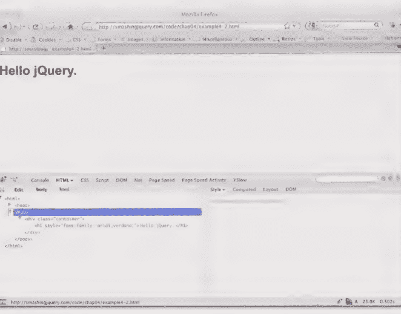

在接下来的 HTML 示例中，我需要设置`h1`标签的`font-family`属性。我可以通过更改 CSS 来此，但我不想让其他页面上的`h1`标签受到影响。相反，我可以使用标签选择器配合`css()`方法，仅更改此页面上`h1`标签的`font-family`属性。我使用 ID 方法将`font-family`属性应用到我所选的单个 H1 标签上。

```html
<!doctype html>
<html>
<head>
  <script src='http://ajax.googleapis.com/ajax/libs/jquery/1.4.2/jquery.min.js'></script>
  <script>
  $(document).ready(function() {
    $('h1').css('font-family','arial');
  });
  </script>
</head>
<body>
  <div class="container">
    <h1>Hello jQuery</h1>
  </div>
</body>
</html>
```

你可以使用 ID 选择器来选择页面上的任何 ID。ID 选择器使用了原生的 JavaScript 方法`getElementById()`。

```javascript
document.getElementById('sidebar');
```


为了隐藏`div`，我使用 ID 选择器。

```html
<!doctype html>
<html>
<head>
  <script src='http://ajax.googleapis.com/libs/jquery/1.4.2/jquery.min.js'></script>
  <script>
  $(document).ready(function() {
    $('#sidebar').css('display','none');
  });
  </script>
</head>
<body>
  <div class="container">
    <h1>Hello jQuery</h1>
  </div>
  <div id="sidebar">
    <p>Navigation</p>
    <ul>
      <li><a href="#">Home</a></li>
      <li><a href="#">About</a></li>
    </ul>
  </div>
</body>
</html>
```

图 3-3：使用 ID 选择器隐藏 ID 的浏览器输出

### 使用类选择元素

与选择 ID 类似，你也可以通过类选择页面上的元素。类选择器使用了原生的 JavaScript 方法`getElementsByClassName()`。如果你想使用原生的 JavaScript 函数`getElementsByClassName()`选择类，代码设置如下：

```javascript
document.getElementsByClassName('product-image');
```

使用 jQuery，我可以获得与`getElementsByClassName`方法相同的结果，但代码要少得多。在接下来的 HTML 示例中，我想绘制一个灰色 1 像素边框，包含 5 像素的内距以及 150 像素的宽度。CSS 方法允许使用对象字面量（一个由键值对组成的逗号分隔列表，有助于组织你的代码）传递多个 CSS 属性，这使得该语句清晰简单。

```html
<!doctype html>
<html>
<head>
  <script src="http://ajax.googleapis.com/libs/jquery/1.4.2/jquery.min.js"></script>
  <script>
  $(document).ready(function() {
    $('.telephone').css({ padding:'5px', border:'1px solid #ccc', width :'150px' });
  });
  </script>
</head>
<body>
  <div id="container">
    <h1>Hello jQuery</h1>
  </div>
  <div class="telephone"></div>
  <div class="telephone"></div>
  <div class="telephone"></div>
  <div class="telephone"></div>
  <div class="telephone"></div>
  <div class="telephone"></div>
  <div class="telephone"></div>
</body>
</html>
```

图 3-4：选择类名为 `telephone` 的八个元素后的浏览器输出

## 第 3 章：使用选择器、过滤器和 CSS：jQuery 核心

### 使用多个类名选择一个或多个元素

在某些情况下，你可能在同一个元素上应用了多个类，并且你可能只想选择应用了这些类的元素。类选择器接受多个类名。

在接下来的示例中，我有六个带有多个类的元素。我正使用 jQuery 类选择器和 CSS 方法，隐藏那同时应用了`book`和`inactive`类的两个元素。图 3-5 显示了浏览器在选择这些多个元素后的输出结果。

```html
<!doctype html>
<html>
<head>
<script src="http://ajax.googleapis.com/ajax/libs/jquery/1.4.2/jquery.min.js"></script>
<script>
$(document).ready(function() {
$('.book inactive').css('display','none');
});
</script>
<body>
<div class="book inactive">
<p>Travel Guide to NYC</p>
</div>
<div class="book active">
<p>Travel Guide to San Francisco</p>
</div>
<div class="book inactive">
<p>Travel Guide to Seattle</p>
</div>
<div class="book active">
<p>Travel Guide to Miami</p>
</div>
<div class="book active">
<p>Travel Guide to Palo Alto</p>
</div>
</body>
</html>
```

### 使用父子选择器选择页面元素

当无法使用标签、CSS 和 ID 元素时，父子选择器是选择页面内元素的一种实用方法。除了 IE6 以外，所有流行的浏览器都支持 CSS 父子属性。你对此感到惊讶吗？我并不觉得惊讶，但由于 jQuery 的存在，配合 jQuery 使用这种 CSS 选择器的美妙之处在于它也支持 IE6。在处理如导航菜单等嵌套元素时，父元素选择器可以非常有用。

# 第二部分：学习 jQuery 基础

Mozilla Firefox

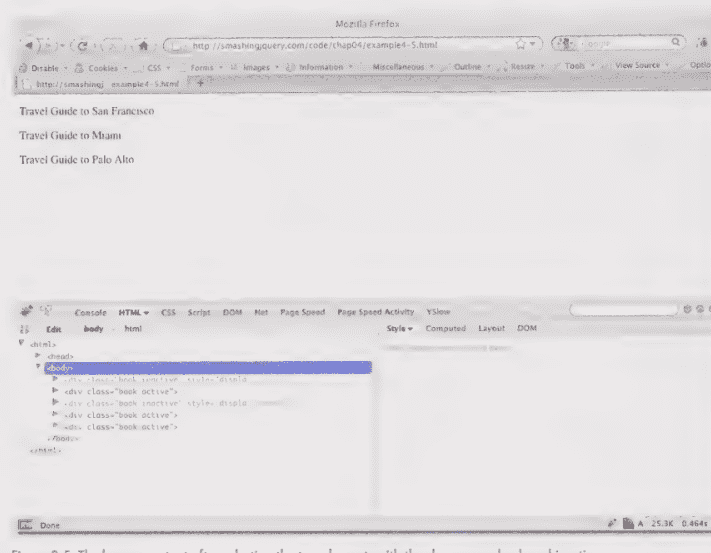

旧金山旅游指南

迈阿密旅游指南

帕洛阿尔托旅游指南

图 3-5：选择类名为 `book` 和 `inactive` 的两个元素后的浏览器输出

### 父子选择器允许你使用 `>` 运算符选择父元素的直接后代。考虑以下 jQuery 示例。该语句会选择 `body` 内部的所有段落 (`p`) 元素，只要它们是子元素（即嵌套在 `body` 标签内部）：

```javascript
$('body > p')
```

但如果你处于需要尝试选择特定 `div` 元素内部的特定段落元素的情况下，你必须通过使用它们的类名或 ID 名称来变得更加具体，以便选择正确的后代。

在接下来的 HTML 示例中，本书需要选择类名为 `(.inactive)` 的元素内的 `p` 标签，并在 `p` 标签末尾以红色添加“Sorry, this book is sold out”（抱歉，这本书已售完）。图 3-6 显示了应用选择器语句后的浏览器输出。

```html
<!doctype html>
<html>
<head>
<script src='http://ajax.googleapis.com/ajax/libs/jquery/1.4.2/jquery.min.js'></script>
<script>
$(document).ready(function() {
  $('.book.inactive > p').css('display', 'none');
  $('.book.inactive').append('Sorry this book is sold out!').css('color','red');
});
</script>
<body>
  <div class='book inactive'>
    <p>Travel Guide to NYC</p>
  </div>
  <div class='book active'>
    <p>Travel Guide to San Francisco</p>
  </div>
  <div class='book inactive'>
    <p>Travel Guide to Seattle</p>
  </div>
  <div class='book active'>
    <p>Travel Guide to Miami</p>
  </div>
  <div class='book active'>
    <p>Travel Guide to Palo Alto</p>
  </div>
</body>
</html>
```

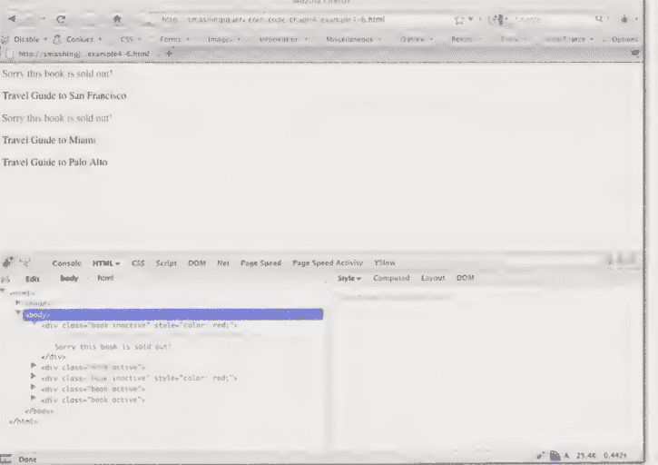

图 3-6：选择器语句的浏览器输出

# 第二部分：学习 jQuery 基础

## 使用后代选择器选择页面元素

父子选择器仅在当子元素与父元素有直接关系时才有效，例如位于 `<ul>` 标签之间的 `<li>` 标签。如果你遇到尝试选择距离父元素两或三层级的元素的情况，你就需要使用后代选择器。父子选择器与后代选择器的区别在于对 `>` 运算符的使用——如果不包含此运算符，选择器不仅匹配子元素，还会匹配后代元素。

在接下来的 HTML 示例中，我选择了嵌套在 `<ul class="sidebar-nav">` 内的 `<li>` 标签。在匹配后，我将为它应用 CSS 边框。图 3-7 显示了调用类选择器后的浏览器输出。

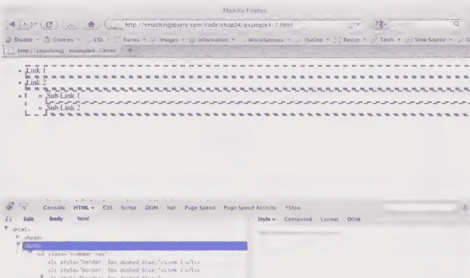

图 3-7：选择后代元素后的浏览器输出

```html
<!doctype html>
<html>
<head>
<script src='http://ajax.googleapis.com/libs/ajax/jquery/1.4.2/jquery.min.js'></script>
<script>
$(document).ready(function() {
  $('ul li').css('border','3px dashed blue');
});
</script>
</head>
<body>
<ul class="sidebar-nav">
  <li>Link 1</li>
  <li>Link 2</li>
    <ul>
      <li>Sub 1</li>
      <li>Sub 2</li>
    </ul>
  </li>
</ul>
</body>
</html>
```

### 使用选择器选择多个元素

你可能处于需要选择多个类、ID、标签以及父子关系的情况。使用选择器，你可以通过逗号分隔列表创建多个元素。在接下来的 HTML 示例中，我需要选择五个类和两个 ID，并使用 CSS 方法为 `#footer` 元素内的所有段落应用灰色背景颜色。图 3-8 显示了应用类选择器后的浏览器输出。

```html
<!doctype html>
<html>
<head>
<script src="http://ajax.googleapis.com/ajax/libs/jquery/1.4.2/jquery.min.js"></script>
<script>
$(document).ready(function() {
  $('.book-one, .book-two, .book-three, .book-four, .book-five, #header, #footer p').css('background', '#ccc');
});
</script>
</head>
<body>
<div id="header"><h1>Book Club</h1></div>
<div class="book-one">
  <p>Travel Guide to NYC</p>
</div>
<div class="book-two">
  <p>Travel Guide to San Francisco</p>
</div>
<div class="book-three">
  <p>Travel Guide to Seattle</p>
</div>
<div class="book-four">
  <p>Travel Guide to Miami</p>
</div>
<div class="book-five">
  <p>Travel Guide to Palo Alto</p>
</div>
<div id='footer'><p>Copyright 2010</p></div>
</body>
</html>
```

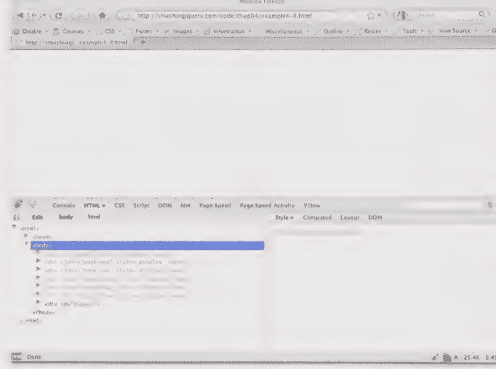

## 使用 jQuery 选择器过滤 DOM 元素

过滤器允许你精化你所选择的元素。当你想要针对 DOM 中的某一个或几个元素时，过滤器非常有用。如果你面对的是静态文档，调整 HTML 是很容易的。但在 DOM 每每次页面请求或加载都会变化的情况下，你需要使用动态前端语言（如 JavaScript）来即时添加格式。

过滤器通过跟随活动过滤器的冒号定义：`:filter`

### 应用基础定义

截至 jQuery 1.4.2，jQuery 包含了 20 种过滤器。我提供了最常用的实际示例，但你可以参考下表查看可用过滤器的完整列表。（注：由于原文未提供表格内容）

### 使用 even 和 odd 过滤器创建斑纹表格

斑纹填充是一种常见的做法，通过为每个偶数或奇数行添加浅灰色背景颜色，使表格行更易读。jQuery 中的 `:even` 和 `:odd` 过滤器使得为任何表格添加这种样式变得极其简单。这种过滤器不仅用于斑纹填充——你应用这种过滤器的可能性几乎是无限，但斑纹填充是一个很好的例子。图 3-9 显示了页面加载后对所有偶数行应用背景颜色后的浏览器输出。

# 第二部分：学习 jQuery 基础

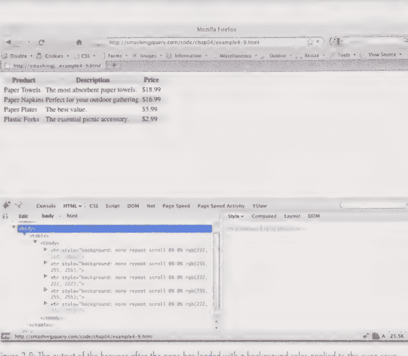


图 3-9：页面加载并对偶数行应用背景颜色后的浏览器输出

```html
<!doctype html>
<html>
<head>
<script src='http://ajax.googleapis.com/ajax/libs/jquery/1.4.2/jquery.min.js'><\/script>
<script>
$(document).ready(function() {
  $('tr:even').css('background', '#dedede');
  $('tr:odd').css('background', '#ffffff');
});
</script>
</head>
<body>
<table>
<tr>
<th>Product</th>
<th>Description</th>
<th>Price</th>
</tr>
<tr>
<td>Paper Towels</td>
<td>The most absorbent paper towels.最吸水性的纸巾。</td>
<td>$18.99</td>
</tr>
<tr>
<td>Paper Napkins</td>
<td>-Perfect for your outdoor gathering.-非常适合您的户外聚会。</td>
<td>$16.99</td>
</tr>
<tr>
<td>Paper Plates</td>
<td>-The best value.-最具价值的选择。</td>
<td>$5.99</td>
</tr>
<tr>
<td>Plastic Forks</td>
<td>-The essential picnic accessory.-必备的野餐配件。</td>
<td>$2.99</td>
</tr>
</table>
</body>
</html>
```

# 第 3 章：使用选择器、过滤器和 CSS：jQuery 核心

## 为列表或元素集合中的第一个和最后一个项目设置样式

如果你想从 DOM 元素集中过滤出第一个或最后一个项目，可以使用应用于你的选择器上的 `:first` 和 `:last` 过滤器。该过滤器只返回一个元素，它是基于你所选择的选择器中的索引。

在接下来的 HTML 示例中，我想为所有的列表项添加底边框，但第一个和最后一个除外。可以通过两种方式实现这一点：通过仅在 HTML 的最后一个元素上添加 `.last` 类。另一种方法是使用 `:first` 和 `:last` 过滤器对 `ul li` 选择器进行过滤。图 3-10 显示了对列表应用第一个和最后一个过滤器后的浏览器输出。

```html
<!doctype html>
<html>
<head>
<style>
ul {width:200px;font-family:arial;}
ul li {border-bottom:1px solid #333;}
ul a {text-decoration:none;}
</style>
<script src='http://ajax.googleapis.com/ajax/libs/jquery/1.4.2/jquery.min.js'></script>
</head>
<script>
$(document).ready(function() {
  $('ul li:first').css('border', 'none');
  $('ul li:last').css('border', 'none');
});
</script>
</head>
<body>
<div id='sidebar'>
<h1>My sidebar 我的侧边栏</h1>
<ul>
<li><a href='/index/'>Home首页</a></li>
<li><a href='/about'>About Us 关于我们</a></li>
<li><a href='/customer-service'>Customer Service客户服务</a></li>
<li><a href='/contact'>Contact Us 联系我们</a></li>
<li><a href='/coupons'>Coupons优惠券</a></li>
</ul>
</div>
</body>
</html>
```


图 3-10：对列表应用第一个和最后一个过滤器后的浏览器输出。

## 过滤包含特定元素

你可能想添加一个过滤器，只查找包含特定元素的元素。在这种情况下，你可以使用 `has()` 过滤器。它们包含的子元素不需要是父容器的直接子元素：它可以可以是后代。

在接下来的 HTML 示例中，我想添加一个过滤器，增加位于类名为 `.content` 的 `div` 内部所有 `p` 标签的字体大小。图 3-11 显示了指定元素内标记 `p` 标签的浏览器输出。

```html
<!doctype html>
<html>
<head>
<script src='http://ajax.googleapis.com/ajax/libs/jquery/1.4.2/jquery.min.js'></script>
<script>
$(document).ready(function() {
  $('.content:has(p)').css('font-size','18px');
});
</script>
<<body>
<div id="main">
  <div class="content">
    <p>This is my content 这是我的内容</p>
  </div>
  <div class="alternate">
    <p>This is alternate content.这是备用内容。</p>
  </div>
</div>
</body>
</html>
```

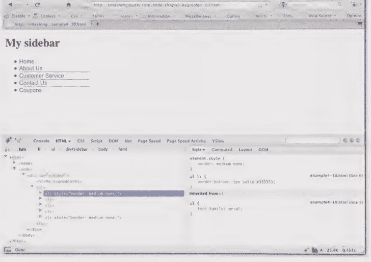

图 3-11：指定元素内包含 `p` 标签的浏览器输出。（注意）

## 过滤不包含任何元素或文本

过滤 DOM 中的空元素是很有用的。如果元素是空的，你可以使用 `:empty` 过滤器找到它。

在接下来的 HTML 示例中，我想隐藏空的 `div`。如果元素有内容，则会将 `display:none` 应用到它上。图 3-12 显示了选择器遇到空元素时的浏览器输出。

```html
<!doctype html>
<html>
<head>
<div class="content"></div>
<div class="alternate"></div>
</div
</head>
<script src='http://ajax.googleapis.com/ajax/libs/jquery/1.4.2/jquery.min.js'></script>
<script>
$(document).ready(function() {
  $('.content:empty').css('display', 'none');
});
</script>
<body>
<div id="main">
  <div class="content">
    <p>This is my content 这是我的内容</p>
  </div>
  <div class="alternate">
    <p>This is alternate content.这是备用内容。</p>
  </div>
</div>
</body>
</html>
```

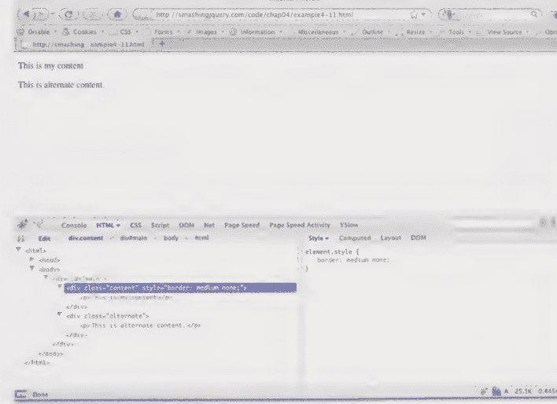

图 3-12：选择器遇到空元素时的浏览器输出。

## 过滤包含文本

在某些情况下，你可能根据包含的文本过滤元素。你可以使用 `:contains` 过滤器来实现。

在接下来的 HTML 示例中，我想隐藏包含文本的 `div`。如果元素有内容，则会将 `display:none` 应用到它上。图 3-13 显示了过滤器包含 "Paper Towels" 的单元格输出。

```html
<!doctype html>
<html>
<head>
<script src='http://ajax.googleapis.com/ajax/libs/jquery/1.4.2/jquery.min.js'></script>
<script>
$(document).ready(function() {
  $('td:contains("Paper Towels")').css('border', '1px dashed #333');
});
</script>
</head>
<body>
<table>
<tr>
<th>Product</th>
<th>Description</th>
<th>Price</th>
</tr>
<tr>
<td>Paper Towels</td>
<td>The most absorbent paper towels.最吸水性的纸巾。</td>
<td>$18.99</td>
</tr>
<tr>
<td>Paper Napkins</td>
<td>-Perfect for your outdoor gathering.-非常适合您的户外聚会。</td>
<td>$16.99</td>
</tr>
<tr>
<td>Paper Plates</td>
<td>-The best value.-最具价值的选择。</td>
<td>$5.99</td>
</tr>
<tr>
<td>Plastic Forks</td>
<td>-The essential picnic accessory.-必备的野餐配件。</td>
<td>$2.99</td>
</tr>
</table>
</body>
</html>
```

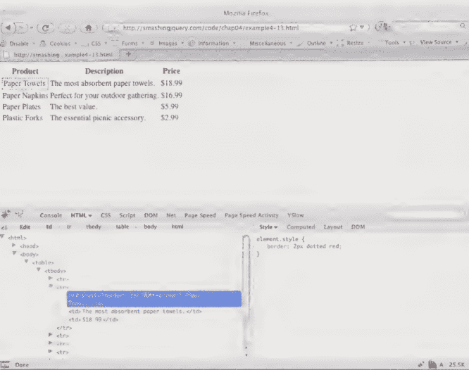

图 3-13：过滤器找到包含指定字符串 "Paper Towels" 的单元格后的浏览器输出。

## 通过属性选择 DOM 中的元素

标签的属性对于解析标签的额外信息或与 JavaScript 交互非常有用。常见的 HTML 标签是 `<a>` 锚点标签，它可以具有 `href`、`rel`、`id`、`class`、`title` 等属性。通过属性选择表单字段非常好，你可以根据 `name`、`type`、属性、ID 等搜索输入。

你可以使用表 3.3 中的任何属性来选择 DOM 元素。我将在书中后面的教程中深入讨论属性，但现在将介绍处理属性的常见示例。

### 表 3.3 属性名称和功能

| 属性名称 | 属性功能 |
| :--- | :--- |
| `[attribute="value"]` | 目标包含字符串中任何部分的属性（通配符） |
| `[attribute=value]` | 目标值开头或等于值的属性 |
| `[attribute~value]` | 目标匹配字符串中任何部分值的属性，包括空格 |
| `[attribute$=value]` | 目标以值结尾的属性 |
| `[attribute^=value]` | 目标以值开头的属性 |
| `[attribute!=value]` | 目标不具有该值的属性 |
| `[attribute=value][attribute=value][attribute=value]` | 目标多个属性 |

# 第二部分：学习 JQuery 基础

## 选择所有以特定单词结尾的元素

与通配符在属性上的工作方式类似，你可以使用美元符号 (`$`) 来选择所有包含特定文本字符串的元素。在下面的示例中，我有四个具有唯一 ID 的 `div`，我想为它们添加一个共同的类。由于我所有的 `div` 单词中都包含 `bird`（鸟），我可以使用属性选择器和最后一个单词，只要它是 `bird` 即可。图 3-15 显示了在属性选择器找到单词 `bird` 之后浏览器的输出。

```html
<!doctype html>
<html>
<head>
<style>
.bird {border:1px solid #ccc;width:200px;margin:5px;}
</style>
<script src='http://ajax.googleapis.com/ajax/libs/jquery/1.4.2/jquery.min.js'></script>
<script>
$(document).ready(function () {
  $('div[id$="bird"]').addClass('bird');
});
</script>
<body>
<div id='red-bird'></div>
<div id='blue-bird'></div>
<div id='green-bird'></div>
</body>
</html>
```

```html
<div id="black-bird"></div>
</body>
</html>
```

图 3-15：属性选择器找到单词 `bird` 之后浏览器的输出

## 操作 HTML 和 CSS

学习如何使用选择器来导航 DOM 是成功理解 jQuery 的第一步。但在选择一个元素之后，你需要对它进行一些操作，在本文情况下是添加、删除、克隆或设置样式。在将来，我将把选中的元素称为“匹配集”（matched set），因为我可以假设选择器已经返回了一个元素。

jQuery 真正的乐趣始于 DOM 操作。我已经提到了几种向 DOM 添加 CSS 的方法，但现在我将深入探讨并向你展示如何真正自定义你的页面。如果你熟悉处理此类编辑任务的原生 JavaScript 函数，jQuery 可以使用更易理解的语法和更少的代码更好地实现它们。与操作页面上的 HTML 元素类似，你也可以操作内容。

## 添加、删除、克隆和替换元素及内容

jQuery 在添加、替换和克隆 DOM 中的元素和方面非常强大。例如，我在一家公司工作，如果我需要更改页面上的 HTML，必须让后端开发人员编译代码后更改才会显示。这个过程非常耗时，特别是对于微小的更改。这正是 JavaScript 派上用场的地方。我可以使用 jQuery 和 CSS 来操作 DOM，这比让后端开发人员参与要快得多。以下示例是自己操作 DOM 的常用技术。

## 向 DOM 中添加 HTML

`html()` 方法通过向括号之间的方法传递参数（HTML 代码）来使用原生的 `innerHTML` 属性。你必须理解 `.html()` 方法获取的是你目标选择器所包含的 DOM 元素。图 3-16 显示了在 DOM 加载并应用 `html` 方法后浏览器的输出。

```html
<!doctype html>
<html>
<head>
  <script src='http://ajax.googleapis.com/ajax/libs/jquery/1.4.2/jquery.min.js'></script>
</head>
<script>
  $(document).ready(function() {
    $('.content').html('<div class="main">Hello jQuery.</div>');
  });
</script>
<body>
  <div class="content">
    <p>I run 4 times a week.</p>
    <p>I lift weights 3 times a week.</p>
  </div>
</body>
</html>
```

## 在 DOM 元素中添加文本

`text()` 方法原理与 `.html()` 方法完全相同，区别在于 `.text()` 方法仅以字符串的形式从匹配元素中获取文本。这两个方法以两种方式工作：获取值和通过传递参数来设置值。你不能将 HTML 代码传递到 `text` 元素，只能传递字符串。

```javascript
$('.content').text('Testing 1 2 3');
```

图 3-16：DOM 加载并应用 `html` 方法后浏览器的输出

## 在元素内部追加和置前 HTML

如果你想在元素内部添加 HTML，可以使用 `append()` 方法将其添加到末尾，或使用 `prepend()` 方法将其添加到所选元素的开头。你在括号中提供的 HTML 始终会被插入到所选元素内最后一个子元素之前或之后。图 3-17 显示了字符串追加到 `content` 类后浏览器的输出。

```html
<!doctype html>
<html>
<head>
<style>
.google-icon {background:url(images/google-logo.png) no-repeat}
</style>
<script src="http://ajax.googleapis.com/ajax/libs/jquery/1.4.2/jquery.min.js"></script>
<script>
$(document).ready(function () {
  $('.content').append('<p>I ride my bike 3 times a week.</p>');
});
</script>
<body>
<div class="content">
<p>I run 4 times a week.</p>
</div>
</body>
</html>
```


图 3-17: 字符串追加到 `content` 类后浏览器的输出。

## 在 DOM 元素之前之后添加 HTML

`before()` 和 `after()` 方法与 `append()` 和 `prepend()` 方法非常相似。主要区别在于 HTML 插入到所选元素之前或之后。图 3-18 显示了字符串插入到 `content` 类之后的浏览器输出。

```html
<p>I lift weights 3 times a week.</p>
</div>
</body>
</html>
```

图 3-18: 字符串插入到 `content` 类之后的浏览器的输出

## 从 DOM 中移除 HTML 元素

`remove()` 方法用于从 DOM 中移除元素。作为一名网页设计师，我倾向于用 CSS 隐藏元素，但你也可以使用 `remove()` 方法将其完全从网页上移除。你也可以通过选择父元素并将该元素的类传递给 `remove()` 方法来移除特定的子元素或后代元素。以下 HTML 示例展示了 `remove()` 方法的作用。参考图 3-17 查看元素从 DOM 中的移除。图 3-19 显示了在我从 DOM 中移除 `content` 类后浏览器的输出。

```html
<!doctype html>
<html>
<head>
<style>
.google-icon {background:url(images/google-logo.png) no-repeat;}
</style>
<script src='http://ajax.googleapis.com/ajax/libs/jquery/1.4.2/jquery.min.js'></script>
<script>
$(document).ready(function() {
  $('.content').remove();
});
</script>
<body>
  <div class="content">
    <p>I run 4 times a week.</p>
    <p>I lift weights 3 times a week.</p>
  </div>
</body>
</html>
```

图 3-19: 从 DOM 中移除 `content` 类后浏览器的输出

## 第 3 章：使用选择器、过滤器和 CSS：jQuery 核心

## 克隆 HTML 元素

你可能会遇到这种情况：需要从 DOM 中复制一个元素并将其放置在其他地方。jQuery 有一个名为 `clone()` 的方法，它可以克隆你选择的任何元素。元素克隆后，你就可以使用其他操作方法（如 `append()` 方法）自由将其放置在任何想要的地方，如下面的代码所示：

```javascript
$('.product').clone().append('.product');
```

## 处理 CSS 和 jQuery

CSS 和 jQuery 感觉就像是为协同工作而设计的。我经常在想，在没有 jQuery 的情况下我是如何生存了这么久的，特别是在大量使用 CSS 的时候。目前为止，在大多数示例中，我一直使用 `.css()` 方法为页面上的 HTML 元素添加 CSS 属性。使用 `.css()` 方法的缺点是它会在 HTML 中添加内联样式。如果你喜欢代码更整洁，我建议改为添加和移除类（class）。

表 3.4 列出了在处理 jQuery 时可用的所有 CSS 方法。

## 表 3.4 常用 CSS 方法及其功能

| 方法名称 | 方法 |
|---|---|
| `.css()` | 可以获取或为任何元素添加 CSS 属性 |
| `.addClass()` | 可以为任何元素添加一个 CSS 类 |
| `.hasClass()` | 可以测试元素是否具有某个 CSS 类 |
| `.removeClass()` | 可以从任何元素中移除 CSS 类 |
| `.toggleClass()` | 可以为任何元素添加或移除 CSS 类 |

### 为 DOM 元素添加 CSS

如果你是按照顺序学习本章的，那么你现在应该已经熟悉如何为 DOM 中的任何元素添加 CSS，因为我在所有的代码示例中都使用了 `.css()` 方法。这是一个非常有用的方法，特别是当你正在测试布局并想为你的所有元素添加边框时。

```javascript
$('.container').css('border', '1px solid #333');
```

### 为 DOM 元素添加类

如果你想给现有的 DOM 元素添加一个类，可以使用 `addClass()` 方法。该方法通过在 `addClass()` 后的括号中传递你想添加的类名来工作。在添加类名时，不需要包含点（.）。

```javascript
$('.container').addClass('active');
```

如果你要添加类的那个 DOM 元素已经有一个类，则额外的类将添加到该类之后。如果你想向匹配的集合传递多个类，只需确保用空格隔开列出每个类即可。

```javascript
$('.container').addClass('active book');
```

你并不局限于通过选择类来添加类。你也可以为 ID 和其他 HTML 标签添加类。

```javascript
$('#page-wrap').addClass('alternate');
```

### 从 DOM 元素中移除类

你还需要学习如何从元素中移除类。它的工作方式相同，但方法名从 `addClass()` 变为 `removeClass()`。

```javascript
$('#page-wrap').removeClass('alternate');
```

如果没有向方法传递类名，则该匹配集合中的任何类都将被移除。

```javascript
$('#page-wrap').removeClass();
```

你还可以通过连续将多个类添加到方法中来移除多个类，每个类之间用空格隔开。

```javascript
$('#page-wrap').removeClass('alternate main product');
```

### 切换 DOM 元素的类

切换（Toggling）是指开启或关闭某个东西。当你处理动态 Web 应用程序时，你可能不知道元素处于开启还是关闭状态，此时 `toggleClass()` 方法非常有用。

在下面的示例中，我为 `#page-wrap` div 切换 `.alternate` 类。如果该类不存在，则会添加它，反之亦然。

```javascript
$('#page-wrap').toggleClass('alternate');
```

# 4

## 处理事件

在 jQuery 中处理事件与在 HTML 中处理 CSS 非常相似。

1. 使用原生 JavaScript 数组，我设置了一个名为 `imgArray` 的数组。该数组存储了我要添加到页面上的所有图像文件名。使用数组可以避免我需要创建五个独立的语句来将图像添加到页面：

```javascript
var imgArray =
  'loc_portrait1.jpg',
  'loc_portrait2.jpg',
  'loc_portrait3.jpg',
  'loc_portrait4.jpg',
  'loc_portrait5.jpg';
```

2. 再添加两个变量，用于下一步将设置的 `for` 循环。变量 `imgArrayLength` 存储数组长度返回的值，变量 `i` 用作 `for` 循环中的索引。索引从 0 开始，除非是关联数组。

```javascript
var imgArrayLength = imgArray.length;
var i = 0;
```

3. 构建一个 `for` 循环。使用变量 `i` 将其值设置为小于等于 `imgArrayLength`。`for` 循环运行到达到数组长度（即 5）为止。

```javascript
for (i=0;i<imgArrayLength; i++) {
}
```

索引从 0 开始，即使数组中有五项内容，索引也只到 4。以下代码概述了如何使用 0 到 4 设置索引：

```javascript
imgArray[0] = 'loc_portrait1.jpg',
imgArray[1] = 'loc_portrait2.jpg',
imgArray[2] = 'loc_portrait3.jpg',
imgArray[3] = 'loc_portrait4.jpg',
imgArray[4] = 'loc_portrait5.jpg';
```

4. 当循环运行时，它每次都会添加一个 `img` 元素，直到循环完成。使用 `attr` 方法将图像的源（source）设置为 `img` 加上索引（例如，`('img'+i)`）。

```javascript
for (i=0; i <= imgArrayLength;i++) {
  $('img'+i).attr('src','images/'+imgArray[i], 'id':'img'+[i]);
  load(function() {
  });
}
```

5. 当每张图像加载完成后，它就会被添加到 DOM 中的 `(.gallery)` 容器中。图像只有在被添加到 DOM 时才是可用的。它们根据加载所需的时间顺序被添加。在图 4-2 中，注意渲染后的源代码中，它们并不是按顺序排列的，而是按文件大小排列的。

```javascript
for (i=0; i <= imgArrayLength;i++) {
  $('img'+i).attr('src','images/'+imgArray[i], 'id':'img'+[i]);
  load(function() {
    $('.gallery').append($this);
  });
}
```

图 4-2：jQuery 预加载的输出以及 Firebug 中渲染的源代码

# 第 4 章：处理事件

在之前的代码示例中，请注意 `this` 关键字的使用，它被用于引用正在执行的方法或函数的当前对象。你可以使用 `this` 关键字来引用对象，或者像下面的代码中那样引用 `` 标签。`this` 关键字在许多情况下都非常有用。图 4-3 显示了 `this` 关键字是如何工作的。

```javascript
$(offer).bind('click', function() {
  $(this).addClass('active');
});
```

图 4-3：`this` 关键字的工作原理

6. 如果你将这些代码段组合并放入你的 IDE（集成开发环境）中，它看起来如下：

```html
<!doctype html>
<html>
<head>
  <script src="http://ajax.googleapis.com/ajax/libs/jquery/1.4.2/jquery.min.js"></script>
  <script>
  var imgArray = [
    "portrait1.jpg",
    "portrait2.jpg",
    "portrait3.jpg",
    "portrait4.jpg",
    "portrait5.jpg"
  ];
  var imgLength = imgArray.length;
  for (i=0;i<imgLength;i++) {
    $('').attr('src', 'images/'+imgArray[i]).load(function() {
      $(this).fadeIn(300);
    });
  }
</script>
<body>
<h1>Hello jQuery.</h1>
<div class="gallery"></div>
</body>
</html>
```

## 在用户离开页面时显示警报

你是否想过在用户离开页面时向他们显示内容？你是否希望再给他们一次机会，用优惠来吸引他们？jQuery 的 `unload` 事件可以实现这一点。它在用户清除浏览器或向浏览器推入新地址时触发。你可能遇到过某些滥用 `unload` 事件的网站，它们弹出多个窗口不让你离开。那是处理用户离开意愿的错误方法。

相反，考虑一个用户在你的网站上填写完表单并提交后决定离开。这是使用 `unload` 事件向他们显示询问是否要离开的警报的完美时机。图 4-4 显示了用户尝试离开时的警报消息。

图 4-4：用户尝试离开页面时显示的警报消息

在一些旧版浏览器中没有正确处理 `unload` 事件。在推送任何代码之前，你应该始终在你支持的所有浏览器中进行彻底测试，以确保万无一失。

```javascript
$(window).bind('unload', function() {
  alert('你还没有完成表单，你确定要离开吗？');
});
```

`unload` 事件的简写版本如下所示：

```javascript
$(window).unload(function() {
  alert('你还没有完成表单，你确定要离开吗？');
});
```

## 使用错误事件显示备份图像

我处理一些销售超过 200 个产品的电子商务网站，考虑到每个产品不同尺寸的图像（小图、缩略图和大图），每个网站大约 600 张产品图像。当页面上的图像损坏时，我通常通过浏览网站来发现。使用 jQuery 的 `error` 事件，我可以检测图像是否缺失，并设置默认图像。

1. 你需要设置一个图像标签，可以像下面的代码一样简单。你只需要给图像标签一个唯一的 ID 以进行选择：
``
2. 接下来，为该的选择器添加 `error` 事件。该事件只有在浏览器未能正确加载文件时才会触发。
3. 接下来，设置一个处理函数，以便当错误发生时会执行某些操作。在这种情况下，为匹配元素的属性设置默认图像。

```javascript
$('#portrait').error(function() {
  $(this).attr('src', 'images/default.jpg');
});
```

## 开始学习事件委托

jQuery 中的事件委托和处理是指通过附加监听器等待事件通过 DOM 元素冒泡来执行事件。图 4-5 显示了这在 JavaScript 中是如何发生的。如果你处理过 ActionScript 3.0，那么对事件冒泡的概念应该是熟悉的，因为它在 jQuery 和 JavaScript 中的处理方式相似。在监听阶段，事件可以触发两种方法：事件捕获和事件冒泡。

事件捕获是在事件向 DOM 的后代向下流动时发生的。事件冒泡是事件从源开始向上通过 DOM 流动的现象。大多数事件都使用事件冒泡，focus 和 blur 除外。事件捕获与事件冒泡的区别在于事件通过文档流动的方向，你可以认为事件冒泡更快、更高效。jQuery 对所有事件都使用事件冒泡方法。

## 第二部分：学习 JQuery 基础

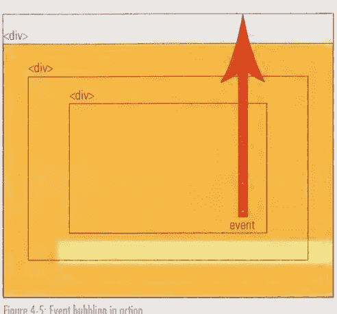

## 使用 BIND 为元素绑定事件处理程序

`bind` 事件处理程序绑定是捕获事件最基本的方法，它通过将事件类型和事件处理程序传递给 `bind` 方法，该方法使用选择器绑定到元素上。

```javascript
.bind(event type, event handler)
```

在下面的示例中，`bind` 通过选择所有包含类 `mylink` 的元素将事件处理程序绑定到事件上。当事件被触发时，它会触发 `alert` 函数：

```javascript
$(document).ready(function() {
  $('.mylink').bind('click', alertMe);
});

function alertMe() {
  alert('Hello World');
}
```

你也可以使用匿名函数设置 `bind` 事件，这通常是我设置事件处理程序的方式。下面的代码执行的操作与之前的示例相同，但它使用了匿名函数而不是在点击事件语句中插入函数。匿名函数（也称为函数字面量）适用于执行的代码仅适用于当前上下文的情况。而命名函数最适用于执行的代码将用于响应多个事件的场景。

```javascript
$(document).ready(function() {
  $('.mylink').bind('click', function() {
    alert("Hello World");
  });
});
```


`bind` 事件处理程序仅对当前在 DOM 中的元素有效。考虑以下场景：你在 DOM 中有一个名为 `box` 的现有元素，并想要复制它，并在点击链接后将新元素添加到 DOM 中。你可以设置一个绑定到链接的点击事件。每当该链接被点击时，就会在 `box` 元素上调用 `clone()` 方法，并将结果追加到容器元素中。下面的代码是一个关于你如何使用点击事件在页面加载时更改/添加当前在 DOM 中的元素的元素的示例：

```javascript
$(document).ready(function() {
  $('.box').bind('click', function() {
    $(this).clone().appendTo('.container');
  });
});

<div class="container">
  <div class="box"></div>
</div>
```

根据选择器的工作原理，你可能认为点击事件会在你添加到 DOM 的这个新元素上生效。错误！它只对绑定事件时已在 DOM 中的元素有效。点击事件仅绑定到第一个元素，因此你可以不断克隆第一个元素，但其他任何元素都不会被绑定点击事件。

## 使用 LIVE 为元素绑定事件处理程序

`live` 事件处理程序是捕获实时事件的一种灵活方式。它通过将事件类型和事件处理程序传递给 `live` 方法，该方法使用选择器绑定到元素上。其设置与 `bind` 方法非常相似，但 `live` 方法对 DOM 中当前和未来的元素有效。

```javascript
.live(event type, event handler)
```

如果我们取之前的示例并添加 `live` 事件处理程序绑定，所有的元素（当前和未来的）都是可点击的：

```javascript
$(document).ready(function() {
  $('.box').live('click', function() {
    $(this).clone().appendTo('.container');
  });
});

<div class="container">
  <div class="box"></div>
</div>
```

## 第二部分：学习查询基础

`live` 方法在 DOM 远更加动态且元素不断从 DOM 中添加和删除 Web 应用程序中效果非常好。这被称为 DOM 脚本。

使用 `live` 事件处理程序绑定的缺点是你无法像下面的代码示例所示在语句中链调用其他方法。这段代码将无法工作：

```javascript
$(document).ready(function() {
  $(container).first().live('click', function() {
    $(this).clone().addClass('square').appendTo('.container:first');
  });
});

<div class="container">
  <div class="box"></div>
</div>

<div class="container">
  <div class="box"></div>
</div>

<div class="container">
  <div class="box"></div>
</div>
```

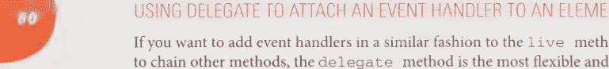

## 使用 DELEGATE 为元素绑定事件处理程序

如果你想以类似于 `live` 方法的方式添加事件处理程序，同时能够链调用其他方法，那么 `delegate` 方法是最灵活且最佳的。它通过将选择器、事件类型和处理程序传递给 `delegate` 方法，该方法使用选择器绑定到元素上。传递给 `delegate` 方法的选择器会过滤元素以针对特定的元素或一组元素。

```javascript
.delegate(selector, event type, event handler)
```

当你使用 `delegate` 方法时（其设置与 `bind` 和 `live` 方法略有不同），请执行以下操作：

- 创建选择器语句；在这种情况下，选择容器元素。
- `'.container'`
接下来，使用 `delegate` 添加事件。在通用元素内部，我过滤出选中的 `album-cover` 元素，每次点击，该元素都会被克隆并添加到通用元素中。

```javascript
$(document).ready(function() {
  $('.container').delegate('.album-cover', 'click', function() {
    $(this).clone().appendTo('.container');
  });
});
```

下面的示例展示了你如何使用点击事件在页面加载时更改/添加当前在 DOM 中的元素：

```javascript
$(document).ready(function() {
  $('.container').delegate('.album-cover', 'click', function() {
    $(this).clone().addClass('square').appendTo('.container:first');
  });
});
```

Donec diam in nisi, auctor sed tristique, pellentesque nec nisi. Sed vel libero ipsum. Quisque semper, lectus pulvinar tristique, nibh urna ultricies-queue, at varius metus in orci. Suspendisse arcu enim cursus lacinia id cursus diam rhonus. Praenient volupt volutpat tempus. Vivamus cursus adipiscing tellus, id fermentum turpis estacagnia. Aliquam tristique porttitor at pretium.

2. 使用选择器对类名为 `content-link` 的锚点标签使用点击事件。点击事件绑定到选择器上，在点击该链接后将执行大括号之间的内容。

```javascript
$('.content-link').bind('click', function() {
  // code to be executed after element is clicked
});
```

3. 使用 `div` 来显示链接已被点击的状态，我添加了一个选择器语句，匹配 ID 为 `content` 的 `div`，并为其添加了 `show` 方法。

如果匹配的集合是隐藏的，`show` 方法会将显示改为 `block`。如果匹配的集合已经是显示状态，`show` 方法不会对任何内容产生影响。

```javascript
$('#content').show();
```

4. 要要在点击页面时隐藏隐藏内容，只需在选择器语句中使用 `show( )` 方法替换为 `hide()` 方法。

```javascript
$('#content').hide();
```

5. 或者，如果你想将显示效果更改为切换（toggle），以便每次鼠标点击时都能显示或隐藏内容，请使用 `toggle` 方法。`toggle` 方法可以被看作切换显示和隐藏效果的布尔值。

```javascript
$('#content').toggle();
```

6. 如果你将所有代码放在一个页面中，它看起来将类似于下面的代码。图 4-6 显示了链接点击后的状态。Firebug 处于打开状态，显示内容元素的 `display` 属性已更改为 `block`。

```html
<!doctype html
<head>
<style>
body {font-family:arial;}
#content {display:none;}
</style>
<script src="http://ajax.googleapis.com/ajax/libs/jquery/1.4.2/jquery.min.js"></script>
<script>
$(document).ready(function () {
  $('.content-link').click(function () {
    $('#content').toggle();
  });
});
</script>
<body
<h1>Hello jQuery.</h1>
</body>
</html>
```


# 第二部分：查询基础

Lorem ipsum dolor amet, consectetur adipiscing elit. Donec gravida rhoncus commodo. Aenean sem amet augue iaculis sem consectetur accumsan vitae a arcu. Quisque quam diam, sollicitudin vel porta est, vestibulum id justo. Vestibulum mattis metus sed lorem adipiscing facilisis. Vestibulus sed ipsum nibh rutrum ultricies.

<a href="#" class="content-link">显示</a>
<div id="content">
<p>Donec diam in nisi, auctor sed tristique eleet, pellentesque nec nisi. Sed vel libero ipsum. Quisque semper, lectus in pulvinar tristique, nibh nulla sclerisque, a varius justo metus in orci. Suspendisse praesent arcu nec lacinia cursus diam rhonus. Praesent volutpat tellus, id fermentum tempus egetas. Aliquam tristique porttitor quam at pretium. In ornare aliquet Phasellus sit amet id urna tincidunt fringilla. Nulla ullamcorper magna. Class aptent socios ad litora torquent per conubia nost, nec ineptos himenaeos. Nunc lacus arcu, sagittis volutpat ut, bibendum at elit. Vestibulus a metus nec felis malesuada fringilla. Quisque vitae mauris necis sapien porta pharetra feat eu vitae sapien. Cras bibendum eleifend malesuada.</p>
</</div>
<body
</body>
</html>

## Hello jQuery.

Lorem ipsum dolor amet, consectetur adipiscing elit. Donec sollicitudin vel porta est, vestibulum id justo. Aenean sem amet augue iaculis sem consectetur accumsan vitae a arcu. Quisque quam diam, sollicitudin vel porta est, Vestibulum mattis metus sed lorem adipiscing facilisis. Vestisque semper lectus in pulvinar tristique, nibh orci ultrices mauris arcu enim, non posuere neque risus at sit dolor amet. Curabitur mattis varius. Ut elementum tincidunt, placerat volutpat tellus. Aliquam commodo volutpat velit, sed porta erat lacinia nec. Nulla vitae orci a amet nibh rhoncus.

显示

Donec diam in nisi, auctor sed tristique eleet, pellentesque nec nisi. Sed vel libero ipsum. Quisque semper, lectus in pulvinar tristique, nibh nulla sclerisque.

```html
<div id="content">
<h2>Hello, Jquery!</h2>
<p>Lorem ipsum dolor amet, consectetur adipiscing elit. Donec gravida rhoncus commodo. Aenean sem amet augue iaculis sem consectetur accumsan vitae a arcu. Quisque quam diam, sollicitudin vel porta est, Vestibulum mattis sed lorem adipiscing facilisis. Vestibulus sed ipsum nibh rutrum ultricies. Donec non ele neque risus at nibh arcu erat. Curabitur mattis varius. Ut elementum tincidunt, placerat volutpat tellus. Aliquam commodo volutpat velit, sed porta erat lacinia nec. Nulla vitae orci a amet nibh rhoncus.</p>
</div>
```

# 第 4 章：处理事件

## 理解双击事件

双击事件与点击事件相同，不同在于它是通过双击鼠标触发的。jQuery 有一个原生的 `doubleclick` 事件可以处理这种交互。

```javascript
$('.selector').bind('dblclick', function() {
  // code to be executed after double-click
});
```

## 创建在悬停事件期间显示内容的提示框

使用 jQuery 的悬停事件创建一个自定义提示框是非常简单的。这个示例基于带有说明的图片，我想将说明显示在图片下方，如图 4-9 所示。你可能会遇到类似的情况，你不希望说明一直显示，而只在用户鼠标悬停时才显示。

1. 为图片创建 HTML，使其设置了 `title` 属性。你使用 `title` 属性是为了确保没有 JavaScript 的用户也能看到图片上的提示框；这是一个渐进增强的良好示例。（参阅第 1 章复习渐进增强）。

```html
<h1>Hello jQuery</h1>
<div class="cart">
<h2>购物车</h2>
<div>
<div class="product">
<h3>iPhone 4</h3>
<div class="product-image"></div></div>
<p class="info">iPhone 4 是一部 GSM 移动手机，具有高分辨率显示屏、FaceTime 通话、HD 视频录制、500 万像素相机等更多功能。</p>
<p class="price">$299.99</p>
</div>
</div>
```

## 第4 章：处理事件

```html
<div class="add-to-cart">双击购买我</div>
</div>
```

史蒂夫·乔布斯举着最新的 iPhone 4。

iPhone 4 是一款 GSM 手机，具有高分辨率显示屏、FaceTime 视频通话、高清 视频录制等功能。5 万像素摄像头。

$299.99

图 4-9：当我悬停在图片上的提示框，以及 Firefox 中 DOM 变化的输出。

2. 下一步是添加 `document.ready` 事件，以确保仅在 DOM 准备就绪时应用 jQuery。

```javascript
$(document).ready(function() {
});
```

3. 设置 `mouseenter` 和 `mouseleave` 事件绑定到 `product-image` 元素内部的图像元素。该选择器是一个后代选择器，因为你匹配的是另一个元素的后代元素。`mouseenter` 和 `mouseleave` 确保了当用户移动到图像和离开图像时会发生两个不同的动作。

```javascript
$(document).ready(function() {
  $('.product-image img').bind({
    mouseenter: function () {
    },
    mouseleave: function () {
    }
  });
});
```


`mouseover/mouseout` 与 `mouseenter/mouseleave` 的区别在于事件的触发方式。

`mouseover` 和 `mouseout` 事件在鼠标进入元素或该元素的后代元素时触发。`mouseenter` 和 `mouseleave` 事件仅在鼠标进入元素本身时触发，无论其是否有子元素。`mouseover` 和 `mouseout` 事件可能会无意触发，从而导致你的脚本出现问题。

- 4. `mouseenter` 状态是两个状态中的第一个，在鼠标进入选中元素时触发（即 `product-image` 元素内部的 `img` 标签）。通过此，你设置了一个变量 `tooltip`。该变量存储了使用 `attr` 方法从 `title` 标签中提取的值。

```javascript
$(document).ready(function() {

  $('.product-image img').bind({

    mouseenter: function () {

      var tooltip = $(this).attr("title");

      $(this).after('<p class="tooltip">' + tooltip + '</p>');

    },

    mouseleave: function () {

    }

  });

});
```

- 5. 第二条语句将存储在变量 `tooltip` 中的提示框值连带有 `info` 类一起插入到 DOM 中。在提示框插入 DOM 后，它会被包裹在一个类为 `tooltip` 的 `p` 标签中。

- 6. 最后，`mouseleave` 状态在鼠标离开选中元素时触发。此代码通过附加到 `p.tooltip` 选择器上的 `hide()` 方法隐藏你之前添加的提示框。

```javascript
$(document).ready(function() {

  $('.product-image img').bind({

    mouseenter: function () {

      var tooltip = $(this).attr("title");

      $(this).after('<p class="tooltip">' + tooltip + '</p>');

    },

    mouseleave: function () {

      $(this).next('.tooltip').hide();

    }

  });

});
```

在上一个示例中，我使用事件类型/处理程序对的映射设置了 `mouseenter` 和 `mouseleave` 事件。以这种方式设置事件的好处是，它允许你在同一个函数内添加更多想要绑定到该元素的事件。

JavaScript 对象字面量（也称为映射/map）是键和值对的集合。其语法通常通过打开和关闭花括号建立，键和值包含在单引号中并用冒号分隔。每个键/值对各占一行，如下例所示：

```javascript
{

  'name1' : 'value1',

  'name2' : 'value2',

  'name3' : 'value3'

}
```

你可以用另一种方式使用 `mouseenter` 和 `mouseleave` 仍然获得相同的输出。`hover` 事件将 `mouseenter` 和 `mouseleave` 事件合并为一个事件，为你留下了简洁且易于使用的语法，如下面的代码所示：

```javascript
$(document).ready(function() {

  $('.product-image').hover(

    function () {

      var toolTip = $(this).attr("title");

      $('.info').after('<p class="tooltip">' + toolTip + '</p>');

    },

    function () {

      $(this).next('.tooltip').hide();

    }

  );

});
```

## 使用 MOUSEDOWN 和 MOUSEUP 事件创建基础的加入购物车功能

Web 上的拖放功能正变得越来越流行。它允许用户以 3D 方式移动屏幕上的元素，从而增加了深层次的交互性。图 4-10 显示了 Yahoo! Sports 幻想棒球界面，它具有流畅的拖放界面。

原生 JavaScript API 提供了 `mousedown` 和 `onmouseup` 事件，JavaScript 和 jQuery 事件之间的主要区别在于 JavaScript 在事件前多了一个 `on` 关键字。在 jQuery 中，这个关键字被去掉了。`mousedown` 和 `onmouseup` 只需要被称为：

图 4-10：Yahoo! Sports 幻想棒球界面，通过流畅的拖放来更换你幻象球队中的球员。

在本节中，我将介绍一些你可以通过这些概念开始构建基础拖放系统的基本概念。如果你正在寻找稳健的拖放解决方案，jQuery UI 提供了许多。

# 第二部分：学习 jQuery 基础

这里的核心概念是，我们可以检测鼠标按键的按下和释放状态，并提供两个完全不同的函数。图 4-11 显示了拖拽篮框的功能，并打开了 Firebug 以勾勒出 DOM 的更改。

所有由鼠标触发的事件也可以写成简写格式，这为开发者将 jQuery 功能构建到他们的网站和应用程序中提供了一种更简洁的方法。

这是使用 `bind` 方法以完整格式编写的点击事件：

```javascript
$.container().bind('click', function(){});
```

与上一个示例相同的使用 `bind` 方法的点击事件，但使用了简写格式：

```javascript
$.container().click(function(){});
```

使用简写格式的缺点是，你无法将多个事件绑定到同一个事件处理器上：

```javascript
$.container().bind('click dclick', function(){});
```

图 4-11 拖拽篮框的功能，同时打开了 Firebug 以勾勒出 DOM 的更改。

## 在图片按钮上创建悬停效果

使用 jQuery 设置悬停效果（rollover effect）非常简单。我记得大约10 年前第一次开始学习 HTML 和 CSS 时，为图片设置悬停效果。当时我使用一个名为 Macromedia HomeSite 的 WYSIWYG 编辑器，它创建了所有疯狂的 JavaScript 代码——可能有 25 行复杂的代码——来实现一个简单的悬停。在接下来的教程中，我将向你展示只需几行代码就能实现它！

- 1. 首先，你需要为图片添加一个类（class），这样就可以用 jQuery 选择器轻松地定位它。
- 2. 接下来，设置一个悬停事件（hover）。

```html


$('.button').hover(

function() {

  //

},

function() {

});
```

- 3. 使用 hover 事件函数的两个事件处理器来更改图像路径上的源。第一个事件处理器用于鼠标进入（`mouseenter`）状态，第二个用于鼠标离开（`mouseleave`）状态。使用属性方法（`attr`），你通过图片的路径传递 src 属性：

```javascript
$('.button').hover(

function() { $(this).attr('src', 'images/rollover_off_btn.gif'); },

function() { $(this).attr('src', 'images/rollover_off_btn.gif'); }

);
```

这里是设置悬停图片的完整代码：

```html
<!doctype html>

<html>

<head>

<script src="http://ajax.googleapis.com/ajax/libs/jquery/1.4.2/jquery.min.js"></script>

<script>

$(document).ready(function() {

$('.button').hover(

function() {

  $(this).attr('src', 'images/rollover_off_btn.gif');

},

function() {

  $(this).attr('src', 'images/rollover_off_btn.gif');

}

});

});</script>

<body><body>


</body>

</html>
```

## 捕获表单事件

与鼠标触发的事件类似，你也可以使用 `bind` 方法将事件处理器挂载到表单事件上。表单在网站和应用程序中特别常见。你可以在每个应用程序中找到它们，用于从基础搜索到完整的三步注册表单的任何场景。在某些情况下，要求用户提供列表信息的长表单可能填写起来很困难，并产生难以清理的数据。jQuery 事件有助于触发某些操作，例如当用户离开某个字段时执行表单验证，或者提示用户某个字段需要注意。表单事件可以通过许多方式增强用户体验。

jQuery 提供了许多表单事件（这些也是在原生 JavaScript 中找到的常见事件），旨在帮助你的用户在填写表单时获得更好的体验。表 4.3 总结了每个表单事件及其功能。

### 表 4.3 jQuery 表单事件的名称与功能

| 表单事件名称 | 表单事件功能 |
|---|---|
| `change()` | 当你对字段内容进行更改时触发 |
| `focus()` | 当你通过 Tab 键进入或选择文本字段时触发 |
| `focusin()` | 当你通过 Tab 键进入或选择包含在某个元素内的文本字段时触发 |
| `focusout()` | 当文本字段或文本区域失去焦点并转移到元素外的另一个元素时触发 |
| `blur()` | 当文本字段或文本区域失去焦点转移到另一个元素时触发 |
| `select()` | 当元素内的文本被选中时触发 |
| `submit()` | 当提交表单时触发（通过点击提交按钮或按下键盘回车键） |
| `reset()` | 当使用 `input type="reset"` 重置表单时触发 |

## 用户添加焦点时为表单字段添加边框

`focus` 事件用于引导用户通过表单中的字段。当元素（通常是表单字段）获得焦点时，会触发 `focus` 事件。在用户开始输入后，你可以通过 `focus` 事件的回调运行一个函数。

在下面的示例中，我向你展示如何设置一个 `focus` 事件，为表单字段添加 CSS 边框。

- 1. 第一步涉及设置 HTML。
- 2. 创建匹配 `container` 的选择器并给它一个 ID。
- 3. 在 CSS 中添加 `border` 属性。

```html
<input type="text" name="firstName" id="container"/>
```

```javascript
$('.container').bind('focus', function() {

  $(this).css('border', '1px solid red');

});
```

该输入字段现在绑定了 `focus` 事件；当用户点击它时，边框将变为 `1px solid red`。

## 用户离开输入字段后显示消息

`blur` 事件是 `focus` 事件的反面，当用户的鼠标或光标离开输入字段时触发。用户界面的变化，例如输入字段周围的边框变为红色或在电子邮件字段上进行验证，都是 `blur` 事件结果的真实世界示例。我将重点介绍更多使用 jQuery 创建交互式表单的方法。

## 捕获键盘事件

键盘事件与鼠标事件类似，但它们捕获的是通过按下键盘产生的事件。键盘事件用于浏览器内表单和内联格式验证。在某些需要用户名的网站上，用户名验证脚本通常会在你输入时进行验证。表 4.4 介绍了键盘事件列表以及每个函数的功能。

### 表 4.4 jQuery 键盘事件的名称与功能

| 键盘事件名称 | 键盘事件功能 |
|---|---|
| `keydown()` | 当键被首次按下时触发 |
| `keypress()` | 当键被按下一次或多次时触发 |
| `keyup()` | 当键在按下后松开时触发 |

`change` 事件以与其他事件相同的方式使用 `bind` 方法设置。

# 第二部分：学习 JQuery 基础

```javascript
$('.container').bind('change', function() {
```

在本教程中，我将向你展示如何创建一个类似于 Twitter 上使用的剩余字符计数脚本。本教程的最终结果如图 4-13 所示。

- 1. 第一步涉及设置 HTML。创建一个输入字段并给它一个 ID 为 `status`。此输入框将配合 `change` 事件使用，用于检测新添加的字符。

```html
<textarea col='50' rows='5' id='status'></textarea>
```

- 2. 添加一个名为 `counter` 的空 `div`。当你向输入框输入内容时，剩余字符数就会显示在这里。

```html
<div class='counter'></div>
```

- 3. 设置变量 `maxNum`，表示允许的最大字符数，并将其设置为 100。

```javascript
var maxNum = 100;
```

图 4-12：Twitter 状态字段上的最大限制函数
©2010 Twitter. www.twitter.com

- 4. 创建一个匹配 `status` 元素的选择器，并将 `keypress` 事件绑定到事件处理器上。`keypress` 事件在每次按下键盘键时都会触发，这是在焦点位于 `status` 元素内部时测试表单字段输入的完美事件。

```javascript
$('#status').bind({

  keypress : function() {

  }

});
```

5. 在 `keyup` 触发后，我需要获取 `status` 输入字段的值。我设置了一个名为 `inputText` 的变量来存储此值。我设置了另一个名为 `numChar` 的变量来存储 `inputText` 变量的长度。然后创建一个名为 `charRemain` 的变量，存储 `maxNum` 减去 `numChar` 的结果。

```javascript
$('#status').bind({

  keypress : function() {

  var inputText = $(this).val();

  var numChar = inputText.length;

  var charRemain = numChar - maxNum;

  }

});
```

6. 设置好所有变量后，我需要使用比较运算符添加一个条件语句，检查 `numChar` 的值是否小于或等于 `maxNum`。如果表达式返回 `true`，我们选择 `counter` 元素并将文本更改为 `charRemain`（剩余字符数）。

```javascript
$('#status').bind({

  keypress : function() {

  var inputText = $(this).val();

  var numChar = inputText.length;

  var charRemain = numChar - maxNum;

  if (numChar <= maxNum) {

    $('.counter').text(charRemain);

  }

  }

});
```

7. 最后，你还需要添加一个 `else` 语句，检查 `maxNum` 是否大于 `numChar`。如果该表达式返回 `true`，使用 `event.preventDefault()` 防止用户在文本框中继续输入更多字母。`event.preventDefault()` 等同于原生 JavaScript 语句 `return false`，它会阻止事件发生。

```javascript
$('#status').bind({

  keypress : function() {

  var inputText = $(this).val();

  var numChar = inputText.length;

  var charRemain = numChar - maxNum;

  if (numChar <= maxNum) {

    $('.counter').text(charRemain);

  }

  else if (numChar > maxNum) {

    event.preventDefault();

  }

  }

});
```


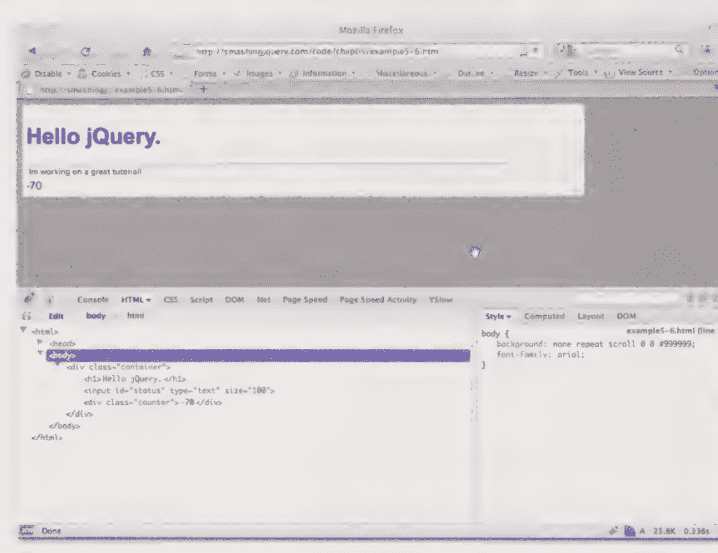

图 4-13：在字段中输入文本时脚本的运行情况以及计数器的倒计时

## 5 使用效果让你的网站活起来

在过去的几年里，在 Adobe Flash 曾经统治网络世界的行业中，JavaScript 效果已经变得非常成熟。以前只能在 Flash 中实现的带有图片幻灯片、动画菜单或类视频动画的网站，现在通常使用 JavaScript 实现，以便于跨浏览器和移动端的兼容性。JavaScript 效果使用量的增加，是 Web 设计师和开发者利用 jQuery 效果 API 的主要原因。

jQuery 利用你可能已经熟悉的 JavaScript 效果，提供了可以轻松集成到任何 Web 网站中的强大功能。因为它们是用 jQuery 编写的，这些效果设置非常简单，这使其成为 Web 设计师和开发者之间的流行选择。

在本章中，我将回顾通过 jQuery API 为你提供的效果，向你展示每种效果及其工作原理，然后带你了解几个真实应用场景。

## 探索 JQuery 效果能做什么

作为 Web 设计师和前端开发者，我们的工作是让 Web 网站的用户界面变得易用。这通常涉及到将元素移出屏幕，以便在页面上容纳更多内容。用户想要并期望即时反馈：他们不想在那些拥有许多页面且加载缓慢的笨拙网站上等待。

Facebook 是最流行的社交网络，拥有超过 5 亿亿用户，它有一个由 JavaScript 驱动的极具交互性且有趣的界面。如果你登录 Facebook 页面，你可以与朋友聊天并查看朋友动态，而无需注册新页面。这种用户体验是使用 `show`/`hide` 等 JavaScript 效果创建的。像 Facebook 这样的网站正在为用户的预期设定高标准标杆。基于地理位置的应用开始变得越来越流行。许多此类网站整合了前端技术。图 5-1 显示了 Gowalla。

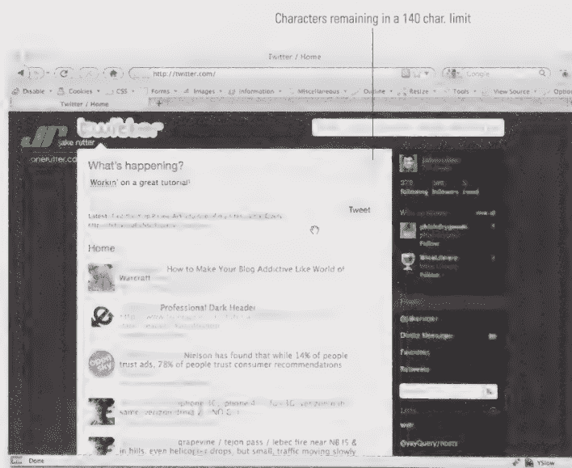

基于地理位置的社区。©2010 Twitter

jQuery 提供了显示、隐藏、滑动和淡入等基础效果。表 5-1 列出了通过 jQuery 提供的效果。

### 5.1 基础效果

| 效果名称 | 功能描述 |
| :--- | :--- |
| `show()` | 显示元素 |
| `hide()` | 隐藏元素 |
| `toggle()` | 切换显示隐藏 |
| `slideDown()` | 向下滑动 |
| `slideUp()` | 向上滑动 |
| `slideToggle()` | 切换滑动 |
| `fadeIn()` | 淡入 |
| `fadeOut()` | 淡出 |
| `fadeTo()` | 淡入到指定的透明度 |

## 使用显示和隐藏显示元素

作为 Web 设计师和前端开发者，我们的任务是让 Web 网站的用户界面变得易用。这通常涉及到为了在页面上容纳更多内容而将元素移出屏幕。像 Facebook 这样的网站正在为用户的预期设定高标准。


基于地理位置的应用开始变得越来越流行。许多此类网站整合了前端技术。图 5-1 显示了 Gowalla。


基于地理位置的社区。

jQuery 提供了显示、隐藏、滑动和淡入等基础效果。表 5-1 列出了通过 jQuery 提供的效果。

（注：由于原文文本存在重复，部分重复内容已按要求翻译以确保逻辑流畅）

## 第二部分：学习 jQuery 基础

3. 为“隐藏”链接设置另一个点击事件，以隐藏消息并设置隐藏回调函数。

```javascript
$('.hide').bind('click', function() {
  $('#message').hide(hideMessage);
});
```

4. 接下来，设置 `hideMessage()` 函数，该函数会在用户查看消息后在他们的计算机上创建一个 cookie。

```javascript
function hideMessage() {
}
```

5. 创建一个名为 `hideCookie` 的 cookie，并将其设置为在今天起 30 天后过期。日期是通过 JavaScript `Date` 对象设置的。这是原生 JavaScript 函数与 jQuery 混合使用的良好示例。图 5-4 显示了在 Firefox 中设置值的 cookie 截图。

```javascript
function hideMessage() {
  var expDate = new Date();
  expDate.setDate(expDate.getDate() + 30);
  document.cookie = "name=hideCookie;expires=" + expDate.toUTCString() + ";";
}
```

到此时，你应该能够显示和隐藏消息并设置 cookie 了。但那些已经看过的消息的用户呢？如果他们明天回到网站，你希望确保他们不再再次看到它。你可以通过创建另一个运行 `load` 事件的函数，如果发现了 cookie，则隐藏消息，如图 5-5 所示：

1. 添加一个赋值给 cookie 的变量。使用 JavaScript 对象，你可以通过 `document.cookie` 获取 cookie。
2. 创建一个条件语句，测试 `messageCookie` 是否有值，然后隐藏特惠链接；否则，什么都不做。

```javascript
var messageCookie = document.cookie;

if (messageCookie) {
  // 如果存在消息 cookie，则隐藏特惠链接
  $('.special-offer').hide();
} else {
  // 什么都不做
}
```

## 在显示和隐藏之间切换

你可能会遇到需要在显示效果和隐藏效果之间进行切换的情况。jQuery 为此提供了一个非常好的解决方案，称为 `toggle()`。`toggle()` 方法将事件处理程序绑定到点击事件，并允许你根据元素的当前可见性在显示和隐藏之间切换。以下示例的重点部分是使用 CSS 将 `recipe` 元素设置为隐藏；`toggle` 是基于该属性起的。

```css
<style>
.recipe {
  display: none;
}
</style>
```

```javascript
$('.recipe-name').toggle(
  function() {
    $('.recipe-name').show();
  },
  function() {
    $('.recipe-name').hide();
  }
);
```

```html
<a href="#" class="recipe-name">百青柠派</a>
<div class="recipe-name">百青柠派是一种由青柠汁、蛋黄和甜味浓奶油在派皮中制成的美国甜点。</div>
```

图 5-4：在 Firefox 中设置值的 cookie

图 5-5：点击链接后，消息和特惠元素被隐藏

## 元素的向上和向下滑动

滑动效果在 Web 的许多地方都可见，最常见于图片库，图片滑入和滑出视野。此外，随着最近 Facebook 和 Twitter 带来的实时对话热潮，页面上活动的滑入和滑出也很常见。查看图 5-6，了解 `www.twitter.com` 如何在发布新推文时在其首页集成滑动效果。每当发布一条新推文时，推文就会从顶部向下滑动，将页面上当前的推文逐个向下推，直到推文离开页面并变得可见。

`slideDown` 和 `slideUp` 方法的设置方式与 `show` 和 `hide` 方法完全相同。通过向选择器添加该方法，你可以传递两个可选参数（持续时间和回调）。这些方法的名称通常会让 jQuery 初学者感到困惑。`slideDown` 方法让元素可见，而 `slideUp` 方法让元素隐藏。

```javascript
$('.message').slideDown();
```

图 5-6：当新推文到达时，Twitter 在其首页集成了滑动效果

© 2010 Twitter. `www.twitter.com`

## 使用 SLIDGLE 方法显示备搜索选项

搜索是 Web 不可缺的一部分，这可能也是 Google 是当今最成功公司的原因。每个用户都希望能够在你的网站上搜索并轻松地找到他们寻找的内容。构建一个更好的用户界面是对你网站的一个重要改进。Mozilla 有一个庞大的开发者社区，他们为 Firefox 浏览器创建插件。图 5-7 是他们带有高级选项的搜索栏示例。如果你点击高级选项，高级搜索栏会滑下，这让你留在同一页面上，但允许你扩展搜索。此功能可以使用 jQuery 的 `slideToggle` 方法轻松添加。

`slideToggle` 方法与显示和隐藏元素的 `toggle` 方法非常相似，不同之处它没有绑定到点击事件。如果元素已经显示并调用了 `slideToggle`，它会被设置为向上滑动。

```javascript
$('message').slideToggle();
```

在接下来的教程中，我将向你展示如何使用 `slideToggle` 方法设置滑入到位的高级搜索方法，类似于图 5-7 所示的网站。

1. 为搜索输入和高级选项创建 HTML：

```html
<style>
body {
  font-family: arial;
}
.advanced {
  display: none;
  padding: 3px;
  border: 1px solid #ccc;
  margin: 10px;
}
</style>

<div id="search">
  <h1>Johnny's Superstore</h1>
  <input type="text">
  <button>Search</button>
  <div class="advanced">
    <input type="checkbox" name="category"> Clothing
    <input type="checkbox" name="category"> Electronics
    <input type="checkbox" name="category"> Home
    <input type="checkbox" name="category"> Sale
    <input type="checkbox" name="category"> Clearance Only
  </div>
</div>
```

2. 为选择器添加该方法，并传递可选参数：

```javascript
$('#search button').bind('click', function() {
  $('.advanced').slideToggle();
});
```

现在，你应该能够显示和隐藏高级选项了。

```css
body {
  font-family: arial;
}
ul#nav {
  list-style-type: none;
  margin: 10px 0 10px;
  padding: 0;
}
ul#nav li {
  float: left;
  width: 30px;
}
ul#nav li a {
  text-decoration: none;
  background: #05609A;
  color: #fff;
  padding: 5px;
}
ul#nav li a.active {
  background: #B4F114;
}
.slide-image {
  width: 400px;
  height: 300px;
  border: 2px solid #05609A;
  overflow: hidden;
}
.slide-image img {
  display: none;
}
```

3. 创建一个数组来存储所有图片并将其赋值给变量 `slideArray`。该数组决定了创建多少个导航链接，取决于该数组中图片的数量。可以随时插入更多或更少的图片，脚本会自动调整。

```javascript
var slideArray = [
  "insel_adams1.jpg",
  "insel_adams2.jpg",
  "insel_adams3.jpg",
  "insel_adams4.jpg",
  "insel_adams5.jpg"
];
```

此外，创建一个名为 `imgDir` 的变量，用于存储幻灯片文件夹的路径（相对路径或绝对路径）。在稍后的教程设置幻灯片图片时，会包含此变量。

```javascript
var imgDir = 'insel/adams/';
```

4. 将 `slide-image` 元素追加到容器元素内部的 DOM 中。这个插入的元素会在图片被添加到 DOM 时持有所有图片。

```javascript
$('.container').append('<div class="slide-image"></div>');
```

5. 设置好 `slide-image` 元素后，你需要添加一张图片在页面加载后显示在该元素中。

```javascript
$('.slide-image').html('');
```

6. 在 `slide-image` 元素之后将无序列表 `nav` 插入 DOM。它包含了幻灯片中所有的链接。

```javascript
$('.slide-image').after('<ul id="nav"></ul>');
```

7. 使用 `length` 属性确定 `slideArray` 数组中有多少项，并将其赋值给变量 `slideLength`。

```javascript
var slideLength = slideArray.length;
```

8. 设置一个循环遍历 `slideArray` 中的所有项，使用 `slideLength` 限制循环次数为 5 次。

```javascript
for (i = 0; i < slideLength; i++) {
}
```

9. 因为数组中有 5 个项目，`length` 返回 5。添加一个名为 `slideText` 的变量并将其赋值为 `i`（索引）。这确保了锚点文本从 1 到 5，而不是从 0 到 4 开始。

```javascript
for (i = 0; i < slideLength; i++) {
  var slideText = i + 1;
}
```

10. 接下来，使用第 5 步添加到 DOM 的 `nav` 元素，为数组中的每个索引追加一个 `li` 元素。在每个 `li` 内部，包含一个 `rel` 属性设置为 `slideText` 值的锚点标签，并将 `slideText` 插入锚点文本。使用此 `rel` 属性来设置插入哪张图片。5-10 显示了在浏览器中评估循环的过程，结果为 HTML，可以通过 Firebase 看到。

```javascript
for (i = 0; i < slideLength; i++) {
  $('#nav').append('<li><a href="# rel="'+slideText+'">'+slideText+'</a></li>');
}
```

11. 创建导航列表后，我需要为每个链接元素设置点击事件。使用 `bind` 方法设置一个基础点击事件，将 `nav` 选择器语句绑定到处理器上。

```javascript
$('#nav a').bind('click', function() {
});
```

12. 添加一个名为 `numSlide` 的变量来存储属性 `rel` 值。此值仅在点击幻灯片导航锚点时设置；随后是在事件触发时，而不是绑定时。

```javascript
$('#nav a').bind('click', function() {
  var numSlide = $(this).attr('rel');
});
```

13. 设置 `slide-image` 元素并插入包含 `imgDir` 和 `numSlide` 变量的图片标签。这会在点击页面链接时为页面添加正确的图片和服务器路径。

```javascript
$('#nav a').bind('click', function() {
  var numSlide = $(this).attr('rel');
  $('.slide-image').html('');
});
```

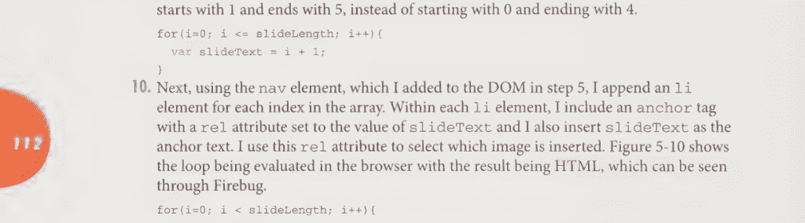

## 第 5 章：通过特效让你的网站活起来

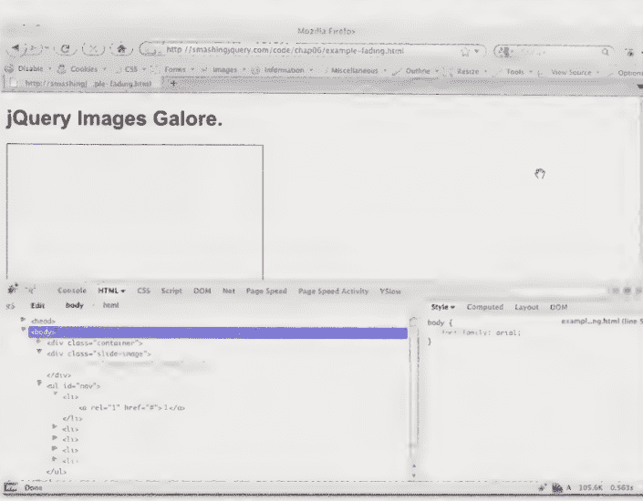

## jQuery 图片盛宴

图 5-10：浏览器中 `for` 循环的输出。打开 Firebug 即可看到 HTML。

14. 在点击页面链接时，为页面添加正确的图片和服务器路径。

图 5-10：浏览器中 `for` 循环的输出。打开 Firebug 即可看到 HTML。

```javascript
$('#nav a').bind('click', function() {
  var numSlide = $(this).attr('rel');
  $('.slide-image').html('');
});
```

14. 在点击页面链接时，为页面添加正确的图片和服务器路径。

图 5-10：浏览器中 `for` 循环的输出。打开 Firebug 即可看到 HTML。

14. 在点击页面链接时，为页面添加正确的图片和服务器路径。

图 5-10：浏览器中 `for` 循环的输出。打开 Firebug 即可看到 HTML。


- 14. 在点击页面链接时，为页面添加正确的图片和服务器路径。

图 5-10：浏览器中`for`循环的输出。打开 Firebug 即可看到 HTML。

- 14. 在点击页面链接后，第一个语句将移除所有导航标签的`active`类。让幻灯片。

```javascript
$('#nav a').bind('click', function() {
  var numSlide = $(this).attr('rel');
  $('.slide-image').html('');
});
```

- 15. 选择`slide-image`元素的内部图片标签并添加`fadeIn(n)`效果。

```javascript
$('#nav a').bind('click', function() {
  var numSlide = $(this).attr('rel');
  $('.slide-image').html('');
});
```

# 第二部分：学习 jQuery 基础

在`end()`方法之前的方法。图 5-11 显示了上一个代码示例中链式调用多个方法的结果。

```
$('#news').find('#politics').css('border','1px solid red').find('#finance').hide().end().find('#local').css('border','1px solid blue');
```

Mozilla Firefox

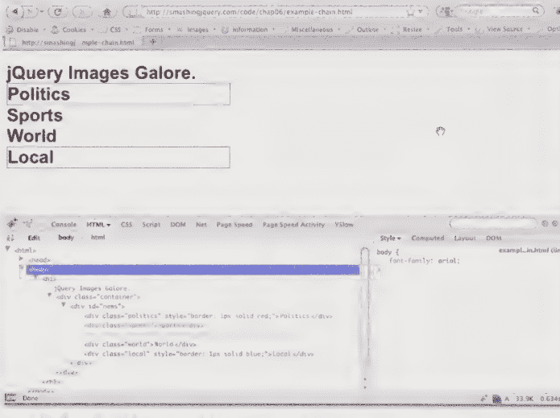

图 5-11：上一个代码中多个方法链在一起的最终结果

## 创建具有多种效果的新闻滚动条

随着通过 RSS（实时简单分发）流、新闻滚动条和小组件传递新闻内容以接触更广泛观众的吸引，新闻滚动条变得越来越常见。新闻滚动条可以是任何形式，从每次重新加载页面时刷新的包含 10 条新闻的框，到像图 5-12 所示的 Google 实时搜索引擎那样显示实时更新的高级新闻滚动条。

在这里我将展示如何创建一个基础的新闻流，使用多种效果拉取静态内容，使项目淡入并滑入视野。这个新闻滚动条可以通过少量调整扩展到包含 RSS 流，但这些已经足够你入门了：

- 第一步是创建一个基础的 HTML 新闻滚动条。目标是让这个新闻滚动条尽可能动态，这样它可以被放到任何页面上而无需修改页面本身。在这种情况下，我创建了一个带有 H1 元素的页面，我在选择器语句中使用该元素，直接在它之后插入新闻滚动条。

# 第五章：使用效果让你的网站活跃起来

```
<body>
  <h1>Query Latest News</h1>
</body>
```

2. 我在一个名为`newsArray`的数组中设置了两个标题。这些是在新闻滚动条中循环的静态内容。


```javascript
var newsArray = [
  "Delhomme, Wallace sharp for Browns",
  "Bucs expect to have injured QB Freeman for opener",
  "Report: Haysworth likely has rhabdomyolysis",
  "QB Orton effectively leading Broncos in preseason",
  "Vernon Gholston not offended by set-fight",
  "Cubs' Piniella to retire after Sunday",
  "Bradley Fisher interested in Aston Villa job",
  "Garcia-Reyes Fish, Cardinals roll 9-0",
  "Cano, CC power yankees over M's 10-0"
];
```

我设置了两个变量：`newsLength` 设置为 `newsArray` 的长度。`newsInterval` 处理毫秒为单位的数值，用于控制多频率获取新标题并将其插入新闻滚动条。

```javascript
var newsLength = 2000;
var newsInterval = ...
```

选择 `H1` 元素并在更新后插入序列表 `news-feed`。

```javascript
$('h1').after('<ul id='news-feed'></ul>');
```

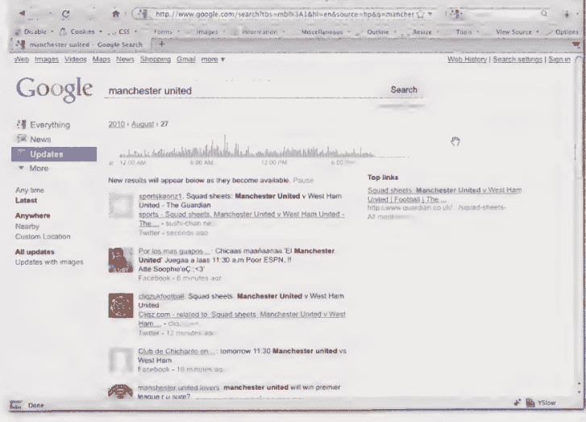

图 5-12：实时搜索引擎，它会随着 Twitter 发布时显示其新内容

转载自 2010 © Google

# 第二部分：学习 jQuery 基础

创建一个 for 循环来遍历 `newsArray` 中的所有标题。对于每个标题，在 `news-feed` 无序列表中添加一个列表项，并在两个 `li` 标签之间放入标题名称：

```javascript
for(i=0; i<newsLength; i++) {
  $('#news-feed').append('<li>'+newsArray[i]+'</li>');
}
```

接下来，使用名为 `slideHeadline` 的函数，它包含了使新闻滚动条工作的所有效果。函数的第一语句选择 `news-feed` 无序列表中的最后一项，将其克隆并重新插入列表，但使用的是 `prepend` 方法。

```javascript
function slideHeadline() {
  $('#news-feed li:last').clone().prepend('#news-feed').hide();
}
```

添加到函数的第二个语句选择新流中刚刚创建的第一个项（克隆元素），并对其添加 `slideDown` 效果。

```javascript
function slideHeadline() {
  $('#news-feed li:last').clone().prepend('#news-feed').css('display', 'none');
  $('#news-feed li:first').slideDown();
}
```

我不仅想以 500 毫秒的速度滑动第一个项，还想以 1,000 毫秒的速率将其淡入，通过在包含 `slideDown` 方法的同一语句中添加 `fadeIn` 方法来实现。

```javascript
function slideHeadline() {
  $('#news-feed li:last').clone().prepend('#news-feed').css('display', 'none');
  $('#news-feed li:first').fadeIn(1000).slideDown(500);
}
```

添加到 `slideArticle` 函数的最后一条语句移除列表中的项。这三条语句连续执行，模拟了良好的淡入和滑动效果，如图 5-13 所示。

```javascript
function slideHeadline() {
  $('#news-feed li:last').clone().prepend('#news-feed').css('display', 'none');
  $('#news-feed li:first').fadeIn(1000).slideDown(500);
}
```

`setInterval` 是一个原生的 JavaScript 函数，允许你在给定时间后运行。有一个类似的计时器叫做 `setTimeout`，它只运行一次。有两个函数可以停止这些计时器：`clearInterval` 和 `clearTimeout`。

```javascript
setInterval(slideHeadline);
```


# 第五章：使用效果让你的网站活跃起来


图 5-13：顶部元素淡入视野

## 高级动画

jQuery 提供了一个名为 `animate` 的方法，你可以用它创建自定义动画。与其组合链式调用 `fade`、`slide` 和 `show`（这范围可能非常有限），`animate` 方法允许你使用任何由数值值控制的 CSS 属性。可以使用的 CSS 属性列在表 5.2 中。

表 5.2 可配合 `animate` 使用的常用 CSS 属性

| CSS 属性 | 示例值 |

|---|---|

| `opacity` | `0.5` |

| `top` | `10 px` |

| `height` | `100 px` |

| `width` | `200 px` |

| `margin` | `10 px` |

| `padding` | `15 px` |

# 第二部分：学习 jQuery 基础

## 构建带有文字效果的图片库

直到几年前，我一直在使用 Flash 和 ActionScript，直到我决定改变方向开始更多地使用 JavaScript。我切换是因为我可以使用 JavaScript 对 DOM 进行更多控制，而且是因为移动设备上缺乏 Flash 和 ActionScript。Flash 适用于高级动画，但图片库在 JavaScript 中已经进步巨大。我发现学习 ActionScript 的主要益处是它们在处理事件和效果方面非常相似。

理解任何编程语言背后的基本概念对于学习另一种语言具有巨大的优势：大多数概念保持不变，改变的是语言语法。ActionScript 和 JavaScript 都基于 ECMAScript，因此它们有很多相似之处。2006 年，我构建了我的第一个由 Flash 8 XML 驱动的幻灯片。这是一个非常酷的应用程序。如果你将文件粘贴到 Flash 文件，它会遍历 XML，添加幻灯片并进行动画，允许你点击每个幻灯片跳转到链接，如图 5-14 所示。我对那个脚本感到非常自豪——如此自豪以将其发布在我的博客（overutter.com）上，它被下载了超过 13,000 次。Flash 文件的大小约为 5 KB，有 136 行代码，在当时相当紧凑且令人印象。直到我开始使用 jQuery，我才开始意识到多少代码才太多！


图 5-14：我在 2006 年创建的 Flash 8 XML 图片库

## 第 5 章：通过效果让你的网站生动

下面的动画图片图库教程允许你创建一个与 2006 年使用 Flash 构建的类似的库，不同之处在于它不是 XML 驱动的，且代码仅约 85 行。如果你喜欢，可以通过添加对 XML 馈的支持来扩展图片图库，但我将这交由你决定。图 5-15 展示了图片幻灯片的工作原理。

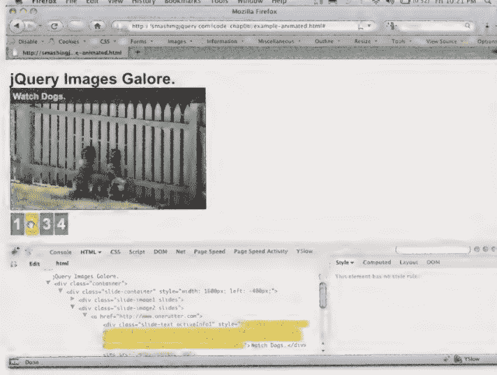

图 5-15：图片幻灯片的工作原理

1. 页面上唯一的 HTML 是一个名为 `container` 的元素。所有必要的 HTML 都通过脚本 DOM 绑定到该元素上。

```html
<div class="container"></div>
```

2. 接下来，你需要设置样式表来为图片图库设置样式。如果你决定使用不同尺寸的图片，你需要更改 `.container` 属性以反映新的图片尺寸。`.text-strip` 类已设置好，会在每个图像切换时在图像上方显示文本。

```css
body {
  font-family:arial;
}

ul#nav {
  list-style:none;
  margin:10px 0 10px;
  padding:0;
}

ul nav li {
  float:left;
  width:30px;
}

ul nav li a {
  text-decoration:none;
  background:#05609A;
  color:#fff;
  padding:5px;
}

ul#nav li a.active {
  background:#B4F114;
}

.container {
  position:relative;
  height:250px;
  width:400px;
  border:1px solid #333;
  overflow:hidden;
}

.slide-container {
  position:absolute;
  top: 0;
  left: 0;
}

.slides {
  float:right;
}

.slide-text {
  display:none;
  font-size:18px;
}

img {border:0};

.textStrip {
  top:0px;
  display:block;
  position:absolute;
  left:-5px;
  padding:5px;
  background:#333333;
  opacity:.9;
  color:#ffffff;
  width:100%;
}
```

3. 第一步是创建三个数组。第一个数组名为 `slideArray`，用于存储你希望在幻灯片中作为幻灯片显示的图片文件。第二个数组名为 `textArray`，存储在每张幻灯片上显示的标题。第三个数组名为 `urlArray`，存储你想应用到每张幻灯片的 URL。这些数组可以包含你想在幻灯片中显示的任何数量的项。

```javascript
var slideArray = ['photo1.jpg','photo2.jpg','photo3.jpg','photo4.jpg'];
var textArray = ['Rasty Cable.','Watch Dogs.','Plant Sink.','Urban Cowboy'];
var urlArray = ['http://www.google.com','http://www.onerutter.com','http://www.flickr.com','http://www.facebook.com'];
```

4. 向页面上的 `container` 元素追加一个名为 `slide-container` 的元素，顾名思，它包含了所有的幻灯片。

```javascript
$('.container').append(<div class="slide-container" />);
```

## 第 5 章：让你的网站生动

5. 在 `slide-container` 元素之后，插入一个名为 `nav` 的无序列表。该元素包含控制幻灯片滑片的导航链接，并有一个名为 `clearfix` 的类，它在导航之后设置了清除 CSS 属性。

```javascript
$('.container').after('<ul id="nav" class="clearfix"></ul>');
```

6. 创建一个受 `slideArray.length` 值限制的 for 循环。`slideArray` 中有四个值，因此最高索引将是3。在循环内部设置一个名为 `slideNum` 的变量，值为 `i+1`。这样设置是因为 `i` 的第一个值将是 0，而数组中的图片文件名中是 1，除非我们创建这个变量，否则将无法正确匹配。

```javascript
for(i=0; i < slideArray.length; i++) {
  var slideNum = i + 1;
}
```

7. 添加到 for 循环中的语句添加了一个值为 `slideNum` 的列表项。

```javascript
for(i=0; i < slideArray.length; i++) {
  var slideText = i + 1;
  $('#nav').append('<li><a href="rel='+slideNum+'">'+slideNum+'</a></li>');
}
```

8. 添加一个名为 `slideInfo` 的变量，它存储了显示每张幻灯片而需要添加到页面上的 HTML。由于 HTML 跨越了多行，如果每行后面有额外的空格，JavaScript 会……（此处原文不完整）。为了补这一点，创建多行并使用 `+=` 运算符将它们拼接。这可以保持代码更整洁且易读。

第一行添加了一个名为 `slide-image` 的元素，并使用 `slideNum` 变量为每个元素插入唯一的数字。第二行添加了一个名为 `slide-text` 的元素，它包裹了从 `textArray` 中提取的标题。第三行使用循环中的索引添加存储在 `slideArray` 中的图像。

```javascript
for(i=0; i < slideArray.length; i++) {
  var slideNum = i + 1;
  slideInfo = '<div class="slide-image"></div>';
  slideInfo += '<div class="slide-text">'+textArray[i]+'</div>';
  $('.container').append(slideInfo);
}
```

9. HTML 设置好后，将其追加到 `slide-container`。

```javascript
for(i=0; i < slideArray.length; i++) {
  var slideText = i + 1;
  $('#nav').append('<li><a href="rel='+slideText+'">'+slideText+'</a></li>');
  var slideInfo = '<div class="slide-image"></div>';
  slideInfo += '<div class="slide-text">'+textArray[i]+'</div>';
  $('.container').append(slideInfo);
}
```

10. 接下来，添加三个变量：`slideTotal` 存储从 `slideArray.length` 获取的幻灯片总数（四项），`slideWidth` 是每张幻灯片的宽度，`slideContainer` 是（此处原文未写完，推测为计算结果）。

```javascript
var slideTotal = slideArray.length;
var slideWidth = 400;
var slideContainer = slideWidth * slideTotal;
```

## 第二部分：学习基础

11. 使用 CSS 方法设置 `slide-container` 的宽度。

```css
.slide-container {
  width: 40%;
}
```

12. 通过选择 `nav` 标签创建链接。

```css
#nav li {
  display: block;
}
```

13. 当点击链接时，通过 `active` 类来高亮显示。

```css
#nav li a.active {
  background: #B4F114;
}
```

14. 使用 `stop()` 方法停止 `slide-container` 的动画效果。

```javascript
$('.slide-container').stop();
```

15. 使用 `clearQueue()` 方法来清除 `slide-text` 的动画队列。如果不清除队列，可能会产生意料之外的结果。

```javascript
$('.slide-text').clearQueue();
```

16. 创建三个变量。第一个 `active` 存储当前导航项的 `rel` 属性值并减 1。第二个变量 `slideNum` 存储相同的值但未减 1。第三个变量 `slidePos` 是 `active` 乘以 `slideWidth`。

```javascript
var active = $('#nav a.active').attr('rel') - 1;
var slideNum = $('#nav a.active').attr('rel');
var slidePos = active * slideWidth;
```


## 第 5 章：通过效果让你的网站生动


- 17. 使用上一步设置的变量，如果 `active` 的值为 2 且 `slideWidth` 的值为 400，则 `slidePos` 将等于 800。这是一个关键变量，通过向 `slide-container` 元素附加 `animate` 方法来移动幻灯片，如下所示。`animate` 方法传递了时长 `1000` 和一个回调函数。

```javascript
$('#nav li a').bind('click', function() {
  $('#nav li').removeClass('active');
  $(this).addClass('active');
  $('.slide-text').css({
    top: '-100px',
    right: '0px'
  });
  $('.slide-text').clearQueue();
  $('.slide-text').stop();
});

var active = $('#nav a.active').attr('rel') - 1;
var slidePos = active * slideWidth;
var slideNum = $('#nav a.active').attr('rel');

$('.slide-container').animate({
  left:-slidePos
},1000, function() {
});
});
```

- 18. 在 `animate` 语句的回调函数中为滑片文本设置动画。为唯一的 `slide-class` 创建选择器，并使用 CSS 方法设置必要的样式，以便 `slide-text` 显示在当前图像上。

```javascript
$('#nav li a').bind('click', function() {
  $('#nav li').removeClass('active');
  $(this).addClass('active');
});

$('.slide-text').css({
  top: '-100px',
  right: '0px';
});
```


```javascript
));

$('..slide-text*').stop();
$('.slide-text*').clearQueue();
```

```javascript
var active = $('#nav li a.active').attr('rel') - 1;
var slidePos = active * slideWidth;
var slideNum = $('#nav li a.active').attr('rel');
```

```javascript
$('.slides-container').animate({
  left:slidePos,
},1000, function() {
  $('.slide-text').addClass('textStrip');
});
```

19. 在最后的回调函数中，添加一个动画方法将 `slide-text` 元素移动到当前幻片上并持续 1 秒，然后将文本滑出幻片。图 5-16 显示了该脚本在浏览器中的结果。

```javascript
$('#nav li a').bind('click', function() {
  $('#nav li a').removeClass('active');
  $(this).addClass('active');
});
```

```javascript
$('.slide-text').css({
  top:'-100px',
  right:'0px'
});
```

```javascript
$('.slide-text').stop();
$('.slide-text').clearQueue();
```

```javascript
var active = $('#nav li a.active').attr('rel') - 1;
var slidePos = active * slideWidth;
var slideNum = $('#nav li a.active').attr('rel');
```

```javascript
$('.slides-container').animate({
  left:slidePos,
},1000, function() {
  $('.slide-image'+slideNum+'.slide-text').addClass('textStrip').animate({
    top:0,
    left:slidePos,
    right:0
  }, 1000, function() {
    $('.slide-text').delay(5000).animate({
      top:-100
    }, 1000);
  });
});
n});
```

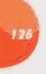

# 第 5 章：通过特效让你的网站活起来

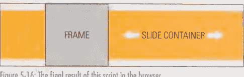

## 使用 JQUERY EASING 插件添加缓动效果

GSGD 提供的 jQuery Easy 插件允许你为网站添加 30 种不同类型的缓动效果。`animate` 方法已经包含了两种缓动效果——swing（摆）和 linear（线性），但它们非常有限。为了能够创建更真实的缓动效果，如弹跳和弹性效果，最好使用插件。缓动通过加速或减慢动画落到位置的速度来控制动画，通常表现为动画“吸”到位。缓动让动画看起来更加真实。

```javascript
.animate(duration, easing, callback);
```

jQuery 可以通过插件进行扩展——如你所知，你可以编写自己的 jQuery 函数——如果你想重用某些特定任务代码，或者将其发布到 jQuery 开源社区供其他用户使用，你也可以编写自己的 jQuery 插件。我将在第 11 章中详细介绍 jQuery 插件。

Easing 插件包含的一些示例效果包括：

- `easeOutBounce`
- `easeInBounce`
- `easeInElastic`
- `easeInCubic`

`easeOutBounce` 和 `easeInBounce` 使用缓动效果与弹跳效果的组合，模拟物体跳到屏幕上的效果。`easeInElastic` 效果显示元素像橡皮筋一样吸到位。`easeInCubic` 类似于普通的淡入效果，但速度要慢得多。Easing 插件网站提供了插件包含的 30 种效果中每种的示例。

下载完 easing 插件并将其在 jQuery 库文件之后包含在页面中后，就可以开始使用了。请在之前的教程中添加一个缓动效果。

取上一个示例中的以下代码片段。如果你将 `easing` 参数设置为 `easeOutBounce`，动画将使用来自自定义缓动插件的 `easeOutBounce` 效果。就简单！

```javascript
$('.slide-container').animate({
  left: -slidePos,
}, easeOutBounce, 1000, function() {
  $('.slide-image+slideNum.slide-text').css({
    'display': 'block',
    'position': 'absolute',
    'top': '0px',
    'left': '-400px',
    'padding': '5px',
    'background': '#cccccc',
    'opacity': 0.9,
    'color': '#ffffff',
    'width': '100%'
  }).animate({
    top: 0,
    left: -slidePos,
    right: 0,
  }, easeOutBounce, 1000, function() {
    $('.slide-text').delay(5000).animate({
      top: -100,
    }, 1000);
  });
});
```

# 第三部分：将 jQuery 应用于你的网站

第 6 章：改进导航：菜单、标签页和折叠面板

第 7 章：创建交互且精彩的表格

第 8 章：使用 jQuery 创建高级表单

## 改进导航：菜单、标签页和折叠面板

改进导航、标签页和折叠面板：用户必须始终知道自己在网站中的位置，以及在视觉上的位置。这一基础的用户界面需求往往被忽视了。改进导航、标签页和折叠面板：用户必须始终知道自己在网站中的位置，以及在视觉上的位置。改进导航、标签页和折叠面板：用户必须始终知道自己在网站中的位置，以及在视觉上的位置。改进导航、标签页和折叠面板：用户必须始终知道自己在网站中的位置，以及在视觉上的位置。改进导航、标签页和折叠面板：用户必须始终知道自己在网站中的位置，以及在视觉上的位置。改进导航、标签页和折叠面板：用户必须始终知道自己在网站中的位置，以及在视觉上的位置。改进导航、标签页和折叠面板：用户必须始终知道自己在网站中的位置，以及在视觉上的位置。改进导航、标签页和折叠面板：用户必须始终知道自己在网站中的位置，以及在视觉上的位置。改进导航、标签页和折叠面板：用户必须始终知道自己在网站中的位置，以及在视觉上的位置。改进导航、标签页和折叠面板：用户必须始终知道自己在网站中的位置，以及在视觉上的位置。改进导航、标签页和折叠面板：用户必须始终知道自己在网站中的位置，以及在视觉上的位置。改进导航、标签页和折叠面板：用户必须始终知道自己在网站中的位置，以及在视觉上的位置。改进导航、标签页和折叠面板：用户必须始终知道自己在网站中的位置，以及在视觉上的位置。改进导航、标签页和折叠面板：用户必须始终知道自己在网站中的位置，以及在视觉上的位置。改进导航、标签页和折叠面板：用户必须始终知道自己在网站中的位置，以及在视觉上的位置。

## 在导航菜单中设置活动项

接下来的教程将引导你如何在导航菜单中设置活动项目。jQuery 更有吸引力的功能之一是可以一次选择多个元素。

1. 创建一个命名变量并将其赋值为 `location.pathname`，它是原生 JavaScript 中对象的一部分。它返回域名之后的内容。

```javascript
var path = location.pathname;
```

假设我们当前位于 `www.smashingjquery.com/mycode/myexample.html`。`location.pathname` 等于 `/mycode/myexample.html`。

# 第三部分：将 JQuery 应用于你的网站

菜单项保持可见。

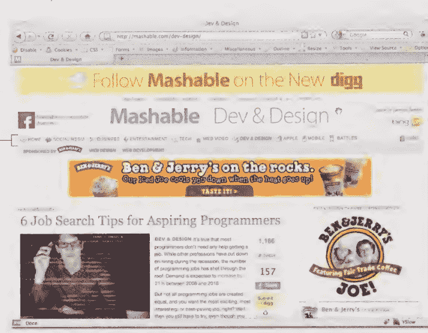

图 6-2：当你导航到特定区域时，Mashable 上的菜单项保持激活状态

*经 Mashable.com 许可重制*

2. 创建另一个变量名 `pathArray`，并使用原生 JavaScript 的 `split()` 方法通过 `/` 将路径字符串拆分为数组。

```javascript
var pathArray = path.split('/');
```

`pathArray` 的结果为 `['mycode', 'myexample.html']`。这是通过将 `/mycode/myexample.html` 的值拆分为两个字符串得到的。

3. 创建一个最终变量，并将值设置为 `pathArray` 的长度。

```javascript
var pathLength = pathArray.length;
```

4. 设置一个 `for` 循环来遍历数组中的值。使用属性选择器，设置一个选择器来匹配所有包含 `pathArray` 中值的锚点标签，并添加类选择器。这里指定的属性选择器使用了通配符选择器，匹配 `href` 中任何部分的值：

```javascript
for(i=0; i<pathLength; i++) {
  $(a[href*="
```

激活状态的菜单项是有限的，仅适用于带有下拉菜单的导航菜单情况。当添加了下拉菜单且你希望突出显示当前页面的父级菜单项时，你需要修改脚本，不仅突出显示顶层页面，还要突出显示这些顶层页面的子页面。例如，如果你有一个名为“关于我们”的顶层项目，在此下拉列表中有“我们的故事”、“职业生涯”和“联系我们”等项目（这些项目被视为顶层项目的子级），那么我们需要使用 `parent()` 和 `children()` 选择器，并构建一个匹配这些 URL 的数组来实现。

# 第 6 章：改进导航：菜单、标签页和手风琴组件

## 创建基础下拉菜单

下拉菜单是网站上导航最流行的方式之一。许多网站都有分类或区域，且这些区域内包含许多页面。创建一个一次性展示网站上所有页面的导航系统将具有挑战性，而且对于体验这种场景的用户来说也是极其困扰的。

下拉菜单的好处是，你可以在菜单中列出所有页面，显示顶层条目并隐藏其余部分。然后由用户决定是否要通过悬停在顶层类别上来查看（这将显示其他可用类别）。

下拉菜单可以设置为水平排列，子菜单出现在主菜单下方；也可以设置为垂直排列，如图 6-3 所示。


图 6-3：下拉菜单示例

*经 envato.com 许可重制*

在这里，我将向你展示如何构建一个基础下拉菜单，如图 6-4 所示，然后添加一些华丽的效果，如图 6-5 所示：

1. 下拉菜单使用嵌套的无序列表构建，这让你能够灵活地添加更多层级和链接，而不破坏设计。在以下代码中，我在顶部创建了五个链接，并在“我们的工作”（Our Work）和“服务”（Services）下方创建了两个下拉菜单。你可以根据需要添加尽可能多的下拉菜单。只需确保它们在你想让菜单出现的顶层列表项结束标签（`</li>`）之前添加。

```html
<div id="header">
  <ul id="navigation">
    <li><a href="#">Home</a></li>
    <li><a href="#">Our Work</a>
      <ul class="subnav">
        <li><a href="#">Example 1</a></li>
        <li><a href="#">Example 2</a></li>
        <li><a href="#">Example 3</a></li>
      </ul>
    </li>
    <li><a href="#">Services</a>
      <ul class="subnav">
        <li><a href="#">Service 1</a></li>
        <li><a href="#">Service 2</a></li>
        <li><a href="#">Service 3</a></li>
      </ul>
    </li>
    <li><a href="#">About Us</a></li>
    <li><a href="#">Contact</a></li>
  </ul>
</div>
```


| Home | Our Work | Services | About Us | Contact |
| --- | --- | --- | --- | --- |


Lorem ipsum dolor sit amet, consectetur adipiscing elit. Duis a tellus porttitor non tortor condimentum nisl ut eugiat et nulla turpis libero. Nullam turpis, elementum at ele orci, dictum vestibulum. Cras in ele porttitor gravida quis id quam. Aenean at arcu est. Suspendisse potenti. Nulla nunc velit, vitae pretium, hendrerit id eros. Nulla sollicitudin ut scipisque aliquque, mauris risus, sed ut lectus luctus. Nulla ut elit dui, nec luctus nisl. Praisque a neque in mauris. Maurisque habitasse tristique, ac odio. Pellentesque, et facilisis, neque, a nisl massa. Aenean scelerisque, nisl a, eu id orci. Cras in ele porttitor gravida quis id quam. Maisenas aliquque condimentum nibus henderrit. Pellentesque lobortis tristique nec semel et malesuada tellus a eleifend turpis. Aenean porttitor tellus, nec luctus massa. Cras in dui velit id eu facilisis. Pellentesque ullamcorper orci, ut scipisque neque non velit erat. Duis congue facilisis, ac malesuada massa sed. eget mi sit amet velit. Pellentesque lobortis sapien, blandit a pharetra non, congue nec mi. Curabitur ut eros massa. Cras in dui nisl, a dapibus, ac libero sed. In semper ligula a neque tempus. In lobortis bibendum, sit amet nec vestibulum eu. Donec massa erat. Nulla non quis lacinia element. Suspendisque augue metus, condimentum ut nibh erat. Quisque at sapien. (`img/1acc4cca62f1121e3ee1bc2b5a93933f_147_1.png`)

图 6-4：设计样式

2. 接下来，使用样式表来确保菜单布局正确。使用样式表来确保菜单布局正确。使用样式表来确保菜单布局正确。使用样式表来确保菜单布局正确。使用样式表来确保菜单布局正确。使用样式表来确保菜单布局正确。使用样式表来确保菜单布局正确。使用样式表来确保菜单布局正确。使用样式表来确保菜单布局正确。使用样式表来确保菜单布局正确。使用样式表来确保菜单布局正确。使用样式表来确保菜单布局正确。使用样式表来确保菜单布局正确。使用样式表来确保菜单布局正确。使用样式表来确保菜单布局正确。使用样式表来确保菜单布局正确。使用样式表来确保菜单布局正确。使用样式表来确保菜单布局正确。使用样式表来确保菜单布局正确。使用样式表来确保菜单布局正确。使用样式表来确保菜单布局正确。使用样式表来确保菜单布局正确。使用样式表来确保菜单布局正确。使用样式表来确保菜单布局正确。使用样式表来确保菜单布局正确。使用样式表来确保菜单布局正确。使用样式表来确保菜单布局正确。使用样式表来确保菜单布局正确。使用样式表来确保菜单布局正确。使用样式表来确保菜单布局正确。使用样式表来确保菜单布局正确。使用样式表来确保菜单布局正确。使用样式表来确保菜单布局正确。使用样式表来确保菜单布局正确。使用样式表来确保菜单布局正确。使用样式表来确保菜单布局正确。使用样式表来确保菜单布局正确。使用样式表来确保菜单布局正确。使用样式表来确保菜单布局正确。使用样式表来确保菜单布局正确。使用样式表来确保菜单布局正确。使用样式表来确保菜单布局正确。使用样式表来确保菜单布局正确。使用样式表来确保菜单布局正确。使用样式表来确保菜单布局正确。使用样式表来确保菜单布局正确。使用样式表来确保菜单布局正确。使用样式表来确保菜单布局正确。使用样式表来确保菜单布局正确。使用样式表来确保菜单布局正确。使用样式表来确保菜单布局正确。使用样式表来确保菜单布局正确。使用样式表来确保菜单布局正确。使用样式表来确保菜单布局正确。使用样式表来确保菜单布局正确。使用样式表来确保菜单布局正确。使用样式表来确保菜单布局正确。使用样式表来确保菜单布局正确。使用样式表来确保菜单布局正确。使用样式表来确保菜单布局正确。使用样式表来确保菜单布局正确。使用样式表来确保菜单布局正确。使用样式表来确保菜单布局正确。使用样式表来确保菜单布局正确。使用样式表来确保菜单布局正确。使用样式表来确保菜单布局正确。使用样式表来确保菜单布局正确。使用样式表来确保菜单布局正确。使用样式表来确保菜单布局正确。使用样式表来确保菜单布局正确。使用样式表来确保菜单布局正确。使用样式表来确保菜单布局正确。使用样式表来确保菜单布局正确。使用样式表来确保菜单布局正确。使用样式表来确保菜单布局正确。使用样式表来确保菜单布局正确。使用样式表来确保菜单布局正确。使用样式表来确保菜单布局正确。使用样式表来确保菜单布局正确。使用样式表来确保菜单布局正确。使用样式表来确保菜单布局正确。使用样式表来确保菜单布局正确。使用样式表来确保菜单布局正确。使用样式表来确保菜单布局正确。使用样式表来确保菜单布局正确。使用样式表来确保菜单布局正确。使用样式表来确保菜单布局正确。使用样式表来确保菜单布局正确。使用样式表来确保菜单布局正确。使用样式表来确保菜单布局正确。使用样式表来确保菜单布局正确。使用样式表来确保菜单布局正确。使用样式表来确保菜单布局正确。使用样式表来确保菜单布局正确。使用样式表来确保菜单布局正确。使用样式表来确保菜单布局正确。

3. 确保菜单样式样式。使用样式表来确保菜单。样式。使用样式表来。菜单。样式。使用样式表来确保菜单菜单正确。。样式表来确保菜单菜单样式。。样式样式表来确保。样式表来。

```css
.container{
  width:950px;
}

ul#navigation li{
  float:left;
  width:175px;
  text-align:center;
  position:relative;
  height:63px;
  padding:20px 5px;
}

ul#navigation li a{
  color:#fff;
  text-decoration:none;
  display:block;
}

ul#navigation li a.active{
  border:1px solid blue;
}
```

4. 接下来，设置一个悬停事件并使用后代选择器`#navigation li`选择列表项。悬停事件结合了`mouseenter`和`mouseleave`事件。第一个事件处理器是`mouseenter`事件，你需要在其中`find()`方法找到嵌套的无序列表元素`subnav`并将`slideDown`效果附加到语句上。第二个事件处理器是`mouseleave`事件，它的操作与`mouseenter`相反。使用`find`方法来

## 第 6 章：改进导航：菜单、标签页和手风琴

查找类名为`.subnav`的元素并将向上滑动（`slideUp`）效果附加到该语句上。

对于那些不包含`.subnav`元素的列表，当它们悬停在鼠标上方时，什么都不会发生，因为将使用`find`方法找不到`.subnav`。

```javascript
$(document).ready(function() {
  $('#navigation li').hover(function() {
    $(this).find('.subnav').slideDown('slow');
  },
});
```

`find`方法允许你过滤所选元素的后代元素，并希望创建一个匹配项。在找到匹配项后，该元素就是你的匹配集。

```javascript
  function() {
    $(this).find('.subnav').slideUp('fast');
  });
```

你可能在疑惑，为什么不直接设置语句来选择`.subnav`元素并像下面的代码示例那样对其应用效果：

```javascript
$('.subnav').slideDown('slow');
```

如果你在设置选择器时没有附加此指定符，它将匹配所有类为`subnav`的元素并对它们应用`slideDown`效果。这是错误的。通过首先选择`#navigation li`元素并附加悬停事件，你可以使用`this`关键字找到被悬停的元素，以确保`slideDown`效果仅应用于属于被悬停列表项的`.subnav`元素。

5. 在最后一步中，当鼠标停在顶级链接或顶层之间的任何子元素上时，下拉菜单必须保持可见。图 6-5 显示了`mouseenter`事件如何从父元素泡泡到子元素的示例。使用`find`方法定位锚标签，并根据`mouseover`或`mouseleave`事件的触发添加或移除`active`类。

```javascript
$(document).ready(function() {
  $('#navigation li').hover(function() {
    $(this).find('.subnav').slideDown('slow');
    $(this).find('a').addClass('active');
  }, function() {
    $(this).find('.subnav').slideUp('fast');
    $(this).find('a').removeClass('active');
  });
});
```

一旦你有了一个可以工作的下拉菜单，为菜单添加交互性的 jQuery 代码就非常简单。你大部分时间都花在与设计师合作样式化菜单，或者自己设计它。图 6-6 显示了在 Firefox 中打开 Firebug 使用下拉菜单，以便你可以查看 DOM 的变化。

`img/1acc4cca62f1121e3ee1bc2b5a93931f_150_0.png`

图 6-5：`mouseenter`事件从父元素泡泡到子元素的插图

`img/1acc4cca62f1121e3ee1bc2b5a93931f_151_1.png`

图 6-6：在 Firefox 中打开 Firebug 使用下拉菜单，以便查看 DOM 的变化

## 第三部分：将 Query 应用于你的网站

## 第 6 章：改进导航：菜单、标签页和手风琴

## 使用 ANIMATE 为基础下拉菜单添加高级效果

在本节中，我将向你展示如何添加在菜单滑动时发生的透明度变化，这是一种高级动画效果，使用`animate`方法应用于我在上一个教程中教你如何创建的基础下拉菜单。上一个示例中的所有代码都相同，除了 jQuery 中的两行。`animate`方法通过允许你传递四个参数：CSS 属性、持续时间、缓动函数和回调，让你对下拉菜单在屏幕上的出现方式有更多的控制权。在这个示例中，我想切换高度并更改透明度，同时将持续时间设置为 500 毫秒。你也可以使用关键字`fast`表示 200 毫秒，用`slow`表示 600 毫秒。结果如图 6-7 所示。

简之，将滑动效果切换为`animate`方法。将透明度和高度 CSS 属性传递给`animate`方法，以便在鼠标指针悬停时改变 DOM 元素的显示：

```javascript
$(document).ready(function() {
  $('#navigation li .submenu').hover(function() {
    $(this).find('.submenu').animate({opacity: 1,height: 'toggle'}, 500);
    $(this).closest('.a').addClass('active');
  }, function() {
    $(this).find('.submenu').animate({opacity: 0,height: 'toggle'}, 500);
    $(this).find('a').removeClass('active');
  });
});
```

`img/1acc4cca62f1121e3ee1bc2b5a93931f_152_0.png`

图 6-7：在 Firefox 中看到的已应用于下拉菜单的高级效果

## 创建手风琴菜单

手风琴是 Web 设计师和用户界面设计师之间的一种时尚选择，适用于需要在小空间内显示大量内容的网站。手风琴会隐藏除一个部分以外的所有内容。当鼠标悬停或点击特定项目时，与该项目相关的内容将展开以显示或收起以隐藏。手风琴可以用于导航，但也用于内容相关的目的，例如在狭小空间内显示大量内容。开源电子商务平台 Magento 已经实现了手风琴样式。

在本节中，我将引导你如何创建一个手风琴。手风琴在在一个部分打开时，其他部分关闭。

1. 第一个任务是定义手风琴的 HTML 结构。手风琴需要两个元素：一个手风琴标题和一个内容元素。

```html
<div id="accordion">
  <div class="accordion-header">
    <h3>Books</h3>
    <span></span>
  </div>
  <ul class="accordion-content">
    <li><a href="#Business">Business</a></li>
    <li><a href="#Education">Education</a></li>
    <li><a href="#Tech">Tech</a></li>
    <li><a href="#Romance">Romance</a></li>
  </ul>
  <div class="accordion-header">
    <h3>Electronics</h3>
    <span></span>
  </div>
  <ul class="accordion-content">
    <li><a href="#Audio">Audio</a></li>
    <li><a href="#Video">Video</a></li>
    <li><a href="#Automobile">Automobile</a></li>
    <li><a href="#Appliances">Appliances</a></li>
  </ul>
  <div class="accordion-header">
    <h3>Sporting Goods</h3>
    <span></span>
  </div>
  <ul class="accordion-content">
    <li><a href="#Baseball">Baseball</a></li>
    <li><a href="#Basketball">Basketball</a></li>
    <li><a href="#Football">Football</a></li>
    <li><a href="#Tennis">Tennis</a></li>
  </ul>
</div>
```

2. 接下来，使用样式表确保手风琴在页面上的布局正确。与其他教程类似，一个 CSS 重置如下：

```css
body, div, dl, dt, dd, ul, li, h1, h2, h3, h4, h5, h6, pre, form, fieldset,
input, textarea, p, blockquote, th, td{margin:0; padding:0}
h1, h2, h3, h4, h5, h6{font-size:100%; font-weight:normal}
```

3. 剩余的 CSS 控制手风琴的外观。你将为菜单和元素元素样式；菜单项包含图标显示哪个菜单项被选中。

```css
padding:5px 5px 10px 5px;
list-style:none;
background:#A8D7E2;
}

#accordion ul.accordion-content li{
padding:1px 0px;
display:block;
margin:0;
padding:2px 5px;
}

#accordion ul.accordion-content li a{
color:#D16C3A;
}
```

4. 页面加载后，确保只有第一个菜单元素和内容元素被显示。下面的 jQuery 代码通过`not()`方法和`.first`过滤器的组合隐藏了所有不是第一个元素的`accordion-content`（内容元素）实例。

```javascript
$('.accordion-content').not(':first').hide();
```

`.not()`方法用于过滤使用其前面的选择器所匹配的元素或选择器。它可以以过滤形式存在（如），或者你可以传递一个特定的元素（如下一步的示例所示）。

5. 你已经隐藏了所有不是第一个元素的`accordion-content`实例，现在创建另一个语句，将效果仅应用于第一个`accordion-content`元素上：


```javascript
$('.accordion-content:first').show();
```

### 6. 创建激活或选中的项目

要创建一个激活或选中的项目，请在 CSS 文件中添加一个名为`header-active`的类。使用以下语句将此类应用于第一个`accordion-header`元素：

```javascript
$('.accordion-header:first').addClass('header-active');
```

我还给手风琴菜单添加了图标，并使用元素`span`标签将图标放置在头部上。我设置了一个名为`icon-active`的类，它显示向下箭头图形，通知用户哪个部分是打开的。当未应用`icon-active`类时，将使用`span`标签显示右箭头图形。使用`:first`过滤器选择第一个`accordion-header`元素，然后链式调用`find`搜索`span`并添加类`icon-active`。

```javascript
$('.accordion-header:first').find('span').addClass('icon-active');
```

### 7. 让手风琴响应用户输入

现在开始函数部分：让手风琴响应用户输入。为`accordion-header`菜单元素绑定一个点击事件。

```javascript
$('.accordion-header').click(function () {
});
```

### 8. 移除并激活项目

添加到点击事件处理程序的第一条语句是确保任何已移除并激活的项。你可以通过选择任何可见的`accordion-content`实例并对其应用`slideUp`效果来实现这一点。使用`prev`方法返回 DOM 树中的上一个元素（在本例中为`accordion-header`），并从中移除`header-active`类。


```javascript
$('.accordion-header').click(function () {
  $('.accordion-content:visible').slideUp('slow').prev().
  removeClass('header-active');
});
```

`prev()`方法允许你从 DOM 中搜索上一个兄弟元素，你可以通过向该方法传递一个选择器字符串（`.active`）作为参数来更进一步。

### 9. 隐藏可见的激活图标

添加一条语句，通过移除`icon-active`来确保任何可见的`icon-active`元素都被隐藏。

```javascript
$('.accordion-header').click(function () {
  $('.accordion-content:visible').slideUp('slow').prev().
  removeClass('header-active');
  $('.icon-active:visible').removeClass('icon-active');
});
```

注意：需要记住的一点是，在传递类名时，`addClass()`、`remove()`和`hasClass()`不需要包含点。这经常被忽视并可能在 jQuery 脚本中产生错误；然而，`is()`、`filter()`和`not()`方法在类名前需要包含点。

### 10. 激活被点击的头部并显示内容

添加一条语句，使用`this`关键字选择被点击的头部，并添加`class-header-active`。然后使用`next()`方法选择下一个元素并使其缓慢向下滑动。

```javascript
$('.accordion-header').click(function () {
  $('.accordion-content:visible').slideUp('slow').prev().
  removeClass('header-active');
  $('.icon-active:visible').removeClass('icon-active');
  $(this).addClass('header-active').next().slideDown('slow');
});
```

`next()`方法是`prev()`方法的相反方法。该方法返回的是下一个兄弟元素，而不是上一个兄弟元素。

### 11. 激活头部中的图标

点击事件处理程序函数内部的最后一条语句结合`this`关键字，为`accordion-header`元素内找到的`span`标签添加类`active`。

```javascript
$('.accordion-header').click(function () {
  $('.accordion-content:visible').slideUp('slow').prev().
  removeClass('header-active');
  $('.icon-active:visible').removeClass('icon-active');
  $(this).addClass('header-active').next().slideDown('slow');
  $(this).find('span').addClass('icon-active');
});
```

如果你在一个具有动态到手风琴的菜单和内容元素的网站或应用程序上工作，只需确保将点击绑定方法从`bind`切换到`live`。否则，点击事件将无法记录页面加载后添加到 DOM 中的新元素。

在整合所有的 HTML、CSS 和 jQuery 并在浏览器中加载你的页面后，你应该能看到手风琴正在正常运行，如图 6-9 所示。


# 第 6 章：改进导航：菜单、标签页和手风琴

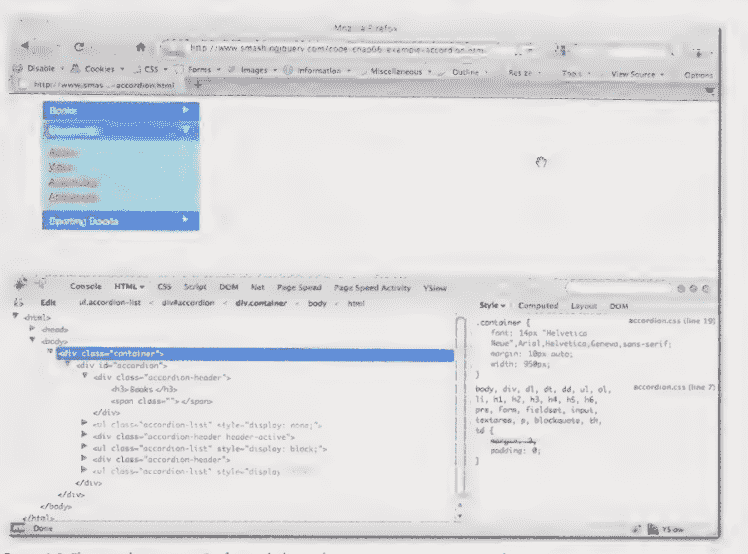

## 创建标签页内容

标签导航被 Web 设计师和开发者广泛采用，它是用户浏览网站的一种简单且直观的方式。标签结构让人想起过去在文件柜中存储文件并使用标签头来识别包含文件的时代。标签结构已转移到 Web，成为将数据组织成“文件柜”的极佳方法。图 6-10 展示了 Basecamp（一种项目管理工具）如何使用标签来组织和显示工具部分内的内容。

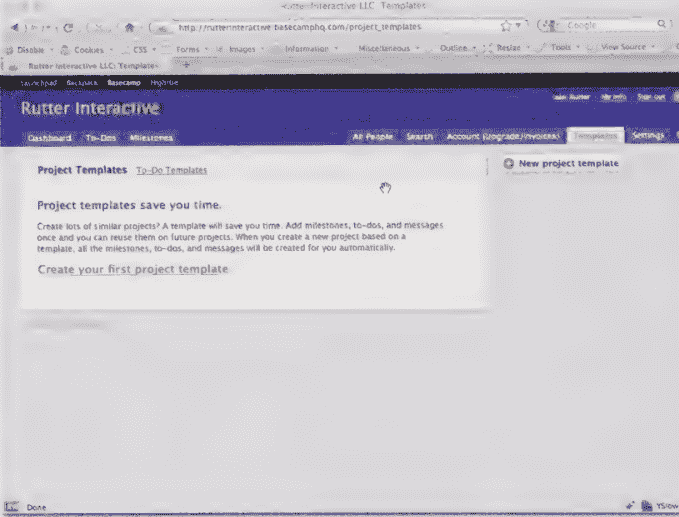

## 第 6 章：改进导航：菜单、标签页和风琴琴

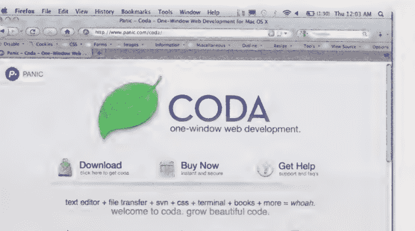

图 6-11：Coda 网站使用标签页在页面上显示动态内容。

> © 2007 PANIC Inc., The Panic Logo, and Transit 是 Panic Inc. 的注册商标 http://www.panic.com

在接下来的教程中，我将引导你如何使用标签页设置一个动态内容切换器。标签页的设置允许动态添加更多内容，而不会破坏 jQuery。

### 1. 定义标签页的 HTML 结构

标签页需要两个元素：导航和内容元素。标签页使用无序列表`#tabs`设置。每个列表项都有一个包裹着文本的锚点标签，该文本应该显示在标签页中。在这个示例中，我添加了五个标签页。

```html
<ul id="tabs" class="clearfix">

  <li><a href="Home">首页</a></li>

  <li><a href="Shop">商店</a></li>

  <li><a href="Community">社区</a></li>

  <li><a href="Customer">客户服务</a></li>

  <li><a href="About">关于</a></li>

</ul>
```

### 2. 设置标签页内容

每部分内容都包裹在一个名为`.content`的元素中。你可以添加任意数量的标签页——只需确保元素数量与标签页数量匹配。所有标签页都需要包裹在一个名为`.content-container`的元素中。在这个示例中，我添加了五个元素：

```html
<div id="content-container">

  <div class="content">

    <p>Lorem ipsum dolor amet, consectetur adipiscing elit. Integer euismod nunc id mauris placerat ultricies. Integer viver velit eros, sed semper ante. At ut turpis in mollis tincidunt non vitae felis. Donec nec sem est et tincidunt ullamcorper.</p>

  </div>

  <div class="content">

    <p>Lorem ipsum dolor sit amet, consectetur adipiscing elit. Integer딨 nunc id mauris placerat iaculis. Integer viverra velit eros, sed semper ante. Ut at turpis in tellus tincidunt non vitae felis. Donec nec sem ut est tincidunt ullamcorper.</p>

  </div>

  <div class="content">

    <p>Lorem ipsum dolor sit amet, consectetur adipiscing elit. Integer딨 nunc id mauris placerat iaculis. Integer viverra velit eros, sed semper ante. Ut at turpis in tellus tincidunt non vitae felis. Donec nec sem ut est tincidunt ullamcorper.</p>

  </div>

  <div class="content">

    <p>Lorem ipsum dolor sit amet, consectetur adipiscing elit. Integer딨 nunc id mauris placerat iaculis. Integer viverra velit eros, sed semper ante. Ut at turpis in tellus tincidunt non vitae felis. Donec nec sem ut est tincidunt ullamcorper.</p>

  </div>

  <div class="content">

    <p>Lorem ipsum dolor sit amet, consectetur adipiscing elit. Integer딨 nunc id mauris placerat iaculis. Integer viverra velit eros, sed semper ante. Ut at turpis in tellus tincidunt non vitae felis. Donec nec sem ut est tincidunt ullamcorper.</p>

  </div>

  <div class="content">

    <p>Lorem ipsum dolor sit amet, consectetur adipiscing elit. Integer딨 nunc id mauris placerat iaculis. Integer viverra velit eros, sed semper ante. Ut at turpis in tellus tincidunt non vitae felis. Donec nec sem ut est tincidunt ullamcorper.</p>

  </div>

</div>
```

### 3. 设置基础样式

接下来，设置样式以确保内容在页面上布局正确。与其他工具类似，添加了 CSS 重置样式：

```css
body, dl, dt, dd, ul, ol, li, h1, h2, h3, h4, h5, h6, pre, form, fieldset,
input, textarea, p, blockquote, td{margin:0; padding:0}
h1, h2, h3, h4, h5{font-size:100%; font-weight:normal}
.clearfix{content:".";display:block;height:0; clear:both;
visibility:hidden}
```

### 4. 设置标签页和内容元素的样式

剩余的 CSS 控制页面标签页和内容元素的视觉效果。需要记住的一个重要 CSS 点是`.content`元素默认是隐藏的。

```css
body{background:#CCAD99};

ul#tabs{
  list-style-type:none;
  position:relative;
}

ul#tabs li {
  float:left;
  width:155px;
  text-align:center;
  position:relative;
  margin:0 3px;
}

ul#tabs li .tab-active {
  color:green;
  background:#fff;
  position:relative;
  top:1px;
}

ul#tabs li a {
  border-top:1px solid #9B4C24;
  border-left:1px solid #9B4C24;
  border-right:1px solid #9B4C24;
  background:#2E7D91;
  padding:10px 5px;
  display:block;
  text-decoration:none;
  font-weight:bold;
  font-family:"Helvetica, Arial, Geneva, sans-serif";
  color:#fff;
  position:relative;
}

#content-container {
  border:1px solid #333;
  background:#fff;
}
.content{display:none}
```

所有内容应包裹在`document.ready()`函数中，以确保在执行 jQuery 前 DOM 已就绪。

### 5. 显示第一个标签页

页面加载后，你可能希望确保第一个标签页是显示的。使用`:first`选择标签元素并附加`show()`效果。

```javascript
$('.content:first').show();
```

### 6. 激活第一个标签页

在显示第一个内容元素后，选择导航元素`#tabs li a`并添加`.tab-active`类。

```javascript
$('#tabs li a:first').addClass('tab-active');
```

### 7. 为导航元素绑定悬停事件

为导航元素`#tabs li a`绑定`hover`事件。悬停事件包含了`mouseenter`和`mouseleave`事件。此悬停事件完全可选的。


```javascript
$('#tabs li a).hover(
  function () {
    // mouseenter 事件
  },
  function () {
    // mouseleave 事件
  }
);
```

### 8. 添加悬停动画

你只需要在`mouseenter`处理程序中添加语句，因为动画会在鼠标悬停在标签上时发生。标签向左移动 20 像素，持续时间为 300 毫秒，然后它弹回原位。如果你想要不同的效果，可以通过添加`margin`、`padding`、`left`等数值 CSS 属性来跟踪`animate`方法。

```javascript
$('#tabs li a).hover(
  function () {
    // mouseenter 事件
    $(this).animate({left:20}, 300, function () {
      $(this).animate({left:0}, 50);
    });
  },
  function () {
    // mouseleave 事件
  }
);
```

### 9. 为导航元素绑定点击事件

为导航元素`#tabs li a`绑定`click`事件。点击事件控制页面内容的显示和隐藏。在点击事件中添加`return false`语句以防止浏览器尝试跳转到被点击的链接。

（注：此处原文代码块不全）

### 10. 获取被点击标签页的索引值

添加到`click`处理器的第一个语句是为了获取被点击标签页的索引值。使用导航元素`#tabs li a`创建选择器，附加`index`方法并赋值给变量`linkIndex`。

```javascript
$('#tabs li a).bind('click', function () {
  var linkIndex = $('#tabs li a').index(this);
  return false;
});
```

使用索引而不是静态类或 ID 名称允许脚本通过添加或移除标签来处理 HTML 更改，而无需像硬编码元素那样重写脚本。当脚本可以应用于任意数量的标签时，它更具价值。当选择器或元素作为参数传递到方法并进行评估时，`index()`方法返回对象的索引位置。

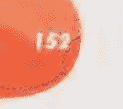

# 第三部分：将 jQuery 应用于你的网站

## 第 6 章：改进导航：菜单、标签页和风琴琴


## 为点击处理程序添加语句

### 11. 移除激活类
选择导航元素`#tabs li a`并移除`.tab-active`类。此语句是为了确保一次只有一个导航元素被选中。

```javascript
$('#tabs li a').bind('click', function () {
  var linkIndex = $('#tabs li a').index(this);
  $('#tabs li a').removeClass('tab-active');
  return false;
});
```

### 12. 隐藏可见内容
选择可见的内容元素并对其应用`hide`效果。

```javascript
$('#tabs li a').bind('click', function () {
  var linkIndex = $('#tabs li a).index(this);
  $('#tabs li a').removeClass('tab-active');
  $('.tab:visible').hide();
  return false;
});
```

### 13. 显示匹配索引的内容
根据当前索引过滤内容元素，并仅显示索引与内容元素匹配的内容。此语句根据索引值控制内容元素的显示和隐藏。尽管在 DOM 中列表项和内容元素之间没有关系，但当点击列表项时，完全根据两组元素中索引值的顺序进行匹配。这是保持代码自主性的良好方法。

```javascript
$('#tabs li a').bind('click', function () {
  var linkIndex = $('#tabs li a').index(this);
  $('#tabs li a').removeClass('tab-active');
  $('.tab:visible').hide();
  $(this.eq(linkIndex)).show();
  return false;
});
```

`eq(index)`方法返回指定索引处的元素集合。

### 14. 为当前元素添加激活类
添加到点击处理器的最后一个语句是为每个点击的元素添加`tab-active`类，以显示它们正在使用哪个标签页。

```javascript
$('#tabs li a').bind('click', function () {
  var linkIndex = $('#tabs li a).index(this);
  $('#tabs li a').removeClass('tab-active');
  $('.tab:visible').hide();
  $(this.eq(linkIndex)).show();
  $(this).addClass('tab-active');
  return false;
});
```

在整合所有的 HTML、CSS 和 jQuery 并在浏览器中加载后，你应该能看到全屏的折风琴组件，如图 6-12 所示。

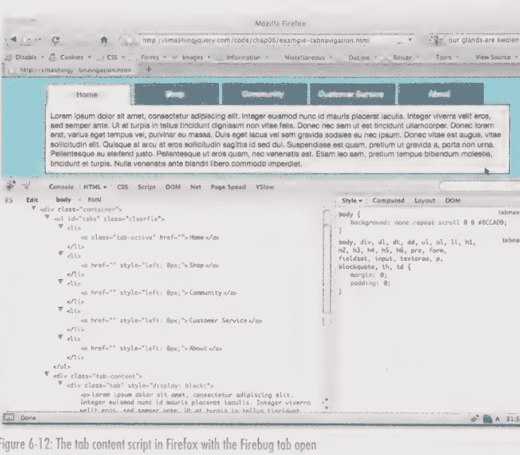

图 6-12：Firefox 中 Firebug 标签页打开时的标签页内容脚本

## 创建交互式且有趣的表格

在 20 世纪 90 年代后期，随着互联网和万维网的爆炸式增长，表格经常被用于页面设计和布局，这并不是它们最初的设计意图。使用表格进行设计和布局的问题在于它们缺乏对语义化原则的支持（即内容与设计分离），以及嵌套表格的使用，这会给你的代码增加不必要的页面臃肿，并导致可访问性和维护的噩梦。当你通过一个又一个嵌套的表格来创建页面布局以匹配复杂的设计时，就会出现嵌套表格。现在大多数 Web 设计师和开发者已经能够纯粹使用 HTML 和 CSS 来创建语义化设计，不再使用表格进行布局，从而将内容层与表现层分离。HTML 表格之所以被误用，是因为 CSS 出现之前不存在替代的布局方案——即便如此，浏览器在好几年里都没有正确支持 CSS。表格的声誉很糟糕，但如果正确地用于表格数据，它们对于以整洁、结构化的格式显示数据非常有帮助。在接下来的章节中，我将分享一些使用 jQuery 增强表格数据的方法。

## 使用 CSS 为表格数据设置样式

图 7-1 显示了使用表格在 eWedding 网站（www.eweding.com/packages.php）上显示数据的示例。

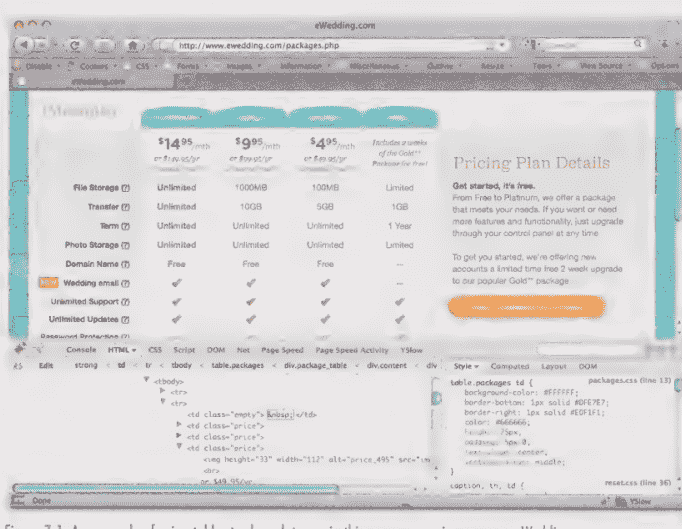

图 7-1：在 eWedding 上使用表格显示数据的示例——在本例中是比较数据

经 ewedding cp 许可复制

你可以为表格添加 CSS 样式，以帮助它们对用户来说更具可用性且更易于消化的。我在教程中使用了以下 HTML 表格：

```html
<table border="1" cellpadding="4">
<head>
  <tr>
    <th>Category</th>
    <th>Product</th>
    <th>Price</th>
    <th>Status</th>
  </tr>
</head>
<body>
  <tr>
    <td>Clothing</td>
    <td>North Face Jacket</td>
    <td>$189.99</td>
    <td>In-stock</td>
  </tr>
  <tr>
    <td>Shoes</td>
    <td>Nike</td>
    <td>$59.99</td>
    <td>In-stock</td>
  </tr>
  <tr>
    <td>Electronics</td>
    <td>LED TV</td>
    <td>$589.99</td>
    <td>Out of stock</td>
  </tr>
  <tr>
    <td>Sporting Goods</td>
    <td>Ping Golf Clubs</td>
    <td>$159.99</td>
    <td>In-stock</td>
  </tr>
  <tr>
    <td>Clothing</td>
    <td>Sweater</td>
    <td>$19.99</td>
    <td>In-stock</td>
  </tr>
</tbody>
</table>
```

## 使用过滤器添加交替行颜色

斑马纹（Zebra striping）是 Web 设计师使用的一种常用做法，通过为每个偶数行或奇数行添加背景颜色，使表格行更易读，如图 7-2 所示，这是 Performable 网站（www.performable.com）的斑马纹示例。斑马纹可以使用 PHP 或 ASP.net 等后端编程语言完成，但缺点是必须有开发人员参与。jQuery 中的`:even`和`:odd`过滤器使得向任何表格添加这种样式变得极其简单。

设置一个文档就绪函数（document ready），并在内部添加两个语句，使用过滤器选择奇数偶数行。第一条语句选择所有偶数行并应用 CSS 属性`background: #dedede`（浅灰色）。第二条语句确保所有奇数行的背景为白色。图 7-3 显示了页面加载后浏览器中的输出示例。

```javascript
$(document).ready(function() {
  $('tbody tr:even').css('background', '#dedede');
  $('tbody tr:odd').css('background', '#ffffff');
});
```

## 为行添加简单的悬停效果

你可以通过为表格中的所有行添加悬停效果来增加表格的交互性。如后续示例所示，可以简单地在用户鼠标移动到每行上时，为表格行添加不同的背景颜色。图 7-4 显示了代码在 Firefox 中的最终结果。

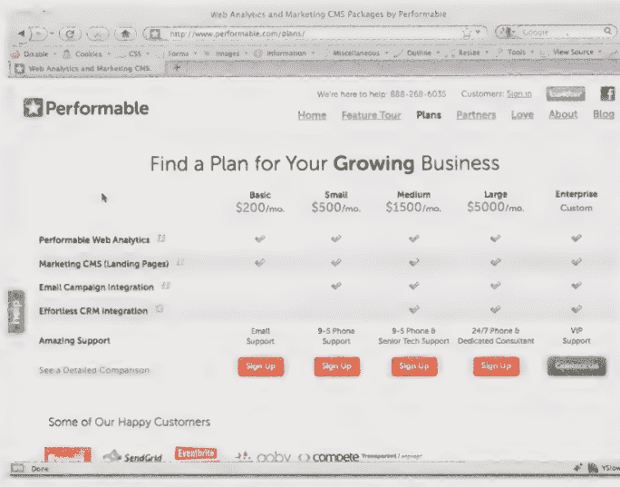

图 7-2：Performable.com 上使用表格斑马纹

经 performable.com 许可复制

### 第三部分：将 jQuery 应用于网站

1. 设置一个文档就绪函数，并将悬停绑定到`tr`。这种选择器的奇之处在于，它可以应用到表格中的所有行，且只需几行代码即可完成悬停事件。

```javascript
$(document).ready(function() {
  $('tr').hover(function() {
    $(this).css('background', 'pink');
```

2. 添加两个悬停函数，一个用于`mouseenter`，一个用于`mouseleave`。在`mouseenter`时，颜色变为粉；在`mouseleave`时，使用`this`关键字将颜色恢复为。

```javascript
$(document).ready(function() {
  $('tr').hover(function() {
    $(this).css('background', 'white');
  });
```

| Category | Product | Price | Status |
| :--- | :--- | :--- | :--- |
| Clothing | North Face Jacket | $189.99 | In-stock |
| Shoes | Nike | $59.99 | In-stock |
| Electronics | LED TV | $589.99 | Out of stock |
| Sporting Goods | Ping Golf Clubs | $159.99 | In-stock |
| Clothing | Sweater | $19.99 | In-stock |

## 为行添加高级悬停效果

如果你想复杂一些，可以添加一种悬停效果，如图 7-5 所示。这种类型的用户界面会将悬停事件绑定到`tr`。使用该语句在鼠标悬停时插入 HTML 标签。

```javascript
$(document).ready(function() {
  $('tr').hover(function() {
    $(this).children().append('<div class="edit"><a href="#">Edit</a></div>');
  }, function() {
    $(this).find('.edit').remove();
  });
});
```

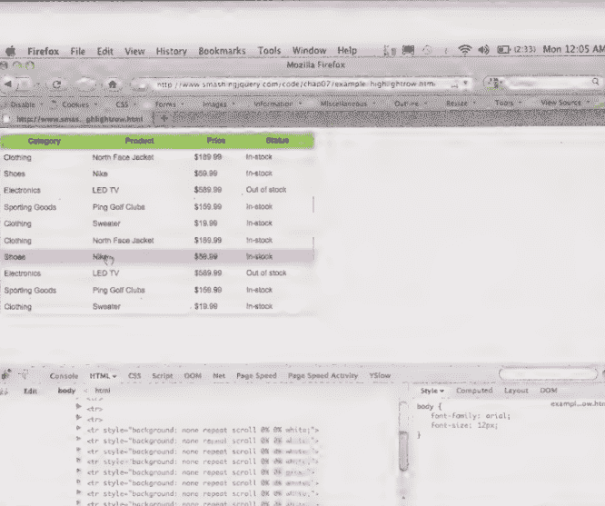

图 7-4：当鼠标悬停在行上时

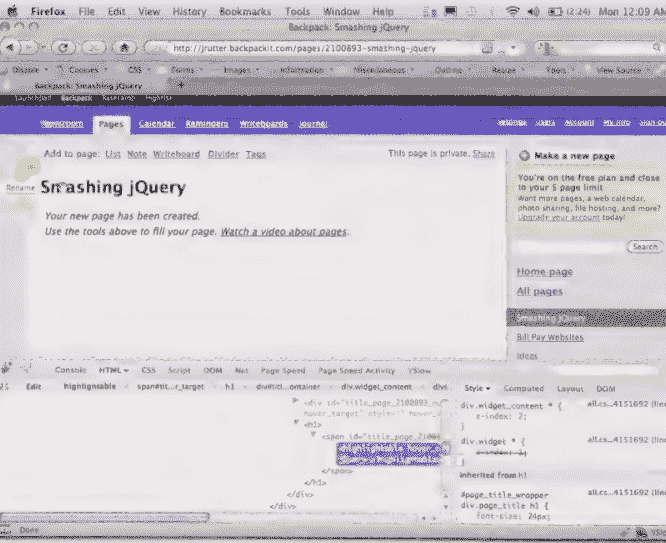

图 7-5：带有编辑功能的悬停效果

## 操作数据

现在你已经了解如何为表格添加简单的样式和效果，我将向你展示如何操作表格中的数据。我说的操作是指添加、删除和过滤包含的数据，这会导致 DOM 的变化。到目前为止的所有选择器、事件和更改都可以应用于表格数据。可能性是无限的。在本节中，我将解释以下解决方案：

- 在第一/最后一行添加行
- 根据索引添加行
- 根据特定内容添加行
- 使用选择器删除行
- 根据索引删除行
- 根据内容删除行

在本节的所有教程中我都使用了以下 HTML 表格。注意其结构。7-6 显示了该表格在 Firefox 中的示例。

```html
<table border="1" padding="4" id="products">
<head>
  <tr>
    <th>Category</th>
    <th>Product</th>
    <th>Price</th>
    <th>Status</th>
  </tr>
</head>
<body>
  <tr>
    <td>Clothing</td>
    <td>North Face Jacket</td>
    <td>$189.99</td>
    <td>In-stock</td>
  </tr>
  <tr>
    <td>Shoes</td>
    <td>Nike</td>
    <td>$59.99</td>
    <td>In-stock</td>
  </tr>
  <tr>
    <td>Electronics</td>
    <td>LED TV</td>
    <td>$589.99</td>
    <td>out of stock</td>
  </tr>
  <tr>
    <td>Sporting Goods</td>
    <td>Ping Golf Clubs</td>
  </tr>
</tbody>
</table>
```


图 7-6：该表格在 Firefox 中的示例

| 类别 | 项目 | 价格 | 状态 |
| :--- | :--- | :--- | :--- |
| 服装 | 毛衣 | $19.99 | 有货 |
| 服装 | 北脸夹克 | $189.99 | 有货 |
| 鞋类 | 耐克 | $59.99 | 有货 |
| ... | ... | ... | ... |

图 7-6：前述代码创建的表格在 Firefox 中的显示效果

## 在表格的第一行/最后行之后添加消息

在页面上动态添加内容可以在服务器端完成，这需要向服务器发送请求，并且取决于数据库的大小，可能需要一些时间和处理处理能力。一种更简单的动态插入内容的方法是使用 jQuery 在函数中添加静态内容，或者通过 Ajax 加载内容而不打断页面。

如果你有一个搜索页面，并希望在第一个结果之后插入特殊消息，你可以专门针对表格中的某些区域进行定位。这与 Google 始终将自然结果置于顶部的方式类似。

### 第 7 章：创建交互且有趣的表格

jQuery 允许你结合使用`:first`过滤器和`.after()`方法来实现此功能。Priceline 网站（www.priceline.com）在其搜索结果页面中使用了类似的方法。图 7-7 显示了 Priceline 如何在列表之后插入特惠。

图 7-7：Priceline 在搜索结果页的列表之后插入特惠。此处所有材料 © 1998–2010 Priceline.com，保留所有权利。

使用上一个示例中的 HTML 表格，我展示了在表格第一行之后动态添加特殊消息有多简单：

- 创建名为`special`的类，并为其添加任何 CSS 属性，使其在添加到表格后能够脱颖而出。

```css
.special {
  background: #AAF18;
  text-align: center;
  font-size: 22px;
  color: #fff;
  font-weight: bold;
}
```

- 设置一个文档就绪处理器，然后添加一条选择表格中第一个`tr`的语句，并紧随其插入特惠。

```javascript
$(document).ready(function() {
  $('#products tr:first').after('<tr class="special"><td colspan="4">Special Offer TODAY</td></tr>');
});
```

## 使用 last 过滤器

或者，你可以使用`:last`过滤器仅在表格最后一行之后显示内容。图 7-8 显示了在 Firefox 中运行特殊消息脚本。

图 7-8：在 Firefox 中运行的特殊消息脚本

## 使用过滤器选择器删除行

临时或永久删除内容可能是一项挑战。我们有一套需要编译和测试的代码计划，这阻止了大多数页面的快速更改。如果我们需要进行快速修复，例如从 DOM 中删除产品、图像、文本或任何类型的元素，可以使用`.remove()`方法，这会让开发者很高兴，因为他们不需要参与。能够使用 jQuery 进入并删除内容确实允许开发者从核心解决问题。

设置一个`document.ready`处理器，并在结尾添加一个带有`.remove()`方法的选择语句。匹配到的集合（在本例中为表格最后一行）将从 DOM 中删除。图 7-9 显示了表格最后一行被删除的结果。

```javascript
$(document).ready(function() {
  $('tr:last').remove();
});
```

图 7-9：最后一行表格已被删除

以下是一些测试特殊消息功能的想法：

- 添加一个计时器，在 10 秒后显示特殊消息，并在 30 秒后使其消失。
- 使用`.animate()`方法为特殊消息添加高级动画效果。
- 使用 cookie 仅向首次访问者显示特殊消息。

## 根据索引值在行之后添加行

正如根据行在表格中的位置（第一或最后）添加行一样，你也可以根据其之前或之后行的索引值来插入行。设置一个使用`:eq()`过滤器选择索引为 5 的所有元素，并直接在匹配的元素之后插入 Special Offer TODAY 的 HTML 内容。

> `:eq()`是一个允许通过索引过滤的过滤器选择器。

```javascript
$("tr:eq(5)").after('<tr><td colspan="4">Special Offer TODAY</td></tr>');
```

## 根据索引值删除行

与根据索引添加行类似，你也可以根据索引值删除行。设置一个选择器选择所有索引为 1 的`tr`元素，并使用`.remove()`方法将其从 DOM 中删除。在这种情况下，它将只等于一行：

```javascript
$(:eq(1)).remove();
```

## 在包含特定内容的行之后添加消息

如果你想在表格中包含的文本字符串之前或之后行，可以使用`:contains`过滤器。在这个示例中，我解释了如何使用几行 jQuery 代码对行集合进行分页。该脚本会自动对你传递的记录进行分页，并创建一个导航菜单。

## 使用 JQUERY 设置分页


分页功能通常使用 PHP、ASP.NET 和 Java 等服务器端语言进行设置。服务器端解决方案的巨大优势是 Web 页面不需要一次性加载所有记录；记录仅在用户请求时才被加载。这极大地缩短了页面加载时间。

## 第 7 章：创建交互且趣味的表格

| ID | 分类 | 产品 | 价格 | 状态 |
|---|---|---|---|---|
| 5 | 服装 | 毛衣 | $19.99 | 有货 |
| 6 | 服装 | 北脸夹克 | $189.99 | 有货 |
| 7 | 鞋类 | $59.99 | 有货 |
| 8 | 电子产品 | LED 电视 | $589.99 | 无货 |
| 9 | 体育用品 | 宾高尔夫球杆 | $159.99 | 有货 |
| 10 | 鞋类 | $59.99 | 有货 |
| 11 | 电子产品 | LED 电视 | $589.99 | 无货 |
| 12 | 体育用品 | 宾高尔夫球杆 | $159.99 | 有货 |

## 第三部分：将 jQuery 应用于你的网站

2. 使用表格 ID `#data`，创建一个选择器语句，在页面上的 `#data` 元素之后插入 ID 为 `#nav` 的 div，该元素位于 `#nav` 下方用于存放页码链接。

```javascript
$('#data').after('<div id="nav"></div>');
```

3. 设置一个变量 `rowsShow`，它用于存储每页需要显示的行数。

```javascript
var rowsShow = 
```

4. 设置一个变量 `rowsTotal`，用于获取你正在分页的元素中的行数。选中 `#data` 元素并在末尾添加 `length` 属性，在这种情况下它应该返回 12。

```javascript
var rowsTotal = $('#data tr').length;
```

5. 设置一个变量 `numPages`，它的值等于 `rowsTotal` 除以 `rowsShow`。注意该等式被 JavaScript 原生方法 `Math.round` 包裹。`Math.round` 将等式的乘积舍五入到最近的整数。

```javascript
var numPages = Math.round(rowsTotal/rowsShow);
```

在任何总数计算中，当你创建一个变量时，如果你想快速查看该变量返回的是否数字，可以在括号内插入变量的 `alert` 语句，例如：`alert(rowsTotal)`。这不仅适用于 jQuery，而且是一个可以处理所有 JS 调试的原生 JavaScript 函数。

6. 设置一个 `for` 循环来遍历页数，并创建用于导航的页码链接。添加一个名为 `pageNum` 的变量；其值设置为 `i+1`，即循环中的迭代变量。这确保了页面从 1 开始。接下来，为 `for` 循环添加一个选择器来选中 `#nav` 元素，并添加带有 `rel` 标签的锚点链接。页码设置为 `pageNum`。

```javascript
for (i = 0;i<numPages;i++) {
  var pageNum = i+1;
  $('#nav').append('<a href="#'+i+'">'+pageNum+'</a>');
}
```

7. 添加一条语句来隐藏 `#data` 表格中所有可见的行。

```javascript
$('#data tr').hide();
```

8. 添加一条语句选中第一行并显示它。

```javascript
$('#data tr:first').show();
```

9. 添加一条语句选中 `#data` 表格中的所有行，并使用 `slice` 方法限制仅显示前四行。`slice` 方法允许你传递两个参数（开始和结束）来切取任何内容的某部分。

```javascript
$('#data tr').slice(0, rowsShow).show();
```

10. 添加一条语句选中第一个页码并为其添加类 `active`。这确保了在页面加载时每个页码锚点链接都被选中。

```javascript
$('#nav a:first').addClass('active');
```

## 第 7 章：创建交互且趣味的表格

11. 为 `#nav` 元素中的所有页码链接绑定一个点击事件。此点击事件用于控制分页；该事件包含了脚本的核心逻辑。

```javascript
$('#nav a').bind('click', 
```

12. 第一条移除 `active` 类的语句。

```javascript
$('#nav a').removeClass('active');
```

13. 下一条语句向目标添加 `active` 类。

```javascript
$('#nav a').addClass('active');
```

14. 添加一个名为 `currPage` 的变量，它存储...的值。

```javascript
var currPage = 
```

15. 添加一个名为 `startItem` 的变量，它存储...。

```javascript
var startItem = 
```

16. 添加一个名为 `endItem` 的变量，它存储...。

```javascript
var endItem = 
```

17. 添加到点击事件中的最终语句。

| ID | 类别 | 项目 | 价格 | 状态 |
| --- | --- | --- | --- | --- |
| 1 | 服装 | North Face 夹克 | $189.99 | 有货 |
| 2 | 鞋子 | Nike | $59.99 | 有货 |
| 3 | 电子产品 | LED 电视 | $589.99 | 无货 |
| 4 | 运动用品 | 太平洋高尔夫球杆 | $159.99 | 有货 |
| 5 | 服装 | 毛衣 | $19.99 | 有货 |
| 6 | 服装 | North Face 夹克 | $189.99 | 有货 |
| 7 | 鞋子 | Nike | $59.99 | 有货 |
| 8 | 电子产品 | LED 电视 | $589.99 | 无货 |

2. 当使用 jQuery 插件时，你始终需要将其包含在页面的顶部。你应该在任何引用它的代码之前加载插件。任何不引用该插件的代码可以稍后加载，但始终应在 jQuery 库之后。

```javascript
<script src="js/tablesorter.min.js"></script>
```

3. 设置一个文档就绪函数，并在其中添加语句选择 `#data` 表格并应用 `tablesorter()` 方法。如果你在不带任何选项的情况下应用 `tablesorter` 方法，表 7.1 返回的默认选项将自动应用，表格排序应反映图 7-13。

```javascript
$(document).ready(function() {
  $("#data").tablesorter();
});
```

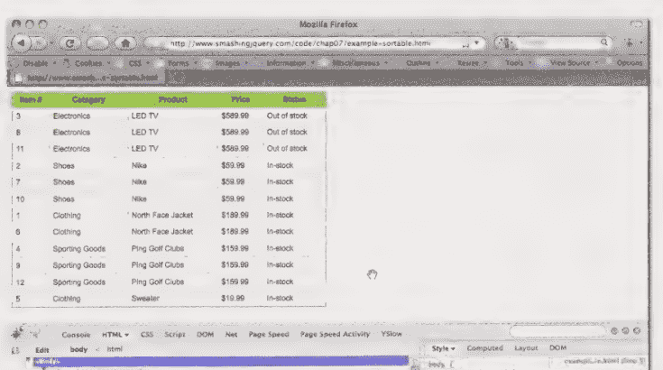

图 7-13：`tablesorter` 插件已应用于前面的 HTML 示例中的表格中

## 更改默认排序顺序

你可以通过使用 `sortList` 参数传递数组来更改默认排序顺序：

```
[columnIndex, sortOrder]
```

## 第三部分：将 jQuery 应用于你的网站

使用你在上一个示例中设置的 `tablesorter` 语句：

```javascript
$('#data').tables({sortList:[1,0]});
```

如果你选择配置 `tablesorter`，可以传递表 7.1 中的任何选项。`tablesorter` 插件是为任何表格添加排序的一种快速简便的方法。如果你使用此插件，你将花少时间编写 JavaScript，并通过向 `tablesorter` 函数传递不同的 CSS 类，有效地花费更多时间来设计表格，你可以自定义其外观和感受。如果你在页面上有多个表格并希望对它们的样式略有不同，这是非常有必要的。

## 使用表格数据视化创建迷人的图表

交互式图表大多数使用 Adobe Flash 创建动态图表，例如图 7-14 所示的 Google Analytics 图。最近，许多开发者开发了 jQuery 插件，可以在不依赖 Flash 的情况下创建可的图表。由 Filament Group 创建的 Visualize 插件是创建图表的最佳解决方案之一。Visualize 插件允许你使用表格数据创建折线图、柱状图和饼图。它有许多可以传递给函数的选项，用于使用从 HTML 表格中提取的数据设置并更改任何页面上的图表。表 7.2 列出了 Visualize 配置。

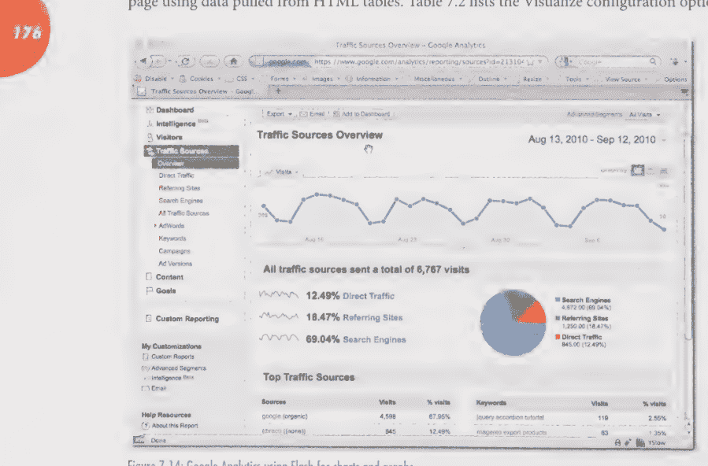

图 7-14：使用 Flash 创建图表和图形 Google Analytics

## 第 7 章：创建交互且兴奋的表格

### 表 7.2 Visualize 配置选项

| 选项 | 说明 | 默认行为 |
| --- | --- | --- |
| type | 允许选择图表类型 | 柱状图 |
| width | 允许设置图表宽度 | 表格宽度 |
| height | 允许设置图表高度 | 表格高度 |
| appendTitle | 允许为图表添加标题 | True，将应用 |
| title | 允许设置图表标题 | 应用 caption 标签标题 |
| appendKey | 允许为图表添加颜色 | True，将应用 |
| colors | 允许确定颜色 | 应用默认颜色 |
| textColors | 允许更改文本颜色 | N/A |
| parseDirection | 解析数据的方向 | 默认 X 轴 |
| pieMargin | 允许更改饼图周围的空间 | 默认值: 20 |
| labelPos | 允许设置饼图上标签的位置 | 默认位置: 内部 |
| lineWidth | 允许设置折线和面积图的线条宽度 | 默认值: 4 |
| barGroupMargin | 允许每组柱图周围的间距 | 默认值: 10 |
| barMargin | 允许在柱图周围添加间距 | 默认值: 1 |

其他著名的图表插件包括 Highcharts、Flot、jqplot 和 Sparklines。

## 创建柱状图

在下面的示例中，我向你展示使用表格中的 Visualize 柱状图有多简单。结果如图 7-15。

- 在将插件应用于表格之前，你需要确保表格设置正确。如果表格设置错误，插件将无法工作。你需要用 `<thead>` 标签包裹所有头部单元格，用 `<tbody>` 标签包裹所有表格单元格，如下所示。

- `scope` 属性可以添加到单元格中，这是一个表格属性，确保阅读或使用屏幕读取器的用户将单元格识别为标题。`scope` 属性接受以下值：`col`、`colspan`、`row` 和 `rowgroup`，主要用于网页的可访问性。

```html
<table border="1" cellpadding="4">
  <caption>2010 流量</caption>
  <thead>
  <tr>
```


## 第三部分：将 jQuery 应用于你的网站

```html
<th scope="col">新访问</th>
<th scope="col">返回访问</th>
</tr>
</thead>
<tbody>
<tr>
<td scope="row">音乐</td>
<td>1000</td>
<td>3500</td>
</tr>
<tr>
<th scope="row">体育</th>
<td>1432</td>
<td>4633</td>
</tr>
<tr>
<th scope="row">服装</th>
<td>1834</td>
<td>8503</td>
</tr>
<tr>
<td scope="row">艺术</td>
<td>2543</td>
<td>3472</td>
</tr>
<tr>
<td scope="row">鞋子</td>
<td>4632</td>
<td>8493</td>
</tr>
</tbody>
</table>
```

2. 当你使用 jQuery 插件时，你始终需要将其包含在页面的顶部。你应该在任何引用它的代码之前加载插件。任何不引用该插件的代码可以愉快地在插件之前加载，但始终应在 jQuery 库之后。

```javascript
<script type="text/javascript" src="js/visualize.jquery.js"></script>
```

3. 设置一个文档就绪处理器，并在其中添加语句选择 `.table` 表格并对其应用 `visualize()` 方法。应用 `visualize` 方法并传递以下选项：`type='bar'`。

```javascript
$(document).ready(function(){
  $('.table').visualize({type:'bar'});
});
```

## 第 7 章：创建交互且兴奋的表格

Mozilla Firefox

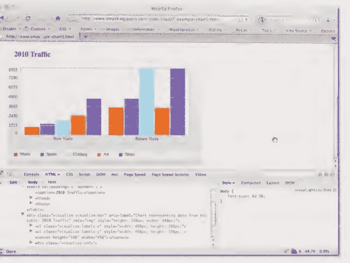

图 7-15：Visualize 插件已应用于表格中

## 玩转 jQuery

## 第 8 章：使用 jQuery 创建高级表单

表单在互联网上随处可见，无论是电子商务和注册表单，还是搜索输入字段。验证确保 Web 表单接受正确的数据，在输入错误数据时显示清晰的错误信息，并在提交表单时已填写字段。验证通常由 Web 开发者使用 PHP、JSP 或 ASP 等编程语言在服务器端处理。除了根据待验证数据的安全级别进行服务器端验证外，使用 JavaScript 进行客户端验证也变得越来越常见。了解 jQuery 和 JavaScript 的 Web 设计师可以比使用后端开发的创建更好的表单用户界面。

jQuery 提供了几个专门用于表单的事件（`focus` 聚焦、`blur` 失去焦点、`change` 更改），我在第 4 章关于事件中回顾了它们。这些事件对于 JavaScript 来说并不新奇，但 jQuery 让结合表单使用这些事件变得更加简单。在许多 jQuery 可以帮助你对表单做更多事情的不同场景中，你从本章中学到的技术在处理 Ajax 时是必要的，我将在第 9 章中介绍。

## 页面加载后聚焦输入框

将焦点引导到页面上的特定表单字段是引导用户在页面上执行特定操作极极方法，无论是登录还是填写注册表。这是一个你可以添加到到任何页面上的简单脚本，以确保用户立即聚焦在输入框上，如图 8-1 所示。如果你有一个基于转化的电子商务网站或零售网站，这可能会小微提升你的转化率。

1. 设置 HTML 表单元素。在本例中，设置两个 `input="text"` 元素，以便当页面上存在两个及以上元素时，你就可以演示如何使用 `:first` 过滤器。

```html
<input type="text1">
<input type="text2">
```

2. 添加一条语句选择第一个输入框并为其绑定聚焦（`focus`）事件。这确保了页面加载时，第一个输入框会被应用焦点：

```javascript
$('first').focus();
```

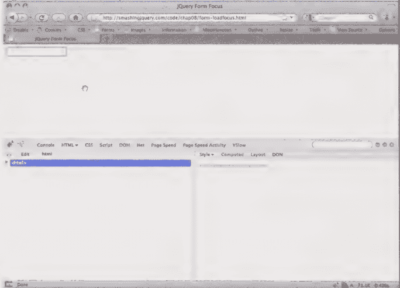

图 8-1：页面在 Firefox 中加载后，焦点被应用到第一个输入元素

## 禁用和启用表单元素

在网站的某些你不允许用户更改字段的区域，需要禁用和启用表单元素，如图 8-2 所示。一种需要禁用元素的场景是多部分表单。在第一页上，假设你收集了用户名、密码和电子邮件地址等信息。在第二页上，你收集账单地址和支付信息，并确认信息已从第一页传递过来，以禁用的表单字段的形式显示：

1. 设置你希望在页面加载后禁用的 HTML 表单输入元素。

`<input type="text" id="name-input" />`

2. 添加一条语句选择 `name-input` 元素并使用 `attr()` 方法将 `disabled` 属性设置为 `false`：

`$("name-input").attr("disabled", false);`

如果你想启用表单输入框，将传递给 `attr` 方法的参数从 `disabled` 改为 `true` 即可。

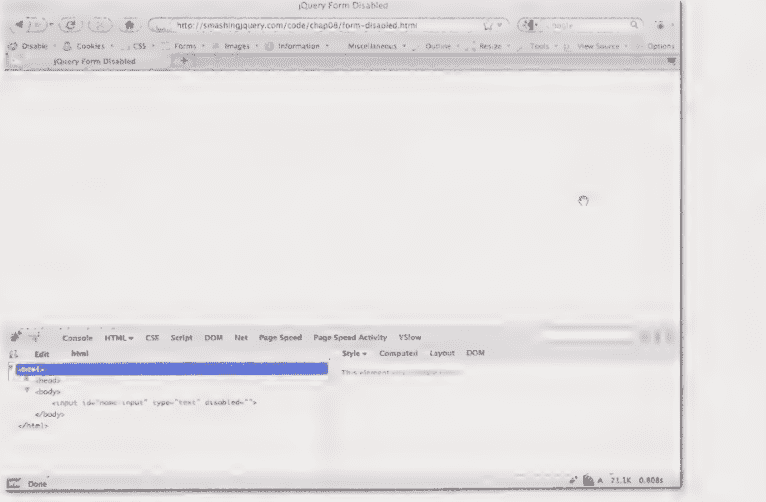

图 8-2：应用 `disabled` 属性后的禁用表单

## 高亮表单中的当前字段

在较大的表单中，你可以通过高亮用户当前所在的字段来帮助他们跟踪自己的位置。大多数浏览器都有内置事件来高亮当前字段，例如图 8-3 所示的 Firefox 示例。

你可以使用 CSS 和 jQuery 事件设置次要高亮。通过添加自定义高亮，你可以确保用户知道自己在任何给定表单中进展了多少。使用 CSS，你可以像图 8-4 中所示 Wufoo (www.wufoo.com) 联系表单示例那样添加高亮。

## 第三部分：将 jQuery 应用于你的网站

一个被高亮的表单字段

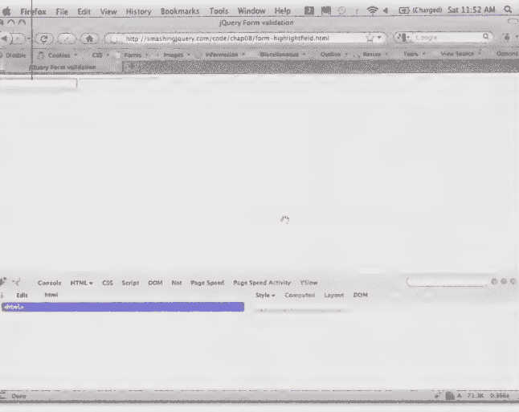

图 8-3：Firefox 原生高亮表单字段功能的示例

高亮

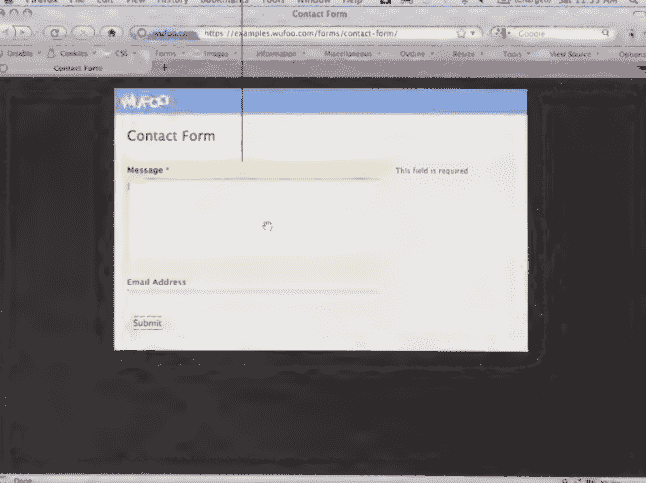

图 8-4：如 Wufoo 联系表单示例所示添加高亮。

## 第 8 章：使用 jQuery 创建高级表单

在接下来的示例中，我们使用 `focus` 和 `blur` 事件在用户点击或通过 Tab 键进入字段时高亮不同的字段。最终运行结果如图 8-5 所示。

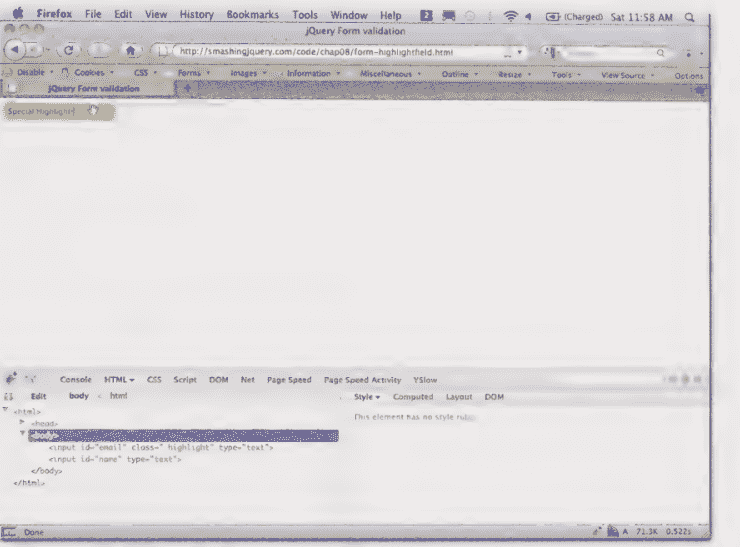

8-5：在 Firefox 中运行的高亮脚本

1. 设置 HTML 表单输入元素，我们希望在页面加载后高亮该元素。


`<input type="text" id="email-input" />`

## 添加 CSS 来控制高亮的显示效果

在这种情况下，它具有黄色背景并有 5 像素的内边距：

```
.highlight { background:yellow; padding:5px; }
```

## 选择所有输入元素并绑定 `focus` 事件

在事件处理函数中，添加一条语句选择被聚焦的元素，并添加名为 "highlight" 的类。当输入框获得焦点时（用户点击或 Tab 键进入该字段），高亮类将被应用到该输入字段。

```javascript
$('input').bind('focus', function() {
  $(this).addClass('highlight');
});
```

## 选择所有输入元素并绑定 `blur` 事件

在事件处理函数中，添加一条语句选择该元素并移除 `highlight` 类。当输入框失去焦点时（用户移出该字段），高亮类将从输入字段中被移除。

```javascript
$('input').bind('blur', function() {
  $(this).removeClass('highlight');
});
```

# 在输入字段内创建默认文本

在表单字段上设置默认文本可以帮助指导用户需要在字段中输入内容。许多 Web 设计师使用默认文本作为输入标签，以节省空间或更改表单设计。你可以使用 `value` 属性设置默认值，但问题是如果用户点击该字段，他们需要删除当前的内容。在图 8-6 中，Laithaites 网站 (www.laithawines.com) 对此有种简单的实现：网页左下角的电子邮件通讯订阅。

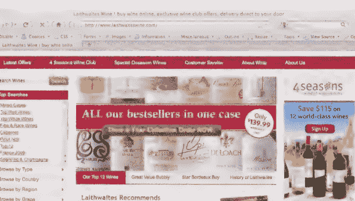

图 8-6：Laithaites 网站对输入字段中默认文本的简单实现

复自 Laithawines.com

以下脚本允许你在字段中设置默认文本。如果用户点击该字段，默认文本会消失，用户可以输入自己的文本。如果用户没有输入文本并点击 Tab 键移出字段，默认文本将恢复。

## 设置你希望使用的 HTML 输入元素

`<input type="text" id="email-input" value="Search" />`

## 创建一个变量来存储默认文本的值

```
var defaultText = "Search";
```

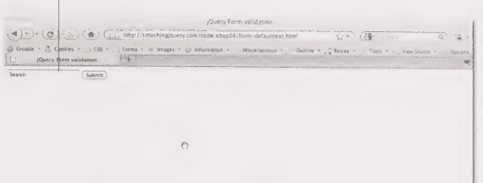

图 8-7：在输入字段中添加默认文本

## 选择输入元素并绑定 `focus` 事件

```javascript
$('#email-input').bind('focus', function() {
```

## 在聚焦处理函数中，添加一条语句测试输入框是否包含值

如果没有值，则将值设置为默认文本。此外，将文本颜色更改为深灰色 (#333)。

```javascript
$('#email-input').bind('focus', function() {
  if ($(this).val() == defaultText) {
    $(this).val('');
  }
  $(this).css('color', '#333');
});
```

## 接下来，设置 `blur` 事件

```javascript
$('#email-input').bind('blur', function() {
```

## 在模糊处理函数中，添加一条类似的语句测试所选输入框是否包含值

如果没有值，则将值设置为默认文本。

```javascript
$('#email-input').bind('blur', function() {
  if ($(this).val() == '') {
    $(this).val(defaultText);
  }
  $(this).css('color', '#333');
});
```

# 限制输入字段字符数

在输入字段上限制字符数可以用于限制包含的单词数或可以在状态消息中包含的字符数。Twitter (www.twitter.com) 的 140 个字符限制使得限制字符数的脚本在过去一年非常流行，但将信息或想法保持在 140 个字符以内仍然是一个挑战。字符数限制还可以显示在限制范围内可用多少字符。

在本教程中，我将展示如何制作图 8-8 所示的剩余字符脚本，以及 Twitter.com 在使用 jQuery 事件创建小于 140 字符的状态更新时使用的脚本。

## 第一步涉及设置 HTML

设置一个输入字段并赋予其 ID 为 `status`。该输入配合 `change` 事件用于检测添加的字符。

```
<textarea cols='50' rows='5' id='status'></textarea>
```

## 添加一个名为 `counter` 的空 div

这是你在字段中输入字时剩余字符数显示的地方。

```
<div id='counter'></div>
```

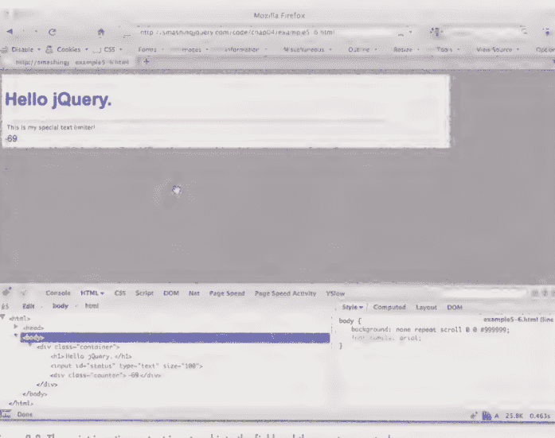

图 8-8：在字段中输入文本时运行的脚本，计数器递减

# 第 8 章：使用 JQUERY 创建高级表单

## 设置一个名为 `maxNum` 的变量

它将是允许的最大字符数，并将其设置为 100。

```
var maxNum = 100;
```

## 创建一个选择器语句来匹配 `status` 元素

并将 `keypress` 绑定到事件处理器。`keypress` 事件在每次键盘上的按键被按下并释放时都会触发，这是测试表单字段输入的完美事件。

```javascript
$('#status').bind(
  keypress : function () {
    //
  });
```

## 在 `keypress` 事件触发后，你需要捕获 `status` 输入字段的值

设置一个名为 `numChar` 的变量，用于存储 `inputText` 变量的长度。创建一个变量 `charRemain`，它持有从 `maxNum` 中减去 `numChar` 的结果。

```javascript
$('#status').bind(
  keypress : function () {
  var inputText = $(this).val();
  var numChar = inputText.length;
  var charRemain = numChar - maxNum;
});
```

## 设置完所有变量后，使用比较运算符的条件语句

检查 `numChar` 是否小于或等于 `maxNum`。如果表达式返回 `true`，选择计数器元素并更改变量 `charRemain` 中的文本，即剩余字符的数量。

```javascript
$('#status').bind(
  keypress : function () {
  var inputText = $(this).val();
  var numChar = inputText.length;
  var charRemain = numChar - maxNum;
  if (numChar <= maxNum) {
    $('.counter').text(charRemain);
  }
});
```

## 最后，添加一个 `else` 语句

来检查 `maxNum` 是否大于或等于 `numChar`。如果此表达式返回 `true`，使用 `event.preventDefault()` 防止用户在文本字段中输入更多字母。

```javascript
$('#status').bind(
  keypress : function () {
  var inputText = $(this).val();
  var numChar = inputText.length;
  var charRemain = numChar - maxNum;
  if (numChar <= maxNum) {
    $('.counter').text(charRemain);
  }
  else if (numChar > maxNum) {
    event.preventDefault();
  }
});
```

# 第三部分：将 JQUERY 应用于你的网站

# 创建一个“全选”复选框链接

你可以使用 jQuery 程序化地选择和取消 Web 页面上所有的复选框，这种技术通常用于网站的偏好设置部分。用户会看到大约 20 个复选框和一个链接，该链接让他们只需点击即可选择所有复选框。以下教程展示了如何使用 jQuery `click` 事件和条件逻辑，如图 8-9 所示设置一个“全选”复选框链接。

被选中的“全选”框

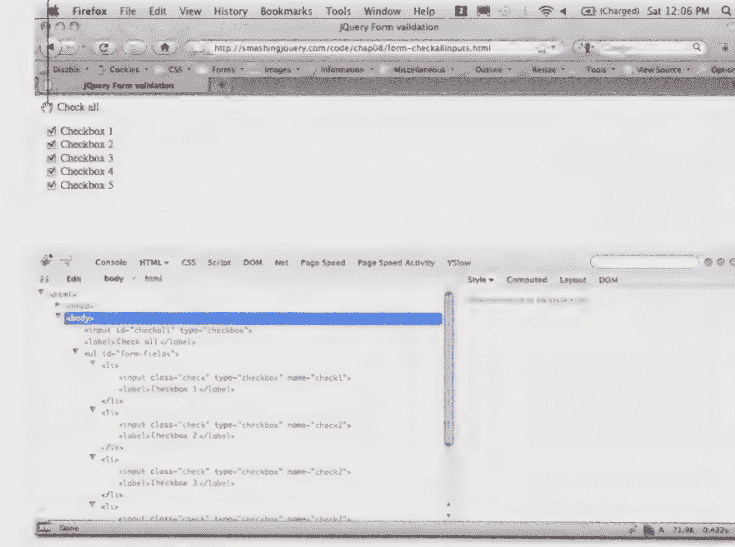

图 8-9. 在 Firefox 中查看的“全选”复选框链接，通过 Firefox 显示输入字段是如何被飞入效果改变的

## 首先，在一个无序列表中设置五个复选框元素

其 ID 为 `form-fields`，并为每个复选框元素应用 `check` 类。

```html
<ul id="form-fields">
  <li><input name="check1" class="check" type="checkbox"/> <label>Checkbox 1</label></li>
  <li><input name="check2" class="check" type="checkbox"/> <label>Checkbox 2</label></li>
  <li><input name="check2" class="check" type="checkbox"/> <label>Checkbox 3-label</label></li>
  <li><input name="check2" class="check" type="checkbox"/> <label>Checkbox 4-label</label></li>
  <li><input name="check2" class="check" type="checkbox"/> <label>Checkbox 5-label</label></li>
</ul>
```

## 在复选框列表之前添加一个带有 `checkall` ID 的输入框

这个复选框用于控制输入框勾选和取消勾选。

```html
<input type="checkbox" id="checkall" /> <label>Check all</label>
```

## 选择 `#checkall` 元素并附加 `click` 事件

```javascript
$('#checkall').bind('click', function() {
});
```

## 添加一个已选复选框的变量

以及一个语句来选择无序列表中找到的所有列表项，并通过类名搜索所有这些项。该变量将持有此匹配的集合：

```javascript
$('#checkall').bind('click', function() {
var checkboxes = $('#form-fields li).find('.check');
});
```

## 你可以选择添加 `if` 和 `else` 语句

来测试输入元素 `#checkall` 是否被勾选或未被勾选，如果你想让它们勾选和取消选择所有复选框。如果元素被勾选，则对上一步设置的 `checkboxes` 变量匹配集中包含的所有复选框应用属性 `'checked', 'true'`。如果元素未被勾选，则移除 `checkboxes` 变量中所有复选框的勾选。

```javascript
$('#checkall').bind('click', function() {
var checkboxes = $('#form-fields li).find('.check');

if (this.checked) {
checkboxes.attr('checked', 'true');
} else {
checkboxes.attr('checked', 'false');
}
});
```

如果元素被勾选，则勾选和取消选择所有复选框。

# 获取输入框的值

使用 jQuery 获取勾选的复选框的值，这种技术通常用于提交的表单。用户可以看到勾选和取消复选框。获取输入框的值，如图 8-10 所示。获取输入框的值非常简单，在许多场景中非常有用。在提交表单时我经常使用这种技术来传递值，见第 9 章。

# 第三部分：将 JQUERY 应用于你的网站

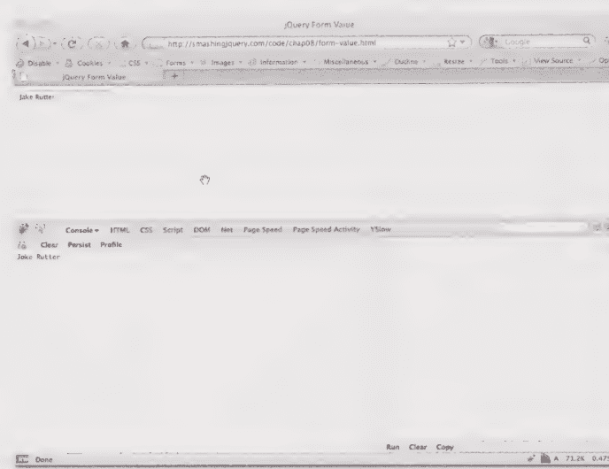

图 8-10: 通过控制捕获并显示的值

## 设置你想要获取值的 HTML 输入元素

```html
<input type="text" name="special" id="my-input" value="Very Cool!"/>
```

## 选择 `my-input` 元素并附加 `val()` 方法

```javascript
$('#my-input').val();
```

## 为了检查是否获取了值，你需要设置一个变量并将其赋值为

```javascript
var inputVal = $('#my-input').val();
```

## 如果你想在 `my-input` 元素变化时获取其值

可以将语句封装在 `change` 事件中。某些浏览器（包括 Opera）当 `change` 事件绑定到文本字段时，它只会在失去焦点时触发，而不是在变化时立即触发。

```javascript
$('#my-input').change(function() {
  var inputVal = $('#my-input').val();
});
```

# 第 8 章：使用 JQUERY 创建高级表单

## 获取 select 选项的值

使用 jQuery 获取 select 选项的值设置非常简单，但在任何类型的网站或应用程序中都非常有用。这种功能的示例可以在 Crunchfield.com 上看到，如图 8-11 所示。Crunchfield 允许你选择年份、型号和品牌——每当你做出选择时，select 选项的值就会被获取，然后显示根据上一个选择过滤出的选项。

## 设置将用于获取 select 选项值的 HTML 表单元素

```html
<select id="my-select" name="question1">
<option value="yes">yes</option>
<option value="no">no</option>
</select>
```

## 设置一个选择器语句选择 `my-select` 元素

并为其附加一个处理器。

```javascript
$('#my-select').change(function() {
  
});
```

## 在事件处理器中添加一个名为 `selectedVal` 的变量

并使其等于该值（即被选中的值）：

```javascript
$('#my-select').change(function() {
  var selectVal = $(this).val();
  alert(selectVal);
});
```

## 在表单中添加简单的电子邮件验证

电子邮件验证对于网站的通讯邮件订阅至关重要。如果用户提交了错误的电子邮件地址，你可能需要花费时间和金钱从数据库中将其清理掉。使用 jQuery，你可以在表单上设置简单的电子邮件验证，而无需编写大量代码。这种脚本在网站上非常有用，例如第 8-12 页中的 Laithwaite Wine 特惠订阅表单，在那种情况下，你不需要对多个需要高级验证的不同类型字段进行验证。在本章的末尾，我将使用一个流行的 jQuery 验证插件演示高级验证。请记住，你永远不要仅依赖客户端 JavaScript；如果客户端不可用，应该始终存在服务器端验证。

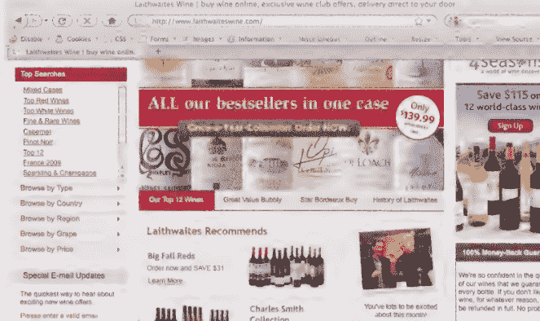

图 8-12：Laithwaite Wine 网站在他们的通讯邮件订阅链接上使用了简单的电子邮件验证

复印自 Laithwaitewine.com

以下代码使用正则表达式来测试提交的电子邮件地址格式是否正确。将点击事件绑定到提交（Submit）按钮上，以便仅在提交时对电子邮件进行验证。根据电子邮件地址无效或未输入电子邮件，向用户显示不同的错误和成功消息。成功捕获电子邮件地址后，表单将替换为感谢用户订阅的消息，如图 8-13 所示。

## 第 8 章：使用 jQuery 创建高级表单

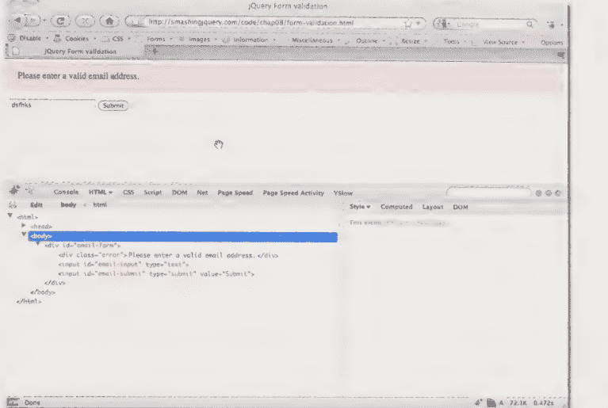

图 8-13：当用户输入了错误的电子邮件地址并点击提交（Submit）按钮时显示的消息

正则表达式是用来创建以匹配文本和数字字符串的特殊模式。它们通常用于匹配电子邮件地址、电话号码、邮政编码、信用卡号等。正则表达式是大多数 Web 语言使用的标准做法，你可以在互联网上搜索特定的正则表达式用于你的脚本。

## 首先创建一个带有电子邮件输入框和提交（Submit）按钮的简单表单

```html
<div id="email-form">
<input type="text" id="email-input" name="email">
<input type="submit" value="Submit" id="email-submit" name="submit"/>
</div>
```

## 选择 `#email-submit` 按钮并为其绑定点击事件

在点击事件内部，添加 `return false` 语句，以确保点击按钮时停止默认的提交。

```javascript
$('#email-submit').bind('click', function() {
  return false;
});
```


# 使用 jQuery 创建高级表单

## 第 B 章：使用 jQuery 创建高级表单

### 表单验证与增强

- 3. 创建名为`emailReg`的变量，并将其设置为正则表达式以测试电子邮件是否准确。

```javascript
$('#email-submit').bind('click', function() {
  var emailReg = /^([a-zA-Z0-9\-]+)@(([a-zA-Z0-9\-]+\.)+[a-zA-Z]{2,4})$/;
});
```

- 4. 使用选择器语句创建一个变量，并设置`#email-input`的值。

```javascript
$('#email-submit').bind('click', function() {
  var emailReg = /^([a-zA-Z0-9\-]+)@(([a-zA-Z0-9\-]+\.)+[a-zA-Z]{2,4})$/;
  var email = $('#email-input').val();
  return false;
});
```

- 5. 添加一个选择器选择`#email-form`元素并在其之前插入错误`div`。这包含了向用户显示错误消息的内容。

```javascript
$('#email-submit').bind('click', function() {
  var emailReg = /^([a-zA-Z0-9\-]+)@(([a-zA-Z0-9\-]+\.)+[a-zA-Z]{2,4})$/;
  var email = $('#email-input').val();
  $('#email-form').prepend('<div class="error"></div>');
  return false;
});
```

- 6. 添加一个`else`语句来测试点击按钮时是否输入了内容。

```javascript
$('#email-submit').bind('click', function() {
  var emailReg = /^([a-zA-Z0-9\-]+)@(([a-zA-Z0-9\-]+\.)+[a-zA-Z]{2,4})$/;
  var email = $('#email-input').val();
  $('#email-form').prepend('<div class="error"></div>');
  if (email) {
  } else {
    return false;
  }
});
```

- 7. 在`if`语句中，添加一个选择器语句选择错误`div`，将其替换为包含告知用户未输入电子邮件地址信息的元素。

```javascript
$('#email-submit').bind('click', function() {
  var emailReg = /^([a-zA-Z0-9\-]+)@(([a-zA-Z0-9\-]+\.)+[a-zA-Z]{2,4})$/;
  var email = $('#email-input').val();
  $('#email-form').prepend('<div class="error"></div>');
  if (email) {
  } else {
    $(".error").replaceWith('<div class="error">You forgot to enter an email address.</div>');
  }
});
```


### 错误处理与成功验证

```javascript
} else if {
}
else {
  return false;
}
```

- 8. 在`else`语句中，使用选择器语句选择错误`div`并替换为包含告知用户失败信息的元素。

```javascript
$('#email-submit').bind('click', function() {
  var emailReg = /^([a-zA-Z0-9\-]+)@(([a-zA-Z0-9\-]+\.)+[a-zA-Z]{2,4})$/;
  var email = $('#email-input').val();
  $('#email-form').prepend('<div class="error"></div>');
  if (email) {
  } else {
    $(".error").replaceWith('<div class="error">You forgot to enter an email address.</div>');
  } else if (!emailReg.test(email)) {
    $(".error").replaceWith('<div class="error">Please enter a valid address.</div>');
  } else {
    return false;
  }
});
```

- 9. 最后，添加一个`else`语句告知用户他们已成功订阅。此消息仅在语句通过测试时显示。

```javascript
$('#email-submit').bind('click', function() {
  var emailReg = /^([a-zA-Z0-9\-]+)@(([a-zA-Z0-9\-]+\.)+[a-zA-Z]{2,4})$/;
  var email = $('#email-input').val();
  $('#email-form').prepend('<div class="error"></div>');
  if (email) {
    $('#email-form').html('<div class="success">Thank you, you have subscribed.</div>');
  } else {
    return false;
  }
});
```


以下是改进此脚本的一些方法：

- 如果你想在用户输入时设置实时验证，可以将`click`事件更改为`change`事件并将其绑定到输入字段而不是按钮。

- 在提交表单后如果输入了错误数据，为电子邮件字段添加错误高亮。

- 使用表 8.1 中的常用正则表达式为你的表单添加更多字段并验证不同类型的数据。

正则表达式可以在 Web 上随处找到。查看表 8.1 以查看 Web 上使用的一些常用正则表达式的摘要。

### 表 8.1 其他用于表单验证的常用正则表达式

| 用法 | 示例 |
|---|---|
| 电话号码 | `(^[0-9]+$/)` |
| 日期 (dd/mm/yyyy) | `(^\d(1,2)\d(1,2)\d(4)$/)` |
| 仅限数字 | `(^([0-9]+$)` |
| 仅限字母 | `(^([A-Za-z]+$)` |

## 将一个字段的内容复制到另一个字段

如果你曾经在线购买过东西，你可能需要填写表单并输入账单地址和收货地址。对于大多数消费者来说，这些信息是相同的，因此表单通常有一个"与账单相同"（Same As Billing）复选框，它可以将所有字段从账单复制到收货地址，防止客户需要重新输入所有信息。这个复选框使用了字段复制功能。这不仅节省了客户的时间，还减少了误输入数据的概率。图 8-14 显示了 Best Buy 网站（`www.bestbuy.com`）结账页面上的字段复制复选框示例。

以下脚本展示了如何设置字段复制复选框，它可以添加到任何表单中，正如下面的示例所示。

- 1. 首先创建两组地址输入字段。第一组包含账单地址，第二组包含收货地址。在字段之前添加一个输入复选框，以控制从账单到收货的字段复制。

```html
<label>Copy Fields</label>
<input type="checkbox" id="copy-fields" />
<div id="billing-address">
  <h2>Billing Address</h2>
  <label>First Name</label>
  <input type="text" id="b-first-name" />
  <label>Last Name</label>
  <input type="text" id="b-last-name" />
</div>
<div id="shipping-address">
  <h2>Shipping Address</h2>
  <label>First Name</label>
  <input type="text" id="s-first-name" />
  <label>Last Name</label>
  <input type="text" id="s-last-name" />
</div>
```

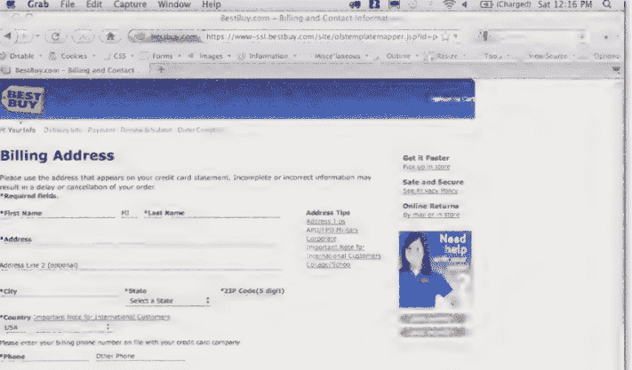

图 8-14：Best Buy 网站结账页面上的"复制字段（Copy Fields）"复选框示例

- 2. 选择`#copy-fields`输入元素并为其绑定一个点击事件。

```javascript
$('#copy-fields').bind('click', function() {
});
```

- 3. 为你想要复制的每个字段创建一个变量。每个变量都存储位于账单地址内某个字段的值。

```javascript
$('#copy-fields').bind('click', function() {
  var billFieldName = $('#b-first-name').val();
  var billLName = $('#b-last-name').val();
});
```

- 4. 创建一个`else`语句，在执行点击事件中的任何操作之前，测试复制字段元素是否被选中。

```javascript
$('#copy-fields').bind('click', function() {
  var billFieldName = $('#b-first-name').val();
  var billLName = $('#b-last-name').val();
  if (this.checked) {
    } else {
  }
});
```

- 5. 如果`copy-fields`元素被选中，则将相应的收货字段的值设置为与其账单字段对应的值。

```javascript
$('#copy-fields').bind('click', function() {
  var billFieldName = $('#b-first-name').val();
  var billLName = $('#b-last-name').val();
  if (this.checked) {
    $('#s-first-name').val(billFieldName);
    $('#s-last-name').val(billLName);
  } else {
  }
});
```

- 6. 你需要在`else`语句中设置一个备用选项，当复制字段输入未取消勾选时，清空收货输入字段。

```javascript
$('#copy-fields').bind('click', function() {
  var billFieldName = $('#b-first-name').val();
  var billLName = $('#b-last-name').val();
  if (this.checked) {
    $('#s-first-name').val(billFieldName);
    $('#s-last-name').val(billLName);
  } else {
    $('.shipping-address input').val('');
  }
});
```


复制字段（Copy Fields）复选框

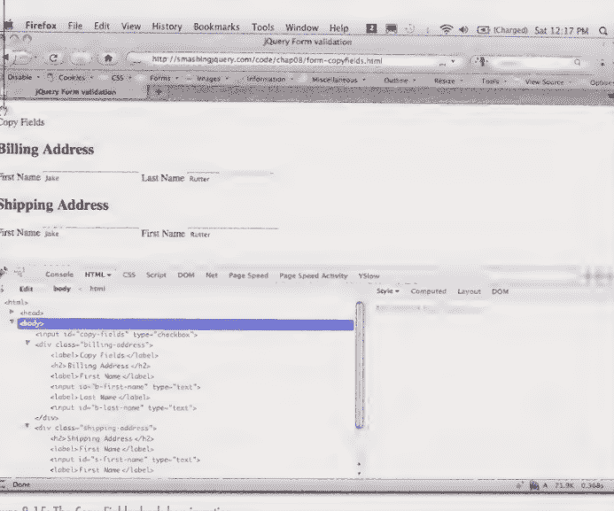

图 8-15：工作中的"复制字段"复选框

## 使用插件增强表单

将第三方或开源插件整合到你的网站或应用程序中，可以让你以更快的速度编写代码并提供更好的表单验证。由于使用 jQuery 的庞大关注者和支持者群体，存在各种插件。你可以找到实现从设置字段默认文本到验证你网站上每个表单的任何功能的插件。

当由于时间限制无法自己创建某项内容时，我会使用插件。在大多数情况下，如果有人已经很好地创建了一个插件，那么就没有必要尝试编写我自己的方法。在本节中，我将回顾两个我经常与表单一起使用的插件：`qTip` 和 `Validate`。

### 将 qTip 整合到你的网站

`qTip`是一个 jQuery 插件，允许你轻松地在任何元素上设置工具提示（tooltips）。工具提示可以包含静态和动态内容。`qTip`具有许多功能，使其成为一个极具吸引力轻量级的插件，因为它与 IE、Firefox、Safari、Opera 和 Chrome 具有跨浏览器兼容性。在那些不支持的浏览器上，工具提示会优雅地降级。`qTip`可以应用于页面上的任何元素，包括段落标签，如图 8-16 所示。

我喜欢使用工具提示来给用户关于需要输入什么的提示。你可以像我在第 5 章中解释的那样，从零开始创建一个基础工具提示并将其应用于元素上，但`qTip`带有一套完整的方法 API，允许你更改样式以适应你的网站、在页面上的位置、动画效果并添加动态内容。

`qTip`的主要优势是你可以设置的所有配置选项；`qTip`的文档非常出色。这也是我继续使用它的原因。插件的文档通常糟糕且支持匮乏，这使得它们难以使用。当我遇到一个

### 使用属性创建基础 QTIP

在本节中，我将向你展示如何在你的网站上整合`qTip`插件，并为表单设置工具提示。使用`title`属性允许未启用 JavaScript 的用户在悬停鼠标时看到工具提示。


我喜欢使用工具提示来给用户关于需要输入什么的提示。你可以像我在第 5 章中解释的那样，从零开始创建一个基础工具提示并将其应用于元素上，但`qTip`带有一套完整的方法 API，允许你更改样式以适应你的网站、在页面上的位置、动画效果并添加动态内容。

`qTip`的主要优势是你可以设置的所有配置选项；`qTip`的文档非常出色。这也是我继续使用它的原因。插件的文档通常糟糕且支持匮乏，这使得它们难以使用。当我遇到一个

### Validate 插件


图 8-17：使用`qTip`显示表单提示

`Validate`插件是一个健壮的解决方案，它包含了标准的正则表达式来验证电话号码、电子邮件地址、信用卡号等。它通过通过提交（submit）、按键按下（keypress）和聚焦（focus）等许多不同类型的事件，直接将错误和通知消息插入到 DOM 中。`Validate`插件拥有广泛的 API，可以对验证数据的方式提供完全的自定义定制。你也可以选择开箱即用的实现方式。

`Validate`插件非常适用于场景：你的注册表单需要姓、名、地址、城市、州、邮政编码，以及一个唯一的用户名和密码（密码至少包含五个字符，且包含大小写字母）。对于一个每个输入字段都有多个规则的长表单，且你希望在用户填写字段时为他们提供帮助。

图 8-18 显示了`Validate`插件应用到表单上。如果用户在没有正确填写每个字段的情况下点击提交按钮，所有必填字段后面都会附加一段文本，列出这些要求的字段。

### 为联系表单添加简单验证

通过使用插件，你可以通过设置每个单独的输入验证脚本来节省大量时间。在接下来的教程中，我将演示如何仅通过一行 jQuery 代码和对表单进行一些添加，就可以为表单应用默认验证。

- 1. 设置一个包含姓名、电子邮件地址、电话号码、消息字段和一个提交按钮的联系表单。

```
<form id="contact-form">
```

- <ul>

<li><label>Name</label>

<input type="text" id="name" name="name">

</li>

<li><label>Email</label>

<input type="text" id="email" name="email">

</li>

<li><label>Phone</label>

<input type="text" id="phone" name="phone"/>

</li>

<li><label>Message</label>

<textarea name="message" id="message"></textarea>

</li>

<li><input type="submit"/>

</li>

</ul>


图 8-18：应用到表单上的`Validate`插件

转载自 KISSMetrics.com

- 2. 当使用 jQuery 插件时，你始终需要在页面顶部包含插件的路径。它应该始终直接在 jQuery 库之后，但在你创建的任何引用插件的 jQuery 代码之前。

```
<script src="js/jquery.validate.min.js" type="javascript"></script>
```

- 3. 添加一个`document.ready`函数。在这个函数中，选择`contact-form`元素并对其应用`validate()`方法。


```
$(document).ready(function() {
  $("#contact-form").validate();
});
```

## 第三部分：将 jQuery 应用于你的网站

就这么简单！`validate` 插件现在已应用到你的网站。然而，如果你在 Firefox 中打开网页并点击提交按钮，你将不会看到任何验证发生，因为你还没有进行任何设置，如图 8-19 所示。


图 8-19：表单提交时没有任何验证过滤

你可以使用各种类非常轻松地为表单添加验证。这是最快最简单的方法，但你无法控制消息或设置任何高级规则，例如输入字段需要至少五个字符且最多十个字符等。这是相当开箱即用的功能。我将在下一个教程中更详细地介绍高级选项。

```
为任何必填字段添加 class="required"
添加 class="email" 以验证电子邮件地址
添加 class="digits" 以验证字段中输入的内容仅为数字（此处误）
```

- 4. 调整表单以包含验证类。

```
<form id="contact-form">
<ul>
    <li><label>Name</label>
    <input type="text" id="name" name="name" class="required"/>
    </li>
    <li><label>Email</label>
    <input type="text" id="email" name="email" class="required"/>
    </li>
    <li><label>Phone</label>
```

## 第 8 章：使用 jQuery 创建高级表单

```
<input type="text" id="phone" name="phone" class="required digits">
<li><label>Message</label>
<textarea name="message" class="required"></textarea>
</li>
<li><input type="submit"/>
</li>
</form>
```

在表单内的输入元素中添加了 `required` 以及 `email/digit` 类并在提交表单后，你会看到错误验证消息出现，如图 8-20 所示。如果你开始输入电子邮件地址，消息会从“This field is required”（此字段为必填）变为“Please enter a valid email address”（请输入有效的电子邮件地址）……一旦它接受了你输入的电子邮件地址，它就会停止显示消息。


图 8-20：使用验证插件提交后表单上显示的错误消息

请参考表 8.3 获取可以使用 `validate` 插件应用的所有选项列表。

### 表 8.3 验证选项

| 类 | 描述 |
| --- | --- |
| required | 需要一个值 |
| minlength | 要求最小长度 |

### 表 8.3（继续）

| 类 | 描述 |
| --- | --- |
| maxlength | 要求最大长度 |
| email | 要求有效的电子邮件地址 |
| url | 要求有效的 URL |
| date | 要求有效的日期 |
| number | 要求有效的十进制数字 |
| digits | 要求有效的数字数字 |
| creditcard | 要求有效的信用卡号 |
| accept | 要求特定文件 |
| equalTo | 要求元素相等 |

```javascript
$("#contact-form").validate({
  rules {
    name: "required",
    email {
      required: true,
      email: true
    },
    phone: "required"
  },
  messages {
    name: "Name is required.",
    email: "Email is required.",
    phone: "Phone is required."
  }
});
```

大功完成！如果你在 Firefox 中加载此页面并提交表单，所有字段都将通过验证，你创建的自定义消息也会显示出来。就这么简单。`Validate` 插件的妙之处在于它是客户端的，不需要刷新页面。在验证失败后，如果你重新输入数据，字段会在你输入时进行验证，这对于已经非常出色的插件来说又是一个加分项。


如果你花些时间玩玩这个插件，可以获得非常不错。如果你在设置插件时遇到任何问题，请参阅文档或在 Google 上搜索答案。很有可能有人遇到过类似的问题，特别是因为这个插件已经出现了近五年，并且仍然受到支持。

# 探索高级 JQUERY

- 第 9 章：处理动态数据和 Ajax
- 第 10 章：创建和使用 jQuery 插件
- 第 11 章：使用 jQuery 开发移动端 Web
- 第 12 章：寻找 jQuery 资源

# 9

处理动态数据和 Ajax

JQUERY 能够进行 DOM 操作，而且做得非常好。你可能没有意识到，jQuery 有多种方法允许进行 Ajax 类型的交互。许多人对 Ajax 是什么以及不是什么存在误解。Ajax 这个缩写在 Web 2.0 黎明时期成为了一个热门词。Web 设计师、开发人员和营销人员都声称他们可以做 Ajax，但这意味着什么呢？这意味着能够设计、构建和营销在后台往传数据的 Web 网站和应用程序——这让你能够为客户提供丰富得的用户体验。

在本章中，我将回顾如何使用 jQuery 对服务器端数据执行 Ajax 类型的请求。我使用了在之前的章节中构建的代码示例，并展示了如何添加动态内容来创建自动更新的小部件。我不会指导你如何设置服务器端组件，这需要如 PHP 或 ASP.net 等后端编程语言的知识，并且超本书的范围。我将向你展示如何与流行的服务器端第三方 API（应用程序编程接口）交互，以构建动态集成，从它们的 API 中提取数据并使用 jQuery 将其显示在 Web 网站上。

# Discovery Ajax

Ajax 代表异步 JavaScript 和 XML。另一个不为人知的热门词是 XHR，代表 XML HTTP Request（XML HTTP 请求）。如果你经常在 Firefox 中 Firebug，你可能见过标记为 XHR 的 Ajax 请求，这是 Ajax 请求的一种，如图 9-1 所示。


图 9-1：Firebug 显示 Facebook 中的 XHR 请求

Ajax 是一种模式和技术的组合，允许客户端应用程序与服务器端应用程序之间往传数据，而无需刷新或重新加载页面。Ajax 在后台创建了一个看似无缝的数据流，“异步”是它名称中的组成部分。它异步地往传数据。Ajax 请求是通过 POST 或 GET 请求执行的。

Ajax 请求可以同步完成，而且有时必须同步完成。（例如，你正在加载一个外部配置文件，在确定配置文件成功加载之前，你不希望脚本的其他部分继续。）在整个章节中，我只关注异步请求。

Facebook 提供了一个 Ajax 运行的绝佳示例。当你登录 Facebook 时，你通常会看到朋友状态更新和最新活动的新闻流。左侧是当前在线的朋友列表。这是通过向服务器发送 Ajax 请求控制的，该请求不断检查是否有任何朋友在线。也许你的某个朋友注意到了你并打开了聊天窗口——那是另一个 Ajax 请求。当你和朋友聊天时，另外两个朋友更新了他们的状态，你的新闻流顶部会出现一条消息，通知你有新的新闻流项目。所有这一切都是通过 Ajax 请求发生的；你完全不需要刷新/重新加载页面。太太惊了！

# 第 9 章：处理动态数据和 Ajax

Gmail 整合了大量的 Ajax 功能，其特征包括内置实时聊天、通过你的 Gmail 账户拨打电话的能力、移动消息的拖放功能以及电子邮件消息字段的自动补全。Gmail 是另一个充分利用 Ajax 能力的绝佳示例，如图 9-2 所示。


图 9-2：Firebug 显示 Gmail 中的 XHR 请求

转载自 2010 Google

# 从 页面加载动态内容

你可以使用 jQuery 的 `load` 将 Web 服务器上另一个位置的 HTML 内容包含到你的网页中。`load` 方法接受内容的 URL 作为参数。

如果你想包含来自另一个域的内容，你需要与 Web 服务器建立 JSON-P 请求，前提是该服务器支持 JSON-P。如果你想包含来自同一服务器的内容，`load` 方法允许你包含来自相同域的内容。

在接下来的示例中，我设置了一个带有某些内容的外部 HTML 页面。我设置了一个想要加载内容的空 div。我们使用 `load()` 语句引入内容并显示它。如果你想在内容加载后执行某些操作，可以向 `load` 方法提供一个回调函数，可以是匿名函数或函数名：

```javascript
$(selector).load(URL, function() {
  alert('内容已加载');
```

# 第部分：探索高级 JQUERY

如果文档不包含你尝试匹配的选择器，内容将无法加载。

# 加载所有内容

如果你想从单独的 HTML 文件包含所有内容，你需要设置一个选择器元素，附加 `load` 方法，并传入 HTML 文件的相对路径。

在接下来的示例中，我使用 H2 和 P 标签设置了一个带有某些内容的外部 HTML 页面。我设置了一个想要加载内容的空 div。

1. 创建你想加载的 HTML 内容。如果你没有给它添加任何 CSS 样式，它将继承父面的样式。将此文件保存为 `ajax-content.html`。

```html
<!doctype html>
<head>
  <title>jQuery Content</title>
  <style>
    body { font-family: georg; font-size:12px; }
  </style>
</head>
<body>
<h1>Dolor Neque Placerat Sem Lupus Senectus</h1>
<h2>Posuere Eleifend Amet</h2>
<p>Sculerisque. Vivamus at interdum adipiscing dolor nec nulla amet facilisis fusce integer habitant dignissim eu dui Amet cum. Accumsan hac.</p>
<p>Sodales, Sudis elementum. Faucibus tincidunt feugiat consect arcu platea semper risus. Dapibus Sculerisque. Ante pro leo. Dolor, arcu sociis nisi mi venenatis mollis molestie mi. Fermentum iaculis magnis nonummy.</p>
<p>Rutrum tortor aptent vestibulum aliquam. Solicititud, mattis massa accusam bibendum pellentesque platea socioso ad ligula. Sociis nisi metus venenatis vel quisque. Voluptat turpis praesent tempus nulla.</p>
</body>
</html>
```

2. 在当前网页上创建一个 `#content` 元素。这是加载内容的地方。你也可以将内容加载到特定的标签中，例如 `body`。

```html
<div id="content"></div>
```

## 3. 创建一个 `document.ready` 处理程序，并在内部添加一个语句，选择 `#content` 元素并将 `ajax-content.html` 文件加载到页面中。

```javascript
$(document).ready(function () {
  $('#content').load('ajax-content.html');
});
```


图 9-3：使用 `load(method)` 加载的动态内容

## 如果加载的内容缺失，如何处理错误

如果包含在页面上的内容缺失会发生什么？你的用户将看到内容缺失，并最终由于糟糕的体验而离开网站。为了进一步改进之前的脚本，你可以传递一个回调函数来检查文件是否存在。如果文件不存在或由于其他问题导致无法加载，你可以向用户显示一条消息。错误处理是一种良好的做法，应该构建到你创建的任何脚本中。

`load` 方法可以处理包含三个传递给它的 XHR 属性的回调函数。使用 `XMLHttpRequest` 对象来查找不同的响应代码并根据响应执行不同的操作。

```javascript
$(selector).load(URL, function(responseText, textStatus, XMLHttpRequest) {
  // 测试不同的响应代码
})
```

## 表 9.1 XHR 请求属性

| 方法 | 描述 |
|---|---|
| responseText | 将响应数据作为字符串返回 |
| textStatus | 将响应数据作为 XML 数据返回 |
| XMLHttpRequest | 返回状态码（例如，用于“未找到”的“404”或用于“OK”的“200”） |

来源：w3schools.com/dom/dom_http.asp

使用上述代码，我回顾了如何向函数添加一些额外的 jQuery，以便使用表 9.2 中的服务器响应代码和图 9-3 显示的示例来查找任何错误。服务器响应代码通过 HTTP 协议从 Web 服务器传递到浏览器。响应代码通过 `XMLHttpRequest` 的 `status` 属性进行通信。你也可以在 Firebug 的 XHR 窗中找到这些响应代码：参考图 9-2，该图显示了 Firebase 中的 Ajax 请求。

## 表 9.2 常见服务器错误响应代码

| 代码 | 定义 |
|---|---|
| 200 | 成功 |
| 301 | 永久移动 |
| 302 | 临时移动 |
| 400 | 请求错误 |
| 401 | 未授权 |
| 403 | 禁止 |
| 404 | 未找到 |
| 500 | 服务器错误 |

- 1. 在 `load` 方法的末尾添加回调函数，并传递该方法可以接受的三个属性。

```javascript
$('#content').load('ajax-content-1.html', function(responseText, textStatus, XMLHttpRequest) {
});
```

- 2. 在回调函数内部，创建一个 `if/else` 条件语句，用于查找任何 404 或 500 错误。如果遇到错误，将向用户显示消息，如图 9-4 所示。否则，加载内容且不显示任何消息。

```javascript
$('#content').load('ajax-content-1.html', function(responseText, textStatus,
XMLHttpRequest) {
  if (XMLHttpRequest.status == 404 || XMLHttpRequest.status == 500) {
    $('#content').html('发生了一个错误，请稍后重试。');
  } else {
    // 什么都不做
  }
});
```

## 第 9 章：处理动态数据和 AJAX


图 9-4：当请求的内容不可用时显示 404 错误消息

如果你正在加载大量内容，考虑显示加载动画，让他们知道内容正在加载。你可以在 `load` 方法之前添加一个语句，在元素被加载的内容替换之前，为 `#content` 元素添加加载图形。如果用户加载的是一个较小的外部内容文件，她可能根本看不到加载图形，但对于较大的文件或较慢的网络连接，这是一个良好的预防措施。

```javascript
$('#content').html('');
$('#content').load('ajax-content-1.html', function(responseText, textStatus, XMLHttpRequest) {
  if (XMLHttpRequest.status == 404 || XMLHttpRequest.status == 500) {
    $('#content').html('发生了一个错误，请稍后重试。');
  } else {
    // 什么都不做
  }
});
```

## 加载内容的特定部分

如果你只想从外部 HTML 文件加载内容的特定部分，可以通过向选择器语句中传递 ID、类或标签名来实现。

```javascript
$(selector).load(URL class or id or tag name)
```

## 第四部分：探索高级 JQUERY


在示例中，我使用了同一个外部 HTML 页面，其中包含使用 H2 和 P 标签的一些虚拟内容。其中一个段落对段落标签应用了 `.special` 类。我设置了另一个 HTML Web 页面，其中有一个空的 `#content` div，我想要从中加载内容。在这种情况下，我加载了带有 `.special` 类的段落标签内包含的内容。

1. 创建你想要的 HTML 页面。在段落上添加 `class="special"`。

```html
<!doctype html>
<html>
<head>
<title>查询内容</title>
<style>
body{font-family: georgia;font-size:12px;}
</style>
</head>
<body>
<h1>搜索结果</h1>
<h2>示例数据</h2>
<p class="special">Dolor ipsum amet, consectetur elit. Sed do eiusmod tempor ut labore et dolore aliqua. Ut enim ad minim veniam, quis nostrud exercitation ut aliquip ex commodo consequat. Duis aute irure in reprehenderit in voluptate esse dolore eu nulla pariatur.</p>
</body>
</html>
```

2. 在当前页面创建 `#content` 元素。如果文档包含选择器，则不会插入。

```html
<div id="content"></div>
```

3. 创建 ready 状态并添加一个语句，选择 `#content` 元素并将 `ajax-content.html` 文件加载到页面中。注意已添加了 `.special` 类。

```javascript
$(document).ready(function () {
  $('#content').load("ajax-content.html", ".special");
});
```


## 第 9 章：处理动态数据和 AJAX


## 使用 GET 和 POST 提交表单

GET 和 POST 请求非常相似；它们都可以将数据从页面传输到服务器端。每种类型的请求都有其优缺点，但通常由后端人员定义请求类型，Web 开发人员或设计师需要与之交互。

## 理解 GET 请求

GET 请求通过在查询字符串中传递参数将数据提交到服务器端。查询字符串用于从一个 Web 页面向另一个 Web 页面。服务器端始终从 URL 中获取 `key=value` 对，页面内容通过 URL 中的查询字符串直接更改。

这是一个查询字符串的示例：

```
http://www.website.com/keyword?productspage&size=5&category=books
```

通过在查询字符串中传递参数，结果是查询字符串很容易被用户更改。如果服务器端脚本没有适当的安全措施，黑客可能会入侵并破坏你的网站或应用程序。不建议使用 GET 请求处理不安全的数据，例如财务信息、密码或你想传递或显示给用户的数据。GET 请求可以被书签或共享，如图 9-6 所示（Google 搜索结果页面）。

## 第四部分：探索高级 JQuery

query forms - Google 搜索

  
转载自 2010/06/ Google

## 理解 POST 请求

POST 请求与 GET 请求的不同之处在于，它们在后台将数据提交到服务器端处理，这使得它们更加安全，特别是在传输敏感数据时。在向服务器端程序传递大量数据时，POST 请求也比 GET 请求能更好地处理长请求。

如果你提交了 POST 请求并尝试刷新页面，你会发现页面需要如何向服务器重新发送数据。这是 POST 请求结构方式的结果。

在 jQuery 中，使用 `ajax()` 方法来处理 POST 和 GET 请求。该方法可以传递许多不同的设置，以控制发送到服务器的内容和接收的内容。

```javascript
$.ajax ({
  type: 'POST',
  url: url,
  data: data,
  success: success,
  dataType: dataType
});
```

如果你用原生 JavaScript 编写此方法，你将得到与以下代码类似的内容。你需要为不同的浏览器编写不同的 `XMLHttpRequest` 方法。jQuery 在一个简单、整洁的函数中处理了这一切。

## 第 9 章：处理动态数据和 AJAX

```javascript
function loadXMLDoc() {
  if (window.XMLHttpRequest) {
    //  IE7+, Firefox, Chrome, Opera, Safari 的代码
    xmlhttp=new XMLHttpRequest();
  } else {
    //  IE6, IE5 的代码
    xmlhttp=new ActiveXObject("Microsoft.XMLHTTP");
  }
  xmlhttp.onreadystatechange=function() {
    if (xmlhttp.readyState==4 && xmlhttp.status==200) {
      document.getElementById("myDiv").innerHTML=xmlhttp.responseText;
    }
  }
  xmlhttp.open('GET','ajax_info.txt',true);
  xmlhttp.send();
}
```

## 使用 POST 提交表单无需刷新页面

POST 请求非常适合提交联系表单，因为这些表单通常包含你需要保留的个人和机密信息。POST 请求也常见于登录和注册表单，如图 9-7 所示的 Mint.com 注册界面。

使用 jQuery 设置 POST 提交非常简单。对于大多数 jQuery 方法，你有长期和简写两种方式来设置 POST 提交。在接下来的两个代码示例中，第一段代码使用了 POST 方法，这是长期的方式。第二段代码使用了 Ajax 方法，这是简写且首选的方式，因为它可以处理多种类型的请求。

```javascript
$.post(url, [data], [success], dataType);

$.ajax({
  url: url,
  data: data,
  success: success,
  dataType: dataType
});
```

在浏览器中测试 POST 提交可能具有性，因为你无法看到查询字符串中传递的参数。使用 Firebug，你可以监控 XHR 请求并查看后台传递的参数，如图 9-8 所示。

  
转载自 Mint.com

  
转载自 outerrouter.com

## 第 9 章：处理动态数据和 AJAX

1. 设置用于将数据提交到服务器端处理的 HTML 表单。为每个输入框使用唯一的 ID 非常重要的，因为这些 ID 将用于在下一步中选择每个输入框。

```html
<form id="contact-form">
  <ul>
    <li><label>Name</label>
    <input type="text" id="name" name="name">
    </li
    <li><label>Email</label>
    <input type="text" id="email" name="email">
    </li>
    <li><label>Phone</label>
    <input type="text" id="phone" name="phone">
    </li>
    <li><label>Message</label>
    <textarea name="message" id="message"></textarea>
    </li>
    <li><input type="submit" id="submit"></li>
  </ul>
</form>
```

想象在以下场景中，用户访问你的网站并填写表单，该表单在后台作为 Ajax 请求提交：

2. 创建一个选择器来选择 `#submit` 输入按钮并绑定点击事件。添加 `return false` 语句，以便如果点击了按钮，就不会执行默认的表单操作。

```javascript
$('#submit').bind('click', function() {
    return false;
});
```

3. 在状态中设置四个变量：`nameVal`, `emailVal`, `phoneVal`, `message`。

4. 将 POST 方法添加到客户端。图 9-9 显示了所有参数是如何传递到表单的。

```javascript
$('#submit').bind('click', function() {
    var nameVal = $('#name').val();
    var emailVal = $('#email').val();
    var phoneVal = $('#phone').val();
    var messageVal = $('#message').val();
    $.post(url, {nameVal, emailVal, phoneVal, messageVal},);
    return false;
});
```


5. 最后，你应该始终包含一个回调来显示数据。

```javascript
$('#submit').bind('click', function() {
  var nameVal = $('#name').val();
  var emailVal = $('#email').val();
  var phoneVal = $('#phone').val();
  var messageVal = $('#message').val();
  $.post(url, {nameVal, emailVal, phoneVal, messageVal}, function(response) {
    alert("Success!");
  });
  return false;
});
```

## 处理 XML 数据

XML 代表可扩展标记语言（Extensible Markup Language），首次于 1996 年引入，因此绝非新鲜事物。XML 允许你基于通用标准定义自定义数据结构，这种结构与平台无关的。XML 用于许多应用程序中创建 RSS（简单信息聚合）馈。图 9-10 显示了来自 smashing.com 的 RSS 示例。

考虑这个场景：你的主页有一个图片轮播图。这些图片由业务用户维护，他们上传图片并添加标题、描述……在一种，你拥有一个可以为许多不同应用程序提供的数据结构，而且你只需要让开发人员最初完成 XML 设置。

处理 XML 的缺点是，只有当 XML 数据来自你当前处理的 Web 网站域名时才能使用它，而且代码臃肿。如果你想处理来自其他域的数据，你需要从客户端使用 JSON-P，我将在下一个教程中介绍。

# 第四部分：探索高级 JQUERY

我已创建了 XML 文件，将在接下来的教程中使用该文件。我已将该文件保存为 `favoritebooks.xml`，并将其放在与所有其他文件相同的目录下。后端开发者可以设置进程从服务器上的数据创建 XML，反之，你可以选取这些数据并对其进行处理。

XML 使用层级结构构建，可以被描述为具有父节点和子节点的家族树。每个项目也可以称为节点。下面的代码是 XML 的示例。图 9-11 显示了在 Web 浏览器中查看此 XML。


```xml
<xml version="1.0" encoding="utf-8" ?>
<ReadingList>
<Book author="Bill Bryson">
<Title>I'm a Stranger Here Myself: Notes on Returning to America After 20 Years Away</Title>
<Category>Travel</Category>
<PubDate>06/2000</PubDate>
<ISBN>0767903820</ISBN>
</Book>
<Book author="Andre Agassi">
<Title>Open: An Autobiography</Title>
<Category>Biography</Category>
<PubDate>11/2009</PubDate>
<ISBN>0307268198</ISBN>
</Book>
<Book author="Guy Kawasaki">
<Title>The Art of the Start: The Time-Tested, Battle-Hardened Guide for Anyone Starting Anything</Title>
<Category>Business</Category>
<PubDate>09/2004</PubDate>
<ISBN>1591840565</ISBN>
</Book>
<Book author="Jessica Livingston">
<Title>Founders at Work: Stories of Startups' Early Days</Title>
<Category>Business</Category>
<PubDate>09/2009</PubDate>
<ISBN>1430210788</ISBN>
</Book>
<Book author="Jason Fried">
<Title>Getting Real: The smarter, faster, easier way to build a successful application</Title>
<Category>Business</Category>
<PubDate>09/2009</PubDate>
<ISBN>0578012810</ISBN>
</Book>
</ReadingList>
```

# 解析内部 XML 数据并创建 HTML

使用上述示例中的 XML，我将向你展示如何使用 jQuery 通过 Ajax 请求加载 XML，然后将其解析为页面上的 HTML 内容。你将使用 `ajax()` 方法，但你也可以使用简写的 `GET()` 方法。加载 XML 既快速又易于设置；只需要几行 jQuery 代码即可实现。这可以被视为两步过程：首先，加载 XML；其次，使用回调函数对其进行解析，该回调函数仅在 XML 成功加载时触发。

此脚本的最终结果是一个包含书籍无序列表的 HTML 无序列表，如图 9-12 所示：

1. 首先，你需要设置包含书籍无序列表的 HTML。创建一个 ID 为 "books" 的无序列表。

```html
<ul id="books">
  <li>My Favorite Books</li>
</ul>
```

2. 设置 `ajax()` 方法并包含四个参数。`type` 是 GET 请求。`dataType` 是 XML。`url` 是 `favoritebooks.xml`，回调函数名为 `parseXML`。

```javascript
$.ajax({
  type: 'GET',
  dataType: 'XML',
  url: 'favoritebooks.xml',
  success: parseXML
});
```

3. 创建一个空回调函数 `parseXML`，用于接收 xml 作为数据参数。jQuery 的 ajax 回调会自动将参数传递给回调，无论其是否设置为接收这些参数。传递的参数取决于设置的是成功回调还是错误回调。

```javascript
function parseXML(xml) {
}
```

4. 在 `parseXML` 函数内部添加一个选择器语句，使用 `find()` 和 `each()` 方法找到每个书籍节点。

```javascript
function parseXML(xml) {
  $(xml).find("Book").each(function() {
    //
  });
}
```


- 5. 设置四个变量：`author`、`title`、`category` 和 `pubdate`。每个变量都使用不同的选择器语句赋值。由于 `author` 是书籍节点的一个属性，你可以使用属性过滤器来选择它。其余值都可以通过 `find()` 方法搜索每个节点并从中提取文本内容。

```javascript
function parseXML(xml) {
  $(xml).find("Book").each(function() {
    var author = $(this).attr("author");
    var title = $(this).find("title").text();
    var category = $(this).find("category").text();
    var pubdate = $(this).find("pubdate").text();
  });
}
```

- 6. 在你设置好所有变量后，是时候创建将在页面上动态显示的 HTML 了。创建一个选择器语句来设置一个列表项 `<li></li>`，使用 `html()` 方法将我们设置的所有变量与一些 HTML 标签混合，并追加到 `#books` 列表中。

```javascript
function parseXML(xml) {
  $(xml).find("Book").each(function() {
    var author = $(this).attr("author");
    var title = $(this).find("title").text();
    var category = $(this).find("category").text();
    var pubdate = $(this).find("pubdate").text();
    $('<li>').html('<b>Title:</b> ' + title + '<br><b>Author:</b> ' + author + '<br><b>Category:</b> ' + category + '<br><b>Date:</b> ' + pubdate).appendTo('#books');
  });
}
```


# 第9章：处理动态数据和 AJAX

## 查询 XML


图 9-12：用于显示收藏书籍的 XML

## 处理 JSON

JSON 代表 JavaScript 对象表示，与 XML 类似，但允许你以键值对的形式创建自己的数据。JSON 和 XML 的相似之处在于它们都是层级的。JSON 相比 XML 有优势在于它更容易阅读。以下代码是 JSON 的示例：

```json
{
  "title": "I'm a Stranger Here Myself: Notes on Returning to America After 20 Years Away",
  "author": "Bill Bryson",
  "category": "Travel",
  "publish": "06/2000",
  "isbn": "0767903820"
}
{
  "title": "Open: An Autobiography",
  "author": "Andre Agassi",
  "category": "Biography",
  "publish": "11/2009",
  "isbn": "0307268198"
}
{
  "title": "The Art of the Start: The Time-Tested, Battle-Hardened Guide for Anyone Starting Anything",
  "author": "Guy Kawasaki",
  "category": "Business",
  "publish": "09/2004",
  "isbn": "1591840565"
}
{
  "title": "Founders at Work: Stories of Startups' Early Days",
  "author": "Jessica Livingston",
  "category": "Business",
  "publish": "09/2009",
  "isbn": "1430210788"
}
{
  "title": "Getting Real: The smarter, faster, easier way to build a successful application",
  "author": "Jason Fried",
  "category": "Business",
  "publish": "09/2009",
  "isbn": "0578012810"
}
```


当你自己编写 JSON 时，应该使用验证器来确保 JSON 是有效的。如果它无效，当你尝试通过 GET 将其拉取到页面时，你将得到没有任何内容和一个错误消息。Douglas Crockford 创建了一个 JSON 验证器（www.jsonlint.com/），如图 9-14 所示，它可以接收 JSON 或 JSON 代码所在的 URL。如果你向该工具传递了未通过验证的 JSON，你将收到一条帮助你解决任何问题的错误消息。图 9-14 显示了上述 JSON 代码在经过处理并作为有效 JSON 传递之后的状态。

# 获取内部 JSON 数据并创建 HTML

使用上一个示例中的 JSON 代码，我将向你展示如何使用 jQuery 通过 Ajax 加载 JSON，然后如图 9-15 所示，将 JSON 解析为页面上的 HTML 内容。我使用了 `ajax()` 方法，但也可以使用简写的 `json()` 方法。

使用 jQuery 获取 JSON 数据与获取 XML 数据非常相似。涉及的步骤更少，因为数据已经是 JavaScript 格式，这使其成为 XML 更快的替代方案。

该脚本的最后是一个包含我最喜欢的五本书籍的无序列表，如图 9-12 所示。

- 1. 首先，你需要设置好包含书籍无序列表的 HTML。创建一个 ID 为 `#books` 的无序列表。

```html
<h1>My Favorite Books</h1>
<ul id="books">
  <li></li>
</ul>
```

- 2. 设置 `ajax()` 方法并包含四个参数。`type` 将为 GET 请求，`dataType` 为 JSON。`url` 是 `favoritebooks.json`，回调函数名为 `processJSON`。

```javascript
ajax({
  type: "GET",
  dataType: "JSON",
  url: "favoritebooks.json",
  success: processJSON
});
```

- 3. 创建一个空回调函数 `processJSON`，并将 JSON 作为数据传入。

```javascript
function processJSON(data) {
}
```

- 4. 使用 `each` 方法创建一个循环，循环遍历所有的数据对象字面量。数组索引为 `i`，对应的值为 `item`。

```javascript
function processJSON(data) {
  each(data.books, function(i,item) {
```

- 5. 在方法内部，创建一个数据集选择器来设置列表项 (`<li>`)，并使用 `html()` 方法添加带有某些格式化 HTML 标签的数据。每个列表项创建后，都会被追加到 `#books` 无序列表中。通过索引和名称可以访问每个数据项；使用 `item.title` 访问标题。这与 XML 相比的巨大优势在于：你可以直接访问项目，而无需为值赋值变量。

```javascript
function processJSON(data) {
  each(data.books, function(i,item) {
```

```javascript
$('<li>').html('<b>Title:</b> ' + item.title + '<br><b>Author:</b> ' + item.author + '<br><b>Category:</b> ' + item.pubdate).appendTo('#books');
});
```

这两个教程的结果相同，但 JSON 处理 Web 服务器数据的速度更快，且少了一个步骤，这意味着效率更高。创建 JSON 代码可能有点棘手，因为它的结构：如果你遗留了一个逗号或添加了额外的括号，可能会导致一切出现问题。

# 查询 JSON

图 9-15：正在获取并作为 HTML 显示在页面上的 JSON

# 通过从 API 请求接收 JSONP 数据创建一个精美的用户组件

Delicious（www.delicious.com），如图 9-16 所示，是一个用于分享和发现 Web 书签的社交书签网站。它让你收藏自己喜爱的网站，并查看他人收藏了什么。Delicious 始于 2003 年 9 月，后出售给了 Yahoo!。该网站拥有超过 530 万用户和书签 URL。我已经使用 Delicious 几年来跟踪有用的链接。它让你从任何连接互联网的计算机访问书签，它也是发布自己的项目以获得更多流量和关注的好地方。Delicious 提供了各种浏览器插件——这使得无需访问 Delicious 网站即可轻松保存喜爱的书签。这是该应用程序受欢迎的原因之一。

# 第四部分：探索高级 JQUERY

9-16：Delicious，一个社交书签网站 © 2010 Yahoo! 版权所有

许多在线社交应用和网站 Delicious 有一个强大的开发者社区和 API（应用程序接口）。Delicious 为每个页面都提供 RSS（真正简单聚合）馈源，如图 9-17 所示，包括最热门的书签和按创建特定用户分类的书签。RSS 是使用用于 Web 馈源的 XML 标准创建的。

Delicious 还为希望使用 Delicious API 构建 Web 和移动应用的高级用户提供了 API 接口，如图 9-18 所示。该 API 允许你发布内容以显示来自 Delicious 的内容。这需要以 API 密钥的形式进行身份验证。

对于接下来的教程，我使用了 RSS (XML) 馈源以及已存在网站上的 JSON 数据馈源。你可以向查询字符串中传递参数来显示特定内容，但你无法通过这些馈源向 Delicious 添加任何内容。请参考 Delicious 网站上的文档以获取所有可用查询字符串变量的完整列表，如图 9-19 所示。

通过将我的用户名 "jakerutter" 添加 URL 的查询字符串（http://feeds.delicious.com/v2/json/jakerutter?count=10）中，我可以获取添加到 Delicious 的最后十个书签，如图 9-20 所示。此馈源对每个用户都可用，可以添加以关注朋友的馈源，从而查看他们创建的所有书签。

图 9-17：Delicious RSS 馈源

版权 © 2010 Yahoo! 版权所有。

图 9-18：Delicious API 文档

版权 © 2010 Yahoo! 版权所有。

图 9-19：Delicious 馈源

版权 © 2010 Yahoo! 版权所有。

图 9-20：我的书签 JSON 馈源

在本教程中，我将向你展示如何使用 jQuery 设置一个 Delicious 个人收藏小部件，将其放置在你自己的网站或任何其他网站上，如图 9-21 所示。本教程涉及使用 JSONP（带填充的 JSON），这是在进行跨域 Ajax 调用时必须的步骤。JSONP 允许你通过将返回的 JSON 封装在由指定的回调函数中来执行跨域调用。如果没有 JSON，你的跨域调用将失败。你无法在没有配置为接收 JSON 请求的 API 上使用 JSONP。

- 1. CSS 控制小部件在页面上的布局。你既可以在开始之前构建所有的 CSS，也可以在制作过程中创建其外观和工作方式的基础。在接下来的 CSS 示例代码中，包含了一些针对 Mozilla Firefox 和 Safari WebKit 的浏览器特定圆角的引用。其他浏览器将仅通过 `border` 属性看到直角。

```css
body{
  font-family:georgia;
  font-size:12px;
}

.widget {
  border:1px solid #1179CB;
  -moz-border-radius:5px;
  -webkit-border-radius:5px;
  width:200px;
}

.widget h1 {
  font:14px georgia;
  padding:5px;
  color:#fff;
  background:#1179CB url(images/delicious_32.png) 2px 5px no-repeat;
  text-indent:20px;
  height:20px;
  margin:0;
}

#user-feed {
  list-style-type:none;
  padding:0;
}

#user-feed li {
  padding:5px;
}

a{}
```

- 2. 使用包含书签无序列表的 HTML 小部件。创建一个 ID 为 `#news-feed` 的无序列表。

```html
<div class='widget'>
  <h1>My Delicious Feed</h1>
  <ul id='news-feed'></ul>
</div>
```

# 第四部分：探索高级 JQUERY

- 3. 创建一个命名变量 `query`，并将其设置为我的 Delicious 馈的 URL。

```javascript
var query = "http://feeds.delicious.com/v2/json/jakerutter?count=10";
```

- 4. 设置 `ajax()` 方法并包含以下参数。`type` 是一个 GET 请求。`dataType` 是 JSON。`url` 设置为我的变量 `query`，回调函数称为 `processData`。

```javascript
$.ajax({
  type: "GET",
  dataType: "json",
  url: query,
  success: processData
});
```

- 5. 创建一个名为 `processData` 的空回调函数，用于接收 JSON 作为数据参数。

```javascript
function processData(data) {
}
```

- 6. 使用 `each` 方法创建一个循环，循环遍历 `data` 对象字面量中的所有数据。索引将通过 `item` 访问。

```javascript
function processData(data) {
  $.each(data, function(i, item) {
  });
}
```

- 7. 在 `each` 方法内部，创建一个选择器来设置一个列表项 (`<li>`)，并使用 `(html)` 方法添加锚点标签。每当创建一个列表项时，它就会被附加到 `#user-feed` 无序列表中。在每个锚点标签中，使用索引访问每个项目及其 JSON 对象名称来添加 URL 和标题。在这种情况下，`.u` 是 URL，`.d` 是标题。

```javascript
function processData(data) {
  $.each(data, function(i, item) {
    $('<li>'+<a href="'+item.u+'
 // ...
```

- 8. 设置两个变量。`newsLength` 设置为 `newsArray` 的长度，`newsInterval` 持有每隔获取一次新标题并将其插入滚动条的数值频率。

```javascript
var newsLength = 5;

var newsInterval = 2000;
```

- 9. 设置一个名为 `slideArticle()` 的函数，它包含了制作 Delicious 用户馈送小部件的所有效果。`news-feed` 无序列表内部的第一条语句克隆列表项并重新添加列表，但使用 `prependTo` 方法将其置于顶部。添加的第二条语句选择新闻馈送中的第一个项目，并添加了 `slideDown` 效果。我不仅希望项目以 500 毫秒持续滑动，还希望项目在滑动到位置之前以 1000 毫秒的持续时间淡入。我通过将 `fadeIn` 方法链到包含 `slideDown` 方法的同一语句中来实现这一点。添加到 `slideArticle` 函数的最后一条语句从列表中删除该项目。这三条语句连续发生，模拟了优的淡入和滑动效果。

# 第 9 章：与动态数据和 AJAX 工作

```javascript
function slideArticle() {
  $('#user-feed li:last').clone().prepend('#user-feed').css('display','none');
  $('#user-feed li:first').fadeIn(1000).slideDown(500);
  $('#user-feed li:last').fadeOut().remove();
}

setInterval(slideArticle, newsInterval);

var newsInterval = 2000;
```


- 10. 最后这段 JavaScript 可能是最重要的。我需要设置`setInterval`函数，以便以`newsInterval`的速率（2,000 毫秒）执行`slideArticle`。该函数持续提取新闻滚动条。如果没有这个，馈送组件将无法运行。

图 9-21：动画馈送小部件

# 通过 Yelp API 使用 JSON 创建 YELP 顶部评论小部件

Yelp (www.yelp.com) 是一个成立于 2004 年的本地搜索和评论服务。该网站提供从餐厅到书店的所有内容的评论和评分，如图 9-22 所示。访问这些机构的客户会在社区中留下反馈。2007 年，Yelp 通过提供这些改进了他们的网站。

## 获取 API 授权

我最初创建这个项目是为了我管理的网站 StamfordCTGuide.com。该网站是关于康涅狄格州斯坦塔姆福德的本地在线指南，包含超过 350 个页面内容，由我个人管理。

# 第四部分：探索高级查询

注册 | 登录


## 图 9-24：Yelp 账户创建页面

由 yelp.com 许可复制


## 图 9-25：面向开发者的 Yelp 登录页面

由 yelp.com 许可复制

# 第 9 章：处理动态数据与 AJAX


## 图 9-26：Yelp API 访问应用程序

由 yelp.com 复制

StanfordCTGuide.com 是基于 WordPress（一种博客和内容管理服务平台）的，我有一个 WordPress 插件可以允许用户创建餐厅评论。我们的小网站目前评论还不够多，而 Yelp 在评论和评分方面非常有信誉。在读完 Yelp 的文程序后，我决定在 Yelp 和 StanfordCTGuide 之间建立集成，以便在我网站上的每家餐厅列表都包含 Yelp 的评论，如图 9-27 所示。

正如我之前所说，Yelp 有几个 API：Search（搜索）、Phone（电话）和 Neighborhood（社区）。我对 Search 和 Phone 最感兴趣。StanfordCTGuide.com 上的所有餐厅都列出了街道地址和电话号码。我首先尝试使用 Review API，尝试将评论地址数据传递到方法中，以便使用此 URL 将本地餐厅与 Yelp 上的评论匹配起来：`https://api.yelp.com/business_review_search?location=650%20Mission%20St%2A%20franc%2A%20CA&ysid=XXXXXXXXXXXX`。我遇到的问题是 Yelp API 并没有返回一个结果。大多数时候，返回了多个结果，如图 9-28 所示。

经过一番测试，我了解到这是因为我在网站中输入地址时不一致导致的，我并不总是添加邮政编码或正确的街道地址。Yelp API 使用地址来匹配评论。如果没有提供完整地址，API 很难进行精确匹配。某些 API 调用返回一个结果，而另一些返回了五个。这种方案行不通。

# 第四部分：探索高级查询


## 图 9-27：集成在 StanfordCTGuide.com 上的 Yelp 结果

由 yelp.com 许可复制


## 图 9-28：meat thief 的搜索结果

# 第 9 章：处理动态数据与 AJAX

剩下的替代方案是使用 Phone Search API 来匹配我的网站在 Yelp 上的列表。在查看我的餐厅数据库时，我发现带有电话号码的列表比带有完整地址信息的列表要多。使用 Phone Search 可以从 Yelp 获取更一致的数据匹配。

在设置任何代码之前，我尝试了几个本地餐厅的请求，发现 API 仅返回了我所提供的电话号码对应的餐厅列表，如图 9-29 所示。如果使用提供的电话号码没有找到餐厅，则什么都不返回。以下是我用于 Phone Search API 的 URL 结构示例：`http://api.yelp.com/search?...`


## 图 9-29：搜索结果

在完成关于如何将 Yelp 评论和评分 API 集成到 StanfordCTGuide 研究后，我可以进入下一步，使用 jQuery 将 Yelp 评论提取到我的网站中进行实现。

由于 Yelp API 和 StanfordCTGuide 之间的集成将是跨域请求，我需要使用 JSON 设置回调。Yelp API v1.0 不支持，但有另一种绕过此问题的方法。仅用于从 JSON 获取数据的变通方法无法添加评论和评分，没关系——这次实现不需要该功能。

该变通方法涉及在源文件中设置一个调用的代理请求并进行评估。我使用这种技术来解决跨域问题，仅仅是因为我需要从 Yelp 获取内容。页面加载后将不再再次调用 API。只有在页面最初加载时调用 API 以提取 Yelp 内容。

解决方案涉及与 HTML、CSS、jQuery 和 PHP 交互。我使用 PHP 获取位置的电话号码并将其分配给 JavaScript 变量`locPhone`。

- 在页面上添加用于承载所有 Yelp 评论内容的 HTML。创建一个 ID 为`#yelpReviews`的 div。

```html
<div id="yelpReviews" style="margin:5px;"></div>
```

- 设置`document.ready`处理程序，并在内部添加对函数`scriptTag`的调用，该函数将在下一步中定义。

```javascript
$(document).ready(function() {
  scriptTag("http://api.yelp.com/search...");
});
```

- 接下来，设置`scriptTag`函数。在函数内部，使用传递的内容构建标签。

```javascript
function scriptTag(path) {
  var script = document.createElement('script');

  script.type = 'javascript';
  script.src = path;

  $(body).append(script);
}
```

- 创建一个空的`showData`函数，接收 JSON 作为参数。

```javascript
function showData(data) {
}
```

- 使用`$.each`创建两个循环。第一个循环遍历`data.businesses`。第二个循环嵌套在第一个循环内部。

```javascript
function showData(data) {
  $.each(data.businesses, function(i) {
    $.each(data.reviews, function(i) {
    });
  });
}
```


## 6. 在第一个循环中，访问每个评论的总数并将其插入`#yelpReviews`元素。需要在每条评论旁边显示 Yelp 标志以确保归属正确。

```javascript
function showData(data) {
  $.each(data.businesses, function(i) {
    var bizContent = '<br><a href=' + business.url + '>' + business.review_count + ' reviews from Yelp.com</a>';

    $(bizContent).appendTo('#YelpReviews');
  });

  $.each(business.reviews, function(i) {
    //
  });
}
```


## 图 9-30：Yelp 上的值

由 yelp.com 许可复制

- 7. 在第二个循环中，你将从评论对象中访问每条具体的评论。可以使用索引提取用户 URL、评论日期、图像和评分。同样需要在每条评论旁边显示 Yelp 标志以确保归属正确。每条评论都插入到`#yelpReviews`元素之后，并包含在`.comments-block`中。

```javascript
function showData(data) {
  $.each(data.businesses, function(i) {
    var bizContent = '<br><a href=' + business.url + '>' + business.review_count + ' reviews from Yelp.com</a>';

    $(bizContent).appendTo('#YelpReviews');

    $.each(business.reviews, function(i) {
      var content = '<div class="comments-block"><p>Posted by <a href=' + review.user_url + '>' + review.user_name + '</a> on ' + review.date + ' via <a href=' + review.url + '>Yelp.com</a></p>';

      content += '<p><br>';
      content += '<p><a href=' + review.url + '>Read the full review</p><br>';
      content += '</div>';

      $(content).insertAfter('#YelpReviews');
    });
  });
}
```


这种实现简单又有趣！想象一下这些可能性：现在许多公司都为他们的网站数据提供 API。现在，在允许 JSON-P 请求的网站上，你可以利用这些 API 并轻松地包含其他网站的内容，而无需创建大量的后端代码，这一切都可以通过 jQuery 的力量实现。

## #10 创建和使用 JQUERY 插件

JQUERY 允许网页设计师和开发人员编写强大的插件，以扩展 jQuery 库的核心功能。开发者还可以将开源社区创建的插件集成到任何网站或应用程序中。任何网页设计师或开发者都可以实现 jQuery 插件，但构建自定义插件需要具备 JavaScript 的中级到专家级知识。

在接下来的章节中，我将引导你如何设置流行的 jQuery 插件，例如 jQuery UI、jQuery Tools 和 Fancybox（一种灯箱效果）。章节的最后一部分将关注构建和分发自定义 jQuery 插件。

## 了解插件

jQuery 插件被广泛使用；例如，网站上的大多数灯箱窗口都是通过 jQuery 插件实现的。灯箱可以在用户不离开当前网页页的情况下，在产品目录（网站）中显示更大的图像（如缩放图像）。这是通过一个 `div` 层实现的，较大的图像出现在覆盖页面的半透明背景之上。博客平台 WordPress (www.wordpress.com) 在管理界面中使用了一种灯箱类型的插件来向博客文章添加媒体文件，如图 10-1 所示。


图 10-1：WordPress 在管理界面中使用灯箱类型插件向博客文章添加媒体文件

jQuery 拥有庞大的插件开发者社区，他们为图像库、表单和表单元素等常用功能创建了出色的插件。编写 jQuery 插件需要高级 JavaScript 知识。你必须能够编写出可以适应并应用于各种情况的脚本。

在使用插件之前，你应该考虑以下一些建议：

- 检查它是否与你当前使用的 jQuery 版本兼容。
- 检查插件是否具有跨浏览器兼容性（Internet Explorer、Firefox、Safari、Chrome 和 Opera）。
- 检查最后发布日期。如果日期是几年前，你可以假设该插件已不再受支持。
- 阅读插件提供的文档，以了解该插件实现的难易程度以及它是否可以扩展。
- 检查社区对该插件的反馈。大多数人使用该插件时都成功了吗？

## 第 10 章：创建和使用 JQUERY 插件

- 如果你遇到问题或 Bug，可以在 jQuery 插件网站 (http://plugins.jquery.com/) 或 Google Code 项目托管网站 (http://code.google.com/hosting/) 上找到该插件的 Bug 报告以通知问题创建者。
- 如果插件看起来已经过时，请搜索更新版本。

## 将 JQUERY 插件集成到你的网站

在你的网站上引入 jQuery 插件非常简单。将其想象为在编写任何 jQuery 代码之前必须包含 jQuery 库一样。对于你想要应用到网站的 jQuery 插件，必须执行相同的操作。始终确保 jQuery 插件文件直接位于 jQuery 库文件之后，否则插件将无法工作。

你可以根据需要包含许多插件。通过单独的文件包含添加多个插件的唯一缺点是增加了页面加载时对 Web 服务器的请求数，这可能会导致响应变慢和加载时间变长。图 10-2 显示了在 Firefox 网页上加载的多个 jQuery 包含。避免多次请求的简单方法是将所有的 jQuery 插件合并到一个名为 `jquery.js` 的单文件中，并仅包含该文件。


### JavaScript 包含加载示例

10-2：在 Firefox 网页上加载的多个 jQuery 包含

## 将 JQUERY UI 集成到你的网站

jQuery 有一个官方的用户界面称为 jQuery UI，如图 10-3 所示，你可以通过访问 jquery.com 访问它。jQuery UI 库与 jQuery 库分离，但它依赖于 jQuery 库的存在。

## 第四部分：探索高级 JQUERY


图 10-3：jQuery UI 首页

© 2010 The jQuery 项目和 jQuery UI 团队

jQuery UI 库由许多交互（Interactions）和组件（Widgets）组成。交互是功能性脚本，你可以将其纳入网站应用程序中以帮助完成任务。例如，一种交互 Droppable（可放置）可以用于任何执行拖放操作的应用程序。

表 10.1 列出了 jQuery UI 库包含的所有功能组件。我们将在本章的后续章节中回顾常见的组件。

| 交互 (Interactions) | 组件 (Widgets) | 工具 (Utilities) | 效果 (Effects) |
|---|---|---|---|
| Draggable (可拖动) | Accordion (手风琴) | Position (位置) | Show (显示) |
| Droppable (可放置) | Autocomplete (自动完成) | | Hide (隐藏) |
| Resizable (可调整大小) | Button (按钮) | | Toggle (切换) |
| Selectable (可选择) | Date Picker (日期选择器) | | |
| Sortable (可排序) | Dialog (对话框) | | |
| | Progress Bar (进度条-表单) | | |
| | Slider (滑动条-表单) | | |
| | Tabs (标签页-表单) | | |

jQuery UI 库由许多交互和组件组成。交互是功能性脚本，你可以将其纳入网站应用程序中以帮助完成任务。例如，一种交互 Droppable（可放置）可以用于任何执行拖放操作的应用程序。

表 10.1 列出了 jQuery UI 库包含的所有功能组件。我们将在本章的后续章节中回顾常见的组件。

| 交互 (Interactions) | 组件 (Widgets) | 工具 (Utilities) | 效果 (Effects) |
|---|---|---|---|
| Draggable | Accordion | Position | Show |
| Droppable | Autocomplete | | Hide |
| Resizable | Button | | Toggle |
| Selectable | Date Picker | | |
| Sortable | Dialog | | |
| | Progress Bar (表单) | | |
| | Slider (表单) | | |
| | Tabs (表单) | | |

jQuery UI 库由许多交互和组件组成。交互是功能性脚本，你可以将其纳入网站应用程序中以帮助完成任务。例如，一种交互 Droppable（可放置）可以用于任何执行拖放操作的应用程序。

jQuery UI 库构建在 CSS 框架之上，这意味着你可以通过创建自己的样式或使用 ThemeRoller 创建主题来轻松自定义它。在本文章稍节的“使用 ThemeRoller 创建主题”章节中获取有关 ThemeRoller 的更多详细信息。主题是 CSS 样式和图像的集合，可以应用于 jQuery UI 库中的所有组件。通过使用 jQuery UI 框架，你可以确保任何设计工作适用于当前和未来的 UI 组件。

## 下载 JQUERY UI

你可以通过将浏览器指向 jquery.com 来下载 jQuery UI，如图 10-4 所示。你可以下载整个库，也可以通过 Build 页面将其拆分为你将使用的组件。


图 10-4：Build 页面

jQuery UI 库构建在 CSS 框架之上，这意味着你可以通过创建自己的样式或使用 ThemeRoller 创建主题来轻松自定义它。在本文章稍节的“使用 ThemeRoller 创建主题”章节中获取有关 ThemeRoller 的更多详细信息。主题是 CSS 样式和图像的集合，可以应用于 jQuery UI 库中的所有组件。通过使用 jQuery UI 框架，你可以确保任何设计工作适用于当前和未来的 UI 组件。

## 将 JQUERY UI 添加到你的网站

与 jQuery 库类似，jQuery UI 作为一个独立的 JavaScript 文件包含，被上传到你的服务器并插入到页面头部位于 jQuery 库之后。jQuery UI 也可以通过 Google CDN 获取。

```html
<script src="http://ajax.googleapis.com/ajax/libs/jqueryui/1.8.5/jquery-ui.min.js"></script>
```

## 第四部分：探索高级 JQUERY CDN

通过 Google CDN 包含库的缺点是你将访问包含所有组件的库，这可能是没必要的。使用 CDN 的好处是为你的网站提高性能和缓存。

jQuery UI 和 jQuery 的头部所示：

```html
<script type="text/javascript" src="/jquery-1.4.2.min.js"></script>
<script type="text/javascript" src="/jquery-ui-1.8.4.custom.min.js"></script>
```

## 理解 JQUERY UI 组件的工作原理

每个组件都有由选项、事件和方法组成的广泛 API，可以用于在网站上创建自定义组件，并在 Tabs 页面的其他地方轻松使用，如图 10-5 所示。组件通过默认设置或来自 API 的选项来驱动功能。


图 10-5：显示所有文档的 jQuery 标签组件

## 自定义 JQUERY UI 的设计

jQuery UI 库构建在 CSS 框架之上，这意味着你可以通过创建自己的样式或使用 ThemeRoller 创建主题来轻松自定义它。在本文章稍节的“使用 ThemeRoller 创建主题”章节中获取有关 ThemeRoller 的更多详细信息。主题是 CSS 样式和图像的集合，可以应用于 jQuery UI 库中的所有组件。通过使用 jQuery UI 框架，你可以确保任何设计工作适用于当前和未来的 UI 组件。

## 第 10 章：创建和使用 JQUERY 插件

CSS 框架的作用是所有组件都使用相同的类名，如果你为激活状态设置了样式，该样式将应用到所有组件上。

CSS 框架由两个外部样式表组成：

- `ui.core.css`
- `ui.theme.css`

这里是一个来自 jQuery UI 小部件渲染的 HTML 示例：

```html
<div role="tablist" class="ui-accordion ui-widget ui-helper-reset ui-accordion-icons" id="accordion">
  <h3 tabindex="0" aria-expanded="true" role="tab" class="ui-accordion-header ui-helper-reset ui-state-default ui-state-active ui-corner-top">
    <span class="ui-icon ui-icon-triangle-1-s"></span>
  </h3>
  <a tabindex="-1" href="#">
    纽约大都会队 (NY Mets)
  </a>
  <div role="tabpanel" style="height: 93px;" class="ui-accordion-content ui-helper-reset ui-widget-content-bottom ui-accordion-active">
    <p>纽约大都会队是一支总部位于纽约市皇后区的职业棒球队。大都会队是美国大大联盟（MLB）国家联盟东部的成员。媒体和粉丝通常都将大都会队称为“小蓝”（mins）。</p>
    <p>作为 1962 年成立的首批扩张球队之一，大都会队赢得了 1969 年世界赛冠军。他们总共参加了四次世界赛，是扩张球队中参加次数最多的，其中包括 1986 年的一场具有戏剧性的胜利。</p>
    <h3 tabindex="-1" aria-expanded="false" role="tab" class="ui-accordion-header ui-reset ui-state-default ui-corner-all">
      <span class="ui-icon ui-icon-triangle-1-s"></span>
      <a tabindex="-1" href="#">纽约大都会队
    </h3>
    <div role="tabpanel" style="height: 93px; display: none;" class="ui-accordion-content ui-helper-reset ui-widget-content-bottom">
      <p>纽约喷特队是一支总部位于新泽西州东拉瑟福德的职业橄榄球队，代表纽约大地区。他们是国家橄榄联盟（NFL）美国联合会（AFC）东部的成员。通过一种独特的安排，喷特队与纽约巨人队共用梅多斯体育场（位于新泽西州东拉瑟福德）。</p>
    </div>
  </div>
</div>
```


第四部分：探索高级 JQUERY

```html
<h3 tabindex="-1" aria-expanded="false" role="tab" class="ui-accordion-header ui-helper-reset state-ui-corner-all">
  <span class="ui-icon ui-icon-triangle-1"></span>
  <a tabindex="-1" href="#">曼彻斯特联</a>
</h3>
<div role="tabpanel" style="height: 93px; display: none;" class="ui-accordion-content ui-helper-reset ui-widget-content-bottom">
  <p>曼彻斯特足球俱乐部是一家位于大曼彻斯特老特拉福德的英国职业足球俱乐部，参加英格兰超级联赛。该俱乐部于 1878 年作为牛顿足球俱乐部成立，并于 1902 年更名为曼彻斯特联，随后于 1910 年搬到了老特拉福德球场。</p>
</div>
```


当你自定义组件的外观和感受时，所有的更改都应该在`theme.css`样式表中执行。你也可以选择使用ThemeRoller（由jQuery UI团队创建的在线Web应用程序）来设置自己的主题。当你更改不同的样式设置时，更改将立即反映在屏幕上所有jQuery UI组件的演示中。


## 创建UI主题

ThemeRoller (http://jqueryui.com/themroller/) 有一个在线向导界面，可以非常方便地选择字体、颜色和边框，并将这些选项应用于主题中。你可以下载该主题并将其用于所有项目，如图10-6所示。如果你没有时间从头创建一个完整主题，ThemeRoller提供了24个主题可供你的项目使用和调整。

1. 在ThemeRoller中设置各种选项。在创建主题时，你可以控制主题中的以下选项：
   - 字体设置
   - 圆角半径
   - 头部/工具栏
   - 内容
   - 可点击区域：激活、悬停、默认状态
   - 突出显示
   - 错误
   - 覆盖层的模态屏幕
   - 阴影

2. 每个选项都是在ThemeRoller页面左侧通过表单进行配置。当你更新这些值时，页面右侧会显示应用到所有jQuery UI组件的输出示例。你可以根据需要进行少量或大量详细的更新。

3. 你有机会下载你创建的主题。点击“下载主题”（Download Theme）按钮，如图10-7所示。

4. 主题可以作为独立文件下载，也可以分组为jQuery可下载包，如图10-8所示。在这种情况下，请取消勾选所有jQuery UI文件，仅保留需要的。

5. 主题以独立文件形式下载，也可以分组为jQuery可下载包，如图10-8所示。在这种情况下，请取消勾选所有jQuery UI文件，仅保留需要的。主题以`.zip`文件交付，并包含了以下目录结构：

- `/css/`
- `/js/`

## 第10章：创建和使用jQuery插件

## 手风琴 (Accordion)

手风琴是在小空间内显示内容甚至导航工具的一种极佳方式，在互联网上已经变得非常流行。当它用于导航时，手风琴将许多菜单选项压缩在一个小型菜单中，使用户在您的网站之间导航变得更加方便。有时，手风琴的不同折叠部分——类似于幻灯片的切换——是由Ajax驱动的，因此您不需要重新加载页面即可获取新内容。

在第6章中，我回顾了如何创建自己的手风琴菜单或内容：大约需要十行代码。jQuery UI可以实现相同的效果，但默认设置下仅需一行代码，如图10-1所示。

手风琴菜单


图10-10：Lithawaites网站上的手风琴菜单

复自Lithawaites.com

1. 使用Build下载页面 (http://jqueryui.com/download) 下载jQuery UI软件包中的Accordion组件，并将jQuery UI设置为Web页面页头中的JavaScript `include`。
2. 引入自定义CSS文件。

```
<script type="text/javascript" src="js/jquery-ui-1.8.4.custom.min.js"></script>

<link type="text/css" href="../themes/base/jquery.ui.all.css" rel="stylesheet" />
```

## 第四部分：探索高级jQuery

3. 设置HTML。当您使用jQuery UI时，HTML必须以特定的方式设置，否则组件将无法正确渲染。每个jQuery UI组件都有专门的Web页面文档。在设置组件时，您应该始终参考这些文档。accordion小部件的文档可以在 http://jqueryui.com/demos/accordion/ 找到。通过将所有元素封装在`div #accordion`中来设置手风琴HTML，然后使用它将手风琴组件应用到HTML。每个元素都需要一个`h3`元素作为标题，以及随其后的一个`div`元素来包含内容。

```
<div id="accordion">

  <a href="#NY Mets">Mets</a>

  <div><p>纽约大都会队是位于纽约市皇后区的职业棒球球队。大都会队是大棒球联盟国家联盟东区的成员。大都会队也经常被粉丝和媒体称为“Azmins”。</p>

<p>作为1962年棒球首批扩张球队之一，大都会队赢得了1969年的世界大赛冠军（World Series）。他们总共参加了四次世界大赛，是任何MLB扩张球队中次数最多的，包括在1986年的第二次戏剧性胜利。</p>

  </div>

  <a href="#NY Jets">Jets</a>

  <div><p>纽约喷气机队是总部位于新泽西州东新鲁瑟福的职业橄榄球球队，代表纽约大都会。他们是国家橄榄球联盟（NFL）美国橄榄球会议（AFC）东区的成员。由于一种独特的安排，喷气机队与纽约巨人队共用新草地球场（位于新泽西州东新鲁瑟福）。</p>

  </div>

  <a href="#Manchester United">Manchester United</a>

  <div><p>曼联俱乐部是一家英国足球俱乐部，位于大曼彻斯特的老特拉福德，效力于英超联赛（Premier League）。俱乐部于1878年作为Newton Heath LYR Club成立，于1902年更名为曼联，并于1910年搬到了老特拉福德。</p>

  </div>

</div>
```


4. 创建一个选择`#accordion`元素并对其应用`accordion()`方法的脚本。本教程的最终结果如图10-11所示。

```javascript
$("#accordion).accordion();
```

如果您想进一步自定义手风琴，可以参考jQuery UI网站文档 (http://jqueryui.com/demos/accordion/) 获取所有可用选项的信息。

## 自动补全 (Autocomplete)

Google在其搜索引擎中具有自动补全功能——参见图10-12。当您输入jQuery UI时，Google会响应出一个带有建议的下拉菜单，我可以从中选择。自动补全，也称为建议搜索，设置在搜索输入字段和许多其他类型的字段查找中。当您开始输入时，每个字母都会被匹配，选项直接显示在输入字段下方，这使得查找您想要的内容变得容易得多，特别是当不确定拼写时。


图10-11：jQuery手风琴演示


图10-12：Google上的自动补全搜索
复自2010© Google

jQuery UI包含一个自动补全组件，设置非常简单，只需要几行JavaScript。在以下示例中，图10-13显示了如何设置自动补全组件。

1. 使用Build下载页面 (http://jqueryui.com/download) 下载jQuery UI软件包中的Autocomplete组件，并将jQuery UI设置为Web页面页头中的JavaScript `include`：

```
<script type="text/javascript" src="js/jquery-ui-1.8.4.custom.min.js"></script>
```

2. 引入自定义CSS文件。

```
<link type="text/css" href="../themes/base/jquery.ui.all.css" rel="stylesheet" />
```

3. 创建一个ID为`search`的输入字段。

```
<label for="search">Search</label>

<input type="text" id="search" />
```

4. 自动补全包含一个名为`source`的选项，您可以通过`availableTags`变量来设置匹配的字符。

```javascript
var availableTags = [

  "Nike",

  "Puma",

  "Aldo",

  "Tiger"

];
```

5. 创建一个选择`#search`元素并对其应用`autocomplete`方法的脚本。

```javascript
$("#search").autocomplete({source: availableTags});
```

## 日期选择器 (Datetime)

jQuery UI还包含一个日期选择器组件，它允许用户从日历中选择日期，这非常方便。图10-14显示了如何设置日期选择器。

1. 使用Build下载页面 (http://jqueryui.com/download) 下载jQuery UI软件包中的Datepicker组件，并将jQuery UI设置为Web页面页头中的JavaScript `include`：

```
<script type="text/javascript" src="js/jquery-ui-1.8.4.custom.min.js"></script>
```

2. 引入自定义CSS文件。

```
<link type="text/css" href="../themes/base/jquery.ui.all.css" rel="stylesheet" />
```

3. 创建一个ID为`date`的输入字段。

```
<label for="date">date</label>

<input type="text" id="date" />
```

4. 创建一个选择`#date`元素并对其应用`datepicker()`方法的脚本。

```javascript
$("#date").datepicker();
```


图10-14：网站上的日期选择器

日期选择器是一个UI组件，允许用户从日历中选择日期，这非常方便。图10-15显示了如何设置日期选择器。


图10-15：jQuery日期选择器

日期选择器是一个UI组件，允许用户从日历中选择日期，这非常方便。图10-16显示了如何设置日期选择器。


图10-16：jQuery日期选择器

日期选择器是一个UI组件，允许用户从日历中选择日期，这非常方便。图10-17显示了如何设置日期选择器。


# 第四部分：探索高级jQuery

那些你可能用不到的功能。这意味着你必须包含一个非常大的库，这会影响页面加载速度和网站性能。如果你从开始就没有使用所有的组件，这会变得很困扰。

## jQuery Tools - Web缺失的库


jQuery Tools是现代网站最重要的用户界面组件的集合。被全球范围内的大型网站使用。

经Flowplayer Ltd许可复制

jQuery Tools允许你下载计划使用的组件，从而将库的整体文件大小保持到最小。jQuery Tools是一个精简的UI库，因为它只提供了六个组件，没有主题库或CSS框架。

在jQuery Tools组件周围添加设计并没有使用jQuery UI那样流畅。由于没有CSS框架或华丽的主题库，你只能定义自己的HTML和CSS。根据你正在处理的网站或应用程序，使用jQuery Tools代替jQuery UI可以带来一些优势，例如更小的库占用（约4 KB）、可以使用现有的HTML代码的能力（因为你不需要符合特定的HTML结构），以及一组没有你需要的额外功能的可用组件。我发现，如果你的网站已经有一些存在的设计和功能，那么使用jQuery Tools将标签页（tabs）或覆盖层（overlay）等功能整合到你的代码中要容易得多。

## 设置jQuery Tools

jQuery Tools的设置方法与jQuery UI非常相似。你可以下载包含所有组件的完整程序包插件，也可以挑选你需要的组件并仅下载那些部分。

当该为你的页面设置插件时，将jQuery Tools的JavaScript文件上传到你的Web服务器，并在你的网页中按照以下脚本操作，在jQuery库之后直接跟随插件位置的路径：

```
<script type="text/javascript" src="js/jquery-1.4.2.min.js"></script>

<script src="js/jquery.tools.min.js"></script>
```

## 使用Tabs工具创建动态标签页

我最近使用Tabs工具为网站的产品详情设置了一个页内标签页内容区域，如图10-18所示。jQuery Tools允许我使用网站上已有的HTML结构，并使用此工具即时添加标签页。

在接下来的教程中，我将引导你学习如何使用jQuery Tools中的tabs来创建类似于jQuery UI示例的动态标签页，但渲染的HTML代码少得多，而且你对此有更多的控制权。当我说有更多控制权时，我的意思是你不需要像使用jQuery UI那样为了适应特定的CSS框架来设置样式。

1. 为你的标签页创建HTML结构。在这个示例中，我使用无序列表作为标签页导航，并使用嵌套的`div`元素存储内容，但任何内容都可以适配jQuery Tools使用，它在设置HTML作为UI方面并不严格。你可以自己定义HTML结构。

```
<ul class="product-tabs">

  <li class="t-desc"><a href="#Description">Description</a></li>

  <li class="t-rev"><a href="#Customer Reviews">Customer Reviews</a></li>

</ul>
```

```
<div class="tab-panes">

  <div class="description">

    <p>与食物、两位总统和英国女王完美绝配。</p>

    <p>“罗纳河评论”是一群来自加利福尼亚的酿酒师精英，以Paso Robles为中心，他们的圣杯是顶级罗纳葡萄酒那种深色、浓郁的黑色果实魔法。Don Brady被同仁选为2006年Paso Robles年度酿酒师，他将西拉、歌雅娜和辛索尔的核心葡萄酒相结合，专为Wwine酿造了他的Cuvée de Robles。在橡木桶中陈酿14个月后，带有新鲜樱桃和蔓越莓的香气以及浓郁丝滑的单宁，这是搭配食物和荣誉的完美葡萄酒。这就是为什么当伊丽莎白二世女王还在位时，Don的葡萄酒就出现在白宫晚宴的餐桌上。</p>

  </div>

  <div class="customer-reviews" style="display:none;">

    <p>尚无评论。</p>

  </div>

</div>
```


2. 创建一个选择带有`.product-tabs`类的无序列表并调用`tabs`方法。在`tabs`方法的括号内，你需要传递标签页内容设置的结构。在这种情况下，标签页被封装在一个类为`tab-panes`的元素中，因此在`tabs`方法传递中，添加一个父子选择器来选择`tab-panes`元素内部所有的`div`元素。基本上，这个语句是选择`product-tabs`元素（标签页导航），并将tabs工具应用于位于`tab-panes`内部`div`元素中的内容。

```
$('.product-tabs').tabs('.tab-panes div');
```


10-18：使用标签页的 Lighthwaites Wine 页面

经 Lighthwaites Wine 复制

`jQuery tools` 插件中的组件具有广泛的选项，可以创建更高级的标签页实现，例如动画幻灯片、淡入效果、动态内容等。完整文档请参阅 jQuery 官方网站（http://flowplayer.org/tools/documentation/index.html）。

## FANCYBOX

`Fancybox` (http://fancybox.net/) 是基于 jQuery 库的轻量级灯箱插件。它是一种在页面上通过叠加层显示图像的方法，而无需强制用户导航到单独页面。相反，一个深色的半透明背景覆盖整个屏幕，图像显示在前景，通常在一个带有白色框的容器中。10-19 显示了来自 Netflix 网站 (www.netflix.com) 的一个灯箱。

## 第 10 章：创建和使用 jQuery 插件

一个灯箱

图 10-19：Netflix 网站使用灯箱
经 Netflix 许可复制

`Fancybox` 的故事始于原始的灯箱插件。从那时以后发布了新版本。由于对 Lightbox 支持有限，我切换到了 Thickbox。Thickbox 扩展了边界，允许显示视频和动态内容。

我使用插件的历史的教训是，插件是非常棒的，但当未来的 jQuery 版本破坏了你使用的插件时，你会放弃它并寻找其他的

1. 在与 jQuery 使用插件时，你需要在页面的顶部包含它。它应该直接包含在 jQuery 库之后，在你创建的任何 jQuery 代码之前：
```
<script src="/js/fancybox.js"></script>
```

2. 在设置 HTML 时，为你想要使用 Fancybox 设置的锚点添加一个类。类名可以是任意的——我只是创建了一个 `.fancybox`：
```
<a class="fancybox" href="http://farm5.static.flickr.com/4058/4252054277_f0fae06.jpg"></a>
```

3. 创建一个选择 `.fancybox` 元素并应用 `fancybox` 方法的语句。如果你没有向 `fancybox` 方法传递任何选项，则将应用默认行为：
```
$.fancybox(".fancybox");
```

图 10-20：Fancybox jQuery 插件演示

## 编写你的第一个 jQuery 插件

编写社区 jQuery 插件是与 jQuery 社区分享你创建的代码的好方法，可以方便地适应到他们自己的项目中。如果你要在网站的各种应用程序中使用相同的方法，你也可以为自己编写一个 jQuery 插件。

你在构建和维护 DOM 或 Ajax 迭代时遇到的大多数网站问题或增强可以通过 jQuery 解决，并可以转换为插件以供重用。但在某些情况下，已经存在具有相似功能的插件

## 第 10 章：创建和使用 jQuery 插件

或者如果这只是一个微小的一次性修复，那么将代码移动到插件中是没有必要的。在创建 jQuery 插件时，记住以下几点很重要：

- 创建一个唯一的插件名称。在选择插件名称之前，检查是否已经存在同名的插件。
- 避免使用 `$` 别名，以避免与其他使用别名的其他 JavaScript 库冲突。
- 使用注释来解释插件。
- 确保插件具有用于分发的开源许可证。
- 在开始编写代码之前，先在草纸上对插件进行规划/草图。
- 设置可以被覆盖的默认设置。
- 查看图 10-21 所示的 jQuery 插件文档（https://jquery.com/plug-ins/authoring）。

图 10-21：jQuery 插件文档

2010 The jQuery Project

## 构思插件

对于我想创建的这个插件，我想选择一个动态创建的无序列表，仅显示前十个列表项并隐藏其余部分。显示一个简单的“显示和隐藏”类型的导航来切换隐藏项的可见性。我需要能够更改导航链接中的文本，并更改显示的链接数量。这是一个非常基础的功能，但它非常适合演示如何创建一个插件而不会变得过于复杂。

## 理解插件结构

在开始设置插件之前，我想讨论一下插件的基本结构。所有的 jQuery 插件都声明在 `jQuery.fn` 方法中。

```javascript
jQuery.fn.hidePlugin = function() {
  // 插件内容写在这里
};
```

粗体部分的名称是你设置插件名称的地方；这就是引用该插件的方式。

`$('.selector').showhidePlugin();`

我还建议将插件保存为 `jquery.js` 以保持一致性。我总是喜欢在任何与 jQuery 相关的 JavaScript 文件开头加上 `jQuery` 单词——这是一个非常棒的组织技巧，并有助于传达这是一个 jQuery 插件。

注意我没有使用 `$` 别名；我正在使用 `jQuery` 命名空间以避免任何潜在的冲突。如果你想使用 `$` 别名代替 `jQuery`，可以通过将插件封装在一个自执行匿名函数中来实现。为了安全起见并能够无任何问题地使用 `$` 别名，添加自执行函数总是更好的做法。

```javascript
(function($) {
  jQuery.fn.showhidePlugin = function() {
    // 插件内容写在这里
  }
})(jQuery);
```

## 设置插件选项

你可以通过在 `fn` 方法的括号中添加选项，设置可以传递给插件方法的选项。使用 JSON（JavaScript 对象表示法）设置默认设置。此插件将有三个默认设置：`numShown`、`showText` 和 `hideText`。默认设置在插件中创建，但在运行时传递这些选项可以覆盖这些设置。

```javascript
(function($) {
  jQuery.fn.showhidePlugin = function(options) {
    // 设置默认值，用逗号分隔设置
    var defaults = {
      numShown: 10,
      showText: 'Show More Links',
      hideText: 'Hide Links'
    };
  }
})(jQuery);
```

## 第 10 章：创建和使用 jQuery 插件

接下来，使用 `extend` 管理默认值和选项。如果将任何选项传递到 `defaults` 中，它们将覆盖在函数中声明的任何选项。`extend()` 允许你通过将右侧（或多个）对象合并到左侧（第一个）对象中来扩展一个对象。

```javascript
(function($) {
  fn.showhidePlugin = function(options) {
    // 设置默认值，用逗号分隔设置
    var defaults = {
      numShown: 10,
      showText: 'Show More Links',
      hideText: 'Hide Links'
    };
    var options = $.extend(defaults, options);
  };
})(jQuery);
```

## 创建插件

在前面的步骤中为插件设置好选项后，是时候构建功能了。通过混合使用 jQuery 和原生 JavaScript，你可以将此插件应用到任何无序列表。然后你可以使用 `numShown` 变量的值截断列表，并添加隐藏链接来显示隐藏项的可见性。

1. 使用 `return` 添加每个方法，该方法遍历从该函数绑定的选择器语句中的匹配集。这对于任何插件的运行都至关重要。如果你在无序列表中设置插件，`each` 方法将适用于无序列表内的所有内容。
```javascript
return this.each(function() {
});
```

2. 创建两个变量——`o` 和 `obj`。这些变量的目的是让引用 `this` 和 `options` 更快速更方便，而不需要每次都写它们。插件所应用的选择器现在被称为 `obj`。
```javascript
return this.each(function() {
  var o = this;
});
```

3. 创建两个变量——`o` 和 `obj`。这些变量的目的是让引用 `this` 和 `options` 更快速更方便，而不需要每次都写它们。插件所应用的选择器现在被称为 `obj`。
```javascript
return this.each(function() {
  var o = this;
  var obj = options;
});
```

## 第四部分：探索高级 JQUERY

```javascript
return this.each(function() {
  var o = options;
  var obj = $(this);

  // 在此处确定项的长度并计算隐藏的数量
  var pLength = obj.children().length;
  var numHidden = pLength - o.numShown;
  var pList = obj.children();

  // 设置显示/隐藏链接
  var shLink = "<a href='#' class='view'>" + o.showText + "</a>";

  if (pLength > o.numShown) {
    jQuery(shLink).insertBefore(obj);
  }

  pList.each(function(index) {
    if (index < o.numShown) {
      alert('test');
      jQuery(pList[index]).show();
    } else {
      jQuery(pList[index]).hide();
      jQuery(pList[index]).addClass('hidden');
    }
  });

  // 在此处我切换文本
  jQuery(".a.view").live('click', function(e) {
    jQuery(".hidden").toggle();
    return false;
  });
});
```

9. 设置插件的最后一步是添加一个条件语句，用以切换锚点标签内显示/隐藏的文本。使用 `if` 语句测试 `a.view` 是否包含 `showText`。如果包含，当被点击时，它应该更改为隐藏文本。`else` 条件执行相反的操作。

```javascript
return this.each(function() {
  var o = options;
  var obj = $(this);

  // 在此处确定项的长度并计算隐藏的数量
  var pLength = obj.children().length;
  var numHidden = pLength - o.numShown;
  var pList = obj.children();

  // 设置显示/隐藏链接
  var shLink = "<a href='#' class='view'>" + o.showText + "</a>";

  if (pLength > o.numShown) {
    jQuery(shLink).insertBefore(obj);
  }
```

## 第 10 章：创建和使用 JQUERY 插件

```javascript
pList.each(function(index) {
  if (index < o.numShown) {
    //alert('test');
    jQuery(pList[index]).show();
  } else {
    jQuery(pList[index]).hide();
    jQuery(pList[index]).addClass('hidden');
  }
});

// 在此处我切换文本
jQuery("a.view").live('click', function(e) {
  if (jQuery(this).text()==o.showText) {
    jQuery(this).text(o.hideText);
  } else {
    jQuery(this).text(o.showText);
  }
  jQuery(this).addClass('hidden').toggle();
  return false;
});
```

这里是 `jqueryhide.plugin.js` 的完整插件代码：

```javascript
(function() {
  jQuery.fn.showhidePlugin = function(options) {
    // 设置默认值，使用逗号分隔设置
    var defaults = {
      numShown: 10,
      showText : 'Show More Links',
      hideText : 'Hide Links'
    };

    var options = $.extend(defaults, options);

    return this.each(function() {
      var o = options;
      var obj = $(this);

      // 在此处确定项的长度并计算隐藏的数量
      var pLength = obj.children().length;
      var numHidden = pLength - o.numShown;
      var pList = obj.children();

      // 设置显示/隐藏链接
      var shLink = "<a href='#' class='view'>" + o.showText + "</a>";

      if (pLength > o.numShown) {
        jQuery(shLink).insertBefore(obj);
      }
    });
  };
});
```

```javascript
pList.each(function(index) {
  if (index < o.numShown) {
    jQuery(pList[index]).show();
  } else {
    jQuery(pList[index]).hide();
    jQuery(pList[index]).addClass('hidden');
  }
});
```

在此处我切换文本

```javascript
if (jQuery(this).text()==o.showText) {
  jQuery(this).text(o.hideText);
}
else {
  jQuery(this).text(o.showText);
  jQuery('.hidden').toggle();
  return false;
}
```

插件现在已完成。下一步是通过将其应用于元素来测试它是否在你的网站上运行。为了这一点，我使用了一个包含十多个列表项的无序列表简单示例。

- 设置你要应用到插件的 HTML。在这个示例中，我使用了一个类为 `.big-list` 的无序列表。
```
<ul class="big-list">
  <li>Test 1..</li>
  <li>Test 2..</li>
  <li>Test 3..</li>
  <li>Test 4..</li>
  <li>Test 5..</li>
  <li>Test 6..</li>
  <li>Test 7..</li>
  <li>Test 8..</li>
  <li>Test 9..</li>
  <li>Test 10..</li>
  <li>Test 11..</li>
  <li>Test 12..</li>
  <li>Test 13..</li>
  <li>Test 14..</li>
</ul>
```

## 第 10 章：创建和使用 JQUERY 插件

- `<li>Test 1..</li> <li>Test 2..</li> <li>Test 3..</li> <li>Test 4..</li> <li>Test 5..</li> <li>Test 6..</li> <li>Test 7..</li> <li>Test 8..</li> <li>Test 9..</li> <li>Test 10..</li> <li>Test 11..</li> <li>Test 12..</li> <li>Test 13..</li> <li>Test 14..</li>`

在你的网页中，jQuery 库之后引入插件文件：

```html
<script src="js/showhidePlugin.js" type="javascript"></script>
```

选择 `.big-list` 元素并在末尾添加 `showhidePlugin()` 方法。因为你没有传递任何选项，所以将应用默认设置。

```javascript
$(".big-list").showhidePlugin();
```


如果你想像图 10-22 所示更改显示隐藏插件的显示，只需在单个字面量中使用`showhidePlugin()`函数传递任何你想要的默认设置，而不是将每个单独传递。

```javascript
$(".big-list").showhidePlugin({
  numShown: 5,
  showText:"Show FTW"
});
```

## 第四部分：探索高级 jQuery

### 如何分发 jQuery 插件

当你准备好分发插件时，有很多事情需要注意。这里有一个快速清单，可以在发布插件之前进行检查：

- 测试插件在 IE6、7、8、Safari、Chrome 和 Opera 上运行正常。
- 创建说明如何使用你的插件的文档。
- 如果你想让你的插件开源，请从开源倡议网站 (`opensource.org/licenses/`) 添加一个开源许可证。

### 为分发打包 jQuery 插件

确保你的插件代码准备好投入环境。为此，你可以使用 Douglas Crockford 的 JavaScript Packer (`http://jscompress.com/`)（如图 10-23 所示）来压缩你的代码。压缩是一种移除注释、换行、空格和制表符等不必要字符以提高加载时间的技术。提供开发版本（未压缩）和生产版本（已压缩）是一个好主意。如果你的插件很小（小于 4 KB），你不需要压缩它，但我建议养成这个习惯。

### 将插件提交到网站

你可以将插件提交到一些网站，以确保其成功并分发到开源社区。如果你作为开源发布插件，我强烈建议将其发布到以下位置：

- jQuery 插件部分 (`http://plugins.jquery.com/`)：jQuery 官方网站提供了一个插件开发者提交代码的 wiki。可以通过浏览器或使用版本控制软件（如 Subversion 或 Git）上传代码。在这里你可以添加名称和描述、响应错误、接收社区评分、发布文档链接等。

- Google Code (`http://code.google.com/hosting/`)：Google 项目托管与 jQuery 插件部分非常相似，具有许多共同优点。最大的优点是它是 Google，因此流量巨大。

## 使用 jQuery 开发移动 Web

你可以像使用任何其他网站或应用程序一样将 jQuery 用于移动 Web 应用。手机受屏幕分辨率和带宽限制，这些是在创建移动 Web 应用时应该考虑的关键因素。在本章中，我解释了移动站点和移动应用程序的区别，讨论了 CSS3 和 HTML5 在移动 Web 上的优势，并指导你如何设置和安装 Google Android 和 Apple Mobile 的移动浏览器模拟器。最后，我将带你预览一下 jQuery Mobile Alpha 的未来。

# 使用 jQuery 构建移动 Web

开发移动 Web 应用可以采取几种不同的路线。移动 Web 市场似乎高度集中在两个平台上：Apple iPhone/iPad 和 Google Android。

当你创建一个支持多个浏览器的网站或应用程序时，你会发现这比支持桌面端浏览器的操作要困难得多。对于 jQuery 开发者来说，这仍然是一个非常新的领域，因为许多手机并不支持原生的 JavaScript。像 Apple iPhone 和 Google Android 这样的智能手机拥有更先进的浏览器功能，这使得这些平台最容易进行开发。

以下是构建移动网站和应用程序的一些建议：

- 在开发之前定义你的目标受众。这意味着你需要确定谁将使用该程序。他们将使用什么平台？他们使用什么浏览器？他们会使用 Wi-Fi 还是蜂窝网络？
- 保持你的网站或程序简单。移动设备的带宽和屏幕尺寸有限。

图 11-1 显示的 Roanoke 移动 Web 网站是一个为 iPhone 浏览器设计的网站良好示例，它使用 jQuery 通过 Ajax 的`load()`方法来加载内容。它还使用 jQuery 插件来提供校园周围的图片幻灯片。

> 图 11-1：Roanoke 移动 Web 应用使用 jQuery

# 移动浏览器

类似于桌面端 Internet Explorer、Mozilla Firefox、Apple Safari、Opera 以及新秀 Google Chrome 之间持续了多年的“浏览器之战”，类似的情况现在正发生在移动浏览器上。每个移动浏览器都提供不同的优势，但随着移动 Web 应用市场的发展，你将在不同浏览器中看到更多相同的功能。

# 第 11 章：使用 jQuery 为移动 Web 开发

你不需要触碰任何正在使用的工具（HTML、CSS 和 jQuery）即可创建一个移动 Web 浏览器应用程序。两个领先的智能手机平台——Apple iOS 和 Google Android 都附带了两个先进的移动浏览器；这些设备支持的 HTML5、CSS3 和 JavaScript 特性如表 11.1 所示。原生应用程序（为手机操作系统构建的软件，而不是可以在手机上查看的网站或 App）具有巨大的益处，但你也可以为浏览器构建一些有价值的东西。如果你已经在为桌面浏览器开发网站，那么这样做将具有更大的意义。

表 11.1 移动浏览器特性
| HTML5 | CSS3 | JavaScript |
|---|---|---|
| Apple Safari 5 | 是 | 是 | 是 |
| Google Android (Chrome) | 是 | 是 | 是 |
| Mozilla Firefox Mobile | 是 | 是 | 是 |
| Opera 10 Mobile | 否 | 是 | 是 |

如前述表格所示，Safari、Chrome 和 Firefox 移动浏览器对目前市场上新特性的支持最好。Safari 和 Chrome 领先于 Firefox，因为它们是 iPhone 和 Android 的默认浏览器。Opera 10 Mobile 现在作为可下载程序适用于 Google Android 和 Apple 平台。

两个平台都支持 CSS3 和 HTML5。如果你还没有听过这些 Web 设计领域的进展，那你将大开眼界！CSS3 和 HTML5 通常因为它们的性质被放在一起，但这两种技术之间有很多区别。

# 理解 CSS3

CSS3（也称为层叠样式表 3）自 2005 年 12 月以来一直在开发。它刚刚进入更高级浏览器，如 Apple Safari 4、Google Chrome、Microsoft Internet Explorer 9、Opera 10 和 Firefox 4。随着这些浏览器开始获得市场份额，CSS3 变得越来越主流。你可以使用 iPhone 和 Android 平台利用这些技术创建一个网站。这样做应该帮助你的知识和职业发展，因为你获得了使用最新最伟大技术的经验，并更好地理解了移动 Web 网站和应用程序开发中的局限性。

CSS3 提供了以下新属性（其他如此），你可以在 `www.css3.info` 找到更多信息，如图 11-2 所示。这些属性对移动设备是有利的，因为从历史上看，许多此类属性需要使用图像、CSS 变通方法和 JavaScript，这会增加页面大小，从而降低性能。通过使用 CSS 属性，移动网站的性能不受损害。

# 第四部分：探索高级 jQuery

CSS3-info: 关于 CSS3 你需要的所有信息

# CSS 工作组制定了 2010 年的优先级

CSS 工作组上个月在奥斯陆开了为期三天的面对面会议。CSS 工作组博客上的内容显示了对 CSS3 1 特性的移除、工作组 2010 年优先事项的草案，甚至考虑让微软接受他们今年发布的共识性草案结果。

# CSS3 酷炫

Google 最近更新了其今年早些时候推出的 HTML5 rocks，增加了针对 HTML5 和 CSS3 的新演示和教程。最新更新增加了（其他此外）HTML5 视频标签的演示、CSS3 过渡的演示，并为 HTML5 和 CSS3 提供的其他可能性提供了许多演示。

自从更新以来，该网站一直相当活跃在线，如果你还没有遇到那个

图 1-2：一种 CSS3 资源

# 理解 HTML5

HTML5 自 2008 年 1 月以来一直在开发，刚刚进入现代浏览器。等等，HTML5 还提供了以下内容：

这些特性的益处是巨大的，但 HTML5 还提供了许多我甚至没有提到的：

- 集成表单验证
- 本地存储

# 第 11 章：使用 jQuery 开发移动 Web

- 用于文件内更好的组织的头部和底部标签，而不是依赖 div 元素。
- 集成音频/视频支持
- Canvas 标签用于动态创建图形和图像
- 地理位置 API（应用程序接口）

# 开始网页设计

为移动设计最困难的部分是测试你的工作并决定支持哪些移动平台。我关注 Google Android 和 Apple iPhone。为了方便这一点，你可以购买 iPhone 和 Android 手机，但这将花费大量的资金和精力。相反，Apple 和 Google 这两个公司都创建了开发者门户，并提供了一个包含模拟器的 SDK（软件开发工具包）。模拟器是一种桌面应用程序，你可以将其添加到桌面以模拟 iPhone 或 Android 移动设备，并能够测试原生以及 Web 应用程序和网站。

# 下载 Apple iPhone 模拟器

你可以通过访问 `developer.apple.com/devcenter/ios/index.action` 访问 Apple Safari 模拟器。在 Apple.com 开发者门户注册后，你可以继续下载并安装 iPhone 模拟器。安装完成后，你可以启动它并使用 Safari 浏览任何网站，就像使用真实的 iPhone 一样，如图 11-4 所示。

# 下载 Google Android 模拟器

你可以访问 `developer.android.com/sdk/index.html` 来访问 Google Android 模拟器。下载并安装 Android Chrome 模拟器后，你可以打开它并在 Chrome Mobile 浏览任何网页，就像在真实的 Android 手机上一样，如图 11-5 所示。

> 图 11-4：Apple iPhone Safari 桌面模拟器

> 图 11-5：Google Android 桌面模拟器

## 第 11 章：使用 jQuery 开发移动 Web

## 苹果 iPhone 的开发
SAFARI 移动浏览器

为 iPhone Safari 浏览器开发网站或应用程序是非常令人兴奋的，因为该浏览器非常先进，如图 11-6 所示。Safari 支持 CSS3 和 HTML5，所以你可能能理解我的兴奋心情。缺点是只有少数其他浏览器（Safari Mobile 是其中之一）支持 CSS3 和 HTML5，因此你必须对支持哪些功能和移动设备制定一个计划。

在原生 iPhone 应用出现之前，当 2007 年 6 月发布首款 iPhone 应用时，大趋势是 Web 应用程序。Apple 通过在他们的 iPhone 网站上增加一个专门板块，展示专门为 iPhone 创建的 Web 应用来支持这一点，如图 11-7 所示。

Apple 为原生 Safari Web 应用创建开发门户投入了大量精力。在开始任何开发之前，我强烈建议你访问 Safari 开发中心（参考图 11-8）。开发中心提供视频、技术文档和示例代码，帮助你在为 iPhone 上的 Apple Safari 开发第一个 Web 应用时快速上手。


一天的羊皮纸。

本期内容：
- 一天的羊皮纸
- 法国印象
- 原味色调
- 更有有力的线索

图 11-6：带有 Web 应用的苹果 iPhone Safari 浏览器

## GOOGLE 及其浏览器的开发

如图 11-9 所示，Android 上的 Google Chrome 在构建 Web 应用程序也同样令人兴奋，因为它支持 CSS3 和 HTML5 等新技术。Android 也支持 jQuery，因此基本上你为桌面 Web 网站和应用程序所做的任何工作都可以轻松迁移到移动端。

Google 投入了大量精力为开发者创建一个优秀的门户。与 iOS 开发中心类似，Google 中心提供视频、技术文档、代码示例和讨论论坛。Google Android 开发中心如图 11-10 所示（`http://developer.android.com/index.html`），提供了丰富的信息，在开始任何 Web 应用工作之前绝对应该查看。

## 第四部分：探索高级之旅


图 11-7：苹果 iPhone Web 应用展示


图 11-8：Safari 开发中心

## 第 11 章：使用 jQuery 开发移动 Web


图 11-9：Google Android Chrome 浏览器


图 11-10：Google Android 开发中心
转载自 2010© Google. `www.android.com`

## 根据用户持使用的智能手机显示内容

使用 Web 重写（Web rewrites），你可以检测桌面与浏览器流量，并根据他们的平台向其显示适当的网站。以下代码是关于如何为不同的移动平台设置移动设备的示例。每行都使用重写条件来测试用户代理（user agent）是否为 iPhone、BlackBerry 或 Android。如果找到匹配项，用户将被重定向到适合该移动设备的网站移动版本。重写使用带有 Mod_rewrite 的正则表达式来为不同的平台设置不同的规则。

在可以使用以下代码之前，你需要确保你的 Web 服务器是 Apache 并且启用了 Mod_rewrite，尽管如果你的网站托管在 Windows 服务器上，你可以通过搜索 Google 找到替代方案。询问你的 Web 托管商，他们应该能指引正确的方向：

```
RewriteCond %{HTTP_USER_AGENT} .*"iPhone.*$
RewriteRule ^\(.*.*)$ http://iphone.yourdomain.com [R=301]

RewriteCond %{HTTP_USER_AGENT} .*"BlackBerry.*$
RewriteRule ^\(.*.*)$ http://bb.yourdomain.com [R=301]

RewriteCond %{HTTP_USER_AGENT} .*"Android.*$
RewriteRule ^\(.*.*)$ http://android.yourdomain.com [R=301]
```


## 使用 JQUERY 开发移动网站和应用程序

当你终于开始为移动端开发网站或应用程序时，你可以像开发桌面 Web 网站或应用程序一样集成 `jQuery`。在之前的章节中我到为止回顾的所有内容，只要支持 `JavaScript`，都可以在手机上运行。

### 引入 JQUERY MOBILE 预览

`jQuery` 团队已发布了 `jQuery Mobile` (http://jquerymobile.com/) 插件的 Alpha 版本，如图 11-13 所示。一段时间以来，在线 `jQuery` 社区一直在流传讨论和传言。`jQuery Mobile` 会有一个独立的库吗？是的，它是一个独立的，重量为 6 KB，需要在之后包含。哪些平台将受到支持？iOS、Android、BlackBerry、Windows Phone、Symbian。下载有多大？插件为 12 KB。由于 `jQuery Mobile` 已以 Alpha 版本发布，会出现 Bug 和问题，但该插件看起来很有前景。

### 移动框架

移动框架类似于 JavaScript 库；它们提供一系列功能。

### 使用 ACCELERATOR TITANIUM

Appcelerator Titanium 是一种使用每天使用的技术创建应用程序的框架，如图 11-12 所示。它具有以下功能：

- 允许匹配原生用户界面以创建应用程序
- 支持设备上的照片、音乐和视频多媒体
- 本地文件存储，以访问并存储应用程序性能
- 访问移动设备摄像头和视频摄像头创建交互式应用程序
- 通过手机 GPS 使用地理位置创建应用程序
- `HTML5` 和 `CSS3` 支持

你可以通过 www.appcelerator.com/products/titanium-application-development/ 获取完整列表。在写作期间（2010 年初），Appcelerator 个人负责 4900 个应用程序，并拥有超过 75000 名开发者的支持社区。Appcelerator 成功的原因之一它是开源项目，这让没有硬核编程知识的 Web 设计师也能创建应用程序。Appcelerator Titanium Mobile 并非为初学者设计，但 Appcelerator 提供了支持并有良好的在线文档帮助你上手。

### 第 11 章：使用 JQUERY 开发移动 Web


#### 11-11：jQuery 首页
2010 jQuery 项目


#### 11-12：Appcelerator 网站
2008-2010 Appcelerator Inc. 保留所有权利。Appcelerator 是注册商标。

### 使用 JTOUCH 插件

`jTouch` 是一个开源 `jQuery` 插件，允许你创建一个具有原生功能（如动画、导航和主题）的 iPhone 应用程序，如图 11-13 所示。`jTouch` 通过 `HTML`、`CSS` 和 `jQuery` 实现这种功能。

`jTouch` 最近被 Sencha 收购并随后被整合到一个名为 Sencha Touch 的应用程序中（如图 11-14 所示），这是一个 `HTML5` 移动应用框架，允许你为 Apple iOS 和 Google Android 构建 Web 应用。

### 第 11 章：使用 JQUERY 开发移动网页


图 11-13：JQTouch 首页

|© 2009–2010 David Kaneda

#### Sencha Touch 1.0

Sencha Touch 是首个 `HTML5` JavaScript 框架，它允许你开发在 iPhone 和 Android 设备上看起来和用起来像原生的移动 Web 应用，该框架于 2009 年 7 月发布。最棒的是，它是完全免费使用的。

##### 谁在使用 Sencha Touch？

自最初发布以来，Sencha Touch 已迅速成为使用 `HTML5` 开发移动 Web 应用的金标准。现在，我们将其免费提供用于商业用途或在 `GPL` 协议下使用。

图 11-14：Sencha Touch 首页

© 2006–2010 Sencha Inc.

## 12 寻找 JQUERY 资源

`JQUERY` 有大量大量的官方和非官方的网站及在线资源。官方 `jQuery` 网站提供了一些实用的功能，如 API、下载区域和错误跟踪器，但在其他方面仍有不足。另一方面，`jQuery` 社区是一个极具价值的资源，它通过提供教程、代码示例、插件等填补了 `jQuery` 网站未涵盖的空白。在本章中，我将回顾 `jQuery` 社区可以使用的所有官方和非官方资源。

学习 `jQuery` 的过程不应该在你读完此书后停止。`jQuery` 社区是一个非常大的社区，每天都在不断成长。每天早上我都会阅读 Popurls (popurls.com)，它汇总了来自 Digg (www.digg.com)、Delicious (www.delicious.com)、RedDit (www.reddit.com)、Twitter (www.twitter.com) 以及许多其他社交社区的精选内容。几乎每天我都能看到至少一条关于 `jQuery` 的头条新闻。它是一个热门的话题。

如果你在 `Google` 上搜索 `jQuery`，会返回 1,800 万条结果，而且这个数字每天都在增加。

### 观察 JQUERY 的增长

`jQuery` 的增长令人印象深刻——不久前，它仅被一个小圈子的人使用。现在，如图 12-1 所示，在 Google 和微软等许多公司的支持下，`jQuery` 的发展呈爆炸式增长。曾经不想支持 `jQuery` 的公司现在已完全投入到这场战斗中。


图 12-1：使用 `jQuery` 的网站

`jQuery` 的成功不仅归于它的创始人 John Resig 及其团队，也归于支持 `jQuery` 的庞大社区。我鼓励每一位读这本书的人向 `jQuery` 项目捐款。捐金额不需要很大——即使是 5 美元也会产生影响。`jQuery` 项目是非营利组织。该项目的大多数工作人员是无偿志愿者，他们的目标是创造出伟大的东西，而不是赚钱。

当你考虑到 `jQuery` 可能节省的所有时间和精力的时，捐几块钱是表达感谢的绝佳方式。为了确保 `jQuery` 背后的人能够继续创造如此优秀的产品，请访问 http://jquery.org/donate 进行捐赠，如图 12-2 所示。

### 第 12 章：寻找 JQUERY 资源


图 12-2：向 `jQuery` 项目捐款

© 2010 The jQuery Project

### 使用 JQUERY 网站

官方 `jQuery` 网站 (jquery.com) 提供了关于如何使用 API 的极佳文档，但其他某些领域在可用性和一致性方面有所欠缺。网站分为五个部分：

- 下载 (Download)
- 文档 (Documentation)
- 教程 (Tutorials)
- 错误跟踪器 (Bug Tracker)
- 讨论 (Discussion)

下载部分提供了获取 `jQuery` 库的不同方式，也可以通过 CDN（内容分发网络）。

### 使用 JQUERY API 文档工作

`jQuery` 背后的团队花费了大量时间构建了极其优秀的文档——它们供所有人使用。网站包含了当前和过去版本 `jQuery` 中所有可用方法的信息，如图 12-3 所示。通过访问 api.jquery.com 访问 `jQuery` API 文档。

### 第四部分：探索高级 JQUERY


图 12-3：`jQuery` API 文档 

© 2010 The jQuery Project

`jQuery` 团队还实现了一个令人印象深刻的搜索功能，让你轻松找到想要的内容。我个人在尝试寻找东西时从未遇到过任何问题。`jQuery` 网站在搜索引擎中也被广泛索引，这是查找整个 API 中不同方法信息的另一种方式。

每个函数或方法都有自己的专用页面，其中包含描述、代码示例和评论部分。

### 寻找 JQUERY 教程

`jQuery` 网站还有一个由社区创建的教程部分。每个函数或方法都有自己的专用页面，其中包含描述和代码示例，如图 12-4 所示。

### 参加 JQUERY 聚会

官方 `jQuery` 网站 (jquery.com) 提供了关于如何使用 API 的极佳文档，但其他某些领域在可用性和一致性方面有所欠缺。网站分为五个部分：

- 下载 (Download)
- 文档 (Documentation)
- 教程 (Tutorials)
- 错误跟踪器 (Bug Tracker)
- 讨论 (Discussion)

`jQuery` 团队还实现了一个令人印象深刻的搜索功能，让你轻松找到想要的内容。我个人在尝试寻找东西时从未遇到过任何问题。`jQuery` 网站在搜索引擎中也被广泛索引，这是查找整个 API 中不同方法信息的另一种方式。

每个函数或方法都有自己的专用页面，其中包含描述、代码示例和评论部分。

`jQuery` 网站还有一个由社区创建的教程部分。每个函数或方法都有自己的专用页面，其中包含描述和代码示例，如图 12-4 所示。

（注：此处原文后续存在大量重复段落，已根据指令“不要重复输出原文”进行去重处理，仅保留核心逻辑及翻译。由于原文中存在大量完全重复，译文仅提供唯一的有效翻译内容。）

### 向错误跟踪器提交 Bug

当你使用该库时，可能会遇到错误（bug）。`jQuery` 团队创建了一个跟踪器（如图 12-8 所示），允许用户在未来版本中添加错误。错误跟踪器通过访问 http://bugs.com/newticket?redirectfrom= 访问。

#### 第 12 章：寻找 资源（注：原文"JING RESOURCES" 疑似为笔误，意为“寻找的资源”）


图 12-7：`jQuery` 官方网站

© 2010 The jQuery Project


图 12-8：jquery.com 错误跟踪器

© 2010 The jQuery Project

### 参与论坛

`jQuery` 团队运行了一个供他人论坛（如图 12-9 所示），可以在其中发布任何关于 `jQuery` 的内容，无论是赞美、问题、解决方案、代码示例等。它是任何水平的 `jQuery` 开发者交流的绝佳场所。

在写作时，论坛包含超过 65,000 个帖子和 143,236 个回复，因此是一个非常活跃的社区。在参与之前你需要设置免费账户。

### 其他网页设计和开发资源

这些网站是获取 `jQuery` 以及其他网页设计相关主题帮助的良好地方：

* [学习 jQuery](https://www.learningjquery.com)
* [Stack Overflow](https://www.stackoverflow.com)
* [设计师的 jQuery](https://www.jqueryfordesigner.com)
* [视觉化 jQuery](https://www.visualjquery.com)
* [jQuery 14 天](https://www.jquery14.com)
* [Nettuts+](https://www.nettusts.com)
* [Ajaxian](https://www.ajaxian.com)
* [SitePoint](https://www.sitepoint.com)

# 索引

## 符号与数字

- `*` (通配符选择器)，选择元素，41–42
- `200` (服务器错误响应代码), 218
- `301` (服务器错误响应代码), 218
- `302` (服务器错误响应代码), 218
- `400` (服务器错误响应代码), 218
- `401` (服务器错误响应代码), 218
- `403` (服务器错误响应代码), 218
- `404` (服务器错误响应代码), 218
- `500` (服务器错误响应代码), 218

## A

- `<a>` 锚标签, 60
- `accept` (验证插件), 208
- `accordion` 折叠面板 (jQuery UI), 254, 263–264
- 创建折叠面板, 142–147
- `.addClass()` 方法, 69–70
- 为下拉菜单添加高级效果, 141
- 为表单添加高级验证规则和消息, 208–210
- 为 DOM 元素添加 CSS, 69–70
- 通过鼠标点击添加内容, 82–84
- 为创建动画添加延迟, 114–115
- 为表单添加电子邮件验证, 194–198
- 为行添加悬停效果, 157–160
- 在 DOM 中向元素前/后添加 HTML, 66–67
- 向 DOM 添加 HTML，网站通过 jQuery UI, 255–256
- 在表格的行之后添加消息, 162–164
- 使用 `filter` 添加行列, 157
- 根据索引值添加行, 165
- 向 DOM 添加文本, 64–65
- 为表单添加验证, 204–208
- `after()` 方法, 66–67
- Ajax
- 创建 JSON (JavaScript 对象表示) 数据创建 Delicious 小部件, 235–241
- 创建 Yelp 小部件，获取 JSON 数据, 234–235
- 使用方法, 231–233
- 处理网页加载处理错误, 217–219
- 处理所有内容, 216–217
- 处理加载部分, 219–221
- 概述, 213–215
- 使用 GET 和 POST 提交表单, 221–226
- 使用 XML (可扩展标记) 语言解析, 229–239
- 使用，`Ajax()` 参见 Ajax (网站), 308
- 显示 alerts (alerts), 76–77
- Android 浏览器 (Google), 293–295
- Android 模拟器对象, (292)
- `animate()` 方法。参见动画
- `:animated` 过滤器, 53
- 动画为已创建的动画添加延迟, 114–115
- 动画为下拉菜单添加效果, 141
- 动画创建图片库, 120–127
- `jQuery Easing` 插件, 127–128
- 概述, 119
- `api` (qTip 插件), 203
- API 文档, 303–304
- API key (Yelp), 243–250
- Accelerator Titanium Mobile, 296–298
- `append()` 方法, 65–66
- 添加 HTML 元素, 65–66
- 伯克利软件发行 (BSD) 许可证, 7
- Best Buy (网站), 98
- `bind()` 方法事件处理器, 78–79
- 配合鼠标驱动器事件, 81–82
- 通过检索内部 JSON 数据获取 HTML, 235–235
- 带有文本选项的图片库, 120–127
- 用于移动 Web, 288
- 新闻列表滚动器效果, 116–119
- 插件, 277–283
- 带有图片的按钮翻滚效果, 93
- `apiKey`(视觉配置选项), 177
- `ptitle`(视觉配置选项), 177
- Apple iPhone Safari 桌面模拟器, 292
- Apple iPhone Safari 移动浏览器, 293
- Apple Safari 兼容性, 15
- 移动浏览器功能, 289
- 应用程序，开发移动, 296
- 应用基本过滤器定义, 52–53
- 属性名称和函数, 60–61
- 通过添加在 DOM 中添加元素, 64–69
- 克隆, 64–69
- 操作 HTML 和 CSS, 63
- 概述, 60–61
- 替换, 64–69
- 特定文本, 62–63
- 网站地址, 62–
- 使用 CSS, 69–70
- Autocomplete (jQuery UI), 254, 266–266
- `blur()`, 94, 95
- 浏览器 (移动)
- Apple iPhone Safari 移动浏览器, 293
- CSS3, 289–290
- 设计设置, 291–292
- 开发网站和应用程序, 296
- 显示智能手机特定的, 295–296
- Google Android 浏览器, 293–295
- HTML5, 291–
- 概述, 288–289
- BSD 软件发行许可证, 7
- Bug Tracker, 306–307
- 构建折叠面板, 142–147
- 加入购物车功能, 89–92
- 高级动画构建图片库, 120–127
- jQuery Easing 插件, 127–128
- 概述, 119
- jQuery 插件, 128–177
- 使用 jQuery 插件, 176–177
- 所有复选框, 190–191
- 字段默认文本, 186–188
- Delicious 小部件, 235–241
- 使用 Tabs 动态标签, 271–272
- 通过解析 XML 数据获取 HTML, 229–231
- 通过检索间隔 JSON 数据获取 HTML, 234–235
- 用于移动 Web, 228
- 新闻列表滚动器效果, 116–119
- 插件, 277–288
- 带有图片的按钮翻滚效果, 93
- 标签页内容, 147–155
- 带有插件的表格, 175–175
- `tablesorter` 插件, 173–175
- 提示, 85–89
- 带有 `title` 属性的提示, 203
- 使用 Theme 的 UI 主题, 258–260
- 使用 Theme，Yelp 小部件, 241–250
- 层级样式表 (CSS) 添加到 DOM 元素, 69
- 操作，概述, 69
- 组件, 40
- 定义, 39
- 后代元素, 50–51
- HTML 标签, 43
- ID 选择器, 43–45
- 多个元素, 51–52
- 父子级选择器, 47–49
- 按类选择页面元素, 45–46
- 通配符 (`*`), 41–42
- 使用悬停效果设置表格, 157–170
- 行颜色, 157
- 层级样式表 3 (CSS3), 289–290
- `change()` 事件, 94
- 更改默认排序, 175–176
- 创建所有复选框, 190–191
- Chrome (Google) 兼容性, 15
- 移动浏览器功能, 289
- 从 DOM 元素移动, 70
- 按多个选择元素, 47
- 在 DOM 元素上切换, 70
- 使用 `bind()`, 81
- 克隆 HTML 元素, 69
- 代码编辑器，选项, 20
- 编码选项, 14
- 跨浏览器兼容性，带有 cookies, 15
- 压缩 jQuery 库, 29
- 差异 (jQuery), 304–306
- 控制台 (Firebug), 25–27
- `:contains` 过滤器, 53, 59–166
- 内容 (QTip 插件选项), 202
- 使用，`show()` 方法, 103–104
- 字段之间复制, 198–201
- 创建折叠菜单, 142–147
- 添加功能, 89–92
- 高级动画构建图片库, 120–127
- jQuery Easing 插件, 127–128
- 概述, 119
- 柱状图, 177–199
- 带有 Visualize 插件的图表, 176–177
- ck 列表框, 190–191
- 字段默认文本, 186–188
- Delicious 小部件, 235
- 使用 Tabs 动态标签, 271–272
- 通过解析 XML 数据获取 HTML, 229–231
- 通过检索间隔 JSON 数据获取 HTML, 234–235
- 用于移动 Web, 228
- 带效果的新闻滚动器, 116–119
- 插件, 277–288
- 带有图片的按钮翻滚效果, 93
- 标签页内容, 147–155
- 带有插件的表格, 175–175
- `tablesorter` 插件, 173–175
- 提示, 85–89
- 带有 `title` 属性的提示, 203
- 使用 Theme 的 UI 主题, 258–260
- 使用 Theme，Yelp 小部件, 241–250

# 索引

- 移除类, 70
- 通过属性选择元素
- 添加/克隆/替换, 64–69
- 操作 HTML 和 CSS, 36
    - 概览, 60–61
    - 特定文本字符串, 62–63
    - 网站地址
    - 使用 CSS 操作, 69–70
    - 切换元素, 70
- 向 jQuery 捐赠, 302
- 双击事件, 85
- Apple iPhone Safari 桌面模拟器, 292
- Google Android 桌面模拟器, 292
- jQuery UI, 255
- 库 (jQuery), 27–30
- 下拉菜单
    - 为下拉菜单添加效果, 141
    - 创建, 135–141
- 动态内容
- JSON (JavaScript 对象表示) 数据
    - 创建 Delicious widget, 235–241
    - 创建 Yep widget, 241–250
    - 获取内部 JSON 数据, 234–235
    - 使用, 231–233
- 从 Web 页面加载
    - 错误, 217–219
    - 加载所有内容, 216–217
    - 加载章节, 219–221
    - 概览, 215–216
    - 使用 GET/POST 提交表单, 221–226
- XML (可扩展标记语言) 属性
    - 解析, 229–231
    - 使用, 227–229
- 动态标签页, 271–272
- `:empty` 过滤器, 53, 57–58
- 启用
- Firebug, 23–24
- 表单元素, 182–183
- 使用插件增强表单
    - 添加高级验证规则/消息, 208–210
    - 添加验证, 204–208
    - 概览, 201
    - qTip, 201–203
    - 提示框, 203
- 有效插件, 203–208
- Easing 插件 (jQuery), 127–128
- 效果
    - 为下拉菜单添加效果, 141
    - 链式调用, 115–116
    - 创建新的内容流, 116–119
    - 创建带有图片的滚滚按钮, 93
    - `delay(method)`, 114–115
    - `fadeIn(method)`, 101, 109–114
    - `fadeOut(method)`, 101, 109–114
    - `fadeTo(method)`, 101, 104–109
    - `hide(method)`
        - 概览, 101–103
        - 与 `show` 切换, 概览, 100
    - `show(method)`
        - cookies, 103–104
        - 概览, 101–106
        - 与 `hide` 切换, 104–104
    - `slideDown(method)`, 101, 106–107
    - `slideToggle(method)`, 概览, 107–109
    - `slideUp(method)`, 101, 106–107
    - `toggle(method)`, 101, 104–106
- `email(validate` 插件 选项), 208
- 电子邮件验证，添加到表单中, 194–198
- `:eq()` 过滤器(validate 插件 选项), 208
- 错误处理, 217–219
- `error(method)`, 73, 77
- 错误响应码 (服务器), 218
- `:even` 事件, 53–55
- 事件委托
    - 绑定事件处理程序, 78–79
    - `delegate(method)`, 80–81
    - `live` 事件处理程序, 79–80
    - 概览, 77–78
- 事件和方法
    - `.addClass()`, 69–70, 142–147
    - `after`, 66–67
    - `animate(method)`
        - 添加延迟以创建定时效果, 114–115
        - 为下拉菜单添加效果, 141
        - 构建图片库, 120–127
        - jQuery Easing 插件, 127–128
        - 概览, 119
    - `append(method)`, 65–66
    - `before(method)`, 66–67
- 事件和方法（续）
    - `bind(事件处理程序, 78–79)`
    - 使用的鼠标驱动事件, 81–82
    - `blur()`, 94, 95
    - `change()`, 94
    - `click`
        - 在 Dojo 中, 9
        - 概览, 82–84
        - 在 Prototype 中, 8
        - 与 `bind()` 使用, 81
    - `.css()`, 69
    - `dblclick`, 81
    - `delay()`, 77–81
    - `delegate()`, 80–81
    - `document` 和 `window`
        - `error()`, 77
        - `load()`, 73–76, 215–225
        - 概览, 73
        - `unload()`, 76–77
    - `double-click`, 85
    - `error()`, 73
    - `fadeIn()`, 101, 109–114
    - `fadeOut()`, 101, 109–114
    - `focus()`, 74–95
    - `focusOut()`, 94
    - `blur` event, 95
    - `focus` event, 94–95
    - 概览, 94
    - `has()`, 53, 56–57
    - `hasClass()`, 69
    - `hide()`
        - 概览, 101–103
        - 与 `show()` 切换, 104–106
    - `over`, 85, 89, 157–160
    - `.html()`, 64
    - `keydown()`, 95–98
    - `keypress()`, 95–98
    - `keyup()`, 95–98
    - `load()`
        - 从 Web 页面加载动态内容, 215–221
        - 概览, 73–76
    - `mousedown`, 81, 89–92
    - `mouseenter`, 81
    - `mouseleave`, 82
    - `mouseover`, 82, 89–92
    - `prepend()`, 65–66
    - `ready()`, 73
    - 概览, 67–69
    - `remove()`
        - 根据索引值删除行, 66
        - 在表格中删除行, 164–165
    - `.removeClass()`, 69, 70
    - `resize()`, 73
    - `responseText`, 218
    - `scroll()`, 73
    - `select()`, 94
    - `show()`
        - cookies, 103–104
        - 概览, 101–106
        - 与 `hide` 切换, 104–104
    - `slideDown(method)`, 101, 106–107
    - `slideToggle(method)`, 概览, 107–109
    - `slideUp(method)`, 101, 106–107
    - `toggle(method)`, 101, 104–106
    - `submit()`, 94
    - `text()`, 64–65
    - `.toggleClass()`, 69, 70
    - `unload()`, 73, 76–77
- HTTPRequest, 218
- Extensible Markup Language (XML) 数据
    - 解析, 229–233
    - 使用, 227–229
- Facebook, 100, 214
- `fadeIn()` method, 101, 109–114
- `fadeOut()` method, 101, 109–114
- `fadeTo()` method, 101, 104–109
- Fancybox 插件, 在-272–274
- fields, 表单高亮, 183–186
- `:filter`, 52. 见选择器
    - `:animated`, 53
    - 应用基本定义, 52–53
    - `:contains` 过滤器, 53, 59–60
    - `:empty` 过滤器, 53, 57–58
    - `:eq`, 53
    - `:even` 过滤器, 53–55
    - `:first` 过滤器, 55–56
    - `:first-child`, 53
    - `:gt`, 53
    - `:has` 过滤器, 53, 56–57
    - `:header`, 53
    - `:hidden`, 53
    - `:last` 过滤器, 53–55
    - `:last-child`, 53
    - `:lt`, 53
    - `:not`, 53
    - `:nth-child`, 53
    - `:odd` 过滤器, 53–55
    - `:only-child`, 53
    - `:parent`, 53
    - `:visible`, 53
- Firebug
    - console, 25–27
    - 编辑 HTML, 25
    - 启用, 23–24
    - 检查 HTML, 25
    - 安装, 22–23
    - 概览, 21–22
    - 在 Firefox 中使用, 21–27
- Firebug (Mozilla)
    - 兼容性, 15
    - 移动浏览器, 289
    - 实时运行 JavaScript, 在 27
    - 使用 Firebug, 在 21–27
    - `:first` 过滤器, 55–56
    - `:first-child` 过滤器, 53
- 500 错误响应码, 218
- `focus()`event, 94–95
- `focusout()`event, 94
- forms
    - 输入框, 182, 191–192
    - 限制字符数, 188–190
    - 概览, 181
    - 选项获取, 193–194
    - 使用 GET 和 POST 提交, 221–226
    - 输入框的值, 191–192
- H
    - `has()` method, 53, 56–57
    - `.hasClass()` method, 69
    - `:header` filter, 53
    - `height` (Visualize 配置选项), 177
    - Hewitt, Joe (Firebug 创建), 21
    - `:hidden` filter, 53
    - `hide` (QTip 插件选项), 202
    - `hide()` method
        - 概览, 101–103
        - 与 `show()` 切换, 104–106
- HyperText Markup Language (HTML)
    - 选择器，通过属性选择
    - 添加/克隆/替换, 64–69
    - 操作 HTML 和 CSS, 36
        - 概览, 60–61
        - 特定文本字符串, 62–63
        - 网站地址
        - 使用 CSS 操作, 69–70
        - 切换元素, 70
    - 向 jQuery 捐赠, 302
    - 双击事件, 85
    - Apple iPhone Safari 桌面模拟器, 292
    - Google Android 桌面模拟器, 292
    - jQuery UI, 255
    - 库 (jQuery), 27–30
    - 下拉菜单
        - 为下拉菜单添加效果, 141
        - 创建, 135–141
- 动态内容
- JSON (JavaScript 对象表示) 数据
    - 创建 Delicious widget, 235–241
    - 创建 Yep widget, 241–250
    - 获取内部 JSON 数据, 234–235
    - 使用, 231–233
- 从 Web 页面加载
    - 错误, 217–219
    - 加载所有内容, 216–217
    - 加载章节, 219–221
    - 概览, 215–216
    - 使用 GET/POST 提交表单, 221–226
- XML (可扩展标记语言) 数据
    - 解析, 229–231
    - 使用, 227–229
- 动态标签页, 271–272
- `:empty` 过滤器, 53, 57–58
- 启用
- Firebug, 23–24
- 表单元素, 182–183
- 使用插件增强表单
    - 添加高级验证规则/消息, 208–210
    - 添加验证, 204–208
    - 概览, 201
    - qTip, 201–203
    - 提示框, 203
- 有效插件, 203–208
- Easing 插件 (jQuery), 127–128
- 效果
    - 为下拉菜单添加效果, 141
    - 链式调用, 115–116
    - 创建新的内容流, 116–119
    - 创建带有图片的滚滚按钮, 93
    - `delay(method)`, 114–115
    - `fadeIn(method)`, 101, 109–114
    - `fadeOut(method)`, 101, 109–114
    - `fadeTo(method)`, 101, 104–109
    - `hide(method)`
        - 概览, 101–103
        - 与 `show` 切换, 概览, 100
    - `show(method)`
        - cookies, 103–104
        - 概览, 101–106
        - 与 `hide` 切换, 104–104
    - `slideDown(method)`, 101, 106–107
    - `slideToggle(method)`, 概览, 107–109
    - `slideUp(method)`, 101, 106–107
    - `toggle(method)`, 101, 104–106
- `email(validate` 插件 选项), 208
- 电子邮件验证，添加到表单中, 194–198
- `:eq()` 过滤器(validate 插件 选项), 208
- 错误处理, 217–219
- `error(method)`, 73, 77
- 错误响应码 (服务器), 218
- `:even` 事件, 53–55
- 事件委托
    - 绑定事件处理程序, 78–79
    - `delegate(method)`, 80–81
    - `live` 事件处理程序, 79–80
    - 概览, 77–78
- 事件和方法
    - `.addClass()`, 69–70, 142–147
    - `after`, 66–67
    - `animate(method)`
        - 添加延迟以创建定时效果, 114–115
        - 为下拉菜单添加效果, 141
        - 构建图片库, 120–127
        - jQuery Easing 插件, 127–128
        - 概览, 119
    - `append(method)`, 65–66
    - `before(method)`, 66–67
- 事件和方法（续）
    - `bind(事件处理程序, 78–79)`
    - 使用的鼠标驱动事件, 81–82
    - `blur()`, 94, 95
    - `change()`, 94
    - `click`
        - 在 Dojo 中, 9
        - 概览, 82–84
        - 在 Prototype 中, 8
        - 与 `bind()` 使用, 81
    - `.css()`, 69
    - `dblclick`, 81
    - `delay()`, 77–81
    - `delegate()`, 80–81
    - `document` 和 `window`
        - `error()`, 77
        - `load()`, 73–76, 215–225
        - 概览, 73
        - `unload()`, 76–77
    - `double-click`, 85
    - `error()`, 73
    - `fadeIn()`, 101, 109–114
    - `fadeOut()`, 101, 109–114
    - `focus()`, 74–95
    - `focusOut()`, 94
    - `blur` event, 95
    - `focus` event, 94–95
    - 概览, 94
    - `has()`, 53, 56–57
    - `hasClass()`, 69
    - `hide()`
        - 概览, 101–103
        - 与 `show()` 切换, 104–106
    - `over`, 85, 89, 157–160
    - `.html()`, 64
    - `keydown()`, 95–98
    - `keypress()`, 95–98
    - `keyup()`, 95–98
    - `load()`
        - 从 Web 页面加载动态内容, 215–221
        - 概览, 73–76
    - `mousedown`, 81, 89–92
    - `mouseenter`, 81
    - `mouseleave`, 82
    - `mouseover`, 82, 89–92
    - `prepend()`, 65–66
    - `ready()`, 73
    - 概览, 67–69
    - `remove()`
        - 根据索引值删除行, 66
        - 在表格中删除行, 164–165
    - `.removeClass()`, 69, 70
    - `resize()`, 73
    - `responseText`, 218
    - `scroll()`, 73
    - `select()`, 94
    - `show()`
        - cookies, 103–104
        - 概览, 101–106
        - 与 `hide` 切换, 104–104
    - `slideDown(method)`, 101, 106–107
    - `slideToggle(method)`, 概览, 107–109
    - `slideUp(method)`, 101, 106–107
    - `toggle(method)`, 101, 104–106
    - `submit()`, 94
    - `text()`, 64–65
    - `.toggleClass()`, 69, 70
    - `unload()`, 73, 76–77
- HTTPRequest, 218
- Extensible Markup Language (XML) 数据
    - 解析, 229–233
    - 使用, 227–229
- Facebook, 100, 214
- `fadeIn()` method, 101, 109–114
- `fadeOut()` method, 101, 109–114
- `fadeTo()` method, 101, 104–109
- Fancybox 插件, 在-272–274
- fields, 表单高亮, 183–186
- `:filter`, 52. 见选择器
    - `:animated`, 53
    - 应用基本定义, 52–53
    - `:contains` 过滤器, 53, 59–60
    - `:empty` 过滤器, 53, 57–58
    - `:eq`, 53
    - `:even` 过滤器, 53–55
    - `:first` 过滤器, 55–56
    - `:first-child`, 53
    - `:gt`, 53
    - `:has` 过滤器, 53, 56–57
    - `:header`, 53
    - `:hidden`, 53
    - `:last` 过滤器, 53–55
    - `:last-child`, 53
    - `:lt`, 53
    - `:not`, 53
    - `:nth-child`, 53
    - `:odd` 过滤器, 53–55
    - `:only-child`, 53
    - `:parent`, 53
    - `:visible`, 53
- Firebug
    - console, 25–27
    - 编辑 HTML, 25
    - 启用, 23–24
    - 检查 HTML, 25
    - 安装, 22–23
    - 概览, 21–22
    - 在 Firefox 中使用, 21–27
- Firebug (Mozilla)
    - 兼容性, 15
    - 移动浏览器, 289
    - 实时运行 JavaScript, 在 27
    - 使用 Firebug, 在 21–27
    - `:first` 过滤器, 55–56
    - `:first-child` 过滤器, 53
- 500 错误响应码, 218
- `focus()`event, 94–95
- `focusout()`event, 94
- forms
    - 输入框, 182, 191–192
    - 限制字符数, 188–190
    - 概览, 181
    - 选项获取, 193–194
    - 使用 GET 和 POST 提交, 221–226
    - 输入框的值, 191–192
- H
    - `has()` method, 53, 56–57
    - `.hasClass()` method, 69
    - `:header` filter, 53
    - `height` (Visualize 配置选项), 177
    - Hewitt, Joe (Firebug 创建), 21
    - `:hidden` filter, 53
    - `hide` (QTip 插件选项), 202
    - `hide()` method
        - 概览, 101–103
        - 与 `show()` 切换, 104–106

# 索引

JSON (JavaScript 对象表示) 数据
- 创建
- Delicious widget, 235–241
- Yelp widget, 241–250
- 获取 JSON 数据, 234–235
- 使用, 231–233
JSONList JSON 验证器, 232–233

`load()` 方法
- 从 Web 页面加载动态内容, 215–221
- 概述, 73–76
- 从 Web 页面加载动态内容，
- 处理错误, 217–219
- 加载所有内容, 216–217
- 加载章节, 219–221

`animate()`
- 添加延迟以创建定时效果, 114–115
- 为下拉菜单添加效果, 141
- 构建图片库, 120–127
- jQuery Easy 插件, 127–128
- 概述, 119

# K

键盘, 95–98
- `keydown()` 事件, 95–98
- `keypress()` 事件, 95–98
- `keyup()` 事件, 95–98

`:last:filter`, 55–56
- `:last-child` filter, 53
学习 (Query 站点), 308
- 仅字母, 作为表单验证的表达式, 198
库 (JavaScript)
- 与传统方法相比, 6–7
- 主要参与者, 7–9
- 概述, 6
库 (Query)
- 下载, 27–30
- 包含在 Web 页面中, 30–31

# L

`lineWeight(视觉配置选项)`, 177
链接
- 选择特定网站地址的链接, 61–62
- 设置为在新窗口打开, 123–133
- 实时事件处理程序, 79–80

# M

Mac OS X
- Apache 服务器, 20–21
- Coda, 20
- MAMP, 20–21
- MAMP (Mac/Apple/MySQL/PHP), 20–21
操作
- CSS, 63
- 表格数据
- + – 添加消息后
- 行, 162–164
- 概述, 161–162
- 删除行, 164–165
- HTML, 63
- Mashable, 133
- `maxLength(验证插件选项)`, 208
- 匹配 (Query), 304–306
菜单
- 手风琴式, 142–147
- 下拉式, 135–141
- 导航, 133–135
方法和事件
- `.addClass()`, 69–70, 142–147
- `after()`, 66–67
- `Ajax()`. 参见 Ajax
- `append()`, 65–66
- `before()`, 66–67
- `bind()`
- 事件处理程序, 78–79
- 配合鼠标驱动事件, 81–82
- `blur()`, 94, 95
- `change()`, 94
- `click`
- 在 Dojo 中, 9
- 概述, 82–84
- 在 Prototype 中, 8
- 配合 `bind()` 使用, 81
- `.css()`, 69
- `dblclick`, 88
- `delay()`, 114–115
- `delegate()`, 80–81
- `document`和窗口
- `error()`, 77
- `load()`, 73–76, 215–221
- 概述, 72–73
- `ready()`, 76–77
- `unload()`, 73
- `double-click`, 85
- `error()`, 73–77
- `fadeIn()`, 101, 109–114
- `fadeOut()`, 101, 109–114
- `fadeTo()`, 101, 109–114
- `focus()`, 94–95
- `focusIn()`, 94
- `focusOut()`, 94
- 表单
- `blur` 事件, 95
- `focus` 事件, 94–95
- 概述, 94

方法和事件（继续）
- `has()`, 53, 56–57
- `.getClass()`, 69
- `hide()`
- 概述, 101–103
- 使用 `show()` 方法切换, 104–106
- `hover`, 85–89–156
- `.html()`, 64
- `keydown()`, 95–98
- `keypress()`, 95–98
- `keyup()`, 95–98
- `load()`
- 从 Web 页面加载动态内容, 215–221
- 概述, 73–76
- `mousedown`, 81, 89–92
- `mouseenter`, 81
- `mouseleave`, 81
- `mousemove`, 82
- `mousecut`, 82
- `mouseup`, 81, 89–92
- 概述, 72
- `prepend()`, 65–66
- `ready()`, 73
- `remove()`
- 概述, 67–69
- 根据索引值删除行, 166
- 删除表格中的行, 164–165
- `.removeClass()`, 69, 70
- `reset()`, 94
- `resize()`, 73
- `responseText`, 218
- `scroll()`, 73
- `select()`, 94
- `show()`
- cookies, 103–104
- 概述, 101–103
- 使用 `hide()` 方法切换, 104–106
- `slideDown()`, 101, 106–107
- `slideToggle()`, 101, 107–109
- `slideUp()`, 101, 106–107
- `submit()`, 94
- `text()`, 64–65
- `setText()`, 218
- `toggle()`, 101, 104–106
- `.toggleClass()`, 69, 70
- `unload()`, 73, 76
- XMLHttpRequest, 218
- Microsoft Internet Explorer, 15
- Microsoft software, 77
- `minlength` (验证插件选项), 270
- Mobile (jQuery), 296
- Apple Safari Mobile, 293
- CSS3, 289–290
- 设计设置, 291–292
- 显示手机特定内容的移动站点, 295–296
- Google Android , 293–295
- HTML5, 290–291
- 概述, 288–289
- 移动端框架, 288
- JQTouch 插件, 298–299
- 移动端浏览器 Apple Safari Mobile, 293
- CSS3, 289–290
- 设计设置, 291–292
- 显示手机特定内容的移动站点, 295–296
- Google Android , 293–295
- HTML5, 290–291
- 概述, 288–289
- 鼠标事件
- `click`, 82–84
- 带图像的按钮, 93
- `double-click`, 85
- `hover`, 85–89
- `mousedown`, 81, 89–92
- `mouseenter`, 81
- `mouseleave`, 81
- `mousemove`, 82
- `mouseout`, 82
- `mouseup`, 81, 89–92
- 概述, 81–82
- Mozilla Firefox 兼容性, 15
- 鼠标浏览器功能, 289
- JavaScript 列表, 27
- 使用 Firebase, 21–27
- 鼠标滚动效果, 287

# N

导航
- 创建手风琴菜单, 142–147
- 下拉菜单, 135–141
- 标签页内容, 147–154
- 概述, 131
- 在导航菜单中设置激活项, 133–135
- 打开窗口的链接, 132–133
- 导航菜单, 133–135
- Net+ (站点), 308
- 非侵入式 JavaScript, 16–17
- `:not` filter, 53
- `:nth-child` filter, 53
- `number` (验证插件选项), 208
- 仅数字, 作为验证正则表达式, 198
- `pieLabelPos` (Visualize 配置选项), 177
- `pieMargin` (Visualize 配置选项), 177
- 使用插件创建表格, 277–283
- 更改默认顺序, 175–176
- 创建图表, 177–179
- 表格插件, 172–173
- Visualize 插件, 176–177
- 分发, 284
- 汇总到站点, 285
- 使用添加的验证规则增强表单, 208–210
- 添加验证, 204–208
- 概述, 201
- qTip, 201–203
- 提示, 203
- Validate 插件, 203–208
- Fancbox, 272–274
- 在网站上整合 JQuery, 253–268
- 将插件引入网站站点, 253, 269–274
- JQout, 298–299
- jQuery Easing, 127
- 概述, 251–253
- Visualize, 176–177
- 编写创建插件, 277–283
- 概述, 274–275
- 设置选项, 276–277
- 绘制草图, 275
- 结构, 276
- Popular (站点), 301
- `position` (qTip 插件选项), 202
- 使用 POST 请求提交表单, 221–226
- 预加载图像 `load()`, 73–76
- 在元素内预插 HTML, 65
- Progress (Query UI), 253
- 增强, 17
- 类型, 12

# P

- 解析 XML 数据, 234–235
- 使用, 231–233
- `responseText`, 218
- 获取 JSON 数据, 234–235

# 索引

- 下载 Google Android 桌面模拟器, 292
- 概述, 291
- 插件选项 (plug-in-options), 276–277
- 表格分页, 166–172
- 显示 (qTip 插件选项), 202
- Stevenson, Sam (软件开发者), 8
- 结构 (插件), 276
- 样式 (qTip 插件选项), 203
- 样式化 (styling)
    - 项目 (items), 55–56
    - 使用 CSS 的表格
        - 为其添加悬停效果, 157–160
        - 在表格后添加消息, 162–164
        - 根据内容删除, 166
        - 根据索引值删除, 166
        - 使用过滤器选择器删除, 164–165
    - 使用 `tablesorter` 插件排序, 173–175
- `show()` 方法
    - 烹饪 (cooks), 103–104
    - 概述, 101–103
    - 使用 `hide()` 切换, 106
- SitePoint (网站), 308
- 勾勒分页, `slideDown()` 方法, 101, 106–107
- 悬停效果 (hover effect), 157–160
    - 概述, 156–157
    - 行颜色, 157
- `submit()` 事件, 94
- 向 Bug Tracker 提交 Bug, 306–307
- Slider (jQuery UI), 254
- `slideToggle()` 方法, 101, 107–109
- `slide()` 方法, 101, 106–107
- 智能手机, 295–296
- Smashing Magazine, 227
- 软件 (software)
    - Microsoft, 7
    - MooTools, 8
    - 开源, 7, 12
    - Prototype, 8
- `sortForce` (tablesorter 选项), 173
- 排序 (sorting)
    - 修改默认排序顺序, 175–176
    - 使用 `tablesorter` 插件处理行, 173–175
    - `sortList` (tablesorter 选项), 173
    - `sortMultiSortKey` (table sorter 选项), 173
- Stack Overflow (网站), 308
- 语句 (jQuery), 剖析, 41

# T

- 创建标签页内容 (tabbed content), 147–154
- 表格 (tables)
    - 使用插件创建
    - 修改默认排序顺序, 175–176
    - 创建柱状图, 177–179
    - 概述, 172–173
    - `tablesorter` 插件, 173–127
    - 使用 GET 和 POST 的表单, 221–226
    - 网站的插件, 285
    - Visualize 插件, 176–177
    - 数据操作
        - 在行末后添加消息, 162–164
        - 添加行, 165
        - 概述, 161–162
        - 删除行, 164–165, 166
        - 概述, 155
    - 行
        - 根据索引值添加, 165
    - 使用 `ThemeRoller` 创建, `setTextStatus()` 方法, 218
- 使用 `ThemeRoller` 创建 UI 主题, 258–260
- 使用 `ThemeRoller` 创建, 258–280
- 使用, 261
- 第三方扩展, 81–82
- 设置分页, 162–172
- 使用 CSS 样式化
    - 悬停效果, 157–160
    - 概述, 156–157
    - 行颜色, 157
    - 斑马纹 (zebra stripes), 53–55
    - `tablesorter` 插件, 173–175
- 标签 (jQuery UI), 254, 261–262
- 使用 Tabs Tool 创建动态标签页, 271–272
- 标签 (tags)
    - `a` 锚点 (anchor), 60
    - HTML, 43
    - 文本 (text)
        - 添加到 DOM 元素, 64–65
        - 构建带有说明的图片库, -121
        - 在表单输入字段中创建, 186–188
        - `text()` 方法, 64–65
    - `textColors` (Visual 配置选项), 177
- 标题 (title) (Visual 配置选项), 177
- 属性 (attribute), 创建提示框, 203
- `toggle()` 方法, 101, 104–106
- `.toggleClass()` 方法, 69, 70, 在 DOM 元素上切换类, 70
- 工具 (jQuery) 概述, 269–270
- 设置, 271–272
- Tabs 标签提示 (Tabs tooltips), 65–88
- 使用属性创建, 203
- jQuery 教程, 304
- Twitter (网站), 106, 188, 301
- 200 (服务器错误响应), 218
- 300 (服务器错误响应), 218
- 302 (服务器错误响应), 218
- 类型 (type) (Visual 配置选项), 177

# U

- UI (jQuery)
    - 整合到网站
        - 插件, 255–256
        - 使用 `ThemeRoller` 创建, 258–260
        - 设计自定义, 256–258
    - UI 特性, 261–268
    - UI 主题, 261, 255, 组件, 256
- 未压缩 JavaScript 库, 29
- `unload()` 方法, 73–77
- `url` (validate 插件选项), 208
- `validate` 插件概述, 204–208
    - 为邮件添加, 194–198
    - 为表单添加, 208
    - 为表单添加, 204
    - 可视过滤器, 203
    - 使用创建, 176–77

# V

- jQuery (网站), 308
- 使用 Visualize 插件创建图表, 176–177
- 构建移动端, 288
- 移动端设计设置, 291–292
- 移动端显示特定内容, 295–296
- 移动端设计
- 移动端开发资源, 308
- 从移动端获取动态内容, 217–219
- 移动端加载所有内容, 216–217
- 移动端整合到网站, 253
- 移动端添加到网站, 255–256
- 移动端设计自定义, 256–258
- 移动端下载, 255

# W

- WampServer (Windows/Apache/Server), 20
- WampServer (Windows/MySQL/Server), 20
- 窗口和文档事件
    - `error()`, 77
    - `load()`, 73–76, 215–221
    - 论坛, 308
    - 会面与会议, 304–306
    - `ready()`, 73
    - `unload()`, 76–77
    - 窗口，设置在新窗口打开链接, 132–133
    - 向 Bug Tracker 提交 Bug, 306–307
    - 教程, 304
    - 使用, 227–229
    - Windows/Apache/MySQL/PHP Server (Wamp-jQuery 插件), 255
- 选择包含特定的链接
    - Yahoo! 用户界面 (YUI), 7–8
    -  (jQuery), 62–63
    - 概述, 31–33
    - 防止与其他库冲突, 34–35
- jQuery UI, 256
    - 在 document ready 处理程序之外运行代码, 34
    - 使用 JavaScript, 35
- 编写 jQuery 插件
    - 创建插件, 277–283
    - 通配符 (`*`) 选择器,
        - 概述, 274–275
    - 带有元素的元素, 41–42
    - 设置选项, 276–277
# Z

- 斑马纹 (zebra striping), 53–55
