# 软件设计示例：JavaScript 工具入门指南


- 使用 HTML 和 CSS 创建静态网页。
- 使用 Git⁷ 保存和共享文件。（不知道更多命令⁸ 没关系。）


- 如何将程序转换为可以分析和修改的数据结构。
- 程序是如何执行的，以及我们如何控制执行以做出合理的设计权衡。


| :--- | :--- | :--- |
| 内存访问 | 120 ns | 6 分钟 |
| 机械硬盘 I/O | 1-10 ms | 1-12 个月 |
| 网络：从旧金山到澳大利亚 | 183 ms | 19 年 |


我们使用 `import *module from 'source'` 来加载库 `source` 并将其内容赋值给 `module`。之后，我们就可以像引用任何其他对象中的内容一样，使用 `module.component` 来引用库中的内容。我们可以为模块使用任何喜欢的名称，这允许我们为名称较长的库起简短的别名；我们将在接后的章节中利用这一点。
我们的小程序使用了 `fs` 库，该库包含了创建目录、读取或删除文件等函数（它的名字是“filesystem”的缩写）。我们通过`command-line arguments`（命令行参数）告诉程序列出什么，Node 会自动将这些内容存储在一个名为 `process.argv` 的数组中。运行我们代码的程序名称存储在 `process.argv[0]` 中（在这种情况下为 `node`），而 `process.argv[1]` 是我们的程序名称（在本例中为 `list-dir-wrong.js`）。`process.argv` 的其余部分包含了我们在运行程序时在命令行中提供的任何参数，因此 `process.argv[2]` 是程序名后的第一个参数（图 2.1）。
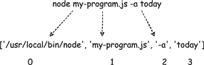
图 2.1: Node 如何在 `process.argv` 中存储命令行参数。
如果我们以目录名称作为参数运行此程序，`fs.readdir` 将该目录内项的名称作为一个字符串数组返回。程序使用 `for (const name of results)` 来遍历该数组的内容。我们可以用 `let` 代替 `const`，但尽可能将内容声明为 `const` 是一个良好的习惯，这样任何阅读程序的人都知道该变量实际上不会发生变化——这样做减轻了阅读程序者的 `cognitive load`（认知负荷）。最后，`console.log` 是 JavaScript 其他其他语言打印命令的等价物；它奇怪的名字来自于其最初的目的是在浏览器 `console` 中创建 `log messages`（日志消息）。
遗憾的是，我们的程序并没有运行：
!(images/comp02_3.jpg)
错误信息来自某些我们没有编写的东西，我们很难读懂它的来源。如果我们寻找自己的文件名（`list-dir-wrong.js`），会看到错误发生在第 4 行；上面的所有内容都在 `fs.readdir` 内部，而下面的所有内容都是 Node 在加载和运行我们的程序。
问题在于 `fs.readdir` 没有返回任何内容。相反，它的文档说明它需要一个回调函数来告诉它在数据可用时该做什么，因此我们需要探索这些内容以便让我们的程序工作。
## 2.2 什么是回调函数？
JavaScript 使用 `single-threaded`（单线程）编程模型：正如本节介绍所说，它将文件 I/O 等操作分为“请执行此操作”和“当数据可用时执行此操作”。`fs.readdir` 是第一部分，但我们需要编写一个函数来指定第二部分。
JavaScript 会保存该函数的引用，并在我们的数据准备绪时用一组特定的参数调用它（图 2.2）。这些参数为连接到库定义了一个标准的 `protocol`（协议），就像 USB 标准允许我们将硬件设备连接在一起一样。
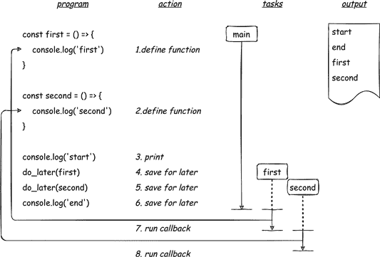
图 2.2: JavaScript 如何运行回调函数。
这个修正后的程序为 `fs.readdir` 提供了一个名为 `listContents` 的回调函数：
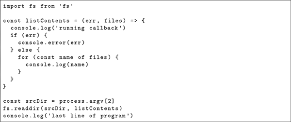
Node 回调函数总是将错误（如果有的话）作为第一个参数，并将成功函数调用的结果作为第二个参数。函数可以通过检查错误参数是否为 `null` 来区分它们。如果是，函数将使用 `console.log` 列出目录内容，否则它将使用 `console.error` 显示错误信息。让我们用 `current working directory`（当前工作目录，写为‘.’）作为参数运行程序：
!(images/comp02_6.jpg)
如果不理解 Node 执行此程序中语句的顺序（图 2.3），后续的任何内容将没有任何意义：
1. 执行第一行加载 `fs` 库。
3. 从命令行参数中获取目录名称。
5. 打印消息显示我们已到达文件末尾。
7. 运行回调函数，打印目录列表。
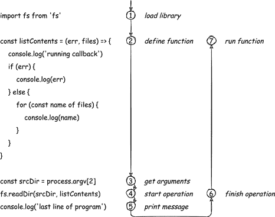
图 2.3: JavaScript 运行回调函数时。
## 2.3 什么是匿名函数？
大多数 JavaScript 程序员不会先定义 `listContents` 函数然后将其作为回调传递。相反，由于回调只用了一处，在需要的地方将其定义为 `anonymous function`（匿名函数）更符合 `idiomatic`（惯用写法）。这使得更容易看到操作完成后将发生什么，尽管这意味着执行顺序与代码顺序不同（图 2.4）。使用匿名函数给了我们最终的：
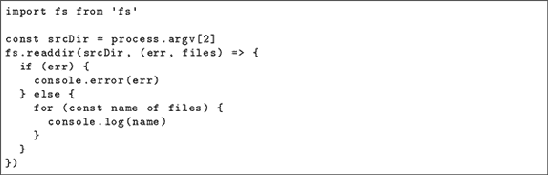!(images/fig2_4.jpg)
图 2.4: 函数
## 2.4 我们如何选择一组文件？
假设我们要复制某些文件而不是列出目录内容。根据情况，我们可能只想复制命令行给出的文件，或者复制某些以外的所有文件。我们不想逐个列出文件；相反，我们想要编写像 `*.js` 这样的模式。
为了找到此类模式的文件，可以使用 `glob` 模块。（**glob** 意为“全局”，是 Unix 中用于匹配一组文件的旧式术语。）`glob` 模块提供了一个接受模式和回调的函数，并对每个匹配模式的文件执行操作：
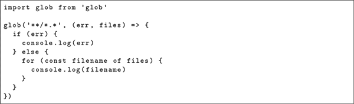!(images/comp02_9.jpg)
开头的 `**` 意味着“递归子目录”，而 `.*` 意味着“任意字符后跟任意任意字符”（图 2.5）。不匹配 `.*` 的名称不会被包含，默认情况下，以 `.` 开头的名称也不会被包含。这是另一个 Unix 传统：以 `.` 开头的文件和目录通常包含程序的配置信息，除非另有说明，大多数命令都会忽略它们。
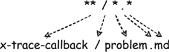
图 2.5: 使用 glob 模式匹配文件名。
这个程序可以工作，但我们可能不想复制以 `.bck` 结尾的编辑器备份文件。我们可以通过**过滤** `glob` 返回的列表来消除它们：
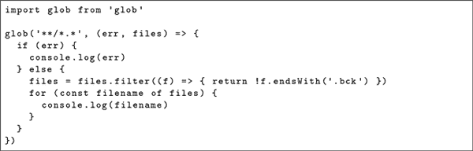!(images/comp02_11.jpg)
`Array.filter` 创建一个包含原始数组中通过测试项的新数组（图 2.6）。测试通过回调函数指定，`Array.filter` 会为每个项调用一次该函数。该函数必须返回 `Boolean`（布尔值），告诉 `Array.filter` 是否在新数组中保留该项。`Array.filter` 不修改原始数组，因此如果我们需要，对原始文件名列表进行多次过滤。
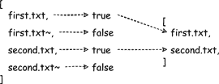
图 2.6: 使用 `Array.filter` 选择数组元素
通过移除单个参数周围的括号并只编写我们函数返回的表达式，可以让我们的 glob 程序更符合惯用写法：
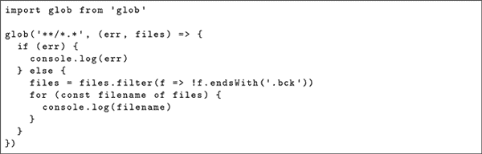

然而，事实证明 `glob` 会为我们进行过滤。根据其文档，该函数接收一个包含键值对设置的选项对象，这些设置控制着它的行为。这是 Node 库中的另一种常见模式：与其接受大量很少使用的参数，一个函数可以接收一个包含所有设置的单一对象。
如果我们使用这种方法，我们的程序将变为：
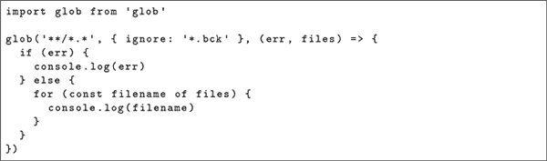
注意，我们没有对选项对象中的键加引号。对象中的键几乎总是字符串，如果一个字符串足够简单，不至于让解析器产生歧义，我们就不需要给它加上引号。在这里，“足够简单”意味着“看起来像是一个变量名”，或者等价于“只包含字母、数字和下划线”。
为了完成我们的 glob 程序，让我们在命令行上指定一个源目录并将其包含在模式中：
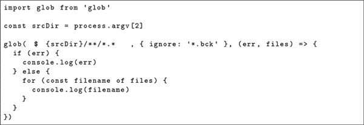
该程序使用**字符串插值**将 `srcDir` 的值插入到字符串中。模板字符串写在反引号（back quotes）中，JavaScript 会将每个写为 `${expression}` 的表达式转换为文本。我们可以通过使用 `srcDir + ’/**/*.*’` 拼接字符串来创建模式，但大多数程序员发现插值更易读。
## 2.5 我们如何复制一组文件？
如果我们想复制一组文件而不仅仅是列出它们，我们需要一种方法来创建我们要生成的文件的**路径**。如果我们的程序接受第二个参数来指定所需的输出目录，我们可以通过将源目录名称替换为该路径来构建完整的输出路径：
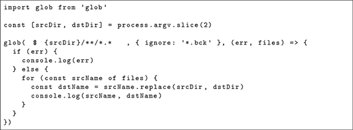
该程序使用**解构赋值**，通过解包数组元素（见图 2.7）同时创建两个变量。只有当数组包含足够的元素时它才有效，即如果在命令行上同时给了源和目标；我们将在练习中添加对此的检查。
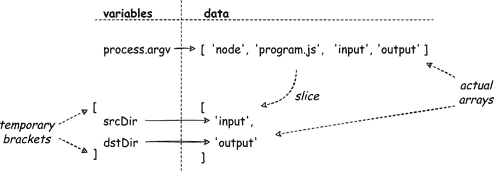
图 2.7： 通过解构一次性分配多个值。
一个更严重的问题是，该程序只有在目标目录已存在时才能工作：`fs` 以及其他语言中的相应库通常不会自动为我们创建目录。这种需求频繁出现，以至于有一个名为 `ensureDir` 的函数可以完成工作：
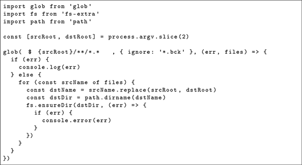
注意，我们是从 `fs-extra` 导入而不是 `fs`；`fs-extra`⁶ 模块在 `fs` 之上提供了一些实用工具。我们还使用 `path`⁷ 来处理文件名，而不是拼接或插值字符串，因为路径中有很多棘手的**边界情况**，该模块的作者已经为我们解决了这些。
我们的文件复制程序目前创建空的目标目录，但并没有实际复制任何文件。让我们使用 `fs.copy` 来完成：
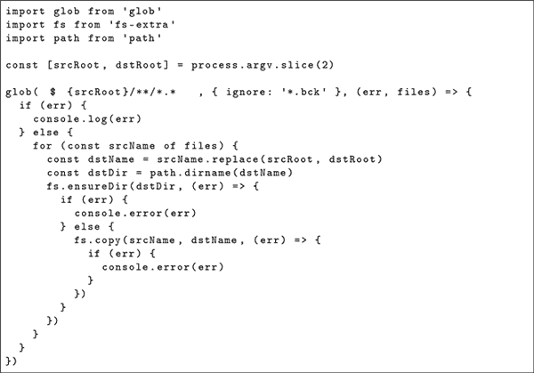
程序现在有三层回调（见图 2.8）：
1. 当 `glob` 有数据时，执行操作，然后调用 `ensureDir`。
3. 当 `copy` 完成时，检查错误状态。
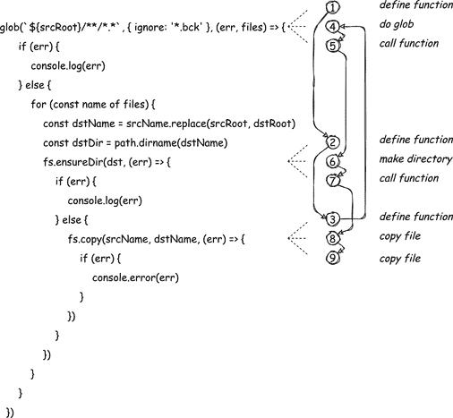
图 2.8： 运行示例中的三层回调。
我们的程序看起来应该工作，但如果我们尝试复制包含这些课程的目录中的所有内容，就会收到一个错误消息：
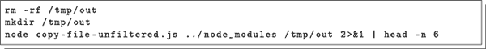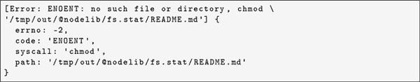
问题在于 `node_modules/fs.stat` 和 `node_modules/fs.walk` 匹配了我们的 glob 表达式，但它们是目录而不是文件。为了防止程序尝试对目录使用 `fs.copy`，我们必须使用 `fs.stat` 获取 `glob` 提供给我们的对象的属性，然后检查它们是否为文件。“stat”一词是“status”（状态）的缩写，由于文件系统中某个状态可能非常复杂，`fs.stat` 返回一个包含可以回答常见问题的方法的对象⁸。
这是我们文件复制程序的最终版本：
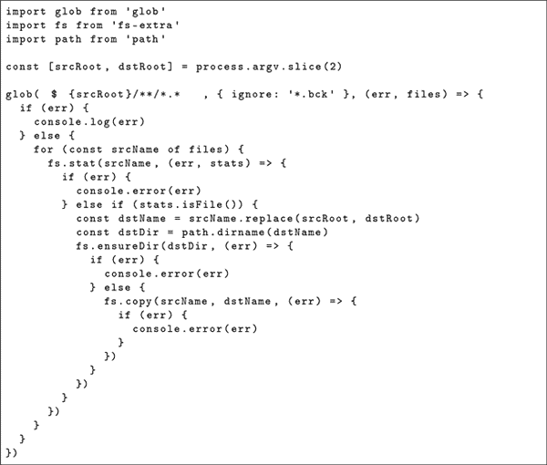
它可以工作，但四层异步回调对人类来说很难理解。第 3 章 将引入一对工具，使此类代码更易读。
## 2.6 练习
### Node 在哪里？
编写一个名为 `wherenode.js` 的程序，打印运行它的 Node 版本的完整路径。
### 追踪回调
下面的程序按什么顺序打印消息？
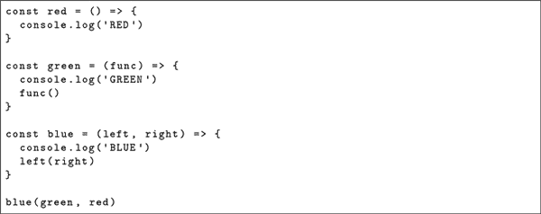
### 追踪匿名回调
下面的程序按什么顺序打印消息？
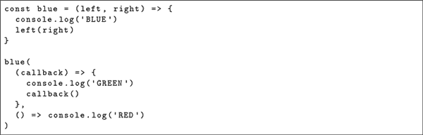
### 检查参数
修改文件复制程序，以检查它是否收到了正确数量的命令行参数，如果没有收到，则打印一条合理的错误消息（包括用法说明）。
### Glob 模式
每个以下 glob 模式匹配哪些文件名？
* `results-[01234]`
* `results?`
### 过滤数组
填充空白，使其匹配字母表中位于 'P' 之后的项。
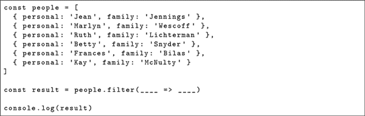
### 字符串插值
填充代码，使其显示所示的内容。
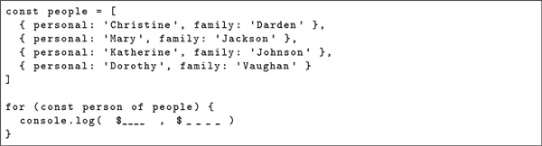
实际上，字符串插值部分是 2.5。


2. `const [first, second] = [10, 20]`
4. `const [first, second, third, fourth] = [10, 20, 30]`
6. `const {left, middle, right} = [10, 20]` 
### 统计行数
编写一个名为 `lc` 的程序，统计一个多个文件的行数以及总行数，使得 `lc a.txt b.txt` 显示：

### 重命名文件
编写一个名为 `rename` 的程序，接受三个或更多命令行参数：
1. 要匹配的文件扩展名。
3. 一个或多个现有文件名。
运行时，`rename` 将具有第一个扩展的文件重命名为具有第二个扩展的文件，但不会覆盖现有文件。例如，假设一个目录包含 a.txt、b.txt 和 b.ck。命令：

会将 a.txt 重命名为 a.bck，但不会重命名 b.txt，因为 b.ck 已存在。
# 3 异步编程
术语定义：**调用栈**、**字符编码**、**类**、构造函数、**事件循环**、**异常**、**流式接口**、方法、**链式调用**、**非阻塞执行**、**Promise**、**Promise 化**、协议、UTF-8
回调可以工作，但它们难以阅读和调试，这意味着它们只在有限范围内“有效”。JavaScript 开发者在 2015 年向语言添加了 **Promise**，以便更容易编写和理解回调，最近他们还增加了 async 和 await 关键字，使异步编程变得更加简单。为了展示这些是如何工作的，我们将创建一个名为 `Pledge` 的自定义类，它提供了与 Promise 相同的内核功能。我们的解释灵感源于 Trey Huffine 的¹教程²，我们建议你也阅读它。

JavaScript 是围绕 `event loop`（事件循环）构建的。每个任务都由队列中的一个项表示；事件循环反复从队列头部取出任务，运行它，并将其创建的任何新任务添加到队列尾部稍后运行。同一时间只有一个任务在运行；每个任务都有自己的 `call stack`（调用栈），但对象可以在任务之间共享（见图 3.1）。
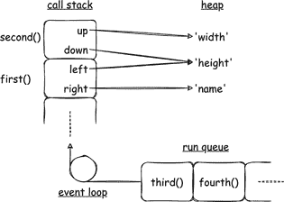
图 3.1： 使用事件循环管理并发任务。
大多数任务按照编写的顺序执行所有可用代码。例如，这个单行程序使用 `Array.forEach` 依次打印数组的每个元素：

然而，少数特殊的内置函数可以让 Node³ 切换任务或向运行队列添加新任务。例如，`setTimeout` 告诉 Node 在经过若干毫秒后运行一个回调函数。它的第一个参数是一个不接受参数的回调函数，第二个参数是延迟。当调用 `setTimeout` 时，Node 会将回调函数放在一边，持续请求的时间，然后将其添加到运行队列。（这意味着任务将在*至少*在指定的毫秒数后运行。）
如下文列表所示，原始任务在完成之前可以生成许多新任务，而这些任务的运行顺序可能与它们创建的顺序不同（见图 3.2）。
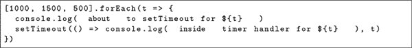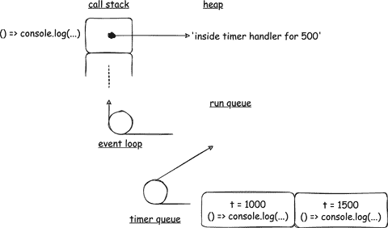
图 3.2： 使用 `setTimeout` 延迟操作。
如果我们给 `setTimeout` 一个零毫秒的延迟，新任务可以立即运行，但任何其他正在等待的任务也有机会运行：
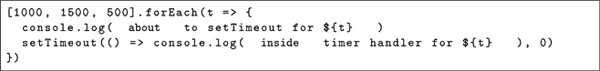
我们可以使用这个技巧来构建一个通用的 `non-blocking function`（非阻塞函数），它接收一个定义任务的回调函数，并在有任何其他可用任务时切换任务：
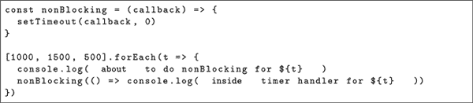
Node 的内置函数 `setImmediate` 与我们的 `nonBlocking` 函数的作用完全相同：Node 还有 `process.nextTick`，它的功能并不完全一样——我们将在练习中探索其中的差异。
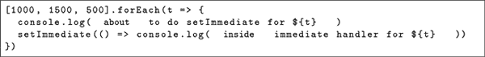
## 3.2 Promise 是如何工作的？
在我们开始构建自己的 Promise 之前，让我们看看我们希望它们如何工作：
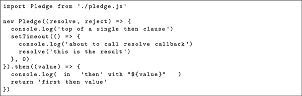
这个短程序创建了一个新的 `Pledge`，其的回调函数接收另外两个回调函数作为参数：`resolve`（当一切运行正常时运行）和 `reject`（当发生问题时运行）。顶层回调执行了我们想要做的第一部分，即在预期延迟之前我们想要运行的任何内容；为了演示，我们将使用零延迟的 `setTimeout` 来切换任务。一旦该任务恢复，我们就调用 `resolve` 回调来触发延迟后应该发生的任何事情。
现在看带有 `then` 的那行。这是我们刚刚创建的 `Pledge` 对象的 `method`，它的任务是执行延迟后我们想要做的任何事情。`then` 的参数是另一个回调函数；它将获得传递给 `resolve` 的值，这就是第一部分与第二部分通信的方式（见图 3.3）。
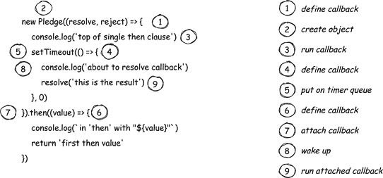
图 3.3： Promise 解析时的操作顺序。
为了让其工作，`Pledge` 的 `constructor` 必须接受一个名为 `action` 的函数。该函数必须接受两个回调作为参数：如果操作成功完成该做什么，以及如果没有成功完成该做什么（即如何处理错误）。`Pledge` 将在适当的时间为 `action` 提供这些回调。
`Pledge` 还需要两个方法：用于启用更多操作的 `then` 和用于处理错误的 `catch`。为了稍微简化，我们将允许用户 `chain`（链）任意数量的 `then`，但只允许一个 `catch`。
## 3.3 我们如何将操作链式连接？
`fluent interface`（流式接口）是一种面向对象的编程风格，其中对象的方法返回对象本身，以便方法调用可以链式连接。例如，如果我们的类是：
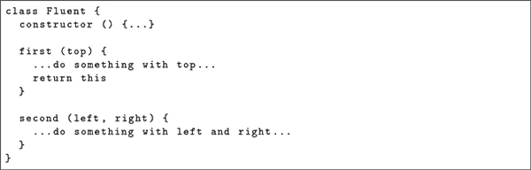
那么我们可以写：

甚至

`Array` 的流式接口允许我们编写像 `Array.filter(...).map(...)` 这样的表达式，这通常比将中间结果赋值给临时变量更有可读性。
如果传递给 `Pledge` 的原始操作成功完成，`Pledge` 通过调用 `resolve` 回调赋予我们一个值。我们将此值传递给第一个 `then`，将该 `then` 的结果传递给第二个，依此类推。如果给我们的 `Pledge` 的原始操作失败，`Pledge` 将通过调用 `reject` 回调赋予我们一个异常。组合在一起，整个类看起来是：
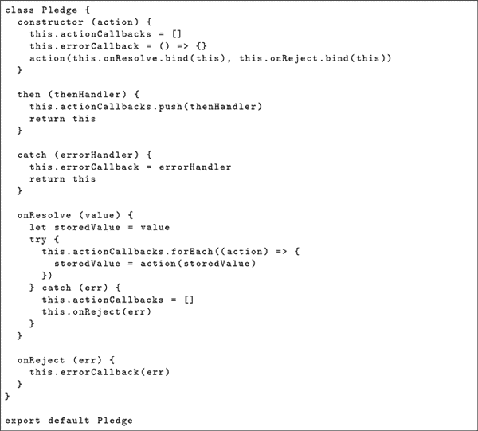
让我们创建一个 `Pledge` 并返回一个值：

为什么这没有起作用？
1.  我们无法使用 `return`，因为在执行时调用栈已经消失了。


2. 如果我们要使用自己的异步函数，它必须创建并返回一个 Promise。


   
   
   
### 多个 catches
假设创建一个失败的 promise 并添加错误处理器：
当代码运行时，它会产生：
1. 追踪顺序：什么时候执行的？


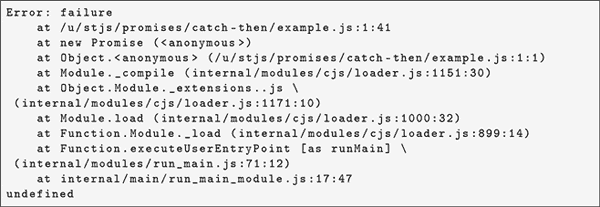


| :--- | :--- |
| 3 | 3 |
| 6 | 7 |
| 12 | 2 |
| 15 | 1 |
| 20 | 1 |
| 35 | 2 |
| 38 | 1 |


提示：你可能希望使用 `Set` 类来存储行。
### 追踪文件加载

假设我们正在使用 `fs` 库的 Promise 化版本来加载一个 YAML 配置文件。在这个测试程序中，打印语句会以什么顺序出现？为什么？
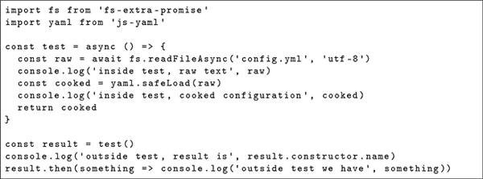
### 任意与全部
1. 添加一个方法 `Pledge.any`，它接收一个承诺（pledges）数组，一旦数组中的其中一个承诺解析成功（resolve），就返回一个承诺，该承诺 解析的结果为该承诺的值。
2. 添加另一个方法 `Pledge.all`，它接收一个承诺（pledges）数组，并返回一个承诺，该承诺 解析的结果是一个包含所有这些承诺的最终值的数组。
这篇文章⁶可能会有所帮助。
# 4 单元测试
定义的术语：**绝对误差**、**实际结果（测试的）**、**断言**、**缓存**、**防御性编程**、**设计模式**、**动态加载**、**错误（测试中的）**、**异常处理器**、**预期结果（测试的）**、**探索性编程**、失败（一个测试）、**测试固件**、**全局变量**、**内省**、**生命周期**、**通过测试测试**、**相对误差**、**副作用**、**单例模式**、**测试运行器**、**测试主体**、**抛出（异常**、**单元测试**
在之前的两个章节中我们写了许多小程序，但还没有真正测试过其中任何一个。对于探索性编程来说没关系，但如果我们的软件是要使用而不仅仅是阅读，我们应该尝试确保它运行正常。
一个编写和运行单元测试的工具是一个很好的第一步。这样的工具应该：
* 找到包含测试的文件；
* 运行测试；
* 报告每个测试的结果以及这些结果的摘要。
我们的设计灵感源于 Mocha¹ 和 Jest² 等工具，而这些工具反过来受到 20 世纪 80 年代以来为其他语言构建的工具的启发 [Meszaros2007; [Tudose2020]](#refbib1.xhtml_refbib_28)。
## 4.1 我们应该如何结构化单元测试？
与其他单元测试框架一样，每个测试都将是一个零参数的函数，以便框架能够以相同的方式运行它们。每个测试都会创建一个待测试的 `fixture`（固件），并使用 `assertions`（断言）将`实际结果`与`预期结果`进行比较。结果恰好可以是以下之一：
* 通过（Pass）：测试主体符合预期。
* 错误（Error）：测试本身出现了问题，这意味着我们不知道测试主体是否运行正常。
为了实现这一点，我们需要某种方法来区分失败的测试和损坏的测试。我们的解决方案依赖于异常是对象，并且程序可以使用内省（introspection）来确定对象的类。如果一个测试抛出了一个类为 `assert.AssertionError` 的异常，那么我们假设该异常源于我们在测试中为了检查而放置的断言（图 4.1）。任何其他类型的断言都表示测试本身包含错误。
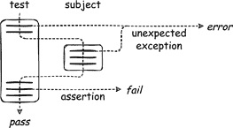
图 4.1: 运行可以通过、失败或包含错误的测试。
## 4.2 我们如何将注册、执行和报告分离？
首先，让我们一些全局变量来记录测试及其结果：

我们不立即运行测试，因为我们想将每个测试封装在自己的异常处理器中。相反，`hopeThat` 函数保存了一个描述性消息和一个在 `HopeTest` 数组中实现测试的回调函数。

最后，`main` 函数运行所有注册的测试：
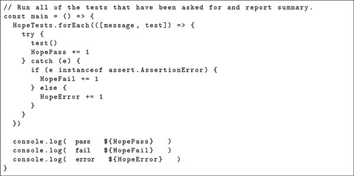
如果一个测试在没有异常的情况下完成，它就通过了。如果测试内部的任何 `assert` 调用抛出了 `AssertionError`，则测试失败；如果它抛出了任何其他异常，则是一个错误。在所有测试运行之后，`main` 报告结果的数量。
让我们尝试一下：
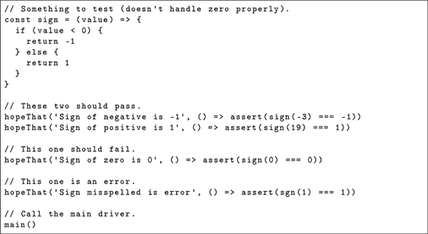

这个简单的框架完成了它应该做，但：
1. 它没有告诉我们哪些测试通过了或失败了。
3. 它没有自动发现测试。


2. Node 缓存模块，因此无论导入多少次，模块只会加载一次。这确保了 `Hope()` 只运行了一次。一旦程序导入了 `hope`，就可以调用 `Hope.test` 来记录测试，并调用 `Hope.run` 执行所有已注册的测试（图 4.2）。
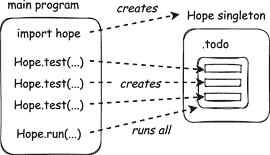
图 4.2: 创建单例、记录测试并运行它们。
最后，我们的 `Hope` 类可以以简洁的单行摘要和详细列表报告结果。它还可以提供每个测试的标题和结果，这样如果有人想以不同的格式化它们（例如 HTML），他们可以：
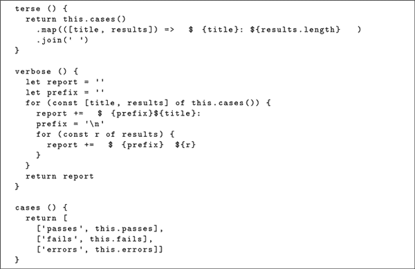
## 4.4 我们如何为测试构建命令行界面？
大多数程序员并不喜欢编写测试，所以如果我们想让他们这样做，我们就必须让它尽可能简单。几行获取 `assert` 和 `hope` 的导入语句，然后每个测试一个函数调用，这已经是我们对测试本身能做到的最简单的了：

但这仅仅定义了测试——我们如何找到它们以便运行它们呢？一种方案是要求将每个包含测试的文件导入另一个文件中：
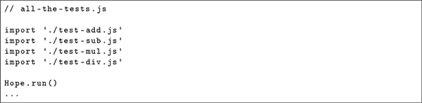
在这里，`all-the-tests.js` 导入其他文件，以便它们能够通过调用 `hope.test` 作为副作用来注册测试，然后调用 `Hope.run` 执行它们。这虽然可以运行，但迟早（可能很快）有人会忘记导入其中一个测试文件。


2. 加载 `hope.js` 创建了 `Hope` 类的单实例。
4. `pray` 使用 `import` 作为函数加载 `test-add.js`。
6. `test-add.js` 使用 `hope.test` 注册了一个测试（该测试尚未运行）。
8. ……它加载了 `Hope`……
10. `pray` 现在可以要求 `Hope` 的唯一实例运行所有测试，然后从 `Hope` 单例获取报告并将其显示。
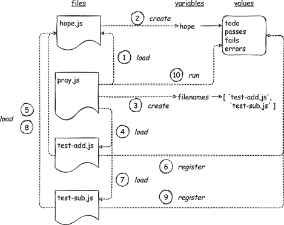
图 4.3: 动态发现的单元测试的生命周期。
## 4.5 练习
### 异步 glob

安装 `microtime` 包，然后修改 `dry-run.js` 示例，使其记录并报告测试的执行时间。
### 约相等
   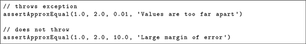
   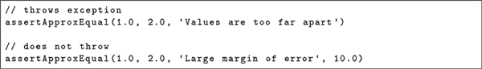

窗口应用程序使用带有四个值的对象表示矩形：`x` 和 `y` 是左下角的坐标，而 `w` 和 `h` 是宽度和高度。所有值均为负数：屏幕的左下角位于 `(0, 0)`，屏幕尺寸为 `WIDTHxHEIGHT`。
1. 编写测试检查一个对象是否代表有效的矩形。
3. 你的测试是否假设在边缘接触的两个矩形是重叠的还是不是？仅在单个角落接触的两个矩形呢？
### 选择测试

修改 `hope.js`，使用户可以选择提供一个字符串数组来标记测试：
然后修改 `pray.js`，如果用户指定了 `-t tagName` 或 `--tag tagName`，则仅运行该标签的测试。
### Mock 对象


测试框架通常允许程序员指定一个在每个测试前运行的 setup 函数和一个在每个测试后运行的 teardown 函数。（setup 通常创建固定件，而 teardown 有时需要关闭连接。）
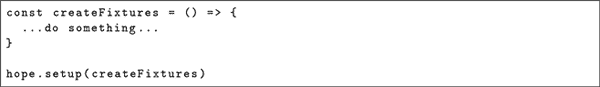

添加方法 `hope.multiTest`，允许用户一次指定多个测试用例。例如，这：
等同于：

1. 编写 `assertSetEqual` 和 `assertMapEqual` 检查两个 `Set` 或两个 `Map` 是否相等。

修改单元测试框架以处理异步函数，使得：
正常工作。（可以使用 `typeof` 判断传递给 `hope.test` 的对象是函数还是 promise。）
# 5 备份
术语定义：**应用程序接口**、**冲突**、**逗号分隔值**、**协调世界时间**、**加密哈希函数**、**数据迁移**、**处理器/handler**、**哈希码**、**哈希函数**、**JavaScript 对象格式**、**mock 对象**、**管道**、**竞态条件**、**SHA-1 哈希**、**流**、**流式 API**、**[检查时间/使用时间]**、**时间戳**、**版本控制系统**
现在我们可以测试软件了，我们有了值得保存的东西。像 Git¹ 这样的版本控制系统跟踪文件的更改，以便我们在需要时恢复旧版本。它的核心是一种归档方法，它：
1. 记录哪些文件的版本在何时存在（以便我们可以回到之前的某个状态），


2. 输出看起来像随机数：它们是不可预测的且均匀分布的（即，获得任何特定哈希代码的概率相同）。
编写一个糟糕的哈希函数很容易，但要编写一个符合加密标准的哈希函数非常困难。因此，我们将使用库为我们的文件计算 160 位的 `SHA-1` 哈希。这些哈希并不足够随机到无法向资金充足的攻击者隐藏数据，但并不是我们使用它们的目的：我们只需要随机的哈希使得`collision`（碰撞）极不可能发生。
Node 的⁶ `crypto`⁷模块提供了创建 SHA-1 哈希的工具。要使用这些工具，我们创建一个跟踪哈希计算当前状态的对象，告诉它我们希望如何编码（或表示）哈希值，然后向它输入一些字节。完成后，我们调用它的 `.end` 方法，然后使用它的 `.read` 方法获取最终结果：
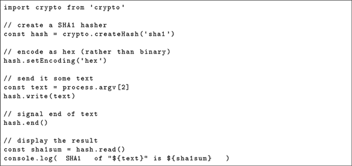
对文件进行哈希而不是固定字符串是简单的：我们只需要读取文件的内容并将这些字符传递给哈希对象：
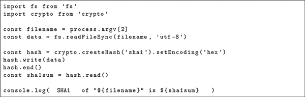
然而，将文件作为`stream`（流）处理会更高效：
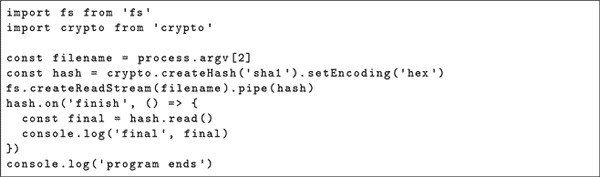
这种接口被称为`streamingAPI`，因为它被设计为一次处理一个块的数据流，而不是要求所有数据同时存在内存中。许多应用程序使用流，这样程序就不必将整个（可能是巨大的）文件读取到内存中。
首先，此程序请求 `fs` 库为文件创建一个读取流，并将数据从该流`pipe`（管道）到哈希对象（图 5.2）。然后它通过为“finish”事件提供`handler`，告诉哈希对象在没有更多数据时该做什么。这被称为异步：如输出所示，主程序在处理数据结束的任务被调度和运行之前就已经结束了。大多数程序还为“data”事件提供处理器，以便在每个数据块进入时对其进行某些操作；我们程序中的哈希对象为我们完成了这一点。
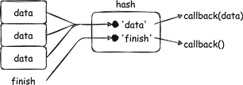
图 5.2: 将文件作为块流处理。
## 5.2 我们如何备份文件？
许多文件在创建后偶尔发生变化，或者根本不变化。如果版本控制系统在用户每次想要保存项目快照时都创建副本，将是浪费的，因此我们的工具将每个唯一文件复制到类似 `abcd1234.bck` 的地方，其中 `abcd1234` 是文件内容的哈希。它将存储一个记录每个快照文件名和哈希键的数据结构。哈希键告诉它哪些唯一文件是快照的一部分，而文件名告诉我们在创建快照时每个文件的内容名称是什么（因为文件可能会被移动或重命名）。要恢复特定的快照，我们做的只是将保存的 `.bck` 文件复制回它们所在的地方（图 5.3）。

图 5.3: 备份文件存储结构。
我们可以使用 promises（第 3 章）构建执行此操作所需的工具。主函数创建一个 promise，使用异步版本的 `glob` 来查找文件，然后：
1. 检查列表中的项是否为文件；
3. 为这些文件计算哈希。

此函数使用 `Promise.all` 等待列表中所有文件的操作完成。哈希函数依赖的前两个函数封装在 promises 中：
```
```
最后一个函数同步计算哈希，但我们可以使用 `Promise.all` 等待这些：
```
```
我们编写的代码比使用回调更清晰，但 promises 的层仍然模糊了它的含义。使用 `async` 和 `await` 时，相同的操作变得易读了：
```
```
这个版本创建了与之前相同的 promises，但这些 promises 是由 Node 自动创建的。为了检查它是否工作，让我们为相同的输入运行：
```
```
## 5.3 我们如何跟踪哪些文件已经备份？
我们备份工具的第二部分跟踪哪些文件尚未备份。它将备份存储在一个目录中，该目录包含类似 `abcd1234.bck` 的备份文件，以及描述特定快照的文件。后者被命名为 `ssssccccc.csv`，其中 `ssssccccc` 是备份创建的 `UTCtimestamp`，`.csv` 扩展名表示文件格式化为逗号分隔值。（我们可以将这些文件存储为 `JSON`。）

为了测试我们的程序，让我们手动创建带有制造（缩短）哈希的测试目录：
```
```
我们使用 Mocha⁸ 来管理我们的测试。每个测试都是异步函数；Mocha 在报告结果之前会自动等待它们完成。要运行它们，我们在项目 `package.json` 文件的脚本部分添加该行：

```json
  "test": "mocha"
```
这样当我们运行 `npm run test` 时，Mocha 会在课程目录的测试子目录查找文件。
这是我们的前几个测试：
```
```
这是 Mocha 的报告：
```
```
## 5.4 我们如何测试修改文件的代码？
我们的工具需要完成的最后事情是复制复制的文件并创建一个新的索引文件。代码本身将相对简单，但测试将变得复杂，因为我们的测试需要在运行之前创建目录和文件，并在运行之后删除它们（这样它们就不会污染后续测试）。


| :--- | :--- |
| 2 | 25% |
| 4 | 75% |


2. 编写另一个名为 `migrate.js` 的程序，将一组清单从 CSV 转换为 JSON。（程序名称源于 `data migration` 数据迁移这一术语。）


2. 创建一个替代品，返回某些可预测的值，例如数据的开头几个字符。


* 哪些文件的哈希相同但名称不同（即它们被重命名了）。
* 哪些文件在第二个清单中，但名称和哈希都不在第一个中（即它们已被添加）。
### 从一个状态到另一个状态
1. 编写一个名为 `from-to.js` 的程序，将目录名称和清单文件名作为命令行参数，然后添加、删除和/或重命名目录中的文件以恢复清单中描述的状态。程序应该只在需要时执行文件操作，例如，如果内容没有变化，它不应该删除文件并重新添加。


2. 使用 Mocha 和 `mock-fs` 为你的程序编写测试。
### 提交前钩子 (Pre-commit hooks)
修改 `backup.js`，从位于备份文件根目录下的 `pre-commit.js` 文件加载并运行一个名为 `preCommit` 的函数。如果 `preCommit` 返回 `true`，则继续备份；如果它返回 `false` 或抛出异常，则不创建备份。
# 6 数据表

为了找出哪种方法更好，我们将每种方法构造一个，尝试一些操作，记录它们的执行时间和内存占用情况，然后进行比较。至关重要的是，答案将取决于实现本身，还取决于我们衡量的操作组合。例如，如果一种策略对过滤（filter）效果更好，而另一种对选择（select）效果更好，那么过滤与选择的比例可能会决定哪种是“最佳”。
对于我们的第一个实验，让我们构建一个具有若干列的行主（row-major）表格。为了简单起见，我们将使用行索引来填充表格：

接下来，我们为这种布局的表格编写 filter 和 select。我们需要为 filter 提供一个回调函数来决定保留哪些行，类似于 `Array.filter` 的回调函数；对于选择列，我们提供一个键的列表，用以标识我们想要保留的列。我们预计过滤速度相对较快，因为它在复用行；而选择应该相对较慢，因为我们必须构建一组新的数组（图 6.3）。

图 6.3: 行主数据表格上的操作。
现在让我们对列主（column-major）存储进行相同的操作。构建持有列的对象是直接的：

过滤更为复杂，因为每行的值都分散在几个数组中，但选择只需要在新表格中复用我们需要的数组即可。我们预计选择速度相对较快，因为只需要复制列的引用，但过滤将相对较慢，因为我们正在构建多个新数组（图 6.4）。注意，这段代码假设存在一个名为 `label_1` 的列，它可以通过该列来查找表格中有多少行。这在生产环境环境中是非常糟糕的，但对于一些简单的性能测试已经足够了。

图 6.4: 列主数据表格上的操作。
## 6.2 我们如何测试实现的性能？
现在我们有了表格和操作，可以构建一个测试用具（test harness），在不同尺寸的数据表格上运行这些操作。我们任意决定保留一半的列和三分之一的行；这些比例会影响我们对哪种方法更好的判断，因此如果我们在实际应用中这样做，就会测试这些比例变化时的情况。正如之前说的，相对性能还取决于对每个选择执行多少次过滤；我们的平衡应该基于要支持的数据。
我们的性能测量程序如下：

实际测量函数使用了 `microtime`⁵ 库来获取微秒计时，因为 JavaScript 的 `Date` 只能提供毫秒级精度。我们使用 `object-sizeof`⁶ 来估计所需的内存，还调用了 `process.memoryUsage()` 来查看程序运行时 `Node`⁷ 使用了多少内存，但这受到垃圾回收和许多其他因素的影响。

让我们对一个 100 行 3 列且过滤与选择比例为 3:1 的表格运行程序：

如果我们将表格扩大到 10,000 行 30 列并保持相同的 3:1 过滤/选择比例会怎样？

如果我们保持表格大小相同但使用 10:1 的过滤/选择比例会怎样？

表 6.1 中的结果显示列主存储更好。它更节省内存（可能因为标签没有重复），行主存储执行选择时构建新对象的时间超过了列主存储执行过滤时附加数组的成本。遗憾的是，列主存储的代码编写起来稍微复杂，这种成本在实验中并没有体现。
表 6.1: 行主和列主数据表格操作的相对性能。
| **值 (value)** | **100-3-3** | **10000-30-3** | **10000-30-10** |
| nRows | 100 | 10000 | 10000 |
| filterPerSelect | 3 | 3 | 10 |
| rowSelectTime | 111 | 15863 | 15566 |
| colSelectTime | 48 | 104 | 90 |
## 6.3 保存表格的最有效方法是什么？
数据是有价值的，因此我们将数据表格存储在某种文件中。如果一种存储方案比另一种高效得多，且我们频繁读写，这可能会改变我们对实现方法的选择。
两种简单的文本方案是行向和列向的 JSON——基本上就是打印我们拥有的数据结构。让我们运行 10,000×30 测试：

行主版本所需的时间是列主版本的近十倍；我们假设标签的重复打印主要是原因，正如标签的冗余存储是行主内存需求更大的一样。
如果这个诊断是，那么行主存储的压缩版本应该更快。我们保存一次列头，然后将数据值拷贝到数组数组并保存：

这些结果显示，更改布局比将数据转换为字符串更快，但列主存储仍然是最佳方法。
## 6.4 二进制存储能提高性能吗？
让我们尝试另一种存储表格的策略。JavaScript 在标记数据结构中存储值：某些位定义类型，而其他位存储值（图 6.5）。

图 6.5: JavaScript 如何使用标记结构存储对象。
我们可以通过自己跟踪类型并只存储位来节省空间。JavaScript 有一个 `ArrayBuffer` 类专门为此目的。它将我们需要的任何值存储为位集；然后我们通过呈现为特定类型的视图访问这些位，例如布尔值（每个值一个字节）或数字（每个数字 64 位）。如图 6.6 所示，我们可以在单个 `ArrayBuffer` 中混合不同类型的数据，但跟踪哪些字节属于哪个取决于我们。

图 6.6: 使用带有查找信息的位形式存储对象值。
为了存储列主表格，我们将用以下填充 `ArrayBuffer`：
1. 两个持有表格尺寸的整数（行数和列数）。
3. 数字本身。

打包数据表格节省了时间，因为拷贝位比将数字转换为字符更快，但节省的空间没有预想的那么多。原因是双精度数字是 8 字节长，但由于我们为测试选择了了简单的整数值，它们只需要 5 个字符即可表示（即 10 字节）。如果我们有“真实的”数字，存储收益可能会更加明显。
## 6.5 练习题


### 变化的过滤行为
如果我们在过滤时保留 1% 的行而不是三分之一，我们关于哪种存储格式更好的决定会发生变化？如果我们保留 90% 的行呢？
### 通过字符串过滤
修改 `filter` 和 `select` 的比较逻辑，使其适用于包含字符串列而非数字列的表格，并观察性能如何变化。为了测试，使用字符 `A-Z` 创建随机的 4 位字符串，并按以下条件过滤：
*   精确匹配
*   包含特定字符的字符串
### Join 性能
连接（Join）根据匹配键合并两个表的数据。例如，如果两个表分别是：
| `Key` | `Left` |
| A | a1 |
| C | c1 |
以及：
| `Key` | `Right` |
| A | a2 |
| B | b2 |
那么连接结果为：
| `Key` | `Left` | `Right` |
| A | a1 | a2 |
| B | b1 | b2 |
编写一个测试，比较在基于匹配数字键连接两个表时，行式存储与列式存储的性能差异。答案是否取决于匹配键的比例？
### Join 优化
`join` 两个表的简单方法是使用双重循环查找匹配键。另一种方法是为每个表构建一个 `index`，然后使用它来构建匹配项。例如，假设表如下：
| `Key` | `Left` |
| A | a1 |
| C | c1 |
以及：
| `Key` | `Right` |
| A | a2 |
| B | b2 |
第一步是创建一个 `Map`，显示每个键在第一个表中的位置：

第二步是为第二个表创建一个类似的 `Map`：

然后我们可以遍历其中一个 map 中的键，在第二个 map 中查找值，并构建所有匹配项。
编写一个以这种方式连接两个表的函数。它比使用双重循环更快还是更慢？答案如何取决于键的数量和匹配的比例？
### 翻转存储
我们的测试显示，将行定向表格存储为 JSON 的速度远慢于存储列定向表格。编写一个测试来确定：将行定向表转换为列定向表再保存后者，是否比直接保存行定向表更快。
### 稀疏存储
`sparse matrix` 是一种大部分值为 0 的矩阵。与其存储所有值，不如程序可以使用 `map` 来存储非零值，并使用查找函数对任何未显式存储的项返回 0：

如果数据表中大部分条目缺失，也可以使用相同的技术。编写一个函数，创建一个稀疏表，其中随机 5% 的值为非零值，其他 95% 为 0，然后比较该实现与行式存储、列式存储在内存需求和 `filter`/`select` 性能上的差异。
### 加载时间
修改本节中的程序，以测量将数据表从 JSON 或二进制格式转换回数据结构所需。
### 保存固定宽度字符串
为了提高性能，数据库通常存储 `fixed-width`（固定宽度）字符串，即限制列中字符串的长度为某个固定大小，并对短于该长度的字符串进行 `pad`（填充）。
1. 编写一个函数，接收字符串数组和一个整数 `width`，并创建一个包含填充到该宽度的字符串的 `ArrayBuffer`。如果任何字符串超过了指定的 `width`，该函数应抛出异常。


2. 编写另一个函数，接收此类 `ArrayBuffer` 并返回一个包含原始文本的数组。


2. 编写另一个函数，接收由第一个函数生成的 `ArrayBuffer` 并重新创建字符数组。该函数必须仅接收 `ArrayBuffer` 作为参数，因此 `ArrayBuffer` 的第一个元素应指示如何解释它。


2. 该节点匹配当前的选择器。如果没有剩余的选择器，则说明整个模式都已匹配成功，因此函数返回该节点作为匹配结果。如果*还有*更多选择器，我们尝试将剩余的选择器与该节点的子节点进行匹配，并返回产生的结果。


| :--- | :--- |
| 任意单个字符 | . |
| 输入结束 | $ |


“或”（either/or）匹配是通过尝试匹配第一个模式及其剩余部分，如果失败，则尝试第二个模式及其剩余部分来实现的：

为了匹配重复（repetition），我们计算出可能剩余的最大匹配次数，然后向下计数直到某次匹配成功。（我们从最大值开始，因为匹配理上应该是贪婪的。）每个非空重复至少匹配一个字符，因此剩余字符的数量就是值得尝试的最大匹配次数。

有了这些类之后，我们所有的测试都通过了：

这种设计最重要的一点是它的可扩展性：如果我们想添加其他类型的匹配，只需要添加更多类即可。这种扩展性源于缺乏中心化的决策机制，而这又源于我们对多态和责任链（`Chain of Responsibility`）设计模式。每个组件都完成自己的部分，并请求其他部分处理剩余工作；只要每个组件接收的输入相同，我们就可以随意地将它们组合在一起。
## 7.4 练习
### 分割一次 (Split once)
修改查询选择器代码，使得 `div#id` 和 `div.class` 等选择器只被分割一次，而不是在每次调用 `matchHere` 时都重新分割。
### 查找并修复错误 (Find and fix the error)
第一个正则表达式匹配器包含一个错误：模式 `'a*ab’` 应该匹配字符串 `'aab'` 但并没有匹配。找出它失败的原因并修复它。
### 单元测试 (Unit tests)
重写选择器和正则表达式的测试以使用 `Mocha`。
### 使用查询选择器查找所有 (Find all with query selectors)
修改查询选择器，使其返回所有匹配项，而不仅仅是第一个。
### 根据属性选择 (Select based on attributes)
修改查询选择器以处理 `[attribute="value"]` 选择器，使得（例如）`div[align=center]` 返回所有 `align` 属性值为 "center" 的 `div` 元素。
### 子选择器 (Child selectors)
表达式 `parent > child` 选择所有作为 `parent` 类型节点直接节点的 `child` 类型节点——例如，`div > p` 选择所有作为 `div` 元素直接子子的段落。修改 `simple-selectors.js` 以处理此类匹配。
### 使用正则表达式查找所有 (Find all with regular expressions)
修改正则表达式匹配器，使其返回所有匹配项，而不仅仅是第一个。
### 使用正则表达式查找一个或多个 (Find one or more with regular expressions)
扩展正则表达式匹配器以支持 `+`，意为“一个或多个”。
### 匹配字符集 (Match sets of characters)
添加一个新的正则表达式匹配类，用于匹配集合中的任何字符，使得 `Charset('aeiou')` 匹配任何小写元音。
### 提高重复匹配的效率 (Make repetition more efficient)
重写 `RegexAny` 使其不再重复地重新匹配文本。
### 懒性匹配 (Lazy matching)
我们目前看到的正则表达式都是“贪婪的”（eager）：它们会尽可能早、尽可能地匹配尽可能多的内容。另一种方案是“懒性匹配”（lazy matching），其中表达式只匹配它们所需要的内容。例如，给定字符串 "ab"，使用表达式 `/ab*/` 的贪婪匹配将匹配两个字母（因为 `/b*/` 在可用‘b’时会匹配一个‘b’），但懒性匹配只会匹配第一个字母（因为 `/b*/` 可以不匹配任何字母）。为 `*` 操作符实现懒性匹配。
### 可选匹配 (Optional matching)
`?` 运算符意味着“可选的”，因此 `/a?/` 匹配零次或一次字母‘a’。实现这个运算符。
# 8. 解析表达式 (Parsing Expressions)
定义的术语：有限状态机, 字面量, 解析器, 优先级, 标记, 图灵机器, 构造良好的, YAML
在第 7 章 中，我们通过构建对象创建了正则表达式。像编写 HTML 选择器那样将它们写成字符串要字数少得多，但如果我们打算这样做，就需要某些东西将这些字符串转换为所需的对象。换句话说，我们需要编写一个 `parser`。
表 8.1 显示了我们将处理的语法法。完成后，我们应该能够解析 `/^ (a|b|$)*z$/` 为“文本开始”、“任意数量的‘a’、‘b’或‘$’”、“单个‘z’”和“文本结束”（我们在斜杠内编写正则表达式以将它们与字符串区分开来）。为了保持简单，我们将创建一个对象树（图 8.1），而不是来自第 7 章中正则表达式类的实例；练习题将处理后者。
表 8.1： 正则表达式语法法。
| 含义 | 字符 |
| 任意字面字符 *c* | *c* |
| 输入结束 | $ |
| 或 | — |


2. 如果它是字面量，则与当前字面量合并。


### 3. 我们的下一个思想实验是 `/(ab)/`。当我们看到 `(` 时，并不知道该组有多长，因此我们将括号放入输出中作为一个标记。然后，我们为 `a` 和 `b` 添加 `Lit` 令牌，直到看到 `)`，此时，我们从输出列表的末尾取回令牌，直到回到 `(` 标记。当我们找到它时，将我们所临时收集的所有内容放入一个 `Group` 令牌中，并将其附加到输出列表中。该算法可以自动处理 `/(a*)/` 和 `/(a(b*)c)/`。
### 4. 那么 `/a|b/` 呢？我们为 `a` 添加一个 `Lit` 令牌，获取到 `|`，然后——我们就卡住了，因为我们还没有完成构建 `Alt` 所需的下一个令牌。
解决这个问题的一种方法是，在每次添加新令牌时，检查栈顶的元素是否正在等待合并。然而，这并不能正确处理 `/a|b*/`。该模式本意是指“一个 a 或任意数量的 b”，但“检查并合并”策略将将其变为等同于 `/(a|b)*/`。
一个更好的（即正确的）解决方案是将某些部分完成的令牌留在输出中，稍后对其进行压缩（图 8.2）。如果我们的输入是模式 `/a|b/`，我们可以：
1. 为 `a` 添加一个 `Lit` 令牌。
3. 为 `b` 添加 `Lit` 令牌。


修改解析器以返回派自 `RegexBase` 的类的实例。
### 转义字符

修改解析器，使 `*?` 被解释为表示“懒性匹配零或多个”的单个令牌。
### 字符集

修改分词器，使其识别 `\ 1`、`\ 2` 等并表示“反引用”。数字可以包含任意数量的数字。
### 命名组
2. 为你修改后的分词器编写 Mocha 测试。它能处理嵌套的命名组吗？
### 对象流


1. 为 HTML 的子集编写分词器，其包含：
    * 闭合标签，如 `</p>` 和 `</div>`
2. 修改分词器以处理 `key="value"` 属性

1. 使用调度栈算法⁶ 为简单算术实现一个分词器，包括：
    * 单数字数字
2. 为你的分词器编写 Mocha 测试。
### 错误处理
2. 修改它以提供更有用的错误信息。
# 9 页面模板
定义的术语：**裸对象**、**动态作用域**、**环境**、**词法作用域**、**栈帧**、**静态站点生成器**、**访问者模式**
每个程序都需要文档才能使用，而放置文档最好的地方是网络。手动编写和更新页面耗时且容易出错，特别是当许多部分相同时，因此大多数文档网站使用**静态站点生成器**从模板创建网页。
每个静态站点生成器的核心都是页面模板系统。在过去的三十里，每种编程语言都编写了数千个系统（而且一种语言 PHP¹](#chapter9.xhtml_fn9_1）为此而创建）。大多数此类系统使用三种设计之一（图 9.1）：
1. 将 JavaScript 等语言的命令混合在 HTML 或 Markdown 中，使用某种标记指示哪些部分是命令，哪些部分。这种方法被 EJS²](#chapter9.xhtml_fn9_2) 采用，我们用它编写了这些课程。
3. 在 HTML 的特殊命名属性中放入指令。这种方法最不受欢迎，但由于页面是有效的 HTML，它消除了对特殊解析器的需求。


2. 如果该节点有处理器，则调用处理器的 `open` 或 `close` 方法。


> `if` 的开启和关闭函数都会检查控制变量的值。如果 `if` 体内部的某些内容改变了该值，我们可能会产生一个没有匹配闭合标签的开启标签。由于我们还没有实现赋值功能，所以现在不会发生这种情况，但如果我们以后添加了它，这可能会变成一个令人头疼的问题。
最后我们谈到了循环。对于这些循环，我们需要从环境中获取正在循环的数组，并对其每个元素执行某些操作。这个“某些操作”是：
1. 创建一个新的栈帧，其中保存循环变量的当前值。
3. 弹出栈帧以移除临时变量。

再次强调，没有经过测试就不算完成（见图 9.9）：

图 9.9: 通过页面模板由循环生成的重复文本。

注意我们是如何使用以下代码创建新栈帧的：

这是一个糟糕但实用的技巧。我们不能写：

因为那会创建一个以字符串索引 `indexName` 为键的对象，而不是一个以变量 `indexName` 的值为键的对象。我们也不能这样做：

尽管这看起来我们似乎是可以的。相反，我们创建了一个包含我们想要的字符串的数组。由于 JavaScript 在需要时会自动通过拼接其元素将数组转换为字符串，因此我们的表达式是实现与以下代码相同效果的快速方法：

不过，那三行代码*确实*更容易理解，所以我们可能本不应该表现得那么“小聪明”。
## 9.6 我们究竟是如何知道如何做到这一切的？
我们刚刚实现了一种简单的编程语言。它不能进行算术运算，但如果我们想添加类似这样的标签：

我们是可以做到的。不太可能有人会使用结果——输入所有内容比输入 `width+1` 笨得多，除非他们别无选择，否则他们不会使用它——但基础设计已经那里了。
我们并不是从零开始发明这些东西，就像我们没有发明第 8 章 中的解析算法一样。相反，我们做了你现在正在做的事情：阅读其他程序员编写的内容，并尝试理解其核心思想。
问题在于“理解”取决于我们是谁。当我们使用低级语言时，我们承受了将微型步骤组装成更有意义之物的认知负荷。另一方面，当我们使用高级级语言时，我们承受了将函数的函数（的函数的函数……）（或基于对象工厂模板的元类）翻译为对实际数据的实际操作的类似负荷。
更有经验的程序员在曲线的两个末端都更有能力，但那并不是唯一的变化。如果一个初学者的理解曲线看起来像图 9.10 中的下方的曲线，那么专家的曲线看起来就像上方的。专家不仅在所有抽象层级上理解得更多；他们的*偏好*层次也发生了偏移，使得 $\sqrt{x^{2} + y^{2}}$ 实际上比中世纪的表达式“面积为第一部分和第二部分给出的正方形面积之和的正方形边”更易读。

图 9.10: 初学者和专家的理解曲线。
这的一个含义是，对于任何给定的任务，初学者理解最快的软件几乎与专家理解最快的软件不同。在理想的世界中，我们的工具将自动在不同层次上重新表示程序，这样我们只需点击按钮，就可以将代码查看为：

或者：

就像我们可以更改用于语法高亮的颜色或循环体缩进的深度一样。但今天的工具做不到这一点，我怀疑任何足够智能自动在理解层次之间翻译的工具，也会足够聪明并在没有我们帮助的情况下编写代码。
## 9.7 练习
### 跟踪执行

使用 `Mocha` 为模板展开编写单元测试。
### 修剪文本

添加一个指令 `<div z-literal="true">...</div>`，将包含的文本原样复制，而不解释或展开其中包含的任何指令。（在为模板展开器编写文档时，需要这样的指令。）
### 包含其他文件
2. 被包含的文件应该是先被处理并将结果复制到文件中，还是先复制文本再进行处理？
### HTML 片段


修改模板展开器以处理正在处理页面中 YAML 表头定义的变量。例如，如果页面是：

将创建一个包含给定名的段落。
### 展开所有文件

添加一个指令 `<div z-index="indexName" z-limit="limitName">...</div>`，从零循环到变量 `limitName` 中的值，并将当前迭代索引放入 `indexName` 中。
### 辅助函数


根据文件之间的依赖关系来决定采取哪些操作是一种常见的模式。例如，像 C 和 Java 等**编译型语言**中的程序在运行之前必须被翻译成低级形式。事实上，翻译通常有两个阶段：将每个源文件编译成某种中间形式，然后**链接**将编译后的模块彼此以及库链接在一起，以创建一个可运行的程序（图 10.1）。如果源文件没有更改，则在链接之前不需要重新编译它。

图 10.1： 编译源文件并链接生成的模块。
**构建管理器**负责处理“什么依赖于什么”的描述，找出哪些文件已过时，确定重建这些内容的顺序，然后执行任何必要的步骤。它们最初是为了管理编译而创建的，但对于使用 JavaScript 等**解释型语言**编写的程序同样有用，当我们想要将多个模块打包成单个可加载的文件时（第 17 章）或从源代码重新生成文档时（第 16 章）。在本章中，我们将创建一个基于 `Make¹`、`Bajel²`、`Jake³` 以及在 [[Smith2011]](#refbib1.xhtml_refbib_26) 中讨论的其他系统的简单构建管理器。
## 10.1 构建管理器中包含什么？
构建管理器的输入是一组规则，每条规则都包含：
*   一个**目标**（target），即需要更新的文件；
*   一个**配方**（recipe），指定了如果目标与其依赖项相比已过期，如何更新该目标。
一个规则的目标可以是另一个规则的依赖项，因此文件之间的关系形成了一个**有向无环图**（DAG）（图 10.2）。该图是有向的，因为“A 依赖于 B”是一个单向关系；它不能包含循环（或环），因为如果某个东西依赖于自身，我们永远无法完成它的更新。如果一个目标比它的任何依赖项都旧，我们称该目标是**过时的**（stale）。当这种情况发生时，我们使用配方来使其保持最新。

图 10.2： 构建管理器如何查找并遵循依赖关系。
我们的构建管理器必须：
1.  读取包含规则的文件。
3.  找出哪些目标是过时的。


2.  它必须提供一个不需要参数的 `build` 方法。
`build` 方法必须从配置文件中创建一个图，检查它是否包含任何**循环**，然后运行更新过时目标所需的任何命令。就就像我们在第 9 章中构建了一个通用的 `Visitor` 类一样，我们可以为我们的构建管理器构建一个通用的基类，按此顺序执行这些步骤，而无需实际实现其中任何一个：

这是**模板方法**（Template Method）设计模式的示例：父类定义步骤的顺序，子类填充这些步骤（图 10.3）。这种设计模式确保每个子类都以相同的顺序执行相同的事情，即使*如何*做的细节因具体情况而异。

图 10.3： 模板方法模式的应用。
我们通常会同时实现 `build` 方法所需的所有方法；在这里，我们将一个一个地编写它们，以便演进中的代码更容易追踪。`loadConfig` 方法在构建构建对象时加载配置文件：

第一行负责加载；方法的其余部分检查规则至少在表面上是合理的。我们需要这些检查，是因为 YAML 是一种通用的文件格式，它并不知道我们规则的额外要求。正如我们在第 3 章中首次看到的，我们必须指定文件的字符编码为 UTF-8，以便 JavaScript 知道如何将字节转换为文本。
下一步是将配置转换为内存中的图。我们使用 `graphlib⁴` 模块来管理节点和链接，而不是为图编写自己的类，并在节点中存储重建该节点的配方。`graphlib` 的两个让我们花了一些时间才弄明白的特性是：
1.  链接*从*依赖项指向*目标；


2. 将起始时间设置为比最大文件时间晚的一个单位；然后


* 一种指定通用规则的方法；


2. 编写 Mocha 测试检查这是否有效。
### 干燥运行
1. 为构建管理器添加一个选项，显示如果实际运行将执行哪些命令。例如，输出应为“因为 A 旧于 B 而更新 A”。
### 更改目录
1. 修改构建管理器，使其在指定的 目录下而不是当前目录。
### 合并文件
1. 修改构建管理器，使其能够读取多个配置文件并执行它们的合并规则。
### 显示配方
1. 为构建管理器添加一个方法显示所有唯一的配方，即如果请求重新构建时可能执行的所有命令。
### 条件执行
1. 修改构建管理器，以便：
    * 规则可以包含 `if` 字段。
2. 编写 Mocha 测试检查这是否有效。
### 定义文件集
1. 修改构建管理器，使用户可以定义文件集： 并在之后引用它们：
### 通配符
1. 修改构建管理器，使其能够动态构建一组文件： 并在之后引用它们：
### 使用哈希值
1. 编写一个名为 `build-init.js` 的程序，计算构建配置中提到的每个文件的哈希值，并将哈希值与文件名一起存储在 `build-hash.json` 中。


2. 修改 `run` 方法，在执行节点的规则之前调用这些函数，并且只有在所有函数都返回真时才执行规则。
3. 编写 Mocha 测试检查这是否有效。


你可能正在 HTML 页面、电子书（本质上是一样的）或打印页面上阅读这些内容。在这三种情况下，一个 `layout engine`（布局引擎）都获取了一些文本和一些布局指令，并决定了每个字符和图像的放置位置。在本章中，我们将基于 Matt Brubeck 的¹教程² 来构建一个微型的布局引擎，以探索浏览器是如何决定将什么内容放在何处的。

我们的输入将是 HTML 和 CSS 的一个非常小的子集。我们将创建自己的类来表示这些内容，而不是使用各种 Node³ 库提供的类；为了将 HTML 和 CSS 的组合转换为屏幕上的文本，我们将为 DOM 树中的每个节点标记上合适的样式，遍历这棵树以确定每个可见元素所在的位置，然后将结果作为文本绘制在屏幕上。


图 11.1: 左上角为 (0, 0) 的坐标系。

## 11.1 我们如何确定行和列的大小？

让我们从`easy mode` 开始，不考虑外边距、内边距、换行或其他复杂情况。我们能放在屏幕上的所有内容都表示为一个矩形单元格，每个单元格要么是行、列或块（block）。块具有固定的宽度和高度：


行水平方向排列一个或多个单元格；其宽度是所有子元素宽度的之和，而高度是最高的子元素的高度(图 11.2)：


图 11.2: 计算固定宽度和高度的块的大小。

最后，列垂直方向排列一个或多个单元格；其宽度是最宽子元素的宽度，而高度是所有子元素的高度之和。（在这里以及其他地方，我们在提到列时使用缩写 `col`。）


行和列相互嵌套：行不能跨越两列或更多列，列不能跨越两行之间的边界。每当我们具有这种属性的结构时，都可以将其表示为嵌套对象的树。给定这样一个树，我们可以在需要时计算每个单元格的宽度和高度。这很简单但效率低下：我们可以同时计算宽度和高度并`cache`这些值以避免重新计算，但我们称之为“easy mode”是有原因的。

尽管代码很简单，它仍可能包含错误（在开发期间确实出现过），因此我们写了一些 Mocha⁶ 测试，在尝试构建更复杂的之前检查它是否按预期工作：


## 11.2 我们如何确定行和列的位置？

现在我们已经知道了每个单元格的大小，就可以确定把它放在哪里了。假设我们从浏览器的左上角开始：顶部是因为我们从上到下布局页面，左侧是因为我们正在从左到右布局。如果单元格是一个块，我们就把它放在那里。如果单元格是一个行，那么我们将计算它的高度，然后将第一个元素放在 `(x0, y1)`，第二个元素放在 `(x0 + width, y1)`，以此类推(图 11.3)。如果单元格是一个列，我们将第一个元素放在 `(x0, y0)`，第二个元素放在 `(x0, y0 + height)`，以此类推。


图 11.3: 布局行和列。

为了节省一些测试工作，我们从已有的类派生出类。我们的块是：


[](images/comp11_6.jpg)

列是：


行是：


我们再次编写测试来检查：


[](images/comp11_10.jpg)

## 11.3 我们如何渲染元素？

我们在纸上画了块来确定如何渲染元素。我们可以通过创建一个“屏幕”来执行类似的操作，这个屏幕是字符的数组：


我们将使用连续的字符来显示块，即根节点使用 `a`，它的子元素使用 `b`，以此类推。


我们在软件中通过这样做来渲染块（一个更复杂的版本会使用 `z-buffering` 来跟踪深度）。


图 11.4: 渲染块。

为了让每种元素学会如何渲染，我们需要从已有的类派生出一个名为 `Cell` 的新类，并给它一个相同的 `render` 方法：


[](images/comp11_14.jpg)


这些 `render` 方法执行相同的操作，所以我们让每个类都调用一个共享函数。


## 11.4 我们如何让元素适应宽度？

浏览器和打印页面之间的最大区别之一是浏览器中的文本会随着窗口大小的变化而自动换行。（另一个是，打印页面不会监视我们。）

为了在布局引擎中添加换行功能，假设我们固定行的宽度。如果子元素的总宽度大于行的宽度，布局引擎就需要对元素换行。这假设列可以根据需要变大，即我们可以垂直增长以弥补有限的空间。它还假设行的所有元素都不大于行的宽度；我们将在练习中查看当不是这样会发生什么。我们的布局引擎通过转换树来管理换行。块的高度和宽度是固定的，所以它们保持不变。列也是如此，但由于它们拥有可能换行的子元素，表示列的类需要一个新方法。行负责所有的困难工作。每个原始行都被替换为一个新行，该行包含一个包含多个行的单列，每一行都是一行换行后的单元格(图 11.5)。这种替换在所有内容都能放在单行内时是没必要的，但编写每次都执行此操作的代码是最简单的；我们将在练习中查看如何提高其效率。


图 11.5: 通过引入新的行和列来包装行。


封装（Wrapping）将行的子元素放入桶中，然后将这些桶转换为一行或一列行：


我们再次列出之前所有的测试，并编写一些新的测试用以测试我们添加的功能：

[](images/comp11_19.jpg)

## 11.5.��我们将支持哪些 CSS 子集？

终于可以为包含文本的页面设置样式了。我们最终的 HTML 子集与之前一样，包含行、列和文本块。每个文本块包含一行或多行文本；行数决定了块的高度，最长行的长度决定了它的宽度。

行和列可以像在真实 HTML 中一样拥有`attributes`，且每个属性必须有一个带引号的单值。行不再接受固定宽度：相反，我们将通过我们小小的 CSS 子集来指定这一点。这三个类合起来仅略于 40 行代码：


我们将使用正则表达式来解析 HTML（尽管我们在第 8 章中解释过，这是一种错误⁷）。解析器的主体是：


而承担大部分工作的两个函数是：


以及：


下一步是为 CSS 规则定义一个通用类，并为每个类型的规则定义一个子类。按优先级从高到低，我们支持的三种规则分别通过 ID 识别特定节点、通过类属性识别节点类、通过元素名称识别节点类型。我们通过对类进行编号的简单方法，来跟踪哪些规则优先于其他规则：


ID 规则的`query selector`写为 `#name`，并匹配类似 `< tag id="name" >... < /tag >` 的 HTML（其中 tag 为 row 或 col）：


类规则的`query selector`写为 `.kind`，并匹配类似 `< tag class="kind" >... < /tag >` 的 HTML。与真实的 CSS 不同，我们只允许每个节点一个类：


最后，标签规则直接使用其应用的节点类型名称，无需任何标点符号：


我们还可以构建另一个解析器来读取 CSS 子集并将其转换为对象，但本章已经足够长了，因此我们将以 JSON 格式编写规则：


并构建一个类将这种表示形式转换为一组对象：


我们的`CSS ruleset`类还有一个方法用于查找给定 DOM 节点的规则。该方法依赖于我们为类定义的优先级值来对它们进行排序，以便我们找到最具体的规则。

这是我们最终的测试集：


如果我们继续下去，将重写单元格的 `getWidth` 和 `getHeight` 方法以关注样式。我们还将决定处理没有定义任何样式的单元格：使用默认值、将其标记为错误，或者根据子节点的内容做出选择。我们将在练习中探索这些可能性。

## 11.6.₀练习

### 重构节点类

重构用于表示块、行和列的类，使得：

1. 它们都继承自共同父类。
2. 所有共同行为都定义在该父类中（即使仅带有占位方法）。

### 处理规则冲突

修改规则查找机制，使得如果定义了两个冲突的规则，后定义的规则具有优先级。例如，如果 `row.bold` 有两个定义，则 CSS 的 JSON 表示中最后出现的那个将胜出。

### 处理任意标签

修改现有代码以处理任意 HTML 元素。

1. 解析器应该识别 `< anyTag >... < /anyTag >`。
2. 不再为行和列创建单独的类，而是应该有一个类 `Node`，其 `tag` 属性标识其类型。

### 复用节点

修改封装代码，使得只有在需要时才创建新的行和列。例如，如果一个宽度为 10 的行包含一个字符串为“fits”的文本节点，则*不*插入新的行列。

### 渲染透明背景

修改渲染代码，使得只显示块节点中的文本，即让行和列中的空白空间被渲染为空格。

### 裁剪文本

1. 修改封装和渲染，使得如果文本块对于可用空间太宽，则多出的字符被裁剪。例如，如果一个宽度为 5 的列包含一行“unfittable”，则只显示“unfit”。
2. 扩展你的解决方案，根据需要并在空格处换行，以避免裁剪。

### 双向渲染

修改现有软件，以根据请求执行从左到右或从右到左的渲染。

### 等宽尺寸

修改现有代码以支持弹性列，即使得一行中的所有列都自动调整为相同的宽度。如果列数不能整除行宽，则从左到右尽可能均匀地分配额外的空间。

### 内边距元素（Padding）

修改现有代码，使得：

1. 作者可以为行和列定义 `padding` 属性。
2. 当渲染节点时，在其周围添加相应数量的空格。

例如，HTML `< row > text < /row>` 将渲染为：

images/comp11_31.jpg

### 绘制边框

1. 修改代码，允许元素指定 `border: true` 或 `border: false`（默认为 false）。如果元素的边界属性为 true，则绘制虚线框。例如，如果 `row` 的边界属性为 true，则 `< row > text < /row>` 渲染为：

images/comp11_32.jpg
2. 扩展你的解决方案，如果相邻单元格都有边框，则只绘制一条边框。例如，如果 `col` 的边界属性为 true，则：

images/comp11_33.jpg

渲染为：

images/comp11_34.jpg

# 12 文件插值

术语定义：**头文件](#appendix5.xhtml_d134)**、**文学化编程](#appendix5.xhtml_d173)**、**加载器](#appendix5.xhtml_d174)**、**沙箱](#appendix5.xhtml_d40)**、**搜索路径](#appendix5.xhtml_d246)**、**壳变量](#appendix5.xhtml_d52)**

这些课程中的许多示例太长，无法在一个代码块中舒适地显示，因此我们需要一种方法将它们分开。作为实验，我们写了一个自定义的**模块加载器**，它读取包含特殊格式注释的源代码，并在运行代码之前读取并插入注释指定的文件（见图 12.1）。

images/fig12_1.jpg

图 12.1：包含创建运行程序的代码片段。

源代码中的特殊注释包含显示版本的文本以及加载时包含的文件：

images/comp12_1.jpg

我们让这方案运行了起来，但在书中决定采用不同的方法。障碍是样式检查工具 ESLint¹不知道如何处理我们的包含内容，因此我们要么修改它，要么自己构建一个样式检查器。（我们实际上会在第 14 章中这样做，但程度远不及 ESLint。）


我们希望在网页和打印输出中按原样显示文件，但在使用 `import` 加载内容时，插值特殊注释中引用的文件。为了做到这一点，我们需要理解 JavaScript 程序的生命周期。当我们请求一个文件时，Node 会读取文本，将其翻译为可运行的指令，并执行这些指令。我们可以随时使用一个名为 `eval` 的函数来执行第二和第三步，该函数接受字符串作为输入，并将其作为程序的一部分进行执行（图 12.2）。


图 12.2： eval 与普通翻译和执行的对比。

为了查看 `eval` 的作用，让我们求值一个表达式：


注意 `eval` 的输入*不是* `2 + 2`，而是一个包含数字 `2`、一个空格、一个加号、另一个空格和另一个 `2` 的字符串。当我们调用 `eval` 时，它会使用 Node 用于我们程序的完全相同的解析器来翻译此字符串，并立即运行结果。

我们可以通过动态构建字符串让这个示例变得更有趣：


当循环第一次运行时，字符串是 `'x + 1'`；由于作用域内有一个名为 `x` 的变量，`eval` 执行了加法并打印了结果。变量 `y` 和 `z` 也发生了相同的情况，但当我们尝试求值字符串 `'oops + 1'` 时会遇到错误，因为作用域内没有名为 `oops` 的变量。

`eval` 可以使用调用时作用域内的任何变量，但它定义的任何变量会发生什么呢？这个示例创建了一个名为 `x` 的变量并运行 `console.log` 来显示它，但输出所示，`x` 是 `eval` 调用的局部变量，就像函数内部创建的变量只在函数调用期间存在一样：


然而，`eval` 可以修改求值文本之外定义的变量，就像函数可以修改全局变量一样：


这意味着如果我们提供给 `eval` 的文本修改了文本之外定义的结构，该更改将比 `eval` 调用的寿命更长：


到为止的示例都求值了嵌入程序本身的字符串，但 `eval` 并不不在意输入来自哪里。让我们将执行修改的代码移动到 `to-be-loaded.js`：


这本身是行通的，因为 `Seen` 没有被定义：


但我们在定义 `Seen` *之后*读取文件并 `eval` 文本，它就能实现我们的想要：


## 12.2. 我们如何管理文件？

书中的源文件足够小，我们不需要担心重复读取它们，但在大型系统或可能出现网络延迟时，我们希望避免不必要的重复读取。通常的方法是使用单例模式创建一个缓存，这是我们在第 4 章中首次遇到的模式。每当我们想要读取文件时，都会检查它是否已经在缓存中（图 12.3）。如果是，我们就使用该副本；如果不是，我们就读取并将文件路径作为查找键添加到缓存中。


图 12.3： 使用单例模式实现已加载文件的缓存。

我们只需要几行代码就可以写一个简单的缓存：


但由于我们使用了 `eval`，我们不能依靠 `export` 让程序的其他部分可以使用。相反，我们依赖于事实：`eval` 调用的结果是最后一个求值表达式的值。由于变量名本身求值结果为变量的值，我们可以创建一个函数，然后使用它的名称从被求值的文件中“导出”它：


为了测试程序，我们使用 `import` 加载缓存的实现，然后使用它加载并求值另一个文件。这个示例预期“另一个文件”定义了一个函数，我们通过调用它来显示一切运行正常：


## 12.3. 我们如何找到文件？

我们示例中包含的每个文件与包含它的文件位于同一个目录，但在 C/C++ 或页面模板系统中，我们可能会在多个地方包含特定的文件。我们不希望将所有文件放在单个目录下，因此我们需要一种方法来指定查找包含的文件。

一种方法是相对路径，另一种方法是给程序提供一个目录列表。这被称为搜索路径（search path），许多程序都会使用它。如果包含的文件路径以 `./` 开头，我们在本地查找；否则，我们按顺序遍历目录直到找到匹配名称（图 12.4）。


图 12.4： 使用搜索路径列表。

## 12.4. 我们如何插值代码片段？

一旦有了这些机制，插值文件就变得简单了。我们修改 `Cache.find` 返回目录和文件路径，然后添加一个 `interpolate` 方法来替换特殊注释：


现在我们可以有这样的文件：


以及这样的子文件：


还有这样的：


让我们测试一下：


这种方法虽然可行，但正如我们在引言中所说的，我们决定不使用它，因为它与其他工具的兼容性不好。没有任何软件是孤立运行的；当我们评估一个设计时，总是要问它如何融入我们已有的其他部分。

## 12.5. 我们采取了什么方案？

我们没有插值文件片段，而是根据特殊格式的注释（如下所示的 `< fragment >... < /fragment >` 对）提取或删除普通 JavaScript 文件的一部分。


选择我们想要显示的文件部分的代码是我们页面模板系统的一部分。每当构建该网站的 Web 版本时，它都会重新提取显示的代码，这确保了我们始终显示当前示例中的内容。然而，这个系统不会自动更新代码的描述：如果我们写下“它执行 X”，然后修改代码使其执行 Y，我们的教程就会变得不一致。**文学化编程**（Literate programming）的发明是为了尝试防止这种情况发生，但它从未真正流行起来——遗憾的是，如今大多数自称为“文学化”的编程系统只实现了唐纳德·克纳斯³原始愿景的一部分。

## 12.6. 练习

### 安全问题

1. 编写一个函数 `loadAndRun`，读取一个文件、评估它并返回结果。
2. 创建一个文件 `trust-me.js`，它在被评估时打印“nothing happening here”，但同时删除名为 `target` 的目录下的所有内容。
3. 使用 `[mock-fs][node-mock-fs]⁴` 为此编写测试。

在进行此练习时请务必小心。

### 加载函数

编写一个函数，读取包含此类单参数函数的文件：


并返回一个包含可调用函数的对象。

### 注册函数

编写一个函数，加载一个或多个包含此类函数定义的文件：


并返回包含所有加载函数的列表。

### 包含内容的缩进

修改文件包含系统，使得包含内容的缩进量与包含它的注释缩进量相同。例如，如果包含文件是：


被包含的文件是：


那么结果将是：


即包含内容的所有行都缩进到与第一行匹配。

### 从子目录插值

修改文件插值器，允许使用相对路径从子目录包含代码片段。

### 递归搜索包含内容

1. 修改文件插值器，使其递归搜索路径上目录的所有子目录以寻找包含内容。
2. 解释为什么这是一个坏主意。

### 定义变量

修改文件包含系统，使用户可以传递一个包含键值对的 `Map`，并将这些值插值到被加载的文件文本中。要插值某个值，被包含的文件必须使用 `name@@`。

### 指定标记

修改文件包含系统，使用户可以覆盖包含注释的标记。例如，用户应该能够指定使用 `/*!` 和 `!*/` 来标记包含内容。（这通常用于需要显示包含标记且不想让其被解析的教程中。）

### 递归包含

修改文件插值器以支持递归包含，即处理被包含文件中的包含标记。务必检查无限包含的情况。

### 切分文件

编写一个函数，读取一个包含如下所示特殊格式注释的 JavaScript 源文件。


用户应该能够指定他们想要的任何标签，如果该标签出现多次，则所有标记为该标签的部分都应该被保留。（这是我们在本书中所采用的方法，而不是文件插值。）

# 13. 模块加载器

定义的术语：**绝对路径**、**别名**、**循环依赖**、**闭包**、**有向图**、**封装**、**立即调用函数表达式**、**内部函数**、**最近最少使用缓存 (Least Recently Used cache)**、**命名空间**、**插件架构**

第 12 章展示了如何使用 `eval` 动态加载代码。我们可以借此构建自己版本的 JavaScript `require` 函数。我们的函数将源文件名作为参数，并返回该文件出的任何内容。此类函数的关键要求是避免意外覆盖：如果我们只是 `eval` 某些代码，而它恰好赋值给一个名为 `x` 的变量，那么程序中已任何名为 `x` 的调用都可能被覆盖。因此，我们需要一种方法来**封装**我们加载的内容。我们的方法基于 [Casciaro2020]，其中也包含了许多其他有用信息。

## 13.1. 我们如何实现命名空间？

**命名空间**（namespace）是程序中一组名称，它们与其他名称隔离。大多数现代语言提供内置命名空间功能，以防程序员意外触碰。JavaScript 没有提供，所以我们必须实现它们。

我们可以使用**闭包**来实现这一点。每个函数都是一个命名空间：函数内部定义的变量与外部定义的变量是独立的（见图 13.1）。

为了管理变量，如果我们在函数内部创建了想要管理的变量，然后在内部定义另一个函数并返回该**内部函数**，该内部函数将是引用这些变量的唯一途径。


图 13.1 使用闭包。

例如，让我们创建一个向参数追加相同字符串的函数：


当我们运行它时，赋值给参数的值只能通过内部函数访问：

我们可以要求模块定义一个供用户调用的设置函数，但由于 `eval`，我们可以将文件内容封装在一个函数中并自动调用它。为了这一点我们需要创建一个**立即调用函数表达式**（IIFE）。语法 `() {...}` 定义了一个函数。如果我们将其放在括号中，紧接着再放一对括号：


我们就有了定义无参数函数并立即调用它的代码。我们可以使用这个技巧一步实现与上一个示例相同的效果：

[](images/comp13_5.jpg)

## 13.2. 我们如何加载模块？

我们希望加载的模块通过赋值给 `module.exports` 来导出名称，就像 `require` 执行的那样，因此我们需要提供一个名为 `module` 的对象并在 IIFE。（稍后处理模块加载其他模块的问题。）我们的 `loadModule` 函数接收文件名并返回一个新创建的模块对象；构建并执行 `eval` 的函数参数必须是 `module`，以便我们对 `module.exports` 赋值。为了清晰起见，我们在 `loadModule` 中将传入的对象命名为 `result`。


图 13.2 和图 13.3 展示了我们目前加载器的结构。我们可以使用这段代码进行测试：

[](images/fig13_2.jpg)

图 13.2: 使用 IIFE 封装模块并获取其导出内容（部分 1）。


图 13.3: 使用 IIFE 封装模块并获取其导出内容（部分 2）。


以及这个用于加载测试并检查其导出内容的短程序：

[](images/comp13_10.jpg)[](images/comp13_11.jpg)

## 13.3. 我们需要处理循环依赖吗？

如果我们正在加载的代码又加载了其他代码怎么办？我们可以将谁需要谁的这种关系可视化为一个**有向图**：如果 `X` 需要 `Y`，我们就画一条从 `X` 指向 `Y` 的箭头。然而，与我们在第 10 章中遇到的有向无环图不同，这些图可能包含循环：如果 `X` 依赖 `Y` 且 `Y` 依赖于 `X`（无论是直接还是间接），我们就称之为存在**循环依赖**。这看起来似乎不合逻辑，但在**插件架构**中很容易出现：包含主程序的文件加载了一个扩展，而该扩展又调用了包含主程序的文件定义的工具函数。

大多数编译型语言可以轻松地处理循环依赖：它们将每个模块编译成低级指令，然后在运行任何内容之前链接这些指令以解析依赖（图 13.4）。但解释型语言通常在加载代码的同时运行代码，因此如果 `X` 正在加载 `Y` 的过程中 `Y` 尝试调用 `X`，那么 `X` 可能还没有（完全）存在。


图 13.4: 测试循环导入。

循环依赖在 Python 中是可以行的¹，但只是部分可行。让我们创建名为 `major.py` 和 `minor.py` 的文件：

[](images/comp13_13.jpg)

当我们从命令行运行 `major.py` 时加载失败：


但在交互式解释器中可以正常工作：


JavaScript 中对应的测试也有两个文件：

[](images/comp13_17.jpg)

它在命令行上失败：


在交互式解释器中也失败（这更具一致性）：


因此，我们不会尝试处理循环依赖。然而，我们将检测它们并生成一个合理的错误信息。

## 13.4. 模块如何加载另一个模块？

虽然我们不打算处理循环依赖，但模块确实需要加载其他模块。为了实现这一点，我们需要为模块提供一个名为 `require` 的函数，它可以在加载时调用该函数。正如在第 12 章所示，该函数会检查缓存以查看请求的文件是否已经加载。如果没有，它将加载并保存；无论何种，它都会返回结果。

我们的缓存在识别文件方面需要小心，以便它能够检测到使用不同名称的重复加载尝试。例如，假设 `major.js` 加载了 `subdir/first.js` 和 `subdir/second.js`。当 `subdir/second.js` 加载 `./first.js` 时，尽管路径看起来不同，但我们的系统需要意识到它已经拥有该文件。我们将使用**绝对路径**作为缓存键，以便每个文件都有唯一的、可预测的键。

为了减少混淆，我们将函数命名为 `need` 而不是 `require`。为了让模块在加载时可以使用缓存，我们将它设为 `need` 的一个属性。（记住，在 JavaScript 中，函数只是另一种对象；每个函数都会自动获得几个属性，我们总是可以添加更多。）由于我们正在使用内置的 `Map` 类作为缓存，`need` 的整个实现只有 15 行：


我们现在需要修改 `loadModule` 以我们的函数 `need` 作为参数传入。（再次，为了清晰起见，我们将模块调用 `need('something.js')` 而不是 `require('something')`。）让我们用同一个不需要其他任何内容的微型模块来测试它，确保我们没有弄坏任何东西：

[](images/comp13_22.jpg)

如果我们用一个*会*加载其他内容的模块来测试会怎样？

[](images/comp13_24.jpg)[](images/comp13_25.jpg)

这行不通，因为 `import` 只能在程序的顶层工作，不能在函数内部。因此，我们的系统只能通过需要它们来运行加载的模块：

[](images/comp13_27.jpg)[](images/comp13_28.jpg)

## 13.5. 练习

### 使用闭包计数

编写函数 `makeCounter`，它返回一个函数，该函数每次被调用时都会从零开始产生序列中的下一个整数。由 `makeCounter` 返回的每个函数必须独立计数，所以：


必须产生：


### 对象与命名空间

JavaScript 对象存储键值对，一个对象中的键与另一个对象中的键是分开的。为什么一个对象不提供与闭包包的安全性？

### 测试模块加载

使用 `Mocha` 和 `mock-fs` 为 `need.js` 编写测试。

### 使用模块作为名称

如果在 `loadModule` 中定义 `module` 以便在调用 `eval` 时起作用，而不是：

images/31.jpg)

### 实现搜索路径

在 `need.js` 中添加搜索路径，以便如果在本地未找到模块，将按目录进行查找。

### 使用 setup 函数

重写加载器，以便每个模块在加载后必须调用 `setup`。

### 处理加载时的错误

1. 修改 `need.js` 以便在加载抛出异常时执行某些操作。
2. 为此编写单元测试。

### 重构循环引用

假设 `main.js` 包含：


而 `plugin.js` 包含：


重构这段代码，使其可以使用 `require` 而不是 `import`。

### LRU 缓存

**最久未使用（LRU）缓存**通过跟踪最近访问的 N 个项目来限制内存的使用。例如，如果缓存大小为 3，并按照第一列所示的访问对象，缓存的内容如第二列所示：

| 项目 | 操作 | 访问后的缓存 |
| :--- | :--- | :--- |
| A | 读取 A | [A] |
| A | 从缓存获取 | [A] |
| B | 读取 B | [B, A] |
| A | 从缓存获取 | [A, B] |
| C | 读取 C | [C, A, B] |
| D | 读取 D | [D, C, A] |
| B | 读取 B | [B, D, C] |

1. 实现函数 `cachedRead`，它接受缓存数量作为参数，并返回一个使用 LRU 缓存读取或返回副本的函数。
2. 修改 `cachedRead`，使缓存中的项目数量由它们的大小而不是文件数量决定。

### 使函数支持重命名

我们的 `need` 实现将缓存设置为函数的一个属性。

1. 会出现什么问题？（提示：考虑别名。）
2. 使用闭包解决此问题。


在本章中，我们将构建一个受 ESLint¹ 启发的简单 linter，并用它来检查此书中的代码。我们的工具将解析源代码以创建一个数据结构，然后遍历该数据结构并对程序的每个部分应用规则。它还将向我们介绍此书的核心思想之一：源代码仅仅另一种类型的数据。

## 14.1 我们如何解析 JavaScript 来创建 AST？

对于像算术或 JSON 这样简单的语言，编写解析器相对容易。但为像 JavaScript 这样复杂的语言编写解析器工作量大得多，因此我们将使用一个名为 Acorn³ 的工具。`Acorn` 将包含源代码的字符串作为输入，并生成一个抽象语法树（`AST`），其节点存储了关于程序内容的信息（图 14.1）。对于程序来说，`AST` 就像 `DOM` 之于 HTML：是一种便于软件检查和操作的内存表示。


图 14.1: 简单程序的解析树。

`AST` 可能非常复杂——例如，单个常量声明的 `AST` 的 JSON 表示就有 84 行长：


`Acorn` 的输出采用 `Esprima`⁴](#chapter14.xhtml_fn14_4) 格式（之所以命名是因为它最初是由同名的工具定义的）。该格式的规范非常详细，但我们通常可以通过检查推导出我们需要的大部分内容。例如，这里是一个 15 行程序的输出：


是的，它真的有近 500 行长……

## 14.2 我们如何在 AST 中查找特定内容？

如果我们想在 `AST` 中查找函数、变量或任何其他内容，我们需要`遍历树`（`walk the tree`），即依次访问每个节点。`acorn-walk`⁵](#chapter14.xhtml_fn14_5) 库将使用我们首次在第 9 章中看到的访问者设计模式为我们完成工作。如果我们提供一个函数来处理类型为 `Identifier` 的节点，`acorn-walk` 将每次发现标识符时调用该函数。我们可以使用其他选项来表示我们要记录节点的位置（即它们的行号），并将注释收集到一个名为 `onComment` 的数组中。我们的函数可以执行任何想做的事；为了演示，我们将把节点添加到名为 `state` 的数组中，并在最后报告所有节点（图 14.2）。


图 14.2: 遍历树并在每个节点上执行操作。

## 14.3 我们如何应用检查？

我们不仅想收集节点：我们还要根据一组规则检查它们的属性。一种方法是为每条规则调用一次 `walk.simple`，并传递一个只检查该规则的函数。另一种方法——也是我们将使用的方法——是编写一个通用函数，它检查规则并记录任何不符合规则的节点，然后在我们的 `Identifier` 处理器内部为每条规则调用一次该函数。这看起来可能像是额外的工作，但它确保了我们所有的规则检查器都以相同的方式存储结果，这反过来意味着我们可以编写一个报告函数，并确保它能处理所有情况。

`applyCheck` 函数接收当前状态（我们在此处累积规则违规情况）、一个标识此规则的标签（以便将它的违规情况存储在一起）、节点，以及一个告诉它节点是否通过测试的逻辑值。如果节点未通过测试，我们确保 `state` 包含一个带有相应标签的列表，并将此节点追加到其中。这种“按需创建存储空间”模式被广泛使用，但并没有广为人知的名称。


现在我们可以在 `Identifier` 的处理器内部放置对 `applyCheck` 的调用：


我们不能直接用 `applyCheck` 作为 `Identifier` 的处理器，因为 `walk.simple` 不知道如何调用它。这是 `适配器` 设计模式的一个（非常简单的）用例：我们编写一个函数或类，将我们想要调用的代码连接到已经编写好的将调用它的代码。

之前相同示例程序的输出如下：


练习将询问为什么参数 `x` 没有显示为对我们“变量名必须至少四个字符”规则的违规。

## 14.4 AST 遍历器是如何工作的？

AST 遍历器使用了访问者模式，但它实际上是如何运作的？我们可以通过定义一个类来构建自己的遍历器，该类拥有遍历树的方法、根据节点类型采取的操作，然后遍历该节点的子节点（如果有）。用户可以派生出一个类。

与 `acorn-walk` 的一个关键区别是，我们的方法不需要将 `state` 作为参数。这简化了问题——但这可能只是我们的经验。完成的类如下：

```

```

使用它的代码为：

```

```

它的输出为：

```

```

我们认为这种实现访问者的方法比依赖回调的方法更容易理解和扩展，但这可能只是我们的背景。

## 14.5 遍历器还可以如何工作？

解决此问题的第三种方法使用了 `迭代器` 设计模式。迭代器不是将计算带到节点，而是返回结构的元素供处理（图 14.3）。一种理解方式是，访问者封装了递归，而迭代器将一切转化为循环。


图 14.3: 使用迭代器在树中查找节点。

我们可以使用**生成器函数**在 JavaScript 中实现迭代器模式。如果我们使用 `function *`（带星号）而不是 `function` 来声明函数，就可以使用 `yield` 关键字返回一个值并挂起处理。`yield` 的结果是一个包含值和显示处理是否完成的标志的部分结构：

```

```

作为另一个例子，这个生成器接收一个字符串并一个接一个产生它的元音：

```

```
```

生成器函数并没有实际产生任何东西相反，它创建了一个我们可以反复请求值的对象。这给了我们同时运行多个生成器的方法。

比起 `while` 循环，更常用的是 `for...of`，它知道如何与生成器配合：

```

```

最后，就像 `function *` 表示“此函数是一个生成器”一样，`yield *` 表示“一个接一个地从嵌套生成器产生值”。我们可以它来遍历像嵌套数组这样不规则的结构：

```

```


让我们使用生成器（generators）来统计程序中各种类型表达式的数量。访问每个节点的生成器函数是：


使用它的程序如下：


当我们用通常的测试程序作为输入运行它时，得到：


生成器是解决许多困难问题的简洁方案，但我们发现，使用生成器检查变量标识符比使用基于类的访问者模式（Visitor approach）更困难，因为我们想要累积违规情况以便在稍后报告。再次强调，这可能反映了我们的习惯，而非其本身的内在属性；就像代码风格一样，最重要的一点是保持一致。

## 14.6. 我们还能做哪些类型的分析？

作为最后一个示例，考虑在深层嵌套的类层次结构中跟踪哪些方法定义在何处的问题。（这个问题出现在本书后的一些章节中：为了教学目的，我们编写了许多增量扩展前身的类，以至于我们忘记了哪些定义在何处。）要创建一个方法定义表，我们首先需要找到层次结构中最后一个类的祖先：


查找类定义是对我们已经做工作的直接扩展：


为了测试这段代码，我们从这三个短文件中的最后一个开始：


很好：我们可以恢复继承链。查找方法定义也是直接的：


最后，我们可以打印一个`Markdown`-格式的表格，显示哪些方法定义在哪个类中：


渲染结果如下：

| **method** | **Upper** | **Middle** | **Lower** |
| :--- | :--- | :--- | :--- |
| additional | . | . | X |
| constructor | X | X | . |
| modify | X | X | . |
| report | X | . | X |

这对于我们的玩具示例可能似乎毫无意义，但当我们查看诸如在第 19 章中将构建的虚拟机时，它就证明了自己的价值，因为虚拟机拥有更复杂的方法定义表：

| **method** | **Base** | **Interactive** | **Test** | **Exit** |
| :--- | :--- | :--- | :--- | :--- |
| clear | . | X | . | . |
| constructor | X | X | X | . |
| exit | . | X | . | X |
| getCommand | . | X | . | . |
| handle | . | X | . | . |
| help | . | X | . | . |
| input | . | X | X | . |
| interact | . | X | . | . |
| list | . | X | . | . |
| message | X | . | X | . |
| next | . | X | . | . |
| print | . | X | . | . |
| run | . | X | . | . |
| setTester | . | . | X | . |
| setVM | X | . | . | . |
| stop | . | X | . | . |
| variables | . | X | . | . |

## 14.7. 练习

### 函数长度

从 `Walker` 派生一个类，报告被检查代码中每个定义函数的行数。

### 表达式深度

从 `Walker` 派生一个类，报告源代码中每个顶层表达式的深度。例如，`1 + 2 * 3` 的深度为 2，而 `max(1 + 2 + 3)` 的深度为 3（一层用于函数调用，一层用于第一次加法，一层用于嵌套的加法）。

### 向下和向上

修改 `Walker`，使用户可以在树向下遍历时的某个节点执行一个操作，并在向上返回时执行另一个操作。（提示：要求用户在他们的类中指定 `Nodename_downward` 和/或 `Nodename_upward` 方法，然后在遍历树时使用字符串拼接来构建方法名。）

### 跨文件聚合

创建一个名为 `sniff.js` 的命令行程序，用于检查任意数量源文件的样式违规。`sniff.js` 的第一个命令行参数必须是一个 JavaScript 源文件，该文件导出一个派自 `Walker` 的类 `Check`，并实现了用户想要检查项。其他命令行参数必须是需要检查的 JavaScript 源文件名：


### 查找断言

编写程序 `find-assertions.js`，找到所有对 `assert` 或 `assert.something` 的调用，并打印断言信息（如果有）。

### 查找缺失的参数

1. 在检查名称长度的示例中，为什么参数 `x` 没有被显示为规则违规？
2. 修改示例使其显示出来。

### 查找嵌套索引

编写一个工具，查找使用嵌套索引的地方，即程序包含如 `arr[table[i]]` 等表达式的地方。

### 动态查找

1. 写一个函数 `dynamicExecution`，接收一个对象、方法名和零或多个参数作为参数，并在对象上调用该方法：

    

### 生成器与数组

1. 编写一个生成器，接收一个二维表格并按列主序返回值。
2. 编写另一个生成器，接收类似的表格并按行主序返回值。

### 生成器与标识符

重写工具以检查标识符长度。

# 15 生成器

术语定义：
- **代码覆盖率**
- **编译器**
- **宏**
- **装饰器模式**
- **嵌套函数**
--**


我们可以使用装饰器来将程序中的每个函数替换为一个可以跟踪其是否被调用的函数，但手动将装饰器应用到每一个函数将非常繁琐。我们真正想要的是一种能够自动对所有内容执行此操作的方法，为此，我们需要解析和生成代码。

我们的工具将使用 `Acorn` 解析 JavaScript 以创建一个 AST（抽象语法树），修改该 AST，然后使用一个名为 `Escodegen`⁶ 的库将 AST 转换回 JavaScript。首先，让我们来看一个简单函数定义的 AST，它是一个包含 75 行美化后的 JSON：


在检查了几个节点后，我们可以创建一些自己的节点并将它们转换为代码。例如，这里我们有表达式 `40+2` 的 JSON 表示：


## 15.3. 我们能如何统计函数执行的频率？

我们的工具将找到程序中所有的函数声明节点，并插入一个节点来增加名为 `__counters` 的全局变量的条目。（在名称前加两个下划线并不能保证我们不会意外覆盖用户程序中同名的变量，但希望这能降低这种可能性。）我们的测试用例是：


而我们程序的主函数是：


为了插入计数器，我们调用 `insertCounter` 来记录函数名并修改节点：


注意看，我们并没有尝试手动构建节点，而是构造我们需要的字符串，使用 `Acorn` 解析该字符串，并使用其结果。这样做避免了在我们的程序中嵌入多行 JSON，同时也确保了如果较新版本的 `Acorn` 决定生成不同的 AST，我们的程序也能自动执行正确的操作。

最后，我们需要添加几个辅助函数：


并运行它以确保一切工作正常：


## 15.4. 我们能如何对函数执行进行计时？

现在我们已经有了一种向函数插入代码的方法，可以利用它做许多其他事情。例如，我们可以通过将函数封装在记录每次调用的开始和结束时间的代码中，找出函数运行所需的时间。和之前，我们找到感兴趣的节点并对其进行装饰，然后通过一些记录工作将结果拼接在一起：


收集节点是直观的：


封装函数定义也是如此：


唯一的区别在于如何创建包装函数。我们在创建它时留出了一个原始函数的占位符，这样我们在 AST 中就有了一个插入实际代码的位置：


让我们运行最后一次测试：


源源翻译在 JavaScript 中被广泛使用：如 `Babel`⁷ 这样的工具利用它将现代功能（如 `async` 和 `await`，第 3 章）转换为旧浏览器可以理解的代码。这种技术非常强大，以至于它内置于 Scheme 等语言中，这些语言允许程序员通过定义 `macros` 为语言添加新语法。根据使用的谨慎程度，宏可以使程序变得优雅、不可理解，或者两者兼有。

## 15.5. 练习

### JSON 到 JavaScript

编写一个使用 `Escodegen`⁸ 的工具，将用 JSON 写的简单表达式翻译为可运行的 JavaScript。例如，该工具应该将：


转换为：


### JavaScript 到 HTML

编写一个函数，接收嵌套的 JavaScript 函数调用以生成如下 HTML：


并将其转换为如下 HTML：


### 处理模块

修改统计函数调用次数的代码，以处理来自不同模块的同名函数。

### 跟踪调用

编写一个装饰器，它接受一个函数作为参数并返回一个新函数，新函数的行为与原函数完全相同，只是它会记录是谁调用了它。

1. 程序包含一个栈，被装饰的函数在被调用和退出时会在栈中推入弹出它们的名称。
2. 每当函数被调用时，它都会向数组添加一条记录，记录它的名称和栈顶的名称（即最近被调用的被装饰函数）。

### 统计经典的函数定义

修改代码生成器以处理使用 `function` 关键字声明的函数，以及使用 `=>` 声明的函数。

### 记录输入文件大小

1. 编写一个程序将所有对 `fs.readFileSync` 的调用替换为对 `readFileSyncCount` 的调用。
2. 编写函数 `readFileSyncCount`，使用 `fs.readFileSync` 读取并返回文件，但记录文件名和以字节为的大小。
3. 编写第三个函数 `reportInputFileSizes`，报告输入文件的大小。

### 检查参数类型

编写一个工具在运行时检查函数的参数。

1. 当第一次调用 `checkArgs` 时，它记录实际类型。
2. 在随后的调用中，它检查这些类型是否匹配，如果不匹配则抛出异常。

### 二维数组

`2D` 函数接收一个行长度和更多值，并根据这些值创建一个二维数组：


编写一个函数搜索代码中的 `2D` 调用并将其替换为内联数组。该函数只需要处理固定行长度，即它*不需要*处理 `2D(N, 'a', 'b')`。

### 从 require 到 import

编写一个函数搜索代码中的简单 `require` 调用并将其替换为 `import`。该函数只需要处理简单情况，例如：


那么输出是：


### 移除空构造函数

编写一个函数从类定义中移除空构造函数。例如，如果是：


那么输出应该是：


# 16 生成器

术语定义：累加器, 块注释, 弃用, 文档注释, 行注释, 别名

许多程序员认为，如果离代码近，他们更有可能编写并保持文档更新。从代码中提取特殊格式注释并转换为文档的工具至少从 1980 年代就开始了；许多用于 JavaScript，包括 JSDoc¹ 和 ESDoc²。本章将利用我们在第 15 章中关于解析源码的知识来构建我们自己的简单文档生成器。

## 16.1. 我们如何提取文档注释？

我们将再次使用 `Acorn`³ 解析源文件。这次我们将使用解析器的 `onComment` 选项，给它一个数组来填充。目前我们不需要将解析生成的 AST 赋值给变量，因为我们只对注释感兴趣：


这里的信息比我们需要的多，所以让我们精简我们提取的 JSON：


Acorn 区分了两种注释（图 16.1）。`行注释`不能跨行；如果一个行注释紧接另一个行注释出现，Acorn 会报告两个注释：


图 16.1： 行注释和块注释的区分与表示方式。

另一方面，`块注释`可以跨任意数量的行。我们不需要每行开头加上 `*`，但大多数人为了可读性会这样做：


按照习惯，我们使用以 `/**` 开头的块注释作为文档。前两个字符被解析器识别为“注释开始”，因此提取出的文本中的第一个字符是 `*`：


## 16.2 我们将尝试处理什么输入？

我们将使用 Markdown⁴ 来格式化我们的文档。函数定义的 `doc 注释`如下：


而类定义的注释则像这样：


目前 doc 注释的体验并不好：它们重复了代码中的函数和方法名，我们必须自己创建标题，并且必须记住使用反引号来格式化代码。一旦我们搭建并运行了一个基础工具，就会解决其中的一些问题。

实现这一点的下一步是将 Markdown 转换为 HTML。JavaScript 中有许多 Markdown 解析器；在尝试了几个之后，我们决定使用 `markdown-it`⁵ 配合 `markdown-it-anchor`⁶ 扩展，后者可以为标题创建 HTML 锚点。主程序从所有输入文件中获取所有的 doc 注，将 Markdown 转换为 HTML 并显示：


为了获取所有注释，我们从所有文件中提取注释，移除开头的 `*` 字符（这些字符不是文档的一部分），然后在剥离多余空格后合并结果：


从单个文件中提取注释的方法与之前相同：


而移除前缀 `*` 字符只需将文本分行，删除开头的空格和星号，然后将这些行重新组合：


该文件中缺失的一个内容（因为我们将在稍后的版本中使用它）是 `slugify` 函数。`slug` 是一个用于标识标题或网页的短字符串；这个词源于报纸时代，当时 `slug` 是文章在制作期间用于标识标识的短名称。我们的 `slugify` 函数会从标题中剔除不必要的字符，添加连字符，并通常使其生成类似于你在 URL 中可能看到的内容：


让我们运行这个生成器，看看它产生了什么（图 16.3 和 图 16.2）：


图 16.2： 代码中的注释如何映射到 HTML 文档中。


图 16.3： 文档生成器生成的页面。

它可以工作，但每个文件都有双重 h1 标题（文件名和标题注释），锚点 ID 难以阅读，没有交叉引用等。某些视觉上的问题可以通过 CSS 解决，只要能让编写变得更方便，我们就可以更改输入格式以使处理更容易。然而，任何编写两次的内容最终都会在某处出错，因此我们的首要任务是消除重复。

## 16.3 我们如何避免名称重复？

如果注释是文件的第一个内容，我们希望将其用作标题文本；这可以节省我们编写注释中显式编写一级标题的工作。对于其他每个注释，我们可以从 doc 注释紧随下一行的节点中提取函数或方法名。这让我们能够写出更整洁的注释：


为了提取并显示紧随 doc 注释的节点信息，我们必须找到所有的块注释，记录每个注释的最后一行，然后搜索 AST 以找到位于紧随任何这些末尾注释行之的节点。（目前我们假设注释与类或函数的开始之间没有空行。）主程序照常方式找到注释，创建一个包含我们要查找的行号的集合，然后搜索 AST：


递归搜索是直接的——当我们找到目标时，将节点删除到 `accumulator` 中：


最后，我们使用一个名为 `condense` 的函数从 AST 中获取我们需要的名称：


我们需要这样做，是因为我们在生成文档时会得到不同的结构：


当我们在测试用例上运行它时会得到：


图 16.4： 生成文档时填充标题。

## 16.4 代码即数据

我们有一段时间没有强调这一点，所以在这里重复：代码只是另一种数据，我们可以像处理其他数据一样处理它。解析代码生成 AST 与解析 HTML 生成 DOM 没有区别；在这两种情况下，我们只是将便于人类编写的文本表示转换为便于处理的数据结构。从这些数据中提取信息创建报告，与从医院数据库中提取数字报告接种率没有区别。

将代码视为数据使能够通过一个命令完成常规编程任务，从而为我们提供了更多时间去思考无法自动化的任务。这样做是工具化软件工程的基础；正如数学家阿尔弗德·诺斯·怀特曼所说：“文明通过扩展我们无需思考即可执行的重要操作数量来进步。”

## 16.5 练习

### 构建索引
修改文档生成器以生成所有类和方法的字母索引。索引项应为指向对应文档的超链接。

### 文档异常
扩展文档生成器，允许人们记录函数抛出的异常。

### 弃用警告
为文档生成器添加功能，允许作者将函数和方法标记为 `deprecation`。

### 使用示例
增强文档生成器，如果文档注释出现了水平分割线 `---`，则后续文本格式化为使用示例。（文档注释可以包含多个使用示例。）

### 单元测试
使用 Mocha 为生成器编写单元测试。

### 总结函数
修改文档生成器，使函数内部使用 `//*` 的行注释在函数的文档中格式化为列表。

### 交叉引用
修改文档生成器，允许一个类或函数的文档包含指向其他类或函数的 Markdown 链接。

### 数据类型
修改文档生成器，允许作者以类似于 JSDoc⁷ 的方式定义新的数据类型。


### 内联参数文档

某些文档生成器将参数的文档与参数写在同一行：


修改文档生成器以处理这种情况。

### 测试即文档

Python 的 `doctest⁸` 库允许程序员将单元测试作为文档嵌入到程序中。编写一个工具：

1. 找到以块注释开头的函数。
2. 从这些块注释中提取代码和输出，并将其转换为断言。

例如，给定以下输入：


该工具将产生：


# 17 模块打包器

定义的术语：**入口点**、**模块打包器**、**传递闭包**。

JavaScript 是 25 年前为了让网页具有交互性而匆设计的。没有人没有人到它会变得如此流行，因此它没有包含大型程序需要的功能。其中之一就是一种将一组源文件转换为单个文件的方法，以便浏览器可以通过一次请求加载它们所需的内容。

**模块打包器**会找到应用程序依赖的所有文件，并将它们合并成一个可加载的文件（图 17.1）。这个文件的加载效率高得多：字节数相同，但只需要一次网络请求。（请查看 表 2.1 以回顾为什么这。）打包文件还测试了依赖项是否可以解析，从而使应用程序有运行的机会。


图 17.1: 将多个模块合并为一个。

打包需要一个**入口点**，即开始搜索依赖项的地方。基于此，它找到所有依赖项，将其合并成一个文件，并确保它们在加载后能正确地找到彼此。下面的章节将逐一介绍这些步骤。

## 17.1. 我们将使用什么作为测试用例？

我们的第一个测试用例是一个不需要任何内容的单文件：


对于我们的第二个测试，`main.js` 需要 `other.js`：


而 `other.js` 不需要任何内容：


我们预期的输出是：


我们的第三个测试用例在多个目录中有多个包含关系，如图 17.2 所示：

* `./main` 需要下面的所有四个文件。
* `./top-left` 不需要任何内容。
* `./top-right` 需要 `top-left` 和 `bottom-right`。
* `./subdir/bottom-left` 也需要 `top-left` 和 `bottom-right`。
* `./subdir/bottom-right` 不需要任何内容。


图 17.2: 大型模块打包器测试用例中的依赖项。

主程序是：


另外四个文件使用 `require` 和 `module.exports` 获取它们所需的内容。我们预期的输出是：


我们不处理循环依赖，因为 `require` 本身不处理（第 13 章）。

## 17.2. 如何找到依赖项？

为了获取一个源文件的所有依赖项，我们需要解析它并提取所有对 `require` 的调用。考虑到我们对 `Acorn¹` 的了解，实现此代码相对简单：


为了获取包需要的所有依赖项，我们需要找到入口点依赖项的**传递闭包**，即依赖项的依赖项，依此类推。我们执行此操作的算法使用了两个集合：`pending`（包含尚未查看的内容）和 `seen`（包含已查看的内容）（图 17.3）。`pending` 最初包含入口点文件，`seen` 初始化为空。我们不断从 `pending` 中取出项，直到它为空。如果当前项已经在 `seen` 中，我们什么都不做；否则，获取它的依赖项并将它们添加到 `seen` 或 `pending` 中。


图 17.3: 使用两个集合实现传递闭包。

寻找依赖项的复杂之处在于我们可以以不同的名称加载内容，例如从 `main` 加载 `./subdir/bottom-left`，但从 `./subdir/bottom-right` 加载 `./bottom-left`。与第 13 章中的模块加载一样，我们使用绝对路径作为唯一标识。由于 JavaScript 的 `Set` 没有等价的 `Array.pop` 方法，我们的代码也变得复杂。

## 17.3. 如何安全地将文件合并为一个？

我们现在需要将已有的文件合并为一个，同时保持每个文件在自己的命名空间中。我们使用与第 13 章中相同的方法：将源代码封装在 IIFE（立即执行函数）中，为该 IIFE 提供一个填充的模块对象和一个解析依赖项的 `require` 实现。例如，假设我们有这个文件：


封装后的版本看起来像：


我们可以这样测试：


我们需要对多个文件执行此，因此会将这些 IIFE 放入一个以文件绝对路径为键的查找表中。我们将加载封装在一个函数中，这样就不会意外干扰别人的代码：


分解来看，HEAD 部分的代码创建了一个无参数函数，而 TAIL 部分的代码返回该函数的查找表。在中间，`combineFiles` 为每个文件的查找表添加一个条目（图 17.5）。


图 17.5: 组装片段和模块以创建包。

我们可以在双文件的情况下测试这是有效的：


然后加载结果并调用 `initialize`：


## 17.4. 文件如何相互访问？

到目前为止构建的代码还没有创建导出；相反，它构建了一个可以创建我们请求内容的查找表。具体来说，我们拥有：

*   从绝对文件名到创建模块导出的函数的查找表；
*   从导入者绝对文件名到对的查找表（存储被引用文件的名称和被引用文件的绝对文件名）；
*   一个入口点。


为了实现我们的目标，我们必须查找与入口点关联的函数并运行它，给它传递一个空模块对象和一个我们在下文中描述的 `require` 函数，然后获取它已添加到该模块对象中的导出（exports）。我们对 `require` 的替代方案只允许接受一个参数（因为 JavaScript 的 `require` 仅接受一个参数）。然而，它实际上需要四种东西：传递给用户 `require` 调用的参数、调用该文件的绝对路径，以及上述的两个查找表。由于可能发生命名冲突，这两个表不能是全局变量：无论我们给它们起什么名字，用户可能已经给变量取了相同的名称。

就像在第 13 章中一样，我们使用闭包来解决这个问题。由于其包含许多层级抽象，结果可能是本书中最难理解的代码。首先，我们编写一个函数，该函数接收两个表作为参数，并返回一个函数，该函数接收标识此模块的绝对路径作为参数。当该函数被调用时，它会创建并返回一个函数，该函数接收模块内部的本地路径并返回导出。每一个包装层都为我们记住了更多信息（图 17.6），但我们不会假装它是容易追踪的。


图 17.6: 一个返回返回函数的函数。

我们还需要第三种结构：一个用于已加载模块的缓存。将它们整合在一起，我们得到了：


这段代码很难阅读，因为我们需要区分输出中打印的内容与当前执行的内容，并且因为为了安全捕获变量所需的嵌套层级。正确实现这一点，每行完成代码花费的时间比我们目前看到的除了第 3 章中的 promise 之外的任何内容都要得多。然而，这些都是内在的复杂性：任何实现 `require` 功能的代码都会同样错综。

为了证明我们的代码有效，我们将在第一个文件中查找 `main` 函数并调用它。（如果我们在浏览器中加载，会将导出捕获到一个变量中以备后用。）首先，我们创建打包后的文件：


然后运行它：


打印一行代码费了大量工作，但我们现在的东西应该适用于其他文件。包含 `main` 和 `other` 的两个文件情况是可以行的：


我们最复杂的包含 `main` 和四个其他文件的测试也是有效的：


## 17.5. 练习

### 使用测试驱动开发

假设我们想要压缩第 5 章中文件备份系统所存储的文件，而不是原样复制它们。在添加此功能之前，你会编写哪些测试以确保它在实现后能够正常工作工作？

### 查找导入依赖项

修改依赖查找器，使其处理 `import` 语句而不是 `require` 调用。

### 使用哈希值跟踪文件

修改依赖查找器，通过对文件进行哈希处理而不是依赖路径，这样如果从两个位置加载完全相同的文件，则只加载一个副本。

### 使用异步文件操作

修改依赖查找器，使用 `async` 和 `await` 代替同步文件操作。

### 单元测试传递闭包

使用 `Mocha` 和 `mock-fs` 为查找文件需求传递闭包的工具编写单元测试。（而不是在模拟文件系统中解析 JavaScript 文件，让每个文件只包含依赖项。）

### 导出多个文件

为导出多个文件的打包器创建测试用例，并修复在打包器中发现的错误。

### 检查完整性

编写一个函数来检查传递闭包返回数据的完整性，即确保它正确解析。

### 记录模块加载

1. 编写一个名为 `log` 的函数，它接受模块名称作为参数，并在模块实际加载时打印消息。
2. 修改生成器，在模块实际加载时调用此函数。

### 追踪执行

当完整包 `main` 函数被调用时，追踪其执行过程。

### 使包更具可读性

修改创建器，使其输出更易读，例如通过添加注释和缩进。（这对计算机并不重要，但有助于调试。）

# 18 包管理器

术语定义：向后兼容, 组合爆炸, 启发式, 清单, 补丁, 修剪, SAT 求解器, 评分函数, 种子, 语义版本化

如果没有安装软件，构建软件就没有意义。受 Comprehensive TeX Archive CTAN¹](#chapter18.xhtml_fn18_1)启发，大多数语言现在都有一个可以下载包的在线存档。每个包通常有一个名称和一个版本；每个版本可能包含依赖项列表，包可能为每个依赖项指定版本或范围。

下载文件需要一些本书未涉及的网络编程，而将这些文件安装在正确的位置需要第 2 章中的系统编程。我们缺失的部分是某种确定具体安装哪些包的方法，以创建一个一致的设置。如果包 A 和 B 需要不同版本的 C，可能无法同时使用 A 和 B。另一方面，如果每个包都需要 C 的版本范围且这些范围重叠，我们可能找到一个有效的组合——至少在尝试安装 D 和 E 之前。

我们可以单独安装每个包的依赖；磁盘空间并不是障碍，但在浏览器中加载几十个相同的包会减慢应用程序。因此，本章探讨了如何找到可行的安装方案或证明其不存在。这部分基于 Maël Nison³](#chapter18.xhtml_fn18_3) 的教程²](#chapter18.xhtml_fn18_2)。

## 18.1 什么是语义版本化

大多数软件项目使用**语义版本化**来发布软件。每个版本号由三个整数 X.Y.Z 组成，其中 X 是主版本，Y 是小版本，Z 是补丁号。（完整规范⁴](#chapter18.xhtml_fn18_4) 允许更多字段，但我们将在教程中忽略它们。）

包的作者每当发生导致与之前的版本不兼容的变化时，就会增加主版本号。例如，如果他们向函数添加了强制性参数，那么为旧版本构建的代码在版本版本运行时将失败或产生不可预测的行为。当增加新的**向后兼容**功能时（即它不会破坏任何现有代码），增加小版本号，而补丁号则用于不增加新功能的向后兼容错误修复。


指定项目依赖的表示法看起来非常像算术：`>= 1.2.3` 表示“从 1.2.3 开始的任何版本”，`< 4` 表示“4.anything 之前的任何版本”，而 `1.0 - 3.1` 表示“指定范围内的任何版本（包括补丁版本）”。注意，版本 `2.1` 大于版本 `1.99`：无论次版本号变得多大，它永远不会像分钟进位小时或月份进位年份那样进位到主版本号。

为语义化版本标识编写几个简单的比较并不困难，但要正确处理所有不同情况几乎与正确处理日期时间一样棘手，因此我们将依赖 `semver`⁵模块。`semver.valid('1.2.3')` 检查 `1.2.3` 是否是有效的版本标识符，而 `semver.satisfies('2.2', '1.0 - 3.1')` 则检查其第一个参数是否与第二个参数指定的范围兼容。

## 18.2. 我们如何找到一组一致的包？

想象我们需要的每个包都表示为多维网格上的一个轴，其版本是刻度（图 18.1）。网格上的每个点都是包版本的可能组合。我们可以使用包版本的限制来排除此网格的某些区域；当我们完成时，剩余的点代表了合法的组合。


图 18.1: 寻找包版本的允许组合。

例如，假设我们有表 18.1 所示的需要集。共有 18 种可能的配置（X 的 2 种 × Y 的 3 种 × Z 的 3 种），但有 16 种因各种不兼容性被排除了。在剩下的两种可能性中，`X/2 + Y/3 + Z/3` 严格大于 `X/2 + Y/2 + Z/2`，因此我们可能会选择前者(表 18.2)。如果我们最终得到 `A/1 + B/2` 与 `A/2 + B/1` 的对比，我们还需要添加解决平局的规则。

表 18.1: 示例包依赖。

| 包 | 需要 |
| :--- | :--- |
| X/1 | Y/1-2 |
| X/1 | Z/1 |
| X/2 | Y/2-3 |
| X/2 | Z/1-2 |
| Y/1 | Z/2 |
| Y/2 | Z/2-3 |
| Y/3 | Z/3 |
| Z/1 | |
| Z/2 | |
| Z/3 | |

表 18.2: 示例包依赖的结果。

| X | Y | Z | 已排除 |
| :--- | :--- | :--- | :--- |
| 1 | 1 | 1 | Y/1 - Z/1 |
| 1 | 1 | 2 | X/1 - Z/2 |
| 1 | 1 | 3 | X/1 - Z/3 |
| 1 | 2 | 1 | Y/2 - Z/1 |
| 1 | 2 | 2 | X/1 - Z/2 |
| 1 | 2 | 3 | X/1 - Z/3 |
| 1 | 3 | 1 | X/1 - Y/3 |
| 1 | 3 | 2 | X/1 - Y/3 |
| 1 | 3 | 3 | X/1 - Y/3 |
| 2 | 1 | 1 | X/2 - Y/1 |
| 2 | 1 | 2 | X/2 - Y/1 |
| 2 | 1 | 3 | X/2 - Y/1 |
| 2 | 2 | 1 | Y/2 - Z/1 |
| 2 | 2 | 2 | |
| 2 | 2 | 3 | X/2 - Z/3 |
| 2 | 3 | 1 | Y/3 - Z/1 |
| 2 | 3 | 2 | Y/3 - Z/2 |
| 2 | 3 | 3 | X/2 - Z/3 |

为了构建表 18.1，我们找到所有包及其所有依赖项的传递闭包。然后我们选取两个包并创建它们的有效配对列表。选择第三个包，划掉无法满足的配对，留下合法组合的三元组。我们重复此过程直到所有包都包含在表中。

在最坏的情况下，此过程将产生可能性的**组合爆炸**。智能算法会尝试按某种顺序添加包，以减少每个阶段新可能性的数量，或者先创建配对然后将它们组合成对的组合，以此类推。我们的算法将简单得多（因此较慢），但说明了核心思想。

## 18.3. 我们如何满足约束？

为了避免处理解析器，我们的程序读取描述问题的 JSON 数据结构；真正的包管理器会读取相关包的**清单 (manifests)** 并构建类似的数据结构。为了可读性，我们将使用单数字版本号，并将其作为测试用例：


为了检查特定版本的组合是否与清单兼容，依次添加每个包并查找冲突。如果没有更多包需要添加且我们没有发现冲突，那么我们得到的就是合法的配置。


寻找配置的最简单方法是遍历所有可能性。为了调试，函数在执行过程中打印可能性：


如果在之前的双包示例上运行此程序，得到此输出：

[](images/comp18_5.jpg)

当我们在三元组示例上运行它时，得到：

[](images/comp18_7.jpg)

这种方法可行，但做了大量工作。如果我们按兼容性对输出排序，发现 17 种排除项中有 9 种是冗余的（表 18.3）。

| X | Y | Z | 已排除 |
| :--- | :--- | :--- | :--- |
| 1 | 1 | 1 | Y/1 - Z/1 |
| 1 | 1 | 2 | X/1 - Z/2 |
| 1 | 1 | 3 | X/1 - Z/3 |
| 1 | 2 | 1 | Y/2 - Z/1 |
| 1 | 2 | 2 | X/1 - Z/2 |
| 1 | 2 | 3 | X/1 - Z/3 |
| 1 | 3 | 1 | X/1 - Y/3 |
| 1 | 3 | 2 | X/1 - Y/3 |
| 1 | 3 | 3 | X/1 - Y/3 |
| 2 | 1 | 1 | X/2 - Y/1 |
| 2 | 1 | 2 | X/2 - Y/1 |
| 2 | 1 | 3 | X/2 - Y/1 |
| 2 | 2 | 1 | Y/2 - Z/1 |
| 2 | 2 | 2 | |
| 2 | 2 | 3 | X/2 - Z/3 |
| 2 | 3 | 1 | Y/3 - Z/1 |
| 2 | 3 | 2 | Y/3 - Z/2 |
| 2 | 3 | 3 | X/2 - Z/3 |

表 18.3: 冗余排除。

## 18.4. 我们如何减少工作量？

我们可以通过在执行过程中**剪枝 (pruning)**搜索树来提高效率（图 18.2）。毕竟，如果已经知道 X 和 Y 不兼容，就没有必要再检查 Z。


图 18.2: 通过剪枝搜索树中的选项来减少工作量。

此版本的程序收集解决方案并在最后显示它们。只有当目前发现的内容看起来良好时，它才会保留部分解决方案：


`compatible` 函数检查添加某个内容是否会留下一个一致的配置：


在执行过程中检查让我们从 18 个完整解决方案减少到 11 个——其中两个是不需要完成的不完整方案：


另一种查看工作量的方法是搜索步数。完整搜索有 $18 \times 3 = 54$ 步。剪枝让我们剩下 $12 \times 3 + 2 \times 2 = 40$ 步，因此我们消除了大约 1/4 的工作。

如果我们按相反顺序搜索呢？

[](images/comp18_12.jpg)

现在我们有 $8 \times 3 + 5 \times 2 = 34$ 步，即我们消除了大约 1/3 的工作。这看起来可能不是巨大的差异，但如果我们以相同的速率深入五层，工作量就会减半。搜索树有很多**启发式算法 (heuristics)**；没有一种方法能保证在每情况下都提供更好的性能，但大多数方法在大多数情况下都能更好。

## 18.5. 练习

### 比较语义化版本

编写一个函数，接收语义化版本标识符数组并按升序对其排序。记住 2.1 大于 1.99。

### 解析语义化版本

使用第 8 章中的技术，为语义化版本规范⁶的子集编写解析器。

### 使用评分函数

许多不同的包版本可以相互兼容。决定安装哪种实际组合的方法是创建一个**评分函数 (scoring function)**，用于衡量特定组合的好坏。例如，一个函数可以认为两个版本之间的“距离”测量为：


1. 实现该函数的运行工作版本，并使用它来测量求解器找到的包集合与包含每个包最新版本的集合之间的总距离。

2. 解释为什么这实际上并没有解决原始问题。

### 使用全语义化版本

修改约束求解器，使其使用全语义化版本而不是单个数字。

### 定期发布

某些包按照固定周期发布新版本，例如：Version 2021.1 于 2021 年 3 月 1 日发布，Version 2021.2 于同年 9 月 1 日发布，version 2022.1 于次年 3 月 1 日发布，以此此类推。

1. 这是如何让包管理变得更简单的？

2. 这是如何让它变得更复杂的？

### 编写单元测试

使用 Mocha 为约束求解器编写单元测试。

### 生成测试固件

编写一个函数，为测试约束求解器创建固件（fixtures）：

1. 它的参数是一个对象，其键是（虚假的）包名，值是整数，表示在测试集中包含该包的版本数，例如 `{'left': 3, 'middle': 2, 'right': 15}`。它的第二个参数是用于随机数生成的 `seed`。

2. 它生成一个有效的配置，例如 `{'left': 2, 'middle': 2, 'right': 9}`。（这是为了确保至少有一组可安装的包。）

3. 随后，它在包之间生成随机约束。（这些约束可能产生也可能产生其他可安装的组合。）完成后，它会添加约束以确保上一步的有效配置被包含在。

### 优先搜索最少

重写约束求解器，使其通过先查看可用版本最少的包来进行搜索。这是否减少了本章中小型示例的工作量？这是否减少了更大型示例的工作量？

### 使用生成器

重写约束求解器以使用生成器。

### 使用排除项

1. 修改约束求解器，使其使用包排除列表而不是包需求列表，即：它的输入告诉它 Red 包的 1.2 版本*不能*与 Green 包的 3.1 和 3.2 版本兼容（这意味着 Red 1.2 可以与 Green 的任何其他版本兼容）。

2. 解释为什么包管理器不是这样构建的。

# 19 虚拟机

术语定义：应用二进制接口, 汇编器, 汇编代码, 位运算, 反汇编器, 指令指针, 指令集, 标签（内存中的地址）, 操作码, 字（内存）

计算机不直接执行 JavaScript。相反，每个处理器都有自己的 `instruction set`，编译器将高层语言翻译成这些指令。编译器通常使用一种称为 `assembly code` 的中间表示，它为指令命名而不是使用数字。为了进一步了解 JavaScript 是如何运行的，我们将模拟一个带有少量内存的非常简单的处理器。如果你想深入研究，可以看看 Bob Nystrom 的¹ *Crafting Interpreters*²。你可能也会喜欢 Human Resource Machine³，它要求你使用几乎和我们一样简单的处理器来解决难度日益增加的谜题。

## 19.1. 我们的虚拟机的架构是什么？

我们的 `virtual machine` 有三个部分，如图 19.1 所示，这是一个由 110 条指令组成的程序：

1. 一个 `instruction pointer` (IP)，保存下一条要执行指令的内存地址。它自动初始化为指向地址 0，这是每个程序必须开始的地方。这条规则是我们虚拟机 `Application Binary Interface` (ABI) 的一部分。

2. 四个名为 `R0` 到 `R3` 的 `registers`，指令可以直接访问它们。在我们的虚拟机中，没有内存到内存的操作：一切都发生在寄存器内部或通过寄存器发生。

3. 256 个 `words` 内存，每个都可以存储单个值。程序和其数据都存在于这块内存中；我们选择 256 这个大小是为了让每个地址都能放入一个字节中。


图 19.1: 虚拟机的架构。

我们虚拟机的指令长度为 3 字节。`op code` 占用一个字节，每条指令可能可选性地包含一个或两个单字节的操作数。每个操作数都是寄存器标识符、常量或地址（地址只是一个标识内存位置的常量）；由于常量必须适应一个字节，我们能直接表示的最大数字是 256。表 19.1 使用字母 `r`、`c` 和 `a` 来指示。

我们虚拟机的指令是 3 字节长。`op code` 占用一个字节，每条指令可能可选性地包含一个或两个单字节的操作数。每个操作数都是寄存器标识符、常量或地址（地址只是一个标识内存位置的常量）；由于常量必须适应一个字节，我们能直接表示的最大数字是 256。表 19.1 使用字母 `r`、`c` 和 `a` 来指示。

| 指令 | 代码 | 格式 | 动作 | 示例 |
| :--- | :--- | :--- | :--- | :--- |
| hlt | 1 | -- | 停止程序 | exit(0) |
| ldc | 2 | rc | 加载立即数 | 123 |
| ldr | 3 | rr | 加载寄存器 | RAM[R1] |
| cpy | 4 | rr | 复制寄存器 | R1 |
| str | 5 | rr | 存储寄存器 | RAM[R1] |
| add | 6 | rr | 加法 | R0 + R1 |
| sub | 7 | rr | 减法 | R0 - R1 |
| beq | 8 | ra | 等于跳转 | R0 === 0 |
| bne | 9 | ra | 不等于跳转 | R0 !== 0 |
| prr | 10 | r- | 打印寄存器 | console.log(R0) |
| prm | 11 | r- | 打印内存 | console.log(RAM[R0]) |

我们将虚拟机的架构细节放在一个文件中供其他部分共享：


虽然这种设计模式没有特定的名称，但将所有常量放在一个文件中而不是分散在各个文件中会更容易查找，同时也确保了一致性。

## 19.2. 我们如何执行这些指令？

正如前面的章节一样，我们将通常写在一个部分中的类拆分成几个部分进行解释。我们首先定义一个带有指令指针、一些寄存器和带有输出内存的类：


程序只是表示指令的数组。为了加载它，我们将这些数字复制到内存并重置指令指针和寄存器：


为了处理下一条指令，虚拟机获取指令指针当前指向的内存值，并将指令指针移动一个地址。然后它使用位运算从指令中提取操作码和操作数（图 19.2）：

[](images/fig19_2.jpg)

下一步是扩展我们的基类，创建一个带有 `run` 方法的类。正如其名称所示，它通过获取并执行指令直到被停止来运行程序：

```

```

某些指令与其他指令非常相似，所以我们这里只看三个。第一个将一个寄存器的值存储到另一个寄存器所持地址中：

```

```

前三行检查操作是否合法；第四行使用一个寄存器的值作为地址，这就是为什么它有嵌套的数组索引。


将一个寄存器的值加到另一个寄存器的值要简单得多：


当寄存器值为零时跳转到固定地址也是如此：


## 19.3. 汇编程序是什么样子的？

我们可以手动计算数值操作码（op codes），实际上，这也是第一批程序员⁴所做的。然而，使用`汇编器`（assembler）要容易得多，它只是一个针对这种非常接近实际机器指令的语言的小型编译器。

我们汇编语言中的每条命令都对应虚拟机中的一条指令。这里有一个汇编语言程序，用于打印存储在 `R1` 中的值然后停止：


它的数值表示为：


汇编语言具有的而指令集不具备的是`地址标签`（labels on addresses）。标签 `loop` 不占用任何空间；相反，它告诉汇编器为下一条指令的地址起一个名称，以便我们在跳转指令中使用 `@loop` 该地址。例如，这个程序打印从 0 到 2 的数字（图 19.3）：


图 19.3: 从 0 数到 2 的汇编语言程序流程图。

让我们跟踪这个程序的执行（图 19.4）：

1. `R0` 保存当前的循环索引。
2. `R1` 保存循环的上限（在此情况下为 3）。
3. 循环打印 `R0` 的值（一条指令）。
4. 程序将 `R0` 加 1。这需要两条指令，因为我们只能进行寄存器之间的加法。
5. 它检查是否应该再次循环，这需要三条指令。
6. 如果程序不跳回，则停止。


图 19.4: 简单计数程序的寄存器和内存值跟踪。

汇编器的实现反映了汇编语言的简单性。`main` 方法获取有趣的行，找到标签的地址，并将剩余的每行转换为一条指令：


为了找到标签，我们逐行遍历代码，要么保存标签，要么增加当前地址（因为标签不占用空间）：


为了编译单条指令，我们将该行拆分为标记（tokens），查找操作数的的格式，并将它们打包成一个单一值：


将操作码和操作数合并为一个值，是虚拟机所做的解包操作的反过程：


最后，我们需要几个工具函数：


让我们尝试汇编一个程序并显示其输出、寄存器和内存中有趣的内容。作为测试，这个程序数到三个：


## 19.4. 我们如何存储数据？

当每个值都需要一个唯一的名称时，编写有趣的程序是很枯燥的。一旦我们有了数组之类的集合，就可以做更多事情了，所以让我们它们添加到我们的汇编器中。我们不需要对虚拟机进行任何更改，虚拟机不在乎我们是将一组数字看作个体还是数组元素，但我们确实需要一种创建数组并引用它们的方法。

我们将在程序末尾通过单独占一行使用 `.data` 为数组分配存储空间，以标记数据部分的开始，然后使用标签：`number` 为该区域命名并分配一些存储空间（图 19.5）。


图 19.5: 在虚拟机中分配数组存储。

此增强只需要对汇编器进行几处更改。首先，我们需要将行拆分为指令和数据分配：


其次，我们需要确定每个分配所在的位置并相应创建标签：


就此完成：编译或执行都不需要其他更改。为了测试它，让我们向数组填入从 0 到 3 的数字：


## 19.5. 练习题

### 交换值

编写一个汇编语言程序，交换 `R1` 和 `R2` 中的值，而不影响其他寄存器中的值。

### 反转数组

编写一个汇编语言程序，起始如下：
- 在一个字中存储数组的基地址
- 紧接着是数组的长度 `N`
- 随后是 `N` 个值
并原地反转数组。

### 递增和减

1. 添加 `inc` 和 `dec` 指令，分别对寄存器值加 1 和减 1。
2. 使用这些指令重写示例。它们让程序变短了多少？可读性又提高了多少？

### 使用长地址

1. 修改虚拟机，使 `ldr` 和 `str` 指令包含 16 位地址而不是 8 位地址，并将虚拟机内存增加到 64K 字。
2. 这如何影响指令解释？

### 字符串操作

C 语言将字符串存储为以零字节终止的非零字节。

1. 编写一个程序，R1 为字符串基地址，同一个寄存器存储字符串的长度（不包括终止符）。
2. 编写一个程序，R1 为字符串基地址，R2 为另一个内存块的基地址，并将字符串复制到该位置。
3. 如果缺少终止符，每种情况发生什么？

### 调用和返回

1. 为虚拟机添加另一个寄存器 `SP`（栈指针），自动初始化为内存的最后一个地址。
2. 添加 `psh` 指令（推送），将寄存器值复制到 `SP` 存储的地址，然后从 `SP` 减 1。
3. 添加 `pop` 指令（出栈），将 `SP` 加 1 并将该地址的值复制到寄存器中。
4. 使用这些指令，编写一个子程序，对数组中的每个值计算 `2x+1`。

### 反汇指令

反汇器将机器指令转换为汇编代码。为我们虚拟机使用的指令集编写反汇器。（由于地址标签未存储在机器指令中，反汇器通常生成类似 `@L001` 和 `@L002` 的标签。）

### 链接多个文件

1. 修改汇编器以处理 `.include` 文件指令。
2. 你的修改汇编器如何处理重复标签名？它如何防止无限包含（即 A.as 包含 B.as 又包含 A.as）？

### 提供系统调用

修改虚拟机，允许开发者添加系统调用。

1. 启动时，虚拟机加载 `syscalls.js` 文件定义的函数数组。
2. `sys` 指令取一个字节常量参数。它查找相应的函数并调用它，将 `R0-R3` 的值作为参数并将结果放在 `R0` 中。

### 单元测试

1. 为汇编器编写单元测试。
2. 完成后为虚拟机编写单元测试。

# 20 调试器

术语定义：[断点] [源映射] [标签补全] [监视点]


我们终于来到了另一个引发本书关注的话题：调试器是如何工作的？调试器对程序员的生活来说，就像版本控制一样不可或缺，但教学的频率却要少得多（在某种程度上，我们认为是因为为它们编写作业题太难了）。在本章中，我们将构建一个简单的单步调试器，并展示测试交互式应用程序的方法（第 4 章）。

## 20.1. 我们的起点是什么？

我们想调试一种比第 19 章](#chapter19.xhtml)中的汇编代码更高级的语言，但我们不想编写解析器或与第 14 章](#chapter14.xhtml)中的 AST 搏斗。作为折中，我们将程序表示为 JSON 数据结构，其元素具有 `[command...args]` 这种的形式。如果我们程序的 JavaScript 版本是：


那么 JSON 的表示为：


我们的虚拟机结构与第 19 章](#chapter19.xhtml）中的类似。一个真实的系统会解析程序以创建 JSON，然后将 JSON 翻译成汇编代码，然后将其汇编以生成机器指令。同样，为了保持简单，我们将通过删除注释和空行来执行程序，然后通过查找命令名称并调用该方法来运行命令：


记住，函数和方法只是另一种数据，所以如果一个对象有一个名为 `"meth"` 的方法，表达式 `this["meth"]` 就会查找它，而 `this"meth"` 会调用它。如果 `"meth"` 存储在名为 `name` 的变量中，那么 `thisname` 将执行相同的操作。

我们虚拟机中定义带有初始值的新变量的方法如下：


而相加两个值的方法如下：


运行 while 循环是：


而检查一个变量名是否指向数组是：


其他操作与这些相似。

## 20.2. 我们如何制作一个追踪调试器？

我们调试器中需要的下一项是一个 `source map`（源码映射），它跟踪源文件中的每条指令来自哪里。由于 JSON 是 JavaScript 的子集，我们可以通过 Acorn¹ 解析我们的程序来获取行号。然而，我们随后必须从 AST 中提取出本示例所需的信息。由于本章本应该是关于调试而不是解析的，我们将转而“作弊”，手动为每个感兴趣的语句添加行号，以便我们的程序看起来像这样：


从此构建 source map 非常简单；目前，我们只需要修改 `exec` 来忽略行号：


下一步是修改虚拟机的 `exec` 方法，使其在执行每个重要操作时执行一个回调函数（此处的“重要”意味着“我们费心记录了它的行号”）。由于我们不确定调试器将需要什么，我们给这个回调函数提供了持有当前变量集合的环境、行号以及正在执行的操作：


我们还修改了虚拟机的构造函数以记录调试器，并给它一个指向虚拟机的引用（图 20.1）。我们必须显式地连接这两个对象，因为每个对象都需要另一个引用，但其中一个必须先创建。“A 获取 B，然后 B 告诉 A 关于自身”是一种常见模式；我们将在练习中查看管理它的其他方法。


图 20.1: 相互依赖对象的两步初始化。

要运行程序，我们创建一个调试器对象并将其传递给虚拟机的构造函数：


简单的调试器只是在语句运行时追踪它们感兴趣的语句：


让我们在一个加数组数字的程序上尝试一下：

[](images/comp20_14.jpg)

## 20.3. 我们如何让调试器具有交互性？

我们到为止构建的只是一个始终开启的打印语句。为了将其转换为交互式调试器，我们将使用 `prompt-sync`² 模块通过以下命令集管理用户输入：

*   `?` 或 `help` 列出命令。
*   `clear #` 清除编号行上的断点。
*   `list` 列出行和断点。
*   `next` 向前移动一行。
*   `print name` 在断点处时显示变量。
*   `run` 运行到下一个断点。
*   `stop #` 在编号行处停下断点。
*   `variables` 列出所有变量名。
*   `exit` 立即退出。

当虚拟机调用调试器时，调试器首先检查它是否在编号行上。如果不在，它会将控制权交回虚拟机。否则，如果我们处于单步执行状态，由于我们不确定调试器将需要什么，我们给这个回调函数提供了持有当前变量集合的环境、行号以及正在执行的操作：


我们还修改了虚拟机的构造函数以记录调试器并给它一个指向虚拟机的引用（图 20.1）。我们必须显式地连接这两个对象，因为每个对象都需要另一个引用，但其中一个必须先创建。“A 获取 B，然后 B 告诉 A 关于自身”是一种常见模式；我们将在练习中查看管理它的其他方法。


要运行程序，我们创建一个调试器对象并将其传递给虚拟机的构造函数：


简单的调试器只是在语句运行时追踪它们感兴趣的语句：


让我们在一个加数组数字的程序上尝试一下：

[](images/comp20_14.jpg)

*(注：此处发现原文中 20.2 结尾处重复了 20.3 开头的段落，根据指令“不要重复输出原文”原则，译文已按逻辑结构进行整理)*

**重新梳理逻辑的 20.3 内容**：

我们到为止构建的只是一个始终开启的打印语句。为了将其转换为交互式调试器，我们将使用 `prompt-sync`² 模块通过以下命令集管理用户输入：

*   `?` 或 `help` 列出命令。
*   `clear #` 清除编号行上的断点。
*   `list` 列出行和断点。
*   `next` 向前移动一行。
*   `print name` 在断点处时显示变量。
*   `run` 运行到下一个断点。
*   `stop #` 在编号行处停下断点。
*   `variables` 列出所有变量名。
*   `exit` 立即退出。

当虚拟机调用调试器时，调试器首先检查它是否在编号行上。如果不在，它会将控制权交回虚拟机。否则，如果我们处于单步执行状态，由于我们不确定调试器将需要什么，我们给这个回调函数提供了持有当前变量集合的环境、行号以及正在执行的操作：


我们还修改了虚拟机的构造函数以记录调试器，并给它一个指向虚拟机的引用（图 20.1）。我们必须显式地连接这两个对象，因为每个对象都需要另一个引用，但其中一个必须先创建。“A 获取 B，然后 B 告诉 A 关于自身”是一种常见模式；我们将在练习中查看管理它的其他方法。


图 20.1: 相互依赖对象的两步初始化。

要运行程序，我们创建一个调试器对象并将其传递给虚拟机的构造函数：


简单的调试器只是在语句运行时追踪它们感兴趣的语句：


让我们在一个加数组数字的程序上尝试一下：

[](images/comp20_14.jpg)

## 20.4. 我们如何测试交互式应用程序？

如何测试像调试器这样的应用程序？答案是，“通过使其变为非交互”。像过去 30 年的许多工具一样，我们的方法基于一个名为 `Expect`³](#chapter20.xhtml_fn20_3) 的程序。我们的库将被测试应用程序的输入输出函数替换为回调，然后在需要时提供输入，并在给出时检查输出（图 20.2）。


图 20.2: 替换输入输出以测试应用程序。

结果如下：


我们的 `Expect` 类可能很短，但因为非常抽象而难以理解：


分部分来看：

*   `subject` 是被测试的对象。
*   `start` 是启动系统的回调。它将控制权交给 subject，subject 然后回调测试框架进行输入输出。
*   `get` 和 `send` 存储要给 subject 的内容以及与其输出检查的内容。这两个方法都返回 `this`，以便链式调用。
*   `run` 启动系统并在测试结束时检查所有预期的交互是否已使用。
*   `toSystem` 和 `fromSystem` 使用 `next` 获取下一个测试记录，检查其类型并返回字符串。

让我们修改调试器以使用测试器，注意提示符也是输出（是的，我们在第一个版本中忘记了这一点）：


再次，由于初始化顺序，我们无法将测试器作为构造参数传递，因此我们写了一个设置函数以确保所有连接正确：


这种方法很粗糙，但它是有效的；我们将在练习中完善它。

让我们尝试运行我们的测试：

[](images/comp20_25.jpg)


我们可以通过修改调试器回调函数，使其返回一个是否继续执行的指示，然后修改 `VM` 来关注该标志。然而，当我们有深层嵌套的 `exec` 调用时（这会在循环和条件判断中发生），这种方法会变得非常复杂。

更好的替代方案是使用异常进行控制流。我们可以定义一个空类作为自定义的异常：它不需要任何数据，因为我们只用它获取一个类型对象：


接下来，我们修改调试器，使其在被退出时抛出此异常：


最后，我们修改 `VM`，如果抛出此异常则干净退出，但重新抛出任何其他类型的异常：


完成这些更改后，我们终于能够测试我们的交互式调试器了：


## 20.5 练习

### 实现 补全

阅读 `prompt-sync` 的文档，然后为调试器实现 `tab completion`（制表符补全）。

### 在运行时修改变量

添加一个 `set` 命令，在运行中的程序将变量的值设置为新值。你如何处理设置数组元素？

### 让输出更具读性

修改追踪调试器，使循环和条件语句内部的语句缩进，以便阅读。

### 更好的循环

我们处理循环的解决方案很粗糙；请修复它。

### 使用标志继续执行

修改调试器和虚拟机，在执行应该结束时使用“继续执行”标志而不是抛出异常。哪种方法更容易理解？哪种方法在未来更容易扩展？

### 编写编号

编写一个工具，获取一个没有语句编号的 `JSON` 程序表示，并生成一个为了调试目的对所有“有趣”语句进行编号的表示。使用任何你认为最有用的“有趣”的定义。

### 再次循环

实现一个“下一次循环迭代”命令，该命令运行程序直到到达当前循环下一次迭代的当前点。

### 查找对象

与其让某些对象调用其他对象的 `setXYZ` 方法，通常做法是使用查找表来处理相互依赖：

1. 每个对象在它的构造函数中初始化 `table.set(name, this)`。
2. 每当对象 `A` 需要对象 `B` 的实例时，它调用 `table.lookup('B')`。它不将结果存储在成员变量中。

修改虚拟机和调试器使用这种模式。

### 监控变量变化

修改调试器和虚拟机以实现 `watchpoints`，每当变量的值发生变化时停止程序。

### 将 JSON 翻译为汇编

编写一个工具将 `JSON` 程序表示翻译成第 19 章 中的汇编代码。为了简化问题，增加寄存器的数量，以便在进行算术时始终有空间存储中间结果。

# 21 结

自从我们在第 2 章列出目录内容以来，我们走了很远。在版本控制中保存文件、确保代码符合风格规则、调试它并打包（希望按这个顺序）——程序员每天都在做这些事情，我们希望理解它们的工作原理将帮助你做得更好。

我们还希望你的旅程在此处停止。如果你想为这本书增加一个章节，或将其翻译成另一种编程语言、人类语言或两者兼有，我们将非常欢迎你的帮助：请参阅第 1 章中的引言和附录 C 中的贡献者指南以获取更多信息。

> 我们塑造工具，随后工具塑造了我们。

> — Marshall McLuhan

# 一项许可协议

所有书面材料均根据知识共享 - 署名-非商业 4.0 国际许可协议 (`CC-BY-NC-4.0`) 提供，而软件则根据希波克拉底许可（Hippocratic License）提供。

## 编写

*这是对许可的人类可读总结（而非替代方案）。要查看此许可的完整法律文本，请参阅 [`creativecommons.org/licenses/by-nc/4.0/legalcode`](https://creativecommons.org)¹。*

本站所有内容均根据知识共享 署名-非商业 4.0 许可条款提供。你可以：

* ****共享** — 在任何媒介或格式下复制和分发材料
* ****改编** — 混合、转换并基于材料进行创作

只要你遵循许可条款，许可者无法撤销这些自由。**在以下条款下：**

* ****署名** — 你必须给予适当的积分，提供许可链接，并注明是否进行了更改。你可以以任何合理的方式这样做，但不能以任何暗示许可者认可你或你使用的方式。
* ****非商业** — 你不能将材料用于商业目的。
* ****无额外限制** — 你不能应用法律条款或技术措施在法律上限制他人执行许可允许的任何操作。

**注意：**

对于材料中公有领域的元素，或在适用例外或限制允许你使用的情况下，你无需遵守该许可协议。

不提供任何保证。本许可可能未提供你预期用途所需的所有权限。例如，公开权、隐私权或人格权等其他权利可能会限制你使用材料。

## 软件

许可者特此根据本许可（`License`）免费向任何获取软件及相关文档文件（`Software`）的个人或实体（`Licensee`）授权，对软件进行无限制的处理，包括限于使用、复制、修改、合并、发布、分发、分许可和/或销售软件副本的权利，并允许获得软件的人员这样做，但须符合以下条件：

* 上述版权声明和本许可或在希波克拉底许可网站发布的后续版本²。被许可者可以选择遵循本许可的上述编号版本或希波克拉底许可网站发布的任何后续版本。

* 遵守人权法律和人权原则：

    1. 人权法律。任何个人或实体不得将软件用于任何违反适用法律、法规或规则的、保护人类、民事、劳工、隐私、政治、环境、安全、经济、正当程序或类似权利的系统、活动或其他用途（“人权法律”）。当多个司法管辖区的人权法律适用于软件时，应适用对受害个人或群体保护保护的人权法律。


2. **人权原则。** 建议被许可方参考《联合国人权宣言³》和《联合国全球公约⁴》，这些文件定义了公认的国际人权原则（“人权原则”）。许可方的明确意图是所有对软件的使用均符合人权原则。如果许可方收到或获悉有关被许可方使用软件违反任何人权原则的指控，许可方可自行决定且不承担义务地 (i) (a) 通知被许可方此类指控 (b) 允许被许可方在收到 (i)(a) 通知后 90 天内就指控向许可方进行调查和回应 (ii) (a) 在 (i)(a) 通知后 90 天或被许可方根据 (i)(b) 回复较早者之后通知被许可方终止许可 (b) 允许被许可方在收到 (ii)(a) 通知后额外的 90 天内停止对软件的使用。

3. **赔偿。** 被许可方应确保许可方免受任何形式的损失、损害、责任、缺陷、索赔、诉讼、判决、和解、利息、裁决、罚款、罚金、成本或支出（包括许可方合理的律师费），这些等是由于被许可方不遵守本许可或违反人权法或人权原则使用软件而引起或相关的。

- **执行性**：如果本许可的任何部分或条款被有管辖权的法院判定为无效、非法或不可执行，则此类无效性、非法性或不可执行性不影响本许可的其他条款或规定，也不会在任何其他司法管辖区内使此类条款或规定失效或不可执行。在确定任何条款或规定无效、非法或不可执行后，在适用法律允许范围内，法院可以修改本许可以尽可能地影响双方的原始意图。章节标题仅供参考，不影响对本许可的构建或解释。任何关于歧义应做出不利于起草方的解释性规则均不适用于本许可的解释。本许可中的语言应根据其公平含义进行解释，而非严格有利于或不利任何一方。

本软件按“现状”提供，不提供任何形式的明示或暗示保证，包括但不限于可售性、特定用途的适用性和非侵权的保证。在任何情况下，作者或版权持有者均对因合同、侵权或其他诉讼引起的、与软件或使用软件或其他软件处理相关的任何索赔、损害或其他责任不承担责任。

*希波克拉特许可证是一种道德许可⁵。*

# B 行为准则

为了营造一个开放和欢迎的环境，我们作为贡献者和维护者承诺，确保每个人参与我们的项目和社区都是不受骚扰的体验，无论年龄、体型、残障、种族、性别身份和表达、经验水平、教育、社会经济地位、国籍、个人形象、种族、宗教或性身份和倾向。

## 我们的标准

有助于营造积极行为示例包括：

- 使用欢迎且包容的语言，
- 尊重不同的观点和经验，
- 大方接受建设性批评，
- 关注对社区最好的事情，以及
- 对其他社区成员表现同理心。

参与者不可接受的行为示例包括：

- 使用性化语言或图像，以及不受欢迎的性骚扰或追求，
- 喷子（trolling）、侮辱/贬低性评论，以及个人或政治攻击，
- 公开或私下的骚扰，
- 未经明确许可发布他人的隐私信息（如物理或电子地址），以及
- 其他在专业环境中可能被合理认为不恰当的行为

## 我们的责任

项目维护者负责明确可接受行为的标准，并预计在出现任何不可接受的行为时采取适当且公正的纠正措施。

项目维护者有权也有责任删除、编辑或拒绝评论、提交、代码、wiki 编辑、问题以及其他不符合本行为准则的贡献，或临时或永久禁止任何被他们认为不恰当、威胁、冒犯或有害的贡献者。

## 范围

本行为准则既适用于项目空间，也适用于个人代表项目或社区的公共空间。代表项目或社区的示例包括使用官方项目电子邮件、通过官方社交媒体账号发布内容，或作为在线或线下活动的指定代表。对项目的代表定义可能由项目维护者进一步定义和澄清。

## 执行

对于滥用、骚扰或其他不可接受的行为，可以通过发送电子邮件向项目团队进行报告。所有投诉将经过审查和调查，并将根据情况做出必要且适当的回应。项目团队有义务对事件报告者进行保密。特定执行政策的更多细节可能会另行发布。

不诚实遵守或执行本行为准则的项目维护者可能会面临项目领导层决定的临时或永久后果。

## 归属

本行为准则改编自《贡献者公约¹》 1.4 版本。

# C 贡献

非常欢迎贡献；请通过电子邮件或在此网站上提交问题（issue）与我们联系。所有贡献者必须遵守我们的行为准则。

## 决策制定

本项目使用“Martha 规则¹”进行共识决策：

1. 在每次会议之前，任何有愿的人都可以通过在 GitHub 仓库中提交标记为 `proposal` 的问题来发起提议。人们必须在会议前至少 24 小时提交提议以便在会议上考虑，并必须包含：
    - 一行摘要（issue 的标题）
    - 提议的全文
    - 任何背景信息
    - 优点和缺点
    - 可能的替代方案
2. 如果会议中有半数或以上的投票成员出席，则视为法定人数。
3. 一旦有人发起了提议，他们就对该提议负责。除非提议者或其代表在，否则小组不得讨论或投票该问题。提议者还负责向小组展示该项目。
4. 在提议者展示提议后，在讨论之前会对提议进行“感觉”投票：
    - 谁支持该提议？
    - 谁可以接受该提议？
    - 谁对该提议感到不适？
5. 如果大家都支持或接受该提议，则立即通过。
6. 如果大多数人对该提议感到不适，则将其推迟，由提议者进一步修改。


7. 否则，感到不适的成员可以简要说明他们的反对意见。随后将设定一个计时器，由协调人主持简短讨论。10 分钟后或在没有人进一步补充意见时（以先到者为准），协调人将对以下问题进行赞否投票：“我们应该在存在上述反对意见的情况下执行这一决定？”如果大多数人投“赞成”，则实施该建议。否则，该建议将返回给赞助人进行进一步处理。

## 格式

本材料使用了带有一些自定义扩展的 Ivy²。在根目录下运行 `make` 以获取可用命令列表。其中某些命令依赖 `./bin/` 目录下的脚本。请参阅我们的 Git 仓库³获取最新说明。

# 参考文献

- `[Binkley2012]` Dave Binkley, Marcia Davis, Dawn Lawrie, Jonathan I. Maletic, Christopher Morrell, and Bonita Sharif. ‘‘标识符样式对努力和理解的影响 In: ESE 18.2 (2012). doi: [10.1007/s10664-012-9201-4](http://doi.org/10.1007/s10664-012-9201-4).
- `[Brand1995]`](#chapter7.xhtml_b7refbib_2) Stewart Brand. How Buildings Learn: What Happens After They’re Built. Penguin USA, 1995\. isbn: 978-0140139969.
- `[Brown2016]`](#chapter1.xhtml_b1refbib_3) Amy Brown and Michael DiBernardo, eds. 500 Lines or Less: Experienced Programmers Solve Interesting Problems. Lulu, 2016. isbn: 978-1329871274.
- `[Brown2011]`](#chapter1.xhtml_b1refbib_4) Amy Brown and Greg Wilson, eds. The Architecture of Open Source Applications: Elegance, Evolution, and a Few Fearless Hacks. Lulu, 2011\. isbn: 978-1257638017.
- `[Brown2012]`](#chapter1.xhtml_b1refbib_5) Amy Brown and Greg Wilson, eds. The Architecture of Open Source Applications: Structure, Scale, and a Few More Fearless Hacks. Lulu, 2012\. isbn: 9780201103427.
- `[Casciaro2020]` Mario Casciaro and Luciano Mammino. Node.js Design Patterns. Packt, 2020\. isbn: 978-1839214110.
- `[Conery2021]`](#chapter8.xhtml_b8refbib_7) Rob Conery. The Imposter’s Handbook: A CS Primer for Self-Taught Developers. Independently published, 2021\. isbn: 978-8708185266.
- `[Davis2018]`](#chapter6.xhtml_b6refbib_8) Ashley Davis. Data Wrangling with JavaScript. Manning, 2018\. isbn: 9781617294846.
- `[Feathers2004]`](#chapter5.xhtml_b5refbib_9) Michael C. Feathers. Working Effectively with Legacy Code. Prentice-Hall, 2004\. isbn: 978-0131177055.
- `[Fucci2017]`](#chapter7.xhtml_b7refbib_10) Davide Fucci, Hakan Erdogmus, Burak Turhan, Markku Oivo, and Natalia Juristo. ‘‘A Dissection of the Test-Driven Development Process: Does It Really Matter to Test-First or to Test-Last? In: TSE 43.7 (July 2017). doi: [10.1109/tse.2016.2616877](http://doi.org/10.1109/tse.2016.2616877).
- `[Fucci2016]`](#chapter7.xhtml_b7refbib_11) Davide Fucci, Giuseppe Scanniello, Simone Romano, Martin Shepperd, Boyce Sigweni, Fernando Uyaguari, Burak Turhan, Natalia Juristo, and Markku Oivo. ‘‘An External Replication on the Effects of Test-driven Development Using a Multi-site Blind Analysis Approach’ In: Proc. ESEM’16. ACM Press, 2016\. doi: [10.1145/2961111.2962592](http://doi.org/10.1145/2961111.2962592).
- `[Gregg2020]`](#chapter2.xhtml_b2refbib_12) Brendan Gregg. Systems Performance: Enterprise and the Cloud. Pearson, 2020\. isbn: 978-013682154.
- `[Johnson2019]` John Johnson, Sergio Lubo, Nishitha Yedla, Jairo Aponte, and Bonita Sharif. ‘‘An Empirical Study Assessing Code Readability In: Proc. ICSME’19. doi: [10.1109/ICSME.2019.0085](http://doi.org/10.1109/ICSME.2019.0085).
- `[Kernighan1983]`](#chapter1.xhtml_b1refbib_14) Brian W. Kernighan and Rob Pike. The Unix Programming Environment. Prentice-Hall, 1983\. isbn: 978-013937681.
- `[Kernighan1979]`](#chapter1.xhtml_b1refbib_15) Brian W. Kernighan and P. Plauger. The Elements of Programming. McGraw-Hill, 1979\. isbn: 978-007034207.
- `[Kernighan1981]`](#chapter1.xhtml_b1refbib_16) Brian W. Kernighan and P. Plauger. Software Tools. Addison-Wesley, 1981\. isbn: 978-020110342.
- `[Kernighan1988]`](#chapter1.xhtml_b1refbib_17) Brian W. Kernighan and Dennis M. Ritchie. The C Programming Language. Prentice-Hall, 1988\. isbn: 978-013110362.
- `[Kohavi2020]`](#chapter6.xhtml_b6refbib_18) Ron Kohavi, Diane Tang, and Ya Xu. Trustworthy Online Experiments: A Practical Guide to A/B Testing. Cambridge University Press, 2020\. isbn: 978-110872426.
- `[Meszaros2007]`](#chapter4.xhtml_b4refbib_19) Gerard Meszaros. xUnit Test Patterns: Refactoring Code. Addison-Wesley, 2007\. isbn: 978-013149505.
- `[Oram2007]`](#chapter1.xhtml_b1refbib_20) Andy Oram and Greg Wilson, eds. Beautiful Code: Leading Programmers Explain They Think. O’Reilly, 2007\. isbn: 978-059651004.
- `[Osmani2017]`](#chapter4.xhtml_b4refbib_21) Addy Osmani. Learning JavaScript Patterns. 2017\. url: https://addyosmani.com/resources/essentialjspatterns/
- `[Patterson2017]`](#chapter6.xhtml_b6refbib_22) David A. Patterson and John L. Hennessy. Computer Organization and Design: The Hardware/Software Interface. Morgan Kaufmann, 2017. isbn: 978012812275.
- `[Petre2016]`](#chapter1.xhtml_b1refbib_23) Marian Petre and André van der Hoek. Software Design Decoded: 66 Ways Experts Think. MIT Press, 2016\. isbn: 978-026203518.
- `[Petzold2008]`](#chapter17.xhtml_b17refbib_24) Charles Petzold. The Annotated Turing. Wiley, 2008\. isbn: 978-047022905.
- `[Schon1984]`](#chapter1.xhtml_b1refbib_25) Donald A. Schon. The Reflective Practitioner: How Professionals Think in Action. Basic Books, 1984\. isbn: 978-046506878.
- `[Smith2011]`](#chapter10.xhtml_b10refbib_26) Peter Smith. Software Build Systems: Principles and Experience. Addison-Wesley Professional, 2011\. isbn: 978-013418596.
- `[Taschuk2017]`](#chapter18.xhtml_b18refbib_27) Morgan Taschuk and Greg Wilson. ‘‘Ten Simple Rules for Making Research Software More Robust’. In: PLoS Comp Bio 13.4 (Apr. 2017). doi: [10.1371/journal.pcbi.1005412](http://doi.org/10.1371/journal.pcbi.1005412).
- `[Tudose2020]`](#chapter4.xhtml_b4refbib_28) Cătălin Tudose. JUnit in Action. Manning, 2020\. isbn: 978-161729704.

# 术表

- 绝对误差 (absolute error)：观测值与正确值之间差的绝对值。绝对误差通常小于**相对误差**。
- 绝对路径 (absolute path)：无论在何处评估都指向**文件系统**中相同位置的路径。绝对路径相当于地理学中的经纬度。
- 抽象方法 (abstract method)：在**面向对象编程**中，定义但未实现的**方法**。程序员会在**父类**中定义抽象方法，以指定**子类**必须提供的操作。
- 抽象语法树 (abstract syntax tree, AST)：一种表示程序结构的深度嵌套数据结构，或**树**。例如，AST 可能包含一个表示循环循环的**节点**，其中一个**子节点**表示循环条件，另一个表示**循环体**。
- 意外复杂度 (accidental complexity)：由于糟糕的设计选择引入的额外（可避免的）复杂度。该术语与**固有复杂度**相对使用。
- 累加器 (accumulator)：收集和/或组合多个值的变量。例如，如果程序通过将数组中的所有值都加到一个名为 result 的变量中来求和，那么 result 就是累加器。
- 实际结果 (actual result, of test)：运行测试代码时生成的值。如果它与**预期结果**匹配，则测试**通过**；如果两者不一致，则测试**失败**。
- 适配器模式 (Adapter pattern)：一种通过重新排列参数、提供额外值或执行其他工作以便一个函数可以调用另一个函数的**设计模式**。


### 别名 (Alias)
对同一对象的第二次或后续引用。别名很有用，但会增加读者的`认知负载`，因为他们必须记住所有名称都指代同一个东西。

### 匿名函数 (anonymous function)
没有名字 get。匿名函数通常很短，并且通常定义在它们的地方，例如作为回调函数。在 Python 中，这些函数被称为 `lambda` 函数，通过使用 `lambda` 关键字创建。

### 应用二进制接口 (ABI)
软件为了在特定类型的机器上运行而必须具备的底层布局。

### 应用程序编程接口 (API)
由软件库或网络服务提供的系列函数，其他软件可以调用这些函数。

### 参数 (argument)
在调用函数时传递给函数的值。

### ASCII
一种表示西欧语言中常用字符的标准方法，使用 7 位或 8 位整数表示，现在已在很大程度上被 `Unicode` 取代。

### 汇编器 (assembler)
一种将用`汇编代码`编写的软件翻译成机器指令的`编译器`。

### 汇编代码 (assembly code)
一种低级编程语言，其语句与特定处理器的实际`指令集`紧密对应。

### 断言 (assertion)
程序中某个特定点必须为真的 `Boolean` 布尔表达式。断言可以是内置在语言中的（例如 Python 的 `assert` 语句），也可以作为函数提供（如 Node 的 `assert` 库）。

### 关联数组 (associative array)
参见 `dictionary`。

### 异步 (asynchronous)
不同不同发生。在编程中，异步操作是指独立于另一个操作运行的操作，或者是在一个时间开始并在另一个时间结束的操作。

### 属性 (attribute)
与对象关联的键值对，用于存储关于对象的元数据，例如数组的维度。

### 自动变量 (automatic variable)
在`build rule`中自动赋予值的变量。例如，Make 会自动将规则目标`target`）的名称分配给自动变量 `$@`。在编写`pattern rules`时经常使用自动变量。

### 向后兼容 (backward-compatible)
系统的一种属性，使其能够与旧的遗留系统或为该系统设计的输入进行互操作。

### 裸对象 (bare object)
不是任何特定类实例的对象。

### 基类 (base class)
`object-oriented programming`中，其他类派生的`class`。

### 二进制 (binary)
具有两种可能状态之一的系统，通常表示为 0 和 1 或真与假。

### 位 (bit)
单个二进制数字（0 或 1）。

### 位运算 (bitwise operation)
操纵内存中单个位的操作。常见的位运算包括 `and`、`or`、`not` 和 `xor`。

### 块状注释 (block comment)
跨越多行的`comment`。块注释可以用特殊的开始和结束符号标记，如 C 及其后代语言中的 `/*` 和 `*/`，或者每行都可以以如 `#` 这样的标记作为前缀。

### 布尔 (Boolean)
与具有逻辑值真或假的变量或数据类型有关。以 19 世纪数学家乔布布（George Boole）的名字命名。

### 广度优先 (breadth first)
通过探索某层的所有内容，然后进入下一层，依此类推，来遍历嵌套数据结构（如`tree`）；或者通过检查每个可能的解决方案的第一步，然后尝试每个方案的下一步，来探索一个问题。

### 断点 (breakpoint)
调试器的一个指令，告诉它每当到达程序中的特定点（如特定行）时暂停执行。

### 缺陷 (bug)
软件中缺失或不符合期望的`feature`。

### 构建管理器 (build manager)
一个跟踪文件之间依赖关系并运行命令更新任何过期文件的程序。构建管理器的发明是为了只`compile`程序中发生变化的部分，但现在通常用于实现工作流，其中图表依赖于结果文件，而结果文件又依赖于原始数据或配置文件。

### 构建配方 (build recipe)
`build` 的一部分。

### 构建目标 (build target)
`build rule` 的一部分，描述如何处理某些`dependencies`。

### 字节码 (byte code)
由`interpreter`高效执行的指令集。

### 缓存 (cache)
为了让未来的访问更快，存储某些数据的副本。

### 调用栈 (call stack)
存储关于活动子程序信息的数据结构。

### 回调函数 (callback function)
传递给函数 `B` 的函数，当 `B` 接收到 `response` 时调用。

### 缓存 (caching)
为了减少网络流量，使用硬件保存某些数据。

### 同步 (synchronously)
在像 `map` 这样的通用函数中，为集合中的每个元素调用回调函数。

### 层叠样式表 (Cascading Style Sheets, CSS)
一种控制 HTML 外观的方法。CSS 通常用于指定字体、颜色和布局。

### 捕获异常 (catch an exception)
处理意外事件或错误。

### 责任链模式 (Chain of Responsibility pattern)
一种`design pattern`，其中每个`object`要么处理请求要么将其传递给另一个对象。

### 字符编码 (character encoding)
关于如何将字符存储为字节的规范。目前最常用的编码是 `UTF-8`。

### 子节点 (child)
`tree`中的一个位于另一个节点（称为 `parent`）下方的节点。

### 子类 (child class)
`object-oriented programming`中派生自另一个类的`class`。

### 循环依赖 (circular dependency)
`X` 依赖于 `Y` 且 `Y` 依赖于 `X` 的情况，无论是直接还是间接。如果存在循环依赖，那么`dependency graph` 就不是无环的。

### 类 (class)
`object-oriented programming`中结合了数据和操作（称为 `methods`）的结构。程序随后使用`constructor`创建一个具有这些属性和方法的`object`。程序员通常将通用或可重用的行为放在`parent classes`中，将更详细或具体的行为放在`child classes`中。

### 客户端 (client)
一种从`server`获取数据并显示或与用户交互的程序。该术语更泛泛地指任何向程序 `B`发送请求的程序 `A`。同一个程序可以是客户端也可以服务器。

### 闭包 (closure)
在同一`scope`中定义的变量集合，其在作用域结束后仍然存在。

### 代码覆盖率 (code coverage, in testing)
在测试运行时`library`或程序执行的程度。这通常以代码行的百分比来报告。

### 认知负载 (cognitive load)
完成一组并行任务所需的工作内存量。

### 冲突 (collision)
程序尝试在内存内存位置存储两个项目的情况。例如，当`hash function`为两个不同的项目生成相同的 `hash code`时，就会发生冲突。

### 列主存储 (column-major storage)
将二维数组的每一列存储在一个内存块中，使得同一行中的元素距离较远。

### 组合爆炸 (combinatorial explosion)
当必须搜索一组项目的所有可能组合时，问题规模或解决问题所需的时间呈指数级增长。

### 逗号分隔值 (CSV)


# 一种表格数据的文本格式，其中每个 `record` 为行，`fields` 之间用逗号分隔。有许多细微变，特别是在 `strings` 的引号引用方面。

### 命令行参数 (command-line argument)
在运行命令行程序时给出的文件名或控制标记。

### 命令行界面 (CLI)
一种完全依赖文本进行命令和输出的用户界面，通常运行在 `shell` 中。

### 注释 (comment)
写在脚本中、不被视为要执行的代码，而是描述代码作用的文本。这些通常是简短备注，通常以 `#` 开头（在许多编程语言中）。

### 编译 (compile)
将文本源转换为另一种形式。`compiled languages` 中的程序被翻译成计算机运行的机器指令，而 `Markdown` 通常被转换为 `HTML` 以显示。

### 编译型语言 (compiled language)
最初指像 `C` 或 `Fortran` 这样被翻译成机器指令以执行的语言。`Java` 等语言在执行前也会被编译，但转换成 `byte code` 而不是机器指令，而如 `JavaScript` 等 `interpreted languages` 则在运行时动态编译为字节码。

### 编译器 (compiler)
一种将用某些语言编写的程序转换为机器指令或 `byte code` 的应用程序。

### 确认偏误 (confirmation bias)
人们倾向于寻找证明自己是正确的证据，而不是寻找自己可能错误的理由。

### 控制台 (console)
用户可以在其中输入命令的计算机终端，或者模拟此类设备的程序（如 `shell`）。

### 构造函数 (constructor)
一个创建特定 `class` 的 `object` 的函数。

### 协调世界时 (UTC)
用于定义所有时间的标准时间。UTC 是经度 0°处的时间，不进行夏令时调整。`Timestamps` 通常以 UTC 报告，以便无论计算机处于什么时区，它们的值都是相同的。

### 边界情况 (corner case)
`edge case` 的另一个名称。

### 耦合 (coupling)
两个 `classes`、`modules` 或其他软件组件之间的交互程度。如果系统的组件是 `loosely coupled`（松耦合），则对其中一个的更改不太可能影响其他。如果它们是 `tightly coupled`（紧耦合），则任何更改都需要其他地方相应的更改，这增加了维护和演变的复杂度。

### 加密哈希函数 (cryptographic hash function)
一种对任何输入都产生伪随机值的 `hash function`。

### 当前工作目录 (current working directory)
程序运行所在的 `folder` 或 `directory` 位置。程序采取的任何操作都是相对于此目录的。

### 环 (cycle (in a graph))
图中一组从节点回到其自身的链接。

## 数据帧 (data frame)
一种用于在内存中存储表格数据的二维数据结构。行表示 `records`，列表示 `fields`。

## 数据迁移 (data migration)
将数据从从一个位置或格式移动到另一个。该术语指的是将数据从旧格式转换为新格式。

## 装饰器模式 (Decorator pattern)
一种 `design pattern`，其中函数在初始定义后为另一个函数或 `class` 添加额外功能。装饰器是 `Python` 的特性，也可以在大多数其他语言中实现。

## 防御性编程 (defensive programming)
一组编程实践，假设错误会发生并进行报告或纠正它们，例如插入 `assertions` 来报告本不应发生的情况。

## 依赖 (dependency)
参见 `prerequisite`。

## 依赖图 (dependency graph)
一种显示事物之间如何相互依赖的 `directed graph`，例如由 `build manager` 更新的文件。如果依赖图不是 `acyclic`（无环的），则依赖关系无法解析。

## 弃用 (deprecation)
表示虽然某个函数、方法或类存在，但已不再推荐使用它们（例如，因为它们将在未来的发布中被逐步淘汰）。

## 深度优先 (depth-first)
一种搜索算法，在移动到下一个可能性之前，会将一种可能性一直探索到其结论。

## 派生类 (derived class)
在 `object-oriented programming` 中，类是 `base class` 的直接或间接扩展。

## 契约设计 (design by contract)
一种软件设计风格，函数指定了运行必须满足的 `pre-conditions`（前置条件）以及返回时保证满足的 `post-conditions`（后置条件）。这样，函数就可以替换为具有更弱前置条件（即接受更广泛的输入）和/或更强后置条件（即产生更小范围的输出）的函数，而不会破坏其他任何部分。

## 设计模式 (design pattern)
软件设计中反复出现的模式，其具体程度足以命名，但又不像具体到无法由某个 `library` 提供单一的最佳实现方案。

## 解构赋值 (destructuring assignment)
从数据结构中解包值并在单个语句中将它们赋值给多个变量。

## 字典 (dictionary)
一种允许通过值查找项的数据结构，有时称为 `associative array`（关联数组）。字典通常使用 `hash tables` 实现。

### 有向无环图 (directed acyclic graph (DAG))
一种不包含任何环的 `directed graph`（即无法通过边边从 `node` 回到自身）。

## 有向图 (directed graph)
一种 `edges` 具有方向的 `graph`。

## 目录 (directory)
`filesystem` 中的一种结构，包含对其他结构（如文件和其他目录）的引用。

## 反汇编器 (disassembler)
一种将机器指令转换为 `assembly code` 或其他更高层次语言的程序。

### 文档注释 (doc comment)
文档注释（简称为 "doc comment"）是一种特殊格式的注释，包含嵌入在代码本身的关于代码的文档。

## 文档对象模型 (DOM)
`HTML` 和 `XML` 的标准内存表示。每个 `element` 存储为 `tree` 中的一个 `node`，并有一组命名的 `attributes`（属性）；被包含的元素是 `child nodes`（子节点）。

### 程序 (driver)
一个运行其他程序的程序，或驱动程序中所有函数的函数。

### 动态加载 (dynamic loading)
在程序运行时将 `module` `import`（导入）到程序的内存中。大多数 `interpreted languages` 使用动态加载，并提供工具使程序能够找到并加载模块以对其自身进行配置。

### 动态查找 (dynamic lookup)
在程序运行时通过名称查找 `object` 的函数或属性。例如，程序可能使用 `obj[someVariable]` 来获取对象的某个特定属性，而不是使用 `obj.name` 来获取对象的特定属性，其中 `someVariable` 可能持有 "name" 或其他属性名。

### 动态作用域 (dynamic scoping)
通过查看查找时 `call stack` 上的内容来查找变量的值。几乎所有的编程语言都使用 `lexical-scoping`（词法作用域），因为它更具可预测性。

### 积极匹配 (eager matching)
尽可能早、尽可能多匹配。

### 简单模式 (easy mode)
一个借自游戏的术语，意味着通过简化或移除障碍或困难来进行某事，通常是为了练习目的。

### 边 (edge)
`graph` 中两个 `nodes` 之间的连接。边可能带有与其相关的数据，如名称或距离。

### 边界情况 (edge case)
仅在异常情况下或系统推向极限时出现的问题；有时也称为 `corner case`。旨在广泛使用的程序必须处理边界情况，但这样做会让它们变得非常复杂。

### 元素 (element)
`HTML` 或 `XML` 文档中的命命名组件。元素通常写为 `< name >…< /name>`，其中“…”代表元素的内容。元素通常具有 `attributes`。

### 封装 (encapsulate)
将数据存储在某种结构内部，使其只能通过该结构进行访问。

### 入口点 (entry point)
程序开始执行的地方。

### 环境 (environment)
一种存储一组变量名及其所引用值的结构。

## 错误 (error (in a test))


当错误发生在 `unit test` 本身而非被测系统时，会发出此信号。在这种情况下，我们不知道系统的正确性。

### 错误处理 (error handling)
程序为了检测和纠正错误而执行的操作。示例包括打印消息以及在找不到用户指定的配置时使用默认配置。

### 事件循环 (event loop)
一种管理程序中并发活动的机制。任务被表示为队列中的项；事件循环反复从队列头部取出项并运行，同时将其生成的任何其他任务添加到队列末尾以便稍后运行。

### 异常 (exception)
一个存储程序中错误或其他异常事件信息的对象。程序的某部分会创建并`raise an exception`（抛出异常）以指示发生了意外情况；另一部分将将其`catch`（捕获）。

### 异常处理器 (exception handler)
在`exception` 被`caught`（捕获）后处理它的代码，例如记录消息、重试失败的操作或执行替代操作。

### 预期结果（测试）
软件以某种方式进行测试时应该产生的值，或者它应该留在系统状态。

### 探索性编程 (exploratory programming)
一种软件开发方法，其中需求在软件编写过程中出现或改变，通常是对早期运行结果的响应。

### 导出 (export)
将某些内容在`module` 外部可见，以便程序的其他部分可以将其`import`。在大多数语言中，模块必须显式地导出内容以尝试避免`name collision`（名称冲突）。

### 失败（测试）
如果`actual result`（实际结果）与`expected result`（预期结果）不匹配，则测试失败。

### 特性（软件功能）
软件中经过专门设计或构建的某些方面。`bug` 是不需要的特性。

### 字段 (field)
`record` 中包含单个值的组件。数据库`table` 中的每条记录都有相同的字段。

### 文件扩展名 (filename extension)
文件名的最后部分，通常位于 `.` 符号之后。文件名扩展名通常用于指示内容的类型，尽管不能保证这是正确的。

### 文件系统 (filesystem)
`operating system` 中管理文件存储和检索的部分。也指所有这些文件和`directories`（目录）或它们特定的存储方式（如“Unix 文件系统”）。

### 过滤 (filter)
作为动词，根据其包含的值选择一组`records`（即表格的行）。作为名词，指一个从文件或`standard input`（标准输入）读取文本行的命令行程序，对其执行某些操作（如过滤），并写入到文件或`stdout`。

### 有限状态机 (FSM)
一种计算的理论模型，由有向图组成，其节点表示计算状态，弧显示了如何从一个状态移动到另一个状态。每个`regular expression`（正则表达式）都对应一个有限状态机。

### 固定宽度（字符串）
一组具有相同长度的字符字符串。数据库通常使用固定宽度字符串来使存储和访问更高效率；短字符串会被`padded`（填充）到所需的长度，长字符串会被截断。

### 固件 (fixture)
运行测试的对象，例如被测函数的`parameters`（参数）或正在处理的文件。

### 链式接口 (fluent interface)
一种面向对象的编程风格，其中方法返回对象，以便立即调用其他方法。

### 文件夹 (folder)
`directory`（目录）的另一个术。

### 垃圾回收 (garbage collection)
识别已分配但不再使用的内存并将其回收以供重复使用的过程。

### 生成器函数 (generator function)
一种在返回值时自动保存其状态的函数，以便下次调用它时可以从该点重新执行。生成器函数的一个用例是产生可以被 for 循环处理的值流。

### 通用函数 (generic function)
一组具有相似目的的函数，每个函数作用于不同类型的数据。

### 全局变量 (global variable)
定义在任何特定函数或`package`（包）命名空间之外的变量，因此对所有函数可见。

### 通配符 (globbing)
使用简化的`regular expressions`（正则表达式）形式指定一组文件名，例如使用 `*.dat` 表示“所有以 .dat 结尾的文件”。该名称源自“global”（全局）。

### 图 (graph)
显示数据的图表或图谱，或者一种`nodes`（节点）通过`edges`（边）相互连接的数据结构结构。

### 贪心算法 (greedy algorithm)
一种尽可能早地消耗尽可能输入的算法。

### 程序 (handler)
负责处理某些特定事件的`callback function`（回调函数），例如用户点击按钮或从文件中接收新数据。

### 哈希值 (hash code)
由`hash function`（哈希函数）生成的值。良好的哈希值具有随机数相同的属性，以减少`collisions`（冲突）的频率。

### 哈希函数 (hash function)
将任意数据转换为固定大小的位数组或`key`的函数。哈希函数用于确定数据应该存储在`hash table`（哈希表）中。

### 哈希表 (hash table)
一种数据结构，为传递给它的每个值计算一个伪随机键（位置），并将该值存储在该位置。哈希表实现了对任意数据的快速查找。这是以额外内存为代价的，因为哈希表必须始终大于需要存储的信息量，以避免当哈希函数为两个不同的值返回相同的键时可能发生的数据冲突。

### 头文件 (header file)
在 C 和 C++ 中，这是一种定义了常量和函数`signatures`（签名）但未包含可运行代码的文件。头文件告诉包含它的文件其他文件中定义了什么，以便编译器生成正确的代码。

### 异构的 (heterogeneous)
包含混合数据类型。例如，JavaScript 中的数组可以包含数字、字符字符串和其他类型值的混合。

### 启发式 (heuristic)
一种不能保证产生预期结果但通常可以的规则或准则。

### 同构的 (homogeneous)
包含单一数据类型。例如，`vector` 必须是同构的：其值全是数字。

### HTTP 请求 (HTTP request)
`client` 使用 `HTTPprotocol` 发送到`server` 的消息。请求通常请求网页、图像或其他数据。

### HTTP 响应 (HTTP response)
`server` 使用 `HTTPprotocol` 响应`request` 发给`client` 的回复。响应通常包含网页、图像或数据。

### 超文本标记语言 (HTML)
用于网页的标准`markup language`（标记语言）。HTML 在内存中使用 `DOM`（数字对象模型）表示。

### 超文本传输协议 (HTTP)
万网数据传输的标准`protocol`。HTTP 定义了`requests`和`responses`的格式、标准错误代码的含义以及其他功能。

### 地道的 (idiomatic)
像流利或母语使用者一样使用语言。如果程序以熟练程序员的方式使用语言，则被称为地道的。

### 立即执行函数表达式 (IIFE)
一种在其定义处立即调用的函数。IIFE 通常用于创建一个`scope`（作用域）来隐藏某些函数或变量定义。

### 不变的 (immutable)
创建后无法更改的数据。不可变数据更容易思考，特别是当数据结构在多个任务之间共享时，但可能会增加内存需求。

### 导入 (import)
从`module`将内容引入程序中供用。在大多数语言中，程序只能导入模块显式`exports`（导出）的内容。

### 内部函数 (inner function)


### 在另一个（外层）函数内部定义的函数
创建并返回内部函数是创建`closures`（闭包）的一种方式。

### 实例
特定`class` 的`object`。

### 指令指针
处理器中一种特殊的`register`，用于存储要执行的下一条指令的地址。

### 指令集
特定处理器可以直接执行的基本操作。

### 解释型语言
一种不由计算机直接执行的高级语言，而是由`interpreter`（解释器）将程序指令实时翻译成机器指令运行。

### 解释器
其工作是运行用高级`interpreted language` 编写的程序。解释器可以交互式地运行，也可以执行保存在文件中的命令。

### 固有复杂度
问题中固有的、不可避免的复杂度，任何解决方案都必须处理。该术语与`accidental complexity`（意外复杂度）相对。

### 自省
让程序在运行时检查自身；常见示例包括确定泛型对象的具体类，或者在预先未知字段的情况下获取对象的字段。

### ISO 日期格式
一种日期格式的国际标准。虽然完整标准非常复杂，但最常见的形式是`YYYY-MM-DD`，即四位年份、两位月份和两位日期，并用连字符分隔。

### 迭代器模式
一种`design pattern`，其中一个临时的`object`或`generator function`（生成器函数）依次产生集合中的每个值进行处理。这种模式隐藏了不同类型数据结构之间的差异，使得可以使用循环处理所有内容。

### JavaScript 对象表示法 (JSON)
一种表示数据的方式，通过在`lists`和`key/value` 结构中组合数字和字符字符串等基本值来实现。该缩写代表“JavaScript Object Notation”；与像`XML`等定义更完备的标准不同，它没有注释语法，也没有定义`schema`（模式）的方法。

### 连接 (join)
一种将两个`tables`（表）合并的操作，通常通过匹配一个表的`keys`（键）与另一个表的键来实现。

### 键 (key)
`field`（字段）或字段的组合，其值（或值）能够唯一标识`table`或数据集中的`record`（记录）。键通常用于选择特定记录以及在`joins`（连接操作）中使用。

### 标签（内存地址）
在用`assembly code`编写程序时，赋予内存中特定位置的类可读名称。

### 布局引擎
一种决定在页面上放置文本、图像和其他元素位置软件。

### 懒性匹配
在仍然找到有效匹配的同时，尽可能少地进行匹配。

### 最近最少使用缓存 (LRU cache)
一种`cache`（缓存），通过丢弃最近未使用的条目来限制内存需求。

### 词法作用域
根据程序的文本结构查找与名称相关联的值。大多数编程语言使用词法作用域而不是`dynamic scoping`（动态作用域），因为后者的可预测性较差。

### 库 (library)
一种可安装的软件集合，也常称为`module`（模块）或`package`（包）。

### 生命周期
事物被允许或要求经历的步骤。`object`的生命周期从它的`construction`（构造）开始，直到它被销毁之前可以或必须执行的操作。

### 行内注释
程序中跨越单行部分的`comment`，与可能跨越多行的`block comment`（块注释）相对。

### 链接（程序）
将单独`compiled`（编译）的模块合并为一个可运行的程序。

### 静态分析工具 (linter)
检查软件中常见问题的程序，例如违反缩进规则或变量命名规范。该名称源于此类工具的第一种工具，称为`lint`。

### 里基夫替换原则 (Liskov Substitution Principle)
一种设计规则，规定可以将程序中的对象替换为派生类的对象，而不破坏程序。`Design by contract`（契约设计）旨在强制这一规则。

### 列表 (list)
一种`vector`（向量），可以包含许多不同（`heterogeneous`异）类型的值。

### 字面量 (literal)
程序中固定值的表示形式，例如表示数字 123 的数字`123`，或表示包含这三个字母的字符串的字符`"abc"`。

### 文程 (literate programming)
一种将散文和代码混合的编程范式，使解释和指令并列出现。

### 加载器 (loader)
其工作是将包含运行代码的文件读取到内存中，并让调用程序可以使用这些代码的函数。

### 局部变量
定义在函数内部的变量，仅在该函数内部可见。

### 日志消息 (log message)
程序运行时写入文件的状态报告或错误消息。

### 循环体 (loop body)
由循环执行的语句或语句组。

### 松耦合 (loosely coupled)
如果软件系统中的组件相互相对独立，则称为松耦合，即任何一个组件的更改或替换都不需要修改其他组件。

### 宏 (macro)
最初是“macro-instruction”（宏指令）的缩写，在使用之前将程序的部分文本翻译为其他文本的指令。

### Makefile
原始`build manager`（构建管理器）的配置文件。

### 清单 (manifest)
一个列出完整库集或其他软件组件精确版本的列表。

### Markdown
一种语法简单的`markup language`（标记语言），旨在替代`HTML`。

### 标记语言 (markup language)
一组用于标记文本的规则，以定义其含义或显示方式。标记本身通常不显示，而是控制底层文本如何被解释或显示。`Markdown`和`HTML`是广泛使用的网页标记语言。

### 方法 (method)
处理特定类对象的`generic function`（泛型函数）的实现。

### 方法链 (method chaining)
一种面向对象的编程风格，其中对象的方法返回对象本身作为结果，以便立即调用另一个方法，例如`obj.a().b().c()`。

### 模拟对象 (mock object)
程序部分的简化替换，其行为易于控制和预测。模拟对象用于`unit tests`中模拟数据库、服务和其他复杂系统。

### 模块 (module)
一种可重用的软件`package`，也常称为`library`。

### 模块打包器 (module bundler)
一种寻找源文件依赖关系并将其合并为一个加载文件的程序。

### 多线程 (multi-threaded)
能够同时执行多个操作。多线程程序通常比单线程程序更高效，但也更难理解和调试。

### 名称冲突 (name collision)
当程序中多个具有相同名称的对象同时激活时产生的歧义。大多数语言使用`namespaces`（命名空间）来防止此类冲突。

### 命名空间 (namespace)
程序中与其他命名空间隔离的名称集合。每个函数、`object`、`class`或`module`通常都有自己的命名空间，这样程序某部分对“X”的引用就不会无意中引用程序其他部分的“X”。作用域是一个不同但相关的概念。

### 嵌套函数 (nested function)
定义在另一个函数内部的函数。

### 节点 (node)
`graph`中的元素，通过`edges`（边）与其他节点连接。节点通常带有关联数据，如名称或权重。

### 非阻塞执行 (non-blocking execution)
允许程序在操作进行时继续运行。例如，许多系统支持文件 I/O 是非阻塞执行，以便程序在等待从`filesystem`（通常比 CPU 慢得多）读取或写入数据时可以继续工作。

### 对象 (object)
在`面向对象编程`中，一种包含特定`class`实例数据的结构。对象能够执行的操作由该类的`methods`定义。

### 面向对象编程 (OOP)


一种编程风格，其中函数和数据绑定在`objects` 中，这些对象仅通过定义良好的接口相互作用。

### off-by-one error (差一错误):

编程中常见的错误，程序在应该引用结构的元素 `i-1` 或 `i+1` 时引用了元素 `i`，或者在应该处理 `N-1` 或 `N+1` 个元素时处理了 `N` 个元素。

### op code (操作码):

处理器可以执行的特定指令的数值代码。

### Open-Closed Principle (开放封闭原则):

一种设计规则，规定软件对扩展开放，对修改关闭，即应该可以在不重写现有代码的情况下扩展功能。

### operating system (操作系统):

一个为其运行的任何硬件提供标准接口的程序。理论上，任何只与操作系统交互的程序都应该可以在该操作系统运行的计算机上运行。

### package (包):

一组可以分发和重用的代码、数据和文档。在某些语言中也称为 `library` 或 `module`。

### pad (a string) (填充（字符串):

向字符串添加额外的字符以达到所需的长度。

### parameter (参数):

函数定义中指定的变量，在函数被调用时被赋值。

### parent (in a tree) (树中的父节点):

`tree` 中位于另一个节点（称为 `child`）之上的 `node`。树中的除 `root node` 之外的每个节点都有父节点。

### parent class (父类):

在 `object-oriented programming` 中，派生子类（称为 `child class`）的 `class`。

### parser (解析器):

一种将某内容的文本表示转换为数据结构的软件。例如，`YAML` 解析器读取缩进文本并生成嵌套的列表和对象。

### pass (a test) (通过测试):

如果 `actual result` 匹配 `expected result`，则测试通过。

### patch (补丁):

一个包含对一组文件更改的单个文件，这些更改由标记隔开，标记指示了每个单独更改应该应用的位置。

### path (in filesystem) (文件系统中的路径):

指定 `filesystem` 中某个位置的 `string`。在 Unix 中，路径中的 `directories` 使用 `/` 连接。

### pattern rule (模式规则):

一种通用的 `build rule`，描述如何更新任何名称与模式匹配的文件。模式规则经常使用 `automatic variables` 来表示实际文件名。

### pipe (管道):

将一次计算的输出作为下一次计算的输入，或者两个计算之间负责数据传输的连接。管道通过 `Unix shell` 流行起来，现在用于许多不同的编程语言和系统。

### pipe (in the Unix shell) (Unix shell 中的管道):

使用 `|` 符号将一个命令的输出作为下一个命令的输入。

### plugin architecture (插件架构):

一种应用设计风格，主程序加载并运行较小的独立模块，这些模块执行大部分工作。

### polymorphism (多态性):

同一个接口具有许多不同的实现。如果一组函数或对象具有多态性，那么它们可以交替调用。

### post-condition (后置条件):

在函数成功运行后保证为真的某些内容。后置条件通常表示为 `assertions`，这些保证函数的结果为真。

### pre-condition (前置条件):

函数正确运行之前必须为真的某些内容。前置条件通常表示为 `assertions`，为了让函数成功运行，函数的输入必须为真。

### precedence (优先级):

操作的优先级。例如，乘法的优先级高于加法。

### prerequisite (前提条件):

目标所依赖的某些内容。

### process (进程):

正在运行的程序。进程通常拥有内存一组文件。

### promise (承诺):

一个最终可用的值的占位符。Promise 是一个完成的异步结果。

### promisification (Promise 化):

在 JavaScript 中，将回调函数封装在 `promise` 中的行为。

### protocol (协议):

任何规定如何交互的标准。诸如 `HTTP` 的协议定义了 `clients` 和 `servers` 如何交换。

### prune (修剪):

从树中移除分支以减少工作量。

### pseudo-random number (伪随机数):

生成的类似于随机的值。

### pseudo-random generator (PRNG) (伪随机数生成器):

一个可以生成 `pseudo-random numbers` 的函数。

### query selector (查询选择器):

一种匹配 `DOM` 节点的模式。查询选择器用于 `CSS` 中应用规则。

### query string (查询字符串):

`URL` 中 `?` 之后指定参数的部分。

### race condition (竞态条件):

一种结果取决于两个或多个并发操作执行顺序的情况。

### raise (an exception) (抛出异常):

通过创建一个 `exception` 并将其交给 `error-handling` 系统，来信号程序发生了意外或不常的情况。

### read-eval-print loop (REPL) (读执行-打印循环):

一个交互式程序，它读取用户输入的命令，执行它，打印结果，然后等待下一个。REPL 通常用于探索新想法或进行调试。

### record (记录):

一起存储的一组相关值。记录可以表示为 `tuple` 或 `table` 中的某行；在后者的情况下，表中的每个记录都具有相同的 `fields`。

### register (寄存器):

构建在处理器内部的一小块内存（通常为一个 `word` 长），操作可以直接引用它。

### regular expression (正则表达式):

一种用于匹配文本的模式，以文本本身的形式编写。正则表达式有时被称为 `regexp`、`regex` 或 `RE`，是处理文本的强大工具。

### relational database (关系型数据库):

将信息组织成 `tables` 的数据库，每个表都有一组固定的命名 `fields`（显示为列）和数量变化的 `records`（显示为行）。

### relative error (相对误差):

实际值与正确值差的绝对值除以正确值。例如，如果实际值为 9，正确值为 10，则相对误差为 0.1。相对误差通常比 `absolute error` 用。

### relative path (相对路径):

相对于其他位置（如 `current working directory`）解释的路径。相对路径等同于使用“直行”和“左”等术语给出方向。

### root (in a tree) (根节点):

`tree` 中所有其他节点的直接或间接 `children` 的 `node`，或者相当于树中唯一没有 `parent` 的节点。

### row-major storage (行优先存储):

将二维数组的每一行内存块存储，使得同一列中的元素相距较。

### runnable documentation (可运行文档):

可以执行以检查其正确性的代码语句，例如 `assertions` 或 `type declarations`。

### SAT solver (SAT 求解器):


一个库或应用程序，用于确定是否存在对一组 `Boolean` 变量的真假值赋值，使得某个表达式为真（即满足该表达式）。

### schema
数据集格式的规范，包括每个 `table` 的名称、格式和内容。

### scope
范围。程序中定义可以被看见和使用的部分。

### scope creep
范围蔓延。项目启动后，目标发生缓慢但持续的增长。

### scoring function
评分函数。一种衡量或估计问题解决方案优劣的函数。

### search path
搜索路径。程序用于查找某项内容的目录列表。例如，Unix `shell` 在尝试查找指定的程序名时，会使用存储在 `PATH` 变量中的搜索路径。

### seed
种子。用于初始化 `pseudo-random number generator` 的值。

### semantic versioning
语义化版本控制。一种用于标识软件发布的标准。在版本标识符 `major.minor.patch` 中，当新版本与旧版本不兼容时，`major` 变化；当现有版本添加新功能时，`minor` 变化；当修复微小 `bugs` 时，`patch` 变化。

### server
服务器。通常是指如数据库管理器或 Web 服务器等根据请求向 `client` 提供数据的程序。

### SHA-1 hash
SHA-1 哈希值。一种产生 160 位输出的`cryptographic hash function`。

### shell
外壳。允许用户与`operating system` 交互的`command-line interface`，例如 `Bash`（用于 Unix 和 MacOS）或 `PowerShell`（用于 Windows）。

### shell variable
Unix shell 中设置并使用的变量。常用的 shell 变量包括 `HOME`（用户家目录）和 `PATH`（它们的 `search path`）。

### side effect
副作用。函数在运行期间所做的、在函数结束后仍然可见的更改，例如修改 `global variable` 或写入文件。副作用会让程序更难被人理解，因为在程序调用函数的时间点，这些影响并不一定是明确的。

### signature
签名。一组参数（带有类型或含义），用于刻画函数或一组函数的调用接口。两个具有相同签名的函数可以互相调用。

### single-threaded
单线程。一种程序执行模型，一次只能发生一件事。单线程执行更容易被人类理解，但效率低于 `multi-threaded` 执行。

### singleton
单例。仅有一个元素的集合，或者只有一个 `instance` 的 `class`。

### Singleton pattern
单例模式。一种创建 `singletonobject` 来管理某些资源或服务的 `design pattern`，例如数据库或 `cache`。在`object-oriented programming` 中，该模式通常通过某种方式隐藏 `class` 的 `constructor` 来，使其只能被调用一次。

### slug
别。页面 URL 中唯一标识它的缩短部分。在示例 `https://www.mysite.com/category/post-name` 中，slug 是 `post-name`。

### source map
源码映射。用于将代码回译到源代码对应行的表格。

### sparse matrix
稀疏矩阵。一种大多数值都为零（或其他值）的矩阵。程序通常不会存储许多相同值的副本，而是使用一种只存储“感兴趣”值的特殊数据结构。

### SQL
用于编写 `relational database` 查询语句的语言。该术最初是 Structured Query Language 的缩写。

### stack frame
栈帧。`call stack` 的一部分，记录了对特定函数的单次调用细节。

### stale (in build)
过时（构建中）。与 `prerequisite` 相比已过期。`build manager` 的工作是找到并更新过时的内容。

### standard error
标准错误。`process` 的预定义通信通道，通常用于报告错误。

### standard input
标准输入。`process` 的预定义通信通道，通常用于从键盘或 `pipe` 中的上一个进程读取输入。

### standard output
标准输出。`process` 的预定义通信通道，通常用于发送输出到屏幕或 `pipe` 中的下一个进程。

### static site generator
静态网站生成器。一种从模板和内容创建 HTML 页面的软件工具。

### stream
流。数据的顺序流，例如跨网络连接到达 `bits` 或从文件中读取的字节。

### streaming API
流式 API。一种分块处理数据而非一次性将所有数据加载到内存中的 `API`。流式 API 通常需要处理“数据开始”、“下一块”和“数据结束”等事件的 `handlers`。

### string
字符串。程序中的文本块。该词是“character string”的缩写。

### string interpolation
字符串插值。将对应指定值的文本插入 `string` 中的过程，通常是为了使输出对人类可读。

### synchronous
同步。同时发生。在编程中，同步操作是指必须同时运行或同时完成的操作。

### tab completion
制表符补全。大多数 `REPLs`、`shells` 和编程编辑器实现的技术，在按下 TAB 键时完成命令、变量名、文件名或其他文本。

### table
表格。`relational database` 或 `data frame` 中的一组 `records`。

### tagged data
标记数据。一种以二部分结构存储数据的技术，其中一部分标识类型，另一部分存储组成值的位信息。

### Template Method pattern
模板方法模式。一种 `design pattern`，其中 `parent class` 通过调用 `abstract methods` 定义操作的整体序列，而 `child classes` 必须实现这些方法。每个子类的行为在总体上相同，但实现步骤的方式不同。

### test harness
测试平台。编写用于测试另一个程序或一组泛的程序，通常用于测量它们的性能。

### test runner
测试运行器。一个查找并运行软件测试并报告结果的程序。

### test subject
测试主体。被测试的对象，有时称为被测系统 (`SUT`)。

### test-driven development (TDD)
测试驱动开发。一种编程实践，在添加新功能或修复 `bug` 之前先编写测试以明确目标。

### throw (exception)
抛出异常。`raising` 异常的另一种说法。

### tightly coupled
紧耦合。如果软件系统中的组件依赖彼此的内部实现，则被称为紧耦合，这样如果其中一个被修改，其他的也必须修改。

### Time of check/time of use (ToCToU)
检查时间/使用时间。一种 `race condition`，进程检查某物的状态然后进行操作，但另一个进程可能会检查和操作之间更改该状态。

等等，我漏掉了原文中的一些条目。

### token
令牌。解析器不可分割的文本单元，例如变量名或数字。什么构成令牌取决于语言。

### topological order
拓扑排序。`graph` 中 `nodes` 的任何排序只要遵循其 `edges` 的方向，即如果从节点 A 到 B 有边，则 A 在排序中位于 B 之前。特定的图可能有多个拓扑排序。

### transitive closure
传递闭包。`graph` 中从起始节点直接或间接可的所有 `nodes` 的集合。

### tree
树。一种除了 `root` 之外每个节点恰有一个 `parent` 的 `graph`。

### tuple
元组。具有固定数量部分的值，例如红绿蓝颜色规范的三个颜色组件。

### Turing Machine
图灵机。一种理论计算模型，根据固定规则表在无限带上操作符号。任何可以用算法表示的计算都可以由图灵机完成。

### timestamp
时间戳。显示内容创建或访问时间的数字标识符。时间戳应使用 `ISO date format` 以具有可移植性。

计算机科学中的两个难题：


引用了 Phil Karlton 的名言：“计算机科学中只有两个困难的问题——缓存失效和命名。” 许多变体还以开玩笑的方式添加了第三个问题，例如 `off-by-one errors`（差一错误）。

### 类型声明 (type declaration)
程序中声明变量或值具有特定数据类型的语句。像 `Java` 这样的语言要求所有变量都必须类型声明；它们在 `TypeScript` 和 `Python` 中是可选的，而在纯 `JavaScript` 中是不允许的。

### Unicode
一种定义了成千上万字符和符号的数字代码的标准。`Unicode` 并没有定义这些数字是如何存储的；那是由 `UTF-8` 等标准完成的。

### 统一资源定位符 (URL)
万网上的唯一地址。URL 原本标识网页，但也可以表示数据集或数据库查询，特别是当它们包含 `query string`（查询字符串）时。

### 单元测试 (unit test)
对软件的某个函数或功能进行测试并产生 `pass`（通过）、`fail`（失败）或 `error`（错误）结果的测试。

### UTF-8
一种在内存中存储代表 `Unicode` 字符的数字代码的方法，与旧的 `ASCII` 标准`向后兼容`。

### 向量 (vector)
值的序列，通常是 `homogeneous`（同构）类型。

### 版本控制系统 (version control system)
一种用于管理软件开发过程中发生更改的系统。

### 虚拟机 (virtual machine)
一个模拟计算机的程序。这看起来可能有些多余，但虚拟机创建和启动速度很快，而且虚拟机内部进行的更改被限制在该虚拟机内，因此我们可以安装新的 `packages`（包）或运行完全不同的操作系统，而不影响底层计算机。

### 访问者模式 (Visitor pattern)
一种`design pattern`，将要执行的操作应用于数据结构中的每个元素。它通常通过一个生成的“访问者”来实现，该者知道如何访问结构的元素，并为每个元素提供要调用的函数或方法，从而执行特定的操作。

### 遍历树 (walk a tree)
按照某种顺序访问 `tree` 中的每个 `node`（节点），通常是 `depth-first`（深度优先）或 `breadth-first`（广度优先）。

### 观察点 (watchpoint)
调试器的一条指令，告诉它每当变量（或更广泛地说，表达式）的值变化时就怀疑执行。

### 良好 (well formed)
符合正式文法规则的文本被称为“良良好”。

### 字 (word of memory)
特定处理器最自然处理的内存单元。虽然字节（byte）的大小是固定的（8 位），但字（word）的长度取决于处理器，可能是 16 位、32 位或 64 位。

### XML
一组定义类 `HTML` 标签并使用它们来格式化文档（通常是数据）的规则。`XML` 在 21 世纪初非常流行，但由于其复杂性，许多程序员转而采用 `JSON`。

### YAML
“YAML Ain't Markup Language”（YAML 并不是一种标记语言）的缩写，一种使用缩进而不是 `JSON` 的括号和逗号来表示嵌套数据的方法。`YAML` 通常用于配置文件以及定义各种版本的 `Markdown` 文档的 `parameters`（参数）。

###  缓冲 (z-buffering)
一种绘图方法，它跟踪每个像素“下方”内容的深度，以便显示距离观察者最近的内容。

# 索引 (Index)

* 抽象语法树, 191, 207, 219, 275
* 累加器模式, 228
* 橡树矿, 191, 207, 212, 219, 235, 277
* 实际结果（单元测试中）, 41
* 适配器模式, 196
* 算法
    * 贪心, 93
* 别名
    * 导入期间, 185
* 匿名函数, 12
* ANTLR, 107
* API, 10, 24
* 应用二进制接口, 261
* Armstrong, Tavish, 4
* 数组实现, 270
* Array.filter, 14
* Array.forEach, 23
* Array.reduce, 135
* ArrayBuffer, 76
* 汇编器, 266
* 汇编代码, 261, 275
* 断言
    * 作为文档, 138
    * 在单元测试中, 41
* 赋值
    * 解构, 16
    * async 关键字, 34
    * 异步执行, 7
    * 自动变量（构建中）, 136
    * await 关键字, 34
* Babel, 215
* 向后兼容, 250
* Bajel, 127
* 裸对象, 118
* 将方法绑定到对象, 28
* 位运算, 264
* 注释, 221
* Brown, Amy, 4
* Brubeck, Matt, 145
* 构建
    * 自动变量, 136
    * 同步, 133
    * 依赖项, 128
    * 哈希代码, 133
    * 模式, 137
    * 配方, 128
    * 规则, 136
    * 过时的, 128
    * 时间戳, 133
* 构建器, 127
* 构建目标, 128
* C, 127, 165, 191
* C++, 165
* 缓存
    * 计算出的值, 147
    * 模块, 44
    * 加载的文件, 169, 185
* 调用栈
    * 环境, 113
    * 栈帧, 113
* 回调函数, 7
    * 约定, 10
* 调用者模块, 45
* 继承链, 203
* 责任链模式, 97
* 字符编码, 32
    * UTF-8, 32
* 循环依赖, 182
* 同步（构建中）, 133
* 闭包, 179
* 代码
    * 作为数据, 12, 230
* 代码覆盖率, 207
* 编码风格
    * 一致性的重要, 191
    * Linter, 191
* 认知负荷, 9, 123
* 冲突（哈希中）, 54
* 列主序存储顺序, 70
* 组合爆炸, 252
* 命令行参数, 8
* 注释
    * 块, 221
    * 文, 222
    * 行, 221
* 编译型语言, 127
    * 链接, 127
* ComprehensiveTeX 存档网络, 249
* 确认偏误, 154
* console.log, 9
* const 声明
    * 优势, 9
* Cook, Mary Rose, 53
* 坐标系, 145
* 耦合, 91


- `加密哈希函数`, 53
- `CSS`, 157, 226
    - 挣扎于, 161
- `DAG`, 128
- `数据帧`, 69
- `DataForge`, 69
- `调试器`, 275
    - `source map`, 277
- `装饰器模式`, 209
- `依赖（构建时）`, 128
- `深度优先搜索`, 85
- `契约设计`, 156
- `设计模式`
    - `累加器`, 228
    - `适配器`, 196
    - `责任链模式`, 97
    - `装饰器`, 209
    - `迭代器`, 198
    - `单例模式`, 43, 169
    - `模板方法`, 130, 142
    - `访问者模式`, 114, 129, 193
- `解构赋值`, 16
- `DiBernardo, Mike`, 4
- `有向无环图`, 182
- `有向无环图 (DAG)`, 128
- `有向图`, 182
- `文档注释`, 222
- `文档对象模型`, 83, 191
- `DOM`, 83, 111
- `动态加载`, 46
- `动态查找`, 196
- `动态作用域`, 113
- `饿婪匹配`, 93
- `EJS`, 111
- `封装`, 179
- `入口点（模块）`, 233
- `环境（存储变量）`, 113
- `错误（单元测试中）`, 41
- `Escodegen`, 209
- `ESDoc`, 219
- `ESLint`, 165, 191
- `Esprima 格式`, 192
- `eval`
    - 不安全性, 166
- `事件处理器`
    - `流式 API`, 55
- `事件循环`, 23
- `异常`
    - 用于控制流, 287
    - `处理器`, 42
    - 在 promise 中, 27
    - `throw`, 41
    - 配合 await, 37
- `执行`
    - 异步, 7
    - 事件循环, 23
    - 非阻塞, 24
    - 单线程, 9
    - 流式, 55
- `Expect`, 284
- `预期结果（单元测试中）`, 41
- `实验`, 69
    - 测试固具, 73
- `探索性编程`, 41
- `失败（单元测试中）`, 41
- `文件系统操作`, 7
- `有限状态机`
    - 与正则表达式的对应, 108
- `固定件（单元测试中）`, 41
- `流式接口`, 27
- `fs.stat`, 19
- `函数`
    - 匿名, 12
    - 内部, 179
    - 嵌套, 213
    - 签名, 152
    - `生成器函数`, 198
- `Git`, 53
- `GitHub Pages`, 111
- `globbing`, 13
    - 过滤结果, 13
- `贪婪算法`, 93
- `哈希码`, 53
    - 构建中, 133
    - `SHA-1`, 54
- `哈希函数`, 53
    - 冲突, 54
    - 加密, 53
- `头文件`
    - 在 C 和 C++ 中, 165
    - 静态站点生成器, 165
    - `辅助函数`, 57, 212
    - 异质存储, 70
    - 同质存储, 70
- `Hoye, Mike`, 145
- `HTML5 规范`, 112
- `Huffine, Trey`, 23
- `Human Resource Machine`, 261
- `立即调用表达式`, 180, 239
- `不可变数据`, 70
- `import`
    - 別名, 185
    - `导入模块`, 8
    - `import vs. require`, 8, 234
- `内部函数`, 179
- `指令指针`, 261
- `指令集`, 261
- `解释型语言`, 127
- `内在复杂度`, 196, 243
- `内省`
    - 在单元测试中, 41
    - 方法内省, 196
- `Istanbul`, 207
- `迭代器模式`, 198
    - `生成器函数`, 198
- `Jake`, 127
- `Java`, 8, 127, 209
- `JavaScript`
    - 仓促设计的 JavaScript, 233
- `Jekyll`, 111
- `Jest`, 41
- `JSDoc`, 219
- `Kernighan, Brian`, 83, 87
- `Knuth, Donald`, 175
- `语言`
    - 编译型, 127
    - 解释型, 127
- `布局引擎`, 145
- `词法作用域`, 113
- `生命周期`
    - 文件的, 174
    - 单元测试, 41
- `行注释`, 221
- `链接（编译语言）`, 127
- `linter`, 191
- `Liskov 替换原则`, 156
- `字面量（解析中）`, 100
- `文学化编程`, 175
- `宏`, 215
- `Make`, 127
- `清单（包）`, 252
- `Markdown`, 203, 222
    - `解析器`, 223


- `node`, 83
- `非阻塞执行`, 24
- `Nystrom, Bob`, 261
- `操作码`, 261
- `开闭原则`, 97
- `运算符优先级`
    - `实现`, 107
- `Oram, Andy`, 4
- `包清单文件`, 252
- `Pandas`, 69
- `解析器`, 99
    - `检查并合并`, 104
    - `事后压缩策略`, 104
    - `不写的理由`, 99
    - `调度栈场算法`, 107
- `通过（单元测试中）`, 41
- `补丁版本`, 249
- `模式规则（构建中）`, 137
- `PHP`, 111
- `插件架构`, 182
- `多态（软件设计中）`, 91
- `process.argv`, 8
- `编程风格`
    - `流式接口`, 27
- `promise`
    - `作为回调的替代`, 23
    - `自动创建的`, 35
    - `行为`, 26
    - `catch`, 27
    - `reject`, 26
    - `resolve`, 26
    - `then`, 27
- `Promise.all`, 32
- `协议`
    - `API API`, 10, 24
    - `用于单元测试`, 62
- `剪枝（搜索树）`, 254
- `Python`, 8, 69, 183, 209
- `查询选择器`, 159
- `查询选择器（用于 HTML）`, 83
- `R`, 69
- `竞态条件`, 59
    - `检查时间/使用时间`, 59
- `配方（构建中）`, 128
- `数据回收`, 71
- `注册（计算机中）`, 261
- `正则表达式`, 83
- `拒绝 promise`, 26
- `require`
    - `缓存模块`, 44
- `require vs. import`, 8, 234
- `解析 promise`, 26
- `行主序存储顺序`, 70
- `规则（构建中）`, 136
- `可运行文档（断言作为）`, 138
- `沙箱（用于安全执行）`, 166
- `SAT 求解器`, 249, 257
- `可满性`, 249
- `作用域`
    - `变量定义的作用域`, 17
- `作用域膨胀`
    - `课程`, 87
- `作用域化`
    - `动态`, 113
    - `词法作用`, 113
- `搜索`
    - `深度优先`, 85
    - `搜索路径`, 171
    - `shell 变量`, 172
- `语义版本化`, 249
    - `补丁版本`, 249
- `setImmediate`, 25
- `setTimeout`, 24
- `SHA-1 哈希码`, 54
- `shell 变量（用于存储路径）`, 172
- `调度栈场算法`, 107
- `副作用`
    - `模块注册`, 46
- `签名`
    - `函数的签名`, 152
    - `使用正则表达式解析 HTML`, 108
- `单线程执行`, 9
- `单例模式`, 43, 169
- `slug（唯一标识符）`, 225
- `软件设计`
    - `裸对象`, 118
    - `耦合`, 91
    - `延迟问题`, 278
    - `契约设计`, 156
    - `驱动`, 129
    - `封装`, 179
    - `泛型函数`, 195
    - `里氏替换原则`, 156
    - `开闭原则`, 97
    - `插件架构`, 182
    - `多态`, 91
    - `可测试性`, 65
- `source map`, 277
- `展开`
    - `函数参数`, 207
- `SQL`, 69
- `栈帧`, 113
- `过时的（构建中）`, 128
- `标准 JS`, 191
- `静态站点生成器`, 111
    - `头文件`, 165
- `存储`
    - `异质`, 70
    - `同质`, 70
- `存储顺序`
    - `列主序`, 70
    - `行主序`, 70
- `流式 API`, 55
    - `事件处理器`, 55
- `字符串插值`, 15
- `带标记数据结构`, 76
- `目标`
    - `构建`, 128
- `TDD`, 87
- `模板方法模式`, 130, 142
- `测试用架`, 73
- `测试运行器`, 47
- `测试主体（单元测试中）`, 41
- `测试驱动开发`, 87
- `可测试性`
    - `作为设计标准`, 65
- `tidyverse`, 69
- `检查时间/使用时间`, 59
- `时间戳`
    - `构建中`, 133
- `标记（解析中）`, 100
- `拓扑序`, 128
- `传递闭闭`, 236, 251
- `图灵机`, 108
- `计算机科学中的两个问题`, 213
- `单元测试`
    - `实际结果`, 41
    - `错误`, 41
    - `期望结果`, 41
    - `失败`, 41
    - `固具`, 41
    - `交互式应用`, 283
    - `生命周期`, 47
    - `通过`, 41
    - `用于`, 41
    - `测试运行器`, 47
    - `测试主体`, 41
    - `使用 Mock 对象`, 61
- `多伦多大学`, 3
- `UTF-8`, 32
- `变量定义`
    - `作用域`, 17
- `版本控制系统`
    - `Git`, 53
- `虚拟机`, 261, 276
    - `操作码`, 261
- `访问者模式`, 114, 129, 193
- `遍历树`, 193

