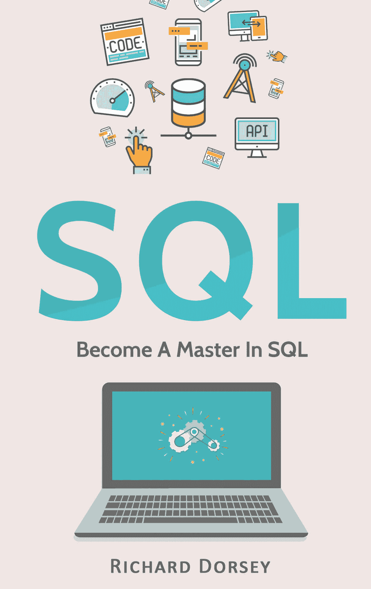

# SQL：SQL 精通指南（SQL 编程语言、数据库、计算机编程、结构化查询语言、脚本、JavaScript）





## 引言


恭喜你下载了 `SQL：编程入门指南`，感谢你的支持。

后续章节将讨论你为了正确使用 `SQL` 并让你的工作更轻松而需要了解的各种内容。`SQL` 的本意是让你在工作中不再那么劳累，如果使用得当，它确实可以做到这一点！

市面上有许多关于这个主题的书，再次感谢你选择这一本！我们已尽一切确保它包含尽可能多的有用信息。请享受阅读！

## 第一章：什么是 SQL？


`SQL` 代表结构化查询语言（structured query language）。当你正在进行编程或尝试管理 `RDBMS`（关系型数据库管理系统）内部的数据时，你将会使用这种领域特定语言。

`SQL` 起源于数学，包括关系元组关系演算代数和关系代数。它将包含大量的数据定义、操作以及控制语言。

（注：此处原文中存在大量重复的段落，根据翻译要求已保留核心含义并去除了冗余重复。）


当你使用 Excel 处理大量数据时，你可能会发现数据量超出了程序的承受范围，从而导致程序倾向于崩溃。崩溃会导致数据丢失，并迫使你花费额外的时间去修复可能出现的任何错误或重新输入未保存的数据。当你尝试处理海量数据时，使用 `SQL` 会要可靠得多，而且它会为你节省一些时间，因为处理 `SQL` 提供的流程并不需要你花费过多的精力。

## 制作报告

在 `SQL` 中进行搜索相对简单，当你需要双重检查以确保数据库中的数据无无时，你可以复用该搜索。Excel 并没有为你提供获取所需数据的正确流程。

`SQL` 代码只需要编写一次并保存，然后每当你需要时，它就会运行。这是 `SQL` 让你的生活变得更轻松的另一种方式，因为你不需要花费大量时间来获取你需要的数据。

不要认为 `SQL` 会很简单。它是复杂的，需要花费大量时间学习，但你投入的精力越多，回报就越丰厚。学习 `SQL` 不仅能节省资金，还能增加你通过 `SQL` 产出的能力。

## 第 2 章


## SQL 基础

在使用 `SQL` 之前，你必须学习的是了解它的基础是什么。理解 `SQL` 语法将让你能够更好地在 `SQL` 中管理数据库，而无需担心是否弄乱了什么。如果你以前用过 Excel，那么你对 `SQL` 就会有些了解，因为 `SQL` 拥有与你在 Excel 中使用的类似的列和行。

#### 语法

* 数据库 (Data base)：你用 `SQL` 创建的所有表。
* CRUD：你通过 `SQL` 可以执行的四个基本操作——创建（Creating）、读取（Reading）、更新（Updating）和删除（Deleting）。
* 查询 (Query)：你在 `SQL` 中查找某内容时运行的搜索。
* 外键 (Foreign key)：此键用于查找你表中的任何数据，以便将其与你放在另一个表中的主键进行匹配。
* 主键 (Primary key)：这是一个唯一值，你创建的所有记录都将使用它来识别这些记录。如果你不设置，系统会自动生成一个。
* 表 (Table)：`SQL` 中的数据集合及其所在。
* DBMS：数据库管理系统。
* 语法 (Syntax)：你用于创建语句的单词和短语。
* RDBMS：关系型数据库管理系统。

现在，你可能看着 `RDBMS` 和 `DBMS` 并好奇它们之间的区别。区别在于你放在表中的数据存储方式。在 `DBMS` 表中，数据不在表中，而是在文件中。当你使用 `SQL` 时，处理 `RDBMS` 的次数会多于 `DBMS`。

主键会创建一个更复杂的代码。外键特定于单个表，并在你执行搜索时将数据从一条记录提取到另一条记录。

`SQL` 与三个程序配合——`SQL`、`MySQL` 和 `Oracle`。由于由于，你在 `SQL` 中使用的代码将三个不同的选择，取决于你正在使用的哪种应用程序。你使用的某些代码可能仅适用于一个程序，也可以可以与三个程序都协作。双重检查哪些命令适用于哪些程序，以便你使用对你来说最方便的程序，而不是让自己把事情复杂化。

## 第 3 章


## SQL 语法

即使你拥有其他编程语言的知识，`SQL` 也是不同的。你可能会发现一些你从其他语言中知道的规则，但不要假设你在 `SQL` 中做的事情和你在 `Python` 等程序中做的完全一样。

你用 `SQL` 创建的任何语句都以一组非常特定的关键字开头，以便系统知道你正尝试做什么。不要忘记你所有的语句都必须以分号结尾。

你的关键字是 `create`、`show`、`use`、`insert`、`select`、`update`、`alter`、`drop` 和 `delete`。

你应该记住 `SQL` 是不区分大小写的，所以如果你使用 `select` 而非 `SELECT`，执行的操作是相同的。然而，`MySQL` 要求你对数据库中创建的表名保持准确，否则你可能会调出的表与你需要处理的表不同。

以下所有语法都适用于 `MySQL`，并包含你在处理 `SQL` 时使用的语句和子句。

语法：

Select 语句 (Select statement):
```
SELECT column1, column2… column
FROM table_name;
```

Distinct 子句 (Distinct clause)
```sql
SELECT DISTINCT column1, column2… column
FROM table_name;
```

Where 子句 (Where clause)
```sql
SELECT column 1, column2…column
From table_name
WHERE CONDITION;
```

And/Or 子句
```sql
SELECT column 1, column2…column
From table_name
WHERE CONDITION AND OR CONDITION;
```

In 子句 (In clause)
```sql
SELECT column1, column2…column
FROM table_name
WHERE column IN (val1, val2);
```

Between 子句 (Between clause)
```sql
SELECT column1, column2…column
FROM table_name
WHERE column BETWEEN val1 AND val2;
```

Like 子句 (Like clause)
```sql
SELECT column1, column2…column
FROM table_name
WHERE column LIKE PATTERN;
```

Order by 子句 (Order by clause)
```sql
SELECT column1, column2…column
FROM table_name
ORDER BY column {ASC | DESC};
```

Group by 子句 (Group by clause)
```sql
SELECT SUM(column_name)
FROM table_name
GROUP BY column;
```

创建表语句 (Create table statement)
```sql
CREATE TABLE table_name (
column1 datatype,
column2 datatype,
column3 datatype,
… datatype
PRIMARY KEY (column)
);
```

删除表语句 (Drop table statement)
```
DROP TABLE table_name;
```

创建索引 (Create index)
```
CREATE UNIQUE index_name
ON table_name (column1, column2);
```


此注释的唯一问题是，如果存在约束，数据将不会从表中删除。

## 选择语句 (Select statements)

选择语句将允许你搜索数据库中你想要查找的非常特定的信息。你有使用五个子句之一的选项。然而，你最可能坚持使用的那个子句是 `from` 子句。

选择语句的语法：

```sql
SELECT [ ALL [ DISTINCT] column 1 [, column 2] FROM table 1 [, table 2] [WHERE “conditions”] [GROUP BY “column-list”] [HAVING “conditions] [ORDER BY [“column-list” [ASC [DESC] ]
```

## 第 5 章


### SQL 数据库的创建

当你想要在 SQL 中生成一个新的数据库时，你将使用 `create data base` 语句。通过这种方式可以创建一个数据库，让你开始创建表并向数据库中输入数据，供你在工作时使用。

语法：

```sql
CREATE DATABASE Databaseame;
```

你创建的所有数据库都将有一个唯一的名称，以便你在 RDBMS 上搜索它们时能够轻松找到它们。

示例

```sql
SQL > CREATE DATABASE babyname;
```

在创建任何数据库之前，你需要拥有管理权限。但在数据库设置好之后，你将拥有创建表和输入数据的选项。

## 第 6 章


### SQL 数据类型

在早的章节中，我们提到了数据类型。然而，某些数据类型将与你正在处理的对象的特定数据类型配合。无论你在处理什么，所有的表达式、变量和列都将具有某种 SQL 的数据类型。

数据类型在创建表时使用。你必须根据该列的功能，为表中的该列选择一种数据类型。

- `Byte`：一组 0 到 255 之间的数字。这些数字将仅有一个字节的存储空间。
- `Singles`：与小数关联的浮点数。`Singles` 将包含最多 4 字节的存储。
- `Currency`：货币可以有四位小数，整数部分可以多达 15 位。货币大约有 8 字节存储。
- `Long`：长整数将具有 4 字节存储空间，范围于 −2,147,483 到 2,147,483,647 之间。
- `Memo`：备注将存储较大的量，可达 65,536。`Memo` 具有搜索能力但不能排序。
- `Text`：输入 SQL 的字母和数字是文本，它可以处理最多 255 个字符。
- `Date and type`：带有 8 字节存储，数据和时间将一目了然。
- `Double`：和 `singles` 一样，`double` 有两个浮点数并包含 8 字节存储。
- `Integer`：你只能在此数据类型中存储数字。它介于 −32,768 和 32,767 之间。你可以在这里存储 2 字节的数据。
- `Look up wizard`：这是你的选项列表，以便你可以选择想要做的事情。它有 4 字节存储。
- `Auto number`：字段将根据数据拥有其自己的记录和编号。除非另有说明，否则它将从 1 开始。自动编号将保存 4 字节数据。
- `Hyperlink`：你有能力在必要将用户发送到网页。
- `Yes and no`：需要回答是或否甚至是真或假的逻辑字段。`true` 和 `false` 回答等于 -1 和 0。如果不允许有值，则该字段为 `null`。存储空间为 1 位。
- `Ole object`：图片和其他多媒体将放置在此数据类型中。它被称为 `blob`，代表大二进制对象。你在这里拥有最重要的存储量，为 1 吉兆字节。

数据类型将分为三大类——日期和时间、数字和字符。

#### 字符：

- `Varchar(size)`：存储的字符串长度能够容纳我们刚刚讨论的所有数据类型。大小取决于括号中的数字。通常情况下，它是你转换的文本。
- `Char(size)`：字符字符串是固定长度的，可以是之前讨论的数据类型。
- `Blob`：`blob` 可以持有 65,535 字节的数据。
- `Tiny text`：你只能在小文本中放入 255 个字符。
- `Long text`：这将持有最大数量的字符。
- `Text`：这是标准的字符文本，持有多达 65,550 个字符。
- `Medium text`：这最多持有约 16,000,000 个字符。
- `Set`：这类似于 `enum` 类型，但仅用于枚举。
- `Set`：这持有 `date()` 之后数据。
- `Medium`：这持有最多 16,000,000 字节。
- `Long`：这将持有尽可能多的日期；这就是为什么它被称为 `long`。
- `Enum(x, y, z)`：所有可能的值都已列出。它可以持有 65,535 个。

#### 数字：

- `Float(size, d)`：这种类型是浮点数。其位数将由参数设置。
- `Tinyint(size)`：你可以拥有 −128 到 127 符号值或 0 到 255 无符号值。
- `Bigint(size)`：拥有 9,223,372,036,854,775,807 符号值或 18,446,744,073,709,551,615 无符号值。
- `Smallint(size)`：拥有 −32,768 符号值或 65,535 无符号值。
- `Int(size)`：拥有一组符号和无符号值。
- `Medium(size)`：持有 16,000,000 无符号。
- `Decimal(size, d)`：这类似于 `double(size, d)`，但小数点右边的位数将由参数设置。

日期和时间：

- `Date()`：日期以年、月、日的格式输入。
- `Year()`：年份将以两位数或四位数形式输入。这取决于你正在的操作以及如何输入。
- `DateTime()`：你将输入日期和时间的组合。它被记录为 `date()`，然后时间以小时、分、秒输入。
- `Time()`：时间以小时、分、秒输入。
- `Timestamp()`：时间戳将匹配你所在的当前时区，以便你可以确切是什么时候完成的。它的输入方式类似于 `DateTime()`。


然而，某些时候你不需要指定值在表中的位置，因为它们可以放在任何有空间的地方。为了这一点，你将使用一种完全不同的语法。

```
INSERT INTO TABLE_NAME VALUES (value1, value2, value3, … valueN);
```

你还可以使用插入查询（insert）将数据从一张表迁移到另一张表，而无需担心是否会漏掉任何信息。

#### 语法
```
INSERT INTO first_table_ame [( column1, column2, … column)]
SELECT column1, column2, … columnN
FROM second_table_name
[WHERE codition];
```

### 查询查询 (Select query)
通过 `select`，你将在数据库的表中定位数据，以便获取返回给你的结果。这些结果将被称为结果集。

### 语法：
```
SELECT column1, column2, column FROM table_name;
```
这些特定列的数据将是你想要返回的内容；因此，数据库会执行操作。

然而，如果你想返回所有字段，将使用这段代码。

### 语法：
```
SELECT * FROM table_name;
```

### 更新查询 (Update query)
顾名其实，更新将用于更改你正在操作的表中已存在的记录。

在使用更新查询时，可以使用 `where` 子句，以便修改特定行，而不是更改表中的所有行。

#### 语法
```
UPDATE table_name
SET column1 = value1, column2=value2, … columnN = valueN
WHERE [ condition ];
```
当使用 `or` 和 `and` 算符时，`N` 可以与任何条件配合。

### 删除查询 (Delete query)
每当需要从表中删除记录时，你将使用删除查询。与更新查询一样，你被允许使用 `where` 子句，以便消除指定数量的行，而不是删除表中的所有内容。

#### 语法
```
DELETE FROM table_name
WHERE [condition];
```
当你使用 `and` 运算符或 `or` 运算符时，条件可以组合使用。

### 结果排序 (Sorting your results)
`order by` 条件是用于表中数据排序的语句。你有两个选项——可以按升序排列数据，也可以按降序排列。某些数据库会自动按升序排列你的结果，而无需你指示。因此，如果你必须按降序排列，你需要确保已经告诉系统你希望以不同的方式排序。

从查询获得的结果进行排序的语法对于升序和降序都是相似的。唯一的区别在于你想要排序的顺序。

### 语法：
```
SELECT column – list
FROM table_name
[WHERE condition]
[ORDER BY column1, column2, …columnN] [ASC | DESC ];
```
使用 `order by` 子句时可以选择多个列。但是，请确保你选择进行排序的列包含在列列表中。

## 第 8 章


### SQL 中的约束 (Constraints in SQL)
约束是 SQL 系统在处理表列时将执行的各种规则。本质上，你的表对允许进入数据库的不同数据类型进行了限制。使用约束是为了能够确保数据库中拥有准确且可靠的数据。这在你的数据库被他人使用时特别有帮助。

约束不仅可以限于列，还可以应用于整个表。在处理表列时，约束是 SQL 系统执行的各种规则。以下是常见的约束类型：

- `Not NULL`：当你使用它时，列不允许空值。
- `Index`：当你使用它时，会在列上创建索引。
- `Default`：当你使用它时，如果没有提供值，将使用指定的默认值。
- `Check`：当你使用它时，它会确保满足某些条件。
- `Unique`：当你使用它时，它会确保列中的值是唯一的。
- `Foreign key`：当你使用它时，它用于建立表之间的关系。
- `Primary key`：当你使用它时，它作为表中的唯一标识符。

在创建表时，如果你忘记了设置这些约束，可以使用 `alter` 语句来添加它们。

### 删除约束 (Dropping constraints)
尽管约束已经到位，但你仍然可以使用 `drop` 命令来执行删除操作。这取决于你所使用的应用程序。正如书开头提到的，某些实现允许你禁用约束。这不会从数据库中永久删除约束，而是禁用它，以便以后需要时可以使用。可以使用 `alter` 语句来恢复。

### 完整性约束 (Integrity constraints)
当你想要确保数据是准确且一致的，将使用完整性约束。数据的完整性是贯穿整个数据库的。虽然可以使用多种完整性约束，但你主要使用的是 `foreign key`、`primary key` 以及我们在上面的章节中提到的其他约束。

## 第 9 章


### SQL 与数学 (SQL and Math)
通过 SQL 92，你将可以使用大多数编程语言都能使用的四种数学函数：

- 相乘 `*`
- 加法 `+`
- 取模 `%`
- 减法 `−`
- 除法 `/`

当你使用取模运算符时，你将获得从除法函数得到的余数，无论它是否为整数。


`MOD(a, b)`: 取模函数将为你返回一个整数，即 `a` 除以 `b` 得到的余数。

`SQRT(a)`: 你将获得输入到方程中的数值的平方根。

`SIGN(a)`: `a` 将返回 `0`、`-1` 或 `1`。

`ROUND(a)`: 你输入的值将被四舍入到最接近的整数。

`ABS(a)`: 你将获得输入到数据库的整数的绝对值。

`ROUND(a, b)`: 整数 `a`将被四舍入到最接近的整数，而值 `b` 将告诉它应该四舍入几次。

`CEILING(a)` 或 `CEIL(a)`: 将返回大于或等于 `a` 值的最小整数。

`POWER(a, b)`: `a` 将升至 `b` 处的值幂。

`FLOOR(a)`: 将返回小于或等于 `a` 值的最大整数。

## 第 10 章


## 在 SQL 中可以使用的事务 (Transactions)

事务是你根据其最初创建的目的而使用的单元。使用此类单元是为了能够完成某种功能，使数据库或相关数据库对你产生意义。

然而，事务将是数据库上建立的所有更改的传播。因此，在你更新记录的时间点，你将在数据库上完成一个事务。确保你对数据库有完全的控制权，以便能够更改表中放置的内容，使数据能够保持其完整性，并且数据库抛出的任何错误都能以恰当的方式处理。

最终，你将你执行的 SQL 查询组合在一起，以便一次性处理它们，而不是逐个处理。

### 事务属性

在处理事务时，你需要记住的单词是 `ACID`。这是因为 `ACID` 的每个字母都代表你可以在 SQL 中使用的属性之一。

- **A: 原子性 (Atomicity)**：你放入方程中的操作将给你一个理想的结果。然而，如果方程失败，你所执行的过程将被终止，在此之前进行的任何操作将失效，因为一切将恢复到原来的状态。
- **C: 一致性 (Consistency)**：任何所做的更改都将被监控，以确保它们是正确生成的，以便该事务被视为成功。
- **I: 隔离性 (Isolation)**：事务不需要同时运行，它们可以独立运行，同时对该数据库上进行的其他事务保持透明性。
- **D: 持久性 (Durability)**：你所有的事务都应该成功才能生存，这意味着它们需要能够抵抗可能发生的系统故障。

### 事务控制

在你管理事务以确保它们成功时，你将使用四个不同的命令。

- **Set transaction (设置事务)**：你可以为你的事务命名，以便更容易找到。
- **Commit (提交)**：你事务的所有更改都将被保存。
- **Save point (保存点)**：你将保存你的事务，如果由于某些错误而需要回滚，它将回滚到上一个保存点。
- **Roll back (回滚)**：任何所做的更改将被撤销，并回到上一个保存点。

你无法在事务事务中使用 `create` 或 `drop table` 命令，因为它们是标准的数据库命令。你仍然可以使用 `delete`、`update` 和 `insert`。

### Commit 命令

每当需要保存事务更改时，就会使用 `commit` 命令，以便你的数据库更新为最新的更改。本质上，你正在创建一个保存点，以便如果你必须回滚数据库，它将回滚到最新的提交点。提示：经常使用你的 commit 代码！你不想丢失几个小时的工作！

语法：

```
Commit;
```

### Roll back 命令

你可以从任何时间点撤销你所做的更改。当你编写输出代码并发现你认为起作用的东西实际上不起作用时，这尤为有效。所有撤销的工作取决于上一次使用 `commit` 命令的时间。

语法：

```
Rollback;
```

### Save point (保存点)

就像 commit 代码一样，保存点代码将保存你所做的所有工作。除非一切都完全符合你的意愿，否则你不应该使用此命令。一旦你回滚到上一个保存点，除非你手动输入，否则你将无法获得之前放入表中的内容。你的保存点标题应该足够清晰，让你知道自己正处于哪个（哪个）保存点，以至于让自己感到困惑。特别是在你同时处理多个表时。

语法：

```
Savepoint savepoint_title;
```

在你创建保存点后，你可以使用 `roll back` 命令撤销到该时间点之前的一切。结合保存点命令使用回滚代码看起来如下。

语法：

```
Rollback to savepoint_title;
```

### Releasing your save point command (释放保存点命令)

当移除特定的保存点时，可以释放该保存点。这样做是因为代码错误不想回到该保存点，或者你有一个更新的保存点。

语法：

```
RELEASE SAVEPOINT SAVEPOINT_TITLE;
```

一旦保存点被释放，你就不需要使用 `roll back` 代码了，因为你没有可以回去的地方。因此，请确保在释放保存点后尽快创建一个保存点，以确保在你发现犯错时有可以回去的地方。

### Set transaction command (设置事务命令)

`set transaction` 命令将显示数据库上进行了哪些事务。本质上，它是所做更改的记录、更改的特征以及更改在数据库中的位置。当你想要执行的所有事务时，`Set transaction` 命令将非常有用。

语法：

```
SET TRANSACTION [ READ WRITE | READ ONLY];
```

## 第 11 章


## SQL 子查询 (Subqueries)

子查询也被称为嵌套查询或内部查询。正如其名义，你将在一个查询内部嵌套另一个查询，使用 `where` 子句确保两个查询都得到执行。

许多子查询将根据设置的条件从启动整个过程的查询返回某些数据，从而使得受限制的数据能够显示。

你有在子查询中使用所有基本命令（`select`、`insert`、`delete` 和 `update`）以及我们之前讨论的基本数学运算符。

在处理子查询时，你必须遵循以下规则：

1. 处理子查询时不能使用 `between` 运算符
2. 子查询必须封装在括号中
3. 子查询不能放在集合函数中。
4. `select` 子句仅允许选择一列。唯一的例外是你创建第一个查询时选择了多个列。
5. 选择列表不能作为 SQL 正在评估的任何值的引用。
6. 你可以在主查询中使用 `order by` 命令，但你无法在子查询内部使用它。
7. 子查询可以返回多行。因此，可以使用多种不同的运算符。

### 子查询与 select 语句

Select 语句是在处理子查询时可以使用的少数语句之一。

语法：

```
SELECT column_title [, column_title ]
FROM table 1 [, table 2 ]
WHERE column_title OPERATOR
(SELECT column_title [, column_title ]
FROM table 1 [ , table 2 ]
([ WHERE ])
```

### 插入与子查询


`INSERT` 语句将获取你已经在某张表中的数据，并将其移动到你选择的另一个表中。你在子查询中收集的数据将获取这些数据，并根据需要对日期、时间、数字和字符进行修改。

#### 语法
```sql
INSERT INTO table_title [ (column 1 [, column 2 ] )
SELECT [ * | column 1 [ , column 2 ]
FROM table 1 [, table 2]
[WHERE VALUE OPERATOR ]
```

### 带有更新语句的子查询
出于各种原因，数据总是需要更新。幸运的是，update 语句可以配合子查询使用。通过 update 语句，只要表中的列需要通过子查询进行升级，你就可以对单列或多列操作。

#### 语法
```sql
UPDATE table
SET column_title = new_value
[ WHERE OPERATOR [ VALUE ]
(SELECT COLUMN_TITLE
FROM TABLE_TITLE)
[ WHERE ) ]
```

### delete 语句与子查询
就像我们之前讨论过的任何事情，如果你没有得到正确的结果，或者不需要子查询中的数据，你可以移除你的子查询。

#### 语法
```sql
DELETE FROM TABLE_TITLE
[ WHERE OPERATOR [ VALUE ]
(SELECT COLUMN_TITLE
FROM TABLE_TITLE)
[ WHERE) ]
```

## 第 12 章


## SQL 中的索引
如果你必须在表中快速找到数据，你将可能想要使用索引。索引可以节省时间，因为你不需要读取所有内容来找到你寻找的特定内容。这就像书中的索引一样！

每当你尝试从特定表中查找数据时，都会使用索引。如果你没有创建索引，SQL 将在找到你找的内容之前读取整个表，这不仅耗费时间，而且可能会给你你并不想要的结果。索引的目标是以这种方式创建，以便你能够在几分钟内直接找到你想要的内容，而不是花费几个小时。

以下是你可能想要创建索引的几个原因：

1. **它可以涵盖多个列**：有时你知道要找的内容在某个通用区域，这时你可以使用索引仅涵盖那些列。
2. **索引与整数数据类型**：整数数据类型占据的空间不如某些数据类型那么大；因此，搜索整数的速度更快。如果你查找的内容在索引中没有整数，你可能需要考虑放入一个临时整数，以便你放入该列索引的所有数据都能被映射。
3. **索引需要保持狭窄**：你创建的索引越接近，它占据的空间就越少，SQL 搜索你所需信息的时间就越少。使用的空间越少，数据库运行得越快。
4. **列的顺序至关重要**：有时索引必须涵盖几列。当这种情况发生时，你必须保持列的顺序，否则你将把数据交叉到不属于它的区域。在开始时，尝试保持专注，从扫描排名最低的列开始，一直到优先级最高的列。列的级别取决于该列中有多少个值。
5. **在创建索引之前确保你的列没有被标记为 null**：标记为 null 的列不需要在你的索引中。因此，只放置被标记为非 null 的列，这样处理时间就会更短，你能够在一个更快的系统中工作。
6. **应该只在需要时创建索引**：如果你可以在没有引导的情况下完成，那就这样做吧！索引和其他其他一切一样，都会占用 SQL 磁盘空间，导致你使用的命令返回结果比通常更慢。由于索引对于应该如何构建或何时构建没有任何既定规则，索引的创建将是一个不断变化的过程，直到找到一个有效的流程为止。

### 构建索引语句
索引的目的是让 SQL 代码运行得比以前更快。这是通过让查询在必要之前不扫描整个表或数据库来实现的。

创建索引的语法如下：
```sql
CREATE INDEX “index_title” ON “table_title” (column_title);
```
索引的缺点是它只能涵盖单张表。然而，许多索引只涵盖单列，而复合索引会同时涵盖几列。

在你创建索引时，你会发现没有规则要求你遵守，关于索引的标题或放置在索引中的内容。因此，你的索引将对你以及你放入其中的数据是完全唯一的。尝试添加尽可能多的信息是一个好计划，这样你就不会混淆你正在处理哪张表或哪几列。但请记住，索引越大，占据的磁盘空间就越多。

## 第 13 章


## 修改表
在你创建表之后，表的结构可能需要更改。得益于 SQL，你可以通过简单的代码来实现这一点。

#### 语法
```sql
ALTER TABLE “table_title”
[alter specifications]
```
alter specifications 将是表中更改的内容。

### 添加列
如果你需要向表中附加列以输入数据，可以使用 SQL 数据库。数据库需要被指示你需要修改。当涉及到你的修改方案时，你需要告诉系统你需要不同的数据类型，以便以后可以使用。

#### 语法
```sql
ALTER TABLE “table_title”
ADD “column_title” “data type”;
```
你有能力一次向表中添加多个列，这样你就不需要多次使用代码，你只需要用逗号分隔它们并将修改方案插入到括号中。确保你放置了字符值，以便你的表知道该列需要多少字符。

### 列修改
有时列中的数据类型必须更改为不同的数据类型，以满足你正在的工作。当你使用 `modify column` 函数时，你仍然在使用 `alter table` 函数；然而，它将被更改为包含列修改。

#### 语法
MySQL 和 Oracle
```sql
ALTER TABLE “table_title”
MODIFY “column_title” “New Data Type”;
```
SQL
```sql
ALTER TABLE “table_title”
ALTER COLUMN “column_title” “New Data Type”
```

### 重命名列
在重命名列时，你将更改标题名称，可能是因为你输入的名称错误，或者因为列正在重新组织，你需要将标题与正确的列，以便你在处理新表时不会感到困惑。就像你之前之前的命令一样，你需要指示数据库必须修改表，然后才能告诉它你需要重命名该列。

#### 语法
MySQL 和 SQL
```sql
ALTER TABLE “table_title”
Change “column 1” “column 2” [“data type”];
```
Oracle
```sql
ALTER TABLE “table_title”
REITLE COLUMN “column 1 TO “column 2”;
```

### 删除列


如果由于信息过时或输入错误而需要删除某列，你将执行此操作。你仍然将使用 `alter table` 函数并添加 `drop column` 函数。在执行此函数之前，你必须确保删除的是正确的列，否则你将丢失原本不想丢失的数据，而且除非你重新输入所有内容，否则你无法将其找回。

#### 语法

#### MySQL
```sql
ALTER TABLE “table_title”
DROP “column_title”;
```

#### Oracle and SQL
```sql
ALTER TABLE “table_title”
DROP COLUMN “column_title”;
```

### 添加索引
有了索引，在表格和数据库中搜索将比不使用索引要容易得多。当你使用以下表函数时，你可以毫无问题地添加索引。请注意，在处理 `SQL` 或 `Oracle` 时，将不允许使用此函数，它仅由 `MySQL` 支持。

#### 语法
```sql
ALTER TABLE “table_title”
ADD INDEX “index_title” (column_title);
```

### 删除索引
如果你的索引由于某种原因不再相关，你有选择删除它，这样它就不会占用数据库空间。再次强调，你将使用 `alter table` 函数来删除索引。而且由于你只能在 `MySQL` 中创建索引，因此你只能在 `MySQL` 中删除它。

#### 语法
```sql
ALTER TABLE “table_title”
DROP INDEX “index_title”;
```

### 添加约束
即使你的表已经存在于数据库中，你仍然可以添加在创建表时可能忘记添加的约束。如果你不记得书中之前讨论过的约束，请回到第 8 章。

#### 添加约束的语法
```sql
ALTER TABLE “table_title”
ADD [CONSTRAINT_TITLE] [CONSTRAINT_TYPE] [CONSTRAINT_CONDITION];
```

### 删除约束
当约束被删除时，这意味着如果你以后某个时候再次需要它，就必须重新添加它。因此，在执行此命令之前，请确保你真的想删除它。如果你不确定以后还需要它，你应该禁用它而不是删除。然而，如果你确定要删除它，可以完全移除该约束，使其不再用于该列或该表。

#### 语法
```sql
ALTER TABLE “table_title”
DROP [CONSTRAINT] [INDEX] “CONSTRAINT_TITLE”;
```

## 第 14 章


### 在 SQL 中复制表
这可能并不常见，但有时你可能会遇到需要表格副本的问题。虽然你可以通过创建一个新表并重新输入所有数据来重建表，但这并不高效。相反，为了节省时间，你可以直接克隆表。这还能确保你不会将数据放在错误的位置或无意中遗漏某些数据。

当你使用 `MySQL` 克隆表时，需要记住三点：
1. 当复制整个张表时，你将使用 `insert` 和 `select` 语句。
2. `create table` 命令将使新表看起来与你正在复制的表完全一样。
3. 确保更改你正在克隆的表标题，以免在处理它们时将表搞混。

## 第 15 章


### SQL 代码中的重复项
这并不一定是有意为之，但有时记录会在你处理的表格或数据库中出现重复。当你搜索重复记录时，与其浪费时间尝试寻找所有的重复项，不如遍历并定位唯一的记录对你来说更简单。

为了处理重复项，你将使用 `select` 语句，必须记住的关键字是 `distinct`。这将让你能够移除任何重复的记录，只保留唯一的记录。

#### 语法
```sql
SELECT DISTINCT column 1, column 2 , ….. columnN
FROM table_title
WHERE [condition]
```

有时这些内容在你的代码中是重复的，因为人们住在同一个城市，年龄相同，等等。这些是你无法控制的，但你仍然必须处理它们。

通过使用 `distinct` 关键字，你将清除所有包含相同信息的其他记录，但将保留包含你寻找的信息的那条记录。因此，当你使用此代码时，必须小心不要删除你可能想要使用的记录。

此外，确保你已经在另一个位置备份了数据，或者你有一个最近的保存点，以便在万一不小心弄错了时可以回到表格的原始状态。`distinct` 关键字是你需要谨慎使用的关键字之一，因为你可能会丢失数小时不需要或不想丢失的工作，因此你的工作将变得不再高效。记住，`SQL` 应该是让你的工作更高效，而不是更具挑战性。

## 第 16 章


### SQL 注入
当你或其他人进入网站的任何时候，数据都会从他们的计算机获取并通过网站发送，这使你暴露于所谓的 SQL 注入风险之中，这可能会抹掉你在代码中投入的所有工作。注入通常发生在你要求用户在提示框输入某些类型的数据（而这些数据被证明是字面量）时。然而，你并不一定能得到想要的信息。相反，你可能会得到一个在你的数据库中运行的语句，而你并不知道它的发生。不能信任用户会提供你请求的数据，因此你需要在他们输入的数据发送到你的数据库之前进行检查。这将有助于保护你的数据库。

当你通过处理该列的该标题，尝试从请求的表中提取特定记录时，你的函数调用将被使用。数据通常将与你从用户处接收的内容匹配，从而让你能够保持数据库安全。

在 `MySQL` 中，不允许将查询携带或堆叠到单个调用函数中。这有助于防止查询因堆叠而失败。然而，`SQLite` 等扩展允许你在在该字符串中进行搜索时堆叠查询。这就是你的代码和数据库出现安全问题的地方。

### 防止 SQL 注入
转义字符应该在 `Perl` 或 `PHP` 等编程语言内部处理。但在 `MySQL` 中，有一个扩展允许你使用 `PHP`，以便在使用转义字符时使用正确的函数。该扩展使得这些字符对于 `MySQL` 来说是唯一的。

### Like 困境
在处理类似匹配的困境时，你必须有一种转义方法来更改用户插入到你的提示框中并证明是字面量的字符。`addslashes` 函数允许你确保指定系统为了转义所需的字符范围。


## 你的数据库 – 如何进行调优

当你使用 `SQL` 时，你会希望成为你数据库的专家；然而，这并不是一夜之间就能实现的。就像学习如何使用该系统一样，你需要花费时间和精力来学习为了正确掌握数据库工作原理而必须的知识。在处理数据库时，你还希望确保自己拥有了全面的知识储备，因为你永远不知道会发生什么。

为了让你的学习数据库的教育过程变得更简单，这里有一些你可能会发现非常有帮助的建议。

1. 在使用数据库时，你需要遵循 `3BNF` 设计。
2. 数字与字符的比较方式不同，你可能会降低数据库的性能，所以除非绝对必要，否则不要更改数字！
3. 使用 `select` 语句时，你只会有你必须在屏幕上显示的数据。你应该尽力避免在 `select` 语句搜索中使用星号（`*`），以避免加载此时你不需要的数据。
4. 你创建的任何索引都需要小心创建，并且仅针对需要索引的表。如果你不打算频繁使用该表，那么它就不需要索引。本质上，你是在尝试节省磁盘空间，如果你为每张表都创建索引，就会耗尽空间。
5. 当在该表上找不到任何索引时，就会发生全表扫描。你可以通过专门为该列创建索引而不是为整个表创建索引来避免这种情况。
6. 在处理时间、日期和实数时，必须谨慎使用等号运算符。存在存在差异的可能性，但你不一定能立即注意到这些差异。等号运算符会导致查询中获取精确匹配变得几乎是不可能的。
7. 可以使用通配符匹配，但要节制使用。
8. 观察你的搜索结构以及与表配合使用的代码。只要你更改表的所有内容而不仅仅是部分内容，你就可以调整表的代码以获得更快的响应时间。
9. 当你处理 `SQL` 时，会定期进行搜索。坚持使用适用于大量语句的标准程序，而不是适用于少量语句的程序。这些程序在你有机会使用它们之前就已经由数据库设置好了。不过，数据库不像搜索引擎；在你的命令执行之前，程序是不会被优化的。
10. 除非必要，否则不应使用 `or` 运算符。该运算符会导致你的搜索变慢。
11. 移除所有已有的索引，以便你可以优化更大批量的数据。将表的历史视为数百万行数据是一个极好的主意，你可能需要多个索引来覆盖整个表，这将占用磁盘空间。虽然索引能让你更快地获取所需信息，但在批量加载完成后，索引会因为现在成了阻碍而减慢系统速度。
12. 批量事务要求你使用 `commit` 函数。在创建新记录后，你必须使用此函数。
13. 数据库每周每周进行一次碎片整理，以确保一切运行正常。

## SQL 调优工具

Oracle 程序允许你访问各种工具，当你需要对数据库进行调优或性能优化的任何操作时，你会使用这些工具。它提供的最流行的两个工具如下：

1. `Tkprof`：它可以让你根据输入到 `SQL` 处理的每条语句，衡量数据库在特定时间内的性能。
2. `Explain plain`：此工具向你展示执行语句时遵循的路径，以确保语句按预期执行。

使用 `SQL*plus` 命令来测量你的 SQL 数据库每次搜索之间经过的时间。

## 第 18 章


## 通配符运算符

通配符运算符是在你比较两个由于使用了通配符运算符而创建相似的值时使用的运算符。

SQL 提供了两种不同的通配符运算符，可以与你的 `like` 运算符配合使用。

- **百分号（%）**：使用此运算符，你能够匹配多个字符使它们相似。请记住，在 MS Access 中你必须使用星号（`*`）而不是使用百分号作为通配符字符。
- **下划线（_）**：匹配单个字符。MS Access 要求你使用问号（`?`）来实现相同的操作，而不是下划线。

百分号代表多个字符、一个或一个零。相反，下划线仅代表单个字符。你可以以各种组合使用这些通配符运算符。

### 语法：

```sql
SELECT FROM table_title
WHERE column LIKE ‘XXXX%.’
```

或者

```sql
SELECT FROM table_title
WHERE column LIKE ‘%XXXX%.’
```

或者

```sql
SELECT FROM table_title
WHERE column LIKE ‘_XXXX.'
```

或者

```sql
SELECT FROM table_title
WHERE column LIKE ‘_XXXX_.'
```

最终，在使用 `or` 和 `and` 运算符时，有不确定数量的情况可以使用。

## 第 19 章


## SQL 技巧与技巧

了解 SQL 技巧和窍目的目的是让你能够更高效地使用程序，而不是因为某些功能没有按预期工作而感到沮丧。你可能需要使用本章列出的技巧来创建一个快捷方式，让数据库变得不那么复杂。

1. **用户界面和语言**：如果你想更改用户界面的语言，你需要关闭整个程序。完成此步骤后，移动到安装文件夹。右键点击桌面上创建的快捷方式并转到文件夹位置。现在打开列出的第一个文件夹（即 developer 文件夹）。之后，你必须点击 `SQL developer.conf`。这里你将使用计算机上的文本编辑器来更改语言。无论你使用哪种文本编辑器，只要你习惯使用它即可。一个新设置将被添加到文本编辑器显示的文本中。你可以将新设置放置在文件的任何位置。在新设置旁边添加注释是明智的，这样如果你以后需要再次调整，就不需要搜索所有的代码来找到它。`AddVMOption` 将被添加到用户语言设置中。现在你可以再次打开 SQL 开发者，现在它将变为你更改的语言。但是，在选择目标语言时要小心，因为当切换回英文时，并不是所有内容的翻译都完全相同。


### 2. 构建数据库连接
右键点击屏幕左侧的连接并点击“新建连接”（new connection）。你需要根据自己的意图为连接命名。你需要输入相应的用户名和密码。如果你打算同时处理多个连接，应该更改其颜色。如果你使用的是系统连接标题，则需要更改角色（role）。如果你使用的是本地电脑，可以保持本地主主机（home host）不变。但是，如果你在其他位置使用，你需要输入系统运行的 IP 地址。除非你使用的不是 SQL Express 版（express edition），否则请保持 part 和 xe 选项不变。你可以测试连接，如果成功，就可以关闭连接窗口，这样你就已经创建了连接。如果一切正常，它将无错误地打开，你就可以输入 SQL 代码了。

### 3. 禁用功能
SQL 提供了许多功能，如果你不使用它们，应该将其禁用，以免减慢开发者的速度。你需要进入“工具”（tools）菜单，然后选择“功能”（features）选项。每个功能都有不同的文件夹；由你决定想要保留哪些功能的运行，以及禁用哪些功能。你可以展开每个文件夹以查看其包含的内容。你只需要取消勾选某个功能，它就会关闭该功能并使系统运行得更快。务必应用更改，以免它们在没有你手动开启的情况下重新开启。

### 4. 执行命令和脚本
使用开发者顶部的工具栏并按下播放按钮。确保你已经添加了分号。你也可以使用 `ctrl` 和 `enter`，这样你的手就无需离开键盘。要运行脚本，请再次使用工具栏，只需选择“运行脚本”（run scripts），即可同时运行两个命令。或者，如果你觉得更方便，也可以按 `F5` 键。如果你的文件是外部的，请使用 `@` 符号和文件路径进行导入并运行。

## 结论


感谢你读完《SQL 编程入门指南》（*SQL: Programming Beginner’s Guide*）。希望这本书能为你提供丰富的信息，并为你提供实现目标所需的所有工具，无论你的目标是什么。

接下来的行动是将新学到的 SQL 知识应用于你的工作中。如果你目前的工作没有使用 SQL，那么你让自己对这家公司变得更有价值了，因为精通编程语言的人可以做比招聘要求更多的事情！

祝贺，并祝你好运！

最后，如果你觉得这本书在任何方面都有帮助，我们非常欢迎你在 Amazon 上给出评价！

