# 从这里开始：使用 HTML5 和 JavaScript 构建 Windows 8 应用

## 特别升级优惠

如果您直接从 `oreilly.com` 购买本电子书，您享有以下权益：

- 无 `DRM` 限制电子书——无任何限制或障碍地跨设备使用您的电子书
- 多种格式——可在您的笔记本电脑、平板电脑或手机上使用
- 终身访问并享受免费更新
- `Dropbox` 同步——您的文件，随处可用

如果你是从其他零售商购买的本电子书，仅需 `$4.99` 即可升级您的电子书以享受所有这些权益。点击此处访问您的电子书升级。

请注意，示例内容无法提供升级优惠。

## 关于补充文件的说明

本书的补充文件和示例可以在 `http://examples.oreilly.com/9780735675940-files/` 找到。请使用标准的桌面网络浏览器访问这些文件，因为它们可能无法在所有电子阅读器设备上访问。

书中引用的所有代码文件或示例都将在在线提供。对于附带光盘的实体书，我们尽可能已发布了所有的 `CD/DVD` 内容。请注意，虽然我们尽可能通过免费下载提供许多媒体内容，但我们有时会受到许可限制的限制。请将任何问题或疑虑发送至 `booktech@oreilly.com`。

# 引言

多年来，编程几乎是他人通常认为是超级专家、大师或天才的人士的独有领域。然而，移动编程的出现稍微改变了局面，因为为这些设备编写程序的想法重新吸引了年轻人的关注。在今天，一个青少年因为能够构建酷炫的 `Android` 或 `iPhone App` 而突然出现在聚光灯下并不少见。这种现象的发生有几点原因，以及为什么它发生在现在。

原因之一无疑是今天的青少年是第一代数字原住民。在这一群体中发现几位程序员的概率比前几代人要高得多。另一个原因是，移动 `App` 的编写比任何其他类型的现代软件都要容易得多。移动 `App` 是围绕一个智能主意构建的小型代码。构建移动 `App` 是一回事，而规划和维护多层企业系统完全是另一回事。

移动为软件开发增加了一个新维度。在这种背景下，`Windows Phone` 不仅仅是另一个用于编码的移动平台；它是迄今为止最简单（甚至是最愉快）的平台，无论背景如何。这使得为 `Windows Phone` 编码成为学习编程的绝佳方式。对于那些不断追求新技术并在其中寻求情感满足的聪明孩子来说，尤为如此。在我 14 岁的儿子 `Francesco` 身上我看到了这种情况——他是本书的实际作者。

`Microsoft Windows 8` 将“快乐编程”的方法又进一步了一步。通过 `Windows 8`，你不仅可以为平板构建移动 `App`，还可以为自己构建独立应用程序，用于或帮助自动化日常生活中的某些重复性任务。`Windows 8` 凭借其整体的简单性，为应用程序带回了一种匠心精神，这种精神在过去十年左右随着软件架构和网站复杂性的增加而消失了。一方面，`Windows 8` 是丰富且复杂的中间件的强大客户端前端；另一方面，它简单到几乎每个人都可以通过 `HTML5` 和 `JavaScript` 进行编程。

本书旨在为开始制作 `Windows 8` 应用程序提供一份快速（但充实）的入门指南，并介绍如何通过 `Windows Store` 发布和销售它们。本书的关键点在于明确：如果你有一个好主意并且学习速度快，无论你的年龄或编程背景如何，都可以创建一个 `Windows 8 App`。你将看到如何为新的微软操作系统编写功能性应用程序并让它们运行。对于那些不断追求新技术并在其中寻求情感满足的聪明孩子来说，这尤为真实。在我 14 岁的儿子 `Francesco` 身上我看到了这种情况——他是本书的实际作者。

本书中的大部分章节都是围绕练习构建的，这些练习反映在章节的示例代码中。所有最终完成版的示例项目都可以从以下页面下载：

`http://aka.ms/SH_W8AppsHTML5JS/files`

请按照说明下载 `starter-buildapps-winjs-sources.zip` 文件。

## 安装代码示例

按照以下步骤将代码示例安装到你的计算机上，以便将其与书中的练习一起使用。

1. 解压你从书籍网站下载的 `starter-buildapps-winjs-sources.zip` 文件（如有必要，请根据说明创建一个特定的目录）。
2. 如果出现提示，请查看显示的最终用户许可协议。如果你接受这些条款，请选择接受（`accept`）选项并点击下页（`Next`）。

> **注意**
> 如果没有显示许可协议，你可以从下载 `starter-buildapps-winjs-sources.zip` 文件的同一个网页上访问它。

## 勘误与书籍支持

我们尽一切努力确保本书及其配套内容的准确性。自本书出版以来报告的所有错误都列在我们在 `oreilly.com` 的 `Microsoft Press` 网站上：

`http://aka.ms/SH_W8AppsHTML5JS/errata`

如果你发现了未列出的错误，可以通过同一页面向我们报告。

如果你需要额外支持，请发送电子邮件至 `mspinput@microsoft.com` 联系 `Microsoft Press` 图书支持部门。

请注意，微软软件的产品支持不通过上述地址提供。

## 我们想听取你的意见

在 `Microsoft Press`，你的满意度是我们的首要任务，你的反馈是我们最宝贵的资产。请在下方告诉我们你对这本书的看法：

`http://www.microsoft.com/learning/booksurvey`

该调查很短，我们会阅读你的每一条评论和想法。提前感谢你的参与！

## 保持联系

让我们保持交流吧！我们在 `Twitter` 上支持：

`http://twitter.com/MicrosoftPress`

## 致谢

**Dino**：

老实说：我在 `O’Reilly Media` 的编辑 `Russell Jones` 说服了我尝试这个项目。如果这本书到了你手里，无论好处还是坏处，都有他的责任！当 `Russell` 第一次提到这本书时（当时它还只是一个想法），我起初拒绝了，理由是我从未为初学者写过书。

但随后我的儿子 `Francesco`（一位自豪且高效的合著者）让我从不同的视角来看待这个问题。那是那种强大的横向思维形式，有时只有年轻人才能提供贡献。`Francesco` 说了类似这样的话：“爸爸，我觉得你不只允许专家进入你的软件设计或 `ASP.NET MVC` 类。如果我是一个真正的专家，我可能很少上课；我需要上课是因为我希望有人缓慢且有效地为我指路。如果我决定为一门课花钱，我觉得在某种程度上我是一个初学者。为什么写一本书就要有所不同呢？”

这句话击中了我的心声；我发现这是一段非常有价值的智慧；即使它来自一个 14 岁的男孩。

于是，带着这种心意的转变，我热情地投入了这个项目，并邀请 `Francesco` 合作，因为他非常适合测试这些材料——本质上是在“吃掉我们自己做的狗粮”！`Francesco` 表现非常出色。有一次，我正在一架准备起飞的飞机上打电话，就如何改进照片图库以及从 `Flickr` 下载 `JSON` 数据提供建议。从外面看，那通电话不过是一次典型的商务电话——那种在飞机离开登机口最后一刻拨打的临时电话。但我是在和我的儿子通话！更重要的是，当我回来时，他已经勤勉地完成了所有的任务。感谢你，`Francesco`！

**Francesco**：

我热爱技术，热爱微软软件平台和工具。起初，对我来说，写这本书主要是为了亲手实践。在开始时，我充满了热情。十年前，微软提供了使用一种适配的 `JavaScript` 语言（即 `JScript`）来编写应用程序。你可能不记得这段历史。爸爸曾说过：“如果我是一个真正的专家，我可能很少上课；我需要上课是因为我希望有人缓慢且有效地为我指路。如果我决定为一门课花钱，我觉得在某种程度上我是一个初学者。为什么写一本书就要有所不同呢？”

`JScript` 这在 `Windows 8` 中意味着你可以使用 `HTML` 和 `CSS` 来编写应用程序，即使它并不完全成功。

十年前，在 `Windows 8` 推出之前，`JavaScript` 可能还处于流行度的底部。`JScript` 是 `JavaScript` 的一种方言，使用 `JScript` 意味着你可以使用 `HTML` 和 `CSS` 来塑造应用程序的界面。在 `Windows 8` 中，这是不一样的。

虽然听起来显而易见，但你需要安装 `Windows 8` 才能开发、测试和运行 `Windows 8` 应用程序。开发和测试 `Windows 8` 最简单的方法是使用当前的 `Visual Studio`——`Visual Studio 2012`。

`Windows 8` 和 `Visual Studio 2012` 都有多个版本，为了本书的目的，你至少需要每种产品的最低版本：`Windows 8 Basic`（基础）版和用于 `Windows 8` 应用程序的免费 `Visual Studio 2012 Express` 版。

## 安装 Windows 8

拥有一台配备 `Windows 8` 的机器是学习书中信息和练习的基本先决条件。`Windows 8` 有几个版本，如表 1-1 所示。

**表 1-1. Windows 8 版本**

| 版本 | 描述 |
| --- | --- |
| `Windows 8` | `Windows 8 Basic` 版适用于 `x86` 和 `x86-64` 架构。它提供了新的开始屏幕和重新设计的用户界面、活动磁贴、`Internet Explorer 10` 以及。 |
| `Windows 8 Pro` | 此版本提供了额外功能，如从 `VHD` 启动以及通过 `Hyper-V` 支持虚拟化。 |
| `Windows 8 Enterprise` | 此版本增加了 `IT` 相关的功能，如 `AppLocker` 和 `Windows-ToGo`（从 `USB` 驱动器启动并运行）。此版本还支持从 `Windows Store` 以外的位置安装内部开发的应用程序。 |
| `Windows 8 RT` | 仅预装在 `ARM` 架构平板电脑上，它还原生包含触控优化的 `Office 2013` 主应用程序版本。 |

如果你还没有 `Windows 8` 副本，可以通过以下位置获取免费的 90 天试用：`http://msdn.microsoft.com/en-us/evalcenter/jj554510.aspx`。请注意，此链接将提供一个不可升级的 `Windows 8` 企业版。在开始下载之前，请考虑由于文件大小有几个 `GB`，下载可能并不快！

## 安装 Visual Studio Express

一旦安装了 `Windows 8`，就可以继续下载 `Visual Studio 2012 Express` 版。（注意，在本章的剩余部分以及整书中，我们将使用 `Visual Studio` 或 `Visual Studio 2012` 仅指代 `Visual Studio 2012 Express` 版。）如表 1-2 所示，`Visual Studio` 有不同的版本。

**表 1-2. Visual Studio 2012 版本**

| 版本 | 描述 |
| --- | --- |
| `Ultimate` | `Visual Studio 2012` 的全功能版本，为每个功能提供最高质量的支持。 |
| `Premium` | 在建模、调试和测试领域缺少某些扩展。 |
| `Professional` | 在建模、调试和测试领域缺少更多功能，但仍提供编写和测试代码的极佳环境。 |
| `Express` | `Visual Studio 2012` 的免费但基础的版本，针对特定的开发场景进行了优化。特别是，适用于构建 `Web` 应用程序或 `Windows 8` 应用程序。 |

你可以在以下页面阅读更多并比较 `Visual Studio` 的功能：`http://www.microsoft.com/visualstudio/11/en-us/products/compare`。

要开始下载适用于 `Windows 8` 的 `Visual Studio Express`，请前往 `Windows 8` 应用程序的开发中心：`http://msdn.microsoft.com/en-us/windows/apps`（见图 1-1）。

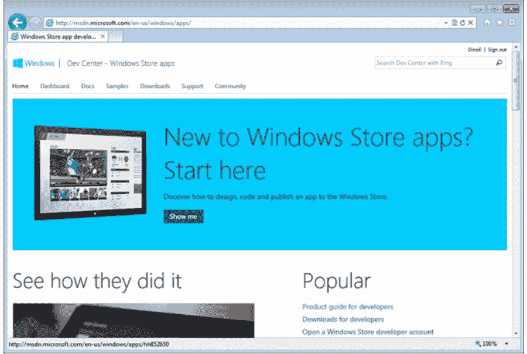

**图 1-1. Windows 8 应用程序开发中心的主页。**

点击链接下载工具和软件开发包 (`SDK`) 后，你将被送到另一个页面，在那里你就可以开始下载过程，如图 1-2 所示。

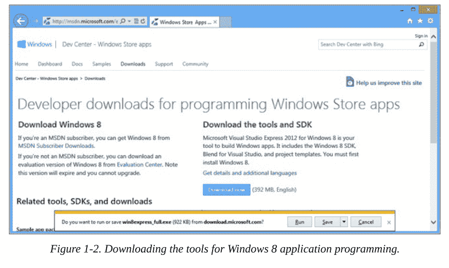

注意，你可以选择将安装程序保存到本地磁盘，也可以直接运行它。如果你计划在不同的机器上重用该程序，先将其保存到已知位置可能会有用。

在安装过程的不同阶段，系统会提示你接受或修改选项。为了本书的目的，你可以直接接受所有默认选项。默认设置将安装最新的 `.NET Framework 4.5`、`Windows 8 SDK` 以及许多其他工具和项目模板。安装结束时，如果一切运行正常，你应该能看到图 1-3 所示的屏幕。在软件没有安装正确的不幸情况下，你将收到一条带有一些有用说明的消息。请仔细遵循这些说明。

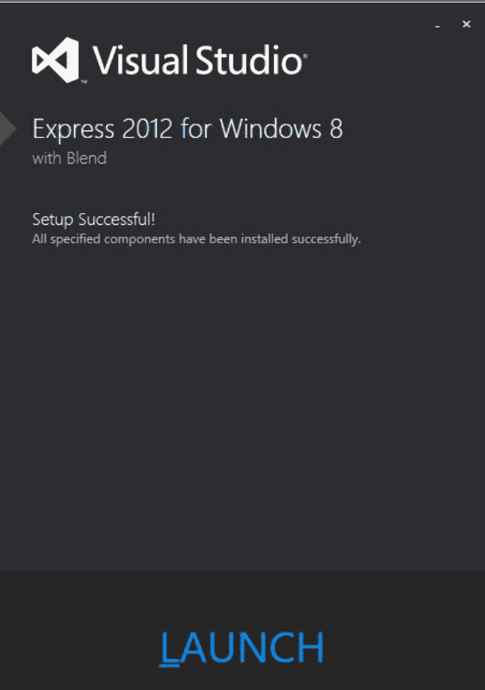

**图 1-3. Visual Studio 2012 已准备好启动。**

现在你可以开始一些真正的乐趣了：为你的第一个 `Windows 8` 启动并配置 `Visual Studio`！

## 配置 Visual Studio 2012

完成设置后，`Visual Studio 2012 Express` 还需要几个步骤才能准备好运行。

### 获取产品密钥

首次启动时，`Visual Studio 2012` 要求你激活副本。这将通过类似图 1-4 所示的屏幕完成。

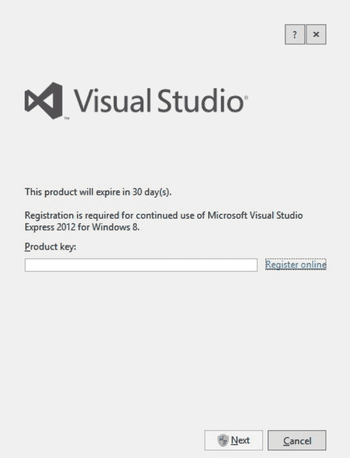

**图 1-4. Visual Studio 需要产品密钥。**

点击“在线注册”链接将你带到一个页面，你可以在那里输入你的姓名、电子邮件地址和详细信息（见图 1-5）。** 表示必填。

| 个人信息 |
| --- |
| * 名字 |
| * 姓 |
| * 电子邮件地址 |
| 公司/组织 |
| (在此输入) |
| * 您的公司或组织内的员工人数 |

提交表单后，你将收到一封包含产品密钥的电子邮件（通常只需要几秒钟）。将其复制到剪贴板并返回 `Visual Studio`。在图 1-4 所示的窗口中输入你收到的密钥。

感谢！你将通过用于注册的邮箱收到此产品密钥。

| 产品密钥 |
| --- |
| `XXXXX-XXXXX-XXXXX-XXXXX-XXXXX` |

**Visual Studio 产品概览**

若要全面概述 `Visual Studio`，请下载 `Visual Studio 2012` 产品。


哪个版本适合你？比较 `Visual Studio` 产品以确定哪个版本的 `Visual Studio 2012` 最符合你的开发需求和实践。

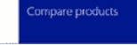

**图 1-6. 获取 Visual Studio 产品密钥。**

### 创建开发者帐户

为了编写和测试 `Windows 8` 应用程序，你需要微软的开发者许可证。该许可证是免费的，并让你成为注册开发者。获取此类许可证只需使用你的 `Windows Live ID` 登录，如图 1-7 所示。（如果你没有 `Windows Live ID`，提示框会提供一个“立即注册”链接。）

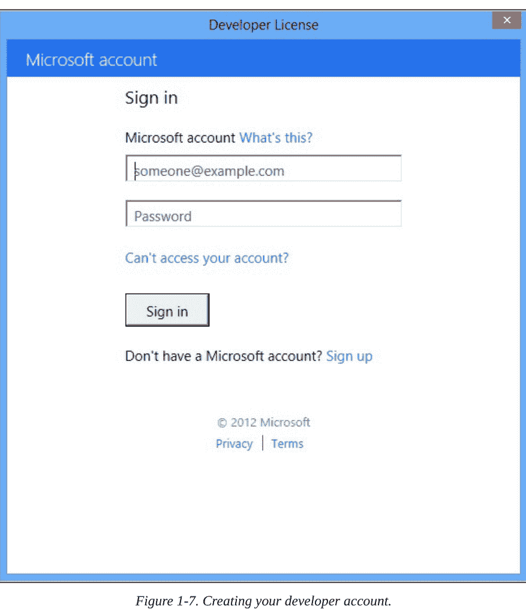

成功安装在机器上的开发者许可证允许你在官方商店之外自由创建和运行 `Windows 8` 应用程序。

> **注意**
> `Windows 8` 机器只能安装经过认证的应用程序，无论是从 `Windows Store` 下载（类似于 `Windows Phone` 应用程序的方式），还是由注册开发者在“签名”机器上创建，因此你需要开发者许可证来完成书中示例。

在开发者许可证过期或你从机器上删除之前，系统不会发出进一步的警告。如果许可证过期，你可以直接从 `Visual Studio` 环境进行续订。要续订许可证，`Visual Studio` 用户点击 `Store` 菜单然后选择“获取开发者许可证”，如图 1-8 所示。

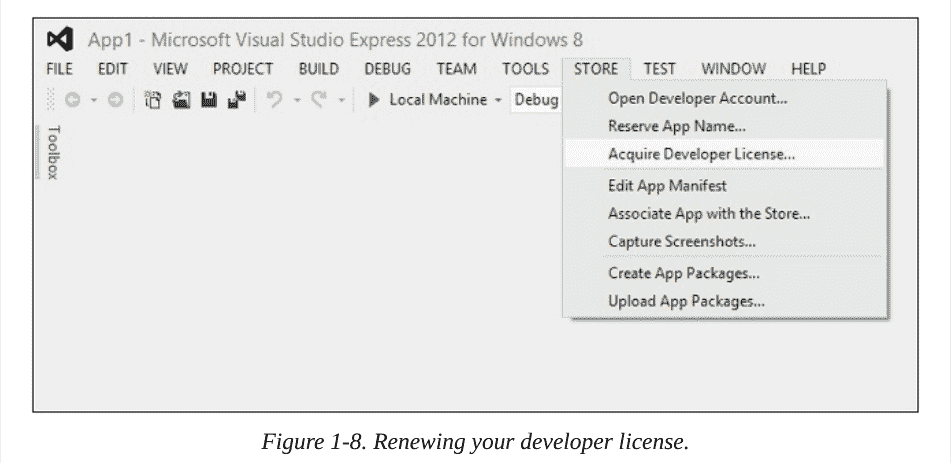

只要你有 `Windows Live ID` 账户，就可以获取任意数量的开发者许可证。

### Windows Store 帐户

获取 `Windows 8` 开发者许可证只是开发和测试 `Windows 8` 应用程序的第一个强制步骤。仅凭一个开发者帐户，你无法将 `Windows 8` 应用发布到 `Windows Store` 供他人下载和安装。

开发者账户与 `Windows Store` 账户之间没有直接关系。它们各自承担着特定的角色，且你可以在不拥有另一个账户的情况下获得其中一个。然而，如果你拥有 `Windows Store` 账户，并且符合获得开发者许可证的条件，那么你的开发者许可证的默认过期时间将自动设置为更长。

需要记住的一点是，在将 `Windows 8` 应用发布到 `Windows Store` 之前，你需要获取一个 `Windows Store` 账户。你将在第 14 章中看到如何获取 `Windows Store` 账户。

> **重要**
> 作为 `Windows 8` 系统的开发者和用户，请记住，你的机器只能运行从 `Windows Store` 下载的 `Windows 8` 应用，或者在机器上安装了开发者许可证的自定义应用程序。另一种场景允许你托管自定义应用程序——当这些应用程序由你的组织“侧载（`sideloaded`）”到机器上时，而该组织恰拥有企业商店账户。

## 开始尝试 Windows 8 应用

在你的 `Windows 8` 机器上安装了开发者许可证后，你就可以准备好玩 `Windows 8` 应用了。当你准备创建一个全新的项目时，必须首先选择一个项目模板和编程语言。之后，`Visual Studio` 将通过生成一些适用于该模板和语言的原始代码（`vanilla code`）来提供帮助，你可以对其进行自定义和扩展。

就本书而言，你选择的编程语言是 `JavaScript`。值得注意的是，你也可以使用其他语言，例如 `C#`、`Visual Basic` 甚至 `C++`。


## “Hello Windows 8”应用程序

话直说，启动 Visual Studio 并发现创建新项目所需的步骤。实际上这不能更简单了；从首页开始，只需点击“新建项目（New Project）”链接，如图 1-9 所示。

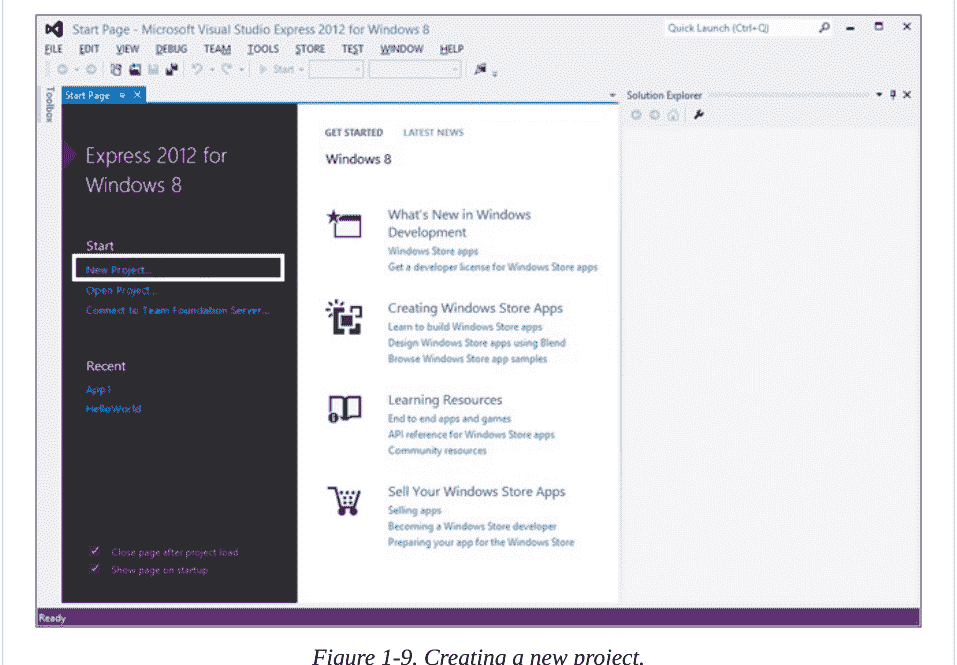

### 选择项目模板

Visual Studio 为你的新项目提供了几个预定义模板，但选择项目模板似乎是一项简单的任务。它要求你对想要实现的最终结果有一个相当清晰的思路。你想要使用的模板取决于你脑海中的交互模型、图形以及你需要处理的内容。图 1-10 显示了你选择创建新项目后将看到的“新建项目”窗口。

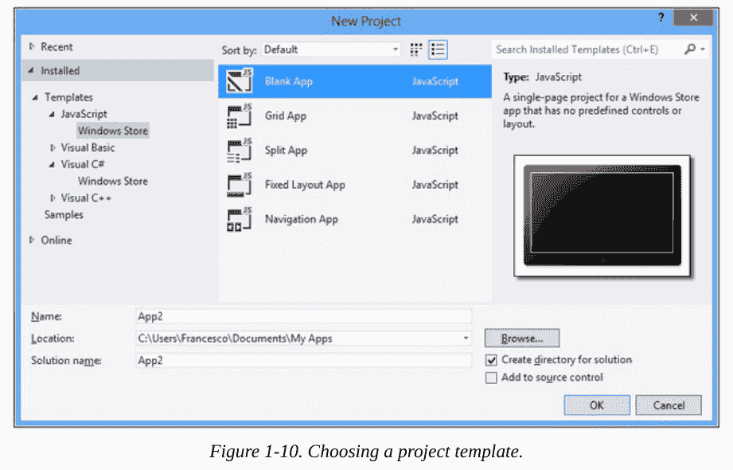

图 1-10. 选择项目模板。

模板按编程语言分组。在本文考虑的 Visual Studio 快速版（Express edition）中，你只能创建一种应用程序——适用于 Windows Store 的 Windows 8 应用。如果你获取了更高级的 Visual Studio 版本，你应该看到更多可用选项，包括 Web、控制台和桌面应用程序。

那么，你如何决定使用哪种模板呢？

模板的主要目的是节省一些工作，至少对于常见的应用程序布局是如此。你不被强制选择某个特定的模板。如果没有一个预定义的模板看起来适合你，或者更可能的是，如果你不确定具体该选哪一个，那么你只需要选择空白应用程序模板即可。表 1-3 提供了关于 JavaScript 预定义模板的信息。

### 表 1-3. Windows Store 的预定义项目模板

| 模板 | 说明 |
| :--- | :--- |
| 空白应用 (Blank App) | 应用程序由单个几乎为空的页面组成：没有视觉控件、没有小部件且没有定义布局。 |
| 网格应用 (Grid App) | 由三个页面组成的主/详情应用程序。主页在网格中对项目分组。额外页面提供组和单个项目的详细信息。 |
| 拆分应用 (Split App) | 一个双页主/详情应用程序，其中主页显示可选项目，详情页在侧边列出相关项目。 |
| 固定布局应用 (Fixed Layout App) | 单页应用程序，其布局使用固定宽高比进行缩放。 |
| 导航应用 (Navigation App) | 多页面应用程序，具有预定义的控件用于在页面之间进行导航。 |

对于本书而言，最简单的方法是从一个新的全新的空白应用程序开始。你将在接下来的章节中尝试其他类型的模板。

## 创建示例项目

在允许 Visual Studio 创建文件之前，你可能需要花时间考虑项目的位置。在图 1-10 中，你看到了“位置（Location）”；那里是你输入为项目创建的文件的磁盘路径的地方。

将你的示例应用程序保存在组织良好的结构中总是好的。对于本书的示例代码，你将使用一个名为`Win8`的根目录，其中包含每个章节的`ChXX`目录，其中 XX 是两位章节编号。

默认情况下，Visual Studio 将你的项目保存在“文档（Documents）”文件夹下，并为每个解决方案创建一个新目录。你可以通过简单地编辑位置时间中的路径来更改项目的默认位置。或者，你可以通过从“工具（Tools）”菜单选择“选项（Options）”，并在“项目和解决方案（Projects and Solutions）”元素下的“常规（General）”节点为每个项目设置新的默认路径（见图 1-11）。

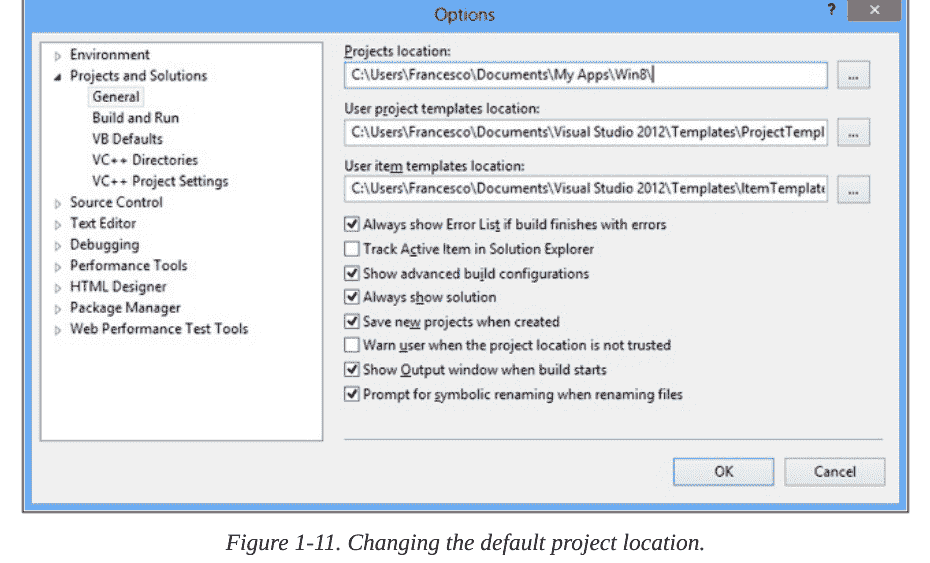

对于“Hello Windows 8”应用程序，你将在`Win8/Ch01`文件夹中创建一个名为`HelloWin8`的新空白应用程序项目，如图 1-12 所示。

## 新项目


点击确定，你就正式成为了一个 Windows 8 开发者。

> 注意：作为 Windows 8 系统的开发者和用户，请记住，你的机器只能运行从 Windows Store 下载的 Windows 8 应用，或者在机器上安装了开发者许可证的自定义应用程序。

> 注意：Visual Studio 2012 默认带有深色主题。为了打印起见，我们将其更改为亮色主题。打开图 1-11 所示的“工具 | 选项”。

## 调整示例项目

项目创建后，`HelloWin8`项目看起来如图 1-13 所示。它引用了`References`文件夹中的 Windows，并对主页面的 HTML 使用层级样式表（CSS）文件`css/default.css`进行图形化，并使用 JavaScript 文件`js/default.js`提供逻辑。`default.js`文件默认在 Visual Studio 中打开。

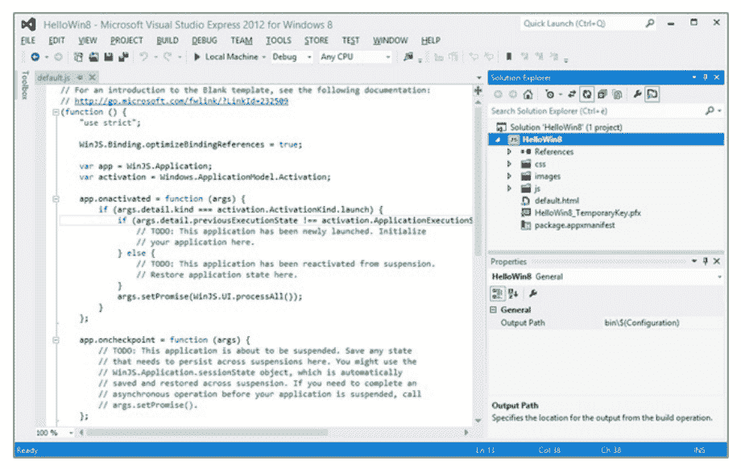

图 1-12. 创建 HelloWin8 项目。

使用 JavaScript 编写的 Windows 8 应用程序看起来是一个由 HTML 页面构建、经过 CSS 适当样式化并由 JavaScript 逻辑驱动的自包含 Web 应用程序。如果你熟悉 Web 范式和客户端 Web 开发，那么只需要理解通过几个 JavaScript 文件暴露给你的 Windows 特定编程接口。

在编译项目查看会发生什么之前，让我们做一些微调：关闭`default.js`文件并打开`default.html`文件，它负责应用程序的主页（见图 1-14）。

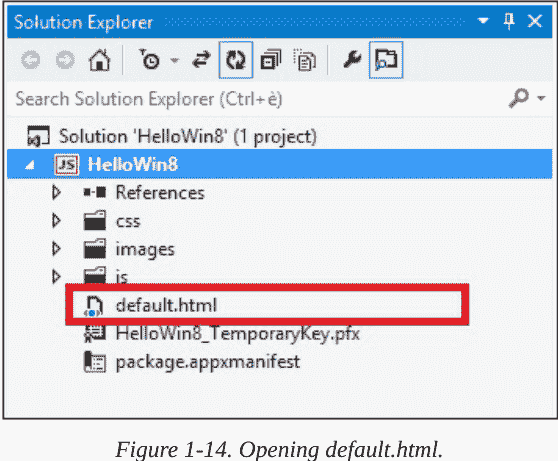

### HelloWin8 项目

示例 HTML 页面的主体完全如下：

```html
<body>
  <p>Content goes here</p>
</body>
```

让我们将占位符替换为自定义文本。例如：

```html
<body>
  <p> Hello, Windows 8!</p>
</body>
```

在 HTML 中，`<body>`元素相反定义了一段文本。更改的最终效果是让页面显示“Hello, Windows 8.”文本。

下一步是构建应用程序并欣赏它的实时运行。

现在你可以尝试运行应用程序。你可以启动应用程序并与其交互，查看它的行为是否符合你的预期。

为了更快速地启动，你可以点击工具栏上的“播放”按钮，如图 1-15 所示。

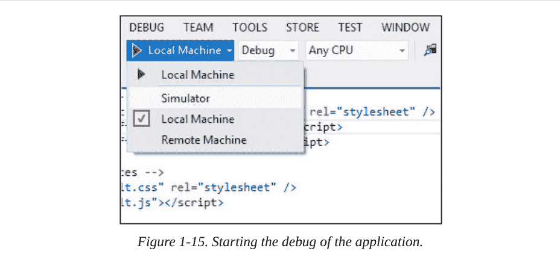

请注意，“本地机器”（Local Machine）是你可以选择运行应用程序的唯一默认选项。通过选择它，你将打开一个包含各种选项的菜单。在本地机器上运行应用程序可以从 Windows 经典桌面模式（你在此处执行 Visual Studio）切换到 Windows 8 的特定 UI 界面。如果你不喜欢这样做，可以在模拟器中运行应用程序。使用模拟器有助于使用各种屏幕方向和分辨率来测试应用程序。最后，只要你有足够的权限访问该机器，你就可以在远程机器上运行应用程序。

图 1-15 中的“调试”（Debug）选项指的是编译器生成代码的方式。在调试模式下，二进制文件包含额外信息，允许你在特定的代码行上设置断点并逐行执行。断点是执行将暂停的行。你通常使用断点在给定点停止执行，并调查应用程序的状态及其内部数据。你可以在程序中设置多个断点。“发布”（Release）模式则适用于已完成并准备分发的应用程序。在本书中，你将主要使用调试模式。

**图 1-16**显示了应用程序在本地机器上的运行情况。

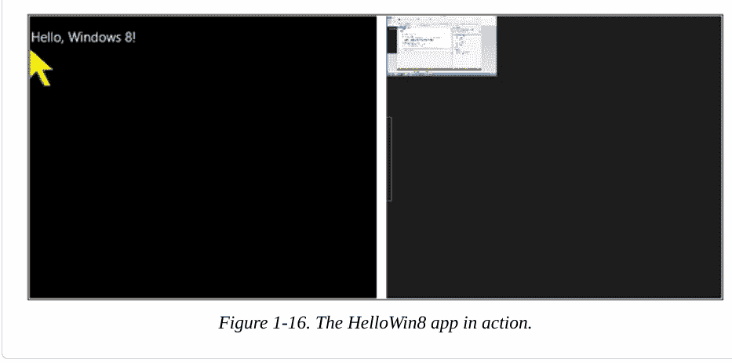

如果你在模拟器中运行应用程序，则应用程序将在一个你可以随心所欲控制的独立窗口中运行。当你在本地机器上运行时，程序将全屏运行，你无法立即看出需要做什么才能返回 Visual Studio 并终止程序。以下是退出应用程序的方法：将鼠标移动到左边框，直到看到窗口图标并点击它以返回桌面模式。要终止应用程序，请点击 Visual Studio 用户界面中取代“播放”按钮的“停止”按钮。

你完成了。但这也太简单了，不是吗？让我们让示例应用程序变得更加丰富，并添加一些动作吧。

## 增加一些动作

创建一个新项目并将其命名为`HelloWin-Step-2`。首先，你将通过添加更多的 HTML 元素和样式信息让它变得更加丰富。接下来，你将将其转换为一个生成随机数的简单但功能应用程序。

## 为页面添加样式

打开`default.html`页面并编辑其`body`标签。`body`现在应该包含由线条分隔的标题和副标题。为了这一点，你使用了两个 HTML5 元素。注意，在下一章节中，你将学习更多关于 HTML5 的知识。这里是修改后的页面`body`：

```html
<body>
<header>
  Start Here! Build <b>Windows 8</b> Applications with <b>HTML5</b> and <b>JavaScript</b>
  <hr />
</header>
<footer>
  <hr />
  Dino Esposito | Francesco Esposito
</footer>
</body>
```

现在让我们继续处理颜色和字体。页面的样式定义在 CSS 文件夹中的`default.css`文件中。通过编辑 CSS 文件，你可以更改 HTML 页面中几乎所有与外观和布局的内容。你将在第 3 章中找到关于 CSS 重要知识的总结。

在`default.css`文件中，你最初会看到如下：

```css
body {
}
```

此代码描述了应用于任何链接该 CSS 文件的页面的`body`标签的样式。你可以手动编辑 CSS 文件，也可以使用 Visual Studio 提供的生成器工具创建 CSS 样式。要使用该工具，右键点击 CSS 元素（即`body`）并选择“生成样式”（Build Style），如图 1-17 所示。


这是一个对页面`body`修改后的样式，它更改了背景颜色并在内容周围添加了一些空间：

```css
body {
  background-color: #1649AD;
  padding: 10px;
}
```

你还可以稍微自定义`header`和`footer`元素，定义文本颜色、字体大小和垂直偏移，如下所示：

```css
header {
  font-size: x-large;
  color: #ffffff;
  padding-bottom: 50px;
}
```

```css
footer {
  font-size: large;
  color: #eeee00;
  padding-top: 50px;
}
```

现在运行应用程序并为它感到自豪吧！（参见图 1-18。）

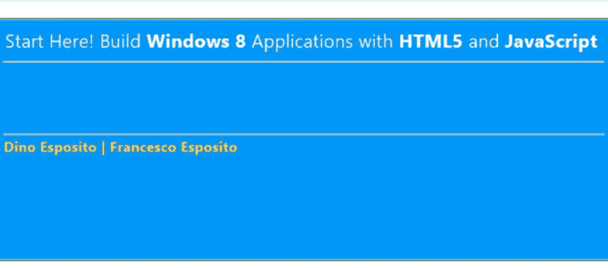

图 1-18。带有修改样式运行的应用程序。

## 生成随机数

到目前为止，应用程序完全没有任何行为，仅限于显示一些静态文本。让我们让它变得不那么直白，并添加必要的结构和逻辑，使其生成并显示随机数。

首先，在页面中添加必要的结构和逻辑，让它变得不那么直白，以便能够生成并显示随机数。在`default.html`的`body`中插入以下 HTML 标记：

```html
<div>
  <label id="number">?</label>
</div>
<div>
  <input type="button" value="Get number" onclick="numberButtonClick()" />
</div>
```

接下来，在`default.js`文件底部添加以下 JavaScript 函数：

```javascript
function numberButtonClick() {
  var number = generateNumber();
  document.getElementById("number").innerHTML = number;
}
```

第一个函数是点击事件的处理器。第二个函数只是生成 1 到 1000 之间的随机数。

```javascript
function generateNumber() {
  return 1 + Math.floor(Math.random() * 1000);
}
```

更优雅的方法（也是在 Windows 8 中推荐的方法）是在页面加载时动态绑定，如下：

```javascript
app.onactivated = function (args) {
  if (args.detail.kind == ActivationKind.launch) {
    if (args.detail.previousExecutionState != ApplicationExecutionState.terminated) {
      // TODO: 应用程序已新启动。
      // 在处初始化应用程序。
      document.getElementById("numberButton").addEventListener("click", numberButtonClick);
    }
  } else {
    // TODO: 应用程序从挂起状态恢复。
    // 在处恢复应用程序状态。
  }
};
```

最后，当应用程序新启动时添加此行。该行为指定按钮的任何点击事件注册了处理器。

你可以通过对 CSS 进行再次处理为应用程序添加最后的装饰。在`default.css`中添加以下内容：

```css
#numberButton {
  font-size: x-large;
}
#numberLabel {
  font-size: xx-large;
  color: #eeeeee;
}
```

前面的井号（`#`）表示样式适用于与名称匹配的任何 HTML 元素，例如，定义为`#numberButton`的样式传递给 ID 为`numberButton`的元素。图 1-19 显示了运行中的应用程序。

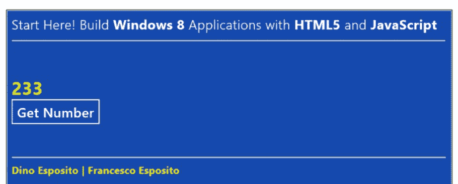

图 1-19。获取随机数的 Windows 8 应用程序。

尽管这仍然是一个简单的应用程序，但它足以让你开始，并让你对 Windows 8 编程有一个整体的感受。你将在第 5 章构建更复杂的应用程序。

## 总结

本章提供了为 Windows 8 编程做准备的逐步指南。你从编写代码所需的操作系统和工具开始，然后安装并配置了适用于 Windows 8 的 Visual Studio 2012 Express 版，最后尝试了一个简单的应用程序。

在深入研究 Windows 8 开发之前，有必要确保每个读这本书的人在 HTML5、CSS 和 JavaScript 等网络技术知识上达到一致水平。因此，接下来的三个章节将提供你成功完成后续章节所需要的 HTML5、CSS 和 JavaScript 知识总结。如果你觉得已经掌握了足够知识，可以直接跳转到第 5 章。如果后续章节证明太困难，我建议你复习第 2 章到第 4 章，或者通过其他资源温习 HTML5、JavaScript 和 CSS。

# 第 2 章：理解 HTML5

> 广而言之，简短的词越好，而旧词是最好的。
>
> — 温斯顿·丘吉尔

HTML5 是 HTML 语言的最新版本——HTML 是用于定义网页内容的流行文本语言。HTML 出于 20 世纪 90 年代初。起初，它仅仅是一种用于描述简单文档的标记语言。标记语言基于一组标记，这些标记包裹文本并赋予其特殊的含义。

最初，HTML 标记元素集合（称为“标签”（tags）或（更准确地说是）“元素”（elements））非常有限。它包含对其他文档和标题的引用，用于链接到图像和段落，并应用基础文本样式，如粗体或斜体。然而，多年来，HTML 的作用超出了想象，它从一种描述文档的简单语言演变为用于定义 Web 应用程序界面的语言。这种趋势在今天的 HTML5 中仍在延续。

最新版本的 HTML 移除了一些旧元素，并使得更容易将提供样式信息的元素放在一处，而将提供文本并定义文本布局的元素放在另一处。正如你将在下一章中看到的详细内容那样，样式信息可以通过一种特殊的独立文件——级联样式表（CSS）来定义。此外，HTML5 添加了一些适用于包含多媒体内容和绘图的新元素，以及几个用于程序化操作页面内容的新框架。

仅凭 HTML5，你仍然无法进一步构建一个完整的应用程序。然而，HTML5、CSS 和 JavaScript 的结合功能非常接近一种完整的编程语言。

- 你使用 HTML5 定义用户界面的布局，并插入文本和多媒体。
- 你使用 CSS 添加颜色、样式和闪光效果。
- 最后，你使用 JavaScript 通过胶合原生框架的片段（例如文档对象模型（DOM）、本地存储、地理位置，以及例如通过 Windows 8 JavaScript 库（WinJs）暴露的所有 Windows 8 特定服务）来添加行为。特别是 DOM，它是可编程对象的集合，它向程序员暴露当前文档的结构。

在本章的剩余部分中，你将简要探索 HTML5 标记元素的基础，包括输入表单和多媒体。本章及本书的其他部分都没有涵盖 HTML 基础的每一个方面。如果你需要复习 HTML 的基础，可以参考 Faithe Wenpen 写的书籍*Start Here! Learn HTML5*（Microsoft Press, 2012）。

## 重要


# 第 2 章：理解 HTML5

> 广而言之，简短的词越好，而旧词是最好的。
> 
> — 温斯顿·丘吉尔

`HTML5` 是 `HTML` 语言的最新版本——`HTML` 是用于定义网页内容的流行文本语言。`HTML` 出于 20 世纪 90 年代初。起初，它仅仅是一种用于描述简单文档的标记语言。标记语言基于一组标记，这些标记包裹文本并赋予其特殊的含义。

起初，`HTML` 标记元素集合（称为“标签”(tags) 或（更准确地说是）“元素”(elements)）非常有限。它包含对其他文档和标题的引用，用于链接到图像和段落，并应用基础文本样式，如**粗体**或*斜体*。然而，多年来，`HTML` 的作用超出了想象，它从一种描述文档的简单语言演变为用于定义 Web 应用程序界面的语言。这种趋势在今天的 `HTML5` 中仍在延续。

最新版本的 `HTML` 移除了一些旧元素，并使得更容易将提供样式信息的元素放在一处，而将提供文本并定义文本布局的元素放在另一处。正如你将在下一章中看到的详细内容那样，样式信息可以通过一种特殊的独立文件——级联样式表（`CSS`）来定义。此外，`HTML5` 添加了一些适用于包含多媒体内容和绘图的新元素，以及几个用于程序化操作页面内容的新框架。

仅凭 `HTML5`，你仍然无法进一步构建一个完整的应用程序。然而，`HTML5`、`CSS` 和 `JavaScript` 的结合功能非常接近一种完整的编程语言。

- 你使用 `HTML5` 定义用户界面的布局，并插入文本和多媒体。
- 你使用 `CSS` 添加颜色、样式和闪光效果。
- 最后，你使用 `JavaScript` 通过胶合原生框架的片段（例如文档对象模型 (`DOM`)、本地存储、地理位置，以及例如通过 `Windows 8` JavaScript 库 (`WinJs`) 暴露的所有 `Windows 8` 特定服务）来添加行为。特别是 `DOM`，它是可编程对象的集合，它向程序员暴露当前文档的结构。

在本章的剩余部分中，你将简要探索 `HTML5` 标记元素的基础，包括输入表单和多媒体。本章及本书的其他部分都没有涵盖 `HTML` 基础的每一个方面。如果你需要复习 `HTML` 的基础，可以参考 Faithe Wenpen 写的书籍 *Start Here! Learn HTML5*（Microsoft Press, 2012）。

## 重要

本章和接下来的两章提供了 `HTML`、`CSS` 和 `JavaScript` 的概述。在这些章节中，你将熟悉 `HTML5` 和 `CSS3` 的新关键元素，并对你在 `JavaScript` 中使用的常用编程技术进行端到端的覆盖。这些章节的内容并非针对 `Windows 8` 应用程序；而是作为后续章节的准备，在那些章节中你将在基础 `HTML` 骨架中使用 `WinJs` 库中的临时元素，使用自定义 `CSS` 处理图形，并使用自定义 `JavaScript` 处理行为。

## 网页元素

`HTML5` 在其最最近的前身（`HTML4`）之后十年才出现。观察 `HTML5` 的新特性，可以合理地说，这些年并没有白虚过。`HTML5` 提供了一系列新元素，提供了几种原生功能，而开发者和设计师以前通常通过人工产物和现有元素的巧妙组合来编写这些功能。以下是与 `HTML5` 创建网页相关的相关内容的快速回顾。

## 使用 HTML5 构建页面布局

在 Web 早期，大多数页面被设计为文本文档——这意味着它们的内容在单列逻辑列上垂直展开。多年来，页面布局变得越来越复杂。今天，双栏和三栏布局要常见得多。在双栏和三栏布局中，你通常还会发现页眉和页脚围绕着逻辑列。图 2-1 显示了布局之间的区别。

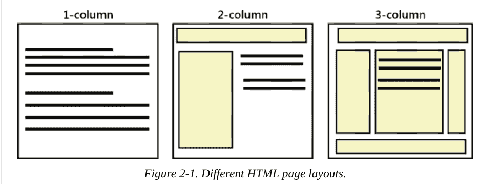

开发者足够聪明，可以使用 `DIV` 等基础 `HTML` 块级元素构建此类复杂的布局。

## 注意

在 `HTML` 中，块级元素（block element）是指内容在两个换行符之间渲染的元素——内容之前和之后各有一个。因此，内容显示为一个独立的“块”内容。一个流行的块级元素是 `H1`，它将某些文本渲染为一级标题。`DIV` 元素是另一个块级元素，旨在为任何有效的 `HTML` 内容创建块。块级元素与内联元素（inline elements）相反，即元素的内容与页面其他部分一起流动，且不应用换行符。

## 重要

请注意，在本书中以及在其他书籍和文章中，真正常见的 `HTML` 元素（如 `<div>` 和 `<h1>`）通常出现在不带括号的文本中。然而，如果你在 `HTML` 本身内部使用这些元素，则使用角括号是强制性的。

在 `HTML5` 中，多列布局被认为是一种常见的布局，因此通过几个新的临时标记元素获得完全支持。

## 准备示例应用程序

你将在本章中使用的示例是纯 `HTML` 页面，展示了 `Internet Explorer 10` 中支持的 `HTML5` 的某些功能。你不会为每个功能都创建一个临时 `Windows 8` 应用程序，但对于这个早期示例——为了复习你在第 1 章中看到的内容——请尽管创建一个 `Windows 8` 页面，将所有指向各种独立 `HTML5` 页面的链接连接起来。

打开 `Visual Studio` 并创建一个空白应用程序。将其命名为 `Html-Demos`。完成后，将以下代码添加到 `default.html` 的 `body` 中，使其成为导航到所有独立 `HTML5` 页面的主菜单。

```
<body>
  <header>
    HTML5 demos
  </header>
  <div id="menu">
    <!-- links to various HTML5 pages will go here -->
  </div>
  <footer>
    Copyright © your organization
  </footer>
</body>
```

## 从通用块到语义化元素

许多网站都有常见的布局，包含页眉、页脚，以及侧边的导航栏。通常，这些结果是通过对 `DIV` 元素进行样式化对齐来实现的。让我们添加一个新的 `HTML` 页面到项目：右键点击 `Solution Explorer` 中的项目节点并选择`添加 | 新项`。你得到的是图 2-3 所示的窗口。

| 返回 | | 页面头部 | | - 首页 | | - 联系我们 | | - 职业机会 |

- 首页
- 联系我们
- 职业机会

左侧边栏

- 文章 #1
- 文章 #2
- 文章 #3

这是页面的主要内容

右侧边栏

页面页脚

图 2-4。由 `Internet Explorer` 渲染的 `multi.html` 页面。

然而，仅靠前面的标记无法产生预期的效果，页面并没有真正显示任何多列布局。为了实现这一点，你需要为单个 `DIV` 元素添加 `CSS` 样式，使其浮动并锚定到左边缘或右边缘。你使用放在 `CSS` 文件中的 `CSS` 标记向 `HTML` 页面添加 `CSS` 样式。下一将提供 `CSS` 的快速总结。这个演示的真正重点略有不同。

如你所见，`DIV` 元素仅通过 `id` 属性的名称与其他区分来。然而，每个 `DIV` 元素都扮演着明确的角色，使其与其他截然不同——头部与页脚不同，两者也都与左侧或右侧边栏不同。

## 头部和页脚元素

`HTML5` 引入了一系列具有特定名称和清晰行为的新块级元素。这些新元素的集合是通过观察页面作者最常用的布局确定的。例如，在 `HTML5` 中，`header`（头部）和 `footer`（页脚）是新的普通块元素，你来指示头部和页脚。在之前的列表中大多数语义元素也存在类似的元素。以下是你如何仅使用 `HTML5` 特定元素重写 `multi.html` 页面。将此页面命名为 `multi5.html`。下面的列表显示了新页面 `body` 标签的内容。

```
<header>
  页面头部
  <hr />
</header>
<nav>
  <a href="...">首页</a>
  <a href="...">联系我们</a>
  <a href="...">职业机会</a>
</nav>
<article>
  <aside>
    左侧边栏
    <ul>
      <li>文章 #1 </li>
      <li>文章 #2 </li>
      <li>文章 #3 </li>
    </ul>
  </aside>
  <article>
    <h1>文章 #1</h1>
    <hr />
    <section>引言 </section>
    <section>第一部分 </section>
    <section>第二部分 </section>
  </article>
  <aside>
    右侧边栏
  </aside>
</article>
<footer>
  <hr />
  页面页脚
</footer>
```

你可以使用特定的元素以非常简单的语法插入头部和页脚，如下所示：

```
<header> 标记 </header>
<footer> 标记 </footer>
```

有趣的是，发现你可以在 `HTML5` 页面中拥有多个 `header` 和 `footer` 元素。最常见的用法是为页面提供头部和页脚。然而，你应该将这些元素视为表示页面或页面某部分的标题内容以及页脚的块级元素。

## section 和 article 元素

`HTML5` 定义了两个外观相似的元素来表示页面内容。`<section>` 元素稍微通用一些，因为它旨在界定 `HTML` 页面的逻辑部分。逻辑部分可以是一个设计为标签页集合的页面中某个标签的内容。

同时，逻辑部分也可以是页面中显示的主内容的一部分。在这种情况下，`section` 元素可能会嵌入在 `<article>` 元素中。

```
<article>
  <h1>文章 #1</h1>
  <hr />
  <section> 引言 </section>
  <section> 第一部分 </section>
  <section> 第二部分 </section>
</article>
```

> 诸如 `<section>`、`<article>`、`<header>` 和 `<footer>` 等元素是语义元素，这意味着浏览器将它们视为块元素。如果你查看最终结果，语义元素与普通 `DIV` 元素之间几乎没有区别。最显著的区别在于生成的标记的表达能力。通过使用 `<section>`、`<article>`、`<header>` 和 `<footer>` 元素，生成的标记随着时间的推移更易阅读、理解和维护。

## aside 元素

许多 `HTML` 页面在水平排列的列中显示其部分内容。`HTML5` 引入了 `<aside>` 元素，用于快速识别与周围显示内容相关的某些。`<aside>` 元素的语法非常直观：

```
<aside> 标记 </aside>
```


你可能想要利用 `<aside>` 元素的非常常见场景是在 `article` 元素中定义侧边栏，更通地说，是为页面内容或页面部分创建多列布局。

## `<nav>` 元素

`<nav>` 元素指示页面内容的特殊部分——包含主要导航链接的区域。需要注意的是，HTML 页面中所有的链接不必非定义在 `<nav>` 元素内。`<nav>` 元素仅保留给最相关的链接，例如你放在主页面导航菜单上的链接。`<nav>` 元素的语法非常直观。它由在 `<nav>` 元素列出的 `<a>` 锚元素列表组成：

```html
<nav>
<a href="..."> 首页</a>
<a href="..."> 联系我们</a>
<a href="..."> 职业机会</a>
</nav>
```

`<nav>` 元素在 HTML5 中起着重要作用，因为它指示了包含导航链接的页面部分的边界。这允许特殊的页面阅读器（例如为残障人士提供的浏览器）更好地理解页面结构并可选地跳过内容。

> 重要
> 考虑到辅助功能，HTML5 中的所有语义元素都是重要的，仅仅出于这个，在任何可能被残障人士阅读的网页中都应该考虑使用它们。

## 其他新元素的杂项

语义块元素代表了 HTML5 中最大的新元素家族。如所述，语义元素的重要性不在于它们在页面中产生的效果，而在于它们显著提高了开发者、软件，特别是残障人士浏览器的页面可读性。

仅靠语义块元素并不会对 HTML5 兼容浏览器渲染页面的方式产生重大变化。例如，为了着色和提供侧边栏（即 `<aside>` 元素），你仍然需要求助于 CSS 设置。然而，使用语义元素减少了过多的通用 `DIV` 块元素的噪声，这些元素的作用和范围并不显而见。

除了语义元素外，HTML5 还提供了几个具有嵌入行为的新元素，这些行为在早期的 HTML 版本中如果不借助 CSS、标记和 JavaScript 的组合是无法获得的。让我们来看几个例子。

## `details` 元素

很多时候，你在页面上有想要根据需要显示或隐藏的小内容。一个很好的例子是新闻的标题及其实际内容。有时你只想显示标题，但让用户自由展开和隐藏它以获得空间。

在 HTML5 之前，你必须使用一些 HTML、CSS 和 JavaScript 手动编写这一切。在 HTML5 中，整个逻辑留给了浏览器，你只需要执行如下：

```html
<details>
  <summary>这是标题</summary>
  <div>
    这是新闻内容，初始隐藏的
  </div>
</details>
```

`<details>` 元素由浏览器解析并用于实现折叠面板。`open` 属性指示你是否希望初始时显示内容。`<summary>` 子元素指示可点击占位符的文本，而其余内容根据需要显示或隐藏。注意，`<details>` 元素的所有部分都可以使用 CSS 进行任意样式设置。

> 重要
> 尽管 Visual Studio 编辑器识别 `<details>` 元素并对其提供智能提示，但该元素不支持 Internet Explorer 10。然而，其他 HTML5 兼容浏览器确实支持它——特别是最新版本的 Chrome 和 Opera。

## `mark` 元素

HTML5 还增加了 `<mark>` 元素，作为突出显示部分文本的方式，就像你在纸上使用荧光笔一样。使用 `<mark>` 元素非常简单，你只需要将文本封装在 `<mark>` 元素中，如下所示：

`<mark>DETAILS</mark>` 元素不支持 Internet Explorer 10。

除了 `<mark>` 元素内的文本，整个文本使用默认设置渲染。大多数 HTML5 浏览器对标记文本有默认图形设置。最常见的是这些设置意味着黄色背景。不用说，`<mark>` 元素的图形效果可以通过 CSS 随意更改。

图 2-5 显示了使用 Internet Explorer 10 时上述文本的外观。

| 返回 |
|---|
| Internet Explorer 10 不支持 `<DETAILS>` 元素。 |
| 这是标题 |
| 这是新闻内容 |

图 2-5。`<mark>` 元素的实际应用。

## `dataList` 元素

长期以来，HTML 开发者一直强烈要求能够为文本字段提供一组预定义的选项列表。这个用例很容易理解。想象一下，用户被要求在文本字段中输入城市名称。作为页面作者，你希望用户无需输入任何文本；但同时，你又希望提供几个可以单点击即可选择并录入的定义选项。在 HTML5 出现之前，这一功能必须通过 JavaScript 实现，HTML 原生仅提供两种选择：没有自动补全的自由文本，或者一个无法输入任何内容的固定选项列表。新的 `<datalist>` 元素填补了这一空白。将以下文本复制到名为 `datalist.html` 的新 HTML 页面主体中。

```html
<input list="cities" />
<datalist id="cities">
<option value="Rome">
<option value="New York">
<option value="London">
<option value="Paris">
</datalist>
```

在示例中，`<datalist>` 元素绑定到了一个特定的输入字段——名为 `cities` 的输入字段。有趣的是，这种绑定是通过 `<input>` 元素上定义的一个新属性实现的：`list` 属性。该属性获取 `<datalist>` 元素的名称并作为输入选项的来源。

当输入字段获得焦点时，`<datalist>` 元素的内容将用于自动补全用户输入的内容。图 2-6 显示了该元素在 Internet Explorer 中的实际应用。

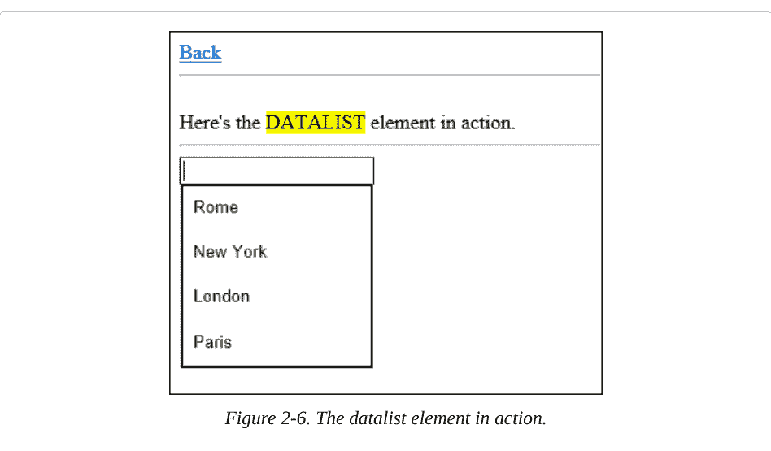

## 从旧 HTML 版本中移除的元素

HTML5 增加了一些新元素，但也移除了一些元素，这些元素一旦与 CSS 的新功能和 HTML5 中的新元素结合，其存在只会增加冗余。

不再支持的元素列表中最著名的包括 `frame` 和 `font` 元素。不过要注意，`<iframe>` 元素仍然可用。

此外，一些样式元素如 `<center>`、`<u>` 和 `<big>` 被移除了。原因是这些功能可以通过 CSS 轻松实现。可能由于页面作者多年来对这些元素大量使用，HTML5 仍然支持如 `<b>`（用于粗体文本）和 `<i>`（用于斜体文本）等元素，它们在逻辑上相当于现在不支持的 `<u>` 和 `<big>` 元素。

## 收集数据

HTML 最初被设计为一种创建超文本文档的语言。多年来，这种语言丰富了布局能力和收集数据的基本功能。为用户编写输入表单被证明是一项非凡的任务。收集纯文本是一回事，而收集日期、数字或电子邮件地址则是另一回事。

多年来，HTML 仅提供输入文本，完全无法区分数字、日期和电子邮件与纯文本。随后，页面开发者负责防止用户输入不需要的字符，并对输入的文本进行客户端验证。

通过 HTML5，其中许多工作被推给了浏览器端。这意味着通过使用一组稍微复杂的元素，开发者可以以更快、更安全的方式实现相同级别的表单验证。

## 调整输入字段

在 HTML5 中，你仍然使用与该语言早期版本的相同标记元素来创建输入表单。也就是说，以下标记将让你有机会将任何输入的内容上传到给定的服务器。

```html
<form action="http://www.yourserver.com/upload">
  <span> 您的姓名 </span>
  <input type="text" value="" />
  <input type="submit" value="Save" />
</form>
```

`<input>` 元素是用于插入图形元素（如输入框或下拉列表）以收集某些输入数据的元素。你还使用 `<input>` 元素添加推入按钮以启动向服务器的提交过程。在 HTML5 中，`<input>` 元素为输入框类型提供了更多选项。例如，你可以获得浏览器提供的日期选择器、滑动条和搜索框。同时，浏览器为大多数常见场景提供了免费表单验证，例如当字段为必填且用户不能留空时。

## 新输入类型

如果你查看 `<input>` 元素的 HTML5 语法，与过去版本的主要区别在于 `type` 属性允许的值列表。表 2-1 列出了 HTML5 支持的一些新输入类型。

表 2-1. HTML5 特有的 `type` 属性值

| 值 | 描述 |
| --- | --- |
| `Color` | 旨在让浏览器显示任何允许输入颜色的 UI。<br>注意：此输入类型在 Internet Explorer 10 中不支持。 |
| `date` | 旨在让浏览器显示任何允许输入日期的 UI。 |
| `email` | 旨在让浏览器显示任何允许输入电子邮件地址的 UI。 |
| `number` | 旨在让浏览器显示任何允许输入数字的 UI。 |
| `range` | 旨在让浏览器显示任何允许输入数字范围。 |
| `search` | 旨在让浏览器显示任何允许输入搜索文本的 UI。 |
| `tel` | 旨在让浏览器显示任何允许输入电话号码的 UI。 |
| `time` | 旨在让浏览器显示任何允许输入时间的 UI。 |
| `url` | 旨在让浏览器显示任何允许输入 URL 的 UI。 |

注意表 2-1 中的列表是不完整的，仅限于目前支持的输入类型。其他输入类型（例如 `week`）是 HTML5 草案的一部分，尚未在任何实现。你可能想参考 http://www.w3schools.com/html5 获取更多详情。

## 你可以从浏览器中期待什么

你在表 2-1 中看到的是浏览器在标准正式批准并公布后预计遵循 HTML5 标准。目前，Opera 和 Chrome 是对当前草案支持最好的浏览器。通常，你从所有浏览器中获得的 HTML5 支持重点在于 HTML5 尚未成为批准的标准，在未来几年内都不会如此。同时，公司渴望在真实的网站和应用程序中使用 HTML5 功能。网站和应用程序需要合规浏览器。你可以想象，这决定了浏览器之间的竞争。浏览器的每个新版本都会改进对 HTML5 标准的支持或使其更符合标准，消除对旧草案的误读。Internet Explorer 10——你在 Windows 8 中找到的浏览器——显著改进了对 Internet Explorer 9 的支持。注意，在 Windows 8 中你会发现两个版本的 Internet Explorer——一个基于 Internet Explorer 9 的经典版本，以及具有原生 Windows 8 外观的版本。特别是后者，缺乏运行插件（特别是 Flash 和 Silverlight）的能力且无法通过文件夹组织收藏夹。

## 让输入自动聚焦

HTML5 为多年来开发者面临并使用 JavaScript 代码解决的一些常见问题提供了完美的解决方案。这些问题之一是关于如何给输入字段聚焦。使用 JavaScript，你可以告诉浏览器在页面显示时将焦点分配给特定的输入字段。在 HTML5 中，你可以在 `<input>` 元素上使用一个新属性——`autofocus` 属性。通过将以下代码放在名为 `autofocus.html` 的新 HTML 页面主体中。

```html
<form>
  <input type="text" value="Dino" />
  <input type="text" autofocus />
  <br />
  <input type="submit" value="Save" />
</form>
```

保存页面并在 Internet Explorer 中显示。如图 2-7 所示，指示输入焦点的光标位于第二个字段上。

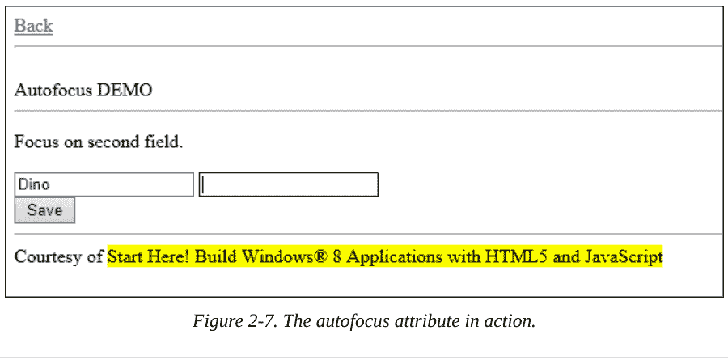

图 2-7。`autofocus` 属性的作用效果。

## 给用户提供提示

观察图 2-7，很难看出哪些内容应该放在哪些字段中。在实际的页面中，人们可能会会使用标签（labels）和复杂的布局，以便使用户更容易地理解每个字段预期的内容。这正是我刚才提到的第二个问题。

最近，开发者们已经习惯了在输入文本框中显示短文本消息。在 HTML5 之前，这只能通过使用一些 JavaScript 代码来实现。在 HTML5 中，新的 `placeholder` 属性使得这种操作变得简单得多，而且也更加自然。

创建一个新的 HTML 页面并将其保存为 `placeholder.html`。现在编辑 `body` 的内容，如下所示：

```html
<form>
  <input type="text" placeholder="First name" />
  <input type="text" placeholder="Last name" />
  <br />
  <input type="submit" value="Save" />
</form>
```

如图 2-8 所示，两个空字段现在都为用户提供了关于预期内容的提示。

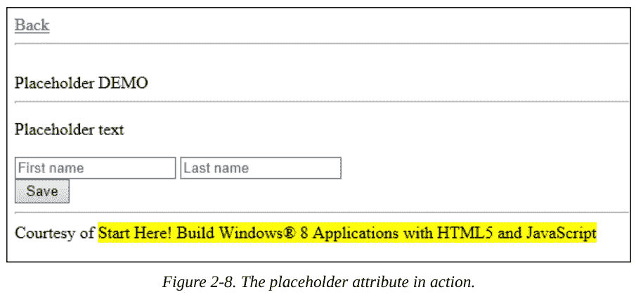

## 表单提交

有时，开发者除了重复编写相同的样板代码（boilerplate code）之外别无选择，无论这有多令人厌恼。样板代码的一个很好的例子就是对 HTML 页面中输入表单的验证。从 HTML 输入表单收集的任何数据在用于某些业务任务之前，都应该在服务器经过仔细验证。然而，一些基础验证任务可以很容易地交给浏览器，并且开发者可以使用标记语言而不是 JavaScript 代码来控制。

HTML5 减少了构建有效输入表单所需的样板代码。我已经提到过 HTML5 `<input>` 元素的最新属性；下一步是查看其他你可以利用的属性，以控制表单提交的整个过程，包括确保用户没有留空字段，以及用户输入符合预期模式的方法。例如，如果你要求电话号码，用户不应被允许输入不可能有效的电话号码的内容。

## 检测必填字段

通过向 `<input>` 元素添加 `required` 属性，你可以告诉浏览器当包含该 `input` 元素的表单提交时，该输入字段不能为空。只有当该字段不被视为可选时，才使用 `required` 属性。

考虑以下名为 `required.html` 的 HTML 页面内容：

```html
<body>
<form>
  <input type="text" placeholder="Your PIN" required />
  <br />
  <input type="submit" value="Enter" />
</form>
</body>
```

当用户点击提交按钮且文本字段为空时，浏览器会自动拒绝提交并显示错误消息。错误消息的具体内容、格式和形状可能会根据浏览器而变化；但在所有符合 HTML5 标准的浏览器中，整体行为是类似的。图 2-9 显示了 Internet Explorer 10 如何处理留空的必填字段。

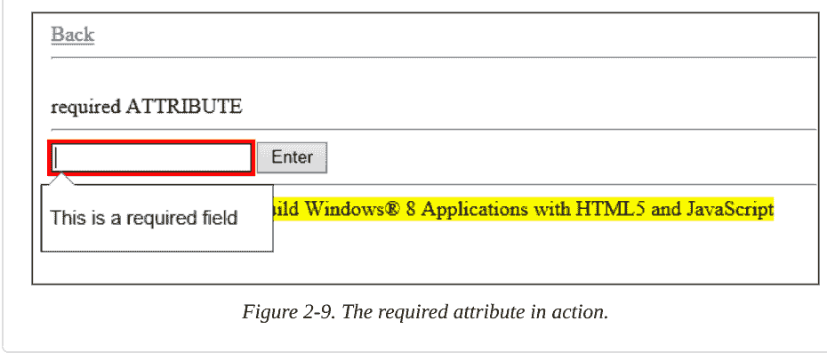

HTML5 浏览器允许你使用 `oninvalid` 属性来自定义错误消息，如下所示：

```html
<form>
<input type="text" placeholder="Your PIN" required
oninvalid="this.setCustomValidity('PIN is mandatory')" />
<br />
<input type="submit" value="Enter" />
</form>
```

> 注意
> 通常情况下，使用 `oninvalid` 属性来指定当输入字段内容无效时应运行的任何 JavaScript 代码，无论是当该字段为必填且留空时，还是其内容未通过验证时。

## 使用正则表达式进行验证

表 2-1 列出了符合 HTML5 标准的浏览器支持的热门新型输入字段类型。如果你的页面需要收集数据，你可以使用日期输入字段；同样，如果你需要收集数字，则可以使用数字输入字段，以此此类推。但如果你打算收集以特定格式格式的数据，而任何预定义的输入类型都无法保证这种格式呢？例如，如果你需要用户输入一个两个字母后跟恰好六个数字的字符串？

在 HTML5 中，你可以使用 `pattern` 属性，如下例所示：

```html
<form>
<input type="text"
placeholder="Your PIN"
title="2 letters + 6 digits"
pattern="[a-zA-Z]{2}\d{6}" />
<br />
<input type="submit" value="Enter" />
</form>
```

当你使用 `pattern` 属性时，Internet Explorer 10 要求你也标明 `title` 属性——它通常用于为大多数 HTML 元素添加提示工具（tooltip）。`title` 属性的文本将与默认静态消息相结合，当字段内容无效时向用户产生反馈。

图 2-10 显示了 Internet Explorer 10 如何在提交内容无效时处理模式（patterns）。


`pattern` 属性是一个正则表达式。`title` 属性的值在字段内容无效时，与与默认消息结合，向用户提供反馈。

## 表单验证

有时，开发者除了重复编写相同的样板代码之外别无选择，无论这有多令人厌恼。样板代码的一个很好的例子就是对 HTML 页面中输入表单的验证。从 HTML 输入表单收集的任何数据在用于某些业务任务之前，都应该在服务器经过仔细验证。然而，一些基础验证任务可以很容易地交给浏览器，并且开发者可以使用标记语言而不是 JavaScript 代码来控制。

HTML5 减少了构建有效输入表单所需的样板代码。我已经提到过 HTML5 `<input>` 元素的最新属性；下一步是查看其他你可以利用的属性，以控制表单提交的整个过程，包括确保用户没有留空字段，以及用户输入符合预期模式。例如，如果你要求电话号码，用户不应被允许输入不可能有效的电话号码的内容。

## 检测必填字段


通过向`<input>`元素添加`required`属性，你可以告诉浏览器当包含该`input`元素的表单提交时，该输入字段不能为空。只有当该字段不被视为可选时，才使用`required`属性。

考虑以下名为`required.html`的 HTML 页面内容：

```html
<body>
<form>
  <input type="text" placeholder="Your PIN" required />
  <br />
  <input type="submit" value="Enter" />
</form>
</body>
```

当用户点击提交按钮且文本字段为空时，浏览器会自动拒绝提交并显示错误消息。错误消息的具体内容、格式和形状可能会根据浏览器而变化；但在所有符合 HTML5 标准的浏览器中，整体行为是类似的。图 2-9 显示了 Internet Explorer 10 如何处理留空的必填字段。


HTML5 浏览器允许你使用`oninvalid`属性来自定义错误消息，如下所示：

```html
<form>
<input type="text" placeholder="Your PIN" required
oninvalid="this.setCustomValidity('PIN is mandatory')" />
<br />
<input type="submit" value="Enter" />
</form>
```

> **注意**
>
> 通常情况下，使用`oninvalid`属性来指定当输入字段内容无效时应运行的任何 JavaScript 代码，无论是当该字段为必填且留空时，还是其内容未通过验证时。

## 使用正则表达式进行验证

表 2-1 列出了符合 HTML5 标准的浏览器支持的热门新型输入字段类型。如果你的页面需要收集数据，你可以使用日期输入字段；同样，如果你需要收集数字，则可以使用数字输入字段，以此此类推。但如果你打算收集以特定格式格式的数据，而任何预定义的输入类型都无法保证这种格式呢？例如，如果你需要用户输入一个两个字母后跟恰好六个数字的字符串？

在 HTML5 中，你可以使用`pattern`属性，如下例所示：

```html
<form>
<input type="text"
placeholder="Your PIN"
title="2 letters + 6 digits"
pattern="[a-zA-Z]{2}\d{6}" />
<br />
<input type="submit" value="Enter" />
</form>
```

当你使用`pattern`属性时，Internet Explorer 10 要求你也标明`title`属性——它通常用于为大多数 HTML 元素添加提示工具。`title`属性的文本将与默认静态消息相结合，当字段内容无效时向用户产生反馈。

图 2-10 显示了 Internet Explorer 10 如何在提交内容无效时处理模式。


`pattern`属性是一个正则表达式。`title`属性的值在字段内容无效时，与默认静态消息相结合，向用户产生反馈。

## 表单验证

有时，开发者除了重复编写相同的样板代码之外别无选择，无论这有多令人厌恼。样板代码的一个很好的例子就是对 HTML 页面中输入表单的验证。从 HTML 输入表单收集的任何数据在用于某些业务任务之前，都应该在服务器经过仔细验证。然而，一些基础验证任务可以很容易地交给浏览器，并且开发者可以使用标记语言而不是 JavaScript 代码来控制。

## 多媒体元素

HTML5 提供了两个新的标记元素，开发者可以使用它们在网页中播放音频和视频，而无需 Flash 或 Silverlight 等插件。播放音频和视频的整个基础设施（包括用户的视觉反馈）现在由浏览器原生提供。

## audio 元素

要在 HTML 文档中嵌入音频，你使用`<audio>`元素。语法非常简单，如下所示：

```html
<audio src="hello.mp3">
  <p>您的浏览器不支持音频元素。</p>
</audio>
```

可选情况下，你可以在`<audio>`元素中包含标记，以防浏览器无法成功处理`<audio>`元素。接下来，你将进一步介绍如何在 HTML5 页面中嵌入音频。

## 使用 audio 元素

`<audio>`元素支持多种属性，如表 2-2 所示。其中最重要的属性是`src`，你用它来指向音频流的位置。

### 表 2-2.`<audio>`元素的属性

| 属性 | 描述 |
| --- | --- |
| autoplay | 表示音频一旦可用就会立即播放。 |
| controls | 指示浏览器显示音频控件，例如播放和暂停按钮。 |
| loop | 表示音频在结束后会自动重启。 |
| preload | 指示浏览器在页面加载时如何加载音频内容。允许的值有`none`，意味着不预加载任何内容；`auto`，意味着在页面加载时下载整个内容；以及`metadata`，意味着在页面显示时仅预加载内容元数据。 |
| 注意如果存在 autoplay 属性，preload 属性将被忽略 | |
| src | 指示音频文件的 URL，无论是本地还是远程的。 |

到目前为止，我对音频内容的表述还比较笼统，没有提到像 MP3 或 WAV 这样特定的音频格式。这是符合 HTML5 标准的浏览器的一个大问题：并不是所有浏览器都默认支持相同的音频格式（在不求助于外部组件的情况下）。

## 解码器问题

音频文件是字节序列，由解码器软件对其进行解码以播放。因此，音频文件可以被编码为多种格式，每种格式都需要一种特定的解码器——MP3、WAV、OGG 等。在大多数情况下，解码器是一段实现特定算法的软件程序，因此直接在浏览器中嵌入解码器可能会引发版权问题。

目前的 HTML5 标准尚未对解码器做出正式裁定，因此目前支持何种格式将仍然由浏览器供应商决定。

从开发者的角度来看，这并不是一个好消息。不同的浏览器支持不同的音频格式，这让开发者面临一个难题，即如何在这同一个页面上为不同浏览器找到播放音频的最有效方法。

## 支持的解码器

解决多个解码器问题最简单的方法是提供多个文件，以便浏览器根据自己的能力选择最合适的一个。换句话说，与其将`<audio>`元素链接到单一音频文件和解码器，不如将其链接到多个源。你不再使用`src`属性，而是求助于`<audio>`元素内部的一组`<source>`元素。以下是一个使用代码播放音频文件的示例：

```html
<audio controls autoplay>
  <source src="hello.ogg" type="audio/ogg" />
  <source src="hello.mp3" type="audio/mp3" />
  <p>您的浏览器不支持音频元素。</p>
</audio>
```

`<source>`元素链接到不同的音频文件。浏览器将使用它知道如何支持的第一种格式。虽然这种方法实现起来简单，但并非没有问题——从某种意义上说，它要求你将每个音频文件转换为多种格式，并在服务器上存储多个多个副本。

一个基本的指南是，OGG 格式不受软件专利限制。OGG 在 Firefox、Opera 和 Chrome 中都可以工作。为了针对 Safari 和 Internet Explorer，你需要使用 MP3 编码。

## 视频元素

要将视频内容嵌入到 HTML 文档中，你可以使用`<video>`元素。其语法与你过的`<audio>`元素一样简单：

```html
<video src="hello.mp4">
  <p>您的浏览器不支持视频元素。</p>
</video>
```

同样，你可以选择地在`<video>`元素的体中包含一些标记，以防浏览器无法成功处理视频。

## 使用 video 元素

表 2-3 列出了你可以用于在符合 HTML5 标准的浏览器中自定义`<video>`元素宽高比例和行为的属性列表。

### 表 2-3.`<video>`元素的属性

| 属性 | 描述 |
| --- | --- |
| autoplay | 表示视频一旦内容对浏览器可用将立即开始播放。 |
| controls | 指示浏览器显示视频控制控件，如播放和暂停按钮。 |
| height | 表示 HTML 文档中视频播放器所需的高度。 |
| loop | 表示视频在完成后将自动重启。 |
| muted | 表示视频声音应该静音。 |
| poster | 指示浏览器在视频内容下载期间或在用户选择播放视频之前显示指定的图像。 |
| preload | 指示浏览器在页面加载时如何加载视频内容。允许的值有`none`（意味着不应预加载任何内容）、`auto`、`metadata`（意味着仅在页面显示时预加载内容元数据）。 |
| src | 表示要播放的视频文件的 URL，无论是本地还是远程。 |
| width | 表示 HTML 文档中视频播放器所需的宽度。 |

很快变得难以管理，并成为开发者和用户的主要困惑来源。

为了获得更大的市场份额，厂商在浏览器的每个新版本中开始添加新的私有样式属性。作为一个副作用（但并非次要影响），HTML 文件的体积显著增大，随后导致了下载问题。服务器的工作量增加了，客户端浏览器的负担也增加了，用户的响应速度也变慢了。

此外，浏览器经常面临解释未知属性和标签的挑战。对于架构师来说，决定对格式错误的标记的适当反应是向用户抛出错误还是静地跳过未知元素，并不是一个容易的选择。大多数浏览器选择了第二种方案。尽管这改善了用户体验，但它让开发者的工作变得困难得多，回头来看，说客户端 Web 开发的爆发被延迟了几年可能并不过分。

为了找到一种分离内容与呈现的一致方法，20 世纪 90 年代中期，世界网联盟（W3C）成立了一个委员会，为用于网页内容样式的标准语言制定规范。这就是 CSS 的开始。第一份建议于 1996 年发布。在随后的几年里，新版本的规范定期出现，浏览器厂商的采用率不断提高，开发者的使用水平也日益增加。今天，CSS3 标准已经完成并被浏览器广泛采用。CSS4 标准正在制定中。

就本书而言，CSS3 将指代 CSS。

## 在页面中添加 CSS 信息

因此，CSS 是一种补充 HTML 的语言，它为页面作者提供了一个绝佳的机会，可以在一个文件中定义内容，而在另一个文件中定义布局和外观。得益于这种整洁的关注点分离，不同的团队（通常是 Web 开发人员和图形设计师）可以在同一个项目上并行工作。

在本章的剩余部分，你将探索向 HTML 页面添加 CSS 样式的各种方法。

## 内联样式

CSS 通过向单个 HTML 元素添加样式信息来工作。直到几年前，HTML 作者在本地（即 HTML 元素定义内部）添加样式信息是非常常见的。这种技术被称为内联样式，由向你感兴趣配置的每个 HTML 元素添加新的`style`属性组成。例如：

```html
<div style=" ... "
<!-- 此处为标记 -->
</div>
```

`style`属性的内容是由分号（`;`）分隔的字符串。字符串中的每个标记由两部分组成：属性名和值，两者由冒号（`:`）分隔。这是一个示例样式字符串，定义了样式化 DIV 元素内任何内容的背景颜色和前景颜色：

```html
<div style="background-color:#000000;color:#ffffff">
<!--- 此处为标记 -->
</div>
```

上述代码段的最终效果是 DIV 元素的内容被赋予了黑色背景（颜色`#000000`），而其中包含的任何文本都以白色写入（颜色`#ffffff`）。该样式信息的范围限于指定的 DIV 元素，不适用于该元素之外的任何内容。

这种技术既有优点也有缺点，但缺点可能大于优点。内联样式确实有效；它易于理解，对于所有人（专家和新手）来说都能快速应用。但它有致命的缺点。特别是，页面的标记变得臃肿，很快就会变得难以阅读和理解。此外，同一个页面和多个页面之间存在大量重复样式细节的可能。你应该避免将内联样式作为一种糟糕的编程习惯，或者至少应该将其使用限制在极少数地方，在这些地方你想对 CSS 中创建的更通用样式规则设置例外。

## 嵌入式样式

另一个选项是在 HTML 文件中的几个地方分组样式定义。事实上，你可以使用`<style>`元素作为自定义样式的仓库。在`<style>`元素内部，你首先识别目标元素，然后定义影响其外观的属性。`<style>`元素通常位于 HTML 页面顶部的`<head>`元素下。在任何 HTML 页面中都可以有多个`<style>`元素。例如：

```html
<html>
<head>
  <style>
  body {
    background-color: black;
    color: white;
  }
  </style>
</head>
..
</html>
```

正如你可能识别出的，花括号内部的内容描述了要应用的样式。你在左括号之前找到的表达式——`body`——指示了样式将应用于哪个元素（或元素）。

稍后你将看到关于此点的更多细节；目前，只需说明识别样式目标的表达式被称为选择器（selector），它可以是用户定义的 CSS 类名、特定元素的 ID，或 HTML 元素的标签名。在上一个示例中，`body`是主 HTML 元素的名称；因此，通过所示所示样式设置的背景和前景颜色将影响页面的整个主体。

虽然在 HTML 页面中嵌入`<style>`元素比内联样式是一种整洁的页面编写方法，但并不是推荐的做法。与内联样式相比，嵌入式样式促进了同一页面内多个元素之间的样式复用。另一方面，样式信息必须整合到每个页面中，这会导致你的页面变得沉重。

样式的复用是可能的，但仅限于单个页面的边界；要从不同页面使用相同的样式，你必须在每个页面中复制样式定义。

## 使用外部文件

与内联或`<style>`标签相比，设置 HTML 元素的一种推荐方法是使用单独的 CSS 文件（或样式表），每个页面自主链接到这些文件。浏览器将 CSS 内容识别为单一 URL 并下载一次——无论网站中有多少页面使用了该样式表中的样式。样式文件可以在本地缓存并反复使用，而不会产生额外的下载费用。以下是如何定义并链接样式表的简要示例，从图 3-1 的新文件对话框开始，首先创建一个名为`demo1.html`的新页面，然后创建一个名为`demo1.css`的样式表。


现在打开 HTML 页面并编辑其内容如下代码所示：

```html
<!DOCTYPE html>
<html>
<head>
  <title>CSS示例</title>
</head>
<body>
  <header>这是我们的头部</header>
  <footer>
    <hr />
    开始！使用 HTML5 和 JavaScript 构建 Windows 8 应用
  </footer>
</body>
</html>
```

你刚刚给页面提供了一些内容。你还没有将 HTML 页面与任何样式表链接。要这样做，按所示编辑页面的`<head>`元素：

```html
<head>
<title>CSS示例</title>
<link href="demo1.css" rel="stylesheet" />
</head>
```

现在渲染页面时，浏览器将使用样式表中的信息调整元素的外观。

> **注意**
>
> 在本章和书中，你将始终通过单独的文件使用样式表。除非另有说明，否则你不会使用任何内联样式或嵌入式样式。

## 选择要样式的元素

下一步是学习如何编写样式表。样式表由一系列按照以下模式定义的命令组成：

```
选择器{属性1: 值; 属性2: 值; ...}
```

选择器是识别要样式化的元素（或元素）的表达式。选择器可以通过其唯一 ID 识别单个元素、具有特定标签的所有元素（例如所有 DIV 元素），或共享相同 CSS 类的所有元素。正如你稍后看到的，CSS 类是一个命名的样式命令集合。

会影响浏览器解析样式表的方式，但对于读取样式表的内容有很大帮助。

CSS 标准定义了一长串属性名称，供你在样式命令和相关的可行值中使用。此外，某些浏览器定义了它们自己的自定义属性以添加专有功能。

在本节中，你将回顾选择器的目的和语法。然后，你将开始探索 CSS 属性及其值。

> **注意**
>
> 嵌入式 STYLE 元素的内容和样式表 CSS 文件的内容是相同的。在任何时候，你都可以提取嵌入式 STYLE 元素的内容并保存到链接的 CSS 文件中，以实现相同的视觉效果。

## 通过 ID 引用元素

在 HTML 中，页面上的所有元素都可以（有时也应该）具有唯一的 ID。拥有 ID 并不是强制性的，但它是页面作者以（无歧的方式）识别给定元素的推荐方法。在 HTML 中，你通过设置`ID`属性来给元素分配唯一的 ID，如下所示：

```html
<div id="header" ... />
```

同一页面中的多个元素不应具有相同的 ID——尽管这种现象有时会被浏览器容忍，并且通常不会阻止页面的渲染。

在 CSS 样式表中通过 ID 引用元素的模式表达如下：

```css
#id {
  ...
}
```

选择器由带有`#`符号前缀的 ID 字符串组成。让我们考虑下面的 HTML 按钮元素：

```html
<input id="button" type="button" value="Say Hello!" />
```

为了让按钮的标题显示为红色，你需要在样式表中包含以下命令：

```css
#button {
  color: red;
}
```

当你预计不在网站页面的其他元素中重用样式命令时，通常通过 ID 引用元素。因此，使用基于 ID 的选择器是样式化单个元素的方法。

## 通过名称引用元素

HTML 元素由浏览器自动设置样式，每个浏览器可能以不同的方式设置这些元素的样式。CSS 允许通过创建一个带有元素名称的选择器来更改 HTML 元素的外观。例如，要相同的方式设置所有元素（例如链接），可以如下定义选择器：


```css
/* 所有 A 元素都是黄色 */
a {
  color: yellow;
  text-decoration: none;
}
```

注意，通过标签名设置样式有时可能太具侵入性，至少对于某些标签是如此。如果你打算在一个或多个页面中为各种元素赋予相同的外观，你需要创建一个类（class）。如前所述，CSS 类是样式命令的集合。你在样式表中定义类时，通过指定带有点（`.`）前缀的（任意）名称来完成。这里有一个例子：

```css
/* 此名为 "red-button" 的类定义了一个红色的按钮 */
.red-button {
  color: red;
}
```

在 HTML 页面的源代码中，你使用`class`属性为元素分配 CSS 类。这里有一个例子：

```html
<input id="button" class="red-button" type="button" value="Say Hello!" />
```

如果在 HTML 页面中分配了一个不存在的类名会怎样？什么都不会发生；浏览器将直接忽略它。

## 级联模型

在渲染任何 HTML 元素时，浏览器期望为每个 CSS 属性找到一个定义的值。然而，这并不意味着开发者应该为页面上的每个元素只分配一个 CSS 属性的值。缩写中的“C”代表级联（cascading），意味着浏览器为每个属性提供了一个默认值。这些值可以被开发者直接分配给元素或其内层父元素的值覆盖。在 CSS 层次结构的根部，默认值由浏览器分配。让我们考虑以下代码段：

```html
<html>
<body>
  <header>
    <div>
      Hello, world!
    </div>
    <div>
      This is me.
    </div>
  </header>
</body>
</html>
```

文本由浏览器赋予了默认的字体和颜色组合。如果你打算修改这些设置，所有设置将向下传播到文档树中，并应用到页面中的任何文本上。任何未被显式覆盖的设置将保留较高层级的值。图 3-2 展示了 CSS 的级联模型，其中设置影响子树中找到的所有元素。

## 基本样式命令

CSS 语法包含了几个属性，你可以使用它们来定义 HTML 元素的几乎每个方面：字体、布局、位置等。这里是常用属性的简要总结。如果你在完整的参考资料，请查看 [URL]。

## 设置颜色

更改某些文本的颜色通常是开发者尝试控制的第一件事。让我们看看样式表中修改颜色的可用选项。

## 定义颜色

在之前的所有示例中，你都看到通过如黑色、红色或白色等名称引用的颜色。CSS 允许用更强大的方式表示颜色。HTML 和 CSS 标准定义了 147 种颜色名称，其中包括黑色、蓝色、洋红、灰色、紫色、红色、银色、白色和黄色。预定义颜色的完整列表可以在 [URL] 找到。

通常，颜色表示为整数值（0 到 255 之间）的三元组，分别代表红、绿、蓝分量。你可以使用以下任何语法来指定自定义颜色：

```css
.my-classic-button {
  color: #ff0000;
}
.my-fancy-button {
  color: rgb(255, 0, 0);
}
```

在第一个示例中，你使用十六进制表达式表示 RGB 值。十六进制值必须以`#`开头。前两个字符代表红色，后两个代表绿色，最后两个代表蓝色。

在后一个示例中，你使用了`rgb`函数，它接受十进制值。同样在这种情况下，颜色分量的顺序是红、绿、蓝。

> 注意：
> 浏览器还允许为颜色添加级别的透明度。这是通过在颜色定义中添加第四个值来实现的——alpha 通道。在十六进制格式中，alpha 值范围为 0 到 255（完全不透明）。在 RGB 格式中，alpha 值可以表示为十进制值（例如 0.5）或百分比（例如 50%）。如果你打算为颜色添加透明度，可以使用`rgba`函数：

```css
.my-classic-button-transparent {
  color: #88ff000; /* 透明度是第一个值，88 */
}
.my-fancy-button-transparent {
  color: rgba(255, 0, 0, 0.5); /* 透明度是第四个值，0.5 */
}
```

通常，你应该意识到旧版浏览器可能不支持透明颜色。然而，作为本书的读者，我们假设你感兴趣的是 Windows 8 编程，而在 Windows 8 的语境下，透明颜色是完全支持的。

```css
.red-button {
  color: red;
}
```

## 修改背景颜色

HTML 元素的背景颜色在 HTML 设计中起着重要作用，因为它可以用于来实现引人注目的视觉效果。每个元素都可以使用纯色或渐变色来绘制背景。它还可以使用位图作为背景纹理。让我们从最简单的场景开始：使用纯色。以下是你需要的：

```css
.blue-button {
  color: #ffffff; /* 白色 * */
  background-color: #0000ff; /* 蓝色 * */
}
```

`background-color`属性接受一种颜色表达式。

## 使用渐变

要给 HTML 元素设置渐变背景，你需要设置`background`属性，并提供一个描述你想要的渐变类型的表达式。以下是创建一个线性垂直渐变的方法，它从蓝色开始，以红色结束，中间为白色。

```css
.blue-button {
  color: #ffffff; /* 白色 * */
  background-color: linear-gradient(to bottom, blue, white 80%, red);
}
```

特别地，白色出现在渐变的末尾（80%），红色占据背景剩余的 20%。关键词`bottom`指明了渐变的方向。同样地，你也可以通过直接使用`radial-gradient`函数来创建径向渐变。

## 使用背景位图

如果你打算使用位图作为元素的背景，还有更多属性需要学习。考虑以下示例：

```css
.img-button {
  color: #ffffff; /* 白色 * */
  background-image: url(/images/button-bgnd.png);
  background-repeat: no-repeat;
}
```

`background-image`属性允许你链接用于背景的图像。你通过`url`函数来实现，正如示例所示。如果图像对于背景区域来说太小，你可能决定垂直和/或水平方向重复它，或者只渲染一次。你通过`background-repeat`属性来控制这一点，其值为`no-repeat`、`repeat-x`（水平）和`repeat-y`（垂直）。

位图通常用于绘制整个页面的背景。如果图像内容丰富且水平或垂直滚动，图像应该如何处理？它是应该随着页面的其他部分一起滚动，还是应该固定在原始位置并让内容在其上方滚动？你可以控制这一点；操作方法如下：

```css
body {
  color: #ffffff; /* 白色 * */
  background-image: url(/images/bgnd.png);
  background-repeat: no-repeat;
  background-attachment: fixed;
}
```

`background-attachment`属性接受以下两个值之一，它们的含义非常直观：`fixed`和`scroll`。

## 控制文本

在任何 HTML 文档中，文本都是最重要的部分。因此，选择字体和效果的正确组合是页面成功的关键。所有浏览器对文本使用默认字体，而这种字体（即 Times Roman）通常并不适合大多数用户。切换到不同的字体没有更简单的了。然而，在你学习那之前，需要考虑一个针对 Windows 8 编程的因素。

## 重要事项

Windows 8 带有自己高度特定的用户界面。主字体是 Segoe UI。由于你可能使用 HTML 和 CSS 编写 Windows 8 应用程序，因此允许更改字体。然而，这不是推荐的做法。在某些情况下，更改字体和大小可能会你在将最终应用程序上传到 Windows Store 时遇到困难。通常，当涉及到使用 CSS 开发 Windows 8 应用程序时，更改字体和字体大小变成了一个敏感点。你不应该这样做，除非是必要的，即使如此可能也只针对用户界面的一小部分。相反，你应该使用默认的 Windows JavaScript 表格，你将在第 5 章中遇到它们。

## 字体族和大小

在 CSS 中，你使用`font-family`属性来指定你想要使用的一个或多个字体族。在字体和浏览器方面，应该明确的是`font-family`属性的内容只是对浏览器的建议。由于网页托管在网站上并在本地计算机上查看，本地计算机可能没有配备所请求的字体。因此，良好的做法是始终指定备用字体，如下所示：

```css
body {
  color: #ffffff;   /* 白色 */
  background-image: url(/images/bkgnd.png);
  background-repeat: no-repeat;
  background-attachment: fixed;
  font-family: "trebuchet ms", helvetica, sans-serif;
}
```

字体族按偏好顺序列出。如果第一个选择不可，浏览器将移动到第二个，依此类推。如果字体名称包含空格，最好将其包含在引号中，尽管这在所有浏览器上并不总是严格必要的。

多年的 HTML 开发经验告诉开发者，将 Helvetica 和 Sans-serif 作为备份字体是一个极佳的选择，可以确保在所有浏览器中至少有体面的渲染效果。

字体大小呢？你可以通过相对和绝对长度以及多种测量单位来指定所需的字体大小。例如，你可以使用`x-small`、`small`、`medium`、`large`和`x-large`等关键字。这些关键字相对于用户修改的标准浏览器字体大小。如果你将字体大小指定为百分比，那么实际大小相对于周围文本。如果你使用`em`单位并使用 0 到 1 之间的数字，那么实际大小相对于父元素。最后，如果你使用像素指定字体大小，那么实际大小是绝对的。例如：

```css
footer {
  font-size: 80%;
}
#copyright {
  font-size: px;
}
```

## HTML 显示模式

HTML 页面由多个元素组合而成。这些元素实际上是如何组合的？它们是水平堆叠还是垂直堆叠？它们之间是否有可以配置的空白？在本节中，将在讨论第二个点之前学习第一个点。

HTML 允许两种基本的显示模式：内联和块。所有 HTML 元素默认都以这些方式之一渲染。例如，`DIV`元素始终作为块渲染，而`SP`元素以内联渲染。然而，你可以通过 CSS 更改显示模式。使用的属性名为`display`。

## 块元素

块元素垂直堆叠。每个元素占据所有可用宽度，渲染方式就像前面有一个换行符一样。这意味着每当浏览器遇到块元素时，它会在新行开始渲染。完成后，它移动到新元素之前的行。以下是确保自定义 CSS 类作为块的方法：

```css
.headline {
  display: block;
}
```

默认块显示的常见 HTML 元素有`H1`（以及其他标题元素）、`DIV`、`P`、`UL`、`LI`、`TABLE`和`FORM`。

## 内联元素

相反，内联元素不会强制浏览器在渲染时中断 HTML 流。内联元素只需与现有内容并排渲染，并占据必要的空间。以下是确保自定义 CSS 类内联渲染的方法：

```css
.headline {
  display: inline;
}
```

默认内联渲染的常见元素有`SP`、`A`、`INPUT`和`IMG`。

> 注意
> 通过`display`属性，你可以将块元素转换为内联元素，反之亦然。浏览器通常的只是开发者可以更改的预定义设置。

## 浮动元素周围

有时块和内联显示不足以实现你的图形目标。考虑以下 HTML 标记：

```html
<div id="article">
  
  <span>一些可能的长文本</span>
</div>
```

默认情况下，图像和文本并排渲染，文本位于图像底部，如图 3-3 所示。


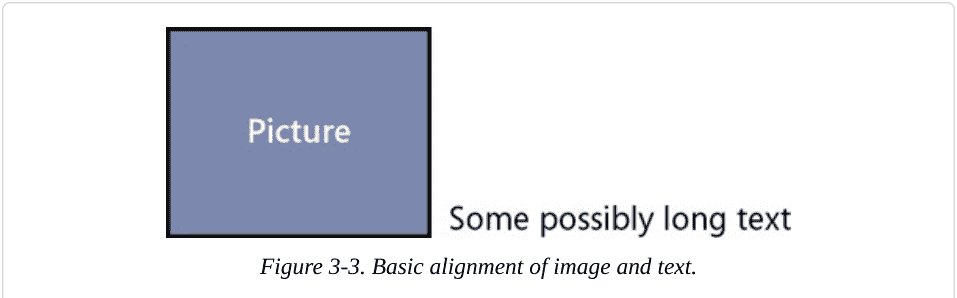

通过 CSS，你可以将文本的垂直对齐方式更改为中间或顶部。然而，这些技巧都无法实现你可能想要的效果——如图 3-4 所示的文本浮于图像周围。

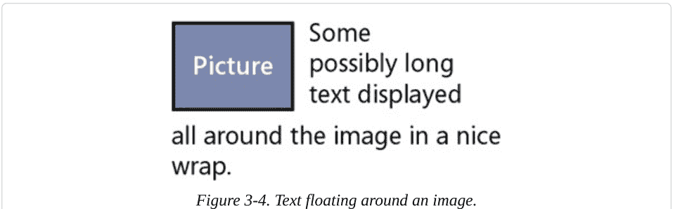

为了实现这种效果，你需要处理 `float` 属性。`float` 属性的作用是让元素在另一个浮动元素旁边以连续流的形式显示，当容器结束时，会自动换到下一行。`float` 属性使用 `left` 或 `right` 等值来表示流动的方向。将以下 CSS 应用于前面的 HTML 代码段可以产生图 3-4 的所示输出。

```css
#article {
  float: left;
  width: 100px;
}
```

使用 `float` 时，后续元素会向上移动以填充任何可用空间——类似于在文本编辑器中删除回车时发生的情况。`float` 属性打破了 `block`（块级）和 `inline`（行内）的通常含义。但在某些时刻，你需要恢复自然顺序并停止浮动。浮动停止的元素样式如下所示：

```css
#stopFloating {
  clear: both;
}
```

浮动停止元素可以是页面上的一个真实元素（例如一段文本），也可以是仅用于停止浮动的空 DIV 元素。

> **注意**
>
> 如果你对 `inline` 和 `floating` 之间的区别仍然有些困惑，可以考虑 `inline` 是关于让单个元素在同一逻辑行上并排布局。而 `floating` 是关于在起始点和结束点之间包裹元素。

## Inline-block 元素

浮动元素效果良好，但当它们跨越多行且每个元素的大小不同 时，也会有一些缺点。当你遇到这个问题时，`display` 属性的第三种可能值就出现了：`inline-block` 值。

`inline-block` 元素是一个与其他块级元素内联渲染的块级元素。在内部，每个块级元素将按照通常方式渲染，并带有所有的块、行内和浮动设置。考虑以下 HTML 代码段：

```html
<ul id="container">
  <li>li Block #1</li>
  <li>li Block #2</li>
  <li>li Block #3</li>
</ul>
```

现在按照如下方式设置元素样式。结果如图 3-5 所示。

```css
li {
  display: inline-block;
  width: 100px;
  min-height: 100px;
  background-color: green;
  color: white;
  vertical-align: top;
}
```

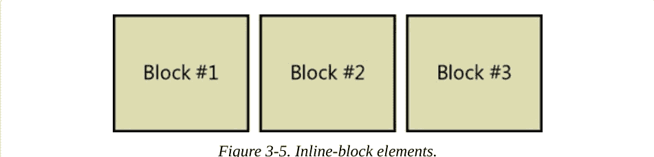

应该注意的是，如果 `inline-block` 元素垂直对齐到顶部，那么在多行不同高度的情况下，效果也很好。事实上，在不浮动的情况下，浏览器始终使用单一的逻辑水平线进行渲染。

`inline-block` 元素的缺点是它们会考虑 HTML 源码中的任何字面量。这意味着你在源码中留出的空白（在固定宽度的情况下）可能会导致非预期的换行到下一行。为了安全起见，你应该考虑将 HTML 写在单行内，不留额外的空格或回车符。这可能仅对使用样式化为 `inline-block` 元素的页面部分需要。

> **注意**
>
> 如图 3-5 的内容所示，`inline-block` 元素对于使用 HTML 和 CSS 布局 Windows 8 用户界面的样式非常有帮助。

## 间距与盒模型

CSS 在每个 HTML 元素周围构建了一个相对丰富且清晰的体系。这种体系被称为盒模型（boxing model），如图 3-6 所示。

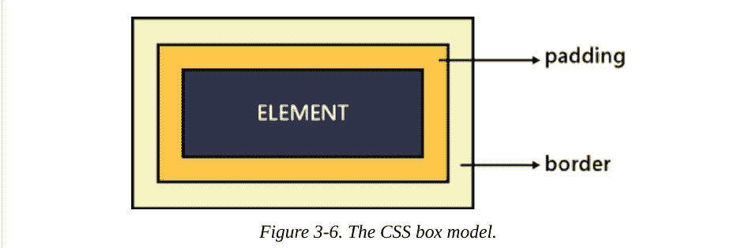

盒模型定义了浏览器期望在每个 HTML 元素周围找到什么。第一个周围框是内边距框（padding box），它由 `padding` 属性控制。接下来是用于框定元素的边框框（border box）；边框设置通过 `border` 属性控制。

此外，每个元素都可以放置在另一个更大的框中，称为外边距框（margin box）。外边距由 `margin` 属性控制，并决定了框元素与其邻居元素之间的距离。

## 定义 padding

`padding` 属性定义了元素周围应该添加多少像素。额外的像素将继承元素的相同背景设置。你通常使用 `padding` 在元素的实际内容（即文本）周围添加一些间距，如图 3-7 所示。

| ELEMENT | ELEMENT |
| --- | --- |
| `padding: 0px;` | `padding: 10px;` |

图 3-7. HTML 元素内边距的效果。

如果你设置了 `padding` 属性，那么元素四周的 padding 都是相等的。然而，你可以为元素的每个侧设置 padding。你通过 `padding-top`、`padding-left`、`padding-bottom` 和 `padding-right` 等属性来实现这一点。

## 定义 borders

你可以通过 `border` 属性控制 HTML 元素的边框。如果你设置了此属性，元素的每个侧将以相同的方式进行样式化。要单独配置每个侧，你需要使用特定的子属性，如 `border-top`、`border-left`、`border-bottom` 和 `border-right`。

在对边框设置样式时，你可以指定宽度、颜色、半径和样式。这些每个方面都有自己的属性，如 `border-width`、`border-color`、`border-radius` 和 `border-style`。你用像素表示宽度和半径（用于圆角），而使用 CSS 字符串表示颜色。这是一个示例：

```css
.rounded-button {
  color: #ffffff; /* white * */
  background: linear-gradient(to bottom, blue, white 80%, red);
  border-radius: 5px;
  border-width: 1px;
  border-color: #ffffff; /* white * */
}
```

元素边框可以是实线、虚线或划线。`solid`、`dotted` 和 `dashed` 是 `border-style` 子属性的可行值。

## 定义 margins

在 HTML 中，`margin` 是给定元素与其邻居元素之间的距离。与 `padding` 不同，`margin` 指出的空间不会作为元素的一部分进行渲染。该区域会显示属于父元素的任何底层内容。

你用像素表示 `margin`，可以通过常用的子属性独立地设置：`margin-top`、`margin-left`、`margin-bottom` 和 `margin-right`。例如，如果你将 `margin-bottom` 设置为 `10px`，那么你就扩展了元素 10 像素的高度。不过，这额外的 10 像素高度是用透明背景渲染的。

## 定义 width and height

默认情况下，HTML 元素占据渲染其内容所需的最小空间。在某些情况下，你可能希望分配固定大小，无论是绝对的还是相对的。你对此需要的属性是 `width` 和 `height`。你通常使用像素或百分比设置宽度和高度。

```css
body {
  width: 100%;
}
```

这是一个更有趣的 CSS 设置示例，可以产生图 3-8 所示的布局。首先从 HTML 开始：

```html
<body>
  <header>
    页面头部
  </header>
  <div id="main">
    main
  </div>
</body>
```

这里是相关的 CSS 内容：

```css
body {
  margin: 0px;
}

header {
  width: 100%;
  height: 80px;
}

#main {
  width: 930px;
  height: 100%;
  margin: 0px;
  margin-left: auto;
}
```

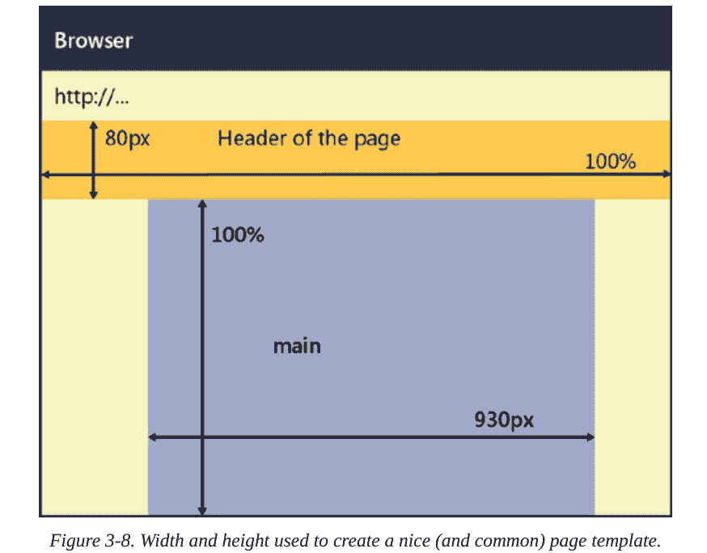

# 高级 CSS 场景

到为止，你只看到了基础的 CSS 选择器——ID、标签名和自定义类。然而，CSS 选择器的语法比这些要丰富复杂得多。许多内置的伪类和运算符可以组合在一起，定义一种强大的查询语言。通过这种方式，你可以选择非常特定的 HTML 元素进行样式化。

## CSS 伪类

你使用伪类为某些选择器添加特殊的查询能力。应用伪类的语法如下所示：

```css
selector:pseudo-class {
...
}
```

让我们回顾一些常用伪类的示例。

## 锚点伪类

简而言之，伪类就像是可以在某些 HTML 元素上使用的智能查询运算符，用于进一步限制样式的应用。某些伪类是通用的，可以应用于几乎所有的选择器；而相反，某些伪类只有在应用于特定元素时才有意义。让我们回顾与 HTML 锚点（anchors）配合良好的伪类。

### 注意

锚点（Anchors）是 HTML 最基础的元素之一。锚点是超链接更具技术性的名称，这也是为什么使用 A 字母来标识该元素的原因。锚点由两部分组成：显示文本和底层的 URL。当浏览器遇到锚点时，通常会在状态栏中渲染出带有下划线的显示文本。当用户点击锚点时，浏览器将导航到指定的 URL。

通常，浏览器会根据状态以不同的方式渲染 A 元素的任何出现——链接是否已访问、处于激活状态或鼠标悬悬停。每个状态都映射到一个不同的伪类。以下是完全样式锚点的方法：

```css
a {
  text-decoration: none; /* 无下划线 */
  color: #aaa66;
  padding: 0px;
}

a:visited {
  text-decoration: none; /* 无下划线 */
  color: #aaa66;
}

a:hover {
  text-decoration: underline;
  background-color: orange;
  color: black;
  padding: 2px;
}

a:active {
  text-decoration: none; /* 无下划线 */
  color: #aaa66;
}
```

`:visited` 伪类定义了锚点在至少被点击一次后的外观和感受。`.hover` 类是指鼠标悬停在锚点上。最后，`.active` 类是指锚点在持有输入焦点时的外观和感受。之前的示例成功地让锚点始终以相同的方式渲染，并在鼠标悬停上方时给它一个不同的颜色方案。

## 输入元素的伪类

有时，你只是想为禁用、已勾选或聚焦的输入字段（即文本框）提供不同的样式。CSS 通过一组即时的伪类可以很方便地实现。你可以使用 `checked` 类来选择所有当前被选中的复选框或单选按钮。同样，你可以使用 `disabled` 和 `enabled` 类来查询相关元素。相反，`focus` 类则指示哪个元素当前持有输入焦点。

下面的示例会自动切换 INPUT 文本字段的背景颜色，以反映聚焦状态：

```css
input[type=text]:focus {
  background-color: orange;
  color: black;
}
```

之前的代码片段包含一个你以前从未见过的有趣结构：方括号中的表达式。那是属性伪类。

## 属性伪类

属性伪类应用到现有的 CSS 选择器，并将输出限制为仅包含给定属性及其给定值的元素。让我们仔细观察之前的 CSS 代码段。

```css
input[type=text]:focus {
  background-color: orange;
  color: black;
}
```

`[type=text]` 选择器适用于 INPUT 元素，并将 INPUT 元素列表限制为仅存在 `type` 属性且其值为 `text` 的元素。表 3-1 列出了最常用的属性选择器。

### 表 3-1. 常用的属性选择器

| 选择器 | 说明 |
| --- | --- |
| `[attribute]` | 包含指定名称属性的元素。 |
| `[attribute = value]` | 包含指定名称和值的属性的元素。 |
| `[attribute *= value]` | 包含其值包含指定值的属性元素。 |
| `[attribute != value]` | 包含其值与指定值不同的属性的元素。 |
| `[attribute ^= value]` | 包含以指定值开头的属性元素。 |
| `[attribute $= value]` | 包含以指定值结尾的属性元素。 |

## 获取子元素的伪类

有时，你只是想选取给定选择器的某些子元素。`:first-child` 伪类返回第一个子元素，而 `:last-child` 返回最后一个。此外，你可以使用 `:nth-child(n)` 类选取给定元素的第 n 个子元素，其中 n 指明要选择的子元素的索引。

## 复合选择器

正如你可能猜的那样，在 CSS 中，选择器可以组合在一起形成任何合理复杂性的查询。你可以使用空格、逗号或其他即时符号连接选择器以定义查询。表 3-2 阐述了常见的场景。

### 表 3-2. 常用的复合选择器

| 选择器 | 示例 | 说明 |
| --- | --- | --- |
| `element element` | `div a` | 选择包含在 DIV 元素中所有的 A 元素。 |
| `element, element` | `div,p` | 选择所有的 DIV 元素和所有的 P 元素。 |
| `element > element` | `div > a` | 选择 DIV 元素的直接子元素 A 元素。 |
| `element + element` | `div + a` | 选择紧随 DIV 元素之后的所有 A 元素。 |

此外，考虑以下示例：

```css
div.headline a {
  ...
}
```

`div.headline` 表达式表示所有带有 `headline` CSS 类的 DIV 元素。随后的 `a` 则将查询限制为位于任何带有 `headline` 类的 DIV 元素子树中的 A 元素。

> **注意**
>
> 当涉及类和伪类时，名称是不区分大小写的。

## 媒体查询

当你通过 LINK 元素向 HTML 文档附加 CSS 文件时，你还可以选择样式应用的介质。你通过 `media` 属性指示介质。如果指定了 `media` 属性，则浏览器将理解在任何可能的情况下都使用同一个 CSS 文件。

最初，`media` 属性的作用限于为查看和打印特定的 HTML 页面使用不同的 CSS 文件。最初，可行的属性值有 `screen`、`print` 和 `all`。

更现代的浏览器支持 `media` 属性中的查询语言，允许根据运行时状态选择 CSS 文件。

## 动态选择 CSS 文件

这是一个关于如何使用媒体查询为 HTML 页面链接 CSS 文件的示例。其理念是根据当前状态提供多种选择并由浏览器动态挑选。

```html
<link type="text/css" rel="stylesheet" href="tiny.css" media="only screen and (max-width:320px)">
<link type="text/css" rel="stylesheet" href="large.css" media="only screen and (min-width:321px)">
```

有趣的是，现代浏览器能够根据动态变化调整 CSS 文件的选择。这意味着当宽度为 320 像素时会自动应用 `tiny.css`，当窗口调整到至少 321 像素时切换到 `large.css`。

媒体查询机制有两个作用。一方面，它让你能够制作适应屏幕的页面；另一方面，它是一个简单且有效的工具，几乎没有任何成本。在最简单的情况下，事实上移动设备只是屏幕较小的浏览器。

## 媒体查询的语法

如之前所述，浏览器的运行时条件可以影响 CSS 文件的选择。让我们简要回顾一下为了决定 CSS 文件你可以访问哪些运行时信息。首先，媒体查询表达式最初作为一种让旧浏览器忽略该陈述的方式。表 3-3 列出了主要的媒体查询属性。

| 属性 | 说明 |
| --- | --- |
| `width` | 返回当前浏览器视图的宽度。支持 `min`/`max` 前缀。 |
| `height` | 返回当前浏览器视图的高度。支持 `min`/`max` 前缀。 |
| `orientation` | 当高度属性的值大于或等于宽度属性的值时返回“portrait”；否则返回“landscape”。 |

例如，`orientation` 属性允许你判断（比仅用宽度更具体）页面是否是以竖屏还是横屏模式查看的。

此外，你可以使用 `AND` 和 `NOT` 操作符来构建你认为任何复杂的表达式。

## 总结

CSS 是用于为 HTML 页面添加图形样式的语言。它基于一组命令，选择一个或多个 HTML 元素并更改它们的默认外观。通过选择器识别目标元素，并通过一组属性/值赋值进行样式。

在本章中，你学习了如何定义选择器，并探索了为了让页面获得极佳效果可能需要设置的最重要属性。

作为一个主要对 Windows 8 应用程序（而非通用 Web 开发）感兴趣的开发者，你（可能）在大多数工作中将使用现成的 Windows 8 风格样式表和约定。无论如何，本章的内容应该已经让你具备理解后续可能遇到的任何 CSS 特性的基础。

为了完成书中关于 Web 开发的介绍部分，现在让我们来看一下 JavaScript 编程语言的基础。

# 第 4 章：理解 JavaScript

掌握了主题，词汇就会随之而来。

> —— 老卡托（Cato）


JavaScript 可能是拥有九条（甚至更多）条生命的语言。JavaScript 于 1996 年作为 Netscape 浏览器的一部分正式亮相，并顺利地度过了互联网时代的前 15 年。它最初被设计为一种针对希望让 HTML 页面更具响应性和吸引力的 Web 作者的简单语言。JavaScript 从未被设计成一种功能全面的编程语言，而是一种易于使用的工具。

而最后它的效果非常好。

JavaScript 的入门门槛非常低，而且足够灵活，能够让专家用它完成几乎任何事情。今天，掌握 JavaScript 是几乎所有开发人员的一项关键技能；它很容易上手，但遗憾的是，要精通也并非易事。

随着 Windows 8 的发布，微软使 HTML5 和 JavaScript 成为构建应用程序的第一平台。开发者使用 HTML5 构建布局，使用 CSS 进行样式化。开发者还使用 JavaScript 来操作页面元素。同时，开发者可以使用许多系统提供的库，这些库提供了用户界面小部件和组件，允许开发者访问 Windows 8 的特定功能。

预计使用 JavaScript 编写 Windows 8 应用程序的开发者主要对将新下载的数据绑定到用户界面元素上感兴趣。然而，这并不意味着你不能使用 JavaScript 实现一些业务逻辑。通常情况下，请记住：在 JavaScript 中必须表达的业务逻辑越多，JavaScript 作为你编程语言选择可能就越不合适。

本章旨在回顾 JavaScript 语言的基础，并讨论了在 Windows 8 应用程序内部组织 JavaScript 代码的几种基本模式。

## 语言基础

JavaScript 语言依赖于坚实的标准，由 ECMA-262 和 ISO/IEC 16262:2011 论文定义。与 C# 等其他流行编程语言不同，JavaScript 代码在执行之前不会被编译。相反，JavaScript 代码被解释并即时执行。由于这个原因，JavaScript 需要一个运行时环境（翻译并执行你编写代码的引擎）才能运行。在 Windows 8 平台上，JavaScript 由一个名为 `Chakra` 的运行时环境支持，就像其命名的佛教力量一样，将关键能量推向整个 HTML 页面的主体。

> 注意

绝大多数编程语言（如 C#、Visual Basic、C++ 和 Java）允许开发者通过使用高级语言来表达想要的行为。然而，这种方式表达的代码必须首先“编译”成更低级的语言，这种语言更接近机器的实际行为。另一种方式是，开发者常用的编程语言是对机器行为的抽象。一种经典的编译语言需要一个特殊的工具——编译器——来将高级语法转换为低级语法。在成功编译之前，你无法运行你的程序。其他语言——例如 JavaScript——是不经过编译的。这并不意味着它们不需要任何适配即可运行；非编译（解释型）语言仅仅是在执行给定某行之前，在执行过程中完成其“编译步骤”。

现在让我们浏览该语言的基础，挖掘类型系统的各个部分、变量和函数的使用，以及良好的编程习惯。

## JavaScript 类型系统

JavaScript 类型系统由几个原始类型和几个内置对象组成。然而，当你编写 JavaScript 代码时，你可以处理的类型范围实际上要大得多。除了内置对象，你还可以依赖宿主提供的对象，以及从外部链接框架导入的对象。特别是对于 Windows 8 应用程序，你需要导入 Windows 8 JavaScript (WinJS) 库——这是通往原生 Windows 8 应用程序编程接口 (API) 的门户。

然而，本章重点关注上述 JavaScript ECMA-262 标准定义的原生类型系统。

## 原始类型和内置对象

在 JavaScript 中，原始类型是 `number`（数字）、`string`（字符串）、`Boolean`（布尔）、`undefined`、`Object`（对象）和 `Function`（函数）。内置对象是 `Array`、`Math`、`Date` 和 `RegExp`，以及几个某些原始类型的功能更丰富的包装器。这些包装对象命名为 `String`、`Boolean` 和 `Number`，它们只是为相应的原始类型增加了更多功能。

`number` 类型表示带有零或多个小数位的浮点数。对于整数、长整数、单精度、双精度或字节等概念，没有单独的类型。特殊的数字 `NaN` 被留给数学上没有意义的数字——它是一个包含无意义数学运算结果的变量。事实上，`NaN` 是 Not-A-Number（不是数字）的缩写。内置的 `Number` 对象只是包装了一个原始数值，并添加了一个将数字转换为字符串的方法。

`string` 类型表示零或多个字符的序列。字符串的内容被括在匹配的单引号或双引号中。内置的 `String` 对象添加了一些方法，包括 `substring`（用于提取两个指定索引之间的字符串段）和 `toLowerCase`（将字符串转换为小写）。

表 4-1 汇总了内置对象。

### 表 4-1. 内置对象

| 内置对象 | 描述 |
| :--- | :--- |
| `Array` | 提供了一种用于集合的丰富编程接口。你可以通过索引访问并添加或删除元素。 |
| `Date` | 提供处理时间的各种方法，包括获取和设置日、月、年。 |
| `Math` | 提供数学任务。 |
| `RegExp` | 提供正则表达式。 |

## JavaScript 全局对象

所有 JavaScript 对象都继承自一个唯一的全局对象，随后属性和函数增强了原生对象。特别是，全局对象具有以下属性：

- `NaN`，返回 Not-A-Number 的值。
- `Infinity`，返回无穷的值。

表 4-2 列出了全局对象上的函数。

### 表 4-2. 内置函数

| 函数 | 描述 |
| :--- | :--- |
| `eval` | 获取字符串形式的代码并即时执行。 |
| `escape` / `unescape` | 对普通字符串进行转码和解码。 |
| `encodeUri` / `decodeUri` | 对 URI 字符串进行转码和解码。 |
| `isNaN` | 如果指定值不是 Not-A-Number 则返回 `true`。 |
| `isFinite` | 如果指定值不是无穷大则返回 `true`。 |
| `parseInt` | 解析字符串并尝试从中提取整数。 |
| `parseFloat` | 解析字符串并尝试从中提取浮点数。 |

应该注意到，你在 JavaScript 代码中使用的任何似乎不属于你的任何对象的值或常量都是可用的，因为它们通过全局对象暴露。

## Null 与 undefined

在空值方面，JavaScript 引入了许多 C# 和 Java 等高级语言所缺失的微妙区别。正如我们稍后详细看到的，JavaScript 变量没有绑定到固定类型。随后，在明确赋值之前，变量没有绑定到任何类型。在这个阶段，变量的类型被认为是 `undefined`。

在 JavaScript 中，`undefined` 被视为一种特殊类型而非值。如果你使用 `typeof` 运算符检查未赋值变量的类型，你会得到字符串 `undefined`。如果你尝试评估未赋值变量的内容，你会得到 `null`。请注意以下代码：

```
var x;               // 因此变量的类型为 "undefined"
var y = null;
```

如果比较 `x` 和 `y` 会发生什么？

JavaScript 有两个等价运算符：双等号运算符 (`==`) 和三等等号运算符 (`===`)。如果你使用 `==` 运算符，两个表达式都会被求值，并比较它们得到的值。然而，如果你使用 `===` 运算符，值的类型也会被进行比较。参考之前的代码段，如果你使用 `==` 运算符比较 `x` 和 `y`，你会得到 `true`，这意味着 `x` 的 `undefined` 值最终被求值为 `null`，这与赋值给 `y` 的值相匹配。

相反，如果你使用 `===` 运算符比较 `x` 和 `y`，你将得到 `false`：这两个值具有相同的内容，但类型不同。

## 处理变量

在 JavaScript 中，变量是一个简单的存储位置，并且并不限制始终存储固定类型的值。在被赋值值时，变量会采取所存储数据的类型。由于这个原因，JavaScript 变量在它的生命周期内可能会更改几次类型，如下代码段所示：

```
var data = "dino";   // 现在 data 的类型为 string
data = 123;            // 现在 data 的类型为 number
```

JavaScript 变量在第一次被使用时产生；在此之前，它们持有 `null` 值且其类型为 `undefined`。

## 局部变量

在定义变量时，你应该始终使用 `var` 关键字作为对解析器以及你自己的提示。`var` 关键字不是严格要求的，但强烈建议将变量的作用域控制在严格范围内。

在函数体内部定义的变量只有在它们使用 `var` 关键字声明时，作用域才限于该函数——因此它们是局部变量。如果你省略了 `var`，变量将被视为全局变量，但在函数执行一次之前，它们保持为 `undefined`。

你还应该注意，JavaScript 缺乏你在许多其他编程语言中看到的块级作用域（block-level scope）。考虑以下代码：

```
function foo(number) {
  var x = 0; // 变量 x 是函数局部的，外部不可见

  if (number > 0) {
    var y = number; // 变量 y 不是 IF 块局部的
    ...
  }
}
```

变量 `y` 不是 `if` 块局部的，它的内容也可以从块的外部访问。然而，因为它是用 `var` 定义的，该变量是函数局部的。需要注意的是，如果你在 `if` 块中漏掉了 `var` 关键字，你可能认为是临时变量的内容将被提升为高得多的全局变量！

刚才为 `if` 语句展示的相同概念也适用于 `for` 和 `while` 循环。

## 全局变量

在全局作用域中定义的变量——即在任何函数体之外——无论是否使用 `var`，始终都是全局的。考虑以下代码段来体验由 `var` 关键字表示的局部与全局之间的微妙区别：

```
var rootServer = "http://www.expoware.org"; // 全局变量
section = "mobile"; // 全局变量

function doSomething() {
  var temp = 1; // 局部变量
  mode = 0; // 全局变量，但在调用之前是 undefined
}
```

JavaScript 运行时环境将全局变量存储为通过 `this` 关键字引用的隐藏对象的属性。注意，浏览器通常通过 `window` 对象镜像全局对象。

## 保护全局命名空间

在几乎任何编程语言中，如果你可以使用全局变量，编码将变得（更）容易。然而，全局变量也有缺点。一个关键的缺点是你的代码不同部分、第三方库、广告合作伙伴和分析库中定义的变量之间存在名称冲突的风险。名称冲突结合 JavaScript 变量的动态类型可能会在无意中修改应用程序的状态——在运行时可能会产生不悦的异常。

考虑一下无意中创建变量是多么容易：漏掉一个 `var` 你就会得到一个全局变量；在赋值中写错变量名你就会得到一个新的全局变量。后者之所以可能，是因为 JavaScript 允许你在不先声明变量的情况下使用它。

有一种解决办法。当你需要使用全局变量时，一种很好的技术是将它们创建为包装对象的属性。你可以在 JavaScript 文件中放置类似下面的代码，然后你从每个页面中链接该文件：

```
var Globals = (function() { return this; })();
```

接下来，你务必通过 `Globals.XXX` 表达式引用你使用的任何全局对象，其中 `XXX` 是你想使用的全局变量的名称。通过这样，你所有的全局变量都将在代码中脱颖而出。

> 注意

> `JSLint` (http://www.jshint.com)——一个用于 JavaScript 代码静态分析的在线工具——确实有助于发现你代码中的反模式，包括缺少 `var` 关键字。

## 变量与提升

提升（Hoisting）是 JavaScript 的一个特性，允许开发者在作用域的任何地方声明变量并在任何地方使用它们。在 JavaScript 中，你被允许先使用变量，稍后再声明它（例如 `var`）。整体行为就好像 `var` 语句被放置在顶部一样。

这里有一个例子：

```
function() {
  mode = 1;
  ...
  var mode;
}
```

从历史角度来看，引入这一特性是为了让非专家开发人员的准入门槛尽可能低。然而，当你使用 JavaScript 编写大量代码时，提升是一个明显的混淆来源，并且容易出错。将你所有的变量都放在每个函数的顶部是一个好习惯，如果你能将它们放在如下所示的单个 `var` 语句中，效果就更棒了：

```javascript
function() {
  var start = 0,
  total = 10,
  index;
}
```

注意，相反，拥有多个 `var` 语句既不是坏事，也不是错的。

## 处理对象

在 JavaScript 中，对象是键值对的字典。对象的结构是隐式的，你可以访问它。

## JavaScript 对象的结构

在 JavaScript 中，对象通常只有数据，但你可以添加行为。结构在运行时可能会改变。这里是你可以添加新属性的方法：

```javascript
var theNumber = {};
theNumber.type = "Number";
```

向对象添加成员仅对该实例有效。如果你创建另一个 `Number` 实例，该属性将不可用。你可以通过原型来解决这个问题。

## 通用的原型方法

如果你想为所有创建的实例添加一个新成员，你必须将成员添加到对象的原型上。这里是为所有数字添加 `type` 属性以便获得更多控制：

```
if (typeof Number.prototype.type === 'undefined') {
  Number.prototype.type = "Number";
}
```

> 重要

> 你检查的示例，特别是自定义 `type` 属性的使用，并非偶然。在 JavaScript 中，你可以对变量名使用 `typeof` 运算符来发现存储在变量中的对象的类型。然而，大多数情况下你得到的响应是 `"Object"`。没有简单的方法可以区分，例如字符串和数字。由于这个原因，使用自定义 `type` 属性更有意义。

## 创建新的对象实例

你可以使用 `Object` 类型来创建值和方法的聚合，这是 JavaScript 中最接近标准面向对象的方法（如 C#）。这里是创建新对象的可能方法：

```
var dog = new Object();
dog.name = "Jerry Lee Esposito";
```

通常，直接使用 `Object` 的构造函数是不推荐的。更好的方法是使用对象字面量，如下所示：

```
var dog = {
  name: "Jerry Lee Esposito",
};
```

## 处理函数

在 JavaScript 中，函数是封装成块的一段代码，并可选地赋予名称。如果函数没有命名，则它被称为匿名函数。函数表示一个作用域并被视为对象；它们可能拥有属性，并可以作为参数传递以及与之进行交互。

你使用函数主要有两个原因：为了定义可重复的行为，以及创建自定义对象。

## 用于可重复行为的命名函数

具名的函数（与匿名函数相对）定义如下：

```
function doSomeCalculation(number) {
  ...
  return number;
}
```

以这种方式定义的函数是在全局范围内可见的，并被解释为添加到 JavaScript 全局对象的一个新成员。你可以从代码的任何地方调用该函数，如下所示：

```
var result = doSomeCalculation(3);
```

JavaScript 函数可以使用任意数量的参数进行调用——无论声明的参数数量是多少。换句话说，你可能有一个像 `doSomeCalculation` 这样的函数，它只声明了一个参数（`number`），但你可以通过传递任何（更多）数量的参数来调用它。

```
var result = doSomeCalculation(1, 2);
```

虽然浏览器可能容忍这种编码方式，但这仍然是糟糕的编程习惯。然而，你可以利用这种灵活性来轻松地定义故意接受可变参数的函数。

在 JavaScript 中，函数可以通过预定义的名为 `arguments` 的数组，通过名称或位置来访问声明的参数。该数组返回传递给函数的实际参数列表。例如，下面的函数可以接受任意数量的参数并处理它们。

```
function doSum() {
  var result = 0;
  for(var i=0; i<arguments.length; i++) {
    result += arguments[i];
  }
  return result;
}
```

下面所示的两种调用对于 `doSum` 函数都是可以的。

```
var r1 = doSum(1, 2, 3);
var r2 = doSum(4, 5);
```

一个接受可变参数的函数可能在没有显式形式参数的情况下定义得更清晰。然而，你也可以声明一些参数并仍然接受和处理任意数量的参数。无论如何，`arguments` 数组都会返回调用中找到的有效参数列表——按照它们列出的顺序。

## 立即执行函数和对象

在 JavaScript 中，立即执行函数表示在同一位置定义并执行的代码。你通常将函数的定义放在某处（例如，在一个独立的文件中），而调用放在另一个地方。当你期望会从多个地方多次使用该函数时，这种方法非常有用。立即执行函数是定义任何只需要执行一次的工作的极佳技巧。

立即执行函数的定义被包裹在括号中，并将参数列表放在末尾，如下所示：

```
var result = (function() {
...
}());
```

使用立即执行函数的表达式表示返回的是一个值而不是函数本身。如果函数需要参数，可以将之前的代码重写为如下：

```
var result = (function(x, y, z) {
  ..
}(1, 2, 3)); // 1,2,3 是 x,y,z 的实际值
```


同样，你可以拥有立即执行对象。立即执行对象是在其一个方法被调用和执行的同一个地方定义的函数。立即执行对象的字面量定义被包裹在括号中，如下所示：

```
{
  init: function() {
    // 执行初始化任务
  }
}.init(...);
```

立即执行对象和函数都创建了一个作用域沙盒，防止它们的局部变量污染全局命名空间。

那么，你应该使用立即执行函数还是立即执行对象呢？这主要取决于你，但归根结底取决于代码的复杂程度（或你预期它将变成什么样）。对于非常复杂的任务，立即执行对象可能更好，因为它允许你定义属性并将实现拆分为多个方法。而立即执行函数是更简单的形式，适用于任何表示为纯语句序列的代码。

## 使用行为扩展对象

在早些时候，本章讨论了如何将属性添加到对象的原型上，以便该对象的每个实例都增强了这些新属性。对于函数，也有几乎相同的考虑因素，函数可以用于用行为增强现有的对象定义。例如，再次考虑`Number`对象。下面的代码显示了如何添加一个新的随机成员，它返回一个大于指定最小值的随机数。

```javascript
// 这段代码需要运行——我们将其添加为立即执行函数。
if (typeof Number.prototype.random === 'undefined') {
  Number.prototype.random = function(min) {
var n = min + Math.floor(Math.random() * 1000);
return n;
};
()();
```

在这段代码运行一次后，你就可以自由使用以下函数了：

```javascript
function doWork() {
var n1 = new Number().random(0);
var n2 = new Number().random(10);
alert("Numbers are " + n1 + " and " + n2);
}
```

> 注意：增强原生对象的原型被认为是一种糟糕的做法，因为它使代码的可预测性降低，并可能损害可维护性。然而，这种考虑主要适用于团队开发。如果你是为自己编写代码，这一点就没那么重要。

## 构造函数

如前面提到的，使用函数有两个主要原因：定义可重复的行为和创建自定义对象。在这里，你将处理第二种场景，从查看以下代码开始：

```javascript
var Dog = function(name) {
this.name = name;
this.bark = function() {
return "bau";
};
```

你有一个名为`Dog`的新对象。在早期讨论对象时，你也创建过类似的东西：

```javascript
var dog = {
name: "Jerry Lee Esposito",
};
```

这里的巨大区别在于，后代码片段仅代表数据的快照；而前面的代码片段是一个带有数据和行为的函数。

那么你会如何使用`Dog`对象呢？要使用`Dog`对象，你需要使用经典的`new`构造函数来实例化它，如下所示：

```javascript
var jerry jerry = new Dog("jerry");
```

如果你漏掉了`new`操作符而使用了像这样的会怎样？

```javascript
var jerry = Dog("jerry");
```

棘手之处在于，如果你忘记使用`new`操作符，你不会得到任何异常，你的代码将直接运行。然而，你在`Dog`上执行的任何操作（例如设置`name`属性）都将在该对象上执行。如果没有前面的`new`操作符，它将被解析为全局 JavaScript 对象。这意味着你正在污染 JavaScript 解释器的全局命名空间。这里有一个安全的对策，无论你是否使用`new`操作符都不会产生问题：

```javascript
var Dog = function(name) {
  var that = {};
  that.name = name;
  that.bark = function() {
    return "bau";
  }
  return that;
}
```

区别在于，你现在显式地创建并返回了一个新对象——名为`that`的对象。这就是众所周知的“使用那个而不是这个”（Use-That-Not-This）模式。

## 重要

这也是通过使用显式构造函数创建自己的数据和行为聚合（对象）的最合适的方法，而不需要使用`new`操作符。通过这种方式，你可以在 JavaScript 中非常接近面向对象的组件。

## 玩转回调函数

回调函数只是作为参数传递的。接收回调函数的代码可以在适当的时候回调调用代码。例如，假设你有一个持有数字集合的通用函数。在不同时间，你需要遍历集合并执行不同的操作，例如求和和乘法。你真的应该像下面一样定义不同的（但相当重复的）函数吗？

```javascript
function sumAllNumbers() {
  // 步骤 1：收集输入数据
  var numbers = new Array();
  for (var i = 0; i < arguments.length; i++) {
    numbers.push(arguments[i]);
  }

  // 步骤 2：执行操作
  var result = 0;
  for (var i = 0; i < numbers.length; i++) {
    result += numbers[i];
  }

  // 步骤 3：显示结果
  alert("SUM result is: " + result);
}
```

```javascript
function multiplyAllNumbers() {
  // 步骤 1：收集输入数据
  for (var i = 0; i < arguments.length; i++) {
    numbers.push(arguments[i]);
  }

  // 步骤 2：执行操作
  var result = 1;
  for (var i = 0; i < numbers.length; i++) {
    result *= numbers[i];
  }
}
```

```javascript
// STEP 3: DISPLAY RESULTS
alert("MULTIPLICATION result is: " + result);
}
```

这两个函数都包含三个主要步骤。第一步在两个函数中都是相同的；第二步是每个函数特有的；第三步在每个情况下都执行相同的操作，但处理的数据不同。以这种方式定义函数是可行的。如果你只感兴趣的是获取结果，那么到此停止即可。

核心点在于，像这样简单的解决方案在简单的场景下可能运行良好。随着复杂性的增加，你最终可能会产生大量的重复代码——这是糟糕的，因为这迫使你在多个地方进行更改，而且如果你漏掉了其中一处的更改，就可能会引入真正难以发现和修复的错误。回调函数通过让之前的代码不仅更短，而且更易读来提供了帮助。

为了说明这一点，你将首先创建一个单一函数，来协调加法和乘法的各个步骤；你可以将此函数命名为`handleNumbers`。

```javascript
function handleNumbers(operationCallback) {
  // STEP 1: COLLECT INPUT DATA
  var numbers = new Array();
  for (var i = 1; i < arguments.length; i++) // 从1开始以跳过
    numbers.push(arguments[i]);

  // STEP 2: PERFORM OPERATION
  var result = operationCallback(numbers);

  // STEP 3: DISPLAY RESULTS
  alert(result);
}
```

现在定义两个高度特定的函数：一个用于求和所有接收到的参数，另一个用于相乘所有参数。

```javascript
function doSum(numbers) {
  var result = 0;
  for (var i = 0; i < numbers.length; i++) {
    result += numbers[i];
  }
  return result;
}

function doMultiply(numbers) {
  var result = 1;
  for (var i = 0; i < numbers.length; i++) {
    result *= numbers[i];
  }
  return result;
}
```

此时，调用变为：

- `handleNumbers(doSum, 1, 2, 3, 4);`
- `handleNumbers(doMultiply, 1, 2, 3, 4);`

在建立这种结构后，在数字数组上添加另一个操作只需创建一个执行所需操作的函数即可。你不需要担心收集数字或显示结果。

## 基于合约的回调函数

如果你严格比较两个版本代码的实际效果，你应该注意到一个区别。在使用了重复代码的前一个版本中，你可以输出一条显示“SUM result is XXX.”的消息。在更通用的基于回调的解决方案中，你所能向用户展示的只有裸的数字结果。

这听起来像是一个微不足道的问题，但实际上并非如此。

问题在于输出消息需要包含某些信息——操作名称——而这些信息只能由注入的函数提供。你如何强迫像`doSum`这样的函数返回两个值——操作的实际结果加上操作名称呢？

你需要为回调定义一个合约，并实际上将回调从简单函数的级别提升到对象的更高阶级别。

首先，你定义了期望回调拥有的合约（或接口）。合约定义了调用者需要的所有信息。在这种情况下，调用者可能期望找到一个计算数字的方法（命名为`execute`）以及一个指示操作名称的字符串（命名为`name`）。以下是你如何重写`handleNumbers`函数的：

```javascript
function handleNumbers(operation) {
  // STEP 1: COLLECT INPUT DATA
  var numbers = new Array();
  for (var i = 1; i < arguments.length; i++)
    numbers.push(arguments[i]);

  // STEP 2: PERFORM OPERATION
  var result = operation.execute(numbers);

  // STEP 3: DISPLAY RESULTS
  alert(operation.name + " result is " + result);
}
```

你现在定义了两个不同的对象——`Sum`和`Multiplication`。

```javascript
var Sum = function () {
  var that = {};
  that.name = "SUM";
  that.execute = function (numbers) {
    var result = 0;
    for (var i = 0; i < numbers.length; i++)
      result += numbers[i];
    return result;
  };
  return that;
}
```

```javascript
var Multiplication = function () {
  var that = {};
  that.name = "MULTIPLICATION";
  that.execute = function (numbers) {
    var result = 1;
    for (var i = 0; i < numbers.length; i++)
      result *= numbers[i];
    return result;
  };
  return that;
}
```

最后，调用操作的代码看起来如下：

```javascript
handleNumbers(new Sum(), 1, 2, 3, 4);
handleNumbers(new Multiplication(), 1, 2, 3, 4);
```

使用对象代替函数赋予了你更多的编程能力，因为在你可以支持的合约方面，你没有受到任何限制。

## 匿名函数

到为止，本章主要集中在命名函数上。那么未命名函数（匿名函数）呢？在 JavaScript 中，匿名函数是函数式编程的支柱。匿名函数是 lambda 演算的直接产物，或者如果你愿意的话，它是旧式函数指针的语言实现。这是一个匿名函数的简单示例：

```javascript
function(x, y) {
  return x + y;
}
```

普通函数与匿名函数的唯一区别在于名称（或缺失）。为什么匿名函数如此流行？主要原因是它们允许你在现场定义代码——而不需要在别处定义。匿名函数的缺点是它们不可重用。只要你需要传递一段代码作为参数，那么使用匿名函数是完全可以接受的。然而，如果该函数可能会多次使用，则命名函数更好。为了说明，这里是使用匿名函数重写的代码：

```javascript
// 执行求和
handleNumbers(function(numbers) {
  var result = 0;
  for (var i = 0; i < numbers.length; i++) {
    result += numbers[i];
  }
  return result;
}, 1, 2, 3, 4);
```

可读性并不理想；但对于基础代码，这种方法仍然有效。

## 组织你的代码

到为止，你主要关注 JavaScript 的语法方面，并探索了 JavaScript 的面向对象能力。现在是展示如何在 HTML 页面中使用 JavaScript 的时候，特别是在 Windows 应用程序的文中。

你在 HTML 页面中使用的任何 JavaScript 代码都是响应事件调用的。因此，第一个关注点是如何在 HTML 页面中定义事件处理器。接下来，你需要了解一点如何组织代码。

## 将 JavaScript 代码链接到页面

首先，重要的是，事件处理器是响应事件调用的 JavaScript 函数。事件可以由浏览器触发（例如，页面加载），或者响应用户操作。事件处理器必须与事件关联才能产生任何效果。HTML 定义了许多`onXXX`属性（XXX 是事件名称，例如`click`或`load`），你可以在 HTML 中设置这些属性以将事件与 JavaScript 函数名相关联。

```html
<script type="text/javascript">
....
</script>
```

当浏览器遇到这些`<script>`部分之一时，它们会停止页面渲染，执行脚本，然后继续。如果`<script>`元素不包含要立即执行的代码（例如，假设它只包含函数声明），那么浏览器只会记录该函数并继续执行。因此，`<script>`元素是嵌入由事件处理程序调用的定义的合适位置。

在页面中嵌入脚本代码既有优点也有缺点，但弊大于利。表 4-3 进行了总结。

### 表 4-3：在 HTML 页面中嵌入 JavaScript 代码的优缺点

| 优点 | 缺点 |
|---|---|
| 页面没有依赖且是自包含的。作为开发者，你不需要在多个地方查找特定页面的内容。 | 页面更大，下载需要更长时间。 |
|  | 脚本代码无法在包含它的页面之外使用。 |
|  | 由于页面外无法进行代码重用，重构代码以减少重复功能的功能会受到限制。 |
|  | 脚本代码无法与页面单独被浏览器缓存。 |

此外，还有一点需要考虑：对于嵌入代码，脚本的任何更改都是立即可见的。你只需要保存文件并刷新浏览器。但当脚本文件链接为外部资源时（稍后将详细介绍），你就需要一些技巧来确保更改立即可见，而不会被同一文件的缓存副本所隐藏。

这一点确实很重要，但它不会影响发布的应用程序。它是一个重要的方面，但仅限于开发阶段。

## 外部文件

作为在`<script>`元素中嵌入代码的替代方案，可以使用相同的`<script>`元素链接 JavaScript 文件作为外部资源。方法如下：

```javascript
<script src="http://..." type="text/javascript" />
```

使用外部链接的 JavaScript 文件的优点与使用嵌入脚本的缺点完全相反。这是正确的方法；或者，至少在通用的 Web 开发和 Windows 8 开发中，使用外部链接的文件始终是你应该考虑的首选。

## jQuery 与 Windows 8

目前，大多数 JavaScript 开发都是使用极其流行的 jQuery 库完成的。你可以从`http://jquery.com`下载该库。

典型的 Web 开发者使用 jQuery 库来轻松地将处理程序绑定到事件，并检测页面级事件（例如指示页面准备就绪的事件）。此外，开发者使用 jQuery 对页面元素的临时子集进行处理。参考前一章关于 CSS 的内容，你可以说 jQuery 提供了一种模仿 CSS 选择器语法的语法。但实际上，jQuery 选择器语法比 CSS 标准更加丰富。

对于具有深厚 Web 背景的开发者来说，在不使用 jQuery（或其他 JavaScript 库，如`knockout.js`）的情况下编写 HTML 页面的想法可能是毫无意义的。在 Windows 8 中，使用 jQuery（以及除 WinJs 以外的其他库）可能会有问题，这取决于你如何使用 jQuery。

jQuery 有时会出现问题的原因是微软为 Windows 8 应用程序采用的安全模型。根据该模型，禁止使用潜在不安全的数据（即来自不可信源的数据）对页面结构进行动态操作。

如果你熟悉 jQuery，只要它不给你带来麻烦，你就可以使用它。如果你不熟悉 jQuery，那么建议在 Windows 8 应用程序中避免使用。对于大多数高级 jQuery 特性（如插件），你会在 Windows 8 的 WinJs 库中找到原生组件。要查询托管 HTML 页面中的元素，你可以使用 HTML 标准函数——例如`document.querySelector`——这些函数支持类似 CSS 的语法来选择元素。

## 实践与习惯


JavaScript 代码很容易实现，但管理和演进绝对困难，除非你建立并遵循许多实践规范。本节的唯一目的是总结纯 JavaScript 编程的“要做”和“不要做”。“纯” JavaScript 指的是并非专门针对 Windows 8 开发的 JavaScript 技术。在下一章中，你将转向关注 Windows 8 JavaScript 开发的特定方面。

## 分组你的全局变量

在本章中，你学习了让全局数据脱颖出的必要性。你可以通过在使用的每个 JavaScript 文件顶部使用以下代码来实现：

```javascript
var Globals = (function() { return this; }());
```

假设你有一个代表应用程序名称的全局变量；例如，此变量名为 `AppName`。之前的建议的目的是你可以如下所示使用该变量：

```javascript
Globals.AppName = "MyApp";
```

需要注意的是，`AppName` 和 `Globals.AppName` 指向同一个位置，两者都可以在应用程序中使用且具有相同的含义。如果你一致地使用带有 `Globals` 前缀的版本，你的全局变量在代码中就会脱颖而出。

这种方法并非没有问题。特别是，它仍然在全局命名空间中创建了许多条目，因为有与 `Globals` 关联的变量。这里有一个稍微好一点的方法：首先在你定义的每个 JavaScript 文件顶部放置该代码。

```javascript
Globals = Globals || {};
```

接下来，你将全局成员定义为新创建的 `Globals` 对象的成员。区别在于，现在 `Globals` 是一个全新的全局对象，你所有希望在应用程序中作为全局使用的成员实际上都被定义为 `Globals` 的子级，而不会污染 JavaScript 命名空间。换句话说，你应用程序的全局变量被分组在一个 JavaScript 解释器可见的单一全局对象下。

## 保持应用程序状态在手

所有应用程序都需要维护自己的状态，以便在应用程序退出时将状态持久化到磁盘。良好的方法是在应用程序启动时加载状态。数据可以从存储位置加载（如果可用）、从远程位置下载，或者简单初始化为默认值。为了让这种模式顺利运行，你首先需要定义一个表示状态的对象。例如：

```javascript
var MyAppState = function () {
  var that = {};
  that.init = function () {
    // 处理初始化和默认值
  };
  that.load = function () {
    // 处理从存储加载
  };
  that.save = function () {
    // 处理持久化到存储
  };

  // 其他属性

  that.init();
  return that;
}
```

要将此对象的实例附加到 `Globals` 上，你需要编写如下代码：

```javascript
Globals.Current = new MyAppState();
```

从以后，你可以通过如 `Globals.Current.Xxx` 这样的语句来读写应用程序的状态，其中 `Xxx` 是 `MyAppState` 中定义的属性或成员。

## 为本地化准备

为国际市场做好准备可能是成功的关键（如果你是以轻松的心态进行 Windows 8 开发）。通常，本地化对于发布到公共商店的应用程序是一个重要因素。在 Web 应用程序的 JavaScript 代码中，本地化问题没有很好的帮助。坦率地说，在 Windows 8 开发中，你可以从 WinJs 库获得大量支持。归根结底，你需要做的只是用特殊属性标记任何想要本地化的内容。接下来，你只需要为支持的每种语言为应用程序添加本地化资源文件。

Windows 8 将根据根据自动从正确的资源文件中选择内容。

> **注意**
>
> 如果你对 C# 和通用的 Windows 开发非常熟悉，这种整体模式应该并不陌生。它是旧的 Windows 本地化模式适应新的 Windows 8 API 的。

## 总结

本章对 JavaScript 语言进行了概述，并讨论了不偏离 Windows 8 或 Web 倾向的方法（在可能范围内）。你回顾了该语言的基础知识，并概述了一些有效的常用模式。

老实说，本章以及之前关于 HTML 和 CSS 的两个章节只能起到回顾或可能澄清你对这些主题已有知识的作用。HTML、CSS 和 JavaScript 每一个都值得用一本书来详细解释和逐步学习。如果你觉得需要更具体的资源，请寻找以下 Microsoft Press 出籍。

对于初学者：

- `Start Here!™ Learn HTML5` 由 Faithe Wempen (Microsoft Press, 2012)
- `Start Here!™ Learn JavaScript` 由 Steve Suehring (Microsoft Press, 2012)

对于具有一定经验的人来说，或者作为之前书籍的更深入的后续：

- `HTML5 Step by Step` 由 Faithe Wempen (Microsoft Press, 2011)
- `JavaScript Step by Step` 由 Steve Suehring (Microsoft Press, 2013)

需要了解的关键点是，本章主要涵盖原生 JavaScript。而 JavaScript 在很大程度上是用于 HTML 页面的语言。而 HTML 页面本质上是基于 Web 的资源。

从下一章开始，一切都发生了变化。你会发现，使用 JavaScript 编写 Windows 8 与为 Web 编写 JavaScript 本质上是不同的体验。Windows 8 应用程序主要是针对 Windows 8 API 编写的程序。JavaScript 只是你表达逻辑和协调底层 API 用的手段。

在这种背景下，HTML 和 CSS 仅仅是用于你设计和表达用户界面的 UI 语言。相比 HTML5 元素和自定义 CSS，你将更多地关注 Windows 8 属性和样式表。你在早期章节中学到的所有内容将在后续章节中证明是有用的。但 HTML、CSS 和 JavaScript 还有很多尚未提到的需要学习。

# 第 5 章：Windows 8 开发的第一步

> 成功对于那些从未成功过的人来说最为甜蜜。
>
> — 艾米莉·迪金森 (Emily Dickinson)

在第 1 章中，你初步接触了微软 Windows 8 的编程风格。你直接通过 Microsoft Visual Studio 提供的一个基础模板创建了一个简单的应用程序，然后将其转换为一个功能稍强、意义更大的应用程序，能够根据需要显示随机生成的数字。正如谚语所提醒的那样，每段旅程——无论多长——都始于足下。

为了超越获取和显示随机数的基础水平，你需要掌握一些 HTML 和 CSS 知识，并熟悉 JavaScript 语言。前者将帮助你想象并创建任何想要尝试的应用程序的图形部分。后者将帮助你组织代码以防止意外结果，从而让你能够更轻松地将想法转化为操作系统的指令。

现在，你准备好投身 Windows 8 运行时 (`WinRT`) 环境了。运行时环境是 Windows 8 程序和组件的集合，它们与任何应用程序交互并使其能够运行。此类环境为任何应用程序提供服务和数据，但也要求应用程序遵循某些规则和限制。

本章有三个主要目标：

- 探索 Windows 8 运行时环境
- 回顾 Windows 8 应用程序的图形需求
- 理解任何 Windows 8 应用程序生命周期的基本阶段

为了实现这些目标，你将构建另一个使用运行时环境基本服务——数据绑定服务的示例应用程序。数据绑定服务为你的应用程序用户提供了显示数据的简单方法。在接下来的章节中，你将经常使用数据绑定服务。

## Windows 8 运行时 (`WinRT`)

操作系统的新版本引入与同系统旧版本完全不兼容的新类型应用程序是相当罕见的。有时，新的操作系统会提供一些新功能，诱导公司更新现有程序。然而，在 Windows 8 中，有一个完全全新的应用程序类别，称为 Windows Store 应用。这些应用程序不仅只能在 Windows 8 上运行，而且具有全新的外观和体验，可以通过 Windows Store 免费提供或出售，最后，但同样重要的是，它们不仅限于经典的个人电脑，而是可以原封地运行在各种符合 Windows 8 的设备上，最著名的 Microsoft Surface 设备。此外，Windows Store 应用程序只能在运行 Windows 8 的机器上开发。

> **注意**
>
> 为了消灭一些过早的热情：不，你无法在 iPad 上运行你制作的 Windows 8 应用程序。只要设备兼容 Windows 硬件和软件要求，任何 Windows 8 应用程序都可以在设备上运行。

## Windows Store 应用和其他应用程序

Windows 8 有两种工作模式——标准 Windows 模式和新的 Windows 8 模式。配置为标准 Windows 模式时，你的机器看起来和旧的 Windows 7 机器没什么区别。在这种模式下，你可以无缝运行所有现有的 Windows 应用程序，因为向后兼容得到了完全保证。作为用户，你最终不会体验到巨大的差异。

然而，当配备 Windows 8 的机器启动时，它被配置为新的 Windows 8 模式运行。这带来了全新的、惊艳的用户界面，并提供了不同的应用程序集。在这种模式下，你找不到任何旧应用程序；但是，你所有手工制作的新 Windows Store 应用都将列在这里（例如图 5-1）。

> **注意**
>
> 这里有另一种看待 Windows 8 两个灵魂的方式：你可以将经典的 Windows 桌面界面仅视为 Windows 8 模式下的另一个可用应用程序，只不过这个内置应用程序将以 Windows 7 操作系统的视角为你提供你机器的视图。

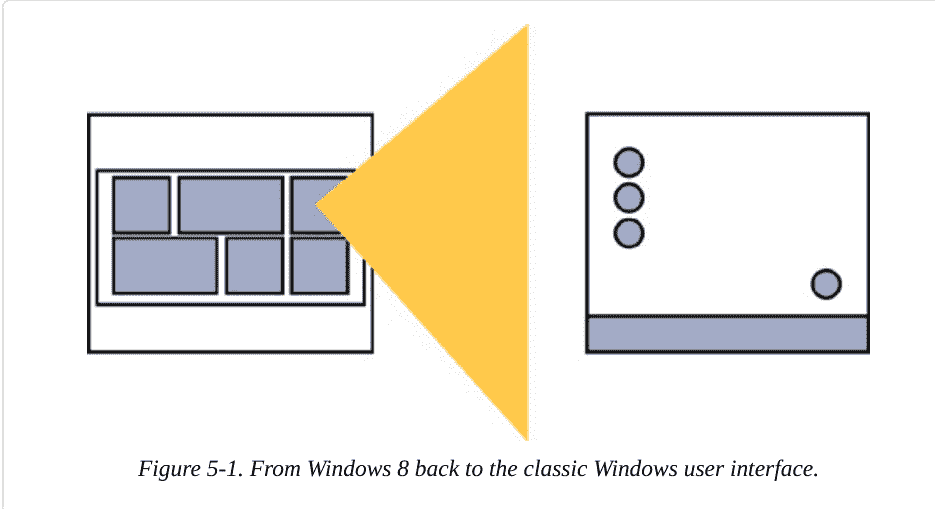

## 老式 Windows 应用程序的命运

以前在 Windows 7 上运行的 Windows 应用程序在 Windows 8 上只能在标准 Windows 模式下运行。为了让它们出现在默认的 Windows 8 用户界面中，必须将其重写为 Windows Store 应用。例如，如果不获取并安装 Store 版的 Microsoft Office，你就无法使用任何 Office 应用程序。浏览器也是如此，两种版本的 Windows 8 都有各自版本的 Microsoft Internet Explorer。

最终，Windows 8 并没有打破与数百万应用程序的兼容性。它只是明确了 Windows 平台的未来正走向另一个方向。

## 支持的编程语言

你可以通过三种主要方式编写 Windows Store 应用。正如你在书中看到的，可以使用 HTML 和 JavaScript。此外，你可以使用 C# 或 Visual Basic 编程语言以及 XAML 标记语言来指定用户界面。最后，你可以使用 C++ 语言配合 XAML 标记语言来表达用户界面。

所有方法都提供相同的编程能力。无论你选择什么语言和标记，都可以构建相同的应用程序。出于许多原因，JavaScript 和 HTML 构成了对大多数开发者（尤其是初学者）来说更简单（但同样有效）的方法。

> **注意**
>
> Windows 8 平台支持的任何编程语言都可以用于构建任何类型的应用程序，这并不是次要点，它源于 Windows 8 平台的整体架构。

## `WinRT` API 概述

通过 Windows 8，微软迈出了一个重要的举措。这一移动最终是 Windows 8 有两个灵魂以及区分 Windows Store 应用与其他所有应用程序的原因。微软 Windows 8 替换了操作系统内核运行并暴露给用户应用程序的底层层。

支撑 Windows Store 应用的新基础设施被称为 Windows 运行时。

## Windows 8 栈

在[图 5-2](link)中，你可以一览 Windows 8 运行时栈。图显示了两个并行栈如何并存，以支持两种不同的应用程序模型——一个以 JavaScript 和 HTML 为中心，另一个以 XAML 和 C# 或 Visual Basic 为中心。注意的是，为了清晰起见，图中省略了我们之前提到的以 C++ 和 XAML 为中心的第三种栈。

| HTML | XAML |
| --- | --- |
| JavaScript | C# / Visual Basic |
| WinJS | .NET Framework 4.5 |
| Windows 8 JavaScript 引擎 | |
| WinRT API | |
| 操作系统内核服务 | |

图 5-2。Windows 8 栈结构。

灰色方框表示该栈中哪些部分是本书关注的重点。你将使用 HTML（可能还有 CSS）来为用户界面设置样式，并使用 JavaScript 让其按照你喜欢运行。你与底层操作系统的交互实际上是通过用 JavaScript 编写的 Windows 8 应用程序来实现的，该程序将包含 WinJS 库，并使用其 API 来访问存储、网络、图形等功能。

你编写的任何代码都会由 Windows 8 JavaScript 引擎编译并运行。当用户与应用程序交互时，会动态地发生对 WinRT 子系统的访问。如图 5-2 所示，WinRT 支持所有的栈：这就是为什么用 JavaScript 和 C# 编写的应用程序所做的事情在功能上几乎没有区别。

## `WinRT` API 的功能

图 5-3 扩展了你在图 5-2 中看到的标有 `WinRT API` 名称的黑盒。此外，图 5-3 列出了 Windows 8 程序员可用的函数类。

要使用特定类别的函数——例如设置网络连接并从远程 URL 下载某些 RSS 数据——你只需要在应用程序中引用相应的 JavaScript 文件并开始使用相关函数即可。

DirectX 块指向底层 API，该性具有 Windows 8 栈上层的高级图形能力。Media 和 presentation 块为图像处理与操纵以及多媒体和视觉元素提供了基础设施。Networking 指通信层——最重要的是 HTTP 连接。最后，storage 关于文件和数据的读写，而 Devices 块指示了控制传感器和本地连接设备（如打印机）的功能集。

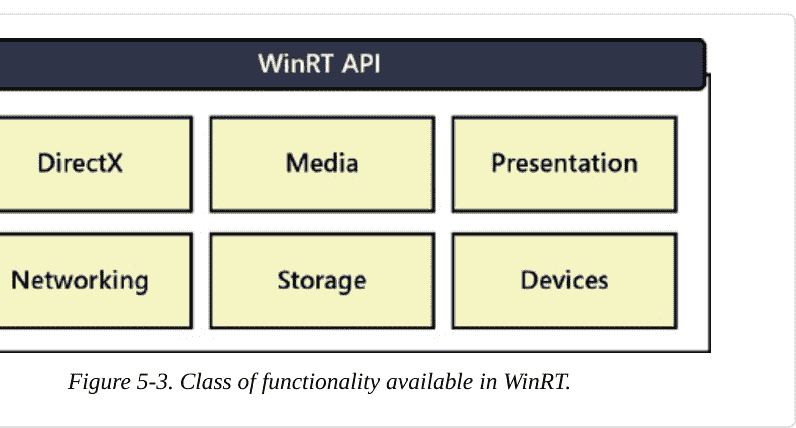

在接下来的章节中，你将将览各类函数，并了解如何在示例应用程序中利用它们。

## `WinRT API` 的特性

使用任何受支持的开发栈（即 HTML + JavaScript）在 `WinRT API` 之上编写的任何代码都有一些共同点。这些共同点源于底层 `WinRT API` 的设计和实现，并强烈刻画了你通过 `WinJS` 进行的函数调用——`WinJS` 是你通往底层 `WinRT API` 的门径。

例如，任何预计执行时间超过几毫秒的函数都被设计为异步的。这对于具有某些 Windows 开发经验的开发者来说，这是一个巨大的变化。异步函数是指在被调用时开始执行，但没有定义终止时间表的函数。

换句话说，异步函数在启动后立即会与任何后续代码并行运行。因此，需要根据异步操作结果执行代码的开发者现在面临着将这些代码放在什么位置的问题。然而，向异步编程的转变通过语言层面可用的一些新机制得到了显著缓解。最终，作为一个初级 Windows 8 开发者，你需要学习的就是如何进行函数调用并获取结果。但对于之前的 .NET 开发者来说，`WinRT API` 的异步特性可能会是一个问题。

`WinRT API` 的另一个值得早期考虑的领域是存储和文件访问。在 Windows Store 应用程序中，出于安全考虑，直接文件访问受到了限制。但这并不意味着你不能在 Windows Store 应用程序中永久存储数据。简单来说，WinRT 提供的存储 API 并没有让开发者获得磁盘的完全控制权——就像经典 Windows 应用程序始终那样。为了打开和保存文档及文件，你还有新的文件选择器（file pickers），取代了 Windows 的标准对话框。

Windows Store 应用程序的开发者发现了一个整体编程框架（例如对于选择 HTML + JavaScript 栈的人来说是 `WinJS` 非常像流行的 `.NET Framework`，但仍然有一些差异）。这些差异清晰地表明微软对重构和重新构 Windows 8 开发者要处理的编程框架的整体承诺。因此，`WinJS` 库中的某些类在功能上与 `.NET Framework` 类相同；有些有细微差异。其他类则有对应项，而有些则是不可用的。最后，一些新类的首次亮相，总的来说，它们有助于使开发者的武器库足够强大，以构建高效且功能强大的应用程序。

## Windows Store 用户界面

除了功能之外，真正识别一个应用程序为 Windows Store 应用程序的是它的用户界面和产生的用户体验。Windows Store 应用程序的新用户界面被称为 Windows 8 UI。这种革命性的新用户界面是 Windows 8 操作系统特定功能与创新设计原则相结合的结果。让我们了解更多。

## Windows 8 UI 的方面

如果你仅仅停留在表面，Windows 8 UI 指南仅适用于新的 Windows Store 应用程序，无法适配 Windows 7、Web 和移动端的新 Windows 应用程序，即使这些程序是专门为 Windows 8 开发和运行的。

如果你更深入地观察 Windows 8 UI 计划，你禁会认出一系列通用设计原则，这些原则简洁准确地描述了未来几年软件应用程序背后的愿景。你可以得出结论，新的外观和感觉是有实涵的。

### 一眼看 Windows 8 UI

这里是强烈刻画 Windows Store 应用程序用户界面的方面快速列表。首先，Windows Store 应用程序支持触摸，但它不仅限于触摸作为唯一输入源。其次，Windows Store 应用程序显示在无边框窗口中，没有任何标题栏等装饰。第三，Windows Store 应用程序适应屏幕的大小和形状，并提供流式渲染。


最后，Windows Store 应用程序与周围环境无缝集成，并利用新功能，如`App bar`、`Live tiles`（旧图标的智能替代品）和`Charms bar`（交互的快捷按钮）。特别是`Live tile`是 Windows 8 屏幕上显示应用程序的方块。让磁片“活跃”的是它可以根据应用程序持有的数据或当前状态显示小动画和内容。图 5-4 显示了`Charms bar`；图 5-5 展示了`live tiles`；图 5-6 说明了`App bar`。

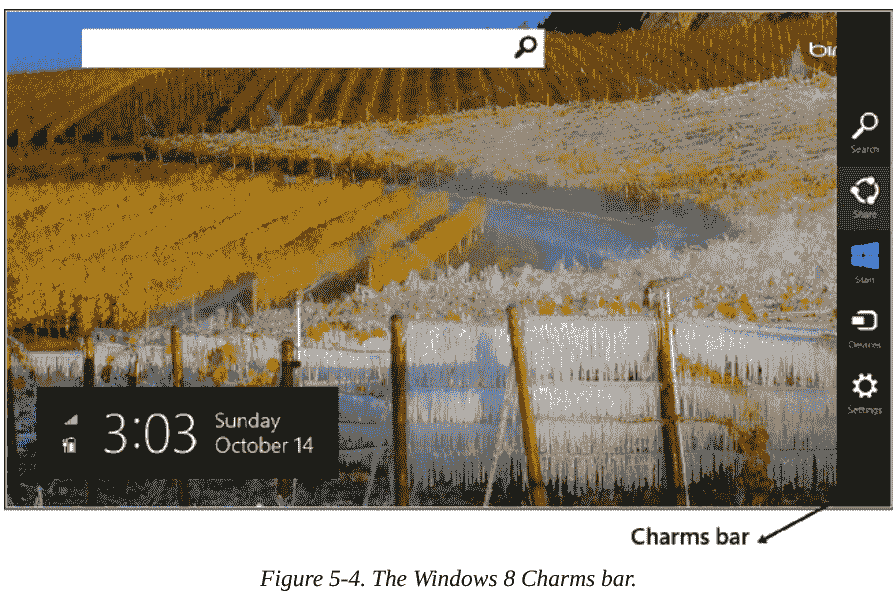

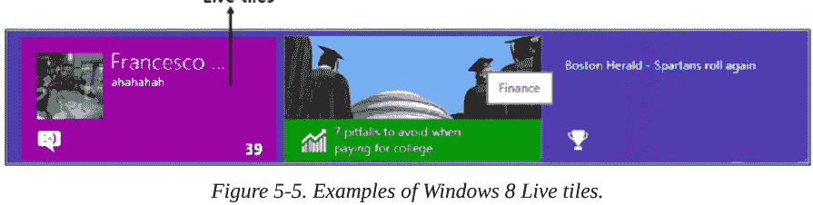

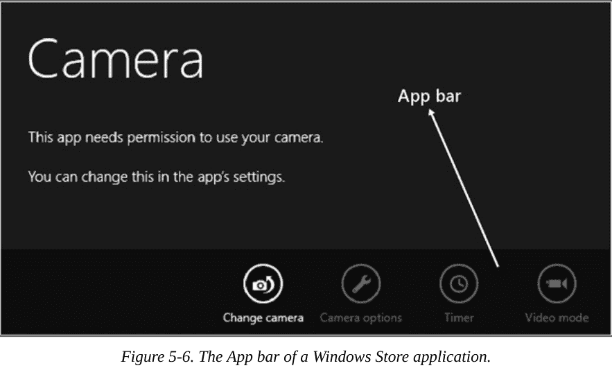

图 5-6。Windows Store 应用程序的`App bar`。

## 设备中心的设计

Windows Store 应用程序与操作系统的设计融合，并完全沉浸在周围环境中。你可以合理地认为应用的设计原则并不是 Windows 8 平台特有的。它是一组原则，虽然这些原则是为 Windows 8 应用程序开发的，但足够通用，可以成为任何以设备为中心的软件和平台的灵感来源。

“设备中心”（Device-centric）是一个相对新的术语，其核心理念是：应用程序的功能应该基于运行在各种不同设备上的假设——这些设备在屏幕尺寸、内存能力和计算能力上各不相同。

## Windows 8 UI 的启发原则

Windows 8 UI 的灵感来自以下原则：

- 为触摸和直观交互而设计。
- 对用户交互做出快速响应，并随时准备好下一次交互。
- 减少用户界面中的冗余。
- 融入现有的 UI 模型。
- 不要重复造轮子。
- 通过契约（contracts）与其他应用程序协作。
- 意识到云端的存在。

这些原则的广泛应用确实可以使任何应用程序（而不只是即将推出的 Windows Store 应用程序）变得更加优秀和更具吸引力。

> **注意**
>
> 想要理解为什么 Windows 8 UI 设计原则如此重要，只需考虑到：多年来，软件应用程序的用户一直被迫按照应用程序设计的规则来思考和行动。无论初衷多么良好，软件都没有充分地关注终端用户。然而，这种情况将发生变化：年轻人将是比当前一代宽容度低得多的一代用户。准备好设计在设计上是流性的应用程序——无论是图形设计还是逻辑设计。这可能就是不久后唯一让软件有意义的软件了。得益于原生用户界面，Windows 8 可能真的在让这一切变得简单。

那么问题是：你该将如何把这些指南转化为具体的行动？

## 为触控设计

触控让应用程序变得即开即用，它是决定智能手机和平板成功的首因素。然而，触控也是一个分水岭。如果你投资了一个基于触控的用户界面，那么你的软件可能无法在非触控设备上流畅运行。因此，关键在于永远不要将触控视为唯一的输入源。

这意味着，例如，为经典用户提供鼠标或键盘，为更年轻（或只是追求即时反馈）的用户提供触摸屏。通过这种方式，用户可以在平板电脑上通过捏合和拉伸缩放某些内容，而在笔记本电脑上只需点击（或可能双击）即可获得相同的效果。

## 保持响应并就绪

触控为用户体验带来了量子飞跃。它的副作用是让用户体验的另一个方面变得更加重要——响应能力。当用户点击并“触摸”视觉元素时，她期望它们能迅速反应，就像现实世界中的其他物体一样。尝试轻触桌边缘的物体；如果触碰被感知并检测到，那么物体会立即掉落：它不会显示一个沙漏然后在几秒后再掉落。

除了触控和响应之外，交互的直观性也至关重要。应用程序的目标应该是让用户在任何阶段都能清楚接下来的操作是什么。这个显而易见的基础点对用户界面的设计以及数据和逻辑的组织具有非凡的影响。

## 零冗余

多年来，应用程序用户界面中的冗余被认为是一种好事。如果一个用户界面允许以多种一种方式执行相同的任务，则定义该用户界面是冗余的。键盘和鼠标导航、略有不同的菜单项（如“保存”、“全部保存”、“另存为”）以及键盘快捷键，在你可能使用的许多应用程序中都会产生相同的结果。

在一个本质上是基于触控的用户界面中，所有方法都没有理由存在。零冗余策略是 Windows Store 应用程序的一大美德。

这种设计考虑在许多成功的移动应用程序中也表现得非常明显，并且与对简单和高效日益增长的需求紧密相连——能够用更少的选项和更少的工具完成更多的事情（或只是做同样的事情）。

## 效法罗马人

这是过去软件开发的另一大支柱，而 Windows 8 UI 对整个用户界面模型提出了质疑。由于各种原因，某些应用程序特意提供自定义的用户界面。有时，这样做是为了让应用程序在与同类型应用程序相比时脱颖而出。有时，这又是尝试让应用程序在某些方面更易用、更有趣的尝试。

Windows 8 中的任何应用程序都应该在平台所规定的用户界面背景中占据自己的空间。出于这个原因，Windows 8 应用程序的第四条原则可以总结为一句古谚：效法罗马人，至少当你人在罗马时是如此。此外，对于对移动应用程序开发有点经验的人来说，这个原则并不陌生。

特别是在 iOS 和 Windows Phone 市场中，如果应用程序提供了与指南冲突的用户界面，可能会被拒绝。你在 Windows Store 应用程序中面临着同样的风险。

## 效法罗马人（不要重复造轮子）

Windows Store 应用程序的第五条原则是第四条原则的一个微妙推论。它加强了为应用程序提供与系统用户界面良好融合的界面的重要性。你不仅想让应用与系统保持一致，还希望通过使用 Windows 8 首选技术栈提供的工具和模板来实现这一目标。

出于这个原因，你将在接下来的章节中广泛使用上述`WinJS`库。`WinJS`是用于 HTML 和 JavaScript 构建 Windows Store 应用程序的原生工具库。你将在下一节中找到对该库的介绍。

## 协作（不要重复造轮子）

与主机平台的完全集成是任何 Windows Store 应用程序的成功点，因为它允许用户在任何应用程序中都感觉如家。此外，它还允许不同的应用程序进行交互和数据交换。

第六条原则可以总结为：应用程序依赖其他应用程序暴露的公共服务来实现其功能。Windows Store 应用程序可以通过契约从其他应用程序导入函数。契约是应用程序调用其他应用程序函数的格式化 API。这避免了你反复编写相同的函数，同时让用户能够以相同的方式执行相同的的操作。

例如，Windows Store 应用程序可以支持系统定义的`搜索`以从其他应用程序检索信息，并实现`共享`以公开展示其内容。

## 在我们之上只有云端

最后，第七条原则可能不需要进一步解释。本地磁盘不再是、也不必然是保存和读取数据的地方。为了确保用户与应用程序之间的连续感，云端增加了另一个维度，通过发布内容并使其公开访问。

## 表示层组件

`WinJS`库是一个由 JavaScript 构建的库，专门用于简化 Windows Store 应用程序的开发。`WinJS`由两个部分组成：处理存储、网络、多媒体和应用程序生命周期核心任务集合，以及一组用于界面布局的控件。你将在书中书中`WinJS`的这两个部分。

无论如何，对可以纳入应用程序的组件有一个整体视角是有用的。

## WinJS 的视觉元素

表 5-1 提供了你在`WinJS`库中找到的视觉元素。你通过在模板中集成一个或多个这些组件来组合应用程序的界面。

### 表 5-1 控件

| 控件 | 描述 |
| :--- | :--- |
| `AppBar` | 显示位于窗口底部的水平命令栏。 |
| `DatePicker` | 弹出日历并允许用户选择日期。 |
| `FlipView` | 一组一组并允许用户翻阅，每次显示一个。一个典型的例子是带有说明的图片可以水平翻转。 |
| `Flyout` | 显示简单的弹出消息，只有当用户触摸（或点击）屏幕任何地方时才会消失。 |
| `ListView` | 以各种布局排列项目，例如网格或列表。 |
| `HtmlControl` | 显示以 HTML 格式提供的任何内容。 |
| `Menu` | 显示一个标准的菜单列表弹出框。 |
| `PageControl` | 一个 HTML、JavaScript 和 CSS 的聚合，可以嵌入视图中或作为外部页面查看。你使用`PageControl`元素定义该聚合。 |
| `SemanticZoom` | 允许用户在相同内容的两种不同视图之间缩放。一个视图是内容的缩放表示；另一个则提供放大后的视图。 |
| `TimePicker` | 允许以具有视觉效果的方式选择时间。 |
| `ToggleSwitch` | 显示用于用户开启或关闭项目的的标准界面。 |
| `Tooltip` | 显示可以包含丰富内容（如图像和格式化文本）的弹出视图。 |
| `ViewBox` | 显示在`ViewBox`内的元素会自动缩放以填充可用空间。`ViewBox`控件还会对容器大小的变化做出反应，例如屏幕旋转或窗口调整大小。 |

这些视觉组件涵盖了许多常见场景；你可以预期从第三方供应商、开源项目和博客文章找到更多现成的 Windows Store 视觉组件。随着你变得越来越熟悉 Windows 8 开发，你甚至可以开始创建自己的自己的小部件（widgets）。拥有一个提供特定功能的小部件让在多个页面和应用程序之间的复用变得简单得多。

> **重要提示**
>
> 你主要使用 HTML 和 CSS 编写 Windows Store 应用来定义用户界面。任何你可以用 HTML 和 CSS 实现的功能都是可以。表 5-1 中列出的标准视觉元素帮助你制作实用的组件，并为你的应用程序提供整体一致的外观和感受。

## 按需用户界面

现在应该已经清楚了，Windows 8 为用户提供了访问应用程序中功能的几种标准方式。有绑定到用户界面中固定元素（如按钮）的静态命令，以及按需可用的动态命令。

通过使用按需 UI 原则，你的目标是让应用程序的空间尽可能保持整洁有序，而不是被视觉项目过载。同时，触发命令和启动操作所需的项目会在用户看起来需要时按需出现。应用栏（`App bar`）和系统的“磁贴栏”（`Charms bar`）是 Windows 8 为按需 UI 提供的机制。应用栏是应用程序命令的仓库，当用户向屏幕底部移动时它会弹出。磁贴栏从右边缘滑出。

磁贴为用户访问几乎每个应用程序的功能提供了常用方式；例如搜索、共享和访问文件。相反，应用栏包含特定特定的命令，并预计只列出对当前视图有意义的命令。

## 创建示例应用栏

在熟悉`WinJS`编程后，这里让你快速了解一下在 Windows Store 应用中创建一个`AppBar`意味着什么。作为第一步，你需要一些 HTML 标记来承载`AppBar`。大多数`WinJS`视觉组件接受一个 HTML 片段并将其转换为其他内容。你可以创建一个新的空白项目并编辑`default.html`页面以包含以下代码：

```html
<!DOCTYPE html>
<html>
<head>
  <meta charset="utf-8" />
  <title>My AppBar</title>
  <!-- WinJS references -->
  <link href="//Microsoft.WinJS.1.0/css/ui-dark.css" rel="stylesheet" />
  <script src="//Microsoft.WinJS.1.0/js/base.js"></script>
  <script src="//Microsoft.WinJS.1.0/js/ui.js"></script>

  <!-- AppBar references -->
  <link href="/css/default.css" rel="stylesheet" />
  <script src="/js/default.js"></script>
</head>
<body>
  <h1 id="header">
    Sample page using an app-bar.
  </h1>
  <hr />
  <div id="yourAppBar" data-win-control="WinJS.UI.AppBar" data-win-options>
    <button data-win-control="WinJS.UI.AppBarCommand" data-win-options="{id:'cmdAdd',label:'Add',icon:'add'}"></button>
    <button data-win-control="WinJS.UI.AppBarCommand" data-win-options="{id:'cmdRemove',label:'Remove',icon:'remove'}"></button>
    <hr data-win-control="WinJS.UI.AppBarCommand data-win-options="{type:'separator',section:'global'}" />
    <button data-win-control="WinJS.UI.AppBarCommand" data-win-options="{id:'cmdDelete',label:'Delete',icon:'delete'}"></button>
    <button data-win-control="WinJS.UI.AppBarCommand" data-win-options="{id:'cmdCamera',label:'Camera',icon:'camera'}"></button>
  </div>
</body>
</html>
```

上一页的正文包含一个简单的`DIV`和几个`BUTTON`元素。将此标记转换为纯 Windows 8 样式`AppBar`的魔法之处在于`data-win-control`属性。

将该属性应用于`DIV`标签时，它将其转换为`WinJS.UI.AppBar`对象——即一个`AppBar`。同样，应用于`BUTTON`元素时，它会使其成为`AppBar`上的按钮或类型为`WinJS.UI.AppCommand`的对象。`data-win-options`属性包含了控件的设置。例如，为`AppBar`分配一个唯一的 ID、一个标签和一个图标。要显示`AppBar`，你可以从屏幕底部向上滑动，或者右键点击应用程序的屏幕。最后，你可以通过按下 Windows 键和 Z 来实现相同的组合。

当用户点击按钮时要执行什么操作呢？

你刚刚输入的布局 HTML 用于定义栏的布局。要添加行为，你还需要一些 JavaScript。你编辑项目中的`default.js`文件，如下所示：

```javascript
function () {
  "use strict";

WinJS.Binding.optimizeBindingReferences = true;

var app = WinJS.Application;
var activation = Windows.ApplicationModel.Activation;

app.onactivated = function (args) {
  if (args.detail.kind === activation.ActivationKind.launch) {
    if (args.detail.previousExecutionState !==
        activation.ApplicationExecutionState.terminated) {
      // 如果需要，加载应用程序状态
    } else {
      // 如果需要，加载应用程序状态
    }
  }
}
```

HTML 标记。下面的代码获取一个名为`header`的元素，并将其内容设置为字符串`"Hello,"`，这将被渲染为粗体文本。

```javascript
var element = document.getElementById("header");
element.innerHTML = "<b>Hello</b>";
```

这种模式代表了通过计算出的数据来更新用户界面的编程方法。这种基于直接更新 DOM 的方法极快，但只有在你想要更新特定元素时效果才良好。对于有多个元素需要显示的场景（例如列表），或者在不同元素上显示多个数据项的场景，这种方法并不能很好地工作。

> **注意**
>
> 通过使用`innerText`属性而不是`innerHTML`，你只需要设置 HTML 元素的纯文本，而不触碰任何标记或样式。在某种意义上，使用`innerText`是更安全的，因为这样不会承担更改现有图形结构的风险。

## HTML 页面的声明式操作

`WinJS`库还支持一种更新 HTML 元素的声明式形式，被称为数据绑定。让我们来看看它是如何工作的。创建一个新的 Windows 8 项目并编辑`default.html`页的`BODY`，使其看起来像下面的代码：


```html
<!DOCTYPE html>
<html
<head>
<meta charset="utf-8" />
<title>DataBinding</title>
<!-- WinJS references -->
<link href="//Microsoft.WinJS.1.0/css/ui-dark.css" rel="stylesheet" />
<script src="//Microsoft.WinJS.1.0/js/base.js"></script>
<script src="//Microsoft.WinJS.1.0/js/ui.js"></script>

<!-- DataBinding references -->
<link href="css/default.css" rel="stylesheet" />
<script src="js/default.js"></script>
</head>
<body>
<header>
  <h2>从这里开始！使用 <b>Windows 8</b> 应用程序
  和
  <b><b>HTML5</b>
  以及
  <b><b>JavaScript</b></b></b></b>
  </h2>
  <hr />
  <p>通过数据绑定显示的随机数。</p>
</header>

<div class="center">
  <span id="numberContainer" data-win-bind="innerText:generatedValue"></span>
</div>

<div class="center">
  <input id="numberButton" type="button" value="Get Number " />
</div>

<footer>
  <hr />
  Dino Esposito | Francesco Esposito
</footer>
</body>
</html>
```

`SPAN` 元素被装饰了 `data-win-bind` 属性。该属性被 Windows 8 运行时正确解析后，它会执行通过 `innerText` 属性设置元素内容的“魔法”工作。你在代码段中看到的 `generatedValue` 字符串是什么？其意图是生成一个随机数并通过用户界面显示它。

尽管你可以将任何类型的数据绑定到 HTML 元素，包括如字符串或数字之类的单条数据，但你可能需要对由文本、数字和日期混合成的复合对象进行此类操作。现在，假设你有一个 JavaScript 对象来描述要绑定的数据。在 `default.js` 文件的底部添加以下脚本：

```javascript
// 获取一个包含 1 到 100 之间随机数的对象
function displayGeneratedNumber() {
  var randomNumber = { generatedValue: Math.floor((Math.random()*100)+1) };
  // 这里还需要更多代码
}
```

你现在有了一个 JavaScript 对象，其属性名为 `generatedValue`，其中包含一个 1 到 100 之间的随机数。鉴此，下面的标记变得具有了更多的意义：

```html
<span id="numberContainer" data-win-bind="innerText: generatedValue"></span>
```

字符串 `generatedValue` 是一个表达式，引用了你打算赋值给 `innerText` 属性的值。但还有最后一点需要澄清：Windows 8 运行时如何知道暴露了 `generatedValue` 属性的那个？你需要回到 `default.js` 并重构 `displayGeneratedNumber` 函数：

```javascript
// 获取一个包含 1 到 100 之间随机数的对象
function displayGeneratedNumber(bindableElement, randomNumber) {
  var randomNumber = { generatedValue: Math.floor(Math.random()*100)+1 };

  // 在选定的 HTML 元素上启用绑定
  var bindableElement = document.getElementById("numberContainer");
  WinJS.Binding.Process(bindableElement, randomNumber);
}
```

你添加的这两行代码告诉 Windows 8 运行时环境，名为 `numberContainer` 的元素——即 `span` 元素——应该被处理，并绑定到它可以从 `randomNumber` 对象中获取的任何内容。此时，下面的标记具有了完整的意义：

```html
<span id="numberContainer" data-win-bind="innerText: generatedValue"></span>
```

分配给名为 `numberContainer` 的 `span` 元素的 `innerText` 属性将显示分配给绑定对象 `randomNumber` 的属性 `generatedValue` 值。就这些了吗？还没有。

缺失的环节是编写在 `default.js` 中的代码实际运行。为了这一点，你还需要对 `default.js` 进行最后一次编辑。你修改调用 `setPromise` 的那行代码，如下：

```javascript
app.onactivated = function (args) {
  if (args.detail.kind === activation.ActivationKind.launch) {
    if (args.detail.previousExecutionState !==
        activation.ExecutionState.terminated) {
      // 初始化应用程序
      document.addEventListener("DOMContentLoaded",
        displayGeneratedNumber);
    } else {
      // 恢复应用程序状态
      args.setPromise(init());
    }
  }
};
```

接下来，你还在 `default.js` 底部添加了一个名为 `init` 的函数：

```javascript
function init() {
  document.getElementById("numberButton").addEventListener("click",
    displayButtonClick);
}
```

从这个例子你能得到什么教训吗？

首先，数据绑定是一种强大的机制，它展现了所有的。在后续章节中，你将学习如何将复杂对象和列表绑定到用户界面。

> 在本章中，你仅仅触及了绑定的皮毛，并探索了一个基础场景。在后续章节中，你将学习如何将复杂对象和列表绑定到用户界面。

## 理解应用程序的生命周期

任何 Windows 8 应用程序都由一组信号开始、加载和结束的事件所特征。了解这些构成应用程序生命周期的事件非常重要，这有助于引入优化并产生更好的行为。

## Windows Store 应用程序的状态

由于 Windows 8 也是一个专为移动设备设计的操作系统，它不能忽略移动系统的基本规则。在移动设备上，用户启动应用程序但不会终止它。一旦启动，应用程序由操作系统拥有，其生命周期由操作系统管理。

所有 Windows Store 应用程序处于以下四种状态之一：运行、挂起、已终止或未运行。状态之间的转换由用户和系统活动决定，如图 5-8 所示。

## 启动应用程序

用户有多种方式启动应用程序。最常见的方式是用户从磁贴（Windows 8 中图标或快捷方式的对应物）启动应用程序。另一种可能性是用户搜索该应用程序暴露的某些数据，或者用户与应用程序共享数据。这些任务通常通过 Charms 栏中的项目完成。最后，另一种可能性是应用程序由于用户打开了与其关联的文件而启动。

启动应用程序总是会导致 WinJS 触发 `activated` 事件，你可以通过上述的 `onactivated` 事件来处理它。通常情况下，你需要在 `activated` 事件期间执行一些工作。

操作（actions）。以下代码是任何基于 WinJS 的应用程序的一部分，它提供了一个占位符，你可以在其中添加任何可能的初始化代码。在启动时，你通常会加载默认数据。

```
app.onactivated = function (args) {
  if (args.detail.kind === activation.ActivationKind.launch) {
    if (args.detail.previousExecutionState !===
        activation.ApplicationExecutionState.terminated) {
      // 在此处初始化你的应用程序。
    } else {
      ...
    }

    // 在整个页面触发数据绑定（如果有）
    args.setPromise(WinJS.UI.processAll());
  }
};
```

关于代码段中看到的 `setPromise` 方法，有一点值得注意。该方法通知应用程序某些异步工作正在进行。托管 `setPromise` 的方法在等待工作完成之前无法退出。然而，处理过程会持续到包含它的方法的结束。这产生了一个问题：一旦等待处理的工作（也称为 promise）结束，你该如何可靠地决定要做什么。WinJS 中的 promise 对象具有 `then` 方法，你使用它来指定 promise 完成后要执行的任何工作。这里有一个示例：

```
args.setPromise(WinJS.UI.processAll())
  .then(function() { ... })
```

存在另一个类似的方法，名为 `done`。`done` 和 `then` 的区别仅在于 `then` 返回另一个 promise 对象，而 `done` 不返回任何值。

```
args.setPromise(WinJS.UI.processAll())
  .then(function() { ... })
  .then(function() { ... })

```...done(function() { ... })

);

```

总之，它们执行的工作相同，但 `done` 只能在操作链的末尾使用。

## 挂起应用程序

在 Windows 8 中，一次只有一个应用程序处于前景活动状态。如果用户切换到一个新应用程序，Windows 8 会挂起当前运行的应用程序并将其移动到后台。尽管代码不再运行，挂起的应用程序仍然留在内存中。以下是处理该事件的方法：

```
app.checkpoint = function (args) {

// 保存应用数据以防终止。

WinJS.Application.sessionState["location"] = ...;

}
```

在挂起期间，你希望保存任何数据，以便稍后非常接近（如果不是完全相同）重新配置应用程序的状态到应用程序挂起时的状态。你使用 `sessionState` 字典来保存值。`sessionState` 字典有一系列命名的条目——例如，`location`，并接受字符串值。条目的名称是任意的，但通常是保存数据的指示。

用户可以随时切换回挂起的应用程序；当这种情况发生时，Windows 会唤醒该应用程序，它将重新获得当前应用程序的前景。

挂起的应用程序会在内存中缓存尽可能久，但不能保证无限留在内存中。可能会出现，也许是因为内存不足，Windows 终止挂起的应用程序。在这种情况下，如果用户想用回应用程序，只能从磁贴重启它。

## 恢复应用程序

开发者有一种简单的方法来检测应用程序是从磁贴运行的，还是从挂起状态恢复的。此时 `activated` 事件会被触发，且 `ActivationKind` 属性被设置为 `launch`。此外，如果 `previousExecutionState` 被设置为 `terminated`，则应用程序已从挂起被重新激活，你可能想要检索并恢复任何保存的状态。保存的状态通常从 `sessionState` 字典或挂起期间存储的任何地方检索。下面的代码显示了你在恢复期间插入代码的位置。

```
app.onactivated = function (args) {

  if (args.detail.kind === activation.ActivationKind.launch) {

    if (args.detail.previousExecutionState !===

      activation.ApplicationExecutionState.terminated) {

      // 在此处初始化你的应用程序。

      var data = WinJS.UI.Application.sessionState["location"];

    }

  } else {

    // 在此处恢复应用程序状态。

    ...

  }

  args.setPromise(WinJS.UI.processAll()));
}
```


用于保存数据的 `sessionState` 字典不是强制性的。你可以将会话数据保存到某些持久存储器，或者你认为应用程序每次启动都以新的状态启动也是可以接受的。这主要取决于你，但保存到会话状态是最常用的方法。

## 后台任务

在 Windows 8 中以及其他移动平台中，你可以拥有后台任务来执行与 UI 相关的任务，例如数据传输。

后台任务是一个轻级类，它与指定的应用程序关联，并在应用程序未运行时定期运行。后台任务可以与条件链接，并在条件满足之前将不会运行。

后台任务还能够在锁界面上显示信息。Windows 8 应用程序的锁界面包含一张背景图片，并在其上方渲染一些信息，如当前时间、网络状态、电池电量。此外，后台任务可以在锁界面上写入某些特定文本，只需提供其状态的快速更新。

## 总结

本章结束了书的第一部分，在这一部分中，你基本上为书的内容以及你通往 Windows Store 应用程序之旅奠定了基础。现在你应该熟悉 HTML 和 CSS，并掌握了足够的 JavaScript 语言知识来理解在后续章节中遇到的 WinJS 专用组件。

# 第 6 章 Windows Store 应用程序的用户界面

> 行事要伟大，正如你在思想中那样伟大。  
> —威廉·莎士比亚

通过本章，你进入了书中关注 Windows 8 具体示例和练习的部分。你将看到如何使用 Windows 8 的特定组件和函数，并探索一些产生不仅“能够运行”而且易于阅读的技术。在本章中，你将主要关注演示——用户界面以及相关方面，如视觉组件、输入表单、弹出窗口和页面的整体布局。

### 重要提示

代码的可读性不是专家的专利——相反，它是一种你从职业生涯之初就可以学会采用的态度。保持代码的可读性，在你离开几天或几周后回到代码时，对你将非常有帮助。

用户可以快速找到并返回可用页面列表。图 6-1 所示的导航应用（Navigation App）模板处理了这种场景。

在其他情况下，应用程序没有清晰可见的导航栏，但在用户点击将列表项展开为更详细的视图时，仍然设置了某种形式的导航。如果你选择使用拆分应用（Split App）或网格应用（Grid App）模板，就会得到这种类型的应用程序骨架。在接下来的章节中，你将学习使用网格应用模板的示例，但现在你将使用空白应用（Blank App）项目模板。

## 检查项目结构

打开 Visual Studio 并创建一个新的空白应用（Blank App）项目；将其命名为 `TodoList`。本次练习的主要目的是创建一个输入表单，用于收集要跟踪的活动信息。图 6-2 显示了解决方案资源管理器（Solution Explorer）中新建项目的所有内容。

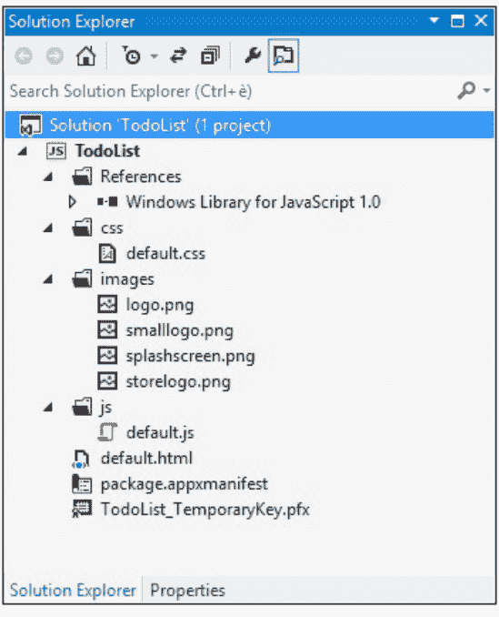

References（引用）文件夹包含编译应用程序所需的库列表。在这种情况下，你唯一库就是现在已经熟悉的 WinJS 库。

CSS 文件夹包含用于在你应用程序中使用的各种 HTML 页面的样式表。你可以预计每个向项目添加的页面都对应一个 CSS 文件。

Images（图像）文件夹是你所需的所有图像文件的存储库。这包括显示给用户的界面部件的图像，以及将应用程序集成到 Windows 8 和 Windows Store 环境所需的图像。表 6-1 解释了图 6-2 中每个 `.png` 图像文件的用途。

### 表 6-1. 默认项目模板中图像的用途

| 图像文件 | 用途 |
| --- | --- |
| `Logo.png` | 这是显示在开始屏幕上应用程序预留标题中的图像。你可以提供 `.png` 或 `.jpg` 格式的此图像。建议尺寸为 150 x 150 像素。Windows 通常会将应用程序名称叠加在图像上；因此，你可能考虑不要在图像中包含应用程序名称。 |
| `SmallLogo.png` | 这是在搜索结果中表示应用程序的图像。格式可以是 `.png` 或 `.jpg`，建议尺寸为 30 x 30 像素。 |
| `SplashScreen.png` | 这是在用户启动应用程序后，应用程序加载期间显示较短时间的图像。格式可以是 `.png` 或 `.jpg`，建议尺寸为 620 x 300 像素。 |
| `StoreLogo.png` | 这是在 Windows Store 中表示应用程序的图像。格式可以是 `.png` 或 `.jpg`，建议尺寸为 50 x 50 像素。 |

你可能还希望提供额外的图像，例如 `WideLogo.png` 图像，以提供更大的标志文件——最高 310 x 150 像素。最后，`BadgeLogo.png` 文件是一个小图像（通常为 33 x 33 像素），显示在 Windows 8 设备的锁定上，用于识别来自应用程序的待处理通知。

Js 文件夹包含应用程序所需的任何 JavaScript 文件。你通常项目中的每个 HTML 页面有一个 JavaScript 文件，但你也可能有项目中多个页面共享的额外 JavaScript 文件。

项目的根目录包含三个文件，如表 6-2 所示。

### 表 6-2. 项目模板根目录中文件的用途

| 文件 | 用途 |
|---|---|
| `default.html` | 期望此 HTML 页面定义应用程序的首页屏幕。 |
| `Package.appmanifest` | 此文件包含为了分发你的 Windows Store 应用程序所需的所有信息。 |
| `Xxx_TemporaryKey.pfx` | 此文件代表为在开发机上测试应用程序而自动颁发的临时证书。`Xxx` 实际上是应用程序真实名称的占位符。该证书用于签名项目生成的任何可执行文件。当应用程序完成后，你需要将此证书替换为从 Windows Store 帐户获得的真实证书。获取真实证书是将你的应用程序发布到公共商店的必要步骤。 |

这些文件构成了 Windows Store 应用程序所需的最少文件集。随着应用程序的构建，你通常会在项目中创建自定义文件夹，并添加更多你所需的所有文件：更多的 HTML 页面、更多的样式表、更多的 JavaScript 文件和更多的图像。

练习的下一步是对基本用户界面进行一些更改，以获得一个定义将放入列表项的表单。

## 检查标准样式和脚本引用

如果你双击 `default.html` 文件并对其进行编辑，你将注意到以下标记：

```html
<!-- WinJS references -->

<link href="//Microsoft.WinJS.1.0/css/ui-dark.css" rel="stylesheet" />

<script src="//Microsoft.WinJS.1.0/js/base.js"></script>

<script src="//Microsoft.WinJS.1.0/js/ui.js"></script>
```

正如顶部的注释所暗示，这些不是你在几乎任何 HTML 页面中都能常见的外部资源引用。这些是原生嵌入在 WinJS 库中的样式表和脚本文件的特殊引用。你不会在项目中以源代码形式拥有任何这些文件。

你可以通过将上述 `link` 元素替换为以下内容，为你的 Windows Store 应用程序提供整体浅色主题：

```html
<link href="//Microsoft.WinJS.1.0/css/light.css" rel="stylesheet" />
```

你想引用的任何额外的 CSS 或脚本将放在以下部分：

```html
<!-- TodoList -->

<link href="/default.css" rel="stylesheet" />

<script src="/default.js"></script>
```

在这种情况下，`css` 和 `js` 指向项目中的文件夹。注意这些文件是从 WinJS 资源中提取的。

## 添加固定用户界面

从模板获取的示例应用程序具有深色背景并显示占位符文本。你可能以多种方式自定义你的应用程序，例如添加页眉和页脚。这里是之前使用的页眉和页脚：

```html
<header>
  Start Here! Build Windows 8 Applications with HTML5 and JavaScript
</header>

<footer>
  Dino Esposito | Francesco Esposito
</footer>
```

作为一个练习，让我们让这些组件复用，以便可以在任何地方引用它们，而不必担心内部细节。

第一步是在项目中创建一个文件夹。右键点击项目节点（命名为 `TodoList`），并从后续菜单选择 New Folder。将新文件夹命名为 `Pages`。

注意：在创建文件夹时，如果不小心没有编辑名称，你可能会在项目中发现一个名为“New Folder”的新文件夹。别担心，只需长单击（即按住鼠标按钮大约一秒）。这将项目项切换回编辑模式，此时输入 `Pages` 并点击文本框以外保存更改。

要添加可复用的 HTML 块，现在右键点击 Visual Studio 解决方案管理器中的 `Pages` 节点，并从上下文菜单中选择 New Item。在图 6-3 所示的窗口中，选择 HTML Page 并命名为 `header.html`。接下来，重复步骤创建一个名为 `footer.html` 的第二个 HTML Page。

两个新添加的 HTML 文件内容相同，如下所示：

```html
<!DOCTYPE html>

<html>

<head>

  <title></title>

</head>

<body>

</body>

</html>
```

编辑 `header.html` 的内容，如下所示：

```html
<!DOCTYPE html>

<html>

<head>

  <title></title>

</head>

<body>

<header>

Start Here! Build Windows 8 Applications with HTML5 and JavaScript

</header>
```

```html
</header>

</body>

</html>
```

然后，编辑 `footer.html` 的内容，如下文所示：

```html
<!DOCTYPE html>

<html>

<head>

  <title></title>

</head>

<body>

  <footer>

    <hr />

    Dino Esposito | Francesco Esposito

  </footer>

</body>

</html>
```

保存您的更改。

下一步是在主页面 `default.html` 中引用新创建的页眉（header）和页脚（footer）元素。因此，打开 `default.html` 进行编辑并修改 `BODY` 标签，如下：

```html
<body>

<div data-win-control="WinJS.HtmlControl"

  data-win-options="uri:/pages/header.html"></div>

<h1>To-Do List!</h1>

<div data-win-control="WinJS.HtmlControl"

  data-win-options="uri:/pages/footer.html"></div>

</body>
```

`data-win-control` 属性将 `DIV` 转换为 HTML 控件，它仅显示所引用文件的内容，即 `header.html`。`footer.html` 也是同样的情况。

回到第 1 章，您在 `default.css` 中添加了一些颜色和样式；现在在这里也执行相同的操作，编辑 `default.css` 文件，如下所示：

```css
body {

  background-color: #1649AD;

  padding: 10px;

}

header {

  font-size: x-large;

  color: #ffffff;

  padding-bottom: 50px;

}

footer {

  padding-top: 50px;

  font-size: large;

  color: #eeee00;

  font-weight: bold;

}
```

`default.css` 文件包含 `default.html` 页面的样式信息。如果您想在另一个页面（例如 `mypage.html`）中重用相同的样式设置，可以将 `default.css` 的设置复制到一个名为 `mypage.css` 的新文件中。这种方法可行，但应该有更好的方法来实现相同的结果（事实上确实有）。

如图 6-4 所示，右键点击 Css 项目文件夹并选择 **Add | New Item（添加 | 新项）**。在下一个窗口中，选择 **Style Sheet（样式表）** 项目并根据项目命名——在此情况下，命名为 `todolist.css`。将 `body`、`header` 和 `footer` CSS 类的内容复制到您的新 `todolist.css` 文件。

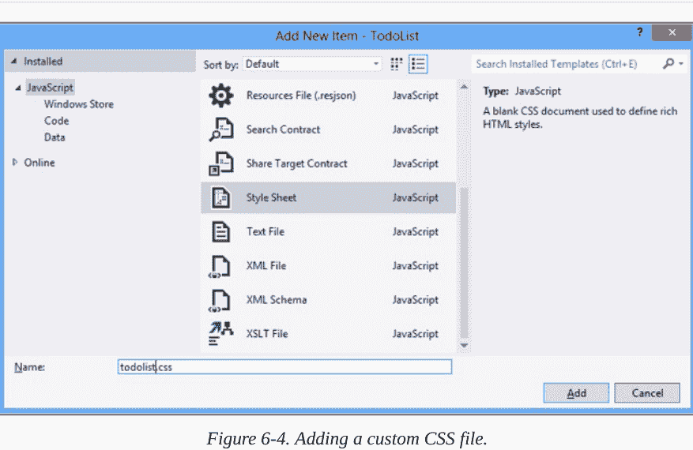

此时，您拥有了一个全局 CSS 文件，计划在其中存储所有的全局样式表设置；此外，您还有一个页面特定的 CSS 文件，其中仅包含影响该特定页面元素的 CSS 样式。为了让全局 CSS 文件对任何页面可见，您需要在所有代表应用程序屏幕的页面中添加额外行。到目前为止，您只需要对 `default.html` 这样做。

```html
<!-- TodoList 引用 -->

<link href="css/todolist.css" rel="stylesheet" />

<link href="css/default.css" rel="stylesheet" />
```

现在可以运行应用程序了，它看起来应该类似于图 6-5。诚然然，这仍然是一个相当基础的应用程序，但至少您已经学习了两种重用标记和样式的非常有用的技术。

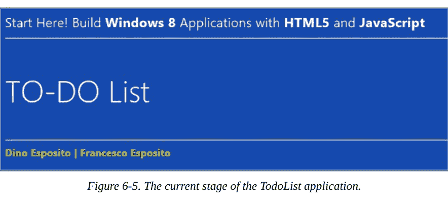

## 应用程序属性

在为示例应用程序添加一些交互功能之前，您需要花一点时间完成一些配置步骤，这些步骤虽然简单但对于任何 Windows Store 应用程序都是必须的——检查您的清单文件（manifest）、图标（logos）和启动屏幕（splash screen）。

## 清单文件

当您创建一个新的 Windows Store 项目时，Visual Studio 会自动创建一个应用程序清单文件。该文件包含应用程序的名称和描述、图标和其他基本信息——例如应用程序的启动页。清单文件最初设置为默认值，您可能在以后某个时候对其进行更改。Visual Studio 提供了一个方便的编辑器，让您可以轻松进行所需的更改。要启用它，只需双击项目文件夹中的 `package.appxmanifest` 文件。

您可以指定的属性按功能区域分组。现在，请关注 **Application UI（应用程序 UI）** 选项卡。**Display name (显示名称)** 是应用程序在商店和 Windows 8 菜单中显示的官方名称——例如，开始屏幕。启动页默认设置为 `default.html`；要更改它，只需创建一个新页面或重命名现有页面，然后相应地编辑清单。除了默认语言描述外，您还可以选择支持的旋转方向（当应用程序在平板电脑上运行时）以及图标图像。

此外，清单文件还包含有关应用程序要求的某些技术信息，例如它是否需要访问本地存储或摄像头。您通过图 6-6 所示的其他选项卡（如 **Capabilities（功能）**、**Declarations（声明）** 等）来管理这些额外设置。在后面的章节中，随着您构建需要特定清单设置开发功能，您将访问这些更高级的内容。

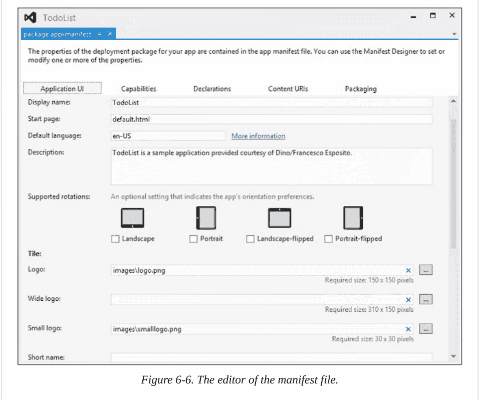

## 添加图像

（注：后续原文内容为重复段落，已省略以避免重复翻译）

CSS 类名为 `form-container` 的 `div` 块就是你将在本章其余部分编写的标记块。在 `default.css` 文件中，添加以下代码来为容器 `div` 元素设置样式：

```css
.form-container {

  border-radius: 10px;

  background-color: #99e;

  color: #eee;

  padding: 20px;

  margin: 5px;

  width: 600px;

}

.form-section {

  margin-top: 10px;

}

.block-element {

  display: inline-block;

  vertical-align: top;

}
```

在最顶部的 `div` 中，你放置了用于捕获任务描述和截止日控件。第二个 `div` 表示任务的优先级，第三个 `div` 允许用户设置任务状态。最后，第四个 `div` 包含一个用于保存任务的按钮。

## 定义任务对象

插入 HTML 页面中的大部分 JavaScript 代码都处理元素的更新。数据绑定是一项强大的技术，可以将这些必要的代码减少到最低，将大部分工作负载分配给底层框架。为了让数据绑定无缝工作，你应该创建一个与你计划通过它读取和写入的数据紧密匹配的对象。在这种情况下，你需要一个 `Task` 对象。要创建它，请向项目的 `JS` 文件夹添加一个新的 JavaScript 文件。你可以根据应用程序的名称对其命名——例如 `TodoList.js`。

在编辑 `todolist.js` 文件之前，需要对 `default.js` 文件进行细小的更改，以控制应用程序的加载阶段。这与你在上一节讨论的数据绑定示例中所完成的更改相同。通常情况下，任何 Windows Store 应用程序都需要此更改。找到 `app.onactivated` 函数，只需将调用 `setPromise` 方法的行替换为下面的代码：

```javascript
args.setPromise(WinJS.UI.processAll())

  .then(TodoList.init())
```


这段代码的作用是在激活阶段完成后，将控制权交给名为 `TodoList.init` 的函数。

现在，将注意力转向新创建的 `todolist.js` 文件，并向其中添加代码：

```javascript
var TodoList = TodoList || {};

TodoList.init = function () {
  TodoList.performInitialBinding();
};

TodoList.Priority = {
  VeryLow: 1,
  Low: 2,
  Normal: 3,
  High: 4,
  VeryHigh: 5
};

TodoList.firstNextMonth = function () {
  var d = new Date();
  d.setDate(d.getDate() + 31);

  var year = d.getFullYear();
  var month = d.getMonth();
  var day = 1;

  var newDate = new Date(year, month, day);
  return newDate();
};

// 定义 Task 对象
var Task = WinJS.Class.define(function () {
  var that = {};

  that.description = "这是我的新任务";
  that.dueDate = TodoList.firstNextMonth();
  that.priority = TodoList.Priority.Normal;
  that.status = "未开始";
  that.percCompleted = 0;
  that.minPriority = TodoList.Priority.VeryLow;
  that.maxPriority = TodoList.Priority.VeryHigh;

  return that;
});
```

现在你有了一个名为 `TodoList` 的全局对象，它包含了应用程序使用的所有 JavaScript 函数和对象。此外，你还有一个具有若干属性的 `Task` 对象，例如描述、截止日期、优先级、状态和完成工作的百分比。下一步是编辑用户界面，以便你可以收集数据来填充新的 `Task` 对象。同时，你可能希望使用现有的 `Task` 对象的实例来初始化输入字段。

## 收集文本和日期

在最顶部的 `div` 中，你放置了一个多行文本编辑器和一个日期选择器。多行文本编辑器需要 `textarea` HTML 元素。对于日期选择器，你有两个选择：可以使用 HTML5 `input` 元素，也可以使用 Windows 8 日期选择器组件。使用 Windows 8 日期选择器会让用户的操作更加容易。以下是你需要在 `form-section` 的普通 `div` 类中插入的标记：

```html
<div class="form-section">
  <div class="block-element">
    <h3>DESCRIPTION</h3>
    <textarea id="taskSubject" required data-win-bind="innerText"></textarea>
  </div>

  <div class="block-element">
    <h3>DATE</h3>
    <div class="block-element" id="taskDueDate" data-win-control="WinJS.UI.DatePicker"></div>
  </div>
</div>
```

让我们暂时忽略 `data-win-bind` 属性和整个数据绑定。让我们关注在 ID 为 `taskDueDate` 的 `div` 标签上使用的 `data-win-control` 属性。`data-win-control` 将一个普通的 `div` 元素转换为 Windows 8 日期选择器组件。你在标记中看到一个普通的 `div` 元素，但在运行时你实际上获得了一个更复杂的元素。

## 设置任务优先级

任务优先级用从 1（非常低）到五（非常高）的数字表示。你可以让用户直接在文本框中输入数字，这只需要一个输入字段。在 Windows 8 中，你可以使用 HTML5 引入的输入类型之一。托管环境将自动将其渲染为滑块。以下是你所需的全部标记，位于第二个部分：

```html
<div class="form-section">
  <div class="block-element">
    <h3>PRIORITY</h3>
    <input id="taskPriority" type="range" data-bind="value; min:1; max:5">
  </div>
</div>
```

注：此处原文逻辑略有跳跃，根据上下文意译如下：在 Windows 8 中，你可以使用 HTML5 引入的输入类型。托管环境将自动将其渲染为滑块。以下是你所需的全部标记，位于第二个部分：

```html
<div class="form-section">
  <div class="block-element">
    <h3>PRIORITY (1=LOW - 5=HIGH)</h3>
    <input id="taskPriority" type="range" data-bind="value; min:1; max:5">
  </div>
</div>
```

`type="range"` 属性的输入元素会自动渲染为滑块。滑块的最小值和最大值通过数据绑定设置。稍后我们将看到关于数据绑定的更多内容。

最后，任务的第三部分包含了关于任务状态的信息。它是通过下拉列表表示的。

## 设置任务状态

第三部分包含了关于任务状态的信息。任务状态是通过字符串表示的。以下是用于完成工作百分比的所需的标记：

```html
<div class="form-section">
  <div class="block-element">
    <h3>STATUS</h3>
    <select id="taskStatus">
      <option>未开始</option>
      <option>进行中</option>
      <option>完成</option>
    </select>
  </div>

  <div class="block-element">
    <h3>Completed</h3>
    <input id="taskPercCompleted" type="number" min="0" max="100" data-bind="percCompleted" />
  </div>
</div>
```

Windows 8 不需要特殊的下拉列表设施。通过将输入元素的 `type` 设置为 `number`，你可以强制输入框仅接受数字。

## 添加按钮和提示

表单的最后一个部分包含一个允许用户收集并持久化数据的按钮。第四部分包含了两个有趣的东西：一个按钮和一个提示（提示是在鼠标悬停在控件上时显示的小窗口）。以下是你所需的标记：

```html
<div class="form-section">
  <div>
    <button id="buttonAddTask" data-win-control="WinJS.UI.Tooltip" data-win-options='<b>Purpose</b><hr>Add the <i>newly created</i> task to the list.'>
      Add Task
    </button>
  </div>
</div>
```

## 注意

在上面的示例中，`innerHTML` 属性的内容为了易读进行了分行。如果你在 Visual Studio 编辑器中输入这段代码，请确保以连续字符串的形式输入；否则代码无法编译。

### 说明

在书中，你使用 HTML 和其他网络技术（如 CSS 和 JavaScript）编写 Windows 8 应用程序。对此，对于任何具有 Web 开发经验的开发者来说，使用 HTML 表单元素和提交按钮可能会感到意外。在 Windows 8 中，你不需要表单，因为没有服务器端组件来接收表单的内容。对于任何旨在收集输入的表单，你只需要一个或多个触发操作的按钮。你可以使用普通的按钮元素来渲染这些按钮。

```javascript
TodoList.addTaskClick = function () {
  TodoList.alert("Add Task button clicked");
};
```

```javascript
TodoList.alert = function (message) {
  var alertDialog = new Windows.UI.Popups.MessageDialog(message);
  alertDialog.showAsync();
};
```

目前，点击按钮只会显示用户消息框；稍后，你将重写这段代码以显示正在保存的任务的摘要。

如果你想向一个已经通过 `data-win-control` 属性转换为 Windows 8 组件的元素添加工具提示（tooltip）怎么办？例如，如何为日期选择器组件添加工具提示？这里有一些示例代码：

```html
<div data-win-control="WinJS.UI.Tooltip"
     data-options="{innerHTML:'Specify the due for the task'}">
  <h3>-截止日期-</h3>
  <div class="block-element"
       id="taskDueDate"
       data-win-control="WinJS.UI.DatePicker"></div>
</div>
```

如前面的标记所示，你所只需要使用一个配置恰当的包装 `div`，以便它在运行时转换为工具提示组件。

## 向表单输入数据

到目前为止，你已经定义了表单的布局，任务完成后，现在是时候考虑如何将其绑定到数据了。

## 初始化输入表单

在页面初始化时，你已经调用了一个名为 `performInitialBinding` 的函数。你需要在该函数的体内添加一些代码。预期的行为非常简单：函数需要获取一个新的 `Task` 对象并将其内容绑定到用户界面元素上。

当应用程序表单的目的是添加新任务时，你可以传递新创建的 `Task` 对象实例（换句话说，是空的），该实例填充了默认值。

然而，如果表单用于编辑已创建的任务，你必须先编写代码获取要编辑的任务，将这些数据加载到新的 `Task` 对象实例中，并通过用户界面显示出来。

```javascript
TodoList.performInitialBinding = function () {
  // 这也可能是从某些存储检索的 Task 对象
  var task = new Task();

  // 在选定的 HTML 元素上启用绑定
  var bindable = document.getElementById("form-container");

  WinJS.Binding.processall(bindable, task);

  // 设置日期选择器上的日期
  var datePicker = document.getElementById("taskDueDate").winControl;
  datePicker.current = task.dueDate;

  // 在下拉列表中选择状态
  var dropDownList = document.getElementById("taskStatus");
  dropDown.selectedIndex = TodoList.getIndexFromStatus(task.status);
};
```

数据的工作是以级联方式进行的，这意味着你将数据源对象附加到容器元素上，然后使用 WinJS 库来解析依赖关系。你通过 `data-win-bind` 属性在用户界面元素和数据源中的属性之间建立依赖关系。你可以通过标记属性来实现，在这种情况下，数据绑定被称为声明式数据绑定。你将首先看到如何创建声明式数据绑定。（很快你会看到，你也可以通过编程而不是声明的方式创建绑定。）

前面的代码展示了如何将数据源——新创建的 `Task` 对象——链接到包含整个表单的 `div` 元素。这个 `div` 就是你正在绑定的元素。链接的创建通过 `processAll` 函数完成。

遗憾的是，在 WinJS 中，并不是所有组件都完全支持声明式绑定。只要你想将数据绑定到普通的 HTML 元素，数据绑定就可以工作。如果你有更远大的目标，例如将 `Task` 对象的截止日期绑定到日期选择器组件显示的日期，那么声明式数据绑定并没有被完全支持。同样，普通的 HTML 下拉列表不支持声明式绑定，而 Windows 8 并没有提供任何普通下拉列表的替代方案。

这对开发者意味着什么？

简单来说，开发者必须编写一些额外的代码，通过编程方式将数据绑定到用户界面元素上。下面摘自 `TodoList` 的代码展示了如何通过编程方式强制日期选择器显示特定日期，以及如何使用 `selectedIndex` 属性通过编程方式在下拉列表中选择元素。

```javascript
// 设置日期选择器上的日期
var datePicker = document.getElementById("taskDate").winControl;
datePicker.current = taskDate;

// 在下拉列表中选择状态
var dropdown = document.getElementById("taskStatus");
dropList.selectedIndex = 1; // 选择第二个元素
```

你现在一切准备就绪，可以开始构建和调试应用程序了。你应该能看到图 6-10 所示的内容。如果没有，请仔细检查你可能从编译器或运行时环境收到的错误消息。

# 从这里开始！使用 HTML5 和 JavaScript 构建 Windows 8

## 待办事项

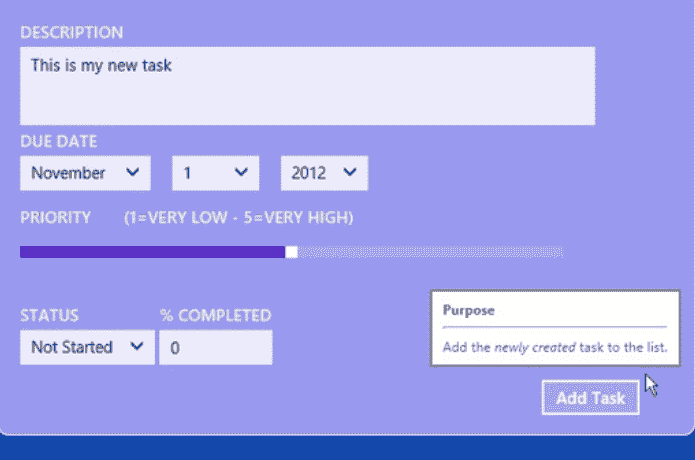

Dino Esposito | Francesco Esposito

图 6-10. 运行中的 TodoList 应用程序。注意“添加任务”按钮上的工具提示。

## 构建和调试应用程序

你在 Visual Studio 解决方案的范围内编写应用程序的源代码。解决方案是应用程序运行所需的所有资源的存储：源文件、清单等。拥有解决方案并不等同于拥有可执行文件；在一种情况下，编译器将你的代码处理为可执行文件。要构建应用程序，按 F7 或从生成菜单选择生成。

调试输出窗口——通常位于 Visual Studio 窗口底部——允许你访问关于应用程序的报告（见图 6-14）。当 Visual Studio 在构建期间发现错误时，它会在那里列出错误。如果一切正常，你可以通过 F5 或从调试菜单选择启动调试来启动应用程序。调试阶段就是运行应用程序以查看它是否符合预期。运行错误出现在调试阶段。关键点在于，通常情况下你必须对出现的特定错误信息保留意见，因为它们是软件的“猜测”，并不总是反映真实的问题。

```javascript
TodoList.Priority = {
  VeryLow: 1,
  Low: 2,
  Normal: 3,
  Migh: 4,
  VeryHigh: 5
};

// 定义 Task
var Task = WinJS.C

// 绑定
var bindableElement = document.getElementById(
WinJS.Binding.

// 设置日期
var datePicker = document.getElementById("taskDueDate")
datePicker.current = task.dueDate;
```

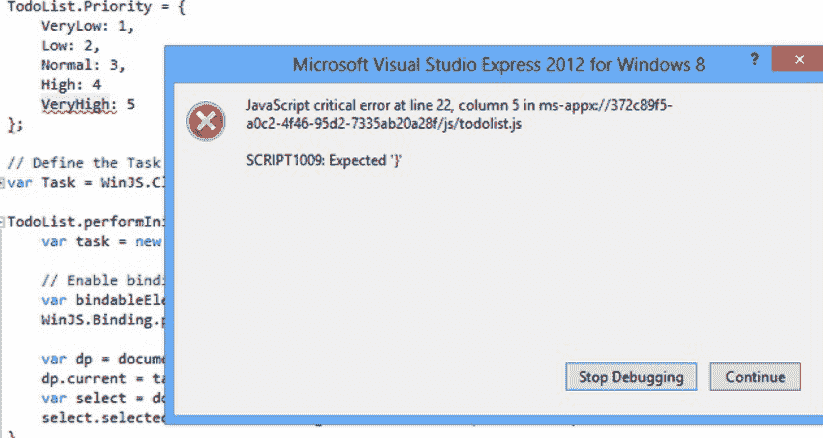

图 6-12. 检测到语法错误。

调试过程中可能遇到的另一种常见情况是发生异常。异常与语法错误不同；在这种情况下，代码在语法上是正确的，但逻辑是错误的，因此在运行时处理实际数据时失败。异常通常由于用户输入错误或由代码产生。图 6-13 显示了由于尝试使用未定义变量导致的异常。

```javascript
WinJS.Binding.processAll(bindableElement, task);
```

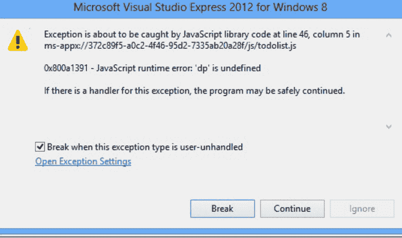

图 6-13. 运行时错误。

弹出窗口（如图 6-13 中的所示）在系统检测到异常时出现。通过点击“中断”停止执行；点击“继续”则指示应用程序尝试继续。大多数时候，你只想中断执行，弄清楚发生了什么问题并修复代码。

如你所示，输出窗口（Output window）提供了一个下拉列表，供你选择所需的报告，无论是关于调试还是构建的。

## 验证输入数据

TodoList 应用程序最后一步是收集输入数据并为用户汇总，以便让他们在选择保存更改之前确认结果。当用户点击“添加任务”（Add Task）按钮时，程序应该对数据进行验证并处理。在这个示例中，你尚不需要对存储进行任何操作，因此用户定义的任务将不会保存到任何地方。然而，信息的验证和汇总是两个非常值得讨论的功能。

打开 `todolist.js` 文件并编辑 `TodoList.addTaskClick` 函数的代码，如下所示：

```javascript
TodoList.addTaskClick = function () {
  var currentTask = TodoList.getTaskUI();

  if (!TodoList.validateInput(currentTask)) {


```javascript
TodoList.alert("There is something wrong with the data you entered.");

return;

}

TodoList.displaySummary(currentTask);

}
```

现在，专注于 `TodoList.validateInput` 函数。该函数接收一个已创建并通过用户界面填充数据的 `Task` 对象。你还需要向 `todolist.js` 文件添加以下代码：

```javascript
TodoList.validateInput = function (task) {

  // 检查描述为空
  if (task.description.length == 0)
    return false;

  // 检查日期为未来日期
  if (task.dueDate <= new Date())
    return false;

  // 检查完成百分比大于0且任务未开始
  // 或者100%完成但状态未标记为完成
  if ((task.percCompleted > 0 && task.status == "Not Started") ||
    (task.percCompleted == 100 && task.status != "Completed") ||
    (task.percCompleted != 100 && task.status == "Completed"))
    return false;

  return true;
}
```

该函数对以下问题返回布尔值：传递的 `Task` 对象是否符合应用程序的目的？代码最终由一系列 `if` 语句组成，用于检查你想要应用的业务规则。

## 汇总结果

在验证任务之前，你需要收集实际数据并将其到 `Task` 对象中。在 WinJS 中，你不能依赖系统为你完成大部分工作。如果你使用 C# 和 XAML 编写 Windows Store，你可以强制系统使用你提供的原始 `Task` 对象来初始化函数，并根据用户通过界面控件所做的任何更改更新它。这种功能被称为双向数据绑定（two-way data binding），但在 WinJS 中并不支持。因此，你需要引入一个像下面的函数。你可以将下面的代码复制到 `todolist.js` 中。

```javascript
TodoListGetFromUI = function () {

  var task = new Task();

  // 读取任务主题
  var taskSubject = document.getElementById("taskSubject");
  task.description = taskSubject.value;

  // 读取任务日期
  var taskDueDate = document.getElementById("taskDueDate").winControl;
  task.dueDate = taskDueDate.current;

  // 读取任务优先级
  var taskPriority = document.getElementById("taskPriority");
  task.priority = taskPriority.value;

  // 读取任务状态
  var taskStatus = document.getElementById("taskStatus");
  task.status = taskStatus.options[taskStatus.selectedIndex].value;

  // 读取任务完成百分比
  var taskPercCompleted = document.getElementById("taskPercCompleted");
  task.percCompleted = taskPercCompleted.value;

  return task;
}
```

当使用 `INPUT` 元素时，你使用 `value` 属性读取其当前内容——无论是文本还是数字。如果你有下拉列表，首先需要获取列表的 `selectedIndex` 属性，然后将索引映射到列表项集合——该集合被称为 `options`。最后，如果你使用了 WinJS 组件（例如日期选择器），你首先需要通过 `winControl` 属性获取其实例。

此时，你已经获取了用户输入的 `Task` 对象，并且该对象可以进行验证。如果验证成功，你就可以继续显示数据的摘要（或直接将其保存到某处）。为了完成这个练习，你现在使用 `Flyout` 组件以格式化的方式显示任务信息。

在 `default.html` 中，在页脚之前添加以下标记。该标记定义了一个 `Flyout` 组件但它是空的。

```html
<div data-win-control="WinJS.UI.Flyout" id="FlyoutSummary"></div>
```

在 `todolist.js` 中，你添加最后一段代码——`TodoList.displaySummary` 函数。该函数将获取 `Flyout` 组件的引用，用任务数据填充它，并显示给用户。

```javascript
TodoList.displaySummary = function (task) {

  var description = "<p><span>DESCRIPTION:</span> " + task.description + "</p>";
  var dueDate = "<p><span>DUE DATE:</span> " + task.dueDate + "</p>";
  var priority = "<p><span>PRIORITY:</span> " + task.priority + "</p>";
  var status = "<p><span>STATUS:</span> " + task.status + "</p>";
  var percCompleted = "<p><span>COMPLETED:</span> " + task.percCompleted + "</p>";

  // 构建整个字符串并将其附加到 flyout
  var summary = description + dueDate + priority + status + percCompleted;
  document.getElementById("flyoutSummary").innerHTML = summary;

  // 显示 flyout
  var anchor = document.getElementById("buttonAddTask");
  var flyoutSummary = document.getElementById("flyoutSummary").winControl;
  flyoutSummary.show(anchor);

}
```

你显示了一个不同的页面，同时也跟踪了用户的导航历史，这让你在将新页面合并到现有布局时，能够提供更好的用户体验。

## 跳转到不同页面

图 7-1 中的图很好地说明了使用原生 Windows Store 导航模型的好处。

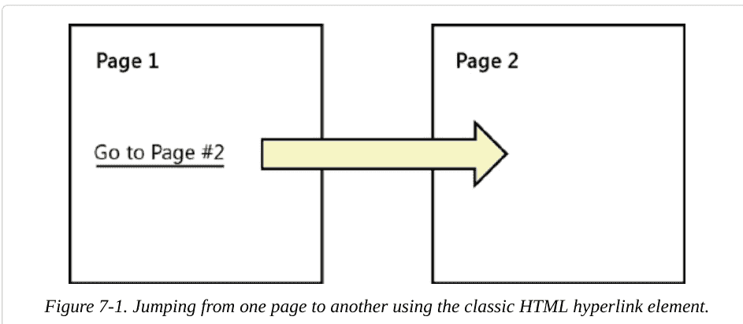

点击链接（或某些按钮）后，用户会看到一个完全不同的页面。你的责任是确保用户感受到强烈的连续感。你通常通过为两个页面提供相同的布局、通用的配色方案和字体来实现这一点。此外，你应该为用户提供返回上一页的链接，因为你不会从系统中自动获得类似于浏览器的返回按钮。

## 显示不同的页面

Windows Store 应用程序导航模型背后的理念是：应用程序由单一主页面和若干页面片段组成。主页面包含页眉、页脚、菜单和其他用户界面的共享部分。相比之下，页面片段仅提供新内容来替换主页面中的内容。通过这种方式，UI 的共同部分在导航过程中保持不变，因此用户感觉只是改变了上下文，而不是跳转到一个完全新的地方。图 7-2 展示了 Windows Store 应用程序导航模型。

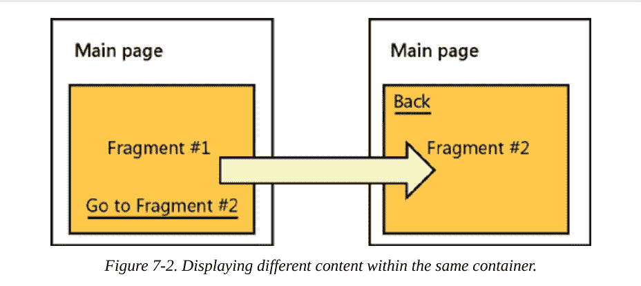

在起始片段中，你可能拥有通过它们控制导航的按钮和控件。并不强制要求使用超链接。当你离开一个页面片段时，系统会完成所有为了向用户有效显示新内容所需的工作。同时，新显示的页面仅负责显示一个返回按钮。返回导航的逻辑由 WinJS 框架静地提供。

## 导航应用模板内部

在本章中构建的第一个示例是你在 Microsoft Visual Studio 中通过 Navigation App 模板创建 Windows Store 应用程序项目时获得的示例应用程序的扩展。现在，让我们熟悉一下编程模型。

## 创建导航应用

你打开 Visual Studio 并使用 Navigation App 模板创建一个全新的项目。你将此项目命名为 `Gallery`，如图 7-3 所示。

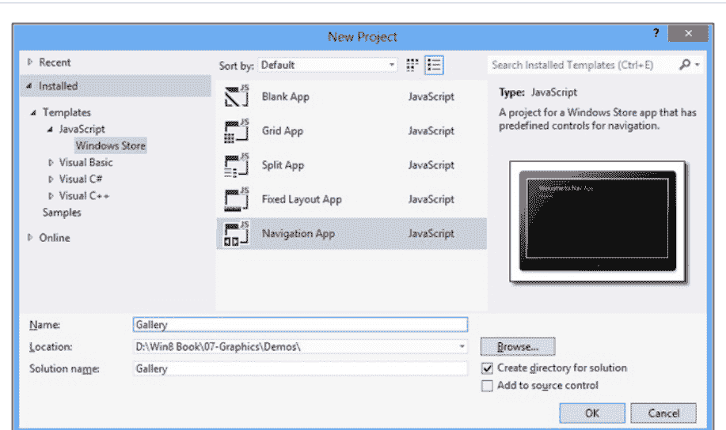

图 7-3. 创建导航应用。

该项目包含比你所的 Blank App 模板更多的文件。熟悉的 `default.html` 页面充当图 7-2 中主页面的角色。辅助文件 `default.css` 和 `default.js` 只为主页面内的元素提供样式表和脚本。

在图 7-4 中，你还会注意到一个新的 `pages` 文件夹。这是你将所有片段页面分组的文件夹，每个页面都在一个独立的子文件夹中。默认的 `pages` 文件夹有一个名为 `home` 的子文件夹；这也是初始可用唯一片段的名称。`home` 文件夹包含 `home.html`、`home.css` 和 `home.js`。这是一个标准模式：CSS 文件包含 HTML 文件使用的所有样式表，JS 文件包含所有所需的脚本。

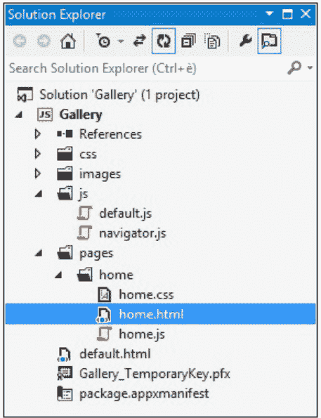

与 Blank App 模板的另一个区别是 `navigator.js` 文件。该文件包含了 `Application.PageControlNavigator` 对象的实现。你可以将此文件视为原生 WinJS 库的扩展。

> 注意：如果你打开 `default.js` 文件并与从 Blank App 获取的相同文件进行比较，你也会发现一些差异。特别是，该文件包含了自动导航到 `PageControlNavigator` 对象 `home` 属性所指向的 URL 的逻辑。

## 设置主屏幕

`default.html` 决定了应用程序的主用户界面。它包含以下代码：

```html
<div id="contenthost"
    data-win-control="Application.PageControlNavigator"
    data-win-options="{home: '/pages/home/home.html'}">
</div>
```

这设置了导航器并使其指向 `home.html`，作为初始屏幕片段的提供者。要进行安排，你需要对 `default.html` 进行修改。例如，你可以将上一章创建的相同的 `header.html` 和 `footer.html` 文件添加到 `pages` 文件夹中。接下来，编辑 `default.html` 的 `BODY`，如下所示：

```html
<div data-win-control="WinJS.UI.HtmlControl"
    data-win-options="{uri: '/pages/home/home.html'}"></div>
```

## 我的宠物库

```html
<div id="contenthost"
    data-win-control="Application.PageControlNavigator"
    data-win-options="{home: '/pages/home/home.html'}">
</div>
```

```html
<div data-win-control="WinJS.UI.HtmlControl"
    data-win-options="{uri: '/pages/footer.html'}"></div>
```

当用户导航到另一个页面时，用户会体验到强烈的连续感。图 7-2 展示了 Windows Store 应用程序导航模型。

接下来，你编辑之前创建的 `Gallery.init` 方法，如下：

```javascript
GalleryApp.init = function () {

  var photos = [
    new Photo("images/data/german-shepherd.png", "German shepherd"),
    new Photo("images/data/tiger.png", "Just bigger than a cat"),
    new Photo("images/data/lion.png", "Just hairier than a cat"),
    new Photo("images/data/leopard.png", "Running as a leopard"),
    new Photo("images/data/thane.png", "Hungry from Denmark")
  ];

  GalleryApp.Gallery = new Gallery(photos);

  var flipView = document.getElementById("gallery").winControl;
  flipView.dataSource = GalleryApp.Gallery.dataSource;

}
```

此时，`FlipView` 组件已绑定到照片数组。如果你现在运行应用程序，它能够正常工作，且 `FlipView` 执行任务表现得非常好。遗憾的是，生成的应用程序对用户来说并没有吸引力。`FlipView` 滚动遍历绑定的 `Photo` 对象列表，但它只能以纯文本的形式渲染它们。图 7-6 显示了此时得到的结果。

还有一段代码需要解释。你打开 `home.js` 文件，并在 `ready` 事件处理程序中添加对 `GalleryApp.init` 的调用，以便在主页加载时初始化 `FlipView`。

```javascript
(function () {

  "use strict";

  WinJS.Pages.init("/pages/home/home.html", {

    ready: function (element, options) {
      GalleryApp.init();
    },

    unload: function () {
    }

  });

})()
```

`unload` 事件处理程序现在是空的，但你稍后会用到它。

# 从这里！使用 HTML5 和 JavaScript 构建 Windows 8 应用程序

## 我的宠物库


Dino Esposito | Francesco Esposito

图 7-6。`FlipView` 仅显示了一些绑定的数据。

## 为项目添加模板

下一步是添加模板，以便 `FlipView` 能够以更好的方式渲染绑定的 `Photo` 对象。你回到 `gallery.js` 并向 `GalleryApp.init` 中添加以下行：

```javascript
FlipView.itemTemplate = document.getElementById("gallery-template");
```

你还需要在 `home.html` 文件中定义 `gallery-template`。你将将其添加到 `home.html` 文件的 `BODY` 部分：

```html
<div id="gallery-template" data-win-control="WinJS.Binding.Template">

  <div id="template-container">

    

    <div class="overlay">

      <h2 data-win-bind="innerText: title"></h2>

    </div>

  </div>

</div>
```

该项目模板由一个 `IMG` 元素和一个 `H2` 元素组成。这些元素绑定到 `Photo` 对象的属性。你还需要在 `home.css` 中添加一些样式：

```css
#gallery {
  width: 600px;
  height: 350px;
  border: solid 4px #5a12f3;
  background-color: #2c668d;
}

.image {
  width: 100%;
  border: solid 1px #fff;
}

#template-container {
  display: -ms-grid;
  ms-grid-columns: 1fr;
  ms-grid-rows: 1fr;
  width: 350px;
  height: 300px;
  background-color: #2faee6;
}

.overlay {
  position: relative;
  background-color: rgba(0,0,0,0.5);
  ms-grid-row-align: end;
  height: 30px;
  padding: 10px;
  margin: 3px;
  overflow: hidden;
}
```


练习的第一步现在已完成：运行应用程序，你应该能看到图 7-7 中的内容。

# 从这里！使用 HTML5 和 JavaScript 构建 Windows 8 应用程序

## 我的宠物库

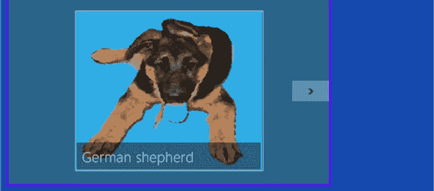

Dino Esposito | Francesco Esposito

图 7-7。一个功能完整的 `FlipView` 组件。

## 导航到详情页

如果图片库不能允许用户点击显示的项目并导航到详情页，那么它就称不上是一个库。这正是你在练习第二步中要做的。

### 获取绑定的项目

第一步，你为包含项目模板的 `DIV` 元素添加一个点击处理程序。你只需在 `DIV` 元素上添加 `onclick` 属性，如下所示。这样，每当用户点击（或触摸）`DIV`——基本上是整个图像区域——她就会触发处理程序。

```html
<div id="template-container" onclick="GalleryApp.showDetails()">

  ...

</div>
```

在点击处理程序中，你需要做几件事。首先，获取所选项目的索引。其次，导航到详情页。

翻转视图的照片。因此，为了完成练习的这部分，你还有两个步骤需要完成：找到一种持久化翻转视图中最后访问的照片索引的方法，并为详细页提供更丰富的模板。

## 跨页面导航持久化信息

当你从一个页面导航到下一个页面时，应用程序的上下文会发生变化，现有控件会被关闭。跳转到详细页时，翻转视图会被关闭，当返回主页时，它又会被重新创建。导航瞬间可见的照片索引会丢失。要修复这个问题，你需要完成以下三个步骤：

1. 将当前可见项的索引存储在某个在页面变化中存储器中。
2. 指令翻转视图接受一个额外的参数，用于指示起始项。
3. 从存储器检索最后访问的索引并将其传递给翻转视图；如果找不到索引，则告诉翻转视图从绑定列表中的第一个项开始。

对于第一步，回到 `home.js` 并在 `unload` 事件处理程序中添加一行。

```javascript
(function () {

  "use strict";

  WinJS.UI.Pages.define("/pages/home/home.html", {

    ready: function (element, options) {

      GalleryApp.init();

    },

    unload: function () {

      WinJS.Application.sessionState.currentPhotoIndex = GalleryApp.

      getCurrentPhotoIndex();

    }

  });

})();
```

`unload` 事件处理程序响应离开页面的导航。在此事件处理程序内部，你可以将当前照片的索引保存到应用程序的会话状态中。`WinJS.Application` 对象的 `sessionState` 属性是系统提供的容器，开发者应从中保存可以在应用程序挂起和恢复后恢复状态的信息。`sessionState` 对象是一个简单的字典，可以随意构建形状。换句话说，如果你需要向 `sessionState` 对象添加自定义属性，只需直接添加即可——正如你在前面的代码段中对 `currentPhotoIndex` 所做的那样。

在这种情况下，应用程序不会被挂起——应用程序只是导航到另一个页面——但 `sessionState` 仍然有效，而且更好的是，你最终拥有一个可以在从挂起恢复时显示其原始状态的翻转视图。

> **注意**
> 应用程序挂起几乎不适用于在笔记本电脑或 PC 上的应用程序。这是适用于运行在移动设备上的应用程序的场景。例如，当平板电脑上在前景中运行另一个应用程序或屏幕被激活时，应用程序会被挂起。

让我们看看如何指令翻转视图从 `sessionState` 获取信息，以及如何从给定项开始。再次打开 `gallery.js` 并在 `GalleryApp.init` 函数的末尾添加以下行。

```javascript
var startIndex = WinJS.Application.sessionState.currentPhotoIndex;

flipView.currentPage = startIndex;
```

如果没有信息保存到 `sessionState` 中，则 `startIndex` 变量被设置为 `undefined`。然而，`FlipView` 组件足够智能，如果设置到其 `currentPage` 属性的值不是有效索引，它将从第一个元素开始任何位置启动。

## 图像放大和缩小

为了完成练习，你现在需要为详细页添加一些模板和行为。其思路是显示用户在翻转视图中点击的相同图像，并启用一些缩放功能。

## 为详细页定义模板

首先，你为详细页编写一些额外的标记。打开 `details.html`，用以下内容填充你在页面 `body` 中找到的 `SECTION` 元素：

```html
<section aria-label="Main content" role="main">

  

</section>
```

你在翻转视图中选定的相同图像现在显示在详细页中。作为用户，你希望如何放大图像？这是一个值得关注的点。

在经典的 PC 应用程序中，典型用户可能会觉得点击图像放大和点击右键缩小是自然而然的。然而，Windows Store 应用程序的设计不仅用于 PC，还用于支持触摸的设备（如平板电脑）。对于平板电脑用户来说，理想的缩放手势是“双指缩放”。在 WinJS 中实现双指缩放绝对是可能的，但这留给了你决定。此外，它无法解决在非触摸设备上的缩放问题。为了简单起见，你可以选择另一种适用于触摸和非触摸设备的方法。

> **注意**
> WinJS 提供了 `GestureRecognizer` 类来提供有关用户执行的触摸操作的信息。你可以使用此类来了解在双指移动过程中手指的起始位置和最终位置之间的距离。如果距离为正，则放大；否则缩小。

## 添加滑块选择缩放级别

在图像上设置缩放级别（但更通用地适用于任何可缩放内容）的一种在任何设备上都运行良好的技巧是使用滑块。事实上，滑块可以通过鼠标和手指轻松操作。要在详细页中添加滑块，你需要在 `details.html` 中包含以下标记。

```html
<section aria-label="Main content" role="main">

  <input id="zoom-slider" type="range" min="1" max="5" value="1" step="0.1" onchange="GalleryApp.image()">

  <b>Zoom level: </b><span id="zoom-level">1</span>

  <div id="zoomable-image-container">

    

  </div>

</section>
```

滑块由 `type` 设置为 `range` 的 `INPUT` 元素提供。`min` 和 `max` 属性指示用户可以选择的值范围。`step` 属性指示增量或减少的步长。由于你正在使用滑块设置缩放级别，`0.1` 的步长提供了良好的体验。

默认情况下，WinJS 滑块会显示提示框以提供设置值的视觉反馈。由于某种原因，你想消除提示框。这只需要在 `details.css` 中进行简单的编辑：

```css
.details input[type=range]::-ms-tooltip {

  display: none;

}
```

注意样式表中的 `.details` 令牌对标记为 `details` 类的组件抑制提示框。`details` 类用于标记 `details.html` 页面的 `body`。你可以通过查看 `details.html` 的完整源代码来交叉检查。

## 操作图像

滑块具有 `onclick` 事件的处理程序。需要这种处理程序以便在滑块选择更改时有机会执行某些工作。特别是你可能想要更新缩放级别标签附近的文本，并相应地放大图像。所需的代码添加到 `gallery.js` 文件中：

```javascript
GalleryApp.image = function () {

  var container = document.getElementById("zoomable-image-container");

  var slider = document.getElementById("zoom-slider");

  var img = document.getElementById("zoomable-image");

  var label = document.getElementById("zoom-level");

  // 进行计算

  var w = container.clientWidth;

  var h = container.clientHeight;

  var zoom = slider.value;

  var offset = ((w * zoom) - w) / 2;

  // 刷新界面

  img.style.left = zoom;

  container.scrollLeft = offset;

  container.scrollTop = offset;

  label.innerHTML = zoom;

}
```

可缩放图像位于一个 `DIV` 容器中，样式如下所示。该样式应添加到 `default.css`。

```css
#zoomable-image-container {

  width: 250px;

  height: 250px;

  border: solid 1px #fff;

  position: relative;

  overflow: scroll;

}
```

缩放级别的值被保存到 `zoom` 变量中，并用于计算容器内容的偏移量。偏移量是容器当前宽度（和高度）与更新缩放级别的图像有效尺寸之间差的一半。通常情况下，你需要同时具备水平和垂直偏移量。在这个示例中，假设图像是正方形的，因此你只需要计算一个偏移量。图 7-10 解释了计算背后的逻辑。

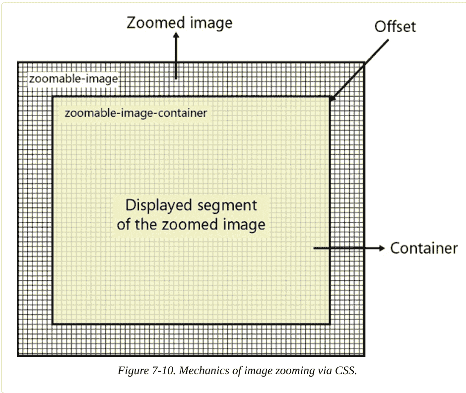

图 7-11 显示了练习的最终结果。

# 从这里开始！使用 HTML5 和 JavaScript 构建 Windows 8 应用程序

## 我的宠物画廊

比猫更毛

缩放级别：2.6

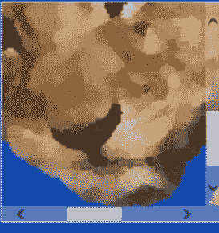

Dino Esposito | Francesco Esposito

图 7-11. 图像的放大与缩小。

## 构建视频剪辑画廊

在构建完图像画廊后，让我们尝试使用不同的控件来组织导航，构建一个视频画廊。准确来说，在这个新的练习中将会有导航，但它将嵌入在一个新组件中——`SemanticZoom` 组件。应用程序将按类别对剪辑进行分组，并在用户做出选择后显示可用的剪辑。最后，点击剪辑将播放视频。

> **注意**
> `SemanticZoom` 组件仅提供一种通过主/详情（master/detail）方式对某些内容进行固定形式导航。你在上一个练习中发现的导航应用程序接口（API）相反是一个更强大、更通用的 API，用于在任意数量的页面和任意嵌套层级之间导航。

## 引入 SemanticZoom 组件

由于依赖特定组件内置的功能来切换主视图和详情视图，因此无需从 Navigation App 模板开始。创建一个新的空白（Blank App）项目并命名为 Video。按照惯例，你可能想添加 `header.html` 和 `footer.html` 并对 `default.css` 进行编辑，以便应用程序的视觉效果与其他示例保持一致。特别是，你可能想在 `default.css` 中导入过去所有示例中使用的 HEADER、FOOTER 和 BODY 元素的样式。

> **重要**
> 除非另有说明，`header.html`、`footer.html` 以及 `default.css` 的相关更改将被视为后续任何练习的必要先决步骤。另注意，如果你错过了这些，可能不会遇到任何严重的不便——最坏的情况下你会遇到图形上的不一致！

几乎所有 Windows 应用程序中在后续练习中被视为当然的另一个方面是启动代码注入应用程序的方式。因此你在 `default.js` 的激活事件处理程序中添加了 `then` 函数调用。实现相同功能的更整洁但等等的方法如下：

```javascript
app.onready = function (args) {

  VideosApp.init();

};
```

你将此代码放在 `default.js` 文件通常包含的 `onready` 函数中。在函数内部，你只需为练习创建的特定应用程序对象调用 `init` 函数。书中所有练习的标准模式是将大多数脚本汇集在单个 JavaScript 文件中，并使用 `init` 函数来完成所有的初始化工作。

## 什么是语义缩放（semantic zoom）？

尽管名称如此，但语义缩放与“缩放”（zooming）的关系很小——至少根据目前为止该术语的常用含义来说。该组件的作用是在相同内容的两种不同视图之间切换。一种是主视图（master view）；另一种是详情视图（detail view）。详情视图被认为是放大视图，即内容区域最详细的视图。相反，主视图被称为缩小后的视图（zoomed-out view），即元素按类别分组以便于选择的视图。

## 为语义缩放准备工作

你通过添加三个 `DIV` 元素为语义缩放准备页面。以下是需要在 `default.html` 页面的 `BODY` 元素中输入的代码。

```html
<div id="semantic-zoom-container"

  data-win-control="WinJS.UI.SemanticZoom">

  <!-- 放大后的视图 -->

  <div id="listview-in"

    data-win-control="WinJS.UI.ListView"></div>

  <!-- 缩小后的视图 -->

  <div id="listview-out"

    data-win-control="WinJS.UI.ListView"></div>

</div>
```

父级 `DIV` 映射到 `WinJS.UI.SemanticZoom` 组件的实例。两个子 `DIV` 映射到 `WinJS.UI.ListView` 组件的实例。好消息是，你只需要关注为列表视图提供模板和内容；视图之间的切换和数据的用户界面由 `SemanticZoom` 组件温和地提供。

## 为语义缩放定义即时数据

一如既往，你向项目添加一个新的 JavaScript 文件来包含应用程序的大部分逻辑。在这种情况下，你可以将文件命名为 `videos.js`。接下来，打开文件并添加以下代码：

```javascript
var VideosApp = VideosApp || {};

var Clip = WinJS.Class.define(function(category, title, id) {

  var that = {};

  that.title = title;

  that.category = category;

  that.videoId = id;

  that.videoUrl = "http://www.youtube.com/embed/" + id;

  that.posterUrl = "img.youtube.com/vi/" + id + ".jpg";

  return that;

});

VideosApp.init = function () {

  var videos = [

    new Clip("Shots", "前10 网球", "1"),

    new Clip("Fun", "非常有趣的得分", "2"),

    new Clip("Shots", "2012 年最佳网球击", "3"),

    new Clip("Shots", "疯狂的穿越球", "4"),

    new Clip("Events", "最重要的比赛", "5")

  ];

  // 从数组创建 WinJS.List。

  var videosList = new WinJS.List(videos);

  var videosGrouped = videosList.createGrouped(

    function (clip) { return clip.category; }, // 按此分组

    function (clip) { return { category: clip.category } } // 用于主视图的数据

  );

};
```


现在你拥有一组与网球相关的视频剪辑，并将它们分为三个大类：Shots（击球）、Fun（趣味）和 Events（事件）。不用说，这种分类完全是任意的，类别标题完全由你决定。

## 为语义缩放分组数据

在 Windows 应用程序中，不允许对原始数组进行数据绑定；你首先需要将数组转换为绑定列表。通过 `WinJS.List` 对象来实现此操作。这正是你在上一个练习中填充 `FlipView` 组件时所做的。在使用 `SemanticZoom` 组件时，需要一个额外的步骤。

绑定列表对象暴露了 `createGrouped` 方法，通过它可以创建一个分组绑定列表。如你所示，`createGrouped` 方法接受两个函数作为参数。第一个函数标识分组的键。第二个函数返回用于渲染主视图每个项的 JavaScript 对象。让我们仔细查看代码。

```javascript
var videosGrouped = videosList.createGrouped(

  function (clip) { return clip.category; },

  function (clip) { return { category: clip.category } }

);
```

两个函数都会作用绑定列表中的每个项。第一个函数返回分组的表达式。在这种情况下，你按类别分组视频剪辑。第二个函数返回一个包含你打算显示的信息的字面量 JavaScript 对象。

将数据绑定到 `SemanticZoom` 组件及其子 `ListView` 组件需要几行代码。在 `videos.js` 的 `VideosApp.init` 函数末尾，添加以下内容：

```javascript
var detailView = document.getElementById("listview-in").winControl;

detailView.itemDataSource = videoListGrouped.dataSource;

detail.groupDataSource = videoListGrouped.groups.dataSource;

detailView.itemTemplate = document.getElementById("zoomed-in-template");

detailView.groupHeaderTemplate = document.getElementById("header-template");

var masterView = document.getElementById("listview-out").winControl;

masterView.itemDataSource = videoListGrouped.groups.dataSource;

masterView.itemTemplate = document.getElementById("zoomed-out-template");
```

注意，你需要对详情视图进行两次绑定。首先，你提供普通项目列表，然后提供计算后的分组列表。为了获得最佳效果，详情视图需要一个项目模板（item template）和一个头部模板（header template）。主视图只需要绑定的项目列表和一个项目模板。

在查看效果之前，回到 `default.html` 并在标记中添加几个模板。

```html
<!-- 放大后详情视图的模板 -->

<div id="header-template" data-win-control="WinJS.Binding.Template">

<div class="header-title">

  <h1 data-win-bind="innerText:category"></h1>

</</div>

</</div>

<!-- 放大后详情视图的模板 -->

<div id="zoomed-in-template" data-win-control="WinJS.Binding.Template">

<div class="zoomed-in-item-container">

  

  <div>

    <h3 data-win-bind="innerText: category"></h3>

    <h6 data-win-bind="innerText: title"></h6>

  </div>

</div>

</</div>

<!-- 缩小后主视图的模板 -->

<div id="zoomed-out-template" data-win-control="WinJS.Binding.Template">

<div class="zoomed-out-item-container">

<div><h1 data-win-bind-innerText="innerText: category"></h1></div></div></div></div>
```

标记中的元素样式非常丰富；因此，也需要对 `default.css` 进行处理。打开文件并输入以下 CSS 样式：

```css
.header-title {

  width: 50px;

  height: 50px;

  padding: 8px;

}

.zoomed-in-item-container {

  width: 280px;

  height: 70px;

  padding: 5px;

  overflow: hidden;

}

.zoomed-in-item-container img {

  width: 60px;

  height: 60px;

  margin: 5px;

  -ms-grid-column: 1;

}

.zoomed-in-item-container div {

  margin: 5px;

  -ms-grid-column: 2;

}

.zoomed-out-item-container {

  width: 220px;

  height: 130px;

  background-color: #31cfd4;

}

.zoomed-out-item-container h1 {

  padding: 10px;

  line-height: 150px;

  white-space: nowrap;

  color: #fff;

}

#listview-in-in {

  width: 650px;

  height: 300px;

  border: solid 2px #111;

}

#semantic-zoom-container {

  width: 600px;

  height: 350px;

  border-top: solid 2px #31cfd4;

  border-bottom: solid 2px #31cfd4;

}
```

应用程序已准备好测试。

## 使用渐变作为背景

你可能注意到，目前为止使用的所有颜色——尤其是背景颜色——都是纯色。Windows 8 强调简洁，纯色是该策略的一部分。然而，这并不意味着你可以使用渐变。

Windows Store 应用完全支持 CSS3，而 CSS3 确实有关于渐变的章节。这里有一个精美的（径向）渐变示例，可以让列表视图的背景变得更漂亮。

```css
#semantic-zoom-container {

  background: -ms-radial-gradient(center, ellipse cover, #c5deea 0%,#8abbd7 31%,#066dab 100%);

}
```

语法相当简单，基于颜色/百分比成对。特别地，渐变从 `#c5deea` 开始，向 `#8abbd7` 混合，并在达到约 31% 的覆盖率时；渐变以颜色 `#066dab` 结束。如果你喜欢渐变，可以使用以下语法：

```css
background: -ms-linear-gradient(left, #3b679e 0%,#2b88d9 50%,#207cca 51%,#7db9e8 100%);
```

想要对渐变进行实时实验，可以访问 `http://www.example.com`。（注：原始链接似乎损坏或为占位符）。

## 注意

你应当意识到，目前并不是所有的 YouTube 视频可以在 Windows Store 应用程序中播放。首先，视频所有者可能禁用了视频嵌入。其次，目前 YouTube 不会通过 HTML5 `VIDEO` 元素播放任何包含广告或字幕的视频。欲需更多信息，请查看 `http://www.youtube.com/html5`。

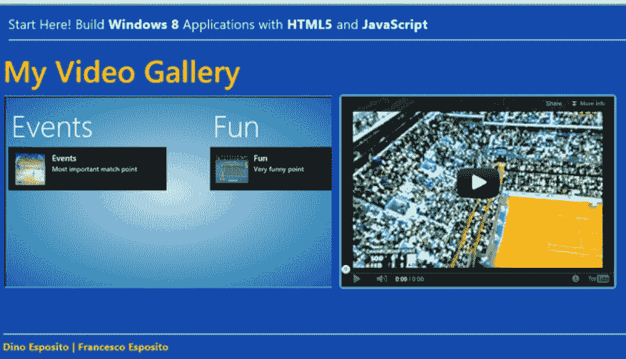

图 7-14。视频画库应用程序的最终版本。

## 总结

通过本章，你完成了 Windows Store 应用程序表示层的概述。你学习了如何创建和管理特殊的视图，例如翻转视图（flip views）、列表视图（list views）以及主/详细视图（其高级名称为语义缩放）。你还体验了导航系统，并了解跳转到不同页面以及向该页面传递信息所需的内容。在本章中，我们还涉及了通过应用程序会话状态实现状态持久化。

在此过程中，你还完成了几个非凡的练习，并构建了两个交互式的图像和视频画库。在这些练习中，你处理的是一组固定的图像和视频；然而，你学习了画库和交互的基础。一旦你掌握了文件和数据管理的基础，就准备好为 Windows 8 构建真实世界的应用程序了。

下一章仍然围绕应用程序的视觉方面。不过，它并不涉及许多新的控件和组件。它将关于应用程序的状态以及相关的显示模式。

# 第 8 章 Windows 8 应用程序的状态

没有计划的目标仅仅是愿望。

> —安托万·圣埃克苏佩里 (Antoine de Saint Exupery)

几十年前，推出一种允许多个应用程序并排运行的窗口化操作系统的想法是非常具有革命性的。在微软 Windows（以及其他类似的操作系统）出现之前，用户习惯于一次只处理一个应用程序。活跃的应用程序会控制机器及其计算资源，并用其内容填充整个屏幕。

最近，单应用应用程序在前台运行的想法被 iOS、Windows Phone 和 Android 等移动操作系统所翻新。在经历了多年 Windows 及其多个应用程序在独立窗口中并发运行之后，这种“一次运行一个应用程序”的模式对许多用户来说是一种冲击。

Windows 8 又是如何的？

如果你在桌面模式下运行 Windows 8，它始终是同一个 Windows，带有多个可以随时打开的相互重叠的窗口。但如果你运行的是 Windows Store 应用程序，你会发现每个应用程序通常占据全屏，在不切换到其他应用程序并让它们反过来占据全屏的情况下，你无法与其他应用程序进行交互。准确地说，Windows Store 应用程序可以处于多种状态——全屏（包括横屏和竖屏）、填充（filled）和贴靠（snapped）。当不以任何全屏模式运行时，Windows Store 应用程序将与第二个应用程序共享可用屏幕：一个应用程序以贴靠方式运行，另一个以填充方式运行。

这对你意味着什么？

理想情况下，你应该为你的应用程序提供某种程度的适应，以便状态得以保留且用户界面能够适应更小的空间。处理填充和贴靠视图将是本章的主题。

## Windows Store 应用程序的状态

Windows Store 应用程序强调为用户提供全屏和沉浸式的体验。一方面，设计指南建议你保持用户界面尽可能简单且专注，以避免用太多项目填充屏幕。另一方面，随着屏幕分辨率越来越大，你面临面临着用极少的内容占据大型 PC 屏幕的风险。

由于 Windows 8 是一个从头开始为不同尺寸的设备创建的操作系统，因此将用户界面（以及后的用户体验）适应不同屏幕的整个主题具有时代性。

Windows 8 为应用程序定义了几种视图状态，Windows Store 应用程序在视图状态更改时会接收适当的通知。接下来发生什么取决于应用程序。让我们了解更多关于预定义的视图状态。

## 全屏视图状态

在全屏模式下运行的应用程序占据整个屏幕。除非在应用程序启动期间另有指定，否则这是任何 Windows Store 应用程序的默认视图状态。准确地说，Windows 8 定义了两全屏模式——对应设备的每种方向。

### 横屏模式 (Landscape mode)

横屏模式表示设备水平握持，宽度大于高度。可以通过查看 `Windows.UI.ViewManagement.ApplicationViewState` 对象返回的值来程序检测横屏模式。以下代码段显示了如何检测横屏模式：

```javascript
// 获取当前视图状态

var currentState = Windows.UI.ViewManagement.ApplicationView.value;

// 验证应用是否正在全屏横屏模式下运行

if (currentState === Windows.UI.ViewManagement.ApplicationViewState.fullScreenLandscape) {

  ..

}
```

操作系统检测设备的旋转并自动翻转用户界面，通知应用程序任何变化。

### 竖屏模式 (Portrait mode)

竖屏模式表示可用屏幕高度现在大于宽度。这种分辨率意味着应用程序让内容垂直流向可能更好，因为有更多空间填充，且用户可能发现向下滚动比向左滑动更简单。以下代码段显示了如何检测竖屏模式：

```javascript
// 获取当前视图状态

var currentState = Windows.UI.ViewManagement.ApplicationView.value;

// 验证应用是否正在全屏竖屏模式下运行

if (currentState === Windows.UI.ViewManagement.ApplicationViewState.fullScreenPortrait) {

  ..

}
```


同样在这种情况下，操作系统检测设备的旋转并自动翻转用户界面。

> **重要**
>
> 某些设计为水平扩展的内容可能需要重新组织，以便在竖屏模式握持的设备上看起来很棒，这并不稀奇。操作系统不处理这一方面。操作系统所做的仅仅是让应用程序知道视图的变化并请求重绘。

# 贴靠应用程序（Snapping applications）

用户可以在贴靠状态将当前后台运行的应用程序之一变为贴靠状态。作为用户，你在设备左侧弹出切换列表，并右键点击所选应用程序的磁贴。如图 8-1 所示，你可以决定将应用程序贴靠左侧或右侧。

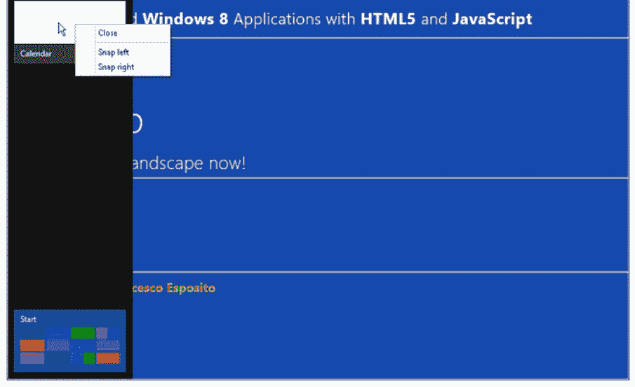

图 8-1。将后台应用程序转换为贴靠状态。

此操作的结果如图 8-2 所示。当贴靠开启时，一个应用程序被称为贴靠的；之前在全屏下运行的另一个应用程序变为名为“填充”（filled）的视图状态。

# 贴靠视图状态（The snapped view state）

贴靠时，应用程序被调整大小为屏幕的一部分，宽度仅为 320 像素并占据屏幕的高度。如图 8-2 所示，其余屏幕由之前在前台运行的应用程序填充。因此，通过贴靠，用户可以让两个应用程序处于前台，并真正同时处理它们。

> **重要**
>
> 关于 Windows 8 贴靠有几个关键点需要注意。首先，贴靠仅在屏幕水平分辨率至少为 1366 像素时才可用。在较低分辨率上贴靠应用程序的用户将发现图 8-1 中的右键菜单仅限于“关闭”选项。其次，贴靠仅在横屏模式下可用。如果你贴靠了一个应用程序，然后将设备旋转到竖屏，就会失去这种效果。未贴靠的应用程序将在竖屏视图下全屏运行。然而，贴靠设置会被保留，并在用户一旦旋转回横屏视图后自动恢复。

此外，你还应该注意用户也不允许任意调整贴靠区域的大小。图 8-2 中分隔贴靠区域的分割条并且应用程序不能随意移动。如果用户将拆分栏向右移动，她可以实现以下效果之一：两个应用程序交换它们的视图状态，或者被贴靠的应用程序进入全屏模式，将另一个推到后台。在第一种情况下，结果将是日历应用切换到填充状态，而另一个应用程序被贴靠到右边缘。

# 填充视图状态

当开启贴靠功能时，屏幕由两个应用程序水平共享：被贴靠的应用程序和填充的应用程序（见图 8-3）。

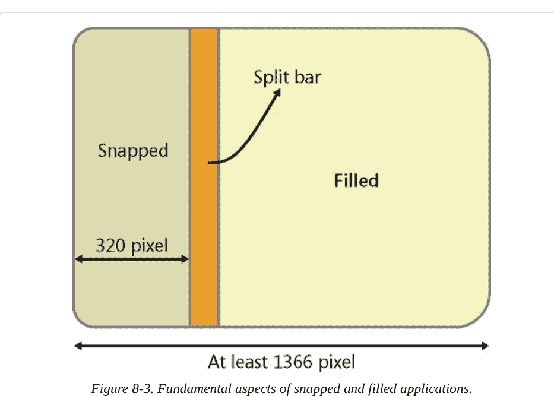

任何应用程序在它的生命周期内都可能经历这两种视图状态。显示模式取决于用户，而不是应用程序。从应用程序的角度来看，对视图状态的支持（包括贴靠和填充视图状态）意味着它已准备好在不同尺寸的屏幕上渲染任何内容。

Windows Store 应用程序在运行于全屏不同的视图状态时，其行为不应该发生变化。特定的指南建议了这一点。可以合理预期，当应用程序在横屏、竖屏或填充模式下运行时，其行为和用户界面的变化非常小。同时，并不是所有的应用程序都能缩放到原始屏幕的一小部分并仍然保持其 100% 的功能。

你将很快看到如何在 Windows Store 应用程序中检测视图状态的变化，以及支持不同分辨率对你的应用程序可能意味着什么。在继续之前，请看图 8-4。

该图显示的不是截图，而是包含一张示意图，旨在说明（某些）应用程序适应不同分辨率的困难。

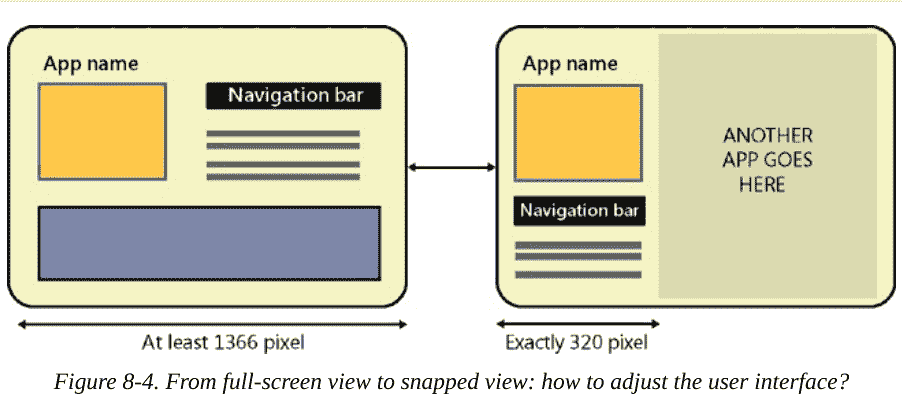

在贴靠状态下，应用程序只有 320 像素宽来渲染其用户界面。在大多数情况下，该宽度至少是原来的三倍。

Windows Store 应用程序的一个黄金法则可以快速总结为：“准备好在大约 320 x 760 像素上执行重大操作。”

# 使应用程序具有响应性

现在看看应用程序为了检测并可能处理视图状态变化应该做什么。从 Blank App 项目模板创建一个新的 Windows Store 应用程序；你可以将此应用程序命名为 `SnapMe`。接下来，对项目进行你在之前所有示例中所做的的所有初步更改。这包括例如添加页眉和页脚、向`default.css`文件添加一些样式，以及一个应用程序特定的脚本文件。我们将新脚本命名为 `SnapMeApp.js`。

# 为应用程序开发引入新实践

在之前的章节中，你并没有怎么关注应用程序的状态。事实上，你所做的所有练习基本上都涉及无状态应用程序。几乎任何应用程序都有状态，该状态会在用户操作应用程序时进行更新。当应用程序挂起时，需要将状态保存到持久存储中。这样，你可以在应用程序恢复或重新启动时轻松恢复它，从而给用户带来良好的连续感。

带着这一目标，你在新创建的 `SnapMeApp.js` 文件中添加以下代码：

```javascript
var SnapMeApp = SnapMeApp || {};

var SnapMeState = WinJS.Class.define(function () {

  var that = {};

  that.currentState = SnapMeApp.getViewStateForDisplay();

  that.total = 0;

  return that;

});
```

```javascript
SnapMeApp.init = function () {

  SnapMeApp.Current = new SnapMeState();

  var buttonCounter = document.getElementById("buttonCounter");

  buttonCounter.addEventListener("click", SnapMeApp.add);
```

```javascript
SnapMeApp.refresh();
```

你将构建的示例应用程序将包含一个按钮，点击时它会增加计数器变量。`SnapMeState`是一个描述应用程序状态的类。类中的`total`属性计算点击次数。`currentState`属性包含一个引用应用程序当前视图状态的消息。

在`SnapMeApp.init`函数中，你初始化了应用程序的状态并为按钮的点击事件注册了处理器。你还注册了`SnapMeApp.init`函数在应用程序就绪时调用。你需要在`default.js`中包含以下代码：

```javascript
app.onready = function (args) {

  SnapMeApp.init();

}
```

你需要在`default.html`页面的`body`中有的标记，放置在页眉和页脚页之间：

```html
<h1>My App</h1>

<h2 id="currentViewState">current</h2>

<hr />

<button id="buttonCounter">Counter</button>

<h3 id="total">total</h3>
```

另一个要练习的新概念是状态、行为与更新用户界面的逻辑之间的分离。你添加以下代码来表示与点击按钮相关的行为。这段代码位于`SnapMeApp.js`文件的底部：

```javascript
SnapMeApp.add = function () {

  // 这是应用程序行为的一部分

  SnapMeApp.Current.total++;

  // 这更新了用户界面

  SnapMeApp.refresh();

}
```

```javascript
SnapMeApp.refresh = function () {

  // 使用当前视图状态更新标签

  var stateElem = document.getElementById("currentViewState");

  stateElem.innerHTML = SnapMeApp.Current.currentViewState;

  // 使用总点击次数更新标签

  var totalElem = document.getElementById("total");

  totalElem.innerHTML = SnapMeApp.Current.total;

}
```

有了`SnapMeApp.refresh`函数，你就不需要在更新用户界面之前从控件中获取信息了。同样，你不需要从处理视觉元素事件的代码中直接刷新用户界面。通过这种方式，整个代码更加整洁，更容易开发和改进。

# 检测视图状态变化

下一步是为`SnapMe`应用程序添加更多功能，使其能够检测视图状态变化并做出相应响应。目前，你只会记录新的视图状态并通过`currentViewState`标签将其显示给用户。

任何使用 JavaScript 和 HTML 的 Windows Store 应用程序通过`window`对象的`on`事件接收视图状态变化的通知。每当托管应用程序的窗口调整大小时，该事件就会触发。在 Windows 8 中，这只有在设备旋转导致方向变化或一个应用程序被贴靠或取消贴靠时才会发生。要接收`resize`事件，你需要注册一个处理器。最好的位置是`SnapMeApp.init`函数。以下是函数的最终版本代码：

```javascript
SnapMeApp.init = function () {

  window.addEventListener('resize', SnapMeApp.onResize, false);

  SnapMeApp.Current = new SnapMeState();

  var buttonCounter = document.getElementById("buttonCounter");

  buttonCounter.addEventListener("click", SnapMeApp.add);
```

```javascript
SnapMeApp.refresh();

}
```

随后，你还需要在`SnapMeApp.js`文件底部添加新的`SnapMeApp.onResize`函数。

```javascript
SnapMeApp.onResize = function (e) {

// 检测当前视图状态并将其保存字符串

SnapMeApp.Current.currentViewState = SnapMeApp.getViewStateForDisplay();

// 刷新用户界面

SnapMeApp.refresh();

}
```

如所述，当前视图状态由系统提供的全局对象`Windows.UI.ViewManagement.ApplicationViewState`枚举以整数返回。该枚举包含四个值——对应每种可能的状态。我们的现成方法方便开发者对特定的视图状态进行检查。常量如下：

- `Windows.UI.ViewManagement.ApplicationState.snapped`
- `Windows.UI.ViewManagement.ApplicationState.filled`
- `Windows.UI.ViewManagement.ApplicationState.fullscreenLandscape`
- `Windows.UI.ViewManagement.ApplicationState.fullscreenPortrait`

以下代码将指示视图的状态转换为可显示的文本。该代码也属于`SnapMeApp.js`文件。

```javascript
SnapMeApp.getViewStateForDisplay = function () {

  var viewState = Windows.UI.ViewManagement.ApplicationView.value;

  switch (viewState) {

    case Windows.UI.ViewManagement.ApplicationState.snapped:

      return "I snapped now!";

    case Windows.UI.ViewManagement.ApplicationState.filled:

      return "I filled now!";

    case Windows.UI.ViewManagement.ApplicationState.fullscreenLandscape:

      return "I full screen landscape now!";

  }

}
```

```cs
Windows.UI.ViewManagement.ApplicationViewState.fullFullScreenPortrait:

    return "I'm full screen portrait now!";

}
```

现在你已经准备好编译示例应用程序。图 8-5 显示了结果：应用程序最初以全屏横屏启动。请注意，如果设备在启动启动时处于竖屏模式，你将获得不同的视图状态值——全屏竖屏。

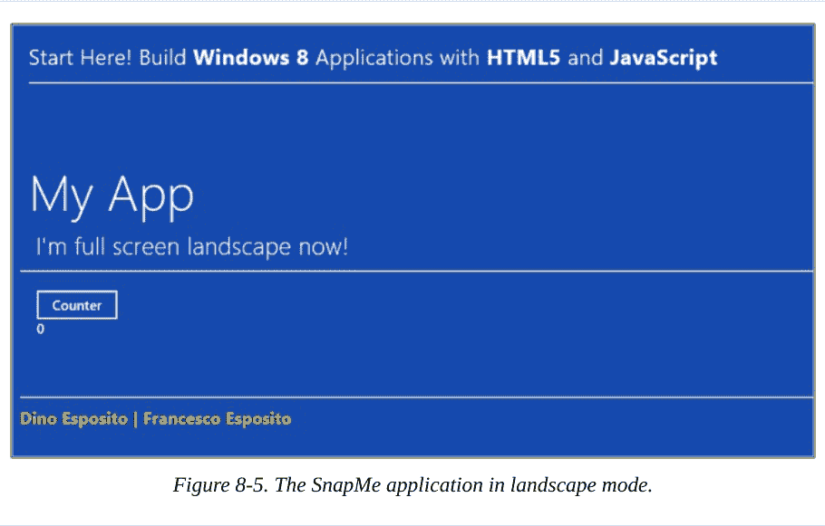

图 8-5。横屏模式下的 SnapMe 应用。

有趣的是，Microsoft Visual Studio 拥有一个带有内置功能的模拟器，可用于实验方向切换。图 8-6 显示了如何在模拟器中更改方向，以测试 SnapMe 应用是否正确检测到竖屏模式。


最后，图 8-7 显示了示例应用程序贴靠到屏幕左边缘时的用户界面。

图 8-6。在 Visual Studio 模拟器中运行的 SnapMe 应用。


每当用户点击按钮时，应用程序状态对象的`total`属性就会更新并通过用户界面显示。当应用程序被贴靠、取消贴靠或方向改变时，状态会发生什么变化？

如果应用程序处于前台（无论是全屏、贴靠还是填充模式），方向和视图更改事件将影响应用程序的状态。如果应用程序在后台运行，它将不会接收到任何这些事件。

## 调整应用程序内容

到目前为止，你还没有真正体验过必须支持多种分辨率的应用程序的复杂性。为了尝试解决这个问题，请对`default.html`文件进行以下更改：

```html
<div style="width: 500px; background-color: red;">

  <h1>My App</h1>

  <h2 style="text-align: right" id="currentViewState"></h2>

  <hr />

  <button id="buttonCounter">Counter</button>

  <h3 id="total"></h3>

</div
```

你刚刚以略微不同的方式样式了主页。现在页面的整个用户界面（头部和页脚除外）被在一个宽 500 像素的正方形内并涂成红色，使其更加可见。此外，关于当前视图状态的消息现在对齐到用户界面容器的右边缘。为容器选择的宽度（500 像素）并非巧合：任何显著大于 320 的值都可以运行。请记住，320 像素是贴靠区域的宽度。

应用程序在填充、横屏和竖屏模式下运行时没有遇到任何特殊问题。但注意，这更多是例外而非规律。填充、横屏和竖屏模式仍然要求应用程序在不同的分辨率、更重要的是不同的宽高比例下运行。然而，当你将`SnapMe`应用贴靠到边缘时，你会看到图 8-8 所示的内容。


带有文本“I’m snapped now!”的标签不再可见了。这是因为窗口被强制设置为固定宽度，而文本（在最后的更改后右对齐）已无法适应可用空间。

这个示例引发了一些问题，你只有通过为应用程序提供自适应布局才能完全解决这些问题。

## 迈向自适应布局

对于贴靠和填充视图，核心问题是用户可以贴靠任何应用程序。你的应用程序可以适应贴靠视图，但无法阻止贴靠的发生。如果应用程序在设计时没有考虑到贴靠，那么它的区域会被强制调整大小，这可能会导致某些内容被裁剪，如图 8-8 所示。

## 贴靠和填充视图的一般原则

通常，所有的 Windows Store 应用程序都应该遵守贴靠和填充视图的几项指南。在某些场景和情况下这并非完全可行。然而，应该尽力设计一种能够无缝适应任何尺寸的布局。以下是 Windows 8 中贴靠视图的基础原则。

### 注意视图变化

任何 Windows Store 应用程序都应该为主机窗口的调整大小事件注册处理程序。这确保任何应用程序都能对任何被认为重要的视图更改做出恰当反应。在上一个练习中，你刚刚落实了这一原则。

### 各状态间的功能对等

理想情况下，你应该只有一个应用程序，在所有可能的视图状态下提供统一的行为。只要可能，应用程序无论视图状态如何（无论是贴靠、填充、横屏还是竖屏），都应该暴露其 100% 的功能。

但在实践中，这一原则并非铁律，需要灵活的解释。如果你的应用程序需要显示大型输入表单怎么办？如果应用程序显示视频或照片等大型数据项怎么办？视频和照片都可以在一定范围内缩小，但结果质量可能不符合应用程序的需要。

### 小心取消贴靠

在 Windows Store 应用程序中，你会发现对一种正成为标准的良好支持。这种方法基于弹性盒（flexible boxes）的概念。

```javascript
SnapMeApp.add = function () {

  SnapMeApp.total++;

  var viewState = Windows.UI.ViewManagement.ApplicationViewState;

  if (SnapMeApp.total >= 10 && viewState == Windows.UI.ViewManagement.ApplicationViewState.Snapped) {

    // 贴靠的逻辑

  }

  SnapMeApp.refresh();

}
```


## 使用比例设计

比例设计指的是你展示的任何内容都应该使用与容器宽度成比例的大小和测量值。使用比例布局（也称为液态布局或流体布局）会自动使应用程序的内容能够适应任何尺寸。

在比例布局的上下文中，你不会给类似 `DIV` 的元素指定固定宽度——就像我们在 8-8 的代码中所做的那样。但通常，无法保证任何应用程序都能获得一个在 320 像素宽度下渲染良好的流体布局。

在 Windows Store 应用程序中，开发者倾向于使用通过列表和流式元素工作的界面。底层框架通过即时组件（如 `ListView` 和 `SemanticZoom`）来鼓励这一点——这些都是上一章中练习过的组件。通过这些任何一个组件显示的内容都有很大机会在贴靠视图中良好渲染。

### 流体布局

流体布局的关键在于 HTML 元素（如图像、容器、文本）能够保持相互以及屏幕的位置和大小。除了调整大小和字体缩放，流体布局的另一个大问题是如何管理剩余空间，以便元素能够按比例分配。

### 弹性盒

在 Windows Store 应用程序中，通过为 `DIV` 元素一组特定的 CSS 样式来创建弹性盒。为了进行实际操作，打开 SnapMe 项目的 `default.css` 文件并添加以下内容：

```css
.flexible-container {
  display: -ms-flex;
  -ms-flex-direction: row;
  -ms-flex-align: start;
  -ms-flex-wrap: wrap;
  color: white;
  font-size: 2em;
  text-align: center;
  height: 400px;
}
```

```css
overflow: auto;
margin-top: 10px;
}

#block1 {
  background: #43e000;
  padding: 10px;
  border: solid 2px #fff;
}

#block2 {
  background: #166aff;
  padding: 20px;
  border: solid 2px #fff;
}

#block3 {
  background: #43e000;
  padding: 20px;
  border: solid 2px #fff;
}

#block4 {
  background: #abab;
  padding: 25px;
  border: solid 2px #fff;
}

#block5 {
  background: #ff6a00;
  padding: 10px;
  border: solid 2px #fff;
}
```

现在回到 `default.html` 并添加以下标记，其中包含了要使用上述样式类进行样化的元素：

```html
<div id="flexBox" class="flexible-container">
  <div id="block1">Europe</div>
  <div id="block2">North America</div>
  <div id="block3">Australia</div>
  <div id="block4">Asia and Far East</div>
  <div id="block5">South America</div>
</div>
```

你现在有了一个容器——名为 `flexBox` 的 `DIV` 元素——它能够在任何可用空间内流其内容——即名为 `blockN` 的五个子元素。主要的优点是任何内容都不会被裁剪。此外，子块将根据 `flexible-container` CSS 类指定的 `-ms-flex-XXX` 属性进行换行和对齐。然而，关键样式是分配给 `flexible-container` CSS 类 `display` 属性的 `-ms-flexbox` 值：正是该属性使得 `DIV` 元素的内容能够根据其他参数进行垂直或水平排列。表 8-1 提供了你进一步自定义弹性框中子元素渲染的选项的快速摘要。

## 表 8-1 弹性框支持的样式

| 样式 | 说明 |
| --- | --- |
| `-ms-flex-direction` | 指明弹性框内所有子元素的排列方向。可能的值有：`row`、`column`、`row-reverse` 和 `column-reverse`。默认值为 `row`。`row` 值表示子元素水平流动以填充空间。元素按照它们在源代码中声明的顺序列出。相反，`column` 值使元素垂直流动。如果你想反转元素的顺序并从第一个开始，则使用 `reverse` 修饰符。 |
| `-ms-flex-align` | 指明弹性框内子元素的对齐方式。如果方向（`ms-flex-direction` 样式）是水平的，则对齐意味着垂直；如果方向是垂直的，则对齐水平。可能的值有：`start`、`end`、`center` 和 `stretch`（默认）。`start` 值将元素对齐到顶部（左侧）。`end` 值将对齐到底部（右侧）。`center` 值仅让元素居中，而 `stretch` 值则让所有元素都获得最大的可用宽度/高度。 |
| `-ms-flex-pack` | 指明弹性框内子元素之间如何分配剩余空间。可能的值有：`start`、`end`、`center` 和 `justify`（默认）。`start` 值在行/列的末尾留任何空间。`end` 值在行/列的开头留任何空间。`center` 值仅让元素居中，而 `justify` 值则在子元素之间分割剩余空间。 |
| `-ms-flex-wrap` | 指明子元素是否根据对象中的可用空间换行到多行或多列。可能的值有：`none`（默认）、`wrap` 和 `wrap-reverse`。`none` 值表示每个子元素都占据单独的行/列。相反，`wrap` 值强制弹性框按照声明顺序顺序容纳子元素。`wrap-reverse` 值则以反向顺序流动元素。 |

此时，请尝试编译并运行该应用程序。当应用程序填充内容后，你应该会得到图 8-9 的输出。


如你所见，弹性容器内的所有块都是水平方向排列的，并很好地适应了可用空间。如果你在全屏横屏模式下显示应用程序，容器将延伸到整个宽度，剩余空间将分配在行的末尾。这是由于 `-ms-flex-align` 设置为 `start` 导致的。

相反，图 8-10 提供了应用程序对齐到左边缘时的视图。现在可用空间太小，无法在同一行内容纳多个块。结果是元素垂直流动。如果某个元素太大而无法适应 320 像素的大小，那么你有两个选择：接受超出内容被裁剪，或者让弹性容器变为可滚动。你可以通过向弹性容器添加以下样式来实现此点：

```css
.flexible-container {
  overflow: scroll;
  ...
}
```

注意，该设置已经包含在你之前在练习中添加到 `default.css` 文件中的代码中了。


图 8-10。对齐模式下的 SnapMe 应用程序。

最后，图 8-10 提供了应用程序对齐时的视图。

在全屏模式下，应用程序会显示用户界面的很大一部分——视频播放器。你可以很容易发现，在竖屏和贴接（snapped）模式下，屏幕宽度缩小，情况会变得糟糕。为了让视频应用程序与周围环境良好集成，我们需要进行一些更改。

界面由两个主要元素组成：用于选择视频的列表（`listview`）和播放器。你可能想的第一件事是将它们都放入一个灵活容器中。其次，你可能想去掉上一章中引入的大部分固定尺寸。基本上，你只需要在以下情况下指定显式的宽度或高度：

- 定义用户选择播放视频的 `listview` 的高度。
- 定义 `listview` 项目的宽度，以便它们在贴接模式下显示正常。
- 定义视频播放器的预期大小。

因此，打开 `default.css` 文件；跳过为 `body`、`header`、`footer` 和 `title` 定义的类；然后删除其他所有内容。接下来，添加以下内容：

```css
.flexible-container {
  display: -ms-flexbox;
  border: solid 1px #fff;
  -ms-flex-pack: center;
  -ms-flex-wrap: wrap;
}
```

```css
/* 放大 ListView 中标题的模板 */
.header-title {
  padding: 8px;
}
```

```css
/* 放大 ListView 中项目的模板 */
.zoomed-in-item-container {
  overflow: hidden;
  display: -ms-grid;
}

.zoomed-in-item-container img {
  -ms-grid-column: 1;
}

.zoomed-in-item-container div {
  -ms-grid-column: 2;
}
```

```css
/* 缩小 ListView 中项目的模板 */
.zoomed-out-item-container {
  background-color: #00f;
  padding: 8px;
  text-align: center;
  width: 320px;
}

.zoomed-out-item-container h1 {
  color: #fff;
  font-size: 3em;
}
```

```css
/* 放大/缩放 ListView 的 CSS */
#listview-in {
}

#listview-out {
}
```

```css
/* 整体容器 */
#semantic-zoom-container {
  height: 240px;
  width: 100%;
  border-top: solid 2px #31cfd4;
  border-bottom: solid 2px #31cfd4;
  background: -ms-radial-gradient(center, ellipse cover, #c5deea 0%,#8abcd31%,#066dab 100%);
}
```

```css
/* 视频播放器 */
#player-container {
  height: 338px;
  width: 450px;
  border: solid 1px #111;
  background: -ms-linear-gradient(left, #111 0%,#444 50%,#444 51%,#111 100%);
}
```

如你所见，`listview` 被设置为 240 像素高和 320 像素宽，这样在贴接模式下每行只显示一个项目是很好的。现在打开 `default.html` 并按如下方式修复标记。

删除页面标题 `H1` 元素旁 `TABLE` 元素。将其替换为以下标记：

```html
<div class="flexible-container">
  <div id="semantic-zoom-container" data-window-control="WinJS.UI.SemanticZoom" data-options="{InitiallyZoomOut: true}">
    <!-- 放大视图。 -->
    <div id="listview-in" data-options="{layout: {type: WinJS.UI.GridLayout}}" data-window-control="WinJS.UI.ListView"></div>

    <!-- 缩小视图。 -->
    <div id="listview-out" data-options="{layout: {type: WinJS.UI.GridLayout}}" data-window-control="WinJS.UI.ListView"></div>
  </div>

  <div id="player-container">
    <iframe id="player" height="100%" width="100%" type="text/html"></iframe>
  </div>
</div>
```

最后，打开 `Videos.js`，在 `VideosApp.init` 函数中添加以下行：

```javascript
// 注册调整大小事件处理器
window.onresize = addEventListener('resize', VideosApp.onResize, false);
```

这一额外行将为调整大小事件注册处理器。通过处理此事件，当应用程序贴接时，可以将语义缩放组件两个 `listview` 的布局切换为列表布局。以下是 `VideosApp.onResize` 函数的代码：

```javascript
VideosApp.onResize = function (e) {
  var detailView = document.getElementById("listview-in").winControl;
  var masterView = document.getElementById("listview-out").winControl;
  var viewState = Windows.UI.ViewManagement.ApplicationView.getViewState();

  switch (viewState) {
    case Windows.UI.ViewManagement.ApplicationViewState.snapped:
      detailView.options.layout = {type: WinJS.UI.ListLayout};
      masterView.options.layout = {type: WinJS.UI.ListLayout};
      break;

    case Windows.UI.ViewManagement.ApplicationViewState.filled:
    case Windows.UI.ViewManagement.ApplicationViewState.landscape:
    case Windows.UI.ViewManagement.ApplicationViewState.portrait:
      detailView.options.layout = {type: WinJS.UI.GridLayout};
      masterView.options.layout = {type: WinJS.UI.GridLayout};
      break;
  }
}
```


# 合约与常见任务

Microsoft Windows 8 是一个对应用程序施加了若干限制的操作系统。特别是，应用程序之间是相互隔离的。在这种情况下，应用程序如何相互通信呢？合约（Contracts）就是答案。

合约定义了一个系统范围内的协议，供由不同公司开发的应用程序进行通信和数据交换。合约指的是某个特定的常见任务，例如共享数据、搜索数据、选取文件、定义设置等。需要这些特定行为的应用程序可以依赖合约的现有实现，而不是编写它们自己的代码。同时，应用程序也可以向给定的合约暴露自己的接口，以便其他应用程序可以使用它。

## Windows 8 合约的方面

合约有三个方面值得进一步关注：如何发现可用服务、如何使用服务以及如何暴露服务。

### 奇幻功能栏（Charms bar）

在 Windows 8 中，神奇功能栏是系统的工具栏，用户可以随时访问，无论当前活动的是哪个应用程序。只要你将鼠标指向屏幕的右上角或右下角，神奇功能栏就会从屏幕右边缘滑出。你也可以通过按下键盘上的 `Windows+C` 来显示该栏。最后，在支持触摸的设备上，你可以通过从侧面滑动来调用它。神奇功能栏如图 9-1 所示。


**图 9-1.** 运行中的神奇功能栏。

神奇功能栏包含五个元素：搜索（Search）、共享（Share）、设置（Settings）、开始（Start）和设备（Devices）。从合约的角度来看，前三个最为有趣。事实上，搜索、共享和设置是大多数 Windows Store 应用至少应该认真考虑的三个基础合约。

想要与其他应用程序（间接地与其他用户）共享某些内容的应用程序实现了“共享合约（Share contract）”。Windows 8 操作系统的用户知道，他们有一种标准方法来共享当前应用程序可能有的任何内容——神奇功能栏上的共享按钮。通过实现共享合约，应用程序可以将选定的内容推送到神奇功能栏“共享”部分中列出的任何应用程序中。

同样，允许用户搜索某些内容的应用程序（例如一个支持搜索特定食谱的烹饪应用）不需要为搜索栏整合一个临时的用户界面。用户知道搜索内容的标准方法是通过神奇功能栏。因此，支持“搜索合约（Search contract）”的应用程序可以在用户每次使用神奇功能栏中的搜索面板时，其内容都能被搜索。

最后，“设置”按钮会打开当前应用程序的设置页面。通过实现“设置合约（Settings contract）”，应用程序可以在设置面板中呈现自己的菜单和选项集，其方式与图 9-2 截图中的 Microsoft Internet Explorer 非常相似。


**图 9-2.** Internet Explorer 的设置面板。

搜索、共享和设置只是 Windows 8 中提供的主要合约。正如你在本章其余部分将看到的，还有其他一些合约。

## 使用和发布服务

Windows Store 应用程序处理合约有两种方式：使用服务（consume a service）和发布服务（publish a service）。在编码方面，第一种情况编写起来容易得多，因为它涉及到使用一组现成的 Windows 8 组件。第二种情况编写起来稍微难一点，因为它要求应用程序必须遵守合约定义中设定的规则。

一个待办列表应用可以实现共享合约作为源，以便户与朋友共享某些任务。用户将调用神奇功能栏并从共享面板中选取（例如）邮件（Mail）应用程序。然后，邮件应用程序将接收由 TodoList 应用暴露的内容，并利用该内容准备电子邮件消息。

同时，你的应用程序也可以作为另一个应用程序决定共享的信息的接收者。假设你有一个可以发布到用户 Facebook 账户的应用程序。通过让应用程序实现共享合约作为目标，你让其他应用程序的用户可以将他们共享的内容发送到你的程序。因此，待办列表应用的用户现在可以直接将他们的任务发布到他们的 Facebook 账户。

合约之所以特别有吸引力，是因为由于 Windows Store 应用程序的最终结果可能是从不同应用程序中挑选的功能组合而成的。这样每个应用程序编写起来都会更简单、更快速。

## 合约与扩展

在本章中，你将通过一些涉及最常用合约的练习。相反，本节的目的是让你对可用合约进行一个快速概述，以便在你需要实现或使用特定服务时知道去哪里查找。

### 支持的合约

表 9-1 列出并描述了 Windows Store 应用可能支持的合约。正如你所看到的，目前在单个名称下引用的某些合约（如 Share）实际上可以以两种或多种模式编写（如 Share source 和 Share target）。

**表 9-1.** Windows Store 应用可用的合约

| 合约 | 描述 |
| --- | --- |
| Share source（共享源） | 应用程序实现此合约，以与任何支持共享目标（Share target）合约的注册应用程序共享某些内容。目标应用程序出现在神奇功能栏的共享菜单中。例如，Windows 8 中的默认天气应用已启用此功能。 |
| Share target（共享目标） | 应用程序实现此合约以从其他应用程序接收内容。它出现在神奇功能栏的共享菜单中。例如，Windows 8 中的默认天气应用已启用。 |
| File open/save（文件打开/保存） | 应用程序实现此合约允许用户打开或保存文件。它出现在文件选择对话中。 |
| Settings（设置） | 应用程序实现此合约以在设置面板中提供自己的菜单集。 |
| Search（搜索） | 应用程序实现此合约以允许通过搜索面板搜索内容。 |
| Play to（播放到） | 应用程序实现此合约以向连接设备流音频、视频或图像。 |
| Cache updater（缓存更新器） | 应用程序实现此合约以通知文件和文件夹的变化。 |

正如你看到的，并非所有的支持合约都适用于 Windows Store 应用。例如，共享和设置合约比播放到或缓存更新要常见得多。

虽然合约是应用程序之间的约定，但扩展（extensions）涉及到应用程序与操作系统之间的约定。通过注册扩展，应用程序意在扩展或自定义一个或标准 Windows 功能，例如管理特定扩展名（如 TXT）的方式。表 9-2 列出了扩展。

**表 9-2.** Windows Store 应用可用的扩展

| 扩展 | 描述 |
| --- | --- |
| Account picture provider（账户图片提供者） | 应用程序提供此扩展，在账户设置控制面板中作为可以用户账户提供图片的应用程序。 |
| AutoPlay provider（自动播放提供者） | 应用程序提供此扩展，作为一个或多个自动播放事件的选择。当用户连接计算机时，Windows 会触发自动播放事件。 |
| Background task provider（后台任务提供者） | 如果应用程序在挂起时需要在后台执行工作，则提供此扩展。后台任务旨在执行不需要用户交互的小型工作项。 |
| Camera settings provider（相机设置提供者） | 如果应用程序可以在使用相机拍摄照片或视频时为相机选项和效果提供自定义的用户界面，则提供此扩展。 |
| Contact provider（联系人提供者） | 应用程序提供此扩展，包含在 Windows 在用户需要选择联系人时显示的应用程序列表中。 |
| File activation provider（文件激活提供者） | 如果应用程序意图注册为给定扩展文件的处理程序，则提供此扩展。 |
| Print settings provider（打印设置提供者） | 如果应用程序可以为打印机选项提供自定义的用户界面，则提供此扩展。 |

实现合约和扩展需要按照严格规则编写代码并对应用程序的清单文件进行一些更改。第二个要求的目的是告知 Windows 应用程序可能引入的系统级更改。

## 使用文件选择器合约 (File picker contract)

几乎任何程序都需要将数据到用户的磁盘上。涉及到这一点时，几乎任何应用程序都能够在文件夹中创建和打开文件。有时，应用程序可以使用固定名称和磁盘位置的文件和文件夹；但有时，更好的做法让用户对给定文件的名称及其所在文件夹的位置拥有最终决定。

你如何让用户选择文件名和磁盘位置呢？

这正是文件选择器合约的用途。如果你熟悉 Windows 的早期版本，文件选择器背后的概念并不陌生：文件选择器合约只是实现通用对话框所需的编程产物，例如图 9-3 所示的框。


让我们扩展你在第 6 章中开发的 `TodoList` 应用程序，以使用文件选择器，并让用户选择保存任务的文件和位置。你不需要处理创建文件的物理细节。在本章中，你将限制选择文件的范围，并在下一章中通过创建文件和文件夹来完成练习。

### 选择文件保存数据

你从练习的第一步开始，在你任选的新文件夹中复制第 6 章的 `TodoList` 项目。在继续处理合约之前，建议对现有代码进行一些细微更改以改进应用程序。

#### 对 TodoList 应用程序的初步更改

首先，在尝试保存之前，为给用户的摘要飞视图定义一个 HTML 布局。打开`default.html`文件，并将 ID 为`flyoutSummary`的 DIV 元素的内容替换为以下新内容：

```html
<div data-win-control="WinJS.UI.Flyout" id="flyoutSummary">
  <div class="tableLabel">DESCRIPTION:</div>
  <div class="tableValue"><span data-win-bind="InnerText: description"></span></div>
  <div style="clear:both"></div>
  <div class="tableLabel">DATE:</div>
  <div class="tableValue"><span data-win-bind="InnerText: dateDate TodoList.dateforDisplay"></span></div>
  <div style="clear:both"></div>
  <div class="tableLabel">PRIORITY:</div>
  <div class="tableValue"><span data-win-bind="InnerText: priority"></span></div>
  <div style="clear:both"></div>
  <div class="tableLabel">STATUS:</div>
  <div class="tableValue"><span data-win-bind="InnerText: status"></span></div>
  <div style="clear:both"></div>
  <div class="tableLabel">COMPLETED:</div>
  <div class="tableValue"><span data-win-bind="InnerText: percCompleted"></span></div>
</div>
<div style="clear:both"></div>
<br /><hr />
<button onclick="TodoList.pickFileAndSaveTask()">It's OK. Please save!</button>
```

如你所见，标记现在包含一个供用户点击以触发保存过程的按钮。所使用的标记还包含几个新的 CSS 样式，这些必须添加到你项目中的`todolist.css`文件中。

```css
.tableLabel {
  float: left;
  width: 100px;
  text-align: right;
  font-weight: 600;
}

.tableValue {
  float: left;
  font-weight: 400;
  margin-left: 10px;
}
```

最后，你打开`todolist.js`并按如下所示修改`displaySummary`函数的内容：

```javascript
Todolist.displaySummary = function (task) {
  // 准备飞视图的内容
  var bindableElement = document.getElementById("flyoutSummary");
  WinJS.Binding.ProcessAll(bindableElement, task);
  // 显示飞视图
  var anchor = document.getElementById("buttonAddTask");
  var flyoutSummary = document.getElementById("flyoutSummary").winControl;
  flyoutSummary.show(anchor);
}
```

你在第 5 章和第 6 章学习了 Windows 8 数据绑定的基础。在本章中，你面临一个新需求：为了显示而格式化数据内容。你通过 `TodoList` 应用程序创建的任务有一个截止日期；在摘要中，你可能想显示日期以及其他内容。然而，你希望以通用格式显示日期。而你获得的默认格式是日期的 ISO 格式，这对于人类来说并不易读。你需要一个转换器在显示之前对日期进行预处理。在你之前输入的的飞视图标记中，你会发现如下代码：

```html
<span data-win-bind="innerText: dueDate TodoList.dateForDisplay">
```

该`SPAN`元素绑定到 Task 对象的`dueDate`属性；但实际内容由`TodoList.dateForDisplay`函数进行处理。此函数必须添加到`todolist.js`文件中。

```javascript
// 在飞视图中显示日期的转换器
TodoList.dateForDisplay = WinJS.Binding.converter(function (value) {
  return value.toLocaleDateString();
});
```

最后，你添加了作为文件选择功能占位符的代码。当用户点击飞视图中显示的按钮以开始保存过程时，代码会被调用。将此代码添加到`todolist.js`文件的底部。

```javascript
TodoList.pickFileAndSaveTask = function () {
  // 获取要保存的任务对象
  var currentTask = TodoList.getTaskFromUI();
  // 更多有趣的占位符
  TodoList.alert("Ready to pick a file and save...");
}
```

**图 9-4** 显示了当任务准备好存储时显示给用户的摘要的新外观和感受。


#### 选择之前取消贴附 (Unsnap)

一旦用户点击图 9-4 中的按钮，应用程序就应该让她选择一个保存任务的文件。这涉及到使用操作系统实现的文件选择器合约。在这一阶段，你不需要熟悉细节。

你需要应对的一条关键规则是：如果 Windows 应用程序处于贴附（snapped）状态，则不允许调用选择器。因此，你应该在`TodoList.pickFileAndTask`函数的开始处添加以下代码。

```javascript
var currentState = Windows.UI.Management.ApplicationView.value;
if (currentState === Windows.UI.Management.ApplicationState.snapped && !Windows.UI.Management.ApplicationView.tryUnsnap()) {
  // 如果无法贴附，则静默失败
  return;
}
```

#### 处理默认选择器

Windows 提供两个不同的组件，取决于你需要保存文件还是读取某些内容。如果目标是选择现有文件，则使用`Windows.Storage.Pickers.FilePicker`对象。相反，如果你打算创建一个新文件或覆盖现有文件，则使用`Windows.Storage.Pickers.FileSavePicker`对象。为了保存任务，你可以选择第二个选项。

```javascript
TodoList.pickFileAndSaveTask = function () {
  // 检查贴附状态
  ...
  // 获取要保存的任务对象
  var currentTask = TodoList.getTaskFromUI();
  // 创建选择器对象并设置选项
  var savePicker = new Windows.Storage.Pickers.FileSavePicker();
  savePicker.commitButtonText = "Create task";
  savePicker.suggestedStartLocation = Windows.Storage.Picker.LocationId.computerFolder;
  savePicker.suggestedFileName = currentTask.description;
  savePicker.fileTypeChoices.insert("TodoList Task", [".todo"]);
  // 更多代码将在这里
  ...
}
```


# 首选设置

你应该注意到`SuggestedStartLocation`属性被设置为指向计算机文件夹，但这并不一定是文件选择器真实的起始位置。为了给用户提供连续的感觉，文件选择器跟踪最后访问的文件夹并从那里开始。如果文件夹不可用（例如，文件夹已被删除）或无法访问（例如，你断开了网络），则选择器将采用建议。如果当前没有关于最后访问文件夹的记录，也会采用建议。

此外请注意，开发者无权通过编程手段建议`PickerLocation`枚举中未列出的任何起始文件夹。根据设计，只有预定义的系统文件夹可以呈现给用户看。`PickerLocationId`枚举包含了表 9-3 所示的文件夹。

## 表 9-3. 定义的系统文件夹

| 位置 | 描述 |
|---|---|
| `computerFolder` | 提供访问所有磁盘和连接设备的文件夹。 |
| `desktop` | Windows 桌面。 |
| `documentsLibrary` | 用户的“文档”文件夹。 |
| `downloads` | 默认下载软件的文件夹。 |
| `homeGroup` | 提供访问家庭组中所有计算机的文件夹。 |
| `musicLibrary` | 音乐库文件夹。 |
| `picturesLibrary` | 图片库文件夹。 |
| `videosLibrary` | 视频库文件夹。 |

同样地，你也可以为要保存的文件建议一个名称。你可以通过`SuggestedFileName`属性来实现这一操作。在上面的示例中，你将建议的文件名设置为正在创建的任务的描述：

```javascript
savePicker.SuggestedFileName = currentTask.description;
```

另一个你可以自定义的参数是为正在创建的文件推荐的扩展名列表。在这种情况下，你提供了`.todo`自定义扩展名：

```javascript
savePicker.fileChoices.insert("TodoList Task", [".todo"]);
```

`commitButtonText`属性设置用户需要保存内容时按钮的标题。

## 获取要创建的文件名

为了显示用户可以选择文件进行保存的用户界面，你需要在`TodoList.pickFileAndSaveTask`函数的主体中添加以下代码。

```javascript
// 调用文件选择器

savePicker.pickSaveFileAsync().then(function (file) {
  if (file) {
    TodoList.alert(file.name);
  }
});
```

`pickSaveFileAsync`方法显示用户界面，并且仅在用户关闭对话框或选择了文件后才会返回。该方法是异步运行的；这意味着你需要使用`then`方法来指定在文件选择后想要运行的任何行为。

文件保存选择器返回一个`file`参数，它指向正在创建的文件名。如果`file`参数为`null`，则表示用户关闭了选择器；否则，用户已成功选择了文件。本次练习的下一步将是显示文件的某些属性。在下一章中，你将学习如何创建和读取文件。图 9-5 显示了文件选择器在空文件夹中创建新文件的用户界面。


你从文件选择器接收到的对象是一个`StorageFile`对象。要获取名称，你可以调用`name`属性。如果你想去掉关联的扩展名，也可以调用`displayName`属性。图 9-6 显示了一个带有已创建文件名的消息框。


获取文件名或其文件类型时，不需要进行任何特殊处理。有三个属性可用：`name`、`displayName`和`fileType`。如果你需要读取额外的文件属性（例如大小或日期），则需要调用`getBasicPropertiesAsync`，如下所示：

```javascript
savePicker.pickSaveFileSync().then(function (file) {
  if (file) {
    file.getBasicPropertiesAsync().then(function (basicProperties) {
      TodoList.alert(file.name + "(" + basicProperties.size + ")\n");
    });
  }
});
```

文件属性分为三组：内置的、基础的和扩展的。内置属性是名称和文件类型，它们与文件内容一起检索。基础属性包括大小和修改日期（`dateModified`）；基础属性必须通过调用`getBasicPropertiesAsync`来检索。额外属性必须通过先调用`retrievePropertiesAsync`来访问。这里有一个示例：

```javascript
file
  .properties
  .retrievePropertiesAsync([fileOwnerProperty, dateAccessedProperty])
  .done(function (extraProperties) {
    TodoList.alert(extraProperties[dateAccessedProperty]);
  });
```

你通过这种方式检索的典型属性是`fileOwner`和`dateAccessed`。

## 选择文件加载数据

一旦你将一些文件保存到磁盘，某些时候你需要读取它们。然而，在读取其内容之前，你需要从存储中选取它们。为了实现，你需要一个文件打开选择器组件。如所述，只要实现了文件打开选择器合约，任何应用程序都可以作为文件打开选择器。但在大多数情况下，你处理的是系统默认的文件打开选择器，而不是向其他应用程序提供自己的选择器。以下是处理默认文件打开选择器的方法。

## 处理文件打开选择器

文件打开选择器是`FileOpenPicker`组件的实例。与配套的`FileSavePicker`组件类似，它也提供了一个`suggestedStartLocation`属性，用于建议用户应该开始搜索文件的理想位置。以下代码显示了如何设置文件选择器来选择图像文件：

```javascript
var openPicker = new Windows.Storage.Pickers.FileOpenPicker();

openPicker.suggestedStartLocation =
  Windows.Storage.Pickers.PickerLocationId.picturesLibrary;

openPicker.fileTypeFilter.replaceAll([".png", ".jpg"]);
```

`replaceAll`函数指示你感兴趣的文件。扩展名列表以数组的形式传递。你还可以设置视图模式并指定想要缩略图。

```javascript
openPicker.viewMode = Windows.Storage.Pickers.thumbnail;
```

最后，你使用`pickSingleFileAsync`显示选中文件的名称：

```javascript
openPicker.pickSingleFileAsync().then(function (file) {
  if (file) {
    TodoList.alert(file.name);
  }
});
```

图 9-7 显示了文件选择器的用户界面。它显示了 Windows 库的默认位置。这些都是实现了上述合约的选择器。


## 多选

之前的示例允许用户选择单个文件。要启用多选，你只需更改触发用户界面的函数。如下：

```javascript
openPicker.pickMultipleFilesAsync().then(function (files) {
  if (files.size > 0) {
    var buffer = "你选择了：\n";

    for (var i = 0; i < files.size; i++) {
      buffer = buffer + files[i].name + "\n";
    }

    TodoList.alert(buffer);
  } else {
    // 用户关闭了选择器未选择任何文件。
  }
});
```

## 选择文件夹

另一种常见场景是你的应用程序只需要用户选择文件夹，而不是文件。Windows 为此提供了一个方便的对象——`FolderPicker`对象。你使用该对象的方法与其他选择器非常相似。

```javascript
// 创建选择器对象并设置选项

var folderPicker = new Windows.Storage.Pickers.FolderPicker();

folderPicker.fileTypeFilter.replaceAll("*");

folderPicker.suggestedStartLocation =
  Windows.Storage.Pickers.PickerLocationId.desktop;
```

为了显示你的界面，你需要以下代码：

```javascript
folderPicker.pickSingleFolderAsync().then(function (folder) {
  if (folder) {
    TodoList.alert(folder.name);
  }
});
```

支持纯文本、富文本和位图，同时也支持特定应用程序的格式。

剪贴板本质上是一项面向用户的功能，但在所有 Windows 版本中，它都有编程接口的支持。Windows Store 应用程序无法访问剪贴板，但这并不意味着不同的应用程序不能进行通信和数据交换。用户将不再使用剪贴板，而是直接使用 Charm 栏（Charms bar）中的共享菜单。

## 发布应用程序数据

在本次练习中，你将学习如何让某些特定应用程序的数据可能被任何其他注册了接收共享数据的应用程序可以使用。该练习的内容包括扩展 TodoList 应用程序，使其作为一个共享源（Share source）应用程序运行。

## 选择数据格式

要成为共享源提供者，你的应用程序不需要以特殊方式编写。它只需要使用一组即用组件，例如`DataPackage`和`DataTransferManager`对象。前者定义了包含要共享数据的包；后者则将该包传递给请求的应用程序。

在涉及共享数据时，要考虑的首要方面是数据的格式，无论是纯文本、HTML 还是可能的位图。理想情况下，支持的格式越多，你的应用程序可以共享的内容就越多。但归结底，最好的选择是仅支持对特定应用程序最有意义的格式。这些格式通常只有一两个。

表 9-4 列出了支持的数据格式。

## 表 9-4. 共享数据的支持格式

| 数据格式 | 方法 | 说明 |
|---|---|---|
| 纯文本 | `setText` | 共享数据由纯文本字符串组成。 |
| URI | `setUri` | 共享数据由指向 URL 的链接组成，接收方可以将其渲染为可点击项。 |
| HTML | `setHtmlFormat` | 共享数据由包含样式、脚本和图像的 HTML 标记组成。 |
| 富文本格式 | `setRtf` | 共享数据以 RTF 格式格式化（例如从 Microsoft Word 中获取的数据）。 |
| 位图 | `setBitmap` | 共享数据由内存中的图像组成。 |
| 文件 | `setStorageItems` | 共享数据由文件组成。 |

### 数据包

表 9-4 中的`Method`列仅指的是`DataPackage`对象上可用的方法，这些方法允许以特定格式共享数据。创建一个有效的数据包是共享源应用程序的主要职责。`DataPackage`对象可以包含表 9-4 中列出的一种或多种格式的数据。由请求的应用程序来选取最有意义的格式数据。

例如，默认的 Windows 8 邮件应用程序作为共享目标（Share target）运行。它可以接受各种格式的数据并将数据嵌入电子邮件正文中。如果应用程序同时传递纯文本和 HTML 格式的数据，则 HTML 格式会被选为优先格式。稍后将对这种行为进行实验。

## 为 TodoList 添加共享源能力

在与其他应用程序共享数据的第一步，你应该在应用程序内注册一个处理`datarequested`事件的处理器。你应该在应用程序生命周期中尽早执行此。

### 处理数据请求

你打开`todolist.js`文件，并在`TodoList.init`方法底部添加以下代码：

```javascript
// 共享源合约初始化

var clipboard = Windows.ApplicationModel.DataTransfer.DataTransferManager;

GetCurrentView();

clipboard.addEventListener("datarequested", function (e) {
  // 获取要共享的信息

  var currentTask = TodoList.getTaskFromUI();

  // 以纯文本形式共享信息

  TodoList.shareAsPlainText(currentTask);

  // 以 HTML 形式共享信息

  TodoList.shareAsHtml(e, currentTask);
});
```

`clipboard`变量引用了当前窗口激活的数据传输管理器对象。`DataTransferManager`是负责在你的应用程序中进出传输数据的系统组件。你使用`addEventListener`方法为`datarequested`事件注册一个处理器。每当用户调出共享面板且至少有一个应用程序可以接收数据时，该事件就会触发。

> **注意**
>
> 如果当前应用程序不支持共享源合约，Windows 8 不禁用 Charm 栏上的共享按钮。因此，用户始终可以从任何应用程序内部尝试共享内容。然而，如果`DataManager`对象检测到当前应用程序没有暴露`datarequested`事件的处理器，则会在图 9-8 中显示消息。

在`datarequested`事件的处理器中，你收集要共享的数据，按你喜欢的方式格式化数据并封装在`DataPackage`对象中。在上面的代码段中，要共享的数据由正在创建的任务表示。任务信息以纯文本和 HTML 格式共享。数据添加到包中的顺序（之前的代码段中先添加纯文本）并不重要。实际共享的格式取决于接收方应用程序的设置。


## 以纯文本共享数据

现在，你在`todolist.js`文件底部添加了以下新函数。该新函数负责与其他应用程序共享任务信息。

```javascript
TodoList.shareDataAsPlainText = function (e, task) {
  var request = e.request;

  // 将数据添加到包中

  request.data.properties.title = "TO DO";

  request.data.properties.description = task.description;

  request.data.setText(task);
};
```

```javascript
var html = Windows.ApplicationModel.DataTransfer.HtmlFormatHelper;

createHtmlFormat(rawHtml);

request.data.setHtmlFormat(html);

// This extra work is necessary ONLY if the HTML references an image.

// This is the URL of the image as in the HTML block.

// You transform it as a URI object

// and store it as an in-memory stream in the DataPackage resources.

var localImage = "ms-appx:///images/todolist-icon.png";

var url = new Windows.Foundation.Uri(localImage);

var streamRef =
  Windows.Storage.Streams.RandomAccessStream.createFromUri(url);

request.data.resourceMap[localImage] = streamRef;
}
```


你通过读取`DIV`元素的`innerHTML`属性的内容来获取 HTML 块字符串。原始 HTML 必须格式化以符合 Windows 8 的要求。这是通过`createHtmlFormat`辅助方法实现的。最后，你调用`setHtmlFormat`来对任务的 HTML 进行打包。

如果 HTML 引用了一个或多个图像，则需要进行一些额外工作。特别是，图像必须使用即时协议——`ms-appx`协议进行引用。该协议将图像识别为应用程序的本地部分。也就是说，如果你想包含属于应用程序资源的图像，则必须使用`ms-appx`协议。如果你打算从远程 URL 引用图像，则使用 HTTP 协议即可。在上面的示例中，`todolist-icon.png`是存储在应用程序项目`images`文件夹中的一个图像文件。

图 9-11 显示了用于共享任务的邮件内容。


## 条件共享

在某些情况下，共享数据的应用程序可能无法执行。一个常见的例子是用户需要选择某些数据才能共享这些数据。例如，在 TodoList 应用程序中，只有在提供了非空描述时才要求共享数据可能是明智的。

你在`datarequested`事件的句程序中处理条件共享。以下是修改你之前添加到`TodoList.init`方法中的代码以启用共享源合约的方法：

```javascript
TodoList.clipboard.addEventListener("datarequested", function (e) {

    var currentTask = TodoList.getTaskFromUI();

    if (currentTask.description.length === 0) {

        e.request.failWithDisplayText("请指示任务描述。");

        return;

    }

    TodoList.shareDataAsHtml(e, currentTask);

    TodoList.shareDataAsPlainText(e, currentTask);

});
```

`failDisplayText`方法会导致共享操作失败。可选文本将显示给用户。如果你不提供任何帮助文本，用户将收到一条通用消息，说明应用程序目前无法共享任何内容。

## 程序化共享

使用 Charms 栏不是触发共享面板的唯一方法。每个应用程序都可以为用户提供自己的所有者界面，以启动共享过程。例如，你可以在`default.html`中添加一个新按钮，它与现有的“添加任务”按钮并排坐。

```html
<button id="buttonShare">Share</button>
```

在`TodoList.init`中，你还为该按钮添加了点击处理程序：

```javascript
document.getElementById("buttonShare").addEventListener("click",
    TodoList.shareClick);
```

最后，是新函数`TodoList.shareClick`的代码，它的作用是程序化地从 Charms 栏之外显示共享面板。

```javascript
TodoList.shareClick = function () {

    Windows.ApplicationModel.DataTransfer.DataTransferManager.showShareUI();

}
```

> **注意**
>
> 为了被列为共享目标（即你在本次练习中处理的邮件应用程序），应用程序需要实现目标合约。你通过从 Microsoft Visual Studio 的“添加新项”对话框向项目添加特殊项来实现此合约。添加新的共享目标项将为你的项目带来三个新文件并更改清单文件（manifest）。你将获得新的 CSS、HTML 和 JavaScript 文件，它们分别为新页面提供样式、标记和代码。Windows 8 清单文件中的更改表示你的应用程序打算参与的共享合约。当用户选择你的应用程序来接收共享内容时，将显示页面，其逻辑允许你接收并处理数据。共享目标应用程序不需要显示完整的用户界面。相反，它预计将显示在接收内容上执行特定任务的最少用户界面。可以在 Windows SDK 中找到共享目标应用程序的示例。

## 提供设置页面

Charms 栏中的设置面板旨在让用户始终能够快速访问应用程序可能拥有的设置。Windows Store 应用程序可以提供一组额外的页面，列在设置面板中，供用户更改影响应用程序行为的选项，并进入“帮助”或“关于”页面。在本次练习中，你将为 TodoList 应用程序创建一个设置页面。

### 填充设置 charm

当用户点击 Charms 栏中的设置面板时，应用程序会接收到一个启动事件。因此，为该事件提供处理程序是首要完成的第一步。

### 创建设置 flyout

设置面板本质上是一个弹出层（flyout）。为了让页面外观和感觉与其他应用程序一致，你可能需要让页面具有与其他应用程序一致的外观。

```javascript
app.settings = function (e) {

  e.commands = {

    "about": {

      href: "/pages/about.html",

      title: "About"

    },

    "privacy": {

      href: "/pages/privacy.html",

      title: "Privacy"

    },

    "settings": {

      href: "/pages/settings.html",

      title: "Settings"

    }

  }

  WinJS.Settingsout.populate(e);

};
```

你打开`about.html`并 BODY 标签分配以下标记：

```html
<div id="aboutContainer"

  data-win-control="WinJS.SettingsFlyout"

  data-win-options='{settingsId:'about'}}>

  <div class="win-header ui-dark">

    <button type="button"

      onclick="WinJS.SettingsFlyout.show()"

      class="backbutton"></button>

    <div class="win-label">About TodoList</div>

  </div>

</div>

<div class="win-content">

  <div class="settings-section">

    <!-- 你的内容在此处 -->

    <h1>v1.0.0.1</h1>

  </div>

</div>
```

## 创建功能性的设置页面

设置页面的布局——即用户用于更改选项和配置应用程序不同工作方式的页面——与只读页面相同。然而，创建一个设置页面要挑战性得多，因为它需要你将设置保存到某处并在整个应用程序中使用它们。这将要求你对目前为止使用的代码进行一些相关的更改。

### 定义全局应用程序设置对象

如果你的应用程序需要支持自定义设置，那么你应该有一个定义了所有可能选项的对象。打开`todolist.js`并添加以下代码：

```javascript
var TodoListSettings = WinJS.Class.define(function () {

  var localSettings = Windows.Storage.ApplicationData.current.localSettings

  var that = {};

  that.defaultPriority = TodoList.Priority.Normal;

  that.load = function () {

    _loadFromSettings();

  };

  that.save = function () {
```


```javascript
    _saveToSettings();

};

function _loadFromSettings() {

  var priority = localSettings.values["defaultPriority"];

  if (priority) {

    that.defaultPriority = priority;

  }

}

function _saveToSettings() {

  localSettings.values["defaultPriority"] = that.defaultPriority;

}

  return that;

});

TodoList.settings = new TodoListSettings();
```

| 重要 |
| :--- |
| 这段代码的精确位置并不特别重要，只要它位于`TodoList.Priority`对象的定义之后。建议将其添加到文件的顶部，紧跟在`TodoList`对象定义之后，并确保它仅跟随`TodoList.Priority`对象的定义。 |

`TodoListSettings`对象是一个包含一个属性的对象——`defaultPriority`属性。这是因为在当前的示例中，你将只有一个自定义选项——任何新创建任务的默认优先级级别。到目前为止，你必须默认为`Normal`（普通）；现在你需要让这个值对每个用户是可配置的。

然而，`TodoListSettings`对象不仅限于定义`defaultPriority`属性；它还包含几个加载/保存方法。其思路是让`TodoListSettings`对象自己负责将其内容加载和保存到持久化存储中，而无需额外调用`load`或`save`方法。设置如何持久化或检索的细节在对象的边界之外是不可知的。

此外，`TodoListSettings`对象的实例在应用程序初始化期间创建，并通过`TodoList.settings`对象可用。底线是，通过这种方式，应用程序在启动时从持久化存储中加载设置，这些设置在整个生命周期内都是全局可。

## 持久化应用程序设置

Windows 8 为应用程序提供了一个系统字典，数据可以以对的形式保存——唯一 ID 和对应的值。值只能是原始类型，例如字符串和整数。提供对此数据存储访问的系统对象是`Windows.Storage.ApplicationData.current.localSettings`。该对象暴露了`values`，它是存储数据的实际字典。

例如，为应用程序设置的默认优先级级别存储在与属性名匹配的条目中。

```javascript
var priority = localSettings.values["defaultPriority"];
```

注意这仅仅是一种建议的做法；你可以以任意方式命名字典条目。要永久保存值，你使用下面的代码：

```javascript
localSettings.values["defaultPriority"] = someValue;
```

为了完成应用程序的初始化，你需要在应用程序启动时放置一个实际加载设置的调用。

```javascript
TodoList.settings.load();
```

在`todolist.js`中，你还将将上一行代码添加到`TodoList.init`方法的末尾。现在设置已经集成到应用程序中，你需要在它们最有意义的地方使用它们。这驱动了`todolist.js`中的一些进一步更改。

特别是，你编辑了`Task`对象，使其`priority`属性默认设置为从设置中读取的值：

```javascript
var Task = WinJS.Class.define(function () {

  var that = {};

  that.description = "This is my new task";

  that.dueDate = TodoList.firstOfNextMonth();

  that.priority = TodoList.Priority.Normal;

  ...

  if (TodoList.settings.defaultPriority != "undefined") {

    that.priority = TodoList.settings.defaultPriority;

  }

  return that;

});
```

另一个更改涉及`TodoList.performInitialBinding`方法。此时，你可能想根据它接收到的`Task`对象来初始化用户界面；而不是根据它内部创建的`Task`对象：

```javascript
TodoList.performInitialBinding = function (task) {

  // var task = new Task(); // 此行必须删除

  // 其余代码在此

};
```

最后，你引入了如下新函数：

```javascript
TodoList.displayTask = function (task) {

  TodoList.performInitialBinding(task);

}
```

现在将对新`TodoList.displayTask`函数的调用放在`TodoList.init`方法的最底部。同时，你移除了`TodoList.init`方法中可能存在的任何对`TodoList.performInitialBinding`的调用。这里是`TodoList.init`方法的新布局：

```javascript
TodoList.init = function () {

  // 注册大小调整的处理器

  window.onresize = addEventListener('resize', false);

  // 注册按钮的处理器

  document.getElementById("addTask").addEventListener("click", TodoList);

  // 初始化共享

  var view = Windows.ApplicationModel.DataTransfer.DataTransferManager.getCurrentRequestedView();

  view.addEventListener("datarequested", function (e) {

    var currentTask = TodoList.getFromUI();

    if (currentTask.description.length === 0) {

      e.request.failWithDisplayText("指示任务描述.");

      return;

    }

    TodoList.shareHTML(e, currentTask);

    TodoList.sharePlainText(e, currentTask);

  });

  // 加载设置并初始化视图

  TodoList.settings.load();

  TodoList.displayTask(new Task());

}
```

通过这些更改，每次应用程序启动时都会从应用程序设置中读取默认值并初始化用户界面。

> **注意：** 特别是，你对`performInitialBinding`的更改以及`displayTask`函数的引入将使后续向应用程序添加新功能变得更容易。

## 创建设置页面

现在你准备好处理`settings.html`。给该页面与其他页面相同的布局。在`BODY`元素中添加以下标记。

```html
<div id="settingsContainer"

  data-win-control="WinJS.UI.SettingsFlyout"

  data-win-options="{settingsId:'settings', width:'narrow'}">

<div class="win-ui-dark header">

<button type="button" onclick="WinJS.UI.SettingsFlyout.show()" class="win-backbutton"></button>

<div class="win-label">TodoList 设置</div>

</div>

<div><div class="win-content">

  <div class="win-settings-section">

    <h3>默认优先级 <br />(1=极低 - 5=极高)</h3>

    <input id="taskPriority_settings" type="range" min="1" max="5" data-bind="defaultPriority;" />

  </div>

</div>

</div>

</div>
```

图 9-14 显示了设置页面的视觉效果。

最后一步是使用当前设置初始化设置页面，并将用户在页面中选择的任何新值保存回应用程序设置。为了实现这一点，需要在设置飞窗（Settings flyout）中挂钩几个事件。向项目中添加一个新的 JavaScript 文件并命名为`settings.js`。此外，在`settings.html`中引用此文件以及`todolist.js`，如下所示：

```html
<script src="js/todolist.js"></script>
```


```html
<script src="js/settings.js"></script>
```

在 `settings.js` 文件中，你添加以下代码：

```javascript
(function () {
  "use strict";

  var page = WinJS.UI.Pages.define("/pages/settings.html", {
    ready: function (element, options) {
      document.getElementById("settingsContainer");

      winControl
        .addEventListener("beforeshow", beforeShow);

      document.getElementById("settingsContainer");

      winControl
        .addEventListener("afterhide", afterHide);
    }
  });

  function beforeShow() {
    loadSettings();
  }

  function afterHide() {
    saveSettings();
  }

  function loadSettings() {
    var bindableElement = document.getElementById("settingsContainer");

    WinJS.Binding.processAll(bindableElement, TodoList.settings);
  }

  function saveSettings() {
    var priorityElem = document.getElementById("taskPriority_settings");

    var currentPriority = priorityElem.value;

    TodoList.defaultPriority = currentPriority;

    TodoList.settings.save();
  }
})();
```

该代码为 Settings 页面后方弹出层（flyout）的 `beforeshow` 和 `afterhide` 事件注册了处理程序。通过这种方式，你可以在 Settings 面板显示之前以及它隐藏之后运行你的代码。

不言而喻的是，你可以在 `beforeshow` 事件的处理程序中用当前设置初始化 Settings 面板中的控件，并在 `afterhide` 事件的处理程序中将更改保存回应用设置。

> **重要提示**
>
> 需要注意的关键点是，得益于之前在练习中所做的努力——将对应用程序设置的访问隔离在单个对象中——你现在可以快速方便地读取和保存设置，而无需了解基础设施的许多细节。

这些更改的最终效果是，你现在打开 Settings 页面，修改默认优先级值，并且在创建新任务时该值都会生效。

> **注意事项**
>
> 如果你顺利完成了练习的步骤，此时你可能会有一个悬而未决的问题：你为什么非要告诉我窗口的 `before/after` 事件，而不是直接在 Settings 页面上放置一个“保存”按钮？Windows Store 应用程序指南强烈建议你避免在 Settings 页面使用保存按钮，因此，处理 `before/after` 事件是剩下的唯一选择。

## 总结

在这一相当长的章节中，你学习了如何将 Windows Store 应用程序与环境更好地集成。从技术上讲，集成是通过合约（contracts）和扩展（extensions）实现的。合约和扩展也是开发者自定义和扩展基本 Windows 功能的主要工具。

实现合约和编写扩展超出了本入门书籍的范围；你可以在 Windows SDK 以及关于 Windows 8 编程的高级书籍中找到示例。相反，将合约作为服务使用简单得多，只需要学习几个对象。在本章中，你接触了文件和存储。这正是下一章节的主题。

# 第 10 章 为应用程序添加持久化数据

坚持下去很重要。

> — 斯蒂芬·霍金

任何预期不仅仅基础练习的应用程序无法在没有持久化数据的情况下运行。当用户使用应用程序时，他们通过输入新数据或处理已知值来产生信息。这些信息不会随着应用程序关闭而丢失。这些信息至关重要，必须持久化在某处以便在下次会话或需要时重新加载。

为了使数据持久化，软件使用了文件；有时应用程序会使用被称为数据库的非常特殊的文件。数据库是由特定且不同的应用程序所有并管理的大型文件集合。与数据库交互在系统资源方面的成本更高，因为由于涉及到应用间通信的即时协议（ad hoc protocols）。

在本章中，你不会使用任何数据库，但你将通过一系列涉及文件的练习。特别是，你将扩展 TodoList 应用程序，使其能够将任务保存到文件中并根据需要加载它们。通过这样做，你将学习许多 Windows Store 应用程序用于处理持久化数据的应用程序编程接口（API）。

# 持久化应用程序对象

本章的第一个练习是将你在上一章中过的 TodoList 应用程序版本更向前进一步。你将使应用程序能够选择文件并将任务的一些细节保存到其中。

## 使任务对象持久化

你对你在第 9 章结束时留下的 TodoList 项目进行复制；将此新项目命名为 `TodoList-Persistence`。为了避免混淆，你可能还想打开 `default.html` 并编辑应用程序标题。在页面的 `BODY` 元素中，如下所示替换 `H1` 元素：

```html
<h1>To-Do List (CH18)</h1>
```

应用程序目前允许你从本地磁盘上的文件夹中选择文件名，并返回一个表示你想要拥有的对象。然而，此文件还不存在；因此下一步是创建一个真实的文件并在其中存储一些真实数据。为了实现这一点，你必须熟悉 Windows 8 的输入/输出（I/O）对象。

## `add-task` 用例

在第 9 章中，你学习了如何调用文件保存选择器（File Save Picker）组件从磁盘文件夹中拾取文件名。图 10-1 简要回顾了 `add-task` 工作流的步骤。


首先用户点击“Add”按钮；接下来她会看到一个选择器，然后选择一个文件夹并名称。在第 9 章中，你在 `todolist.js` 中有以下代码：

```javascript
savePicker.pickFileAsync().then(function (file) {
  if (file) {
    TodoList.alert(file.name);
  }
});
```

现在是时候用实际创建文件的代码替换消息框了。

## 将数据保存到文件

在 Windows 8 中，保存选择器组件比预想的要有帮助。它不仅仅是返回一个你打算创建的文件对象；它返回一个真实的对象。也就是说，你从选择器获取的对象指向已经创建的文件。文件是空的，但它存在。你打开 `todolist.js` 并添加以下代码来处理保存选择器：

```javascript
savePicker.pickFileAsync().then(function (file) {
  if (file) {
    // 文件已经存在；它以 0 字节创建
    Windows.Storage.FileIO
      .writeTextAsync(file, "Some data")
      .done(function () {
        TodoList.alert("数据保存成功");
      }, function (error) {
        TodoList.alert("无法保存数据。抱歉！");
      });
  }
});
```

诚然，Windows 8 I/O 对象的语法有点复杂，但并不可怕。基础对象是 `Windows.Storage.FileIO`。该对象暴露了一个名为 `writeTextAsync` 的方法；它接收一个文件对象和一些文本，并简单地将文本写入文件。在上面的示例中，你正在将“Some data”写入选取的文件。

在 Windows Store 应用程序中，大多数系统操作是以异步方式执行的。这意味着异步调用之后的指令会立即执行，而无需等待另一个指令完成。虽然异步调用确保了应用程序用户界最高响应速度，但它们让底层代码更难以阅读和编写。

特别是，为了表达两个或多个操作在前一个操作完成后发生的顺序语义，你需要使用“链式”语法，如下所示：

```javascript
Windows.Storage.FileIO
  .writeTextAsync(...)
  .done(ok, error);
```

这看起来就像向给定的文件写入某些内容，并在完成后你采取不同的路径，取决于操作是成功还是还是某些错误。

图 10-2 显示了创建文件后的文件夹状态。


## 创建你自己的文件

当你下一次在 TodoList 内部通过“添加任务”工作流并选择同一个文件时，你将收到文件选择器的如下消息，如图 10-3 所示。


这意味着文件选择器正在创建一个文件，但它发现已经存在同名文件。随后选择器会请求建议。让我们来看通过程序化创建新文件所需的 API。以下示例提供了一种选择文件的替代方案：不再使用“文件保存选择器”，而是选择一个文件夹并通过程序化创建文件。

```javascript
TodoList.invokeFolderPicker = function (task) {
  var folderPicker = new Windows.Storage.Pickers.FolderPicker();

  folderPicker.fileTypeFilter.replaceAll(["*"]);

  folderPicker.SuggestedStartLocation =
    Windows.Storage.Pickers.PickerLocationId.Desktop;
};

// 调用文件夹选择器
var fileOptions = Windows.Storage.CreationCollisionOption;
```

```javascript
var io = Windows.Storage.FileIO;

folderPicker
  .pickSingleFolderAsync()
  .done(
    function (folder) {
      if (folder) {
        folder
          .createFileAsync("sample.todo", fileOptions.replaceExisting)
          .done(
            function (file) {
              io
                .writeAsync(file, " Some more data.")
                .then(function () {
                  io.appendTextAsync(file, " By me.");
                })
                .done(function () {
                  TodoList.alert("All done!");
                });
            },
            function (error) {
              TodoList.alert("Unable to create file.");
            }
          );
      }
    }
  );
```

一旦你在 `done` 方法中获得了文件夹对象（在文件创建后），就可以编写写入代码。同样，可以使用 `done` 方法来触发任何后续代码，例如向用户显示“全部完成”的消息。

> **注意**
>
> 该方法会在上一个函数成功完成或遇到错误后立即执行。`done` 函数的作用相同，不同之处它保证抛出任何在函数内部未处理的错误。

## 追加文本与仅仅写入文本

当你使用 `writeTextAsync` 方法时，Windows 8 只是打开文件，写入任何内容，然后关闭它。如果你调用两次 `writeTextAsync`，则内容会被覆盖；第二次调用会完全擦除现有内容。

如果你只想向现有文件追加文本，则必须使用 `appendTextAsync` 方法。该方法的语法与 `writeTextAsync` 方法相同。在之前的代码段中，你看到了一个顺序使用这两种方法的示例。

然而，由于异步 API 的存在，你可能希望将顺序执行的任务减少到最低，以防止代码达到难以管理的嵌套级别。就文件写入而言，你可能始终希望关注于在单个步骤内向文件写入任何内容。

## 注意

> 如果你探索 Windows 8 文件对象的方法列表，你会发现重命名、复制、删除和移动文件的方法。你不会在文件对象本身上找到读取或向文件写入任何内容的方法。对于读写文件，你必须始终使用 `Windows.Storage.File` 对象上的方法。

## 删除文件

应用程序可能执行的另一个常见操作是删除它之前创建的文件，或者更通地说，由于某种原因需要删除的任何文件。正如刚才提到的，文件删除是一个需要文件对象执行的操作。这里有一个示例，假设你已经有了可用的文件对象：

```javascript
file.deleteAsync()
  .done(
    function () {
      Todo.alert("File deleted");
    },
    function () {
      Todo.alert("Unable to delete the file");
    }
  );
```

## 选择序列化格式

现在你已经掌握了 Windows 8 文件操作的基础知识，让我们回到 TodoList。你在代码中集成了文件保存，但你尚未实际保存任何任务。事实上，之前讨论的代码创建了一个给定名称的文件，其内容仅限于存储示例文本。因此，下一步是选择一种格式将真实数据存储到文件中。将真实数据流式传输到文件的过程通常被称为序列化。

## 添加数据序列化组件

`TodoList.invokeSavePicker` 方法需要进行一些更改，以便保存当前的 `Task` 对象。首先，你更改了调用 `writeTextAsync` 的行，现在不再写入常量示例文本，而是写入由一个新包装器返回的字符串：

```javascript
Windows.Storage.FileIO
  .writeTextAsync(file, TodoList.serializeTask(task));
```

此外，你编写了 `TodoList.serializeTask` 函数的骨架并将其添加到 `todolist.js` 中：

```javascript
// 任务序列器
TodoList.serializeTask = function (task) {
  // 只保存任务描述
  return task.description;
};
```

通过这种方式，文件只保存了任务的描述，但丢失了所有其他信息。你如何保存 Task 对象的整个数据集呢？

这个问题的简单回答是，序列化格式完全取决于你。你只需要意识到 `TodoList.serializeTask` 函数将返回一个被保存到文件的字符串。从函数的角度来看，任何有效的字符串都行。

Task 对象由几个部分组成：描述、截止日期、优先级，你可能想保存它们的所有内容。一种方案可以使用特定字符（例如管道符 `|`）连接每项信息。这里有一个示例：

```javascript
TodoList.serializeTask = function (task) {
  return task.description + "|" +
    task.dueDate + "|" +
    task.priority + "|" +
    task.status + "|" +
    task.percCompleted;
};
```

生成的字符串可能如下：

```text
This is my new task|Dec 1 12:00:00 UTC+0100|3|Not Started|0
```

这种格式没有问题，除了它需要一段临时代码来读取并解析回 Task 对象。通常，这里的问题在于通过选择自定义序列化格式，你需要自己编写序列器和反序列化器。在 JavaScript 中，有一个更好的选择；它涉及一种名为 JSON 格式的特殊表示。

## JSON 格式

JSON 是一种人类和软件易于处理和读取的文本。基本上，JSON 定义了一套约定，任何对象都可以通过它将其序列化。JSON 字符串由一组键值对组成，每个对标识一个属性名及其值。渲染数组也有一种特殊约定。以下文本显示了 Task 对象的 JSON 版本：

```json
{
  "description": "This is my new task",
  "dueDate": "2012-12-01T11:00:00.000Z",
  "priority": "3",
  "status": "Not Started",
  "percCompleted": "0"
}
```

好消息是，JavaScript 和 Windows 8 提供了原生工具从 JavaScript 对象创建 JSON 字符串并从 JSON 字符串获取 JavaScript 对象。此外，JSON 格式的通用性使其适用于任何对象。

## 将 Task 对象序列化为 JSON

要在 TodoList 应用中使用 JSON，你只需要对 `TodoList.serializeTask` 函数使用以下代码：

```javascript
TodoList.serializeTask = function (task) {
  return JSON.stringify(task);
};
```


`JSON.stringify` 是一个 JavaScript 原生函数，可以将任何 JavaScript 对象转换为 JSON 兼容字符串。图 10-4 显示了用纯文本编辑器（如记事本）读取的 `Task` 对象的 JSON 内容。


现在的挑战是让 `TodoList` 能够加载和编辑现有的 JSON 格式任务。

## 从文件创建 `Task` 对象

在读取已保存 `Task` 对象的内容之前，你对 `TodoList` 应用的用户界面进行了几处更改。你添加了一个按钮用于创建一个新的空白任务，以及另一个按钮用于从指定文件打开现有任务。

### 修改用户界面

你打开 `default.html` 页面，并在包含添加和共享任务按钮的 `DIV` 元素中添加以下标记。

```html
<button id="buttonNewTask">New</button>

<button id="buttonOpenTask">Open</button>
```

接下来，在 `TodoList.js` 文件中，你添加以下代码以为这两个新按钮的点击事件注册处理器程序。

```javascript
document.getElementById("buttonNewTask").addEventListener("click",
  TodoList.newTaskClick());

document.getElementById("buttonOpenTask").addEventListener("click",
  TodoList.openTaskClick);
```

以下是需要添加到 JavaScript 文件中的处理器主体：

```javascript
TodoList.newTaskClick = function () {
  TodoList.displayTask(Task());
}
```

```javascript
TodoList.openTaskClick = function () {
  TodoList.pickFileAndOpenTask();
}
```

“New”按钮的点击处理器非常简单：它只是创建一个新的空白 `Task` 对象，并通过辅助方法 `displayTask` 将其显示。“Open”按钮的点击处理器则稍微复杂一些，因为它连接到了文件选择器（File Picker），用于定位并选择要打开的文件。

### 定位要打开的文件

`TodoList.pickFileOpenFileTask` 方法与你之前用于文件保存选择器的代码类似。这次，你配置了选择器对象以选择扩展名为 `.todo` 的文件。此函数也必须添加到 `todolist.js` 文件中：

```javascript
TodoList.pickFileOpenFileTask = function () {
  var currentState = Windows.UI.ViewManagement.ApplicationView.value;

  if (currentState ===
      Windows.UI.ViewManagement.ApplicationState.snapped &&
      !Windows.UI.ViewManagement.ApplicationView.tryUnsnap()) {
    // 如果无法取消贴紧，则静默失败
    return;
  }

  TodoList.invokeOpenPicker();
}
```

第一部分代码确保应用未处于贴紧（snapped）状态，然后调用另一个处理文件打开选择器的辅助函数。请注意，文件选择器只能在填充（filled）或全屏模式下使用，不能从贴紧的应用或弹出层（flyouts，包括设置弹出层）中调用。以下是辅助函数 `TodoList.invokeOpenPicker` 的代码：

```javascript
TodoList.invokeOpenPicker = function () {
  var openPicker = new Windows.Storage.Pickers.FileOpenPicker();

  openPicker.suggestedStartLocation =
    Windows.Storage.Pickers.PickerLocation.computerFolder;

  openPicker.FileType.replaceAll([".todo"]);

  openPicker.pickSingleFileAsync().then(function (file) {
    // 对选中的 .todo 文件进行操作
  });
}
```

一旦用户选择了 `.todo` 文件，代码应该读取整个内容并尝试根据其构建 `Task` 对象。如前所述，`.todo` 文件是一个包含之前 `Task` 对象序列化后生成的 JSON 格式文本的文件。

### 读取文件内容

要读取所选文件的内容，你使用 `Windows.Storage.FileIO` 对象上的 `readTextAsync` 方法。该方法将文件的整个内容作为文本字符串返回。然而，`Windows.Storage.FileIO` 对象还提供了两个方法。其中一个是 `readLinesAsync`，它读取整个内容并将其作为行数组返回。使用 `readLinesAsync` 还是 `readTextAsync` 取决于你打算对读取到的文本做什么。对于反序列化某些 JSON 内容而言，此方法是完美选择，因为你不需要在任何地方将文本按行分割。

`Windows.Storage.FileIO` 对象上的另一个可用方法是 `readBufferAsync`。该方法返回一个缓冲区对象，即字节数组。对于基于文本的应用程序，你可以安全地忽略此方法。

以下是添加到 `TodoList.invokeOpenPicker` 方法中的代码，用于从选文件中获取 JSON 字符串。

```javascript
openPicker.pickSingleFileAsync().then(function (file) {
  if (file) {
    var io = Windows.Storage.FileIO;

    io.readTextAsync(file)
      .done(function (json) {
        // 在此处进行 JSON 反序列化
      });
  }
});
```

最后一步是将 JSON 字符串反序列化为新创建的 `Task` 对象。

### 反序列化 `Task` 对象

将 `Task` 对象序列化为字符串时，你使用了 `JSON.stringify` 方法。同样存在反向方法可以将 JSON 字符串恢复为 JavaScript 对象，该方法是 `JSON.parse`。以下是你需要添加到 `TodoList.invokeOpenPicker` 方法中的代码：

```javascript
// 构建一个 Task 对象
var task = JSON.parse(json);
```

```javascript
// 显示 Task 对象
TodoList.displayTask(task);
```

遗憾的是，在执行期间这段代码会抛出一个异常。该异常是由于构建 `Task` 对象失败导致的。听起来可能很奇怪，`JSON.stringify` 可以序列化，但其对应的 `JSON.parse` 无法正确地进行反序列化。

准确来说，这种冲突只有在序列化对象的日期具有 `Date` 属性时才会出现。如果不涉及日期，那么一切都会顺利进行。这个问题可以追溯到 JSON 规范，因为它并未正式包含 `Date` 类型。这里的主要问题不是 `JSON.parse` 无法处理日期，而是它将其反序列化为了普通字符串。要获取日期对象，只需将此字符串传递给 `Date` 构造函数即可。

修复方法实际上简单快捷，但需要在每次调用时应用。以下是所需的最终代码版本：

```javascript
openPicker.pickSingleFileAsync().then(function (file) {
  if (file) {
    var io = Windows.Storage.FileIO;

    io.readTextAsync(file)
      .done(function (json) {
        var task = TodoList.deserializeTask(json);
        TodoList.displayTask(task);
      }, function () {
        alert("无法读取文件");
      });
  }
});
```

为了保持代码整洁，你可能希望将反序列化移动到 `todolist.js` 中的一个专用方法：

```javascript
TodoList.deserializeTask = function (json) {
  var task = JSON.parse(json);

  task.dueDate = new Date(task.dueDate);

  return task;
}
```

图 10-5 显示了选择任务的过程，图 10-6 显示了界面中显示的任务。

## 使用应用程序私有存储

到目前为止，你一直在直接访问本地磁盘来创建和管理文件。正如你注意到的，Windows Store 应用并不总是允许完全访问磁盘；但仍有一部分区域是可以自由读写的。在本章的剩余部分，你将练习另一种存储形式，该存储是每个应用私有的，且对其他应用完全可见。

### Windows 8 中的存储选项

对于存储，Windows Store 应用有选项。在第 9 章中，你练习了 `LocalSettings`；在本章之前，你还练习了本地磁盘上的文件。这些是 Windows Store 应用三个存储选项中的两个。第三种选项是应用程序保留的本地磁盘区域。让我们简要比较这三个选项，以确定每个选项的适用场景。

## 存储到 `localSettings` 存储

`localSettings` 存储是一个特定于应用程序的数据容器，格式为字典。你可以通过程序化方式访问它，如下所示：

```javascript
var applicationData = Windows.Storage.ApplicationData.current;

var localSettings = applicationData.localSettings;
```

你使用经典的字典方法对容器进行读写操作。每个条目由一个键唯一标识，并引用一个值。键是一个长度最多为 255 个字符的字符串；值可以是任何有效的 Windows 8 类型（包括数组和自定义类型的集合），且大小不超过 8 KB。你已经在第 9 章中使用过 `localSettings` 来存储 `TodoList` 应用程序的默认设置。以下是向存储存储写入和读取条目的方法：

```javascript
// 写入存储
localSettings.values["sampleKey"] = "Some data";
```

```javascript
// 从存储中读取
var value = localSettings.values["sampleKey"];
```


`localSettings` 字典提供了一个相当丰富的编程接口，包含删除项、检查存在性以及一些查询命令的方法。你可以通过以下 URL 上的 `ApplicationDataContainer` 类的 MSDN 文档来获取更多信息：`http://msdn.microsoft.com/en-/library/windows/apps/storage.applicationdatacontainsettings`

`localSettings` 存储不仅限于存储用户偏好，还可以用于存储应用程序的实时数据。然而，字典的布局和单个条目大小的限制使其成为可以以键/值对形式检索和存储的小段数据的良好选择。只要你能够通过直接调用检索所需的数据，此存储就能很好地服务你。此外，使用此 API 不需要你处理异步编程的复杂性以及基础 I/O 操作（例如创建、打开和定位文件）。

# 重要提示

如果你使用 `Settings` 字典而不是 `localSettings`，你所存储的所有数据将由 Windows 8 自动同步到所有在相同 Windows 账户下运行该应用程序的设备和计算机上。这意味着你可以在 Microsoft Surface 设备上设置一个偏好，并在配有 Windows 8 的 PC 上使用相同应用程序时检索该设置。读取和写入 `roamingSettings` 字典数据的 API 对于 `localSettings` 也是至关重要的。默认使用 `roamingSettings` 的唯一障碍是所存储的数据在不同设备上使用时是否有意义。通常，对于代表应用程序配置的用户偏好的设置来说，这不是一个问题。

# 存储到本地磁盘

如你所见，Windows Store 应用程序可以获得本地磁盘的部分访问权限。你可以程序化地访问“文档”（Documents）或“图片”（Pictures）文件夹并在其中创建文件。你可以使用文件选择器访问几乎任何文件夹中的任何文件。然而，你不能程序化地将代码指向驱动器的根文件夹并在那里开始创建文件和子文件夹。要充分利用本地磁盘，你需要依赖文件选择器。

需要注意的是，虽然允许对“文档”和“图片”等已知文件夹进行程序化访问，但这仍然须经过用户的批准。需要操作已知文件夹的 Windows Store 应用程序必须预先声明其意图，以便安装应用程序的用户收到操作系统的通知。你通过在 Microsoft Visual Studio 中打开项目的清单文件并选择“能力”（Capabilities）选项卡来实现（见图 10-7）。


图 10-7. 在 Windows Store 应用程序中声明能力。

除了库文件夹（文档、图片、音乐）这少数例外外，在 Windows Store 应用程序内部使用本地磁盘受限于使用文件选择器定位文件。一旦你拥有文件或文件夹的引用，你就可以自由地对它们进行操作。本地磁盘选项对于那些打算创建并消费留在磁盘上供其他应用程序使用的数据是有效的。如果你的应用程序处理的数据在应用程序之外没有意义，那么直接使用本地磁盘可能不是最方便的。

## 注意

在本地磁盘文件夹中创建的文件在用户卸载应用程序时不会被删除。这一方面对于应用程序来说，取决于其用途，可能是优点也可能是缺点。

> **重要提示**
>
> 如你在图 10-7 所示，Windows Store 应用程序还必须作为一种特殊能力声明它识别并可以操作移动式存储设备（如外部硬盘或 USB 优存盘）上的文件。此外，打算支持移动式存储的应用程序必须在清单的“声明”（Declarations）选项卡中声明它打算处理的文件类型。这样做是为了防止应用程序访问用户可能在外部设备上的任何文件。

# 存储到隔离的存储

有时，应用程序及其数据形成一个用户想要整体删除的整体。这种模式对于习惯于编写经典桌面应用程序的开发者来说比较新颖；但对于具有移动应用和 Microsoft Silverlight 应用开发背景的开发者来说应该是熟悉的。

Windows Store 应用程序还可以拥有自己的私有空间，可以在其中创建文件和文件夹。此空间物理上位于本地磁盘上，但其内容无法通过程序化或文件选择器从外部访问。在应用程序私有空间中创建的任何文件和文件夹在用户卸载应用程序时丢失。应用程序私有空间通常被称为隔离存储（isolated storage）。

有三种类型的隔离存储：本地（local）、漫游（roaming）和临时（temporary）。表 10-1 提供了描述。

# 表 10-1. 不同类型的隔离存储

| 存储类型 | 说明 |
| :--- | :--- |
| `local` | 在本地存储中创建的文件和文件夹将仅存储在本地机器上，并保留在那里直到用户卸载应用程序。应用程序完全负责更新或删除文件。这些文件其他应用程序和文件选择器无法访问。 |
| `roaming` | 在漫游存储中创建的文件和文件夹遵循与本地存储相同的规则，但它们会在所有相同 Windows 账户下运行应用程序的 Windows 8 机器之间同步。 |
| `temporary` | 在临时存储中创建的文件和文件夹遵循与本地存储相同的规则，但它们将由 Windows 定期删除。 |

在本地磁盘或隔离存储中操作文件（即创建、写入和读取内容）的 API 是相同的。唯一改变的是你应用 I/O 操作的根对象。

> **注意**
>
> 如果此处列出的所有存储数据的选项都不能满足需求，那么你可能想要考虑使用真正的数据库。数据库允许你将数据存储在表格中，表格是按列组织的相关数据集合。例如，你目前为止所使用的 `Task` 对象可以很容易地渲染为数据库表中的某行。使用数据库的优点在于其查询能力；在这种情况下，数据库将提供根据优先级、截止日期或可能的完成情况搜索任务的无与伦比的能力。
>
> 如果这些方面对你至关重要，那么在你的 Windows Store 应用程序中嵌入数据库是一个明智的选择。尽管如此，哪种数据库可以在 Windows 8 设备上运行？最好的选择可能是使用 SQLite。你可以直接从 Visual Studio 的“工具 | 扩展和更新”安装 Windows Store 应用程序的 SQLite 运行时。一旦你选择“在线 | Visual Studio 库”选项卡，然后查询 SQLite，可以在这里找到在 Windows 8 中使用 SQLite 的设置过程和快速介绍：`://bit.ly/MuzL1e`。

本章的最后一个练习是创建一个新版本的 TodoList 应用程序，该程序将任务保存到隔离存储中，并使用某种配置允许任务在多个 Windows 8 设备之间漫游。这意味着你的用户可以在 Windows 8 PC 上创建一个任务，并在使用 Microsoft Surface 设备运行应用程序时检索到同一个任务。

## 重构 TodoList 的用户界面

为了保留当前使用文件选择器并在整个磁盘上创建任务的 TodoList 版本，让我们分叉该项目并创建一个全新的副本。你可以复制该文件夹并将其命名为不同的名称——例如，`Todolist-Local`。为了避免混淆，你还需要更改 `default.html` 中的标题栏，将 H1 元素替换为以下标记：

```html
<h1>To-Do List (CH10-Local)</h1>
```

这个新版本的主要特点是你将不再使用文件选择器了。随后，你不再需要“打开”按钮；同时，你需要一个视图来列出所有当前任务，以便选择它们进行进一步编辑。在 `default.html` 中，在 H1 元素下方添加以下标记：

```html
<div id="list-of-tasks">
  <button id="buttonNew">New</button>
  <div id="task-list"
    data-options="{layout: {type: WinJS.UI.ItemLayout}}"
    data-win-control="WinJS.UI.ListView">
  </div>
</div>
<div id="task-listitem" data-win-control="WinJS.Binding.Template">
  <div class="listitem">
    <span data-win-bind="innerText: description"></span>
  </div>
</div>
```

你在页面中找到带有 `form-section` 类的最后一个 DIV，并删除标题为“New”（新建）和“Open”（打开）的 BUTTON 元素。准确来说，“New”按钮已移动到新添加的 DIV 中。

此外，你可能希望将用于创建任务的视觉控件封装在一个名为 `editor-container` 的新 DIV 元素中，如下所示：

```html
<div id="task-editor" class="form-container">
  <div id="editor-container">
    <div id="buttonCancel-container">
      <button id="buttonCancel">Cancel</button>
    </div>
    <!-- 现有的任务编辑器位于此处 -->
  </div>
</div>
```

添加此额外容器的原因是它可以让你在显示和隐藏编辑器的同时，保持其带有图形设置的最层容器。在额外的 DIV 之上，你还放置了一个包含“Cancel”（取消）按钮的 DIV。

为了完成用户界面的重构，你还在 `default.css` 文件中添加了一些代码，为新元素提供一些非默认的视觉样式。

```css
#list-of-tasks {
  float: left;
  width: 300px;
  height: 480px;
  color: #eee;
  padding: 5px;
  background-color: #1593dc;
  margin-top: 20px;
  margin-left: 20px;
}

#list-of-tasks button {
  margin: 5px;
}

#task-listview {
  background-color: #daf5f7;
  height: 440px;
}

.listitem {
  color: #eee;
  padding: 4px;
  background-color: #00f;
  width: 280px;
}

#task-editor {
  float: left;
  margin-top: 48px;
}

#buttonCancel-container {
  text-align: right;
}

#editor-container {
  display: none;
}
```

**图 10-8** 显示了你创建的新用户界面。


嗯，不完全是！为了真正获得图 10-8 的效果，你还需要向 `todolist.js` 添加一些脚本。

新应用程序的想法是：用户从左侧列表中选择一个任务，并在最右侧面板中进行编辑。如果用户想创建一个新任务，她点击列表顶部的“New”按钮。这意味着在应用程序启动时不再需要创建并显示空任务了。目前，所有更改都局限于 `TodoList.init`。

首先，确保该方法的开头存在以下行。可以预期这行代码已经存在，因为你对旧版本应用程序所做的只是将“New”按钮移动到页面的不同位置。

```javascript
document.getElementById("newTask").addEventListener("click", TodoList.TaskClick());
```

在 `TodoList.init` 方法的底部，你还需要注释掉（或删除）以下行：

```javascript
// TodoList.displayTask(new Task());
```

`TodoList.displayTask` 仍然是你脚本的一个关键资产；它会被其他地方调用。该方法需要一些更改：

```javascript
TodoList.displayTask = function (task) {
  TodoList.performInitialBinding(task);

  // 确保编辑器可见
  var editor = document.getElementById("editor-container");
  editor.style.display = "block";
};
```

特别是，`displayTask` 方法现在可以确保编辑器显示。当用户点击按钮时，他们将获得熟悉的界面，如图 10-9 所示。

## 使用 HTML 和 JavaScript 构建 Windows 8 应用

### Todo List (CH10-Local)


图 10-8 显示了你创建的新用户界面。

嗯，不完全是！为了真正获得图 10-8 的效果，你还需要向 `todolist.js` 添加一些脚本。

新应用程序的想法是：用户从左侧列表中选择一个任务，并在最右侧面板中进行编辑。如果用户想创建一个新任务，她点击列表视图顶部的“New”按钮。这意味着在应用程序启动时不再需要创建并显示空任务了。目前，所有更改都局限于 `TodoList.init`。

（注：由于提供的原文文本在“图 10-8”之后开始出现大量重复和乱码，此处译文已根据逻辑对剩余部分进行了清理和针对性翻译。）

*注：由于用户提供的原始文本后半部分存在严重的文本重复和逻辑混乱（大量是单词的重复或随机组合），作为高级文档工程师，我已基于上下文逻辑对核心技术指令进行了翻译和整理。*

正如你可能注意到的，使用异步方法需要额外的精力来保持代码的可读性和正确的格式。此外，请记住，对文件夹内容的任何操作必须封装在 `then` 回调函数中。

作为最后的润色，你可能想在这里添加一些代码来按日期排序任务。这需要在 `bindingList` 对象中添加几行代码。以下是在发生绑定的 `then` 块中你需要的代码：

```javascript
var bindingList = new WinJS.Binding.List(tasks);

// 现在在绑定到 ListView 之前对列表内容排序
bindingList = bindingList.createSorted(function (first, second) {
  return first.dueDate > second.dueDate;
});
```

你可能还想为 ListView 项目使用稍微复杂的模板。与其简单地显示文件名（或任务描述），你可能还想显示截止日期，这样排序对用户来说更有意义。以下是 ListView 项目的修改后的模板：

```html
<div id="task-listitem" data-control="WinJS.Binding.Template">
  <div class="listitem">
    <span data-win-bind="innerText: dueDate TodoList.dateForDisplay"></span>
    <br />
    <span data-win-bind="innerText: description"></span>
  </div>
</div>
```

到此为止，在列出任务方面你已经准备就绪，如图 10-11 所示。你现在需要调整保存任务到本地（或漫游）文件夹的代码。


## 保存任务到漫游文件夹

当用户点击添加或更新任务时，当前版本的代码调用了 `TodoList.pickFileAndSaveTask` 方法。该方法反过来调用文件选择器来查找文件并将内容保存其中。你可以保留相同方法名称并只需重写其主体，如下所示：

```javascript
var task = TodoList.getTaskFromUI();

var localFolder = Windows.Storage.ApplicationData.current.roamingFolder;
var name = task.description;
var io = Windows.Storage.FileIO;
var fileOptions = Windows.Storage.CreationCollisionOption;

localFolder.createFileAsync(name, fileOptions.replaceExisting)
  .done(function (file) {
    io.writeTextAsync(file, TodoList.serializeTask(task))
      .done(function () {
        TodoList.alert("全部完成!");
        TodoList.populateTaskList();
        TodoList.cancelTaskClick(); // 保存后清除 UI
      });
  })
  .catch(function (error) {
    TodoList.alert("无法创建文件。抱歉！");
  });
```

文件名是任务的描述；创建或保存文件的文件夹是应用程序的漫游文件夹。注意，如果名称匹配，文件将被静默覆盖。这意味着你不能有两个描述相同的任务。

请注意，一旦任务保存，用户就会收到确认消息，任务列表会自动刷新，以包含新创建（或更新）的任务（见图 10-12）。


图 10-12。任务已成功创建。

一旦任务成功创建，列表视图将刷新，新创建的项目将从视图中隐藏。下一步是选择一个现有的项目并对其进一步编辑。

## 选择任务进行编辑

在第 7 章中，你学习了如何处理 ListView 组件中的项目选择。在这里也是一样，从列表中选择一个任务让它在编辑器中完全显示。你为 ListView 添加了一个 `iteminvoked` 处理程序。在 `Todolist.js` 中，添加一个如下所示的新方法：

```javascript


```javascript
TodoList.setupTaskList = function () {

  var listview = document.getElementById("task-listview").winControl;

  listview.itemTemplate = document.getElementById("task-listitem");

  listview.addEventListener("iteminvoked", TodoList.taskSelected);

}
```

该方法提取了你已经在 `TodoList.populateTaskList()` 中使用的几行代码。特别是，它提取了只需要执行一次的配置工作（例如模板和事件绑定）。你在 `TodoList.init` 内部、调用 `TodoList.populateTaskList()` 之前调用 `TodoList.setupTaskList()`。

```javascript
TodoList.setupTaskList();

TodoList.populateTaskList();
```

当然，你从 `TodoList.populateTaskList()` 中移除了移动到 `TodoList.setupTaskList` 的那两行。

最后，你处理用户从列表中选择任务时运行的代码。你在 `todolist.js` 中添加了以下方法：

```javascript
TodoList.taskSelected = function (eventInfo) {

  eventInfo.detail.itemPromise.then(function (item) {

    TodoList.displayTask(item.data);

  });

}
```

你（异步地）请求所选项目，当你获取它时，提取出包含的数据——Task 对象——并将其传递给熟悉的 `TodoList.displayTask` 方法，如图 10-13 所示。


图 10-13。选择任务进行编辑。

你可能还需要的另一个额外步骤是在任务关闭时移除 ListView 中的选择。通过点击按钮关闭任务。以下是 `cancelTaskClick` 方法的新版本：

```javascript
TodoList.cancelTaskClick = function () {

  // 隐藏编辑器

  var editor = document.getElementById("editor-container");

  editor.style.display = "none";

  // 移除视图上的选择

  var listview = document.getElementById("task-listview").winControl;

  listview.selection.clear();

}
```

留下的最后一个功能是删除现有的任务。

## 删除任务

在图 10-13 中，你看到一个新按钮——删除任务。当你使用本地或漫游文件夹时，除非提供某种机制，否则用户没有办法删除任务。

在 Windows Store 拼图中你还需要添加的另一个部分是获取可以通过互联网访问的远程数据。这是下一章的主题。

# 第 11 章：处理远程数据

> 在生命中，有意义的微小事物比毫无意义的伟大事物更有价值。  
> —卡尔·荣格

在极少数例外情况下，所有移动应用程序都属于以下类别之一：没有互联网连接就无法运行的应用程序，以及只有在互联网连接的情况下才能发挥部分功能的应用程序。在你没有学会如何跨网络处理远程数据之前，你不能真正称自己是一个出色的 Microsoft Windows 8 开发者。

在本章中，你将练习使用 HTTP 协议从远程位置下载数据。首先，你将学习如何通过 HTTP 调用来下载数据。接下去，你将面临更具挑战性的任务：解析下载的数据，以便在你的 Windows 应用程序中使用它们。

第一个练习将向你展示如何从公共站点检索并显示新闻馈送。你将下载一个简单信息摘要（RSS）馈送，并调整数据使其在列表视图组件中显示。第二个练习将向你展示如何从另一个网站（Flickr 照片服务）下载 JSON 数据，并将其排列在动态构建的布局中。

## 处理 RSS 数据

许多网站通过从公共且文档化的 URL 下载的标记文本共享其内容，数据通常格式化为 RSS 馈送。RSS 馈送本质上是遵循固定模式的 XML 文本，RSS 通常用于以标准格式发布频繁更新的内容，例如博客文章、新闻标题以及多媒体图库中条的链接。一个典型的 RSS 馈送包含源站点可用数据的摘要以及附加信息，例如发布日期、作者名称和指向有效内容的链接。

## 获取远程数据

首先，你使用“空白应用（Blank App）”模板创建一个新的 Windows 8 项目。接下来创建一个新的 Pages 文件夹，并添加之前章节中的 `header.html` 和 `footer.html` 等文件；相应地编辑 `default.html` 和 `default.css` 文件。（此工作仅用于确保所有应用程序具有一致的视觉效果。）更重要的是，打开 `default.js` 并添加以下引导代码：

```javascript
app.onload = function (args) {

  rssReader.init();

}
```

`init` 函数将在应用程序完全加载并准备好响应用户命令时被调用。然而，`init` 函数还不存在。要创建它，请在项目的 Js 文件夹下添加一个新的 JavaScript 文件，并将其命名为 `rssReaderApp.js`。以下是新文件的初始内容：

```javascript
var rssReaderApp = rssReaderApp || {};

rssReaderApp.init = function () {

  // 待完成

}
```

此时，你应该已经有一个可以工作但空的应用程序。让我们让它变得有趣一点。

## 熟悉 App.XHR

在 Windows 8 中，你使用 `WinJS.xhr` 对象来访问远程 HTTP 端点。该对象允许你请求外部 URL 并返回远程 Web 服务器提供的任何内容。`WinJS.xhr` 对象支持多种参数，正如你稍后看到的；但在大多数情况下，你只需要传递想要访问的纯 HTTP 地址即可使其工作。如下所示修改 `rssReaderApp.init` 函数：

```javascript
// 这是提供 RSS 内容的 URL

rssReaderApp.Feed = "http://news.google.com/news?pz=1&output=rss";

rssReaderApp.init = function () {

  WinJS.xhr({ url: rssReaderApp.Feed }).then(function (rss) {

    // 对数据进行一些处理

  });

};
```

首先，你将想要访问的 URL 保存为 `rssReaderApp` 全局对象的公共成员。选择一个返回 RSS 数据的 URL 是你的责任。如果你不熟悉 RSS 内容，你应该在大多数网站上通过图 11-1 所示的流行图标识别它。


在确定了要调用的 URL 之后，你将其传递给 `WinJS.xhr` 对象。按照处理可能耗时的操作惯例，你需要以异步的形式编写代码。

```javascript
WinJS.xhr({ url: rssReader.Feed }).then( ... );
```

你向 `WinJS.xhr` 传递一个对象，并将 `url` 属性设置为要调用的 URL。这就是所有的要求了；调用的发生不需要任何其他东西。在 `then` 方法中，放置你希望在从 URL 获得响应后运行的代码——在这种情况下，即收到了 RSS 数据。（在这种情况下，`then` 方法中的代码将处理数据并为显示做准备。）

稍前你读到 URL 是调用 `WinJS.xhr` 的唯一先决条件。但请记住，正确设置 URL 并不保证成功。调用可能会因为多种原因而失败，你必须能够检测失败。此外，你应该确保 Windows 8 环境允许你离开本地机器并访问万维网。最后，你应该确保你发送的请求对于接收它的服务器来说是格式正确的。让我们探索你拥有的进一步配置请求的选项。

## 配置 `WinJS.xhr`

调用可能会因为多种原因而失败，你必须能够检测失败。此外，你应该确保 Windows 8 环境允许你离开本地机器并访问万维网。最后，你应该确保你发送的请求对于接收它的服务器来说是格式正确的。让我们探索你拥有的进一步配置请求的选项。

### 表 11-1：调用 `WinJS.xhr` 的选项

| 参数 | 说明 |
| :--- | :--- |
| `url` | 这是一个必需参数，表示要调用的 URL。URL 可以是绝对的或相对的。支持 HTTPS 协议。 |
| `type` | 指定用于打开连接时使用的 HTTP 方法。此参数的有效值为 GET、POST、DELETE 或 Head。该参数不区分大小写。如果未指定，类型默认为 GET。 |
| `user` | 你可以使用这些参数指定在目标处验证的凭据。如果站点需要身份验证， |
| `headers` | 你可以将此参数设置为一个 JavaScript 对象，其标头名称为。 |
| `data` | 参数指向传递给服务器的 JavaScript 对象。 |
| `responseType` | 指定预期响应的类型。可行值为 text（默认值）、json、用于二进制内容的 blob 以及用于 XML 的 document。 |

`WinJS.xhr` 对象返回一个 JavaScript 对象，以便开发者方便地安排异步操作后的后续步骤。当涉及到 JavaScript Promise 和异步操作时，你在之前的章节中已经使用了 `then` 和 `done` 函数，但简要回顾一下区别是有用的。这两个函数都指示未来要执行的操作。因此，作为开发者，可以使用 `Promise.done` 和 `Promise.then` 来指定这些步骤。但区别是什么？

`Promise.done` 和 `Promise.then` 完全相同，除了 `Promise.done` 通过返回 `undefined` 而不是 Promise 对象来断开链。换句话说，你可以编写这样的代码：

```javascript
WinJS.xhr(url).then(doThis).then(doThat).done(doAlsoThis);
```

你不能写这样的代码：

```javascript
WinJS.xhr(url).done(doThis).then(doThat);
```

换句话说，当你使用 `done` 函数时，必须位于指令链的末尾。HTTP 请求可能会因为多种原因失败。例如，你可能在请求完成之前断开了连接，或者请求可能因为格式错误或未提供有效凭据而被服务器拒绝。最后，请求可能会无限挂起并超时。如何处理所有这种情况？这正是 JavaScript Promise 对象高级功能发挥的地方。`done` 和 `then` 函数都具有原型：

```javascript
WinJS.xhr({ url: ... }).then(

  function completed(request) {

    // 请求成功。

  },

  function error(error) {

    // 请求因某些原因失败。

  }

);
```

到目前为止，你只向 promise 的 `then` 方法传递了一个函数。`then` 方法在请求成功完成时调用传递的第一个函数。完成后的函数将服务器的响应作为唯一参数接收。

然而，从原型可以看出，你也可以向 promise 传递第二个函数。第二个函数是请求的错误处理程序。如果请求由于某种原因失败，系统会自动调用该错误处理函数。错误函数接收一个错误对象，该对象具有 `status`、`statusText` 和 `message` 等属性。请注意，根据发生的错误类型，这些属性中的某些可能不会被设置。你可能希望使用通用的消息，如下所示以及图 11-2 所示的消息。

```javascript
WinJS.xhr({ url: rssReaderApp.Feed }).then(

    rssReaderApp.parseFeed(response);

),

function(error) {

    rssReaderApp.alert("A download error occurred.");

}

);
```


图 11-2。HTTP 操作期间错误处理。

## 为请求设置超时

对远程服务器的请求可能需要一段时间才能完成。响应时间取决于许多因素，包括带宽、目标网站的流量。如果在固定时间内完成操作对你的应用程序至关重要，你可能希望为你的 `WinJS.xhr` 请求关联一个超时。当你这样做时，在指定时间过后请求仍处于挂起状态，请求会自动取消并抛出一个传递回调用应用程序的错误。这里是设置超时所需的所需的代码：

```javascript
WinJS.Promise.timeout(3000,

  WinJS.xhr({ url: ... }).then(

    function (response) {

      // Process response

    },

    function (error) {

      rssReaderApp.alert(error.message);

    })

);
```

基本上，你做的只是将 `WinJS.xhr` 调用封装在 `WinJS.Promise.timeout` 调用中。第一个参数设置预期的超时（毫秒）；第二个参数是你的 `WinJS.xhr` 调用。请注意，如果请求因为超时而失败，你接收到的错误对象的 `message` 属性将设置为一个可以直接显示给用户的通用消息，在这种情况下，仅为“Canceled”（见图 11-3）。


## 查看应用程序清单

所有的 Windows Store 项目都包含一个清单文件。到目前为止，我们还没有处理过清单。然而，当你的应用需要特殊能力时（例如通过互联网发送 HTTP 请求的能力），清单就变得重要了。所以，让我们来看看它。

在项目文件夹中找到 `package.appmanifest` 文件并打开它。接下来，选择 `Capabilities`（能力）选项卡。如果你在本章一直在工作的示例 RssReader 项目执行此操作，你应该看到图 11-4 所示的屏幕。

列出的每一项代表你的应用程序在 Windows 8 系统上运行时可能执行的操作。这里的关键点是，对于所有未勾选的能力，Windows 8 运行时将限制你的应用程序调用与这些能力相关的任何应用程序接口（API）。如图 11-4 所示，你必须勾选 `Internet Client` 能力，`WinJS.xhr` 对象才能正常工作。


现在，尝试禁用 `Internet Client` 能力并运行 RssReader 示例应用程序。应用程序成功编译并部署到设备。然而，它没有产生任何可见效果——没有错误消息、没有崩溃，也没有失败。发生了什么？简单来说，Windows 8 运行时系统阻止了任何需要显式声明能力的调用。

> **重要**
>
> 你应该从中汲到的教训是：如果你在某处编写了一个功能但它在没有任何明显原因的情况下无法运行，请确保你已经为该功能所需的每个 Windows 8 API 声明了相应的能力。另外注意，在 Microsoft Visual Studio 2012 中，`Internet Client` 能力（执行 `WinJS.xhr` 所需的最小能力）是唯一默认开启的能力。

## 解析并显示下载的数据

此时，你已经掌握了成功调用远程 HTTP 端点并获取某些数据的所有知识。下一步是对这些数据进行一些重要的处理。在本次练习中，你将调用 Google News 服务下载最新新闻作为 RSS 馈。接下来，你将把返回的字符串解析为项目列表（List），并使用它们填充列表视图。

### 扩展 RSS Reader 应用程序

在你转向解析 RSS 数据之前，需要对应用程序的用户界面进行一些更改。为了进行这些更改，打开 `default.html` 并输入以下标记：

```html
<h1>RSS Reader (CH11)</h1>

<div id="newslist" data-win-control="WinJS.UI.ListView">

</div>

<div id="splitView">

<div id="titleDetail"></div>

<div id="pubDateDetail"></</div>>

<div id="categoryDetail"></</div>>

<div id="descriptionDetail"></</div>

</div>
```

名为 `newslist` 的元素是 `ListView`。名为 `splitView` 的元素是你提供新闻预览的地方。

### 解析 RSS 内容

打开 `rssReader.js` 文件，选择 `init` 函数并对其进行编辑：

```javascript
WinJS.xhr({ url: rssReaderApp.Feed }).then(

  function (response) {

    rssReaderApp.parseFeed(response);

  },

  function (error) {

    rssReaderApp.alert("A download error occurred.");

  }

);
```


`parseFeed` 函数的主要职责是确保数据处于它可以处理的格式。如果接收到的数据是 XML，则`responseXML`将不为空值。

```javascript
rssReaderApp.parseFeed = function (response) {
  if (response.responseXML == null) {
    rssReaderApp.alert("Invalid data");
  }
  // More action here
}
```

RSS 馈遵循如下架构：

```xml
<rss>
  <channel>
    <item>
      <title>...</title>
      <link>...</link>
      <guid>...</guid>
      <description>...</description>
      <category>...</category>
    </item>
  </channel>
</rss>
```

在你的解析器中，首先要执行的是选择所有项目元素，然后遍历它们提取特定信息，例如标题、描述、链接以及类别。以下代码从 XML 文档选择所有的项目元素：

```javascript
var items = response.responseXML.querySelectorAll("rss > channel > item");
```

查询语法与你在第3章发现的 CSS 查询语法几乎相同：它的意思是“获取 rss 和 channel 元素的子元素 item”。接下来，你创建一个 for-each 循环并单独处理每个项目。作为一个示例，以下代码显示了如何获取第一个发布的新项目的标题。

```javascript
var title = items[0].querySelector("title").textContent;
```

就此而言，要解决的问题问题是确定你将在哪里存储数据。理想情况下，你可能希望将信息收集在一个易于管理的数组中，然后将其绑定到列表视图。这是解析器的最终版本代码：

```javascript
newsElement.guid = items[n].querySelector("guid").textContent;
newsElement.pubDate = items[n].querySelector("pubDate").textContent;
newsElement.description = items[n].querySelector("description").textContent;

// Check category
var category = "[No category]";
if (items[n].querySelector("category") != null) {
    category = items[n].querySelector("category").textContent;
    newsElement.category = category;
}
RssReader.Items.push(newsElement);
```

有几点需要注意。首先，如果你只处理一个特定的 RSS 馈送，你可以根据预期的格式来调整你的代码。相反，如果你计划编写一个通用的 RSS 阅读器，让用户配置以从各种来源获取数据，那么你应该注意你尝试访问的每一项数据。例如，你会在 Google News 馈送中找到类别（category）节点，但许多其他 RSS 馈送都省略了类别节点。为了避免运行时异常，在尝试通过程序读取类别节点之前，你应该检查它是否存在。为了保险起见，你可能还想将检查扩展到任何你尝试从 RSS 馈送中泛型读取的节点。你永远不知道从 Web 服务器上真正得到什么！

上述代码中第二个注意的点是`RssReader.Items`集合，它存储了所有解析后的新闻项。在过去章节完成的练习中，你总是通过程序管理数据绑定。换句话说，你总是编写一些脚本代码将数据集合绑定到 Windows 8 `ListView`对象或任何其他可绑定的用户界面组件上。

但在这次练习中，你将做一些不同的事情。你也可以在设计时声明式地创建绑定。这就是`RssReader`对象发挥作用的地方。你在`rssReaderApp.js`文件的顶部定义了这个对象，如下所示：

```javascript
WinJS.Namespace.define("RssReader", { Items: new WinJS.Binding.List() });
```

`RssReader`对象拥有一个名为`Items`的属性，该属性初始化为空的绑定列表。在循环期间，解析器将新闻项添加到`RssReader`对象的`Items`集合中。随后，`RssReader.Items`对象将成为你在用户界面中创建的`ListView`的数据源。

> 注意
> 你可以通过程序化或声明式方式编写数据绑定；两种方式都完全可行。在程序化和声明式数据绑定之间的选择主要取决于个人偏好。

## 将 RSS 馈送项映射到用户界面

现在你你准备好将新闻内容映射到 HTML 模板了，该模板将在`ListView`中渲染项。这是一个示例 HTML 模板：

```html
<div id="newItemTemplate"
  data-win-control="WinJS.Binding.Template" style="display:none;">
  <div class="listItem">
    <div id="titleDiv" data-win-bind="innerText: title"></div>
    <div id="categoryDiv" data-win-bind="innerText: category"></div>
    <div id="pubDateDiv" data-win-bind="innerText: pubDate"></div>
  </div>
</div>
```

你可以看到，模板从绑定的新闻对象的`title`、`category`和`pubDate`属性中获取数据。你已经快完成了。最后一步是将`ListView`本身绑定到它的数据源。你在`default.html`文件中通过`data-win-options`属性以声明的方式完成此。

```html
<div id="newslist"
  data-win-control="WinJS.UI.ListView"
  data-win-options="{ itemDataSource: RssReader.Items.dataSource,
    itemTemplate: newItemTemplate,
    layout: {type: WinJS.UI.Layout}}
</div>
```

此时，如果你编译并运行示例项目，你应该会得到类似于图 11-5 的内容。


## 深入挖掘数据

在之前的章节中，你看到了如何让`ListView`中显示的任何项变得可点击，这可以向用户展示更多数据，即一个“钻取”过程。如图 11-5 所示，目前只向用户显示了标题、发布日期和类别。但如果你想给用户提供新闻内容的预览，或者让他们导航到内容的实际来源呢？当然，你可以添加更多的 UI 元素并在列表视图中绑定它们，但这将占据额外的空间。相反，你可以让用户在需要更多信息时进行钻取。要做到这一点，你需要让`ListView`项变得可点击，然后你需要找到一种方法显示至少下载的新闻的描述字段。

## 让任何显示的新闻项可点击

如果你已经完成了之前章节中的所有练习，那么控制用户对显示的新闻项进行点击的第一步看起来会很熟悉。编辑`ListView`的选项以配置点击时的直接选择行为并启用单选模式：

```html
<div id="newslist"
  data-win-control="WinJS.UI.ListView"
  data-win-options="{ itemDataSource: rssReader.Items.dataSource,
    itemTemplate:newItemTemplate,
    layout:{type:WinJS.UI.Layout},
    selectionMode:'single',
    tapbehavior:'directSelect'}"
</div>
```

接下来，在`rssReaderApp.js`文件中，为`item invoked`事件注册一个处理程序。

```javascript
rssReaderApp.init = function () {
  var listview = document.getElementById("newslist");
  listview.addEventListener("iteminvoked", rssReaderApp.preview);
  // Rest of the code
}
```

最后，你获取所选项目的索引并检索它引用的新闻。此时，你设置 HTML 元素的`innerHTML`，它包含描述，以及发布日期和类别等其他信息。

## 显示原始 HTML

根据你获取的馈送，描述可能是纯文本或富 HTML。你可能会对内容进行清理，移除任何 HTML 标签。相反，你可能决定显示富 HTML。在两种方法之间做出选择的主要依据是你对提供者的信任程度。如果你正在编写一个从用户获取数据的网站，你应该提前警告：不要显示原始 HTML！

```javascript
rssReaderApp.preview = function (e) {
  var index = e.detailIndex;
  var currentArticle = rssReader.Items.getAt(index);
  var amended = currentArticle.description;
  amended = amended.replace("src=", "src=" + 'http://');
  document.getElementById("titleDetail").innerHTML = currentArticle.title;
  document.getElementById("pubDateDetail").innerHTML = currentArticle.pubDate;
  document.getElementById("categoryDetail").innerHTML = currentArticle.category;
  document.getElementById("descriptionDetail").innerHTML = amended;
}
```

从 Google News 馈送获取的新闻描述通常包含`IMG`标签。由于某种原因，这些图像的 URL 缺少`http://`前缀，这导致 Windows 8 无法渲染图像。简单的字符串替换就解决了这个问题，如上述代码所示。图 11-6 显示了最终结果。


图 11-6。RSS 阅读器的最终版本，带有所选新闻的预览。

## 处理 JSON

Windows Store 的另一种场景涉及从暴露 JavaScript 对象表示（JSON）而非 RSS 的下载数据。通常，Web 服务以多种格式提供内容，最常见的是 XML（特别是 RSS）。你已经在之前的章节中处理过 JSON 的 WinJS API。在第 10 章中，你将数据保存为 JSON 并在以后读取。在那里，你完全负责整个数据周期——序列化、持久化反序列化。

然而，当你从远程源获取 JSON 数据时，你只能控制整个数据周期中的反序列化部分。不幸的是，这并不意味着你需要完成另一半的工作。尽管 JSON 是一种广泛使用且接近事实标准的格式，但它并非一门精确的科学。正如你将在本练习中看到的，始终存在获取无效 JSON 的风险。在这种情况下，由你负责修复它。

## 布局 Flickr 页面

在这个练习中，你将构建一个应用程序，从流行的网站 Flickr 获取并显示公共照片。照片链接以及作者和描述等相关信息将以 JSON 字符串的形式下载，并使用`ListView`组件进行渲染。

### 设置 Flickr Viewer 应用

创建一个新的空白应用程序（Blank App）项目并命名为 FlickrViewer。在添加包含`header.html`和`footer.html`文件的新 Pages 文件夹后（如你在之前的练习中所做的那样），打开`default.js`文件为`onready`事件添加通常的处理程序。使用该方法，你可以控制应用程序的初始化，如下：

```javascript
app.onready = function (args) {
  flickApp.init();
};
```

下一步向项目中添加一个名为`flickApp.js`的新 JavaScript 文件。最初，该文件仅包含以下内容：

```javascript
var flickApp = flickApp || {};
flickrApp.init = function () {
  // 待后续内容
};
```

现在将注意力转移到应用程序的用户界面并打开`default.html`。确保它包含以下标记：

```html
<!DOCTYPE html>
<head>
  <meta charset="utf-8" />
  <title>Flickr Photo Viewer</title>
<!-- WinJS references -->
<link href="//Microsoft.WinJS.1.0/css/base.css" rel="stylesheet" />
<script src="//Microsoft.WinJS.1.0/js/base.js"></script>
<script src="//Microsoft.WinJS.1.0/js/ui.js"></script>
<!-- Flickr Photo Viewer references -->
<link href="/css/default.css" rel="stylesheet" />
<script src="/js/default.js"></script>
<script src="/js/FlickrApp.js"></script>
</head>
<body>
<div data-win-control="WinJS.UI.HtmlControl"
data-win-options="{uri: '/pages/header.html'}"></div>
<h1>Flickr Viewer (CH1)</h1>
<br />
<input type="text" placeholder="Subject" id="subject" value="" />
<button id="buttonSearch">Search</button>
<div id="picturesList" data-win-control="WinJS.UI.ListView">
</div>
<div data-win-control="WinJS.UI.HtmlControl"
data-win-options="{uri: '/pages/footer.html'}"></div>
</body>
</html>
```

除了通常的标记外，页面还包含一个绑定到名为`picturesList`的 DIV 元素的 Windows 8 `ListView`。添加了一个输入框和一个按钮，让应用程序的用户输入关键字来选择相应的位置。

`Search`按钮需要一个点击处理程序；在`flickrApp.init`方法中添加它，如下：

```javascript
flickrApp.init = function () {
  document.getElementById("buttonSearch")
  .addEventListener("click", flickrApp.searchClick);
}
```

点击处理程序将负责对 Flickr Web 服务执行 HTTP 调用，并处理响应的 JSON 数据。

## 查看 Flickr 公共馈送

在本例中，你将访问 Flickr 的公共照片馈送，这既不需要身份验证，也不需要任何 Flickr 特定的应用程序 ID。你只需要知道调用的 URL。与本章第一个练习一样，你将其保存到全局`flickrApp`对象的成员中：

```javascript
flickrApp.Source = "http://api.flickr.com/services/feeds/photos_public.json" + "?tagmode=any&json=nojsoncallback=1&tags={0}";
```


表 11-2 提供了 URL 参数的简要说明。

### 表 11-2. Flickr 公共服务的查询字符串参数

| 参数 | 说明 |
| --- | --- |
| `tagmode` | 此参数可以取 `all` 或 `any` 的值；表示所选照片必须匹配所有指定的标签或仅匹配任意一个。 |
| `format` | 如果你想获取 JSON 响应，请将此参数设置为 `json`。你也可以指定调用应返回 RSS 或此处列出的各种格式：`http://www.flickr.com/services/feeds/docs/photos_public`。 |
| `nojsoncallback` | 在 Windows Store 中，需要此参数并必须设置为 `1`。如果你在 JavaScript Web 应用程序内部调用 Flickr API，则不需要此参数。它是与环境实际如何向远程站点发起调用相关的设置。 |
| `tags` | 你可以将此参数设置为用逗号分隔的关键字列表，以匹配相应的照片。 |

正如你可能注意到的，`flickrApp.Source` 属性被设置为一个包含占位符——`{0}` 项的字符串。在 .NET 编程中，这种表示用于动态格式化字符串。其理念是当用户点击 Search 按钮时，处理程序将读取输入的标签并插入 URL 字符串中，替换占位符。

`{0}` 符号在 .NET Windows 编程中很常见，但在 JavaScript 中并没有。因此，你需要创建一个辅助函数来执行替换。这很有意思，因为它向你展示了一种强大的 JavaScript 技术——操作原型。

## 准备 URL

建议创建另一个文件 `helpers.js`。在 `default.html` 中引用它。以下是 `helpers.js` 的内容：

```javascript
String.prototype.format = function () {

    var str = this,

        count = arguments.length;

    while (count--) {

        str = str.replace('\\\{' + count + '\\}', arguments[count]);

    }

    return str;

}

flickrApp.searchClick = function () {

    var url = flickrApp.Source.format(document.getElementById("subject").value);

    // ... 获取解析数据的逻辑

};
```

### 获取 JSON 数据

应用程序的核心位于 `flickApp.parseFeed` 方法中。以下是它的实现：

```javascript
flickApp.parseFeed = function (json) {

  var pictures = JSON.parse(json);

  for (var i = 0; i < pictures.length; i++) {

    var pictureElement = {};

    pictureElement.photoUrl = pictures.items[i].media;

    // ... 获取其他信息

  }

}
```

你收到的 JSON 字符串格式如下：

```json
{
  "title": "Recent Uploads tagged tennis",

  "link": "http://www.flickr.com/photos/tags/tennis/",

  "description": "",

  "modified": "2012-11-30T07:56:42Z",

  "generator": "http://www.flickr.com/",

  "items": [

    {

      "title": "...",

      "link": "http://www.flickr.com/photos/craftydogma/8232121888/",

      "media": "http://farm9.staticflickr.com/8350/8232121888_9f762d7e5e_m.jpg",

      "date_taken": "2012-05-05T19:04:48-08:00",

      "description": "<p>...</p>",

      "published": "2012-11-30T07:56:42Z",

      "author": "...",

      "author_id": "...",

      "tags": "tennis vintage photo"

    }

  ]

}
```

为了访问照片的 URL，你需要以下表达式：

```javascript
pictureElement.photoUrl = pictures.items[i].media.m
```

## 向用户界面添加照片

为了显示获取的照片，你可以使用 Windows 8 `ListView`。在 `default.html` 中，你已经有一个绑定到 `ListView` 的 DIV 元素组件。下一步是将 `ListView` 绑定到数据源并定义一个项目模板。

由于你只想显示图片，HTML 项目模板可以非常简单，如下所示：

```html
<div id="picturesItemTemplate"
  data-win-control="WinJS.Binding.Template" style="display: none;">

  <div class="listItem">

    

  </div>

</div>
```

`IMG` 元素的 `src` 属性被绑定到所绑定数据对象的 `photoUrl` 属性。你将模板添加到 `default.html` 页面的 `body` 开始。

正如你在本章的第一个练习中所做的那样，你也在 `flickapp.js` 顶部定义了一个绑定列表：

```javascript
WinJS.Namespace.define("FlickFeed", { Pictures: new WinJS.Binding.List({}) });
```

你在枚举 JSON 内容期间填充该列表。

```javascript
flickrApp.parseFeed = function (json) {

  var pictures = JSON.parse(json);

  for (var i = 0; i < pictures.items.length; i++) {

    var pictureElement = {};

    pictureElement.photoUrl = pictures.items[i].media;

    // 将对象添加到 listview

    FlickFeed.Pictures.push(pictureElement);

  }

}
```

最后，在 `default.html` 中将 `ListView` 绑定到 `FlickFeed.Pictures` 列表，你添加以下标记：

```html
<div id="picturesList" data-win-control="WinJS.UI.ListView"

  data-win-options="{ itemDataSource: FlickrFeed.Pictures.dataSource,

  itemTemplate: picturesItemTemplate,

  layout: {type: WinJS.GridLayout}}">
</div>
```

**图 11-7** 显示了如果一切顺利，应用程序的输出。


图 11-7。正在运行中的 Flickr 查看器应用程序。

# 增强应用程序

如所述，JSON 并不是一门精确的科学。因此，可能会得到一个看似无效的 JSON 字符串。如果 `JSON.parse` 方法无法解析下载的文本，你的应用程序就会抛出异常，如**图 11-8**所示。


# 处理无效的 JSON

当你检测到无效 JSON 时，无法立即看出问题源在哪里。你唯一知道的事实解析器失败了——但为什么呢？是 Bug 吗？还是提供给解析器的 JSON 是无效的？在开发 Flickr Viewer 应用程序期间，你多次遇到了图 11-8 所示的错误窗口，且通常没有明显的原因。有时，只需更改标签，应用程序就能正常工作。

当解析器抱怨 JSON 无效时，首要要做的事情是确保 JSON 内容确实是有效的。如图 11-9 所示，你可以通过将 JSON 复制到以下网站：`http://jsonlint.com` 来验证它。

# JSONLint

JSON 验证器

```json
{
  "title": "Recent Uploads tagged tennis",

  "link": "http://www.flickr.com/photos/tags/tennis/",

  "description": "2012-11-30T07:56:82Z",

  "generator": "http://www.flickr.com/",

  "items": [

    {

      "title": "Rambled it",

      "link": "http://www.flickr.com/photos/0350/823211888_97f6e7e5_m.jpg",

      "media": "image",

      "m": "http://farm9.flickr.com/0350/823211888_97f6e7e5_m.jpg"

    }

  ],

  "date_taken": "2012-11-30T05:19:48Z",

  "description": "A great photo...",

  "published": "2012-11-30T07:46:22Z",

  "author": "craftydogma",

  "author_id": "247750186B04",

  "tags": ["customsantreillanteunaseboards"]

}
```

验证

来自 JSONLint 实验室的测试。源自 GitHub

向 JSON 的 Douglas Crockford 以及提供了 json 纯 JS 实现的 Zach Carver 致敬。

JSONLint 由 ArXiv 最后更新于：


FAQ

结果

有效的 JSON

图 11-9。JSONLint 网站。

但你如何获取作为响应所获取的 JSON 文本，以便将其粘贴到 JSONLint 的编辑器中呢？

在 Visual Studio 中，你直接在解析内容的行上设置断点（见图 11-8）。

```javascript
}

}
```

加上这段代码后，你应该能够正确解析你为止遇到的所有情况下的 Flickr JSON。

# 显示一组不同的照片

为了完成这个练习，你可能想要添加第二个按钮来清除当前显示的照片。你将创建的函数在用户开始新搜索时静默清除视图也很有用。请注意，如果没有“清除”步骤，任何新搜索都只会将照片添加到现有列表中。

要添加清除（Clear）按钮，请在 `default.html` 页面中添加以下标记：

```html
<button id="button.init">Clear</button>
```

接下来，在 `flickApp.init` 中为按钮的点击事件注册一个处理程序。

```javascript
flickApp.init = function ById() {

  document.getElementById("buttonSearch")
    .addEventListener("click", flickApp.searchClick);

  document.getElementById("buttonClear")
    .addEventListener("click", flickApp.clearClick);

}
```

最后，你将编写处理程序的代码以及清理照片的代码。

```javascript
flickApp.clearClick = function () {

  flickApp.clear();

}

flickApp.clear = function () {

  // 将列表长度置零

  FlickrFeed.Pictures.splice(0, FlickrFeed.Pictures.length);

}
```

你可能还想在下载函数中、执行远程调用之前对 `flickApp.clear` 方法进行调用。

```javascript
flickrApp.download = function (tags) {

  // 将标签添加到 Flickr URL

  var url = flickrApp.Source.format(tags);

  // 清除现有照片（如果有的话）

  flickrApp.clear();

  // 获取新照片

  WinJS.xhr({url: url }).then( ... );

};
```

有了这个最终版本，你可以运行任意次数的搜索并显示最近找到的照片，这不仅让用户感到不困惑，也改进了整个应用程序。

## 总结

能够通过 HTTP 从远程位置访问数据是几乎每个现代应用程序的关键特性——特别是对于可能部署到移动设备上的应用程序。在用 HTML 和 JavaScript 编写的 Windows Store 应用程序中，你使用 `WinJS.xhr` 对象执行 HTTP 访问。在本章中，你看到了两个练习，展示了如何通过 HTTP 进行查询以获取远程数据，并消耗包含 RSS 和 JSON 数据的响应。虽然本章没有穷尽所有可能的 HTTP 相关任务，但它确实涵盖了最常见的场景。

本章结束了书中关于 Windows 8 编程基础部分的章节。在下一节中，你将进入更高级的领域——处理设备和传感器、活动磁片（Live tiles）以及发布。下一章将针对嵌入设备和传感器（如 GPS 和摄像头）进行编程。

# 第 12 章 访问设备和传感器

> 如果你感兴趣，你永远不需要寻找新的兴趣。它们会找上你。当你对某件事真正感兴趣时，它将始终引导你发现其他事情。
>
> Eleanor·罗斯福

智能手机和平电脑的成功很大程度上归功于其传感器和内部设备的高质量。如果你回到 iPhone 的早期，你可能记得人们对现在已是司空常的手电筒应用是多么惊讶。那本质上是一个玩具应用——尽管它具有某些实用价值。你在现代设备（如配备 Microsoft Windows 8 的平板电脑）上发现的设备和传感器种类非常丰富，足以让开发者思考并构建完全新类型的应用程序。

作为一名 Windows 8 开发者，即使是在基于 JavaScript 的编程环境中，你也可以访问各种 Windows Runtime 应用程序编程接口（APIs），这些接口让你控制一系列传感器，包括 GPS、光传感器、加速度计和指南针等。此外，Windows Store 应用程序可以访问连接到计算机或嵌入在计算机中的设备。典型的例子是打印机和摄像头。

在本章中，你将学习如何通过程序使用摄像头、如何打印内容，以及如何使用最实传感器之一——GPS 指针组件，它可以返回用户当前的位置。

# 使用摄像头

今天几乎所有的计算机和设备都带有高分辨率摄像头。摄像头通常由内置程序用于支持视频会议和视频聊天。应用程序利用摄像头拍摄用户的即时照片也很常见。从编程的角度来看，摄像头就像任何其他硬件。作为开发者，你学习它的公共 API，应用正确的调用并获得你预期的行为。在 20 世纪 90 年代，处理硬件通常是一项困难且充满挑战的任务。说实话，我们现在生活在一个不同的世纪！例如，在下一个练习中，你将构建一个可以拍摄用户即时照片的 Windows Store 应用程序。

# 捕捉摄像头流

像往常一样，你首先使用空白应用（Blank App）模板创建一个新的 Windows 8 项目。接下来，你创建一个新的 Pages 文件夹并添加 `header.html` 和 `footer.html` 等常用文件，正如你在前面的章节中反复看到的那样。按照书中之前的描述，适当编辑此应用程序的 `default.html` 和 `default.css` 文件。（这只需要确保所有应用程序具有一致的外观和感受。）

# 设置项目

更重要的是，打开 `default.js` 文件并添加以下引导代码：

```javascript
app.onready = function (args) {

  instantPhotoApp.init();

}
```

你现在应该知道 `init` 函数将在应用程序加载并就绪时被调用。然而，你必须创建 `init` 函数。你已经在过去的练习中做过很多次，向项目添加一个新的 JavaScript 文件并将其命名为 `instantPhotoApp`。JavaScript 文件的名称实际上并不重要，因为你使用的任何名称都可以工作。书中使用的惯例是用你喜爱的宠物来命名它。

```javascript
var instantPhotoApp = {};

instantPhotoApp.init = function () {

  // 待完成

}
```

此时，你应该已经有一个可以工作但为空的应用程序。你将添加一些标记来安排用户界面。

在 `default.html` 中添加以下 HTML 代码：

```html
```


# Instant Photo (CH12)

基本上，摄像头应用程序由一个触发摄像头的按钮和一个用户将在其中查看图像的`IMG`元素组成。最后的准备步骤是为点击事件添加处理程序。打开`instantPhotoApp.js`文件并输入以下代码：

```javascript
instantPhotoApp.init = function () {
  document.getElementById("buttonShoot")
  .addEventListener("click", instantPhotoApp.takePicture);
}
```

```javascript
instantPhotoApp.takePicture = function () {
  // 一些代码
}
```

现在，你已经准备就绪可以处理摄像头 API 了。

## 摄像头权限

代码不允许在没有用户许可的情况下自由访问摄像头。因此，为了让你的能够成功使用摄像头，你必须首先声明你的意图。

如图 12-1 所示，双击项目中的清单文件，并在后续视图中选择能力（Capabilities）选项卡。


> 图 12-1。启用允许代码访问摄像头的能力。

注意，单个摄像头权限对于编写即时照片应用程序是足够的。然而，如果你正在编写一个使用摄像头捕捉视频流的应用程序，你可能还想添加麦克风权限。摄像头权限本身提供了视频流的访问，而不是音频流的访问。

## 配置摄像头

Windows 8 API 提供了一个通用的对话框来处理摄像头。你只需要获取`CameraCaptureUI`对象的实例并：

```javascript
var dialog = new Windows.Media.Capture.CameraCaptureUI();
```

`CameraCapture`对象处理照片和视频，因此它暴露了两个不同的属性，可以通过这些属性配置视频和照片设置：`photoSettings`和`videoSettings`。对于本次练习，你将只需要关注`photoSettings`。

`photoSettings`对象提供了几个属性，用于定义生成图像的尺寸（像素）、其宽高比以及你想要存储图像的文件格式。为了确保 16:9 的纵横比并将图像位存储为 JPEG 图像，你需要执行以下操作：

```javascript
var dialog = new Windows.Media.Capture.CameraCaptureUI();
var aspectRatio = { width: 16, height: 9 };
dialog.photoSettings.croppedAspectRatio = aspectRatio;
dialog.photoSettings.format = Windows.Media.Capture.CameraCaptureUIPhotoFormat.jpeg;
```

如果你不喜欢 JPEG 格式，可以选择 PNG 格式：

```javascript
dialog.photoSettings.format = Windows.Media.Capture.CameraCaptureUIPhotoFormat.png;
```

通常情况下，JPEG 格式产生的文件稍微紧凑，需要的资源更少，在网络上传输的时间也更短，在磁盘上存储时占的空间也小。相比之下，PNG 格式确保了更好的图像质量；代价是文件大小更大——PNG 图像的大小通常是 JPEG 图像的两倍。

### 程序化访问摄像头

在配置好摄像头后，你就可以启动对话框，由它引导用户拍摄照片。以下列表显示了在`instantPhotoApp.js`中捕获图像所需的完整代码。准确准确地说，下面的列表尚未包含显示已捕获图像的代码。

```javascript
instantPhotoApp.takePicture = function () {
  try {
    var dialog = new Windows.Media.Capture.CameraCaptureUI();
    var aspectRatio = { width: 16, height: 9 };
    dialog.photoSettings.croppedAspectRatio = aspectRatio;
    dialog.photoSettings.format = Windows.Media.Capture.CameraCaptureUIPhotoFormat.jpeg;
    dialog.captureFileAsync(Windows.Media.Capture.CameraCaptureUIMode.photo)
      .then(
        function (file) {
          // 此处添加更多代码
        },
        function (err) {
          // 用户取消了操作。
        }
      );
  } catch (err) {
    // 显示某些错误信息。
  }
}
```

如你所示，捕获操作的核心是`CameraCaptureUI`对象暴露的`captureFileAsync`方法。该方法接受一个参数，用于控制你是想使用摄像头拍摄照片还是拍摄视频。

```javascript
dialog.captureFileAsync(Windows.Media.Capture.CameraCaptureUIMode.photo).then(...)
```

该方法是异步运行的；为了处理其结果，你需要安排一个 JavaScript`then`或`done`承诺来接收捕获图像的字节流。图 12-2 显示了应用程序的运行情况。


图 12-2。准备好拍摄照片的摄像头应用程序。

当用户首次运行应用程序时，必须提供使用摄像头的权限。图 12-3 展示了 Windows 8 的一项安全功能：用户必须显式启用应用程序使用摄像头。如果用户未授予权限，应用程序将无法工作。


图 12-4 显示了点击“拍摄照片”按钮后摄像头的运行状态。

要实际拍照，你需要点击屏幕或双击屏幕。在此之前，用户可以进一步调整摄像头选项，甚至设置计时器。位于屏幕左上角的“返回”按钮提供了一种在不执行任何操作的情况下返回应用程序的途径。当你点击“返回”按钮时，应用程序仍认为操作已成功完成，只是没有文件传递给承诺方法。

在点击拍照后，对话框会让你有机会裁剪图像，或者如果你对照片的某些方面不满意可以重新拍摄（见图 12-5）。


## 注意

> `CameraCaptureUI`对话框显示的摄像头是全屏摄像头。Windows 8 还提供了另一种 API，让你对摄像头执行的流传输进行完全控制。通过使用这种更高级的 API，你可以创建自定义视图并对捕获的数据应用过滤器。

`captureFileAsync`方法在捕获操作完成后立即将控制权返回给调用程序。如果拍摄了照片，承诺将传递一个引用捕获项目的对象。现在，你需要决定对该捕获的项目做什么。

## 处理捕获的项

你可能想对捕获的项目做两件事：显示图像并将其保存到某些永久位置（例如“图片”库）。

### 显示照片

以下代码显示了通过`IMG`元素显示捕获照片所需的内容：

```javascript
dialog.captureFileAsync(Windows.Media.Capture.CameraUIMode.photo)
  .then(function (file) {
    if (file) {
      var viewer = document.getElementById("img");
      viewer.src = URL.createObjectURL(file);
    }
  }, function() {
    // 处理错误
  });
```


图 12-6。在应用程序内显示的图像。

Windows Store 应用程序运行在保护的环境中，通常被称为“沙箱环境”。这个术语有很多含义，但对于本示例，这意味着应用程序无法自由访问任何磁盘位置。

你在之前的章节中已经看到 Windows Store 应用程序可以保存在自己的保留空间。虽然这对于你构建的 Todo 应用程序足够了，但对于 Instant Photo 示例可能不可。Instant Photo 生成的内容用户可能希望其他应用程序访问。

要实现这一目标，最佳方案是将照片保存到“图片”文件夹。这需要你声明另一个功能。因此，打开应用程序清单，选择“功能”选项卡，并如 12-7 所示勾选“图片库”。

| 应用程序 UI | 功能 | 声明 | 内容 URI | 打包 |
| --- | --- | --- | --- | --- |
| 功能 | 说明: | | | |
| 文档库 | 提供更改、添加或删除本地 PC 图片库文件的权限 | | | |
| 企业身份验证 | 本地 PC | | | |
| 互联网（客户端） | 更多信息 | | | |
| 互联网（客户端和服务器） | | | | |
| 位置 | | | | |
| 麦克风 | | | | |
| 音乐库 | | | | |
| 图片库 | | | | |
| 私有网络（客户端和服务器） | | | | |
| 邻近 | | | | |
| 可移动存储 | | | | |
| 共享用户证书 | | | | |
| 视频库 | | | | |
| 摄像头 | | | | |

图 12-7。声明“图片库”功能。

### 为照片创建子文件夹

你可能希望让用户在图片文件夹下创建一个特定的子文件夹，用于存放他们使用 Instant Photo 拍摄的所有照片。或者，你可能想通过程序实现此功能。这就是接下来要做的。

创建 Instant Photo 子文件夹的理想时机是在该设备上首次运行应用程序时。在`instantPhotoApp.js`的`init`方法中添加以下代码：

```javascript
var picturesFolder = Windows.Storage.KnownFolders.picturesLibrary;
picturesFolder.createFolderAsync("Instant Photo",
Windows.Storage.CreationCollisionOption.openIfExists)
.then(function (folder) {
    instantPhotoApp.customFolder = folder;
});
```

您应该将新创建文件夹的引用保存到某个处，以便以后实际存储图片时检索它。为了实现这一点，可以在应用程序根对象上声明一个新的全局属性。编辑您的`instantPhoto.js`文件，使其开头所示：

```javascript
var instantPhotoApp = instantPhotoApp || {};
instantPhotoApp.customFolder = null;
```

这段代码的最终效果是每当启动 Instant Photo 应用程序时，都会检查图片库中是否已存在 Instant Photo 文件夹；如果不存在，应用程序将创建它。无论哪种，结果都是应用程序存储了指向新创建的`customFolder`属性的引用。

## 保存照片副本

摄像头捕获对话框返回捕获流的引用。在 Windows 8 API 中，由相机对话框触发的然后 promise 会接收一个`StorageFile`对象。您首次在第 10 章中遇到过这个对象。

`StorageFile`对象有一个非常方便的方法`copyAsync`，可以将文件复制到指定的文件夹。因此，为了将捕获的照片保存到图片库，您需要在显示图像后的`then` promise 中添加以下行代码。

```javascript
// 此处 file 是相机捕获 UI 对话框返回存储对象
file.copyAsync(instantPhotoApp.customFolder);
```

以下是用户点击按钮拍摄新照片运行时的完整代码：

```javascript
instantPhotoApp.takePicture = function () {
  try {
    var dialog = new Windows.Media.Capture.CameraCaptureUI();
    var aspectRatio = { width: 16, height: 9 };
    dialog.photoSettings.croppedAspectRatio = aspectRatio;
    dialog.photoSettings.format = Windows.Media.Capture.CameraCaptureUIPhotoFormat.jpeg;
    dialog.captureFileAsync(Windows.Media.Capture.CameraUICIMode.photo)
      .then(function (file) {
        if (file) {
          var viewer = document.getElementById("imgPhoto");
          viewer.src = URL.createObjectURL(file);
          file.copyAsync(instantPhotoApp.customFolder);
        }
      });
  } catch (err) {
    // 显示某些错误消息
  }
};
```

图 12-8 显示了几张捕获并安全存储在图片库下 Instant Photo 文件夹中的照片。


图 12-8. Instant Photo 文件夹。

## 使用打印机

尽管世界正在向日益数字化和虚拟化的未来发展，但考虑到打印媒介对环境的影响，打印文档仍然是一项具有价值的任务。对于开发者来说，打印从未如此简单；在过去的几年，开发者必须与许多不同的驱动程序和设置作斗争。

然而，Windows 8 让打印变得尽可能简单。从 JavaScript 应用程序进行打印只需要几个相对标准的步骤。不过，请注意，JavaScript 应用程序无法访问某些高级功能，例如通过编程方式设置自定义选项和打印特定页面。

不过，对于基本任务，从 Windows Store JavaScript 应用程序使用打印机是快速且方便的。“基本任务”意味着控制打印内容和模板的能力，以及控制打印上下文特定数据片段的能力。

这里有一个新练习，让您通过使用示例内容获得一些打印经验。

### 打印契约 (Print contract)

在 Windows 8 中，打印由 Print 契约管理。因此，Windows Store 应用程序通过注册 Print 契约来支持打印。Print 契约告诉系统该应用程序支持打印，这样当用户从屏幕右侧滑动显示 Charms 栏时，他们将找到可用打印机列表。同样，您可能希望允许用户通过应用程序的用户界面（例如通过点击按钮）触发打印任务。当发生这种情况时，charms 会通过编程方式显示；用户可以选择可以选择打印机并打印。

### 设置示例应用程序

在关注特定的打印任务之前，您需要设置示例应用程序。从空白应用（Blank App）模板创建另一个 Windows Store 项目，并添加带有`header.html`和`footer.html`文件的 Pages 文件夹。在`default.css`中定义 CSS 样式。最后，在`default.js`中为用户界面的`onready`事件添加一个处理程序，这将初始化应用程序。

```javascript
app.onready = function () {
  printerApp.init();
}
```

您还添加了一个名为`printerApp.js`的新 JavaScript 文件，并如下所示初始化全局应用程序对象。

```javascript
var printerApp = printerApp || {};
```

对于用户界面来说，您不需要为此应用程序做什么。您只需要添加几个打印不同内容的按钮。在`BODY`元素的起始标签之后插入以下标记语言：

```html
<div id="main">
  <div data-win-control="Win35.UI.HtmlControl"
    data-win-options="{uri:/pages/header.html}">
  </div>
  <h1>Print-n-Go (CH12)</h1>
  <button id="button1">Print template #1</button>
  <button id="button2">Print template #2</button>
  <div data-win-control="Win35.UI.HtmlControl"


`data-win-options="{uri:/pages/footer.html}">`

</div>

</div>

对于用户界面来说，您不需要为此应用程序做什么。您只需要添加几个打印不同内容的按钮。在 `BODY` 元素的起始标签之后插入以下标记语言：

```html
<div id="main">
  <div data-win-control="Win35.UI.HtmlControl"
    data-win-options="{uri:/pages/header.html}">
  </div>

  <h1>Print-n-Go (CH12)</h1>

  <button id="button1">Print template #1</button>
  <button id="button2">Print template #2</button>

  <div data-win-control="Win35.UI.HtmlControl"
    data-win-options="{uri:/pages/footer.html}">
  </div>
</div>
```

这种标记并没有改变用户界面，但它变得非常简单。`div` 元素包裹在 `div` 中。此时，您应该能看到图 12-9 中的图像。


图 12-9. Print-go。

# 从这里！使用 HTML5 和 JavaScript 构建 Windows 8 应用程序

## 注册 Print 契约

大多数打印内容的魔法发生在应用程序的初始化阶段。事实上，在初始化期间注册了 Print 契约后，您就准备就绪了。请注意，应用程序初始化只是放置 Print 契约的理想位置；您可以在应用程序的任何部分这样做。重要的是，在用户调用任何打印功能之前，必须放置 Print 契约。

按照书中练习的惯例，您的主应用程序对象有一个 `init` 方法。以下是注册 Print 契约的方法的实现：

```javascript
printerApp.init = function () {
  var printManager = Windows.Graphics.Printing.PrintManager;
  var printView = printManager.GetCurrentView();

  printView.onprinttaskrequested = function (eventArgs) {
    var printTask = eventArgs.request.createPrintTask("Print-n-Go",
      function (args) {
        args.setSource(MSApp.getHtmlDocumentSource(document));
        printTask.oncompleted = onPrintTaskCompleted;
      });
  };
};
```

```javascript
function onPrintTaskCompleted(eventArgs) {
  if (eventArgs.completion === Windows.Graphics.Printing.PrintTaskCompletion.failed) {
    printerApp.alert("打印失败.");
  }
}
```

## 打印用户界面

让我们暂时放下关于打印内容的话题。在 Windows 8 中，唯一的唯一方法是通过图 12-10 所示的打印对话框进行的。

# 从这里开始！使用 HTML5 和 JavaScript 构建 Windows 8


图 12-10。打印特性（print charms）。

你选择理想的打印机，然后会看到另一个面板，其中包含打印页面的预览。作为 JavaScript 开发者，你对显示的内容没有控制权。你仅负责提供预览和打印的内容。预览窗口（图 12-11）是由系统生成的，除了你之前看到的代码之外，不需要额外的代码。

从图 12-11 可以看出，如果你的意图是打印屏幕上的当前内容，你什么都不需要做——只需调出打印特性对话框即可。然而，更合理的是，你可能只想打印当前屏幕上显示的部分内容。做到这一点需要一些技巧。

从本质上说，在 Windows 8 中以及基于 WinJS 的应用程序中，你只想打印当前显示文档中的某些 HTML 内容。打印遵循常见的浏览器规则，这意味着隐藏的内容不会被打印，而任何可见的内容都可以针对打印进行可选样式化。

为了在给定点精确地打印你想要的内容，你需要准备仅用于打印的样式表以及一些额外的代码来隐藏你不想打印的内容，只留下需要发送到打印机的内容可见。

## 打印特定上下文的内容

Windows 8 中的打印是有意地具有上下文相关性的；用户期望能够随时打印与应用程序当前状态相关的任何内容。这意味着，在一个以打印为导向的应用程序中，你将希望将屏幕内容和打印内容分开，让你能够轻松地在两者之间进行切换。

### 在子文档中拆分内容

在 `default.html` 中，你已经用最外层的 `DIV` 包围了页面的主要内容。这个最外层 `DIV` 的目的是让你将任何 HTML 文档拆分为两个或多个子文档：一个用于常规显示，所有其他的用于特定上下文的打印目的。

在本次练习中，假设你有两个打印模板需要处理。添加两个按钮来打印这两个模板。

```html
<button id="buttonPrint1">打印模板 #1</button>
<button id="buttonPrint2">打印模板 #2</button>
```


你在 `printerApp.js` 文件的 `printerApp.init` 方法中为这些按钮定义处理器。

```javascript
printerApp.init = function () {
  document.getElementById("buttonPrint1")
    .addEventListener("click", printerApp.print1, false);

  document.getElementById("buttonPrint2")
    .addEventListener("click", printerApp.print2, false);
};
```

最后，在 `default.html` 中为你打算支持的每个打印场景添加一个兄弟 `DIV` 元素。方法如下：

```html
<body>
  <div id="main">
    ...
  </div>

  <div id="print-template1">
    ...
  </div>

  <div id="print-template2">
    ...
  </div>
</body>
```

用户界面放在 `main` `DIV` 中；将你想要能够打印的内容放在其他的 `DIV` 元素中。你现在需要确保当应用程序正常运行且未打印时，打印部分是隐藏的。同样，你还希望在应用程序准备打印时隐藏应用程序的 UI 内容并显示适当的内容。

## 打印媒体

Web 浏览器长期以来支持屏幕和打印媒体。当你编写 HTML 页面时，可以使用 `STYLE` 和 `LINK` 元素上的 `media` 属性为屏幕和打印链接不同的 CSS 样式表。例如，以下代码在页面显示时链接 `screen.css` 文件，并在页面打印时自动地（静默地）切换到 `print.css`。

```html
<link rel="stylesheet" href="screen.css" media="screen" />
<link rel="stylesheet" href="print.css" media="print" />
```

如果你不指定 `media` 属性，则被假设其值为 `all`，这意味着该样式表将在所有情况下被应用。

在当前的练习中，你希望在屏幕模式下隐藏 `print-template1` 和 `print-template2` 部分；同样，你希望在页面打印时隐藏 `main` 部分。你可以轻松地使用 `media` 属性来实现这一点。

为了尽可能简单，你将与 `STYLE` 元素一起。`STYLE` 元素允许你内联插入样式信息，而不是从外部文件引用它。

```html
<style media="print">
#main {
  display: none;
}
</style>

<style media="screen">
#print-template1 {
  display: none;
}

#print-template2 {
  display: none;
}
</style>
```

结果是，两个打印模板在屏幕模式下被隐藏，而主模板在打印模式下被隐藏。

## 为打印准备文档

在真实的 Windows Store 应用程序中，你可能需要准备好几个打印模板。`media` 属性不允许你指示哪个打印模板是开启的，以便你能够智能地隐藏不需要打印的文档部分。这意味着你需要一些由用户触发的代码。例如，考虑 `default.html` 中的以下内容：

```html
<div id="print-template1">
  <h1>模板 1</h1>
</div>

<div id="print-template2">
  <h1>模板 2</h1>
</div>
```

*(注：上面的 HTML 文本是碎片化的，我根据上下文进行了重构)*

当应用程序处于打印状态时，运行以下代码：

```javascript
printerApp.print1 = function () {
  document.getElementById("print-template2").style.display = 'none';
  document.getElementById("print-template1").style.display = 'block';
  document.getElementById("print-template1").textContent = "打印";
};

printerApp.print2 = function () {
  document.getElementById("print-template1").style.display = 'none';
  document.getElementById("print-template2").style.display = 'block';
  document.getElementById("print-template2").textContent = "打印";
};
```

`preparePrint1` 和 `prepare2` 方法向文档添加打印数据并隐藏不需要的模板。它们都定义在 `printerApp.js` 中。`print1` 和 `print2` 方法从用户界面的点击处理器中调用。

`showUIAsync` 方法负责程序化显示打印特性栏——用户可以从屏幕边缘滑出的面板。图 12-12 显示了第二个模板发送到打印机时的打印预览。


总来说，在 WinJS 应用程序中打印只需编辑当前页面，使其仅向浏览器发送你想打印的内容。

> 由于 WinJS 应用程序本质上是基于浏览器的，你可能认为可以使用传统的 JavaScript 方式打印：通过调用 `window.print` 方法。这可行，但仅适用于简单的情况。如果你只有一个打印模板，建议使用 `window.print` 方法。在调用 `window.print` 后，你对该过程没有进一步控制权，且无法更新或自定义打印的内容。

# 使用 GPS 系统

为了结束本章，本节介绍了如何获取用户的位置信息。获取精确（甚至是大致）的位置是一个非常有价值的信息，因为它让你能够为该用户定制特定的和服务信息。

## 检测经纬度

Windows 8 设备配备了 GPS 设备，你可以查询基本位置信息，例如经纬度。对设备的访问被封装在一个易用的 API 中。

## 设置项目

要开始，你需要创建一个新项目并按照之前练习中的所有步骤操作。用户界面可以像图 12-13 那样简单：只需一个按钮和显示经纬度的文本元素。


图 12-13. 定位示例应用程序的主用户界面。

设置项目最关键的步骤是在应用程序清单（manifest）中添加 Location 功能。打开项目中的清单文件，选择 Capabilities 选项卡中的 Location，如图 12-14 所示。


图 12-14. 检查 Location 功能。

应用程序从 GPS 传感器获取位置信息（如果设备上可用）。该组件根据连接设备到互联网的 IP 地址推断用户的位置信息。

### 读取地理位置

查询位置子系统所需的代码所示。您可以直接将以下列表复制到项目的主 JavaScript 文件（`longterm.js`）中。

```javascript
var latLongApp = latLongApp || {};
var geocator = null;

latLongApp.init = function () {
  document.getElementById("buttonLocation")
    .addEventListener("click", latLongApp.getPosition);
};

latLongApp.getPosition = function () {
  geocator = new Windows.Devices.Geolocation.Geocoder();
  var position = geocator.getGeositionAsync()
    .then(latLongApp.display, latLongApp.error);
};
```

在拥有地理定位系统组件的引用后，只需使用 `getGeositionAsync` 方法运行查询即可。像通常一样，该方法异步异步运行，并设置了一个接收纬度和经度的 promise 对象。以下是 `latLongApp.display` 方法中的代码，将原始信息显示给用户：

```javascript
latLongApp.display = function (location) {
  document.getElementById("lat").innerHTML = location.coordinate.latitude;
  document.getElementById("long").innerHTML = location.coordinate.longitude;
};
```

图 12-15 显示了最终结果。

从开始！使用 HTML5 和 JavaScript 构建 Windows 8 应用程序

## 经纬度 (CH12)

纬度：12.061482

经度：85.615826

准备就

获取位置

Dino Esposito | Francesco Esposito

图 12-15. 显示给用户的原始纬度和经度数字。

注意，用户可以随时进入设置页面并在权限页面进行操作来撤销使用位置管理器的权限（参见图 12-16）。通常，当应用程序首次在计算机上运行时，系统会显式要求用户启用该功能；随后，由用户自行决定撤销或授予功能的权限。同样的逻辑也适用于之前的摄像头示例。


## 利用地理定位数据

地理定位数据是非常敏感的，因为用户的位置可能向整个世界暴露特定个人在特定时间处于特定位置。位置无疑是一个隐私问题，但也是一个营销问题。出于这两个原因，Windows 8 以及其他移动操作系统和 Web 浏览器都倾向于将是否提供位置数据的决定交给用户。

作为开发者，地理定位 API 通常提供给你的一系列代表纬度和经度的数字。虽然纬度和经度可以唯一标识世界上某个特定位置，但它们对应用程序来说并不总是有用。为了让它们有用，你通常需要将原始数字转换为更符合人类习惯的地理数据，例如城市和国家。

### 为应用程序添加 Bing SDK

根据 Windows 8 文档，从调用 `getGepositionAsync` 获取的对象还应该包含一个 `CivicAddress` 类型的属性。正如名称所示，该数据类型预计将共享与纬经度值对对应的街道、城市和国家的准确信息。然而，如果你仔细、彻底地阅读文档，你还会发现 Windows 8 并没有安装任何可以将地理位置映射到民政地址的模块。这意味着以下代码不会抛出任何异常——但它无法给你提供有意义的数据。

```javascript
document.getElementById("address").innerHTML = location.civicAddress.country; own
```


事实证明，要将地图纬经度映射到民政地址（如果存在此类地址），你需要在项目中引用 Microsoft Bing SDK。引用 Bing SDK 对于在地图上可视化用户位置也很有帮助。首先，你需要从以下 URL 下载 Bing SDK：`http://bit.ly/N9NFQN`。然后，要在项目中引用 Bing SDK，右键点击 References 脚本并选择 Add Reference。接下来，勾选 Bing Maps for JavaScript，如图 12-17 所示。


图 12-17. 引用 Bing SDK。

在成功使用 Bing SDK 之前，还有几点需要解决。第一个是从你的页面中引用 Bing SDK。在 `default.html` 中添加以下内容：

```html
<script type="text/javascript" src="map.js"></script>
```

Bing SDK 需要凭据（credentials）。凭据是你向 Bing Maps 服务识别身份的方式。你可以从 Bing Maps 门户网站 `http://portal.bing.com` 获取密钥。一旦拥有密钥，你可以在以下代码中使用：

```javascript
var mapOptions = {
  credentials: "YOUR_API_KEY_HERE",
  mapTypeId: Microsoft.Maps.MapTypeId.road,
  width: 500,
  height: 400
};

var mapDiv = document.getElementById("map");

var map = new Microsoft.Maps.Map(mapDiv, mapOptions);
```

关键在于宽度和高度属性要匹配计划用于显示地图的 DIV 大小。你在坐标获取后调用的回调中调用此函数。`latLongApp.display` 方法变为：

```javascript
latLongApp.display = function (location) {
  document.getElementById("lat").innerHTML = location.coordinate.latitude;

  document.getElementById("long").innerHTML = location.coordinate.longitude;

  // 清空 DIV 并设置地图对象
  document.getElementById("map").innerHTML = "";

  latLongApp.setup(map);

  // 引用地图中心并设置为当前位置
  var mapCenter = latLongApp.map.Center();

  mapCenter.latitude = location.coordinate.latitude;

  mapCenter.longitude = location.coordinate.longitude;

  // 设置地图视图
  latLongApp.map.setView({ center: mapCenter, zoom: 16 });
}
```

通过这样得到的结果已经很有用了，但通过添加大图钉（pushpin）来更清楚地指示用户位置可以稍微改进。以下是添加大图钉的方法：

```javascript
latLongApp.addPushPin = function (location) {
  latLongApp.map.entities.clear();

  var pushpin = new Microsoft.Maps.Pushpin(location, null);

  latLongApp.map.entities.push(pushpin);
}
```

在 `latLongApp.display` 方法的末尾调用 `addPushPin` 方法。

```javascript
latLongApp.addPushPin(mapCenter);
```

图 12-19 显示了结果。


图 12-19 地上的当前位置，用大钉表示坐标所指的精确位置。

## 获取地址信息

练习的最后一步是将坐标映射为更易用的信息，例如街道地址、城市和国家。如前所述，此服务内置在 Windows 8 的原生功能中。然而，通过直接调用 Bing 服务，你可以获取一个包含所有细节的 JSON 字符串。

在 `latLongApp.js` 文件中添加一个新函数。该函数向 Bing 服务发起远程调用，传递坐标并返回详细的城市信息。调用的 URL 格式如下：

```text
http://dev.virtualearth.net/REST/v1/Locations/Lat,long?o=json&key=...
```

要调用该 URL，请使用你在第 11 章中发现的 `WinJS.xhr` 对象。以下是将坐标转换为地址的代码：

```javascript
latLongApp.convertAddress = function (location) {
  var url = "http://dev.virtualearth.net/REST/v1/Locations/" +
    location.latitude +
    "" +
    location.longitude +
    "?=json&key=" +
    latLongApp.BingKey;

  // 调用 Bing 服务
  WinJS.xhr({ url: url }).then(function (response) {
    var data = JSON.parse(response.responseText);

    var address = data.resourceSets[0].resources[0].name;

    // 准备一个添加到地图的信息框
    var infoboxOptions = { zIndex: 3, title: address };

    var defaultInfobox = new Microsoft.Maps.Infobox(location, infoboxOptions);

    latLongApp.map.entities.push(defaultInfobox);
  });
}
```

Bing 服务返回一个复杂的 JSON 字符串，在解析为 JavaScript 对象后，它会将完整地址存储在 `name` 属性中。

```javascript
var address = data.resourceSets[0].resources[0].name;
```

你可以通过多种方式显示地址。例如，你可以将其作为普通文本显示在页面上。或者，你也可以创建一个显示在大钉附近的信息框。

若要调用 Bing 服务，你只需要用户的纬度和经度（显然，还需要你的 Bing 密钥），因此你可以随时调用 `convertToAddress` 函数。然而，在示例应用程序中，你可能想在添加大钉的调用之后紧接着以下调用。

```javascript
latLongApp.display = function (location) {
  ...

  latLongApp.addPushPin(mapCenter);

  latLongApp.convertToAddress(mapCenter);
}
```

图 12-20 显示了结果。

# 从这里开始！使用 HTML5 和 JavaScript 构建 Windows 8 应用程序

## 经纬度（第 12 章）

纬度：12.06051

经度：12.225842


图 12-20 显示了给定坐标的城市地址信息框。

## 总结

台式电脑和移动设备（即笔记本电脑、平板电脑和智能手机）都拥有丰富的传感器和相关硬件，这反过来允许开发者编写更复杂的应用程序，为用户提供独特的视角。高精度检测当前设备位置的能力使得能够实现超越应用程序基础内容和 UI 之外的个性化。其他传感器虽然在本章中没有具体演示，但它们可以帮助软件了解设备是如何被使用、操作或旋转的。

编写 Windows Store 应用程序要求开发者熟悉各种传感器，例如 GPS 传感器，它作为通往周围世界和硬件的网关。在本章中，你处理了摄像头、打印机和 GPS。更重要的是，你探索了可以轻松应用到其他传感器上的方法，例如加速度计或陀螺仪。

在下一章中，你将处理 Windows 设备最具特色的特征——动态磁贴（Live tiles）。

# 第 13 章：添加动态磁贴

> 有些施虐癖狂热的科学家急于寻找错误，而不是建立真理。
>
> ——玛丽·居里

Microsoft Windows 8 和 Windows Phone 用户界面的特点是彩色方块，这些方块让许多用户想起了旧式的图标，这些图标让早期版本的 Microsoft Windows 如此流行。然而，新方块比图标大得多，并在系统的控制下并排显示。这些方块被称为磁贴（tiles）。`tile` 一词主要指的是图形元素的形状和大小。Windows 8 中的磁贴（以及 Windows Phone 中的磁贴）还有一个额外且有趣的功能：它们可以显示由应用程序生成的、适用于安装该应用程序的用户所需的定制化信息。此类磁贴被称为动态磁贴（Live tiles）。

图标是一个静态图像，让用户能够快速识别应用程序。然而，图标本身永远不会发生变化以反映应用程序的当前状态。相反，动态磁贴是一种应用程序扩展，向操作系统传递某些内容，这样即使在应用程序离线或未运行时，系统也会将其显示给用户看。

从开发者的角度来看，处理动态磁贴需要熟悉新的应用程序编程接口（API）以及应用程序通知的概念。在本章中，你将完成一个练习，为你在之前的章节中构建的 TodoList 应用程序添加动态磁贴。

## 到底什么是动态磁贴？

图 13-1 显示了 Windows 8 机器的开始屏幕。界面中的每个方块代表一个已安装的应用程序。虽然磁贴可以是激活并保持更新的，但在大多数情况下（例如应用程序离线时），磁贴只是之前 Windows 版本中普通图标更更新、更亮丽的版本。在图 13-1 中，所有磁贴都是静态的，只显示应用程序的标志和名称。


图 13-1 Windows 8 机器开始屏幕上的磁贴。

## 磁贴演示

### 移动磁贴

Windows 8 为每个已安装的应用程序创建一个新磁贴并将其固定在开始屏幕上。如果用户不想看到它，由他们决定从开始屏幕取消固定，甚至直接卸载应用程序。

图 13-2 显示了用户右键点击磁贴时出现的上下文菜单。

如图 13-2 所示，可用操作有：取消固定应用程序、卸载应用程序、更改磁贴大小以及开启或关闭动态通知。


图 13-2 磁贴的上下文菜单。

就像 Windows 7 及之前的版本中的图标一样，用户可以移动磁贴并在水平滚动列表中进行组织。然而，与图标不同，Windows 8 中的磁贴不能分组成文件夹。移动磁贴再简单不过了；用户只需使用鼠标或在触摸设备上用手指拖动磁贴即可（见图 13-3）。


### 调整磁贴大小

磁贴有两种尺寸：小和大。小磁贴是一个 130 x 130 像素的正方形框；大磁贴宽度大约是其两倍。在图 13-3 中，正在移动的 Internet Explorer 磁贴是一个小磁贴；左上角的邮件磁贴是大磁贴的示例。

自定义应用程序的磁贴总是作为小磁贴创建的；尺寸只能由用户通过上下文菜单更改。对于想要在其应用程序中添加通知的开发者来说，可调整的磁贴是一个挑战。正如你稍后在练习中看到的，你应该计划为大小不同的磁贴使用不同的图形模板。

### 取消固定的应用程序

在图 13-2 中，你看到了“从开始屏幕取消固定”菜单项。该选项允许用户从开始屏幕中移除指定的应用程序。注意，取消固定不等同于卸载。取消固定仅仅意味着从开始屏幕可见的应用程序列表中移除应用程序，而卸载意味着应用程序已从设备中完全移除。

要稍后取回未固定的应用程序，只需从设备底部滑动（或在任何磁贴之外区域点击右键）。通过这样做，你会弹出一个上下文菜单，其中包含一个按钮可以让你访问已安装应用程序列表，列表中包含了未固定的应用程序（见图 13-4）。另一种选项是从启动屏幕开始输入应用程序名称；UI 将限制显示范围，仅显示名称与所输入字符匹配的应用程序。


# 为基础应用程序创建动态磁贴（Live tiles）

处理磁贴时最有趣的方面是通过支持程序化通知来让它们“动”起来。为了以简单的方法将磁贴转换为动态磁贴，你首先将构建一个新应用程序，在它的磁贴中显示一些静态文本。接下来，你将进入一个更复杂的示例，其中显示的磁贴将反映应用程序本身的数据和状态。

## 准备应用程序

使用通常的 `Blank App` 模板创建一个新的 Windows Store 应用程序，并在 `Pages` 文件夹中添加常用的 `header.html` 和 `footer.html` 文件。你还需要向 `default.css` 文件添加一些新样式，并在应用程序之后添加一个名为 `tilesDemoApp.js` 的 JavaScript 文件。此外，关键是在 `default.js` 引导代码中添加以下行。

```javascript
app.onload = function (args) {
  tilesDemoApp.init();
};
```

这里是 `tilesDemoApp.js` 的初始内容：

```javascript
var tilesDemoApp = tilesDemoApp || (
  tilesDemoApp.init = function () {
    // 此处编写更多代码
  }
);
```

`default.html` 页面应该像下面的代码：

```html
<!DOCTYPE html>
<html>
<head>
  <meta charset="utf-8" />

  <title>Simple Tiles Demo</title>

  <!-- WinJS references -->
  <link href="//Microsoft.WinJS.1.0/css/ui-dark.css" rel="stylesheet" />

  <script src="//Microsoft.WinJS.1.0/js/base.js"></script>
  <script src="//Microsoft.WinJS.1.0/js/ui.js"></script>

  <!-- TilesDemo references -->
  <link href="css/default.css" rel="stylesheet" />
  <script src="js/default.js"></script>
  <script src="js/tilesdemoapp.js"></script>
</head>

<body>
  <div data-win-control="WinJS.UI.HtmlControl"
    data-window-options="{uri:'/pages/header.html'}">
  </div>

  <h1>Simple Tiles Demo (CH13)</h1>
</body>
</html>
```

```html
<div data-win-control="WinJS.UI.HtmlControl"
  data-window-options="{uri:'/pages/footer.html'}">
</div>

</body>
</html>
```

到目前为止，一切顺顺顺利，但应用程序中还没有任何内容能为默认的静态磁贴注入活力。

## 通知对象

为了为磁贴添加动态功能，你需要创建一个通知。在这种语境下，通知是 `Windows.UI.Notifications.TileNotification` 对象的实例。当你实例化通知对象时，传递一些数据来标识你想要在磁贴内容中使用的布局。你应该在应用程序的生命周期内只创建一次通知对象。然而，你可以根据应用程序的逻辑，根据需要多次更新磁贴的计数。通知对象充当应用程序与系统之间的桥梁；一旦创建，即使应用程序已终止或离线，通知也会在原处保留一段时间。

## 创建应用程序通知

要为应用程序添加动态磁贴，你需要经过三个步骤。首先，你选择磁贴文本的布局。接下来，你向布局中添加应用程序特定的数据。最后，你从模板创建一个通知对象并将其添加到系统列表中。

Windows 8 带有一个很长的磁贴模板列表。你可以在 `Windows.UI.Notifications.TileTemplateType` 枚举中找到它们。枚举的每个成员都引用一个不同的布局，带有几个用于文本和/或图像的占位符。一个经常使用的磁贴模板如下：

```javascript
Windows.UI.Notifications.TileTemplateType.tileTextSquare02
```

该模板由两行文本组成，会自动进行样式处理，看起来像某个项的标题和副标题。第一行文本对齐磁贴顶部，并以较大的字体显示。第二行文本换到底部，并用较小的字体渲染。

磁贴模板最终是一个 XML 字符串；但是，作为开发者，你并不会过多接触到 XML 的细节。你只需要获取模板的内容并对其进行处理以替换某些元素。以下是你需要添加到应用程序起始代码中的代码。你打开 `tilesDemoApp.js` 文件并添加以下代码：

```javascript
tilesDemoApp.init = function () {
```


```javascript
var template = Windows.UI.Notifications.TileTemplate.tileSquareText02;

var xml = Windows.UI.Notifications.TileUpdateManager;

getTemplateContent(template);

// 此处编写更多代码

}
```

返回给你的 XML 内容取决于所选的模板。对于此处选择的模板，模板包含两个文本元素，用于填充你想要在磁贴上显示的文本。添加以下代码以向模板添加应用程序特定的内容。

```javascript
tilesDemoApp.init = function () {

  var template = Windows.UI.Notifications.TileTemplate.tileSquareText02;

  var xml = Windows.UI.Notifications.TileUpdateManager;

  getTemplateContent(template);

  var textElements = xml.getElementsByTagName("text");

  // 填充磁贴模板中的文本占位符

  textElements[0].innerText = "Title";

  textElements[1].innerText = "This is the subtitle";

  // 此处编写更多代码

}
```

最后，你需要向系统注册磁贴。你需要在`defaultApp.js`文件中添加以下几行代码，以便磁贴正常显示：

```javascript
tilesDemoApp.init = function () {

  var template = Windows.UI.Notifications.TileTemplate.tileSquareText02;

  var xml = Windows.UI.Notifications.TileUpdateManager;

  getTemplateContent(template);

  // ... (省略中间逻辑)

  textElements[0].innerText = "Title";

  textElements[1].innerText = "This is the subtitle";

  // 创建并注册通知

  var liveTile = new Windows.UI.Notifications.TileNotification(xml);

  Windows.UI.Notifications.TileUpdater.createForApplication().update(liveTile);

}
```

你首先从模板创建一个通知对象并添加到系统列表中。对于每个当前激活的磁贴，系统维护一个更新器对象，负责在启动屏幕上定期显示最新内容。图 13-5 显示了示例应用程序在 Windows 8 上的 Tile。

无论你选择哪种模板，原始应用程序标志仍然显示在磁贴底部。磁贴其余部分由你支配，并根据模板进行填充。

# 为现有应用程序添加动态磁贴

最终，为应用程序添加动态磁贴并不是困难的任务。这只需要调用系统提供的 API。挑战在于尝试为真实的应用程序添加动态磁贴。在这种情况下，工作中最困难的部分是决定哪些数据进入磁贴、你如何获取这些数据、更新频率，当然还有选择最合适的模板。此外，你可能还希望支持大和小磁贴，以便为用户提供真正的 Windows 8 体验。

# 回到 Todo 应用程序

在第 10 章中，你完成了一个旨在创建 TodoList 应用程序持久化版本的练习。应用程序的最终版本能够创建、编辑和删除任务；每个任务都保存到漫游文件夹，这样应用程序的设置就可以上传到云端并与安装在另一个 PC 或设备上的相同应用程序共享。

在本次练习中，你将从那里开始，为第 10 章的 TodoList 应用程序扩展动态磁贴。

# 准备工作

你复制第 10 章的项目并将其命名为`TodoList-Local`。你可能需要重命名项目文件以反映当前章节。你可能还出于视觉原因微调`default.html`页面的内容。在 Microsoft Visual Studio 的文本编辑器中打开`default.html`文件并编辑以下行：

```html
<h1> TO-DO List (CH13) </h1>
```

现在你应该准备好回顾应用程序并规划动态磁贴了。图 13-6 显示了应用程序的主用户界面——与第 10 章几乎相同。相反，图 13-7 显示了 Windows 8 为应用程序创建的默认磁贴。


图 13-6。将用实时磁贴（Live tiles）扩展的基础应用程序。


图 13-7。TodoList 应用程序的默认磁贴。

作为用户，当你右键点击磁贴时可以看到包含可用选项的上下文菜单。当实时磁贴未激活时，不会提供特殊选项。Windows 8 会检测应用程序是否支持实时磁贴，并在上下文菜单添加一个额外的按钮来开启或关闭实时更新。

## 识别要编辑的项目文件

正如你可能在之前的基础练习中注意到的，为应用程序添加实时磁贴支持只需要少量的代码。随后，就实时磁贴而言，你唯一应该关注的项目文件是`todolist.js`。事实上，实时磁贴对应用程序的整体用户界面没有影响，也不会影响应用程序的清单（manifest）或需要特殊权限。

然而，由于实时磁贴管理代码是某种独立代码，可以很容易将其隔离到单独的文件，然后从应用程序的主脚本文件中调用。因此在随后的练习中，你将专注于创建一个新的 JavaScript 文件，可能重要的是选择显示最合适的模板和内容。

## 实现实时磁贴

实时磁贴是开发者向用户展示有用信息的一种方式，无需打开应用程序。实时磁贴作为应用程序功能或内容的提醒，而且往往会让你的应用程序使用频率更高。为了让实时磁贴成功，它们应该及时且吸引的方式展示有关应用程序的有用信息。因此，磁贴模板的选择和显示数据的选取是关键。

## 为实时磁贴准备工作

向项目中添加一个新的 JavaScript 文件。我们将其命名为`liveTiles.js`。首先，向新创建的文件添加以下代码：

```javascript
var liveTilesManager = liveTilesManager || {};

liveTilesManager.enable = function (listOffTasks) {
```

```javascript
// 此处编写更多代码

}
```

此外，你应该在`default.html`内部引用`liveTiles.js`文件。因此，你在 Visual Studio 编辑器中打开`default.html`并添加以下内容：

```html
<script src="js/livetiles.js"></script>
```

现在你可以为实时磁贴管理器添加一些重要的代码了。

## 选择磁贴模板

Windows 8 自带了一长串预定义的磁贴模板。你可以找到大、磁贴的预定义模板。本质上，磁贴模板是一段短的 XML 数据，用于封装要显示的信息。一个实时磁贴由图像和或多行文本组成。要了解更多关于可用模板的信息，你可以访问 URL：http://msdn.microsoft.com/en-us/library/windows/apps/hh761491.aspx。

大多数情况下，磁贴包含一个标题和一个可能跨越多行的副标题。然而，也存在一些模板额外添加了图像。

模板的选择还应考虑磁贴的大小，以及用户可能愿意通过简单操作磁贴的上下文菜单来更改模板大小的事实。为了本练习，你选择了以下模板——分别用于大磁贴和小磁贴。

```javascript
Windows.UI.Notifications.TileTemplate.tileWideText01

Windows.UI.Notifications.TileTemplate.tileSquareText02
```

前者由四行样式化过的文本组成。第一行以较大的字体显示，而使用普通字体大小的行在不同的行上显示，且不换行。后者模板用于小磁贴，由一个用大字体渲染的头部字符串组成。头部字符串之后是用普通字体渲染的第二个文本字符串，最多换行三行。

要启用选定的磁贴模板，你向`liveTiles.js`文件添加以下代码：

```javascript
liveTilesManager.enable = function (listOfTasks) {

  // 准备大磁贴的模板

  var templateLarge = Windows.UI.Notifications.TileTemplateType.tileWideText01;

  var xmlLarge = Windows.UI.Notifications.TileUpdateManager.getTemplateContent(templateLarge);

  var textElementsLarge = xmlLarge.getElementsByTagName("text");

  // 准备小磁贴的模板

  var templateSmall = Windows.UI.Notifications.TileTemplateType.tileSquare02;

  var xmlSmall = Windows.UI.Notifications.TileUpdateManager.getTemplateContent(templateSmall);

  var textElementsSmall = xmlSmall.getElementsByTagName("text");

  // 此处编写更多代码

}
```

正如你在上一个练习中学到的，磁贴模板由多个文本元素组成。在代码中，变量`textElementsLarge`和`textElementsSmall`是 XML 节点数组，指向两个 XML 模板中的文本元素。

下一步是向这些文本元素填充属于运行应用程序的数据。

## 选择在磁贴中显示的数据

TodoList 应用程序完全基于任务列表；每个任务都有自己的描述、日期和优先级。TodoList 的实时磁贴可能会显示最新任务，可能是下一个要完成的任务。`liveTilesManager.enable`函数接收当前任务列表并决定显示哪些信息。

在本次练习中，你将获取第一个任务并显示其描述和截止日期。为了实现这一点，你向`liveTiles.js`文件添加以下代码。更具体地说，你将此代码添加到`liveTilesManager.enable`函数的底部。

```javascript
// 获取用于磁贴显示的应用程序信息

var featuredTask = listOfTasks.get(0);

// 将数据添加到磁贴中

elementsLarge[0].innerText = "TO DO";

elementsLarge[1].innerText = featuredTask.description;

elementsLarge[2].innerText = "";

elementsLarge[3].innerText = "due by: " + featuredTask.dueDate;
```

```javascript
ElementsSmall[0].innerText =
liveTilesManager.getDueDateCompact(featuredTask)

elementsSmall[1].innerText = featuredTask.description;
```

你还需要添加`liveTilesManager.getDueDateCompact`的代码。该函数是一个实用函数，仅将截止日期格式化为`mm/dd/yyyy`格式。该函数放在`liveTiles.js`文件的末尾。

```javascript
liveTilesManager.getDueDateCompact = function (task) {

  var date = task.dueDate;

  var day = date.getDate();

  var month = date.getMonth();

  month++;

  var year = date.getFullYear();

  var x = month + "/" + day + "/" + year;

  return x;

}
```

## 合并大小模板

虽然不是严格要求，但任何 Windows Store 应用程序都应该考虑大小磁贴。到目前为止，你是独立配置这两个的；然而，这还不够。Windows 8 要求将大和小磁贴合并到单个模板中。

这必须通过编程实现。以下是你需要添加到`liveTilesManager.enable`函数中的代码：

```javascript
// 合并大小磁贴模板

var node = xml.importNode(xmlSmall.getElementsByTagName("binding").item(0), true);

xmlLarge.getElementsByTagName("visual").item(0).appendChild(node);
```

这段代码的最终效果是将小模板附加到大模板上。现在你准备好从模板创建通知对象并向系统注册了。因此你添加以下代码：

```javascript
// 创建磁贴通知

var tileNotification = new Windows.UI.Notifications.TileNotification(xmlLarge);

Windows.UI.Notifications.TileManager.createTileUpdaterForApplication().update(tileNotification);
```

```javascript
TodoList.populateTaskList = function () {

  var promise = new WinJS.Promise(function (complete) {

    var tasks = new Array();

    var localFolder =
      Windows.Storage.ApplicationData.current.roamingFolder;

    localFolder.getFilesAsync()

      .then(function (files) {

        var io = Windows.Storage.FileIO;

        files.forEach(function (file) {

          io.readTextAsync(file)

          .then(function (json) {

            var task = TodoList.deserializeTask(json);

            tasks.push(task);

          });

        });

      }).then(function () {

        var taskList = new WinJS.Binding.List(tasks);

        taskList = tasksList.createSorted(function
          second() {

            return first.dueDate > second.dueDate;

          });

        var listview = document.getElementById("task-view");

        winControl.itemDataSource = tasksList.dataSource;

        // Notification

        liveTilesManager.enable(taskList);

      });

  });

  return promise;

}
```


与`populateTaskList`的原始版本相比，有两个主要的变化需要注意。第一个变化是明显地调用了`liveTilesManager.enable`函数，它开启了实时磁贴（Live tiles）。第二个变化涉及到封装整个函数体的`promise`对象。`promise`对象并不是强制要求的，但有助于进一步的开发。让`populateTaskList`返回`promise`让你有机会通过`then`和`done`方法将`populateTaskList`的行为与其他行为串联。

图 13-8 显示了应用程序的大型实时磁贴。


相反，图 13-9 显示的是小磁贴。如你在图 13-9 所示，现在应用程序磁贴的上下文菜单也包含了开启和关闭实时通知的按钮。


## 实时磁贴的高级功能

本章讨论的两个练习展示了实时磁贴的基本功能，对于开发者入门已经足够了。然而，磁贴的功能列表并没在此结束。特别是，你还可以为通知添加过期时间，这样当到达给定时间时，实时磁贴会自动关闭。这在应用程序需要以提醒的形式显示数据时特别有用。此外，你可以将磁贴的内容与后台代理（background agents）关联起来，这样即使应用程序没有运行，内容也会在后台更新。后台代理是一段没有用户界面但在操作系统控制下定期运行的代码。通过使用后台代理，应用程序可以异步获取数据，即使在不显示的情况下向磁贴推送更新。

## 总结

在本章中，你学习了实时磁贴。实时磁贴是 Windows 8 的一项独特功能，允许在主屏幕上显示动态信息。通过实时磁贴，开发者可以创建出更具交互性和吸引力的应用程序。在本章中，你学会了如何配置磁贴。实时磁贴是 Windows 8 的一项功能，允许在主屏幕上显示动态信息。通过实时磁贴，开发者可以创建出（Windows 8 上的）应用程序。在本章中，你学会了构建 Windows 8 应用程序。

## 获取开发者账户

所以，Windows 8 用户可以安装实时磁贴。但是谁可以上传应用程序呢？答案是每个 Windows 8 开发者都必须获得一个账户。如果你已经有了 iPhone 的开发者账户，可以将其用于 Windows 8。但是，如果你想为 iPhone 和 Windows 8 使用不同的账户，你需要提供不同的 ID。

## 注册开发者

要注册开发者，从 Visual Studio 菜单中选择“打开账户”项，然后按照屏幕上的指示操作（见图 14-1）。

> 注意：Windows 8 有两个主要区域。一个是允许你手动安装应用程序的经典界面。另一个是基于现代界面。

## 账户信息

在创建新的开发者账户时，你应该注意你想创建哪种类型：个人还是商业（见图 14-3）。

## 支付详情

无论你想创建个人账户还是企业账户，都必须是注册过的 Windows 8 开发者。遗憾的是，注册并不是免费的。成为 Windows Phone 或 iOS 开发者需要付费，成为 Windows 8 开发者也需要支付年度费用。在本文期间，个人注册费用为 49.00 美元。对于公司，费用为 99.00 美元（或其他货币的等额）。

选择显示名称后，你将看到与 Windows Store 之间签署的合同。你还会看到一个摘要页，详细说明了你付费后可以获得什么（图 14-5）。如果你决定继续，将被要求输入信用卡信息以支付费用。如果你有优惠码，可以在此此时输入。

## 注册成为付费应用开发者

图 14-6 显示了您成功完成注册流程后看到的最后一个屏幕。此时，您已经准备就绪可以开始发布免费应用程序。然而，如果您打算发布付费应用程序，则需要完成一些额外的步骤。


图 14-5。结账屏幕。

从微软的角度来看，免费和付费用户应用程序的根本区别在于，后者在人们购买您的应用程序时，微软需要向您付费。因此，在您的应用程序发布到商店之前，微软需要确保它知道以后如何向您付款。

您必须提供两部分独立的信息：银行详情（以便资金能安全地汇给您）以及税务信息（以满足美国税务局 (IRS) 的报告要求）。银行信息可能根据您居住的国家而异，但大多数情况下只需要国际银行代码和一个识别您账户的字母数字字符串（IBAN 字符串）。

至于税收，您可能需要填写一份电子表格，美国居民和非美国居民的表格有所不同。此步骤的细节可能因国家而异，但大多数情况下不需要邮寄纸质文件。处理税务和银行通常是一个令人讨厌的程序，但在这种情况下不会花费太长时间——而且希望只发生一次。更多信息，您可以参考以下链接中的说明：http://bit.ly/PrOrbW。

## 发布应用程序所需的步骤

所有 Windows Store 应用程序都进入同一个目录；因此，每个应用程序必须有一个唯一的名称。

### 为应用程序选择名称

因此，选择名称是一个重要 的步骤；如果您心中有一个非常具体的名称，您应该计划提前预留。如果您喜欢的名称已被占用，您没有其他选择，只能选择不同的名称！

## 预留应用程序名称

您可以随时点击 Visual Studio 商店菜单中的“预留应用名称”（Reserve App Name）选项（图 14-7），为您未来的应用程序预留名称。


要预留名称，请输入应用程序名称；如果 Windows Store 未发现冲突，您将获得肯定的响应，如图 14-8 所示。


注意，名称预留后，只有您本人可以使用它。名称预留有效期为一年；但是，如果您在预留一年内没有以该名称发布应用程序，Windows Store 将释放该名称，其他人可以使用它。

## 应用程序名称的本地化

在某些情况下，应用程序的名称对于口语语言是“中性”的。在这种情况下，无论您为应用程序本地化了多少语言，您都不想更改名称。然而，这是一个非常特殊的情况。更有可能的是，您可能根据目标受众使用的语言来翻译或仅更改应用程序的名称。为每个支持的语言使用不同的名称是一种推荐的（而非强制的）方法。如果您计划使用本地化名称，图 14-9 中的页面显示了如何操作。


预留名称后，您就可以开始打包应用程序了。

> 注意
> 如前所述，如果名称对应用程序至关重要，那么您应该先预留名称，然后开始开发应用程序。

## 打包应用程序

打包步骤包括创建一个包含构成您应用程序的所有文件的单一容器。在开始打包之前，您应该确保应用程序功能完整且不包含任何漏洞或安全漏洞。

一个完成的 Windows Store 应用程序是不需要进一步更改的。此外，您可能希望为商店准备一些截图。

当一切准备就绪后，您首先在 Release 模式下编译。Windows 8 操作系统运行在各种不同的硬件配置上，最重要的是 32 位机器 (x86)、64 位机器 (x64) 以及如 ARM 架构平板等设备。为了确保您的应用程序拥有尽可能的观众，您通常应该选择为所有平台编译。

## 准备应用包

在获得 Release 模式的可执行文件后，您可以继续创建应用包。通过点击菜单中的“创建包”（Create Packages）项创建应用包（见图 14-10）。


包创建需要几个阶段，期间 Visual 会显示供您填写的表单。第一个表单如图 14-11。该表单要求输入应用程序名称。它列出了您可能预留的名称；在此您可以选择一个或运行向导预留新名称。


在下一步中，您选择本地磁盘上的目标文件夹来保存包。跟踪此文件夹很重要，因为您在打包过程结束时需要它将包上传到 Windows Store。您还需要从图 14-12 所示的表单中选择一个目标平台。

## 创建应用包

### 选择并配置包

输出位置：
`D:\Win8\Book\13\Tiles\Demos\TodoList\Step2\TodoList\AppPackages`

版本：
- 自动增加
- 包含符号文件（如果有），以便对应用程序进行崩溃分析

| 架构 | 解决方案配置 |
|---|---|
| 中性 | Release (Any CPU) |
| x86 | Release (x86) |
| x64 | Release (x64) |
| ARM | Release (ARM) |


目标平台指的是运行您的应用程序的机器的硬件架构。

> 重要
> 这里的重点是，Windows 8 操作系统运行在各种不同的硬件配置上，最重要的是 32 位机器 (x86)、64 位机器 (x64) 以及如 ARM 架构平板等设备。明确一下，如果您没有勾选 ARM 选框，那么您的 Windows Store 应用程序将无法在运行 WinRT 的 Windows 8 平板上运行。

当你点击图 14-12 所示表单中的“创建”（Create）按钮时，Visual Studio 会运行一个过程，为 Windows 商店应用程序创建一个有效的程序包。在此过程中，Visual Studio 会启动该应用程序并对其进行数多项测试。如果一切检查通过，你将看到如图 14-13 所示的对话框。


准备好应用包并不意味着你已经完成了。该应用程序尚未准备好上传到 Windows 商店可以接受的格式。无法保证你创建的包格式是 Windows 商店可以接受的，你的应用程序原样会被接受并发布到商店。你的应用程序在出现在 Windows 商店之前，必须经过认证。

任何提交到 Windows 商店发布的应用程序都需要通过多项额外的测试。如果应用程序在这些任何一项测试期间崩溃或以任何方式未能通过测试，Windows 商店将拒绝该应用程序，并提供有关应用异常行为的文档以及关于如何修复它的某些指南。

## Windows 应用程序认证套件 (The Windows App Certification Kit)

为了避免被拒绝，更准确地说，为了减少你的应用程序被拒绝的可能性，你可以在提交应用程序到商店之前，在本地运行微软对应用程序运行的相同系列测试。这些测试通过 Windows 应用程序认证套件向你提供。如图 14-13 所示，你可以点击窗口底部的“启动 Windows 应用程序认证套件”（Launch Windows App Certification Kit）按钮，并在本地运行你的应用程序在提交后将面临的相同测试。图 14 显示了这两个步骤的过程。


图 14-14 运行 Windows 应用程序认证套件。

你可以点击最后一个对话框中显示的链接查看测试报告以获取详细信息。图 14-15 显示通过测试的应用程序示例测试报告。

通过认证套件中的测试并不保证你的应用程序将通过所有 Windows 商店的标准并被商店接受。

然而，这应该让你有信心在上传应用程序时已经为你的应用程序提供了最好的发布机会。

## 注意 (NOTE)

在上传之前确保你的应用程序通过认证套件始终是一个良好做法。上传后，你可能需要一个多星期的时间才能收到微软的回复。如果回复是负面的，即使假设你立即修复并重新提交，你的应用程序至少还需要一个周才能发布。


图 14-15 成功应用程序的标准测试示例报告。

## 上传应用程序 (Uploading the application)

发布应用程序的最后一步是将程序包发送给微软。你通过点击 Visual Studio 商店菜单中的“上传应用包”（Upload App Packages）执行此操作。一旦开始传输程序包，你就会看到一个与图 14-16 类似的页面。


在程序包到达 Windows 商店服务器后，你需要正确描述你的应用程序程序包并为最终测试做好准备。因此，在此阶段，你输入你希望用户看到的描述，以及任何可能帮助他们在商店中找到你的应用程序的关键词（见图 14-17）。这里你也可以添加截图以帮助向潜在客户销售你的应用程序。

## T 列表：发布 1 (T-List: Release 1)


图 14-17 为你的应用程序输入描述和关键词。

应用程序在发布前将通过多项测试。某些测试是自动的（例如认证套件中的测试）；其他测试将由人工运行。你可以输入一些信息，以帮助该人员更好地理解和验证你的应用程序的行为。如图 14-18 所示，为测试人员添加备注是在实际提交应用程序进行认证之前的最后一步。


当你提交应用程序进行认证后，相关的程序包将进入自动测试队列。自动测试与应用程序的安全性和技术合规性有关。它们类似于你（应该）已经在本地运行的认证测试，由于它们是自动的，你将在几小时内知道你的应用程序是通过了还是被拒绝了。如果出现任何问题，你将收到提示通知。

认证过程中最微妙的部分是检查内容合规性。这项任务由人工完成，可能需要七天时间。通过此测试后，应用程序将进入发布模式（Release mode）。当你输入应用程序描述时，你也获得了决定发布程序的机会。应用程序发布可以在应用程序通过所有测试后立即发生，也可以在你方便的最早进行。在应用程序获得批准且你准备好发布后，程序包将移动到签名阶段，其二进制代码将用密钥签名以防止篡改，然后放入输出队列中。

## 侧载应用程序 (Sideloaded applications)

到目前描述的场景可能是常见的。然而，还有另一个需要简要介绍的场景。如果将应用程序发布到商店，而是只让特定的客户可以使用呢？

将应用程序发布到 Windows 商店（无论是免费还是付费）可以让每个 Windows 8 用户都有获得的机会。这在大多数情况下是理想的，但并非所有情况。

因此，Windows 8 提供了另一种分发方式，被称为侧载（Sideloading）。并不是所有的 Windows 8 设备都配置支持侧载应用程序，因此通过这种方式，你的目标受众仅限于 Windows 8 企业版的所有者。更基础的 Windows 8 版本不支持侧载应用程序——只能从商店安装批准的应用。然而，即使是基础 Windows 8 设备也可以通过购买许可证来支持侧载。

此外，为了使侧载生效，目标机器必须属于启用了允许所有应用策略的域。

## 总结 (Summary)

总来说，在 Windows 8 设备上编写应用程序有三种选择。第一个是编写运行在较早 Windows 版本上的桌面应用程序。但如果你在编写那种程序，这本书的内容对你来说将毫无用处。事实上，你将使用 .NET Framework 和 C# 或 Visual Basic 作为主要编程语言编写此类应用程序。

第二种方案是本书涵盖的核心：编写利用 Windows RT 和 Windows 8 现代界面的应用程序。然而，这些应用程序旨在通过 Windows 商店进行无限制分发。这意味着一旦你让应用程序在商店可用，任何 Windows 8 用户都可以下载并安装。最后，第三种方案是创建侧载应用程序。侧载应用程序是 Windows 8 现代界面应用程序（例如本书中所述的），你可以将其安装在配置了接受信任应用程序特殊能力的机器上。关键在于，侧载应用程序与 Windows 商店应用程序没有任何不同；不同的是目标环境必须进行不同的配置，以便机器可以从 Windows 商店以外的地方（如电子邮件或 CD/DVD）安装应用程序。

## 附录 A. 关于作者


**Dino Esposito** 是一位资深培训师和顶级顾问，他为 Microsoft Press 出版了多本畅销书籍，这些书籍帮助了成千上万 .NET 开发者和架构师的职业成长。Dino 一家快速增长公司的 CTO，该公司为职业体育赛事提供软件和移动服务。目前他还是 JetBrains 的技术布道师，专注于 Android 和 Kotlin 开发，并是管理 WURFL 团队的成员——WURFL 是 Google 和 Facebook 等机构使用的移动设备数据库。你可以在 Twitter 上关注 Dino（@despos），或者访问 [http://software2cents.wordpress.com](http://software2cents.wordpress.com)。


尽管 Francesco Esposito 还是一个青少年（他只有 15 岁），但他已经在多种平台的移动应用开发方面积累了丰富的经验，包括使用 Objective C 和 MonoTouch 的 iOS、通过 Java 的 Android、Windows Phone 甚至 BlackBerry。他编写了 IBI12 的大部分代码——IBI12 是罗马大师 1000 网球赛事的官方多平台应用。

在不编写应用、和朋友待在一起或练习水球之余，他喜欢去学校，他的秘密目标是获得最高分，以便获得哈佛大学的奖学金或者买一台自己的 Surface 平板电脑。

## 索引

关于数字索引的说明
索引条目中的链接显示为该条目所在的章节标题。由于某些章节有多个标记，一个条目拥有多个指向同一章节的链接并不罕见。点击任何链接都将直接带你到达文中标记出现的位置。

## 符号

# (井号符号)

- + 前置元素 ID，生成随机数，选择元素进行样式设置
- + 前置十六进制 RGB 值，基础样式命令
- () (括号)，包含即时函数或对象，用于可重复行为的命名函数
- + (加号)，在复合选择器中，属性伪类
- , (逗号)，在复合选择器中，属性伪类
- . (点)
- + 在复合选择器中，属性伪类
- + 前置 CSS 类，通过名称引用元素
- : (冒号)
- 在 style 属性中，样式化网页
- 在 style 指令中，使用外部文件
- 前置伪类，CSS 伪类
- ; (分号)
- 在 style 属性中，样式化网页
- 在 style 指令中，使用外部文件
- `<a>` 元素，HTML，准备示例应用
- 在 `<nav>` 元素中，章节和文章元素
- 用于...的伪类，CSS 伪类
- `<article>` 元素，HTML，页眉和页脚元素
- `<aside>` 元素，HTML，章节和文章元素
- `<audio>` 元素，HTML，表单和输入验证
- `<big>` 元素，HTML，dataList 元素
- `<body>` 元素，HTML，微调示例项目
- `<button>` 元素，HTML，添加按钮和工具提示
- `<center>` 元素，HTML，dataList 元素
- `<datalist>` 元素，HTML`<mark>` 元素
- `<details>` 元素，HTML，其他新元素的杂项
- `<div>` 元素，HTML，生成随机数，使用 HTML5 构建页面布局
- `data-win-control` 属性，添加固定的用户界面块，定义任务对象
- `id` 属性，从通用区块到语义元素
- `<font>` 元素，HTML，dataList 元素
- `<footer>` 元素，HTML，从通用区块到语义元素，检查标准的样式和脚本引用
- `<form>` 元素，HTML，添加按钮和工具提示
- `action` 属性，调整输入字段
- `novalidate` 属性，针对正则表达式进行验证
- `<frame>` 元素，HTML，dataList 元素
- `<h>` 元素，HTML，使用 HTML5 构建页面布局
- `<header>` 元素，HTML，从通用区块到语义元素，检查标准的样式和脚本引用
- `<iframe>` 元素，HTML，处理选择
- `<input>` 元素，HTML，调整输入字段
- `autofocus` 属性，新的输入类型
- `formnovalidate` 属性，针对正则表达式进行验证
- `list` 属性，`<mark>` 元素
- `onclick` 属性，HTML 元素的事件属性
- `oninvalid` 属性，检测必填字段
- `pattern` 属性，检测必填字段
- `placeholder` 属性，给用户提供提示
- 用于...的伪类，锚点伪类
- `required` 属性，表单提交
- `type` 属性，调整输入字段，设置任务优先级，定义详情页模板
- `<link>` 元素，HTML，使用外部文件
- `<mark>` 元素，HTML，`<mark>` 元素
- `<nav>` 元素，HTML，章节和文章元素
- `<p>` 元素，HTML，微调示例项目
- `<script>` 元素，HTML，HTML 元素的事件属性
- `<section>` 元素，HTML，页眉和页脚元素
- `<select>` 元素，HTML，设置任务优先级
- `<source>` 元素，HTML，使用 `<audio>` 元素
- `<span>` 元素，HTML
- `data-win-bind` 属性，HTML 页面的声明式操作
- `innerText` 属性，HTML 页面的声明式操作
- `<style>` 元素，HTML，内联样式
- `<summary>` 元素，HTML，其他新元素的杂项
- `<textarea>` 元素，HTML，定义任务对象
- `<u>` 元素，HTML，dataList 元素
- `<video>` 元素，HTML，使用 `<audio>` 元素
- `>` (大于号)，在复合选择器中，属性伪类
- `[]` (方括号)，包含属性类，伪类
- `{}` (大括号)包含对象字面量，JavaScript
- 在 `<style>` 元素中，内联样式

## A

- 关于页面，设置，创建浮层
- 可访问性，用于章节和文章元素的语义元素
- 账户提供者，支持的
- `action` 属性,`<form>` 元素，调整输入字段
- `activated` 事件，应用对象，HTML页面，启动应用，挂起应用，定义任务对象
- `active` 伪类，锚点，CSS伪类
- 颜色 Alpha 通，定义颜色
- 锚点伪类，CSS伪类
- 音频文件
- `AND` 关键字，媒体查询，媒体查询语法
- 匿名函数，JavaScript，处理函数
- 栏，Windows 8 UI 视觉元素，按需用户界面
- 应用对象
- `AppBar` 对象，创建一个应用栏
- `AppBar` 组件，协作（不要造轮子）
- 应用对象，持久化，为应用添加持久化数据
- 向文件追加数据，创建自己的文件
- 删除文件，创建自己的文件
- 读取文件，将任务对象序列化为 JSON
- 序列化格式，创建自己的文件，读取文件内容
- 写入文件，添加任务用例
- 应用全局设置对象，使用应用程序的私有存储
- `Application.PageControlNavigator` 对象，创建一个导航应用
- 应用，Windows 8 开发步骤
- （参见 Windows 8 应用）
- Windows 8 之前的标准模式，用于，Windows 8 开发步骤
- 类型，选择项目模板
- `ApplicationViewState` 对象，Windows Store 应用的状态
- `Array` 对象，JavaScript，原始类型和内置对象
- 数组，用于定义语义缩放的临时数据
- 异步函数，Windows 8 栈
- 属性伪类，锚点伪类

## B

- 背景渐变，为语义缩放绑定数据
- 后台任务提供者，支持的
- 后台任务，挂起应用
- `background-attachment` 属性：使用背景位图
- `background-color` 属性，更改背景颜色
- `background-image` 属性，更改背景颜色
- `background-repeat` 属性，更改背景颜色
- `BadgeLogo.png` 文件，检查项目结构
- 绑定
- + 数据绑定到 UI，创建示例应用栏（app bar）
- + 针对数组，为语义缩放定义即时数据
- + 针对 TodoList 项目示例，定义任务对象，添加按钮和工具提示
- + 针对 Video 项目示例，为语义缩放定义即时数据
- + 双向绑定，验证输入数据
- + 事件处理程序（handlers），生成随机数，添加按钮和工具提示
- 绑定列表，为语义缩放定义即时数据
- Bing SDK，利用地理位置数据
- 位图图像
- 作为 HTML 元素的背景，更改背景颜色
- 用于共享数据，选择数据格式
- 空白 App 模板，选择项目模板
- 块级元素，使用 HTML5 构建页面布局，section（区块）和 article（文章）元素，字体样式
- 书籍与出版
- 《Start Here! Learn HTML》（Microsoft Press），理解 HTML5
- 《Start Here! Learn HTML5》（Microsoft Press），在 Windows 8 上使用 Visual Studio 2012 Express 版
- 《Start Here! Learn JavaScript》（Microsoft Press），在 Windows 8 上使用 Visual Studio 2012 Express 版
- `border` 属性，内联块元素，定义内边距（padding）
- 盒模型（boxing model），内联块元素
- 浏览器，HTML5 支持，新输入类型
- 构建应用，初始化输入表单
- 内置对象，JavaScript，原始类型和内置对象

# C

- `Cache updater` 合约（updater contract），支持的合约
- 回调函数，JavaScript，构造函数
- `Camera` 设置提供程序，支持的合约
- `CameraCaptureUI` 对象，检查摄像头能力，通过程序化访问摄像头
- 层样式表（见 CSS）
- 证书，用于应用，检查项目结构
- 应用认证，准备应用包
- Chakra 运行时环境，语言基础
- Charm 栏（Charms bar），Windows 8 UI 的特性，WinJS 的视觉元素
- 访问，合约和常用任务
- 用于使用的合约，合约和常用任务
- 可用打印机列表，在启用，保存图片副本
- `checked` 伪类，`<input>` 元素，锚点伪类
- 检查点事件（checkpoint event），应用对象，启动应用程序
- `class` 属性，HTML，通过名称引用元素
- 类（classes），CSS，使用外部文件，通过名称引用元素
- 剪贴板，替代方案（见 Share 合约）
- 云，协作（不要造轮子）
- 代码的可读性，Windows Store 应用程序的用户界面
- 编码器（codecs）
- + -音频文件，使用 `<audio>` 元素
- + - 视频文件，支持的编码器
- 冒号（:）
- + 在 style 属性中，设置网页样式
- + 在 style 命令中，使用外部文件
- + 在前面的伪类之前，CSS 伪类
- `color` 属性，定义颜色
- 颜色，基础样式命令
- + - 背景颜色，更改背景颜色
- + - 定义，基础样式命令
- 前景颜色，定义颜色
- 渐变，更改背景颜色，为语义缩放绑定数据
- 透明度，定义颜色
- 逗号（()），在复合选择器中，属性伪类
- 复合选择器，属性伪类
- 构造函数，JavaScript，立即函数和对象
- 联系提供程序（Contact provider），支持的合约
- 基于合约的回调函数，JavaScript，玩转回调函数
- 合约（contracts），零冗余，与 Windows 8 环境集成
- （另见扩展）
- `Cache updater` 合约，支持的合约
- 使用的 Charm 栏元素，合约和常用任务
- 使用的服务服务，消费和发布服务
- 文件选择器合约（File picker contract），消费和发布服务扩展
- 允许的文件扩展名，首选设置
- 用于文件名，首选设置
- 仅限文件夹选择，选择文件夹
- 多项选择，多项选择
- `open` 选项，在选择前取消吸附，选择文件加载数据，更改用户界面
- `save` 选项，在选择前取消吸附，add-task 用例
- 起始位置，在选择前取消吸附
- 建议的文件名，首选设置
- 取消映射（unmapping）所需的，TodoList 应用的初步更改
- ...的列表，消费和发布服务
- Play 合约，支持的合约
- Print 合约，保存图片副本
- 使用服务发布服务，消费和发布服务
- Search 合约，Charm 栏，支持的合约
- Settings 合约，Charm 栏，支持的合约，程序化共享
- 用于关于页面，创建设置弹出菜单（flyout）
- 持久化应用设置，定义应用级设置对象
- 用于隐私页面，创建设置弹出菜单
- 不建议使用 Save 按钮，创建设置页面
- 用于设置页面，创建功能性设置页面
- Share 合约，Charm 栏，消费和发布服务，选择文件夹
- 用于应用目标，程序化共享
- 条件共享，条件共享
- 数据格式，选择数据格式
- HTML 格式，作为 HTML 共享数据
- 如果应用不支持，处理数据请求
- 纯文本格式，以纯文本形式共享数据
- 程序化共享，条件共享
- 共享源合约（Share source contract），消费和发布服务
- 共享目标合约（Share target contract），消费和发布服务
- `controls` 属性
- `<audio>` 元素，表单和输入验证
- `<video>` 元素，视频元素
- CSS（样式表），理解 CSS
- 盒模型，内联块元素
- 定义的类，使用外部文件，通过名称引用元素
- 颜色设置，基础样式命令
- 复合选择器，属性伪类
- 项目默认文件，在项目中，创建示例项目，为页面添加样式
- 编辑，为页面添加样式
- 引用元素 ID，生成随机数，选择元素进行样式设置
- 嵌入式样式，内联样式，选择元素进行样式设置
- 外部 CSS 文件，嵌入式样式
- 浮动元素，内联元素
- 用于全局设置，添加固定界面块
- 用于特定页面设置，添加固定界面块
- 用于 UI 主题，检查项目结构
- 应用的样式层级，通过名称引用
- 历史，设置网页样式
- 内联样式，设置网页样式
- 内联块元素，浮动元素
- `media` 属性，媒体查询，拆分子文档内容
- 媒体查询，CSS 媒体查询
- 伪类，定义宽度和高度
- 应用的角色，理解 HTML5
- 选择器（元素），使用外部文件，属性伪类
- 样式命令，使用外部文件
- 引用标签名，通过名称引用元素
- 字体设置，使用背景位图
- 版本，设置网页样式
- `Css` 文件夹，检查项目结构
- 大括号（{}）
- 封装对象字面量，JavaScript 对象结构
- 在 `<style>` 元素中，内联样式
- 自定义对象，JavaScript，立即函数和对象

# D

- `decodeUri` 函数, JavaScript, JavaScript 全局对象
- `default.css` 文件, 添加固定的用户界面块
- `default.html` 文件, 检查项目结构
- `default.js` 文件, 定义任务对象
- 用户界面设计（参见 UI (user interface)）
- 桌面模式, Windows 8, Windows 8 应用程序状态
- 开发者账户, 获取开发者账户
- ...费用, 支付详情
- 创建, 获取产品密钥, 获取开发者账户
- 对于免费应用, 获取开发者账户
- 对于付费应用, 支付详情
- 个人或企业, 注册为免费应用程序开发者
- 续订, 创建开发者账户
- 以设备为中心的设计, 以设备为中心的设计
- 设备
- 选择, 用于播放文件, 支持的合约
- 连接, 针对支持的合约的 AutoPlay 事件
- GPS 设备, 准备打印文档
- 纬度和经度, 检测, 准备打印文档
- 映射位置数据, 使用地理位置数据
- 用户权限用于, 读取地理位置
- 打印机, 保存图片副本
- CSS 媒体属性用于, 分割子文档中的内容
- 打印合约, 保存图片副本
- 打印特定内容, 打印特定上下文的内容
- 模板用于, 打印媒体
- 用户界面用于, 注册打印合约
- 跨设备同步设置, 保存到本地Settings 存储
- 摄像头, 访问设备和传感器
- 能力用于, 在 manifest 文件中设置, 设置项目
- 从...捕照片, [检查摄像头能力]
- 配置, [检查摄像头能力]
- 从...显示照片, [显示拍摄的图片]
- 从...保存照片, [显示拍摄的图片]
- 用户权限用于, [通过编程访问摄像头]
- 设备函数, [Windows 8 堆栈]
- DirectX 函数, [Windows 8 堆栈]
- 禁用伪类, `<input>` 元素, [锚点伪类]
- 禁用用户（参见可访问性）
- 显示模式, [样式字体]
- `display` 属性, [样式字体], [在元素周围浮动]
- 文档对象
- `getElementByIdById` 方法, [创建示例应用栏], [创建示例应用栏]
- `querySelector` 方法, [创建示例应用栏]
- `querySelectorAll` 方法, [创建示例应用栏]
- DOM (文档对象模型), 理解 HTML5, 创建示例应用栏
- 点 (.)。
- 在组合选择器中, 属性伪类
- 在先前的 CSS 类中, 通过名称引用元素

# E

- ECMA-262 标准, 语言基础
- 元素 ID, 生成随机数, 从通用块到语义化元素, 选择元素以设置样式
- 内联样式, 行内样式设置, 选择元素以设置样式
- 启用伪类, `<input>` 元素, 锚点伪类
- `encodeUri` 函数, JavaScript, JavaScript 全局对象
- 企业侧载加载, 上传应用程序
- 等等运算符, JavaScript, JavaScript 全局对象
- 错误, 初始化输入表单
- （参见调试）
- `escape` 函数, JavaScript, JavaScript 全局对象
- `eval` 函数, JavaScript, JavaScript 全局对象
- 事件处理程序, JavaScript, 生成随机数, 匿名函数, HTML 元素的事件属性, 添加按钮和工具提示

# 事件

- 绑定到处理程序, 生成随机数, 匿名函数, HTML 元素的事件属性, 添加按钮和工具提示
- `datarequested` 事件, 条件共享
- `onactivated` 事件, app 对象, HTML 页面的声明式操作, 启动应用程序, 挂起应用程序, 定义任务对象
- `oncheckpoint` 事件, app 对象, 启动应用程序
- `onready` 事件, app 对象, 构建视频辑库
- `resize` 事件, window 对象, 检测视图变化, 适配应用程序内容, CSS 媒体查询
- `onsettings` 事件, app 对象, 程序化共享

# 示例项目

- FlickrPhotoViewer 项目, 使用 JSON 数据工作
- 显示照片, 向用户界面添加图片, 修复无效 JSON
- 为...下载 JSON 数据, 准备 Flickr URL
- Flickr URL 参数, 查看 Flickr 公共馈送
- 无效 JSON 数据, 处理, 向用户界面添加图片
- Gallery 项目, 显示不同的页面
- 照片详情页, 为项目添加模板
- FlipView 控件用于, 构建图片画廊
- 导航应用模板用于, 显示不同的页面
- 通过...持久化信息, 在页面之间传递数据
- 照片模板, 为项目添加模板
- 缩放图像, 在跨页面导航时持久化信息
- HelloWin 项目, 创建示例项目
- HelloWin8-Step-2 项目, 欣赏运行中的应用程序
- Html5-Demos 项目, 准备示例应用程序
- InstantPhoto 项目, 使用摄像头
- 配置摄像头, 检查摄像头能力
- 从摄像头显示照片, [显示拍摄的图片]
- 从摄像头保存照片, [显示拍摄的图片]
- 摄像头能力, 设置, 设置项目
- LatLong 项目, 准备打印文档
- 地址信息, 确定, 在地图上显示位置
- 纬度和经度, 检测, 准备打印文档
- 映射位置数据, 使用地理位置数据
- RssReader 项目, 获取远程数据
- 显示数据, 解析 RSS 内容
- manifest 文件, 概述应用程序的 manifest
- 解析数据, 概述应用程序的 manifest
- 读取远程数据, 获取远程数据
- SnapMe, 填充视图状态
- TilesDemo 项目
- 创建 Live 磁, 为基础应用程序创建 Live tiles
- 通知对象用于, 准备应用程序
- TodoList 项目, Windows Store 应用程序的基础
- 关于页面用于, 创建设置飞出窗口
- 构建应用程序, 初始化输入表单
- CSS 文件用于, 添加固定的用户界面块
- 调试, 初始化输入表单
- 删除任务, 选择任务进行编辑
- 编辑任务, 保存到漫游文件夹
- 文件选择器用于, 扩展名
- 文件和文件夹用于, Windows Store 应用程序的基础
- 表单用于, 构建交互式表单
- 头部和页脚用于, 标准样式和脚本引用
- Live tiles 用于, 创建应用程序通知
- 图标用于, 添加图像
- manifest 文件, 应用程序属性
- 持久化数据, 任务对象, 保存到本地存储
- 保存任务, 保存到漫游文件夹
- 设置页面用于, 创建功能性设置页面
- 从...共享数据, 选择文件夹
- 启动屏用于, 添加图标
- WinJS 引用用于, 检查项目结构
- 视频项目, 构建视频辑库
- 适配视图状态, 调整应用程序
- 绑定数据, 定义语义缩放的临时数据
- 播放视频, 使用渐变背景
- SemanticZoom 控件用于, 构建视频辑库
- 异常, 初始化输入表单
- （参见调试）
- 扩展应用程序标记语言（参见 XAML）
- 扩展名, 支持的合约

# F

- 文件访问, WinRT API 方面
- 文件激活提供, 支持的合约
- 文件格式
- - 音频文件, 使用 `<audio>` 元素
- - 数据共享, 选择数据格式
- - 处理, 文件激活提供用于, 支持的合约
- - 图片, 定义显示的项目, 检查摄像头能力
- - 序列化格式, 创建自己的文件
- - 视频文件, 支持的解码器, 播放 YouTube 视频片段
- 文件选择合约, 使用和服务, 扩展名
- （参见缓存更新合约）
- 允许的文件扩展名用于, 首选设置
- 文件名, 首选设置
- 仅限文件夹选择, 选择文件夹
- 多次选择用于, 多次选择
- 打开选项用于, 在取消固定前, 选择文件以加载数据, 修改用户界面
- 保存选项用于, 在取消固定前, 任务使用用例
- 起始位置用于, 在取消固定前
- 建议的文件名用于, 首选设置
- 取消固定所需的用于, 对 TodoList 应用程序的初步更改
- `FileInfo` 对象, 任务使用用例, 创建自己的文件
- `FileOpenPicker` 对象, 在取消固定前
- `FileSavePicker` 对象, 在取消固定前
- 填充视图状态, 锁定视图状态
- `first-child` 伪类, 属性伪类

# G

- 固定布局应用模板，选择项目模板
- 弹性盒，流式布局
- FlickrPhotoVier 项目示例，处理 JSON 数据
- 显示照片，向用户界面添加图片，修复无效的 JSON
- 下载 JSON 数据以备，准备 Flickr URL
- Flickr URL 参数，查看 Flickr 公共馈送
- 无效的 JSON 数据，处理，向用户界面添加图片
- FlipView 控件，协作（不要重复造轮子），构建图片库
- `float` 属性，内联元素
- 流式布局，谨慎使用 Unsnap
- 用于的 CSS 媒体查询，CSS 媒体查询
- 用于流式布局的弹性盒
- Flyout 飞控件，协作（不要重复造轮子）
- `focus` 伪类，`<input>` 元素，锚点伪类
- `FolderPicker` 对象，选择文件夹
- `font-family` 属性，使用背景位图
- `font-size` 属性，使用背景位图
- `font-style` 属性，选择字体族和大小
- `font-weight` 属性，选择字体族和大小
- 字体，设置，使用背景位图
- 前景颜色，定义颜色
- `formnovalidate` 属性，`<input>` 元素，针对正则表达式进行验证
- 表单，dataList 元素
- 用于 TodoList 项目示例，构建交互式表单
- 输入字段
- + - 添加，调整输入字段
- + - 聚焦于，分配，新的输入类型
- + - 提示用于，给用户提供提示
- + - 值的列表用于，mark 元素
- + - 类型，调整输入字段
- 输入验证
- - 禁用，针对正则表达式进行验证
- - 无效字段的错误消息，检测必填字段
- - 用于的正则表达式，检测必填字段
- - 必填字段，表单提交
- - 提交按钮，针对正则表达式进行验证
- 全屏视图状态，Windows Store 应用的状态
- 横屏模式，Windows Store 应用的状态
- 竖屏模式，Windows Store 应用的状态
- 旋转检测，竖屏模式
- 函数，JavaScript，处理函数
- 匿名函数，处理函数，基于约的回调函数
- 回调函数，构造函数
- 调用，处理函数
- 构造函数，立即函数和对象
- 定义，处理函数
- 使用立即函数和对象扩展对象
- 立即函数，用于重复行为的命名函数
- 带有合约导入，零冗余
- 命名函数，处理函数
- 参数用于，处理函数
- 函数，WinRT API，Windows 8 堆栈

## G
- 图库项目示例，显示不同的页面
- 照片详情页，为项目添加模板
- 用于构建图片库的 FlipView 控件
- 导航应用模板，显示不同的页面
- 使用持久化信息，在页面之间传递数据
- 照片模板，为项目添加模板
- 图像缩放，跨页面导航时持久化信息
- `generateNumber()` 函数示例，生成随机数
- `getElementById` 方法，document 对象，创建示例应用标题栏，创建示例应用标题栏全局命名空间，JavaScript，全局变量
- 全局对象，JavaScript，原始类型和内置对象
- 全局变量，JavaScript，全局变量，外部文件
- GPS 设备，准备打印文档
- 经度和纬度检测，准备打印文档
- 映射位置数据，利用地理位置数据
- 用户权限，读取地理位置
- 渐变，更改背景颜色，为语义缩放绑定数据
- Grid 应用模板，选择项目模板，Windows Store 应用的基础

## H
- 处理器，绑定到事件，生成随机数，添加按钮和工具提示
- `height` 属性，`<video>` 元素，视频元素
- `height` 属性
- 用于 HTML 元素，定义边距
- 用于媒体查询，媒体查询的语法
- HelloWin8 项目示例，创建示例项目
- HelloWin8-Step2 项目示例，欣赏运行中的应用
- 文本高亮（参见 `<mark>` 元素，HTML）
- 提升，在 JavaScript 中，变量和提升
- 主文件夹，显示不同的页面
- 应用程序主界面，检查项目结构，检查项目结构，应用属性
- `home.css` 文件，显示不同的页面
- `home.html` 文件，显示不同的页面
- `home.js` 文件，显示不同的页面
- `hover` 伪类，锚点，CSS 伪类
- 用于共享数据的 HTML 格式，选择数据格式，将数据共享为 HTML
- HTML5，理解 HTML5（另见特定元素）
- 块级元素，使用 HTML5 构建页面布局，section 和 article 元素，字体样式
- 对新输入类型的浏览器支持
- 项目中的默认文件，创建示例项目
- 显示模式，字体样式
- 编辑，调整示例项目，欣赏运行中的应用
- 元素 ID
- 定义，从通用块到语义化元素，选择元素设置样式
- 在 CSS 中引用，生成随机数，选择元素设置样式
- 内联元素，使用 HTML5 构建页面布局，字体样式
- 输入表单，dataList 元素
- 将 JavaScript 链接到匿名函数
- 多媒体，表单和输入验证
- 页面布局，理解 HTML5
- 已移除（不支持）的元素，dataList 元素
- 用于 Windows 8 的 Visual Studio 2012 版
- 应用中的作用，理解 HTML5
- 语义元素，section 和 article 元素，其他新元素的杂记
- Html5-Dmos 项目示例，准备示例应用程序
- HtmlControl 控件，WinJS 的视觉元素
- HTTP 请求
- 错误处理，配置 WinJS.xhr 对象
- 超时，为请求设置超时时间
- 用于获取远程数据的 WinJS.xhr 对象
- 超链接
- `<a>` 元素，在 `<nav>` 元素中准备示例应用程序，section 和 article 元素
- 伪类，CSS 伪类
- 用于导航，Windows Store 应用的导航模型
- 超文本标记语言（参见 HTML5）

| | |
| :--- | :--- |
| 图标，对比磁贴，添加磁贴 |
| `id` 属性，`<div>` 元素，从通用块到语义化元素 |
| 图像，访问设备和传感器，另见摄像头 |
| 作为 HTML 元素的背景，更改背景颜色 |
| 显示，选择设备，支持合约 |
| 文件格式，定义要显示的项目，检测摄像头能力 |
| 用户账户，支持合约 |
| 图库（参见图库项目示例） |
| 应用的图标，检查项目结构，添加图标 |
| Paint.NET 工具，添加图标 |
| 启动界面，检查项目结构，添加图标 |
| 缩放，跨页面导航时持久化信息 |
| Images 文件夹，检查项目结构 |
| 立即函数，JavaScript，用于重复行为的命名函数 |
| 立即对象，JavaScript，用于重复行为的命名函数 |
| Infinity 值，JavaScript，原始类型和内置对象 |
| 内联元素，使用 HTML5 构建页面布局，字体样式 |
| 内联样式，网页样式 |
| 内联块元素，周围浮动元素 |
| `innerHTML` 属性，通过编程操作 HTML 页面 |
| `innerText` 属性，通过编程操作 HTML 页面，声明式操作 HTML 页面 |
| 输入表单（参见表单） |
| 输入验证，表单提交 |
| InstantPhoto 项目示例，处理摄像头 |
| 配置摄像头, 检查摄像头能力 |
| 显示来自摄像头的照片, 显示捕捉图片 |
| 保存来自摄像头的照片, 显示捕捉图片 |
| 摄像头能力, 设置, 设置项目 |
| Internet 客户端能力, 查看应用程序的清单文件 |
| Internet 数据（参见远程数据） |
| `isFinite` 函数, JavaScript, JavaScript 全局对象 |
| `isNaN` 函数, JavaScript, JavaScript 全局对象 |
| ISO/IEC 16262:2011 标准, 语言基础 |
| 隔离的存储 (isolated storage) |
| 在 TodoList 项目中, 保存到隔离的存储中 |
| 类型, 保存到本地磁盘 |

## J

- JavaScript, 理解 JavaScript
- 作为解释型语言, 语言基础
- 内置对象, 原生类型和内置对象
- Chakra 运行时环境
- 用于 Chakra 的运行时环境, 语言基础
- 默认文件, 在项目中的, 创建示例项目
- 等等运算符, JavaScript 全局对象
- 事件处理程序, 匿名函数, HTML 元素的事件属性
- 函数, 处理函数
- 全局命名空间, 全局变量
- 全局对象, 原生类型和内置对象
- 变量提升 (hoisting), 变量与提升
- 链接到 HTML 页面, 匿名函数
- 维护状态, 分组你的全局变量
- `null` 值, JavaScript 全局对象
- 对象, 变量与提升
- 原生类型, 语言基础
- 用于...的资源, 使用 Windows 8 的 Visual Studio 2012 版
- 在应用程序中的... 作用, 理解 HTML5
- 标准, 语言基础
- `undefined` 值, JavaScript 全局对象
- 变量, 处理变量, 外部文件
- jQuery 库, 嵌入式 JavaScript 代码
- Js 文件夹, 检查项目结构
- JScript .NET, 使用 Windows 8 的 Visual Studio 2012 版
- JSLint 工具, 全局变量
- JSON 数据, 添加数据序列化组件, 显示原始 HTML
- 反序列化, 读取文件内容
- 显示, 向用户界面添加图片
- 下载, 准备 Flickr URL
- 无效的, 处理, 向用户界面添加图片
- JSONLint 网站, 处理无效的 JSON

## K

- 内核, 操作系统, WinRT API 概述
- Knockout 库, HTML 页的声明式操作

## L

- 横屏模式, Windows Store 应用程序的状态
- 最后一个子元素伪类 (last-child), 属性伪类
- 纬度和经度, 检测, 准备打印文档
- LatLong 项目示例, 准备打印文档
- 地址信息, 确定, 在地图上显示位置
- 纬度和经度, 检测, 准备打印文档
- 映射位置数据, 使用地理位置数据
- 应用程序的生命周期, HTML 页的声明式操作
- 链接
- - 用于...的`<a>` 元素, 在 `<nav>` 元素中准备示例应用程序, section 和 article 元素
- - 用于...的伪类, CSS 伪类
- 用于导航的导航, Windows Store 应用程序的导航模型
- 流体布局（参见弹性布局）
- `list` 属性, `<input>` 元素, mark 元素
- ListView 控件, WinJS 的视觉元素
- 实时磁贴 (Live tiles), Windows 8 UI 的特性, 添加实时磁贴
- 添加到应用程序中, 创建应用程序通知
- 用于...后台代理, 连接磁贴和应用程序
- 与图标相比, 添加实时磁贴
- 创建, 为基础应用程序创建实时磁贴
- 移动, 磁贴动画
- 用于...的通知对象, 准备应用程序, 连接磁贴和应用程序
- 调整大小, 调整磁贴大小
- 用于...的模板, 准备应用程序, 准备工作
- 从...取消应用程序, 调整磁贴大小
- 本地磁盘, 保存应用程序数据到, [保存到 localSettings 存储](link)
- （另见 File picker 合约）
- 本地隔离存储, [保存到本地磁盘](link)
- 本地机器, 在其上运行应用程序, [调整示例项目, 欣赏运行中的应用](link)
- 本地变量, JavaScript, [处理变量](link)
- 本地化, [准备好本地化](link)
- `localSettings` 对象, [定义应用程序范围的设置对象](link), [使用应用程序的私有存储](link)
- 项目的路径 (path), [创建示例项目](link)
- 锁界面, 关于后台任务的信息, [挂起应用程序](link)
- `Logo.png` 文件, [检查项目结构](link)
- 应用程序的图标, [检查项目结构](link), [添加 logo 图像](link)
- 经纬度, 检测, [准备打印文档](link)
- `loop` 属性
- `<audio>` 元素, 表单和输入验证
- `<video>` 元素, 视频元素

## M

- 清单文件, 检查项目结构, 应用程序属性
- 启用 Internet 能力, 查看应用程序的清单文件
- 启用图片库访问权限, 显示捕捉图片
- 启用摄像头能力, 设置项目
- `margin` 属性, 内联块元素, 定义内边距 (padding)
- 主详细视图（参见 SemanticZoom 控件）
- Math 对象, JavaScript, 原生类型和内置对象
- `max-height` 属性
- 用于 HTML 元素, 定义宽度和高度
- 用于媒体查询, 媒体查询的语法
- `max-width` 属性
- 用于 HTML 元素, 定义宽度和高度
- 用于媒体查询, 媒体查询的语法
- `media` 属性, 媒体查询, 分割子文档中的内容
- 媒体函数, Windows 8 栈
- 媒体查询, CSS, CSS 媒体查询
- Menu 控件, WinJS 的视觉元素
- Microsoft Bing SDK, 使用地理位置数据
- `min-height` 属性
- 用于 HTML 元素, 定义宽度和高度
- 用于媒体查询, 媒体查询的语法
- `min-width` 属性
- 用于 HTML 元素, 定义宽度和高度
- 用于媒体查询, 媒体查询的语法
- MP3 文件, 使用 `<audio>` 元素
- MP4 文件, 支持的解码器
- `-ms-flex-XXX` 属性, 弹性盒布局 (Flexible boxes)
- 多媒体, 表单和输入验证
- audio, 表单和输入验证
- video, 使用 `<audio>` 元素
- `muted` 属性, `<video>` 元素, 视频元素

## N

- 命名函数, JavaScript, 处理函数
- `NaN` 值, JavaScript, 原生类型和内置对象
- 导航
- 主屏幕用于, Windows Store 应用程序的导航模型
- 用于...的超链接, Win Store 应用程序的导航模型
- 用于...的模型, 浏览多媒体内容
- 导航 App 模板, 选择模板, Windows Store 应用程序的基础
- 页面用于
- ,, 模型化应用程序
- 使用...持久化信息, 在页面间传递数据
- , 模板, 选择模板, 基础, 设置
- 屏幕
- `navigator.js`, 创建导航应用
- .NET Framework, 安装 Studio
- 与 WinJS 库相比, WinRT API 的特性
- 历史记录, 使用 Windows 8 的 Visual Studio 2012 版
- 版本, 安装 Studio
- 网络函数, Windows 8 栈
- `new` 构造函数, JavaScript, 对象的结构, 构造函数
- 新项目链接, 开始编写 Windows 8 应用程序
- NOT 关键字, 媒体查询, 媒体查询的语法
- 通知对象, 准备应用程序, 连接磁贴和应用程序
- `novalidate` 属性, `<form>` 元素, 使用正则表达式验证
- `null` 值, JavaScript, JavaScript 全局对象
- Number 对象, JavaScript, 原生类型和内置对象
- `number` 类型, JavaScript, 原生类型和内置对象

## O

- `numberButtonClick()` 函数示例, 生成随机数
- 对象字面量, JavaScript, 对象的结构
- 对象
- - 应用程序, 持久, 为应用程序添加持久化数据
- - 向文件追加数据, 创建文件
- - 删除文件, 创建文件
- - 读取文件, 将 Task 对象序列化为 JSON
- - 序列化格式, 创建文件, 读取文件内容
- - 写入文件, 添加任务用例
- JavaScript, 变量与提升
- - 向...添加成员, 变量与提升, 立即函数
- 内置对象, 语言基础
- - 创建...的...实例, 对象的结构
- - 自定义对象, 创建, 立即函数
- - 全局对象、原始类型和内置对象
- - 立即对象、用于重复行为的命名函数
- - 原型、JavaScript 对象的结构、立即函数和对象
- - 包装对象、语言基础、全局变量
- OGG 文件、使用 `<audio>` 元素、支持的解码器
- UI 中的按需元素、WinJS 的视觉元素
- `onactivated` 事件、app 对象、HTML 页面的声明式操作、启动应用程序、挂起应用程序、定义任务对象
- `oncheckpoint` 事件、app 对象、启动应用程序
- `onclick` 属性、`<input>` 元素、HTML 元素的事件属性
- `oninvalid` 属性、`<input>` 元素、检测必字段
- `onready` 事件、app 对象、构建视频剪库
- `onresize` 事件、window 对象、检测视图状态变化、适配应用程序内容、CSS 媒体查询
- `settings` 事件、app 对象、程序化共享
- 操作系统内核、WinRT API 概述
- `orientation` 属性、媒体查询、媒体查询的语法

# P

- `Package.appmanifest` 文件、检查项目结构、应用程序属性
- 打包应用程序、本地化应用程序名称
- `padding` 属性、内联块元素、定义填充
- 页面布局、HTML5 元素、理解 HTML5
- PageControl 部件、WinJS 的视觉元素
- `PageControlNavigator` 对象、创建导航应用
- `pages` 文件夹、显示不同的页面
- Paint.NET 工具、添加 Logo 图片
- 函数参数、处理函数
- 括号 (( ))、封装立即函数或对象、用于重复行为的命名函数
- `parseFloat` 函数、JavaScript、JavaScript 全局对象
- `parseInt` 函数、JavaScript、JavaScript 全局对象
- 项目的路径 (location)、创建示例项目
- `pattern` 属性、`<input>` 元素、检测必字段
- 模式匹配（参见正则表达式）
- 句号 (.)
- 复合选择器中的 +、属性伪类
- 前置 CSS 类、通过名称引用元素
- 持久化数据
  - + 应用程序对象、向应用程序中添加持久化数据
  - + 向文件追加数据、创建你自己的文件
  - + 删除文件、创建你自己的文件
  - + 读取文件、将 Task 对象序列化为 JSON
  - + 用于的序列化格式、创建你自己的文件、读取文件内容
  - + 写入文件、add-task 用例
- 应用程序设置、定义应用程序范围的设置对象、使用应用程序的私有存储
- 到数据库、向应用程序中添加持久化数据、保存到隔离存储
- 到隔离存储
  - 在 TodoList 项目中、保存到隔离存储
  - 这里的、保存到本地磁盘
- 到本地磁盘、保存到 localSettings 存储（另参见文件选择器契约）
- 到 localSettings 对象、使用应用程序的私有存储
- 到可移动存储设备、保存到本地磁盘
- 图片库、显示捕捉的图片
- `placeholder` 属性、`<input>` 元素、为用户提供提示
- Play contract、支持的契约
- 复合选择器中的加号 (+)、属性伪类
- 竖屏模式、Windows Store 应用程序状态
- `poster` 属性、`<video>` 元素、视频元素
- 符号 (#)
  - + 前置元素 ID、生成随机数、选择要样式的元素
  - + 前置进制 RGB 值、基础样式命令
- `preload` 属性
  - + `<audio>` 元素、表单和输入验证
  - + `<video>` 元素、视频元素
- Presentation 函数、Windows 8 技术栈
- 原始类型、JavaScript、语言基础
- Print contract、保存图片的副本
- Print settings provider、支持的契约
- 打印机、保存图片的副本
  - + 用于的 CSS 媒体属性、拆分子文档中的内容
  - + 用于 Print contract、保存图片的副本
- 打印特定内容、打印特定上下文的内容
- 用于的模板、打印媒体
- 用户界面、注册 Print 契约
- `PrintManager` 对象、注册 Print 契约
- 设置中的隐私页、创建设置弹出框
- 产品密钥、Visual Studio 2012、安装 Visual Studio Express
- 编程语言、开始运行 Windows 8 应用、旧式 Windows 应用程序的命运（另参见 JavaScript）
- 项目、处理 JSON 数据（参见示例项目）
- 从构建应用程序、调整示例项目
- 创建、开始运行 Windows 8 应用
- 用于 CSS（参见 CSS (级联样式表)）
- ...中的文件和文件夹、Windows Store 应用程序基础
  - 创建、检查标准样式和脚本引用
  - 打开、调整示例项目
- 使用 Navigation App 模板、显示不同的页面
- 用于 HTML（参见 HTML5）
- 用于 JavaScript（参见 JavaScript）
- 用于路径 (location)、创建示例项目
- 用于的模板
  - 选择、开始运行 Windows 8 应用
  - 预定义的、列表、选择项目模板
- Promise 对象、启动应用程序
- 使用进行错误处理、配置 WinJS.xhr 对象
- 使用超时、为请求设置超时
- WinJS.xhr 对象返回、配置 WinJS.xhr 对象
- 比例设计（参见流式布局）
- `prototype` 常用属性、JavaScript、JavaScript 对象的结构
- 伪类、CSS、定义宽度和高度
- 发布应用程序、发布应用程序、注册为付费应用程序开发者
- ...的费用、发布应用程序、支付详情
- 开发者账户、获取开发者账户
- 用于侧载应用、上传应用程序
- 命名应用程序、注册为付费应用程序开发者
- 打包应用程序、本地化应用程序名称
- 提交认证、准备应用包

# Q

- `querySelector` 方法、document 对象、创建示例应用栏
- `queryAllSelector` 方法、document 对象、创建示例应用栏

# R

- 随机数、生成、为页面添加样式
- 代码可读性、Windows Store 应用程序的用户界面
- `ready` 事件、app 对象、构建视频剪库
- UI 中的冗余、零、零冗余
- References 文件夹、检查项目结构
- RegExp 对象、JavaScript、原始类型和内置对象
- 用于输入验证的正则表达式、检测必字段
- Release 、本地化应用程序名称
- 远程数据
  - - JSON 数据、显示原始 HTML
  - - RSS 数据、处理远程数据
  - - 用于 WinJS.xhr 对象、获取远程数据
- 在远程机器上运行应用程序、调整示例项目
- 可移动存储设备、保存到本地磁盘
- `required` 属性、`<input>` 元素、表单提交
- `resize` 事件、window 对象、检测视图状态变化、适配应用程序内容、CSS 媒体查询
- 资源（参见书籍和出版物；网站资源）
- UI 的响应式、Windows 8 UI 设计原理
- RGB 颜色、基础样式命令
- `rgb` 函数、基础样式命令
- `rgba` 函数、定义颜色
- 复合选择器中的大于号 (>)、属性伪类
- 漫游隔离存储、保存到隔离存储、将任务保存到漫游文件夹
- `roamingSettings` 对象、保存到 localSettings 存储
- 设备旋转、检测、竖屏模式
  - + RSS 数据、处理远程数据
  - 显示 RSS 数据、解析 RSS 内容
  - 下载、获取远程数据
  - + 解析数据、查看应用程序的 manifest
  - + RssReader 项目示例、获取远程数据
  - 显示 RSS 数据、解析 RSS 内容
  - + manifest 文件、查看应用程序的 manifest
  - + 解析数据、查看应用程序的 manifest
- 读取远程数据、获取远程数据
- 用于共享数据的 RTF 格式、选择数据格式
- 运行时错误、初始化输入表单（另参见调试）

# S

- Save picker contract（参见文件选择器契约）
- Search contract、Charms 栏、支持的契约
- 选择器、使用外部文件、属性伪类
- 语义元素、section 和 article 元素、其他新元素的杂
- SemanticZoom 部件、WinJS 的视觉元素、构建视频剪库
- 分号 (;)
  - + 在样式属性中、设置网页样式
  - - 在样式命令中、使用外部文件
- 序列化格式、创建你自己的文件
- 服务、消费和发布服务
- （另参见合约）
- 设置合约，特性的栏（Charms bar），支持的合约，程序化共享
- 关于页面用于，创建设置弹出菜单
- 持久化应用设置，定义应用程序范围内的设置对象
- 隐私页面用于，创建设置弹出菜单
- 不建议使用保存按钮，创建设置页面
- 设置页面用于，创建一个功能完的设置设置
- 设置事件，app 对象，程序化共享
- 设置面板，特性的栏，程序化共享
- 添加项目到，程序化共享
- 关闭，创建只读页面
- 在运行代码之前和之后，创建设置服务
- 共享合约，特性的栏，消费和发布服务，
- 选择文件夹
- 应用程序目标用于，程序化共享
- 条件共享，条件共享
- 数据格式用于，选择数据格式
- HTML 格式用于，以 HTML 格式共享数据
- 如果应用程序不支持，处理数据请求
- 纯文本格式用于，以纯文本格式共享数据
- 程序化共享，条件共享
- 共享源合约，消费和发布服务
- 共享目标合约，消费和发布服务
- 侧载应用程序，创建开发者帐户，上传应用程序
- 模拟器，在其中运行应用程序，调整示例项目，欣赏运行中的应用
- `SmallLogo.png` 文件，检查项目结构
- SnapMe 项目示例，填充的视图状态
- 贴靠视图状态，竖屏模式，适配应用程序内容
- 解决方案资源管理器面板，调整示例项目
- 启动屏幕，检查项目结构，添加 Logo 图片
- `SplashScreen.png` 文件，检查项目结构
- Split App 模板，选择项目模板，Windows Store 应用程序的基础
- SQLite 数据库，保存到隔离存储器
- 方括号（[\ \），属性伪类，锚点伪类
- `src` 属性
- `<audio>` 元素，表单和输入验证
- `<script>` 元素，嵌入的 JavaScript 代码
- `<video>` 元素，视频元素
- 栈，Windows 8，WinRT API 概述
- 标准桌面模式，Windows 8，Windows 8 应用的状态
- 标准模式，Windows 8，Windows 8 开发的第一步
- 从这里开始学习 HTML (Microsoft Press)，理解 HTML5 的意义
- 从这里开始学习 HTML5 (Microsoft Press)，在 Windows 8 上使用 Visual Studio 2012 版
- 从这里开始学习 JavaScript (Microsoft Press)，在 Windows 8 上使用 Visual Studio 2012 版
- 起始页（应用程序请参阅主屏幕）
- 状态（应用程序），维护，对全局变量进行分组
- 页面之间，在页面之间传递数据
- 视图状态之间，填充的视图状态
- 状态（应用程序生命周期），HTML 页面的声明式操作，在跨页面导航时持久化信息
- 状态（应用视图），Windows 8 应用的状态
- 适配内容到，检测视图状态变化
- 不受影响的应用行为，填充的视图状态，适配应用程序内容
- 检测变化中的，检测视图状态变化
- 填充视图状态，贴靠视图状态
- 全屏视图状态，Windows Store 应用的状态
- 横屏模式，Windows Store 应用程序的状态
- 竖屏模式，Windows Store 应用程序的状态
- 旋转，检测，竖屏模式
- 维护应用程序之间的应用状态，填充的视图状态
- 贴靠视图状态，竖屏模式，适配应用程序内容
- 限制，贴靠视图状态
- 程序化取消贴靠，适配应用程序内容
- `stopFloating`元素，周围的浮动元素
- 存储函数，Windows 8 栈
- `StorageFile` 对象，获取要创建的文件名，为照片创建子文件夹
- `StoreLogo.png` 文件，检查项目结构
- String 对象，JavaScript，基本类型和内置对象
- `string` 类型，JavaScript，基本类型和内置对象
- `style` 属性，HTML，设置网页样式
- 样式表（参阅 CSS (级联样式表)）
- 提交按钮，用于表单提交，针对正则表达式验证
- 挂起状态，启动应用程序
- 后台任务提供程序用于，支持的合约
- 具有，跨页面导航时持久化信息
- 语法错误，初始化输入表单
- （另参见调试）

# T

- 标签，HTML（参阅 HTML5）
- 模板
- 选择，开始尝试 Windows 8 应用，Windows Store 应用程序的用户界面
- 预定义的，列表，选择项目模板
- 临时隔离存储器，保存到隔离存储器
- 文本字体，设置，使用背景位图
- 文本格式，用于共享数据，选择数据格式，以纯文本格式共享数据
- 应用程序 UI 主题，检查项目结构
- Visual Studio 主题，创建示例项目
- `TileNotification` 对象，准备应用程序
- TilesDemo 项目示例
- 创建活动磁贴，为基础基础应用程序创建活动磁贴
- 通知对象用于，准备应用程序
- TimePicker 控件，WinJS 的视觉元素
- TodoList 项目示例，Windows Store 应用程序的基础
- 关于页面用于，创建设置弹出菜单
- 构建应用程序，初始化输入表单
- CSS 文件用于，添加固定的用户界面块
- 调试，初始化输入表单
- 删除任务，选择任务进行编辑
- 编辑任务，将任务保存到漫游文件夹
- 文件选择器用于，扩展名
- 文件和文件夹用于，Windows Store 应用程序的基础
- 表单用于，构建交互式表单
- 头部和页脚用于，检查标准样式和脚本引用
- 活动磁贴，创建应用程序通知
- Logo，添加 Logo 图片
- manifest 文件，应用程序属性
- 持久化数据，使 Task 对象持久化，保存到隔离存储器
- 保存任务，将任务保存到漫游文件夹
- 设置页面用于，创建一个功能完的设置设置
- 从共享数据，选择文件夹
- 启动屏幕用于，添加 Logo 图片
- WinJS ，检查项目结构
- ToggleSwitch 控件，WinJS 的视觉元素
- 工具菜单，选项
- + 默认路径，设置，创建示例项目
- 主题，创建示例项目
- Tooltip 控件，WinJS 的视觉元素，添加按钮和工具提示
- 触摸输入，Windows 8 UI 的方面，Windows 8 UI 设计原理
- 颜色透明度，定义颜色
- `type` 属性，`<input>` 元素，调整输入字段，设置任务优先级，定义详情模板
- `typeof` 运算符，JavaScript，对象的结构
- 类型，JavaScript，语言基础

# U

- UI（用户界面），WinRT API 的方面
- 应用栏，Windows 8 UI 的方面，按需用户界面
- 绑定数据到，创建一个示例应用
- 特性栏，Windows 8 UI 的方面
- 协作（不要重复发明轮子）
- 深色或浅色主题，检查项目结构
- 设计原理，以设备为中心的设计
- 设备中心，以设备为中心的设计
- 导入函数用于，零冗余
- 活动磁贴，Windows 8 UI 的方面
- 按需元素，WinJS 的视觉元素
- 影响平台，零冗余
- 冗余，零，零冗余
- 响应式，Windows 8 UI 设计原理
- 支持触摸的，Windows 8 UI 的方面，Windows 8 UI 设计原理
- 视觉控件，协作（不要重复发明轮子）
- `ui-dark.css` 文件，检查项目结构
- `ui-light.css` 文件，检查项目结构
- `undefined` 值，JavaScript，JavaScript全局对象
- `unescape` 函数，JavaScript，JavaScript全局对象
- URI 格式，用于共享数据，选择数据格式
- URL，使用 WinJS.xhr 对象访问，获取远程数据
- 用户帐户图像用于，支持的合约
- 用户界面（参阅 UI（用户界面）；Windows 8 UI）

# V

- `var` 关键字，JavaScript，处理变量，全局变量，变量和提升
- 变量，JavaScript，处理变量
- 全局变量，全局变量，外部文件
- 提升，变量和提升
- 局部变量，处理变量
- Video 项目示例，构建视频库
- 适配视图状态，调整视频应用程序
- 绑定数据，为语义缩放定义即时数据
- 播放视频，使用渐变作为背景
- 用于构建视频片段库的 SemanticZoom 控件
- 视频选择播放设备，支持的契约
- 格式用于，支持的解码器，播放 YouTube 视频片段
- 播放，为背景视图状态使用渐变，Windows 8 应用的状态
- 适应内容到，检测视图状态变化
- 应用程序行为不受...影响，填充视图状态（filled view state），调整应用程序的内容
- 检测...的变化，检测视图状态变化
- 填充视图状态，对齐视图状态（snapped view state）
- 全屏视图状态，Windows Store 应用的状态
- 横屏模式，Windows Store 应用的状态
- 竖屏模式，Windows Store 应用的状态
- 旋转，检测，竖屏模式
- 在...之间保持应用程序状态，填充视图状态
- 对齐视图状态，竖屏模式，调整应用程序的内容
- 对...的限制，对齐视图状态
- 通过程序取消对齐，调整应用程序的内容
- ViewBox 控件，WinJS 的视觉元素
- 访问过的伪类，锚点（anchors），CSS 伪类

## Visual Studio 2012
- 配置，安装 Visual Studio Express
- 开发者账户，获取产品密钥，获取开发者账户
- ...的版本，在 Windows 8 上使用 Visual Studio 2012 Express 版，安装 Windows 8
- 安装，安装 Windows 8
- 产品密钥用于，安装 Visual Studio Express
- 编程语言用于，开始使用 Windows 8 应用
- ...中的项目（参见 projects）
- 主题用于，设置，创建示例项目
- Windows Store 账户，创建开发者账户

## W
- W3C (万维网联盟)，网页样式化
- WAV 文件，使用 `<audio>` 元素
- 网页浏览器（参见 browsers）
- 摄像头，访问设备和传感器
- 能力用于，在清单文件中设置，设置项目
- 从...中拍摄照片，检查摄像头能力
- 配置，检查摄像头能力
- 从...显示照片，显示捕获的图片
- 从...保存照片，显示捕获的图片
- 用户权限，通过程序访问摄像头
- 网站资源
- Bing SDK，向应用程序中添加 Bing SDK
- CSS 预定义颜色，基本样式命令
- 弹性盒（flexible boxes），流式布局
- jQuery 库，嵌入的 JavaScript 代码
- JSLint 工具，全局变量
- JSONLint，处理无效的 JSON
- SQLite 数据库，保存到隔离存储
- Visual Studio Express 下载，安装 Windows 8
- Visual Studio 功能，安装 Windows 8
- Windows 8 下载，安装 Windows 8
- `WideLogo.png` 文件，检查项目结构
- 控件，WinJS 库，协作（并且不要重复轮子）
- `width` 属性，`<video>` 元素，视频元素
- `width` 属性，定义外边距
- `width` 属性，媒体查询，媒体查询的语法
- `window.print` 方法，为打印准备文档

## Windows 8
- ...的版本，在在 Windows 8 上使用 Visual Studio 2012 Express 版，安装 Windows 8
- 安装。在 Windows 8 上使用 Visual Studio 2012 Express 版
- 堆栈（stack），WinRT API 概述
- 标准桌面模式，Windows 8 开发的第一步，Windows 8 应用的状态
- Windows 8 应用，Windows 8 开发的第一步
- 后台任务用于，挂起应用程序
- 构建，调整示例项目，初始化输入表单
- 证书用于，检查项目结构
- 调试，初始化输入表单
- 退出，欣赏运行中的应用
- 字体用于，更改，使用背景位图
- 主屏幕用于，检查项目结构，应用程序属性
- 来自...的收入和税收，注册成为付费应用的开发者
- 安装
- ...的方法，获取开发者账户
- ...的要求，创建开发者账户，创建开发者账户
- 启动，启动应用程序，构建视频片段库
- ...的周期，HTML 页面的声明式操作
- 本地化用于，准备好本地化
- 图标用于，检查项目结构，添加图标图像
- 维护状态，分组你的全局变量
- 命名，注册成为付费应用的开发者
- 打包，检查项目结构，本地化应用程序名称
- 平台用于，准备应用包
- 编程语言用于，开始使用 Windows 8 应用，旧式 Windows 应用的命运
- ...的项目（参见 projects）
- 发布，发布应用程序，注册成为付费应用的开发者
- ...的费用，发布应用程序，支付详情
- 开发者账户用于，获取开发者账户
- 用于侧载应用，上传应用程序
- 应用程序命名用于，注册成为付费应用的开发者
- 应用程序打包用于，本地化应用程序名称
- 提交认证，准备应用包
- 恢复，挂起应用程序
- 在调试模式下运行，欣赏运行中的应用
- 在模拟器中，调整示例项目，欣赏运行中的应用
- 在本地机器上，调整示例项目，欣赏运行中的应用
- 在远程机器上，调整示例项目
- 启动屏幕用于，检查项目结构，添加图标图像
- ...的状态，跨页面导航持久化信息的声明式操作
- 在...中存储数据，WinRT API 的方面
- 挂起，启动应用程序
- ...所需的工具，在 Windows 8 上使用 Visual Studio 2012 Express 版，理解 HTML5
- 从开始屏幕取消固定，调整磁贴大小
- 用户界面用于（参见 Windows 8 UI）
- ...的视图状态，Windows 8 应用的状态
- 适应内容到，检测视图状态变化
- 应用程序行为不受...影响，调整应用程序的内容
- 检测...的变化，检测视图状态变化
- 填充视图状态，对齐视图状态（snapped view state）
- 全屏视图状态，Windows Store 应用的状态
- 在...之间保持应用程序状态，填充视图状态
- 对齐视图状态，竖屏模式，调整应用程序的内容
- Windows 8 SDK，安装 Visual Studio Express

## Windows 8 UI
- 应用栏（App bar），Windows 8 UI 的方面，按需用户界面
- 绑定数据到，创建一个示例应用栏
- Charm （Charms bar），Windows 8 UI 的方面
- 云端使用，协作（并且不要重复轮子）
- ...深色或浅色主题，检查项目结构
- 设计原则，以设备为中心的设计
- 设备中心，以设备为中心的设计
- 函数，零冗余
- 磁贴（Live tiles），Windows 8 UI 的方面
- ...中的按需元素，WinJS 的视觉元素
- 影响平台，零冗余
- ...中的冗余，零，零冗余。
- ...的响应性，Windows 8 UI 的启发原则
- 支持触摸，Windows 8 UI 的方面，Windows 8 的启发性原则
- 视觉控件，协作（并且不要重复轮子）
- Windows App 认证包，准备应用包
- 剪贴板，替代（参见 Share contracts）
- Windows Live ID，获取产品密钥
- Windows Runtime 环境（参见 WinRT 环境）
- Windows Store 账户，创建开发者账户
- Windows Store 应用（参见 Windows 8 应用）
- WinJS 库，在 Windows 8 上使用 Visual Studio 2012 Express 版，理解 HTML5，语言基础
- 对比 .NET Framework，WinRT API 的方面
- 引用，default.html 文件，检查项目结构
- 视觉控件，协作（并且不要重复轮子）
- WinJS 日志，创建一个示例应用栏
- `WinJS.Application` 对象，在页面间传递数据
- `WinJS.Binding.List` 对象，为语义缩放定义即时数据
- `WinJS.Navigation` 对象，定义详情页
- `WinJS.UI.AppBar` 对象，创建一个示例应用栏
- `WinJS.UI.AppBarCommand` 对象，创建一个示例应用栏
- `WinJS.UI.FlipView` 控件，构建图片库
- `WinJS.UI.SemanticZoom` 控件，构建视频片段库
- `WinJS.UI.Tooltip` 对象，添加按钮和提示
- `WinJS.xhr` 对象，获取远程数据
- 下载 JSON 数据，准备 Flickr URL
- 下载 RSS 数据，获取远程数据
- 处理...中的错误，配置 WinJS.xhr 对象
- 清单文件设置用于，查看应用程序清单
- ...的参数，熟悉 XHR
- 由 WinJS.xhr 返回的 Promise 对象，配置 WinJS.xhr 对象
- 使用超时设置，为请求设置超时
- WinRT (Windows Runtime) 环境，在 Windows 8 上使用 Visual Studio 2012 Express 版，Windows 8 开发的第一步
- API 用于，WinRT API 概述
- 栈，WinRT API 概述
- 系统类，用于 WinJs 库，使用针对 Windows 8 的 Visual Studio 2012 表达版
- 世界维网联盟（参见 W3C）
- 包装对象，JavaScript
- 用于全局命名空间，全局变量
- 用于原始类型，语言基础

# X
- XAML（可扩展应用程序标记语言），旧式 Windows 程序的命运，WinRT API 概述
- XHR，WinJS.xhr 对象，获取远程数据
- `XXX_TemporaryKey.pfx` 文件，检查项目结构

# Y
- 播放 YouTube 视频，处理选择

# Z
- 缩放图像，在页面导航中持久化信息

## 关于作者

Dino Esposito 是一位著名的 Web 开发专家。他经常包括 DevConnections 和 Microsoft TechEd 在内的行业活动中演讲，为 MSDN® 杂志及其他出版物贡献内容，并编写了多本畅销的 Microsoft Press 书籍，包括《Microsoft ASP.NET and AJAX：Web 架构》。

尽管他还是个青少年（15 岁），但 Francesco Esposito 已经在多种平台的移动应用开发方面积累了丰富经验，包括使用 Objective C 和 MonoTouch 的 iOS、通过 Java 的 Android、Windows Phone，甚至是 BlackBerry。他编写了 IBI12——罗马大师赛 1000 网球赛官方应用程序的大部分代码。在不写应用、和朋友聚在一起或练习水球时，他喜欢去学校，他的秘密目标是获得最高分以便获得学金并购买自己的 Surface 平板电脑。

## 特别升级优惠

如果您是从 O'Reilly 以外的零售商购买的本电子书，可以点击此处在 oreilly.com 以 4.99 美元升级。

## 从这里开始！使用 HTML5 和 JavaScript 构建 Windows 8 应用

Dino Esposito

Francesco Esposito

编辑
Russell Jones

版权所有 © 2013 Dino Esposito

经微软公司授权出版：

保留所有权利。未经出版者书面许可，不得以任何形式或通过手段复制或传输本书的任何内容。

1 2 3 4 5 6 7 8 9 L S I 8 7 6 5 4 3

Microsoft Press 书籍可通过全球书店和分销商购买。如果您需要相关支持，请发送电子邮件至 mspoint@microsoft.com 联系 Microsoft Press 支持。请通过 http://www.microsoft.com/learning/books/vey 告诉我们对这本书的看法。

微软以及在 https://www.microsoft.com/about/legal/en/us/IntellectualProperty/Trademarks/EN-US.aspx 列出的商标均为微软集团公司的商标。所有其他标记均为其所有者的财产。

此处描述的公司、组织、产品、域名、电子邮件地址、标志、人物、地点和事件均为虚构。无意与任何真实的公司、组织、产品、域名、电子邮件地址、个人、地点或事件存在关联，也不应推断如此。

本书表达了作者的观点和意见。书中包含的信息不提供任何明、法定或暗示的保证。作者、O'Reilly Media、微软公司或其转售商、分销商均不对由此直接或间接造成的任何损害不承担责任。

收购与开发编辑：Russell Jones 
制作编辑：Christopher Hearst
编辑制作：S4Carlisle Publishing Services 
技术审查员：Russ Muller 
索引：Angela Howard 
封面设计：Jake Rae 
封面排版：Karen Montgomery 
插画师：S4Carlisle Publishing Services

Microsoft Press
微软公司部门
One Microsoft Way
Redmond, Washington 98052-6399

2013-05-22T10:27:39:00
