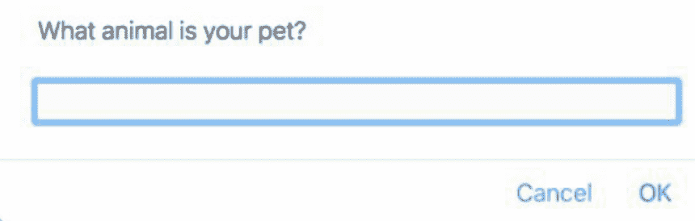
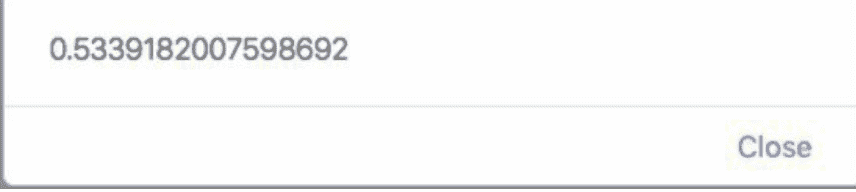
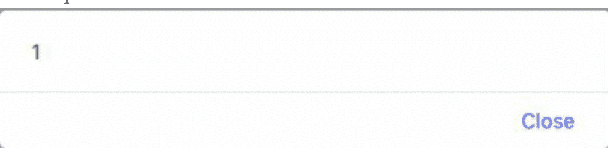
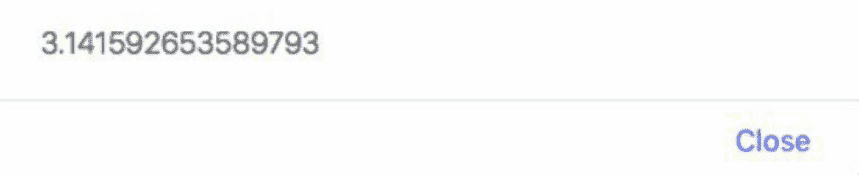
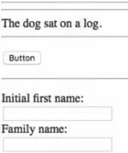
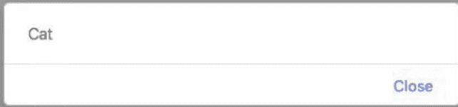
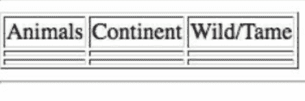
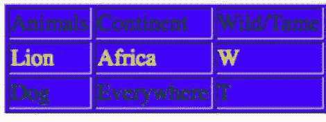

# JavaScript 编程入门：由教师编写的 JavaScript 语言基础，一本非常适合零基础读者的好书

```javascript
for (i=1; i < n+1; i++) {
  c[i] = new Array(c[i]);
  c[i][0]=0;
  holder=1+Math.floor(i);
  c[i]=c[i-1][holder]
}
```

# 关于作者

除了这本书之外，`Rory Barrett` 还是多本由 `ESA Publications` 出版、在新西兰出版的书的作者。他还撰写了许多其他书籍，并拥有自己的网站 `www.nceax.co.nz`。

他曾担任新西兰三所高中的数学系主任：`Rutherford` 高中、`Auckland Grammar` 学校和 `Macleans College`。他曾担任 `Saint Kentigern College` 的副校长。

2014 年和 2015 年，他负责新西兰内尔森附近 `Motueka` 高中的计算机教学工作。这本书基于他向该校学生教授 `JavaScript` 的经验，以及开发自己及其他网站的经验。

# 引言

关于《JavaScript》这本书的几点介绍。

在开始学习 `JavaScript` 之前，有必要对 `HTML` 拥有基础知识，`HTML` 是制作网页的标记语言。如果你缺乏这些知识，那么在开始之前你应该学习一些基础的 `HTML`。

本书包含了你开始学习 `JavaScript` 时的基本信息。

在开始阅读这本书之前，请问问自己这些问题：

你对 `JavaScript` 计算机语言了解多少？

你渴望使用它吗？

本书将以一种简单且实用的方式教你入门 `JavaScript`，而不会让读者被科学术语困扰。

它将告诉你基本命令、注释、操作、字符串、数组以及这种计算机语言的许多其他部分。

本书共 6 章，涵盖了基础信息、顺序编程、迭代编程、条件编程、动态编程以及待尝试的问题和进一步研究。如果需要，每一章都将为进一步探索提供阶梯。

在开始之前，你应该拥有一个可以自动生成各种计算机语言页面的文本编辑器。`Microsoft Word` 对于这项任务是没用的。如果你是 `Windows` 用户，请下载 `Notepad++`。它是一个非常出色的软件。

如果你像我一样偏爱 `Mac`，那么还有像 `Brackets` 和 `Komodo` 这样的软件。

我知道 `Linux`，但在我买了一台树莓派微型电脑之前没有使用经验，它使用一种名为 `Raspian` 的 `Linux`。该操作系统自带了一个名为 `Geany` 的编程编辑器。我用过 `Geany`，不得不承认它和 `Notepad++` 一样好。

我提到的所有编辑器都是免费的。我实际上在使用 `Dreamweaver`，它非常好，但遗憾的是相当昂贵。

现在进入第一章。

# 第一章：计算机、相关概念以及第一个 JavaScript 程序

## 计算机的定义

这非常复杂。你只需要知道，计算机是一个处理数据的设备。所有有用的计算机都是电子设备。

## 计算机语言

编程语言从低级到高级不等。最低级的语言被称为机器码（`Machine-Code`）。它使用二进制编写，只使用 1 或 0。高级编程语言是为了人类与计算机交互设计的。低级语言对大多数人来说几乎是不可读的。

下面的列表是从最低的机器码到 `Ruby` 的计算机语言序列。程序被描述为随着层级的提高，其抽象程度不断增加。

## 语言

- 1. 机器码
- 2. 汇编语言
- 3. C
- 4. C++
- 5. Java
- 6. Python
- 7. Perl
- 8. JavaScript
- 9. Ruby

## 编译器、解释器和汇编器

在计算机使用之前，语言必须转换为机器码。

这项任务由编译器或解释器完成。

对于某些语言，用该语言编写的整个程序由编译器转换为机器码。在此过程中，会创建一个可执行文件。编译型语言示例有 `C` 和 `C++`。

解释器逐行将程序转换为机器码。`Perl`、`JavaScript` 和 `Ruby` 是解释型语言。

## 服务器是计算机吗？

大多数了解计算机的人将服务器视为为其他计算机提供服务的计算机。虽然事实确实如此，但服务器实际上是服务器上运行的提供这些服务的程序。

如果你将计算机连接在一起相互通信，你就拥有了一个网络或计算机网络。

## 互联网？

互联网主导着我们的时代。它是一个开放媒介，由庞大的全球网络计算机系统组成。计算机交换数据的被称为包交换（`packet switching`）。包交换由许多称为协议（`protocols`）的规则管理。这些规则非常重要，但如果你刚开始学习 `JavaScript`，则没有必要了解。

互联网是由国内、商业、政府等网络组成的，提供诸如电子邮件、文件传输、短信以及万维网（`WWW`）的所有文件的服务。

## Web 服务器的定义？

提供请求网页的计算机程序被称为 `Web` 服务器。`Web` 客户端是发送请求的用户程序。浏览器是向 `Web` 服务器请求文件的客户端程序。常见的浏览器包括 `Chrome`、`Firefox` 和 `Safari`。

## 网页

互联网上以 `.html` 后缀的文件被称为网页。它们由浏览器打开。此类文件是万维网（`WWW`）的基础，万维网可能是互联网最重要的部分。`HTML` 首次出现于 1989 年。它是在瑞士日内瓦欧洲核物理实验室工作的英国程序员和科学家 `Tim Berners-Lee` 发明的。

自那时起，`HTML` 经历了多次发展。目前我们处于第五版本，即 `HTML5`。本书将一直使用 `HTML`，因为 `JavaScript` 是为了与 `HTML` 使用而设计的。

## JavaScript

`JavaScript` 是一种高级编程语言。大多数计算机语言具有相同的程序类型，尽管某些语言对于某些目的比其他语言更合适。

`JavaScript` 是教学编程的完美语言。原因是：

- (i) 不需要安装 `JavaScript`。
- (ii) 它是编程课程的理想选择。它的可能性从最基础到最前沿不等。

## JavaScript 和 Java 是一样的吗？

`JavaScript` 和 `Java` 是两种完全不同的语言，尽管名称相似。它们在制作简单程序时很相似，但 `JavaScript` 更容易使用和理解。学习 `JavaScript` 对于学习 `C++`、`Java` 和 `Python` 等更复杂的语言非常有帮助。

## HTML 和 JavaScript 是一样的吗？

不，它们不一样。它们非常不同。`HTML` 是用于创建静态网页内容的标记语言。`JavaScript` 是一种可以为网页创建动态内容的计算机语言。这可能会令人困惑，因为可以将 `JavaScript` 代码放置在 `HTML` 文件中，尽管你将了解到这不是良好的做法。

# JavaScript真的可以运行在服务器上吗？

是的，可以的，而且经常这样做。如果你这样做，你就会获得服务器端的 `JavaScript`。这扩展了 `JavaScript`，使其能够访问文件和数据库。客户端 `JavaScript` 不具备这种能力。本书将仅考虑客户端版本。

## 第一个任务

使用记事本（`notepad`）或其他等效文本编辑器（如 `notepad++` 或 `Mac` 上的 `TextEdit`）输入以下内容。如果你足够幸运拥有 `Adobe Dreamweaver`，可以使用它，但它非常昂贵，而且对于 `JavaScript` 基础课程来说并不是必需。

```
<!DOCTYPE HTML>

<HEAD>

<TITLE> XYZ </TITLE>

<script>
alert("Hello World.");
</script>

</HEAD>

<BODY>
The dog sat on a log.
```

```
<hr>
<p>
<button type="button">Button</button>
<hr>
<p>
<form><br>
Initial first name:<br>
<input type="text" name="initial">
<br>
Family name:<br>
<input type="text" name="familyName">
</form>

</BODY>

</html>
```

将文件保存为`alert.html`。

点击它或将文件拖入浏览器的地址栏。

记录你看到的内容是个好主意。

如果你操作正确，首先应该弹出一个小窗口，显示：

"Hello World"。

在进入下一个章节之前，值得提到的是，你写的第一个程序中唯一的 `JavaScript` 是：

```
alert("Hello World.");
```

当看到`<script>`脚本标签时，计算机知道后面会有一些 `JavaScript`。

该 `JavaScript` 命令是：`alert("Hello World.");`。

接收到此命令后，计算机执行该过程，导致出现带有 "Hello World" 的窗口。

`</script>`标签告诉计算机 `JavaScript` 已经结束，因此它继续处理 `HTML`，导致窗口显示句子“The dog sat on a log.”、一个按钮和一个包含一些文本字段的表单（可以在其中输入姓名信息）。

值得注意的是，`alert` 框是定位 `JavaScript` 代码中错误的一个非常强大的工具。

关于`alert()`的最后一点：你可以使用单引号`'`代替双引号`" "`。只要保持一致即可。你不能混合使用`' "`。

最后，在`alert()`中使用大写`A`而不是小写`a`是非常简单的。如果你这样做，你的程序将无法工作。`JavaScript` 对大小写是敏感的。你可能会反复犯这个错误。大多数程序员都会如此。

`JavaScript` 不是唯一区分大小写的语言。请小心！

# 第2章：顺序程序

在上一章中，我们介绍了你的第一个 `JavaScript` 程序，它仅仅是 `JavaScript` 中的`alert`命令。在本章中，我们将通过研究顺序编程来继续调查，并在此引入`document.write`、`JavaScript` 中的标准数学运算、字符串、变量、数组以及图片的打印。

在后续内容中，我们将经常引用名为`Txt.HTML`的标准 `HTML` 文件。

我们指的是在 `Windows` 上使用 `Notepad++` 或在 `Mac` 上使用 `TextEdit` 创建的 `HTML` 文件。我使用 `Mac` 并使用 `Dreamweaver`，但后者程序非常昂贵。

输入以下内容：

```
<!DOCTYPE HTML>
<HEAD>
<TITLE> XYZ </TITLE>
</HEAD>
<BODY>
</BODY>
</HTML>
```

保存为`Txt.HTML`或其他名称，但始终保留`.HTML`后缀（或`.html`）。在学习本书的过程中，你会反复使用这个程序。

## 什么是顺序程序？

顺序程序是指一个命令接一个命令，执行特定的操作。它没有重复，也没有分支。它是最直接的编程类型。

## document.write

在`<body>`和`</body>`标签之间写入以下行：

```
<hr>
```

```
<script>
document.write("The population of India is more than 1 billion");
</script>
```

```
<hr>
```

保存你写的内容，然后用浏览器打开`Txt.HTML`。

你应该看到以下输出：

The population of India is more than 1 billion

关于此点的两点注释：

(i) `<hr>`是一个 `HTML` 标签，指示计算机画水平线。这与 `JavaScript` 无关。

(ii) `document.write("......")` 是一个 `JavaScript` 命令，告诉计算机写入括号之间的内容。

## 标准数学运算

在编辑器中打开`Txt.HTML`并修改程序，使其现在变为：

```
<hr>
<script>
document.write("The sum of 5 and 6 is ");
document.write(5+6);
</script>
<hr>
```

保存程序并运行它。如果你这样做，你将得到此输出：

The sum of 5 and 6 is 11

类似地，我们可以从 5 中减去 6。

我们必须修改程序为：

```
<script>
document.write("Subtracting 6 from 5 gives ");
document.write(5 - 6);
</script>
```

输出是：

Subtracting 6 from 5 gives -1

类似的更改将允许你进行乘法和除法。

正确的语句应该是：

```javascript
document.write(5*6); // 用于乘法
document.write(6/5); // 用于除法
```

输出应该类似于：

Multiplying 6 by 5 gives 30

以及

Dividing 6 by 5 gives 1.2

一个非常有趣的数学运算是`mod`；19 mod 7 = 5。这是我们用 19 除以 7 的余数。在 `JavaScript` 中我们用`%`表示。

```javascript
document.write("The remainder when 19 is divided by 7 is ");
document.write(19%7);
```

结果为：

The remainder when 19 is divided by 7 is 5

需要注意的两点：

- (i) 如果你想进行计算，不要在 13 + 25 周围加上`' '`或`" "`。
- (ii) 分号 (`;`)。如果没有它，`JavaScript` 语句通常可以运行，但并不总是。因此，在语句末尾加上分号是个好主意。

## 字符串

字符串是由`" "`或`' '`包围的字符集合。字符串在 `JavaScript` 中非常重要，事实上在大多数计算机语言中也是如此。随着我们的学习，你将在许多实际中使用字符串。在继续之前，我们需要查看一些字符串操作。对于任何使用数据库的人来说，无论使用什么语言，字符串操作都非常重要。

在文本编辑器中打开`JavaScript.HTML`，并在`<script>`和`</script>`标签之间写入以下内容：

```javascript
<script>
document.write("1+" +"Trop osphere".charAt(3)+"+<br>");
document.write("2+" +"Trop osphere".charAt(4)+"+<br>");
document.write("3+" +"Trop osphere".charAt(5)+"+<br>");
document.write(4+" "+\+"Bi"+\+"os"+\+"phere"<br>");
document.write(5+" "+\+"Trop osphere".indexOf(" p")+"<br>");
document.write(6+" "+\+"Trop osphere".indexOf("ant")+"<br>");
document.write(7+" "+\+"Trop osphere".replace("here","cat")+"<br>");
document.write(8+" "+\+"Trop osphere".search("e ph")+"<br>");
document.write(9+" "+\+"Trop osphere".substring(2,7)+<br>");
document.write(10+" "+\+"Trop osphere".toLowerCase()+"<br>");
document.write(11+" "+\+"Trop osphere".toUpperCase()+"<br>");
</script>
```

然后运行。

输出应该是：

1 p

2

3 o

4 Biosphere

5 3

6 -1

7 Tropcat

8 -1

9 op os

10 trop os

11 ROSPHERE

逐行检查一遍：

1. 字符串中的字母从 0 开始，所以语句`"+Trop osphere".charAt(3)`写的索引 3 的字符是 p。

2. 字符串中的字母从 0 开始，所以语句`"+Trop osphere".charAt(4)`写的索引 4 的字符是一个空格。

3. 字符串中的字母从 0 开始，所以语句`"+Trop osphere".charAt(5)`写的索引 5 的字符是 o。

4. 在处理字符串时，`+`将它们连接起来。在这种情况下，字符串是 "Bi", "os" 和 "phere"。当它们连接时，你得到了 Biosphere。

5. 该语句指示计算机在 "Trop sphere" 中显示 "p "（p 后面跟着空格）的位置。"p " 位于 "Troosphere" 的位置 3 位，因此计算机返回 3。

6. 该语句指示计算机在 "Trop sphere" 中显示 "ant" 的位置。"ant" 在 "Trop sphere" 中，因此计算机返回 -1。

7. 该语句指示计算机将 "Trop sphere" 中的 "here" 替换为 "cat"。这完成了，并得到了字符串 "Tropcat"。

8. 该语句指示计算机在 "Trop sphere" 中搜索 "e ph"。未找到，因此返回 -1。

9. 该指令请求 "Trop sphere" 的子字符串。

10. 该语句指示计算机将所有字符转换为小写。

11. 该语句指示计算机将所有字符转换为大写。

## 变量极其重要的概念

```html
<script>
var pet = prompt('What animal is your pet?');
document.write(pet);
</script>
```

运行后

这是你将看到的内容



随后会出现一个显示你输入的动物的屏幕。假设你输入了 Dog，那么你会得到

Dog


在接收到`var pet = prompt('What animal is your pet?');`这一行时，计算机会将你输入的内容放入一个标记为`pet`的内存切片中。程序每遇到`pet`这个词时，你输入的那个`pet`就会被调出来。你刚刚创建了一个名为`pet`的字符串变量。注意`pet`并没有被`" "`或`' '`包围。计算机理解它是要写入内存`pet`中的内容，而不是字符串`'pet'`本身。

在上一个示例中：

```html
<script>
document.write(1+"++""Atmosphere".charAt(3)+"<br>");
...
...
document.write(11+"++""Atmosphere".toUpperCase()+"<br>");
</script>
```

我们本可以创建一个名为`str`的变量。代码将是：

```html
<script>
var str = "Atmosphere";

document.write(1+"++"str.charAt(3)+"<br>");
...
...
document.write(11+"++"str.toUpperCase()+"<br>");
</script>
```

这样做将节省大量时间。

还有数字变量，它们可以像字符串变量一样被创建。

- `var numm = 10;`创建了一个值为 10 的整数变量`numm`。
- `var numbar = 6.5;`创建了一个值为 6.5 的实数变量。

另一种数字类型被称为布尔值（boolean）。它只接受`True`和`False`两个值。这些值在我们以后学习的被称为“条件计算”的内容中非常重要。

## Math 对象

JavaScript 有一种内置的手段来获取许多数学函数，这被称为`Math`对象。

如果你需要 0 到 1 之间的随机数，就使用`Math.random()`。以下是实现方法：

```html
<script>
var numm = Math.random();
alert(numm);
</script>
```

运行此代码时，你将得到这样一个小窗口的输出。



你得到的数字可能不同，但你会得到一个 0 到 1 之间的小数。

`Math`对象生成一个 0 到 1 之间的随机数，并赋值给变量`numm`。

`numm`通过`alert`显示。

那么 0 到 10 之间的随机整数呢？

这是实现此目的的方法：

```html
<script>
var numm = Math.round(10*Math.random());
alert(numm);
</script>
```

我的输出是：



点击关闭，然后刷新页面，会得到 0 到 10 之间的不同整数。

`Math`对象生成一个 0 到 1 之间的随机数，乘以 10，然后这个数字通过`Math.round()`进行四舍五入，并赋值给变量`numm`。

随后`alert`程序显示`numm`。

通过`Math`对象还有许多其他可用的函数。

这是另一个示例：

```html
<script>
var num = Math.PI;
alert(num);
</script>
```

输出是：



`Math`对象创建数字 Pi 或 π，并将其传递给变量`num`。

随后`alert`程序显示`num`。

如果你需要找出一个圆的周长（2πr）或面积（πr²），在程序中使用它们会非常有用。

## 数组（Arrays）

这个子主题非常重要，每种计算机语言都使用数组。

基本上，数组是一块存储一组值的计算机内存。

这是一个简单的示例（不要管`//`之后的语句。这些是注释，不会影响实际程序。）：

```html
<script>
var numberHold = new Array();//创建一个新数组 numberHold
numberHold[0] = 3;
numberHold[1] = 6;
numberHold[2]=-2;//将值赋值给 numberHold[0] 等

var numRandom = Math.round(2*Math.random());//随机创建一个数字 0, 1

alert(numberHold[numRandom]);//显示 numberHold[numRandom] 的值
</script>
```

如果你运行这个程序，你将得到一个`alert`输出，显示 3、6 或 -2 之一。

程序首先创建一个新数组，然后将 3、6 和 -2 放入变量`numberHold[0]`、`numberHold[1]`和`numberHold[2]`中。

`var numRandom = Math.round(2*Math.random())`是 0、1 或 2 之一。

`Alert`展示了被选中的`numHold[0]`、`numHold[1]`或`numHold[2]`中的任意一个。

你需要知道，数组`Ar`总是从 0 开始，`Ar`包含的列表中的第一个是 0。

注意，现在代码上方有一个注释：

```javascript
/**这将在页面上向下打印 50 次 FROG */
```

还有其他循环吗？肯定的！最好的循环之一是`while`循环。这里是`while`循环如何实现之前完成的功能。

将此代码放入`Txt.HTML`中：

```html
<script>
/* 使用 while 循环在页面上向下打印 50 次 Frog */
var count = 1; // 此变量用于计数打印次数

while (count<51)
{
document.write("Frog<br>");
count++; // 每完成一次循环，count 就会加 1
}
</script>
```

输出结果再次出现。

这些循环对于大多数目的已经足够了。还有其他的循环。如果你感兴趣，可以在 Google 上查一下。

哪种最好？`for`还是`while`？两者都不是，一个好的程序员可以使用其中任何一种。如果你有确定的开始和结束，`for`循环是最好的。如果你不确定何时停止，`while`循环是最好的。

让我们来看一个`for`更好的情况。

假设我们有一个包含 12 个月份的数组，并想要打印第 3 个月到第 10 个月的月份。

```html
<script>
/* 此程序打印从第3个月到第10个月的所有月份*/

var months =
["January","February","March","April","May","June","July","August","Sep","months"]

/* 这将在页面上向下打印月份 3-10 月*/
for (i = 2;i<10;i++))
```

```html
{document.write( months[i]+"+<br>"); }
</script>
```

输出结果是：

- March
- April
- May
- June
- July
- August
- September
- October

需要提到以下几点：

1. 记住数组始终从 0 开始，所以第 3 个是数字 2，第 10 个是数字 9。
2. 我将包含月份的数组命名为`months`。我本可以叫它任何名字，但在选择变量名时，请使用与变量含义相似的名称。在选择变量名时必须小心，因为某些名称可能是保留字。保留字由 JavaScript 使用并具有特殊含义。如果你用`name`一词命名`months`，你的结果将会很奇怪。这是因为`name`是一个保留字。

让我们在一个`while`更好的情况下使用`while`。

假设你想打印月份数组中的所有名称，直到遇到一个少于 6 个字母的名称。

`str.length`是字符串`str`中的字符数。

这里有一个执行此操作的程序：

```html
<script>
/* 此程序打印所有月份，直到有一个少于 6 个字母*/

var count=0;// 这计算循环次数。

var months = ["January","February","March","April","May","June","July","August","September"] months

var howManyLetters = months[count].length;/* 此变量将在循环过程中存储每个月份的字母数量。它从 months 中第一个成员的长度开始*/

while (howManyLetters>6)// 这将在页面上打印所需的月份
{
  document.write(months[count]+"<br>");

count++; // 每执行一次循环，count 增加 1

howManyLetters = months[count].length;// 每当我们增加 count，我们就让 howManyLetters 变为 months 中下一个成员的长度
}
</script>
```

输出如下所示：

January

February

这是我们预期的结果。March 只有 5 个字母。

## 缩进

在之前的小程序中完成过的一点需要强调。注意程序在`while`下方是如何布局的。

```javascript
while (howManyLetters>6)// 这将在页面上打印所需的月份
{
    document.write(months[count]+"<br>");

    count++; // 每执行一次循环，count 增加 1

    howManyLetters = months[count].length;// 每当我们增加
    count 我们就让 howManyLetters 变为 months 中下一个成员的
    months
}
```

并将括号及其内容向右移动。这被称为缩进。

`{{ }}`（注：此处原文可能为笔误，通常指大括号`{ }`）的内容是主程序的子程序。这样做是一个良好的编程习惯和礼貌。如果你是唯一一个编写这些程序的人，那么你如何布局它们由你决定，但如果你将会有其他人参与该程序的工作，那么这种缩进对于帮助他人看清你做了什么是很有帮助的。

虽然缩进在 JavaScript 中不是必不可少的，但在某些语言（如 Python）中，你必须缩进，否则程序将无法运行。

## 函数

函数是一个被频繁使用的程序，并以其他程序可以使用的方式提供出来。

在`Txt.HTML`的头部或文件的其他部分，输入：

```html
<script>
function initials() {
  /* 此函数是一个让你输入内容的程序 */
  var firstName = prompt("Enter your first name");
  var lastName = prompt("Enter your last name");
  var initials = firstName.charAt(0) + lastName.charAt(0);
  alert(initials);
}
</script>
```

（注：此处由于原文提供的代码片段似乎存在逻辑混乱或重复，翻译时已根据指令保留了代码块内容并翻译了其注释部分）

（注：由于原文待翻译文本在代码部分存在多处重复和混乱，翻译时我尝试还原了逻辑结构，但严格遵循了代码不翻译的原则。）

（由于原文提供的待翻译文本包含大量重复的代码块，译文已按要求进行格式化翻译。）

```html
<BODY>

<script>
//hold.js 中带有函数的程序
</script>

</BODY>

</HTML>
```

`<TITLE> TTT </TITLE>`行是可选的。如果你愿意，可以完全删除它。

我们从一个非常简单的东西开始。

假设我们随机生成了 0 或 1。如果生成了 0，就会弹出一个“Meow”的警告框。如果生成了 1，输出将弹出一个“BowWow”的警告框。

在`hold.js`中创建一个新函数`randomCatDogNoise(n)`。

第一步是编写以下内容：

```javascript
function randomCatDogNoise(n)
{
}
```

这是`randomCatDogNoise`函数。因为大括号之间没有代码，此函数什么都不做。如果大括号之间有一些 JavaScript 指令，那么`randomCatDog(n)`可能会执行某些操作。注意参数`n`。

JavaScript 中的条件运算符是`if`和`if/else`。下一个例子使用了`if/else`。

输入以下内容：

```javascript
function randomCatDogNoise(n)
{
  this.n = n;// n 表示参数

  if (n==0)
{
    alert("Meow");
  }
  else
{
    alert("BowWow");
  }
} //end of randCatDogNoise(n)
```

注意`==`，我们使用`==`进行比较。这是至关重要的。永远不要写`(n = 0)`；如果你这样做，JavaScript 会假设你正在给`n`赋值为 0。

## 永远不要忘记：`==`用于比较，`=`用于赋值。

在`Txt.HTML`的正文中编写：

```html
<script>
var n = Math.round(Math.random());//随机创建 1 或 0
randomCatDogNoise(n);//激活函数 randomCatDogNoise
</script>
```

注意函数名使用了`randomCatDogNoise`。函数名和变量名应该与它们的目的相关。

如果选择超过 2 个，请使用`if/else if/else`代替`if/else`。

例如，考虑数字 0、1、2、3、4 和 5 的随机生成。

0 或 1 你得到`'Chair'`，2 或 3 是`'Table'`，4、5 是`'Knife'`。

这是代码。先自己尝试一下，但不要花费超过半小时。

```javascript
function randomChairTableKnife(n)
{
this.n = n; // n 表示参数

if (n < 2)
{
    alert("Chair");//如果生成了 0 或 1，警告框显示 "Chair"
}
else if (n<5)
{
    alert("Table");//如果生成了 2 或 3，警告框显示 "Table"
}
else
{
    alert("Knife");//如果生成了 4 或 5，警告框显示 "Knife"
}

//end of randomChairTableKnife(n)
```

`JavaScriptCarrier.HTML`正文中的代码将是：

```html
<script>
var n = Math.round(5*Math.random());//随机创建 0,1,......5
randomChairTableKnife(n);
</script>
```

注意`<`被用作比较运算符。运算符`<`表示小于，同样地，`>`表示大于，`>=`表示大于或等于，`<=`表示小于或等于。

程序中有三个选择，因此只有一个`else if`。对于四个选择，你需要 2 个`else if`；对于 7 个选择，你需要 5 个`else if`等。有必要用`else`结尾。

你可以使用`switch`运算符。`switch`运算符也可以做到，但并不是必须的。如果你对`switch`运算符感兴趣，可以去 Google 搜索。

只使用`if`且不需要`if/else`或`if/else if/else`的程序呢？

假设你有一个数组`["elephants","cats","tigers","lions","monkeys","cows","sheep","frogs"]`，并且需要打印数组中所有至少 6 个字母的单词。

这里有一个函数可以做到。在阅读后续内容之前先自己尝试。

在`hold.js`中输入以下内容：

```javascript
function typeAnimals(n)
{
}
```

现在按照以下方式填充：

```javascript
function typeAnimals(n)
{
  this.n = n;//参数中的 n

  var animals = ["elephants","cats","tigers","lions","monkeys","cows",
"sheep","frogs"];//动物数组

  for(i=0;i<animals.length;i");//animals.length 是 animals 中元素的个数
animals. 在这种情况下它是 8
  {
    if (animals[i].length >= n)//如果 animals[i] 中的字母数量至少为 n，则打印 animals[i].
    {
      document.write(animals[i]+"+<br>");//打印的指令
      animals[i]
    }
  }
}//end of function typeAnimals(n)
```

现在在`Txt.HTML`的正文中输入以下代码：

```html
<script>
var n = 6;//我们想打印数组中至少有六个字母的元素
typeAnimals(n);
</script>
```

打开`Txt.HTML`，你的输出应该是：

elephants

tigers

monkeys

## 条件运算符

这同样非常。擅长数学和逻辑的人会觉得这很容易，但其他人可能觉得很难。

## AND

当两个条件都为真时，AND 运算符用于两个条件之间。在 JavaScript 中，AND 运算符是`&&`。


考虑这个问题：计算机随机生成 1 或 0，然后选择 C 或 D 之一。

如果选了 1 且 C，会弹出一个警告框显示“Congratulations, you picked 1 and C”，否则会弹出一个警告框显示“Sorry you need 1 and C”。

将此内容输入到 `hold.js`。

```javascript
function ranNumLetter()
{
var numm = Math.round(Math.random());//随机选择 0 或 1
var lettNum = Math.round(Math.random());//随机选择 0 或 1

var let = "C";

if (lettNum==1){let = "D";//如果 letterNum 为 0 则字母为 C，否则为 D。

if ((numm==1)&&(let=="C")) //1 和 C 都必须被生成
  alert("Congratulations, you picked 1 and C")
else
  alert("Sorry, you need 1 and C")

}
//end of function ranNumLetter()
```

现在在 `Txt.HTML` 的正文中输入以下代码：

```html
<script>
ranNumLetter();
</script>
```

用你喜欢的浏览器打开 `Txt.HTML` 以查看：

> Congratulations, you picked 1 and C

或

> Sorry, you need 1 and C

## OR

如果两个条件中的一个或两者都为真，OR 运算符用于两个条件之间。在 JavaScript 中，OR 运算符由 `||` 表示。

为了演示这一点，我们将使用之前使用的 `typeItems(n)` 函数并修改它，使其打印长度为 `m` 或长度为 `n` 的项目。

以下是应该输入到 `hold.js` 的函数。

```javascript
function typeAnimals(m, n)
{
  this.m = m;//在参数中使用 m
  this.n = n;//在参数中使用 n

  var animals = ["elephants","cats","tigers","lions","monkeys","cows",
"sheep","frogs"];//动物数组

  for(i=0;i<animals.length;i");//animals.length 是 animals 中元素的个数
animals. 在这种情况下它是 8
  {
    if ((animals[i].length == m)||(animals[i].length == n))//如果 animals[i] 中的字母数量是 m 或 n，则打印 animals[i].
    {
      document.write(animals[i]+"<br>");//打印的指令
      animals[i]
    }
  }
}
//end of function typeAnimals(m,n)
```

现在在 `Txt.HTML` 的正文中输入以下代码。

```html
<script>
var m = 4;//我们想打印数组中有四个字母的元素
var n = 5;//我们想打印数组中有五个字母的元素
typeAnimals(m,n);
</script>
```

在用你喜欢的浏览器打开 `Txt.HTML` 之后，输出是：

- cats
- lions
- cows
- sheep
- frogs

所有 4 或 5 个字母的单词！

## NOT

NOT 运算符用于条件之前，以便在条件不为真时执行过程。在 JavaScript 中，NOT 运算符由 `!` 表示。

例如，我们将使用 `typeAnimals(n)` 函数并修改它，使其打印不具有 n 或更多字母的动物。

在 `hold.js` 中输入此函数：

```javascript
function typeAnimals2(n)
{
  this.n = n;//参数中的 n

  var animals = ["elephants","cats","tigers","lions","monkeys","cows",
"sheep","frogs"];//动物数组

  for(i=0;i<animals.length;i");//animals.length 是 animals 中元素的个数
animals. 在这种情况下它是 8
  {
    if (!(animals[i].length >= n))//如果 animals[i] 中的字母数量不至少为 n，则打印 animals[i].
    {
      document.write(animals[i]+"<br>");//打印 things[i] 的指令
      animals[i]
    }
  }
}
//end of function typeAnimals2(n)
```

现在在 `Txt.HTML` 的正文中输入以下代码：

```html
<script>
var n = 5;//我们想打印数组中不至少五个字母的元素
typeAnimals2(n);
</script>
```

在用你喜欢的浏览器打开 `Txt.HTML` 之后，输出是：

- cats
- cows

你可以看到，不至少有五个字母的单词被打印出来了。

在这种情况下，只有 2 个。

## 第 5 章：创建动态内容

在 JavaScript 中，访问、创建、删除或更改文本框、下拉列表、表格等 HTML 元素的能力是最实用的功能之一。为了实现这一点，它使用了一种名为 Dom 模型（文档对象模型）的技术。这基于一种被称为 _面向对象编程_ 的方法，这种编程方法对于初学者来说相当复杂。为了为网页创建动态内容，这类计算的知识并不是绝对必要的。

首先，我们将查看如何使用 JavaScript 访问和修改现有的 HTML 元素。

**任务一**。修改 `Txt.HTML`，使得点击按钮时弹出一个显示单词“Cat”的警报框。

这件事情非常容易做到，而且实际上并没有使用 Dom 模型。然而，它是学习这一强大技术的第一步。

以下是你需要的 `Txt.HTML` 代码。

```html
<!DOCTYPE HTML>

<HEAD>
<TITLE> XYZ</TITLE>
<script src="hold.js"></script>
</HEAD>
```

```html
<BODY>

The dog sat on a log.

<hr>
<p>
<form>
<input type="button" id="butt" onclick="cat()" value="button"></button>
<br>
Initial first name:<br>
<input type="text" name="initial" >

<br> Family name:<br>
<input type="text" name="familyName" >
</form>

</BODY>

</HTML>
```

对于任务来说，关键行是 `<input type="button" id="butt" onclick="cat()" value="button"></button>`。通过放入 `onClick="cat()"` 指令，我们告诉计算机如果点击了按钮，就会执行 `cat()` 函数。

函数的指令不在 `Txt.HTML` 中，而是在 `hold.js` 中。

该函数的代码应该是显而易见的，但如果不是的话，它如下所示。

```javascript
function cat()
{ alert('Cat'); }
```

如果你按照上面的内容精确输入 `Txt.HTML` 代码，并将 `cat()` 函数放入 `hold.js`，那么最初你将得到以下输出。



现在点击按钮，你会得到警报窗口。



现在我们将使用 Dom 模型来影响显示 `Txt.HTML` 屏幕上的内容。

**任务二**。修改 `Txt.HTML`，使得点击按钮时会弹出一个提示框询问你的名字首字母，然后弹出第二个提示框询问你的姓氏。在你填写完提示后，第一个首字母将出现在相应的文本框中，姓氏将进入那个文本框。

让函数名为 `firstLetterFamilyName()`。

以下是你在 `hold.js` 中应该拥有的代码。

```javascript
function firstLetterFamilyName()//此函数获取名称并将数据
放入文本字段中
{
var firstNam = prompt("What is your first name?");//获取名字
var familyNam = prompt("What is your family name?"); //获取姓氏

initLetter = firstNam.charAt(0);//获取名字的第一个字母

var ob1 = document.getElementById("firstName");//将 ID 为 "firstName" 的文本字段
赋值给变量 ob1
var ob2 = document.getElementById("familyName");//将 ID 为 "familyName" 的文本字段
赋值给变量 ob2

ob1.value = initLetter//将名字的第一个字母放入正确的文本框中
ob2.value = familyNam//将姓氏放入正确的文本框中
```

```javascript
//结束函数 firstLetterFamilyName()
```

将此函数放入 `hold.js` 后，你现在需要对 `Txt.HTML` 文件进行一些更改。

`Txt.HTML` 的代码所示：

```html
<!DOCTYPE HTML>

<HEAD>
<TITLE> XYZ</TITLE>
<script src="hold.js"></script>
</HEAD>

<BODY>

The dog sat on a log.

<hr>
<p>
<form>
<input type="button" id="butt" onclick="firstLetterFamilyName()" value="button"></button> <br>
Initial first name:<br>
<input type="text" name="initial" id = "firstName">
<br> Family name:<br>
<input type="text" name="familyName" id = "familyName">
</form>

</BODY>

</HTML>
```

你会注意到只有 3 处变化，分别是：

(i) 将函数名从 `cat()` 改为 `firstLetterFamilyName()`

(ii) 为名字的文本框赋予 `id = "firstName"`

(iii) 为姓氏的文本框赋予 `id = "familyName"`

**id** 是至关重要的。使用 JavaScript 能够通过 `document.getElementById()` 方法（内置函数）获取所需的元素。

一旦获取了元素，它就有一许多属性可以更改。请注意以下几点。

很容易将 `document.getElementById()` 写成 `Document.getElementById()`（首字母用大写 D 而不是小写 d）。如果你这样做，你的程序将无法运行。JavaScript 对大小写敏感。

---

下一个示例显示了如何以多种方式更改姓氏的文本框。

```javascript
function changeColorsFamilyName()
{
var nam = prompt("What is your family name?"); //获取姓氏

var ob = document.getElementById("familyName");//将 ID 为 "familyName" 的文本字段
赋值给变量 ob
```

```javascript
ob.style.backgroundColor="yellow";//更改实际
文本框的颜色
ob.style.width="50%";//将文本框的宽度更改为所在屏幕的 50%
ob.style.color="red";//将文本框中的字体颜色更改为红色
ob.style.height = "200px";//更改文本框的高度（垂直方向）
ob.style.fontSize="24pt";//更改文本框中的字体大小
ob.style.fontFamily="wingdings";//将文本框中使用的字体更改为 wingdings
ob.value = nam;//将你的姓氏输入文本框中
```

```javascript
//结束 changeColorsFamilyName()。
```

在按钮的 `onclick` 中，将 `change ="firstLetterFamilyName()"` 改为 `"changeColorsFamilyName()"`。

你可以调整的属性非常多，远比示例中的多。

下一个示例显示了如何以多种方式更改按钮。

确保按钮有一个 ID。我给我的命名为 `butt`。创建此函数：

```javascript
function activeButton()
{
var nam = prompt("What is your favorite animal?");//获取动物名称
var ob = document.getElementById("butt");//将 ID 为 "butt" 的按钮
赋值给变量 ob
ob.style.backgroundColor="blue";//更改实际
按钮的颜色
```

```javascript
ob.style.width="75%";//将按钮的宽度更改为所在屏幕的 75%
ob.style.color = "white";//将按钮中的字体颜色更改为白色
ob.style.height = "50px";//更改文本框的高度（垂直方向）
ob.style.fontSize="24pt";//更改文本框中的字体大小
ob.style.fontFamily="arial";//将文本框中使用的字体更改为 arial
ob.value = nam;//将你的姓氏输入文本框中
```

```javascript
//结束 changeButton()
```

将 `onclick = "FunctionName()"` 改为 `onclick()`

在处理了文本框和按钮后，让我们现在来看下拉框，这是一种用于获取选择的方法。

让我们将下拉框添加到 `Txt.HTML` 中。代码如下：

```html
<!DOCTYPE HTML>

<HEAD>
<TITLE> XYZ</TITLE>
<script src="hold.js"></script>
</HEAD>

<BODY>
The dog sat on a log.

<hr>
<p>
<form>
<select id="dropp">
<option value="Volvo">Volvo</option>
<option value="saab">Saab</option>
<option value="mercedes">Mercedes</option>
<option value="audi">Audi</option>
</select>
<br>
<input type="button" id="butt" onclick="alertSelect()" value="button"></button> <br>
Initial first name:<br>
<input type="text" name="initial" id="firstName">
<br> Family name:<br>
<input type="text" name="familyName" id="familyName">
</form>

</body>

</html>
```

函数 `alertSelect()` 替换了 `changeButton()` 或 `changeColorsfamilyName()`。

以下是 `alertSelect()` 的代码。

```javascript
function alertSelect() {
  var ob = document.getElementById("dropp");
  alert(ob.value);
}
```

在你喜欢的浏览器中打开 `Txt.HTML`，然后点击按钮。你应该得到一个包含小写汽车名称的警报。这就是选择的值。

作为 Dom 模型的最后演示，我们将查看表格。

我们演示了 JavaScript 处理表格的三种用途。

1. 使用数组成员填充单元格，使得其中一行是黄色字体，另一行是绿色字体。表格背景将是蓝色。

2. 与 (1) 相同，但将增加额外的行。新行将是红色字体。

3. 创建与 (1) 相同尺寸完全新表格。这通常被描述为动态创建。表格将具有黑色背景和白色字体。

以下是带有表格的 `Txt.HTML` 代码以及 (1) 的代码。

```html
<!DOCTYPE HTML>

<HEAD>
<TITLE> XYZ </TITLE>
<script src="hold.js"></script>
</HEAD>

<BODY>

狗坐在一个木头上。

<hr>
<table id="myTable" border="1">
<tr>
<td> >动物</td>
<td> >洲份</td>
<td> >野生/圈养</td>
</tr>
<tr>
<td> ></td>
<td> ></td>
<td> ></td>
</tr>
<tr>
<td> ></td>
<td> ></td>
<td> ></td>
</tr>
</table>

<hr>
<br>
<input type="button" id="butt" onclick="fillRows1()" value="按钮">
</BODY>
</HTML>
```


这里是`fillRows1()`的代码：

```javascript
function fillRows1() {
  document.getElementById('myTable').style.backgroundColor="blue"; //改变表格背景颜色
  document.getElementById('myTable').rows[1].style.color="yellow"; //将第一行的字体颜色改为黄色
  document.getElementById('myTable').rows[2].style.color="green"; //将第二行的字体颜色改为绿色
  document.getElementById('myTable').rows[1].cells[0].innerHTML = "狮子";
  document.getElementById('myTable').rows[1].cells[1].innerHTML = "非洲";
  document.getElementById('myTable').rows[1].cells[2].innerHTML = "W";
  document.getElementById('myTable').rows[2].cells[0].innerHTML = "狗";
  document.getElementById('myTable').rows[2].cells[1].innerHTML = "处处";
  document.getElementById('myTable').rows[2].cells[2].innerHTML ="T"; //之前的6条指令填充了单元格
}
//结束 fillRows1()
```

当你打开`Txt.HTML`时，你将看到如下一个有趣的小页面。

## 狗坐在一个木头上



点击按钮会激活`fillRows1()`，你将得到：

狗坐在一个木头上。



任务 (1) 已完成。现在执行任务 (2)。获取`fillRows1()`并添加以下行代码：

```javascript
var table = document.getElementById("myTable"); // 找到 id="myTable" 的 <table> 元素
var row = table.insertRow(3); // 创建一个空的 <tr> 元素并添加到表格的第 4 行位置
row.style.color = "red"; // 新行必须是红色字体

var cell1 = row.insertCell(0);
var cell2 = row.insertCell(1);
var cell3 = row.insertCell(2); // 在“新” <tr> 元素的 0,1,2 位置插入新单元格 (<td> 元素)
cell1.innerHTML = "老虎";
cell2.innerHTML = "亚洲";
cell3.innerHTML = "W"; // 向新单元格添加一些文本
```

再次打开`Txt.HTML`，点击按钮，现在你将看到带有红色所需信息的新行。

狗坐在一个木头上。

| 动物 | 洲份 | 野生/圈养 |
|---|---|---|
| 狮子 | 非洲 | W |
| 狗 | 处处 | T |
| 老虎 | 亚洲 | W |


在进行任务 (3) 之前，注意文本框和按钮的值已被`innerHTML`替换。多年来，这给许多程序员带来了很多困扰。如果你忘记了，请使用 Google 来提醒你，只要你对之前的工作留了注释，你很快就会记起来。

任务 (3) 需要创建一个表格。虽然这非常简单，但作为准备，展示一些非常简单的东西——创建一个按钮，是一个好主意。

这里是`Txt.HTML`的代码：

```html
<!DOCTYPE html>
<head>
<title>XYZ</title>
<script src="hold.js"></script>
</head>
<body>
狗坐在一个木头上。
<hr>
<script>
/*创建一个 <button> 元素*/
var btn = document.createElement("BUTTON");

/*创建一个文本节点*/
var t = document.createTextNodeNode("点击我");

/*将文本添加到 <button> 中 */
btn.appendChild(t);

/*将 <button> 添加到 <body> 中*/
document.body.appendChild(btn);
</script>
<hr>
</body>
</</html>
```

打开`Txt.HTML`会产生以下输出。

狗坐在一个木头上。


遗憾的是，点击按钮没有产生效果，因为我们还没有为它设置任何激活函数。以下是你可以如何向程序中添加内容，使其产生一个显示“cat”的警报的方法。

我们已经在`hold.js`中有一个名为`cat()`的小函数，它正是此功能。

在`document.body.appendChild(btn);`下方添加这些行代码：

```javascript
/*将函数 cat() 赋值给 btn 的 onclick 事件 */
btn.onclick = cat;
```

现在运行程序，你将得到所需的 cat 警报。

现在来创建任务 (3) 的表格。

首先，让我们有一个新版本的`Txt.HTML`：

```html
<!DOCTYPE HTML>
<HEAD>
<TITLE> XYZ </TITLE>
<script src="hold.js"></script>
</HEAD>
<BODY>
<input type="button" value="制作表格" onclick="makeTable()" />
<hr />
<div id="dvTable"> </div>
</BODY>
</HTML>
```

注意`<div>`标签的使用。

正如你可能从 HTML 中知道的样，一个 div 基本上是网页上内容的容器。我们将在点击按钮后将表格放入其中。如果你在我们创建`makeTable()`之前打开`Txt.HTML`，你只会得到：


你可以随心所欲地点击按钮。什么都没有发生。

在`hold.js`中输入以下函数。仔细阅读注释以遵循此程序的逻辑。

```javascript
function makeTable()
{
/*包含学生数据的数组*/
var students = new Array();

/*将学生数据输入数组。注意使用名为 push 的新方法进入数组。Push 在许多计算机编程语言中被广泛使用*/
/*完成后我们有一个包含学生记录的数组。这个数组是数组的*/
students.push(["Id", "Name", "Maths"]); //这是表头
students.push([1", "Mary", 89]);
students.push([2, "Boris", 65]);
students.push([3, "Trudy", 53]);
students.push([4, "Dale", 17]);

/*现在创建表格*/
var table = document.createElement("TABLE");//创建一个 HTML 元素
table.border = "1";//给表格边框为 1
table.id = "myTable";//给表格 id 为 'myTable'
var columnCount = students[0].length;//获取表格的列数
for (var i = 0; i < columnCount; i++) {
    var headerCell = document.createElement("TH");//创建一个 TH 元素
    headerCell.innerHTML = students[0][i];//设置 TH 的 innerHTML
    row.appendChild(headerCell);
} //添加表头

for (var i = 1; i < students.length; i++)
{ /*每个学生创建一个行*/
row = table.insertRow(-1);
for (var j = 0; j < columnCount; j++)
{
    var cell = row.insertCell(-1);//创建一个单元格
    cell.innerHTML = students[i][j];//设置单元格的 innerHTML
} // 添加数据行

dvTable = document.getElementById("dvTable");//获取用于放置表格的 div
dvTable.innerHTML = "";//让 div 的 HTML 不存在
否则任何 HTML 都会出现在表格之前
dvTable.appendChild(table);//将表格放入 div 中

/*改变表格背景颜色*/
document.getElementById("myTable").style.backgroundColor="black";

/*改变表格字体颜色*/
document.getElementById("myTable").style.color="white";
}//结束 makeTable()
```

在本章开头，我们提到除了访问、修改和创建 HTML 元素外，我们还可以销毁它们。实际上，这是最简单的事情。你只需要需要销毁元素的 ID。

从下方的`Txt.HTML`开始：

```html
<!DOCTYPE HTML>
<HEAD>
<TITLE> XYZ </TITLE>
<script src="hold.js"></script>
</HEAD>
<BODY>
<input type="button" value="删除" onclick="removeButton()" id="rmv"/>
<hr>
</BODY>
</</html>
```

现在为`removeButton()`创建代码。

在`hold.js`中输入以下内容：

```javascript
function removeButton()
/*获取按钮并放入变量 butn*/
var butn = document.getElementById("rmv");

butn.remove()//消除 butn
}
//结束 removeButton()
```

打开`Txt.HTML`，你会看到“删除”按钮。点击它，它消失了。

在本章中，我们提供了使用 JavaScript 创建动态内容的所有奇功能的最基本骨架。限制是无限的。Google 上有丰富的信息。你关于此的任何问题都可以找到答案。

一些特别好的网站有：

- `https://www.javascript.com/`
- `https://www.w3schools.com/js/`

你也可以在我的网站上测试你的知识：

`http://www.nceax.co.nz/Computing/javascriptMultichoice.html`

# 第 6 章：待完成的题目及后续建议

这里有一些题目供你尝试。如果你能完成所有题目，说明你已经真正理解了前面章节所教的内容。

编写实现以下功能的 JavaScript 程序：

- (1) 允许你输入一个字符串`str`和一个数字`n`（整数），然后将`str`打印`n`次并向下显示。
- (2) 允许你输入某些字符串，然后打印一张带有输入字符串命名的图片。在这道题中，你需要获取一些图片并为它们命名。
- (3) 允许你输入某些字符串，并输入一个小于某个上限的整数，然后打印一系列带有输入字符串命名的图片序列。
- (4) 允许你输入一个字符串`str`，然后将字符串中的字符逐行向下打印。例如如果你输入了‘CAT’，你将输出：

```text
C
A
T
```

- (5) 允许你输入一个字符串`str`和一个数字`n`（整数），然后从 1 到`n`个字符逐行向下打印该字符串字符的`n`次的新字符串。

  例如，你可能输入‘Technologies’和 6，这样程序输出：

  ```text
  T
  Te
  Tec
  Tech
  Techn
  Techno
  ```

- (6) 操作与 (5) 相同，但输出从末尾开始，所以如果你输入‘Technologies’和 7，你将得到：

  ```text
  s
  es
  ies
  gies
  ogies
  logies
  ```

- (7) 与 (5) 和 (6) 相同，但现在的输出是：

  ```text
  Technologies
  Technologie
  Technologi
  Technolog
  ```

  如果你输入‘Technologies’和 4。

- (8) 允许你输入一个字符串和一个数字`n`（整数）。如果该字符串以元音开头，则弹出‘Vowel（元音）’，否则向下打印该字符串`n`次。
- (9) 允许你输入三个字符串，然后向你提示字符数最多的字符串。
- (10) 允许你输入一个小于 1000 的数字`N`，再输入另一个小于 10 的数字`n`，创建一个每行`n`个单元格并填充有`N`个数字的表格。例如，如果你的`N`值为 18，`n`值为 5，那么你创建的表格将是：

| 1 | 2 | 3 | 4 | 5 |
|---|---|---|---|---|
| 6 | 7 | 8 | 9 | 10 |
| 11 | 12 | 13 | 14 | 15 |
| 16 | 17 | 18 | | |

如果有任何无法解决的问题，你可以访问`www.nceax.co.nz`上的邮箱联系这些题目的作者。

在掌握了书中的 JavaScript 后，你还能走多远？

在这方面，你的上限是无限的。以下是一些你可以学习如何做的事情：

- (i) 学习定时器以及如何使用它们来制作幻灯片和其他图片显示；
- (ii) 学习使用 JavaScript 进行面向对象编程；
- (iii) 学习如何在网页中创建持久化数据库；
- (iv) 学习如何访问和操作外部数据库；
- (v) 使用多种不同的技术构建应用，包括 Adobe PhoneGap Build。

你用 JavaScript 几乎做任何事情。

如果有任何无法解决的问题，你可以访问`www.nceax.co.nz`上的邮箱联系这些题目的作者。

# 三道题目的答案

## (3) HTML

```html
<!DOCTYPE HTML>

<HEAD>

<TITLE> XYZ </TITLE>

<script src="hold.js"></script>

</HEAD>

<BODY>

<hr>

<br>

<form>

<input type="button" id="butt" onclick="pix()" value="button">

</button>

</form>

</BODY>

</HTML>
```

## JavaScript

```javascript
function pix()
{
  var numPix = prompt("How many pictures do you want?"); //输入需要的图片数量

  if(numPix>4)// 图片数量不能超过 4
  { 
    alert("Try again. The number of pictures must be less than 5");
  }
  else
  {
    var pic = prompt("What picture do you want? Input C for cat, M for man, R for rectangle."); //输入需要的图片

    if (!(pic=="C")||(pic=="M")||(pic=="R")) // 图片必须是 C、M 或 R
    { 
      alert("Try again. You must enter C,M or R"); 
    }
    else
    {
      if (pic=="C"){ pic="<br>"} 
      else if (pic=="M") { pic = "<br>"} 
      else {pic = "<br>"}//更改 pic 为图片的代码

      for (i = 1;i<=numPix;i++) { 
        document.write(pic+"<br>");
      }//打印图片
    }
  }
} //pix() 结束
```

## (7) HTML

```html
<!DOCTYPE HTML>

<HEAD>

<TITLE> XYZ </TITLE>

<script src="hold.js"></script>

</HEAD>

<BODY>

<input type="button" value="button" onclick="showWords()" id="showWords"/>

<hr>

<br>

</BODY>

</HTML>
```

## JavaScript

```javascript
function showWords() {

  var word = prompt("What word would you like to see?");输入单词

  var numberLettersWord = word.length;获取单词长度

  var numSubstrings = prompt("What is the number of substrings?");输入子字符串数量
```


`if (numSubstrings > numberLettersWord)` // 子字符串数量超过单词长度

`alert("You must enter a number no more than the word length!");` // 不能超过单词长度

`else`

`{`

`for(i=1; i <= numSubstrings; i++)` // 循环子字符串

`{`

`var str = "";` // 初始化字符串为空

`for(j=0; j < i; j++)` // 循环字符

`{`

`str = str + word.charAt(j);` // 拼接字符

`}`

`document.write(str + "<br>");` // 打印生成的字符串

`}`

`}`

`}` // `showWords` 结束

(10) HTML

```html
<!DOCTYPE HTML>
<HEAD>
<TITLE> XYZ </TITLE>
<script src="hold.js"></script>
</HEAD>
<BODY>
<input type="button" value="Display Table" onclick="makeTable()" id="showTable"/>
<hr> <br>
<div id="dvTable"></div>
</BODY>
</HTML>
```

## JavaScript

```javascript
function makeTable()
{
  var largestShown = prompt("What whole number less 1000 do you want in the table?"); // 输入小于1000的整数
  if(largestShown >= 1000) // 大于等于1000
  {
    alert("You must enter a whole number less than 1000!"); // 小于1000
  }
  else
  {
    var numberColumns = prompt("How many columns do you want?"); // 需要的列数
    var numberRows = Math.ceil(largestShown/numberColumns); // 计算所需的行数

    /* 创建 HTML 表元素 */
    var table = document.createElement("TABLE");
    table.border = "1";
    table.id = "myTable";

    /* 循环以填充所有数字 */
    for (i = 0; i < numberRows; i++) {
      var row = table.insertRow(-1); // 插入行
      for (j = 1; j <= numberColumns; j++) {
        var cell = row.insertCell(-1); // 插入单元格
        if(numberColumns*i+j <= largestShown) // 数字在范围内
          cell.innerHTML = numberColumns*i+j; // 在单元格中填充数字
      }
    }

    /* 获取 div 并添加表格 */
    var dvTable = document.getElementById("dvTable"); // 获取div元素
    dvTable.innerHTML = ""; // 清空div的HTML内容
    dvTable.appendChild(table); // 将表格放入div中
  }
} // makeTable 结束
```

## 结论

JavaScript 是一门计算机语言。

如果你想精通它，必须从内到外掌握它的基础。

这本书彻底涵盖了大部分这些基础知识。

在继续学习这种语言之前，你必须掌握书中的内容，达到能够完成最后章节中题目的程度。

一旦你掌握了书中的内容，你就可以准备好应对 JavaScript 编程语言可以实现的其他所有事情了！

祝运。
