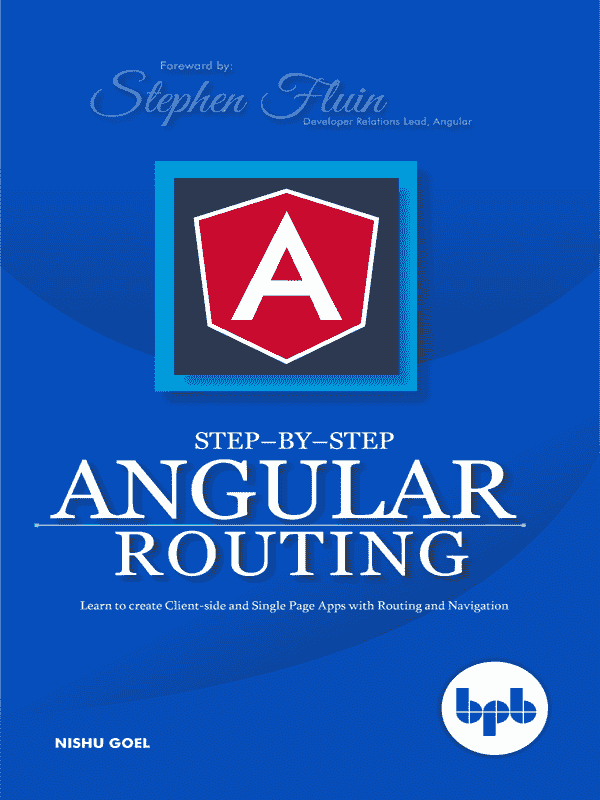
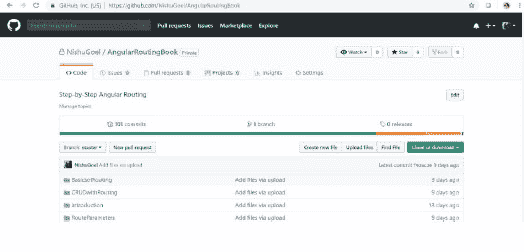

# Angular 路由分步指南：学习使用路由和导航创建客户端及单页应用

# 责任限制与免责声明

由 Manish Jain 为 BPB Publications (20, Ansari Road, Darya Ganj, New Delhi-110002) 出版，并由 Repro India Pvt Ltd (Mumbai) 印刷。

# 关于作者

`Nishu Goel` 是一位目前在印度孟加罗尔的 `IBM` 工作的软件开发人员。她在 2018 年完成了计算机科学学士学位。她从事 `Angular` 开发并不断学习。她热爱写博客文章，并在会议上讨论 `Angular` 的基础概念。她还是 Udemy 上课程《初学者 Angular》(Angular for Beginners) 的作者。由于她在印度贾尔坎德邦的村庄生活了三个月，致力于将技术应用于联合国可持续发展目标 (SDGs)，她获得了英国首相颁发的荣誉表彰。

她的爱好包括：致力于关注特定 SDGs 的社区发展工作、在会议上演讲、探索各个地方。

通过这本书，她旨在与所有人分享她对 `Angular 路由` 概念的学习和理解。

你可以在 Twitter 上推特 `@DcoustaWilson` 联系她，并在 [`nishugoel.wordpress.com/`](https://nishugoel.wordpress.com/) 阅读她的博客文章。

## 本书献给
我的爸爸和妈妈，感谢他们支持我在人生的每一步中想要做的事情。

# 前言

路由是 `Angular` 开发人员最重要的概念之一。无论你只是刚开始 Web 开发，还是一名 `Angular` 专家，URL 栏与应用程序状态之间的映射都是一项至关的功能。路由桥接了过去的可独立寻址页面模型与如今丰富的客户端单页应用之间的之间的鸿沟。

`Angular 路由器` (Angular router) 非常强大，但同时也伴随着一些复杂性。在 `Angular` 早期，`Angular` 团队经过多次尝试才正确处理了所有的复杂性。Nishu 的路由指南涵盖了 `Angular` 开发人员处理最常见用例时需要的所有知识，但她也涵盖了可以将开发人员技能组合提升到下一个水平的高级策略。

通过作为 `Angular` 开发人员在路由之旅中应该采取的每个学习步骤的指南，她加速了学习过程，并在道路上到达了重要的里程碑，例如处理路由中异步性的细微差别。

通过这本书，Nishu 巩固了她在 `Angular` 社区中之星的地位。

**Stephen Fluin，Angular 开发者关系负责人**

# 序

过去，构建 Web 应用很大程度上使用的是 `HTML` 和 `JavaScript`。在构建大型应用时，会大规模使用如 `Dojo`、`knockout` 等库。2009 年，当 `AngularJS` 引入时，Web 开发者社区感到震动。Misko Hevery 和 Adam Abrons 在 `Google` 作为一个侧项目构建了它，从那时起，这个框架一直让人惊喜，并帮助他们更快、更高效地构建应用程序。

随着该框架的不断升级，它变得越来越友好，在第一个名为 `AngularJS` 的版本之后，它现在被称为 `Angular`。从 `Angular 2` 到当前的 `Angular` 版本，无论版本号如何，广泛使用的名称都是 `Angular`。

在写本书时，使用的 `Angular` 版本是 `7.3.7`，很快将升级到 `Angular 8`。

`Angular` 框架的一些惊人特性使其成为构建单页 Web 应用的广泛使用的框架。吸引我转向 `Angular` 框架的原因之一是它极其简单的路由和导航技术，以及它与 `Angular CLI`（命令行界面）的兼容性。

这也是我投入时间编写关于 `Angular Routing` 书的驱动因素之一。

本书的结构保持简单，从介绍 `Angular` 的基础概念开始，然后介绍 `Angular 路由`、基础设置、路由守卫等概念、使用参数路由到不同视图、使用懒加载提高应用程序性能等。

我尽力保持语言简单易懂，不使用深奥术语，希望这本书能成为 `Angular` 初学者的易读读物。

我写这本书的主要动力源于一位多年接触 `Angular` 的人士，也是他在本科毕业后引导我学习 `Angular`。Dhananjay Kumar 先生（又名 `DJ`）印度 `Angular` 会议 `ng-India` 的组织者，`Infragistics` 的开发者布道。他是书籍《Angular 精要》(Angular Essentials) 的作者。无论是他的知识、努力，还是教学和帮助他人成长的热情，他一直是一个灵感来源。

我在明确基础概念的旅途中，主要的学习来源当然是 `DJ`、Deborah Kurata 的 Pluralsight 课程，以及 `Angular` 的官方文档 `angular.io`。

本书有一个相关的 `GitHub` 仓库，链接分享在书中，因为正如我们所听说的，学习某事最好的方法就是实践。

# 跟着一起写！

书中不同主题的运行代码示例 GitHub 链接：

**[`github.com/NishuGoel/AngularRoutingBook`](https://github.com/NishuGoel/AngularRoutingBook)**

# 勘误

我们对 BPB Publications 的工作感到非常自豪，并遵循最佳实践以确保内容的准确性，为我们的订阅者提供沉浸式的阅读体验。我们的读者是我们的镜子，我们利用他们的反馈来反思并改进出版过程中可能出现的任何人为错误。为了让我们保持质量，并帮助我们联系任何可能因不可预见的错误而遇到困难的读者，请通过以下邮箱与我们联系：

errata@bpbonline.com

BPB Publications 大家非常感谢您的支持、建议和反馈。

