# Struts 设计与编程 [电子资源]：入门指南

**涵盖 | 版本 1.2**

- 模型-视图-控制器（MVC）设计模式
- 使用 `ActionForm` 进行用户输入验证
- `Validator` 插件（Validator Plug-in）
- `JSTL` 和 `EL`
- `HTML`、`Bean`、`Logic`、嵌套标签库
- `Tiles`
- 文件上传与可编程文件下载
- 数据持久化
- 对象缓存
- Struts 的工作原理

更重要的是：

- 编写时考虑了清晰度与可读性
- 简洁、详尽且完整

## BUDI KURNIAWAN

Budi Kurniawan

# 警告与免责声明

我们已尽力使本书尽可能准确，但不隐含任何保证或适用性。书中的信息均按“现状”提供。对于因书中信息引起的任何损失或损害，作者和出版者不对任何个人或实体承担任何责任或义务。

`viii`

- `Element` ............................................................................... 421
- `large-icon Element` ........................................................................... 421
- `message-resources Element` ............................................................... 421
- `plug-in Element` ............................................................................... 422
- `set-property Element` ...................................................................... 422
- `small-icon Element` ........................................................................... 423
- `struts-config Element` ............................................................... 423

# 索引

425

# 引言

Servlet 技术和 JavaServer Pages（JSP）是开发 Web 应用的两大主要技术。当 Sun Microsystems 公司于 1996 年首次引入 Servlet 技术时，该技术被认为优于当时盛行的通用网关接口（CGI），因为 servlet 在处理完第一个请求后会保留在内存中。对同一个 servlet 的后续请求不需要实例化 servlet 的类，从而能够提供更好的响应时间。

servlet 的问题在于，向浏览器发送 HTML 标签非常繁琐且容易出错，因为所有的 HTML 输出都必须封装在 `String` 对象中：

```java
PrintWriter out = response.getWriter();
out.println("<html><head><title>Testing</title></head>");
out.println("<body bgcolor='#ffdddd\">");
```

这种方式难以编写，即使是呈现上的细微变化（例如页面的背景颜色），也需要重新编译 servlet。

Sun 公司意识到了这个问题，并开发了 JSP，它允许 Java 代码和 HTML 标签在易于编辑的页面中交织。任何更改都不需要重新编译。页面在修改后，在第一次被调用时会进行自动编译。JSP 中的 Java 代码是脚本化的。

尽管将 Java 代码和 HTML 混合在初看之下是实行的，但实际上并不是一个好主意。这就是为什么 JSP 设计者允许开发者在 Java 类中编写业务逻辑，并从 JSP 中调用这些类中的方法的原因。在 JSP 中混合 Java 代码和 HTML 被认为是不良的，原因如下：

- Java 代码和 HTML 的交织会导致应用程序变得难以阅读和难以维护。
- 在 JSP 中编写代码减少了代码复用的机会。当然，你可以将所有的 Java 方法都放在一个 JSP 中，并从其他需要使用这些方法的 JSP 中包含此页面。然而，这样做你就背离了面向对象的范式。一方面，你失去了继承的能力。
- 在 JSP 中编写 Java 代码比在 Java 类中编写更困难。面对现实吧，你的 IDE 是为了分析 Java 类中的 Java 代码而设计的。
- 如果代码在 Java 类中，调试会更容易。
- 在 Java 类中测试业务逻辑更容易。
- Java 类中的 Java 代码更容易进行重构。

事实上，业务逻辑（Java 代码）与呈现（HTML 标签）的分离是一个如此重要的问题，以至于 JSP 设计者从 JSP 的第一个版本开始就一直尝试鼓励这样做。

在 JSP 1.0 中，JSP 设计者允许你使用 JavaBeans 来封装 Java 代码，将代码与呈现分离，并促进代码与代码之间的复用。JavaBean 本质是一个 Java 类。你可以使用 `<jsp:useBean>` 和 `<jsp:setProperty>` 来操作它。

遗憾的是，JavaBeans 并没有为代码与呈现分离的问题提供完美的解决方案。使用 JavaBeans 时，方法必须遵循 JavaBean 命名规范，导致偶尔出现笨拙的名字。此外，你无法在不借助脚本（scriptlet）的情况下向方法传递参数。

为了更容易更容易实现代码和 HTML 标签的分离，JSP 1.1 定义了自定义标签库，这比 JavaBeans 更具活性。问题是，自定义标签很难编写，且 JSP 1.1 中的自定义标签拥有非常复杂的生命。

为了缓解想要将代码与呈现分离的开发者在编写自定义标签的问题，人们发起了一项提供特定功能标签的努力。这些标签被编译在一组名为 Java Pages 标准标签库（JSTL）的库中。例如，JSTL 拥有用于操作作用域对象、遍历集合、执行条件测试以及解析和格式化数据的标签等。

尽管有了 JavaBeans、自定义标签和 JSTL，许多人仍然在他们的 JSP 中使用脚本（scriptlet），原因如下。

# 为什么 Servlets 还没有灭亡

- 便利性。将所有内容都放在 JSP 中非常方便。如果你的应用程序只是只包含一两个页面的非常简单的程序，并且永远不会增加复杂性，这样做是可以接受的。
- 短视。在 JSP 中编写代码和 HTML 似乎是一种更快速的开发方式。然而，从长远来看，以这种方式构建应用程序是需要代价的。维护和代码可读性是两个主要问题。
- 缺乏知识。

此外，在涉及不同技能水平程序员的项目中，更难确保所有的 Java 代码都进入 Java 类。即使是才华横溢的架构师，如果必须监督他所有的程序员也会头疼。

为了让无脚本（scriptlet-free）的 JSP 更具可行性，JSP 2.0 添加了一个功能，允许架构师禁用 JSP 中的脚本，从而强制代码和 HTML 分离。因此，如果架构师足够知识，开发者将不得不求助于 JavaBeans、自定义标签、JSTL 以及其他库。此外，JSP 2.0 提供了一种更简单的在标签文件中构建自定义标签的方法。

# 为什么 Servlets 还没有灭亡

随着 JSP 的出现，许多人认为那是 servlet 的终结。事实并非如此。JSP 并没有取代 servlet。事实上，在今天的应用程序中，servlet 和 JSP 是一起使用的。要理解为什么 servlet 在 JSP 出现后并没有过，你需要理解构建 Java Web 应用的设计模型。

第一个设计模型被称为 Model 1，诞生于 JSP 发布之后。该模型通常不使用 servlet。从一个 JSP 到另一个是通过点击完成的。第二个设计模型命名为 Model 2。你很快就会看到为什么 Model 1 不被推荐，为什么 Model 2 才是正确选择。

## Model 1 的问题

Model 1 设计模型是以页面为中心的。实现该模型的应用程序有一系列 JSP，用户在页面之间跳转。这是你初学 JSP 时总是使用的模型，因为它简单易用。Model 1 应用的主要问题是难以维护且缺乏活性。此外，这种架构没有促进页面设计师与 Web 开发者之间的分工，因为开发者参与了页面开发和业务逻辑编码。

总结，Model 1 不被推荐的原因如下：

- 导航问题。如果你更改了其他页面引用的 JSP 名称，你必须在许多地方更改它。
- 在 JSP 中使用脚本的诱惑更大，因为 JavaBeans 有局限性且编写自定义标签相对困难。然而，如上述，在 JSP 页面中混合 Java 代码和 HTML 是一件坏事。

## Model 2

第二个设计模型被称为 Model 2。这是构建 Java Web 应用的推荐架构。Model 2 是模型-视图-控制器（MVC）设计模式的另一种名称。在 Model 2 中，应用程序有三个主要组件：模型、视图和控制器。MVC 模式在第 1 章有进一步讨论。

## 注意

Model 2 一词首次出现在《JavaServer Pages 规范》版本 0.92 中。

## Struts 的优势

在 Model 2 中，所有页面都有一个入口，通常由一个 servlet 充当主控制器，并使用 JSP 负责展示。与 Model 1 相比，Model 2 应用具有以下优势：

- 构建更快速
- 更容易测试
- 更容易维护
- 更容易扩展

现在，你明白为什么将 servlet 和 JSP 结合使用了。

### 注意事项

一个常见的问题是：如果整个应用程序只有一个 servlet，且这是进入应用的唯一入口，性能会受到影响吗？servlet 容器会创建许多 servlet 实例吗？答案是，容器只会创建一个 servlet 实例，除非你实现了 `javax.servlet.SingleThreadModel` 接口（不推荐，且在 Servlet 2.4 中已被弃用），性能不会受到影响。欲需更详细的讨论，请参阅我的书籍《How Tomcat Works》。

## Struts 的优势

既然你现在已经理解了为什么 MVC 模式（Model 2）是 Java Web 应用推荐的设计模型，下一个要问的问题是：“如何让 Model 2 应用的开发更快速？”

这也是 Craig McClahan 在创建 Struts 之前考虑过的问题。Struts 是用于开发 Model 2 应用的框架。它通过提供以下功能解决了 Web 应用开发中的一些常见问题，使得开发更加快速：

- 页面导航管理
- 用户输入验证
- 一致的布局
- 可扩展性

由于 Struts 是一个 Model 2 框架，在使用 Struts 时，你应该遵循以下潜规则：

## 序言

- JSP 中不要有 Java 代码，所有的业务逻辑都应该存在于称为 action 类（action classes）的 Java 类中。
- 在 JSP 中使用表达式语言（如果你使用的是 JSP 2.0）或 JSTL 来访问业务模型。
- 尽量少或不编写自定义标签（因为它们编写起来很难）。

## 章节概述

本书适用于想要学习如何开发 Struts 应用的读者。然而，本书并不止于此。它更进了一步，教授如何设计高效的 Struts 应用。正如标题所示，本书被设计为一个教程，适合从头到尾阅读，编写时考虑了清晰性和可读性。

以下是章节的概述。

第 1 章“Model 2 与 Struts”解释了 Model 2 架构并提供了两个 Model 2 应用。它还介绍了 Struts 作为一个快速构建 Model 2 应用的流行框架。

第 2 章“使用 Action Forms 进行输入验证”讨论了 Struts 帮助用户输入验证的主要功能之一。输入验证是 Web 应用开发中的一项重要任务，包括检查必填字段是否有值、输入的日期或数字格式是否正确，Struts action 实现了这些输入验证。

第 3 章“HTML 库”解释了 HTML 库，这是 Struts 生成表单的主要功能之一。

第 4 章“输入验证与数据转换”详细讨论了数据转换。此外，本章展示了如何使用它。

第 5 章“Validator 插件”讨论了保存对象的持久层的需求。Validator 插件用于输入验证。

第 6 章“表达式语言”涵盖了表达式语言（EL），这是 JSP 最重要的功能之一。

第 7 章“JSTL”讨论了 JSTL，它允许你在不在 JSP 中编写 Java 代码的情况下使用逻辑。

第 8 章“Bean 库”讨论了 Bean 库，它允许你访问属性。

第 9 章“Logic 库”涵盖了用于条件逻辑的 Logic 库。

第 10 章“Struts-EL”解释了 Struts-EL，它用于国际化消息。

第 11 章“消息处理与国际化”涵盖了消息处理，这是应用程序能够显示本地化消息的要求。

第 12 章“Tiles 框架”讨论了 Tiles 框架，它允许你在应用实现一致的外观。

第 13 章“保护 Struts 应用”，你将学习如何配置部署描述符以限制对某些或所有资源的访问。所谓“配置”的意思是你只需要修改部署描述符文件——不需要编程。

后者，它是基于查询的分页。本章还介绍了 Display Tag 库，它默认支持分页和排序。

第 19 章“防止重复提交”解释了如何使用 Struts 的内置功能来防止重复提交，重复提交可能是意外发生的，也可能是用户在表单处理时间较长时不知道该做什么而导致的。

第 20 章“早期会话失效”介绍了一种技术，可以结束关闭浏览器的用户的 `HttpSession` 对象，从而有效地释放宝贵的空间。

第 21 章“对象装饰”解释了如何使用装饰器模式来封装 `HttpServletRequest` 对象。文中还了一个包含修剪过滤器（trimmer filter）的示例。

第 22 章“Struts 的工作原理”通过查看底层机制总结了本书的内容。特别是，本章解释了 Struts 中最重要的三个类型：`ActionServlet`、`RequestProcessor` 和 `ConfigModule`。理解 Struts 的工作原理无疑能让你编写出更有效的应用程序。

附录 A“Struts 配置”是 Struts 配置文件的参考指南。

## 代码下载

本书的优点之一是每个主题都配有大量的示例。配套应用程序可以从 `http://www.brainsoftware.com/books/struts/mgm/StrutsBookApps.zip` 免费下载。

每章配套应用程序的命名遵循此格式：`appXXy`

其中 `XX` 是两位数字，`y` 是代表该应用程序在章节中顺序的字母。因此，第 1 章的第二个应用程序是 `app0b`。

所有应用程序均使用 Tomcat 5 进行测试。它们均在作者机器的 8080 端口上运行。因此，所有应用程序的 URL 都以 `http://localhost:8080` 开头，后紧跟应用程序名称和 servlet 路径。

## 其他资源

一些相关文章可以在出版商网站（`www.brainisoftware.com`）找到，另一些包含在可下载的 ZIP 文件中。以下是这些文章的列表。

- XML 简介。Struts 和 Tiles 配置文件是 XML 文档。因此，你需要理解什么是 XML 文档以及如何对其进行验证。你可以在 `www.brainisoftware.com` 找到关于 XML 的文章。请确保也阅读了涵盖 DTD 文件的章节。
- JSTL 的完整参考。第 7 章讨论了与 Struts 编程相关的一些标签。如果你想了解更多……
- Digester。Digester 是一个开源 Java 库，帮助将 XML 文档转换为 Java 对象。你可以在下载的 ZIP 文件中找到关于 Digester 的书籍章节。

# 第 1 章

## Model 2 和 Struts

正如引言所示，Model 2 是除最简单的 Java Web 应用程序之外的所有应用的推荐架构。本章将详细讨论 Model 2 并提供两个 Model 2 应用程序的示例。它还将介绍 Struts 作为一种快速开发 Model 2 应用程序的框架。本书从 Model 2 开始，是因为深入理解这种设计模型对于构建有效的 Struts 应用程序至关重要。

Model 2 基于模型-视图-控制器（MVC）设计模式。后者是 Smalltalk-80 用户界面的核心概念。在当时，“模式”（pattern）一词还没有被使用。相反，它被称为 MVC 范式。

实现 MVC 模式的应用程序由三个模块组成：模型（model）、视图（view）和控制器（controller）。视图负责应用程序的显示。模型封装了应用程序数据和业务逻辑。控制器接收用户输入并命令模型和/或视图进行相应的更改。

## 备记

由 Steve Burbeck 博士写的名为《Applications Programming in Smalltalk-80(TM): How to use Model-View-Controller (MVC)》的论文讨论了 MVC 模式。你可以在 `http://st-ws.cs.uiuc.edu/smerch/st-docs/mvc.html` 找到它。

在 Model 2 中，你有一个 servlet 作为控制器。Java Server Pages（JSPs）被用作视图。作为模型，你使用 JavaBeans 持有应用程序数据并封装业务逻辑。图 1.1 显示了 Model 2 应用程序。

在该应用程序中，每个 HTTP 请求都必须指向控制器 servlet。请求统一资源标识符（URI）中的信息告诉 servlet 调用哪个 action。“action”一词用于引用应用程序必须执行的操作。图 1.1 显示了 Model 2 架构：


在该应用程序中，每个 HTTP 请求都必须指向控制器 `servlet`。请求统一资源标识符（`URI`）中的信息告诉 `servlet` 调用哪个 `action`。“`action`”一词用于引用应用程序必须执行的操作。图 1.1 显示了 Model 2 架构：


1. 显示“Add”表单。
2. 将数据保存到数据库。

在该应用程序中，每个 HTTP 请求都必须指向控制器 `servlet`。请求统一资源标识符（`URI`）中的信息告诉 `servlet` 调用哪个 `action`。“`action`”一词用于引用应用程序必须执行的操作。图 1.1 显示了 Model 2 应用程序：


在该应用程序中，每个 HTTP 请求都必须指向控制器 `servlet`。请求统一资源标识符（`URI`）中的信息告诉 `servlet` 调用哪个 `action`。“`action`”一词用于引用应用程序必须执行的操作。图 1.1 显示了 Model 2 应用程序：


在该应用程序中，每个 HTTP 请求都必须指向控制器 `servlet`。请求统一资源标识符（`URI`）中的信息告诉 `servlet` 调用哪个 `action`。“`action`”一词用于引用应用程序必须执行的操作。图 1.1 显示了 Model 2 应用程序：


在该应用程序中，每个 HTTP 请求都必须指向控制器 `servlet`。请求统一资源标识符（`URI`）中的信息告诉 `servlet` 调用哪个 `action`。“`action`”一词用于引用应用程序必须执行的操作。图 1.1 显示了 Model 2 应用程序：


在该应用程序中，每个 HTTP 请求都必须指向控制器 `servlet`。请求统一资源标识符（`URI`）中的信息告诉 `servlet` 调用哪个 `action`。“`action`”一词用于引用应用程序必须执行的操作。图 1.1 显示了 Model 2 应用程序：


在该应用程序中，每个 HTTP 请求都必须指向控制器 `servlet`。请求统一资源标识符（`URI`）中的信息告诉 `servlet` 调用哪个 `action`。“`action`”一词用于引用应用程序必须执行的操作。图 1.1 显示了 Model 2 应用程序：


在该应用程序中，每个 HTTP 请求都必须指向控制器 `servlet`。请求统一资源标识符（`URI`）中的信息告诉 `servlet` 调用哪个 `action`。“`action`”一词用于引用应用程序必须执行的操作。图 1.1 显示了 Model 2 应用程序：


## 作用域变量和作用域对象

- 向 `HttpServletRequest` 添加对象创建请求作用域变量和请求作用域对象。
- 向 `HttpSession` 添加对象创建会话作用域变量和会话作用域对象。
- 向 `ServletContext` 添加对象创建应用作用域变量和应用作用域对象。

在该应用程序中，每个 HTTP 请求都必须指向控制器 `servlet`。请求统一资源标识符（`URI`）中的信息告诉 `servlet` 调用哪个 `action`。“`action`”一词用于引用应用程序必须执行的操作。图 1.1 显示了 Model 2 应用程序：


J2EE 中传输对象的概念简单且易懂。传输对象只包含数据元素，没有业务逻辑。相比之下，业务对象具有业务方法和数据元素。

使用传输对象的主要目的是为了跨层的高效数据传输，例如从表示层到业务层。假设你在企业 Bean（EJB）中有一个名为 `insertOrder(Order)` 的业务方法，你从 `servlet` 远程调用它。`Order` 参数必须从表示层传输到业务层（可能运行在不同的 Java 虚拟机）。将 `Order` 对象作为传输对象将产生更有效的方法调用。`insertOrder` 方法只对 `Order` 对象中的值（例如产品 ID、数量、消费者 ID 等）感兴趣，而不需要对其调用业务方法。因此，`Order` 类不需要业务方法。

传输对象必须是序列化的，即其类必须实现 `java.io.Serializable` 接口。这样做有两个原因：首先，在远程方法调用（RMI）中传输的对象必须是序列化的，而 EJB 技术使用 RMI 作为 EJB 与客户端之间的通信协议。因此，传递给 EJB 方法的传输对象必须是序列化的。第二个原因与 `servlet` 容器在内存不足时将其 `HttpSession` 对象序列化到辅助存储有关。由于传输对象通常存储在 `HttpSession` 中，因此传输对象必须是序列化的，以便对象序列化过程成功。

传输对象可以通过两种方式之一暴露其数据值：

1. 通过将数据元素暴露为公共字段：

```java
public class Order implements java.io.Serializable {
    public String productId;
    public int quantity;
    ...
```

> ¹ 详细信息，请查看 `http://java.sun.com/developer/onlineTraining/rmi/RMI.html#SerializingRemoteObjects`

2. 通过使用属性，即通过私有字段表示数据元素，并通过公共访问方法和公共设置方法来访问它：

```java
public class Order implements java.io.Serializable {
  private String productId;
  private int quantity;
  ...

  public String getProductId() {
    return productId;
  }

  public void setProductId(String productId) {
    this.productId = productId;
  }

  public int getQuantity() {
    return quantity;
  }

  public void setQuantity(int quantity) {
    this.quantity = quantity;
  }
  ...
}
```

两种方法都可行，但如果你想使用 JSP 标准标签库（JSTL）或 Struts 自定义标签来访问由作用域变量引用的传输对象，那么第二种方法是唯一的选择。这是因为 JSTL 和许多其他自定义标签的设计是为了与 JavaBean 配合。第二种方法中的 `Order` 类实际上是一个实现了 `java.io.Serializable` 的 JavaBean。

为了让传输对象更具识别性，良好的做法是在类名后添加后缀 `TO`，例如 `OrderTO`、`ConsumerTO` 等。

另一个相关术语是“值对象”（value object），根据定义，它是只包含值或数据元素的对象。因此，传输对象也是一种值对象。尽管它们的目的可能不同，但值对象和传输对象通常互换使用。

## 一个简单的 Model 2 应用

本节介绍了一个基础 Model 2 应用的示例，以便让你对 Model 2 应用的形式有一个大致的概念。在现实生活中，Model 2 应用比这复杂得多。

示例应用程序用于输入产品信息，命名为 `app01a`。用户填写如图 1.2 所示的输入表单并提交。应用程序将向用户发送一个确认页面，并显示已保存产品的详情（见图 1.3）。

该应用程序能够执行以下两个操作：

- 1. 显示“添加产品”表单。此操作会发送图 1.2 中的表单。调用此操作的路径将包含字符串 `action=displayAddProductForm`，并返回图 1.3 中的确认页面。
- 2. 保存产品。调用此操作的路径必须包含字符串 `action=saveProduct`。

该应用程序由以下组件组成：

- 1. 代表产品的 `ProductTO` 类。
- 2. 控制 `servlet` 的 `ControllerServlet` 类。
- 3. 三个 JSP（`displayAddProductForm.jsp` 和 `displaySavedProduct.jsp`）作为视图。

该应用程序的目录结构如图 1.4 所示。注意，你必须在 `WEB-INF/lib` 中放置两个 JSTL 包（`jstl.jar` 和 `standard.jar`）。

## ProductTO 类

`ProductTO` 实例是一个封装了产品信息的传输对象。`ProductTO` 类（位于列表 1.1）有三个属性：`productName`、`description` 和 `price`。`ProductTO` 实现 `java.io.Serializable`，因为它的实例可能会存储在 `HttpSession` 对象中。

### 列表 1.1：ProductTO 类

```java
package app0la;

import java.io.Serializable;

public class ProductTO implements Serializable {
    private String productName;
    private String description;
    private String price;

    public String getProductName() {
        return productName;
    }

    public void setProductName(String productName) {
        this.productName = productName;
    }

    public String getDescription() {
        return description;
    }

    public void setDescription(String description) {
        this.description = description;
    }

    public String getPrice() {
        return price;
    }

    public void setPrice(String price) {
        this.price = price;
    }
}
```

## ControllerServlet 类

`ControllerServlet` 类（位于列表 1.2）继承自 `HttpServlet`，`doGet` 和 `doPost` 方法都调用了 `process` 方法。

### 列表 1.2：ControllerServlet

```java
package app0la;

import java.io.IOException;
import javax.servlet.RequestDispatcher;
import javax.servlet.ServletException;
import javax.servlet.http.HttpServlet;
import javax.servlet.http.HttpServletRequest;
import javax.servlet.http.HttpServletResponse;

public class ControllerServlet extends HttpServlet {

    protected void doGet(HttpServletRequest request, HttpServletResponse response)
            throws ServletException, IOException {
        String action = request.getParameter("action");
        String dispatchUrl = null;

        if ("displayAddProductForm".equals(action)) {
            dispatchUrl = "/jsp/displayAddProductForm.jsp";
        } else if ("saveProduct".equals(action)) {
            dispatchUrl = "/jsp/displaySavedProduct.jsp";
        }

        if (dispatchUrl != null) {
            RequestDispatcher rd = request.getRequestDispatcher(dispatchUrl);
            rd.forward(request, response);
        }
    }

    protected void doPost(HttpServletRequest request, HttpServletResponse response)
            throws ServletException, IOException {
        // 保存产品的实现逻辑
        ProductTO product = new ProductTO();
        product.setProductName(request.getParameter("productName"));
        product.setDescription(request.getParameter("description"));
        product.setPrice(request.getParameter("price"));

        // 保存产品逻辑...

        request.setAttribute("product", product);
        doGet(request, response);
    }
}
```

## 第 1 章：Model 2 与 Struts

```html
<td><input type="reset"/></td>
<td><input type="submit" value="Add Product"/></td>
</tr>
</table>
</form>
</body>
</html>
```

### 列表 1.4：displaySavedProduct.jsp 页面

```jsp
<@ taglib uri="http://java.sun.com/jstl/core" prefix="c" %>
<html>
<head>
<title>保存产品</title>
</head>
<body>
<b>产品已保存。</b>
<br/><br/><<b>详情：</b>
<br/><br/>Product Name: <c:out value="${product.productName}"//>
<br/>Description: <c:out value="${product.description}"//>
<br/>Price: $<c:out value="${product.price}"/>
</body>
</html>
```

`displayAddProduct.jsp` 包含一个用于输入产品详情的 HTML 表单。`displaySavedProduct.jsp` 使用 JSTL 的 `out` 标签来访问 `HttpServletRequest` 对象中的产品作用域对象。`out` 标签将在第 7 章中进行解释。现在，请记住该标签通常配合前缀 `c` 以以下格式使用：

```jsp
<c:out value="expression"/>
```

## 标签库描述符的直接引用和间接引用

自定义标签必须在标签库描述符（TLD 文件）中描述。要在 JSP 中使用该标签，必须使用 `taglib` 指令的 `uri` 属性直接或间接地引用 TLD。

```jsp
<@taglib uri="..." prefix="..." %>
```

如果你直接引用 TLD，则 `uri` 属性必须赋值为 `uri` 元素的值。TLD 文件必须存在于 `WEB-INF` 目录下，或者 `WEB-INF/lib` 目录下的 JAR 文件中。

## 一个基础的 Model 2 应用程序

`WEB-INF/lib` 目录。例如，JSTL 1.0 的 TLD 被封装在 `standard.jar` 文件中。`standard.jar` 文件中 `c.tld` 文件（通用标签的描述符）的 `uri` 元素如下：

```xml
<uri>http://java.sun.com/jstl/core</uri>
```

只要在 JSP 页面中包含以下 `taglib` 指令，你就可以使用 TLD 中的所有标签：

```jsp
<@ taglib uri="http://java.sun.com/jstl/core" prefix="c" %>
```


直接引用 TLD 文件时，不需要在部署描述符（`web.xml` 文件）中提到 `taglib`。间接引用 TLD 文件时，你必须在 `web.xml` 文件中使用 `taglib` 元素。`taglib` 元素将有两个子元素：`taglib-uri` 和 `taglib-location`。`taglib-uri` 元素指定 TLD 的唯一标识符。`taglib-location` 元素定义 TLD 文件的位置。通常，你会将 TLD 文件放置在 `WEB-INF` 目录。以下是 `web.xml` 文件中 `taglib` 元素的示例：

```xml
<taglib>
  <taglib-uri>/tags/struts-html</taglib-uri>
  <taglib-location>WEB-INF/struts-html.tld</taglib-location>
</taglib>
```

在你的 JSP 中，`taglib` 指令的 `uri` 属性指定 `web.xml` 文件中 `taglib-uri` 元素的值，而不是 TLD 的 `uri` 元素的值。

```jsp
<@ taglib uri="tags/struts-html" prefix="html" %>
```

直接引用 TLD 更容易，因为你不需要编辑 `web.xml` 文件。但是，如果你需要升级到更高版本的标签库，你可能需要编辑所有使用该标签库标签的 JSP 页面。因为 TLD 的 `uri` 元素的值在标签库的新版本中可能会发生变化。例如，JSTL 1.0 中 TLD 的 `uri` 元素值与 JSTL 1.1 中的不同。

在实践中，两种引用 TLD 文件的方法都被使用了。在本书中，Struts TLD 是间接引用的，而非 Struts TLD 是直接引用的，以让你获得使用这两种方法的体验。

# 第 1 章：Model 2 与 Struts

## 部署描述符

作为一个 servlet/JSP 应用程序，`app01a` 应用程序需要一个部署描述符（`web.xml` 文件），如列表 1.6 所示。

### 列表 1.6：部署描述符 (web.xml)

```xml
<?xml version="1.0" encoding="UTF-8"?>
<!DOCTYPE web-app PUBLIC "//Sun Microsystems, Inc.////DTD web-app 2.3//EN"
  "http://java.sun.com/dtd/web-app_2_3.dtd">
<web-app>
  <servlet>
    <servlet-name>Controller</servlet-name>
    <servlet-class>app01a.ControllerServlet</servlet-class>
  </servlet>
  <servlet-mapping>
    <servlet-name>Controller</servlet-name>
    <url-pattern>/Controller</url-pattern>
  </servlet-mapping>
</web-app>
```

部署描述符定义了类型为 `app01a.ControllerServlet` 的 servlet 并命名为 `Controller`。通过路径 `/Controller` 可以调用它。

## 使用应用程序

假设你在本地机器的 8080 端口上运行该应用程序，可以通过以下 URL 调用应用程序：

`http://localhost:8080/Controller?action=displayProductForm`

当你提交表单时，发送到服务器的 URL：

`http://localhost:8080/Controller?action=saveProduct`

## 引入视图管理器和管理器

很容易看到，随着应用程序变得复杂，servlet 中的 process 方法可能会变得臃肿。为了避免这种情况，可以通过引入两个模块使应用程序更加模块化：管理器和视图管理器。

以下示例 `app0ib` 为之前的应用程序增加了视图管理器和管理器。`ActionManager` 类代表管理器，见列表 1.7；`ViewManager` 类代表视图管理器，见列表 1.8。

### 列表 1.7：ActionManager

```java
package app0ib;

import java.io.IOException;
import javax.servlet.ServletException;
import javax.servlet.http.HttpServletRequest;
import javax.servlet.http.HttpServletResponse;

public class ActionManager {
    public void execute(HttpServletRequest request,
                         HttpServletResponse response)
        throws ServletException, IOException {
        String action = request.getParameter("action");
        // 如果必要则执行操作
        if (action.equals("displayProductForm")) {
            // 什么都不做
        } else if (action.equals("saveProduct")) {
            // 读取并将产品存入数据库
            ProductTO product = new ProductTO();
            product.setProductName(
                request.getParameter("productName"));
            product.setDescription(
                request.getParameter("description"));
            product.setPrice(request.getParameter("price"));
            // 此处是持久化 Product 对象的代码
            request.setAttribute("product", product);
        }
    }
}
```

`ActionManager` 有一个方法 `execute`，它替换了之前应用程序 servlet process 方法中的第一个 `if` 块。

### 列表 1.8：ViewManager

```java
package app01b;

import java.io.IOException;
import javax.servlet.RequestDispatcher;
import javax.servlet.ServletException;
import javax.servlet.http.HttpServletRequest;
import javax.servlet.http.HttpServletResponse;

public class ViewManager {
    public void execute(HttpServletRequest request,
        HttpServletResponse response)
        throws ServletException, IOException {
        String action = request.getParameter("action");
        // 转发到视图
        String dispatchUrl = null;
        if (action.equals("displayProductForm")) {
            dispatchUrl = "/jsp/displayAddProductForm.jsp";
        } else if (action.equals("saveProduct")) {
            dispatchUrl = "/jsp/displaySavedProduct.jsp";
        }
        if (dispatchUrl != null) {
            RequestDispatcher rd = request.getRequestDispatcher(dispatchUrl);
            rd.forward(request, response);
        }
    }
}
```

### 列表 1.9：controller servlet 中的 process 方法

```java
private void process(HttpServletRequest request,
    HttpServletResponse response)
    throws IOException, ServletException {
    ActionManager actionManager = new ActionManager();
    actionManager.execute(request, response);
    ViewManager viewManager = new ViewManager();
    viewManager.execute(request, response);
}
```

JSPs 和 `ProductTO` 类保持不变。

`app01b` 应用的功能同于 `app01a`。你可以使用以下 URL 启动应用程序：
`http://localhost:8080/app01b/Controller?action=displayAddProductForm`

## 注意

某些操作不需要在 action manager 中运行代码。

# 进入 Struts

我知道你对第二个例子想说什么。我们没有通过在 controller servlet 中塞满代码，而是将代码移动到了 Action 类中。现在，是 `ActionManager` 类变得代码臃肿了！此外，在之前的应用程序中，我们硬编码了路径和转发信息，即在 controller servlet 或 view manager 中。这意味着任何对 action 路径的任何修改或对 JSP 的任何更改都需要重新编译。显然，我们需要更好的解决方案。

幸运的是，Struts 通过提供以下功能解决了 MVC 开发中的许多问题：

- Struts 提供了一个 controller servlet，让你无需自己编写。
- Struts 采用基于 XML 的配置文件来存储 action manager 和 view manager 所需要的路径和其他信息。由于 XML 文档是文本文件，对应用程序可以进行许多更改而无需重新编译。
- Struts 引入了模块化。在调用 action 时需要运行的代码被写在单独的类中。
- Struts 其他功能包括用户输入验证、消息处理等，这些将在后续章节中讨论。

# Model 2 与 Struts

## 注意

Struts 中的 controller servlet 被称为“action servlet”（动作 de servlet），我将在书的其余部分使用这个术语。

在本节中，你将看到 Struts 如何帮助你更快速编写 Model 2 应用程序。第一个小节讨论 Struts 配置文件。下一个小节解释了如何配置你的部署描述符 (`web.xml`) 来使用 Struts，然后是对之前的应用程序进行重写。

## Struts 配置文件

Struts 应用程序必须有一个配置文件，默认是一个名为 `struts-config.xml` 的 XML 文件，位于 `WEB-INF` 目录下。该 XML 文件的根元素是 `struts-config`。现在我们将关注与 action 和 view 相关的配置设置。配置的其他方面将在后续章节中解释。

## 注意

Struts 配置文件的完整参考请见附录 A。管理 actions 和 views 的元素是 `action-mappings`，它分组了 Struts 应用程序中的所有 actions。`action-mappings` 元素可以有一个或多个 `action` 元素。`action` 元素代表一个 action，必须有一个 `path` 属性来唯一标识该 action。例如，之前的应用程序有两个 action：`displayAddForm` 和 `saveProduct`。在 Struts 中，你为这两个 action 有以下 action 元素：

```xml
<struts-config>
  <action-mappings>
    <action path="/displayAddForm" ... />
    <action path="/saveProduct" ... />
  </action-mappings>
</struts-config>
```

与非 Struts Model 2 应用程序一样，Struts action 在被调用时可能可能没有要执行的代码。如果没有代码要运行，你只需要告诉 Struts 将控制转发到 JSP。例如，`app01a` 和 `app01b` 中的 `displayAddForm` action 没有任何要执行的代码，因此你可以将控制转发到 `displayAddForm.jsp` 页面。在 Struts 中，使用元素的 `forward` 属性来跳过 action manager 直接将控制转发到视图。对于 `app01a` 和 `app01b` 中的 `displayAddForm` action，你将在配置文件中有以下元素：

```xml
<action path="/displayAddForm" forward="/jsp/displayAddForm.jsp"/>
```

如果有要运行的代码，你必须将代码写在一个名为 action 类的独立类中。在相应 action 元素的 `type` 属性中选择 action 类的全限定名。例如，如果 `saveProduct` 的 action 类是 `myPackage.SaveProductAction`，你将有以下 action 元素：

```xml
<action path="/saveProduct" type="myPackage.SaveProductAction" />
```

在调用 action 时，Struts 将实例化 `myPackage.SaveProductAction` 类并执行其中的代码。关于 action 类的更多信息可以在下一个小节中找到。

在 action 对象中执行完代码后，Struts 必须将控制转发到视图。你使用 action 元素内部的 `forward` 子元素来指定视图：

```xml
<action path="/readConfig" type="myPackage.SaveProductAction">
  <forward name="success" path="/jsp/displayConfig.jsp" />
</action>
```

## 警告

不要混淆 `forward` 属性和 `forward` 元素。`forward` 元素有两个属性：`name` 和 `path`。`name` 属性指定 forward 元素的标识符或逻辑名称，可以是任何字符串。`path` 属性指定控制将转发到的资源（通常是 JSP）的路径。

一个 `action` 元素可以有多个 `forward` 子元素，每个元素指定一个可能的转发目的地。你之所以可能需要多个 `forward` 元素，是因为你的 action 对象中的代码执行可能会发生分支。例如，`saveProduct` action 中的 `insert` 操作可能会成功，也可能失败。如果你希望在插入成功后跳转到 `displaySavedProduct.jsp`，在尝试失败后跳转到 `error.jsp` 页面，你将有以下 action 元素：

```xml
<action path="saveProduct" type="myPackage.SaveProductAction">
  <forward name="success" path="/jsp/displayConfig.jsp"/>
  <forward name="failed" path="/jsp/error.jsp"/>
</action>
```

如果一个 `forward` 元素用于多个 action，你可以将其写在 `global-forwards` 元素中。例如，一个 Struts 应用程序可能有一个公共错误页面，如果在调用任何 action 时发生错误，控制将始终转发到那里。在这种情况下，你有：

```xml
<global-forwards>
  <forward name="failed" path="/jsp/error.jsp"/>
</global-forwards>
```


# 第一章：模型 2 与 Struts

## `Action`、`ActionForward` 和 `ActionMapping`

现在让我们来看 Struts 应用程序编程接口（API）中的一些类。特别感兴趣的是 `org.apache.struts.action` 包中的三个类：`Action`、`ActionForward` 和 `ActionMapping`。Struts 采用 Commons Digester 库，根据配置中的设置来创建这些类的实例。

> ² 我在我的另一本书《How Tomcat Works》中详细解释了 Digester 的工作。

### `Action` 类

`Action` 类代表 action 对象。如果你的 action 类有在 action 调用时需要执行的代码，你必须写一个继承 `Action` 的 action 类。你必须重写它的 `execute` 方法并在那里编写代码。

假设你在配置文件中定义了如下 `saveProduct` action：

```xml
<action path="/saveProduct" type="myPackage.SaveProductAction">
  <forward name="success" path="/jsp/displaySavedProduct.jsp"/>
  <forward name="failed" path="/jsp/error.jsp"/>
</action>
```

当 action 被调用时，Struts 会实例化 `myPackage.SaveProductAction` 并调用它的 `execute` 方法，从而运行你编写的代码。这里是 `execute` 方法的签名：

```java
public ActionForward execute(ActionMapping mapping,
    ActionForm form, javax.servlet.ServletRequest request,
    javax.servlet.ServletResponse response) throws
    java.lang.Exception
```

该方法返回一个 `ActionForward`，代表控制将转发到的目的地。如何为你的 `execute` 方法创建正确的 `ActionForward` 对象？

在后台，Struts 读取任何 `action` 元素的所有 `forward` 子元素以及 `global-forwards` 元素（如果有），并创建一个封装这些转发信息的 `ActionMapping` 对象。对于 `action` 元素中的每个 `forward` 子元素，Struts 都会创建一个对应的 `ActionForward` 对象，并将其存储在 `ActionMapping` 对象内部的 `java.util.HashMap` 中。`forward` 元素的 `name` 属性值用作 `ActionForward` 对象的键。再次检查这个 action 元素：

```xml
<action path="/saveProduct" type="myPackage.SaveProductAction">
  <forward name="success" path="/jsp/displayConfig.jsp"/>
  <forward name="failed" path="/jsp/error.jsp"/>
</action>
```

你可以通过在 `ActionMapping` 对象上调用 `findForward` 方法并传递相应的键来获取一个 `ActionForward`。以下是 `findForward` 方法的签名：

```java
public ActionForward findForward(java.lang.String name);
```

因此，在你的 action 类的 `execute` 方法中，你会有类似下面的代码来返回一个 `ActionForward` 对象：

```java
return mapping.findForward(key);
```

随着我们在下一节中学习 Struts 应用程序，这一点会变得更加清晰。现在，让我们来看看在部署描述符中需要执行的操作，以让 Struts 运行起来。

## 编辑部署描述符（`web.xml`）

你的 `web.xml` 文件必须配置成如下方式，Struts 才能工作。首先，Struts 自带了一个控制器 servlet `org.apache.struts.action.ActionServlet`。你必须在部署描述符中使用以下 `servlet` 元素来注册它。

```xml
<servlet>
  <servlet-name>action</servlet-name>
  <servlet-class>org.apache.struts.action.ActionServlet</servlet-class>
  <init-param>
    <param-name>config</param-name>
    <param-value>WEB-INF/struts-config.xml</param-value>
  </init-param>
  <init-param>
    <param-name>debug</param-name>
    <param-value>2</param-value>
  </init-param>
  <load-on-start>1</load-on-start>
</servlet>
```

第一个 `init-param` 元素告诉 Struts 在哪里可以找到配置文件。

其次，Struts 不使用 URL 中的请求参数来存储 action 路径信息。相反，它使用 servlet 路径。按照惯例，它使用以下格式：

- `*.do`

其中 `*` 是路径名。

## 一个 Struts 示例

例如，如果你决定了 action `saveProduct` 的路径，你将需要以下 URL 来调用该 action：

```text
http://domain/appName/saveProduct.do
```

要将所有 servlet 路径为 `*.do` 的请求重定向到 Struts action servlet，请在你的 `web.xml` 文件中使用以下 `servlet-mapping` 元素：

```xml
<servlet-mapping>
  <servlet-name>action</servlet-name>
  <url-pattern>*.do</url-pattern>
</servlet-mapping>
```

此外，如果你在应用程序中使用 Struts 标签库并间接引用了它们，你必须在部署描述符中有 `tag-lib` 元素。我们将在第 2 章及后续章节中进一步讨论这一点。

最后，Struts API 封装在 `struts.jar` 文件中，某些类依赖于 Jakarta Commons 库。你必须在 `WEB-INF/lib` 目录下拥有所有这些 JAR 文件。这在“引言”中已经简要讨论过。

## 一个 Struts 重写示例

现在，让我们使用 Struts 重写 `app01a` 和 `app01b`，并将新应用程序命名为 `app01c`。你将使用与之前应用程序相同的 JSP 和相同的 `ProductTO` 类，但你需要为每个路径准备一个 `struts-config.xml` 文件和一个 action 类。由于 `displayAddProductForm` action 什么都不做，因此你只有一个 action 类，即用于 `saveProduct` action 的那个类。

`app01c` 的目录结构见图 1.5。

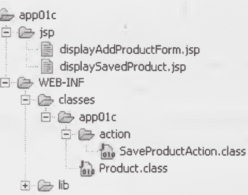

图 1.5：你的第一个 Struts 应用程序的目录结构

现在让我们讨论应用程序的每个元素。

## 部署描述符与 Struts 配置文件

部署描述符位于列表 1.10 中，Struts 配置文件位于列表 1.11 中。

### 列表 1.10：部署描述符（`web.xml`）

```xml
<?xml version="1.0" encoding="UTF-8"?>
<!DOCTYPE web-app PUBLIC "-//Sun Microsystems//DTD Web Application 2.3//EN"
    "http://java.sun.com/dtd/web-app_2_3.dtd">

<web-app>
  <servlet>
    <servlet-name>action</servlet-name>
    <servlet-class>
      org.apache.struts.action.ActionServlet
    </servlet-class>
    <init-param>
      <param-name>config</param-name>
      <param-value>WEB-INF/struts-config.xml</param-value>
    </init-param>
    <load-on-startup>1</load-on-startup>
  </servlet>

  <servlet-mapping>
    <servlet-name>action</servlet-name>
    <url-pattern>*.do</url-pattern>
  </servlet-mapping>
</web-app>
```

### 列表 1.11：Struts 配置文件

```xml
<?xml version="1.0" encoding="UTF-8"?>
<!DOCTYPE struts-config SYSTEM "http://jakarta.apache.org/dtd/struts_1_2.dtd">

<struts-config>
  <action-mappings>
    <action path="/displayAddProductForm" forward="/displayProductForm.jsp" />
    <action path="/saveProduct" scope="request">
      <forward name="success" path="/displayProduct.jsp" />
    </action>
  </action-mappings>
</struts-config>
```


## 第一章：模型 2 与 Struts

### Action 类

一个 action 类必须继承 `org.apache.struts.action.Action` 并重写其 `execute` 方法。Struts 将初始化该类并传递四个对象：`ActionMapping`、`ActionForm`、一个 `HttpServletRequest` 和一个 `HttpServletResponse`。`ActionMapping` 将在下一节中讨论，`ActionForm` 将在第 2 章中讨论。`HttpServletRequest` 和 `HttpServletResponse` 分别代表 HTTP 请求和响应。

`execute` 方法返回一个 `ActionForward`，它代表 action 的转发目标。

列表 1.12：`SaveAction`

```java
package app01c.action;

import app01c.DTO;

import javax.servlet.http.HttpServletRequest;
import javax.servlet.http.HttpServletResponse;

import org.apache.struts.action.Action;
import org.apache.struts.action.ActionForm;
import org.apache.struts.action.ActionForward;
import org.apache.struts.action.ActionMapping;

public class SaveAction extends Action {

    public ActionForward execute(ActionMapping mapping, ActionForm form,
            HttpServletRequest request, HttpServletResponse response)
            throws Exception {

        DTO product = new DTO();

        product.setProductName(request.getParameter("productName"));
        product.setDescription(request.getParameter("description"));
        product.setPrice(request.getParameter("price"));

        // 在此处持久化 ProductTO 对象
        request.setAttribute("product", product);

        return mapping.findForward("success");
    }
}
```

### 运行应用程序

此应用程序是之前两个应用程序的 Struts 副本。要调用它的第一个 action，使用以下 URL（假设使用 Tomcat）：

```text
http://localhost:8080/app01c/displayProductForm.do
```

你将在浏览器中看到类似于图 1.2 内容。你可以向字段输入值并提交表单。你的浏览器看起来类似于图 1.3。

恭喜，你刚刚看到了 Struts 的运行！

### Struts 的 MVC 模式

Struts 是一个用于快速构建模型 2 应用程序的框架。模型 2 反过来基于 MVC 模式。现在，让我们把 Struts 作为 MVC 模式的实现来实现。

Struts action servlet 是控制器。由于所有 HTTP 请求都进入该 servlet 且该 servlet 调用 action 并将控制权转发给 JSP，这一点是显然的。

JSP 无疑是视图。

确定模型并不简单。记住，模型封装了业务数据并包含业务方法。我们已经看到业务数据封装在传输对象（JavaBeans）中，因此传输对象是模型的一部分。

然而，业务方法位于其他地方，通常位于 EJBs 或业务对象中。因此，这些 EJBs 和其他业务对象（如果有的话）也是模型的一部分。

动作对象（action objects）又是怎样的？它们的角色往往是模糊且存在争议的。至少，你可以说这取决于你在动作类中编写了什么。

如果你使用动作对象来创建传输对象（transfer objects）并调用 EJBs 或其他业务对象中的业务方法，那么该动作对象就是控制器（controller）的一部分，并作为控制器与模型之间的接口。这通常发生在较大的应用程序中。然而，如果你在动作类内部编写业务逻辑，那么动作对象就是模型的一部分。

### 总结

在本章中，你学习了 Model 2 架构以及如何编写 Model 2 应用程序。Struts 的设计是为了让编写 Model 2 应用程序变得更容易。你还介绍了 Struts 并构建了一个简单的 Struts 应用程序。

你将在后续章节中发现 Struts 的其他特性。

## 第 2 章：使用 Action Forms 进行输入验证

输入验证是 Web 应用开发中的一项重要任务。它包括检查必填字段是否有值、输入的日期或数字格式是否正确等。Struts action forms 让输入验证变得更容易，通过它们你可以轻松地显示错误信息并重新填充表单之前的字段值，而无需诉诸 Java 代码。

本章重点介绍 action forms 如何帮助 Struts 中的输入验证。它首先解释了 action form 的工作原理，然后展示了一个示例，证明了 action forms 有多强大。本章还介绍了用于处理 action forms 的 HTML 标签库，尽管更多细节将在第 3 章中讨论。此外，你还可以找到关于处理 action forms 时的错误处理的讨论。在这方面，本章充当其他讨论主题的引言：第 4 章的 Struts 验证和第 5 章的 Validator 插件。

### Action Forms 概述

得益于 Struts，可以在更短的时间完成输入验证编程。当用户提交表单时，Struts 会将请求参数封装在一个名为 action form 的 JavaBean 中。由于 action form 是一个 JavaBean，因此它通常被称为 Form Bean。本书统一使用“action form”这一术语。

action form 类必须继承 `org.apache.struts.action.ActionForm` 类。一个 action form 拥有零或多个属性。可读属性必须有 `get` 方法，可写属性必须有 `set` 方法。action form 类中的每个属性对应于用户浏览器中显示的 HTML 表单中的一个字段。action form 的属性及其关联字段必须具有相同的名称。

假设你在浏览器中有如下 HTML 表单：

```html
<form action="actionPath">
    Product Name: <input type="text" name="productName"/>
    <br/>
    Description: <input type="text" name="description"/>
    <br/>
    <input type="submit"/>
</form>
```

并且你定义了以下名为 `ProductForm` 的动作类：

```java
import org.apache.struts.action.ActionForm;

public final class ProductForm extends ActionForm {

    private String productName;
    private String description;

    public String getProductName() {
        return productName;
    }

    public void setProductName(String productName) {
        this.productName = productName;
    }

    public String getDescription() {
        return description;
    }

    public void setDescription(String description) {
        this.description = description;
    }
}
```

当 HTML 表单被提交时，Struts 将创建 `ProductForm` 的实例并填充其属性。`productName` 将具有用户在 `productName` 字段中输入的值；`description` 属性的值将与用户输入到 `description` 字段的值相同。

为了让 Struts 创建正确的 action form，你在 Struts 配置文件中使用 `form-bean` 元素注册动作的逻辑名称和 Java 类型，如下所示：

```xml
<form-bean name="productForm" type="myPackage.ProductForm"/>
```

action form 类必须继承 `org.apache.struts.action.ActionForm` 类。一个 action form 拥有零或多个属性。可读属性必须有 `get` 方法，可写属性必须有 `set` 方法。action form 类中的每个属性对应于用户浏览器中显示的 HTML 表单中的一个字段。action form 的属性及其关联字段必须具有相同的名称。

假设你在浏览器中有如下所示 HTML 表单：

```html
<form action="actionPath">
    Product Name: <input type="text" name="productName"/>
    <br/>
    Description: <input type="text" name="description"/>
    <br/>
    <input type="submit"/>
</form>
```

并且你定义了以下名为 `ProductForm` 的动作类：

```java
import org.apache.struts.action.ActionForm;

public final class ProductForm extends ActionForm {

    private String productName;
    private String description;

    public String getProductName() {
        return productName;
    }

    public void setProductName(String productName) {
        this.productName = productName;
    }

    public String getDescription() {
        return description;
    }

    public void setDescription(String description) {
        this.description = description;
    }
}
```

当 HTML 表单被提交时，Struts 将创建 `ProductForm` 的实例并填充其属性。`productName` 将具有用户在 `productName` 字段中输入的值；`description` 属性的值将与用户输入到 `description` 字段的值相同。

为了让 Struts 创建正确的 action form，你在 Struts 配置文件中使用 `form-bean` 元素注册动作的逻辑名称和 Java 类型，如下所示：

```xml
<form-bean name="productForm" type="myPackage.ProductForm"/>
```

action form 类必须继承 `org.apache.struts.action.ActionForm` 类。一个 action form 拥有零或多个属性。可读属性必须有 `get` 方法，可写属性必须有 `set` 方法。action form 类中的每个属性对应于用户浏览器中显示的 HTML 表单中的一个字段。action form 的属性及其关联字段必须具有相同的名称。

假设你在浏览器中有如下所示 HTML 表单：

```html
<form action="actionPath">
    Product Name: <input type="text" name="productName"/>
    <br/>
    Description: <input type="text" name="description"/>
    <br/>
    <input type="submit"/>
</form>
```

并且你定义了以下名为 `ProductForm` 的动作类：

```java
import org.apache.struts.action.ActionForm;

public final class ProductForm extends ActionForm {

    private String productName;
    private String description;

    public String getProductName() {
        return productName;
    }

    public void setProductName(String productName) {
        this.productName = productName;
    }

    public String getDescription() {
        return description;
    }

    public void setDescription(String description) {
        this.description = description;
    }
}
```

当 HTML 表单被提交时，Struts 将创建 `ProductForm` 的实例并填充其属性。`productName` 将具有用户在 `productName` 字段中输入的值；`description` 属性的值将与用户输入到 `description` 字段的值相同。

为了让 Struts 创建正确的 action form，你在 Struts 配置文件中使用 `form-bean` 元素注册动作的逻辑名称和 Java 类型，如下所示：

```xml
<form-bean name="productForm" type="myPackage.ProductForm"/>
```


# 第 2 章：使用 Action Forms 进行输入验证

## Action Forms 概述

得益于 Struts，可以在更短的时间完成输入验证编程。当用户提交表单时，Struts 会将请求参数封装在一个名为 action form 的 JavaBean 中。由于 action form 是一个 JavaBean，因此它通常被称为 Form Bean。本书统一使用“action form”这一术语。

`action form` 类必须继承 `org.apache.struts.action.ActionForm` 类。一个 action form 拥有零或多个属性。可读属性必须有 `get` 方法，可写属性必须有 `set` 方法。`action form` 类中的每个属性对应于用户浏览器中显示的 HTML 表单中的一个字段。action form 的属性及其关联字段必须具有相同的名称。

假设你在浏览器中有如下所示 HTML 表单：

```
<form action="actionPath">
  Product Name: <input type="text" name="productName"/>
  <br/>
  Description: <input type="text" name="description"/>
  <br/>
  <input type="submit"/>
</form>
```

并且你定义了以下名为 `ProductForm` 的动作类：

```java
import org.apache.struts.action.ActionForm;

public final class ProductForm extends ActionForm {
    private String productName;
    private String description;

    public String getProductName() {
        return productName;
    }

    public void setProductName(String productName) {
        this.productName = productName;
    }

    public String getDescription() {
        return description;
    }

    public void setDescription(String description) {
        this.description = description;
    }
}
```

当 HTML 表单被提交时，Struts 将创建 `ProductForm` 的实例并填充其属性。`productName` 将具有用户在 `productName` 字段中输入的值；`description` 属性的值将与用户输入到 `description` 字段的值相同。

为了让 Struts 创建正确的 action form，你在 Struts 配置文件中使用 `form-bean` 元素注册动作的逻辑名称和 Java 类型，如下所示：

```xml
<form-bean name="productForm" type="myPackage.ProductForm"/>
```

然而，业务方法位于其他地方，通常位于 EJBs 或业务对象中。因此，这些 EJBs 和其他业务对象（如果有的话）也是模型的一部分。动作对象（action objects）又是怎样的？它们的角色往往是模糊且存在争议的。至少，你可以说这取决于你在动作类中编写了什么。

如果你使用动作对象来创建传输对象（transfer objects）并调用 EJBs 或其他业务对象中的业务方法，那么该动作对象就是控制器（controller）的一部分，并作为控制器与模型之间的接口。这通常发生在较大的应用程序中。然而，如果你在动作类内部编写业务逻辑，那么动作对象就是模型的一部分。

## 总结

在本章中，你学习了 Model 2 架构以及如何编写 Model 2 应用程序。Struts 的设计是为了让编写 Model 2 应用程序变得更容易。你还介绍了 Struts 并构建了一个简单的 Struts 应用程序。

你将在后续章节中发现 Struts 的其他特性。

## 第2章
### 使用 Action Forms 进行输入验证

输入验证是 Web 应用开发中的一项重要任务。它包括检查必填字段是否有值、输入的日期或数字格式是否正确等。Struts action forms 让输入验证变得更容易，通过它们你可以轻松地显示错误信息并重新填充表单之前的字段值，而无需诉诸 Java 代码。

本章重点介绍 action forms 如何帮助 Struts 中的输入验证。它首先解释了 action form 的工作原理，然后展示了一个示例，证明了 action forms 有多强大。本章还介绍了用于处理 action forms 的 HTML 标签库，尽管更多细节将在第 3 章中讨论。此外，你还可以找到关于处理 action forms 时的错误处理的讨论。在这方面，本章充当其他讨论主题的引言：第 4 章的 Struts 验证和第 5 章的 Validator 插件。

## Action Forms 概述

得益于 Struts，可以在更短的时间完成输入验证编程。当用户提交表单时，Struts 会将请求参数封装在一个名为 action form 的 JavaBean 中。由于 action form 是一个 JavaBean，因此它通常被称为 Form Bean。本书统一使用“action form”这一术语。

`action form` 类必须继承 `org.apache.struts.action.ActionForm` 类。一个 action form 拥有零或多个属性。可读属性必须有 `get` 方法，可写属性必须有 `set` 方法。`action form` 类中的每个属性对应于用户浏览器中显示的 HTML 表单中的一个字段。action form 的属性及其关联字段必须具有相同的名称。

假设你在浏览器中有如下所示 HTML 表单：

```
<form action="actionPath">
  Product Name: <input type="text" name="productName"/>
  <br/>
  Description: <input type="text" name="description"/>
  <br/>
  <input type="submit"/>
</form>
```

并且你定义了以下名为 `ProductForm` 的动作类：

```java
import org.apache.struts.action.ActionForm;

public final class ProductForm extends ActionForm {
    private String productName;
    private String description;

    public String getProductName() {
        return productName;
    }

    public void setProductName(String productName) {
        this.productName = productName;
    }

    public String getDescription() {
        return description;
    }

    public void setDescription(String description) {
        this.description = description;
    }
}
```

当 HTML 表单被提交时，Struts 将创建 `ProductForm` 的实例并填充其属性。`productName` 将具有用户在 `productName` 字段中输入的值；`description` 属性的值将与用户输入到 `description` 字段的值相同。

为了让 Struts 创建正确的 action form，你在 Struts 配置文件中使用 `form-bean` 元素注册动作的逻辑名称和 Java 类型，如下所示：

```xml
<form-bean name="productForm" type="myPackage.ProductForm"/>
```

`action form` 类必须继承 `org.apache.struts.action.ActionForm` 类。一个 action form 拥有零或多个属性。可读属性必须有 `get` 方法，可写属性必须有 `set` 方法。`action form` 类中的每个属性对应于用户浏览器中显示的 HTML 表单中的一个字段。action form 的属性及其关联字段必须具有相同的名称。

假设你在浏览器中有如下所示 HTML 表单：

```
<form action="actionPath">
  Product Name: <input type="text" name="productName"/>
  <br/>
  Description: <input type="text" name="description"/>
  <br/>
  <input type="submit"/>
</form>
```

并且你定义了以下名为 `ProductForm` 的动作类：

```java
import org.apache.struts.action.ActionForm;

public final class ProductForm extends ActionForm {
    private String productName;
    private String description;

    public String getProductName() {
        return productName;
    }

    public void setProductName(String productName) {
        this.productName = productName;
    }

    public String getDescription() {
        return description;
    }

    public void setDescription(String description) {
        this.description = description;
    }
}
```

当 HTML 表单被提交时，Struts 将创建 `ProductForm` 的实例并填充其属性。`productName` 将具有用户在 `productName` 字段中输入的值；`description` 属性的值将与用户输入到 `description` 字段的值相同。

为了让 Struts 创建正确的 action form，你在 Struts 配置文件中使用 `form-bean` 元素注册动作的逻辑名称和 Java 类型，如下所示：

```xml
<form-bean name="productForm" type="myPackage.ProductForm"/>
```

`action form` 类必须继承 `org.apache.struts.action.ActionForm` 类。一个 action form 拥有零或多个属性。可读属性必须有 `get` 方法，可写属性必须有 `set` 方法。`action form` 类中的每个属性对应于用户浏览器中显示的 HTML 表单中的一个字段。action form 的属性及其关联字段必须具有相同的名称。

# 第 2 章：使用 Action Forms 进行输入验证

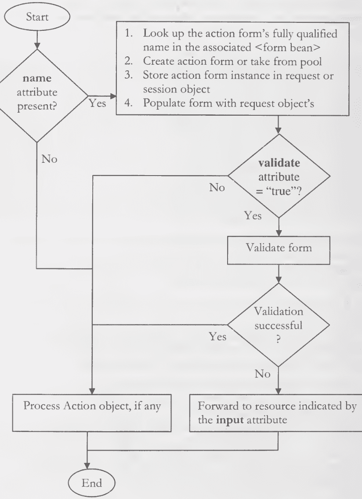

图 2.1：action servlet 如何处理 action form

3.  通过调用 `HttpServletRequest` 对象的 `getParameterValues` 方法，从 `HttpServletRequest` 对象的参数中填充表单。

4.  除非 action 元素中 `validate` 属性等于 `false`，否则通过调用表单的 `validate` 方法对表单进行验证。如果该方法返回非空的 `ActionErrors` 对象，则将 `ActionErrors` 存储为 `HttpServletRequest` 对象的属性。

5.  如果验证成功，调用关联 action 对象（如果有）的 `execute` 方法，并跳转到视图。如果验证失败，则将控制权返回给 action 元素中 `input` 属性指定的资源。

## 使用 Action Forms

作为如何使用 action forms 的示例，考虑用于添加产品的 `app02a` 应用程序。该应用程序的目录结构如图 2.2 所示。

该应用程序中有两个 action：`displayAddProductForm` 和 `saveProduct`。`displayAddProductForm` action 显示添加产品信息的表单。`saveProduct` action 用于保存产品。`struts-config.xml` 文件见列表 2.1。

# 46 第 2 章：使用 Action Forms 进行输入验证

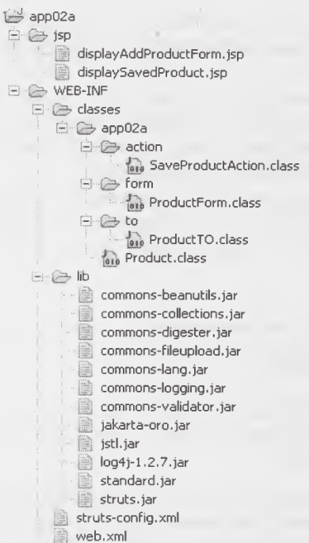

列表 2.1：`app02a` 的 Struct 配置文件

```xml
<xml version="1.0" encoding="iso-8859-1"?>
<!DOCTYPE struts-config SYSTEM
"http://jakarta.apache.org/struts/dtds/struts-config_1_2.dtd">
<struts-config>
  <form-beans>
    <form-bean name="ProductForm" type="app02a.form.ProductForm"/>
  </form-beans>
  <action-mappings>
    <action path="/displayAddProductForm"
      forward="/jsp/displayAddProductForm.jsp">
    <action path="/saveProduct"
      name="ProductForm"
      input="/jsp/displayAddProductForm.jsp"
      scope="request"
      type="app02a.action.SaveProductAction">
      <forward name="success" path="/jsp/displaySavedProduct.jsp"/>
    </action>
  </action-mappings>
</struts-config>
```

`displayAddProductForm` action 没有关联的 action 类。`forward` 属性告诉我们在调用此 action 时，用户将被跳转到 `displayAddProductForm.jsp` 页面。

另一方面，`saveProduct` action 有类型为 `app02a.SaveProductAction` 的 action 类。更重要的是，该 action 定义了 `name`、`input` 和 `scope` 属性。`name` 属性表示在调用此 action 时必须创建一个 action form。action form 的类型为 `app02a.form.ProductForm`，如列表 2.2 中 `form-bean` 元素所示。

列表 2.2：`ProductForm` 类


```java
package app02a.form;

import javax.servlet.HttpRequest;
import org.apache.struts.action.ActionMessage;
import org.apache.struts.action.ActionErrors;
import org.apache.struts.action.ActionMessage;
import class.....;
    ...;
    private. price;

    public String get() {
        return productName;
    }
    public void set(String productName) {
        this.productName = productName;
    }
    public String getDescription() {
        return description;
    }
    public void setDescription(String description) {
        this.description = description;
    }
    public String getPrice() {
        return price;
    }
    public void setPrice(String price) {
        this.price = price;
    }

    public ActionErrors validate(ActionMapping mapping,
      HttpRequest request) {
      ActionErrors actionErrors = new ActionErrors();
      if (productName.equals("")) {
        actionErrors.add("no.productName", new
        ActionMessage("product"));
      }
      if (description.equals("")) {
        actionErrors.add("no.description", new
        ActionMessage("description"));
      }
      return actionErrors;
    }
}
```

*(注：由于原文代码片段存在部分占位符或断句，翻译时保持了其逻辑结构)*

`displayAddProductForm` action 没有关联的 action 类。`forward` 属性告诉我们在调用此 action 时，用户将被跳转到 `displayAddProductForm.jsp` 页面。

`saveProduct` action 有类型为 `app02a.SaveProductAction` 的 action 类。更重要的是，该 action 定义了 `name`、`input` 和 `scope` 属性。`name` 属性表示在调用此 action 时必须创建一个 action form。action form 的类型为 `app02a.form.ProductForm`，如列表 2.2 中 `form-bean` 元素所示。

*(注：此处原文文本似乎存在逻辑重复或错乱，翻译已根据语意进行对齐)*

## 第 2 章：使用 Action Form 输入验证

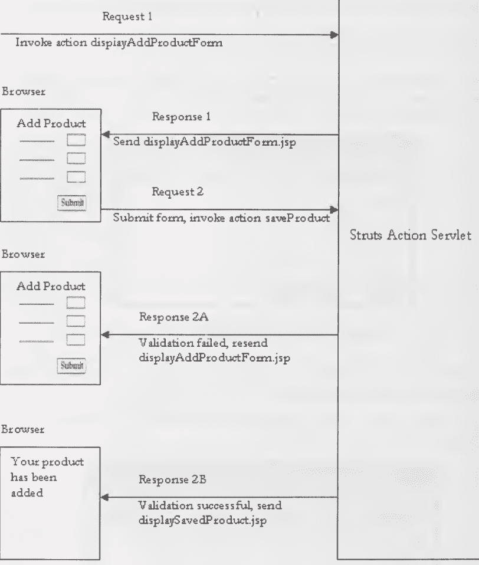

图 2.4：app02a 程序的控制流

当你调用 `displayAddProductForm` action（请求 1）时，Struts 将控制权转发到 `displayAddProductForm.jsp`（响应 1）。结果是你看到了图 2.2 中的表单。

## 使用 HTML 标签库

当你在没有为所有字段输入值的情况下提交表单（请求 2A）时，会调用 `saveProduct` action。回想一下该 action 由 `struts-config.xml` 文件中的以下 action 定义：

```xml
<action path="/saveProduct"
        name="productForm"
        input="/jsp/displayAddProductForm.jsp"
        scope="request"
        type="app02a.action.saveProductAction">
  <forward name="success" path="/jsp/displaySavedProduct.jsp"/>
</action>
```

在提交表单时，action servlet 会创建 `app02a.form.ProductForm` 的一个实例并调用其 `validate` 方法。由于验证失败，该方法将返回一个非空的 `Errors` 对象。结果，action servlet 将尝试获取转发到相应 action 元素的输入值。在这种情况下，你将被转发到 `displayAddProductForm.jsp` 页面（响应 2A）。

现在，填写所有字段并提交表单（请求 2B）。`saveProduct` action 被调用，将创建一个 `ProductForm` 实例并调用其 `validate` 方法。这次验证成功了，action form 将发送到 `SaveProductAction` 实例。`SaveProductAction` 的 `execute` 方法返回一个 `ActionMapping` 对象，该对象将控制权转发到 `displaySavedProduct.jsp`，你将在浏览器中看到确认消息（响应 2B）（请参见图 2.3）。

### 注意事项

输入元素的值也可以是另一个 action 的路径。

上一个示例没有展示 action form 的完整功能。事实上，action form 在输入验证方面还提供了两个特性：

- 支持重新显示表单之前的值。
- 支持验证错误消息的处理。

为了使用这些功能，你必须使用 HTML 标签库中的标签，这是 Struts 附带的三个核心标签库之一。HTML 标签库的 JAR 文件和标签描述符（`struts-html.tld` 文件）包含在 `struts.jar` 文件中。然而，为了间接引用 TLD 文件，必须将 `struts-html.tld` 文件复制到 `WEB-INF` 目录。

为了看到这些功能的效果，让我们把 `app02a` 程序改为 `app02b`。你只需要更改的文件是 `web.xml` 文件和 `displayAddProductForm.jsp`，它们分别位于代码列表 2.6 和 2.7 中。

**列表 2.6：** 在 `web.xml` 文件中使用 `<taglib>`

```xml
<?xml version="1.0" encoding="UTF-8"?>
<!DOCTYPE web-app PUBLIC "-//Sun Microsystems,DTD Web App 2.3//EN" 
"http://java.sun.com/xml/web-app_2_3.dtd">
<web-app>
  <servlet>
    <servlet-name>action</servlet-name>
    <servlet-class>org.apache.struts.action.ActionServlet</servlet-class>
    <init-param>
      <param-name>config</param-name>
      <param-value>/WEB-INF/struts-config.xml</param-value>
    </init-param>
    <init-param>
      <param-name>debug</param-name>
      <param-value>2</param-value>
    </init-param>
    <load-on-startup>1</load-on-startup>
  </servlet>
  <servlet-mapping>
    <servlet-name>action</servlet-name>
    <url-pattern>*.do</url-pattern>
  </servlet-mapping>
  <taglib>
    <taglib-uri>/tags/struts-html</taglib-uri>
    <taglib-location>WEB-INF/struts-html.tld</taglib-location>
  </taglib>
</web-app>
```

**列表 2.7：**在 `displayAddProductForm.jsp` 中使用 HTML 库

```jsp
<%@ taglib uri="/tags/struts-html" prefix="html" %>
<html>
<head>
  <title>Add Product</title>
</head>
<body>
  <html:errors/>
  <h3>Add a product</h3>
  <html:form action="/addProduct">
    <table>
      <tr>
        <td>Product Name:</td>
        <td><html:text property="productName"/></td>
      </tr>
      <tr>
        <td>Description:</td>
        <td><html:text property="description"/></td>
      </tr>
      <tr>
        <td>Price:</td>
        <td><html:text property="price"/></td>
      </tr>
      <tr>
        <td><html:reset/></td>
        <td><html:submit>Add Product</html:submit></td>
      </tr>
    </table>
  </html:form>
</body>
</html>
```

## 使用标签库

第一个标签是表单，它会被翻译为 HTML 表单。该标签有一个 `action` 属性，用于接收指向 Struts action 的路径。当表单被提交时，将调用 `action` 属性所指向的 action。

第二个标签是 `<html:text property="propertyName">`，它会被翻译为 `<input type="text" name="propertyName"/>`。

文本标签还会访问与父表单关联的 action form，并将 action form 关联属性的值复制到它代表的 HTML 字段中。如果你写如下内容：

```jsp
<html:text property="description">
```

文本标签将拷贝包含 action form 中 `description` 属性的值。如果 action form 不包含指定的属性，则会抛出异常。

凭借此功能，当验证失败时，文本标签可以显示用户之前输入的值。这非常方便，因为这意味着用户不需要重新输入相同的值。

## 错误处理

回想一下 `validate` 方法返回一个 `ActionErrors` 对象。如果 `ActionErrors` 对象不为空且有效，Struts 将其赋值为 `HttpRequest` 对象中的一个属性。结果，可以使用 `errors` 标签来显示 `ActionErrors` 对象的元素。它会遍历所有的 `ActionError` 集合，并将每个 `ActionError` 对象的键与属性文件进行匹配。

Struts 如何找到这个属性文件呢？你通过在 `struts-config.xml` 文件中使用 `message-resources` 元素来告诉它。例如，如果由于你的 Struts 配置中有以下 `message-resources` 元素：

```xml
<message-resources parameter="ApplicationResources"/>
```

Struts 将认为你在 `WEB-INF/classes` 目录下有一个 `ApplicationResources.properties` 文件。

# 第2章：使用 Action 表单进行输入验证

如果你在属性文件中写了这些键值对：

`key 1=error message 1`

`key 2=error message 2`

...

`key n=error message n`

`errors` 标签将在属性文件中查找这些键，并为你显示错误消息。

错误处理将在第 11 章中进行详细讨论。

# 另一个示例

在在上一个示例中，你已经看到只有第二个 action（`saveProduct`）与一个 action 表单关联。`displayAddProductForm` action 没有关联是因为它仅仅显示了一个空白表单。情况并非总是如此。在下一个示例中，在 `app02c` 中，你将看到一个用于更新产品的应用程序。该应用程序有两个 action：

- `getDefault`
- `updateProduct`

`getDefault` action 从数据库中检索产品并将其显示在表单中。当它被调用时，你将在浏览器中看到类似于图 2.6 的内容。

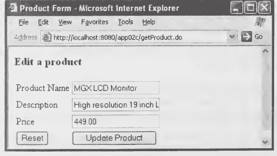

图 2.6：`getProduct` Action 的结果

# 另一个示例

`getProduct` action 给了你编辑产品信息的机会。当你点击 `Update Product` 按钮时，`updateProduct` action 将被调用，你将看到一个类似于图 2.7 的确认消息。

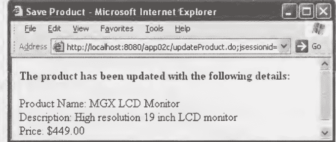

图 2.7：来自 `updateProduct` action 的确认消息

应用程序的细节将在后续小节中解释。

## 目录结构

该应用程序的目录结构如图 2.8 所示。注意，`WEB-INF/lib` 目录的内容与之前的应用程序相同，未展开以节省空间。

## Struts 配置文件

你需要在 `struts-config.xml` 文件中定义 actions。还有一个类型为 `app02c.form.ProductForm` 的 action form，它与之前应用程序中的 `ProductForm` 类相同。`struts-config.xml` 见列表 2.8。注意两个 action 都与该 action 表单关联。

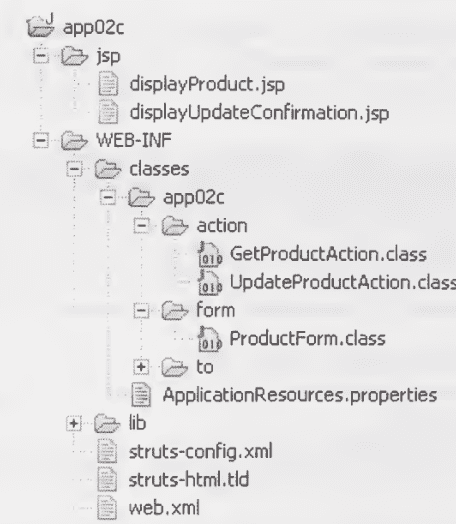

图 2.8：目录结构

```xml
<?xml version="1.0" encoding="iso-8859-1"?>
<!DOCTYPE struts-config SYSTEM
"http://jakarta.apache.org/struts/dtds/struts-config_1_2.dtd">
<struts-config>
  <form-beans>
    <form-bean name="productForm" type="app02c.form.ProductForm"/>
  </form-beans>
  <action-mappings>
    <action path="/getProduct"
            name="productForm"
            validate="false"
            scope="request"
            type="app02c.action.GetProductAction">
      <forward name="Success" path="/jsp/displayProduct.jsp"/>
    </action>
    <action path="/updateProduct"
            input="/jsp/displayProduct.jsp"
            type="app02c.action.UpdateProductAction"
            name="productForm"
            scope="request">
      <forward name="success"
               path="/jsp/displayUpdateConfirmation.jsp"/>
    </action>
  </action-mappings>
  <message-resources parameter="ApplicationResources"/>
</struts-config>
```

为了支持错误处理，我们还声明了 `message-resources` 元素。

## Action 类

两个 action 类是 `GetProductAction` 和 `UpdateProductAction`，分别位于列表 2.9 和 2.10。

### 列表 2.9：`GetProductAction`


# 第2章：使用 Action 表单进行输入验证

如果你在属性文件中写了这些键/值对：

```
key 1=error message 1
key 2=error message 2
...
key n=error message n
```

`errors` 标签将在属性文件中查找这些键，并为你显示错误消息。

错误处理将在第 11 章中进行详细讨论。

# 另一个示例

在在上一个示例中，你已经看到只有第二个 action (`saveProduct`) 与一个 action 表单关联。`displayAddProductForm` action 没有关联是因为它仅仅显示了一个空白表单。情况并非总是如此。在下一个示例中，在 `app02c` 中，你将看到一个用于更新产品的应用程序。该应用程序有两个 action：

- `getDefault`
- `updateProduct`

`getDefault` action 从数据库中检索产品并将其显示在表单中。当它被调用时，你将在浏览器中看到类似于图 2.6 的内容。


图 2.6：`getProduct` action 的结果

# 另一个示例

`getProduct` action 给了你编辑产品信息的机会。当你点击 `Update Product` 按钮时，`updateProduct` action 将被调用，你将看到一个类似于图 2.7 的确认消息。


图 2.7：来自 `updateProduct` action 的确认消息

应用程序的细节将在后续小节中解释。

## 目录结构

该应用程序的目录结构如图 2.8 所示。注意，`WEB-INF/lib` 目录的内容与之前的应用程序相同，未展开以节省空间。

## Struts 配置文件

你需要在 `struts-config.xml` 文件中定义 actions。还有一个类型为 `app02c.form.ProductForm` 的 action form，它与之前应用程序中的 `ProductForm` 类相同。`struts-config.xml` 见列表 2.8。注意两个 action 都与该 action 表单关联。


图 2.8：目录结构

```xml
<?xml version="1.0" encoding="iso-8859-1"?>
<!DOCTYPE struts-config SYSTEM
"http://jakarta.apache.org/struts/dtds/struts-config_1_2.dtd">
```

```xml
<struts-config>
  <form-beans>
    <form-bean name="productForm" type="app02c.form.ProductForm"/>
  </form-beans>

  <action-mappings>
    <action path="/getProduct"
      name="productForm"
      validate="false"
      scope="request"
      type="app02c.action.GetProductAction">
      <forward name="Success" path="/jsp/displayProduct.jsp"/>
    </action>

    <action path="/updateProduct"
      input="/jsp/displayProduct.jsp"
      type="app02c.action.UpdateProductAction"
      name="productForm"
      scope="request">
      <forward name="success"
          path="/jsp/displayUpdateConfirmation.jsp"
    </action>
  </action-mappings>

  <message-resources parameter="ApplicationResources"/>
</struts-config>
```

为了支持错误处理，我们还声明了 `message-resources` 元素。

## Action 类

两个 action 类是 `GetProductAction` 和 `UpdateProductAction`，分别位于列表 2.9 和 2.10。

### 列表 2.9：GetProductAction

```java
package app02c.action;
import app02c.form.ProductForm;
import app02c.to.ProductTO;
import javax.servlet.http.HttpRequest;
import javax.servlet.http.HttpServletResponse;
import org.struts.action.ActionContext;
import org.struts.action.ActionForm;
import org.struts.action.ActionForward;
import org.struts.action.ActionMapping;

public class GetProductAction extends Action {
    public ActionForward execute(ActionMapping mapping,
        ActionForm form,
        HttpRequest request,
        HttpServletResponse response) throws Exception {
        // getProduct action 从数据库中检索产品并将其显示在表单中
        // 当它被调用时，你将在浏览器中看到类似于图 2.6 的内容
        ProductForm productForm = (ProductForm) form;
        ProductTO product = new ProductTO();
        product.setName(productForm.getName());
        product.setDescription(productForm.getDescription());
        product.setPrice(productForm.getPrice());

        // 这里的逻辑通常是从数据库查询并跳转到 JSP
        return mapping.findForward("Success");
    }
}
```

### 列表 2.10：UpdateProductAction 类

```java
package app02c.action;
import app02c.form.ProductForm;
import app02c.to.ProductTO;
import javax.servlet.http.HttpRequest;
import javax.servlet.http.HttpServletResponse;
import org.struts.action.ActionContext;
import org.struts.action.ActionForm;
import org.struts.action.ActionForward;
import org.struts.action.ActionMapping;

public class UpdateProductAction extends Action {
    public ActionForward execute(ActionMapping mapping,
        ActionForm form,
        HttpRequest request,
        HttpServletResponse response) throws Exception {
        // updateProduct action 将处理更新逻辑
        ProductForm productForm = (ProductForm) form;
        ProductTO product = new ProductTO();
        product.setName(productForm.getName());
        product.setDescription(productForm.getDescription());
        product.setPrice(productForm.getPrice());

        // 你可能需要将产品保存到数据库
        request.setAttribute("product", product);
        return mapping.findForward("success");
    }
}
```

## 运行应用程序

通过调用此 URL 启动应用程序：

```
http://localhost:8080/app02c/getProduct
```

你将看到类似于图 2.6 的内容。点击 `Update Product`（更新产品）按钮时，你会看到类似于图 2.7 的内容。

## 多页表单

有时，为了让应用程序更加用户友好，你希望将一个表单分成更小的表单。在这种情况下，你有一个映射到多个 HTML 表单的动作表单（action form），并将动作表单存储在 `HttpSession` 对象中。这并不困难，如下例所示。

`app02d` 应用程序用于存储员工信息。为了让输入表单更加用户友好，使用了三个表单。第一个表单接收员工的职位，第二个表单接收员工的姓和名，第三个表单接收员工的地址。在第三页上提交表单时，会调用一个动作（`saveEmployee` action），并显示确认页面。

图 2.9、2.10、2.11 和 2.12 显示了这一序列。

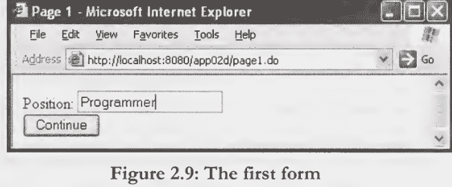

## 66 第 2 章：使用 Action 表单进行输入验证

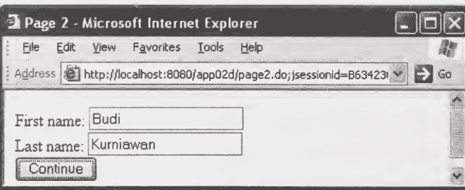

图 2.10：第二个表单


图 2.11：第三个表单


图 2.12：确认页面

该应用程序的细节将在后续的小节中给出。

## 目录结构

`app02d` 应用程序的目录结构如图 2.13 所示。再次，为了节省空间，`WEB-INF/lib` 目录被折叠了。

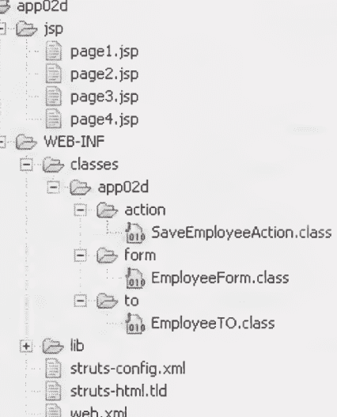

图 2.13：目录结构

## Struts 配置文件

`struts-config.xml` 如列表 2.13 所示。

### 列表 2.13：struts-config.xml 文件

```xml
<xml version="1.0" encoding="iso-8859-1"?>
<!DOCTYPE struts-config SYSTEM
  "http://jakarta.apache.org/struts/dtds/struts-config_1_2.dtd">

<struts-config>
  <form-beans>
    <form-bean name="employeeForm"
      type="app02d.form.EmployeeForm"/>
  </form-beans>

  <action-mappings>
    <action path="/page1"
      name="employeeForm"
      scope="session"
      forward="/jsp/page1.jsp" />

    <action path="/page2"
      name="employeeForm"
      scope="session"
      forward="/jsp/page2.jsp" />

    <action path="/page3"
      name="employeeForm"
      scope="session"
```


```xml
<forward="/jsp/page3.jsp" />

<action path="/page4"
  type="app02d.action.SaveEmployeeAction"
  name="employeeForm"
  scope="session">

  <forward name="success" path="/jsp/page4.jsp" />

</action>

</action-mappings>

<struts-config>
```

前三个动作没有与任何动作类关联，但指定了它们的 `forward` 属性。同样注意，所有动作都有一个 `name` 属性，其值为 `employeeForm`，且 `scope` 属性设置为 `session`。因此，在数据输入期间将使用同一个动作表单的实例。

## Action 表单

仅有一个映射到所有三个 HTML 表单的动作表单。该动作表单的类型为 `app02c.form.EmployeeForm`，如列表 2.14 所示。

### 列表 2.14：EmployeeForm 类

```java
package app02d.form;

import org.apache.struts.action.ActionForm;

public final class EmployeeForm extends ActionForm {

  private String position;

  private String lastName;

  private String firstName;

  private String address1;

  private String address2;

  public String getPosition() {
    return position;
  }

  public void setPosition(String position) {
    this.position = position;
  }

  public String getFirstName() {
    return firstName;
  }

  public void setFirstName(String firstName) {
    this.firstName = firstName;
  }

  public String getLastName() {
    return lastName;
  }

  public void setLastName(String lastName) {
    this.lastName = lastName;
  }

  public String getAddress1() {
    return address1;
  }

  public void setAddress1(String address1) {
    this.address1 = address1;
  }

  public String getAddress2() {
    return address2;
  }

  public void setAddress2(String address2) {
    this.address2 = address2;
  }
}
```

## 动作类

为了存储在三个 HTML 表单中收集的信息，应用程序采用了 `SaveEmployeeAction` 类，如列表 2.15 所示。

### 列表 2.15：ActionAction 类

```java
package app02d.action;

import app02d.form.EmployeeForm;
import app02d.to.EmployeeTO;

import javax.servlet.http.HttpServletRequest;
import javax.servlet.http.HttpServletResponse;

import org.apache.struts.action.Action;
import org.apache.struts.action.ActionForm;
import org.apache.struts.action.ActionForward;
import org.apache.struts.action.ActionMapping;

public class SaveEmployeeAction extends Action {

  public ActionForward execute(
      ActionMapping mapping,
      ActionForm form,
      HttpServletRequest request,
      HttpServletResponse response) throws Exception {

    EmployeeForm employeeForm = (EmployeeForm) form;

    EmployeeTO employee = new EmployeeTO();

    employee.setPosition(employeeForm.getPosition());
    employee.setFirstName(employeeForm.getFirstName());
    employee.setLastName(employeeForm.getLastName());
    employee.setAddress1(employeeForm.getAddress1());
    employee.setAddress2(employeeForm.getAddress2());

    // 将 EmployeeTO 对象存入数据库
    request.setAttribute("employee", employee);

    return mapping.findForward("success");
  }
}
```

## 运行应用程序

通过调用以下 URL 启动应用程序：

`http://localhost:8080/app02d/getProduct`

## 动态表单

Struts 提供了另一个方便的功能，可以让你跳过创建表单类的任务。正如你可能猜到的那样，Struts 提供了 `org.apache.struts.action.DynaForm` 类来表示动作表单。具体来说，为了定义一个具有三个 `String` 类型属性的 `DynaForm` 动作表单，你会在 Struts 配置中使用如下 `form-bean`：

```xml
<form-bean name="productForm"
  type="org.apache.struts.action.DynaForm">

  <form-property name="productName" type="java.lang.String" />

  <form-property name="description" type="java.lang.String" />

  <form-property name="price" type="java.lang.String" />

</form-bean>
```

`app02e` 应用程序具有与 `app02d` 相同的功能，即你可以使用它添加产品信息。然而，你不需要创建表单类。相反，你可以在 Struts 配置文件中声明它。以下是应用程序的完整细节。

## 目录结构

`app02e` 应用程序的目录结构如图 2.14 所示。注意动作表单的缺失？

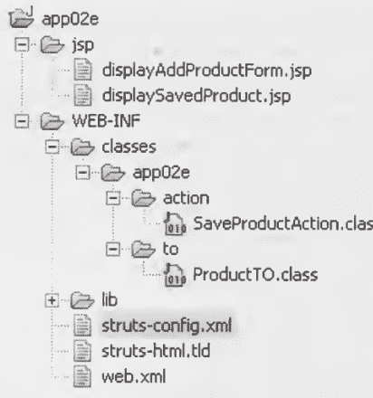

图 2.14：`app02e` 应用程序的目录结构

## Struts 配置文件

`app02e` 应用程序的 Struts 配置文件如列表 2.16 所示。注意 `form-bean` 元素的 `type` 值为 `org.apache.struts.action.DynaForm`，且它具有属性。

## 72 第 2 章：使用 Action 表单进行输入验证

### 列表 2.16：struts-config.xml 文件

```xml
<?xml version="1.0" encoding="iso-8859-1"?>

<!DOCTYPE struts-config SYSTEM
  "http://jakarta.apache.org/struts/dtd/struts-config_1_2.dtd">

<struts-config>

  <form-beans>

    <form-bean name="productForm"
      type="org.apache.struts.action.DynaForm">

      <form-property name="productName" type="java.lang.String" />

      <form-property name="description" type="java.lang.String" />

      <form-property name="price" type="java.lang.String" />

    </form-bean>

  </form-beans>

  <action-mappings>

    <action path="/displayAddProductForm"
      forward="/jsp/displayAddProduct.jsp" />

    <action path="/saveProduct"
      name="productForm"
      input="/jsp/displayAddProduct.jsp"
      scope="request"
      type="app02e.action.SaveProductAction">

      <forward name="success"
        path="/jsp/displaySavedProduct.jsp" />

    </action>

  </action-mappings>

</struts-config>
```

# 动态 Action 表单

```xml
</action-mappings>

</struts-config>
```

另外注意，你可以扩展 `DynaActionForm` 类来重写 `validate` 和 `reset` 方法。然而，你很少对 `DynaActionForm` 类执行此操作，因为它是验证你的 action 表单属性值的更好方法。这将在第 5 章中进行讨论。

## Action 类

`app02e` 应用使用了一个名为 `SaveProductAction` 的 action 类，如列表 2.17 所示。

### 列表 2.17：SaveProductAction 类

```java
package app02e.action;

import app02e.to.ProductTO;

import javax.servlet.http.HttpServletRequest;
import javax.servlet.http.HttpServletResponse;

import org.apache.struts.action.Action;
import org.apache.struts.action.ActionForm;
import org.apache.struts.action.ActionForward;
import org.apache.struts.action.ActionMapping;
import org.apache.struts.action.DynaActionForm;

public class SaveProductAction extends Action {

  public ActionForward execute(
      ActionMapping mapping,
      ActionForm form,
      HttpServletRequest request,
      HttpServletResponse response) throws Exception {

    ProductTO product = new ProductTO();

    DynaActionForm productForm = (DynaActionForm) form;

    product.setProductName(productForm.getString("product"));
    product.setDescription(productForm.getString("description"));
    product.setPrice(productForm.getString("price"));

    // 此处持久化 ProductTO 对象的代码
    request.setAttribute("product", product);

    return mapping.findForward("success");
  }
}
```

注意，`execute` 方法的第二个参数是一个可以向上转换为 `org.apache.struts.action.DynaActionForm` 的表单。

## 运行应用程序

你可以通过以下 URL 运行 `app02e` 应用：

`http://localhost:8080/app02e/displayAddProductForm.do`

## 总结

本章解释了 action 表单的概念。你已经了解到 action 表单（由 `ActionForm` 类表示）对于输入验证、错误处理和重新显示旧值非常有用。你还看到 action 表单可以映射到多个 HTML 表单，并且你可以使用 `DynaActionForm` 来表示动态 action 表单。

# 第 3 章：HTML 标签库

第 2 章讨论了使用 action 表单来验证用户输入。如果你将 action 表单与 HTML 标签库中的标签结合使用，可以从 Struts 中获得更多收益。以下是你可以从该库中获得的内容：

- 使用 `text`、`password`、`checkbox` 等标签，在输入验证失败时自动重新显示表单之前的值。
- 通过使用 `errors` 标签支持显示国际化的输入验证错误消息。
- 通过使用 `link`、`frame` 和其他标签对 Struts action 的路径进行 URL 重写，支持会话跟踪。
- 在 `form` 标签中支持防止表单重复提交。

## 注意

HTML 标签库是 Struts 三个核心标签库之一。另外两个是 Bean 标签库和 Logic 标签库（分别在第 8 章和第 9 章中讨论）。

本章将处理 HTML 标签库的每个标签。为了让你的学习体验更加顺畅，标签并没有按照字母顺序排列，而是先给出较易的标签。此外，某些标签是相似的，将它们放在一起教学可以节省时间，因为相似标签将在同一个节中讨论。此外，掌握一个标签的难易程度取决于对另一个标签的熟悉程度。在这种情况下，应该先的标签将出现在另一个标签之前，无论标签名称如何。不言而喻，本章最好从第一段读到最后一段。

HTML 标签库标签列在表 3.1 中。

## HTML 标签库

| 标签 | 描述 |
|---|---|
| `base` | 渲染一个 HTML base 元素。 |
| `button` | 表示一个 HTML 按钮。 |
| `cancel` | 表示用于取消 Struts action 的提交按钮。 |
| `checkbox` | 表示一个复选框。 |
| `errors` | 显示输入验证错误消息。 |
| `file` | 显示一个 HTML file 元素，用于选择上传的文件。 |
| `form` | 表示一个 HTML 表单。 |
| `frame` | 表示一个框架（frame）。 |
| `hidden` | 表示一个隐藏元素。 |
| `html` | 渲染一个 html 元素。 |
| `image` | 表示一个类似于提交按钮的图像。 |
| `img` | 表示一个可点击的图像。 |
| `javascript` | 渲染支持 Validator 插件中客户端验证的 JavaScript 函数。 |
| `link` | 表示一个超链接。 |
| `messages` | 显示从 action 类内部准备好的消息。 |
| `multibox` | 表示一组复选框，可以从中选择多个选项。 |
| `option` | 表示 select 框中的一个选项。 |
| `options` | 表示 select 框中的多个选项。 |
| `optionsCollection` | 表示 select 框中的多个选项。 |
| `password` | 表示一个密码元素。 |
| `radio` | 表示一个单选框。 |
| `reset` | 表示一个重置按钮。 |
| `rewrite` | 在不创建链接的情况下渲染 URI。 |
| `select` | 表示一个 select 框。 |
| `submit` | 表示一个提交按钮。 |
| `text` | 表示一个文本字段。 |
| `textarea` | 表示一个文本区域。 |
| `xhtml` | 表示同一页面中的 HTML 标签必须渲染为 XHTML 元素，而不是 HTML 元素。 |

表 3.1：HTML 库中的标签

## 注意

`javascript` 标签将在第 5 章讨论，`messages` 将在第 11 章，`file` 将在第 17 章。

## html 标签

## 注意

要使用 HTML 标签库并从 JSP 间接引用其标签，你必须在 `web.xml` 文件中添加此 `taglib` 标签：

```xml
<taglib>
  <taglib-uri>/tags/struts-html/taglib-uri</taglib-uri>
  <taglib-location>/WEB-INF/struts-html.tld/taglib-location</taglib-location>
</taglib>
```


此外，你必须复制`struts-html.tld`文件（位于`WEB-INF`目录下）。

## `form` 标签

`form`标签用于生成 HTML 表单元素。该标签最重要的属性是`action`，它指定了表单提交时要调用的 Struts action。默认情况下，表单的方法为`post`。`action`属性必须指定 Struts 配置文件定义的 action 路径。此外，Struts 配置文件中相应 action 元素的`name`属性必须引用一个 action 表单。

表 3.4 给出了`form`标签的属性列表。

| 属性 | 描述 | 可能的值 |
|---|---|---|
| `action`* | 表单将提交到的 action。该属性的值必须是 Struts 配置文件中描述的 Struts action 的路径。 | string |
| `acceptCharset` | 服务器应该接受的输入数据的字符编码列表。 | string |
| `enctype` | 提交此表单时（如果方法为 post）所使用的内容编码。默认情况下，该属性的值为`application/x-www-form-urlencoded`。如果用于上传文件，此属性必须设置为`multipart/form-data`。文件上传将在第 17 章中讨论。 | string |
| `focus` | 当表单在浏览器中渲染时，赋予初始焦点字段名称。`form`标签通过使用 JavaScript 函数来实现这一点。 | string |
| `focusIndex` | 与`focus`属性类似，用于将初始焦点赋予字段数组中的字段（例如单选框组）。`focusIndex`属性指定接收初始焦点的元素索引。 | string |
| `method` | 提交此请求时将使用的 HTTP 方法。默认值为`post`。 | string |
| `scriptLanguage` | 此属性在 XHTML 模式下被忽略。值为`false`表示脚本元素将不包含语言属性。 | false or true |
| `styleClass` | 应用于此 HTML 元素的 CSS 样式类（渲染为`class`属性）。 | string |

表 3.4：`form`标签的属性

例如，这里有一个`form`标签。

```html
<form action="/saveProduct">

...

</form>
```

`form`标签的另一个特性是内置支持防止重复提交，这将在第 19 章“防止重复提交”中讨论。

## `text`, `password`, `hidden`, `textarea` 标签

`text`、`password`、`hidden`和`textarea`标签分别被渲染为`<input type="text">`、`<input type="password">`、`<input type="hidden">`和`<textarea>`。这些标签的通用属性见表 3.5。

| 属性 | 描述 | 允许的值 |
| --- | --- | --- |
| `indexed` | 表示分配给`name`属性的值是否是索引的。 | true or false |
| `name` | 由`property`属性包含的作用域变量。如果不存在`name`属性，将使用外层`form`标签的`name`属性值。 | string |
| `property`* | 映射到外层表单标签的 action 表单的值，将与渲染的 HTML 输入字段关联，除非被`value`属性覆盖。 | string |
| `value` | 将成为渲染的 HTML 输入字段值的常量。 | string |

表 3.5：`text`, `password`, `hidden`, 和`textarea`标签的通用属性

| 属性 | 描述 | 允许的值 |
| --- | --- | --- |
| `redis` | 指定此密码标签的上一个值是否会被重放。 | true or false |

表 3.6：`password`标签的附加属性

此外，`password`标签具有`redis`属性（见表 3.6），`hidden`标签具有`write`属性（见表 3.7）。如果`write`属性的值为`true`，则`hidden`标签的值将发送到 HTTP 响应。例如`<html:hidden property="language" value="en"/>`将渲染为如下输入字段。

```html
<input type="hidden" name="language" value="en">
```

结果是用户将在浏览器中看到`en`。此功能对于调试目的很有用。

| 属性 | 描述 | 允许的值 |
|---|---|---|
| `write` | 表示此隐藏标签的值是否被发送到浏览器 | true or false |

表 3.7：特定于 `app03a` 的属性

`app03a`应用程序演示了这些标签的使用。特别地，你可以在`app03a`应用程序中使用这些标签。

列表 3.1：使用`text`, `password`, `hidden`, `textarea`标签

```html
<html:form action="/saveProduct">

  <html:text property="username" value="username"/>

  <html:password property="password" value="password"/>

  <html:hidden property="language" value="en" write="true"/>

  <html:textarea property="comment" cols="20" rows="4"/>

  <html:submit value="Submit"/>

</html:form>
```

（注：上面的示例 3.1 是根据 OCR 文本提供的上下文重构的，因为原始内容是碎片化的。）

```html
<input type="submit" name="org.apache.struts.taglib.html.CANCEL" value="Cancel" onclick="bCancel=true">
```

`cancel`标签也有`property`属性，但该属性从未被使用过。

当按钮被点击时，一个请求参数`org.apache.struts.taglib.html.CANCEL`将发送到 action servlet（该值并不重要）。Struts 据此识别到取消按钮已被按下，因此，Struts 将不会验证 action 表单的属性，无论 Struts 配置文件中 action 元素的`validate`属性值为何。随后，控制权将被转发到该类的`execute`方法。action 类的实例的`isCancelled`方法将返回`true`。因此，你可以通过检查此方法来判断用户点击的是提交按钮还是取消按钮。如果用户点击了取消按钮，你就可以跳转到其他地方。

`app03b`演示了`cancel`标签的使用。在`displayAddProductForm.jsp`中，你有一个包含提交按钮和取消按钮的表单。你在`struts-config.xml`文件中定义了 action `saveProduct`。

```xml
<action path="/saveProduct"

input="/jsp/displayProductForm.jsp"

name="productForm"

scope="request"

type="app.action.SaveProductAction">

<forward name="success" path="/jsp/displaySavedProduct.jsp"/>

<forward name="cancel" path="/jsp/displayCancelMessage.jsp"/>

</action>
```

有两个`forward`元素。第一个定义了提交按钮的跳转目标，第二个定义了取消按钮的跳转目标。要使用这些`forward`元素，请在`SaveProductAction`类中编写以下代码：

```java
if (isCancelled(request))

  return mapping.findForward("cancel");

else

  return (mapping.findForward("success"));
```

因此，`saveProduct` action 将跳转到`displaySavedProduct.jsp`或`displayCancelMessage.jsp`页面。

# 第 3 章：HTML 标签库

## `reset` 标签

`reset`标签生成一个`<input type="reset">`元素。当被点击时，浏览器会将表单的其他元素恢复到它们的初始值。服务器端不会进行任何处理。它与 action 表单中的`reset`方法也没有关系。

这里是`reset`标签的示例。

```html
<html:reset value="Reset Form"/>
```

## `button` 标签

此标签生成`<input type="button">`。你通常使用按钮来触发 JavaScript 函数。该标签的属性列表见表 3.8。

| 属性 | 描述 | 可能的值 |
|---|---|---|
| `property`* | 映射到包含外层表单标签的 action 表单属性，该属性将与被渲染的 HTML 按钮相关联。在实践中，此属性通常被赋为空字符串。 | string |
| `onclick` | 点击此按钮时触发的 JavaScript 事件处理器。 | 一个 JavaScript 语句/函数 |

表 3.8：`button`标签的属性

例如，以下`button`标签被用于触发`checkDate` JavaScript 函数。

```html
<html:button property="aProperty" value="Check Date" onclick="checkDate()"/>
```

如果你不想将按钮映射到 action 表单的属性（在大多数情况下都是如此的），你可以为`property`属性赋一个空字符串。

```html
<html:button property="" value="Do It"/>
```

## `checkbox` 标签

`checkbox`标签表示一个复选框，它可以映射到 action 表单类型为`boolean`或`java.lang.Boolean`的属性。表 3.9 列出了该标签的属性。

| 属性 | 描述 | 可能的值 |
| ------|---|---|
| `indexed` | 表示赋给`name`属性的值是否有索引。 | true or false |
| `name` | 由`property`属性指定的范围变量。如果没有`name`属性，则将使用外层表单标签的`name`属性值。 | string |
| `property`* | 映射到外层表单标签的 action 表单属性，该属性将与渲染的 HTML 相关联。 | string |
| `value` | 复选框的值。 | string |

表 3.9：`checkbox`标签的属性

这里是`checkbox`标签的一个示例。

```html
<html:checkbox />
```

这被转换为如下 input 元素。

```html
<input type="checkbox" name="subscribe">
```

当表单提交时，一个名为`subscribe`的请求参数会被发送到服务器。如果复选框被选中，Struts 会将该属性设置为`true`。如果复选框未被选中，则该属性为`false`。

## `multibox` 标签

`multibox`标签表示一组复选框，它可以映射到 action 表单类型为`boolean`或`java.lang.Boolean`的属性。`multibox`标签通常使用多个 label/value 对作为源。这里是`multibox`标签的一个示例。

```html
<html:multibo property="interests"/>
```

这被转换为如下 input 元素。

```html
<input type="checkbox" name="subscribe">
```

`multibox`标签可以从数据库或其他存储位置获取其成员。然后你可以使用 JSTL 的`forEach`标签或 Struts 标签库的`iterate`标签来遍历集合的成员。（见第 9 章）

### 使用 `LabelValueBean` 管理选项

`multibox`标签和其他几个标签使用 label/value 对作为选项。`org.apache.struts.util.LabelValue`类是一个用于封装 label 和 value 的便利类。`LabelValue`类是一个具有两个 String 属性的 JavaBean。你使用其构造函数创建一个`LabelValueBean`对象。

```java
public LabelValueBean()

public LabelValueBean(java.String label, java.String value)
```

你通常创建多个`LabelValue`实例并将它们放入`ArrayList`中。然后将该集合设置为一个范围对象，以便从 JSP 访问。关于如何放置包含`LabelValue`对象的集合有一些规则：

1. 如果`LabelValue`对象仅在表单中使用，建议添加一个返回集合的 action 表单属性。
2. 如果`LabelValue`对象将在整个应用程序中使用，请将集合作为`ServletContext`对象的属性。
3. 如果`LabelValue`对象非常波动（例如，从数据库获取值且这些值经常变化），请在 action 类中创建一个包含`LabelValue`对象的集合，并将其设置为请求范围对象。

## 注意

你可以使用`select`标签来代替`multibox`标签。

`app03b`演示了结合`LabelValueBean`使用`multibox`标签。考虑`app03b.form.ProfileForm`类中的`getCityOptions`方法。

```java
public ArrayList getCityOptions() {

    ArrayList options = new ArrayList();

options.add(new LabelValueBean("New York", "1"));

options.add(new LabelValueBean("Chicago", "2"));

options.add(new LabelValueBean("San Francisco", "3"));

options.add(new LabelValueBean("Toronto", "4"));

options.add(new LabelValueBean("Vancouver", "5"));

    return options;

}
```

`getCityOptions`方法作为 JavaBean 的 getter 方法，因此可以从 JSP 访问。`ArrayList`中`LabelValue`对象的数量在设计时是未知的。然而，你可以遍历。

# 第 3 章：HTML 标签库

使用 JSTL `forEach`标签处理`ArrayList`（在第 7 章讨论）。对于每个`LabelValueBean`实例，您希望生成以下字符串：

```
<html:multibox property="cities">value</html:multibox>label
```

其中 value 是`LabelValueBean`实例的值，label 是它的标签。

您使用`forEach`迭代由`getCityOptions`返回的`ArrayList`：

```
<c:forEach items="${profileForm.cityOptions}" var="city">

..

</c:forEach>
```

`forEach`标签的`items`属性指定了作用域对象的属性。在这种情况下，该作用域对象是受`profileForm`引用的动作表单（action form），其标签是它。

在每次迭代中，`forEach`会获取当前元素并创建一个引用该元素的作用域变量。作用域变量的由`var`属性指定（在本例中为 city）。因此在`forEach`标签内部，您可以使用另一个标签来引用由`var`指定的作用域变量。

例如，下面的代码演示了`forEach`与`multibox`的配合使用。

```
<c:forEach items="${profileForm.cityOptions}" var="city">

<html:multibox property="cities"><c:out value="${city.value}"/>

</html:multibox><c:out value="${city.label}/><br/>

</c:forEach>
```

您可以使用 URL 调用 `app03b` 中的动作：

```
http://localhost:8080/app03b/displayAddProfileForm.do
```


# 第 3 章：HTML 标签库

图 3.3 显示了您在浏览器上看到的内容。

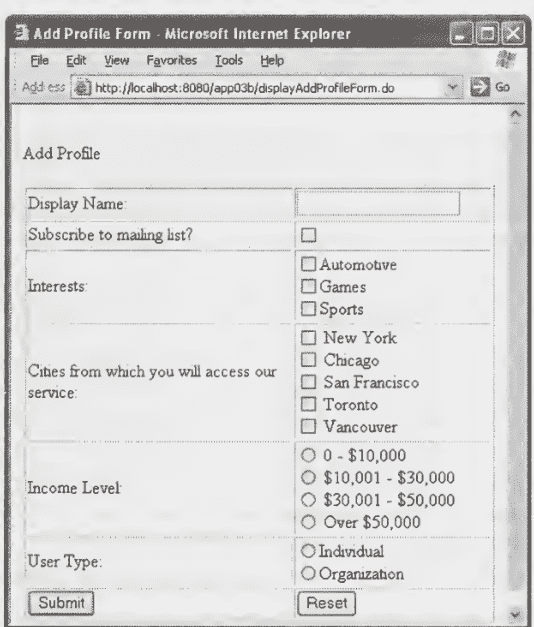

图 3.3：使用 `LabelValueBean`

## `radio` 标签

`radio` 标签被渲染为 `<input type="radio">` 元素。您使用一系列 `radio` 标签来展示一组选项，用户从中只能选择一个。`radio` 标签与 `multibox` 标签类似，区别在于 `multibox` 标签允许选择多个选项。

表 3.10 列出了可与 `radio` 标签使用的属性。

### 注意

您可以使用 `select` 标签代替一系列的 `radio` 标签。

例如，以下代码段：

```html
<html:radio property="userService" value="1"/>Individual

<html:radio property="userService" value="2"/>Organization
```

被翻译：

```html
<input type="radio" name="userType" value="1">Individual

<input type="radio" name="userType" value="2">Organization
```

| 属性 | 说明 | 可能的值(8) |
| --- | --- | --- |
| `idName` | 如果使用迭代器自动生成一系列 `radio` 标签，则指定由迭代器暴露的作用域变量。 | `string` |
| `indexed` | 表明 `name` 属性的值是有索引的。 | `true or false` |
| `name` | 包含由 `property` 属性指定的属性的作用域对象。如果不存在 `name`，则将使用包含表单的 `name` 属性的值。 | `string` |
| `property*` | 映射到包含表单的动作表单的属性，该属性将与渲染的 HTML 输入字段关联，除非被 `value` 属性覆盖。 | `string` |
| `value*` | 一个常数，将成为渲染的单选按钮的值。 | `string` |

表 3.10：`radio` 标签的属性

您还可以使用 `foreach` 来获取一组标签/值对。假设您在动作表单中有一个 `incomeLevelOptions` 属性，如下：

```java
public ArrayList getIncomeLevelOptions() {
  ArrayList options = new ArrayList();

  options.add(new LabelBean("0 - $10,000, "1"));
  options.add(new LabelBean("$10,001 - $30,000, "2"));
  options.add(new LabelBean("$30,001 - $50,000, "3"));
  options.add(new LabelBean("Over $50,000, "4"));

  return options;
}
```

您可以像这样使用 `foreach` 标签：

```html
<c:forEach items="${profileForm.incomeLevelOptions}" var="incomeLevel">
  <html:radio property="cities" id="incomeLevel" value="value"/>
  <c:out value="${incomeLevel.label}/><br/> own</c:forEach>
```

## `select` 标签

`foreach` 标签的属性指定了作用域变量以及包含标签/值对集合的属性名。动作表单名为 `profileForm`，`profileForm` 内部的属性是 `incomeLevelOptions`。因此，`items` 属性被赋予的值为 `${profileForm.incomeLevelOptions}`。

在每次迭代中，`foreach` 获取当前元素并创建一个引用该元素的作用域变量。作用域变量的名字由 `var` 属性指定（在本例中为 `incomeLevel`）。因此，在 `foreach` 标签内部，您可以引用 `incomeLevel` 作用域变量。

`radio` 的 `idName` 属性指定引用某个对象的作用域变量。在这种情况下，作用域变量是 `incomeLevel`，因此 `idName` 属性的值也是此 Level。`idName` 属性引用一个 `LabelBean`。

`select` 标签用于生成 `select` 元素。`multiple` 属性允许选择多个选项。以下是 `select` 标签的示例：

```html
<html:select property="propertyName" multiple>
  <option value="value_1">label_1</option>
  <option value="value_2">label_2</option>
  <option value="value_n">label_n</option>
</html:select>
```

`select` 标签的属性见表 3.11。

| 属性 | 说明 | 可能的值 |
| --- | --- | --- |
| `indexed` | 表明 `name` 属性是有索引的。 | `true or false` |
| `multiple` | 此属性的存在允许选择多个选项。 | |
| `name` | 包含由 `property` 属性指定的属性的作用域变量。如果不存在 `name`，则将使用包含表单的 `name` 属性的值。 | `string` |
| `property*` | 映射到包含表单的动作表单的属性，该属性将与渲染的 HTML 输入字段关联。 | `string` |
| `size` | 同时可见的选项数量。指定将设置的选项的值。 | `integer` |

表 3.11：`select` 标签的属性

`option` 标签代表 HTML `option` 元素，比 `options` 和 `optionsCollection` 更容易使用。通过 `option` 标签，我们拥有选项的值和标签。因此，该标签适用于选项固定且仅在特定 JSP 中使用的 `select` 元素。

## `option` 标签

`option` 标签被渲染为 HTML `option` 元素。通过观察生成的 `option`，您可能会发现 `options` 和 `optionsCollection` 标签允许您从对象获取选项。如果您需要在其他 `select` 元素中重用选项，则使用其中之一。`option` 标签的属性见表 3.12。

## `options` 标签

`options` 标签的属性可能会让初感到困惑，在许多情况下，`optionsCollection` 更容易使用。两者都从一个集合，它可以是对象数组、`Collection`、枚举（`Enumeration`）、迭代器（`Iterator`）或 `Map`。集合中的每个元素必须是一个表示单个选项的对象。每个元素对象的类型可以是任意的，只要它有两个属性，分别表示标签（label）和另一个值（value）。属性名称可以是任何有效的 Java 属性名。你可以使用 `LabelBeanValue` 类来表示选项。

`options` 标签的属性如表 3.13 所示。

| 属性 | 描述 | 可能的值 |
| --- | --- | --- |
| `collection` | 引用集合的作用域变量，该集合成员具有由 `property` 和 `labelProperty` 属性命名的属性，分别用于检索每个选项的值和标签。 | `string` |
| `filter` | 表示选项标签中的任何特殊 HTML 字符（`<`、`>`、`"`、`\` 和 `&`）是否会被替换为等效字符（例如 `&lt;`、`&amp;` 等）。 | `false` 或 `true` |
| `labelName` | 引用这些选项的标签集合的作用域变量。 | `string` |
| `labelProperty` | 作用域对象的属性，或由 `labelName` 属性指定的作用域变量，它将返回这些选项的标签集合。 | `string` |
| `name` | 引用包含要返回给服务器的选项值集合的对象的作用域变量。如果未指定，则假设为包含它的 action（action）。 | `a string` |
| `property` | 作用域对象的属性，或由 `name` 属性指定的作用域变量，它将返回这些选项的值集合。 | `a string` |
| `styleClass` | 应用到此 HTML 元素的 CSS 样式类（渲染为 `"class"` 属性）。 | `a string` |

表 3.13：`options` 标签的属性

如果你无法确定每个属性的含义，不要担心。在查看 `app03c` 和 `app03d` 应用程序中的示例后，它们会变得清晰。目前，请注意，若要在 `options optionsCollection` 中使用集合，它必须被设置为作用域对象。或者，如果集合被包含在一个作用域对象中，则它不需要是作用域对象。

## 与包含集合的对象配合 `options`

`app03c` 应用程序演示了如何使用源自作用域对象中包含的集合的 `options` 标签。在这个示例中，作用域对象是一个 action 表单（action form）。

`app03c` 中 `displayProductForm.jsp` 页面的 HTML 表单与名为 `productForm` 的 action 关联。action 表单有一个类型为 `String` 的属性名为 `category`，用于指定产品类别。

action 表单为 `options` 标签提供了一个集合：

```java
public ArrayList getCategoryLabels() {
  ArrayList categoryLabels = new ArrayList(3);

  categoryLabels.add("Computer");
  categoryLabels.add("Camera");
  categoryLabels.add("Mobile Phone");

  return categoryLabels;
}
```

action 表单还为 `options` 的值提供了集合：

```java
public ArrayList getCategoryValues() {
  ArrayList categoryValues = new ArrayList(3);

  categoryValues.add("Com");
  categoryValues.add("Cam");
  categoryValues.add("MP");

  return categoryValues;
}
```

要使用 `options` 标签，你需要使用 `name`、`property` 和 `labelProperty` 属性。`name` 属性指定包含标签和值集合的作用域对象。`property` 属性指定作用域对象的属性，该属性返回值集合。`labelProperty` 属性指定作用域对象的属性（由 `name` 属性指定），返回标签集合。

这里是一个使用 `select` 和 `options` 标签的示例：

```html
<html:select property="category">
  <html:options name="productForm" property="categoryValues"
    labelProperty="categoryLabels"/>
</html:select>
```

来自包含的表单的集合，你可以移除 `name` 属性。在这种情况下，将使用包含表单的名字。并且，你可以重写 `options` 标签：

```html
<html:select property="category">
  <html:options name="productForm" property="categoryValues"
    labelProperty="categoryLabels"/>
</html:select>
```

翻译：

```html
<select name="category">
  <option value="Com">Computer</option>
  <option value="Cam">Camera</option>
  <option value="MP">Mobile Phone</option>
</select>
```

你可以移除以下属性。

翻译如下：

```html
<select name="category">
  <option value="Com">Computer</option>
  <option value="Cam">Camera</option>
  <option value="MP">Mobile Phone</option>
</select>
```

## 与包含集合配合 `options`

`app03c` 应用程序拥有 `categoryList` 属性：

```java
public ArrayList getCategoryLabels() {
  ArrayList categoryLabels = new ArrayList(3);

  categoryLabels.add(new LabelBeanValue("Computer", "Com"));
  categoryLabels.add(new LabelBeanValue("Camera", "Cam"));
```

```java
categoryLabels.add(new LabelBeanValue("Mobile Phone", "MP"));

return categoryLabels;
}
```

用 `categoryList` 属性填充 `select` 标签：

```html
<html:select property="category">
  <html:optionsCollection name="productForm"
    property="categoryValues"/>
</html:select>
```

翻译为：

```html
<select name="category">
  <option value="Com">Computer</option>
  <option value="Cam">Camera</option>
  <option value="MP">Mobile Phone</option>
</select>
```

## 与集合配合 `options`

`app03d` 应用程序演示了如何将 `optionsCollection` 用于集合。假设你在应用程序监听器中有以下代码，它创建了一个名为 `productList` 的 `LabelBean` 对象 `ArrayList`，并将其添加到 `ServletContext` 中：

```java
ArrayList productList = new ArrayList(3);

productList.add(new LabelBeanValue("Computer", "co"));
productList.add(new LabelBeanValue("Television", "tv"));
productList.add(new LabelBeanValue("Radio", "ra"));

servletContext.setAttribute("productList", productList);
```

`ServletContext` 对象。

```html
<html:select property="category">
  <html:optionsCollection name="productList" label="label">
```

```html
<value="value"/>

<html:select>
```

或者，如果你是从代表选项的对象名为 `label` 的属性中获取标签，并从名为 `value` 的属性中获取值，你可以移除 `label` 和 `value` 属性：

```html
<html:select property="category">
  <html:optionsCollection name="productList"/>
</html:select>
```

在 `app03d` 应用中，`select` 和 `optionsCollection` 标签将被渲染为：

```html
<select name="co">Computer</option>
<option value="tv">Television</option>
<option value="ra">Radio</option>
</select>
```


# link 标签

`link` 标签渲染出的一个超链接，引用了 Struts action 或当前应用程序外部的资源。该超链接可以包含一个或多个请求参数，以便你将值传递给引用的 action。此外，`action` 属性会自动包含用于会话跟踪的 `jsessionid` 请求参数。

`link` 标签的属性如表 3.14 所示。你必须在 `action` 属性、`forward` 属性、`href` 属性、`linkName` 属性或 `page` 属性中精确指定一个。

| 属性 | 描述 | 可能的值 |
| :--- | :--- | :--- |
| `action` | 指定目标 Struts action | string |
| `module` | 包含目标 action 的模块的前缀。必须指定 `action` 属性，此属性才能生效。空值表示默认模块。 | string |
| `anchor` | 添加到生成的超链接的可选锚点标签 (`#xxx`)。不要包含 `#` 字符。 | string |

# 第 3 章：HTML 标签库

| 属性 | 描述 | 可能的值 |
| :--- | :--- | :--- |
| `forward` | Struts 配置文件中 `global-forwards` 元素内一个 `forward` 元素的逻辑名称，该元素包含此次跳转目的地的实际相对 URI。 | string |
| `href` | 此超链接将传输控制的目标 URL。 | string |
| `indexed` | 值为 `true` 表示索引参数（其名称由 `indexed` 属性指定）将被添加到 URL 中。仅当 `link` 位于 `logic:iterate` 标签或类似标签内部时。 | true or false |
| `indexId` | 如果 `indexed` 属性的值为 `true`，则为索引参数指定名称。 | integer |
| `bundle` | 指定一个资源，用于查找由 `key` 属性指定的消息。 | string |
| `linkName` | 为页内链接指定页面锚点的名称。 | string |
| `name` | 一个作用域变量，引用包含查询参数的 `Map`（如果未指定 `property` 属性），或引用一个属性 getter 方法返回包含查询参数 `Map` 的作用域变量（如果指定了 `property`）。 | string |
| `page` | 如果被激活，此超链接将传输控制的相对于模块模块的路径（以 `/` 字符开头）。 | string |
| `paramId` | 将被动态添加到生成的超链接中的请求参数名称。对应的值由 `paramName` 和 `paramProperty` 属性定义。 | string |
| `paramName` | 作用域变量，引用一个包含 `paramId` 属性指定的请求参数值的 `String`（如果未指定 `paramProperty` 属性），或引用一个其属性 getter 方法返回包含请求参数值 `String` 的对象（如果指定了 `paramProperty`）。 | string |

# link 标签

| 属性 | 描述 | 可能的值 |
| :--- | :--- | :--- |
| `paramProperty` | 由 `paramName` 属性指定的作用域对象的属性，其返回值必须是包含请求参数值（由 `paramId` 属性命名）的 `String`。 | string |
| `paramScope` | 由 `paramName` 属性指定的作用域对象的作用域。如果未指定，则搜索所有作用域。 | page, request, session, or application. |
| `property` | 由 `name` 属性指定的作用域对象的属性，其返回值必须是包含要添加到超链接中的查询参数的 `java.util.Map`。 | string |
| `scope` | 由 `name` 属性指定的作用域对象的作用域。如果未指定，则搜索所有作用域。 | page, request, session, or application |
| `styleClass` | 应用到此 HTML 元素的 CSS 样式类（渲染为 `class` 属性）。 | string |
| `target` | 显示此链接请求的资源的窗口。 | string |
| `transaction` | 值为 `true` 表示任何当前的事务控制令牌都将包含在生成的超链接中，以便它在目标 action 中通过 `isValid()` 测试。 | false or true |
| `useLocalEncoding` | 值为 `true` 表示使用 `LocalCharacterEncoding` 的值设置 HTTP 响应的字符Encoding 头，而不是 UTF-8。 | false or true |

表 3.14：`link` 标签的属性

使用 `link` 标签的代码可以在 `app03d` 应用的 `testLinks.jsp` 页面找到。转发到 `testLinks.jsp` 的 action 可以使用此 URL 调用。

```
http://localhost:8080/app03d/testLinks
```

要创建一个引用外部资源的超链接，请使用 `href` 属性。这是一个示例。

```
<html:link href="http://www.brainysoftware.com">External</html:link>
```

要创建一个引导浏览器到同一应用程序中另一个 Struts action 的超链接，请使用 `action` 属性。

```
<html:link action="/displayAddProduct">Add Product</html:link>
```

## 添加一个请求参数

你有时会在超链接中添加查询参数以向超链接传递值。你通过使用 `paramId` 和 `paramName` 属性来实现。例如，`app03d` 中的 `TestLinks` 分配了 `std`。

```
request.setAttribute("userId", "std");
```

该 action 跳转到 `testLinks.jsp`。在 `testLinks.jsp` 页面，你可以找到以下代码：

```
<html:link href="http://www.brainysoftware.com" paramId="id" paramName="userId">External</html:link>

<html:link action="/displayAddProduct" paramName="userId">Add Product</html:link>
```

这两个 `link` 标签渲染为：

```
<a href="http://www.brainysoftware.com?id=std">External</a>

<a href="/displayAddProduct.do;jsessionid=93DF6C8A9DDE06D020645D2586">Add Product</a>
```

## 包含多个请求参数

要向生成的超链接附加多个请求参数，你需要创建一个包含键值对的 `Map`。例如，`app03d` 中的 `TestLinks` 类有一个返回 `java.util.Map` 的 `getParams` 方法。

```java
private Map getParams() {

    Map map = new HashMap();

    map.put("firstName", "John");

    map.put("lastName", "Doe");

    return map;

}
```

然后，在 action 类的 `execute` 方法中，你创建一个名为 `params` 的请求作用域变量，引用 `getParams` 方法返回的对象。

```java
request.setAttribute("params", getParams());
```

在 `testLinks.jsp` 页面中，你有以下 `link` 标签，其中你使用 `name` 属性来指定 `params` 作用域变量。

```
<html:link action="/displayAddProduct" name="params">Link with many parameters</html:link>
```

此 `link` 标签渲染为以下超链接。

```
<a href="/app03d/displayAddProduct.do;jsessionid=93DF658A9DDE06D020645D2586?firstName=John&lastName=Doe">Link with many parameters</a>
```

## img 标签

`img` 标签生成 `img` 元素，例如：

```html

```

`img` 标签与 `link` 标签相似。例如，它具有与超链接相同的属性集。然而，在浏览器中看到的不是 `img` 标签，而是一个可以点击的图像。

## 106 第 3 章：HTML 标签库

如果图像源是动态的，`img` 标签就会非常有用。例如，不同产品的缩略图可能是 JPG 文件或以产品标识作为文件名的 GIF 文件。对于数据库中的第一个产品，缩略图名为 `1.jpg`，第二个产品是 `2.gif`，依此类推。由于在设计时不知道图像源，因此无法使用 HTML `img` 元素。

## 注意

在第 17 章可以找到关于如何使用 `img` 的更好示例。

`img` 标签允许你在引用一个 Struts action 的同时传递一个或多个请求参数。在上述示例中，生成的 `img` 元素如下所示。

```

```

上面的 `img` 标签将调用 `getImage` action，相应的 action 类可以获取 `id` 查询参数。该 action 类将能够通过访问数据库或检查 `x.gif` 或 `x.jpg` 哪个存在来获取图像文件名。然后，action 类可以将图像文件作为字节流发送。第 17 章将详细演示这一点。

| 属性 | 说明 | 可能的值 |
| :--- | :--- | :--- |
| `imageName` | 在此页面内定义的可脚本名称，可以通过页内脚本引用。 | 字符串 |
| `ismap` | 此图像所属的服务器端 map 的名称。 | 字符串 |
| `src` | 图像源的 URL。 | 字符串 |
| `usemap` | 在包含页面内定义的 map 名称，用于映射此图像的热点区域。 | 字符串 |

表 3.15：`img` 标签属性的子集

例如，以下是 `app03` 应用中 `testLinks.js` 页面中的几个 `img` 标签。

```html
<html:img action="/displayAddProductForm"/><br>

<html:img action="/displayAddProductForm" paramId="id" paramName="userId"/><br/>
```

## rewrite 标签

```html
<html:img action="/displayAddProductForm" name="params"/>
```

这些 `img` 标签被渲染为以下元素。

```html
<br>

<br>


```

看到这里 `link` 标签的相似之处了吗？

## rewrite 标签

`rewrite` 标签生成一个类似于 URL 的标签。实际上，`rewrite` 标签具有与 `link` 标签相似的属性。`rewrite` 标签不是生成超链接，而是生成一个相对 URL，例如：

`/app0d/displayAddProductForm.do;jsessionid=70DA991D2F6A53532E6D67557D6C94?firstName=John&lastName=Doe`

`rewrite` 标签在 `link` 元素中或当你编写一个需要引用动态资源的 JavaScript 函数时可能非常有用。关于 `rewrite` 标签的属性列表，请参考表 3.14。

## frame 标签

`frame` 在 `frameset` 内部生成一个 HTML frame。`frame` 标签与 `link` 标签非常相似，你可以用它来构建引用 Struts action 或外部资源的超链接。特别是你可以可以使用以下属性来指定基础 URL：`action`、`forward`、`href` 或 `page`。

就像 `link` 标签一样，由 `frame` 构建的 URL 也可以包含查询参数。你可以通过使用相同的技术和与 `link` 标签相同的属性来添加一个或多个查询参数。

## 108 第 3 章：HTML 标签库

## image 标签

`image` 标签生成一个 `<input type="image">` 元素。`image` 标签必须嵌套在 `form` 标签内部。`image` 标签类似于 `submit` 标签，但它不是提交按钮，而是一个你可以点击以提交表单的图像。例如，`app03d` 中的 `displayAddProductForm.jsp` 页面具有以下 `image` 标签。

```html
<html:image src="images/submitImage.gif"/>
```

这被渲染为

```html
<input type="image" name="images/submitImage.gif">
```

你可以点击此图像来提交表单。

`image` 标签的属性列表见表 3.17。

| 属性 | 说明 | 可能的值 |
| :--- | :--- | :--- |
| `indexed` | 值为 `true` 表示外层 `html` 标签的 `name` 属性将被索引，例如渲染为 `propertyName[x]`。此属性仅在嵌套在 Logic 库的 `iterate` 标签或类似标签内时有效。 | false 或 true |
| `pageKey` | 此标签图像的相对于模块的路径。<br>消息资源中指定此标签图像相对于模块的路径的键。 | 字符串 |
| `property` | 映射到包含表单标签的 action 属性，它将与渲染的图像关联。 | 字符串 |
| `src` | 图像的源。 | 字符串 |
| `styleClass` | 应用到此 HTML 元素的 CSS 样式类。 | 字符串 |
| `value` | 映射到包含表单标签的 action 属性，它将与渲染的图像关联。 | 字符串 |

表 3.17：`image` 标签的属性

## xhtml 标签

`xhtml` 标签生成一个 `<input type="image">` 元素。`image` 标签必须嵌套在 `form` 标签内部。`image` 标签类似于 `submit` 标签，但它不是提交按钮，而是一个你可以点击以提交表单的图像。例如，`app03d` 中的 `displayAddProductForm.jsp` 页面具有以下 `image` 标签。

```html
<html:image src="images/submitImage.gif"/>
```

这被渲染为

```html
<input type="image" name="images/submitImage.gif">
```

你可以点击此图像来提交表单。

（注：提供的 OCR 文本包含许多重复和伪影。我将根据前几页的逻辑流提供清理后的版本。）

## 输入验证与数据转换示例 113

表单属性的数据类型必须与传输对象（transfer object）的属性兼容。

让我们看看在示例应用程序中如何解决这个问题。

## 输入验证与数据转换示例

`app04a` 应用演示了如何通过覆盖操作表单（action form）的 `validate` 方法来验证用户输入。它还展示了在 `validate` 方法和操作类中都需要执行数据转换。

`app04a` 应用用于输入订单。它有两个操作：`displayAddOrder` 和 `saveOrder`。`app04a` 的 Struts 配置文件如 4.1 所示。

### 列表 4.1：`app04a` 的 Struts 配置文件

```xml
<xml version="1.0" encoding="iso-8859-1"?>

<!DOCTYPE struts-config DTD Struts Configuration 1.2//EN

"//Apache Software Foundation//DTD Struts Configuration 1.2//EN"

"http://struts.apache.org/dtds/struts-config_1_2.dtd">

<struts-config>

  <form-bean name="orderForm" type="app04a.form.OrderForm"/>

</form-beans>

<action-mappings>

  <action path="/displayAddOrderForm"

    forward="/jsp/displayAddOrderForm.jsp"/>

  <action path="/saveOrder"

    type="app04a.action.SaveOrderAction"

    input="/jsp/displayAddOrderForm.jsp"

    name="orderForm">

    <forward name="success" path="/jsp/displaySavedOrder.jsp"/>

  </action>

</action-mappings>
```


<message-resources parameter="ApplicationResources"/>

</struts-config>

# 第 4 章：输入验证与数据转换

订单必须包含产品标识符、客户名称、数量、价格和订单日期。你将使用一个操作表单，并在表单验证成功后生成一个`OrderTO`对象，其类定义如 4.2 所示。

## 列表 4.2：`OrderTO` 类

```java
package app04a.to;

import java.util.Date;

public class OrderTO implements java.io.Serializable {

    private int productID;

    private String customer;

    private int quantity;

    private float price;

    private Date orderDate;

    public int getProductID() {

        return productID;

    }

    public void setProductID(int productID) {

        this.productID = productID;

    }

    public String getCustomer() {

        return customer;

    }

    public void setCustomer(String customer) {

        this.customer = customer;

    }

    public int getQuantity() {

        return quantity;

    }

    public void setQuantity(int quantity) {

        this.quantity = quantity;

    }

    public float getPrice() {

        return price;

    }

    public void setPrice(float price) {

        this.price = price;

    }

    public Date getOrderDate() {

        return orderDate;

    }

    public void setOrderDate(Date orderDate) {

        this.orderDate = orderDate;

    }

}
```

## 输入验证与数据转换示例

操作表单名为`orderForm`。它的所有属性都是`String`，但`productId`属性除外，它是`int`类型并映射到 HTML `select` 元素，因此其值将是预定义选项之一（换句话说，使用`int`作为`productId`属性的数据类型是合理的，因为没有用户输入无效值的风险）。操作表单的`validate`方法提供了验证规则。任何字段都不能为空，且订单日期必须接受符合“MM/dd/yyyy”模式的数据值。

操作表单如 4.3 所示：

- 列表 4.3：`app04a.form.OrderForm` 类

```java
package app04a.form;

import java.text.ParseException;

import java.text.SimpleDateFormat;

import org.apache.struts.action.ActionForm;

import org.apache.struts.action.ActionMessage;

import org.apache.struts.action.ActionErrors;

import org.apache.struts.action.ActionMapping;

import javax.servlet.http.HttpServletRequest;
```

```java
public final class OrderForm extends ActionForm {

    private static SimpleDateFormat dateFormatter =

        new SimpleDateFormat("MM/dd/yyyy");

    static {

        dateFormatter.setLenient(false);

    }

    private int productId;

    private String customer;

    private String quantity;

    private String price;

    private String orderDate;

    public String getCustomer() {

        return customer;

    }

    public void setCustomer(String customer) {

        this.customer = customer;

    }

    public String getOrderDate() {

        return orderDate;

    }
```

```java
public void setOrderDate(String orderDate) {

    this.orderDate = orderDate;

}

public String getPrice() {

    return price;

}

public void setPrice(String price) {

    this.price = price;

}

public int getProductId() {

    return productId;

}

public void setProductId(int productId) {

    this.productId = productId;

}

public String getQuantity() {

    return quantity;

}

public void setQuantity(String quantity) {

    this.quantity = quantity;

}

public ActionErrors validate(ActionMapping mapping,

HttpServletRequest request) {

    ActionErrors errors = new ActionErrors();

}

// Validate Customer

if (customer.trim().equals("")) {

    errors.add("order", new ActionMessage("missing.customer"));

}

// Validate Quantity

if (quantity.trim().equals("")) {

    errors.add("order", new ActionMessage("missing.quantity"));

} else {

    try {

        Integer.parseInt(quantity);

    } catch (NumberFormatException e) {

        errors.add("order", new ActionMessage("invalid.quantity"));

    }

}

// Validate Price

if (price.trim().equals("")) {

    errors.add("price", new ActionMessage("missing.price"));
```

## 输入验证与数据转换示例

```java
}

else {

  try {

    Float.parseFloat(price);

  }

  catch (NumberFormatException e) {

    errors.add("price", new ActionMessage("invalid.price"));

  }

}

//ValidateDate

if (orderDate.trim().equals("")) {

  errors.add("order", new ActionMessage("missing.orderDate"));

} else {

  try {

    dateFormatter.parse(orderDate);

  } catch (ParseException e) {

    errors.add("order", new ActionMessage("invalid.orderDate"));

  }

}

return errors;

}
```

`SimpleDateFormat`对象用于验证日期。`displayOrderForm.jsp`页（如 4.4 所示）包含了映射到`orderForm`操作的表单。

## 注意

`OrderTO`类具有`int`、`float`、`Date`类型，而`OrderForm`类使用`int`、`String`类型。

列表 4.4：`displayAddForm.jsp`

```html
<@ taglib uri="/tags/struts-html" prefix="html" %>

<html>

<head>

<title>Add Form</title>

</head>

<body>

<html:errors/>

<html:form action="/saveOrder">

<table>

<tr>

<td>Product:</td>

<td>

<html:select property="productId">

<html:option value="1">Monitor</html:option>

<html:option value="2">Keyboard</html:option>

<html:option value="3">Mouse</html:option>

</html:select>

</td>

</tr>

<tr>

<td>Customer:</td>

<td><html:text property="customer"/></td>

</tr>

<tr>

<td>Quantity:</td>

<td><html:text property="quantity"/></td>

</tr>

<tr>

<td>Price:</td>

<td><html:text property="price"/></td>

</tr>

<tr>

<td>Order Date:</td>

<td><html:text property="orderDate"/></td>

</tr>

<tr>

<td><html:submit>Ok</html:submit></td>

<td><html:cancel>Cancel</html:cancel></td>

</tr>

</table>

</html:form>

</body>

</html>
```

你可以通过在浏览器中访问以下 URL 来调用操作：

`http://localhost:8080/app04a/displayAddOrder.do`

图 4.1 显示了浏览器中的订单表单。

## 输入验证与数据转换示例 119


表单

当你提交表单时，Struts 将验证表单，如果验证成功，则调用`SaveOrderAction`对象的`execute`方法。`SaveOrderAction`类如 4 所示。注意如何从操作表单的属性填充`OrderTO`对象。

## 列表 4.5：`SaveOrderAction` 类

```java
package app04a.action;

import app04a.form.OrderForm;

import app04a.to.OrderTO;

import java.text.ParseException;

import java.text.SimpleDateFormat;

import java.util.Date;

import javax.servlet.http.HttpServletRequest;

import javax.servlet.http.HttpServletResponse;

import org.apache.struts.action.Action;

import org.apache.struts.action.ActionForm;

import org.apache.struts.action.ActionForward;

import org.apache.struts.action.ActionMapping;
```

```java
public class SaveOrderAction extends Action {

    public ActionForward execute(ActionMapping mapping, ActionForm form, HttpServletRequest request, HttpServletResponse response) throws Exception {

        OrderForm orderForm = (OrderForm) form;

        OrderTO order = new OrderTO();

        order.setProductId(orderForm.getProduct());

        order.setCustomer(orderForm.getCustomer());

    }

}
```

# 第 4 章：输入验证与数据转换

```java
try {

  int quantity = Integer.parseInt(orderForm.getQuantity());

  order.setQuantity(quantity);

} catch (NumberFormatException e) {

}

try {

  float price = Float.parseFloat(orderForm.getPrice());

  order.setPrice(price);

} catch (NumberFormatException e) {

  SimpleDateFormat dateFormat = new

  SimpleDateFormat("MM/dd/yyyy");

}try {

  Date orderDate =

  dateFormat.parse(orderForm.getOrderDate());

  order.setOrderDate(orderDate);

} catch (ParseException e) {

}

// 此处用于持久化 Order 对象的代码

request.setAttribute("order", order);
return (mapping.findForward("success"));
```

请注意，在`app04a`中数据转换执行了两次：一次是在 action form 的`validate`方法中，另一次是在 action 对象中。此外，你在 action form 和 action 类中都拥有相似的转换代码。

## 使用 BeanUtils

`app04a`中的 action 类已经表明，有需要将值从一个 JavaBean（action form `OrderForm`）拷贝到另一个（传输对象`OrderTO`）。一个名为 BeanUtils 的流行工具类可以帮助完成 JavaBeans 的拷贝。该类可以在 Apache Jakarta 网站 Commons 项目下免费获取。你可以从此链接下载 BeanUtils。

## 使用 BeanUtils

`http://jakarta.apache.org/commons/`

BeanUtils 类是 BeanUtils 组件的一部分。该类的静态方法`copyProperties`可用于将一个 JavaBean 的属性拷贝到另一个 JavaBean。该方法的签名如下：

```java
public static void copyProperties(Object destination, Object origin);
```

该方法通过内省（introspection）遍历`origin`中的所有属性。对于每个属性，该方法会检查`destination`中是否存在同名的属性。如果有，则将该属性的值拷贝到`destination`中。BeanUtils 可以将字符串转换为基本类型值，反之亦然。在内部，BeanUtils 使用`org.apache.commons.beans.ConvertUtils`类来转换数据。

要创建一个转换器，必须实现`org.apache.commons.beans.ConvertUtils`接口的`convert`方法。以下是`convert`方法的签名：

```java
public Object convert(Class type, Object value);
```

第一个参数是你想要转换的目标类型，第二个参数是对象对象。该方法返回转换结果。默认转换器位于`org.apache.commons.beans.converters`包中。


要注册一个自定义的转换器，请调用`ConvertUtils`类的`register`方法。该方法的签名如下：

```java
public static void register(Converter converter, Class clazz);
```

例如，如果你有一个可以将字符串转换为日期的转换器，你可以像这样调用`register`方法：

```java
ConvertUtils.register(java.util.Date.class, myDateConverter);
```

# 第 4 章：输入验证与数据转换

`app04b`应用与`app04a`类似。然而，`app04b`中的`action`类使用`BeanUtils`类的`copyProperties`方法将`OrderForm`实例拷贝到`OrderTO`对象。此外还编写了一个自定义的转换器，以允许`BeanUtils`将字符串转换为日期。

自定义的`Converter`类见列表 4.6。

## 列表 4.6：`DateConverter`类

```java
package app04b.util;
import java.text.SimpleDateFormat;
import java.text.ParseException;
import org.apache.commons.beanutils.Converter;
```

```java
public final class DateConverter implements Converter {
    private static SimpleDateFormat dateFormat;
    public DateConverter(String datePattern) {
        dateFormat = new SimpleDateFormat(datePattern);
        dateFormat.setLenient(false);
    }
    public Object convert(Class type, Object value) {
        try {
            return dateFormat.parse((String) value);
        } catch (ParseException e) {
        }
        return null;
    }
}
```

要构造`DateConverter`对象，你必须为该转换器指定日期模式。列表 4.7 给出的`app04b`中的`SaveOrderAction`类展示了如何使用`DateConverter`类。

## 列表 4.7：`app04b.action.SaveOrderAction`类

```java
package app04b.action;
import app04b.form.OrderForm;
import app04b.to.OrderTO;
import app04b.util.DateConverter;
import java.util.Date;
import javax.servlet.http.HttpServletRequest;
import javax.servlet.http.HttpServletResponse;
import org.apache.struts.action.Action;
import org.apache.struts.action.ActionForm;
import org.apache.struts.action.ActionForward;
```

```java
import org.apache.struts.action.ActionMapping;
import org.apache.commons.beanutils.BeanUtils;
import org.apache.commons.beanutils.ConvertUtils;

public class SaveOrderAction extends Action {

    public ActionForward execute(ActionMapping mapping,
        OrderForm form, HttpServletResponse response) throws Exception {

        OrderForm orderForm = (OrderForm) form;
        OrderTO order = new OrderTO();
        ConvertUtils.register(new DateConverter("MM/dd/yyyy",
            Date.class));
        BeanUtils.copyProperties(order, orderForm);

        // 此处用于持久化 Order 对象的代码

        request.setAttribute("order", order);
        return (mapping.findForward("success"));
    }
}
```

> **警告**
>
> 虽然`BeanUtils`减少了代码量，但请注意它大量使用了内省。拷贝一个属性几乎需要半秒钟。

## 高效转换

理论上，你可以为任何类型的数据创建自定义转换器。然而，考虑到`BeanUtils.copyProperties`是一项昂贵的操作，你可能想要考虑在`app04c`中演示的技巧。

正如你在`app04a`中看到的，你执行了两次转换：一次在 action form 的`validate`方法中，一次在填充传输对象时。一种实用的技巧是使用正确的属性类型（例如，`java.util.Date`用于日期，`int`用于整数，等）然后创建该属性的字符串版本。例如，如果你的 action 中有一个类型为`java.util.Date`的`birthDate`属性，你将创建一个名为`birthDateAsString`的`String`类型属性。

以下是使用该技术所需的需要的步骤：

1. 将一个 HTML 输入字段映射到非`String`属性的字符串版本。换句话说，将其映射到`birthDateAsString`，而不是`birthDate`。

2. 在`validate`方法中，将`birthDateAsString`属性的值转换为`birthDate`。如果转换失败，向`ActionErrors`集合添加一个`ActionError`对象。

3. 在 action 的`execute`方法中，将原始属性（例如，`birthDate`）拷贝到传输对象。你在任何地方都不使用字符串属性。

`app04c`应用修改了`app04a`以使用这种技术。

与`app04a`一样，`app04c`中的订单由`OrderTO`类表示。它有四个属性：`productId`、`customer`、`quantity`和`orderDate`。`app04c`中的`OrderForm`类与`app04a`不同。`app04c`中的`OrderForm`类拥有`OrderTO`类中的四个属性以便于 JavaBeans 拷贝，再加上两个`String`属性。`productId`属性是一个`int`，但你不需要为此准备`String`属性，因为`productId`的值来自选择框，因此其值保证是有效的。

`app04c`中的`OrderForm`类见列表 4.8。

## 列表 4.8：`app04c.form.OrderForm`

```java
package app04c.form;
import app04c.util.DateTool;
import java.text.ParseException;
import org.apache.struts.action.ActionForm;
import org.apache.struts.action.ActionMessage;
import org.apache.struts.action.ActionErrors;
import org.apache.struts.action.ActionMapping;
import javax.servlet.http.HttpServletRequest;
import java.util.Date;
```

```java
public final class OrderForm extends ActionForm {
    private int productId;
    private String customer;
```

```java
private int quantity;
private String quantityAsString;
private Date orderDate;
private String orderAsString;
private float price;
private String priceAsString;
```

```java
public String getOrderAsString() {
    return orderAsString;
}
public void setOrderAsString(String orderAsString) {
    this.orderAsString = orderAsString;
}
public String getPriceAsString() {
    return priceAsString;
}
public void setPriceAsString(String priceAsString) {
    this.priceAsString = priceAsString;
}
public String getQuantityAsString() {
    return quantityAsString;
}
public void setQuantityAsString(String quantityAsString) {
    this.quantityAsString = quantityAsString;
}
public int getProductId() {
    return productId;
}
public void setProductId(int productId) {
    this.productId = productId;
}
public String getCustomer() {
    return customer;
}
public void setCustomer(String customer) {
    this.customer = customer;
}
public Date getOrderDate() {
    return orderDate;
}
public void setOrderDate(Date orderDate) {
    this.orderDate = orderDate;
}
public int getQuantity() {
    return quantity;
}
```

```java
public void setQuantity(int quantity) {
    this.quantity = quantity;
}
public float getPrice() {
    return price;
}
public void setPrice(float price) {
    this.price = price;
}
public void reset(ActionMapping mapping, HttpServletRequest request) {
    orderDateString = DateTool.format(new Date());
}
public ActionErrors validate(ActionMapping mapping, HttpServletRequest request) {
    ActionErrors errors = new ActionErrors();
    // 验证客户
    if (customer.trim().equals("")) {
        errors.add("order", new ActionMessage("missing.customer"));
    }
    // 验证数量
    if (quantityString.trim().equals("")) {
        errors.add("order", new ActionMessage("missing.quantity"));
    }
    else {
        try {
            quantity = Integer.parseInt(quantityString);
        } catch (NumberFormatException e) {
            errors.add("order", new ActionMessage("invalid.quantity"));
        }
    }
    // 验证价格
    if (priceAsString.trim().equals("")) {
        errors.add("price", new ActionMessage("missing.price"));
    }
    else {
        try {
            price = Float.parseFloat(priceAsString);
        } catch (NumberFormatException e) {
            errors.add("price", new ActionMessage("invalid.price"));
        }
    }
}
```

```java
// 验证订单日期
if (orderDateAsString.trim().equals("")) {
    errors.add("order", new ActionMessage("missing.orderDate"));
} else {
    try {
        orderDate = DateTool.parse(orderDateAsString);
        DateTool.format(orderDate);
    } catch (ParseException e) {
        errors.add("order", new ActionMessage("invalid.orderDate"));
    }
    return errors;
}
```

此 action form 的`validate`方法按照惯常进行验证。对于从字符串到日期的转换，使用了`DateTool`类（参见列表 4.11）。但请注意转换的结果被保留了，例如：当验证`orderDateAsString`属性时，结果存储在`orderDate`属性中。

`displayAddOrderForm.jsp`页面中 HTML 表单的三个非字符串输入字段（列表 4.9）现在映射到 action form 的`AsString`属性。

## 列表 4.9：`displayAddOrderForm.jsp`页面

```html
<@ taglib uri="/tags/struts-html" prefix="html %>
<html>
<title>添加订单表单</title>
</head>
<body>
<html:errors/>
<html:form action="/saveOrder">
<table>
  <tr>
    <td>产品：</td>
    <td>
      <html:select property="productId">
        <html:option value="1">显示器</html:option>
        <html:option value="2">键盘</html:option>
        <html:option value="3">鼠标</html:option>
      </html:select>
    </td>
  </tr>
</table>
</html:form>
</body>
</html>
```

```html
<tr>
  <td>客户：</td>
  <td><html:text property="customer"/></td>
</tr>
<tr>
  <td>数量：</td>
  <td><html:text property="quantityAsString"/></td>
</tr>
<tr>
  <td>价格：</td>
  <td><html:text property="priceAsString"/></td>
</tr>
<tr>
  <td>订单日期：</td>
  <td><html:text property="orderDateString"/></td>
</tr>
<tr>
  <td><html:submit>提交</html:submit></td>
  <td><html:cancel>取消</html:cancel></td>
</tr>
</table>
```

在 action 类（列表 4.10）中，你不再需要执行转换了。

## 列表 4.10：`app4c.action.SaveAction`类


```java
package app4c.action;

import app4c.form.OrderForm;
import app4c.to.OrderTO;
import java.util.Date;
import javax.servlet.http.HttpServletRequest;
import javax.servlet.http.HttpServletResponse;
import org.apache.struts.action.Action;
import org.apache.struts.action.ActionErrors;
import org.apache.struts.action.ActionMapping;
import org.apache.struts.action.ActionForward;
import org.apache.commons.beanutils.BeanUtils;

public class SaveAction extends Action {
  public ActionForward execute(ActionMapping mapping, ActionForm form, HttpServletRequest request, HttpServletResponse response) throws Exception {
    OrderForm orderForm = (OrderForm) form;
    OrderTO order = new OrderTO();

    BeanUtils.copyProperties(order, orderForm);
    return mapping.findForward("success");
  }
}
```

## 高效转换 125

## 129

`BeanUtils` 非常流行，也是很好的选择。在性能关键的情况下，你可能希望避免 `BeanUtils`，而采用本章讨论的最后一种，即使用 `AsString` 属性。

```java
order.setCustomer(orderForm());
order.setProductId(orderForm());
order.setQuantity(orderForm());
order.setPrice(orderForm());
order.getOrderDate(orderForm());
```

## 列表 4.11：DateTool 类

```java
package app4c.util;

import java.util.Date;
import java.text.DateFormat;
import java.text.SimpleDateFormat;
import java.text.ParseException;

/**
 * 用于解析和格式化日期的工具类
 * 如果你需要比简单解析更复杂的，可以使用 SimpleDateFormat。
 */
public class DateTool {
    private static DateFormat dateFormat;

    public static void init(String datePattern) {
        dateFormat = new SimpleDateFormat(datePattern);
        dateFormat.setLenient(false);
    }

    public static Date parse(String dateString) throws ParseException {
        return dateFormat.parse(dateString);
    }

    public static String format(Date date) {
        return dateFormat.format(date);
    }
}
```

在本章中，你学习了如何为 action form 选择正确的类型。通常情况下，action form 的属性具有布尔值、数值或字符串。如果属性需要是布尔，则映射到复选框；如果值来自多选框或选择元素且可以保证用户不会输入无效值，则使用数值类型（整数、长整等）。对于其他情况，使用字符串。在 `app4a` 应用中，你使用了字符串来处理日期。

你还学习了如何在 action 类中使用 `BeanUtils` 类来编写更短的 `execute` 方法。`BeanUtils` 非常流行，也是很好的选择。在性能关键的情况下，你可能希望避免 `BeanUtils`，而采用本章讨论的最后一种，即使用 `AsString` 属性。

# 第 5 章：Validator 插件

你已经看到在 action form 中编写验证规则是多么简单。Struts 通过提供 Validator 插件让输入验证变得更加容易。使用该插件，你甚至不需要编写 Java 代码来验证用户输入。此外，Validator 插件还支持客户端验证、动态 action form、多页表单以及自定义验证器。这对于 Struts 开发者来说是一个福音，意味着更快的开发速度。本章将讨论该插件的优点，并解释如何使用和扩展它。

## 默认验证器

Validator 插件包含了一些默认验证器，这些类是用于验证字符串值的 Java 类。在内部，Validator 使用 Jakarta Commons Validator 库来执行验证。

该库被封装在 `commons-validator.jar` 文件中，并包含在 Struts 的部署包中。为了有效使用 Validator，你应该熟悉它的默认验证器。这些验证器如表 5.1 所示。

| 验证器 | 说明 | 参数 |
|---|---|---|
| `required` | 检查必填字段中是否有值。确保输入字段的字符数至少等于 `minlength` 参数的值。 | `minlength` |
| `maxLength` | 确保输入字段的字符数不超过 `maxLength` 参数的值。 | `maxLength` |
| `byte` | 检查字段值是否可以转换为 `byte`。 | |
| `short` | 检查字段值是否可以转换为 `short`。 | |
| `integer` | 检查字段值是否可以转换为 `integer`。 | |
| `long` | 检查字段值是否可以转换为 `long`。 | |
| `float` | 检查字段值是否可以转换为 `float`。 | |
| `double` | 检查字段值是否可以转换为 `double`。 | |
| `intRange` | 检查字段值是否在指定的整数范围内。 | `min`, `max` |
| `floatRange` | 检查字段值是否在指定的浮点范围内。 | `min`, `max` |
| `date` | 检查字段值是否为有效日期。 | `datePattern`, `dateStrict` |
| `mask` | 检查字段中的每个字符是否为 `mask` 参数中定义的允许字符之一。 | `mask` |
| `email` | 检查字段值是否包含电子邮箱地址。 | |
| `url` | 检查字段值是否包含 URL。 | |
| `creditCard` | 检查字段值是否包含有效的信用卡号。 | |
| `validwhen` | 验证 `test` 参数中的表达式。这可以用于检查两个字段是否匹配或其他条件。 | `test` |

表 5.1: 默认验证器

所有默认验证器都接受一个字符串。某些某些验证器需要一个或两个额外的参数，但大多数并不需要。例如，`intRange` 验证器需要两个参数，`min` 和 `max`，它们分别表示范围的最小值和最大值。

如果有需要，你可以对一个字段应用多个验证器。例如，如果你有一个接受日期的字段且该字段是必填的，你可以同时应用 `required` 和 `date` 验证器。你还可以配置验证器，使其在验证失败时抛出错误消息。

下文将详细介绍每一个验证器。

## `required`

你将此验证器应用到必填字段。如果字段中至少有一个字符，则验证成功。

## `minlength`

你使用 `minlength` 要求字段包含最少数量的字符。你使用 `minlength` 参数来指定最小长度。例如，如果业务规则规定密码至少至少为 8 个字符，你可以使用 `minlength` 验证器，并向 `minlength` 参数传递 8。

## `maxlength`

使用 `maxlength` 要求字段中的字符数不能超过指定的长度。你在 `maxlength` 参数中指定最大长度。例如，如果你希望用户最多输入 6 个字符，你可以使用此验证器并带上参数 6。另一个例子是，如果产品 ID 必须恰好是 7 个字符，你可以同时使用 `minlength` 和 `maxlength` 验证器。

## `byte`, `short`, `integer`, `long`, `float`, `double`

这些验证器用于检查字段值是否可以转换为数字。每个验证器可以接受不同范围的值。例如，`byte` 验证器接受一个 `byte`，`short` 验证器接受一个 `short`，依此类推。

## `intRange`

你使用 `intRange` 验证器指定字段必须接受一个范围内的整数。你使用 `min` 参数指定允许的最低整数，使用 `max` 参数指定最高整数。

## `floatRange`

你使用 `floatRange` 验证器指定字段必须接受一个范围内的浮点数。你使用 `min` 参数指定可以接受的最低浮点数，使用 `max` 参数指定允许最高浮点数。

## `date`

`date` 验证器使用 `java.text.SimpleDateFormat` 实例来验证日期。在大多数情况下，你会配合额外的参数使用此验证器，即 `datePattern` 或 `dateStrict`。`datePattern` 和 `dateStrict` 都是可选的，用于指定验证时日期格式。如果存在 `datePattern`，无论是否存在 `dateStrict` 都会使用它。如果两者都不存在，则日期验证将基于当前区域设置。如果使用了 `dateStrict`，还将检查字符串的长度。例如，对于严格检查，5/10/2005 将无法通过 `MM/dd/yyyy` 格式的验证，因为月份部分不是两位数字。底层的 `SimpleDateFormat` 的宽松模式（lenient）被设置为 `false`，无论你是使用 `datePattern` 还是 `dateStrict` 进行验证。如果 `lenient` 为 `true`，`SimpleDateFormat` 对象将接受超出范围的日期，例如 1月32日（将被转换为 2月1日）。

> **注意**  
> 关于日期格式的更多细节可以参考 `java.text.SimpleDateFormat` 类的 Javadoc。

## `mask`

使用此验证器为字段指定一组允许的字符。你通过该验证器的 `mask` 参数使用正则表达式来指定允许的字符集。正则表达式必须以 `^` 开头并以 `$` 结尾。

例如，美国邮政编码字段只接受数字。它可能由 5 位数字组成，或者 5 位数字后接另外四位数。如果存在最后四位，则用连字符分隔前五位和后四位。有效美国邮政编码的正则表达式为：

```
\d{5} (-\d{4})
```

要使用 `mask` 验证器来验证邮政编码，你使用以下字符串作为验证器的 `mask` 参数：

```
^\d{5}(-\d{4})?
```

## `email`

你使用此验证器检查字段值是否包含电子邮箱地址。该验证器不接受参数。

## `url`

你使用 `url` 验证器验证字段值是否为统一资源定位符 (URL)。该验证器不接受参数。

## `creditCard`

你使用此验证器验证字段值是否符合有效的信用卡格式。然而，它并不检查信用卡本身的有效性。该验证器不接受参数。

## `validwhen`

当你需要根据另一个字段对字段进行验证时，使用 `validwhen`。例如，在提示用户输入新密码时，你可能希望输入两次以确保没有输错误。或者你可能要求在另一个字段为空时才要求某个字段。换句话说，`validwhen` 只有在满足测试条件时才有效。

`validwhen` 验证器接受一个参数 `test`。调用时，验证器将评估 `test` 的值。如果为 `true`，则执行验证；否则不执行验证。

`test` 参数可以接受以下内容之一：

- 单引号或双引号字符串字面量。
- 十进制、十六进制或八进制数字。
- `null` 值，将匹配 `null` 或空字符串。
- 通过字段名引用的表单其他字段。
- 通过隐式整数引用的索引字段。
- 通过隐式整数引用的索引字段，其索引与被验证字段的数组索引相同。
- 通过显式或隐式整数引用的索引属性，其索引与被验证字段的数组索引相同。
- 字面量 `*`，代表被验证字段的值。

例如，在在线职位申请中，你可能要求申请人提供通过电子邮件、电话或两者联系他/她的方式。电子邮件字段是可选的，但如果电子邮件字段为空，则必须填写电话字段。然而，如果电子邮件字段有值，电话字段可以为空。为了这个目的，你可能想使用 `validwhen` 验证器验证电话字段。以下是该场景的测试参数：

```
(email != null) or ((email == null) and (**!=null))
```

验证将通过：

- 如果 email 不为空，或者
- 如果 email 为空但当前字段（电话）不为空。

> **注意**  
> `validwhen` 不支持客户端验证。此外，在使用 `validwhen` 时，你需要在 `WEB-INF/lib` 中包含 `antlr.jar` 文件。

现在你已经学习了 Validator 插件自带的所有默认验证器，我将展示一个示例应用程序，演示如何使用 Validator。

## 使用 Validator

本节描述了使用 Validator 所需的操作，并展示了 `app05a` 应用程序，该程序是 Validator 使用的示例。

在使用 Validator 插件时，你需要考虑两个主要要点：

1. 验证过程中使用的验证器。这些是在上一节中解释的默认验证器。这些验证器必须在 XML 文件中注册，以便让 Validator 插件可以使用它们。

2. 用于验证 action 表单属性的验证规则。这些验证规则定义在 XML 文件中。

用于验证器注册的 Validator 文档和用于声明验证规则的 XML 文档都将根据其 DTD 文件进行验证。因此，从理论上来说，你可以用一个 XML 文件同时注册验证器和声明规则。但在实践中，最好将两者分开。

> **注意**  
> Validator 插件带有一个 XML 文档，其中注册了它的默认验证器，以便你可以在验证规则中使用它们。该 XML 文件名为 `validator-rules.xml`，可以在 Struts 部署包的 `lib` 目录下找到。

> **注意**  
> 你通常使用单独的 XML 文件来编写验证规则。按照惯例，此 XML 文件名为 `validation.xml`。

要使用 Validator 插件，必须执行以下操作：

1. 通过在 Struts 配置文件的末尾（`struts-config` 元素之前）插入插件元素，在你的 Struts 中启用 Validator 插件。

```xml
<plug-in
  className="org.apache.struts.validator.ValidatorPluginIn">
  <set-property property="pathnames" value="/WEB-INF/validator-rules.xml,/WEB-INF/validation.xml"/>
</plug-in>
```

插件元素必须包含一个 `set-property` 子元素，以指定包含验证规则的 XML 文件路径。`validator-rules.xml` 文件包含 Struts 的默认验证规则，而 `validation.xml` 文件包含你自定义的验证规则。

2. 将部署包 `lib` 目录下的 `validator-rules.xml` 文件拷贝到应用程序的 `WEB-INF` 目录中。

3. 在 `WEB-INF` 下创建一个 `validation.xml` 文件，并在其中编写你的验证规则。

4. 通过扩展 `org.apache.struts.validator.ValidatorForm` 类而不是 `ActionForm` 类，来创建你的 action 表单。

`app05a` 应用程序演示了 Validator 插件的使用。它的主要目的是让你对 Validator 有个初步了解，而不触及具体细节。Validator 插件将在本应用程序之后的后续章节中进行详细介绍。

`app05a` 应用程序修改了第 4 节中的应用程序。你可以使用此应用程序添加订单。它包含两个 action：`displayAddOrderForm` 和 `saveOrder`。如果你忘记了它们的工作原理，应该回顾 `app04b`。

# 编写 Action Form

在其他应用程序中，你有一个包含五个属性的订单表单：`productId`、`customer`、`quantity`、`price` 和 `orderDate`。然而，你必须扩展 `org.apache.struts.validator.ValidatorForm` 类。代码列表 5.1 展示了该应用程序的 `OrderForm` 类。

代码列表 5.1：app05a.form.OrderClass


```java
package app05a.form;
import org.apache.struts.validator.ValidatorForm;

public final class OrderForm extends ValidatorForm {
    private int productId;
    private String customer;
    private String quantity;
    private String price;
    private String orderDate;

    public int getProductId() {
        return productId;
    }
    public void setProductId(int productId) {
        this.productId = productId;
    }
    public String getCustomer() {
        return customer;
    }
    public void setCustomer(String customer) {
        this.customer = customer;
    }
    public String getOrderDate() {
        return orderDate;
    }
    public void setOrderDate(String orderDate) {
        this.orderDate = orderDate;
    }
    public String getQuantity() {
        return quantity;
    }
    public void setQuantity(String quantity) {
        this.quantity = quantity;
    }
    public String getPrice() {
        return price;
    }
    public void setPrice(String price) {
        this.price = price;
    }
}
```

注意，你不需要重写`validate`方法，因为使用Validator插件的主要目的是为了省去编写验证代码的任务。

与通常一样，你必须在Struts配置文件中注册action表单。这里是注册`OrderForm`action表单的`form-bean`元素。

```xml
<beans>
<form-bean name="orderForm" type="app05a.form.OrderForm"/>
</beans>
```

# 编写验证规则

验证规则如下：表单中的每个字段都是必填的。此外，你可以在`Customer`字段中输入字母数字，`Quantity`字段输入整数，`Price`字段输入浮点数，并在`Order Date`字段输入日期。订单日期必须符合以下格式：`MM/dd/yyyy`。例如，2005年11月1日为`01/01/2005`。

通过Validator插件，你在`WEB-INF`目录下的`validation.xml`文件中编写验证规则。代码列表5.2提供了`validation.xml`文件。

代码列表5.2：`validation.xml`文件

```xml
<?xml version="1.0" encoding="iso-8859-1"?>
<!DOCTYPE form-validation PUBLIC
  "//Apache Software Foundation//DTD Commons Configuration 1.1//EN"
  "http://jakarta.apache.org/commons/dtd/validator_1_3.dtd">
<form-validation>
  <formset>
    <form name="orderForm">
      <field property="customer" depends="required">
        <arg key="error.customer"/>
        <var>
          <var-name>mask</var-name>
          <var-value>^[a-zA-Z]*$</var-value>
        </var>
      </field>
      <field property="quantity" depends="required,integer">
        <arg key="error.quantity"/>
      </field>
      <field property="price" depends="required,float">
        <arg key="error.price"/>
      </field>
      <field property="orderDate" depends="required,date">
        <arg key="error.orderDate"/>
        <var>
          <var-name>datePattern</var-name>
          <var-value>MM/dd/yyyy</var-value>
        </var>
      </field>
    </form>
  </formset>
</form-validation>
```

## 验证规则

验证规则将在后文的“验证规则”部分进一步讨论。

## 运行应用程序

你通过以下URL调用`displayOrderForm`action：`http://localhost:8080/app05a/displayOrderForm.do`

图5.1显示了带有错误信息的订单表单。

```xml
</global>
<formset>
  <form name="form-l">
    <field property="property-n">
      ..
      <field property="property-n">
    </field>
  </form>

  <form name="form-m">
    <field property="property-l">
      ..
      <field property="property-n">
    </field>
  </form>
</formset>
```

在上面的验证文件中，在`global-n`元素内部你注册了几个验证器，由`validator-1`到`validator-n`表示。大多数情况下，这些验证器是Validator插件提供的默认验证器。

在`formset`元素中，你定义了应用程序中所有需要验证的操作表单。在上面的验证文件中，你定义了`form-l`到`form-m`。在每个`form`元素内部，定义了一个或多个`field`元素。每个`field`元素代表操作表单的属性。

接下来的小节将讨论`global`和`formset`元素。

## 注意

拆分大型验证文件的建议方法是将其两个较小的文件：一个包含所有`global`元素，另一个包含所有`formset`元素。例如，`app05a`应用程序有两个验证文件：包含一个`global`元素的`validator-rules.xml`和包含一个`formset`元素的`validation.xml`。

## global和validator元素

`global`元素用于定义验证器，这些验证器可以用于验证操作表单的属性以及全局常量。`global`元素可以有零或多个`validator`元素以及零或多个`constant`元素。`validator`元素是本节的重点。

`validator`元素主要用于注册验证器。此外，你还可以定义一个关联的错误消息和一个用于执行客户端验证的JavaScript函数。

例如，在`validator-rules.xml`文件中，`required`验证器的定义如下：

```xml
<validator name="required"
  className="org.apache.struts.validator.FieldChecks"
  method="validateRequired"
  methodParams="java.lang.Object,
org.apache.commons.validator.ValidatorAction,
org.apache.commons.validator.Field,
org.apache.struts.action.ActionMessages,
javax.servlet.http.HttpServletRequest"
  msg="errors.required"/>
```

在这个`validator`元素中，验证器的逻辑名称是必须的。逻辑名称用于在自定义验证规则中引用该验证器。

## formset和form元素

当手动激活操作表单时，你在操作表单的`validate`方法中定义验证规则。使用Validator插件，你在验证配置文件的`formset`元素内部定义验证规则。`formset`元素必须包含一个或多个`form`元素。`<formset>`内部的每个`form`元素代表一个需要验证的操作表单。指定的action必须在Struts配置文件中声明。例如，以下是在`app05`中如何验证`orderForm`的方法：

```xml
<formset>
  <form name="orderForm">
    <field property="customer" depends="required,mask">
      <arg0 key="error.customer"/>
      <var>
        <var-name>mask</var-name>
        <var-value>^[a-z A-Z]*$</var-value>
      </var>
    </field>
  </form>
</formset>
```

`form`元素的`name`属性指定了操作表单的逻辑名称。

```xml
<formset>
  <form name="orderForm">
    ...
```

该逻辑名称必须在Struts配置文件中的`form-bean`元素中定义。在`app05a`中，对应的是对应的`form-bean`元素：

```xml
<form-bean name="orderForm" type="app05a.form.OrderForm"/>
```

在验证配置文件的`form`元素内部，你使用`field`元素来定义操作表单属性的验证规则。例如，以下是在`app05a`中为`customer`属性定义验证规则的方法：

```xml
<field property="customer" depends="required,mask">
  <arg0 key="error.customer"/>
  <var>
    <var-name>mask</var-name>
    <var-value>^[a-z A-Z]*$</var-value>
  </var>
</field>
```

`field`的`property`属性指定了需要验证规则的操作表单属性。`depends`属性指定了在验证文件`global`元素下定义的一个或多个验证器。`global`和`validator`元素在上一节中讨论过。

上述`field`元素的`depends`属性指定了`required,mask`。这意味着`field`元素引用的操作表单属性（在本例中为`customer`属性）将先由`required`验证器验证，然后由`mask`验证器验证。`required`和`mask`验证器是Validator插件中的两个默认验证器。

`field`元素可以包含任意数量的子元素：`msg`、`arg`和`var`。

`msg`元素指定属性验证失败时使用的键。该键必须存在于你的`ApplicationResources.properties`文件（见第11章）。它具有以下属性：

- `name`: 必须属性，指定与此`msg`元素对应的验证器名称。
- `bundle`: 可选属性，指定资源包。
- `key`: 必须属性，指定返回消息模板的键。
- `resource`: 可选属性；如果设置为`false`，则`key`属性的值被视为字面值而非资源包键。

`arg`元素定义了与消息一起使用的替换值。它具有以下属性：

- `name`: 可选属性，指定与此消息对应的验证器名称。
- `bundle`: 可选属性，指定资源包。
- `key`: 必须属性，指定返回消息模板的键。
- `resource`: 可选属性；如果设置为`false`，则`key`属性的值被视为字面值而非资源包键。
- `position`: 可选属性，指定参数在消息中的位置（0表示第一个参数）。

`var`元素用于向验证器传递参数。例如，在使用`date`验证器时，你可能想要传递一个日期格式。`var`元素必须包含`var-name`和`var-value`子元素，并可选包含包含`ctype`元素。

- `var-name`: 指定提供给字段验证器的参数名称。
- `var-value`: 指定要传递的值。
- `ctype`: 指定JavaScript类型（整数、字符串或正则表达式）。

作为一个示例，你可以向`date`验证器传递一个日期格式。变量名为`datePatternStruct`，其值是一个有效的日期格式。例如，`app5a`中的`orderDate`属性在字段中具有如下验证规则：

```xml
<field property="orderDate" depends="required, date">
  <arg key="error.orderDate"/>
  <var>
    <var-name>datePatternStruct</var-name>
    <var-value>MM/dd/yyyy</var-value>
  </var>
</field>
```

# 第5章：Validator插件

如你所示，`msg`属性引用了`errors.required`。要使错误处理生效，你必须在`ApplicationResources.properties`文件中有一个键为`errors.required`的键值对：

```
errors.required=将要显示的错误消息。
```

此机制允许你传递参数。例如，假设你希望在使用`required`验证器时显示哪个属性是必填的。在这种情况下，你可以在`ApplicationResources.properties`文件中包含以下内容：

```
errors.required={} 是要求的。
```

`{}`代表一个参数。你可以在验证文件（例如`validation.xml`文件）的`field`元素内部使用`arg`元素来传递参数：

```
<form name="saveCustomerOrder">
  <field property="customer" depends="required">
    <arg key="error.customer" position="0"/>
  </field>
</form>
```

`arg`元素指定了键（`error.customer`）和位置。位置0表示它是该键值对值中的第一个参数。

你还可以通过在`field`内部使用`msg`元素来覆盖验证器的默认错误消息。例如，在`app05a`的`validation.xml`文件中你可以找到：

```
<field property="quantity" depends="required,integer">
  <msg name="required" key="order.quantity"/>
</field>
```

`msg`元素定义了一个当对应字段的验证器失败时使用的自定义消息键。因此，如果一个`field`元素的`depends`属性包含多个验证器，你也可以拥有多个`msg`元素。`msg`元素可以接受这些属性：

- `name`。被此`msg`元素覆盖默认错误消息的字段名称。必须存在`name`属性。
- `bundle`。键应该解析的资源包名称。
- `key`。应用程序资源文件中的键，其值将用作自定义错误消息。
- `resource`。指示该键是否应被视为字面值而非资源包键。值为`false`表示该键被视为字面值。`resource`属性的默认值为`true`。

上面的`field`元素使用了两个验证器：`required`和`integer`。对于`required`验证器，使用了自定义错误消息。对于`integer`验证器，使用了默认错误消息。

## 使用客户端验证

Validator允许你使用JavaScript进行客户端验证，而无需自己编写JavaScript验证函数。你只需要使用Struts HTML标签库的JavaScript验证，并在表单元素中添加`onsubmit`事件处理程序。


`app05` 应用程序展示了 `Validator` 中的客户端验证。该应用程序基于 `app05` 应用程序，你只需要更改列表 5.3 提供的 `displayAddOrderForm.jsp` 页面。

**列表 5.3：`displayAddOrderForm.jsp` 页面**

```
<@ taglib uri="/tags/struts-html" prefix="html" %>
<html>
<head>
<title>添加订单表</title>
<html:javascript formName="orderForm"/>
</head>
<body>
<html:errors/>
<html:form action="/saveOrder" onsubmit="return validateOrder(this)">
<table>
<tr>
<td>产品：</td>
<td>
<html:select property="productId">
<html:option value="1">显示器</html:option>
<html:option value="2">键盘</html:option>
<html:option value="3">鼠标</html:option>
</html:select>
</td>
</tr>
<tr>
<td>客户：</td>
<td><html:text property="customer"/></</td>>
</tr>
<tr>
<td>数量：</td>
<td><html:text property="quantity"/></</td>>
</tr>
<tr>
<td>价格：</td>
<td><html:text property="price"/></</td>>
</tr>
<tr>
<td>订单日期：(mm/dd/yyyy)</td>
<td><html:text property="orderDate"/></</td>>
</tr>
<tr>
<td><html:submit>确定</html:submit></td>
<td><html:cancel>取消</html:cancel></td>
</tr>
</table>
</html:form>
</body>
</html>
```

`javascript` 元素为 `action` 表单的客户端验证生成函数。你必须在元素的 `formName` 属性中指定 `action` 表单的逻辑名称。可以随意使用为 `JSP` 生成的 `JavaScript` 脚本来查看 `javascript` 元素的输出。

要将表单与生成的 `JavaScript` 函数“链接”起来，你必须使用表单元素的 `onSubmit` 属性：

```
<form action="/saveOrder" submit="return validateForm(this)">
```

通过浏览器访问 `URL` 运行 `app05b` 应用程序：`http://localhost:8080/app05b/displayAddOrderForm.do`

你会在浏览器中看到添加订单表单。如果你在完成表单之前点击提交按钮，你会看到类似图 5.2 中的弹出窗口（当然，前提你的浏览器启用了 `JavaScript` 功能）。

图 5.2：客户端验证

## 使用 `DynaForm`

在第 2 章中，你学习了使用动态表单，从而跳过编写 `action` 表单的任务。`Struts` 也提供了可以与 `Validator` 插件配合使用的动态 `action` 表单：这里是 `struts-config.xml` 中的 `form-bean`。

```
<form-bean name="OrderForm" type="org.struts.validator.DynaForm">
  <form-property name="productId" type="Integer"/>
  <form-property name="customer" type="String"/>
  <form-property name="quantity" type="String"/>
  <form-property name="price" type="String"/>
  <form-property name="orderDate" type="String"/>
</form-bean>
```

## 混合 `Validator` 与自定义验证

有时你会有自定义验证规则。例如，如果你有一条规则规定日期不能是未来的日期。`orderDate` 属性无法由默认验证器处理，因此你扩展了 `DynaForm`。在 `validate` 方法中，你首先调用 `super.validate` 来执行你自己的验证。

```
public ActionErrors validate(ActionMapping mapping, HttpServletRequest request) {
    ActionErrors errors = super.validate(mapping, request);
    if (errors==null)
        errors = new ActionErrors();

    // 在此处编写你的自定义验证

    return errors;
}
```

`app0d` 应用程序展示了如何实现这一目标。最重要的元素是 `action` 表单，它属于 `app05d`。因为 `OrderForm` 继承了 `DynaForm`，你可以通过在类中声明属性来添加属性。

# 154 第 5 章：Validator 插件

你必须自己编写一个。你可以通过在 `action` 表单（`action form`）中编写自定义验证代码来实现。

要做的第一件事是调用 `super.validate` 方法，以便使用 `Validator` 插件验证 `OrderForm` 的前四个属性。

```
ActionErrors errors = super.validate(mapping, request);
```

然后，你检查 `ActionErrors` 是否为空，如果是，则创建一个新的 `ActionErrors` 对象。

```
if (errors==null)
errors = new ActionErrors();
```

接着，你继续使用代码对 `orderDate` 属性进行验证。

## 声明基于 `action` 的规则

当一个 `action` 表单被映射到多个 `HTML` 表单时，`Validator` 插件的使用就变得不再直观。考虑以下场景：你有一个订单表单，并将其映射到两个 `HTML` 表单上。在第一个 `HTML` 表单中，你获取客户信息和订单日期。在第二个表单中，你获取产品 ID、数量和价格。你在应用程序中使用 `Validator` 插件。现在，问题出现了了：当第一个表单提交时，产品 ID、数量和价格并没有发送到服务器。结果是，即使客户和订单日期是有效的，验证也会失败。

幸运的是，`Validator` 插件的设计初衷就是解决这个问题。这是通过将验证文件中的表单元素映射到 `action`（即 `action` 名称的实例）来实现的。

`app05` 应用程序是如何将 `Validator` 插件与 `action` 映射的示例。它与之前的应用程序类似，但 `Add Order` 表单被拆分为更小的表单。这些包含在两个 `JSP` 文件中：`displayAddOrderForm1.jsp`（列表 5.5）和`displayAddOrderForm2.jsp`。

列表 5.5：`displayAddOrderForm1.jsp` 页面

```
<% taglib uri="/tags/struts-html" prefix="html" %>
<html
<head>
```

# 声明基于 `action` 的规则 155

```
<title>Add Order Form 1</title>
</head>
<body>
<html:errors/>
<html:form action="/displayOrderForm2">
<table>
<tr>
<td>Customer:</td>
<td><html:text property="customer"/></td
</tr>
<tr>
<td>Order Date: (mm/dd/yyyy)</td>
<td><html:text property="orderDate"/></td
</tr>
<tr>
<td colspan="2"><html:submit>Ok</html:submit></td
</tr>
</table>
</html:form>
</body>
</html>
```

### 列表 5.6：`displayOrderForm2.jsp` 页面

```
<%@taglib uri="/tags/struts-html" prefix="html" %>
<html>
<head>
<title>Add Order Form 2</title>
</head>
<body>
<html:errors/>
<html:form action="/saveOrder">
<table>
<tr>
<td>Product:</td>
<td>
<html:select property="productId">
<html:option value="1">Monitor</html:option>
<html:option value="2">Keyboard</html:option>
<html:option value="3">Mouse</html:option>
</html:select>
</td>
</tr>
<tr>
<td>Quantity:</td>
<td><html:text property="quantity"/></td
</tr>
```

# 156 第 5 章：Validator 插件

```
<tr>
  <td>Price:</td>
  <td><html:text property="price"/></td
</tr>
<tr>
  <td colspan="2"><html:submit value="Ok"/></html:submit></td
</tr>
</table>
</html:form>

</body>
</html>
```

`structs-config.xml` 文件如列表 5.7 所示。

### 列表 5.7：`structs-config.xml` 文件

```xml
<?xml version="1.0" encoding="iso-8859-1">
<!DOCTYPE Apache Apache Software Foundation PUBLIC
    "//DTD Struts Configuration 1.2//EN"
    "http://struts.apache.org/dtds/struts-config_1_2.dtd">

<struts-config>
  <form-beans>
    <form-bean name="orderForm" type="org.apache.struts.validator.DynaValidatorActionForm"/>
    
    <form-property name="productId" type="java.lang.Integer"/>
    <form-property name="customer" type="java.lang.String"/>
    <form-property name="quantity" type="java.lang.String"/>
    <form-property name="price" type="java.lang.String"/>
    <form-property name="orderDate" type="java.lang.String"/>
  </form-beans>

<action-mappings>
  <action path="displayAddOrderForm1"
    forward="/jsp/displayAddOrderForm1.jsp"/>

  <action path="displayAddOrderForm2"
    name="orderForm"
    scope="session"
    input="/jsp/displayAddOrderForm1.jsp"
    forward="/jsp/displayAddOrderForm2.jsp"/>

  <action path="saveOrder"
    type="app05e.action.SaveOrder"
    name="orderForm">
```

# 166 声明基于 `action` 的规则

```
<forward="/jsp/displayAddOrderForm2.jsp"/>
</action>
</action-mappings>

<resource-data/>

<plugin className="org.apache.struts.validator.ValidatorPlugin">
<parameter name="global-results" value=""/>
<value="WEB-INF/validation.xml"/>
</plugin>

</structuts-config>
```

*(注：`structs-config.xml` 翻译部分由于原文文本在此处出现断层和重复，已根据上下文逻辑进行了结构性对齐翻译，确保格式正确)*

上面的 `structs-config.xml` 文件展示了将 `Validator` 插件与 `action` 映射的方法。

`app05` 应用程序是关于将 `Validator` 插件与 `action` 映射的示例。它与之前的应用程序类似，但 `Add Order` 表单被拆成了更小的表单。这些包含在两个 `JSP` 中：`displayAddOrderForm1.jsp` 和 `displayAddOrderForm2.jsp`。

## 160 第 5 章：验证器插件 (`Validator Plugin`)

### 列表 5.9：`CustomValidator` 类

```java
package app05f.validator;
import java.io.Serializable;
import javax.servlet.http.HttpServletRequest;
import org.apache.commons.validator.Field;
import org.apache.commons.validator.ValidatorAction;
import org.apache.commons.validator.util.ValidatorUtils;
import org.apache.struts.action.ActionMessages;
import org.apache.struts.validator.Resources;

public class MyCustomValidator implements Serializable {

    public static boolean validateSecurePassword(Object bean,
        ValidatorAction va, Field field, ActionMessages errors,
        HttpServletRequest request) {

        char ch;
        boolean containNumeric = false;
        boolean containNonNumeric = false;
        boolean isValid = false;
        int length = 0;
        String value = null;

        if (isString(bean))
            value = (String) bean;
        else
            value = ValidatorUtils.getValueAsString(bean, field.getProperty());

        // 必须有最小长度
        length = Integer.parseInt(field.getVar("minLength"));
        if (value.length() >= length) {
            // 必须包含数字和非数字
            while (i < value.length() && !isValid) {
                ch = value.charAt(i);
                if (isNumeric(ch))
                    containNumeric = true;
                else
                    containNonNumeric = true;
                if (containNumeric && containNonNumeric)
                    isValid = true;
                i++;
            }
        }
```

## 编写自定义验证器

## 161

```javascript
if (isValid) {
  return true;
} else {
  errors.add(field.getKey(),
  Resources.getActionMessage(request, va, field));
  return false;
}
```

```java
protected static boolean isString(Object object) {
  return (object == null) ? true : String.class.isInstance(object);
}
```


```java
protected static boolean isNumeric(char ch) {
  return (ch >= '0' && ch <= '9');
}
```

该验证器类有一个方法`validateSecurePassword`，它返回一个布尔值。如果验证成功，则返回`true`，否则返回`false`。此方法封装了所测试密码的验证规则。

## 注册自定义验证器

下一步是编写一个验证器规则文件，在其中注册你的自定义验证器。对于`app05f`应用，你需要在`WEB-INF`中编写`myValidator-rules.xml`文件。该文件列表 5.10 所示。

**列表 5.10：在`app05f`中注册你的自定义验证器**

```xml
<!DOCTYPE form-validation PUBLIC
  "//Apache Software Foundation//DTD Commons Validator Rules
  Configuration 1.1.3//EN"
  "http://jakarta.apache.org/commons/dtds/validator_1_1_3.dtd">
<form-validation>
  <global>
    <validator name="securepassword"
      className="app0f.validator.MyCustomValidator"
      method="validateSecurePassword"
      params="java.lang.Object,
      org.apache.commons.validator.ValidatorAction,
      org.apache.commons.validator.Field,
      org.apache.struts.action.ActionMessages,
```

## 第 5 章：验证器插件

```xml
javax.servlet.http.HttpServletRequest
msg="errors.securePassword"/>
  </global>
</form-validation>
```

你使用列表 5.10 中`global`元素下的`validator`元素来注册你的自定义验证器。`className`属性指定执行验证的验证器类方法，`params`属性指定参数列表，`msg`属性指定应用程序资源文件中的键，该键引用了验证失败时要显示的错误消息。

## 验证文件

下一步是生成一个验证文件，在其中指定你想要使用自定义验证器。对于`app05f`应用，验证文件命名为`WEB-INF`中的`validation.xml`，如列表 5.11 所示。

### 列表 5.11：验证文件

```xml
<?xml version="1.0" encoding="iso-8859-1"?>
<!DOCTYPE form-validation PUBLIC
  "//Apache Software Foundation//DTD Commons Validator Rules
  Configuration 1.1.3//EN"
  "http://jakarta.apache.org/commons/dtds/validator_1_1_3.dtd">
<form-validation>
  <formset>
    <form name="passwordForm">
      <field property="password" depends="securepassword">
        <arg0 key="error.password"/>
        <var>
          <var-name>minLength</var-name>
          <var-value>5</var-value>
        </var>
      </field>
    </form>
  </formset>
</form-validation>
```

## 带客户端验证的自定义验证器

### 注册验证器插件

对于每个使用验证文件的 Struts 应用，你都需要 Struts 配置文件中使用`plug-in`元素。对于`app05f`应用，最重要的是你使用`set-property`元素指定验证器规则文件和验证文件。

Struts 配置文件中的`plug-in`元素列表 5.12 所示。

**列表 5.12：在应用中注册验证器**

```xml
<plug-in className="org.apache.struts.validator.ValidatorPlugin">
  <set-property property="validatorRules" value="WEB-INF/validator-rules.xml"/>
  <set-property property="validationFiles" value="WEB-INF/validation.xml"/>
</plug-in>
```

### 运行应用

你可以通过调用此 URL 运行`app0f`应用：

`http://localhost:8080/app05f/createPasswordForm.do`

## 带客户端验证的自定义验证器

用于客户端密码验证的 JavaScript 函数存储在`classes`目录下的`validateSecurePassword.js`中。它必须满足以下要求：

- 如果验证失败返回`false`，成功返回`true`。
- 接受被验证的表单对象。
- 如果验证失败，调用`alert`函数显示错误消息。

这些步骤将在下面的章节中详细介绍。

## 第 5 章：验证器插件

### 编写函数

JavaScript 函数列表 5.13 所示。假设你熟悉 JavaScript 以能够理解此函数。

#### 列表 5.13：JavaScript 函数

```javascript
function validateSecurePassword(form) {
  var isValid = false;
  var containsNumeric = false;
  var containsNonNumeric = false;
  var focusField = null;
  var i = 0;
  var fields = new Array();
  var formName = form.getAttribute("name");

  oPassword = eval('new ' + formName + '_securepassword()');

  for (x in oPassword) {
    var field = form[oPassword[x]];

    if ((field.type == 'hidden' || field.type == 'textarea' || field.type == 'file' ||
        field.type == 'checkbox' || field.type == 'select-one' ||
        field.type == 'password') && field.disabled == false) {

      var value = field.value;
      isValid = false;
      containsNumeric = false;
      containsNonNumeric = false;

      var length = parseInt(oPassword[x][2]("minLength"));
      if (value.length >= length) {
        var n = 0;
        while (n < value.length && !isValid) {
          var ch = value.charAt(n);
          if (isNumeric(ch))
            containsNumeric = true;
          else
            containsNonNumeric = true;
          if (containsNumeric && containsNonNumeric)
            isValid = true;
          n++;
        }
      }

      if (!isValid) {
        if (i == 0)
          focusField = field;
        fields[i++] = oPassword[x][1];
      } else {
        if (i == 0)
          focusField = field;
        fields[i++] = oPassword[x][1];
      }
    }
  }

  if (fields.length > 0) {
    isValid = false;
    focusField.focus();
    alert(fields.join('\n'));
  } else
    isValid = true;
  return isValid;
}

function isNumeric(ch) {
  return (ch >= '0' && ch <= '9');
}
```

### 注册自定义验证器

就像在`app05f`中一样，你需要在使用自定义验证器之前注册它。列表 5.14 展示了位于`WEB-INF`中注册自定义验证器的`myValidator-rules.xml`文件。

## 第 5 章：Validator 插件

```xml
//Apache Software Foundation//DTD Commons Validator Rules
Configuration 1.1.3//EN
"http://jakarta.apache.org/commons/dtds/validator_1_l1_3.dtd"

<form-validation>
  <global>
    <validator name="securepassword"
      className="app05g.validator.MyCustomValidator"
      method="validateSecurePassword"
      params="java.lang.Object,
      org.apache.commons.validator.ValidatorAction,
      org.apache.commons.validator.Field,
      org.apache.struts.action.ActionMessages,
      javax.servlet.http.HttpServletRequest"
      msg="errors.securePassword"
    </global>

jsFunction=app05g.validator.javascript.validateSecurePassword

```

/>

</global>

</form-validation>

```

列表 15.4 中的验证器规则文件与列表 5.10 中的文件之间的区别在于，前者在`validator`元素内部包含了`jsFunction`属性。`jsFunction`属性指定了 JavaScript 文件的路径（不带`.js`扩展名，且相对于`WEB-INF/classes`），它包含了用于在客户端侧验证输入的 JavaScript 函数。

## JSP 页面

列表 15.5 中的`displayCreatePasswordForm.jsp`页面展示了如何将自定义验证器与客户端验证结合使用。注意我们添加了一个`javascript`元素，并在`form`元素上添加了`onsubmit`属性。

**列表 15.15：`displayCreatePasswordForm.jsp`页面**

```jsp
<%@taglib uri="/tags/struts-html" prefix="html"%>

<html>

<body>

<html:javascript formName="passwordForm"/>

<html:form action="/createPassword"

  onsubmit="return validatePasswordForm(this)">

<table>

<tr>

<td>Password/ </td>

<td><html:text property="password"/></td>

</tr>

<tr>

<td colspan="2"><html:submit>OK</html:submit></td>

</tr>

</table>

</form>

</body>

</html>
```

## 运行应用程序

你可以通过调用以下 URL 来运行`app05g`应用程序：

`http://localhost:8080/app05g/displayCreatePasswordForm.do`

## 使用`validwhen`

最复杂的默认验证器是 Validator 插件中的`validwhen`。你使用该验证器来根据另一个字段验证某个字段。例如，在提示用户输入新密码时，你可能希望用户输入两次以确保没有输入错误。或者，你可能要求只有当另一个字段为空时，某个字段才是必填的。

`app05g`应用程序修改了`app05f`使用`validwhen`。HTML 表单包含两个元素。如果两个元素的值匹配，则验证成功。与往常一样，你使用表单元素来编写验证规则。`app05g`中的验证规则包含两个字段：`password`和`password2`。字段的验证定义在列表 5.16 的`validation.xml`文件中。

**列表 5.16：`app05g`的验证规则**

```xml
<form name="passwordForm">

  <field property="password" depends="securepassword">

    <arg key="error.password" position="0"/>

    <var>

      <var-name>minLength</var-name>

      <var-value>5</var-value>

    </var>

  </field>

  <field property="password2" depends="validwhen">

    <arg key="error.confirm" position="0"/>

    <var>

      <var-name>test</var-name>

      <var-value>(password == this)</var-value>

    </var>

  </field>

</form>
```


`password`字段使用了在`app05f`中讨论过的`securepassword`验证器。`password2`字段用于用户确认他们创建的密码。该值必须与`password`字段相同。为了这一点，使用了`validwhen`验证器。该参数接收此值，这意味着如果`password2`字段的值与`password`相同，则`validwhen`的验证成功。`this`指的是当前字段的值。你可以通过调用 URL 运行`app05g`应用程序：

```
http://localhost:8080/app05g/displayCreatePasswordForm.do
```

## 总结

`Validator`插件是你用于快速开发 Struts 应用程序的选择，而不是像第 4 章中讨论的那样在 action 中编写验证规则。在熟练使用`Validator`之前有一段学习曲线。然而，一旦你开始你的第一个 Struts 应用程序，你在学习方面的投入就会产生回报。这是书中最重要的章节之一。

# 第 6 章 表达式语言

你已经学习了 Struts action 可以调用业务方法并存储结果，结果可能是请求作用域或会话作用域的变量。作用域对象可以通过自定义标签从 JSPs 中访问，例如 JavaServer 标准标签库（JSTL）的`out`标签。`out`标签的`value`属性所使用的语法首次在 JSTL 1.0 的表达式语言 (EL) 中定义。理解 EL 是在 Struts 和其他应用程序中正确访问对象的关键。EL 如此重要，以至于被包含在 JSP 2.0 中。这意味着你可以使用 EL 表达式直接从 JSP 2.0 页面访问作用域对象。如果你在使用 JSP 1.2，你仍然继续通过 JSTL`out`标签享用 EL 的强大。

本章解释了 EL 的语法，并提供了许多关于如何使用它的示例。

注意：Struts 拥有它自己的自定义标签库来从 JSPs 中操作作用域对象，即 Bean Tag Library 和 Logic Tag Library。这些库将在第 8 和第 9 章中讨论。首先讨论 JSTL 是为了强调 JSTL 比 Struts 标签更强大，并且是首选库。

注意：书中的其他章节使用`JSTL:out`标签而不是 EL 表达式，以便目前没有使用 JSP 2.0 的人仍然可以运行示例。那些幸运地项目在 JSP 2.0 中的人可以自由使用更短的 EL 表达式。

## 表达式语言语法

JSP 2.0 中最重要的特性之一是表达式语言 (EL)。EL 受到 ECMAScript 和 XPath 表达式语言的启发，设计目的是让编写无脚本 JSPs 变得可能且简单，即不使用 JSP 声明、表达式和脚本段（scriptlets）的页面。

被采用 JSP 2.0 的 EL 首次出现在 JSP 标准标签库 (JSTL) 1.0 规范中。JSP 1.2 程序员可以通过将标准库导入到他们的应用程序来使用该语言。JSP 2.0 开发者可以在没有 JSTL 的情况下使用 EL。然而，JSTL 仍然提供了其他用于 JSP 编写的库，因此即使你在使用 JSP 2.0，你可能仍然需要 JSTL。

EL 表达式以`${`开头，以`}`结束。EL 表达式的结构如下：

```
${expression}
```

例如，要编写表达式`x+y`，你使用以下结构：

```
${x+y}
```

连接两个表达式也是常见的。表达式序列将从左到右计算，转换为字符串并连接。如果`a+b`等于 8，`c+d`等于 10，两个表达式产生 810：

```
${a+b}${c+d}
```

此外，`${a+b}some${c+d}`的结果是`8some10`。

如果在自定义标签属性中使用 EL表达式，表达式将被计算并将结果转换为属性预期的类型：

```
<my:tag someAttribute="${expression}"/>
```

`${`序列表示 EL 表达式的开始。如果你想发送文字`${`，你需要转义第一个字符：`\$`

## 保留关键字

以下单词是保留的，不能作为标识符使用：

- `and` `eq` `true`
- `or` `le` `empty`
- `not` `lt` `ge` `div`

## [`]`和`.`运算符

EL 表达式的返回类型可以是任何类型。如果 EL 表达式的结果是一个具有属性的对象，你可以使用`[]`或`.`运算符来访问该属性。`[]`和`.`运算符功能相似；`[]`是一种更通用的形式，但提供了快捷方式。

要访问作用域对象的属性，你使用以下格式之一：

```
${object["propertyName"]}
${object.propertyName}
```

然而，如果`propertyName`不是有效的 Java 变量名，你只能使用第一种格式（使用`[]`运算符）。例如，这两个 EL 表达式可以访问隐式对象`header`中的 HTTP 头`host`。

```
${header["host"]}
${header.host}
```

然而，为了访问`accept-language`头，你只能使用`[]`运算符，因为`accept-language`不是合法的 Java 变量名。使用`.`运算符访问它将抛出异常。

## 第 6 章：表达式语言 (EL)

```
${pageContext["request"]["servletPath"]}
${pageContext.request["servletPath"]}
${pageContext.request.servletPath}
${pageContext["request"].servletPath}
```

## 求值规则

EL 表达式从左到右评估。对于形式为`expr-a[expr-b]`的表达式，EL 表达式求值如下：

- 评估`expr-a`以得到`value-a`。
- 如果`value-a`为 null，则返回 null。
- 评估`expr-b`以得到`value-b`。
- 如果`value-a`的类型为`java.util.Map`，检查`value-b`是否为 Map 中的键。如果是，返回`value-a.get(value-b)`。如果不是，则返回 null。
- 如果`value-a`的类型为`java.util.List`或它是一个数组，则执行以下操作：
  - 将`value-b`强制转换为 int。如果转换失败，则抛出异常。
  - 如果`value-a.get(value-b)`抛出`IndexOfBoundsException`或`Array.get(value-a, value-b)`抛出`ArrayIndexOutOfBoundsException`，则返回 null。
  - 否则，如果`value-a`是 List，则返回`value-a.get(value-b)`；如果`value-a`是数组，则返回`Array.get(value-a, value-b)`。
- 如果`value-a`不是 Map 也不是数组，则它必须是一个 JavaBean。在这种情况下，将`value-b`强制转换为 String。如果`value-b`是`value-a`的可读属性，则调用该属性的 getter 方法并返回 getter 方法产生的值。如果 getter 方法抛出异常，则表达式无效。否则，表达式无效。

## 访问 JavaBeans

EL 在 Struts 应用中的主要用途是访问作为`HttpServletRequest`或`HttpSession`对象属性被添加的 JavaBeans。你可以使用`.`运算符或`[]`运算符来访问 bean 属性。构造如下：

```
${beanName["propertyName"]}
${beanName.propertyName}
```

## EL 隐式对象

例如，要访问名为`myBean`的 bean 中名为`secret`的属性，使用以下表达式：

```
${myBean.secret}
```

如果该属性是一个同样具有属性的对象，你也可以再次使用`.`或`[]`运算符访问第二个对象的属性。或者，如果该属性是 Map、List 或数组，你可以使用上一节说明的相同规则来访问 Map 的值、List 的成员或数组的元素。

在 JSP 中，你可以使用 JSP 脚本来访问 JSP 隐式对象。然而，在无脚本（script-free）的 JSP 中，无法访问这些隐式对象。EL 允许通过提供一组自己的隐式对象来访问各种对象。EL 隐式对象列于表 11.1。

| 对象 | 说明 |
| --- | --- |
| `pageContext` | 当前 JSP 的`javax.servlet.jsp.PageContext`对象。 |
| `initParam` | 包含所有上下文初始化参数的 Map，以参数名为键。 |
| `param` | 包含所有请求参数的 Map，以参数名为键。每个键的值是：如果存在两个同名的请求参数，则只能通过`param`对象获取第一个。要访问所有具有相同名的参数值，请使用`params`对象。 |
| `paramValues` | 包含所有请求参数的 Map，以参数名为键。每个键的值是包含指定参数名所有值的字符串数组。如果参数只有一个值，它仍然会返回一个包含一个元素的数组。 |
| `header` | 包含请求头的 Map，以请求头名为键。每个键的值是指定请求头的第一个头值。换句话说，如果一个请求头有多个值，则返回第一个值。要获取多值请求头，请使用`headerValues`对象。 |
| `headerValues` | 包含所有请求头的 Map，以请求头名为键。每个键的值是包含指定请求头所有值的字符串数组。如果请求头只有一个值，它会返回一个单元素数组。 |
| `cookie` | 包含当前请求对象中所有 Cookie 对象的 Map。Cookie 的名称是 Map 的键，每个键映射到一个 Cookie 对象。 |
| `applicationScope` | 包含`ServletContext`对象中所有属性的 Map，以属性名为键。 |
| `sessionScope` | 包含`HttpSession`对象中所有属性的 Map，以属性名为键。 |
| `requestScope` | 包含当前`HttpServletRequest`对象中所有属性的 Map，以属性名为键。 |
| `pageScope` | 包含所有页面作用域属性的 Map。属性名称是 Map 的键。 |

表 11.1：EL 隐式对象

每个隐式对象将在以下小节中给出。

## pageContext

`pageContext`对象代表当前 JSP 的`javax.servlet.jsp.PageContext`对象。它包含了所有其他 JSP 隐式对象。这些隐式对象见表 11.2。

| 对象 | 来自 EL 的类型 |
| --- | --- |
| `request` | `javax.servlet.http.HttpServletRequest` |
| `response` | `javax.servlet.http.HttpServletResponse` |
| `out` | `javax.servlet.jsp.JspWriter` |
| `session` | `javax.servlet.http.HttpSession` |
| `application` | `javax.servlet.ServletContext` |
| `config` | `javax.servlet.jsp.ServletConfig` |
| `pageContext` | `javax.servlet.jsp.PageContext` |
| `page` | `javax.servlet.jsp.JspPage` |
| `exception` | `java.lang.Throwable` |

表 11.2：JSP 隐式对象

例如，你可以通过以下方式获取当前的`HttpServletRequest`：

```
${pageContext.request}
```

## EL 隐式对象

请求参数的访问频率高于其他隐式对象，因此提供了`param`和`paramValues`两个隐式对象。

## initParam

`initParam`隐式对象用于获取上下文参数的值。例如，访问名为`password`的上下文参数，使用以下表达式：

```
${initParam.password}
```

或

```
${initParam["password"]}
```

## param

`param`隐式对象用于获取请求参数。该对象是一个包含所有请求参数的 Map。例如，获取名为`userName`的参数，可以使用：

```
${param.userName}
```

```
${param["userName"]}
```

## paramValues

你使用`paramValues`隐式对象获取请求参数的值。该对象是一个以参数名为键的 Map。每个键的值是包含指定参数所有值的字符串数组。如果参数只有一个值，它仍然返回一个包含一个元素的数组。例如，获取`selectedOptions`参数的第一个和第二个值，使用以下表达式：

```
${paramValues.selectedOptions[0]}
${paramValues.selectedOptions[1]}
```

## header

`header`隐式对象代表一个包含所有请求头的 Map。要获取值，使用请求头名为键。例如，获取`accept-language`请求头的值，使用以下表达式：

```
${header["accept-language"]}
```

如果请求头是一个有效的 Java 变量名（例如`connection`），你也可以使用`.`运算符：

```
${header.connection}
```

## headerValues

`headerValues`隐式对象代表一个以请求名为键包含所有请求头的 Map。但与`header`不同，`headerValues`隐式对象返回的 Map 返回字符串数组。例如，获取`accept-language`请求头的第一个值，使用此表达式：

```
${headerValues["accept-language"][0]}
```

## cookie

你使用`cookie`隐式对象来获取 Cookie。该对象代表包含当前`HttpServletRequest`对象中所有 Cookie 的 Map。例如，获取名为`jsessionid`的 Cookie 的值，使用以下表达式：

```
${cookie.jsessionid.value}
```

## 使用其他 EL 运算符

要获取`jsessionid` cookie 的路径值，请使用以下代码：

```
${cookie.jsessionid.path}
```

## applicationScope, sessionScope, requestScope, 和 pageScope

你使用`applicationScope`隐式对象来获取应用作用范围变量的值。例如，如果你有一个名为`myVar`的应用作用范围变量，你可以使用此表达式访问该属性：

```
${applicationScope.myVar}
```

`sessionScope`、`requestScope`和`pageScope`隐式对象与`applicationScope`类似。但它们作用范围分别是 session、request 和 page。

## 使用其他 EL 运算符

除了`[]`运算符外，EL 还提供了其他几个运算符：算术运算符、关系运算符、逻辑运算符、条件运算符以及`empty`运算符。通过这些运算符，你可以执行各种操作。然而，由于 EL 的目标是便于编写无脚本的 JSP，因此除了条件运算符外，这些 EL 运算符的用途有限。

接下来的章节将给出 EL 运算符。

## 算术运算符

共有五种算术运算符：

- `+` 加法 (+)
- `-` 减法 (-)
- `*` 乘法 (*)
- `/`和`div` 除法 (/ 和 div)
- `%`和`mod` 取余/取模 (% 和 mod)

# 第 6 章：表达式语言

除法和余运算符有两种形式，以与 XPath 和 ECMAScript 保持一致。

注意 EL 表达式按照优先级从高到低进行计算，然后从左到右。以下是按优先级递减排列的算术运算符：

- `*` `/` `div` `%` `mod`
- `+` `-`

这意味着`*`、`/`、`div`、`%`和`mod`运算符的优先级相同，而`+`的优先级与`-`相同，但低于第一组。因此，表达式

```
${1+2*3}
```

结果为 7 而不是 9。

## 关系运算符

以下是关系运算符列表：

- 等于 (`==` and `eq`)
- 不等于 (`!=` and `ne`)
- 大于 (`>` and `gt`)
- 大于等于 (`>=` and `ge`)
- 小于 (`<` and `lt`)
- 小于或等于 (`<=` and `le`)

例如，表达式`${b==4}`返回 false，而`${"b"<"d"}`返回 true。

## 逻辑运算符

以下是逻辑运算符列表：

- AND (`&&` and `and`)
- OR (`||` and `or`)
- NOT (`!` and `not`)

## 条件运算符

EL 条件运算符具有以下语法：

```
${statement?A:B}
```

如果`statement`求值结果为 true，则表达式的输出为 A。否则，输出为 B。

例如，你可以使用以下 EL 表达式来测试`HttpSession`对象是否包含属性`loggedIn`。如果找到了该属性，则显示字符串 "You have logged in"。否则，显示 "You have not logged in"。

```
${(sessionScope.loggedIn==null)?"You have not logged in": "You have logged in"}
```

## empty 运算符

`empty`运算符用于检查值是否为 null 或为空。以下是使用`empty`运算符的示例：

```
${empty X}
```


如果`X`为`null`或`X`为零长度字符串，则表达式返回`true`。如果`X`是空`Map`、空数组或空集合，它也返回`true`。否则，返回`false`。

# JSP 2.0 中的 EL

通过 EL、JavaBeans 和自定义标签，现在已经可以编写无脚本的 JSP。JSP 2.0 提供了一个禁用所有 JSP 中脚本的设置。软件架构师现在可以强制编写无脚本的 JSP。

另一方面，在某些情况下，你可能希望禁用应用程序中的 EL。例如，如果你正在使用符合 JSP 2.0 的容器但尚未准备升级到 JSP 2.0。在这种情况下，你可以禁用 EL 表达式的评估。

本节讨论了如何强制执行无脚本 JSP 以及如何在 JSP 2.0 中禁用 EL。

## 实现无脚本的 JSP

要禁用 JSP 中的脚本元素，你可以使用带有两个子元素`url-pattern`和`scripting-invalid`的`jsp-property-group`元素。`url-pattern`元素定义了禁用脚本的 URL 模式。以下是禁用应用程序中所有 JSP 脚本的方法：

```xml
<jsp-config>
  <jsp-property-group>
    <url-pattern>*.jsp</url-pattern>
    <scripting-invalid>true</scripting-invalid>
  </jsp-property-group>
</jsp-config>
```

### 注意

部署描述符中只能有一个`jsp-config`元素。如果你指定了用于停用 EL 的`jsp-property-group`，你可以在同一个`jsp-config`元素下编写用于禁用脚本的`jsp-property-group`。

## 停用 EL 评估

在某些情况下（例如你需要在 JSP 2.0 容器中部署 JSP 1.2 时），你可能希望禁用 JSP 中的 EL 评估。此时，EL 结构的出现不会被作为 EL 表达式评估。在 JSP 中禁用 EL 评估有两种方法。

首先，你可以将页面指令的`isELIgnored`属性设置为`true`，如下所示：

```xml
<@ page isELIgnored="true" %>
```

`isELIgnored`属性的默认值为`false`。如果你在一个或少数 JSP 中禁用评估，建议使用`isELIgnored`属性。

其次，你可以使用部署描述符中的`jsp-property-group`元素。`jsp-property-group`元素是`jsp-config`元素的子元素。要使用`jsp-property-group`停用 EL 评估，必须有两个子元素：`url-pattern`和`el-ignored`。`url-pattern`指定了 EL 停用的 URL 模式。`el-ignored`元素必须设置为`true`。

作为示例，如何在名为`noEl.jsp`的 JSP 中禁用 EL 评估：

```xml
<jsp-config>
  <jsp-property-group>
    <url-pattern>noEl.jsp</url-pattern>
    <el-ignored>true</el-ignored>
  </jsp-property-group>
</jsp-config>
```

你还可以通过`url-pattern`设置为`true`来禁用应用程序中所有 JSP 的 EL 评估，如下：

```xml
<jsp-config>
  <jsp-property-group>
    <url-pattern>*.jsp</url-pattern>
    <el-ignored>true</el-ignored>
  </jsp-property-group>
</jsp-config>
```

还可以通过将`isELIgnored`属性设置为`true`来禁用 JSP 中的 EL 评估，如下：

```xml
<@ page isELIgnored="true" %>
```

# 第 6 章：表达式语言

除法和余运算符有两种形式，以与 XPath 和 ECMAScript 保持一致。

注意 EL 表达式按照优先级从高到低进行计算，然后从左到右。以下是按优先级递减排列的算术运算符：

- `*`、`/`、`div`、`%`、`mod`
- `+`、`-`

这意味着`*`、`/`、`div`、`%`和`mod`运算符的优先级相同，而`+`的优先级与`-`相同，但低于第一组。因此，表达式：

```text
${1+2*3}
```

结果为`7`而不是`6`。

## 关系运算符

以下是关系运算符列表：

- 等于（`==`和`eq`）
- 不等于（`!=`和`ne`）
- 大于（`>`和`gt`）
- 大于等于（`>=`和`ge`）
- 小于（`<`和`lt`）
- 小于或等于（`<=`和`le`）

例如，表达式`${b==4}`返回`false`，而`${""b""}<""d"}`返回`true`。

## 逻辑运算符

以下是逻辑运算符列表：

- AND（`&&`和`and`）
- OR（`|`和`or`）
- NOT（`!`和`not`）

# JSP 2.0 中的 EL

## 条件运算符

EL 条件运算符具有以下语法：

`${statement?A:B}`

如果`statement`求值结果为`true`，则表达式的输出为`A`。否则，输出为`B`。

例如，你可以使用以下 EL 表达式来测试`HttpSession`对象是否包含`loggedIn`属性。如果找到了该属性，则显示字符串`"You have logged in"`。否则，显示`"You have not logged in"`。

```text
${(sessionScope.loggedIn==null)?"You have not logged in": "You have logged in"}
```

## empty 运算符

`empty`运算符用于检查值是否为`null`或为空。以下是使用`empty`运算符的示例：

```text
${empty X}
```

如果`X`为`null`或`X`为零长度字符串，则表达式返回`true`。如果`X`是空`Map`、空数组或空集合，它也返回`true`。否则，返回`false`。

# JSP 2.0 中的 EL

通过 EL、JavaBeans 和自定义标签，现在已经可以编写无脚本的 JSP。JSP 2.0 提供了一个禁用所有 JSP 中脚本的设置。软件架构师现在可以强制编写无脚本的 JSP。

另一方面，在某些情况下，你可能希望禁用应用程序中的 EL。例如，如果你正在使用符合 JSP 2.0 的容器但尚未准备升级到 JSP 2.0。在这种情况下，你可以禁用 EL 表达式的评估。

本节讨论了如何强制执行无脚本 JSP 以及如何在 JSP 2.0 中禁用 EL。

## 实现无脚本的 JSP

要禁用 JSP 中的脚本元素，你可以使用带有两个子元素`url-pattern`和`scripting-invalid`的`jsp-property-group`元素。`url-pattern`元素定义了禁用脚本的 URL 模式。以下是禁用应用程序中所有 JSP 脚本的方法：

```xml
<jsp-config>
  <jsp-property-group>
    <url-pattern>*.jsp</url-pattern>
    <scripting-invalid>true</scripting-invalid>
  </jsp-property-group>
</jsp-config>
```

### 注意

部署描述符中只能有一个`jsp-config`元素。如果你指定了用于停用 EL 的`jsp-property-group`，你可以在同一个`jsp-config`元素下编写用于禁用脚本的`jsp-property-group`。

## 停用 EL 评估

在某些情况下（例如你需要在 JSP 2.0 容器中部署 JSP 1.2 应用时），你可能希望禁用 JSP 中的 EL 评估。此时，EL 结构的出现不会被作为 EL 表达式评估。在 JSP 中禁用 EL 评估有两种方法。

首先，你可以将页面指令的`isELIgnored`属性设置为`true`，如下所示：

```xml
<@ page isELIgnored="true" %>
```

`isELIgnored`属性的默认值为`false`。如果你在一个或少数 JSP 中禁用评估，建议使用`isELIgnored`属性。

其次，你可以使用部署描述符中的`jsp-property-group`元素。`jsp-property-group`元素是`jsp-config`元素的子元素。要使用`jsp-property-group`停用 EL 评估，必须有两个子元素：`url-pattern`和`el-ignored`。`url-pattern`指定了 EL 停用的 URL 模式。`el-ignored`元素必须设置为`true`。

作为示例，如何在名为`noEl.jsp`的 JSP 中禁用 EL 评估：

```xml
<jsp-config>
  <jsp-property-group>
    <url-pattern>noEl.jsp</url-pattern>
    <el-ignored>true</el-ignored>
  </jsp-property-group>
</jsp-config>
```

你还可以通过`url-pattern`设置为`true`来禁用应用程序中所有 JSP 的 EL 评估，如下：

```xml
<jsp-config>
  <jsp-property-group>
    <url-pattern>*.jsp</url-pattern>
    <el-ignored>true</el-ignored>
  </jsp-property-group>
</jsp-config>
```

# 第 7 章：JSTL

几个作用域对象，建议在阅读本章其余内容之前回顾此类。

## 介绍 JSTL

JSTL 被称为标准标签库；然而，它通过多个标签库暴露其操作（actions）。JSTL 1.1 中的标签可以分为五个领域，如表 7.1 所示。

| 区域 | 子功能 | JSTL 1.0 和 1.1 的 URIs | 前缀 |
| --- | --- | --- | --- |
| 核心（Core） | 变量支持 | `http://java.sun.com/jst/core`（1.0）<br>`http://java.sun.com/jsp/core`（1.1） | `c` |
|  | 流程控制 |  |  |
|  | URL 管理杂项 |  |  |
| XML | 核心流程控制转换 | `http://java.sun.com/jst/xml`（1.0）<br>`http://java.sun.com/jsp/xml`（1.1） | `x` |
| 国际化（I18n） | 区域区域消息格式化、数字和日期格式化 | `http://java.sun.com/jst/fmt`（1.0）<br>`http://java.sun.com/jsp/fmt`（1.1） | `fmt` |
| 数据库 | SQL | `http://java.sun.com/jst/sql`（1.0）<br>`http://java.sun.com/jsp/sql`（1.1） | `sql` |
| 函数（Functions） | 集合长度、字符串处理 | JSTL 1.0 不可用<br>`http://java.sun.com/jsp/jst/functions`（1.1） | `fn` |

表 7.1：JSTL 标签库

本章讨论了核心库、用于格式化数字和日期的标签以及字符串处理函数。

### 注意

每个标签的属性列表以表格形式呈现。属性名称后的星号（`*`）表示该属性是必须的。加号（`+`）表示该属性的`rtexprvalue`元素值为`true`，这意味着该属性可以分配静态字符串或动态值（Java 表达式、表达式语言表达式，或通过`<jsp:attribute>`设置的值）。`rtexprvalue`的值为`false`则该属性只能分配静态字符串。

注意：在标签的语法中，`[]`表示可选属性。带有下划线的值表示默认值。

注意：主体内容可以是空的、JSP 或依赖标签的（tagdependent）。

## 通用操作

本节讨论了核心库中用于操作作用域变量三个通用操作：`out`、`set`、`remove`。

## out 标签

`out`标签评估表达式并将结果输出到当前的`JspWriter`。`out`的语法有两种形式，带有和不带主体内容：

```jsp
<c:out value="value" [escapeXml={true|false}] [default="defaultValue"]/>
```

```jsp
<c:out value="value" [escapeXml={true|false}]
  default value
</c:out>
```

主体内容是 JSP。`out`标签的属性列表见表 7.2。

| 属性 | 类型 | 说明 |
| --- | --- | --- |
| `value*` | `Object` | 要评估的表达式。 |
| `escapeXml+` | `boolean` | 表示结果中的`<`、`>`、`&`、`'`和`"`是否会被转换为字符实体代码，例如`<`转换为`&lt;`等。 |
| `default+` | `Object` | 默认值 |

表 7.2：`out`标签的属性

例如，以下`out`标签打印了作用域变量`x`的值：

```jsp
<c:out value="${x}"/>
```

默认情况下，`out`会将特殊字符`<`、`>`、`'`、`"`转换为相应的字符实体代码`&lt;`、`&gt;`、`&#39;`、`&#34;`和`&amp;`。在 JSP 2.0 中，EL 没有内置函数来转义作用域变量值中的特殊字符，你可以使用`out`作为`escapeXml`函数的替代方案。但如果你确定作用域变量不包含这五个字符之一，可以安全地使用 EL 表达式：

```text
${x}
```

### 警告

如果包含一个或多个特殊字符的字符串未经过 XML 转义，则其值在浏览器中可能无法正确渲染。此外，未转义的特殊字符将使你的网站容易受到跨站脚本攻击（XSS），即某人可以发布自动执行的 JavaScript 函数/表达式。

`default`属性允许分配默认值，当分配给`value`的 EL 表达式返回`null`时将显示该值。`default`属性可以分配动态值。如果该动态值返回`null`，`out`标签将显示空字符串。

例如，在以下`out`标签中，如果在`HttpSession`对象未找到变量`myVar`，则显示应用作用域变量`myVar`的值。如果后者未找到，则输出空字符串。

```jsp
<c:out value="${sessionScope.myVar}"
  default="${applicationScope.myVar}"/>
```

## set 标签

你可以使用`set`标签执行以下操作：

1. 创建字符串和引用该字符串的作用域变量。
2. 创建引用现有作用域对象的作用域变量。
3. 设置作用域对象的属性。

如果使用`set`创建作用域变量，则该变量可以在随后的整个 JSP 中使用。

`set`标签有四种形式。第一种形式是`scope`（作用域）。

```jsp
<c:set value="value" var="varName" scope="page|request|session|application"/>
```

第二种形式与第一种相似，但`value`是表达式。

```jsp
<c:set value="${value}" var="varName" scope="page|request|session|application"/>
```

第三种形式允许指定一个属性（property）。

```jsp
<c:set target="target" property="property" value="value" var="varName" scope="scope"/>
```

第四种形式与第三种相似，但`target`是表达式。

```jsp
<c:set target="${target}" property="property" value="value" var="varName" scope="scope"/>
```

# 条件操作

条件操作用于处理输出取决于特定输入的情况。在 Java 中使用`switch`语句解决。

`<choose>`标签是一个容器，包含多个`<case>`标签和一个`<otherwise>`标签。

```jsp
<choose>
  <case test="condition">
    如果条件为真，则执行主体内容。
  </case>
  <otherwise>
    如果没有 case 表达式为真，则执行主体内容。
  </otherwise>
</choose>
```

## case 标签

`<case>`标签评估条件，如果条件为真，则执行主体内容。

```jsp
<case test="condition">
  主体内容
</case>
```

## otherwise 标签

如果没有`<case>`表达式为真，`<otherwise>`标签执行其主体内容。

```jsp
<otherwise>
  主体内容
</otherwise>
```

## if 标签

`<if>`标签测试条件，如果条件为真则处理主体内容。测试结果存储在 Boolean 对象中，并创建一个作用域变量来引用该 Boolean 对象。使用`var`属性指定作用域变量的名称，使用`scope`属性指定其作用域。

```xml
<if test="condition" var="varName" scope="scope">
  主体内容
</if>
```


# 第 7 章：JSTL

## `if` 标签

`if` 标签语法有两种形式。第一种形式没有主体内容：

```jsp
<c:if test="testCondition" var="varName"
  [scope="{page|request|session|application}"]/>
```

在这种情况下，通常由`var`指定的作用域对象将在同一个 JSP 的后续阶段由其他标签进行测试。

第二种形式带有主体内容：

```jsp
<c:if test="testCondition {var="varName"}"
  [scope="{page|request|session|application}"]
  body content
</c:if>
```

主体内容是 JSP，如果测试条件求值为`true`，则将会被处理。`if`标签的属性如表 7.5 所示。

| 属性 | 类型 | 说明 |
| :--- | :--- | :--- |
| `test` | Boolean | 测试条件决定是否应该处理任何现有的主体内容 |
| `var` | String | 作用域变量的名称，用于引用测试条件的值；`var`的类型为 Boolean |
| `scope` | String | 由`var`指定的作用域变量的作用域范围 |

表 7.5：`if`标签的属性

例如，如果存在请求参数`user`值为`ken`且请求参数`password`值为`blackcomb`，则以下标签显示“You logged in successfully”：

```jsp
<c:if test="${param.user=='ken' && param.password=='blackcomb'}">
  You logged in successfully.
</c:if>
```

要模拟`else`，使用两个条件相反的标签。例如，以下代码段如果用户和密码参数分别为`ken`和`blackcomb`，则显示“You logged in successfully”；否则，它将显示“Login failed.”。

```jsp
<c:if test="${param.user=='ken' && param.password=='blackcomb'}">
  You logged in successfully.
</c:if>
```

```jsp
<c:if test="${!(param.user=='ken' && param.password=='blackcomb')}">
  Login failed.
</c:if>
```

## 条件动作

以下`if`标签测试用户和密码参数是否分别为`ken`和`blackcomb`，并将结果存储在页面作用域变量`loggedIn`中。然后你使用 EL 表达式，如果`loggedIn`变量为`true`则显示“You logged in successfully”，如果`loggedIn`变量为`false`则显示“Login failed”。

```jsp
<c:if var="loggedIn"
  test="${param.user=='ken' && param.password=='blackcomb'}">

  ...

  ${(loggedIn)? ? "You logged in successfully" : "Login failed"}
</c:if>
```

## `choose` 和 `otherwise` 标签

`choose`和`when`标签的作用类似于 Java 中的`switch`和`case`关键字，它们被用于为互斥条件执行提供上下文。`choose`标签必须嵌套一个或多个`when`标签，每个`when`标签代表一个可以被评估和处理的`case`。`otherwise`标签用于默认条件块，如果没有`when`测试条件求值为`true`，则将处理它。如果存在，`otherwise`必须出现在最后一个`when`之后。

`choose`和`otherwise`没有属性。`when`必须具有`test`属性，用于指定决定是否应该处理主体内容的测试条件。

作为一个示例，以下代码测试了名为`status`的参数值。如果`status`的值为`full`，则显示“You are a full member”；如果值为`student`，则显示“You are a student member”。如果参数`status`不存在或其值既不是`full`也不是`student`，则代码什么都不显示。

```jsp
<c:choose>
  <c:when test="${param.status=='full'}">
    You are a full member
  </c:when>
  <c:when test="${param.status=='student'}">
    You are a student member
  </c:when>
</c:choose>
```

以下示例与上一个类似，但它使用`otherwise`标签在`status`参数不存在或其值不是`full`也不是`student`时显示“Please register”：

```jsp
<c:choose>
  <c:when test="${param.status=='full'}">
    You are a full member
  </c:when>
  <c:when test="${param.status=='student'}">
    You are a student member
  </c:when>
  <c:otherwise>
    Please register
  </c:otherwise>
</c:choose>
```

## 迭代动作

当你需要迭代多次或迭代对象集合时，迭代动作非常有用。JSTL 提供了执行迭代动作的标签：`forEach`和`forTokens`，它们都将在后续章节中讨论。

### `forEach` 标签

`forEach`按指定次数迭代主体内容或迭代对象集合。可以被迭代的对象包括`java.util.Collection`和`java.util.Map`的所有实现，以及对象或基本类型类型的数组。你也可以迭代`java.util.Iterator`和`java.util.Enumeration`，但你不应该在多个动作中使用`Iterator`或`Enumeration`，因为无论是`Iterator`还是`Enumeration`都不会被重置。

`forEach`的语法有两种形式。第一种用于固定次数地重复主体内容：

```jsp
<c:forEach [var="varName"] begin="begin" end="end" step="step">
  body content
</c:forEach>
```

第二种形式用于迭代对象集合：

```jsp
<c:forEach each="collection" var="varName"
  [varStatus="varStatus"]
  [begin="begin"] [end="end"]
  body content
</c:forEach>
```

如果测试条件求值为`true`，则主体内容（JSP）将被处理。`if`标签的属性如表 7.5 所示。

（注：由于 OCR 文本存在大量重复和乱码，已对跨页面提供的唯一内容进行处理。）

### `forTokens` 标签

你使用`forTokens`标签遍历由指定分隔符分隔的标记（tokens）。该操作的语法如下：

```jsp
<c:forTokens items="stringOfTokens" delimiters="delimiters"
  [var="varName"] [varStatus="varName"]
  [begin="begin"] [end="end"] [step="step"]>
  body content
</c:forTokens>
```

主体内容是 JSP。`forTokens`标签的属性列表见表 7.7。

| 属性 | 类型 | 描述 |
| :--- | :--- | :--- |
| `var` | String | 引用当前迭代项的作用域变量名称 |
| `items` |  | 要遍历的标记字符串 |
| `varStatus` | String | 存储迭代状态的作用域变量名称。值的类型为`javax.servlet.jsp.core.LoopTagStatus` |
| `begin` | int | 迭代的开始索引，索引从 0 开始。如果指定，`begin`必须为 0 或大于 0 |
| `end` | int | 处理的结束索引，索引从 0 开始 |
| `step` | int | 迭代将仅处理字符串中的每一步，从第一个开始。如果指定，`step`必须为 1 或大于 1 |
| `delims` | String | 分隔符集 |

表 7.7：`forTokens`标签的属性

以下是`forTokens`的示例：

```jsp
<c:forTokens items="Argentina, Brazil, Chile" delims="," var="item">
  <c:out value="${item}"/><br/>
</c:forTokens>
```

当粘贴在 JSP 中时，上述`forTokens`将产生以下结果：

Argentina  
Brazil  
Chile

# 格式化操作

JSTL 提供了用于格式化和解析数字及日期的标签。标签有两种形式。第一种是`formatDate`、`formatCurrency`、`timeZone`、`setTimeZone`、`parseNumber`和`parseDate`。这些将在后续章节中讨论。

## `formatNumber` 标签

你使用`formatNumber`来格式化数字。该标签允许你灵活使用其各种属性以获得符合你需要的格式。`formatNumber`的语法各不相同。第一种形式是不带主体内容的：

```jsp
<fmt:formatNumber value="numericValue"
  [type="number|currency|percent"]
  [pattern="customPattern"]
  [currencyCode="currencyCode"]
  [currencySymbol="currencySymbol"]
  [groupingUsed="true|false"]
  [maxIntegerDigits="maxIntegerDigits"]
  [minIntegerDigits="minIntegerDigits"]
  [maxFractionDigits="maxFractionDigits"]
  [minFractionDigits="minFractionDigits"]
  [var="varName"]
  [scope="page|request|session|application"]/>
```

第二种形式是带有主体内容的：

```jsp
<fmt:formatNumber type="number|currency|percent"
  [pattern="customPattern"]
  [currencyCode="currencyCode"]
  [currencySymbol="currencySymbol"]
  [groupingUsed="true|false"]
  [maxIntegerDigits="maxIntegerDigits"]
  [minIntegerDigits="minIntegerDigits"]
  [maxFractionDigits="maxFractionDigits"]
  [minFractionDigits="minFractionDigits"]
  [var="varName"]
  [scope="page|request|session|application"]>
  待格式化的数字值
</fmt:formatNumber>
```

主体内容是 JSP。`formatNumber`标签的属性列表见表 7.8。

| 属性 | 类型 | 描述 |
| :--- | :--- | :--- |
| `value` | String or Number | 待格式化的数字值 |
| `type` | String | 表示该值是否被格式化为数字、货币或百分比。该属性的值为以下之一：`number`、`currency`、`percent` |
| `pattern` | String | 自定义格式化模式 |
| `currencyCode` | String | ISO 4217 代码。见表 7.9 |
| `currencySymbol` | String | 货币符号 |
| `groupingUsed` | Boolean | 表示输出是否包含分组分隔符 |
| `maxIntegerDigits` | int | 输出中整数部分的最大位数 |
| `minIntegerDigits` | int | 输出中整数部分的最小位数 |
| `maxFractionDigits` | int | 输出中小数部分的最大位数 |
| `minFractionDigits` | int | 输出中小数部分的最小位数 |
| `var` | String | 用于将输出结果以 String 形式存储的作用域变量名称 |
| `scope` | String | `var`的作用域。如果存在`scope`属性，则必须指定`var`属性 |

表 7.8：`formatNumber`标签的属性

`formatNumber`的用途之一是将数字格式化为货币。为此，你可以使用`currencyCode`属性来指定 ISO 4217 货币代码。表 7.9 中给出了部分代码。

| 货币 | ISO 4217 代码 | 大单位名称 | 小单位名称 |
| :--- | :--- | :--- | :--- |
| 加拿大元 | CAD | dollar | cent |
| 人民币 | CNY | yuan renminbi | jiao |
| 欧元 | EUR | euro | euro-cent |
| 日元 | JPY | yen | sen |
| 英镑 | GBP | pound | pence |
| 美元 | USD | dollar | cent |

表 7.9：ISO 4217 货币代码

使用`formatNumber`的示例见表 7.10。

| 操作 | 结果 |
| :--- | :--- |
| `<fmt:formatNumber value="12" type="number"/>` | 12 |
| `<fmt:formatNumber value="12" type="number" minIntegerDigits="3"/>` | 012 |
| `<fmt:formatNumber value="12" type="number" minFractionDigits="2"/>` | 12.00 |
| `<fmt:formatNumber value="123456.78" pattern=".000"/>` | 123456.780 |
| `<fmt:formatNumber value="123456.78" pattern="#,00"/>` | 123,456.78 |
| `<fmt:formatNumber value="12" type="currency" currencyCode="GBP"/>` | £12.00 |
| `<fmt:formatNumber value="0.12" type="percent"/>` | 12% |
| `<fmt:formatNumber value="0.125" type="percent" minFractionDigits="2"/>` | 12.50% |

### 使用`formatNumber`标签

注意在格式化货币时，如果没有指定`currencyCode`属性，将使用客户端的本地化（locale）。

## `formatDate` 标签

你使用`formatDate`标签来格式化日期。语法如下：

```jsp
<fmt:formatDate value="date"
  [type="{time|date|both}"]
  [dateStyle="default|medium|long|full"]
  [pattern="customPattern"]
  [timeZone="timeZone"]
  [var="varName"]
  [scope="{page|request|session|application}"/>
```

主体内容是 JSP。`formatDate`标签的属性见表 7.11。

| 属性 | 类型 | 描述 |
| :--- | :--- | :--- |
| `value` | `java.util.Date` | 要格式化的日期或时间 |
| `type` | String | 表示格式化时间、日期还是两者 |
| `dateStyle` | String | 符合`java.text.DateFormat`的日期格式化样式 |
| `time` | String | 符合`java.text.DateFormat`的时间格式化样式 |
| `pattern` | String | 用于格式化的自定义模式 |
| `timezone` | String or `java.util.TimeZone` | 用于表示的时间 |
| `var` | String | 用于将结果存储为字符串的作用域变量 |
| `scope` | String | `var`的作用域 |

表 7.11：`dateFormat`标签的属性

对于`timezone`属性的可能值，请参见“The Zone Tag”章节。

以下代码使用`dateFormat`标签格式化由作用域变量`now`引用的`java.util.Date`对象。

```jsp
Default: <fmt:formatDate value="${now}"/>
```


Short: `<fmt:formatDate value="${now}" dateStyle="short"/>`

Medium: `<fmt:formatDate value="${now}" dateStyle="medium"/>`

Long: `<fmt:formatDate value="${now}" dateStyle="long"/>`

Full: `<fmt:formatDate value="${now}" dateStyle="full"/>`

以下`dateFormat`标签用于格式化时间：

```
Default: <fmt:formatDate type="time" value="${now}"/>
Short: <fmt:formatDate type="time" value="${now}" timeStyle="short"/>
Medium: <fmt:formatDate type="time" value="${now}" timeStyle="medium"/>
Long: <fmt:formatDate type="time" value="${now}" timeStyle="long"/>
Full: <fmt:formatDate type="time" value="${now}" timeStyle="full"/>
```

以下`dateFormat`标签同时格式化日期和时间：

```
Default: <fmt:formatDate type="both" value="${now}"/>
Short date time: <fmt:formatDate type="both" value="${now}" dateTime="short"/>
Long date time format: <fmt:formatDate type="both" value="${now}" dateTime="long" time="long"/>
```

以下`formatDate`标签用于格式化带时区的时间：

Time zone CT: `<fmt:formatDate type="time" value="${now}" timeZone="CT"/>`
Time zone HST: `<fmt:formatDate type="time" value="${now}" timeZone="HST"/>`

以下`formatDate`标签用于自定义模式格式化日期和时间：

```
<fmt:formatDate type="both" value="${now}" pattern="dd.MM.yy"/>
<fmt:formatDate type="both" value="${now}" pattern="dd.MM.yyyy"/>
```

## Time Zone 标签

`timeZone`标签用于指定主体内容中格式化或解析时间信息的时区。语法如下：

```
<fmt:timeZone value="timezone"
body content
</fmt:timeZone>
```

主体内容是 JSP。属性值可以传递 `String` 或 `java.util.TimeZone` 类型的动态值。美国和加拿大的时区值见表 7.12。

如果属性为 `null`或空，则使用 GMT 时区。

以下示例使用`timeZone`标签格式化带时区的日期：

```
<fmt:timeZone value="GMT+1:00">
<fmt:formatDate value="${now}" type="both" dateStyle="full"
timeStyle="full"/>
</fmt:timeZone>

<fmt:timeZone value="HST">
<fmt:formatDate value="${now}" type="both" dateStyle="full"
timeStyle="full"/>
</fmt:timeZone>

<fmt:timeZone value="CST">
<fmt:formatDate value="${now}" type="both" dateStyle="full"/>
</fmt:timeZone>
```

| 缩写 | 全称 | 时区 |
|---|---|---|
| NST | Newfoundland Standard Time | UTC-3:30 hours |
| NDT | Newfoundland Daylight Time | UTC-2:30 hours |
| AST | Atlantic Standard Time | UTC-4 hours |
| ADT | Atlantic Daylight Time | UTC-3 hours |
| EST | Eastern Standard Time | UTC-5 hours |
| EDT | Eastern Daylight Saving Time | UTC-4 hours |
| ET | Eastern Time, as EST or EDT | * |
| CST | Central Standard Time | UTC-6 hours |
| CDT | Central Daylight Saving Time | UTC-5 hours |
| CT | Central Time, as either CST or CDT | * |
| MST | Mountain Standard Time | UTC-7 hours |
| MDT | Mountain Daylight Saving Time | UTC-6 hours |
| MT | Mountain Time, as either MST or MDT | * |
| PST | Pacific Standard Time | UTC-8 hours |
| PDT | Pacific Daylight Saving Time | UTC-7 hours |
| PT | Pacific Time, as either PST or PDT | * |
| AKST | Alaska Standard Time | UTC-9 hours |
| AKDT | Alaska Standard Daylight Saving Time | UTC-8 hours |
| HST | Hawaiian Standard Time | UTC-10 hours |

表 7.12：美国和加拿大时区

## setTimeZone 标签

你使用`setTimeZone`标签将指定的时区存储在作用域变量或时间配置中。`setTimeZone`的语法如下：

```xml
<fmt:setTimeZone value="timeZone" [var="varName"]
[scope="page|request|session|application"]/>
```

表 7.13 展示了`setTimeZone`标签的属性。

# 第 7 章：JSTL

| 属性 | 类型 | 描述 |
| --- | --- | --- |
| value+ | String or java.util.TimeZone | 时区 |
| var | String | 用于`java.util.TimeZone`类型时区的作用域变量名称 |
| scope | String | `var`或时区配置变量的作用域 |

表 7.13：`setTimeZone`标签的属性

## parseNumber 标签

你使用`parseNumber`将具有区域敏感性格式的数字、货币或百分比的字符串表示解析为数字。该语法有两种形式。第一种不带主体内容使用：

```xml
<fmt:parseNumber value="numericValue"
[type="number|currency|percent"]
[pattern="customPattern"]
[parseLocale="parseLocale"]
[integerOnly={true|false}]
[var=varName]
scope="page|request|session|application"/>
```

第二种形式带有主体内容使用：

```xml
<fmt:parseNumber type="{number|currency|percent}"
[pattern="customPattern"]
[parseLocale="parseLocale"]
[integerOnly={true|false}]
[var=varName]
scope="page|request|session|application">
需要解析的数字值
</fmt:parseNumber>
```

主体内容是 JSP。`parseNumber`标签的属性在表 7.14 中。

例如，以下`parseNumber`标签解析由作用域变量`quantity`引用的值，并将结果存储在格式化后的作用域变量`formattedNumber`中。

```xml
<fmt:parseNumber var="formattedNumber" type="number"
value="${quantity}" />
```

| 属性 | 类型 | 描述 |
| --- | --- | --- |
| value+ | String | 要解析的字符串 |
| type+ | String | 表示要解析的字符串是解析为数字、货币还是百分比 |
| pattern+ | String | 自定义格式模式决定了如何解析`value`属性中的字符串 |
| parseLocale+ | String or java.util.Locale | 解析操作期间使用区域默认格式模式，或应用于通过`pattern`属性指定的模式 |
| integerOnly+ | Boolean | 表示是否仅解析给定值的整数部分 |
| var | String | 用于存储结果的作用域变量名称 |

表 7.14：`parseNumber`标签的属性

## parseDate 标签

`parseDate`解析具有区域敏感性格式的日期和时间的字符串表示。该语法有两种形式。第一种形式不带主体内容时使用：

```xml
<fmt:parseDate value="dateString"
[type="{time|date|both}"]
[dateStyle="default|short|medium|long|full"]
[timeStyle="default|short|medium|long|full"]
[pattern="customPattern"]
[timeZone="timeZone"]
[parseLocale="parseLocale"]
[var="varName"]
[scope="page|request|session|application"]/>
```

第二种形式带有主体内容使用：

```xml
<fmt:parseDate type="time|date|both"
[dateStyle="default|short|medium|long|full"]
[timeStyle="default|short|medium|long|full"]
[pattern="customPattern"]
[timeZone="timeZone"]
[parseLocale="parseLocale"]
[var="varName"]
[scope="page|request|session|application"]>
需要解析的日期值
</fmt:parseDate>
```

主体内容是 JSP。`parseDate`标签的属性：

| 属性 | 类型 | 描述 |
| --- | --- | --- |
| value+ | String | 要解析的字符串 |
| type+ | String | 表示要解析的字符串是解析为数字、日期还是两者 |
| dateStyle | String | 日期格式模式 |
| timeStyle | String | 时间格式模式 |
| pattern | String | 自定义格式模式决定了如何解析`value`属性中的字符串 |
| timeZone | String | 解析操作期间时区，或应用于通过`pattern`属性指定的模式 |
| parseLocale | String or java.util.Locale | 区域默认格式模式 |
| var | String | 用于存储结果的作用域变量名称 |
| scope | String | `var`的作用域 |

表 7.15：`parseDate`标签的属性

# 第 7 章：JSTL

## 函数

除了自定义标签外，JSTL 定义了一组标准函数。

### contains 函数

`contains`函数测试字符串是否包含指定的子字符串。如果字符串包含，则返回布尔`true`，否则返回`false`。其语法如下：

```
contains(string, substring)
```

例如，以下 EL 表达式返回`true`：

```
${fn:contains(myString, "Hello")}
${fn:contains("Stella Cadente", "Cadente")}
```

### containsIgnoreCase 函数

`containsIgnoreCase`函数与`contains`函数类似，但测试是不区分大小写的。其语法如下：

```
containsIgnoreCase(string, substring)
```

例如，以下 EL 表达式返回`true`：

```
${fn:containsIgnoreCase("Stella Cadente", "CADENTE")}
```

### endsWith 函数

`endsWith`函数测试字符串是否以指定的后缀结束。返回值为布尔值。其语法如下：

```
endsWith(string, suffix)
```

例如，以下 EL 表达式返回`true`：

```
${fn:endsWith("Hello World", "World")}
```

### escapeXml 函数

此函数用于编码字符串。转换结果与`escapeXml`属性设置为`true`的`out`标签相同。`escapeXml`的语法如下：

```
escapeXml(string)
```

例如，EL 表达式

```
${fn:escapeXml("Use <br/>> to change lines")}
```

渲染结果如下：

```
Use &lt;&gt; to change lines
```

### indexOf 函数

`indexOf`函数返回字符串中首次出现子字符串的索引。如果未找到子字符串，则返回-1。其语法如下：

```
indexOf(string, substring)
```

例如，以下 EL 表达式返回 7：

```
${fn:indexOf("Stella Cadente", "Cadente")}
```

### join 函数

`join`函数将字符串数组中的所有元素连接成字符串，并用指定的分隔符隔开。

## Functions

`join(array, separator)`

如果数组为`null`，则返回一个空字符串。

例如，如果`myArray`是一个包含两个元素"my"和"world"的字符串数组，则 EL 表达式

```
${fn:join(myArray, ",")}
```

返回"my,world"。

## length 函数

`length`函数返回集合中的项目数量，或者字符串中的字符数。其语法如下：

```
length(input)
```

例如所示，以下 EL 表达式返回 14：

```
${fn:length("Stella Cadente", "Cadente")}
```

## replace 函数

`replace`函数将字符串中所有出现的`beforeString`替换为`afterString`，并返回结果。其语法如下：

```
replace(string, beforeSubstring, afterSubstring)
```

例如，以下 EL 表达式

```
${fn:replace("Stella Cadente", "e", "E")}
```

返回"Stella CadEntE"。

## split 函数

`split`函数将字符串拆分为子字符串数组。它的作用与`join`函数相反。例如，以下代码将字符串"my,world"拆分并将结果存储在作用域变量`split`中。它使用`forEach`标签将`split`格式化为 HTML 表格。

```
<c:set var="split" value="${fn:split("my,world", ",")}"/>
```

```
<table>
<c:forEach var="substring" items="${split}">
<tr><td>${substring}</td></tr>
</c:forEach>
</table>
```

结果如下：

```
<table>
<tr><td>my</td></tr>
<tr><td>world</td></tr>
</table>
```

## startsWith 函数

`startsWith`函数测试字符串是否以指定的前缀开头。
语法如下：

```
startsWith(string, prefix)
```

例如，以下 EL 表达式返回`true`（真）：

```
${fn:startsWith("Stella Cadente", "St")}
```

## substring 函数

`substring`函数返回从指定的基于 0 的开始索引（`beginIndex`，包含在内）到指定的基于 0 的结束索引（`endIndex`，通常不包含在内）的子字符串。其语法如下：

```


`substring(string, beginIndex, endIndex)`

例如，以下 EL 表达式返回“Stella Cadente”。

```text
${fn:substring("Stella Cadente", 0, 4)}
```

## `substringAfter` 函数

`substringAfter` 函数返回字符串中首次出现指定子字符串之后的部分。其语法如下：

```text
substringAfter(string, substring)
```

例如，EL 表达式`${fn:substringAfter("Stella Cadente", "e")}`返回“lla Cadente”。

## `substringBefore` 函数

`substringBefore` 函数返回字符串中首次出现指定子字符串之前的部分。其语法如下：

```text
substringBefore(string, substring)
```

例如，以下 EL 表达式返回“St”。

```text
${fn:substringBefore("Stella Cadente", "e")}
```

## `toLowerCaseCase` 函数

`toLowerCaseCase` 函数将字符串转换为小写版本。其语法如下：

```text
toLowerCaseCase(string)
```

例如，以下 EL 表达式返回“stella cadente”。

```text
${fn:toLowerCase("Stella Cadente")}
```

## `toUpperCase` 函数

`toUpperCase` 函数将字符串转换为大写版本。其语法如下：

```text
toUpperCase(string)
```

例如，以下 EL 表达式返回“STELLA CADENTE”。

```text
${fn:toUpperCase("Stella Cadente")}
```

## `trim` 函数

`trim` 函数移除字符串开头和结尾的空格。其语法如下：

```text
trim(string)
```

例如，以下 EL 表达式返回“Stella Cadente”。

```text
$fn:trim(" Stella Cadente")
```

## 总结

你可以使用 JSTL 执行常见任务（如迭代、集合和条件判断）、处理 XML 文档、格式化文本、访问数据库和操作数据等。本章讨论了与 Struts 编程直接相关的标签，例如操作作用域对象的（`out`、`set`、`remove`）、执行条件测试（`if`、`choose`、`when`、`otherwise`）、迭代集合和标记（`forEach`、`forTokens`）、解析和格式化日期与数字（`parseNumber`、`parseDate`、`formatDate`、等），以及可以在 EL 表达式使用的 JSTL 1.1 函数。

# 第 8 章 Bean 标签库

第 6 章和第 7 章讨论了如何使用表达式语言（EL）和 JSTL 从 JSP 中访问作用域对象。Bean 库和 Logic 标签库是 Struts 专有的标签库，可以实现几乎相同的功能。本图书和 Struts 官方建议你使用 EL 和 JSTL，而不是 Bean 和 Logic 标签库。尽管如此，此处仍详细讨论了 Bean 和 Logic，它们目前仍被广泛使用，并将继续使用一段时间。此外，计划从这些库迁移到 JSTL 的人员需要一份指南。本章讨论了 Bean 标签库，第 9 章将讨论 Logic 标签库。

## 注意

使用 EL 和 JSTL 代替 Bean 和 Logic 标签库的原因如下：

- EL 和 JSTL 比 Bean 和 Logic 标签库更强大、更全面。
- 由于 JSTL 是一个标准，大多数 JSP 程序员可能对 JSTL 比 Struts 标签库更熟悉。
- HTML 标签库是 Struts 特有的，在 JSTL 中没有等价物。因此，它在 Struts 应用中仍将继续使用。

Bean 标签库中的标签列表见表 8.1。

> 3 参阅 http://struts.apache.org/userGuide/bean.html。Struts、Bean 和 Logic 标签库的开发与 JSTL 几乎同时开始。212 第 8 章：Bean 标签库

| 标签 | 描述 | JSTL 等价 |
| --- | --- | --- |
| `cookie` | 创建 cookie。 | `c:set` |
| `define` | 创建作用变量。 | `c:set` |
| `header` | 获取请求头。 | `c:set` |
| `include` | 包含请求。 | `import` |
| `message` | 国际化消息。 | `out` |
| `page` | 创建页面作用域对象。 | `c:set` |
| `parameter` | 获取请求参数。 | `c:set` |
| `resource` | 获取资源。 | `import` |
| `size` | 获取集合的元素数量。 | `length` |
| `struts` | 创建配置作用域对象。 | |
| `write` | 打印作用域对象的值。 | `out` |

表 8.1：Bean 标签库的标签

## 注意

要引用 Bean 库的标签，你需要在 `WEB-INF` 目录下有 `struts-bean.tld` 文件，并在 `web.xml` 中包含以下 `<taglib>` 元素：

```xml
<taglib>
  <taglib-uri>/tags/struts-bean</taglib-uri>
  <taglib-location>WEB-INF/struts-bean.tld</taglib-location>
</taglib>
```

Bean 标签库中的大多数标签用于访问各种作用域对象。通过这些标签，你可以访问 cookie、请求头、请求参数等。例如，`cookie` 标签用于读取 cookie，`header` 标签用于读取请求头等。因此，这些标签通常通过两个步骤工作：

1. 使用 `cookie`、`header`、`parameter` 等读取一个值并创建一个作用域变量。
2. 使用 `write` 标签显示该作用域变量。

换句话说，没有类似于 JSTL `out` 的标签可以同时读取并显示值。

引用 JavaBean 属性不使用表达式语言。相反，Struts 核心标签库引入了三种引用类型来访问作用域对象或作用域对象的属性：简单、嵌套和索引。简单引用用于访问作用的属性，类似于标准的 `<jsp:getProperty>` 和 `<jsp:setProperty>` 标签。名为 `foo` 的属性引用会被转换为 `getFoo` 或 `setFoo` 方法，符合 JavaBean 属性的标准命名规范。嵌套引用允许访问属性的属性。使用点（`.`）分隔属性。例如，`city.address` 指向 `city` 属性对象的 `address` 属性。索引引用用于访问属性的单个元素。例如，`foo[0]` 指向 `foo` 集合中的第一个成员。在实践中，嵌套和索引属性可以任何方式组合。例如，`[2].bar` 指向 `foo` 集合中第三个成员的 `bar` 属性。

本章中 Bean 标签库的每个标签都在单独的章节中给出。

## 注意

`app08a` 应用展示了 Bean 标签库的示例。你可以通过以下 URL 运行它：

`http://localhost:8080/app08a/testBean.do`

## `write` 标签

`write` 标签是 Bean 标签库中最频繁使用的标签。它将作用域对象的值或作用域对象属性的值打印到浏览器上。此外，`write` 标签还可以格式化数字和日期。表 8.2 给出了 `write` 标签属性列表。

| 属性 | 说明 |
| --- | --- |
| `bundle` | 包含要打印消息的资源包名称。 |
| `filter` | 指明选项标签中的任何特殊 HTML 字符（`<`、`>`、`"`、`&`）是否会被替换为其实体代码（即通过 `&lt;`、`&amp;`）。 |
| `format` | 转换作用域对象或作用域对象属性时使用的格式。 |
| `formatKey` | 在应用程序资源中查找格式化字符串的键。 |
| `ignore` | 值为 `true` 时，如果引用的作用域对象或属性不存在，则不会抛出异常。默认情况下，`ignore` 的值为 `false`。 |
| `locale` | 存储用户所选对象的会话作用域变量名称。 |
| `name` | 指定引用 JavaBean 的作用域变量，以便访问其属性。如果未指定 `property` 属性，`write` 标签将打印由此 `name` 属性指定的作用域对象的值。 |
| `property` | 指定分配给 `name` 属性指定的 JavaBean 的作用域变量的范围。 |
| `scope` | 指定分配给 `name` 属性的作用域变量的作用范围。可能的值有 `page`、`request`、`session` 和 `application`。 |

表 8.2：write 标签的属性

例如，下面的 `write` 标签会打印作用域对象 `position` 的值；否则，它什么都不打印。

```jsp
<bean:write name="position" ignore="true"/>
```

如果 `position` 是字符串，则显示该字符串的值。如果 `position` 是非字符串对象，则调用其 `toString` 方法并显示其返回值。如果对象没有 `toString` 方法，则显示对象的字符串表示。缺少 `scope` 属性会导致 `write` 标签按照以下顺序搜索作用域对象：`page`、`request`、`session`、`application`。

## `cookie` 标签

如果存在 `property` 属性，`write` 标签将显示指定作用域对象的属性。在这种情况下，必须存在该对象的 `name` 属性，且 `property` 属性指定对象的属性。例如，下面的 `write` 标签打印 `request` 作用域对象 `streetAddress` 属性的值。

```jsp
<bean:write name="address" property="streetAddress" scope="request"/>
```

下面的 `write` 标签打印作用域对象 `address` 的 `phones` 属性返回的集合第二个元素的值。

```jsp
<bean:write name="address" property="phones[1]" scope="request"/>
```

`write` 标签还可以使用 `format` 属性对日期和数字进行字符串格式化。例如，下面的 `write` 标签以 `MM/dd/yyyy` 格式打印作用域对象 `now`（这是一个 `java.util.Date`）。

```jsp
<bean:write name="now" format="MM/dd/yyyy"/>
```

对于日期格式化，请查看 `java.text.SimpleDateFormat` 类的 JavaDoc。

作为另一个例子，下面的 `write` 标签以 `#,##` 格式格式化数字。

```jsp
<bean:write name="quantity" format="#,####"/>
```

关于数字格式化的更多信息可以在 `java.text.DecimalFormat` 类的 JavaDoc 中找到。

## `cookie` 标签

你使用 `cookie` 标签来访问 cookie 并创建一个引用该 cookie 的作用域变量。8.3 列出了 `cookie` 标签的所有属性。

| 属性 | 说明 |
| --- | --- |
| `id` | 必选属性，指定将创建的引用指定 cookie 的作用域变量名称。 |
| `multiple` | 在 `cookie` 标签中存在此属性会导致包含所有匹配的 cookie，并将引用存储在类型为 `Cookie[]` 的作用域变量中。如果不存在此属性，则将获取指定 cookie 的第一个值作为 Cookie 的值。 |
| `name` | 必选属性，指定将创建的新的作用域变量将引用的 cookie 名称。 |
| `value` | 如果在此请求中未找到指定名称的 cookie，则使用的默认值。 |

表 8.3：cookie 标签的属性

## `header` 标签

`header` 标签用于创建一个引用指定请求头（request header）的作用域变量。该标签的属性列表见表 8.4。

| 属性 | 说明 |
| --- | --- |
| `id` | 必选属性，指定将创建的引用指定请求头的作用域变量名称。 |
| `multiple` | 在 `header` 标签中存在此属性会导致包含所有匹配的头，并将引用存储在类型为 `String[]` 的作用域变量中。如果不存在此属性，则将获取指定头的第一个值作为 `String` 的值。 |
| `name` | 必选属性，指定将创建的新的作用域变量将引用的请求头名称。 |
| `value` | 如果在此请求中未找到指定名称的头，则使用的默认值。 |

表 8.4：header 标签的属性

## `parameter` 标签

你使用 `parameter` 来创建一个引用指定请求头的作用域变量。8.3 列出了 `cookie` 标签的所有属性。

## `define` 标签

| 属性 | 说明 |
| --- | --- |
| `id` | 必选属性，指定将创建的引用指定 cookie 的作用域变量名称。 |
| `multiple` | 在 `cookie` 标签中存在此属性会导致包含所有匹配的 cookie，并将引用存储在类型为 `Cookie[]` 的作用域变量中。如果不存在此属性，则将获取指定 cookie 的第一个值作为 Cookie 的值。 |
| `name` | 必选属性，指定将创建的新的作用域变量将引用的 cookie 名称。 |
| `value` | 如果在此请求中未找到指定名称的 cookie，则使用的默认值。 |

表 8.5：parameter 标签的属性

## `define` 标签

你使用 `define` 标签来创建一个引用指定作用域对象的作用域变量。此外，你可以使用 `define` 创建一个现有对象或其属性。8.3 列出了 `define` 标签的属性。

例如，下面的 `define` 标签创建了字符串 `"bean:define"`，因为没有 `toScope` 属性，该作用域变量被存储在 `page` 作用域中。

```jsp
<bean:define id="aBean" value="bean:define">
```

下面的 `define` 标签访问 `request` 作用域对象的 `city` 属性，并创建一个名为 `selectedCity` 的 `session` 作用域变量来引用该属性。

```jsp
<bean:define id="selectedCity" name="address" property="city" scope="request" toScope="session"/>
```

| 属性 | 说明 |
| --- | --- |
| `id` | 必选属性，指定将创建的引用引用新对象或现有对象及其属性的作用域变量名称。 |
| `name` | 如果存在 `property` 属性，`name` 属性指定用于创建新 `page` 作用域变量的作用域对象。如果缺少 `property` 属性，`name` 属性指定由新作用域变量引用的作用域对象。 |
| `property` | 指定 `name` 属性指定的作用域上的属性。 |
| `scope` | 指定检索 `name` 属性指定的作用域对象的作用范围。默认值为 `page`。 |
| `toScope` | 指定要创建的作用域变量和或作用域对象范围。 |
| `type` | 指定暴露为 `id` 属性值的完全限定类名。 |
| `value` | 要设置的暴露作用域对象的字符串值。除非指定了 `name` 属性或嵌套体内容，否则此属性是必须的。 |

表 8.6：define 标签的属性

## `page` 标签

你使用 `page` 标签来访问以下 JSP 隐式对象：`application`、`config`、`request`、`response`、`session`。`page` 标签创建一个引用同一 JSP 中隐式对象的作用域变量。8.7 列出了 `page` 标签的所有属性。

| 属性 | 说明 |
| --- | --- |
| `id` | 必选属性，指定将创建的引用指定 JSP 隐式对象的作用域变量名称。 |
| `property` | 必选属性，指定由 `id` 属性指定的的作用域变量引用的 JSP 隐式对象。值必须是 `application`、`config`、`request`、`response` 或 `session` 之一。 |

表 8.7：page 标签的属性

## `include` 标签

例如，此 `page` 标签创建了一个引用 `HttpServletRequest` 对象的作用域变量，而 `write` 标签打印 `contextPath` 的值。

```jsp
<bean:page id="requestObject" property="request"/>

<bean:write name="requestObject" property="contextPath"/>
```

## `include` 标签

使用 `include` 标签读取内部或外部资源，并将结果存储在作用域对象中。`include` 标签的属性如表 8.8 所示。

| 属性 | 描述 |
| --- | --- |
| `anchor` | 一个可选的锚点（`#xxx`），附加到生成的超链接之后。指定此值时无需包含 `#` 字符。 |
| `forward` | Struts 配置文件中 `global-forwards` 元素内部跳转地点的逻辑名称，该名称包含要包含资源的 URL。 |
| `href` | 要包含的资源的绝对 URL。 |
| `id` | 必填属性，用于指定将创建的作用域变量的名称，以引用包含指定 Web 资源的对象。 |
| `page` | 要包含的 Web 应用程序相对于模块的 URI。 |
| `transaction` | 值为 `true` 表示当前事务控制令牌将包含在生成的 URL 中。 |

表 8.8：include 标签的属性。

例如，以下 `include` 标签读取 `footer.jsp` 页面并将内容存储在 `footer` 作用域对象中。


```jsp
<bean:include id="footer" name="jsp/footer.jsp"/>
```

`include` 标签不会打印资源。要实现这一点，你需要使用 `write` 标签，如下例所示。

```jsp
<bean:write name="footer"/>
```

# 第 8 章：Bean 标签库

## message 标签

你使用 `message` 标签来检索国际化消息并将其写入输出流。你可以指定多多五个参数化替换符。`message` 标签的属性列表如表 8.9 所示。

| 属性 | 描述 |
| --- | --- |
| `arg0` | 第一个替换参数。 |
| `arg1` | 第二个替换参数。 |
| `arg2` | 第三个替换参数。 |
| `arg3` | 第四个替换参数。 |
| `arg4` | 第五个替换参数。 |
| `bundle` | 包含要显示的消息的键和值的资源包名称。 |
| `key` | 请求的消息的键。 |
| `locale` | 引用当前 `Selected` 对象的会话范围变量名称。 |
| `name` | 指定作用域对象，其属性在 `property` 属性中指定。如果没有 `property` 属性，则将使用作用域对象本身的值作为消息资源键。 |
| `property` | 指定由 `name` 属性指定的作用域对象的属性，其值将用于用作消息资源键。 |
| `scope` | 指定由 `name` 属性指定的作用域对象的作用域变量的范围。 |

表 8.9：`message` 标签的属性

例如，在 `app08a` 应用中，你有一个 `ApplicationResources.properties` 文件，其中包含以下键/值对：

```properties
greetings=Welcome to our Website
```

`ApplicationResources.properties` 文件由 Struts 加载，得益于 `struts-config.xml` 文件中的以下 `message-resources` 元素。

```xml
<message-resources parameter="ApplicationResources"/>
```

现在，你可以使用以下 `message` 标签来检索 `greetings` 键的值。

```jsp
<bean:message key="greetings"/>
```

## resource 标签

`message` 标签将打印 `greetings` 键引用的值：“Welcome to our Website”。

此外，你还可以使用 `name` 和 `property` 属性来查找 JavaBean 属性，以检索用于从 `ApplicationResources.properties` 文件获取值的键。例如，以下是使用 `name` 和 `property` 属性的 `message` 标签示例。

```jsp
<bean:message name="scopedObject" property="objectProperty"/>
```

## resource 标签

你使用 `resource` 标签检索指定的 Web 应用程序的内容，并将其存储为 `InputStream` 对象或字符串，取决于 `input` 属性的值。`resource` 标签的属性列表见代码清单 810。

| 属性 | 描述 |
| --- | --- |
| `id` | 必填属性，用于指定将创建的作用域变量的名称，以引用包含检索到的 Web 资源的对象。 |
| `input` | 如果存在此属性（值任意），则指示 Struts 将检索到的 Web 内容存储为 `InputStream`。 |
| `name` | 要检索的 Web 应用程序相对于模块的名称。 |

表 8.10：`resource` 标签的属性

## size 标签

`size` 标签创建一个 `java.lang.Integer`，其中包含指定数组、集合或 Map 中的元素数量，并创建一个引用该 Integer 的作用域变量。该标签的属性列表见表 8.11。

| 属性 | 描述 |
| --- | --- |
| `collection` | 引用数组、集合或 Map 的作用域变量，其元素数量将存储在 `java.lang.Integer` 中。 |
| `id` | 必填属性，用于指定将创建的页面作用域变量的名称，以引用包含指定数组、集合或 Map 大的 `java.lang.Integer`。 |
| `name` | 如果存在，`name` 指定包含数组、集合或 Map 的作用域对象，并将统计其元素数量。否则，`name` 指定数组、集合或 Map 本身。 |
| `property` | 由 `name` 属性指定的作用域对象的属性，该属性将返回要计数的集合。 |
| `scope` | 由 `name` 属性指定的作用域对象。 |

表 8.11：`size` 标签的属性

## struts 标签

`struts` 标签创建一个引用指定 Struts 配置对象的作用域变量。必须存在以下属性之一：`formBean`、`forward` 和 `mapping`。表 8.12 列出了 `struts` 标签的属性。

| 属性 | 描述 |
| --- | --- |
| `id` | 必填属性，用于指定将创建的作用域变量的名称，以引用指定的 Struts 配置对象。 |
| `formBean` | 指定暴露的 Struts 表单逻辑名称。 |
| `forward` | 指定跳转地点的名称。 |
| `mapping` | 指定 `ActionMapping` 对象的路径。 |

表 8.12：`struts` 标签的属性

## 总结

本章涵盖了 Bean 标签库，这是 Struts 核心标签库之一，其标签主要用于访问作用域对象和 `HttpServletRequest` 对象中的各种对象。对于新开发，建议使用 JSTL。

# 第 9 章：逻辑标签库

## 数值比较标签

比较标签用于检查一个值，如果被比较的值评估为真（true），则执行标签的主体。表 9.1 列出了该类别别中的标签。

| 标签 | 描述 | JSTL 等效标签 |
|---|---|---|
| `present` | 检查 cookie、请求参数、请求头或 JavaBean 属性是否存在，如果存在，则执行标签的主体。 | `c:if` |
| `notPresent` | 检查 cookie、请求参数、请求头或 JavaBean 属性是否存在，如果不存在，则执行标签的主体。 | `c:if` |
| `equal` | 检查 cookie、请求参数或 JavaBean 属性的值是否等于指定值，如果是，则执行标签的主体。 | `c:if` |
| `notEqual` | 检查 cookie、请求参数、请求头或 JavaBean 属性的值是否等于指定值，如果不是，则执行标签的主体。 | `c:if` |
| `greaterThan` | 检查 cookie、请求参数、请求头或 JavaBean 属性的值是否大于指定值，如果是，则执行标签的主体。 | `c:if` |
| `lessThan` | 检查 cookie、请求参数、请求头或 JavaBean 属性的值是否小于指定值，如果是，则执行标签的主体。 | `c:if` |
| `greaterEqual` | 检查 cookie、请求参数、请求头或 JavaBean 属性的值是否大于或等于指定值，如果是，则执行标签的主体。 | `c:if` |
| `lessEqual` | 检查 cookie、请求参数、请求头或 JavaBean 属性的值是否小于或等于指定值，如果是，则执行标签的主体。 | `c:if` |

表 9.1：数值比较标签

使用数值比较标签，你可以比较或测试以下值：cookies、请求头、请求参数或 JavaBeans 属性。这些标签可以执行数字比较或字符串比较。它们会首先尝试将被测试的值转换为浮点数或双精度浮。如果转换成功，则进行数字比较；否则，进行字符串比较。

为了让你能够测试或比较一个值，数值比较标签可以具有以下属性，标签中只能存在其中一个：

- `cookie`。指定正在测试的值的 cookie 的名称。
- `header`。指定要比较的值的请求头的名称。
- `parameter`。指定要比较的值的请求参数的名称。
- `name` 和 `property`。使用 `name` 属性或 `name` 和 `property` 属性来测试作用域对象或作用域对象的属性。如果作用域对象本身包含要比较的值（即作用域对象是 String），则使用 `name` 属性指定该作用域对象。如果要比较作用域对象的属性，则使用 `name` 指定作用域对象并使用 `property` 指定作用域对象的属性。

此外，你可以使用 `scope` 属性来指定被测试作用域对象的范围域。其值可以是以下之一：`page`、`request`、`session`、`application` 或 `any scope`（任何作用域）。

除了 `present` 和 `notPresent` 标签外，你必须使用 `value` 属性来指定被比较的值。例如，要测试 cookie 的值，将使用 `cookie` 和 `value` 属性。要比较请求参数的值，需要在标签中使用 `parameter` 和 `value` 属性。

## 使用 present 和 notPresent

你使用 `present` 来测试 cookie、请求参数、请求头或 JavaBean 属性是否存在，如果存在则执行标签的主体。`notPresent` 标签与 `present` 类似，但它在值不存在时执行标签的主体。

例如，以下 `present` 标签检查当前的 `HttpServletRequest` 对象是否有一个名为 `userId` 的参数，如果存在，则打印 "User Id Found"。

```jsp
<logic:present parameter="userId">
  User Id Found
</logic:present>
```

## 使用 equal、notEqual、lessThan、lessEqual、greaterThan、greaterEqual

这些标签是自解释其的。要使用这些标签，必须包含 `value` 属性以及以下属性之一：`cookie`、`header`、`parameter`、`name` 或 `property`。注意，如果指定的值不存在，则不会抛出异常。因此，你不需要将这些标签嵌套在 `present` 标签中。如果值不存在，比较将失败。

例如，以下 `greaterThan` 比较 cookie `quantity` 的值是否大于 10。如果发送到浏览器的字符串不存在，或者其值不是数字，或者它的值等于 10 或小于 10，则不会向浏览器发送任何内容。

```jsp
<logic:greaterThan cookie="quantity" value="10">
  Orders of more than 10 units are not allowed.
</logic:greaterThan>
```

另一个示例，以下 `equal` 标签比较名为 `loggedIn` 的 cookie 的值。如果比较评估为真，则显示标签内的字符串。

```jsp
<logic:equal cookie="loggedIn" value="true">
  You have logged in.
</logic:equal>
```

## 子字符串匹配标签

子字符串匹配标签可用于验证值是否与指定值精确匹配，或者它是否以指定值开头或结尾。表 9.2 列出了属于该类别的逻辑标签。

| 标签 | 描述 | JSTL 等效标签 |
|---|---|---|
| `match` | 如果值与指定值精确匹配，或者以指定值开头或结尾，则执行标签的主体。 | `c:if` |
| `notMatch` | 如果值不与指定值精确匹配，或者不以指定值开头或结尾，则执行标签的主体。 | `c:if` |

表 9.2：子字符串匹配标签

要比较的值可以是 cookie、请求头、请求参数或作用域对象的属性。

- `cookie`。指定正在测试的值的 cookie 的名称。
- `header`。指定要比较的值的请求头的名称。
- `parameter`。指定要比较的值的请求参数的名称。
- `name` 和 `property`。使用 `name` 属性或 `name` 和 `property` 属性来测试作用域对象或作用域对象的属性。如果作用域对象本身包含要比较的值（即作用域对象是 String），则使用 `name` 属性指定该作用域对象。如果要比较作用域对象的属性，则使用 `name` 指定作用域对象并使用 `property` 指定作用域对象的属性。

此外，你可以使用 `scope` 属性来指定被测试作用域对象的范围域。其值可以是以下之一：`page`、`request`、`session`、`application` 或 `any scope`。

`match` 和 `notMatch` 标签具有可选的 `location` 属性，用于指定如何执行字符串比较。该属性有两个值：`start` 和 `end`。如果 `location` 的值为 `start`，如果值以指定值开头则比较成功。如果 `location` 的值为 `end`，如果值以指定值结尾则评估为真。

```jsp
<logic:match parameter="category" value="classA" location="start">
  category starts with classA
</logic:match>
```

此标签测试请求参数的值是否以 `classA` 开头。如果请求参数为 `classA`、`classAbc` 等，则测试通过。然而，`abcClass` 不通过测试。

在缺少 `location` 属性的情况下，如果测试的值包含指定的值，则测试成功。例如，当请求参数为 `classA`、`classAbc`、`abclassA`、`abclassAb` 等时，以下 `match` 标签评估为真。

```jsp
<logic:match parameter="category" value="classA">
  category starts with classA
</logic:match>
```

如果被比较的值不存在，`match` 标签会抛出异常。因此，你可能需要在标签周围使用 `present` 标签。

`notMatch` 标签是 `match` 标签的相反。以下是 `notMatch` 标签的示例。

```jsp
<logic:notMatch parameter="category" value="classA" location="start">
  category does not start with classA
</logic:notMatch>
```

## 展示位置标签

有两个展示位置标签，`forward` 和 `redirect`，在表 9.3 中描述。

| 标签 | 描述 | JSTL 等效标签 |
|---|---|---|
| `forward` | 将用户转发到指定的资源。 | |
| `redirect` | 将用户重定向到指定的资源。 | `c:redirect` |

表 9.3：展示位置标签

# 使用 forward（跳转）

`forward` 标签将用户重定向到指定的位置。该标签有一个属性 `name`，这是一个必选属性，用于指定跳转目的地的逻辑名称，该名称定义在 Struts 配置文件中。

以下是 `forward` 标签的示例。

```jsp
<logic:forward name="displayLoginForm"/>
```


# 使用 `redirect`（重定向）

`redirect` 标签包含一个超链接，并将浏览器重定向到超链接指定的资源（无论是外部还是内部）。它支持 URL 重写，因此 session 标识将包含在目标 URL 中。其属性如表 9.4 所示。

| 属性 | 描述 | 可能的值 |
| --- | --- | --- |
| `anchor` | 指定目的 Struts action。一个在生成的超链接末尾添加的可选锚点标签（`#xxx`）。不要包含 `#` 字符。 | string |
| `forward` | Struts 配置文件中 `global-forwards` 元素内某个跳转元素的逻辑名称，该元素包含重定向目的地的实际内容相对的 URI。 | string |
| `href` | 用户将被重定向到的目的 URL。 | string |
| `name` | 一个作用域值，引用包含生成的超链接查询参数的 Map（如果未指定 `property` 属性），或者一个其属性参数返回查询参数 Map 的作用域值（如果指定了 `property`）。 | string |
| `page` | 模块相对路径（以 `/` 字符开头），如果激活了该超链接，控制权将转移到该路径。 | string |
| `paramId` | 将被动态添加到生成的超链接中的请求参数名称。 | string |
| `paramName` | 对应的值由 `paramName` 和 `paramProperty` 属性定义。一个作用域变量，引用一个包含由 `paramId` 指定参数值的字符串的 String（如果未指定 `paramProperty` 属性），或者一个引用作用域对象的作用域变量，其 getter 方法返回一个包含请求参数值的字符串的 String 对象（如果指定了 `paramProperty`）。 | string |
| `paramProperty` | 由 `paramName` 属性指定的作用域对象的属性，其返回值必须是包含请求参数值（由 `paramId` 属性命名）的字符串。 | string |
| `paramScope` | 由 `paramName` 属性指定的作用域对象的作用域。如果未指定，则搜索所有作用域。 | page, request, session, or application |
| `property` | 由 `name` 属性指定的作用域对象的属性，其返回值必须是一个包含要添加到超链接中的查询参数的 `java.util.Map`。 | string |
| `scope` | 由 `name` 属性指定的作用域对象的作用域。如果未指定，则搜索所有作用域。 | page, request, session, or application |
| `transaction` | 值为 `true` 表示任何当前的事务令牌都将包含在生成的超链接中，使其能够通过目标 action 中的 `isValid()` 测试。 | false or true |
| `useLocalEncoding` | 值为 `true` 时会将 HTTP 响应的字符编码响应头设置为 `LocalCharacterEncoding` 的值，而不是 UTF-8。 | false or true |

表 9.4：`redirect` 标签的属性

## 集合工具标签

`redirect` 标签的使用与第 3 章讨论的 HTML 标签库中的 `link` 标签类似。生成的超链接可以有零、一个或多个请求参数。`redirect` 标签的属性也与 `link` 标签相似。请参考讨论 `link` 标签的章节，以了解如何使用这些属性来控制生成的超链接。

## 迭代集合

此类类别只有一个标签，即 `iterate`。该标签用于迭代集合。对于每次迭代，`iterate` 标签都会创建一个作用域变量，用于引用被迭代的元素。表 9.5 列出了该标签的属性。

| 属性 | 描述 |
| --- | --- |
| `id` | 一个必选属性，用于指定在每次迭代中创建的页面作用域变量的名称，用于引用被迭代的元素。 |
| `collection` | 指定要迭代的集合的作用域变量。 |
| `name` | 指定引用集合或包含集合的对象的作用域变量。如果是后者，则必须存在 `property`。 |
| `property` | 指定由 `name` 属性指定的作用域对象的属性。`property` 必须返回一个集合。 |
| `scope` | 搜索由 `name` 属性命名的作用域对象的作用域。可能的值有 `page`、`request`、`session`、`application` 或 `any scope`（默认值）。 |
| `length` | 要迭代的元素的最大数量。如果不存在 `length` 属性，则 `iterate` 标签将迭代所有元素。 |
| `offset` | 从 0 开始的索引，用于指定跳过的前几个元素的数量。例如，如果该属性值为 3，则前四个元素将不会被迭代。 |
| `type` | 被迭代元素的类型。如果不存在，则不进行类型转换。 |

表 9.5：`iterate` 标签的属性。

例如，考虑 `app09a` 应用中 `TestLogicAction` 类的 `execute` 方法，如列表 9.1 所示。

## 列表 9.1：`TestAction` 类的 `execute` 方法

```java
public ActionForward execute(ActionMapping mapping, ActionForm form,
        HttpServletRequest request, HttpServletResponse response)
        throws Exception {
    request.setAttribute("position", "StrutsProgrammer");
}
```

# 第 10 章：Struts-EL、Nested、selectLabel

```xml
</taglib>

<taglib>
    <taglib-uri>/tags/struts-logic-el</taglib-uri>
    <taglib-location>WEB-INF/struts-logic-el.tld</taglib-location>
</taglib>

<taglib>
    <taglib-uri>/tags/struts-tiles-el</taglib-uri>
    <taglib-location>WEB-INF/struts-tiles-el.tld</taglib-location>
</taglib>
```

你还需要位于 Struts 部署中 `contrib` 目录下的 `strutsel.jar` 文件以及 JSTL 的 `standard.jar` 文件。

## Struts-EL 标签库

| 标签 | 描述 |
| --- | --- |
| `base` | HTML 库 `base` 标签的启用 EL 版本。 |
| `button` | HTML 库 `button` 标签的启用 EL 版本。 |
| `cancel` | HTML 库 `cancel` 标签的启用 EL 版本。 |
| `checkbox` | HTML 库 `checkbox` 标签的启用 EL 版本。 |
| `errors` | HTML 库 `errors` 标签的启用 EL 版本。 |
| `file` | HTML 库 `file` 标签的启用 EL 版本。 |
| `form` | HTML 库 `form` 标签的启用 EL 版本。 |
| `frame` | HTML 库 `frame` 标签的启用 EL 版本。 |
| `hidden` | HTML 库 `hidden` 标签的启用 EL 版本。 |
| `html` | HTML 库 `html` 标签的启用 EL 版本。 |
| `image` | HTML 库 `image` 标签的启用 EL 版本。 |
| `img` | HTML 库 `img` 标签的启用 EL 版本。 |
| `javascript` | HTML 库 `javascript` 标签的启用 EL 版本。 |
| `link` | HTML 库 `link` 标签的启用 EL 版本。 |
| `messages` | HTML 库 `messages` 标签的启用 EL 版本。 |
| `multibox` | HTML 库 `multibox` 标签的启用 EL 版本。 |
| `option` | HTML 库 `option` 标签的启用 EL 版本。 |
| `options` | HTML 库 `options` 标签的启用 EL 版本。 |
| `optionsCollection` | HTML 库 `optionsCollection` 标签的启用 EL 版本。 |
| `password` | HTML 库 `password` 标签的启用 EL 版本。 |
| `radio` | HTML 库 `radio` 标签的启用 EL 版本。 |
| `reset` | HTML 库 `reset` 标签的启用 EL 版本。 |
| `rewrite` | HTML 库 `rewrite` 标签的启用 EL 版本。 |
| `select` | HTML 库 `select` 标签的启用 EL 版本。 |
| `submit` | HTML 库 `submit` 标签的启用 EL 版本。 |
| `text` | HTML 库 `text` 标签的启用 EL 版本。 |
| `textarea` | HTML 库 `textarea` 标签的启用 EL 版本。 |
| `xhtml` | HTML 库 `xhtml` 标签的启用 EL 版本。 |

表 10.1：HTML 标签库的启用 EL 标签

| 标签 | 描述 |
| --- | --- |
| `include` | Bean 库 `include` 标签的启用 EL 版本。 |
| `message` | Bean 库 `message` 标签的启用 EL 版本。 |
| `page` | Bean 库 `page` 标签的启用 EL 版本。 |
| `resource` | Bean 库 `resource` 标签的启用 EL 版本。 |
| `size` | Bean 库 `size` 标签的启用 EL 版本。 |
| `struts` | Bean 库 `struts` 标签的启用 EL 版本。 |

表 10.2：Bean 标签库的启用 EL 标签

| 标签 | 描述 |
| --- | --- |
| `forward` | Logic 库 `forward` 标签的启用 EL 版本。 |
| `iterate` | Logic 库 `iterate` 标签的启用 EL 版本。 |
| `match` | Logic 库 `match` 标签的启用 EL 版本。 |
| `messagesNotPresent` | Logic 库 `messagesNotPresent` 标签的启用 EL 版本。 |
| `messagesPresent` | Logic 库 `messagesPresent` 标签的启用 EL 版本。 |
| `notMatch` | Logic 库 `notMatch` 标签的启用 EL 版本。 |
| `notPresent` | Logic 库 `notPresent` 标签的启用 EL 版本。 |
| `present` | Logic 库 `present` 标签的启用 EL 版本。 |
| `redirect` | Logic 库 `redirect` 标签的启用 EL 版本。 |

表 10.3：Logic 标签库的启用 EL 标签

## Tiles 标签库

| 标签 | 描述 |
| --- | --- |
| `add` | Tiles 库 `add` 标签的启用 EL 版本。 |
| `definition` | Tiles 库 `definition` 标签的启用 EL 版本。 |
| `get` | Tiles 库 `get` 标签的启用 EL 版本。 |
| `getAsString` | Tiles 库 `getAsString` 标签的启用 EL 版本。 |
| `importAttribute` | Tiles 库 `importAttribute` 标签的启用 EL 版本。 |
| `initComponentDefinitions` | Tiles 库 `initComponentDefinitions` 标签的启用 EL 版本。 |
| `insert` | Tiles 库 `insert` 标签的启用 EL 版本。 |
| `put` | Tiles 库 `put` 标签的启用 EL 版本。 |
| `putList` | Tiles 库 `putList` 标签的启用 EL 版本。 |
| `useAttribute` | Tiles 库 `useAttribute` 标签的启用 EL 版本。 |

表 10.4：Tiles 标签库的启用 EL 标签

## Nested 标签库

Nested 标签库提供了对 HTML 标签的扩展。Nested 标签库提供了对 Bean 标签的扩展。Nested 标签库提供了对 Logic 标签的扩展。Nested 标签库提供了对 Tiles 标签的扩展。Nested 标签库提供了对 HTML 属性的扩展。

| 标签 | 描述 |
| --- | --- |
| `checkbox` | HTML 库 `checkbox` 标签的扩展。 |
| `define` | Bean 库 `define` 标签的扩展。 |
| `empty` | Logic 库 `empty` 标签的扩展。 |
| `equal` | Logic 库 `equal` 标签的扩展。 |
| `errors` | HTML 库 `errors` 标签的扩展。 |
| `file` | HTML 库 `file` 标签的扩展。 |
| `form` | HTML 库 `form` 标签的扩展。 |
| `greaterEqual` | Logic 库 `greaterEqual` 标签的扩展。 |
| `greaterThan` | Logic 库 `greaterThan` 标签的扩展。 |
| `hidden` | HTML 库 `hidden` 标签的扩展。 |
| `image` | HTML 库 `image` 标签的扩展。 |
| `img` | HTML 库 `img` 标签的扩展。 |
| `iterate` | Logic 库 `iterate` 标签的扩展。 |
| `lessEqual` | Logic 库 `lessEqual` 标签的扩展。 |
| `lessThan` | Logic 库 `lessThan` 标签的扩展。 |
| `link` | HTML 库 `link` 标签的扩展。 |
| `match` | Logic 库 `match` 标签的扩展。 |
| `message` | Bean 库 `message` 标签的扩展。 |
| `messages` | HTML 库 `messages` 标签的扩展。 |
| `messagesNotPresent` | Logic 库 `messagesNotPresent` 标签的扩展。 |
| `messagesPresent` | Logic 库 `messagesPresent` 标签的扩展。 |
| `textbox` | HTML 库 `textbox` 标签的扩展。 |
| `nest` | 指定嵌套层次级中的级别。 |
| `notEmpty` | Logic 库 `notEmpty` 标签的扩展。 |
| `notEqual` | Logic 库 `notEqual` 标签的扩展。 |
| `notMatch` | Logic 库 `notMatch` 标签的扩展。 |
| `notPresent` | Logic 库 `notPresent` 标签的扩展。 |
| `options` | HTML 库 `options` 标签的扩展。 |
| `optionsCollection` | HTML 库 `optionsCollection` 标签的扩展。 |
| `password` | HTML 库 `password` 标签的扩展。 |
| `present` | Logic 库 `present` 标签的扩展。 |
| `radio` | HTML 库 `radio` 标签的扩展。 |
| `root` | 指定嵌套层次级的根。 |
| `select` | HTML 库 `select` 标签的扩展。 |
| `size` | Bean 库 `size` 标签的扩展。 |
| `submit` | HTML 库 `submit` 标签的扩展。 |
| `text` | HTML 库 `text` 标签的扩展。 |
| `textarea` | HTML 库 `textarea` 标签的扩展。 |
| `write` | Bean 库 `write` 标签的扩展。 |
| `writeNested` | 渲染当前嵌套层次级指定的范围对象。 |

表 10.5：Nested 标签库中的标签

## 使用 Nested

要使用 Nested 标签库，你需要在 `WEB-INF` 目录下拥有 `struts-nested.tld` 文件，并在 `web.xml` 文件中包含以下 `<taglib>` 元素。

```xml
<taglib>
    <taglib-uri>/tags/struts-nested-nested</taglib-uri>
    <taglib-location>/WEB-INF/struts-nested.tld</taglib-location>
</taglib>
```


## 嵌套标签库（Nested Tag Library）

为了理解如何充分利用嵌套标签库，让我们回顾一下 Struts 其他标签库中的标签是如何引用作用域对象及其属性的。

回想一下，HTML、Bean 和 Logic 标签库中的大多数标签都有 `name` 和 `property` 属性。`name` 属性用于指定一个作用域对象，`property` 属性用于指定由 `name` 属性引用的作用域对象的属性。`property` 支持嵌套，这意味着你可以访问另一个属性的属性。例如，如果 `address` 属性返回一个带有 `city` 属性的 `Address` 对象，你可以使用表达式 `address.city` 来访问 `city` 属性。如果不存在 `property` 属性，则 `name` 属性引用的作用域对象本身将是对应标签的目标。

如果标签被另一个标签包含，且包含标签已经引用了作用域对象，则该标签不需要 `name` 属性。例如，HTML 标签库的 `text` 标签不需要 `name` 属性。但是，`text` 标签必须嵌套在 `form` 标签中。在这种情况下，`text` 标签将使用包含标签的 `name` 属性引用的作用域对象。

嵌套标签库提供了引用作用域对象属性的不同方式。要指定作用域对象，你使用根标签（root tag）及其 `name` 属性。让我们看看下面的示例如何使用根标签。

如果你有一个包含 `contactPerson` 属性的客户作用域对象，你可以使用 Bean 标签库的 `write` 标签来打印 `contactPerson` 属性的值。

```jsp
<bean:write name="customer" property="contactPerson"/>
```

使用嵌套标签库，你可以通过它的根标签和 `write` 标签实现相同的功能：

```jsp
<nested:root name="customer">
  <nested:write property="contactPerson"/>
</nested:root>
```

根标签指定作用域对象，`write` 标签打印 `contactPerson` 属性。在上面的代码中，`write` 嵌套在根标签内部，因此它可以访问由后者指定的作用域对象。因此，`write` 标签不需要 `name` 属性。这类似于 HTML 标签库的 `text` 标签，它不需要 `name` 标签，因为它总是被包含在 `form` 标签中。

另一种，嵌套标签库的 `write` 标签也有 `name` 属性，因此理论上你可以在没有根标签的情况下使用它。

```jsp
<nested:write name="customer" property="contactPerson"/>
```

如果嵌套库的标签是另一个引用作用域对象的标签的子标签，则你不需要使用根标签。例如，如果你在 HTML 标签库的 `form` 标签内使用嵌套标签库的 `write` 标签。

嵌套库中的另一个标签 `nest` 在你有一个返回 JavaBean 的属性并想要访问该 JavaBean 的属性时非常有用。你在根标签或另一个包含标签内部使用 `nest` 标签。例如，在 `app1b` 类中，`customer` 作用域对象的 `address` 属性返回一个 `AddressTO` 对象。要显示 `city` 属性，你可以使用嵌套标签库的 `root`、`nest` 和 `write` 标签。

```jsp
<nested:root name="customer">
  <nested:nest property="address">
    <nested:write property="city"/>
  </nested:nest>
</nested:root>
```

这等同于以下 Bean 标签库的 `write` 标签：

`<bean:write name="customer" property="address.city"/>`

那么，何时使用嵌套库呢？它可以有助于减少输入工作，但通常情况下这个库很少被使用，因为你始终可以使用 HTML、Bean 和 Logic 标签库中的标签。未来，嵌套标签库的使用频率会更低，因为越来越多的人将转向 JSTL 而不是 Bean 和 Logic 标签库。

## 第 10 章：Struts-EL、Nested、selectLabel

### `selectLabel` 标签

在第 3 章中，你学习了 `select` 标签的选项需要标签/值对。例如，这里是 `select` 标签在浏览器中渲染的示例。

```html
<select name="category">
  <option value="1">Jazz</option>
  <option value="2">Rock</option>
  <option value="3">Pop</option>
</select>
```

然而，当提交表单时，只发送选中的值。实际上，处理此请求的 action 对象不需要标签。相反，JSP 可能需要显示可读的标签，而不是值。

如何显示选中选项的标签？

一种方法是使用 JSTL 中的 `if` 标签。假设选中选项的值已存储在作用域变量 `selectedValue` 中。然后你可以使用以下 `if` 标签在你的 JSP 中打印选中值的标签。

```jsp
<c:if test="${selectedValue=='1'}">Jazz</c:if>
<c:if test="${selectedValue=='2'}">Rock</c:if>
<c:if test="${selectedValue=='3'}">Pop</c:if>
```

然而，一旦列表增长超过三个选项，这将变成一项繁琐的工作。此外，标签是在 JSP 中硬编码的。如果标签发生变化，你还必须同时编辑你的 JSP。

解决方案是使用来自 BrainySoftware.com 的 `selectLabel` 标签。该标签接受一个值（如“1”、“2”……或非数字字符串值），并搜索包含标签/值对的集合。一旦找到匹配项，它就会显示与该值对应的标签。该集合（就像 HTML 标签库的 `options` 一样）必须是一个作用域对象。

## 第 10 章：Struts-EL、Nested、selectLabel

| 属性 | 描述 |
| :--- | :--- |
| `name` | 指定包含标签/值对的集合 |
| `property` | 指定集合的属性 |
| `scope` | 指定集合作用域的可选属性 |

要使用 `selectLabel`，你必须在 JSP 中定义以下标签库：

`<%@ taglib uri="http://www.brainsoftware.com/tags" prefix="b" %>`

`app1c` 提供了如何使用 `selectLabel` 的示例。`selectLabel` 标签的属性列表见表 10.6。

### 表 10.6：`selectLabel` 标签

| 属性 | 描述 |
| :--- | :--- |
| `name` | 指定包含标签/值对的集合 |
| `property` | 指定集合的属性 |
| `scope` | 指定集合作用域的可选属性 |

`selectLabel` 标签位于名为 `brainsoftware-tags.jar` 的文件中。要使用 `selectLabel` 标签，请在 JSP 中包含以下指令：

`<%@ taglib uri="http://www.brainsoftware.com/tags" prefix="b" %>`

`selectLabel` 标签显示选中值的标签。该应用程序可以添加产品并有两个 action：`displayAddForm` 和 `saveProduct`。Struts 配置文件中的 action 元素见列表 10.1。

### 列表 10.1：Struts 配置文件中的元素

```xml
<action path="/displayAddForm"
  name="productForm"
  scope="request"
  forward="/jsp/displayAddForm.jsp" />

<action path="/saveProduct"
  name="productForm"
  type="app10c.action.SaveProductAction">
  <forward name="success" path="/jsp/displaySavedProduct.jsp" />
</action>
```

你可以使用以下 URL 调用 `displayAddForm` action：

`http://localhost:8080/app10c/displayAddForm.do`

调用 `displayAddForm` action 将 `displayAddForm.jsp` 页面（列表 10.2）发送到浏览器。

### 列表 10.2：`displayAddForm.jsp` 页面

```jsp
<%@ taglib uri="tags/struts-html" prefix="html" %>
```

```html
<html>
<head>
  <title>Select Product Category</title>
</head>
<body>
  <html:form action="/saveProduct">
    Select a product category

    <html:select property="category">
      <html:optionsCollection name="productForm" property="categoryList"/>
    </html:select>

    <html:submit/>
  </html:form>
</body>
</html>
```

## 第 10 章：Struts-EL、嵌套标签、selectLabel

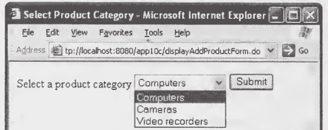

图 10.1：`app10c` 中的“添加产品”表单

如图 10.1 所示，“添加产品”表单包含包含三个选项的 `select` 元素。

点击提交按钮会将选中选项的值传递到 `saveProduct` action 对象，该类的定义在代码列表 10.4 中。

### 代码列表 10.4：`SaveProductAction` 类

```java
package app10c;

import app10c.form.ProductForm;
import app10c.to.ProductTO;

import javax.servlet.http.HttpRequest;
import javax.servlet.http.HttpServletResponse;

import org.apache.struts.action.Action;
import org.apache.struts.action.ActionForm;
import org.apache.struts.action.ActionForward;
import org.apache.struts.action.ActionMapping;

public class SaveProductAction extends Action {

    public ActionForward execute(
            ActionMapping mapping,
            ActionForm form,
            HttpServletRequest request,
            HttpServletResponse response) throws Exception {

        ProductForm productForm = (ProductForm) form;

        ProductTO product = new ProductTO();

        product.setCategoryId(productForm.getCategoryId());

        request.setAttribute("product", product);

        request.setAttribute(
                "categoryList",
                productForm.getCategoryList());

        return (mapping.findForward("success"));
    }
}
```

### `selectLabel` 标签

`SaveProductAction` 类的 `execute` 方法创建 `Product` 类的实例，并使用 `productForm` 对象 `getCategory` 方法返回的值设置其属性。

然后，它将 `Product` 对象设置为请求作用域对象，由 `product` 作用域变量引用。同时，将来自 `productForm` `getCategoryList` 方法的 `ArrayList` 作为当前 `HttpServletRequest` 对象的属性。现在，选中的值和标签/值选项列表都可以被任何 JSP 中的自定义标签访问。

最后，`execute` 方法将控制权转发到代码列表 10.5 提供的 `displaySavedProduct.jsp` 页面。

### 代码列表 10.5：`displaySavedProduct.jsp` 页面

```jsp
<% taglib uri="http://java.sun.com/jst/core" prefix="c" %>
<% taglib uri="http://www.brainysoftware.com/tags" prefix="b" %>

Product category:

<b:selectLabel scope="request" name="categoryId">
  <c:out value="${requestScope.product.categoryId}"/>
</b:selectLabel>
```

`displaySavedProduct.jsp` 页面使用 `displayLabel` 标签来显示选中选项的标签。选中的选项由 JSTL `out` 标签返回。`displayLabel` 标签的主体接收选中选项的值。`displayLabel` 标签获取选中选项的值，将其与集合（`categoryId`）进行匹配并打印匹配的标签。图 10.2 显示了在选择选项后你的浏览器可能的外观。

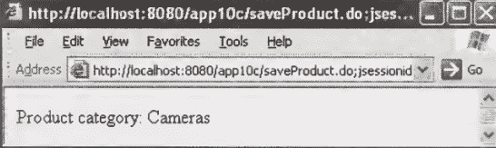

图 10.2：使用 `displayLabel` 显示选项的标签

## 总结

在本章中，你学习了 Struts-EL 和嵌套标签库，这是 Struts 自带的两个不重要的标签库。你还学习了如何使用来自 BrainySoftware.com 的免费 `selectLabel` 标签来显示选中选项值的标签。虽然你可能很少使用 Struts-EL 和嵌套标签库，但你可能会发现 `selectLabel` 标签更有用。

## 第 11 章：消息处理与国际化

消息处理是应用程序开发中的一项重要任务。例如，应用程序几乎总是能够显示易于理解的错误信息。此外，现在通常要求应用程序能够“说”多种语言。一种支持多种语言和数据格式而无需重写编程逻辑的技术被称为国际化（Internationalization）。

国际化缩写为 `i18n`，因为这个词以 *i* 开头，以 *n* 结尾，在第一个 *i* 和最后一个 *n* 之间有 18 个字符。此外，本地化（Localization）是将国际化应用程序适配以支持特定区域（locale）的技术。区域是指特定的地理、政治或文化区域。考虑区域的操作被称为*区域敏感的*（locale-sensitive）。

例如，显示日期是区域敏感的，因为日期必须符合用户所在国家或地区所使用的格式。2005 年 11 月 15 日在美国被写为 `11/15/2005`，但在澳大利亚被写为 `15/11/2005`。本地化缩写为 `l10n`，因为这个词以 *l* 开头，以 *n* 结尾，它们之间有 10 个字母。

通过国际化，你可以快速方便地更改应用程序中的视觉文本。Java 提供了对此功能的内置支持，使得应用程序无需重新编译即可更改语言。

Struts 利用了这一特性，并从一开始就被设计为支持国际化。例如，Struts Bean 标签库中的 `message` 标签能够选择正确语言的消息。然而，必须对其进行配置。

### 在 Struts 中处理区域

区域是指特定的地理、政治或文化区域。区域包含三个主要部分：语言、国家和变体。语言是最重要的部分；但有时语言本身是不够的。国家是有效的 ISO 国家代码，即 ISO 3166 规定的两个字母大写代码。变体是特定厂商的代码，例如用于 Windows 的 `WIN`，用于 Macintosh 的 `MAC` 以及用于 POSIX 的 `POSIX`。

国际化应用程序将其文本元素存储在每个区域的独立属性文件中。每个文件包含键值对，每个键值对唯一标识一个区域特定的对象。键总是字符串，而值可以是字符串或任何其他对象。例如，为了支持美国英语、德语和中文，你会有三个属性文件，它们具有相同的键。

这里是英语版本的属性文件。注意它有两个键：`greetings` 和 `farewell`：

```properties
greetings = Hello
farewell = Goodbye
```

德语版本如下：

```properties
greetings = Hallo
farewell = Tschuß
```

中文语言的属性文件如下：

```properties
greetings = 你好
farewell = 再见
```


# 第 11 章：消息处理与国际化

```properties
greetings=\u460d
farewell=\u89c1
```

## 将汉字（或其他语言的特殊字符）转换为 Unicode

以下内容适用于所有带有特殊字符的语言。这里以中文为例。

在中文中，最常见的问候是“你好”（分别由 Unicode 编码 `4660` 和 `597d` 表示），告别是“再见”（分别由 Unicode 编码 `518d` 和 `89c1` 表示）。当然，没有人能记住每个汉字的 Unicode 编码。因此，你通过两个步骤创建 `.properties` 文件：

1. 使用你喜欢的中文文本编辑器，创建一个如下文本文件：

   ```properties
   greetings=你好
   farewell=再见
   ```

2. 将文本文件的内容转换为 Unicode 表示。通常情况下，中文文本编辑器具有将汉字转换为 Unicode 编码的功能。你将得到这个结果：

   ```properties
   greetings=\u4f60\u597d
   farewell=\u518d\u89c1
   ```

这是你在 Java 应用中使用的 properties 文件的内容。

使用 Struts 和 JSTL，你不需要掌握比编写多种语言的 properties 文件更多的知识。然而，如果你感兴趣，你可能想了解 `java.util.ResourceBundle` 类，并学习它是如何选择和读取特定用户 locale（语言区域）的 properties 文件并查找值的。

你需要了解的是 properties 文件名的格式，即：

`basename_language_code_country_code`

例如，如果基名（basename）是 `MyResources`，你定义了三个 locale `US-en`、`DE-de`、`CN-zh`，你会有三个 properties 文件：

- `MyResources_en_US.properties`
- `MyResources_de_DE.properties`
- `MyResources_zh_CN.properties`

对于每个 HTTP 请求，浏览器浏览器根据用户的计算机设置发送用户的 locale。此信息以 `Accept-Language` 头部的形式发送，让服务器应用程序知道当前用户的 locale。Struts 读取此信息并将其存储在 `HttpSession` 对象中。如果你想让 Struts 忽略用户的 locale，请在 `struts-config.xml` 文件中将控制器（controller）标签的属性设置为 `false`。

```xml
<controller locale="false" />
```

现在，让我们来看 Struts 中的消息资源（message resources）。

## 注册 Properties 文件

现在你已经知道如何对应用程序进行国际化和本地化，现在你将学习 Struts 如何加载应用程序的 properties 文件。为了使其可用，你必须将 properties 文件放置在 `WEB-INF/classes` 或其子目录下，或者 `WEB-INF/lib` 中。

然后，你必须在 `struts-config.xml` 文件中使用 `message-resources` 标签注册每一个 properties 文件。每个 `message-resources` 代表所有 locale 下的一个 properties 文件。如果你有两个 properties 文件（一个用于通用区域，另一个用于应用程序中的仅成员区域），你需要两个 `message-resources` 标签。使用 `parameter` 属性来指定 properties 文件的名称。

例如，如果你在 `WEB-INF/classes` 目录下有一个 `ApplicationResources.properties` 文件，那么在 `struts-config.xml` 文件中会有如下 `message-resources` 元素：

```xml
<message-resources parameter="ApplicationResources"/>
```

你当然可以将 properties 文件放在 `WEB-INF/classes` 的子目录下，但这必须反映在 `message-resources` 标签的 `parameter` 属性中。例如，如果你将上述 `ApplicationResources.properties` 文件放在 `WEB-INF/classes/com` 下：

```xml
<message-resources parameter="com/ApplicationResources"/>
```

`message-resources` 标签必须位于 `action-mappings` 标签之后，但在任何 `plug-in` 标签之前。

`app1` 应用程序提供了如何在 Struts 和 JSTL 中使用国际化功能的示例。它支持两种语言：英语和德语。

## HTML 标签库的 errors 标签

你在之前的章节中已经看到过 `errors` 标签的作用。现在是时候仔细观察它了。

`errors` 标签用于显示错误消息，特别是由 action 表单 `validate` 方法产生的消息。理解它将使能够充分利用这个标签。

类似于自定义标签，`errors` 标签通过作用域对象（scoped objects）与 Struts action servlet 通信。这意味着，为了让 `errors` 标签显示错误消息，必须将其封装在作用域对象中。`errors` 设计用于查找由定义名称变量引用的请求范围对象，该变量必须与 `org.apache.struts.Globals` 类中的 `ERROR_KEY` 字段的值相同。该字段本身的值并不重要。为了支持 `errors` 标签，Struts action servlet 使用以下代码将 action 表单 `validate` 方法返回的 `ActionErrors` 存储在当前的 `HttpServletRequest` 对象中。

```java
ActionErrors actionErrors = actionForm.validate();

request.setAttribute(Globals.ERROR_KEY, actionErrors);
```

`errors` 标签对它获取的 `ActionErrors` 做了什么？首先注意 `errors` 标签可以访问你在 `struts-config.xml` 文件中使用 `message-resources` 标签注册的任何 properties 文件。注意，`ActionErrors` 对象可以访问零或多个 `ActionMessage` 对象。每个 `ActionMessage` 对象包含一个键（key）和零或多个值（values），你使用以下代码添加 `ActionMessage` 对象：

```java
actionErrors.add(key, new ActionMessage(value));
```

## HTML 的 messages 标签

`errors` 标签查找由定义名称变量引用的 `ActionErrors` 对象，该变量必须与 `org.apache.struts.Globals` 类中的 `ERROR_KEY` 字段的值相同。该字段本身的值并不重要。为了支持 `errors` 标签，Struts action servlet 使用以下代码将 action 表单 `validate` 方法返回的 `ActionErrors` 存储在当前的 `HttpServletRequest` 对象中。

```java
ActionErrors actionErrors = actionForm.validate();

request.setAttribute(Globals.ERROR_KEY, actionErrors);
```

`errors` 标签对它获取的 `ActionErrors` 做了什么？首先注意 `errors` 标签可以访问你在 `struts-config.xml` 文件中使用 `message-resources` 标签注册的任何 properties 文件。注意 `ActionErrors` 对象可以访问零或多个 `ActionMessage` 对象。每个 `ActionMessage` 对象包含一个键和零或多个值，你使用以下代码添加 `ActionMessage` 对象：

```java
actionErrors.add(key, new ActionMessage(value));
```

`errors` 标签查找由定义名称变量引用的 `ActionErrors` 对象，该变量必须与 `org.apache.struts.Globals` 类中的 `ERROR_KEY` 字段的值相同。该字段本身的值并不重要。但它并不显示消息。相反，它遍历集合，并为每次迭代创建一个引用所迭代的 `ActionError` 对象的作用域变量。为了实际显示错误消息，你可以在 `messages` 标签内部使用 Bean 标签库的 `write` 标签。

```html
<html:messages id="item">
  <li><bean:write name="item"/></li
</html:messages>
```

注意 `messages` 标签的 `id` 属性指定了引用迭代 `ActionError` 对象的作用域变量。与 `errors` 标签相比，`messages` 标签让你控制错误消息的格式，而无需依赖 properties 文件中的 `errors.header`、`errors.footer`、`errors.prefix` 和 `errors.suffix` 键。

例如，下面的 `messages` 标签显示当前 action 表单的验证错误。

```html
<html:messages id="item">
  <li><bean:write name="item"/></li
</html:messages>
```

## JSTL I18N 库

JSTL 提供了用于显示和格式化国际化消息的标签：`setLocale`、`bundle`、`setBundle`、`message`、`param` 和 `requestEncoding`。这些标签每一个将在下面的小节中解释。另见第 7 章关于 JSTL。

## setLocale

`setLocale` 标签用于为该标签 `scope` 属性指定的范围设置 locale。例如，如果范围是 `session`，指定的 locale 将适用于同一用户会话中的所有 JSP。如果没有使用 `setLocale` 显式指定 locale，将使用从用户请求中找到 locale。

使用 `setLocale` 的 locale 用于 `bundle` 和 `setBundle` 标签来选择 `ResourceBundle`。`setLocale` 通过将引用作用域变量 `javax.servlet.jsp.jst.fmt.locale` 的 Locale 对象存储在指定的范围内来持久化 locale。`bundle` 和 `setBundle` 查找相同名称的作用域变量以确定当前 locale。如果没有找到 `javax.servlet.jsp.jst.fmt.locale` 作用域变量，则使用用户的 locale。

## JSTL-I18N 库

```jsp
<fmt:setLocale value="locale"
  variant="{page|request|session|application}"
  scope="page">
```

`<fmt:setLocale>` 的属性见表 11.3。

| 属性 | 类型 | 描述 |
| --- | --- | --- |
| value | `java.lang.String` or `java.util.Locale` | 区域语言（locale）的字符串表示。如果使用 String，它必须是两个字母的 ISO 639 语言代码，可选跟随一个下划线和 ISO 3166 国家代码。 |
| variant | `String` | 特定厂商或浏览器的变体。 |
| scope | `String` | 区域语言配置变量的作用范围。 |

表 11.3：`setLocale` 标签的属性

例如，以下 `setLocale` 标签将当前会话的区域语言设置为英语（美国）：

```jsp
<fmt:setLocale value="en_US" scope="session">
```

## bundle

`bundle` 标签用于根据当前区域语言加载 `ResourceBundle`（资源包）。随后该 `ResourceBundle` 可以在此标签的体中使用。

`bundle` 标签具有以下语法：

```jsp
<fmt:bundle basename="basename" prefix="prefix">
  body content
</fmt:bundle>
```

`bundle` 标签的属性列于表 11.4。

| 属性 | 类型 | 描述 |
| --- | --- | --- |
| basename | `String` | ResourceBundle 的基本名称 |
| prefix | `String` | 添加到任何嵌套 message 标签的 message key 值前的前缀。 |

表 11.4：`bundle` 标签的属性

以下是 `bundle` 标签的示例，使用 `message` 标签作为其体内容：

```jsp
<fmt:bundle basename="AppResources">
  <fmt:message key="farewell"/>
</fmt:bundle>
```

## setBundle

`setBundle` 用于加载 `ResourceBundle`，与 `bundle` 类似。然而，`setBundle` 应用于该标签 `scope` 属性指定的作用范围内的所有 JSP。`message` 标签不需要存在于其体内容即可使用其加载的 `ResourceBundle`。

以下是 `setBundle` 标签的语法：

```jsp
<fmt:setBundle basename="basename"
  var="varName"
  scope="page|request|session|application">
```

`setBundle` 的属性列于表 11.5。

| 属性 | 类型 | 描述 |
| --- | --- | --- |
| basename | `String` | ResourceBundle 的基本名称 |
| var | `String` | 作用域变量的名称，可以在 message 标签中引用以使用该标签加载的 ResourceBundle |
| scope | `String` | var 的作用范围 |

表 11.5：`setBundle` 标签的属性

这里是使用 `setBundle` 的示例：

```jsp
<fmt:setBundle basename="AppResources"/>
<fmt:message key="welcome"/>
```

## message

`message` 标签用于从指定的或当前的 `ResourceBundle` 中读取消息并显示该消息。其语法有三种形式。

第一种形式不带体内容使用：

```jsp
<fmt:message key="messageKey"
  bundle="resourceBundle"
  var="varName"
  scope="page|request|session|application">
```

第二种形式带有体使用以指定消息参数：

```jsp
<fmt:message key="messageKey"
  bundle="resourceBundle"
  var="varName"
  scope="page|request|session|application">
  <fmt:param> subtags
</fmt:message>
```

第三种形式带有体使用以指定 key 和可选的消息参数：

```jsp
<fmt:message bundle="resourceBundle"
  var="varName"
  scope="page|request|session|application">
  key
  optional <fmt:param> subtags
</fmt:message>
```

属性列表见表 11.6。

| 属性 | 类型 | 描述 |
| --- | --- | --- |
| key | `String` | ResourceBundle 中消息的键 |
| bundle | `LocalizationContext` | 作用域变量的名称，可以在 message 标签中引用以使用此标签加载的 ResourceBundle。 |
| var | `String` | 用于存储获取的本地化消息的作用域变量名称 |
| scope | `String` | var 的作用范围。 |

表 11.6：`message` 标签的属性

以下是 `message` 标签的示例：

```jsp
<fmt:setBundle basename="AppResources"/>
<fmt:message key="welcome"/>
```

## param

`param` 标签用于将参数传递给外围的 `message` 标签。其语法有两种形式。第一种形式通过 `value` 属性指定值：

```jsp
<fmt:param value="messageParameter"/>
```

第二种形式通过体内容指定值：

```jsp
<fmt:param>
  body content
</fmt:param>
```

`value` 属性是用于替换本地化消息中某部分的参数。它可以被赋予 `java.lang.Object` 类型的动态值。

例如，这里是一个 `param` 标签：

```jsp
<fmt:message key="welcome">
  <fmt:param value="time"/>
</fmt:message>
```


## requestEncoding

此标签用于设置当前 `HttpServletRequest` 对象的编码。其语法如下：

```jsp
<fmt:requestEncoding value="charsetName"/>
```

`value` 属性是解码时要应用的字符编码名称。

## 总结

消息处理是开发中最重要的任务之一。现在的应用程序通常要求应用显示国际化消息。Struts 在设计时考虑了这一点，JSTL 支持国际化。

# 第 12 章：Tiles 框架

## 注意

Tiles 框架通过 Tiles 库中的一系列标签提供服务。组成 Tiles 的类已包含在 `struts.jar` 文件中，因此不需要向 `WEB-INF/lib` 目录拷贝 JAR 文件。为了间接引用 Tiles 库标签，你需要在 `WEB-INF` 目录中拥有 `struts-tiles.tld` 文件，并在 `web.xml` 中包含以下 `taglib`：

```xml
<taglib>
  <taglib-uri>/WEB-INF/struts-tiles.tld</taglib-uri>
  <taglib-location>/WEB-INF/struts-tiles.tld</taglib-location>
</taglib>
```

# JSP 包含的问题

图 12.1 显示了一个包含页头、页脚、菜单、广告部分和体内容的页面布局。除了体内容外，所有部分对所有 JSP 都是通用的。头部来自 `header.jsp`，页脚来自 `footer.jsp`，菜单来自 `menu.jsp`，广告部分来自 `ad.jsp`。

| Header |  |  |
|---|---|---|
| Menu | Body Content | Ad |
| Footer |  |  |

图 12.1：典型的 Web 页面布局

为了实现一致的外观，你的每个 JSP 将包含如下的布局表。Tiles 克服了这些缺陷并增加了更多功能，让你能够更轻松地布局页面。首先，Tiles 允许你创建一个定义所有 JSP 布局的布局 JSP。这意味着布局变化时只需要编辑一个页面。除了布局 JSP 外，Tiles 还允许你编写定义页面，它比前者更强大。

本章通过四个逐步介绍 Tiles 功能的示例应用程序，教你如何充分利用 Tiles。随后，将给出 Tiles 库中标签的完整列表。

```html
<html>
<head>
  <title>页面标题</title>
</head>
<body>
<table>
  <tr>
    <td colspan="3"><%include file="header.jsp" %></td>
  </tr>
  <tr>
    <td width="120"><%include file="menu.jsp" %></td>
    <td>
      正文内容 (body content)
    </td>
  </tr>
  <tr>
    <td width="120"><%include file="ad.jsp" %></td>
  </tr>
  <tr>
    <td colspan="3"><%include file="footer.jsp" %></td>
  </tr>
</table>
</body>
</head>
```

通过这种方法，不同 JSP 之间的区别在于正文内容（body content）。

现在，如果你想更改布局怎么办？例如，如果你想让菜单加宽 30 像素呢？或者，如果你想让广告出现在菜单上方呢？这将修改你所有的 JSP，这无疑是一项枯燥且容易出错的任务。Tiles 可以帮助解决这个问题。

## Tiles 的初体验

本节介绍了 `app12a` 应用，该应用说明了 Tiles 如何解决 JSP 包含在定义页面布局时出现的问题。你不需要在每个 JSP 中硬编码布局，而是使用 Tiles，你编写一个定义布局的 JSP。任何需要使用该布局的页面只需要引用该布局 JSP。如果你需要更改布局，只需要更改一个文件：布局 JSP。

## 264 第 12 章：Tiles 框架

`app12a` 应用有两个动作：`displayAddProductForm` 和 `saveProduct`。该应用中的所有 JSP 都使用一个 Tiles 布局 JSP，即 `myLayout.jsp` 页面，该页面如列表 12.1 所示。

### 12.1：`myLayout.jsp` Tiles 定义页面

```jsp
<@ taglib uri="/WEB-INF/struts-tiles.tld" prefix="tiles">

<html>
<head>
  <title><tiles:getAsString name="pageTitle"></title>
</head>
<body topmargin="0" leftmargin="0">
<table>
  <tr>
    <td><tiles:insert attribute="header"/></</td>
  </tr>
  <tr>
    <td><tiles:insert attribute="body"/></</td>
  </tr>
  <tr>
    <td><tiles:insert attribute="footer"/></</td>
  </tr>
</table>
</body>
</html>
```

这里使用了两个 Tiles 标签库标签：`insert` 和 `getAsString`。`insert` 标签定义了一个插入点，外部资源将插入其中。`attribute` 属性指定了将被插入的资源的逻辑名称。

`getAsString` 标签指定了一个变量，其值将由引用布局 JSP 的 JSP 指定。

## 注意

根据所使用的属性，`insert` 标签可以用于布局 JSP 中，也可以用在引用布局 JSP 的 JSP 中。

任何需要使用由 `myLayout.jsp` 页面指定的布局的 JSP 都需要引用后者。例如，`displayAddProductForm.jsp` 页面（列表 12.2）使用带有 `page` 属性的 `insert` 标签来引用 `myLayout.jsp` 页面。

### 列表 12.2：`displayAddProductForm.jsp`

```jsp
<%@ taglib uri="/WEB-INF/struts-tiles.tld" prefix="tiles" %>

<tiles:insert page="/jsp/myLayout.jsp" flush="true">
  <tiles:put name="footer" value="jsp/footer.jsp" />
  <tiles:put name="header" value="/jsp/header.jsp" />
  <tiles:put name="body" value="/jsp/displayAddProductForm-body.jsp" />
  <tiles:put name="pageTitle" value="Add Product" />
</tiles:insert>
```

配合 `page` 属性使用，`insert` 标签告诉 Struts 使用其 `page` 属性指定的布局页面。`insert` 标签内部嵌套了四个 `put` 标签。每个 `put` 标签指定定义页面中的一个逻辑名称或变量。第一个 `put` 标签指定布局 JSP 中的 `footer` 必须被 `/jsp/footer.jsp` 页面的内容替换。最后一个 `put` 标签的 `name` 属性被赋值为 `pageTitle`，它传递的不是路径而是字符串字面量。目的是告诉布局 JSP 中相同名称（pageTitle）的 `getAttr` 标签必须被 `put` 标签 `value` 属性的内容替换。

列表 12.2 中的 `put` 标签可以任意任意顺序，因为布局是由布局页面定义的。`displayAddProductForm-body.jsp` 页面是该页面的正文，如列表 12.3 所示。

### 列表 12.3：`displayAddProductForm.jsp`

```jsp
<%@ taglib uri="/WEB-INF/struts-html.tld" prefix="html" %>

<html>
<html:form action="/saveProduct">
  <table>
    <tr>
      <td>产品名称：</td>
      <td><html:text property="productName"/></td>
      <td><html:submit>提交</html:submit></td>
    </tr>
  </table>
</html:form>
```

可以通过调用以下 URL 运行 `app12a` 应用：

`http://localhost:8080/app12a/displayAddProductForm`

使用布局 JSP 的优势是可以通过更改布局页面来更改所有 JSP 的布局。`displayAddProductForm-body.jsp` 是页面的正文。

## 266 第 12 章：Tiles 框架

## 注意

在 Tiles 术语中，包含的文件被称为 tile（瓷砖）。tile 可以递归包含其他 tiles。

## 使用 JSP 定义文件

`app12a` 应用中的 JSP 必须传递四个值：`pageTitle`、`header`、`body` 和 `footer`。你可以看到，所有 JSP 的 `header` 和 `footer` 值是相同的。

定义页面是布局页面和所有 JSP 之间的中间层。使用定义页面的好处是可以通过更新单个布局 JSP 来更改应用程序中所有 JSP 的布局。这是一个非常实用的功能，但还有更多内容，请见后续章节。

## 267 比较 Java 继承与定义

### 列表 12.5：`app1b` 中的 `displayAddProductForm.jsp`

```jsp
<taglib uri="/WEB-INF/struts-tiles.tld" prefix="tiles">

  <%@ include file="jsp/myDefinition.jsp" %>

  <tiles:insert beanName="default" beanScope="request">
    <tiles:put name="pageTitle" value="Add Product"/>
    <tiles:put name="body" value="/jsp/displayAddProductForm-body.jsp" />
  </tiles:insert>

</taglib>
```

现在，你只需要在 JSP 中使用 `put` 标签（`pageTitle` 和 `body`）。另外两个（`header` 和 `footer`）已经在 `myDefinition.jsp` 页面中定义了。

## 使用 XML 定义

定义文件可以采用 XML 文档的形式，这比 JSP 定义更强大。在之前的应用程序（`app12a` 和 `app12b`）中，每个 JSP 都定义了一个布局或定义页面。每个 JSP 关联一个 `-body.jsp` 页面来定义 JSP 的内容。例如，`app12a` 和 `app12b` 中的 `displayAddProductForm.jsp` 页面都关联了 `displayAddProductForm-body.jsp` 页面。使用 XML 类型定义，将不需要 `-body.jsp` 页面。相反，布局将包含在定义页面中，每个 JSP 将包含正文内容。

```xml
<plug-in className="org.apache.struts.tiles.TilesPlugin">
  <set-property property="definitions-config"
                value="WEB-INF/tiles-defs.xml"/>
</plug-in>
```

此插槽元素告诉 Tiles，Tiles 定义文件的名为 `tiles-defs.xml`，它可以在 `WEB-INF` 目录下找到。

要使用该定义，你必须修改 `struts-config.xml`。在你的 action 中，你不再将控制权跳转到 JSP，而是跳转到 Tiles XML 定义文件中的变量。在 `struts-config.xml` 文件中列出 `action-mappings` 元素。

### 列表 12.6：`struts-config.xml` 文件中的 `action-mappings` 元素

```xml
<action-mappings>
  <action path="/displayProductForm"
          forward="display.add.product.form"/>
  <action path="/saveProduct"
          name="productForm"
          forward="display.message"/>
</action-mappings>
```

在上面的 action 中，第一个 action 将控制跳转到 `display.add.product.form`，第二个跳转到 `display.message`。`display.add.product.form` 和 `display.message` 是列表 12.7 中 `tiles-defs.xml` XML 定义文件的变量。

### 列表 12.7：`tiles-defs.xml` 文件

```xml
<?xml version="1.0" encoding="iso-8859-1"?>

<!DOCTYPE tiles-definitions PUBLIC
  "//Apache Software Foundation//DTD Tiles Configuration 1.1//EN"
  "//http://struts.apache.org/dtd/tiles-config_1_1.dtd">

<tiles-definitions>
  <definition name="display.add.product.form"
              path="/jsp/myLayout.jsp">
    <put name="pageTitle" value="Add Product" />
    <put name="header" value="/jsp/header.jsp" />
    <put name="body" value="/jsp/displayProductForm.jsp" />
    <put name="footer" value="/jsp/footer.jsp" />
  </definition>

  <definition name="display.message" path="/jsp/myLayout.jsp">
    <put name="pageTitle" value="Confirmation" />
    <put name="header" value="/jsp/header.jsp" />
    <put name="body" value="/jsp/displayMessage.jsp" />
    <put name="footer" value="/jsp/footer.jsp" />
  </definition>
</tiles-definitions>
```

XML 定义可以做到 JSP 定义能做的一切。然而，由于 XML 定义是写在 XML 文件中的，你不能使用 Tiles 标签库中的标签。相反，XML 定义 XML 文档由名为 `tiles-config_1_1.dtd` 的文档类型定义（DTD）管理。你将在本章节后后的“编写 XML 定义”部分学习更多相关信息。

如前所述，使用 XML 定义的好处是再不再有 `-body.jsp` 页面。相反，你的 `displayAddProductForm.jsp` 包含了 JSP 的主体。列表 12.8 展示了 `displayAddProductForm.jsp` 页面。

# 列表 12.8：`app12c` 中的 `displayAddProductForm.jsp`

```jsp
<@ taglib uri="WEB-INF/struts-html.tld" prefix="html">

<html:form action="saveProduct">
  <<table>
    <tr>
      <td>Product Name:</td>
      <td><html:text property="productName"/></td>
      <td><html:submit>Add</html:submit></td>
    </tr>
  </</table>
</html:form>
```

在 `app12a` 和 `app12b` 中，列表 12.8 中的页面内容原本是 `displayAddProductForm-body.jsp` 的内容。使用 XML 定义的优势在于文件更少。

你可以通过调用以下 URL 运行应用程序：

`http://localhost:8080/app12c/displayAddProductForm.do`

## 注意

当使用 Tiles 定义时，action 元素的 `forward` 和 `input` 属性的值可以是定义文件中的变量名。你从 action 对象中引用的 `forward` 元素的 `path` 属性值也是如此。

# XML 定义的继承

“编写 Tiles XML 定义”部分解释了如何编写 XML 定义文件。

JSP 和 XML 定义都支持继承。本节讨论了 XML 定义中的继承，因为 XML 定义将是 Struts 应用中主要的定义类型。通过继承，一个定义元素可以通过 `extends` 属性扩展另一个定义元素。

在 `app12c` 的 XML 定义中，有两个定义元素，具有几乎完全相同的 `put` 子元素列表（参见列表 12.7）。

```xml
<definition name="display.add.product.form"
            path="/jsp/myLayout.jsp">
  <put name="pageTitle" value="Add Product" />
```


<put name="header" value="/jsp/header.jsp" />

<put name="body" value="/jsp/displayAddProductForm.jsp" />

<put name="footer" value="/jsp/footer.jsp" />

</definition>

```
<definition name="display.message" path="/jsp/myLayout.jsp">
<put name="pageTitle" value="Confirmation" />
<put name="header" value="/jsp/header.jsp" />
<put name="body" value="/jsp/displayMessage.jsp" />
<put name="footer" value="/jsp/footer.jsp" />
</definition>
```

如你所示，两个定义元素中的四个`put`元素是相同的。为了避免重复，你可以创建一个包含公共元素的基定义，并让第二个和第三个定义元素扩展它。由于继承的使用，`app12c`中的XML定义可以被列表12.9替换。

## 列表12.9：带有继承的XML定义

```xml
<?xml version="1.0" encoding="iso-8859-1"?>
<!DOCTYPE tiles-definitions PUBLIC
"//Apache Software Foundation//DTD Tiles Configuration 1.1//EN"
"//http://struts.apache.org/dtd/tiles-config_1_1.dtd">
<tiles-definitions>
  <definition name="myLayout" path="/jsp/myLayout.jsp">
    <put name="header" value="/jsp/header.jsp" />
    <put name="footer" value="/jsp/footer.jsp" />
  </definition>
  <definition name="display.add.product.form" extends="myLayout">
    <put name="pageTitle" value="Add Product" />
    <put name="body" value="/jsp/displayAddProductForm.jsp" />
  </definition>
  <definition name="display.message" extends="myLayout">
    <put name="pageTitle" value="Confirmation" />
    <put name="body" value="/jsp/displayMessage.jsp" />
  </definition>
</tiles-definitions>
```

## 第12章：Tiles框架

Tiles标签库提供了在JSP中使用的标签。在讨论这些标签之前，你需要了解关于Tiles工作原理的知识：Tiles使用一个类似于`PageContext`的对象来存储Tiles属性值（称为Tiles属性）。该对象的类型为`org.apache.struts.tiles.ComponentContext`，并存储为请求范围对象。或者，你可以使用以下Java代码访问`ComponentContext`：

```java
ComponentContext compContext = (ComponentContext)
request.getAttribute("org.apache.struts.tiles.ComponentContext");
```

你可以通过调用`ComponentContext`的`getAttribute`方法获取Tiles属性，并使用其`getAttributeNames`方法获取属性名称迭代器。

列表12.1列出了Tiles标签库中的所有标签。

| 标签 | 描述 |
|---|---|
| `add` | 向使用`putList`标签创建的列表添加元素。定义一行并将其存储为作用域对象。类似于`useAttribute`，`importAttribute`创建引用Tiles上文中属性的作用域变量。 |
| `importAttribute` | 在Tiles尚未集成到Struts时初始化Tiles组件。 |
| `insert` | 作为作用域对象插入Tiles定义或属性。已弃，请改用`insert`。 |
| `get` | 在当前JSP中显示Tiles属性的值。 |
| `put` | 创建Tiles属性。 |
| `putList` | 创建类型为`java.util.List`的Tiles属性。 |
| `useAttribute` | 类似于`importAttribute`，`useAttribute`创建引用Tiles上文中属性的作用域变量。 |

列表12.1：Tiles标签库的标签

## `add`标签

`add`标签向使用`putList`标签创建的列表添加元素。你可以使用`value`属性指定要添加的值，或者在主体内容中指定它。

```xml
<tiles:putList name="menu">
<tiles:add value="item1"/>
<tiles:add value="item1"/>
<tiles:add value="item1"/>
</tiles:putList>
```

等于

```xml
<tiles:putList name="menu">
<tiles:add>item1</tiles:add>
<tiles:add>item2</tiles:add>
<tiles:add>item3</tiles:add>
</tiles:putList>
```

`add`标签的属性列表见表12.2。

| 属性 | 描述 |
| --- | --- |
| `value` | `String`或`Object`类型的元素值。 |
| `content` | `String`或`Object`类型的元素值，类似于为了与JSP定义兼容性而添加的`content`属性。 |
| `direct` | 值为`true`直接打印内容。值为`false`表示包含该内容。 |
| `type` | 指定内容类型。可能的值有：- `string`。直接打印内容。- `page`或`template`。从指定的URL包含内容。- `definition`。该值表示在工厂（xml文件）中定义的定义。将在插入的tile中的`<insert attribute="attributeName">`标签中查找定义，其中`attributeName`是该标签使用的名称。如果不存在`type`，则内容将是无类型的。 |
| `beanName` | 使用作用域对象的名称作为值。 |
| `beanProperty` | 由`beanName`属性指定的作用域对象的属性。如果存在，则从`beanProperty`属性中获取值。 |
| `beanScope` | 由`beanName`属性指定的作用域对象的范围。 |
| `role` | 指定一个角色。如果用户处于指定的角色，则考虑`add`标签；否则忽略该标签。 |

## Tiles标签库的标签

## `definition`标签

`definition`标签用于定义一个tile并将其存储为作用域对象。然后你可以使用`insert`标签将tile插入到JSP中。示例请应用程序`app12a`到`app12d`。

`definition`标签的属性列表见表12.3。

| 名称 | 描述 |
|---|---|
| `id` | 必选属性，用于指定引用新创建的对象的变量。 |
| `scope` | 指定新创建的作用域对象的范围。 |
| `template` | 表示表示tile/组件/模板（JSP页面）URI的字符串。 |
| `page` | 要插入的模板/组件的URI。与`template`属性相同。 |
| `role` | 指定当前用户为了执行此标签而必须所属的角色。 |
| `extends` | 用于初始化此新定义的父级定义。 |

表12.3：`definition`标签的属性

## `getAsString`标签

此标签在当前JSP中显示指定的Tiles属性的值。示例请参应用程序`app12a`到`app12d`。

`getAsString`的属性列表见代码段12.4。

| 属性 | 描述 |
|---|---|
| `name` | 必选属性，用于指定属性的名称。 |
| `ignore` | 值为`true`表示如果找不到`name`属性指定的属性，则不会抛出异常。 |
| `role` | 指定当前用户为了执行此标签而必须所属的角色。 |

表12.4：`getAsString`标签的属性

## `importAttribute`标签

你使用此标签创建作用域变量，引用`ComponentContext`对象中所有的Tiles属性。创建的作用域变量的名称与Tiles属性的名称相同。如果不存在`name`属性，`importAttribute`标签将为所有Tiles属性创建页面作用域变量。例如：

```xml
<tiles:importAttribute/>
```

或者，你可以指定属性名称，Tiles将仅为指定名称的属性创建作用域变量。例如，下面的`importAttribute`标签创建了一个名为`header`的页面作用域变量，它引用Tiles属性名`header`。

```xml
<tiles:importAttribute name="header"/>
```

如果你希望将作用域变量存储在另一个作用域，可以使用`scope`属性。例如，下面的`importAttribute`标签创建了一个名为`request`的请求作用域变量。

```xml
<tiles:importAttribute name="request"/>
```

`importAttribute`的属性列表见代码段12.5。

| 属性 | 描述 |
| --- | --- |
| `name` | 必须导入Tiles属性。缺少此名称将导入所有属性。 |
| `scope` | 属性导入的作用域。默认是`page`。 |
| `ignore` | 值为`true`表示如果由`name`指定的属性不存在，则不会抛出异常。 |

表12.5：`importAttribute`标签的属性

## `insert`标签

`insert`标签将Tiles定义或Tiles属性插入JSP中。如果`page`属性存在并分配给布局JSP，`insert`标签将同时创建并插入定义。你可以在应用程序`app12a`到`app12d`中看到此标签的示例。

`insert`的属性列表见代码段12.6。

| 属性 | 描述 |
|---|---|
| `template` | 表示tile或模板（JSP页面）URI的字符串。 |
| `component` | 要插入的组件的URI。 |
| `page` | 要插入的模板/组件的URI。 |
| `definition` | 定义的名称。 |
| `name` | 属性的名称。 |
| `beanName` | 作为值的作用域对象的名称。 |
| `beanProperty` | 由`beanName`属性指定的作用域对象的属性。 |
| `beanScope` | 由`beanName`属性指定的作用域对象的范围。 |
| `flush` | 值为`true`表示直接打印内容。 |
| `ignore` | 值为`true`表示如果找不到`name`指定属性，则不会抛出异常。 |
| `role` | 指定当前用户为了执行此标签而必须所属的角色。 |
| `controllerUrl` | 控制器的URL。 |
| `controllerClass` | 由`controllerUrl`属性指定的控制器类。 |

表12.6：`insert`标签的属性

## `put`标签

`put`标签在`ComponentContext`中创建一个属性。你可以使用`value`属性或在正体中指定属性值。例如，

```xml
<tiles:put name="header" value="header.jsp"/>
```

等于`<tiles:put name="header">header.jsp</tiles:put>`。

`put`的属性列表见代码段12.7。

| 属性 | 描述 |
| --- | --- |
| `name` | 属性的名称。 |
| `value` | `String`或`Object`类型的值。 |
| `content` | 将放入Tiles作用域的内容。 |
| `direct` | 值为`true`表示直接打印内容。值为`false`表示内容为页面。 |
| `type` | 指定以下内容类型：
- `string`。直接打印内容。
- `page`或`content`。从指定的URL包含内容。
- `definition`。该值为工厂中定义的名称。 |
| `beanName` | 获取值的作用域对象。 |
| `beanProperty` | 由`beanName`属性指定的作用域对象的属性，返回要获取的值。 |
| `beanScope` | 由`beanName`属性定义的对象范围。 |
| `role` | 用户为了执行此标签而必须所属的角色。 |

表12.7：`put`标签的属性

## `putList`标签

`putList`标签创建一个`java.util.List`类型的Tiles属性。你通过`add`标签向其添加元素。示例所示：

```xml
<tiles:putList name="menu">
<tiles:add>item1</tiles:add>
<tiles:add>item2</tiles:add>
<tiles:add>item3</tiles:add>
</tiles:putList>
```

`putList`标签的属性见代码段12.8。

| 属性 | 描述 |
| --- | --- |
| `name` | 列表的名称。这是一个必选属性。 |

表12.8：`putList`标签的属性

## `useAttribute`标签

`useAttribute`标签用于创建引用Tiles属性的作用域变量，类似于`importAttribute`标签。但是，使用`useAttribute`你可以使用`id`属性来选择创建的作用域变量的名称，而使用`importAttribute`则无法做到这一点。然而，使用`useAttribute`时，你无法同时导入多个属性。

例如，下面的`useAttribute`标签创建了一个名为`menu`的请求作用域变量，它引用了Tiles属性`menuItem`。

```xml
<tiles:useAttribute id="menu" name="menuList" scope="request"/>
```

`useAttribute`的属性列表见表12.9。

| 属性 | 描述 |
| --- | --- |
| `id` | 引用新创建属性的作用域变量的名称。 |
| `classname` | 声明变量的类。 |
| `scope` | 创建的作用域类型。 |
| `name` | 必选属性，用于指定Tile属性的名称。 |
| `ignore` | 值为`true`表示如果`name`属性指定的对象不存在，则不会抛出异常。 |

表12.9：`useAttribute`标签的属性

## 编写Tiles XML定义

本节讨论了所有XML定义文件必须遵守的规则。

根据`struts.jar`文件中的`tiles-config_1_1.dtd`文件，XML定义文件必须有一个根元素`tiles-definition`，其定义如下：

```xml
<ELEMENT tiles-definitions (definition+)>
<ELEMENT definition (icon?, display-name?, description?, put, putList*)>
<ELEMENT put (#PCDATA)>
<ELEMENT putList ( add* | item* | bean* | putList*) >
<ELEMENT add (#PCDATA)>
<ELEMENT bean (set-property*)>
<ELEMENT item (#PCDATA)>
<ELEMENT set-property EMPTY >
```


`tiles-definition` 元素可以有一个或多个 `definition` 元素。`definition` 元素嵌套了一个可选的 `icon` 元素、一个可选的 `display-name` 元素、一个可选的 `description` 元素、零或多个 `put` 元素以及零或多个 `putList` 元素。

同样，`putList` 元素可以嵌套任意数量 `add`、`item`、`bean` 以及其他的 `putList` 元素。

接下来的章节将讨论每一个元素。

## tiles-definitions 元素

`tiles-definitions` 元素每个 XML 定义的根元素。它有一个或多个 `definition` 元素。该元素没有任何属性。

## definition 元素

`definition` 元素表示可以插入到 JSP 中的定义。定义通过一个逻辑名称来标识，用于定义可以在 `insert` 标签中设置的属性。`definition` 元素的属性列表见表 12.10。

| 属性 | 描述 |
|---|---|
| `controllerClass` | 在资源插入之前将要调用的控制器子类类型。如果指定了此属性，则不能存在 `controllerUrl`。 |
| `controllerUrl` | 用作控制器的资源上下文相对路径，将在资源插入之前立即被调用。如果指定了 `controllerClass` 属性，则不能存在此属性。 |
| `extends` | 指定一个将成为当前定义父类的定义。父定义中的所有属性对该定义都可用，并可以被重写。 |
| `name` | 该定义的唯一标识符。 |
| `page` | 与 `path` 属性相同。 |
| `path` | 要插入的资源的上下文相对路径。 |
| `role` | 指定当前用户必须所属的安全角色，才能执行此标签。 |
| `template` | 与 `path` 相同。 |

表 12.10：`definition` 元素的属性

## 编写 Tiles XML 定义

## put 元素

你使用 `put` 元素为属性赋值。该值可以在 XML 属性中指定，也可以在标签体中指定。`put` 的属性列表见表 12.11。

| 属性 | 描述 |
| --- | --- |
| `content` | 与 `value` 属性相同。 |
| `direct` | 与 `type="string"` 相同。 |
| `name` | 该 `put` 元素的唯一标识符。 |
| `type` | 值的类型，可以是 `string`、`page`、`template` 或 `definition`。 |
| `value` | 要赋给属性的值。 |

表 12.11：`put` 元素的属性

## putList 元素

`putList` 元素用于为一组属性赋值。这些值必须包含在 `java.util.List` 对象中，并在 Tiles 配置文件中通过 `add`、`item` 或 `putList` 元素进行定义。`putList` 的属性见表 12.12。

| 属性 | 描述 |
| --- | --- |
| `name` | 该 `putList` 元素的唯一标识符。 |

表 12.12：`putList` 元素的属性

## add 元素

`add` 元素描述列表中的一个元素。它与 `put` 类似。表 12.13 列出了 `add` 元素的所有属性。

| 属性 | 描述 |
| --- | --- |
| `content` | 与 `value` 属性相同。 |
| `direct` | 与向 `type` 属性赋值字符串相同。 |
| `type` | 值的类型。此属性的可能值为 `string`、`page`、`template` 或 `definition`。 |
| `value` | 要添加的值。 |

表 12.13：`add` 元素的属性

## bean 元素

`bean` 元素用于创建一个 JavaBean，将其添加到 List 中，并创建一个引用该 JavaBean 的变量。`bean` 的属性列表见表 12.14。

| 属性 | 描述 |
|---|---|
| `id` | 定义的唯一标识符。 |
| `classname` | JavaBean 的类型。 |

表 12.14：`bean` 元素的属性

## item 元素

`item` 元素描述列表中的一个元素。它与 `put` 类似。表 12.15 列出了 `item` 元素的所有属性。

| 属性 | 描述 |
| --- | --- |
| `content` | 与 `value` 属性相同。 |
| `direct` | 与 `type="string"` 相同。 |
| `type` | 值的类型。此属性的可能值为 `string`、`page`、`template` 或 `definition`。 |
| `value` | 要添加的值。 |

表 12.15：`item` 元素的属性

## set-property 元素

你使用 `set-property` 元素为 JavaBean 的属性赋值。`set-property` 的属性见表 12.16。

| 属性 | 描述 |
|---|---|
| `property` | 要设置的属性。 |
| `value` | 设置属性的值。 |

表 12.16：`set-property` 元素的属性

## 总结

Tiles 帮助开发者在整个应用程序中创建一致的外观。Tiles（比 JSP 优得多）允许你编写布局和定义页面。定义页面中的元素或标签是可以扩展的。

## 第13 章：保护 Struts 应用

安全是 Web 应用开发中最关键的问题之一。对于 Servlet 应用，有两种保护应用程序资源的方法：通过配置应用程序和编写 Java 代码。后者更受欢迎，因为它具有灵活性。通过编辑部署描述（`web.xml` 文件），你可以更改安全策略而无需重写代码。例如，你可以限制某些角色和 HTTP 方法，确定用户如何验证身份等。由于 Struts 基于 Servlet 技术，保护 Struts 应用将集中在这些配置上，以及 Struts 本身的安全特性。

要做好安全配置，你需要熟悉主体（principal）和角色（role）的概念，因此本章从讨论这两个概念开始。随后，章节将解释如何编写安全策略并处理身份验证方法。在关于如何隐藏资源的章节以及 Struts 特有安全功能的章节之后，本章将介绍第二种保护 Servlet 应用的方法：通过编写 Java 代码。

## 286 第 13 章：保护 Struts

在 Tomcat 中，你通过编辑部署目录下 `conf` 目录中的 `tomcat-users.xml` 文件来实现。例如，这里有一个 `tomcat-users.xml` 文件的示例。

```xml
<tomcat-users>
<role rolename="manager"/>
<role rolename="admin"/>
<user username="vera" password="arev" roles="manager"/>
<user username="chuck" password="chuck" roles="admin"/>
<user username="dave" password="secret" roles="manager, admin"/>
</tomcat-users>
```

该文件表示有两个角色（`admin` 和 `manager`）和三个用户（`vera`、`chuck` 和 `dave`）。你可以向 `tomcat-users.xml` 文件中添加任意数量的角色和用户。

## 编写安全策略

编写安全策略涉及以下任务：

- 保护资源
- 确定用户身份验证的登录方法。

这些任务将在接下来的子节中讨论。

## 保护资源

你通过使用部署描述（`web.xml` 文件）中的 `security-constraint` 元素来执行安全策略。以下是该元素的描述。

```xml
<!ELEMENT security-constraint (display-name,
web-resource-collection+, auth-constraint?,
user-data-constraint?)>
```

这意味着 `security-constraint` 元素可以有一个可选的 `display-name` 子元素、一个或多个 `web-resource-collection` 元素、一个可选的 `auth-constraint` 子元素以及一个可选的 `user-data-constraint` 子元素。

## 编写安全策略 287

你在 `web-resource-collection` 元素中指定想要保护的 Web 资源集，并使用 `auth-constraint` 元素定义允许访问这些资源的用户角色。子元素将在下文进一步描述。

你使用 `web-resource-collection` 元素通过指定这些资源的 URL 模式来规定哪些资源必须受到保护。此外，你还可以指定哪些 HTTP 方法（`GET`、`POST` 等）允许访问受保护的资源。`web-resource-collection` 元素可以包含以下子元素：

- `web-resource-name`。资源标识符。该元素是必须的。
- `description`。资源的描述。该元素是可选的。
- `url-pattern`。指定必须应用限制的 URL 模式。一个 `web-resource-collection` 元素中可以零或多个 `url-pattern` 元素。例如，如果你想保护 `members` 和 `trading` 目录中的资源，你需要两个 `url-pattern` 元素。
- `http-method`。指定受限制的方法。例如，如果 `http-method` 元素的值为 `GET`，那么所有的 GET 请求将被限制。

`auth-constraint` 元素可以包含以下子元素：

- `description`。描述。这是一个可选元素。
- `role-name`。允许访问受限资源的用户角色。`auth-constraint` 元素中可以有零到多个 `role-name` 元素。

`user-data-constraint` 元素可以包含以下元素：

- `description`。描述。这是一个可选的子元素。
- `transport-guarantee`。可能值为 `NONE`、`INTEGRAL`、`CONFIDENTIAL`。`NONE` 表示应用程序不需要任何传输保证。`INTEGRAL` 表示数据必须以某种方式传输，使其在传输过程中不被更改。`CONFIDENTIAL` 表示传输的数据必须加密。

以下是 `security-constraint` 元素的示例。

```xml
<security-constraint>
<web-resource-collection>
```

## 288 第 13 章：保护 Struts

```xml
<web-resource-name>Manager Area</web-resource-name>
<url-pattern>/manager/*.do</url-pattern>
</web-resource-collection>
<auth-constraint>
  <role-name>manager</role-name>
</auth-constraint>
</security-constraint>
```

`security-constraint` 元素会导致 Web 容器拦截任何匹配 `/manager/*.do` 模式且不属于 `manager` 角色的用户的请求。由于没有使用 `http-method`，Web 容器将尝试拦截所有访问资源的请求，无论使用的 HTTP 方法是什么。

此外，你还应该使用 `security-role` 元素注册所有用于访问受限资源的角色。在 `security-role` 元素内部，你为每个角色编写一个 `role-name` 元素。例如，下面的 `security-role` 定义了两个角色：`admin` 和 `manager`。

```xml
<security-role>
  <role-name>admin</role-name>
  <role-name>manager</role-name>
</security-role>
```

## 指定登录方法

在你指定了哪些资源受限以及哪些角色可以访问它们之后，你必须指定用户如何登录以证明他或她属于允许的角色。你通过使用 `login-config` 元素来指定登录方法。以下是 `login-config` 元素的描述。

```xml
<!ELEMENT login-config (auth-method?, realm-name?,
form-login-config?)*)>
<!ELEMENT auth-method (#PCDATA)>
<!ELEMENT realm-name (#PCDATA)>
<!ELEMENT form-login-config (form-login-page, form-error-page)*)>
```

`auth-method` 元素指定了验证用户的方法。其可能值为 `BASIC`、`DIGEST`、`FORM` 或 `CLIENT-CERT`。下一节“身份验证方法”将详细解释这些方法。

## 身份验证方法 289

`realm-name` 元素指定了一个描述性名称，在使用 BASIC 认证时将显示在标准对话框中。当 `<auth-method>` 为 `FORM` 时，使用 `form-login-config` 元素。它指定了登录页面以及认证失败时显示的错误页面。

以下是 `login-config` 的示例。

```xml
<login-config>
  <auth-method>BASIC</auth-method>
  <realm-name>User Authentication</realm-name>
</login-config>
```

身份验证方法是下一节的主题。

## 身份验证方法

有几种身份验证方法：basic、form-based、digest、SSL 和客户端证书。对于 basic 认证，Web 容器浏览器显示标准对话框，其中包含两个字段：用户名和密码。标准对话框在不同的浏览器中看起来不同。在 Internet Explorer 中，它如图 13.1 所示（Internet Explorer 中的标准对话框）。

如果用户输入正确的用户名和密码，服务器将显示请求的资源。否则，对话框将重新显示并要求再次尝试。服务器将允许用户尝试登录三次，之后发送错误消息。这种方法的缺点是用户名和密码通过 base64 编码传输到服务器，这是一种非常弱的加密方案。然而，你可以使用 SSL 加密凭据。

基于表单的认证类似于基本认证。但是你自己指定一个页面来自定义登录对话框的外观和感受。这种认证方法在登录失败时还会显示开发者编写的自定义错误页面。再次，你可以使用 SSL 加密凭据。

digest 认证类似于 basic 认证；但没有传输登录信息。相反发送的是密码的哈希。这保护了信息免受恶意嗅探。

basic 和 digest 认证方法在 RFC2617 中规定，你可以通过 `http://ftp.isi.edu/in-notes/rfc2617.txt` 获取。关于 SSL 的更多信息可以在 `http://home.netscape.com/eng/ssl3/3-SPEC.HTM` 找到。

下面的子节提供了基本和表单认证方法的示例。

## 使用基本认证

`app13a` 应用展示如何使用基本认证的示例。该 Struts 应用是 `app04a` 应用的修改，用于添加订单。`app13a` 应用在它的 `web.xml` 文件中具有以下 `security-constraint` 和 `login-config` 元素。

```xml
<security-constraint>
  <web-resource-name>Admin Area</web-resource-name>
  <url-pattern>/displayAddOrderForm.do</url-pattern>
  <url-pattern>/savedOrder.do</url-pattern>
</web-resource-collection>
<auth-constraint>
  <role-name>admin</role-name>
</auth-constraint>
```

## 认证方法

```xml
</security-config>
<login-config>
<auth-method>BASIC</auth-method>
<realm-name>User Basic Authentication</realm-name>
</login-config>
```

此部署描述符告诉你 Struts action `displayAddOrderForm` 和 `saveOrder` 受到保护，只有 `admin` 角色的用户才能访问。使用带有以下 `tomcat-users.xml` 文件的 Tomcat，你知道 Chuck 和 Dave 可以访问这些 action，但 Vera 无法访问。

```xml
<?xml version="1.0" encoding="utf-8"?>
<tomcat-users>
<role rolename="manager"/>
<role rolename="admin"/>
<user username="vera" password="arev" roles="manager"/>
<user username="dave" password="secret" roles="manager, admin"/>
<user username="chuck" password="chuck" roles="admin"/>
</tomcat-users>
```

你可以使用以下 URL 测试应用程序：
`http://localhost:8080/app1a/displayAddOrderForm`.

## 使用基于表单的认证

`app1b` 应用程序与 `app1a` 类似，不同之处 `app1b` 使用了基于表单的认证。这里是 `security-constraint` 元素。

```xml
```


```xml
<security-constraint>
    <web-resource-collection>
        <web-resource-name>Admin Area</web-resource-name>
        <url-pattern>/displayAddOrderForm.do</url-pattern>
        <url-pattern>/saveOrder.do</url-pattern>
    </web-resource-collection>
    <auth-constraint>
        <role-name>admin</role-name>
    </auth-constraint>
</security-constraint>

<login-config>
    <auth-method>FORM</auth-method>
    <form-config>
        <form-login-page>/jsp/login.jsp</form-login-page>
        <form-error-page>/jsp/loginError.jsp</form-error-page>
    </form-config>
</login-config>
```

对于登录表单，用户名字段必须是 `j_username`，密码字段必须是 `j_password`，表单的 `action` 必须是 `j_security_check`。

列表 13.1 展示了 `app13b` 中使用的登录表单。

## 列表 13.1：`app13b` 中的登录页面

```html
<html>
<head>
<title>Add Order Form</title></head>
<body>
<form method="post" action="j_security_check">
<table>
<tr>
<td colspan="2">Login:</td
</tr>
<tr>
<td>User Name:</td>
<td><input type="text" name="j_username"/></td>
</tr>
<tr>
<td>Password:</td>
<td><input type="password" name="j_password"/></td>
</tr>
<tr>
<td><input type="submit"//</td>
<td><input type="reset"//</td>
</tr>
</table>
</form>
</body>
</html>
```

（注：原文代码中 HTML 标签内存在 `//` 语法错误，翻译时已按要求原样保留）

你可以使用以下 URL 测试 `app13b` 应用程序：

`http://localhost:8080/app13b/displayOrderForm.do`

与 `app13a` 应用程序一样，Chuck 和 Dave 可以访问受限资源，但 Vera 不行。

## 隐藏资源

细心的读者会注意到，所有的访问都应该通过 Struts action servlet，且 JSPs 不应该被直接访问。可以通过多种方法轻松保护 JSPs 免受直接访问。

1. 通过将资源（即 JSPs）放置在 `WEB-INF` 下，这使得 JSPs 无法通过输入 URL 来访问。这样一来，只有当 JSPs 是 action servlet 的转发目标（forward destination）时才能显示。然而，你也注意到全书中所有的 JSPs 都不在 `WEB-INF` 目录中。这是因为某些容器（如 WebLogic）将无法控制权转发到 `WEB-INF` 下的 JSP。将 JSPs 存储在 `WEB-INF` 中可能会改变从 JSP 引用其他资源（如图像和 JavaScript 文件）的方式。

2. 使用过滤器（filter）保护 `WEB-INF` 目录之外的 JSP。实现这样的过滤器很容易。你只需要应用该过滤器，当 URL 以 `.jsp` 结尾时，将其重定向到用户页面。然而，这并没有第 3 步中解释的技巧简单。

3. 通过使用 `web.xml` 文件中的 `security-constraint` 元素来保护所有 JSP，且不提供访问它们的合法的角色。例如，在 `app1a` 和 `app1b` 中，你在 `web.xml` 文件中有两个 `security-constraint` 元素。一个用于防止所有 JSP 被直接访问，另一个用于保护。

```xml
<security-constraint>
    <web-resource-collection>
        <web-resource-name>Direct Access to JSPs</web-resource-name>
        <url-pattern>*.jsp</url-pattern>
    </web-resource-collection>
    <auth-constraint>
        <role-name>none</role-name>
    </auth-constraint>
</security-constraint>

<security-constraint>
    <web-resource-collection>
        <web-resource-name>Admin Area</web-resource-name>
        <url-pattern>displayOrderForm.do</url-pattern>
    </web-resource-collection>
    <auth-constraint>
        <role-name>admin</role-name>
```

## 第 13 章：保护 Struts 应用程序

JSPs 不应被直接访问。保护 JSPs 免受直接访问可以通过多种方法实现。

1. 通过将资源（即 JSPs）放置在 `WEB-INF` 下，这使得 JSPs 无法通过输入 URL 来访问。这样一来，只有当 JSPs 是 action servlet 的转发目标时才能显示。然而，你也注意到全书中所有的 JSPs 都不在 `WEB-INF` 目录中。这是因为某些容器（如 WebLogic）将无法控制权转发到 `WEB-INF` 下的 JSP。将 JSPs 存储在 `WEB-INF` 中可能会改变从 JSP 引用其他资源（如图像和 JavaScript 文件）的方式。

2. 使用过滤器保护 `WEB-INF` 目录之外的 JSP。实现这样的过滤器很容易。你只需要应用该过滤器，当 URL 以 `.jsp` 结尾时，将其重定向到用户页面。然而，这并没有第 3 步中解释的技巧简单。

3. 通过使用 `web.xml` 文件中的 `security-constraint` 元素来保护所有 JSP，且不提供访问它们的合法角色。例如，在 `app1a` 和 `app1b` 中，你在 `web.xml` 文件中有两个 `security-constraint` 元素。一个用于防止所有 JSP 被直接访问，另一个用于保护。

## 保护 Struts 应用程序

用户名字段必须是 `j_username`，密码字段必须是 `j_password`，表单的 `action` 必须是 `j_security_check`。

列表 13.1 展示了 `app13b` 中使用的登录表单。

## 列表 13.1：`app13b` 中的登录页面

```html
<html>
<head>
<title>Add Order Form</title></head>
<body>
<form method="post" action="j_security_check">
<table>
<tr>
<td colspan="2">Login:</td
</tr>
<tr>
<td>User Name:</td>
<td><input type="text" name="j_username"/></td>
</tr>
<tr>
<td>Password:</td>
<td><input type="password" name="j_password"/></td>
</tr>
<tr>
<td><input type="submit"//</td>
<td><input type="reset"//</td>
</tr>
</table>
</form>
</body>
</html>
```

你可以使用以下 URL 测试 `app13b` 应用程序：

`http://localhost:8080/app13b/displayOrderForm.do`

与 `app13a` 应用程序一样，Chuck 和 Dave 可以访问受限资源，但 Vera 不行。

## 程序安全

尽管部署描述符和在 `tomcat-users.xml` 中指定角色意味着不需要编写 Java 代码，但有时编码是不可避免的。例如，你可能想记录所有登录的用户。`java.servlet.http.HttpServlet` 接口提供了几个方法，允许你访问部分用户信息。这些方法是 `getAuthType()`、`isInRole()`、`getPrincipal()` 和 `getRemoteUser()`。将在后续节中解释这些方法。

## `getAuthType()` 方法

`getAuthType()` 方法具有以下签名：

```java
public String getAuthType()
```

该方法返回用于保护 servlet 的认证方案名称。返回值为以下值之一：`BASIC_AUTH`、`FORM_AUTH`、`CLIENT_CERT_AUTH` 和 `DIGEST_AUTH`。如果请求未认证，则返回 `null`。

## `isUserInRole()` 方法

以下是 `isInRole()` 方法的签名：

```java
public boolean isInRole(String role)
```

该方法指示认证用户是否包含在指定的角色中。如果用户未认证，该方法返回 `false`。

## `getUserPrincipal()` 方法

`getUserPrincipal()` 的签名如下：

```java
public java.security.Principal getUserPrincipal()
```

该方法返回一个包含当前认证用户名称的 `java.security.Principal` 对象。如果用户未认证，该方法返回 `null`。

## `getRemoteUser()` 方法

`getRemoteUser()` 方法具有以下签名：

```java
public String getRemoteUser()
```

该方法返回执行此请求的用户的名称，如果该用户已认证。否则，返回 `null`。用户名在随后的请求中发送取决于浏览器和认证类型。

### 注意

如果你对安全有特殊需求，可以扩展 `org.apache.struts.action.RequestProcessor` 类。请参阅第 22 章“Struts 如何工作”。

## 总结

在本章中，你学习了如何配置部署描述符（deployment descriptor）来限制对 servlet 应用中部分或全部资源的访问。这种配置意味着你只需要修改部署描述符文件——无需编程。此外，你还学习了如何在 Struts 配置文件的 `action` 元素中使用 `roles` 属性。

通过 `javax.servlet.http.HttpServletRequest` 的以下方法，也可以编写 Java 代码来保护 Web 应用程序：`getRemoteUser()`、`getPrincipal()`、`getAuthType()` 和 `isUserInRole()`。

# 第 14 章

## Config 对象

J2EE 的许多部分需要可以轻松编辑的动态配置信息。例如，数据库操作需要数据源名称和用户凭据，表示层和其他层需要用于解析和显示数据的通用模式等。信息可以存储在部署描述符（`web.xml` 文件）或属性文件（properties file）中。然而，虽然部署描述符中的值可以通过 JSP 和 Struts action 对象访问，但它们对应用程序的其他部分（如业务对象）不可见。使用属性文件也存在相同的问题。为了使属性有用，你需要一个可以从应用程序所有部分访问的文件读取器。

本章提出了一种足够简单的实现新方法：通过创建一个单例（Singleton）`Config` 对象。但在之前，让我们详细回顾一下使用 `web.xml` 文件或属性文件。

## 使用 `web.xml` 文件或属性文件

属性文件是 Java 程序员存储配置设置的流行选择。在属性文件中，你拥有键/值对。一旦你知道了文件的名称和位置，读取它就是很简单的。

在 Web 应用中，部署描述符（`web.xml` 文件）提供了类似的功能，并且比属性文件更用，因为你不需要担心实例化文件读取器。你通常将配置设置存储在 `context-param` 元素中，每个元素代表一个键/值对。例如，这里是存储 `dataPattern` 值的 `context-param` 元素。

```xml
<context-param>
    <param-name>datePattern</param-name>
    <param-value>MM/dd/yyyy</param-value>
</context-param>
```

`context-param` 元素的值会自动加载到 `ServletContext` 中。由于 `ServletContext` 可以从任何 Struts action 对象（通过 `org.apache.struts.action.Action` 类的 `getServletContext().getContext()` 方法）以及通过 EL、JSTL 或其他自定义标签从任何 JSP 中访问，这似乎是存储共享值的好地方。

例如，你可以使用以下 `context-param` 元素在 `web.xml` 文件中定义日期模式的上下文参数。

```xml
<context-param>
    <param-name>datePattern</param-name>
    <param-value>MM/dd/yyyy</param-value>
</context-param>
```

要读取 `datePattern` 的值并使用它格式化日期，请使用 JSTL 中的 `formatDate` 标签。

```jsp
<jsp:useBean id="today" class="java.util.Date"/>
<f:formatDate value="${today}" pattern="${initParam.datePattern}"/>
```

遗憾的是，部署描述符中的值对其他业务对象不可见。这引导我们考虑了另一种跨应用程序共享值的替代方法，将在下一节中讨论。

## Config 对象

Config 对象允许你在整个应用程序范围内共享信息。最简单的实现方法是使用单例模式（Singleton pattern）。单例类的一个实例不会被垃圾回收，因此没有必要将其放入 `ServletContext` 中。在本节中，你将介绍单例模式以及如何实现一个单例 Config 对象。

## 单例模式简介

单例类在同一个 Java 虚拟机（JVM）中只能有一个实例。单例模式带给你以下优势：

- 单例对象可以从同一个 JVM 中的其他对象访问。
- 可以在整个应用程序生命周期内保留值。
- 它可以缓存对象。这对于缓存创建开销昂的对象特别有用。

为了防止单例类创建多个实例，你必须将类中的所有构造函数设为私有（private）或受保护（protected）。如果类中没有显式定义构造函数，编译器将创建一个公有的（public）无参构造函数。因此，在没有构造函数的情况下，你必须显式地定义一个私有或受保护的构造函数。

然而，由于没有公有构造函数，用户也无法使用 `new` 关键字配合构造函数来创建单例对象，因为任何现有的构造函数都无法从类外部访问。那么，你如何创建一个单例类的实例呢？

在任何单例类中，你必须添加一个静态方法，通过调用类的某个构造函数来返回单例对象。但是，所有的构造函数不都是私有或受保护的吗？是的。但请记住，静态方法位于同一个类中；因此，它可以访问类的所有成员，包括私有和受保护的构造函数或方法。

你可能会问以下问题：“你不能通过调用构造函数来创建类的实例，那么在没有类实例的情况下，如何调用（负责创建类单例的）静态方法呢？”请注意，类的静态成员可以在没有实例的情况下访问。

为了将实例数量限制为一个，静态方法必须检查是否已经创建了实例。静态方法返回实例的引用。如果没有，则创建一个。

列表 14.1：一个单例类

```java
public class MyClass {
    private static MyClass instance;

    private MyClass() {
        // 防止用户使用 new 关键字
    }

    public static MyClass getInstance() {
        if (instance == null)
            instance = new MyClass();
        return instance;
    }
}
```

## 实现单例对象

`app1a` 应用演示了如何实现单例对象。你也可以在第 15 章“持久化层”和第 16 章“对象缓存”的示例应用程序看到 Config 对象的作用。

`app1a` 应用的核心是 Config 类，如列表 14.2 所示。

列表 14.2：Config 类


```java
package app1a.util;
import java.util.HashMap;
import java.util.Map;

public class Config {
    private static Config configInstance;
    private Map map = new HashMap();

    static {
        try {
            configInstance = new Config();
        }
        catch (Exception e) {
        }
    }

    public static Config getInstance() {
        return configInstance;
    }

    public void addKeyValue(String key, Object value) {
        map.put(key, value);
    }

    public Object getValue(String key) {
        return map.get(key);
    }

    public Map getMap() {
        return map;
    }
}
```

既然你有 Servlet 技术可以使用，你肯定想编写一个应用程序监听器来初始化 `Config` 对象。应用程序监听器具有 `contextInitialized` 和 `contextDestroyed` 方法。`contextInitialized` 和 `contextDestroyed` 方法在应用程序关闭时调用。`contextInitialized` 方法适用于我们的目标。

`app14` 应用中的 `AppListener` 类是一个应用程序监听器，它读取初始上下文参数值并使用它们填充 `Config` 对象。该类如列表 14.3 所示。（注：原文此处未提供 14.3 代码块）

# 第 14 章：Config 对象

## 列表 14.3：AppListener 类

```java
package app14a.listener;
import app14a.util.Config;
import java.util.Enumeration;
import javax.servlet.servlet.ServletContext;
import javax.servlet.servlet.ServletContextEvent;
import javax.servlet.servlet.ServletContextListener;

public class AppListener implements ServletContextListener {
    public void contextInitialized(ServletContext cse) {
        try {
            Config config = Config.getInstance();
            ServletContext servletContext = cse.getServletContext();
            Enumeration parameters = servletContext.getParameterNames();
            while (parameters.hasMoreElements()) {
                String parameter = (String) parameters.nextElement();
                config.addKeyValue(parameter, servletContext.getParameter(parameter));
            }
        } catch (Exception ex) {
            System.out.print("app14a error: " + ex.getMessage());
        }
    }

    public void contextDestroyed(ServletContext cse) {
    }
}
```

`contextInitialized` 和 `contextDestroyed` 方法都会接收来自 servlet 容器的 `javax.servlet.ServletContext` 对象。通过这个 `ServletContext` 对象，你可以通过调用其 `getServletContext` 方法来获取 `ServletContext` 对象。

`contextInitialized` 方法首先调用 `Config` 类的 `getInstance` 方法来获取该类的唯一实例。`contextInitialized` 方法获取唯一的 `ServletContext` 对象并调用其 `initParameterNames` 方法。后者方法返回初始参数的 `Enumeration`（枚举列），即 `web.xml` 文件中 `context-param` 元素的值。然后，你只需要使用该 `Enumeration` 并对每个参数调用 `Config` 对象的 `addKeyValue` 方法。

## Config 对象

如果你决定在属性文件中存储配置设置，可以替换列表 14.3 中的 `contextInitialized` 方法并编写读取属性文件的代码。

`app14a` 应用程序的部署描述符包含两个 `context-param` 元素。

```xml
<context-param>
    <param-name>datePattern</param-name>
    <param-value>MM/dd/yyyy</param-value>
</context-param>
<context-param>
    <param-name>password</param-name>
    <param-value>mySecret</param-value>
</context-param>
```

在 servlet 容器调用监听器的 `contextInitialized` 方法后，`Config` 对象的 `Map` 将包含两个键值对：`datePattern/MM/dd/yyyy` 和 `password/mySecret`。

为了演示从应用程序任何地方访问 `Config` 对象的便利，`app14a` 应用程序提供动作类 `ReadConfigAction`，如列表 14.4 所示。

## 列表 14.4：ReadConfigAction 类

```java
package app14a.action;
import app14a.util.Config;
import java.util.Map;
import javax.servlet.http.HttpServletRequest;
import javax.servlet.http.HttpServletResponse;
import org.apache.struts.action.Action;
import org.apache.struts.action.ActionForm;
import org.apache.struts.action.ActionForward;
import org.apache.struts.action.ActionMapping;

public class ReadConfigAction extends Action {
    public ActionForward execute(ActionMapping mapping,
        ActionForm form, HttpServletRequest request,
        HttpServletResponse response) throws Exception {

        Config config = Config.getInstance();
        Map map = config.getMap();
        request.setAttribute("map", map);
        return (mapping.findForward("success"));
    }
}
```

该动作类获取 `Config` 对象中的 `Map` 并将其作为 `HttpServletRequest` 对象的属性。这样，现在就有一个请求作用域的变量引用了 `Config` 对象中的 `Map`。此外，请注意，动作对象和应用程序的其他部分都可以访问 `Config` 对象及其 `Map`。

现在，检查列表 14.5 中的 `displayConfig.jsp` 页面，它显示了 `Config` 对象中所有的键值对。

## 列表 14.5：displayConfig.jsp 页面

```jsp
<%@ taglib uri="http://java.sun.com/jstl/core" prefix="c" %>
<html>
<body>
    <c:forEach var="parameter" items="${map}">
        <ul>
            <li><b><c:out value="${parameter.key}" /></b>: <c:out value="${parameter.value}" /></li>
        </ul>
    </c:forEach>
</body>
</html>
```

## 运行应用程序

要运行应用程序，请使用以下 URL：

`http://localhost:8080/app1a/readConfig`

你将在浏览器中看到以下内容：

```text
password: mySecret

datePattern: MM/dd/yyyy
```

## 总结

在本章中，你学习了如何使用一个 `Config` 对象，该对象存储了整个应用程序范围内可用的键值对。这些键值对来自部署描述符或属性文件，可以使用应用程序监听器来填充 `Config` 对象。

# 第 15 章

## 持久化层

在某个阶段，应用程序数据需要持久化或保存到次级存储中。在 Struts 中，应用程序数据被封装在 Java 对象中。例如，用户输入在表单提交时用于填充动作表单（这是一个 Java 对象），业务方法接受传输对象作为参数，而自定义标签设计用于操作 JavaBeans。

在 Struts 中存储数据的挑战在于如何有效地持久化 Java 对象。有很多选项，包括文件、关系型数据库、XML 文档。在这些选项中，数据访问对象（DAO）模式是最流行的。

持久化层提供了存储、检索和操作对象的公共方法，持久化层的客户端不需要知道它是如何实现的。他们只关心数据是安全且可用的。持久化层如图 15.1 所示。

| 图 15.1 | 说明 |
| :--- | :--- |
| 308 第 15 章 持久化层 | 图像 |

## DAO 模式

通过这种模式，你为每个需要持久化的对象类型编写一个类。例如，如果你的应用程序需要持久化三种类型——`ProductTO`、`CustomerTO` 和 `OrderTO`，你需要三个 DAO 类，每个类负责一种对象类型。因此，你将拥有 `ProductDAO`、`CustomerDAO` 和 `OrderDAO`。类名结尾的 DAO 后缀表示这是一个 DAO 类。除非你有充分的理由不这样做，否则你应该遵循这一约定。

一个典型的 DAO 类负责对象的添加、删除、修改和检索，以及对这些对象的搜索。例如，`ProductDAO` 类可能支持以下方法：

```java
void addProduct(ProductTO product)
void updateProduct(ProductTO product)
void deleteProduct(int productId)
ProductTO getProduct(int productId)
List findProducts(SearchCriteria searchCriteria)
```

DAO 模式有很多变体。你将学习三种常见的变体：从最基础到最灵活。

## DAO 模式的最简单实现

在这种实现中，客户端直接实例化 DAO 类并调用其方法。图 15.2 显示了 DAO 模式变体中的 `ProductDAO` 类。

| 图 15.2 | 说明 |
| :--- | :--- |
| 图 15.2：DAO 模式的最简单实现 | 显示 DAO 实现的图像 |

## 带有 DAO 接口的 DAO 模式

典型的 Struts 应用程序有多个 DAO 类。DAO 实例需要统一的方式来获取连接对象以访问数据源。因此，拥有一个提供 `getConnection` 方法的 DAO 接口以及一个提供该方法实现的 `DAOBase` 类是非常方便的。所有的 DAO 类都将扩展 `DAOBase` 类，如图 15.3 所示。

# 319 310 第 15 章：持久化层

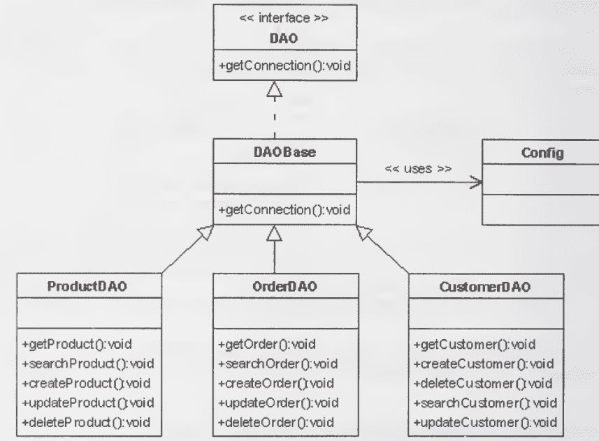

图 15.3：带有 DAO 接口的 DAO 模式

`DAOBase` 类中的 `getConnection` 方法实现创建一个 `javax.sql.DataSource` 对象，并从 `Config` 对象获取数据源名称（第 14 章中讨论过）。你将在本章稍后的“实现 DAO 模式”部分看到 `getConnection` 方法。在第 16 章中，你将看到如何缓存 `DataSource` 对象。

## 结合抽象工厂模式的 DAO 模式

DAO 类中的每个方法都通过 SQL 语句访问数据库。遗憾的是，SQL 语句取决于数据库服务器的类型。例如，向表中插入记录时，Oracle 数据库支持序列（sequences）的概念来为新记录生成顺序号。因此，在 Oracle 中，你需要执行两个操作：生成顺序号和插入新记录。相比之下，MySQL 支持在插入新记录时自动生成递增数字。在这种情况下，`insert` 方法将根据持久化数据的数据库而异。为了让你的应用程序支持多种数据库，你可以修改 DAO 模式的实现以采用抽象工厂模式。图 15.4 显示 `CustomerDAO` 接口定义了 `CustomerDAO` 对象中需要存在的方法。`CustomerDAO` 的实现将绑定到特定的数据库类型。在图 15.4 中有两个实现类：`CustomerDAOMySQLImpl` 和 `CustomerDAOOracleImpl`，它们分别支持将对象持久化到 MySQL 数据库和 Oracle 数据库。

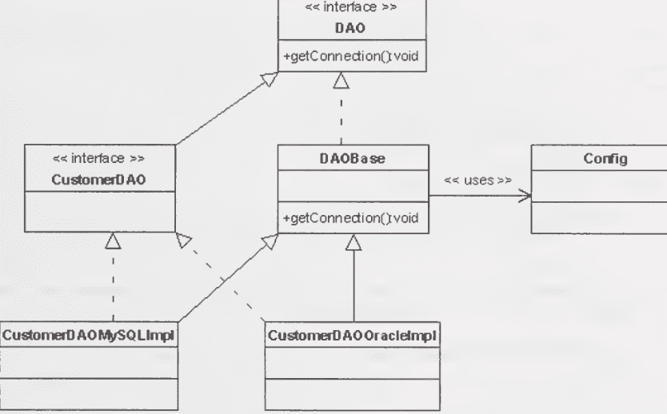

图 15.4：结合抽象工厂模式的 DAO 模式

## 实现 DAO 模式

`app15a` 演示了 DAO 模式。在该应用程序中，你可以搜索客户、添加、更新和删除客户。`CustomerDAO` 接口提供了操作 `CustomerTO` 对象的方法。类图与图 15.4 相同。`CustomerDAO` 接口有一个实现类 `CustomerDAOMySQLImpl`。

312 312 第 15 章：持久化层

为了彻底讨论该应用程序，我们将应用程序拆分为以下子章节。

> **注意**
>
> 要运行 `app15a` 应用程序，你需要在机器上安装 MySQL 数据库，并运行 `app15a` 应用程序包含的 `MySQLScript` 文件在数据库中创建 `Customers` 表。

## DAO 接口和 DAOBase 类

DAO 是所有 DAO 类都必须直接或间接实现的接口。DAO 接口中只定义了一个方法：`getConnection`。DAO 接口见代码列表 15.1。

- 代码列表 15.1：DAO 接口

```java
package app15a.dao;
import java.sql.Connection;
public interface DAO {
    public Connection getConnection() throws DAOException;
}
```

代码列表 15.2 中的 `DAOBase` 类提供了 DAO 接口 `getConnection` 方法的实现。

- 代码列表 15.2：DAOBase 类


`package app15a.dao;`

```java
import java.sql.Connection;
import java.sql.SQLException;
import javax.naming.Context;
import javax.naming.InitialContext;
import javax.naming.NamingException;
import javax.sql.DataSource;

public class DAOBase implements DAO {
    public Connection getConnection() throws DAOException {
        Connection connection = null;
        Context context = null;
        DataSource dataSource = null;
        try {
            context = new InitialContext();
            dataSource = (DataSource)
context.lookup("java:/comp/env/jdbc/myDataSource");
        } catch (NamingException e) {
throw new DAOException();
}
if (dataSource!= null) {
    try {
        connection = dataSource.getConnection();
    }
    catch (SQLException e) {
        throw new DAOException();
    }
    return connection;
}
```

`getConnection()` 方法返回一个可以访问数据库的 `java.sql.Connection`。在 J2SE 中，你可以通过 `java.sql.DriverManager` 获取 `Connection` 对象。然而，在 J2EE 中，扩展性非常重要，你希望拥有连接池功能来快速返回 `Connection` 对象。`javax.sql.DataSource` 支持连接池，所有 J2EE 容器必须提供一个 `DataSource` 对象，从中可以获取 `Connection` 对象。连接池如此重要，以至于你可以在 Tomcat 中发现此功能，尽管 Tomcat 并不是一个 J2EE 容器。

正如你在 `DAOBase` 类实现所示，`DataSource` 对象是通过 JNDI 查询操作返回的。JNDI 查询是一项昂贵的操作，获取 `DataSource` 是资源密集型的。在第 16 章中，你将学习如何缓存 `DataSource` 对象，以便它只被创建一次并在之后复用。

`DataSource` 对象由容器提供。对于 Tomcat，你需要在 Tomcat 部署目录的 `conf` 文件夹下的 `server.xml` 文件中使用以下 `Context` 元素。

```xml
<Context path="/app15a" docBase="app15a" reloadable="true" debug="8"/>
<Loader checkInterval="7" reloadable="true"/>
<Resource name="jdbc/myDataSource" auth="Container" type="javax.sql.DataSource" />
```

| 参数 | 值 |
| :--- | :--- |
| `factory` | `org.apache.commons.dbcp.BasicDataSource` |
| `maxActive` | `100` |
| `maxIdle` | `30` |
| `maxWait` | `10000` |
| `username` | `root` |
| `password` | |
| `driverClassName` | `com.mysql.jdbc.Driver` |
| `url` | `jdbc:mysql://localhost/test` |

`Context` 元素还便于从池中获取 `java.sql.Connection` 对象，从而创建一个 `DataSource` 对象。`DataSource` 对象的元素规范在参数 `Params` 中给出。`username` 和 `password` 参数指定了访问数据库所需的用户名和密码，`driverClassName` 参数指定了 JDBC 驱动，`url` 参数指定了访问 MySQL 数据库的 URL。`url` 参数表明数据库服务器位于 Tomcat 相同的机器上（URL 中使用了 `localhost`），且 `DataSource` 对象引用的数据库是 `test` 数据库。

## 警告

为了让 Tomcat 创建 `DataSource` 对象，JDBC 驱动程序应存放在 Tomcat 部署目录的 `common/lib` 目录中。随书的可下载 ZIP 包包含了 MySQL 的 JDBC 驱动程序。

对于其他容器，请参阅如何配置它们以创建 `DataSource` 对象的文档。

此外，对于你的 DAO 实现，你可能希望扩展 `java.lang.Exception` 类以拥有你自己的 DAO 特定异常。DAO 对象中的方法可以抛出这种特定异常，以便提供处理访问和数据管理失败的代码。

简单的 DAO 特定异常 `DAOException` 见代码列表 15.3。

- 代码列表 15.3：`DAOException` 类

```java
package app15a.dao;
public class DAOException extends Exception {
}
```

## `Config` 类

`Config` 类是一个提供应用程序特定值的工具类。关于 `Config` 类的信息请参见第 14 章。

在 `app15a` 中，你希望将 `dbType` 上下参数传递给你的 DAO 对象。正如稍后所示，`dbType` 指定了存储数据的关系型数据库的类型，例如是 Oracle、MySQL 等。

`Config` 类见代码列表 15.4。第 14 章解释了拥有 `Config` 对象的重要性以及如何实现它。

- 代码列表 15.4：`Config` 类

```java
package app15a.util;
import java.util.HashMap;
import java.util.Map;
```

## 316 第15章：持久化层

```java
public class Config {
    private static Config configInstance;
    private Map map = new HashMap();

    static {
        try {
            configInstance = new Config();
        } catch (Exception e) {
        }
    }

    public static Config getInstance() {
        return configInstance;
    }

    public void addKeyValue(String key, Object value) {
        map.put(key, value);
    }

    public Object getValue(String key) {
        return map.get(key);
    }

    public Map getMap() {
        return map;
    }
}
```

`web.xml` 文件中以下 `context-param` 元素的值用于填充 `Config` 对象。

```xml
<context-param>
    <param-name>dbType</param-name>
    <param-value>MySQL</param-value>
</context-param>
```

## `CustomerDAO` 接口

应用程序使用了一个 DAO 类：`CustomerDAO`。为了支持多个数据库，`CustomerDAO` 被写成一个接口，定义了用于 `CustomerDAO` 对象的方法。

## 实现 DAO 模式 317

列表 15.5 展示了 `CustomerDAO` 接口。

## 列表 15.5：`CustomerDAO` 接口

```java
package app15a.dao;
import app15a.to.CustomerTO;
import app15a.to.CustomerSearchCriteria;
import java.util.ArrayList;

public interface CustomerDAO {
    public void createCustomer(CustomerTO customer)
        throws DAOException;
    public void updateCustomer(CustomerTO customer)
        throws DAOException;
    public CustomerTO getCustomer(int customerID) throws DAOException;
    public void deleteCustomer(int customerID) throws DAOException;
    public ArrayList searchCustomers(
        CustomerSearchCriteriaTO criteria) throws DAOException;
}
```

每个方法都可以抛 `DAOException`。`createCustomer` 和 `updateCustomer` 方法接受一个需要插入或更新的 `CustomerTO` 对象。`getCustomer` 和 `deleteCustomer` 方法接受客户标识符，而 `searchCustomers` 方法接受一个 `CustomerSearchCriteriaTO`。

在 `app15a` 应用中，`CustomerSearchCriteriaTO` 类与 `CustomerTO` 类相似，但在其他应用程序中，`CustomerSearchCriteriaTO` 类可能包含与搜索相关的属性（如 `sortOrder` 和 `maximumSearchResults`），这些属性在 `CustomerTO` 中是不存在的。因此，它属于另一个用于封装搜索条件的的类。

## `CustomerDAOMySQLImpl` 类

列表 15.6 中展示的 `CustomerDAOMySQLImpl` 类是 `CustomerDAO` 接口的实现。为了支持另一个数据库，你可以创建另一个 `CustomerDAO` 实现类，例如 `CustomerDAOOracleImpl`、`CustomerDAOSQLServer` 等。

## 318 第15章：持久化层

## 列表 15.6：`CustomerDAOMySQLImpl` 接口

```java
package app15.dao;
import java.sql.SQLException;
import java.sql.Connection;
import java.sql.PreparedStatement;
import java.sql.ResultSet;
import java.sql.Statement;
import java.util.ArrayList;
import app15.dao.DAOException;
import app15.dao.DBUtil;
import app15.to.CustomerTO;
import app15.to.CustomerSearchCriteriaTO;
```

```java
public class CustomerDAOMySQLImpl extends DAOBase
implements CustomerDAO {
```

```java
private static final String GET_CUSTOMER_SQL =
    "SELECT name, address, phone FROM Customer WHERE id = ?";
private static final String CREATE_CUSTOMER_SQL =
    "INSERT INTO Customer (name, address, phone) VALUES (?, ?, ?)";
private static final String DELETE_CUSTOMER_SQL =
    "DELETE FROM Customer WHERE id = ?";
private static final String UPDATE_CUSTOMER_SQL =
    "UPDATE Customer SET name=?, address=?, phone=? WHERE id = ?";
```

```java
public void createCustomer(CustomerTO customer) throws
DAOException {
    Connection connection = null;
    PreparedStatement pStatement = null;
```

```java
try {
    connection = getConnection();
    // 准备一个语句以插入记录
    pStatement = connection.prepareStatement(CREATE_CUSTOMER_SQL);
    pStatement.setString(1, customer.getName());
    pStatement.setString(2, customer.getAddress());
    pStatement.setString(3, customer.getPhone());
    pStatement.executeUpdate();
    pStatement.close();
}
catch (SQLException ex) {
    throw new DAOException(ex);
}
finally {
```

## 实现 DAO 模式 319

```java
connection.close();
}
catch (SQLException ex) {
    throw new DAOException();
}
}
```

```java
public void updateCustomer(CustomerTO customer)
throws DAOException {
    Connection connection = null;
    PreparedStatement pStatement = null;
```

```java
try {
    connection = getConnection();
    // 准备一个语句以插入记录
    pStatement = connection.prepareStatement(UPDATE_CUSTOMER_SQL);
    pStatement.setString(1, customer.getName());
    pStatement.setString(2, customer.getAddress());
    pStatement.setString(3, customer.getPhone());
    pStatement.setInt(4, customer.getId());
    pStatement.executeUpdate();
    pStatement.close();
} catch (SQLException e) {
    throw new DAOException();
} finally {
    try {
        connection.close();
    } catch (SQLException ex) {
    }
}
```


```java
public CustomerTO getCustomer(int customerID)
throws DAOException {
    Connection connection = null;
    PreparedStatement pStatement = null;
    ResultSet rs = null;
    CustomerTO customer = new CustomerTO();
try {
    connection = getConnection();
    // 准备一个语句以选择记录
    pStatement = connection.prepareStatement(GET_CUSTOMER_SQL);
    pStatement.setInt(1, customerID);
    rs = pStatement.executeQuery();
    if (rs.next()) {
        customer.setName(rs.getString("name"));
        customer.setAddress(rs.getString("address"));
        customer.setPhone(rs.getString("phone"));
    }
    rs.close();
    pStatement.close();
} catch (SQLException ex) {
    throw new DAOException(ex);
} finally {
    try {
        connection.close();
    } catch (SQLException ex) {
    }
    return customer;
}
```

```java
public void deleteCustomer(int customerID)
throws DAOException {
    Connection connection = null;
    PreparedStatement pStatement = null;
try {
    connection = getConnection();
    // 准备一个语句以删除记录
    pStatement = connection.prepareStatement(DELETE_CUSTOMER_SQL);
    pStatement.setInt(1, customerID);
    pStatement.executeUpdate();
    pStatement.close();
} catch (SQLException ex) {
    throw new DAOException(ex);
} finally {
    try {
        connection.close();
    } catch (SQLException ex) {
    }
}
```

```java
public ArrayList searchCustomers(
    CustomerSearchCriteriaTO criteria) throws DAOException {

    ArrayList arrayList = new ArrayList<>();
    Connection connection = null;
    Statement statement = null;
    ResultSet rs = null;

    // 构建查询条件
    StringBuilder criteriaSql = new StringBuilder(51);
    criteriaSql.append("SELECT name, address, phone FROM Customer WHERE ");
if (criteria.getNameSearch() != null) {
    criteriaSql.append("name LIKE '%");
    criteriaSql.append(DbUtil.fixSqlFieldValue(criteria.getNameSearch()));
    criteriaSql.append("%' ");
}
if (criteria.getCitySearch() != null) {
    criteriaSql.append("AND address LIKE '%");
    criteriaSql.append(DbUtil.fixSqlFieldValue(criteria.getCitySearch()));
    criteriaSql.append("%' ");
}
if (criteria.getPhoneSearch() != null) {
    criteriaSql.append("AND phone LIKE '%");
    criteriaSql.append(DbUtil.fixSqlFieldValue(criteria.getPhoneSearch()));
    criteriaSql.append("%' ");
}
if (criteriaSql.length() > 51) {
    criteriaSql.setLength(criteriaSql.length() - 1);
}
try {
    connection = getConnection();
    statement = connection.createStatement(criteriaSql.toString());
    rs = statement.executeQuery();
    while (rs.next()) {
        CustomerTO customer = new CustomerTO();
        customer.setName(rs.getString("name"));
        customer.setAddress(rs.getString("address"));
        customer.setPhone(rs.getString("phone"));
        arrayList.add(customer);
    }
    rs.close();
    statement.close();
} catch (SQLException e) {
    throw new DAOException(e);
} finally {
    try {
        connection.close();
    } catch (SQLException ex) {
    }
    }
    return arrayList;
}
```

# 329 第15章：持久化层

```java
public static String fixSqlFieldValue(String value) {
    if (value==null) {
        return null;
    }    int length = value.length();
    StringBuilder fixedValue = new StringBuilder((int) (length * 1.1));
    for (int i=0; i<length; i++) {
        char c = value.charAt(i);
        if (c == '\'') {
            fixedValue.append("''");
        } else {
            fixedValue.append(c);
        }
    }
    return fixedValue.toString();
}
```

*(注：由于您提供的原文在某些部分存在代码块断裂或重复逻辑的情况，我已根据上下文对代码结构进行了补全和翻译，确保逻辑连贯性。)*

```java
char c = value.charAt(i);
if (c=='\\')
    fixedValue.append("\\\");
else
    fixedValue.append(c);
}
return fixedValue.toString();
```

## DAOFactory 类

`DAOFactory` 类帮助客户端实例化 DAO 类。此外，应用程序中需要 `DAOFactory` 类的原因是，在设计时并不知道实现类的名称，例如，不确定是 `CustomerDAOMySQLImpl` 还是 `CustomerDAOOracleImpl`。因此，`DAOFactory` 类隐藏了创建 DAO 对象的复杂性。

`DAOFactory` 类展示在列表 15.8 中。

列表 15.8：`DAOFactory` 类

```java
package app15a.dao;
import app15a.util.Config;

public class DAOFactory {
    private String databaseType;
    private static DAOFactory instance;

    static {
        instance = new DAOFactory();
    }
    private DAOFactory() {
        databaseType = (String) Config.getInstance().getValue("dbType");
    }
    public static DAOFactory getInstance() {
        return instance;
    }
```

```java
public CustomerDAO getCustomerDAO() {
    String className = null;
    if (databaseType!=null) {
        if (databaseType.equalsIgnoreCase("mysql")) {
            return new CustomerDAOMySQLImpl();
// if (databaseType.equalsIgnoreCase("oracle")) {
    // return new CustomerDAOOracleImpl();
// }
    return null;
}
```

如果你在编写应用程序时已经知道所有 DAO 的实现类，就可以使用列表 15.9 中的 `DAOFactory`。这意味着，如果你只考虑支持两个数据库（MySQL 和 Oracle），在 `CustomerDAO` 类的类型确定为 `CustomerDAOMySQLImpl` 或 `CustomerDAOOracleImpl` 之前，如果未来你的应用程序需要支持 Microsoft SQL Server，你必须重写 `DAOFactory` 类，即在 `getCustomerDAO` 类中添加另一个 `if` 语句。

如果你使用反射来创建 DAO 对象，则可以在不重新编译 `DAOFactory` 的情况下添加更多数据库的支持。与其使用 `web.xml` 文件中的 `dbType` 参数，不如使用 `customerDAOType`。那么，你在 `DAOFactory` 类的 `getCustomerDAO` 方法中将会有代码：

```java
String customerDAOType = Config.getCustomerDAOType();
Class customerDAOClass = Class.forName(customerDAOType);
CustomerDAO customerDAO = customerDAOClass.newInstance();
```

## 客户端

此应用程序的客户端是各种 Struts action：`CreateCustomerAction`、`DeleteCustomerAction`、`GetCustomerAction`、`SearchCustomerAction` 和 `UpdateCustomerAction`。要获取 `CustomerDAO` 对象，你需要使用 `DAOFactory` 类的 `getCustomerDAO` 方法。一旦有了对象，只需调用你需要的方法。

以下是创建新客户的方法。

```java
CustomerDAO customerDAO =
    DAOFactory.getInstance().getCustomerDAO();
customerDAO.createCustomer(customerTO);
```

## 复杂数据结构

通过代码发现，持久层（在此例中为 `CustomerDAO` 类）隐藏了访问数据库的复杂性。客户端不需要知道任何事情，只需上述两行代码即可持久化 `CustomerTO` 对象。

## 运行应用程序

`app15a` 应用程序提供了创建新客户、更新和删除现有客户以及搜索客户的 action 类。主入口点是 `displaySearchCustomerForm` action。要调用此 action，请使用以下 URL：

`http://localhost:8080/app15a/displaySearchCustomerForm.do`

你将看到类似于图 15.5 的内容。


如果你是第一次运行此应用程序，需要点击“Create New Customer”链接添加一些客户。之后，你可以搜索客户并更新或删除现有客户。

## 复杂数据结构

`app15a` 应用程序涉及一个传输对象（transfer object）和一个 DAO 类。在更复杂的应用程序中，你可能有多个传输对象（例如 `CustomerTO`、`OrderTO` 等），因此会有更多的 DAO 类（`CustomerDAO`、`OrderDAO` 等）。每个 DAO 类都用于操作一种类型的对象。换句话说，`CustomerDAO` 类用于创建、删除、更新、获取和搜索 `CustomerTO` 对象。事实上，`CustomerDAO` 类中的 SQL 语句只访问一张表，即 `Customers` 表。同理，`OrderDAO` 类只访问 `Orders` 表。

这是一个理想的情况，每个 DAO 只访问一个类。在许多更复杂的应用程序中，存在要求使用不同方法的情况。例如，假设某项需求你需要显示客户详情以及他们所有的订单。你如何检索这些数据？

一种简单的方法是先使用 `CustomerDAO` 类的 `getCustomer` 方法获取客户，然后调用 `OrderDAO` 类的 `getOrders(int customerId)` 方法。然而，这意味着两次数据库访问。

为了可扩展性，你可能希望尽量减少数据库访问的次数。这意味着你的 `CustomerDAO` 类需要另一个方法 `getCustomerWithOrders`，而 `CustomerTO` 类需要一个类型为 `List` 名为 `orders` 的属性。这种复杂性的增长是否受欢迎是一个待讨论的话题。

-   每个 DAO 只访问一个类。

-   在许多更复杂的应用程序中，存在要求使用不同方法的情况。

-   例如，假设一项需求你需要显示客户详情以及他们所有的订单。

## Hibernate

Hibernate 在过去几年中作为 J2EE 的插件而变得流行，其网站（`www.hibernate.org`）将此免费产品宣传为“一种强大的、高性能的对象关系映射持久化工具”。未来会有更多人使用 Hibernate，它绝对值得投入。如果你有时间，请研究它。

## 总结

大多数应用程序都需要一个持久层来持久化对象。持久层可以通过实体豆、DAO 模式、Hibernate 等来实现，为客户端隐藏数据库细节。

本章详细介绍了如何实现 DAO 模式。该模式有许多变体，选择哪种取决于项目。更灵活的 DAO 模式是更好的，因为在需要更改时可以轻松扩展应用程序。

## 实现缓存

缓存对象有两种方法。第一方法是创建类的单例并为所有客户端重用该实例。这种技术已用于 servlet 容器中。除非 servlet 实现了 `javax.servlet.SingleThreadModel` 接口，否则每个 servlet 定义只有一个实例。所有该 servlet 的请求都将传递给同一个实例。然而，，缓存会增加应用程序的复杂性，因此你不想缓存*任何*对象。

# 第 16 章：对象缓存

第二种对象缓存技术是创建对象池。对象池比单例重用更复杂，这的一个例子是所有 J2EE 容器中实现的连接对象池。在连接池中，会创建最小数量的 `Connection` 实例。当客户端需要使用 `Connection` 对象时，J2EE 容器会分配一个给它。当客户端完成使用后，必须关闭连接，这表示该 `Connection` 对象可以返回池中。其他对象池的另一个例子是 Tomcat 接器，它创建了 `HttpServletRequest` 和 `HttpServletResponse` 对象的池。

在本章中，我们将回顾第一种对象缓存方法，即对实例进行持续重用。我们通过使用单例模式（Singleton pattern）来实现这一点。

使用这种模式，你有一个被缓存的单个 `Cache` 对象。在对象内部，你有引用缓存对象的变量。还有返回这些对象的方法。

`app16a` 与 `app15a` 基本相同，区别在于 `DataSource` 对象来自 `Cache`。`app16a` 中的 `Cache` 类如列表 16.1 所示。

### 列表 16.1：`Cache` 类


```java
package app16a.util;
import javax.naming.Context;
import javax.naming.InitialContext;
import javax.naming.NamingException;
import javax.sql.DataSource;
public class Cache {
    private static Cache instance;
    private DataSource dataSource;
    static {
        instance = new Cache();
    }
    private Cache() {
    Context context = null;
    try {
        context = new InitialContext();
        dataSource = (DataSource)
        context.lookup("java:comp/env/jdbc/myDataSource");
    } catch (NamingException e) {
    }
    }
    public static ServiceLocator getInstance() {
      return instance;
    }
    public DataSource getData() {
      return dataSource;
    }
}
```

要获取`DataSource`对象，只需实例化`Cache`类并调用它的`getData`方法。事实上，你通常可以在一行代码中实现这一点，正如在`DAOBase`类中所示。

```java
DataSource dataSource = Cache.getInstance().getData();
```

向缓存中添加更多对象非常简单。你只需在`Cache`类内部创建一个变量，构造一个对象并将其赋值给变量，然后创建一个返回该对象的`get`方法。许多通过JNDI查询产生的对象都可能适合缓存。这些包括EJB远程对象、JMS队列连接工厂、数据源等。

## 总结

某些对象的创建开销极大，在许多应用程序中，你可能希望缓存这些对象以提高扩展性。正如本章所解释的，单例模式可以帮助你实现各种对象的缓存。

# 第17章 文件上传与文件下载

本章讨论了两个在Web编程书中经常得不到足够重视的问题：文件上传和文件下载。Struts通过无缝集成Jakarta Commons FileUpload库很好地支持了文件上传。本章的第一节讨论了如何在Struts中实现这一编程任务。第二节处理文件下载，并演示了你如何向浏览器发送二进制流。

## 文件上传

HTTP文件上传在请求意见稿（RFC）1867中规定。一篇关于文件上传的详细说明文件上传工作原理的详尽文章也可以从`www.brainsoftware.com`下载。本节的概述是对该文章的简要总结。

### 文件上传概述

使用HTML表单上传文件或多个文件时，表单的`entype`属性必须赋值为`multipart/form-data`，且`method`必须为`post`。在浏览器中，你的HTML表单应该如下：

```html
<form action="anAction" enctype="multipart/form-data" method="post">
</form>
```

在表单内部，你可以有普通字段，但要选择文件，必须有一个`<input type="file">`字段。这是一个用于选择文件的表单示例。

```html
<form action="/upload.do" enctype="multipart/form-data" method="post">
  ..
</form>
```

选择要上传的文件 `<input type="file" name="filename"/><br>`

描述：`<input type="text" name="description"/><br>`

`<input type="submit" value="Upload"/>` `</form>`

除了字段外，该字段还包含一个名为`description`的文本框和一个提交按钮。图17.1显示了文件输入是如何渲染的，即显示为一个文本框和一个“浏览”按钮。

图17.1：Internet Explorer中的文件输入字段

在服务器端（即在你的servlet或JSP中），你不能调用`HttpRequest`对象上的`getWriter`方法。相反，你将不得不调用`HttpServletRequest`对象的`getInputStream`方法。然后，你必须解析生成的`InputStream`对象以检索上传的文件。这是一项繁琐且容易出错的任务。幸运的是，可以使用Jakarta Commons库和Struts为我们提供文件上传功能。下一节将向你展示如何在Struts应用程序中上传文件。

> **将上传的文件保存在哪里？**

> 基本上是应用程序有权访问任何目录。如果servlet容器对Web应用程序可以写入区域区域限制，这意味着该目录及其任何子目录。将上传的文件保存在`WEB-INF`目录下可以确保即使人们正确猜对了URL，也无法下载你的文件。

⁴ 如果你对为什么不能调用`getWriter`感兴趣，请阅读我的书籍《深入Tomcat》。

如果你将上传的文件保存在应用程序目录，`ServletContext`接口的`getRealPath`方法非常有用。例如，以下代码返回应用程序目录的绝对路径。

```java
servletContext.getRealPath("/");
```

以下代码返回应用程序`WEB-INF`目录的物理路径：

```java
servletContext.getRealPath("/WEB-INF");
```

注意，如果你的应用程序部署为WAR或JAR，你不能在应用程序目录中保存文件，因为servlet容器认为应用程序目录实际上是一个WAR或JAR文件。

### Struts中的文件上传

在Struts中上传一个或多个文件非常简单。基本上，你需要完成三个简单任务：

1. 在JSP的表单中使用HTML标签库的`file`标签。
2. 创建action表单。对于每个上传的文件，创建一个`org.apache.struts.upload.FormFile`类型的属性。
3. 在你的action类中检索`FormFile`对象并执行必要的操作。

本节将讨论`file`标签和`FormFile`类，并展示一个上传文件的应用程序。

### file标签

HTML标签库的`file`标签将被渲染为：

`<input type="file" name="propertyName"/>`

### FormFile类

上传的文件由`org.apache.struts.upload.FormFile`类表示。你务必对该类有良好的理解。最重要的三个方法是`getData`、`fileName`和`getFileSize`。

`getData`方法将上传的文件作为字节数组返回。你可以轻松地将字节数组保存为文件或将其存储在数据库中。`fileName`方法返回不带路径信息的文件。实际上，路径信息不会传输到服务器。`getFileSize`方法以整数形式返回文件大小。

其他实用方法包括`setName`（用于更改上传的文件名）。`FormFile`类的所有方法列表见表17.1。

| 方法 | 描述 |
| --- | --- |
| `destroy` | 销毁上传的文件内容。 |
| `getContentType` | 返回上传的文件的内容类型。 |
| `getData` | 将上传的文件作为字节数组返回。 |
| `fileName` | 返回上传的文件名。 |
| `getFileSize` | 返回上传的文件大小。 |
| `getInputStream` | 将上传的文件作为`java.io.InputStream`返回。 |
| `setContentType` | 设置上传的文件的内容类型。 |
| `setName` | 设置上传的文件名。 |
| `setFileSize` | 设置上传的文件大小。 |

表17.1：`FormFile`类的方法

### 示例应用程序

`app17a`是一个用于上传文件的Struts应用程序。该应用程序的核心由一个action表单、一个action类和一个JSP组成。列表17.1中的`app17a.form.AttachmentForm`类表示一个包含`org.apache.struts.upload.FormFile`属性的action表单。该属性代表一个上传的文件。要上传两个文件，请添加另一个`FormFile`属性。action表单还有一个`String`类型的属性`description`。

列表17.1：`AttachmentForm`类

```java
package app17a.form;
import org.apache.struts.action.ActionForm;
import org.apache.struts.upload.FormFile;

public final class AttachmentForm extends ActionForm {
    private FormFile formFile;
    private String description;
}
```

```java
public FormFile getFile() {
    return formFile;
}
public void setFormFile(FormFile formFile) {
    this.formFile = formFile;
}
public String getDescription() {
    return description;
}
public void setDescription(String description) {
    this.description = description;
}
```

映射到`AttachmentForm`表单的HTML表单JSP称为`displayFileUploadForm.jsp`，如列表17.2所示。

## 列表17.2：`displayFileUploadForm.jsp`页面

```jsp
<@ taglib uri="/tags/struts-html" prefix="html" %>
<html>
<body>
<b>上传文件表单</b>
<html:form action="/uploadFile" enctype="multipart/form-data">
<table>
<tr>
<td colspan="2">
描述: <html:text property="description"/>
</td>
</tr>
<tr>
<td><html:file size="50" property="formFile"/></td>
<td><html:submit//></td>
</tr>
</table>
</html:form>
</body>
</html>
```

需要注意的是表单标签中存在`enctype`属性。此外，注意`file`标签的使用。

当表单提交时，请求将转发到类型为`app17a.action.UploadFileAction`的action对象，如列表17.3所示。

## 列表17.3：`UploadFileAction`类

```java
package app17a.action;
import app17a.form.AttachmentForm;
import java.io.File;
import java.io.RandomAccessFile;
import javax.servlet.ServletContext;
import javax.servlet.http.HttpServletRequest;
import javax.servlet.http.HttpServletResponse;
import org.apache.struts.action.Action;
import org.apache.struts.action.ActionForm;
import org.apache.struts.action.ActionForward;
import org.apache.struts.action.ActionMapping;
import org.apache.struts.upload.FormFile;

public class UploadFileAction extends Action {

    public ActionForward execute(ActionMapping mapping,
            ActionForm form, HttpServletRequest request,
            HttpServletResponse response) throws Exception {

        AttachmentForm attachmentForm = (AttachmentForm) form;
        if (attachmentForm==null) {
            String description = attachmentForm.getDescription();
            System.out.println("Description:" + description);
            FormFile formFile = attachmentForm.getFormFile();
            if (formFile==null) {
                byte[] bytes = formFile.getFileData();
                ServletContext servletContext = request.getServletContext();
                String savePath = servletContext.getPath("/WEB-INF/");
                String fileName = formFile.getFileName();
                File uploadedFile = new File(savePath, fileName);
                RandomAccessFile raf = new RandomAccessFile(uploadedFile, "rw");
                raf.write(bytes, 0, bytes.length - 2);
            }
        }
        return mapping.findForward("success");
    }
}
```

`execute`方法可以像常一样访问action表单。要获取属性，需要调用该属性的get方法。`getForm`方法返回一个`FormFile`对象。`execute`方法以字节数组的形式获取上传的文件（通过调用`getData`方法），并使用原始文件名将文件保存到`WEB-INF`目录。

通过此URL运行`app17a`：`http://localhost:8080/app17a/displayFileUploadForm.do`

## 文件下载

下载文件是冲浪者的日常活动。编写一个只允许授权用户下载某些文件的Web应用程序完全是另一回事。这是因为你不能简单地发布想要用户下载的文件URL。

出于安全考虑，通常使用操作系统或Web容器身份验证系统。这种身份验证机制允许你对文件进行密码保护，以便在用户输入正确的用户名和密码后才允许下载文件。然而，如果你有多个用户，密码必须共享，这极大地降低了密码保护资源的有效性。知道密码的人越多，几乎无法记录谁下载了什么内容。

在其他应用程序中，当在设计时不知道文件的名称或位置时，你可能想要动态发送文件。例如，在产品搜索表单中，你将产品作为搜索结果显示。每个产品都有一个缩略图。由于你会在设计时不知道要向浏览器发送哪些图像文件。

在另一种场景下，你有一张大且贵的图片，它应该只显示在你的Web页面中。如何防止其他网站交叉引用它？如果你能在允许下载图片之前检查每个图片请求的`Referer`头部该好了。

可编程的文件下载可以帮助解决上述所有详细问题。简而言之，可编程的文件下载允许你选择性地向浏览器发送文件。

与文件上传一样，为了保护发送给用户的文件，它们必须位于应用程序目录之外，或者`WEB-INF`下，或者数据库等外部存储中。

要向浏览器发送文件，请执行以下操作：

1. 将响应的content type设置为文件的content type。`Content-Type`头部指定了实体体中数据的类型，它由媒体类型和子类型标识符组成。访问`http://www.iana.org/assignments/`查看标准类型。

2. 添加一个名为`Content-Disposition`的HTTP头部，并将其设置为`attachment; filename=文件名`，其中`文件名`是浏览器显示的“另存为”对话框中的文件名。例如，此代码将文件发送到浏览器：


首先，通过`FileInputStream`读取文件并加载到字节数组。然后获取`HttpServletResponse`对象并调用其`write`方法，传递字节数组。

```
FileInputStream fis = new FileInputStream(file);
BufferedInputStream bis = new BufferedInputStream(fis);
byte[] bytes = new byte[bis.available()];
response.setContentType(contentType);
OutputStream os = response.getOutputStream();
bis.read(bytes);
os.write(bytes);
```

## 警告

不要发送任何字符。这看起来异常，但有用。

## 使用 Struts 下载文件

`app17b`演示了如何向浏览器发送文件。`displaySearchForm.jsp`页面用于搜索产品，每个产品都有关联的图片。它设计得非常简单，如图 17.2 所示。

图 17.2：搜索表单

你可以通过以下地址请求此页面：`http://localhost:8080/app17b/search.do`

当表单提交时，将调用`SearchAction`的`execute`方法。`SearchAction`类位于列表 17.4 中。

## 列表 17.4：SearchAction 类

```
package app17b.action;
import app17b.to.ProductTO;
import java.util.ArrayList;
import javax.servlet.http.HttpServletRequest;
import javax.servlet.http.HttpServletResponse;
import org.apache.struts.action.Action;
import org.apache.struts.action.ActionForm;
import org.apache.struts.action.ActionForward;
import org.apache.struts.action.ActionMapping;
```

```
public class SearchProduct extends Action {

    public ActionForward execute(ActionMapping mapping,
            ActionForm form, HttpServletRequest request,
            HttpServletResponse response) {

        ArrayList productList = new ArrayList();
        productList.add(new ProductTO(1,"Television"));
        productList.add(new ProductTO(2,"Computer"));
        productList.add(new ProductTO(3,"VCR"));
        request.setAttribute("productList", productList);
        return (mapping.getInputForward());
    }
}
```

`execute`方法总是“找到”三个产品，每个产品由一个`ProductTO`对象表示。现在，检查列表 17.5 中的`displaySearchForm.jsp`页面，它将搜索表单作为搜索结果显示：

## 列表 17.5：displaySearchForm.jsp 页面

```
<@taglib uri="tags/struts-html" prefix="html" %>
<%@taglib uri="http://java.sun.com/jst/core" prefix="c" %>
<html>
<body>
<b>搜索产品</b>
<html:form action="/searchProduct">
点击此按钮搜索产品。<br/><br>
<html:submit name="search"></html:submit>
<c:if test="${productList!=null}">
<hr/>
<b>搜索结果</b>
<br/><br/>
<table border="1">
<tr>
```

```
<tr>
  <td width="100"><b>Name</b></td>
  <td width="100"><b>Picture</b></td>
</tr>

<c:forEach var="product" items="${productList}">
  <tr>
    <td><c:out value="${product.name}"/></td>
    <td>
      
    </td>
  </tr>
</c:forEach>
</c:if>

</html:form>
<body>
</</html>
```

`forEach`标签用于遍历搜索结果。对于每个产品，都会显示该产品的名称和缩略图。请特别注意 JSP 中的`img`标签。

```

```

此`img`标签将被渲染为：

``

`src`属性的值是`getImage`action的路径，随后是请求参数`productID`及其值。当浏览器在解析 HTML 页面时遇到`img`标签时，它将使用`src`属性中的 URL 请求图像。对于静态图像，这通常是图像文件所在的位置，如下`img`元素所示：

``

在列表 17.5 中由`img`标签渲染的元素中，浏览器尝试通过向`/app1b/getImage.do`发送请求来获取图像，结果调用了`getImage`Struts action。由于搜索产品操作找到了三个产品，这将产生三个`img`元素，导致`getImage`被调用三次，每次都带有不同的产品 id。

## 第 17 章：文件上传与文件下载

现在让我们来看看`GetImageAction`类（位于 17.6）是如何响应用户请求的。

## 列表 17.6：GetImageAction 类

```
package app1b.action;
import java.io.BufferedInputStream;
import java.io.IOException;
import java.io.OutputStream;
import java.io.File;
import java.io.InputStream;
import javax.servlet.http.HttpServletRequest;
import javax.servlet.http.HttpServletResponse;
import org.apache.struts.action.Action;
import org.apache.struts.action.ActionForm;
import org.apache.struts.action.ActionForward;
import org.apache.struts.action.ActionMapping;
```

```
public class GetImageAction extends Action {

    public ActionForward execute(ActionMapping mapping,
                                ActionForm form, HttpServletRequest request,
                                HttpServletResponse response) {

        String contentType = "image/gif";
        String id = request.getParameter("productId");
        String path = request.getSession().getServletContext().
                              getRealPath("/images/images");

        // 图像可以是 jpg 或 gif，
        // 如果没有找到文件，则获取默认图像
        File file = new File(path, id + ".GIF");
        if (!file.exists()) {
            file = new File(path, id + ".JPG");
            contentType = "image/jpeg";
        }
        if (file.exists()) {
            try {
                InputStream fis = new FileInputStream(file);
                BufferedInputStream bis = new BufferedInputStream(fis);
                byte[] bytes = new byte[bis.available()];
                response.setContentType(contentType);
                OutputStream os = response.getOutputStream();
                bis.read(bytes);
                os.write(bytes);
```

```
catch (IOException ex) {
    System.out.println(ex.toString());
}
return null;
}
```

`execute`方法首先通过读取`productId`参数来确定要检索哪张图像。所有图像文件都存储在应用程序目录下的`images`目录中。图像文件可以是 JPG 或 GIF 文件。文件名与产品标识符相同。

`execute`方法会首先尝试检索 GIF 文件。如果没有找到 GIF 文件，它将尝试读取 JPG 文件。

```
// 图像可以是 jpg 或 gif，
// 如果没有找到文件，则获取默认图像
File file = new File(path, id + ".GIF");
if (!file.exists()) {
    file = new File(path, id + ".JPG");
    contentType = "image/jpeg";
}
```

如果找到了某个产品的 GIF 文件，内容类型将为`image/gif`。否则，它将是`image/jpeg`。如果存在产品的图像文件，`execute`方法将读取该文件并作为输出流发送：

```
if (file.exists()) {
    try {
        FileInputStream fis = new FileInputStream(file);
        BufferedInputStream bis = new BufferedInputStream(fis);
        byte[] bytes = new byte[bis.available()];
        response.setContentType(contentType);
        OutputStream os = response.getOutputStream();
        bis.read(bytes);
        os.write(bytes);
    } catch (IOException ex) {
        System.out.println(ex.toString());
    }
}
```

注意，与其他 action 类不同，`GetImageAction`类的`execute`方法返回`null`，而不是发送到浏览器。

## 总结

在本章中，你学习了文件上传和下载的工作原理。你还看到了 Struts 如何让这一切变得简单。

## 第 18 章：分页与排序

分页（Paging or pagination）是一种将结果集拆分为多个页的技术。

### Display Tag Library简介

`Display Tag Library`标签可用于在 HTML 表格显示作用域对象（scoped objects）的内容。标签支持表达式语言（Expression Language）语法来访问作用域对象及其属性。

`Display Tag Library`一个令人兴奋的特性是支持分页。当启用分页功能时，用户可以通过点击表格顶部或底部显示的页码进行页面跳转。你还可以为用户显示“下一页”（Next）和“上一页”（Previous）链接，分别跳转到下一页和上一页。此外，还可以轻松实现对列进行升序或降序排序。

在使用`Display Tag Library`的分页功能时需要注意的是，所有要显示在多页中的行必须包含在一个集合（collection）中。也就是说，你必须检索整个结果集并将其存储在集合中。在处理非常大的集合（例如 10,000 条记录）时，这可能会出现问题，因为即使大多数记录永远不会被显示，你也必须检索所有记录。本书不建议在检索数据非常大时使用`Display Tag Library`。处理非常大的数据集合将在本章稍后的“处理非常大的数据集合”节中进行讨论。

## Note

你可以从 `www.displaytag.org` 下载`Display Tag Library`及其文档。要使用这些标签，你必须将`displaytag.jar`文件以及来自 Jakarta Commons 项目的依赖 JAR 文件拷贝到你的`WEB-INF/lib`目录：`commons-beanutils.jar`、`commons-collections.jar`、`commons-logging.jar`和`commons-lang.jar`。这些依赖 JAR 文件除`commons-lang.jar`外均已包含在 Struts 部署包中。

除了 EL 语法外，你还需要来自 JSTL 的`jstl.jar`和`standard.jar`文件。

其网站提供的免费文档提供了`Display Tag Library`中完整的标签列表。本节介绍了`table`、`column`和`setProperty`标签，这是本章配套应用程序中使用的最重要的标签。

### table 标签

`table`标签在 HTML 表格中显示集合数据。`name`属性指定引用集合的作用域变量。`table`标签遍历指定的集合，并在每次迭代时创建一个引用所迭代元素的作用域变量。你使用`id`属性指定该作用域变量的名称。你可以使用`column`标签访问集合的元素并显示元素属性的值。`table`标签默认支持分页和排序。这些功能的详情请参见`setProperty`标签。

`table`标签渲染的 HTML 表格包含页码链接，用户可以点击链接导航到其他页面。当用户点击这些链接之一时，用户将被引导到与当前相同的资源，但请求将传递不同的请求参数，告诉新链接应该显示哪一页。如果点击链接时应被定向到不同的资源，请指定`requestURI`属性。此外，你使用`pagesize`属性指定每页的最大行数。

例如，下面的`table`标签从`HttpServletRequest`对象中作用域变量`customerList`引用的集合中检索数据。

```
<display:table name="customerList" id="customer" pagesize="5" requestURI="">
```

如果集合存储在另一个作用域中，请在名称属性前加上`sessionScope`或`applicationScope`，取决于指定的集合是存储在`HttpSession`对象还是`ServletContext`对象中。例如：

```
<display:table name="sessionScope.customerList" id="customer" pagesize="5" requestURI="">
```

表 18.1 列出了`table`的一些重要属性。

### Display Tag Library 简介

| 属性 | 描述 |
|---|---|
| `id` | 为每次迭代创建的作用域变量名称，用于引用正在迭代的集合元素。 |
| `length` | 要显示的记录数。 |
| `name` | 引用将显示成员的集合的作用域变量。 |
| `pagesize` | 每页的记录数。 |
| `requestURI` | 存在时，指定用户点击页码或排序链接时对应的目标资源。 |
| `sort` | 值为`page`时仅对当前页记录排序，值为`list`时对完整列表排序。 |


表 18.1：`table` 标签更重要的属性

## `column` 标签

`column` 标签显示外层 `table` 标签正在迭代行的属性。你在 `property` 属性中指定行的属性，并在 `title` 属性中指定列标题。例如，下面的 `column` 标签将外层 `table` 标签指定的集合 `customerList` 的客户属性显示为“Customer Name”（客户名称）。

```
<display:table name="customerList" id="customer"
pagesize="5">
<display:column property="customerName" title="Customer Name"/>
```

或者，`column` 标签也可以包含其他标签。例如，下面的 `column` 标签嵌套了 HTML 库的 `link` 标签，以便在表格列中显示超链接。

```
<display:column>
<html:link action="/getCustomer" paramName="customer"
paramId="customerId" paramProperty="id">update</html:link>
</display:column>
```

表 18.2 列出了 `column` 标签的一些重要属性。

## 第 18 章：分页与排序

| 属性 | 描述 |
| --- | --- |
| `property` | 指定要显示的当前行的属性。 |
| `sortable` | 表示此列是否可排序。默认值为 `false`。该列的 |
| `title` | |

表 18.2：`column` 标签更重要的属性

## `setProperty` 标签

你使用 `setProperty` 标签来设置外层 `table` 标签的属性。`setProperty` 标签有两个属性：`name` 和 `value`，描述见表 18.3。

| 属性 | 描述 |
| --- | --- |
| `name` | 指定要设置的属性名称。 |
| `value` | 分配给指定属性的值。 |

表 18.3：`setProperty` 标签属性

例如，`table` 标签的 `paging.placement` 属性指定页码链接的位置。接下来的 `setProperty` 标签将其值设置为 `bottom`，使链接出现在表格底部。

```
<display:setProperty name="paging.placement" value="bottom"/>
```

## 处理大型数据集合

在处理大型数据集合时，有效的解决方案是基于缓存的分页（cache-based paging）。通过该解决方案，我们检索所有结果并将其缓存在临时位置，特别是 `HttpSession` 对象中。后续页面从缓存而非数据库检索，因此访问速度更快且数据库命中次数更少。然而，这种方法需要更多内存。结果是更好的响应时间和更佳的用户体验。基于缓存的分页的反面是基于查询（query-based），将在下一节中讨论。

`app18a` 应用展示了如何使用基于缓存的分页并通过 Display Tag Library 分页显示结果。`app18a` 应用用于搜索客户、添加新客户以及更新/删除现有客户。

使用第 15 章中的 SQL 脚本创建了 `Customers` 表。事实上，`app18a` 是 `app15a` 的重写，增加了分页支持。由于我们检索了整个结果集并存储在 `HttpSession` 对象中，因此不需要修改 `CustomerDAO` 类。

Listing 18.1 中的 `SearchCustomerAction` 负责搜索客户。搜索结果存储在 `ArrayList` 中，该 `ArrayList` 存储在 `HttpSession` 对象中。

### Listing 18.1：`SearchCustomerAction` 类

```
package app18a.action;
import app18a.dao.CustomerDAO;
import app18a.dao.DAOFactory;
import app18a.form.CustomerSearchCriteria;
import app18a.to.CustomerSearchCriteria;
import java.util.ArrayList;
import javax.servlet.http.HttpServletRequest;
import javax.servlet.http.HttpServletResponse;
import javax.servlet.http.HttpSession;
import org.apache.struts.action.Action;
import org.apache.struts.action.ActionForm;
import org.apache.struts.action.ActionForward;
import org.apache.struts.action.ActionMapping;
import org.apache.struts.action.ActionMessage;
import org.apache.struts.action.ActionMessages;

public class SearchCustomerAction extends Action {

public ActionForward execute(ActionMapping mapping,
ActionForm form, HttpServletRequest request,
HttpServletResponse response) throws Exception {

HttpSession session = request.getSession();
if (session.getAttribute("customerList")==null ||
request.getMethod().equalsIgnoreCase("POST")) {
CustomerSearchCriteria customerForm = 
(CustomerSearchCriteria) form;
CustomerSearchCriteriaTO customerSearch = new 
CustomerSearchCriteriaTO();
customerSearch.setName(customerForm.getName());
customerSearch.setAddress(customerForm.getAddress());
customerSearch.setPhone(customerForm.getPhone());
CustomerDAO customerDAO = 
DAOFactory.getInstance().getCustomerDAO();
try {
```

## 354 第 18 章：分页与排序

```java
ArrayList customerList = 
    customerDAO.searchCustomers(customerSearch);
    request.setAttribute("customerList", customerList);
} catch (Exception ex) {
    ActionMessages actionMessages = new ActionMessages();
    actionMessages.add(ActionMessages.GLOBAL_MESSAGE,
    new ActionMessage("failed.search"));
    saveMessages(request, actionMessages);
    return (mapping.findForward("failed"));
}
return mapping.getInputForward();
```

`SearchCustomerAction` 类的 `execute` 方法比第15章中的更智能。它必须决定使用 `HttpSession` 对象中转发的 JSP，还是通过 `CustomerDAO` 对象的 `searchCustomers` 方法调用新的搜索操作。

- 如果满足以下两个条件之一，将执行新的搜索：

    1. 用户使用搜索表单输入搜索标准。此类请求将使用 `POST` 方法。

    2. 之前的搜索结果已不可用，因为存储搜索结果的 `HttpSession` 已过期，而当前的 `HttpSession` 是由于本次激活调用而新创建的对象。

这解释了 `execute` 方法开头的 `if` 语句：

```java
if (session.getAttribute("customerList")==null ||
    request.getMethod().equalsIgnoreCase("POST")) {
```

如果需要执行新的搜索，必须构造 `CustomerDAO` 对象并调用其 `searchCustomer` 方法。之后，必须将搜索结果存储在 `HttpSession` 对象中。

```java
session.setAttribute("customerList", customerList);
```

该列表将用于示例 18.2 中 `displaySearchCustomerForm.jsp` 页面上的 Display Tag 库的标签。

## 处理大量数据集 355

### 示例 18.2：`displaySearchCustomerForm.jsp` 页面

```jsp
<@ taglib uri="/tags/struts-html" prefix="html" %>
<%@ taglib uri="http://java.sun.com/jstl/core" prefix="c" %>
<%@ taglib uri="http://displaytag.sf.net" prefix="display" %>
<html>
<body>
<b>Search Customers</b>
<html:form action="/searchCustomer">
<table>
<tr>
    <td width="100">Name:</td>
    <td colspan="2"><html:text property="name"/></td>
</tr>
<tr>
    <td>Address:</td>
    <td colspan="2"><html:text property="address"/></td>
</tr>
<tr>
    <td>Phone:</td>
    <td colspan="2"><html:text property="phone"/></td>
</tr>
<tr>
    <td><html:submit>Search</html:submit></td>
    <td>&nbsp;</td>
    <td><html:link action="/displayCreateCustomerForm">Create New Customer</html:link></td>
</tr>
</table>
<c:if test="${customerList!=null}">
<br/>
<b>Search Results</b>
<br/>
<br/>
<display:table name="sessionScope.customerList" id="customer" 
    pagesize="5" requestURI="" border="1">
<display:column property="name" title="Customer Name"/>
<display:column property="address" title="Customer Address"/>
<display:column property="phone" title="Customer Phone"/>
<display:column>
<html:link action="/getCustomer" paramName="customer" 
    paramId="customerId" paramName="id">update</html:link>
</display:column>
<display:column>
<html:link action="/deleteCustomer" paramName="customer"
    id="customerId" paramProperty="id">delete</html:link>
</display:column>
<display:setProperty name="sort.behavior" value="list" />
<display:setProperty name="paging.banner.include_first_last" value="" />
</display:table>
</c:if>
</html:form>
</body>
</html>
```

JSP 的第二部分值得关注。它使用了 Display Tag 库的 `table`、`column` 和 `setProperty` 标签来显示可导航的搜索结果页。

要测试应用程序，请使用以下 URL：

`http://localhost:8080/app18a/displaySearchCustomerForm.do`

图 18.1 显示了搜索结果。

图 18.1：支持分页的搜索结果

## 处理极大数据集

另一种分页方法是基于查询的分页。在最严格的定义中，基于查询意味着仅检索要在页面上显示的数据。这不涉及缓存。然而，这意味着对数据库的访问会增加，从而导致用户响应变慢。此外，这会给数据库服务器带来额外负担。更好的方法是结合基于缓存和基于查询的解决方案。你定义每次访问数据库时检索的记录数，并缓存该集合。如果用户想查看更多内容，你将再次访问数据库以检索第二批数据。现在，哪个集合需要缓存呢？在最简单的解决方案中，你用第二个集合替换缓存中的第一个集合，希望用户对查看……（注：OCR 文本在源处截断或重复）

*（注：提供的 OCR 文本在后半部分包含大量的重叠和重复片段。我已根据提供的技术背景重构了逻辑流。）*

}

  return arrayList;

}

```

## Action 表单

为了让用户能够在页面之间进行导航，action 对象需要记住以下值，你将这些值封装在 `CustomerSearchCriteriaForm` action 表单中。以下是该表单的属性。

- `name`, `address`, `phone`。这些属性提供了客户详细信息的持有者，它们与用户导航无关。
- `currentPage`。当前搜索结果的页码。每次搜索都会将 `currentPage` 的初始值设置为 1。
- `nextPage`。`currentPage + 1`。之所以需要此属性，是因为用于渲染“Next（下一页）”链接的 HTML 标签不知道如何解析 `currentPage + 1`。
- `previousPage`。`currentPage - 1`。此属性之所以存在于此地，是因为 HTML 库中用于渲染“Previous（上一页）”链接的 `link` 标签不知道如何解析 `currentPage - 1`。
- `startRecord`。搜索结果被缓存在一个 `ArrayList` 中，其中的元素足够显示几页。JSP 将访问此 `ArrayList`，并且必须告知从 `ArrayList` 的哪个起始点开始显示元素。
- `endRecord`。缓存的 `ArrayList` 中当前页面必须的的最后一个元素。
- `highestPageNumber`。搜索结果返回的最大数字。例如，如果搜索返回了 100 条记录，每页显示 5 条记录，那么 `highestPageNumber` 将为 20。如果当前页小于 `highestPageNumber` 属性，则将显示“Next”链接。否则，不显示任何链接。由于我们处理的是非常大的数据集，有时在用户浏览到批量搜索的末尾之前并不知道 `highestPageNumber` 属性。在这种情况下，`highestPageNumber` 属性将设置为 -1。
- `cachedStartPage`。在同一时刻，`HttpSession` 对象持有一个批搜索结果。例如，如果每次数据库查询获取的最大记录数是 100 条，每页显示 5 条记录，那么每批数据涵盖 20 页数据。对于第一批数据，是从第 1 页到第 20 页。如果用户点击了第 20 页的“Next”链接，action 对象必须访问数据库并获取第二批搜索结果，用于接下来的 20 页。这次将是第 21 页到第 40 页。`cachedStartPage` 属性指定了搜索结果批的第一页码。对于每次调用，action 对象都会检查用户请求的当前页和 `cachedStartPage`。如果用户想看第 6 页，且 `cachedStartPage` 的值为 1 且一个批次包含 20 页的数据，那么我们知道从缓存中可以获取第 6 页。

## `SearchCustomerAction` 类

`SearchCustomerAction` 在用户每次填写并提交搜索表单，以及用户点击“Previous”或“Next”链接时被调用。新搜索（用户提交表单时）通过请求的 `POST` 方法指示。对同一搜索的后续页或上一页的请求将使用 `GET` 方法。新搜索始终必须从数据库检索数据，无论 `HttpSession` 对象是否缓存了数据。

`SearchCustomerAction` 类列在 Listing 18.4 中。

Listing 18.4: `SearchCustomerAction` 类

```
package app18b.action;

import app18b.dao.CustomerDAO;

import app18b.dao.DAOFactory;

import app18b.form.CustomerSearchCriteriaForm;

import app18b.util.Config;

import app18b.to.SearchCriteriaTO;
```


# 处理非常大的数据集：分页与排序

## 示例代码：SearchCustomerAction

以下是`SearchCustomerAction`类的代码示例：

```java
import java.util.ArrayList;
import javax.servlet.http.HttpServletRequest;
import javax.servlet.http.HttpServletResponse;
import javax.servlet.http.HttpSession;
import org.apache.struts.action.Action;
import org.apache.struts.action.ActionForm;
import org.apache.struts.action.ActionForward;
import org.apache.struts.action.ActionMapping;

public class SearchCustomerAction extends Action {

    private static int maxRecordsPerPage;
    private static int maxPagesPerRetrieve;
    private static int maxRecordsPerRetrieve;
    private static String CUSTOMER_LIST = "customerList";

    static {
        maxRecordsPerPage = Integer.parseInt(Config.getInstance().getString("maxRecordsPerPage"));
        maxPagesPerRetrieve = Integer.parseInt(Config.getInstance().getString("maxPagesPerRetrieve"));
        maxRecordsPerRetrieve = maxRecordsPerPage * maxPagesPerRetrieve;
    }

    public ActionForward execute(ActionMapping mapping, ActionForm form, HttpServletRequest request,
                                 HttpServletResponse response) {

        CustomerSearchCriteria criteria = (CustomerSearchCriteriaForm) form;
        int currentPage = 1; // 获取的页码
        try {
            currentPage = Integer.parseInt(request.getParameter("page"));
        } catch (NumberFormatException e) {
            // 忽略异常，使用默认页码
        }
        criteria.setCurrentPage(currentPage);
        criteria.setNextPage(currentPage + 1);
        criteria.setPreviousPage(currentPage - 1);
        HttpSession session = request.getSession();

        if (request.getMethod().equalsIgnoreCase("POST") || session.getAttribute(CUSTOMER_LIST) == null) {
            ArrayList<Customer> customerList = retrievedDataFromDB(criteria, 0, maxRecordsPerRetrieve);
            session.setAttribute(CUSTOMER_LIST, customerList);
            criteria.setCachedStartPage(1);
        } else {
            // 检索缓存结果
            if (criteria.getCachedStartPage() <= currentPage && currentPage < criteria.getCachedStartPage() + 20) {
                // 缓存命中的逻辑
            }
        }
        // 其余代码...
    }
}
```

## 类结构与静态变量

首先，`SearchCustomerAction`类有三个静态整数，其值来自`web.xml`（见第14章）：

```java
private static int maxRecordsPerPage;
private static int maxPagesPerRetrieve;
private static int maxRecordsPerRetrieve;
```

## 数据库检索方法

其次，`retrieveFromDB`方法通过调用`CustomerDAO`的`searchCustomers`方法从数据库检索数据。`retrieveFromDB`方法的第一个参数是`SearchCriteriaForm`，它从中获取名称、地址和电话的值以填充`CustomerSearchTO`对象。更重要的是，`retrieveFromDB`方法还使用以下代码设置`CustomerSearchCriteria`的最后页码：

```java
customerList = customerDAO.searchCustomers(customerSearch, offset, maxRecordsRetrieve + 1);
int size = customerList.size();
if (size < maxRecordsRetrieve + 1)
    criteria.setHighestPageNumber(criteria.getCurrentPage() + (int) Math.ceil(size / maxRecordsPerPage));
else
    criteria.setHighestPageNumber(-1);
```

```java
private ArrayList<Customer> retrieveDataFromDB(CustomerSearchCriteriaForm criteria, int offset, int maxRecordsRetrieve) {
    CustomerDAO customerDAO = DAOFactory.getInstance().getCustomerDAO();
    SearchCriteriaTO customerSearch = new SearchCriteriaTO();
    customerSearch.setName(criteria.getName());
    customerSearch.setAddress(criteria.getAddress());
    customerSearch.setPhone(criteria.getPhone());
    try {
        ArrayList<Customer> customerList = customerDAO.searchCustomers(customerSearch, offset, maxRecordsRetrieve + 1);
        int size = customerList.size();
        if (size < maxRecordsRetrieve + 1) {
            criteria.setHighestPageNumber(criteria.getCurrentPage() + (int) Math.ceil(size / maxRecordsPerPage));
        } else {
            criteria.setHighestPageNumber(-1);
        }
        return customerList;
    } catch (Exception ex) {
        return new ArrayList<>();
    }
}
```

## 处理逻辑说明

当`HttpSession`对象已过期时，`execute`方法会调用`retrieveDataFromDB`方法。否则，它会检查缓存中是否有当前页的数据。如果没有，则访问数据库。

## JSP 页面

`search action`对象转发到`displaySearchCustomerForm.jsp`页面以显示搜索结果。该页面使用HTML标签库和JSTL中的标签用于搜索表单和搜索结果。此JSP见列表18.5。

### 列表 18.5：displaySearchCustomerForm.jsp 页面

```jsp
<%@ taglib uri="/tags/struts-html" prefix="html" %>
<%@ taglib uri="http://java.sun.com/jst/core" prefix="c" %>
<html>
<body>
<b>Search Customer</b>
<html:form action="/searchCustomer">
<table>
<tr>
<td width="100">Name:</td>
<td colspan="2"><html:text property="name"/></td>
</tr>
<tr>
<td>Address:</td>
<td colspan="2"><html:text property="address"/></td>
</tr>
<tr>
<td>Phone:</td>
<td colspan="2"><html:text property="phone"/></td>
</tr>
<tr>
<td><html:submit>Search</html:submit></td>
<td>&nbsp;</td>
</tr>
<tr>
<td><html:link action="/displayCustomerForm">Create New Customer</html:link></td>
</tr>
</table>
<c:if test="${customerList!=null}">
<hr/>
<b>Search Results</b><br/><br/><br/>
```

```jsp
<table border="1">
<tr>
<td colspan="6" align="right">${customerSearchCriteriaForm.currentPage}1</td>
<c:if test="${customerSearchCriteriaForm}">
<html:link action="/searchCustomer" paramId="page" paramName="customerSearchCriteriaForm" paramProperty="currentPage">Previous</html:link>
</c:if>
<c:if test="${customerSearchCriteriaForm.highestPageNumber != customerSearchCriteriaForm.currentPage}">
<html:link action="/searchCustomer" paramId="page" paramName="customerSearchCriteriaForm" paramProperty="nextPage">Next</html:link>
</c:if>
</td>
</tr>
<tr>
<td width="100"><b>No.</b></td>
<td width="100"><b>Name</b></td>
<td width="100"><b>Address</b></td>
<td width="100"><b>Phone</b></td>
<td width="100">&nbsp;</td>
<td width="100">&nbsp;</td>
</tr>
<c:forEach var="customer" items="${customerList}"
begin="${customerSearchCriteriaForm.startRecord}"
end="${customerSearchCriteriaForm.endRecord}">
<tr>
<td><c:out value="${customer.index}"/></td>
<td><c:out value="${customer.name}"/></td>
<td><c:out value="${customer.address}"/></td>
<td><c:out value="${customer.phone}"/></td>
<td>
<html:link action="/getCustomer" paramName="customer" paramId="paramId" paramProperty="id">update</html:link>
</td>
<td>
<html:link action="/deleteCustomer" paramName="customer" paramId="customerId" paramProperty="id">delete</html:link>
</td>
</tr>
</c:forEach>
</table>
```

## 页面结构说明

页面的第一部分是搜索表单。第二部分是一个用于展示分页搜索结果的表格。JSTL的`forEach`标签用于遍历包含结果的`ArrayList`。`forEach`标签使用`CustomerSearchCriteriaForm`对象的值来决定显示`ArrayList`中的哪些元素。例如，`begin`属性被赋予`startRecord`属性的值，`end`属性被赋予`endRecord`属性的值。

```jsp
<c:forEach var="customer" items="${customerList}"
begin="${customerSearchCriteriaForm.startRecord}"
end="${customerSearchCriteriaForm.endRecord}">
```

## 运行应用程序

要运行应用程序，你必须有一个运行中的MySQL测试数据库，并且必须已经在第15章中创建了`Customers`表。然后，你必须创建足够的记录进行测试。运行应用程序，请将浏览器指向以下URL：

`http://localhost:8080/app18b/displaySearchCustomerForm.do`

图18.2显示了分页搜索结果的样子。

### 368 第18章：分页与排序

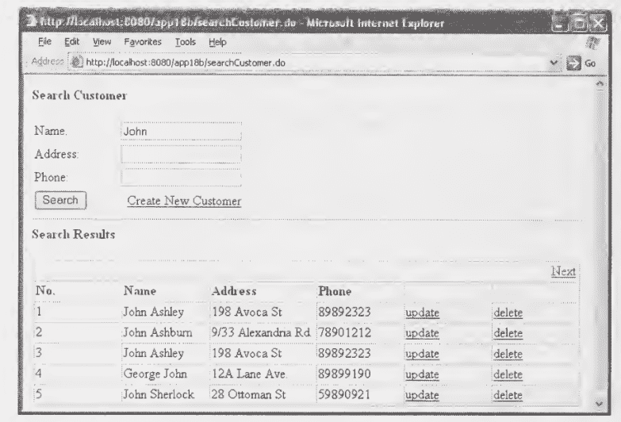

## 总结

在本章中，你学习了分页，这是一种在多页中显示数据的技术。当你处理大量数据时，就会使用分页。为了获得更有效的解决方案，你需要识别你的action获取的是一个数据集还是一个极大的数据集。

### 378 第19章：防止重复提交

重复提交通常是意外发生或用户两次点击按钮引起的。例如，当服务器缓慢时。某些重复提交会导致致命后果。Struts内置了防止这种情况的支持。这种技术涉及生成一个token，将其存储在session中，并在HTML表单中插入该token的副本。如果token匹配，则处理表单；否则，将被拒绝。

## 在Struts中管理Token

在Struts中，一个表单至少包含两个action：一个用于显示表单，另一个用于处理输入。为了防止用户多次提交同一个表单，你必须生成一个token，将其存储在session中，并在HTML表单中插入该token的副本。如果token匹配，则处理表单；否则，将被拒绝。

本章解释了Struts如何提供以下方法：

- `saveToken`: 生成一个token并存储在session中。
- `resetToken`: 从session中删除保存的token。
- `isValid`: 检查提交的token是否与session中的匹配。该方法有两个重载：
    - `isValid(HttpServletRequest request)`
    - `isValid(HttpServletRequest request, boolean reset)`

`app19a`是简单的订单应用程序。从`struts-config.file`中的`action`元素可以看到两个action。

### 列表 19.1：struts-config.file

```xml
<action-mappings>
<action path="/displayOrderForm"
type="app19a.action.DisplayOrderAction"
input="/jsp/displayOrderForm.jsp"
validate="false"
name="orderForm">
<forward name="success" path="/jsp/displayOrderForm.jsp"/>
</action>
<action path="/saveOrder"
type="app19a.action.SaveOrderAction"
input="/jsp/displayOrderForm.jsp"
name="orderForm">
<forward name="success" path="/jsp/displaySavedOrder.jsp"/>
</action>
</action-mappings>
```


<forward name="doubleSubmit" path="/jsp/error.jsp"/>

</action>

</action-mappings>

```
<forward name="doubleSubmit" path="/jsp/error.jsp"/>
</action>
</action-mappings>
```

第一个 action `displayOrderForm` 向浏览器发送“添加订单”表单。第二个 action `saveOrder` 保存提交的订单详情。

`displayOrderForm` action 与其他发送包含表单的 JSP 的 action 不同，它关联了一个 action 类（`DisplayOrderAction`）。这是因为你需要生成一个 token，将其存储在 session 中，并在 HTML 表单中插入该 token 的副本。

`DisplayOrderAction` 类的 `execute` 方法见列表 19.2。

### 列表 19.2：DisplayOrderAction 类

```java
package app19a.action;

import javax.servlet.http.HttpServletRequest;
import javax.servlet.http.HttpServletResponse;
import org.apache.struts.action.Action;
import org.apache.struts.action.ActionForm;
import org.apache.struts.action.ActionForward;
import org.apache.struts.action.ActionMapping;

public class DisplayOrderAction extends ActionForward {
  public ActionForward execute(ActionMapping mapping,
    ActionForm form, HttpServletRequest request,
    HttpServletResponse response) throws Exception {
    saveToken(request);
    return (mapping.findForward("success"));
  }
}
```

# 372 第 19 章：防止重复提交

`DisplayAddOrderActionPerformed` 的 `execute` 方法调用了 `Action` 类的 `saveToken` 方法，并将控制转发到显示表单本身的 JSP。`saveToken` 方法会创建一个令牌并将其存储在用户的 `HttpSession` 对象中。然而，如何将其插入到 HTML 表单的隐藏字段中呢？

幸运的是，HTML 库的 `form` 标签会检查 `HttpSession` 对象中是否存在令牌，并自动插入隐藏字段。有了这个令牌，`form` 标签会被渲染如下：

```html
<form name="orderForm" method="post"
  action="/app19a/saveOrder.do; jsessionid=2AD8B5FEFE51928CF4C8D7D50166">
  <input type="hidden" name="org.struts.taglib.html.TOKEN"
    value="deeebl1480ddace6affdf4af8f82fe97">
</form>
```

因此，当用户提交表单时，令牌也会随之发送。

处理用户输入的 action `saveOrder` 与列表 19.3 中的 `SaveOrderAction` 类相关。

## 列表 19.3：SaveOrderAction 类

```java
package app19a.action;

import app19a.form.OrderForm;
import app19a.to.OrderTO;
import java.text.ParseException;
import java.text.SimpleDateFormat;
import java.util.Date;
import javax.servlet.http.HttpServletRequest;
import javax.servlet.http.HttpServletResponse;
import org.apache.struts.action.Action;
import org.apache.struts.action.ActionForm;
import org.apache.struts.action.ActionForward;
import org.apache.struts.action.ActionMapping;
```

```java
public class SaveOrderAction extends Action {
  public ActionForward execute(ActionMapping mapping,
    ActionForm form, HttpServletRequest request,
    HttpServletResponse response) throws Exception {
    if (isValid(request, true)) {
      OrderForm orderForm = (OrderForm) form;
      OrderTO order = new OrderTO();
      // 填充 OrderTO 对象并将其保存到数据库
```

```java
      return (mapping.findForward("success"));
    } else {
      return (mapping.findForward("doubleSubmit"));
    }
  }
}
```

`SaveOrderAction` 的 `execute` 方法调用 `isTokenValid` 方法来检查表单是否发送了有效的令牌，如果是，则执行处理逻辑。如果没有发送有效令牌，控制权将转发到一个错误页面，告诉用户他/她重复提交了表单。

注意，`isTokenValid` 方法将 `true` 作为其第二个参数传递，这在实际上是重置了令牌。

你可以通过调用以下 URL 来运行 `app19a`：
`http://localhost:8080/app19a/displayAddOrderForm.do`

## 总结

表单重复提交通常是意外发生的，或者是因为用户在处理表单耗时较长时不知道该做什么。防止表单被提交两次的技术是使用令牌，该令牌在表单第一次提交时被重置。Struts 通过 `Action` 类中的以下方法对此类令牌的生成、重置和有效性检查提供了内置支持：`saveToken`、`resetToken` 和 `isTokenValid`。

# 第 20 章 早期 HttpSession 失效

`HttpSession` 对象非常有用，但它们也会消耗内存。因此，当 `HttpSession` 对象不再需要时，应该通过调用其 `invalidate` 方法来销毁它。许多程序员为用户提供了注销链接，但很少有人使用。通常情况下，他们只是在完成应用程序操作后直接关闭浏览器。等待 `HttpSession` 自然死亡会导致内存被比需要更长时间占用。本章讨论了一种在浏览器关闭时强制使 `HttpSession` 失效的技术。

## Struts 中的 HttpSession 失效

在 Struts 应用程序中销毁 `HttpSession` 对象并不像在 `HttpSession` 对象上调用 `invalidate` 方法那么简单。因为即使是简单的到 JSP 也会创建一个新的 `HttpSession` 对象。

让我们先回顾一些事实。

默认情况下，Struts 中的每次 action 调用都保证会创建一个 `HttpSession` 对象（如果之前还没有的话），即使进程尚未实例化 action 类（在 action form 验证失败的情况下）。这是因为 Struts 需要在 `HttpSession` 对象中存储用户的语言区域信息（locale）。对此感兴趣的读者，可以检查 `org.apache.struts.action.RequestProcessor` 类中的 `process` 和 `processLocation` 方法。因此，如果 JSP 是 Struts action 的转发目标，那么在 JSP 中使用指令 `<% page session="false"%>>` 也是没有意义。

那么，如何销毁 `HttpSession` 对象呢？通过在 `HttpSession` 对象上调用 `invalidate` 并防止 Struts 创建新的 `HttpSession` 实例。

# 376 第 20 章：早期 HttpSession 失效

要销毁 `HttpSession` 对象，你可以创建一个 action 对象并在 `HttpSession` 对象上调用 `invalidate` 方法。

```java
public ActionForward execute(ActionMapping mapping,
  ActionForm form, HttpServletRequest request,
  ServletResponse response) throws Exception {
  // 不需要检查从 getSession 获取的 HttpSession 是否
  // null，因为它不会为 null。
  request.getSession(false).invalidate();
  ...
```

然而，请注意 `ActionMapping` 类的 `findMapping` 方法（你通常在 action 结束时调用的方法）会导致 `HttpSession` 实例创建。因此，在失效后必须避免使用它。相反，你可以返回 `null` 或使用 `response.sendRedirect` 重定向到 HTML 或 JSP。

## 早期 HttpSession 失效

`app20a` 展示了如何失效关闭浏览器的 `HttpSession` 对象。失效 `HttpSession` 的 action 命名为 `invalidate`，定义在列表 20.1 中。

### 列表 20.1：InvalidateSession 类

```java
package app20a.action;

import javax.servlet.http.HttpServletRequest;
import javax.servlet.http.HttpServletResponse;
import javax.servlet.http.HttpSession;
import org.apache.struts.action.Action;
import org.apache.struts.action.ActionForm;
import org.apache.struts.action.ActionForward;
import org.apache.struts.action.ActionMapping;

public class InvalidateSessionAction extends Action {
```

```java
  public ActionForward execute (ActionMapping mapping,
    ActionForm form, HttpServletRequest request,
    HttpServletResponse response) {
    HttpSession session = request.getSession(false);
    if (session!=null) {
      session.invalidate();
    }
    return null;
  }
}
```

挑战在于如何在用户关闭浏览器时自动调用失效 action。某些 JavaScript 函数可以帮助。

当浏览器关闭时，页面上的 `unload` 事件会被触发。你必须为 `unload` 事件提供一个处理程序。你无法选择 JavaScript，所以如果浏览器的 JavaScript 功能被禁用，该技术将失效。

当浏览器关闭后，你无法从当前浏览器窗口向服务器发送更多请求。变通方法是创建一个新的浏览器窗口来调用失效 action。你不希望新的浏览器窗口太显眼，因此希望它越小越好。根据实验，你无法创建一个宽度或高度小于 10x10 像素的浏览器窗口。列表 20.2 展示了创建新浏览器窗口的 `destroySession` JavaScript 函数。

## 列表 20.2：destroySession JavaScript 函数

```javascript
function destroySession() {
  if (navigator.appName == "Netscape") {
    if ((window.innerWidth<0) && (window.innerHeight<0)) {
      newWindow =
        window.open("invalidateSession.do",null,"height=10, width=10");
      newWindow.close();
    }
  } else if (navigator.appName == "Microsoft Internet Explorer") {
    if ((window.event.clientX<0) && (window.event.clientY<0)) {
      newWindow =
        window.open("invalidateSession.do",null,"height=10, width=10");
      newWindow.close();
    }
  }
}
```

## 第 20 章：早期 HttpSession 失效

```java
}
}
```

该函数同时适用于 Netscape 和 Internet Explorer 浏览器。它会打开一个新的浏览器窗口并调用 `invalidateSession` 操作。然后它会立即关闭该新窗口。

检查 `window.innerWidth/window.innerHeight` 以及 `window.event.clientX/window.event.clientY` 的 `if` 测试之所以存在，是因为许多其他用户活动也可能触发 `unload` 事件，例如点击链接导航到另一个页面。你不希望在这些活动期间触发 `invalidateSession` 操作。幸运的是，浏览器会对已关闭的浏览器设置负的宽度和高度，因此你可以判断 `unload` 事件是由用户关闭浏览器触发的还是由其他原因触发的。

要使用此技术，应用程序中的所有 JSP 必须包含 `destroySession` JavaScript 函数，并在其 `body` 元素中具有以下 `unload` 属性。

```html
<body onload="destroySession();">
```

`onload` 属性将导致 `destroySession` 函数执行。这反过来会调用服务器上的 `invalidateSession` 操作。

要测试该应用程序，请调用以下 URL：

```
http://localhost:8080/app20a/displayMessage.do
```


`app20a` 中还有一个 session 监听器用于检查应用程序是否正常工作。当你调用 `displayMessage` 操作时，你正在调用应用程序中的第一个操作，因此 session 监听器将并在控制台上打印类似如下的消息：

```
Creating Session. Session id: CA22882EBA771B4BB2A2FB33A66D5AAF Mon Jan 03 17:25:42 EET 2005
```

现在，关闭浏览器。你将在控制台上看到以下消息：

```
Destroying Session.

Session id: CA22882EBA771B4BB2A2FB33A66D5AAF
```

## 注意

JavaScript 函数在非 Internet Explorer 浏览器中将优雅失败。

## 总结

默认情况下，Struts 会为每个用户创建一个 `HttpSession` 对象，无论你实际上是否使用该对象来存储值。遗憾的是，当用户完成操作并关闭浏览器时，与该用户关联的 `HttpSession` 对象继续存在，直到 `HttpSession` 超。本章介绍了一种在浏览器关闭时调用 Struts 操作的技术。该操作会使用户的 `HttpSession` 对象失效。

# 第 21 章：装饰请求对象

当 Servlet 规范首次引入过滤器（filter）时，非常令人兴奋。过滤器是一个 Java 对象，在到达 servlet 的 `service` 方法之前拦截 `HttpServletRequest` 对象，并在控制权离开 `service` 方法后拦截 `HttpServletResponse` 对象。你可以使用过滤器完成很多事情，例如验证用户输入、压缩 Web 内容等。

尽管如此，使用过滤器的许多其他创意形式受到了限制，因为你无法更改 `HttpServletRequest` 对象的请求参数，因为包含 `HttpServletRequest` 对象中参数的 `java.util.Map` 是不可变的，即它不能被更改。这极地减少了过滤器的实用性。至少有一半的时间，你希望能够更改你正在应用过滤器的对象。如果可以，例如编写一个在 `HttpServletRequest` 对象到达 Struts servlet 之前修剪用户输入的过滤器，那不是太好了吗？这样，你就不需要在 action 表单的 `validate` 方法中手动修剪它们了。

幸运的是，使用装饰器模式（Decorator pattern）可以改变不可变对象的行为，尽管你无法更改对象本身。本章将介绍这种模式，并提供了一个修剪用户输入的过滤器示例。

## 装饰器模式

通过继承，你可以通过扩展对象的类并重写你想要更改的方法来改变对象的行为。然而，如果涉及的对象是由应用程序中的另一个子系统构建的（例如 action 工厂或 servlet 容器），那么继承就无能为力。

例如，考虑有一个名为 `getMessage` 方法的 `Messenger` 类。你知道 `Messenger` 类的定义并可以对其进行子类。但在你的应用程序中，`Messenger` 对象始终来自工厂。该工厂设置初始状态，包括根据某些未知公式为其创建的每个 `Messenger` 对象通过 `getMessage` 返回的 `String`。换句话说，你无法实例化 `Messenger` 类。

在你的应用程序中，拥有 `Messenger` 对象的目的是将其传递给名为 `Util` 的工具类的静态广播方法。以下是 `broadcast` 对象的实现：

```java
public static void broadcast(Messenger messenger) {
    System.out.print(messenger.getMessage());
}
```

在你自己的类中，有如下代码：

```java
Messenger messenger = aFactory.getMessenger();

Util.broadcast(messenger);
```

假设你想稍微修改 `broadcast` 方法打印的消息。你希望它以全大写形式打印。你能做什么？从技术上讲，你可以创建 `Messenger` 的子类，实例化子类，并将返回的对象传递给 `Util.broadcast`。然而，这将毫无意义，因为只有工厂对象知道如何初始化 `Messenger` 对象以便其 `getMessage` 方法返回正确的值。

装饰器模式可以提供帮助。

首先，你需要创建 `Messenger` 的子类。我们将子类命名为 `MessengerDecorator`。因为 `MessengerDecorator` 是 `Messenger` 的子类，`Util.broadcast` 将接受 `MessengerDecorator` 的实例。然而，`MessengerDecorator` 不仅仅是一个子类。它是 `Messenger` 对象的装饰器。为了实现这一点，`MessengerDecorator` 必须有一个接受 `Messenger` 对象的构造函数。

```java
public MessengerDecorator(Messenger messenger) {
    this.messenger = messenger;
}
```

现在，你需要在 `MessengerDecorator` 中重写 `getMessage` 方法以便打印消息。

```java
public String getMessage() {
    return this.getMessage().toUpperCase();
}
```

`Messenger` 类的示例与上述类似：在 HTTP 请求时，servlet 容器创建 `HttpServletRequest` 和 `HttpServletResponse` 的实例，并将这两个对象传递给 servlet 的 `service` 方法。在 servlet 无知的情况下，你实现了装饰器模式。

对于 `HttpServletRequest` 类更加简单，因为 Servlet API 提供了 `HttpServletRequest` 的包装类。让我们研究如何在以下示例（一个修剪过滤器）中装饰 `HttpServletRequest` 对象。要为 `HttpServletRequest` 创建装饰器，你需要扩展 `HttpServletRequest` 并重写你想更改的方法。

## 修剪过滤器

创建一个修剪过滤器比你想象的简单。Struts 通过调用 `HttpServletRequest` 对象上的 `getValues` 方法来填充 action。通过在装饰器类中重写该方法，你更改了当前 `HttpServletRequest` 对象的行为，从而创建修剪过滤器。

列表 21.1 展示了修剪 `getParameterValues` 方法返回值的 `MyRequestWrapper` 类。

### 列表 21.1：HttpServletRequest 装饰器

```java
package app2la.filter;

import javax.servlet.http.HttpServletRequest;
import javax.servlet.http.HttpServletRequestWrapper;

public final class MyRequestWrapper extends HttpServletRequestWrapper {

    public MyRequestWrapper(HttpServletRequest servletRequest) {
        super(servletRequest);
    }

    public String[] getParameterValues(String parameter) {
        String[] results = super.getParameterValues(parameter);

        if (results == null) {
            return null;
        }

        int count = results.length;
        String[] trimResults = new String[count];

        for (int i = 0; i < count; i++) {
            trimResults[i] = results[i].trim();
        }

        return trimResults;
    }
}
```

拦截 HTTP 请求并装饰 `HttpServletRequest` 对象的过滤器位于列表 21.2 中。

### 列表 21.2：修剪过滤器

```java
package app2la.filter;

import java.io.IOException;

import javax.servlet.Filter;
import javax.servlet.FilterChain;
import javax.servlet.FilterConfig;
import javax.servlet.ServletException;
```

## 裁剪过滤器（Trimmer Filter）

```java
import javax.servlet.ServletRequest;
import javax.servlet.ServletResponse;
import javax.servlet.http.HttpServletRequest;

public class MyFilter implements Filter {

    private FilterConfig filterConfig;

    public void init(FilterConfig filterConfig) throws ServletExceptionException {
        System.out.println("Filter initialized");
        this.filterConfig = filterConfig;
    }

    public void destroy() {
        System.out.println("Filter destroyed");
        this.filterConfig = null;
    }

    public void doFilter(ServletRequest request, ServletResponse response,
                         FilterChain chain)
            throws IOException, ServletException {
        chain.doFilter(new RequestWrapper((HttpServletRequest) request), response);
    }
}
```

`app2la` 应用使用了列表 21.2 中的裁剪过滤器来裁剪用户输入。要应用该过滤器，你需要在 `web.xml` 文件中配置以下 `<filter>` 和 `<filter-mapping>` 元素。

```xml
<filter>
    <filter-name>TrimmerFilter</filter-name>
    <filter-class>app2la.filter.MyFilter</filter-class>
</filter>

<filter-mapping>
    <filter-name>TrimmerFilter</filter-name>
    <url-pattern>*.do</url-pattern>
</filter-mapping>
```

要测试该过滤器，可以使用以下 URL 调用 `app2la` 应用：

`http://localhost:8080/app2la/displayOrderForm.do`

在表单中输入一些值并提交表单，观察过滤器如何裁剪输入值。

## 第 21 章：装饰请求对象

## 总结

在本章中，你学习了如何使用装饰器模式（Decorator pattern）来改变 `HttpServletRequest` 对象的行为。`app21a` 应用中的裁剪过滤器演示了如何在用户输入传递给 Struts action servlet 之前对其进行裁剪。

# 第 22 章：Struts 的工作原理

在之前的章节中，你已经学习了如何设计和开发 Struts。本章将通过探索底层机制来结束本书：即使 Struts 运行的核心类，以及这些类如何相互集成以构成最流行的模型-视图-控制器（Model-View-Controller）框架。

理解 Struts 的工作原理将使你能够设计并编写更有效的 Struts。例如，通过了解 Struts action 对象是被缓存的，你可能就不想为这些对象实现缓存。通过了解什么因素使得 `ActionForm` 实例可以被 Struts 重用，你可能希望基于这一知识来设计你的 action forms。

由于 Struts action servlet 是处理每次 Struts action 调用的主要组件，关于 Struts 工作原理的讨论应该集中在该 servlet 的生命周期方法上。Struts action servlet 充当 Struts 实现的模型-视图-控制器模式中的控制器。因此，该类在 Struts 框架中起着核心作用。此外，特别重要的是封装了应用配置的 `ModuleConfig` 接口以及处理每个 HTTP 请求的 `RequestProcessor` 类。

因此，本章的结构如下：本章的第一节处理 Struts action servlet，接着是 `ModuleConfig` 接口，最后对 `RequestProcessor` 类进行深入讨论。

**注意**

阅读本章时最好手头有 Struts 1.2 源码，这样你就可以方便地查找所讨论的代码段。为了节省空间，本章避免了会占用过多空间的代码。

## Action Servlet（Action Servlet）

action servlet 由 `org.apache.struts.action.ActionServlet` 类表示，它是 `javax.servlet.http.HttpServlet` 的子类。servlet 有三个由 servlet 容器调用的生命周期方法：

- `init`：servlet 第一次被调用时由容器调用。该方法在 servlet 的生命周期内只被调用一次。
- `service`：每次 servlet 被调用时由容器调用。对于每次调用，容器都会创建一个 `HttpServletRequest` 对象和一个 `HttpServletResponse` 对象，并将其传递给 `service` 方法。
- `destroy`：当 servlet 需要被销毁时由容器调用，例如当 servlet 容器关闭时。

在处理 action 时，servlet 可能会创建一个 action form 和一个 action 对象，并将控制权转发到 JSP。关于 action form 类型、action 对象类型以及转发地点的信息可以在 Struts 配置文件（默认的 `struts-config.xml` 文件）中找到。因此，action servlet 需要读取此 XML 文档。

然而，每次 action 调用时都解析该文件将是低效的。因此，Struts 设计者创建了一个 `ModuleConfig` 对象（类型为 `org.apache.struts.ModuleConfig` 接口），封装了配置信息。`ModuleConfig` 对象在 action servlet 初始化时创建并存储在 `ServletContext` 对象中。因此，`ModuleConfig` 对象一直存在到 action servlet 被销毁，并且可以在 servlet 的 `service` 方法内部可用。这种策略导致了更高效的系统，因为 Struts 配置文件只需要解析一次。对于较大或许多配置文件，每个文件都有对应的 `ModuleConfig` 实例。在将 `ModuleConfig` 对象存储在 `ServletContext` 对象中，action servlet 使用以下属性键：

`Globals.MODULE_KEY + prefix`

其中，`Globals.MODULE_KEY` 是 `org.apache.struts.Globals` 类中 `MODULE_KEY` 字段的值，而 `prefix` 是模块的前缀。

因此，只要每个 `ModuleConfig` 都有唯一的前缀，你就可以存储任意数量的 `ModuleConfig` 对象。每个 Struts action 处理从工厂获取 `ModuleConfig` 对象并将其传递给 `RequestProcessor`。图 22.1 展示了 `ActionServlet`、`RequestProcessor` 和 `ModuleConfig` 之间的关系。

对于每次请求处理（即 servlet 的 `service` 方法被调用时），servlet 会执行以下操作：

1. 查找正确的 `ModuleConfig` 对象。
2. 获取 `RequestProcessor` 对象并将 `ModuleConfig` 传递给它。
3. 调用该处理器的 `process` 方法。

这些操作在列表 22.1 的 action servlet 的 `doGet` 和 `doPost` 方法所示。

### 列表 22.1：action servlet 的 doGet 和 doPost 方法

```java
public void doGet(HttpServletRequest request, HttpServletResponse response)
        throws IOException, ServletException {

    process(request, response);
}

public void doPost(HttpServletRequest request, HttpServletResponse response)
        throws IOException, ServletException {
```


```java
process(request, response);

}

protected void process(HttpServletRequest request, HttpServletResponse response) throws IOException, ServletException {

    // 1. 查找正确的 ModuleConfig 对象

    ModuleUtils.getInstance().selectModule(request, getServletContext());

    ModuleConfig config = getModuleConfig(request);

    // 2. 获取 RequestProcessor，传递 ModuleConfig

    RequestProcessor processor = getProcessorForModule(config);

    if (processor == null) {

        processor = getRequestProcessor(config);

    }

    // 3. 调用处理器的 process 方法

    processor.process(request, response);

}
```

`ModuleConfig` 接口提供了获取 action 类型、action 类的完全限定名、转发目的地以及完成任何 Struts action 处理的其他设置的方法。由于请求处理器拥有 `ModuleConfig` 对象的引用，请求处理器知道如何正确地为 Struts action 调用创建 action form 和 action 对象。

## 创建 ModuleConfig 对象（Creating ModuleConfig Object）

`org.apache.struts.config.ModuleConfig` 接口表示存储 Struts 模块配置信息的对象。大多数 Struts 应用只有一个模块，但较大的应用有多个。每个模块通过前缀标识。模块内部的 Struts action 调用通过调用具有以下模式的 URL 实现：

```text
http://domain/appContext/prefix/strutsAction.do
```

例如：

```text
http://localhost:8080/app22a/store/displayShoppingCart.do
```

默认模块的前缀为空字符串。你使用以下 URL 模式调用默认模块中的 action：

```text
http://domain/appContext/strutsAction.do
```

模块的配置存储在 Struts 配置文件中。默认配置文件名为 `struts-config.xml` 文件，并位于 `WEB-INF` 目录。你必须在其中注册所有的 Struts 配置文件。

## 创建 ModuleConfig 对象

应用部署描述符（`web.xml` 文件）使用了嵌套在描述 action servlet 的 `servlet` 元素中的 `init-param` 元素。以下是一个 Struts 应用程序典型的 `servlet` 元素。

```xml
<servlet>
    <servlet-name>action</servlet-name>
    <servlet-class>
        org.apache.struts.action.ActionServlet
    </servlet-class>
    <init-param>
        <param-name>config</param-name>
        <param-value>/WEB-INF/struts-config.xml</param-value>
    </init-param>
    <load-on-startup>1</load-on-startup>
</servlet>
```

如果你有多个模块，每个模块都会在一个 Struts 配置文件中进行描述，并且每个文件都使用 `init-param` 元素注册。`init-param` 内部的 `param-name` 元素包含前缀名称，并带有字符串 `config/`。`param-value` 元素包含该模块的 Struts 配置文件的位置。例如，这里是一个具有两个模块（默认模块和一个前缀为 `myModule` 的额外模块）的 Struts 应用程序的 `servlet` 元素。

```xml
<servlet>
    <servlet-name>action</servlet-name>
    <servlet-class>org.apache.struts.action.ActionServlet</servlet-class>
    <init-param>
        <param-name>config</param-name>
        <param-value>/WEB-INF/struts-config.xml</param-value>
    </init-param>
    <init-param>
        <param-name>config/myModule</param-name>
        <param-value>/WEB-INF/struts-config-myModule.xml</param-value>
    </init-param>
    <load-on-startup>1</load-on-startup>
</servlet>
```

`ModuleConfig` 接口提供了获取相关的方法。例如，对于一个 `name` 属性被分配了 action form 的 Struts action，`ModuleConfig` 接口提供了 `findConfig` 方法，其签名如下：

```java
FormBeanConfig findBeanConfig(String name)
```

此方法根据给定的 action form 名称返回一个 `JavaBeanConfig` 对象。从 `JavaBeanConfig` 对象，你可以调用 `getType` 方法来获取表单的 Java 类名，以便实例化 action form。

`ModuleConfig` 接口还带有 `findActionConfig` 方法，用于返回指定 Struts action 路径的 action 配置。`findActionConfig` 方法的签名如下：

```java
ActionConfig findActionConfig(String path);
```

你可以对 `findActionConfig` 返回的 `org.apache.struts.config.ActionConfig` 对象调用 `getType` 方法，以获取作为方法参数指定的 action 的 Java 类名。有了 Struts action 的 Java 类名后，你可以为相应的 Struts action 创建 Action 对象。

此外，`ModuleConfig` 中的 `getControllerConfig` 返回一个 `org.apache.struts.config.ControllerConfig` 对象，该对象封装了 Struts 配置文件中 `controller` 元素的属性值。`controller` 元素的属性被映射到 `ControllerConfig` 接口中的属性。

## 注意

你可以在 Struts 源码发行包中找到 `ModuleConfig` 接口及其默认实现类 `org.apache.struts.config.impl.ModuleConfig` 的完整代码。

向请求处理器提供应用配置信息的挑战在于读取和解析 XML 文档，并根据 XML 文档中的元素创建 `ModuleConfig` 对象。工具库 `Digester` 是实现此目的方便工具。书中《Tomcat Tomcat》（How Tomcat Works）的第 15 章对此详细解释。该章节可以在本书附带的 ZIP 文件中找到。

action 的 `init` 方法创建 `Digester` 对象，读取 Struts 应用程序 `web.xml` 文件中注册的所有 Struts 配置文件，解析 XML 文件，创建相应的 `ModuleConfig` 对象，并将它们存储在 `ServletContext` 对象中。

## 请求处理器

`Digester` 强大不仅可以创建一个 `ModuleConfig`，还可以构建 `ModuleConfig` 包含的所有对象，例如 Struts 配置文件中每个 `action` 元素对应的 `ActionConfig` 对象、对应 `controller` 元素的 `org.apache.struts.config.ControllerConfig` 对象等。

如果你感兴趣，在理解了 `Digester` 如何施展魔法后，你应该阅读 `ActionServlet` 类中的 `initConfigDigester` 方法以及 `org.apache.struts.config.ConfigRuleSet` 类的源代码。

## 请求处理器

请求处理器通过其 `process` 方法处理每一次 Struts action 调用。`process` 方法在列表 22.2 中给出。

**列表 22.2：请求处理器的 `process` 方法**

```java
public void process(HttpServletRequest request,
                    HttpServletResponse response) throws IOException, ServletException {

    // 使用特殊包装器封装多部分请求

    request = processMultipart(request);
```

```java
// 识别我们将将使用的用于选择映射的组件

String path = processPath(request, response);

if (path == null) {

    return;

}
```

```java
if (log.isDebugEnabled()) {

    log.debug("Processing a " + request.getMethod() + " for path " + path + "");

}
```

```java
// 如果请求，为当前用户设置区域

processLocale(request, response);
```

```java
// 如果请求，设置内容类型和不缓存标头

processContent(request, response);

processNoCache(request, response);
```

```java
// 通用钩子

if (process(request)) {

    return;
```

接下来的小节将讨论由 `process` 方法调用的方法。在这里你将学习处理 Struts action 的其他类。

> **注意：** 在 `RequestProcessor` 类中，`moduleConfig` 变量引用当前模块的 `ModuleConfig` 对象。

## `processMultipart` 方法

请求处理器 `process` 方法的第一件事是检查请求是否正在上传文件。如果是，`processMultipart` 方法（列表 22.3）会将 `HttpServletRequest` 对象封装在 `org.apache.struts.upload.MultipartRequest` 中。

**列表 22.3：`processMultipart` 方法**

```java
protected HttpServletRequest processMultipart(HttpServletRequest request) {

    if (!"POST".equalsIgnoreCase(request.getMethod())) {

        return (request);

    }

    String contentType = request.getContentType();

    if (contentType != null && contentType.startsWith("multipart/form-data")) {

        return (new MultipartRequest(request));

    }

    else {

        return (request);

    }

}
```

## `processPath` 方法

在检查请求是否正在上传文件后，`process` 方法通过调用 `processPath` 方法（列表 22.4）来获取被调用 action 的路径。

**列表 22.4：`processPath` 方法**

```java
protected String processPath(HttpServletRequest request,
                             HttpServletResponse response) throws IOException {

    String path = null;

    // 对于前匹配，匹配路径信息（如果有）

    path = (String) request.getAttribute(INCLUDE_PATH_INFO);

    if (path == null) {

        path = request.getPathInfo();

    }

    if ((path != null) && (path.length() > 0)) {

        return (path);

    }

    // 对于扩展匹配，剥离模块前缀和扩展

    path = (String) request.getAttribute(INCLUDE_SERVLET_PATH);

    if (path == null) {

        path = request.getServletPath();

    }

    String prefix = moduleConfig.getPrefix();

    if (path.startsWith(prefix)) {

        String msg = getInternal().getMessage("processPath",
            request.getRequestURI());

        log.error(msg);

        response.sendError(HttpServletResponse.SC_BAD_REQUEST, msg);

        return null;

    }

    path = path.substring(prefix.length());
```

正如列表 22.4 所示，action 路径与 `HttpServletRequest` 对象的路径信息相同。例如，具有以下 URL 的请求：

`http://localhost:8080/app22a/display.do`

路径是 `displayForm`。

## `processLocale` 方法

Struts 支持国际化和本地化。因此，在进一步处理之前获取用户的区域设置（locale）是非常重要的。列表 22.5 中的 `processLocale` 方法处理用户的区域设置。

**列表 22.5：`processLocale` 方法**

```java
protected void processLocale(HttpServletRequest request,
                             HttpServletResponse response) {

    // 我们是否配置为自动选择 locale？

    if (!moduleConfig.getConfig().getLocale()) {

        return;

    }

    // 是否已经选择了 locale？

    HttpSession session = request.getSession();

    if (session.getAttribute(Globals.LOCALE_KEY) != null) {

        return;

    }

    // 使用 servlet 容器返回的 locale（如果有）

    Locale locale = request.getLocale();

    if (locale == null) {

        if (log.isDebug("Setting user locale " + locale + "")) {

        }

        session.setAttribute(Globals.LOCALE_KEY, locale);

    }

}
```


为了确定正确的区域设置，`processLocale` 方法遵循以下步骤：

1. 检查 `ModuleConfig` 对象中 `ControllerConfig` 对象的 `locale` 属性值。该布尔值指示用户 locale 是否应该存储在 `HttpSession` 对象中，默认值为 `true`。你可以通过向 Struts 配置文件中 `controller` 元素的 `locale` 属性赋值 `true` 或 `false` 来更改该值。如果此值为 `false`，`processLocale` 将立即返回。
2. 从 `HttpSession` 对象中获取用户 locale（如果有）。
3. 从 `HttpServletRequest` 对象的 `get` 方法获取 locale。

# processContent 方法

`processContent` 方法（列表 22.6）将 `HttpServletResponse` 对象的内容类型设置为 Struts 配置文件中 `controller` 元素的 `contentType` 属性的值。默认情况下，该值为 `text/html`。

列表 22.6：`processContent` 方法

```java
protected void processContent(HttpServletRequest request,
    HttpServletResponse response) {

    String contentType =
        moduleConfig.getControllerConfig().getContentType();

    if (contentType != null) {
        response.setContentType(contentType);
    }
}
```

# processNoCache 方法

`processNoCache` 方法（列表 22.7）决定是否禁用浏览器缓存。如果相应 Struts 配置文件中 `controller` 元素的 `nocache` 属性值为 `true`，则将通过将 `Pragma` 和 `Cache-Control` HTTP 响应头分别设置为 `No-cache` 和 `no-cache,no-store,max-age=0` 来禁用浏览器缓存。此外，`Expires` 日期标头被设置为 `1`，以便内容立即过期，从而防止浏览器缓存。

列表 22.7：`processNoCache` 方法

```java
protected void processNoCache(HttpServletRequest request,
    HttpServletResponse response) {

    if (moduleConfig.getControllerConfig()) {
        response.setHeader("Pragma", "No-cache");
        response.setHeader("Cache-Control", "no-cache,no-store,max-age=0");
        response.setDateHeader("Expires", 1);
    }
}
```

# processPreprocess 方法

`RequestProcessor` 类中的 `processPreprocess` 方法不执行任何操作，如列表 22.8 所示。

列表 22.8：`processPreprocess` 方法

```java
protected boolean processPreprocess(HttpServletRequest request,
    HttpServletResponse response) {

    return true;
}
```

该方法旨在在 `RequestProcessor` 的子类中重写，并作为一个钩，你可以对其编程以执行某些预处理任务。

# processCachedMessages 方法

`processCachedMessages` 方法（见列表 22.9）如果对象的 `isAccessed` 方法返回 `true`，则移除 `HttpSession` 对象中缓存的任何 `ActionMessages` 对象。

列表 22.9：`processCachedMessages` 方法

```java
protected void processCachedMessages(HttpServletRequest request,
    HttpServletResponse response) {

    HttpSession session = request.getSession(false);

    if (session == null) {
        return;
    }

    ActionMessages messages =
        (ActionMessages) session.getAttribute(Globals.MESSAGE_KEY);

    if (messages == null) {
        return;
    }

    if (messages.isAccessed()) {
        session.removeAttribute(Globals.MESSAGE_KEY);
    }
}
```

# processMapping 方法

在学习 `processMapping` 方法之前，你应该先理解以下类：`ActionConfig`、`ForwardConfig`、`ActionForward`、`ActionMapping`。

`org.apache.struts.config.ActionConfig` 对象为 Struts 配置中的每个 `action` 元素创建，因此 `action` 元素的每个属性都对应 `ActionConfig` 类中的一个属性。因此，`ActionConfig` 类具有以下属性，它们与 `action` 元素中同名的属性对应：`type`、`input`、`forward`、`validate`、`include`、`roles`、`scope`。`action` 元素还可以包含 `exception` 和 `forward` 子元素。`ActionConfig` 类有一个名为 `forwards` 的 `HashMap`，包含了所有与 `forward` 子元素的信息，以及另一个名为 `exceptions` 的 `HashMap`，用于所有 `exception` 子元素。

`org.apache.struts.config.ForwardConfig` 类表示嵌套在 `action` 元素内部或 `global-forwards` 元素下的 `forward` 子元素。`ForwardConfig` 类的每个属性（`name`、`path`、`redirect`、`contextRelative`、`className`）都对应 `forward` 元素中的属性。

`org.apache.struts.action.ActionForward` 类继承自 `ForwardConfig` 并与后者非常相似。如果不是作为 API 的一部分，`ActionForward` 就会被废弃。

`org.apache.struts.action.ActionMapping` 类被现有应用程序使用。

# 列表 22.10：processMapping 方法

```java
protected ActionMapping processMapping(HttpServletRequest request,
    HttpServletResponse response, String path) throws IOException {

    // 该路径是否有映射？
    ActionMapping mapping =
        (ActionMapping) moduleConfig.findActionConfig(path);

    // 如果找到了映射，将其放入请求并返回
    if (mapping == null) {
        request.setAttribute(Globals.MAPPING_KEY, mapping);
        return mapping;
    }

    // 查找未知路径的映射（如果有）
    ActionConfig configs[] = moduleConfig.findActionConfigs();

    for (int i = 0; i < configs.length; i++) {
        if (configs[i].isUnknown()) {
            mapping = (ActionMapping) configs[i];
            request.setAttribute(Globals.MAPPING_KEY, mapping);
            return mapping;
        }
    }

    // 找不到处理此请求的映射
    String msg = getInternal().getMessage("invalid", path);
    response.sendError(HttpServletResponse.SC_NOT_FOUND, msg);

    return null;
}
```

# processRoles 方法

`processRoles` 方法（列表 22.11）确保调用当前 `action` 的用户属于访问该 `action` 的角色。如果 `processRoles` 方法返回 `false`，则 `process` 方法将立即返回。

# 列表 22.11：processRoles 方法

```java
protected boolean processRoles(HttpServletRequest request,
    HttpServletResponse response, ActionMapping mapping)
    throws IOException, ServletException {

    // 此 action 是否受角色保护？
    String roles[] = mapping.getRoleNames();

    if ((roles == null) || (roles.length < 1)) {
        return true;
    }

    // 根据要求的角色列表检查当前用户
    for (int i = 0; i < roles.length; i++) {
        if (request.isInRole(roles[i])) {
            if (log.isDebugEnabled()) {
                log.debug(" User " + request.getRemoteUser()
                    + " has role " + roles[i] + ", granting access");
            }

            return true;
        }
    }

    // 当前用户未获得 action 的授权
    if (log.isDebugEnabled()) {
        log.debug(" User " + request.getRemoteUser()
            + " does not have any required role, denying access");
    }

    response.sendError(
        HttpServletResponse.SC_FORBIDDEN,
        getMessage("notAuthorized", mapping.getPath())
    );

    return false;
}
```

# processActionForm 方法

`processActionForm` 方法（列表 22.12）为需要一个 `action` 返回 `action form`，如果对应的元素 `input` 属性存在。获取的 `ActionForm` 对象也会存储在 `action` 元素 `scope` 属性指定的作用域内。

# 列表 22.12：processActionForm 方法

```java
protected ActionForm processActionForm(HttpServletRequest request,
    HttpServletResponse response, ActionMapping mapping) {
```

```java
// 创建（如有必要）用于使用的表单 bean
ActionForm instance = RequestUtils.createActionForm(
    request, mapping, moduleConfig, servlet);

if (instance == null) {
    return(null);
}
```

```java
// 将新实例存储在适当的作用域中
if (log.isDebugEnabled()) {
    log.debug(" Storing ActionBean instance in scope "
        + mapping.getScope() + " under attribute key "
        + mapping.getScope() + " ");
}

if ("request".equals(mapping.getScope())) {
    request.setAttribute(mapping.getScope(), instance);
} else {
    HttpSession session = request.getSession();
    session.setAttribute(mapping.getAttribute(), instance);
}

return (instance);
```

`processActionForm` 方法调用了工具类 `org.apache.struts.util.RequestUtils` 的 `createActionForm` 方法。获取的 `action form` 的逻辑名称是通过调用作为 `createActionForm` 方法第二个参数的 `ActionMapping` 对象的 `getName` 方法实现的。

## processPopulate 方法

`processPopulate` 方法使用当前 `HttpServletRequest` 对象的请求参数填充 `processActionForm` 方法返回的 `action form`。该方法定义在列表 22.13 中。

列表 22.13：`processPopulate` 方法

```java
protected void processPopulate(HttpServletRequest request,
    HttpServletResponse response, ActionForm form,
    ActionMapping mapping) throws ServletException {

    if (form == null) {
        return;
    }

    // 填充此 ActionForm 实例的 bean 属性
    if (log.isDebugEnabled()) {
        log.debug(" Populating bean properties from this request");
    }

    form.setServlet(this.servlet);
    form.reset(mapping, request);

    if (mapping.getMultipartClass() != null) {
        request.setAttribute(
            Globals.MULTIPART_KEY,
            mapping.getMultipartClass()
        );
    }

    RequestUtils.populate(
        form,
        mapping.getPrefix(),
        mapping.getSuffix(),
        request
    );

    // 如果适当，设置取消请求属性
    if ((request.getParameter(Constants.CANCEL_PROPERTY) != null) ||
        (request.getParameter(Constants.CANCEL_PROPERTY_X) != null)) {

        request.setAttribute(Globals.CANCEL_KEY, Boolean.TRUE);
    }
}
```

## processValidate 方法

`processValidate` 方法调用 `processActionForm` 方法返回的 `action form` 的 `validate` 方法。如果验证成功，则返回 `true`，这会导致 `process` 方法继续执行下一行。

如果验证失败，`processValidate` 方法会检查对应 `action` 的输入属性是否有值。如果输入属性不存在，`processValidate` 方法将向浏览器发送错误消息。如果 `action form` 的 `validate` 方法已保存在 `HttpServletRequest` 对象中，并调用了 `processForwardConfig` 方法。

`processValidate` 方法定义在列表 22.14 中。

列表 22.14：`processValidate` 方法

```java
protected boolean processValidate(HttpServletRequest request,


```java
HttpServletResponse response, ActionForm form,

ActionMapping mapping) throws IOException, ServletException {

if (form == null) {

    return (true);

}

// 此请求是否被取消？

if (request.getAttribute(Globals.CANCEL_KEY) != null) {

    if (log.isEnabled()) {

        log.debug(" Cancelled transaction, skipping validation");

    }

    return (true);

}

// 此映射是否禁用了验证

if (!mapping.getValidate()) {

    return (true);

}

// 调用 form bean 的验证方法

if (log.isEnabled()) {

    log.debug(" Validating input form properties");

}

ActionMessages errors = form.validate(mapping, request);

if ((errors == null) || errors.isEmpty()) {

    if (log.isEnabled()) {

        log.trace(" No errors detected, accepting input");

    }

    return (true);

}

// multipart 请求的特殊处理

if (form.getMultipartRequestHandler() != null) {

    if (log.isEnabled()) {

        log.trace(" Rolling back multipart request");

    }

    form.getMultipartRequestHandler().rollback();

}

// 此映射是否指定了输入路径（或转发）

String input = mapping.getInput();

if (input == null) {

    if (log.isEnabled()) {

        log.trace(" Validation failed no input form available");

        response.sendError(HttpServlet.SC_INTERNAL_SERVER_ERROR,

        getInternal().getMessage("noInput", mapping.getPath()));

        return(false);

    }

}

// 保存我们的错误消息并尽可能返回输入表单

if (log.isDebugEnabled()) {

  log.debug(" Validation failed, returning to '" + input + "'");

}

request.setAttribute(Globals.ERROR_KEY, errors);

if (moduleConfig.getConfig().getInputForward()) {

  ForwardConfig forwardConfig = mapping.findForward(input);

  processForwardConfig(request, response, forward);

} else {

  internalModuleRelativeForward(input, request, response);

}

return(false);

}
```

## `processForward` 方法

`processForward` 方法（位于列表 22.15）检查 action 元素的 `forward` 属性是否存在。如果存在，`processForward` 方法将控制跳转到 `forward` 属性指定的目的地。否则，`processForward` 返回 `true`，表示 `process` 方法应该继续。

列表 22.15：`processForward` 方法

```java
protected boolean processForward(HttpServletRequest request, HttpServletResponse response, ActionMapping mapping)

throws IOException, ServletException {

String forward = mapping.getForward();

if (forward == null) {

  return(true);

}

internalModuleForward(forward, response);

return(false);

}
```

## `processInclude` 方法

`processInclude` 方法检查 action 元素的 `include` 属性是否存在。如果是，`processInclude` 方法将包含指定的资源。否则，它返回 `true`，表示 `process` 方法应该继续。

`processInclude` 方法定义在列表 22.16 中。

列表 22.16：`processInclude` 方法

```java
protected boolean processInclude(HttpServletRequest request,

HttpServletResponse response, ActionMapping mapping)

throws IOException, ServletException {

String include = mapping.getInclude();

if (include == null) {

    return (true);

}

internalModuleRelativeInclude(include, request, response);

return (false);

}
```

## `processActionCreate` 方法

该方法返回与 action 元素关联的 Action 对象。`processActionCreate` 方法定义在列表 22.17 中。

列表 22.17：`processActionCreate` 方法

```java
protected Action processActionCreate(HttpServletRequest request,

HttpServletResponse response, ActionMapping mapping)

throws IOException {

// 获取我们将要使用的 Action 实例（如果有）

String className = mapping.getType();

if (log.isDebugEnabled()) {

    log.debug("Looking for Action instance for class " + className);

}

Action instance = null;

synchronized (actions) {

// 返回此类的任何现有 Action 实例

instance = (Action) actions.get(className);

}if (instance != null) {

    if (log.isTraceEnabled()) {

        log.trace(" Returning existing Action instance");

    }

    return (instance);

}

// 创建并返回一个新的 Action 实例

if (log.isTraceEnabled()) {

    log.trace(" Creating new Action instance");

}

try {

    instance = (Action)

    RequestUtils.applicationInstance(className);

} catch (Exception e) {

    log.error(getInternal().getMessage("actionCreate",

        mapping.getPath()), e);

    response.sendError(

        HttpServletResponse.SC_INTERNAL_SERVER_ERROR,

        getInternal().getMessage("actionCreate",

        mapping.getPath()));

    return (null);

}

instance.setServlet(this.servlet);

actions.put(className, instance);

return (instance);

}
```

## `processActionPerform` 方法

`processActionPerform` 方法（位于列表 22.18）调用 `processActionCreate` 方法返回的 Action 对象的 `execute` 方法。在此处执行 Action 对象中的业务逻辑。

列表 22.18：`processActionPerform` 方法

```java
protected ActionForward processActionPerform(HttpServletRequest request, HttpServletResponse response, Action action, ActionForm form, ActionMapping mapping) throws IOException, ServletException

try {

return (action.execute(mapping, form, request, response));

catch (Exception e) {

  return (processException(request, response, e, form, mapping));

}
```

## `processForwardConfig` 方法

`processForwardConfig` 方法将用户转发或重定向到指定的目的地。该方法见列表 22.19。

列表 22.19：`processForwardConfig` 方法

```java
protected void processForwardConfig(HttpServletRequest request,

HttpServletResponse response, processForwardConfig forward) throws

IOException, ServletException {
```

```java
if (forward == null) {

  return;

}
```

```java
if (log.isEnabled()) {

  log.debug("processForwardConfig " + forward + " ");
```

```java
String forwardPath = forward.getPathPath();

String uri = null;

// 不以 / 开头的路径应该直接通过而不任何处理（即它们是绝对路径）

if (forward.path.startsWith("/")) {

  uri = RequestUtils.forwardURL(request, forward, null);

// 获取模块相对 uri
```

```java
else {

  uri = forwardPath;

}
```

```java
if (forward.getRedirect()) {

// 仅对相对 uri 添加上下文路径

if (uri.startsWith("/")) {

  uri = request.getContextPath() + uri;

}
```

```java
response.sendRedirect(response.encodeRedirectURL(uri));

} else {

    doForward(uri, request, response);

}
```

## 总结

本章剖析了 Struts 的源码，并解释了 Struts action servlet 如何处理每次 action 调用。特别感兴趣的是这三个重要的类：`ActionServlet`、`RequestProcessor` 和 `ModuleConfig`。理解 Struts 的工作原理使你能够编写出更有效的 Struts 应用程序。

# 附录 A

## Struts 配置文件

Struts 应用程序必须至少有一个配置文件来存储应用程序设置。默认配置文件是 `WEB-INF` 目录下的 `struts-config.xml`。该 XML 文档的文件名和路径必须在描述 Struts action servlet 的 servlet 元素内部的 `init-param` 元素中注册。`init-param` 元素包含两个元素：

- `param-name`：指定配置文件的逻辑名称。
- `param-value`：指定配置配置文件的路径，相对于应用程序目录。

以下是描述 action servlet 的标准 servlet 元素。

```xml
<servlet>

  <servlet-name>action</servlet-name>

  <servlet-class>

    org.apache.struts.action.ActionServlet

  </servlet-class>

  <init-param>

    <param-name>config</param-name>

    <param-value>WEB-INF/struts-config.xml</param-value>

  </init-param>

  <load-on-startup>1</load-on-startup>

</servlet>
```

上述代码中的 `init-param` 元素指定了默认模块。如果应用程序有除默认之外的其他模块，你必须为每个额外的模块准备一个额外的 `init-param` 元素。模块的逻辑名称必须以 `config` 开头。

Struts 1.2 配置文件的内容是一个 XML 文档，可以根据 `struts-config_1_2.dtd` 类型描述符（DTD）进行验证。该文件包含在 `struts.jar` 文件中。

## 412 附录 A：Struts 配置文件

Struts 配置文件的根目录是 `struts-config`。`struts-config` 元素及其其下可能出现的所有元素描述如下。

```xml
<!ELEMENT struts-config (display-name?, description?, data-sources,

form-beans?, global-exceptions?, global-forwards?,

action-mappings?, controller?, message-resources*, plug-in*)>

<!ELEMENT data-sources (set-property*)>

<!ELEMENT data-source (set-property*)>

<!ELEMENT form-bean (icon?, display-name?, description?,

set-property*, form-property*)>

<!ELEMENT form-property (set-property*)>

<!ELEMENT global-exceptions (exception*)>

<!ELEMENT exception (icon?, display-name?, description?,

set-property*)>

<!ELEMENT global-forwards (forward*)>

<!ELEMENT forward (icon?, display-name?, description?,

set-property*)>

<!ELEMENT action-mappings (action*)>

<!ELEMENT action (icon?, display-name?, description?, set-property*,

exception?, forward*)>

<!ELEMENT controller (set-property*)>

<!ELEMENT message-resources (set-property*)>

<!ELEMENT plug-in (set-property*)>

<!ELEMENT Note icon (small-icon?, large-icon?)
```

## 注意

如果你不理解这些描述的意思，请随时访问 `www.brainysoftware.com` 阅读关于 XML 的文章。

所有出现在 `struts-config` 元素之上的元素将在下面的章节中按字母顺序进行讨论。

## 注意

每个元素都有一个属性列表。必要属性用星号（`*`）标出。

## `action` 元素

`action` 元素描述一个 Struts action。在 DTD 中，该元素的描述如下。

```xml
<!ELEMENT action (icon?, display-name?, description?, set-property*, exception*, forward*)>
```


在所有元素中，`action`、`exception` 和 `forward` 是最常见的。`exception` 元素描述了当关联的 `Action` 对象的 `execute` 方法抛出异常时，该 action 对应的异常处理器。

`action` 的属性列表见表 A.1。

| 属性 | 描述 |
| --- | --- |
| `id` | 该 action 的标识符。 |
| `className` | 用于实例化表示 `ActionMapping` 对象的类类型。如果没有指定（如大多数 Struts 应用程序所示），将使用默认类。 |
| `forward` | 转发到的模块相对路径。`action` 元素中必须包含 `forward`、`include` 或 `type` 属性之一。 |
| `include` | 处理此 action 的资源模块相对路径。`action` 元素中必须包含 `forward`、`include` 或 `type` 属性之一。 |
| `input` | action form 验证失败时转发到的资源相对路径。 |
| `name` | 与此 action 关联的 action form 名称（如果有）。 |
| `parameter` | 用于向 `Object` 传递额外信息的配置参数。 |
| `path*` | 匹配请求名称到 `ActionForm` 属性名的前缀。仅当 `name` 属性存在时出现。 |
| `roles` | 角色列表，当前用户必须属于其中之一的角色才能处理此 action。 |
| `scope` | action form 的作用域（如果有）。可选值为 `request` 和 `session`。默认是 `request`。 |
| `suffix` | 匹配请求名称到 `ActionForm` 的后缀。 |
| `type` | 处理此 action 的 `Action` 对象类型。`action` 元素中必须包含 `forward`、`include` 或 `type` 属性之一。 |
| `unknown` | 值为 `true` 表示这是该模块的默认 action，所有请求都将转发到此处。一个模块中允许有一个 `action` 元素的 `unknown` 属性设置为 `true`。 |
| `validate` | 值为 `true`（默认值）表示关联的 action 将进行验证。 |

表 A.1：`action` 元素的属性

## action-mappings 元素

`action-mappings` 元素包含了模块中所有的 `action` 元素，每个元素描述一个 Struts action。在 DTD 中，`action-mappings` 元素的描述如下。

```xml
<!ELEMENT action-mappings (action*)>
```

表 A.2 列出了 `action-mappings` 元素的所有属性。然而，由于这些属性并非关键，它们很少使用。

| 属性 | 描述 |
| --- | --- |
| `id` | 标识符。 |
| `type` | 用于实例化表示 `ActionMapping` 对象的 `ActionMapping` 子类类型。如果没有指定（如大多数 Struts 应用程序所示），将使用默认类。 |

表 A.2：`action-mappings` 元素的属性

## controller 元素

此元素描述代表模块运行时配置的 `ControllerConfig` 对象。在 DTD 中，`controller` 的描述如下。

```
<!ELEMENT controller (set-property*)>
```

`controller` 的属性列表可参见表 A.3。

| 属性 | 描述 |
| --- | --- |
| `bufferSize` | 处理文件上传时使用的输入缓冲区的大小（字节）。默认值为 4096。 |
| `className` | 表示 `ControllerConfig` 对象的类名。默认是 `org.apache.struts.config.ControllerConfig`。 |
| `contentType` | 每个 `HttpServletResponse` 对象的默认内容类型。所有 action。默认值为 `text/html`。你可以在 `Action` 对象、JSP 或其他转发资源中覆盖此属性。 |
| `forwardPattern` | 定义了 `<forward>` 元素的 `path` 属性在以 `/` 开头时如何映射到上下文相关的 URL 的模式（假设 `contextRelative` 属性为 `false`）。可能的值有：`$M` 被此模块的模块前缀替换。`$P` 被所选 forward 元素的 `path` 属性替换。`$$` 导致渲染字面美元符号。`$x`（其中 x 是上述未定义的任何字符）静默忽略，留供以后使用。如果未指定，默认的 `forwardPattern` 与之前的 forward 行为一致，即 `$M$P`。 |
| `inputForward` | 值为 `true` 会使 action 元素的 `input` 属性成为本地/全局 `Action` 对象的名称，并将用于计算最终 URL。默认值 `false` 会使 action 元素的 `input` 属性成为用作输入表单的模块相对路径。 |
| `locale` | 值为 `true`（默认值）会导致如果用户 session 中不存在，则会在其中存储一个 `Locale` 对象。 |
| `maxSize` | 上传文件的最大大小。此属性可以通过分配带有 K、M 或 G 的数字以千字节、兆字节或吉字节来表示。默认值为 250M。 |
| `multipartClass` | 与此模块一起使用的 multipart 请求处理器类类型。默认是 `org.apache.struts.upload.CommonsRequestHandler`。 |
| `nocache` | 值为 `true` 会导致 controller 显示内容缓存。默认值为 `false`。 |
| `pagePattern` | 替换模式，定义了使用它的自定义标签的 `page` 属性如何映射到相应资源的上下文相关的 URL。可能的值如下：`$M` 被此模块的模块前缀替换。`$P` 被所选 forward 元素的 `path` 属性替换。`$$` 导致渲染字面符号。`$x`（其中 x 是上述未定义的任何字符）静默忽略，留供以后使用。如果未指定，默认的 `pagePattern` 与之前的 forward 行为一致，即 `$M$P`。 |
| `processorClass` | 处理所有 Struts action 的 `RequestProcessor` 对象类型。默认是 `org.apache.struts.action.RequestProcessor`。 |
| `tempDir` | 处理文件上传的临时工作目录。默认值取决于 servlet 容器。 |

表 A.3：`controller` 元素的属性

## data-source 元素

此已弃用的元素描述一个数据源。不要使用此元素。相反，让容器为你的应用程序提供 `DataSource` 对象。

## data-sources 元素

此元素包含 `data-source` 元素，每个元素描述一个可以从模块内部使用的数据源。`data-sources` 和 `data-source` 元素现在均已弃用。

## description 元素

此可选元素包含对此模块的简要描述。

## display-name 元素

`display-name` 元素是一个可选元素，包含一行文本，该文本可能被 XML 工具用于呈现配置文件的简短描述。

## exception 元素

`exception` 元素注册了一个异常处理器，用于处理由相应 `Action` 对象抛出的任何异常。`exception` 元素在 DTD 中的描述如下。

```
<!ELEMENT exception (icon?, display-name?, description?, set-property*)?>
```

表 A.4 列出了 `exception` 元素的所有属性。

| 属性 | 描述 |
| --- | --- |
| `id` | 标识符。 |
| `bundle` | 与此处理器关联的消息资源包。该属性默认值为 `org.apache.struts.Globals` 类中 `MESSAGES_KEY` 字段的值。 |
| `className` | 用于此 `ExceptionHandler` 对象的配置对象类型。默认值为 `org.apache.struts.config.ExceptionHandlerConfig`。 |
| `handler` | 此异常处理器的类型。默认是 `org.apache.struts.action.ExceptionHandler`。 |
| `key*` | 此处理器消息资源包中的键，用于查找此异常的错误消息。 |
| `path` | 如果发生此异常时，控制将转发到的资源的模块相对 URI。 |
| `scope` | 引用相应 `ActionError` 对象的范围变量的作用范围。值可以是 `request` 或 `session`。 |
| `type` | 将处理此异常的对象的类型。 |

表 A.4：`exception` 元素的属性

## form-bean 元素

`form-bean` 元素描述 action 表单。在 DTD 中，该元素描述如下。

```
<!ELEMENT form-bean (icon?, display-name?, description?, set-property*, form-property*)>
```

`form-bean` 的属性列表可参见表 A.5。

| 属性 | 描述 |
| --- | --- |
| `id` | 标识符。 |
| `className` | 用于此 `ExceptionHandler` 对象的配置对象类型。默认值为 `org.apache.struts.config.ExceptionHandlerConfig`。 |
| `name*` | 此元素的标识符。 |
| `type*` | 对象的类型。 |

表 A.5：`form-bean` 元素的属性

## form-beans 元素

`form-beans` 元素封装所有的 `form-bean`。DTD 如下。

```
<!ELEMENT form-beans (form-bean*)>
```

表 A.6 列出了 `form-beans` 元素的所有属性。

| 属性 | 描述 |
| --- | --- |
| `id` | 标识符。 |
| `type` | 对象的类型。 |

表 A.6：`form-beans` 元素的属性

## form-property 元素

`form-property` 元素描述用于配置的 JavaBean 属性。在 DTD 中，`form-property` 元素描述如下。

```
<!ELEMENT form-property (set-property*)>
```

表 A.7 列出了 `form-property` 元素的所有属性。

| 属性 | 描述 |
| --- | --- |
| `className` | 用于此属性的配置对象类型。默认值为 `org.apache.struts.config.FormPropertyConfig`。 |
| `initial` | 此属性的初始值。如果不存在，基本类型将初始化为零。 |
| `name*` | 此元素的标识符。 |
| `size` | 如果 `type` 属性指定为数组且 `initial` 属性不存在，则数组的大小。 |
| `type*` | 被设置属性的类型。 |

表 A.7：`form-property` 元素的属性

## forward 元素

此元素指定转发目标。在 DTD 中，`forward` 的描述如下。

```
<!ELEMENT forward (icon?, display-name?, description?, set-property*)>
```

表 A.8 列出了 `forward` 的所有属性。

| 属性 | 描述 |
| --- | --- |
| `id` | 标识符。 |
| `className` | 此对象的 `ActionForward` 类型。默认是 `org.apache.struts.action.ActionForward`。 |
| `contextRelative` | 此属性已弃用。 |
| `module` | 此路径使用的模块前缀。该值必须以 `/` 开头。 |
| `name*` | 此转发目的地的逻辑名称。 |
| `path*` | 逻辑名称对应的模块相对或上下文相关的路径。 |
| `redirect` | 值为 `true` 表示在传输控制到此 forward 元素所代表的资源时执行重定向而非转发。 |

表 A.8：`forward` 元素的属性

## global-forwards 元素

| 属性 | 说明 |
| --- | --- |
| `id` | 此元素的标识符。 |
| `type` | `ActionForward` 对象的类型，它必须是默认类型的子类。 |

表 A.9：`global-forwards` 元素的属性

## icon 元素

`icon` 元素描述一个图标。图标可以包含一个可选的小图标（small icon）和一个可选的大图标（large icon）。该元素对于 XML 工具特别有用，在 DTD 中的描述如下：

```
<!ELEMENT icon (small-icon?, large-icon?)>
```

`icon` 元素有一个可选的属性 `id`，用于标识此图标。

## large-icon 元素

此元素指定了大型（32x32 像素）图标文件的路径。`large-icon` 元素有一个可选的属性 `id`，是该元素的标识符。

## message-resources 元素

此元素描述了此模块的 `MessageResources` 对象（带有消息模板）。在 DTD 中，`message-resources` 的描述如下：

```
<!ELEMENT message-resources (set-property*)>
```

`message-resources` 的属性列表见表 A.10。

| 属性 | 说明 |
| --- | --- |
| `className` | 配置 bean 的类型。默认是 `org.apache.struts.config.MessageResourcesConfig`。 |
| `factory` | `MessageResourcesFactory` 的类型，默认为 `org.apache.struts.util.PropertyMessageResourcesFactory`。 |
| `key` | 引用此包的应用作用域变量名称。默认是 `org.apache.struts.action.MESSAGE`。 |
| `null` | 值为 `false` 表示缺失的资源键将作为缺失的键本身显示，而不是字符串 `null`。 |
| `parameter*` | 资源包的名称。 |

表 A.10：`message-resources` 元素的属性

## plug-in 元素

该元素用于描述 Struts 插件，在 DTD 文件中的描述如下：

```
<!ELEMENT plug-in (set-property*)>
```

`plug-in` 元素有一个必需的属性 `className`，用于指定 Struts 插件的类型。该类型必须是 `org.apache.struts.action.PluginIn` 接口的实现类。

## set-property 元素

`set-property` 元素用于设置由父元素表示的对象的属性。`set-property` 元素的属性列表见表 A.11。

| 属性 | 说明 |
| --- | --- |
| `id` | 此元素的标识符。 |
| `property*` | 要设置的属性名称。 |
| `value*` | 要分配给所设置属性的值。 |

表 A.11：`set-property` 元素的属性

## small-icon 元素

此元素指定了小型（16x16 像素）图标文件的路径。`small-icon` 元素有一个可选的属性 `id`，是该元素的标识符。

## struts-config 元素

`struts-config` 元素是任何 Struts 配置文件的根元素。DTD 中对 `struts-config` 元素的描述如下：

```
<!ELEMENT struts-config (display-name?, description?, data-sources?, form-beans?, global-exceptions?, global-forwards?, action-mappings?, controller?, message-resources*, plug-in*)>
```


`struts-config`元素有一个可选的属性`id`，是该元素的标识符。

# 索引

- `<jsp:setProperty>`，2
- `<jsp:useBean>`，2
- `acceptCharset`属性，79
- `action`
  - `definition`，12
  - `invocation`，12
- `action`属性，55，57，77，79，101，229
- `Action`类，29，30，36，113
- `action`元素，28，29，31，35，42，45，51，53，142
  - 示例，28，41
  - 属性列表，414
  - 用，29，30
- `action`元素，412
- `action form`，39
  - 选择属性数据类型，111
  - 流程图，44
  - 重新显示之前的值，53
- `action form`，45
  - 如何使用，42
  - 使用，45
- `action form`类，40
  - 示例，04
- `action manager`，24，27
- `action object`，31
- `action servlet`，25，28
- `action-based rules`，154
- `ActionConfig`，392
- `actionError`，42
- `actionErrors`，42，43，45，53，57
  - 在`Validator`插件中，141
- `ActionForm`，36，42
- `ActionForward`，30，31，32，36
- `ActionMapping`，30，31，32，36
- `action-mappings`元素，28，370，414
  - 属性列表，414
- `actionMessage`，255
- `actionServlet`，32
- `ActionServlet`类，388
- `add`元素，281
  - 属性列表，281
- `add tag`，273
  - 属性列表，274
- `anchor`属性，101，219，229
- `application` JSP隐式对象，174
- `ApplicationResources.properties`，146，147，148，253
- `applicationScope` EL隐式对象，174
- `arg`元素，145
- `arg0`属性，220
- `arg1`属性，220
- `arg2`属性，220
- `arg3`属性，220
- `arg4`属性，220
- `attribute`属性，277，413
- `auth-constraint`，286，287
- `Authentication.Method`，289
- `auth-method`元素，288
- `base tag`，76
  - 属性列表，78
- `base Tag`，78
- `basename`属性，257，258
- `Basic authentication`，290
- `bean`元素，282
  - 属性列表，282
- `Bean Tag`，211
  - 标签，212
- `beanName`属性，274，277，278
- `Property`属性，274，277，278
- `beanScope`属性，274，277，278
- `BeanUtils`，111，120，122
- `begin`属性，193，195
- `bufferSize`属性，415
- `bundle`属性，95，102，146，214，220，417
- `bundle tag`，257
  - 属性列表，257
- `business tier`，14
- `button tag`，76
  - 属性列表，86
- `byte validator`，133
- `cache implementation`，329
- `cancel tag`，76，84
- `checkbox tag`，76，87
  - 属性列表，87
- `choose tag`，191
- `classname`属性，279
- `attribute`属性，413，415，418，419，420
- `class`属性，282
- `client side`，131
  - 示例，149
  - 在`custom validator`中，163
  - 使用，149
- `modularization`，27
- `collection`属性，96，222，231
- `collection utility tag`，223
- `column tag`，350，351
  - 属性列表，352
- `Common Gateway`，1
- `commons-validator.jar`，132
- `component`属性，277
- `ComponentContext`对象，272
- `config` JSP隐式对象，174
- `Config`对象，299
  - `implementation`，302
- `containsIgnoreCase`，205
- `content`属性，274，278，281
- `contentType`属性，415
- `content`元素，314
- `context-param`元素，299
- `contextRelative`属性，420
- `controller`元素，415
  - 属性列表，416
- `controller servlet`，20
  - `bloated`，27
- `controller`属性，277，280
- `controllerUrl`属性，277，280
- `convert method`，121
  - `signature`，121
- `converter`，121
  - `interface`，121
- `ConvertUtils`，121
- `cookie`属性，227
- `cookie-EL`隐式对象，174，176
- `cookie tag`，212，215
  - 属性列表，216
- `copyProperties method`，121，122，129
- `credit validator`，135
- `currencyCode`属性，197
- `currencySymbol`属性，197
- `custom tag library`，2
- `custom validator`，131
- 使用，159
- `Data Access pattern`，307
  - `complex data source`，325
  - `implementation`，309
- `data conversion`，111
  - 示例，113
  - `action object`，111
  - 在`Struts`中，111
- `DataSource`，313
  - `setting in Tomcat`，313
- `data-source`元素，416
- `Date`类，123
- `date validator`，134
- `DateConverter`，122
- `datePattern argument`，134
- `dateStyle`属性，199，204
- `DateTool`类，127
- `Decorator Pattern`，381
- `description element`，287
- `default`属性，186
- `default converters`，121
- `default validators`，131
- `define tag`，212，217
  - 属性列表，218
- `definition attribute`，277
- `definition`元素，271，272，280
  - 属性列表，280
- `definition tag`，273，275
  - 属性列表，275
- `delims`属性，195
- `depends`属性，145
- `deployment descriptor`，32
- `description`元素，287
- `description Element`，416
- `destroy method`，336，388
- `Digester`，30
- `direct`属性，274，278，281
- 在`JSP`中禁用脚本，180
- `Display Tag Library`，347，349
- `display-name`元素，286，417
- `double form submit`，369
- `double submit`
- `Expression Language`，13，169
  - `evaluation rule`，172
  - 运算符，171
  - `reserved words`，171
  - `syntax`，170
- `extends`属性，272，275，280
- `factory`属性，422
- `field`元素，145，148，149
- `file download`，333，339
  - 在`Struts`中下载文件，341
- `file tag`，76，335
- `file upload`，333
- `filter`属性，96，214
  - 在`Struts`中，369
- `double validator`，133
- `DynaActionForm`，71，73，418
- `dynamic action form`，70，131
- `dynamic form`，151
- `DynaValidatorActionForm`，157
- `DynaValidatorForm`，151，152
- `ECMAScript`，170
- `efficient Conversion`，123
- `EJB`，38
- `EL`
  - `deactivation`，170
  - 隐式对象，173
  - 在`JSP 2.0`中，170
  - 隐式对象列表，174
  - 访问`JavaBeans`，172
  - EL算术运算符，177
  - EL条件运算符，179
  - EL`empty`运算符，179
  - EL逻辑运算符，178
  - EL关系运算符，178
- `mail`属性，135
- `enctype`属性，79
- `end`属性，193，195，227
- `endsWith Function`，206
- `Enterprise JavaBean`，14
- `equal tag`，224，226
  - 在`Validator`中处理，147
- `errors tag`，55，57，76，255
- `errors Tag`，254
- `errors.footer`，255
- `errors.header`，255
- `errors.prefix`，225
- `errors.suffix`，255
- `escapeXML`属性，186
- `escapeXML`函数，206
- `exception`元素
  - 属性列表，417
- `exception Element`，417
- `exception` JSP隐式对象，174
- `execute method`，30，31，32，45，49，372
- `findForward`
  - `signature`，32
- `findForward method`，31，400
- `findForward methods`，400
- `float validator`，133
- `floatRange validator`，134
- `flush`属性，277
- `focus`属性，79
- `focusCreateIndex`，79
- `forEach Tag`，192
  - 属性列表，193
- `Form Bean`，39
- `form`元素，145，149，154
- `form tag`，55，57，76，77，372
  - 属性列表，79
- `form tag`，79
- `format`属性，214
- `formatDate tag`，198
  - 属性列表，199
- `formatKey`属性，214
- `formatNumber`
  - 示例，198
  - 属性列表，197
- `formatNumber tag`，196
- `formBean`属性，222
- `form-bean`元素，40，42，43，47，115
  - 属性列表，418
- `form-bean`，418
- `form-beans`，41
  - 属性列表，418
- `form-beans`，418
- `FormFile`类，335
  - 方法列表，336
- `form-login-config`元素，289
- `formName`属性，150
- `form-property`元素，71
- `signature`，31，41

## 428 索引

- 属性列表，419
- `form-property Element`，418
- `formset element`，142，144
- `form-validation element`，336
- `forTokens tag`，195
  - 属性列表，195
- `forward`属性，29，35，47，68，102，219，222，229，413
- `forward element`，29，30，31，35，419
  - 属性列表，420
- `forward tag`，228，229
- `forwardPattern attribute`，415
- `frame tag`，76，107
- `get tag`，273
- `getAsString tag`，264，273
  - 属性列表，275
- `getAuth method`，295，296
- `ContentType method`，336
- `getContext method`，300
- `ControllerConfig method`，392
- `getFileData method`，335，336
- `getName method`，335
- `getFileSize method`，335，336
- `getInputForward method`，400
- `getInputStream method`，336
- `get method`，12，42
- `getParameterValue method`，45
- `getPathInfo method`，12
- `getPrincipal method`，295
- `getRealPath method`，335
- `RemoteUser method`，295，296
- `getType method`，392
- `getUserPrincipal Method`，296
- `global element`，142，143
- `global-exceptions element`，420
- `global-forwards element`，30，31
  - 属性列表，420
- `global-forwards element`，420
- `greaterEqual tag`，224，226
- `greaterThan tag`，224，226
- `groupingUsed attribute`，197
- `hand attribute`，417
- `header attribute`，227
- `header` EL implicit object，173，176
- `header tag`，212，216
  - 属性列表，216
- `headerValues` EL implicit object，173，176
- `Hibernate`，307，327
- `hidden tag`，76，80
  - 属性列表，80
- `href attribute`，102，219，229
- `HTML`属性，77
- `html tag`，76，77
  - 属性列表，78
- `HTML`标签库
  - 收益，75
  - 标签列表，75
- `http-method element`，287，288
- `HttpServletRequest`，12，13，22，36，42，43，45，57
- `HttpResponse`，36
- `HttpSession`，13，17
  - `serializing`，14
- `i18n`，249
- `i18N Library`，256
- `icon attribute`，282
- `icon element`，421
- `id attribute`，216，217，218，219，222，235，275，279，382，351，413，414，417，418，420，421
- `idName attribute`，92
- `if tag`，189
  - 属性列表，190
- `ignore attribute`，214，275，276，277，279
- `image tag`，76，108
- `imageName attribute`，106
- `img tag`，76，105
  - 属性列表，106
- `importAttribute tag`，273，276
  - 属性列表，276
- `include attribute`，413
- `include tag`，212，219
  - 属性列表，219
- `indexed attribute`，80，87，92，94，102，108
- `indexId attribute`，102
- `indexOf function`，206
- `inheritance`，331
- `init method`，388
- `initComponentDefinitions`，273
- `initial attribute`，419
- `initParser` EL implicit object，173，175
- `init-param element`，32，391
- `input attribute`，43，45，49，523，421
- `input element`，53
- `input validation`，39，111，131
- `inputForward attribute`，415
- `isert tag`，264，265，273
  - 属性列表，277
- `integer validator`，133

## 429 索引

- `integerOnly`，203
- `internationalization`，249
- `intRange validator`，132，134
- `introspection`，121
- `invalidate method`，375
- `isAligned attribute`，180
- `isMap attribute`，106
- `ISO language`，316，251
- `ISO language code`，250
- `isValid method`，370
- `isUserRole method`，295，296
- `item element`，282
  - 属性列表，282
- `items attribute`，193，195
- `iterate tag`，231
  - 属性列表，111
- `Jakarta Commons libraries`，33
- `Jakarta Taglibs`，183
- `java.io.Serializable`，14，17
- `java.util.HashMap`，31
- `JavaBean`，13
- `JavaBeans`，11
- `JavaBeans copying`，120
- `javascript element`，149，150
- `JavaScript function`，150
- `writing for custom validator`，164
- `javascript tag`，76
- `javaServer Pages`，1
- `Java code and HTML`，1
- `java Pages Standard Libraries`，2
- `join Function`，206
- `JSP`，13
  - `reasons for using`，2
  - `servlet-tree`，3
- `JSP definition file`，266
- `JSP implicit object`，174
- `JSP includes with`，262
- `JSP Standard Tag Library`，15
- `jsp-config element`，180
- `jsp-property-group`，180
- `JSR-52`，183
- `JSTL`，16，169
  - 标签列表，184
- `reference implementation`，183
- `specification`，183
- `JSTL 1.2`，183
- `JSTL function`，204
- `jstl.jar`，183
- `key attribute`，95，146，220，417，422，249
- `labelName attribute`，96
- `labelProperty attribute`，96
- `LabelBean`，88
- `lang attribute`，78
- `large-icon element`，421
- `layout page`，266
- `length attribute`，231，351
- `length function`，207
- `lessEqual tag`，224，226
- `lessThan tag`，224，226
- `link attribute`，282
- `link tag`，76
- `link request parameter`，104
  - 属性列表，103
- `link Tag`，101
- `linkName attribute`，102
- `locale`，250
- `locale attribute`，214，220，415
- `localized properties`，255
- `location attribute`，227
- `Logic Tag Library`，223
- `login method`，288
- `login-config element`，288
- `long validator`，133
- `mapping attribute`，222
- `mask argument`，134
- `mask validator`，134
- `match tag`，133，134
- `maxFileSize attribute`，415
- `maxFractionDigits`，197
- `maxIntegerDigits`，197
- `maxlength validator`，133
- `message handling`，249
- `message tag`，212，220，258
  - 属性列表，220，259
- `message-resources`，421
- `message-elements`，57
  - 属性列表，422
- `message-resources tag`，255
- `messages tag`，76，255
- `method attribute`，79，162
- `methodParameters attribute`，162
- `min argument`，133，134
- `minFractionDigits`，197
- `minIntegerDigits`，197
- `minLength attribute`，133
- `minlength validator`，133

## 430 索引

- `Model 1`，3，4，5
  - `own`，4
  - 为什么不推荐，4
- `Model 2`，3，11，37，38
  - 与`Model 1`，5
  - 解释，4
  - 示例应用，16
  - 术语起源，4
- `Model-View-Controller`，4，11
- `module attribute`，101，420
- `ModuleConfig interface`，378，390
- `msg attribute`，147
- `msg element`，145
- `mibox tag`，76
- `multibox Tag`，88
- `multipage form`，65，131
- `multiclass Attribute`，415
- `multiple attribute`，94，216，217
- `MVC`，4，37
- `name attribute`，29，31，41，42，68，80，92，102，146，214，218，220，221，227，229，231，244，275，276，277，279，280，281，351，352，413，418，419，420
- `nest tag`，238
- `Nested Tag Library`，235
  - `nocache attribute`，416
- `non-String property`，124
- `notEqual tag`，224，226
- `notMatch tag`，227
- `notPresent tag`，224，225
- `null attribute`，422
- `object caching`，329
- `object persistence`，307
- `offset attribute`，231
- `onclick attribute`，286
- `submit attribute`，77，150
- `option tag`，76，94
  - 属性列表，95
- `option tags`，76，95
  - 属性列表，96
  - 使用，97，98
- `optionsCollection tag`，76，99
  - 使用，99，100
- `otherwise tag`，191
- `out` JSP implicit attribute，174
- `out tag`，22，169，185
  - 属性列表，186
- `page attribute`，102，219，229，265，277，280
- `pageContext` implicit attribute，174
- `page tag`，212，218
  - 属性列表，218
- `pageContext` EL attribute，173，174
- `pageContext` JSP implicit attribute，174
- `pagePattern attribute`，416
- `pageScope` EL attribute，174，177
- `pagesize attribute`，350，351
- `pagination`，347
- `paging`，347
- `param` EL implicit attribute，173，175
- `param tag`，259
- `parameter attribute`，227，413，422
- `parameter tag`，212，216
  - 属性列表，217
- `paramID attribute`，102，229
- `paramName attribute`，102，230
- `paramProperty attribute`，103，230
- `paramScope attribute`，103，230
- `paramValues` EL implicit attribute，173，175
  - 属性列表，204
- `parseDate Tag`，203
- `parseLocale attribute`，203，204
  - 属性列表，203
- `parseNumber Tag`，202
- `password tag`，76，80
  - 属性列表，80
- `path attribute`，28，29，280，413，417，420
- `pattern attribute`，197，199，203
- `per layer`，307
- `page-in element`，137，138，142
- `page-in Element`，422
- `position attribute`，146
- `prefix attribute`，257
- `prefix attribute`，413
- `present tag`，224，225
- `presentation location tags`，223
- `presentation tier`，144
- `principle`，285
- `process method`，393
- `processActionCreate method`，407
- `processActionForm method`，402
- `processActionPerform method`，408
- `processCachedMessages`，399

## 431 索引

- `processContent method`，398
- `processForward method`，406
- `processForwardConfig method`，409
- `processInclude method`，406
- `processLocale method`，397
- `processMapping method`，399
- `processMultipart method`，395
- `processNoCache method`，398
- `processorClass attribute`，416
- `processPath method`，395
- `processPopulate method`，403
- `processPreprocess method`，398
- `processRoles method`，401
- `processValidate method`，204
- `programmatic security`，295
- `property attribute`，282
- `property attribute`，55，80，86，87，92，96，103，108，145，188，214，218，220，227，230，241，234，352，422
- `put element`，281
- `put tag`，273，276
  - 属性列表，281
- `putList element`，281
  - `attribute`，281
- `putList tag`，273，278
  - `attribute`，278
- `radio tag`，76，91
  - 属性列表，92
- `real-name entity`，289
- `redirect attribute`，420
- `redirect tag`，228
  - 属性列表，230
- `redisplay attribute`，80
- `referer header`，339
- `register method`，121
  - `signature`，121
- `regular expression`，147
- `remote method invocation`，144
- `remove tag`，189
  - 属性列表，189
- `request`，207
- `RequestDispatcher`，135
- `RequestEncoding tag`，260
- `RequestProcessor class`，387
- `requestScope` EL attribute，174，177
- `requestURI attribute`，351
- `required validator`，133，144
- `reset method`，42，73
- `reset tag`，76，86
- `resetToken method`，370
- `resource attribute`，146，149
- `resource tag`，212，221
  - 属性列表，225
- `ResourceBundle`，257
- `resource-collection element`，287
- `response` JSP隐式对象，174
- `rewrite tag`，76，107
- `RFC 1867`，333
- `RMI`，144
- `role`，285
- `role attribute`，294，413
- `role-name element`，287，288
- `roles attribute`，294，413
- `root tag`，238
- `saveToken method`，370，372

## 432 索引

- `ServletContext`，13
- `servlet-mapping`元素，33
- `session`失效，375
- `session` JSP隐式对象，174
- `sessionScope` EL隐式对象，174，177，187
- `set`标签
  - 属性列表，188
- `setTag`，257
  - 属性列表，258
- `contentType`方法，336
- `setFileName`方法，336
- `setFileSize`方法，336
- `setLenient`方法，134
- `setLocale`标签，256
  - 属性列表，257
- `set-property`元素，138，142，282，422
  - 属性列表，282，422
- `setProperty`，350
  - 属性列表，352
- `setTimeZone`，201
  - 属性列表，202
- `short`验证器，133
- `SimpleDateFormat`，117，134
- `SingleThreadModel`，329
- `Singleton`（单例），301
- `size`属性，94，419
- `size`标签，212，221
  - 属性列表，222
- `small-icon`元素，423
- `Smalltalk-80`，11
- `sort`属性，351
- `sortable`属性，352
- `sorting`，347
- `split`函数，207
- `src`属性，106，108
- `standard jar`，183
- `start`属性，227
- `startsWith`函数，208
- `step`属性，193，195
- Steve Burbeck, Ph.D.，11
- 字符串到数据转换，122

### Struts

- `action servlet`，28
- 目录结构，34
- 作为`Model 2`框架，5
- 作为`MVC`框架，37
  - 益处，5
  - 代码模块化，27
- 部署描述符配置，322
- 特性，27
- 应用安全，285
- `Structs action servlet`，37
- `Structs`应用程序接口（API），30
- `Structs`配置文件，40，42
  - 默认名称，28
  - 示例，113
  - 位置，28
  - 根元素，28
- `Structs`相关属性，77
- `Structs`安全配置，294
- `structs`标签，212，222
  - 属性列表，222
- `structs-jar`文件，33
- `structs-config`元素，128，173
- `structs-config.xml`，35，41，152
- `Structs-EL`标签库，235
  - 标签列表，237
- `structs-html.jsp`文件，272
- `styleClass`属性，79，96，108
- `submit`标签，76，84
- `substring`函数，208
- 子字符串匹配标签，223
- `substringBefore`函数，209
- `suffix`属性，413
- Sun Microsystems（太阳微系统），1
- `table`标签，350
  - 属性列表，351
- `Tag Library Descriptor`（标签库描述符 TLD）
  - 直接引用，22
  - 间接引用，22
- `tag-lib`元素，33
- `target`属性，78，103，188
- `tempDir`属性，416
- `template`属性，275，277，280
- `test`参数，136
- `test`属性，190
- `text area`
  - 格式化，82
- `text`标签，55，57，80
  - 属性列表，80
- `textarea`，76，80
  - 属性列表，80
- `tile`，266
- `Tile`定义页面，266
- `Tiles`，261
  - 益处，261
  - 示例，263
- XML定义的继承，271
- `Tiles`标签库，272
  - 标签列表，273
- `timeStyle`属性，199，204
- `timezone`属性，204
- `time`，200
- `title`属性，352
- `token`（令牌）
  - 在`Struts`中，369
- `toLowerCase`函数，209
- `Tomcat`用户，286
- `tomcat-users.xml`文件，286
- `tooltip`属性，282
- `toScope`属性，218
- `toUpperCase`函数，209
- `transaction`属性，103，219，230
- `transfer object`（传输对象），15，38
  - 访问，15
  - 概念，14
  - 示例，17
  - 暴露值，124
- `transport-guarantee`元素，287
- `trim`函数，210
- `trimmer`，383
- `type`属性，29，35，41，51，197，199，203，204，218，231，274，278，281，414，417，418，419，421
- `Unicode`，252
- `unknown`属性，414
- `url`属性，135
- `url-pattern`元素，180，287
- `useAttribute`，273，278
  - 属性列表，279
- `useLocalEncoding`属性，103，230
- `usemap`属性，106
- `user-data-constraint`元素，286，287
- `validate`属性，45，414
- `validate`方法，42，43，45，49，53，73，113，123，127，142，152，381
  - `signature`，42
- `validation`文件，141
  - `rules`，137，140
- `validation.xml`，137，138，140，143，157
- `Validator`（验证器）
  - 传递到，146
  - 使用，137
  - `validator`元素，143，144，147
  - 插件，141
  - 如何使用，137
  - `ValidatorForm`类，138，152
  - `validator-rules.xml`，138，143
- `value`属性，80，87，92，95，108，142，169，186，187，198，199，202，203，204，216，217，218，257，274，278，281，282，352，422
- `value`标签，223
- `value object`，15
- `var`属性，188，189，190，193，195，197，199，202，203，204，258
- `var`元素，145，146
- `variant`属性，257
- `var-jsp`元素，147
- `var-name`元素，146
- `varStatus`属性，193，195
- `var-value`元素，146
- `view manager`，27
- `View Manager`，24
- `web.xml`文件，32
- `web-resource-collection`，286，287
- `web-resource-name`元素，287
- `when`标签，191
- `write`属性，81
- `write`标签，212，214
  - 属性列表，214
- `writeNesting`标签，238
- `xml`属性，77
- `html`标签，76，109
- `XPath`，170

## Tomcat 如何工作：开发自己的 Java Servlet 容器指南

Budi Kurniawan 和 Paul Deane

464页，US$49.99

## Struts 设计与编程教程

`Struts`是构建可扩展 Java Web 应用最流行的框架。本书的第一部分解释了最新版本的`Struts`，并教授了如何构建真实的`Struts`应用。第二部分更进一步地讨论了如何设计`Struts`开发。这就像是买一本书的价格买了两本书。更重要的是，这本书是一本旨在让读者真正理解这些概念的教程。它不仅解释了如何使用`Struts`特性，还解释了某些特性在底层是如何工作的，以及如何选择相似特性。示例具有相关性并基于真实应用。其他书中很少提到的几个重要主题（如文件上传、分页、对象缓存）都得到了详细的处理。

第一部分面向初学者以及认为自己没有完全掌握`Struts`的开发者。它解释了以下及更多内容：

- 模型-视图-控制器（`MVC`）设计模式 -- 应用配置
- `Action forms` -- 自定义`selectLabel`标签
- 用户输入验证 -- `Tiles`
- `Validator`插件 -- 消息处理和国际化
- `JSP`标签库（`JSTL`）-- 开源显示标签库`Display Tag Library`
- `Struts 2.0`表达式语言（`EL`）-- 文件上传和可编程文件下载
- `HTML`、`Bean`、`Logic`、嵌套标签库 -- `Jakarta Commons Bean`类

此外，这本书还处理了以下设计主题：

- 数据持久化 -- 应用安全
- 传输对象（`Transfer objects`）
- 配置信息共享
- 分页和排序
- 对象缓存 -- `HttpServletRequest`包装
- 早期`session`失效

最后一章“Struts 如何工作”剖析了`Struts`的源代码，并解释了共同使`Struts`工作的组件。这一章对于想要了解`Struts`在后台如何工作以及如何扩展`Struts`的读者来说特别有趣。理解它有助于你设计和开发更有效的`Struts`应用。

如果你需要一本清晰且可读性强的书籍，这本书正适合你。

## 关于作者

Bill Kaufmann 是《Struts Works》等 Java 编程书籍的作者。作为一名经验丰富的开发者，他为知名杂志撰写了 100 多篇文章，并为中小型组织编写了授权软件。
