# 探索网页设计师技术学习指南


**技术与贸易事业部副总裁：**
大卫·加尔萨

**学习解决方案总监：**
桑迪·克拉克

**执行编辑：**
拉里·梅因

**策划编辑：**
詹姆斯·吉什

**产品经理：**
妮可·布鲁诺

**编辑助理：**
汤姆·贝斯特

**市场总监：**
黛博拉·亚内尔

**市场经理：**
凯文·里文伯格

**市场协调员：**
维多利亚·奥尔蒂斯

**制作总监：**
帕蒂·斯蒂芬

**制作经理：**
安德鲁·克劳斯

**内容项目经理：**
安德烈娅·马约特

**技术项目经理：**
凯文·史密斯

**封面设计：**
迈克尔·田间町


# 致读者

出版商不保证或担保本文描述的任何产品，也不对本文包含的任何产品信息进行任何独立分析。出版商不承担，并明确否认，获取和包含制造商提供信息以外的任何信息的义务。

特此明确警告读者，考虑并采取本文活动可能指示的所有安全预防措施，并避免所有潜在危险。通过遵循本文包含的说明，读者自愿承担与此类说明相关的所有风险。

出版商不作任何明示或暗示的陈述或保证，包括但不限于，对特定用途或适销性的保证，对本文所述材料也不作任何此类暗示陈述，出版商对此类材料不承担任何责任。对于读者使用或依赖本材料所导致的任何特殊、间接或惩罚性损害，出版商不承担任何责任，无论是全部还是部分。

# 献词

本书双重献词。第一份献词献给我的妻子洛拉。没有她的支持，我可能仍困在开篇章节。

第二份献词献给我的学生和你们——读者。没有你们不断要求一本为设计师编写的Web书籍，这本教材可能永远不会问世。


# 前言

## 目标读者

本书面向有兴趣学习如何创建网站，但不想或不需要采用程序员方法的设计师。本书确实涵盖了被错误地认为属于程序员领域的话题，但它们是以设计师为中心呈现的。本书技术术语较少，解释清晰，涵盖了设计师需要了解的Web技术以及如何将其用作设计工具来创建有效的网站。

## 新兴趋势

有两个新兴趋势值得设计师严重关注。第一个是设计师需要使用的各种通信媒体。虽然过去可以选择专注于仅一种通信形式的职业道路，但这种奢侈正在迅速消失。现在，设计职业要求设计师精通多个媒体领域，其中Web尤为重要。

第二个值得关注的趋势是通信技术的演变速度和目标受众的期望。在网站方面，设计师经常与技术成熟、精通媒体的观众交流。不幸的是，大多数典型的Web设计工具有限，它们能做的有限，反过来也限制了设计师。这些工具根本无法跟上技术或设计的步伐。为了满足Web受众的需求，设计师通常需要创建超出典型设计软件基本功能的网站。这意味着设计师偶尔需要深入实际代码来修改网站。

本书解决了这两个趋势。

## 本书背景

本书是应我自己的学生要求而写的。正如任何开始使用网站的设计师所知，大多数涉及Web技术的教材都是由程序员编写的。尽管其中许多书籍是优秀的资源，

虽然这些资源包含了关于特定技术的所有信息，但它们也有一个不利的副作用：当设计师阅读时，它们就像一种神奇的安眠药。

我的许多学生都熟悉*《新媒体设计基础》*（我的第一本书），他们来找我时会提出这样的要求：“你能写一本关于JavaScript的类似书籍吗？”或者“你能写一本关于这些网络技术的书，让我能看懂吗？”

当Delmar Learning的Jim Gish问我是否有兴趣写这样一本书时，答案是显而易见的。

## 教材组织结构

第一章介绍了将Web技术作为设计工具的概念。这样做是为了消除代码似乎对许多设计师产生的威慑效果。本章最后通过易于理解且图文并茂的示例，概述了网页如何通过客户端/服务器进行交付。

第二章提供了HTML及其在网页设计中使用的概述。除了回顾常用的HTML标签外，还详细介绍了元素属性和特性。

第三章通过介绍转义实体、元标签和框架来探讨高级HTML。本章的大部分内容侧重于将HTML表格作为设计工具使用，介绍了其优点和缺点。还涵盖了使用表格来适应各种屏幕尺寸。

第四章介绍了XHTML和DHTML作为Web设计技术。除了这两个重要系统的基础知识外，本章还涵盖了交互性和用户反馈作为Web设计元素的使用。本章最后一节详细解释了表单元素以及如何使用它们来提供交互性。

第五章以更适合设计师的格式介绍了JavaScript的基础知识，并提供了将在后续章节中构建的基础概述。主题包括脚本在Web文档中的放置位置，以及调试脚本和避免错误的技巧。

第六章是关键的一章，介绍了JavaScript的三个基本元素（变量、函数和事件）以及设计师如何利用它们。同样，这些材料的呈现方式非常注重设计师的需求和目标。

第七章介绍了文档对象模型的使用及其在JavaScript中的应用。在介绍了基础知识之后，本章重点在于创建能够进行决策以实现更好交互性的强大脚本。

第八章介绍了CSS技术，并阐述了其作为网页设计工具的重要性。除了CSS基础知识外，还详细介绍了三种类型的CSS样式表。

第九章通过将CSS与本书中介绍的其他Web技术相结合，探讨了CSS的真正威力。涵盖的主题包括创建动态效果、CSS锚点效果以及使用CSS创建网页布局。

## 如何使用本书 / 特色功能

在本书中，你会发现两个反复出现的“特色功能”，称为**技术试驾**和**实践实验室**。这些功能类似于其他教科书中的练习，因为它们为学生提供了关于书中各种主题的实践经验。这两个特色功能与其他教科书的不同之处在于，这些练习中引入和解释了大量材料，而不仅仅是用来重申书中已经涵盖的内容。换句话说，这些练习包含了与书中任何其他部分一样多的实用信息，如果不实际遵循步骤就跳过它们，可能会导致错过重要的信息片段。这种方法背后的理念是，通常最好给学生一个复杂概念的实际示例，以便他们能够完全理解他们正在学习的内容。

TDT和实验室之间的主要区别在于，TDT直接处理文本中该部分的当前主题。它们旨在成为快速练习，提供即时结果和示例。另一方面，实验室则更为全面，因为它们在真实的网站环境中使用了多个概念。

除了这两个特色功能外，本书还有一个全彩部分，介绍了颜色在Web技术中的使用。在本部分的末尾，有一个有用的转换图表，提供了超过一百四十种HTML命名颜色的外观、RGB值和十六进制值。

## 视觉前言

## 章节目标

学习目标位于每章的开头。它们描述了读者在理解章节内容后应达到的能力。

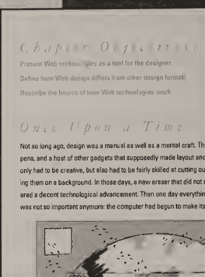

### 注释

注释贯穿全文，提供关于特定主题的有用提示和技巧。

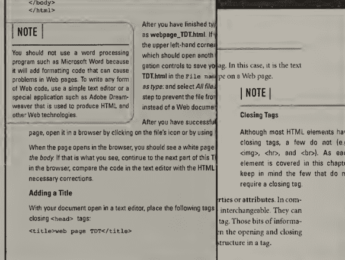

### 侧边栏

侧边栏贯穿全文，提供关于特定主题的额外有价值信息。

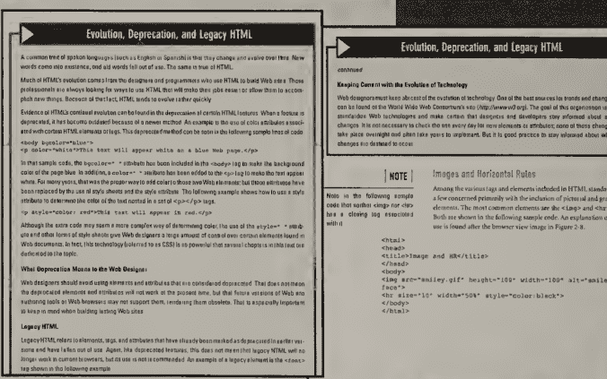

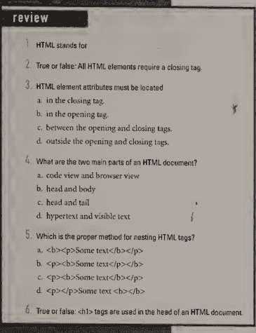

### 复习题

复习题位于每章末尾，允许读者评估他们对本章的理解。

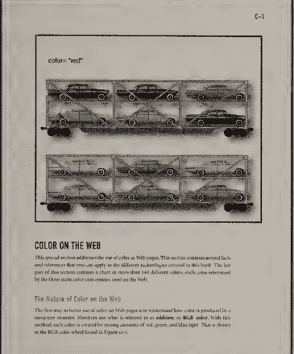

### 颜色部分

这个特殊的颜色部分解决了网页上使用颜色时遇到的许多问题。除了涵盖颜色的应用外，本部分最后还提供了一个全彩交叉参考图表，列出了超过144种不同Web颜色的HTML名称、十六进制代码和RGB值。

## 关于作者

▶ James Bennett从事设计与技术的融合工作已超过十年。1991年，他加入了南佛罗里达大学高度实验性的“艺术与技术实验室”，在新媒体爆发的初期开发屏幕图形和计算机动画。

作为一名Web开发人员和设计师，他是一家媒体设计公司的负责人，该公司专门为娱乐和职业体育行业制作网站，他还为许多其他媒体公司担任技术顾问。

作为一名大学讲师，他曾在南佛罗里达大学和国际设计与技术学院-坦帕分校任教，目前担任Web设计与开发系主任，并负责研究生项目。他还作为学科专家和学术顾问参与了其他大学课程的开发。

James还是*《新媒体设计基础》*的作者；这本设计教科书目前在北美、欧洲、澳大利亚和亚洲的大学课程中使用。

## 致谢

与普遍看法相反，制作这样一本教科书并非作者独自在电脑前敲打就能完成的工作。虽然作者的名字醒目地印在书的封面上，但还有编辑、版面设计师、项目经理以及许多其他人在幕后同样努力工作，却很少能看到他们的名字以时尚的字体出现。我想花点时间感谢其中一些无名英雄。

因为要列出所有参与此项目的人员几乎不可能而不写上几页纸，所以我将只限于几位关键人物。话虽如此，我确实想整体认可Delmar团队：在我多年的经历中，我从未发现比Delmar Learning的人更专业和“有格调”的团队。

本项目的主要贡献者之一是Jim Gish。虽然他的正式头衔是收购编辑，但他扮演着一长串其他角色，从创意顾问到项目背后的推动力。除了他所有非正式的头衔外，我想再加一个：*朋友*。Jim和我一起经历了两本书和一些较小的项目……我无法想象如果没有他的支持和指导，这一切会是什么样子。

另一位重要人物是Nicole Bruno。她的产品经理头衔也未能描述她实际所做的工作。简而言之，她是将项目粘合在一起的胶水，是保持引擎运转的机械师。仿佛这两项艰巨的任务还不够，我从未见过她在职责之外犹豫不决，也从未害怕在生产高质量产品时全力以赴。

最后，我想感谢Thomson Delmar的内容项目经理Andrea Majot和GEX Publishing Services的项目经理Erin Carruth。如果将编辑一本书比作挖井，我不得不说这两位伟大的专业人士（也是优秀的人）在我旁边做了大量的挖掘工作。在写作过程中最艰苦的部分，她们每天都和我在一起。

## 章节目标

-   阐述网络技术作为设计师工具的作用
-   定义网络设计与其他设计形式的区别
-   描述网络技术运作的基本原理

## 曾几何时...

不久前，设计还是一门兼具手工与心智的技艺。设计师的工具是铅笔、钢笔，以及一堆据称能让排版和图像处理更轻松的小玩意。设计师不仅要有创造力，还得相当擅长剪下小块文字并粘贴到背景上。在那个年代，一块不会弄脏作品的新橡皮都被视为相当不错的技术进步。然后有一天，一切都变了，那块精巧的橡皮不再那么重要了：电脑开始进入设计工作室。

起初，设计纯粹主义者们抵制，许多人奋力反抗这种新机器对他们工作场所的侵入。其他设计师则看到了这个新工具的优势，“要么适应，要么淘汰！”成了他们的战斗口号。

随着电脑变得更快、更复杂，设计领域经历了一场革命。尺子和丁字尺开始积灰，铅笔在纸上划过的沙沙声被鼠标的点击声所取代。那些拥抱新技术的人，如今正乘着一股生产力浪潮高歌猛进，其效率远超旧有的工作方式。他们是新一代的设计师，而电脑就是他们的工具。

## 另一场革命

设计工作室并非唯一被电脑革命化的地方。电脑进入了办公室、仓库，最终进入了家庭。不久之后，有人灵机一动，想到将所有电脑连接起来；于是互联网诞生了。

互联网发展得非常顺利——事实上，它变得如此成功，以至于成为商业和娱乐的主要沟通方式。不过，有一个问题：网页。

网页本身不是问题所在；问题在于这些页面看起来很丑陋，并且由于糟糕的设计，常常难以阅读。尽管并非所有网站都是如此，但设计拙劣的网页数量如此之多，以至于给所有网页都带来了坏名声。

讽刺的是，在几乎其他所有媒介中，设计师都留下了他们的印记（双关语），并运用他们的技能和创造力将每种媒介提升到更高的设计和沟通水平。设计师知道如何在印刷品、电视以及几乎所有其他视觉媒介中有效地使用图像和图形；但创建网页所需的代码，对设计师来说常常被证明是一个思维上的绊脚石。在他们看来，编码太像编程了，网站暂时被归入了计算机程序员的领域，而非创意设计师的领域。

不久之后，企业、广告商和其他专业团体开始利用互联网。这些企业家明白良好设计对沟通的重要性，并且熟悉媒体素养高的公众的挑剔品味。如果他们希望自己的网站成功，他们知道需要设计师的技能。一些勇敢的人将他们的设计技能带到了网络上；就像那些最初与电脑作为新设计工具搏斗的设计师一样，网络设计师们获得了丰厚的回报。

## 此时此刻

互联网正准备成为社会的主要沟通形式。与过去的主要媒体创新不同，对网站数量或使用人群没有严重限制。这与过去其他媒体创新（如电视）不同。拥有电视台的高昂成本和许可要求使得小型公司几乎不可能使用这种媒介，更不用说运营和管理一个广播设施了。即使是大公司也被迫从控制整个行业的一小群媒体公司购买广告时段。另一方面，网站几乎可以被任何人拥有，并且对大小企业都具有成本效益。这意味着，随着越来越多的公司开始依赖其网络存在，将需要更多的设计师来创建这些网站。设计师们再次面临着与电脑开始进入工作室时首次遇到的“要么适应，要么淘汰！”困境相同的情况：他们必须掌握新技能，否则就会被甩在后面。

## 对代码的恐惧

对许多设计师来说，编写创建有效网页所需代码的想法令人生畏。然而，这些代码并不比电脑对过去那些“只用铅笔和钢笔”的设计师更具威胁性。就像学习使用电脑作为设计工具一样，克服“代码恐惧”就像接受设计不止一种方法一样简单。

掌握网络技术及相关代码的第一步，是摒弃只有少数人才能学会的想法，这与许多人过去对使用电脑进行设计的看法如出一辙。用于构建优秀网站的技术是设计师的新工具，它们属于设计师。设计师只需要重新思考他们对使用这些工具的任何偏见。事实是，当今使用的大多数网络技术都是为了呈现图像和图形以及构建布局而创建的。换句话说，网络技术是成熟的开发工具。

## 但为什么要学习代码？

随着每个新版本的发布，**WYSIWYG**（所见即所得）编辑器在无需设计师瞥一眼代码的情况下生成网页设计和布局的能力越来越强。但无论软件有多好，它在功能上仍然极其有限。想象一位艺术家试图仅用黑色和红色颜料创作一幅日落画；这可以做到，但如果艺术家的创造力不受缺乏合适工具的限制，这幅画会好得多。这并不是说像Adobe Dreamweaver这样的WYSIWYG编辑器不是好工具。它们非常有用，非常适合执行某些任务，但它们都有其局限性。幸运的是，当设计师在做一些真正有创意的事情时，它们都允许设计师手动添加代码。

学习如何充分利用网络技术，可以比作购买一台廉价相机拍快照与成为一名专业摄影师之间的区别。专业摄影师知道相机如何工作，并可以调整设置以获得令人印象深刻的图像和效果。而新手则只是对准相机拍照。有时照片效果不错；有时则不然。即使照片不错，也很少达到专业水准。简而言之，新手受限于其知识的缺乏，并受制于他的相机。

对于HTML和JavaScript等网络技术，情况也大同小异。当设计师理解这些技术如何运作时，他就能够进行调整，这可能意味着一个网站只是尚可，还是一个设计精良、体现了他所有创意努力的网站之间的区别。

## 一些新的设计概念

许多初次将网页作为媒介的设计师，常常犯限制自己创造力的错误。这样做（无论他们是否意识到）是因为他们试图在设计网页时采用与处理印刷页面相同的方法。虽然印刷材料和网页的布局确实相似，因为它们都是二维的，但网页可以做许多印刷品无法做到的事情。这些选项大多涉及观众与媒体的互动。设计师必须理解这些元素，并将其作为每个设计的一部分来运用。以下是网页和网站与其他设计呈现方式的不同之处。设计师会发现这些简要的概念描述很有用。

## 网站允许观众选择

书籍、电影和大多数其他设计媒介有一个共同点：它们是严格线性的。线性意味着信息以规定的顺序呈现，观众很少有选择余地。然而，在网站上，观众可以使用超链接访问他们正在寻找的特定信息，或者从一个内容跳转到另一个内容。

## 线性与非线性

尽管读者可以自由地跳过书中的几个章节，但他可能会错过重要信息。这种内容顺序被称为**线性**（即，从一个点沿着一条线到下一个点）。

相比之下，优秀的网页设计会将所有信息划分为更小的完整单元，这些单元可以按任意顺序访问。这种内容顺序被称为**非线性**。例如，一个包含多篇文章的网站，每篇文章都有自己的链接。访问该网站的访客可能不会从第一个链接开始，按顺序浏览整个网站直到结束。相反，他会直接跳转到自己感兴趣的区域。

在设计网站时，牢记这一点非常重要。引导观众前往特定区域是可以接受的，但更好的做法是让他们有选择权，因为这正是该媒介的本质。

## 网站允许增长

在购买或借阅一本书或杂志后，如果你在阅读时突然发现多了五十页新内容，你会感到惊讶。网站则不然。它们可以轻松扩展，新信息也能快速添加。

设计师应为未来的增长做好规划，不要受限于当前设计。想象一个新闻网站布局，其空间只够放置十个重要文章的链接。如果同一天发生了十一个具有新闻价值的事件会怎样？在设计网页布局时，设计师可以假设网站未来会增长。

## 网站可以允许访客参与

许多网站允许参与和互动。观众可以添加评论、提问、玩游戏，甚至添加自己的内容，这些在其他形式的设计媒体中都是有限的。事实上，正是这种参与能力使得互联网和许多网站如此独特。

这种互动如何能为网站带来优势的一个例子是访客可以发布消息的区域。有了这个功能，网站的内容会不断变化，访客会经常回来阅读新材料，并查看其他人发表的评论。这种参与增加了网站流量，并让相同的访客反复回访网站。因此，设计师应该思考如何让网站的访客能够参与进来。

## 网络技术：它们如何工作

本章的这一部分将以易于理解的格式解释一些网络技术基础知识。文本不会对计算机和网络进行冗长乏味的讨论；相反，将介绍一些通用概念，以帮助设计师充分利用各种网络技术。

> 注意

**技术**的定义是“与其他元素协同工作或依赖其他元素来执行其功能的东西。”对于本书涵盖的材料来说，这是一个有用的定义，因为所介绍的每项技术都依赖于其他技术来完成其工作。例如，CSS 和 JavaScript 需要 HTML 或 XHTML 才能与网页协同工作，网页需要浏览器将代码转换为可查看的内容，而浏览器则依赖于客户端和服务器使用的系统。尽管每项网络技术的具体细节将在后续章节中介绍，但以下是对这些技术如何协同工作的简要概述。

**万维网联盟 (W3C)**

万维网联盟 (W3C) 是一个为网络技术制定标准和指南的国际组织。其网站 (http://www.w3.org) 是获取本书涵盖的许多主题额外信息的绝佳资源。

## 网络浏览器

网络浏览器是允许观众查看网页的计算机应用程序。最受欢迎的浏览器包括 Internet Explorer、Firefox、Safari 和 Netscape；但还有许多其他浏览器。即使你的互联网服务提供商 (ISP) 似乎有自己的浏览器，实际上，你用来查看网页的应用程序很可能基于前面列出的浏览器之一。

本质上，网络浏览器解释来自各种网络技术的代码，并使用它以网页的形式呈现图像和图形。代码是一系列指令，可以比作给某人提供前往特定地点的驾驶方向（例如，进入左车道，在第二个红绿灯处右转等），只不过代码是给浏览器的指令。基本上，这些指令解释了页面将如何显示。换句话说，代码关注的是布局和设计。

该过程如图 1-4 所示。

```
<html>
<head>
<title>WTG Home Page</title>
</head>
<body>
<table>
<tr>
<td></td>
</tr>
<tr>
<td>
</td>
</tr>
</table>
</body>
</html>
```

图 1-4
浏览器解释 Web 文档中的代码，并使用它来显示排列在网页上的图像和图形。

从这个... ...到这个。

## 客户端和服务器

既然已经对浏览器进行了简单的解释，本节将讨论代码如何到达浏览器。当个人查看网页时，通常至少涉及两台计算机：观众用来查看网页的计算机，以及存储待浏览器解释的**网页文档**（代码页面）的计算机。观众使用的计算机称为**客户端**，而托管网页文档的计算机是**服务器**。这种关系的简单说明如图 1-5 所示。

当客户端计算机联系服务器时，请求的网页文档会发送回客户端，由浏览器显示。这个逐步过程如图 1-6 所示。

图 1-5
客户端和服务器。

## 幕后：网页如何从服务器发送到客户端。

观众通过输入地址或点击超链接请求网页。

页面请求通过互联网发送到托管该网页的服务器。

服务器在其托管的其他文档中定位正确的网页文档。

网页文档通过互联网发送回观众的计算机。

观众计算机上的浏览器解释网页文档并将其显示为网页。

图 1-6

请求的网页如何从服务器传输到客户端的逐步说明。

## 客户端脚本与服务器端脚本

图 1-6 显示了简单网页上的信息如何从一台计算机传输到另一台计算机；但在包含脚本（如搜索功能或其他交互元素）的网站中，会发生两种不同的过程。接下来将解释每种过程。

## 幕后：客户端脚本

网页代码和脚本从服务器发送到客户端计算机。

观众通过界面输入信息。

观众信息在客户端计算机上的脚本中运行。

脚本的结果随后在浏览器中显示。

图 1-7

客户端脚本过程的逐步说明。

## 客户端脚本

两种脚本类型中的第一种称为客户端脚本，因为任何被处理的脚本都在客户端（观众的）计算机上运行。客户端脚本的一个常见例子是当光标悬停在其上时会改变的图像。这种效果通常用于网页上的导航按钮。图 1-7 显示了脚本如何从服务器下载并在客户端计算机上运行的逐步过程。

如图所示，浏览器所需的所有代码都通过网页文档发送到客户端。由于浏览器已经拥有所需的一切，它可以快速高效地运行脚本。

## 服务器端脚本

服务器端脚本更为复杂，可能涉及客户端计算机与服务器之间的多次信息交换。此过程如图1-8所示。

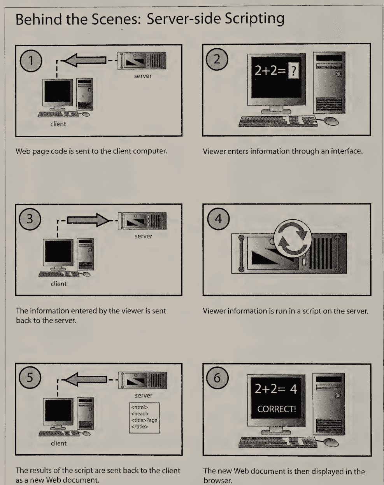

图1-8：服务器端脚本过程的逐步图解。

尽管服务器端脚本耗时稍长且稍显复杂，但它确实有其优势。一个优势是它确保脚本能够准确运行，不受访问者的干扰。例如，如果在线购物车作为客户端脚本运行，访问者可以访问下载的代码并更改任何商品的价格（例如，将五台新立体声音响的价格从原价每台500美元改为每台5美元）。除了安全性之外，在服务器上运行脚本还有助于防止因浏览器版本不同而可能出现的问题。

> 注意：本书涵盖的所有Web技术都侧重于客户端计算机和客户端脚本，因为它们对设计师最为重要。此处对服务器端脚本进行了解释，以便设计师理解两种方法之间的区别。

## 总结

本章介绍了将Web代码作为设计工具的概念。此外，本章重点介绍了一些使基于Web的媒体区别于其他更传统媒体的呈现方法。本章最后对网页如何通过互联网传递进行了基本解释，并涵盖了两种主要的脚本方法：客户端脚本和服务器端脚本。

## 复习

1. 判断正误：许多Web技术可以被视为布局和设计的工具。
2. 判断正误：理解Web代码使设计师能够超越标准所见即所得编辑器的功能。
3. 判断正误：网站应该规定访问者看到信息的顺序。
4. 以下哪项*不是*本章所涵盖的基于Web的媒体的能力？
   - a. 允许访问者选择内容顺序
   - b. 允许内容的增长和扩展
   - c. 允许访问限制和按次付费网站
   - d. 允许访问者交互和参与
5. 使用什么计算机应用程序或软件来查看网页？
6. 哪台计算机查看网页？
   - a. 客户端
   - b. 服务器
   - c. 主机
   - d. 浏览器
7. 哪台计算机托管网站？
   - a. 客户端
   - b. 服务器
   - c. 浏览器
   - d. Internet Explorer
8. 判断正误：客户端脚本在访问者的计算机上运行。
9. 判断正误：服务器端脚本在浏览器中运行。
10. 以下哪项是浏览器？
    - a. Internet Explorer
    - b. Safari
    - c. Firefox
    - d. 以上全部

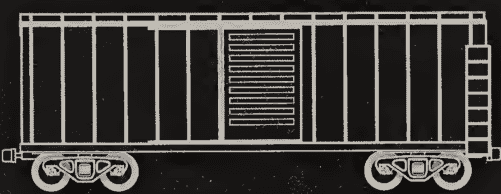

```html
<body>
    
        <h1>Welcome!</h1>
    <a href="about.htm">
        About Us
    </a>
    <a href="contact.htm">
        Contact
    </a>
    <a href="services.htm">
        Our Services
    </a>
</body>
```

HTML和网站基础

## 章节目标

- 将HTML作为设计工具进行介绍
- 定义和解释HTML
- 回顾HTML标签的使用
- 回顾HTML属性和特性

## HTML与网页设计

当设计师开始探索Web技术的使用时，她通常从基本的HTML开始。不幸的是，她初次接触HTML可能会导致一种文化冲击。设计师在查看网页的源代码时，对她所遇到的情况毫无准备。（是的，乍一看，它确实像古老的梵文。）设计师可能对自己理解计算机代码的能力存在任何负面偏见，这通常会使她对HTML的初次体验变得更糟。这两个因素结合在一起，可能会损害设计师在使用Web技术时的信心。

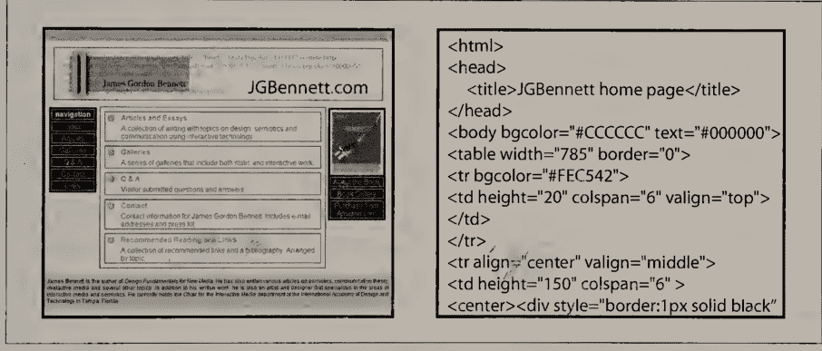

图2-1：网页的浏览器视图及其创建所用的HTML代码。

## 重新思考HTML

无论设计师是初次使用HTML，还是已经构建了数十个网站，她可能会发现暂时搁置已知的使用方法，重新思考一些概念是有用的。在本章中，HTML将更多地作为设计师的工具来介绍，而不是像困难的计算机代码。尽管这种看待HTML的新方式可能会让一些编程纯粹主义者感到困扰，但它对设计师很有用。它也使设计网页变得容易得多。

## 设计师视角下的HTML

HTML代表**超文本标记语言**，这个名称非常描述性地说明了HTML是什么以及它如何工作。通过分析*HTML*中的每个单词，可以更好地理解这个术语。

*HTML*中最常被识别的部分是*语言*这个词。*语言*的一个简单定义是“一个用于交流的规则系统”。因此，本质上，HTML是一个用于交流的规则系统。

HTML名称中的第二个词是*标记*，指的是编码的**标签**（例如，`<body>`和``），它们规定了计算机文档的格式。换句话说，标签用于控制文档中包含的部分（例如段落和图像）的视觉外观。将这两个术语（*标记语言*）结合起来，HTML是一套用于控制文档中项目外观的编码标签规则。

剩下的词*超文本*，是为指代通过计算机应用程序（如浏览器）链接和交叉引用的文档集合而创造的。但思考*hyper*的传统古希腊定义也很有帮助，它的意思是“在...之上或超越”。有一个关于一群被称为Hyperboreans的人的希腊传说。根据神话，这些人生活在北风（*boreas*）之北（*hyper*）。从这个意义上说，*超文本*可以被认为是超越通常呈现的文本的东西，或者不作为所见内容一部分出现的东西。

将所有这些结合起来，提供了HTML的明确定义：一套在网页内容中不可见的规则和标签，控制着页面每个部分的外观。换句话说，HTML是设计网页格式的工具。

## HTML标签

尽管有许多不同的HTML标签，但它们都具有易于学习的共同特征，其中首先是标签的基本结构。图2-2显示了使用常见HTML标签的正确结构。在图中，每个部分都用数字标出。

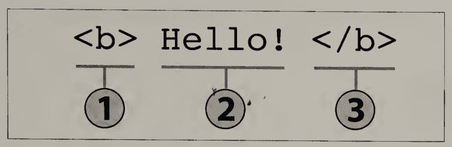

HTML标签使用的基本结构由三部分组成：**开始标签**、标签影响的元素和**结束标签**。接下来描述每个部分。

图2-2中显示的第一部分是开始标签。它由一个小于号（<）、标签名称或元素类型（p）和一个大于号（>）组成。所有HTML开始标签都遵循相同的基本结构。唯一的区别在于标签名称，它指示了所使用标签的类型。表2-1包含了一些不同标签的示例及其使用说明。

表2-1：一些基本的HTML标签及其用途。

| HTML标签 | 用途 |
| :--- | :--- |
| `<b>` | 使文本加粗 |
| `<i>` | 将任何文本设置为斜体 |
| `` | 用于将图像插入网页 |

图2-2的第二部分是受标签影响的元素。在本例中，它是文本*Hello!*。由于使用了`<b>`标签，该单词在网页上将以粗体显示。

图2-2的第三部分是结束标签。它与开始标签非常相似，只是包含一个斜杠（/）以表示它关闭了前面的标签。

> **注意：结束标签**
>
> 虽然大多数HTML元素都有结束标签，但有些没有（例如，``、`<hr>`和`<br>`）。在本章介绍每个元素时，请记住少数不需要结束标签的元素。

看待HTML标签结构的另一种方式是将标签视为给Web浏览器的一组指令。标签告诉浏览器如何格式化它们之间的任何内容。

## 属性或特性

HTML标签的另一个常见结构是包含**属性**或**特性**。在常见的Web术语中，*属性*和*特性*这两个词已经可以互换使用。它们可以被视为标签中包含的额外信息片段。这些信息片段进一步影响开始标签和结束标签之间任何内容的外观。图2-3显示了属性的包含及其在标签中的正确结构。

## 属性规则

添加属性时请牢记以下两条规则：(1) 仅在开始标签内编写属性，以及 (2) 通过命名（即 `id` 和 `src`）正确输入属性，然后插入等号和引号内的属性值。

对于许多 HTML 标签，也可以为同一元素添加多个属性。以下示例展示了如何在同一个标签中使用多个属性。

```

```

请注意，在 `` 标签内添加每个属性时都使用了相同的规则：每个属性都有一个等号，后跟引号内的属性值。唯一的区别是开始标签内包含了多个属性。

在属性的使用上，并非所有 HTML 标签都具有相同的属性。例如，``（用于在网页上放置图像）可以利用 `height=" "` 和 `width=" "` 属性来控制图像的大小，但其他元素可能没有高度和宽度作为属性。当你开始使用各种标签时，你应该熟悉每个元素可用的属性。

## 标签嵌套

除了 HTML 标签的常见结构外，在文档中放置标签时还有一些规则和实践需要遵循。其中一条规则称为**嵌套**，即将一组标签放置在另一组标签内。如果你记住开始标签和结束标签之间的一切都会影响标签之间的内容，这个概念会更容易记住。以下是嵌套的示例和解释。

```
<p><b> Hello!</b></p>
```

如果在 Web 浏览器中查看该代码，文本 *Hello!* 将以粗体显示，因为它被包含在开始和结束 `<b>` 标签内。`<b></b>` 标签被包含在 `<p></p>` 标签内，因为即使 `<p></p>` 标签在浏览器视图中不显示，它们也是同一段落的一部分。以下是 HTML 标签正确和不正确嵌套的其他示例。

### 正确嵌套

```
<p><i>This line is in italic.</i></p>
<p><b>Greetings!</b> <i>How are you?</i></p>
```

### 不正确嵌套

```
<p><i>This line is green and appears in italic.</p></i>
<b><p>Greetings!</b><i>How are you?</p></i>
```

尽管在许多 Web 浏览器中使用不正确嵌套的标签不会出现问题，但某些未正确嵌套的标签可能会导致严重问题。此外，网页编码的标准正变得越来越严格，未来的浏览器版本最终会在使用不正确嵌套的标签编码网页时返回错误。因此，从一开始就学习正确的编码技术比在不良嵌套不再被接受后重新学习要容易得多。

## 网页的结构

最基本的网页只需要几个简单的 HTML 标签。这些标签构建了页面的基础，并告诉浏览器如何处理嵌套在其中的任何元素。这些基础标签的第一组是开始和结束 `<html>` 标签，如下例所示。

```
<html>
</html>
```

在基本的 HTML 文档中，开始 `<html>` 标签放在第一行，并通知浏览器标签之后的所有内容都应被视为 HTML。结束 `</html>` 标签应放在 HTML 文档的最后一行，以便所有其他内容都位于这两个标签之间。请参见图 2-4 的说明。

图 2-4：网页的所有部分都放置在开始和结束 `<html>` 标签之间。

## 网页的头部和主体

插入 `<html>` 标签后，HTML 文档被分为两部分。这两部分是**头部**和**主体**，使用以下标签创建：

```
<head>
</head>
<body>
</body>
```

HTML 文档的头部和主体用于组织网页中的不同元素。请参见图 2-5 的说明。

HTML 文档的头部用于放置网页中不会出现在浏览器窗口中的信息。头部通常包含页面的标题，该标题显示在浏览器的工具栏上方。头部还可以包含脚本、元标签和其他作为页面一部分但不是观众会看到的内容。

另一方面，主体是设计者放置网页所有元素的地方，这些元素将被网站访问者看到或使用。与汽车相比，放置在文档头部的对象就像引擎盖下的物品：发动机、电池以及所有其他在驾驶时不需要看到的部件。另一方面，主体可以比作乘客舱，包含舒适的座椅和驾驶员所需的各种控件。网页头部和主体的使用将在以下 TDT 中探讨。

## 技术实践
构建一个简单的网页

在这个 TDT 中，你将使用 HTML 创建一个简单的网页。首先，打开一个文本编辑器，如 Microsoft Notepad。

打开文本编辑器后，输入以下 HTML 代码：

```
<html>
<head>
</head>
<body>
This text is in the body.
</body>
</html>
```

> 注意
你不应该使用像 Microsoft Word 这样的文字处理程序，因为它会添加格式代码，这可能会在网页中导致问题。要编写任何形式的 Web 代码，请使用简单的文本编辑器或特殊应用程序，如 Adobe Dreamweaver，用于生成 HTML 和其他 Web 技术。

输入完代码后，将文档保存为 **webpage_TDT.html**。如果你使用的是 Notepad，请单击窗口左上角的 *File*；然后单击 *Save As*，这应该会打开另一个窗口。使用窗口的导航控件保存文档；然后在 *File name:* 框中输入 **webpage_TDT.html**。在该框下方，单击 *Save as type:* 并选择 *All files*。一些文本编辑器需要这最后一步，以防止文件被保存为标准的 .txt 文件而不是 Web 文档。

成功将文档保存为网页后，通过单击文件的图标或使用浏览器导航到该文件，在浏览器中打开它。

当页面在浏览器中打开时，你应该看到一个白色页面，显示文本 *This text is in the body*。如果这就是你看到的内容，请继续到此 TDT 的下一部分。如果在浏览器中没有看到该句子，请将文本编辑器中的代码与前面提供的 HTML 进行比较，并进行必要的更正。

### 添加标题

在文本编辑器中打开文档后，在开始和结束 `<head>` 标签之间放置以下标签和文本：

```
<title>web page TDT</title>
```

添加此内容后，保存你的工作并在浏览器中再次查看。如果你在进行更改时保持浏览器打开，你将需要单击刷新按钮以加载更改。如果页面标题添加正确，你将看到标题 *web page TDT* 出现在浏览器的工具栏上方。

> **注意**
在此 TDT 中添加的属性 `style="color: red"` 与另一种称为 CSS 的 Web 技术有关。CSS 将在本章后面简要介绍，并在后续章节中更详细地介绍。

### 添加属性

在此 TDT 的最后一部分，你将添加影响主体中文本的标签和属性。同样，在文本编辑器中打开文档并添加以下代码。确保 This text is in the body. 嵌套在开始 `<p>` 和结束 `</p>` 标签内，如下所示。

```
<p style="color: red">This text is in the body.</p>
```

添加内容后，保存你的工作并在浏览器中查看。如果你正确编写了所有内容，文本应该以红色显示。

## HTML 标签及其用途

本章的这一部分将按用途分组介绍标准 HTML 标签。本部分将提供每组的简要解释，给出正确的 HTML 代码示例，并展示代码在 Web 浏览器中的显示方式。如果你已经熟悉这些 HTML 标签，可以将此部分用作复习和参考。但是，如果你是 HTML 新手，你应该通过在文本编辑器中输入代码并在浏览器中查看来测试代码。这样做将使你获得关于所使用的每个标签的第一手知识。

### 标题和文本格式

这第一组 HTML 标签包括标题和其他用于排列文本的基本标签。这些标签以代码形式显示，然后在图 2-6 中以浏览器视图显示。示例代码和浏览器视图之后是对每个标签的简要解释。

```
<html>
<head>
<title>Headings and Text Formatting</title>
</head>
<body>
<h1>This line uses the level 1 heading.</h1>
<h2>This line uses the level 2 heading.</h2>
<h3>This line uses the level 3 heading.</h3>
<h4>This line uses the level 4 heading.</h4>
```

## 标题标签

标题标签用于格式化文档标题，其大小范围从最大（<h1></h1>）到最小（<h6></h6>）。

## 段落标签

位于开始和结束 `<p></p>` 标签之间的任何文本，在格式化时都被视为一个独立的段落。

## 预格式化标签

文本的预格式化通过使用 `<pre></pre>` 标签来实现。这些标签使文本在浏览器中的显示方式与代码中的排列方式一致，包括行、空格和换行。

## 引用标签

引用标签（`<q></q>`）用于格式化其他文本主体内的引文。

## 块引用标签

块引用用于格式化较大的引文，并使用 `<blockquote></blockquote>` 标签。

## 换行标签

换行标签（`<br>`）用于将标签后的任何文本置于下一行开始。请注意，没有对应的结束 `</br>` 标签。

## HTML 注释

在 HTML 文档中包含注释通常很有用。基本上，注释是给你自己或其他将阅读你代码的设计师的笔记。注释可以提醒你某段代码的功能，或者给其他将处理该网页文档的设计师提供说明。HTML 注释使用以下代码编写：

```
<!-- This is an HTML comment. -->
```

使用 HTML 注释的一个优点是它们不会在浏览器中显示。这意味着你可以随意添加笔记，而不会干扰页面的外观。HTML 注释也可以有多行，因为所有文本都包含在一个标签内。多行注释可能如下所示：

```
<!--This comment uses
more than a single line.
-->
```

## 字符和列表格式化

下一组标签用于格式化字符和在文档中构建列表。这些标签在图 2-7 中以示例代码和浏览器视图的形式展示。代码和图片之后是对每个标签的解释。

```
<html>
<head>
<title>Character and List Formatting</title>
</head>
<body>
<b>This text is bold.</b>
<i>This text is in italic.</i>
<u>This text is underlined.</u>
This line contains <sup>superscript</sup>.
This line contains <sub>subscript</sub>.

An ordered list:
<ol>
<li>cats</li>
<li>dogs</li>
<li>mice</li>
</ol>

An unordered list:
<ul>
<li>cats</li>
<li>dogs</li>
<li>mice</li>
</ul>

</body>
</html>
```

## 粗体、斜体和下划线标签

作为字符格式化的粗体、斜体和下划线是不言自明的。用于这些文本处理的标签分别是 `<b></b>`、`<i></i>` 和 `<u></u>`。请注意，尽管下划线标签目前仍可接受，但在未来的浏览器版本中可能无法工作。该主题将在本章下一节中解释。

## 上标和下标标签

上标和下标标签用于格式化位于标准行上方或下方的文本。它们可用于创建指数、注释等的文本格式。

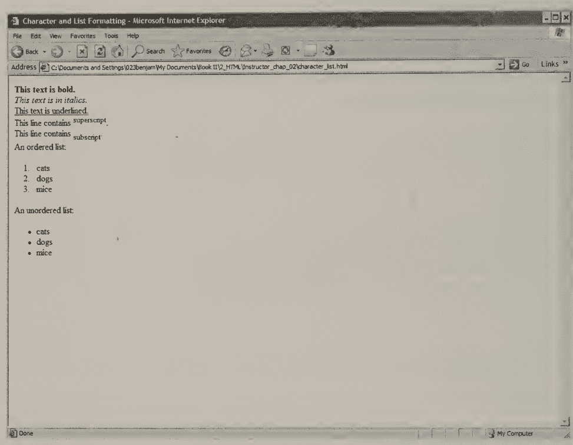

图 2-7
在浏览器中查看的前述代码。

## 列表标签

列表标签用于格式化 HTML 文档中的列表，通常分为两种：有序列表和无序列表。在这两种情况下，列表中的每个项目都写在开始和结束 `<li></li>` 标签之间。决定列表是有序还是无序的是列表项目嵌套在其中的标签：有序列表使用 `<ol></ol>`，无序列表使用 `<ul></ul>`。要查看列表项目如何嵌套在这些标签中，请参考前面的代码示例。

有序列表和无序列表在外观上的区别在于，有序列表中的项目是编号的，而无序列表中的每个项目前都有项目符号。

> **注意**
在当前的 HTML 标准中，列表元素的结束标签（`</li>`）是可选的，但尽可能包含所有结束标签是一种良好的实践。

## 演进、弃用和遗留 HTML

口语（如英语或西班牙语）的一个共同特征是它们会随时间变化和发展。新词产生，旧词不再使用。HTML 也是如此。

HTML 的大部分演进来自于使用 HTML 构建网站的设计师和程序员。这些专业人士总是在寻找使用 HTML 的方法，以使他们的工作更轻松或能够完成新的事情。由于这个事实，HTML 往往发展得相当快。

HTML 持续演进的证据可以在某些 HTML 功能的**弃用**中找到。当一个功能被弃用时，它已经因为更新的方法而过时。一个例子是与某些 HTML 元素或标签相关的颜色属性的使用。这种弃用的方法可以在以下示例代码行中看到。

```
<body bgcolor="blue">
<p color="white">This text will appear white on a blue Web page.</p>
```

在该示例代码中，`bgcolor=" "` 属性已包含在 `<body>` 标签中，以使页面的背景颜色为蓝色。此外，`color=" "` 属性已添加到 `<p>` 标签中，以使文本显示为白色。多年来，这是为这两个网页元素添加颜色的正确方法；但这些属性已被样式表和 style 属性的使用所取代。以下示例展示了如何使用 style 属性来确定嵌套在 `<p></p>` 标签集中的文本颜色。

```
<p style="color: red">This text will appear in red.</p>
```

尽管额外的代码可能看起来是确定颜色的一种更复杂的方式，但使用 `style=" "` 属性和其他形式的样式表为网页设计师提供了对网页文档中某些元素的大量控制。事实上，这项技术（称为 CSS）非常强大，以至于本书中有多个章节专门讨论该主题。

## 弃用对网页设计师意味着什么

网页设计师应避免使用被认为已弃用的元素和属性。这并不意味着弃用的元素和属性在当前无法工作，而是指网站创作工具或网页浏览器的未来版本可能不支持它们，使其过时。在构建持久性网站时，这一点尤其需要牢记。

## 遗留 HTML

遗留 HTML 指的是在早期版本中已被标记为弃用并已不再使用的元素、标签和属性。同样，与弃用功能一样，这并不意味着遗留 HTML 在当前浏览器中将无法工作，但不建议使用。遗留元素的一个例子是以下示例中显示的 `<font>` 标签。

```
<font color="red">This line of text is created using legacy HTML.</font>
```

如前所述，`<font>` 标签在某些浏览器中仍然有效，但它在几个 HTML 版本前就已被宣布弃用。`<font>` 元素的使用已从主要的网站创作工具中移除，并且在不久的将来可能完全不再使用。

## 演进、弃用和遗留 HTML（续）

**紧跟技术演进的步伐**

网页设计师必须紧跟技术的演进。趋势和变化的最佳来源之一可以在万维网联盟（W3C）的网站（http://www.w3.org）上找到。该组织的目标是标准化网络技术，并确保设计师和开发者了解任何变化。没有必要每天检查网站以获取新的元素或属性；这些变化都不是一夜之间发生的，通常需要数年才能实施。但了解哪些变化注定会发生是一种良好的实践。

## 图像和水平线

HTML 标准中包含的各种标签和元素中，有几个主要涉及图像和图形元素的包含。最常见的元素是 `` 和 `<hr>` 标签。两者都在以下示例代码中展示。它们的用法说明见图 2-8 中的浏览器视图图像之后。

> 请注意，在以下示例代码中，`` 和 `<hr>` 都没有与之关联的结束标签。

```
<html>
<head>
<title>Image and HR</title>
</head>
<body>

<hr size="10" width="50%" style="color:black">
</body>
</html>
```

## 图像标签

`` 标签用于在网页中包含图像。`` 元素内有几个重要属性。第一个是 `src=" "`，它告诉浏览器使用哪个图像文件。在前面的示例代码中，`src` 属性被设置为 `smiley.gif`（`src="smiley.gif"`）。当在浏览器中查看网页时，该图像将显示在网页上。仅当图像文件与包含该图像的网页位于同一文件夹中时，使用与 `src` 属性相同的文件名才能正常工作。如果图像文件放置在 Web 服务器上的另一个文件夹中（即名为 `images` 的文件夹），则 `src` 属性必须包含文件路径才能定位文件。示例如下。

```

```

在该示例中，文件夹名称（`images`）后跟一个斜杠（`/`）已添加到 `src` 属性的值中。这样做为浏览器提供了图像文件的位置。

## 网页的图像文件类型

只有三种图像文件与大多数 Web 浏览器兼容。最常见的是 `.jpg` 和 `.gif`，而 `.png` 正日益普及。这些图像文件类型中的每一种都最适合特定用途。这些用途的简要指南见表 2-2。

**表 2-2：用于网站的图像文件类型。**

| 图像文件类型扩展名 | 最适合用于... | 特殊功能 |
| :--- | :--- | :--- |
| .gif | 纯色图形和包含文本的图像 | 允许图像的部分区域透明 |
| .jpg | 包含细微颜色变化的类照片图像 | 允许包含大量颜色 |
| .png | 类照片图像和文本 | 允许图像的部分区域透明 |

`` 元素内的另一组属性控制图像的高度和宽度。分配给每个属性的数字代表图像的像素尺寸。换句话说，`height="100"` `width="100"` 将导致图像高 100 像素、宽 100 像素，无论图像的实际大小如何。尽管这些属性看起来像是调整图像大小的有用工具，但通常不建议这样使用。一个原因是不恰当的比例会导致图像失真。例如，如果原始图像的宽度是高度的两倍，但高度和宽度属性被设置为其他比例以更好地适应网页布局，则其中一个维度将被拉伸以适应属性的值。这些结果的一个示例可以在图 2-9 中看到。

避免使用高度和宽度属性调整图像大小的另一个原因与下载时间有关。尽管图像的尺寸可能已被重置为较小的大小，但浏览器必须先下载原始图像，然后才能将其调整为适应特定属性。这比图像文件本身大小合适需要更多的下载时间。因此，当图像需要为网页布局调整为特定大小时，最好在 Adobe Photoshop 等应用程序中更改大小，并在网页上包含更改后的版本，而不是较大的原始文件。

前面 `` 示例中给出的最后一个属性是 `alt=" "`。图像的描述包含在 `alt` 属性的引号内。该信息以两种方式为查看者服务：(1) 当查看者使用不显示图像的浏览器时，`alt` 属性中的文本将出现在图像的位置并描述缺失的图像。(2) 当光标悬停在图像上时，描述会出现在一个小的浮动框中。简而言之，`alt` 属性是为查看者提供附加信息的一种方式。

## HR 标签

`<hr>` 中的 *hr* 代表“水平线”；在 Web 文档中包含此元素会在页面上创建一条水平线。在前面的示例代码中，`<hr>` 标签有三个属性：`size=" "`、`width=" "` 和 `style=" "`。`size` 属性控制线条的粗细（以像素为单位）。在给定的示例中，大小设置为 10；因此，`<hr>` 元素厚 10 像素。`width` 属性控制线条的长度，可以通过两种方式之一进行设置。第一种方式与 `size=" "` 属性非常相似，通过在引号之间键入一个数字来设置。该数字被浏览器解释为线条的长度（以像素为单位）（即 100 = 100 像素长，50 = 50 像素长）。第二种方式是包含一个数字后跟一个百分号，如示例代码所示。百分号告诉浏览器使线条的长度为线条所在区域的某个百分比。在前面的示例中，`width` 属性设置为 50%，这意味着 `<hr>` 元素将占网页宽度的 50%。如果查看者将浏览器窗口拉得更宽，线条的长度会增加，使其始终保持在网页宽度的 50%。

`<hr>` 标签中包含的最后一个属性是 `style=" "`。包含该属性是为了给线条添加颜色。

## 超链接

将站点、页面和其他元素链接到网页文档的能力是 HTML 的一个重要组成部分。实现此目的的最常见方法是使用超链接。

超链接通常显示为蓝色的带下划线文本部分，当查看者单击文本时会被激活。然后，与链接关联的网页或其他元素将在浏览器窗口中加载。超链接可以与图像或声音文件等对象关联，但它们最常见的用途是用于网页导航。以下代码给出了三种不同类型导航超链接的示例。

```
<html>
<head>
<title>Hyperlinks</title>
</head>
<body>
<a href="http://www.jgbennett.com">author's Web site</a><br>
<a href="somepage.html">some page</a><br>
<a href="#paragraphB"> paragraph B</a><br>

<a name="#paragraphB"><p>This paragraph is linked above by the anchor tag.</p></a>
</body>
</html>
```

在该示例代码中，每行之后都插入了一个 `<br>` 元素。`<br>` HTML 元素在浏览器中查看文本时会创建一个换行，并将后续元素放在下一行。请注意，`<br>` 元素没有结束标签。

### 链接到其他站点

示例超链接中的第一个用于将页面链接到另一个网站。它使用锚标签（`<a></a>`）并将 `href=" "` 属性设置为网站的网址，方法是在引号内包含 `http://www.jgbennett.com`。开始和结束 `<a></a>` 之间的文本将显示在网页上。当查看者单击文本时，浏览器将被定向到新站点。

默认情况下，新站点上的索引页将加载到浏览器中。但是，如果链接应将查看者定向到新站点上的特定页面，则 Web 文档的名称将包含在 `href=" "` 属性中，如下所示：

```
<a href="http://www.jgbennett.com/articles.htm">Author's Articles Page</a>
```

### 链接到同一站点中的其他页面

示例代码中的第二个超链接用于链接同一站点内的页面。它使用了第一个示例中的大部分代码，但 `href=" "` 属性的设置不同。在这种情况下，它被设置为 `somepage.html`，这是一个虚构的 Web 文档的名称。如果这是一个有效的链接，`href=" "` 属性将被设置为实际 Web 文档的名称，单击链接将在查看者的浏览器中加载指定的页面。

此方法仅在链接的文档与包含超链接的页面位于同一文件夹中时有效。如果链接的页面位于另一个文件夹中，则 `href=" "` 属性必须包含文档的文件路径，这与包含在网页中但位于不同文件夹中的图像文件类似。示例如下。

```
<a href="articles/hyperlinks.html">About Hyperlinks</a>
```

在该示例中，Web 文档 `hyperlinks.html` 位于 Web 服务器上名为 *articles* 的文件夹中。`href=" "` 属性中的文件路径允许浏览器找到正确的文件。

### 链接到同一页面的其他部分

示例代码中的最后一个示例创建了指向同一页面另一部分的链接。此技术对于提供对长文档其他部分的快速访问非常有用。在这种情况下，`href=" "` 属性被设置为 `#paragraphB`。当查看者单击链接时，文档似乎会在浏览器窗口中移动到另一个名为 `#paragraphB` 的锚标签的位置。为了使此代码正常工作，必须添加额外的内容。

## 图片作为链接

除了文本，超链接也可以应用于其他 HTML 元素。一个常见的例子是将超链接应用于图片。设置为链接的图片功能类似于常规超链接。换句话说，用户点击的是图片而不是文本。下面是一个示例。

```
<a href="somepage.html"></a>
```

在该示例代码中，`` 标签被嵌套在 `<a> </a>` 标签内。这告诉浏览器将该图片视为一个链接。当用户点击图片时，浏览器会加载新页面。当设计师想要创建按钮和其他导航元素，使其看起来比基于纯文本的链接更不单调时，使用图片作为超链接尤其有用。

## 总结

本章从设计师的角度回顾了创建 HTML 文档的基础知识。主题包括网页结构、属性的使用以及 HTML 的演变。除了这些主题，还以代码示例、浏览器视图插图和描述性解释的形式提供了基本 HTML 标签及其用法的示例。

## 复习

1. HTML 代表
2. 判断对错：所有 HTML 元素都需要一个结束标签。
3. HTML 元素属性必须位于
   a. 在结束标签中。
   b. 在开始标签中。
   c. 在开始和结束标签之间。
   d. 在开始和结束标签之外。
4. HTML 文档的两个主要部分是什么？
   a. 代码视图和浏览器视图
   b. 头部和主体
   c. 头部和尾部
   d. 超文本和可见文本
5. 嵌套 HTML 标签的正确方法是哪个？
   a. `<b><p>Some text</b></p>`
   b. `<p><b>Some text</p></b>`
   c. `<p><b>Some text</b></p>`
   d. `<p></p>Some text <b></b>`
6. 判断对错：`<h1>` 标签用于 HTML 文档的头部。
7. 判断对错：`` 标签必须包含 `src=""` 属性才能显示图片。
8. 哪些是 Web 使用的标准图片文件类型？
   a. .jpg, .bmp, .gif
   b. .jpg, .jif, .pig
   c. .gif, .jpg, .wav
   d. .jpg, .gif, .png
9. 判断对错：HTML 元素和属性的弃用对 Web 设计师来说无关紧要。
10. 判断对错：超链接仅链接 HTML 页面。

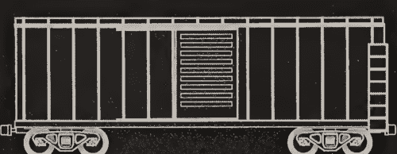

```
<table width="780">
<tr>
<td></td>
<td></td>
<td></td>
</tr>
</table>
```

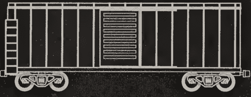

高级 HTML

## 章节目标：

- 学习如何使用转义实体
- 学习如何在 HTML 中创建表格
- 评估使用表格进行网页布局
- 探索框架在网站中的使用
- 了解元标签
- 探索在网页布局中使用流动单元格

## 谨慎前行

本章探讨了在创建网页时使用标记语言的各种方法。虽然大多数主题遵循建议的标准，但有几种方法被认为是不常规的；有些甚至是有争议的。然而，所有这些方法在某些情况下都是有用的。

当本章介绍一种非标准技术时，会给出支持和反对使用它的理由。作为设计师，你应该理解与其中一些方法相关的问题，并自行决定是否使用它们。

## 转义实体

设计师使用 HTML 等标记语言来创建标签和其他将被浏览器解释的元素。例如，要在网页上包含一张图片，设计师使用 `` 标签，并用小于号 (`<`) 和大于号 (`>`) 括起字符 *img*。这对于创建标签来说效果很好，但如果设计师想将 `` 作为网页文本的一部分（例如，在以下行中：*要在网页上插入图片，请使用 `` 标签。*）呢？不幸的是，浏览器会将 `` 解释为一个 HTML 元素，而不是文本的一部分。这将导致一个包含红色 X 的小方块出现在网页上 *the* 和 *tag* 这两个单词之间。

这个问题的解决方案在于使用**转义实体**。转义实体直接访问浏览器允许的任何字符集。它们可以被视为一小段代码，告诉浏览器将实体作为类型字符写入，而不是将其解释为标记语言的一部分。为了解决将 `` 作为网页文本一部分的问题，设计师会在代码中将 `<` 和 `>` 替换为 `&lt;` 和 `&gt;`。这样做会使 `` 作为文本的一部分显示出来。以下是使用正确代码的整行示例。

```
要在网页上插入图片，请使用 &lt;img&gt; 标签。
```

除了编写通常被解释为 HTML 的字符外，转义实体还可用于编写特殊字符，如分币符号 (`&#162;`) 或包含希腊语或中文等语言所需的字符（假设浏览器允许这些字符）。表 3-1 包含了网页设计中常用的一些转义实体列表。

表 3-1
常用转义实体。

| 字符 | 转义实体 | 名称 |
| :--- | :--- | :--- |
| < | &lt; | 小于号 |
| > | &gt; | 大于号 |
| & | &amp; | 和号 |
| " | &quot; | 双引号 |
| ' | &#39; | 单引号 |
| © | &#169; | 版权符号 |
| | &nbsp; | 不间断空格；创建一个空格 |

* 注意：表 3-1 中的最后一项不是写入一个字符；而是产生一个空格。当设计师在创建需要空格的网页或希望布局区域显示为空白时，该转义实体作为占位符非常有用。

大多数常见的转义实体由 Adobe Dreamweaver 等网页设计应用程序自动处理。该软件会在设计师输入文本时在 HTML 代码中插入转义实体，或者可以通过使用下拉菜单选择特定的转义实体。设计师可能需要手动编写罕见或用于某些外语的字符。他可以轻松地在 w3c.org 网站或通过许多其他互联网资源研究并找到确切的代码。

## 表格

HTML 表格对于以易于阅读的统一布局安排信息非常有用。网页上的表格类似于其他应用程序（如电子表格和文字处理文档）中的表格。表格通常由包含某种信息的单元格组成。单元格按行和列排列，构成表格。图 3-1 显示了一个示例。

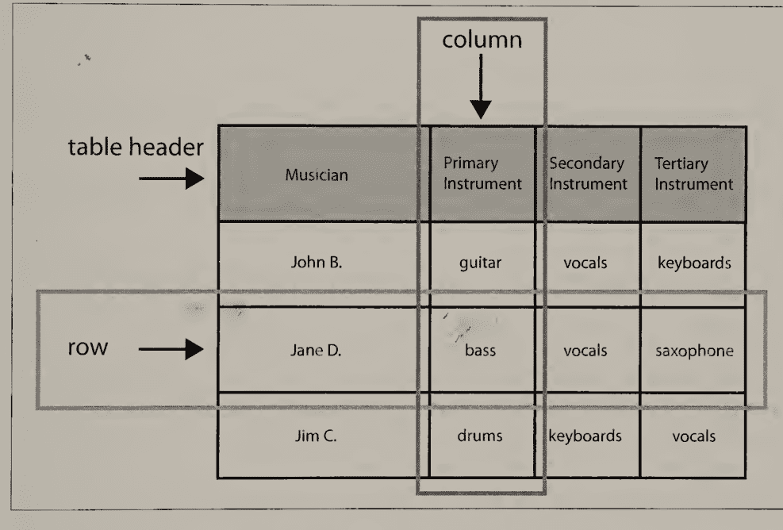

图 3-1 显示了表格的各个部分。一个表格有四个基本部分：

1. 每个包含信息的矩形区域是一个**单元格**。
2. 沿同一水平线排列的一组单元格是一**行**。
3. 在同一垂直线上的一组单元格是一**列**。
4. 在表格顶部显示信息的单元格是**表头**。

## 在 HTML 中创建表格

在 HTML 中，可以使用几个特殊标签在网页上创建表格。以下是用于构建表格的代码示例。示例之后是同一表格在浏览器中查看的图像，以及对示例代码中各种标签的解释。

```
<html>
<head>
<title>示例表格</title>
</head>
<body>
<table width="300" border="3">
<tr>
<th>表头内容</th>
<th>表头内容</th>
<th>表头内容</th>
</tr>
<tr>
<td>单元格内容</td>
<td>单元格内容</td>
<td>单元格内容</td>
</tr>
<tr>
<td>单元格内容</td>
<td>单元格内容</td>
<td>单元格内容</td>
</tr>
</table>
</body>
</html>
```

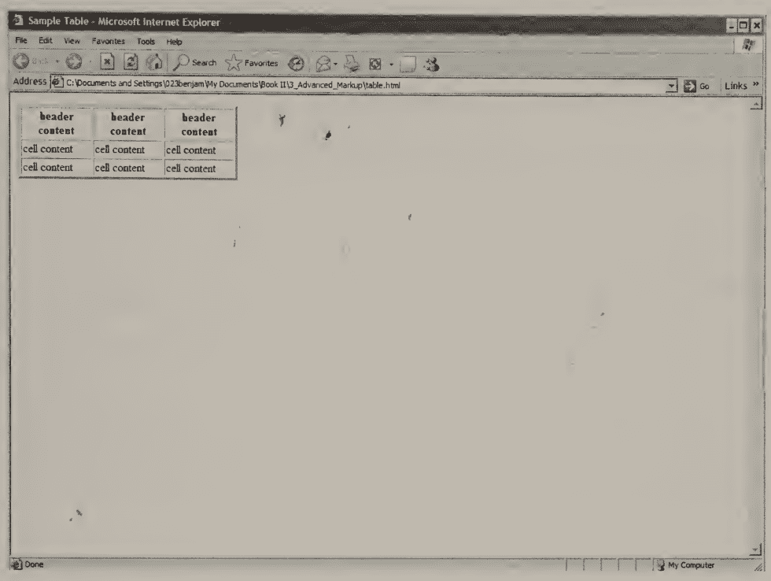

图 3-2

示例表格代码的浏览器视图。

## 表格代码解释

前面的示例代码使用了构建基于 HTML 的网页的标准方法。在 `<body> </body>` 的开始和结束标签内是创建表格的代码。此代码以 `<table>` 标签开始。请注意，所有其他元素都嵌套在 `<table> </table>` 的开始和结束标签内。开始表格标签包含两个属性，用于确定表格的外观。第一个属性 `width="300"` 创建一个宽度为 300 像素的表格。宽度属性也可以设置为百分比（例如，`width="50%"`）。如果上面表格的宽度设置为 50%，表格将调整为网页总宽度的 50%。如果浏览器窗口的尺寸发生变化，表格的宽度将重新调整，以保持在 50%。

表格中的第二个属性 (`border="3"`) 将在表格的一般解释之后的部分中介绍。

## 表格行

在表格标签内部，有多组 `<tr>` `</tr>` 标签，其中嵌套了额外的元素。`<tr>` `</tr>` 标签用于在表格中创建行。前面的示例代码中有三组 `<tr>` `</tr>` 标签，它们构建了表格中的三行。通常，表格由行和列组成；但在 HTML 表格中，不需要列标签，因为列只不过是行与行的堆叠。

## 表格单元格

每组 `<tr>` 标签内都包含另一组标签（例如 `<td>` `</td>` 或 `<th>` `</th>`）。`<td></td>` 标签创建单个单元格，并自动从左到右放置在行中。在前面的示例代码中，每行包含三个单元格：第一组 `<td></td>` 标签将成为行中的第一个单元格（最左边），而代码中的下一组 `<td>` 标签将形成第二个单元格（中间）。最后一组 `<td>` 标签将成为行最右侧的单元格。当设计师在 HTML 中创建单元格时，他放在 `<td>` 开始和结束标签之间的任何内容都是单元格的内容，并在浏览器中查看页面时显示在单元格内。在前面的示例代码中，*单元格内容* 这几个词将出现在每个单元格中。

`<th>` `</th>` 标签是一种特殊类型的单元格，称为表头单元格。它们用于标记下方单元格中信息的标签。以图 3-1 为例，表头标记了每一列（音乐家、主要乐器等）。放置在 `<th>` 单元格内的任何文本将自动加粗并居中显示在单元格内，以区别于其他单元格中的信息。

## 其他表格属性

除了 `width=" "` 之外，表格元素还关联了其他几个有用的属性。接下来将解释每个属性。

## 表格边框

表格边框属性用于设置边框的大小。以下是该属性在 HTML 中如何编写的示例。

```
<table border="2">
```

在该示例代码中，边框属性已设置为 2。该数字表示边框的宽度，单位为像素。图 3-3 展示了具有不同边框设置的同一表格。

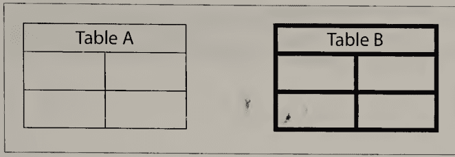

图 3-3
第一个表格的边框属性设置为一像素，第二个表格的边框设置为五像素。

在某些情况下，设计师可能不希望表格的边框显示出来。他可以通过将 border=" " 属性设置为零像素来实现。当设计师将边框属性设置为零时，表格中的边框线在浏览器中变得不可见，但单元格的内容仍然可见。

## 单元格间距

表格的 cellspacing=" " 属性控制表格中每个单元格之间的空间量。cellspacing 属性可以分配一个像素数，也可以设置为百分比值（例如 cellspacing="2%"）。如果此属性使用百分比，则该百分比将是表格尺寸的百分比，而不是浏览器窗口的百分比。图 3-4 显示了两个具有不同 cellspacing 属性的表格。

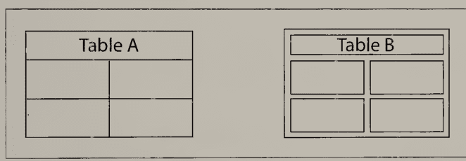

图 3-4
表格 A 具有正常的 cellspacing。表格 B 是 cellspacing 属性用于使单元格之间空间变宽的示例。

## 单元格内边距

cellpadding=" " 属性用于设置单元格内容周围的某种边距。与 cellspacing 类似，此属性可以分配一个像素数或百分比。图 3-5 展示了两个不同 cellpadding 的示例。

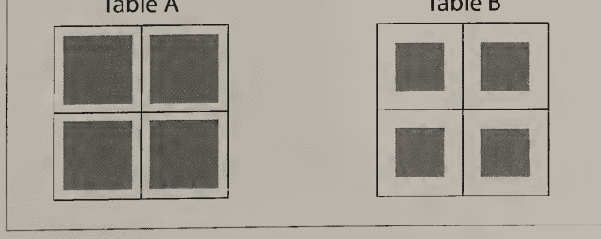

图 3-5
每个单元格的内容由灰色区域表示。在两个表格中，表格 B 比表格 A 有更多的 cellpadding。增加 cellpadding 会在每个单元格的内容和边框周围创建更多空间。

## 使用表格设计网页

关于网页，设计师们不断寻找新的方法来构建有趣且吸引人的网站。通常他们的发现是创新的并且效果非常好，但这些发现的技术被认为是技术的误用。在网页设计中使用表格就是这种情况。

根据万维网联盟（World Wide Web Consortium）的规定，表格应用于安排数据，仅此而已。但设计师们发现表格非常适合布局网页文档中包含的不同元素。表格可用于定位图像、文本以及网页的所有其他部分。本节将探讨将表格用作网页设计工具，但要理解使用表格违背了为网页文档设定的推荐标准。话虽如此，你也应该知道大量的网页是以这种方式构建的，并且大多数商业网页设计软件都曾支持过这种技术。此外，不同的浏览器目前支持表格，但不支持较新的布局技术，如 CSS。

## 设计布局

虽然使用 HTML 编辑器开始设计网页可能很诱人，但通常从允许快速更改设计的工具开始要容易得多。这可以通过 Adobe Illustrator 等图像软件或像铅笔和纸这样简单的东西来完成。目的是为网页设计一个基本布局——一个看起来不错且便于访客使用的布局。设计可以采用草图或粗略绘图的形式，不需要太多细节。将设计视为草稿。图 3-6 展示了一个网页设计布局的草图。该示例将用于演示使用表格创建网页的有效方法。

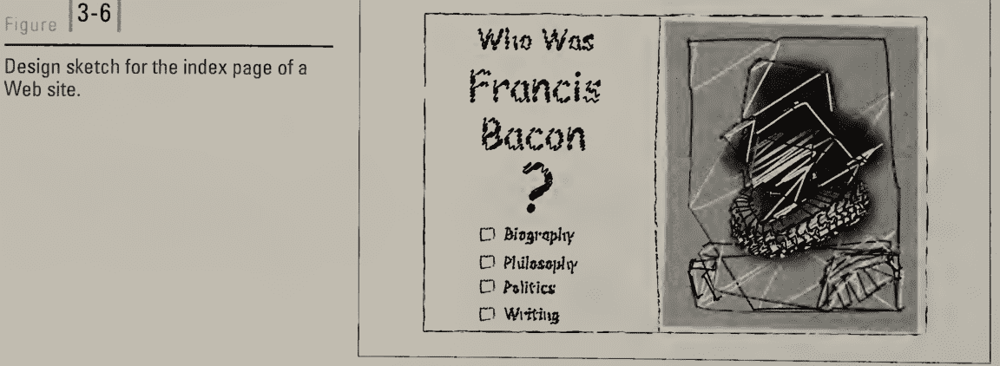

确定页面的大致布局后，下一步是设想网页上的所有元素如何划分并放置在表格中。然后在布局草稿上绘制一个表格作为视觉参考。

在图 3-7 中，请注意并非所有表格单元格的大小都相同，并且某些单元格跨越多行或多列。这可以使用两个 `<td>` 属性来实现：rowspan=" " 和 colspan=" "。创建此表格的代码示例如下图所示。

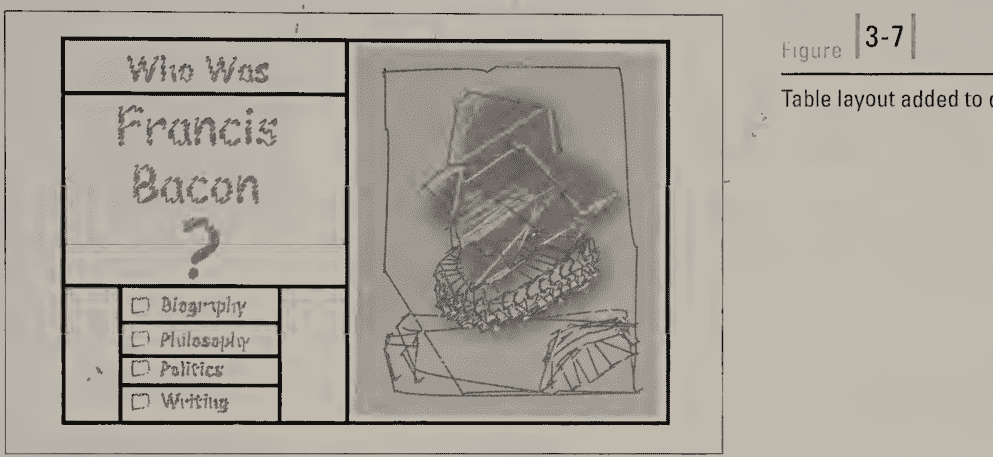

```
<table width="780" height="480" border="1" cellpadding="0" cellspacing="0">
  <tr>
    <td height="60" colspan="3">&nbsp;</td>
    <td width="480" height="480" rowspan="6">&nbsp;</td>
  </tr>
  <tr>
    <td height="220" colspan="3">&nbsp;</td>
  </tr>
  <tr>
    <td width="100" rowspan="4">&nbsp;</td>
    <td width="180" height="50"><p>&nbsp;</p></td>
    <td width="100" rowspan="4">&nbsp;</td>
  </tr>
  <tr>
    <td height="50">&nbsp;</td>
  </tr>
  <tr>
    <td height="50">&nbsp;</td>
  </tr>
  <tr>
    <td height="50">&nbsp;</td>
  </tr>
</table>
```

示例代码使用了 `&nbsp;` 转义实体来填充每个单元格作为占位符。当添加图像和文本等元素时，它们将替换编码的空格。`&nbsp;` 实体将保留在那些需要显示为空的表格单元格中。

在前面的示例代码中，`rowspan=" "` 和 `colspan=" "` 属性的引号内各有一个数字。这个数字是单元格跨越的行数或列数。使用这两个属性的关键在于找到将应用该属性的单元格所在行或列中的最大单元格数。例如，表格最右侧非常大的单元格（将放置大图像的那个）在其紧邻的左侧列中仅跨越三行，但底行的中心单元格包含一系列四个额外的行，这些行将用于放置链接。如果将所有这些行与上面的两行相加，大单元格跨越六行（`rowspan="6"`）。这在图 3-8 的 rowspan 示例中进行了说明。

任何单元格的 `colspan=" "` 属性可以使用相同的方法确定，如图 3-8 中的第二个示例所示。其中 colspan 属性等于同一列中找到的最大单元格数；在这种情况下，是三。

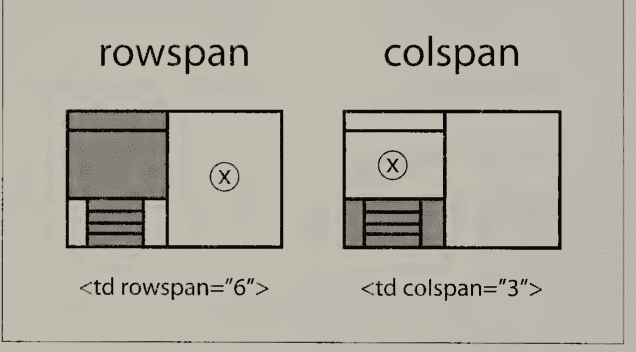

## 构建表格

使用表格布局网页的下一步是构建表格。如果表格很复杂，应使用 Adobe Dreamweaver 等 HTML 编辑器来划分和合并单元格，以便正确排列它们。在构建表格时，设置每个单元格的大小也很有用，这可以使下一步变得容易得多。

## 创建图像

表格构建完成后，即可创建图像以适应相应的单元格。每张图像的尺寸都根据其所在单元格的大小量身定制（尽管在组装所有部分时，可能需要对单元格或图像尺寸进行一些调整）。

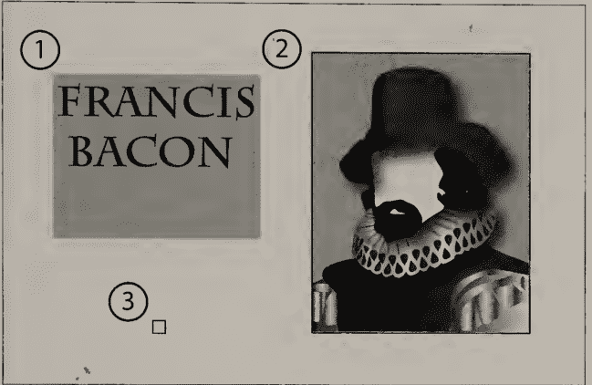

图 3-9
为示例网站创建的图像。

## 组装各部分

图像创建完成后，可以通过在每个单元格中添加 `` 标签作为内容，将其放置到相应的单元格中。在使用表格进行网页布局时，你应该记住，图像可以通过多种方式放置在表格中。图像可以使用标准 HTML 代码插入到单元格中；或者，图像可以作为单元格或整个表格的背景，这是通过使用 `background=" "` 属性来实现的。

> **注意**
> W3C 已将 background 属性指定为已弃用。在表格中使用它一直不被提倡，尽管大多数网站构建软件允许使用它，并且大多数浏览器也支持其使用。

## 使用 background=" " 属性

以下代码示例展示了如何在表格中使用 background 属性。下方是该代码作为网页的示意图。

```
<table background="star.gif">
<tr>
<td background="banner.gif" height="100" width="750">Francis Bacon</td>
</tr>
<tr>
<td></td>
</tr>
</table>
```

图 3-10 展示了使用 background 属性将图像插入表格。在此示例中，一张星星图像被设置为整个表格的背景。由于 star.gif 比表格小得多，该图像会平铺（或重复）直到填满整个区域。使用相同的技术，第二张称为 banner.gif 的图像被设置为最上方单元格的背景。在这种情况下，单元格的大小被设置为与 banner.gif 完全相同的尺寸，因此图像不会出现可见的平铺。与表格和星星图像一样，如果顶部单元格比 banner 图像大，它也会在单元格空间内重复显示。

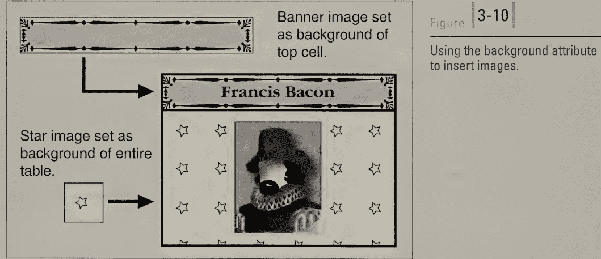

使用 `background=" "` 属性插入图像的一个优点是，文本和其他图像可以放置在各个单元格中，并且看起来像是覆盖在背景之上。在前面的示例中，培根的肖像和文本 *Francis Bacon* 就是这样显示的。它们出现在背景图像的前面。要更好地理解这是如何实现的，请研究示例代码。

在原始网页示例中，图像和文本被插入到适当的单元格中，而没有使用 `background=" "` 属性。此步骤在图 3-11 的布局中展示。

在大多数情况下，插入到单元格中的元素必须进行调整，以便它们对齐以适应网站的设计。这可以通过两种方式之一来实现：(1) 使用样式表（在关于 CSS 的章节中介绍）或 (2) 使用两个已被 W3C 指定为已弃用的 `<td>` 属性。这两个属性是 `align=" "` 和 `valign=" "`，可以在以下示例代码中看到：

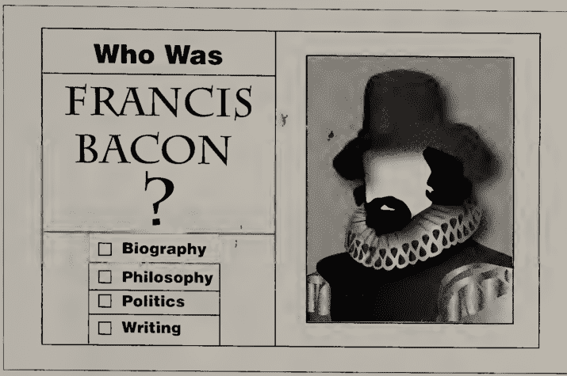

```
<table>
<tr>
<td align="center">Text</td>
<td valign="middle">Text</td>
</tr>
</table>
```

`align=" "` 属性控制单元格内任何内容的水平放置，而 `valign=" "` 属性设置垂直放置。align 属性的属性值有 left、center 和 right；valign 的属性值有 top、middle 和 bottom。图 3-12 展示了这些不同对齐方式的示例。

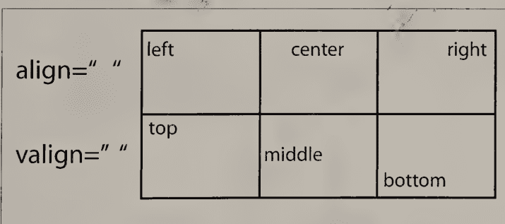

使用 align 和 valign 属性的缺点是它们限制了网页元素的精确定位。为了获得所需的定位，设计者通常必须特别注意单元格的大小和位置。另一个缺点，如前所述，是 W3C 已将这些属性指定为已弃用。再次强调，使用 CSS 技术是官方推荐的对齐元素的方式；但许多网页设计者仍然使用 align 和 valign 属性，因为大多数浏览器仍然支持它们，并且设计者发现使用这些属性编码更容易。

## 完成页面

最后，剩下的就是为网页添加最后的修饰。在此过程中，设计者可以通过将 `border=" "` 属性设置为 0（即 `<table border="0">`）来使表格的边框不可见。这将通过移除各个单元格的轮廓线，使页面呈现干净的外观。

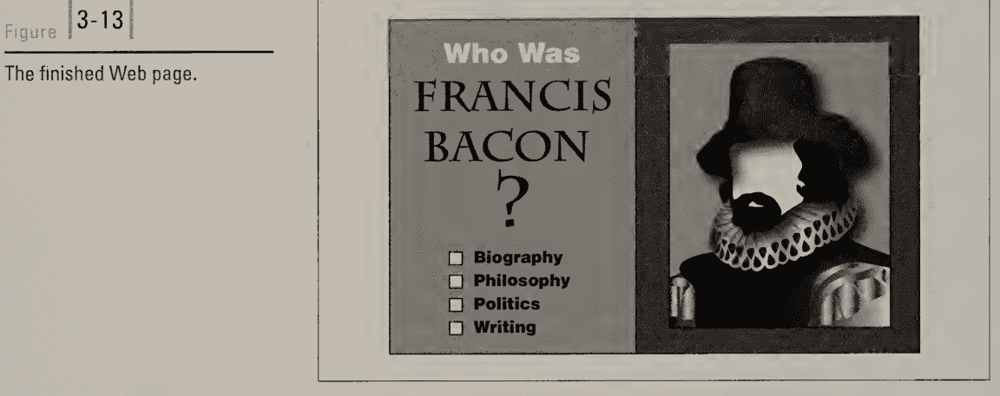

## 框架

**框架**可用于在单个浏览器窗口中包含多个网页文档。这是通过将网页区域划分为几个称为**框架集**的框架来实现的。当使用框架集时，浏览器窗口每个区域的内容由不同的 HTML 文档提供。图 3-14 展示了一个示例。

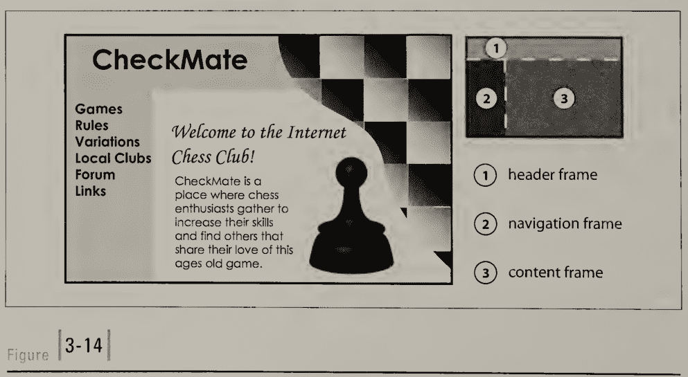

对于图 3-14 所示的示例，网页设计者将构建三个不同的 HTML 文档。然后，框架集将指定每个框架区域的大小，并为每个框架分配相应的网页文档。

## 框架的声誉

多年来，网站浏览者和网页设计者对使用框架存在偏见，原因有几个。从浏览者的角度来看，设计不佳的框架既麻烦又分散注意力。通常，经验不足的网页设计者对出现在每个框架中的网页文档大小控制不足。当文档大于框架区域时，会出现滚动条，迫使浏览者在小框架内滚动以查看内容。在大多数情况下，单个垂直滚动条对浏览者来说不会过于烦人；但在多个方向上带有多个滚动条来查看多个框架的内容可能会非常令人沮丧。图 3-15 展示了一个这样的例子。

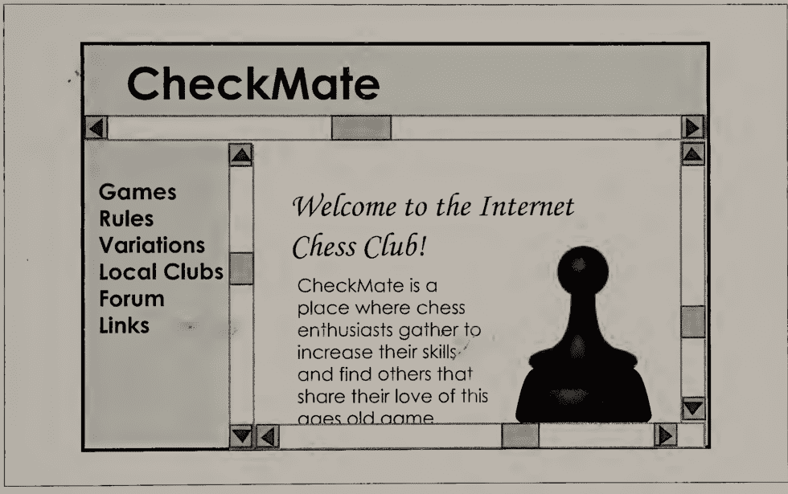

专业网页设计者避免在其网站中使用框架的另一个原因与搜索引擎访问框架集的能力有关。多年来，搜索引擎会忽略那些包含框架的网页，这大大降低了浏览者通过搜索引擎找到网站的机会。最终，主要搜索引擎开始列出带框架的页面；避免使用框架集的需求已经消失。

## 技术实践
### 构建框架

在本次技术实践中，你将创建三个用于框架集的 HTML 文档。框架集将被划分为两个框架。第一个将是浏览器窗口左侧的一个较窄的列，包含导航链接；第二个将是一个主区域，显示不同的内容文档。开始本次技术实践，请创建一个名为 **frames_TDT** 的文件夹。使用该文件夹保存你构建的每个 HTML 文档，以便一切正常运行。创建文件夹后，打开文本编辑器并输入以下代码：

```
<html>
<head>
<title>Page_1</title>
</head>
<body>
<p><h2>This is Page 1.</h2></p>
</body>
</html>
```

完成后，将文档保存在 **frames_TDT** 文件夹中，命名为 **page_1.html**。接下来，你将创建第二个与第一个类似的文档。你可以通过修改 page_1.html 的标题和文本，使其看起来像以下代码来节省时间：

```
<html>
<head>
<title>Page_2</title>
</head>
<body>
<p><h2>This is Page 2.</h2></p>
</body>
</html>
```

进行更改后，将文档保存到 **frames_TDT** 文件夹中，命名为 **page_2.html**。

在本次技术实践中，这两个文档将作为框架集主区域的模拟内容。导航将被构建，以允许选择任一页面加载到主框架区域。

下一步是构建将出现在框架集左列中的导航文档。为此，请使用文本编辑器输入以下代码：

```
<html>
<head>
<title>Navigation Frame</title>
</head>
<body bgcolor="lightblue">
<p><h2>This is the navigation frame.</h2></p>
<p><a href="page_1.html" target="main"> Page 1 </a></p>
```

## 创建框架集

在本教程的这一阶段，你已经构建了三个HTML文档：一个将用作框架集的导航区域，另外两个将用作主框架中的内容。下一步是创建实际的框架集，以利用这些不同的文档。要构建框架集，请在文本编辑器中输入以下代码：

```
<html>
<head>
<title>frameset</title>
</head>
<frameset cols="20%, 80%">
<frame name="navigate" src="navframe.html" scrolling="no">
<frame name="main" src="page_1.html" scrolling="no">
</frameset>
</html>
```

输入该代码后，将文档保存在**frames_TDT**文件夹中，命名为**index.html**，并在浏览器中打开它。如果你正确编写了所有代码，浏览器窗口应分为两列。图3-16展示了本教程的预期效果。要进一步测试本教程，请点击左列中的“第2页”链接。右侧的主框架应加载page_2.html文档。当你点击“第1页”链接时，原始文档应返回到右侧的框架。如果本教程的某些部分无法正常工作，请排查问题并检查代码中的拼写错误。如果必须进行修正，请再次测试本教程。

## 框架集代码解析

与你为本教程创建的其他三个文档不同，这个文档在几个方面有所不同，第一个区别是它不包含`<body></body>`标签。相反，这些标签已被`<frameset></frameset>`标签取代。这些元素告诉浏览器将此Web文档视为框架的集合，而不是标准的Web页面。

在`<frameset>`标签内是`cols="20%, 80%"`属性，它告诉浏览器框架的数量以及每个框架的大小。在这种情况下，有两个框架；第一个框架占浏览器窗口宽度的20%，第二个框架占据剩余的80%。此属性可以以不同方式设置。例如，你可以不使用百分比，而是将每列设置为精确的像素数（例如，`cols="250, 500"`或用于三列框架集的`cols="250, 250, 250"`）。除了允许将框架设置为特定的像素数外，`cols=" "`属性还接受另一种使用数字和星号（*）表示空间灵活划分的表示法。一个例子是`cols="1*, 300, 3*"`，它将构建一个包含三个框架的框架集。中间的框架将恰好为300像素，而其余两个框架将分割剩余的空间。第一个框架将占剩余空间的25%，最后一个框架将占75%。你可以通过将用于确定划分的数字（1和3，总共四部分）相加，并计算它们所代表的百分比（即，当某物有四部分时，一部分等于25%，三部分等于75%）来解读这种奇怪的表示法。

## 复杂框架集

`<frameset>`元素还允许使用`rows=" "`属性，其工作方式与`cols=" "`属性非常相似，只是它将浏览器窗口划分为水平行。这两个属性可以包含在同一个框架集中，以多种不同的方式划分浏览器窗口中的区域。不幸的是，当这两个属性放在同一个框架集元素中时，可能难以控制结果。使用多个框架集来划分空间要容易得多。例如，如果Web设计师想要构建一个类似于图3-14的框架集，他将使用以下代码：

```
<frameset rows="150, *">
    <frame name="header" src="banner.html" scrolling="no">
    <frameset cols="20%,80%" border="0">
        <frame name="navigation" src="navframe.html" scrolling="no">
        <frame name="content" src="main.html" scrolling="no">
    </frameset>
</frameset>
```

在该示例代码中，第一个框架集将空间划分为两行。第一行高150像素，而作为第二行尺寸给出的`*`告诉浏览器使用剩余的任何空间。在第一个框架集内部是一个名为*header*的框架和第二个框架集。第二个框架集随后被进一步划分为两列，分别占20%（导航框架）和80%（内容框架）。

## 框架

回到本教程的框架集代码，你会看到两个框架（*navigate*和*main*）嵌套在框架集元素内。它们是不同Web文档将出现的两个区域。每个框架的`src=""`属性决定了将加载哪个文档到该特定框架中。当框架集文档加载到浏览器中时，`src=""`属性起作用，但每个框架中实际显示的文档可以通过**navframe.html**文档中每个链接包含的`target=""`属性来更改。如本教程所示，将`target=""`应用于文档中包含的链接可以控制不同框架中的内容，但链接所在的同一框架可以在其自身框架中加载新文档。这可以通过将属性设置为`target="self"`来实现。

两个框架元素中的最后一个属性是`scroll="no"`，它防止滚动条出现在框架中。此属性的设置有*no*、*yes*（滚动条始终出现）和*auto*（此默认设置允许浏览器确定是否需要滚动条）。请记住，使用此属性可能无法解决所有滚动条问题，并且每个框架中的内容必须适合框架区域。如果不适合，在某些条件下，滚动条可能仍然出现，或者部分内容可能对查看者隐藏。防止这种情况的最简单方法是始终注意内容大小和为每个框架分配的空间。

## 完成本教程

完成本教程的最后一步是移除两个框架之间的边框。为此，请在文本编辑器中重新打开**index.html**框架集，并向框架集元素添加`border="0"`属性，如下所示：

```
<frameset cols="20%, 80%" border="0">
```

再次保存你的工作，并通过在浏览器中打开框架集来测试它。两个框架之间的边框应不可见。

## 内联框架

**iframe**，或内联框架，其使用方式与标准框架类似，只是它可以像图像或任何其他HTML元素一样定位在Web页面上。换句话说，iframe不像标准框架那样划分或分割浏览器窗口的一部分，而是可以插入到文档中或浮动在文档中。可以将其视为Web页面内的一个窗口，该窗口打开到另一个Web文档。图3-17是iframe在Web页面上可能出现的示意图。

iframe可以通过外部链接更改其源，可以使用滚动条，或者可以应用标准框架的任何其他特性。除了框架通常允许的属性外，当包含`height=" "`和`width=" "`属性时，iframe可以控制其自身大小。以下是用于创建iframe的HTML示例，随后是代码解释。

```
<iframe src="iframepage.html" height="200" width="350">
</iframe>
```

关于iframe代码首先要注意的是，它不需要任何`<frameset>`标签。这是因为iframe像任何其他HTML元素一样插入到Web文档中。当iframe放置在Web页面的布局中时，开始和结束的`<iframe>`标签被添加到代码中的适当位置，并像任何其他元素（例如，``和`<h1>`）一样进行调整和对齐。在开始的`<iframe>`和结束的`</iframe>`标签之间不插入额外的代码。如前所述，`height=" "`和`width=" "`用于控制iframe的尺寸。

## 使用内联框架

乍一看，iframe可能看起来更像是一个HTML新奇事物，而不是一个有用的元素；但它可以以一些创造性的方式使用，以解决复杂的Web设计和布局问题（例如，一个空间有限但需要大量内容的Web页面，如大量文本或图片库）。内容可以放置在包含滚动条的iframe中。这样，所有内容都可以被查看者访问，并且Web页面的布局保持一致。图3-18展示了一个示例。

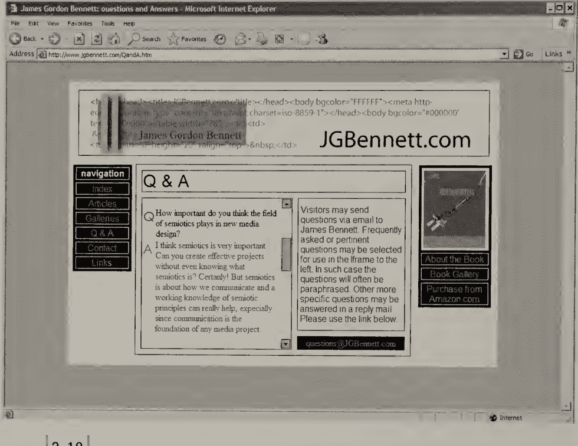

图 3-18
在这个网页的浏览器视图中，长篇的问答内容被放置在一个 iframe 中。这使得浏览者可以滚动查看内容，而不会改变整个页面的布局或设计。

## META 标签

Meta 标签是一些代码片段，可用于为浏览器、搜索引擎和网络机器人存储信息。通常，meta 标签并非设计给网站浏览者阅读的。它们被放置在 Web 文档的 `<head>` 和 `</head>` 标签之间。虽然 meta 标签可以存储任何类型的信息，但有两种元数据对网页很重要。这些 meta 标签通过 `<meta>` 标签内的 `name=" "` 属性来声明，并在以下代码中展示：

```
<head>
<title>A Web Page About Dogs</title>
<meta name="keywords" content="dogs, pets, kennel, best friend">
<meta name="description" content="This site is about dogs as loving and loyal pets">
</head>
```

这段代码展示了两个不同的 meta 标签。第一个 meta 标签，*keywords*，在 `content=" "` 属性中包含了一系列词语。这些关键词旨在反映网页上的内容。过去，许多搜索引擎使用 meta 标签中的关键词来帮助确定网页的内容。反过来，这些关键词被用于对网站进行分类，以便将其纳入搜索引擎的索引文件。其理论是，如果使用搜索引擎的浏览者输入了其中任何一个关键词，列出了这些关键词的网站就会被找到。目前，主要的搜索引擎不仅仅依赖关键词来确定网站的内容。然而，一些搜索引擎仍然使用关键词；因此，将它们包含在 meta 标签中可能仍然有用。

代码中的第二个 meta 标签是 *description*。此标签的内容包含对网站的简要描述，该描述将出现在某些搜索引擎的列表中，为浏览者提供更多信息。当你使用搜索引擎并阅读每个列出的网站条目后的描述时，你读到的大部分内容可能就来自这个 meta 标签。因为读者使用这些信息来从搜索引擎结果中列出的网站中进行选择，所以该标签中包含的文本很重要。简而言之，这个标签里应该放的是你希望浏览者通过搜索引擎列表了解的关于你网站的信息。

## 动手实验

**表格布局：流动单元格**
Web 设计师面临的一个挑战是创建无论浏览者使用何种屏幕分辨率都看起来不错的页面布局。在 800 x 600 分辨率下看起来很棒的内容，在更高分辨率设置下可能显得小而稀疏。这一事实如图 3-19 所示。

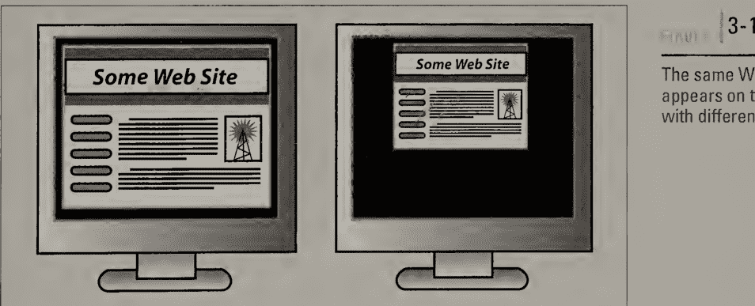

解决这个设计困境的一个方法是使用流动单元格。流动单元格可以扩展以填充在更高分辨率下查看网页时通常会为空的区域。

在这个实验中，你将通过使用一个包含流动单元格的表格来为网页创建一个横幅区域。首先，在随附文本的磁盘上找到 **Lab_chap_03** 文件，并将整个文件夹复制到你的桌面。打开文件夹并查看其内容。里面你会找到一个 HTML 页面和两张图片。

*续*

接下来，通过在浏览器中查看名为 **index.htm** 的 HTML 页面来熟悉它。你将看到一个由三行三列组成的表格。你将使用该表格来创建网页横幅区域的布局。查看完表格后，在文本编辑器中打开同一页面。以下是该表格的代码示例。

```
<table width="760" border="1" align="center" cellpadding="0" cellspacing="0">
  <tr>
    <td name="LTop">&nbsp;</td>
    <td name="CTop" width="720" height="20">&nbsp;</td>
    <td name="RTop">&nbsp;</td>
  </tr>
  <tr>
    <td name="LMiddle">&nbsp;</td>
    <td name="CMiddle" height="120"></td>
    <td name="RMiddle">&nbsp;</td>
  </tr>
  <tr>
    <td name="LBottom">&nbsp;</td>
    <td name="CBottom" height="20">&nbsp;</td>
    <td name="RBottom">&nbsp;</td>
  </tr>
</table>
```

注意，在 HTML 代码中，每个表格单元格（`<td>`）都被赋予了一个名称，以便于定位。这些单元格的命名约定基于它们在表格中的位置。例如，**LTop** 是顶行最左边的单元格，**CMiddle** 是中间行的中心单元格。还要注意，几个单元格包含了尺寸属性，并且表格被设置为 760 像素宽。表格和单元格的尺寸决定了表格的特定布局。在本实验的后面部分，你将修改布局以创建流动单元格。

在下一步中，你将通过向几个单元格添加图像和新属性来开始创建横幅。首先，找到中间行的单元格。在名为 **CMiddle** 的单元格内，添加主图像（lab_banner.jpg）。以下是添加了图像的单元格代码示例。

```
<td name="CMiddle" height="120"></td>
```

添加图像后，保存你的工作并在浏览器中重新打开页面以测试代码。图像应出现在中间行的中心单元格中。

在下一步中，你将为包含添加图像的单元格两侧的单元格添加颜色。为此，你将向 **LMiddle** 和 **RMiddle** 单元格添加 **bgcolor=" "** 属性。添加到这两个单元格的代码如下所示。

```
<td name="LMiddle" bgcolor="#333333">&nbsp;</td>
```

和

```
<td name="RMiddle" bgcolor="#CCCCCC">&nbsp;</td>
```

将 **bgcolor=" "** 属性添加到两个单元格后，保存你的工作并在浏览器中查看。两个单元格都应显示为灰色，图像左侧的单元格颜色较深。当一切正确后，返回到文本编辑器中的代码。

## 平铺图形

在下一步中，你将把名为 bar.jpg 的小图像添加到顶行和底行的每个单元格中。但你不会使用 `` 标签来插入图像，而是使用 `background=" "` 属性将其添加到每个单元格。如前所述，`background=" "` 属性已被 W3C 标记为已弃用，但它在当前浏览器中仍然运行良好。添加图形的代码如下：

```
<td name="LTop" background="bar.jpg">&nbsp;</td>
<td name="CTop" background="bar.jpg" width="720" height="20" >&nbsp;</td>
<td name="RTop" background="bar.jpg">&nbsp;</td>
```

和

```
<td name="LBottom" background="bar.jpg">&nbsp;</td>
<td name="CBottom" background="bar.jpg" height="20" >&nbsp;</td>
<td name="RBottom" background="bar.jpg">&nbsp;</td>
```

在将 `background="bar.jpg"` 添加到所有六个单元格后，保存你的工作并在浏览器中查看。

由于 bar.jpg 图像小于中心单元格的宽度，图像将重复（或平铺）直到填满整个空间。如果这些单元格的高度增加，图像将同时在垂直和水平方向上平铺。

## 创建流动单元格

在本实验的这一点上，表格在网页上居中，宽度仅为 760 像素。如果你使用的是分辨率为 800 x 600 的电脑显示器，表格将几乎覆盖浏览器窗口的宽度。如果你的显示器分辨率设置更高，你会看到表格两侧有大量的空白区域。在这最后一步中，你将修改表格以填充这些空白区域；但要看到效果，你需要确保你的显示器设置为更高的分辨率。如有必要，请在此时更改你的显示器设置。

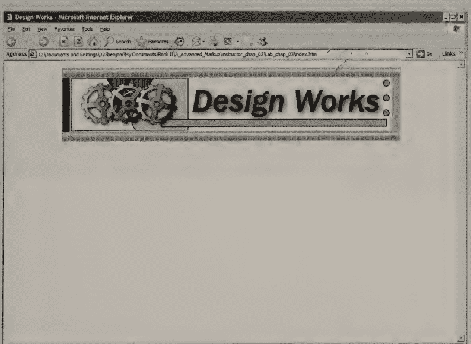

图 3-20
显示器设置为更高分辨率时的横幅浏览器视图。

在表格中创建流动单元格，只需将某些单元格设置为特定尺寸，同时允许其他单元格调整以填充任何空白空间。在本实验中，所有中心单元格都通过 CTop 单元格中的 `width="720"` 属性被限制为 720 像素宽，而左列或右列中的单元格都没有被赋予特定的宽度。将这些单元格保持在当前尺寸的是整个表格的宽度。由于表格宽度设置为 760 像素，中心单元格宽度为 720 像素，左列和右列的单元格将剩余的 40 像素平分（使每个单元格宽度为 20 像素）。如果移除表格宽度的限制，这些单元格将可以自由扩展或收缩以填充空白空间，如图 3-21 所示。

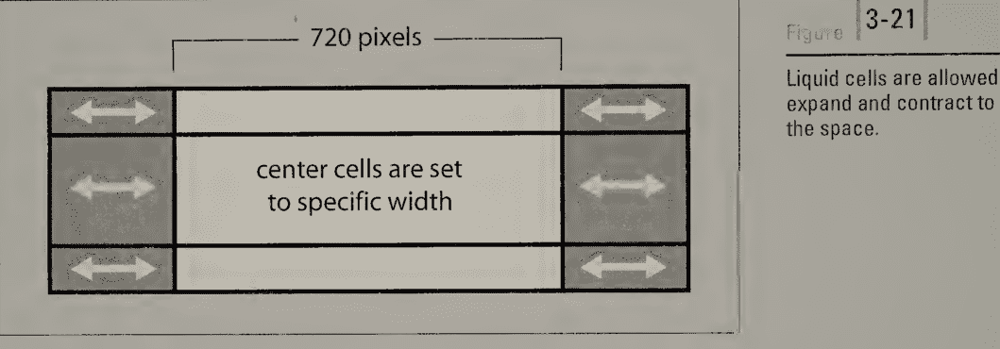

要完成本实验，剩下的就是将表格的 `border=""` 属性更改为零，使边框不再可见，并修改 `width=""` 属性。为此，在文本编辑器中打开页面，将宽度属性从 760 像素更改为 100%。新的表格宽度和 `border=""` 属性修改的代码如下：

```
<table width="100%" border="0" align="center" cellpadding="0" cellspacing="0">
```

完成这些最终更改后，在浏览器中重新打开网页并查看结果。如果你正确输入了代码，中心列两侧的单元格应该会扩展以填充浏览器窗口的宽度。你可以通过点击浏览器右侧并拖动窗口使其变宽或变窄来进一步测试。无论窗口大小如何，表格的左列和右列都应该会扩展和收缩以适应。当然，单元格能收缩到多窄是有限制的，因为中心列被设置为 720 像素宽。注意，设置为背景属性的图像也会在单元格大小变化时平铺以填充它们。

## 使用流式单元格

在本实验中，横幅的主要内容在中心区域创建，两侧的单元格被允许扩展或收缩，以填充由浏览器大小和屏幕分辨率变化产生的额外空间；但这种技术可以以不同的方式使用。例如，所有内容都可以设置在页面左侧的固定宽度单元格中，只有最右侧的单元格进行调整以适应。这对于导航安排在页面左侧一栏的Web文档尤其有用。此外，流式单元格不仅限于宽度改变，还可以设置为高度扩展。

## 总结

本章重点介绍了HTML的几种高级用法。主题包括转义实体、基于框架的Web页面的构建，以及创建元标签以向搜索引擎提供信息。除了这些技术，本章还涵盖了使用HTML表格进行网页布局的优缺点。最后，动手实验涵盖了扩展和折叠流式单元格的主题，这些单元格可以根据浏览器窗口的大小进行调整。

## 复习

1. 判断正误：W3C推荐使用表格进行网页布局。
2. 以下哪个标签用于在HTML中创建表格行？
   a. `<table></table>`
   b. `<tr></tr>`
   c. `<td></td>`
   d. `<trow></trow>`
3. 以下哪个标签用于在HTML表格中创建单元格？
   a. `<table></table>`
   b. `<tr></tr>`
   c. `<td></td>`
   d. `<tcell></tcell>`
4. 判断正误：转义实体用于创建浏览器可能解释为标准HTML代码一部分的字符。
5. 在使用框架的Web文档中，哪个标签替代了`<body></body>`？
   a. `<frame></frame>`
   b. `<table></table>`
   c. `<frameset></frameset>`
6. 判断正误：`<iframe></iframe>`不能在包含`<body></body>`标签的Web文档中使用。
7. 判断正误：元标签向搜索引擎提供信息。
8. 元标签属于Web文档的哪个部分？
    a. head
    b. body
    c. table
    d. frame
9. 判断正误：被W3C宣布弃用的元素在当前浏览器中不起作用。
10. 哪种表格单元格会根据屏幕分辨率扩展或收缩大小？

```
<!DOCTYPE html
PUBLIC "-//W3C//DTD XHTML 1.0
Strict//EN"
"http://www.w3.org/TR/xhtml1/DTD/xhtml1-strict.dtd">
<html>
```

## XHTML和DHTML简介

## 章节目标：

- 了解HTML和XHTML之间的区别
- 定义DHTML
- 解释网站反馈
- 定义交互性
- 解释表单和表单元素

## 简介

如果你涉足过网页设计，你可能听说过一些其他听起来可能与HTML相关的Web技术。两个例子是XHTML和DHTML。本章将探讨这两者，解释它们是什么以及如何使用。

## XHTML

XHTML被定为下一代网页标记语言标准。一段时间以来，网站设计师和开发者一直期待着从HTML到XHTML的缓慢而渐进的过渡。虽然一些专业人士热切期待XHTML，而另一些人则对其感到恐惧，但向XHTML的迁移是不可避免的。

与许多人所认为的相反，使用XHTML不需要网页设计师学习一种新的标记语言，XHTML也不是一种需要害怕的技术。事实上，XHTML与HTML的后期版本非常相似，如果网页设计师没有养成任何不良的编码习惯，切换到XHTML将很容易。

## 为什么选择XHTML？

XHTML于2000年1月26日由W3C首次发布，旨在使HTML符合XML规范。（XML是一种为分类数据而创建的Web技术。）那些展望网页未来的人看到了HTML不足的两个方面。XHTML为这些问题提供了解决方案。

关于HTML的第一个关注点是人们访问互联网的方式。多年来，网页都是通过连接到电话或电缆调制解调器的个人电脑来查看的。虽然这运行良好，但技术在进步。不久之后，观众将从手机、手持电脑以及各种尚未发明的设备访问网页。为了适应所有这些设备，需要一种标准的引入XHTML的第二个理由与网页设计师和开发者有关。多年来，网页设计师的创造力一直受到标准HTML元素预定义用法的限制。换句话说，HTML以某种方式工作，设计师几乎无法改变这一事实。一种采用了一些XML特性的新标记语言就是这个问题的答案。

XHTML和XML中的X代表**可扩展**，这意味着可以向标记语言添加新的元素和属性。这开辟了新的可能性，因为设计师可以创建新元素并定义每个元素在文档中的显示方式。例如，网页设计师可以创建一个新元素（例如，`<dog>`、`<cat>`和`<rat>`），并使用样式表或其他Web技术来确定新元素在浏览器中的处理方式（例如，显示黄色边框或以特定字体大小显示）。

XHTML为设计师在当下提供了大量的灵活性，并提供了一种能够处理未来进步的技术。

## XHTML的区别

当你开始使用XHTML时，你会发现它与HTML非常相似。只有几个明显的区别，其中大多数与创建*格式良好*的文档有关。

要使文档格式良好，其设计者必须遵循所用标记语言的规则。HTML使用一套宽松的规则，设计者不需要严格遵守。正如你可能在HTML文档中发现的那样，代码中的错误并不总是意味着网页的外观会受到不利影响。XHTML则不然。在编写XHTML代码时，你必须遵守规则。以下是XHTML和HTML规则之间主要区别的列表以及每个区别的解释。

## XHTML区分大小写

许多网页设计师在元素中使用全大写字母（例如，`<TABLE></TABLE>`和`<H1></H1>`）；但要使XHTML文档正确，所有元素必须是小写的。

```
HTML: <TABLE></TABLE> or <table></table>
XHTML: <table></table>
```

## 所有元素必须关闭

在HTML中，并非所有标签都需要关闭标签才能正常工作；但在XHTML中，每个元素都必须有一个关闭标签。以下是一个例子。

```
HTML: <p>This is a paragraph.
XHTML: <p>This is a paragraph.</p>
```

在该示例代码中，HTML行不包括关闭的`</p>`标签。通常，这不会给在大多数浏览器中查看页面的人带来问题。但是，对于XHTML文档，需要关闭的`</p>`标签；如果没有它，浏览器可能会返回错误。

如果你在HTML编码中一直很小心，你会发现XHTML中使用关闭标签没有太大不同。然而，一个主要的区别在于那些通常没有关闭标签的HTML元素，例如``和`<br>`元素。

在XHTML中，这些元素的处理方式不同，并以两种不同的方式**终止**（关闭）。以下示例展示了HTML中的代码以及在XHTML中关闭元素的两种不同方式。

```
HTML: 
XHTML: </img>
XHTML: 
```

在XHTML中终止``标签的第一种方式应该不足为奇——为元素添加一个关闭标签，这在HTML中不是必需的。终止``标签的第二种方式是通过在结束`>`之前添加一个空格后跟一个斜杠（`/`）来关闭开始标签。虽然浏览器通常忽略空格，但必须包含终止斜杠前的空格以防止错误。

## XHTML 属性

在 HTML 元素中为属性添加值的正确方式是将值用引号括起来。即便如此，大多数浏览器即使在不使用引号的情况下也能读取值。但 XHTML 属性则不同；值必须用引号括起来，如下所示。

```
HTML:    
XHTML:   
```

## 嵌套与 XHTML

在 HTML 中，某些元素的随意嵌套可能不会导致浏览器显示问题；但 XHTML 要求所有标签都必须正确嵌套。以下示例代码展示了元素的正确和错误嵌套方式。

```
HTML:    <p><h1>This is a title.</p></h1>
XHTML:   <p><h1>This is a title.</h1></p>
```

## name 与 id

在 XHTML 中，实用的 `name=" "` 属性已被 `id=" "` 属性取代。正如你将在涉及 JavaScript 和 CSS 的章节中看到的，当包含与 Web 文档中元素交互的脚本时，使用正确的属性非常重要。以下展示了 HTML 和 XHTML 的示例以供比较。

```
HTML:    
XHTML:   
```

事实上，`name=" "` 属性在 XHTML 1.0 中仍然有效，但它已被 W3C 标记为已弃用，并预计将在未来版本中移除。

## DTD 与有效性

到目前为止，关于 HTML 和 XHTML 差异的大部分讨论都涉及正确的编码；但 XHTML 文档中需要的两个新组件在 HTML 中并不需要。这两个组件都出现在 XHTML 网页的前几行中，并在以下示例代码中展示：

```
<!DOCTYPE html PUBLIC "-//W3C//DTD XHTML 1.0 Transitional//EN" "http://www.w3.org/TR/xhtml1/DTD/xhtml1-transitional.dtd">
<html>
<head>
<title>An XHTML Page</title>
</head>
<body>
Hello!
</body>
</html>
```

该 XHTML 代码的第一行包含一个在 HTML 中通常不出现的元素。该元素 `<!DOCTYPE>` 包含有关 XHTML 文档 **DTD** 的信息。DTD 代表 *文档类型定义*，是为文档定义的一组规则。当文档遵循其 DTD 中的所有规则时，该文档被称为 **有效的**。所有 XHTML 文档必须是有效的，才能在浏览器中正常工作。基本上，DTD 告诉浏览器如何处理每个元素，以便其按照设计者的意图在浏览器中显示。由于 XHTML 中的标签和元素是可扩展的，并且可以重新定义以某种方式处理，因此如果没有 DTD，浏览器将不会理解 `<table>` 标签应用于在 Web 文档中创建表格。虽然包含 DTD 的要求可能看起来像是试图修复并未损坏的东西，但它实际上通过允许 Web 设计者创建自己的 DTD，为他们提供了极大的灵活性。对于那些在使用标记语言方面没有进行任何创新的设计者来说，使用标准 DTD（如示例代码所示）是一件简单的事情。

目前，W3C 提供三种预定义的 DTD：严格型、过渡型和框架集型。以下代码展示了每种类型的示例：

```
<!DOCTYPE html PUBLIC "-//W3C//DTD XHTML 1.0 Strict//EN"
"http://www.w3.org/TR/xhtml1/DTD/xhtml1-strict.dtd">

<!DOCTYPE html PUBLIC "-//W3C//DTD XHTML 1.0 Transitional//EN"
"http://www.w3.org/TR/xhtml1/DTD/xhtml1-transitional.dtd">

<!DOCTYPE html PUBLIC "-//W3C//DTD XHTML 1.0 Frameset//EN"
"http://www.w3.org/TR/xhtml1/DTD/xhtml1-frameset.dtd">
```

严格型 DTD 用于创建以遵循严格 XHTML 规则的文档。此 DTD 不允许使用已弃用的元素和属性。过渡型 DTD 被认为是宽松的 DTD，允许使用已弃用的元素和属性。框架集型 DTD 用于包含框架的文档。

对于大多数 Web 设计者来说，这三种 DOCTYPE 就是他们所需要的全部。因此，创建自定义 DTD 超出了本书的范围。如果你对构建自己的 DTD 感兴趣，可以在互联网上找到许多资源；许多关于 XML 的综合书籍也涵盖了这个主题。

## head 与 body

在 XHTML 中必须遵循的最后一条规则是在每个文档中都包含 `head` 和 `body` 元素。虽然陈述这条规则似乎没有必要，但 HTML 文档并不要求同时包含 `head` 和 `body`。

## 技术实践
### 转换为 XHTML

在本次技术实践中，你将通过应用前面给出的 XHTML 规则，将一个标准的 HTML 网页转换为 XHTML 文档。首先，插入随附于本教材的光盘，并将标记为 **XHTML_TDT.html** 的文件复制到你的桌面。在文本编辑器中打开该文档并浏览代码。你应该会发现几个编码错误。这些错误作为 HTML 可能不会在浏览器中引起问题，但它们不符合 XHTML 标准。在本次技术实践中，请更正以下示例代码中的每个错误：

### 错误 1：缺少 <!DOCTYPE> 元素

在开始的 `<html>` 标签上方，通过输入以下代码添加过渡型文档类型：

```
<!DOCTYPE html PUBLIC "-//W3C//DTD XHTML 1.0 Transitional//EN"
"http://www.w3.org/TR/xhtml1/DTD/xhtml1-transitional.dtd">
```

### 错误 2：Body 元素未使用小写

`<BODY>` 标签和 `</BODY>` 标签使用了大写字母。更正它们，使其如下所示：

```
<body>
</body>
```

### 错误 3：值属性周围没有引号

`<h1>` 元素有一个 `style= color:red` 属性。如图所示，在样式的值周围插入引号。

```
<h1 style="color:red">
```

### 错误 4：<p> 元素缺少结束标签

此文档包含两个 `<p>` 元素，但都没有结束标签。通过在每段文本后添加 `</p>` 标签来终止这两个元素。

### 错误 5：<br> 元素未终止

两个换行元素 (`<br>`) 未被终止。通过在每个换行标签内添加一个空格和一个正斜杠 (/) 来更正此错误。以下是该标签应如何显示的示例。

```
<br />
```

> **注意**
XHTML 文档的文件扩展名可以是 .html 或 .htm。

更正后，保存你的工作，并通过在浏览器中查看文档来测试它。

## DHTML

使网站区别于其他沟通形式的一个特点是观众能够参与其中。虽然大多数其他沟通形式在某种程度上是被动的（例如，阅读书籍和看电视），但网站可以给观众反馈，可以利用访客互动，并允许访客为内容做出贡献。这很大程度上是通过使用 **DHTML** 实现的。DHTML 不是像 HTML 或 XHTML 那样的单一 Web 技术；相反，它是多种协同工作的技术的组合。

DHTML 代表 **动态 HTML**；尽管许多人对定义达成共识，但并非所有人都对哪些 Web 技术构成 DHTML 持有相同观点。DHTML 最简单的定义侧重于 *动态* 这个词，在 Web 术语中，它意味着某物可以被改变。这个定义为 DHTML 中包含的一些不同 Web 技术提供了一个工作清单。表 4-1 展示了该清单，并简要描述了每种技术如何作为 DHTML 使用。

表 4-1
DHTML 技术。

| Web 技术 | DHTML 用途 |
| :--- | :--- |
| 客户端脚本（即 JavaScript） | 允许更改内容和类似计算机程序的应用程序。 |
| DOM（文档对象模型） | 允许访问和操作网页元素。 |
| CSS（层叠样式表） | 充许更改网页元素的属性（即外观和样式）。 |
| 表单和表单元素（HTML） | 允许观众输入。 |
| 服务器端脚本（即 asp、php 等） | 允许动态内容或观众内容输入。 |
| 基于 Web 的应用程序（即 Java、Flash 等） | 允许在自包含应用程序中进行观众输入。 |

## 充分利用 DHTML

本书涵盖了表 4-1 中的几种 Web 技术，有关这些技术的详细信息可在后续章节中找到。在阅读这些章节时，你应该考虑如何利用不同的技术来增强网站访客的体验。

作为设计者，避免误用 DHTML 很重要。在大多数情况下，网站的目的是传达信息。过度使用不必要的 DHTML 可能会阻碍这一目的。不幸的是，很容易找到这样的网站例子：动画 gif 使页面杂乱，分散观众注意力，或者冗长的 Flash 开场动画让访客等待网站的实际内容。设计者可能会忍不住通过

## 用于反馈的 DHTML

**反馈**是指返回给来源的任何信息。在网站和其他交互式媒体应用中，反馈通常是向用户提供的、关于他们如何使用控件或交互式作品其他部分的信息。DHTML 非常适合提供此类反馈。

一个常见的例子是鼠标悬停效果，如图 4-1 所示，它让用户知道网页的哪些元素充当按钮或链接。当用户将光标移动到某个组件上，其外观发生变化或声音被激活时，鼠标悬停效果就被触发了。这种效果已成为一种网络标准，用于向访客传达有关控件和其他交互元素的信息。

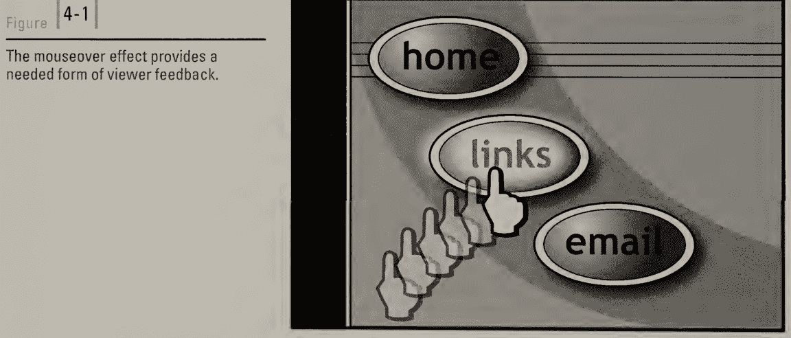

如果没有鼠标悬停效果，用户可能无法理解页面上的哪些图形元素应用作控件。

除了让用户知道哪些元素应该用作控件外，设计师还应在用户激活控件时提供反馈。当控件的使用与其结果之间存在延迟时，这一点尤其重要。例如，一个加载新页面的按钮。如果用户点击了一个按钮，但在新页面加载之前出现了延迟，她可能会认为该按钮不起作用或该按钮不是一个控件。如果设计师通过 DHTML 包含了反馈，用户会更倾向于保持耐心。她会明白自己已成功激活了控件，并且即将发生某些事情。

关于控件激活的典型网站反馈通常分为两类：(1) 视觉效果，类似于鼠标悬停示例（当控件被激活时，某个组件的外观发生变化）和 (2) 声音（音频文件提供反馈，例如使用某个控件时发出可听见的点击声）。当网站使用非同寻常的控件时，这两种方法都很有用。例如，一个使用图像映射区域而非典型按钮或链接外观的控件的网站。除非提供某种反馈，否则用户可能无法理解他们可以点击图像的某些区域，这些区域充当控件。如图 4-2 所示。

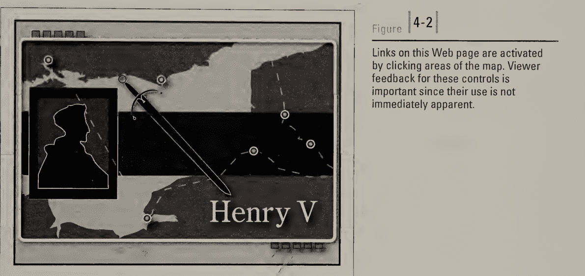

图 4-2 所示的网页使用了不寻常的控件。当用户点击地图的某些区域时，会出现包含信息的小型弹出窗口。由于控件的性质和用法可能对用户不明显，该网站可以很好地利用 DHTML，向用户提供有关每个可点击区域使用和激活的反馈。

## 用于交互性的 DHTML

关于**交互性**的明确定义存在一些争论。可以肯定的是，交互性可以包括用户参与创建内容（或至少是操作内容）。对于某些形式的媒体，例如包含角色扮演的电子游戏，交互性可能是显而易见的。在这些游戏中，玩家可以通过选择不同的行动路线来改变故事叙述；因此，一个玩家可能体验到与另一个玩家完全不同的结局。虽然这种交互性存在于某些网站上，但用户对自己在网站上体验的控制通常比复杂电子游戏中所需的控制更为微妙。

如果接受交互性的广义定义，有些人可能会认为网页上超链接的使用可以归类为交互式。交互性来自于用户选择查看网站内容顺序的能力。事实上，在一个典型的网站上，用户可以完全跳过某些内容。在交互性的狭义定义中，只有允许用户修改或添加内容的网站才被认为是交互式的（例如，一个在线公告板或另一个允许用户发布或修改内容的网站）。在这种情况下，交互性体现在用户改变内容的能力上，而不仅仅是控制呈现的顺序。

大多数网页介于这两个例子之间。大多数页面允许用户选择查看内容的顺序，一些网站允许用户添加内容，一些网站包含允许用户参与阅读以外活动的功能（例如，游戏、测验和搜索）。无论使用哪种交互性定义，DHTML 都是一种成熟的方式，为网站访客提供一种超越简单阅读、进入体验和参与领域的媒介。

## 表单

网页上发现的大部分交互性依赖于使用 HTML **表单**。表单是网页的内置元素，允许用户输入信息或做出影响其浏览体验的选择。输入到表单元素中的信息随后被传递给一个能够使用这些信息来实现某些功能的脚本。表单的一个例子是互联网搜索页面。用户通过在文本框中输入一个单词或短语开始搜索，然后点击一个按钮来激活搜索。用户在文本框中输入的字符被传递给一个脚本，该脚本搜索与用户所查找内容匹配的条目。

## 构建表单

从用户的角度来看，表单通常是一组输入控件，如复选框、单选按钮和文本区域，放置在网页上以收集信息。通常，输入控件的图形元素是用户唯一看到的，他们不知道让这些控件工作涉及什么。从编码者的角度来看，各种**输入元素**是包含在表单中的各个部分。

图 4-3 显示了一个包含在表单中的几个输入元素的示例。用于创建这些元素的代码写在图示输入的右侧。在代码中，所有输入元素都包含在一组 `<form>` 标签内。`<form>` 标签告知浏览器，标签内包含的任何输入元素都属于同一组。例如重置按钮。当用户点击该按钮时，浏览器会自动清除嵌套在 `<form>` 标签内的所有其他输入元素。在图 4-3 中，文本框中输入的任何内容都将被删除。你将在下面的 TDT 中测试这个表单原理。

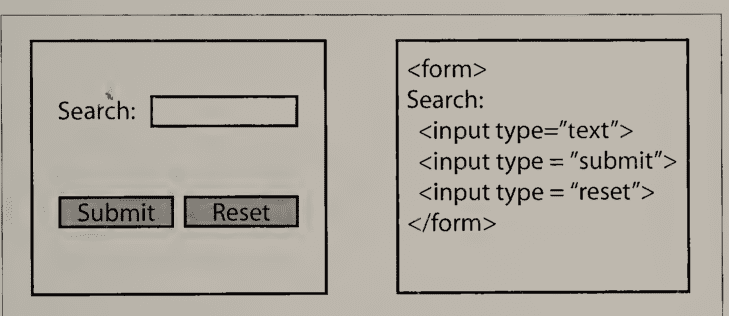

```
<form>
Search:
<input type="text">
<input type="submit">
<input type="reset">
</form>
```

图 4-3
模拟的表单元素及其创建所用的 HTML 代码。

## 技术试驾
### 表单测试 TDT

在这个 TDT 中，你将探索使用 `<form>` 标签将输入元素分组为一个工作单元。要开始此练习，请打开一个文本编辑器，并通过输入以下代码来构建一个网页：

```
<html>
<head>
<title>Form Test TDT</title>
</head>
<body>
    <form>
        <input type="text">
        <input type="reset">
    </form>
</body>
</html>
```

完成网页构建后，将文档保存为 **form_TDT.html** 并在网页浏览器中打开它。如果你使用的是 Microsoft 记事本或类似的编辑器，请记住将文件类型保存为 *所有文件*。否则，默认情况下，你的文件将被保存为标准文本文件。

在浏览器中打开文档后，在文本框中输入一些内容。然后通过点击 *重置* 按钮清除文本框。如果你输入正确，文本框内的字符将被删除。这是因为重置按钮已与嵌套在 `<form>` 标签内的任何输入元素（包括文本框输入）相关联。

为了进一步测试该原理，请在文本编辑器中重新打开网页，并将重置按钮的 `<input>` 标签移动到结束 `</form>` 标签之外。代码的 `<form>` 部分现在应如下所示：

```
<form>
    <input type="text">
</form>
<input type="reset">
```

完成后，保存文件并在浏览器中重新打开它。如果你让浏览器保持打开状态，则必须点击 *刷新* 按钮以在浏览器中加载代码的任何更改。再次在文本框中输入一些内容并点击重置按钮。如果重置按钮的 `<input>` 标签被移动到 `<form>` 标签之外，重置按钮将不再清除文本框内的字符。

## 将表单信息发送到脚本

在大多数情况下，要使表单中填写的信息产生任何作用，必须将这些信息发送到脚本。如第1章所述，脚本分为两类：客户端脚本和服务器端脚本。由于本书专注于用于设计的Web技术，因此重点放在客户端脚本上。向客户端脚本发送信息的正确方法将在讨论JavaScript的第5、6、7章中介绍。目前，你需要专注于表单的构建以及各种输入元素的不同用途。

## 表单输入元素

如前所述，表单中供用户查看和使用的部分是输入元素（例如，文本框和按钮）。输入元素是通过使用一组预定义的HTML标签创建的，这些标签在浏览器窗口中渲染出图形。这些图形控件允许用户输入信息，这些信息可以传递给脚本。

## 通用输入特性

大多数输入元素在HTML中使用`<input>`标签和`type=""`属性构建。正是`type`属性定义了构建哪种类型的输入，如以下示例代码所示：

```
<input type="text">
<input type="button">
```

该代码中的第一行创建一个标准文本框；第二行创建一个按钮。在HTML代码中，这两行之间的唯一区别是`type`属性。

除了`type=""`属性外，大多数输入元素还被赋予一个`name=""`属性。从技术上讲，输入元素的名称可以是编码者选择的任何名称，但编码者应该为每个元素赋予一个能帮助她记住该元素功能或其收集信息的名称（例如，姓名或电子邮件）。描述性名称在查看代码时会很有帮助。当使用脚本处理输入元素中的信息时，`name`属性也变得很重要。这是因为脚本通常使用`name`属性来访问信息。

## 常用输入元素

本节将提供更常用输入元素的示例。每个元素将通过一个图形介绍，该图形包括其图形外观的模拟以及用于创建该图形的HTML代码。随后是该元素、其属性及其用途的简要说明。请记住，由于不同的浏览器使用不同的样式来渲染输入元素，因此每个图形中元素的图形外观并不精确，而是一个通用的视觉参考。

**文本**输入元素的特点是一个小框，允许用户输入信息。它使用`<input>`标签并将`type`属性设置为"text"（`type="text"`）来创建。文本元素的其他常用属性是`size=" "`和`maxlength=" "`。`size`属性使用数字设置文本框在网页上显示的长度。`maxlength`属性用于设置文本框将接受的最大字符数。如果编码者未设置`maxlength`属性，浏览器将自动允许默认字符数，即无限制。允许用户在文本输入中插入无限数量的字符可能会给某些脚本带来问题，因此最好设置`maxlength`限制。`maxlength`数字可以大于文本框的`size`属性。在这种情况下，光标只是在文本框内滚动。

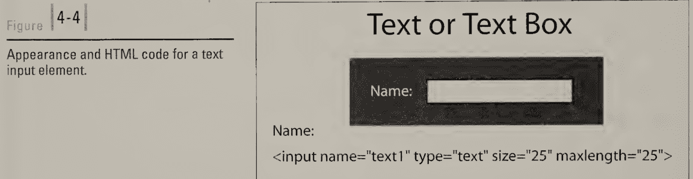

**多行文本**输入与文本框类似，允许用户输入信息，但它使用`<textarea></textarea>`标签代替通常的`<input>`标签。当用户需要输入多行文本时，最适合使用多行文本区域。例如，网页上的评论部分。多行文本区域的`cols=" "`和`rows=" "`属性用于设置将在网页上显示的区域大小。多行文本区域还带有滚动条，以便用户可以滚动浏览已输入的信息。多行文本区域的另一个属性是`wrap=" "`，它控制框内的文本换行。如果`<textarea>`标签中未包含`wrap`属性，该属性将自动设置为默认值，即与`wrap="on"`相同。在图4-5中，`wrap`属性被设置为*off*，以显示其在标签内的位置。在大多数情况下，编码者会希望使用该属性的默认设置。

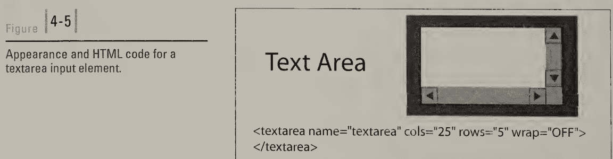

**提交**输入元素使用`<input>`标签和`type="submit"`属性构建。该元素创建一个具有预定义功能的按钮。当用户点击该按钮时，表单中所有输入元素的内容将被提交到脚本或内置操作。提交元素还有一个`value=" "`属性，用于控制按钮上显示的文本。图4-6中显示的示例代码表明，`value`被设置为"Submit"，并且单词*Submit*出现在按钮上。如果将`value`更改为*Click Me!*，按钮上出现的标签也会相应更改。

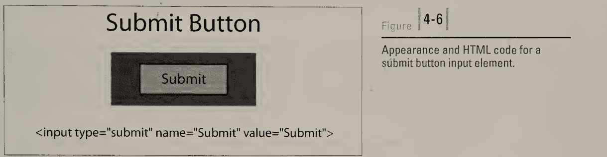

与提交按钮类似，**重置**输入也是一个预定义按钮。它在HTML中使用`<input>`标签构建，但将`type=" "`属性设置为reset（`type="reset"`）。当用户点击重置按钮时，同一表单内输入元素中的所有信息都将被清除。重置按钮也有一个`value=" "`属性，可用于更改按钮上显示的文本。

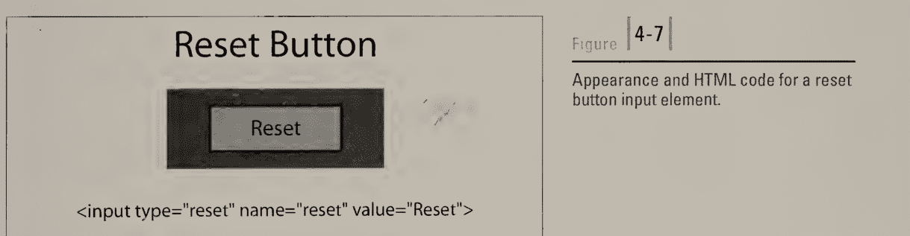

**按钮**输入的创建方式与提交和重置按钮非常相似。它使用`<input>`标签构建，并通过将`type`属性设置为"button"（`type="button"`）来定义。与提交和重置不同，按钮输入没有预定义功能。相反，编码者必须添加一些脚本，告诉浏览器当用户点击按钮时该做什么。该主题将在JavaScript章节中介绍。请注意，按钮输入也有一个`value=" "`属性。该属性与提交和重置中的属性一样，控制按钮上显示的文本。

图4-8

通用按钮输入元素的外观和HTML代码。

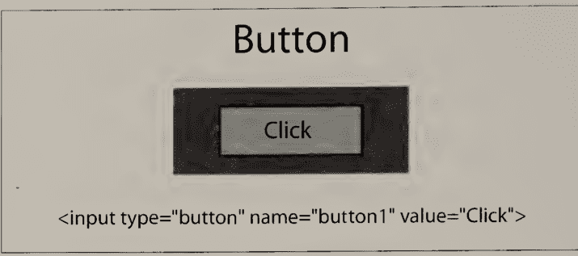

```
<input type="button" name="button1" value="Click">
```

**复选框**输入是网页上的一个小框；当用户点击此框时，会出现一个勾选标记。此输入在HTML中通过使用`<input>`标签并将`type`属性设置为checkbox（`type="checkbox"`）来创建。复选框可以以两种方式之一使用。第一种方式是将该框用作单个输入。以下示例代码中显示了一个示例：

```
If you agree to the terms of service, click the box below.
I agree: <input type="checkbox" name="agreebox" value="agree">
```

请注意，复选框输入包含一个`value=" "`属性。当用户点击复选框时，`value`属性中包含的任何内容都会传递给脚本。在本例中，它是*agree*，表示用户已同意服务条款。

使用复选框输入的第二种方式是作为多个选择的集合。图4-9中的代码中显示了一个示例。在该示例中，所有复选框都被赋予了相同的名称（即`name="pets"`）。当所有复选框使用相同的名称时，表单在传递每个复选框`value`中包含的信息时，会将它们作为一个单元进行分组。像这样将复选框分组允许用户进行多项选择。

请注意，除了复选框输入中的典型属性外，图4-9示例代码中的第一个复选框还在`<input>`标签中包含了单词*checked*。当该属性包含在`<input>`标签中时，复选框输入在页面加载时已被标记为选中状态。

## 复选框

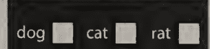

图 4-9
复选框输入元素的外观和 HTML 代码。

```
dog:
<input type="checkbox" name="pets" value="dog" checked>
cat:
<input type="checkbox" name="pets" value="cat">
rat:
<input type="checkbox" name="pets" value="rat">
```

单选按钮输入与复选框类似，不同之处在于它们显示为小圆圈，并且在激活时包含一个点而不是对勾。与复选框一样，单选按钮使用 `<input>` 标签，但它们通过将 `type=" "` 属性设置为 radio (`type="radio"`) 来定义。从查看者的角度来看，单选按钮和复选框之间还有另一个区别：单选按钮允许查看者在整个组中只做一个选择，而复选框允许多个选择。如果在单选按钮组中进行了第二个选择，第一个选择将被取消激活，这在下面的 TDT 中有所展示。

## 单选按钮

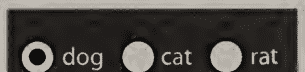

图 4-10
单选按钮输入元素的外观和 HTML 代码。

```
<input type="radio" name="RadioGroup1" value="dog" checked>
dog
<input type="radio" name="RadioGroup1" value="cat">
cat
<input type="radio" name="RadioGroup1" value="rat">
rat
```

## 技术实践

| 复选框/单选按钮 TDT |

开始此 TDT，请打开一个文本编辑器，并通过输入以下代码创建一个网页：

```
<html>
<head>
<title>Check and Radio TDT</title>
</head>
<body>
    <form name="test">

    </form>
</body>
</html>
```

输入完 HTML 后，将文档保存为 **check_radio_TDT.html**。然后通过输入以下代码构建一组复选框和一组单选按钮。您应该将该代码放在 `<form>` 开始和结束标签之间。

```
<h2>News source:</h2>
television <input type="checkbox" name="news" value="tv">
newspaper <input type="checkbox" name="news" value="paper">
radio <input type="checkbox" name="news" value="radio">
internet <input type="checkbox" name="news" value="internet">

<h2>Age:</h2>
<input type="radio" name="age" value="-18"> (under 18)
<input type="radio" name="age" value="18-30"> (18-30)
<input type="radio" name="age" value="30+"> (30 and over)
```

添加完复选框和单选按钮后，保存您的工作，并在浏览器中打开网页进行测试。作为测试的一部分，点击多个复选框，确保您可以选择多个项目。然后尝试对单选按钮执行相同操作。如果您输入正确，每当您选择一个新的单选按钮时，先前选择的按钮将被清除。

另一个用于从列表中选择项目的有用表单元素是 **select** 输入控件。此元素也称为 **菜单**，使用 `<select></select>` 标签创建。图 4-11 包含示例代码和该元素的两种不同图示。图示中的第一张图片显示了元素在网页上最初出现的样子；第二张图片模拟了元素被激活时的样子。当查看者点击箭头时，一个包含项目的小菜单会下拉出现。当查看者将光标移到某个项目上时，该项目会高亮显示。查看者可以通过点击来选择该项目。

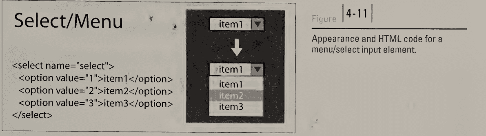

请注意示例代码中，每个项目都是由一组 `<option></option>` 标签创建的。每个 `<option>` 元素又有一个 `value=" "` 属性。与许多其他输入元素一样，value 属性是在选择某个选项时传递给脚本的内容。

除了 value 属性，Web 设计师可能会发现与 `<select>` 和 `<option>` 元素相关的其他几个属性也很有用。在 `<select>` 标签中，可以添加 *multiple* 属性。它允许查看者选择多个选项，类似于复选框。

```
<select name="select" multiple>
</select>
```

以下示例代码显示了可以放在 `<option>` 标签内的两个附加属性。

```
<option value="1" selected>item1</option>
<option value="2" disabled>item2</option>
```

在第一行代码中，添加了 `selected` 属性。它的作用类似于单选按钮和复选框输入的 `checked` 属性，用于预选选项。示例代码的第二行包含 `disabled` 属性。当该属性添加在 `<option>` 标签内时，查看者将无法选择特定项目。在大多数浏览器中，该项目将显示为灰色。

一个不太常见但非常有用的表单元素是 **file** 输入。如图 4-12 所示，此元素显示为一个文本框和一个按钮。当查看者通过点击按钮使用文件输入时，她可以浏览自己计算机上的文件。此元素用于发送文件。为了使文件输入以这种方式工作，它必须与处理该过程的脚本或内置操作相关联。

图 4-12
文件输入元素的外观和 HTML 代码。

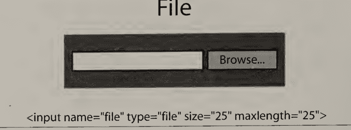

```
<input name="file" type="file" size="25" maxlength="25">
```

**hidden** 输入元素是通过使用 `<input>` 标签并将 `type=""` 属性设置为 "hidden" (`type="hidden"`) 来创建的。如图 4-13 所示，隐藏输入不会出现在网页上。这种类型的输入用于向不需要查看者输入的脚本传递信息。信息可能来自 cookie、查看者访问期间收集的其他数据，或者来自 Web 设计师希望表单每次使用时传递的某些默认信息。

图 4-13
隐藏输入元素的外观和 HTML 代码。

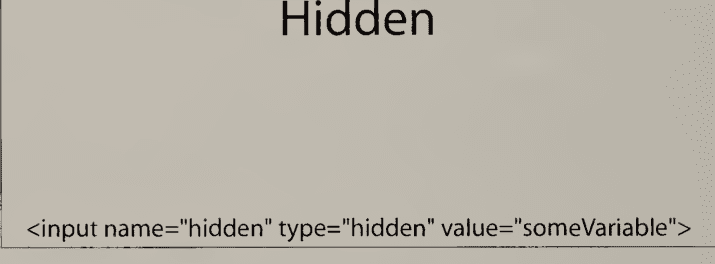

```
<input name="hidden" type="hidden" value="someVariable">
```

## 排列输入元素

直接将输入元素编码到 Web 文档中是一个相当简单的过程；但当页面在浏览器中查看时，视觉效果可能不尽如人意。由于 HTML 的特性，输入元素在网页上会显得拥挤，全部出现在同一行，或者如果它们所在的区域太小，会像文本一样换行。管理表单外观的一种方法是使用 HTML 表格。设计师可以构建一个具有表单基本布局的表格，并将每个输入元素安排在不同的单元格中。图 4-14 展示了一个示例。

图 4-14
表格中输入元素的排列。

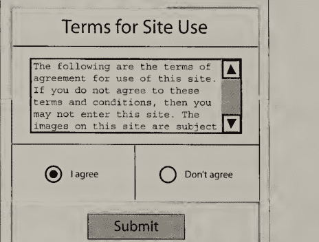

图 4-14 中的示例显示了表格内的几个输入控件。将文本和控件放在单独的单元格中，使每个元素易于对齐，并保持表单整洁有序。如果您不希望表格的线条可见，请将表格的 `border=""` 属性设置为零（即 `<table border="0">`）。您将在接下来的实践实验室中探索这种输入布局方法和构建一个可工作表单的过程。

## 实践实验室

### 房屋抵押贷款计算器

在本实验室中，您将构建一个作为在线抵押贷款计算器的表单。处理表单中信息的脚本已为您编写好。您唯一需要关注的是表单及其在嵌套表格中的排列。

开始本实验室，请将随附磁盘中标记为 **Lab_chap_04** 的文件夹复制到您的桌面。您会发现一个网页文档和一个名为 **calculator.js** 的文件。计算器文件包含处理您将构建的表单中收集的信息的脚本。您不需要在此文件中编码，但它必须与 **mortgage.htm** 文件放在同一文件夹中才能正常工作。

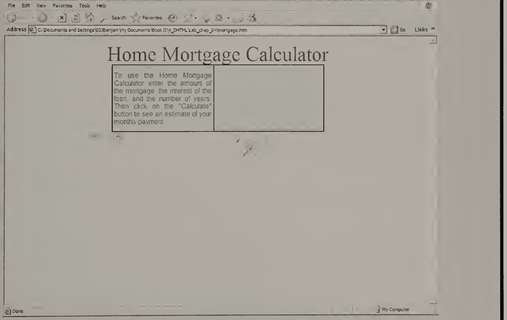

图 4-15
房屋抵押贷款计算器和空单元格的屏幕截图。

## 实践实验室

复制文件夹后，在浏览器中打开 **mortgage.htm** 并熟悉其布局。网页中心包含一个由两个单元格组成的表格。第一个单元格包含给网站访问者的说明，第二个单元格是空的。您将在空单元格中构建表单。

在文本编辑器中打开网页并找到空单元格。（里面有一个 HTML 注释，标记该单元格为构建表单的正确位置。）

在空单元格内，构建一个包含两列五行的表格。如果您熟悉 Adobe Dreamweaver 等网页编辑器，请使用它来构建表格；或者您可以使用以下 HTML 手动编码表格：

```
<table width="235" height="140">
<tr>
    <td> Mortgage:</td>
    <td> </td>
</tr>
<tr>
    <td>Interest (e.g., 7.9)</td>
    <td> </td>
</tr>
<tr>
    <td> Years:</td>
    <td> </td>
</tr>
<tr>
    <td> </td>
    <td> </td>
</tr>
<tr>
    <td>Your monthly payment:</td>
    <td> </td>
</tr>
</table>
```

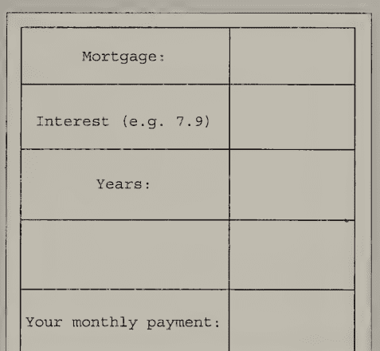

构建完表格后，在浏览器中查看网页。表格应如图 4-16 中的示例所示。

请注意提供的 HTML 代码中，使用 `<tr></tr>` 标签构建了五行。每行内有两个单元格 (`<td></td>`)，其代码已输入在单独的行上。示例代码以这种方式输入，以便您在放置输入元素时理解单元格的排列。在正常的 Web 文档中，没有必要将每个单元格放在自己的行上。

图 4-16
用于排列计算器表格的已完成表格。

## 动手实验室

在第1、2、3和5行中，每行的第一个单元格包含文本，第二个单元格为空。在每个空单元格中，你将放置一个输入元素。同样，第4行的两个单元格也都是空的。这两个单元格是你将放置按钮的位置。

在继续之前，请查看图4-17。注意表格中元素的模拟排列。完成本实验后，表格及其所有元素应与之类似。研究完排列后，在文本编辑器中再次打开文档，并找到第一行中的空单元格。

在第一行中，第一个单元格包含文本“抵押贷款：”。在第二个单元格中，在开始和结束的 `<td>` `</td>` 标签之间添加以下代码：

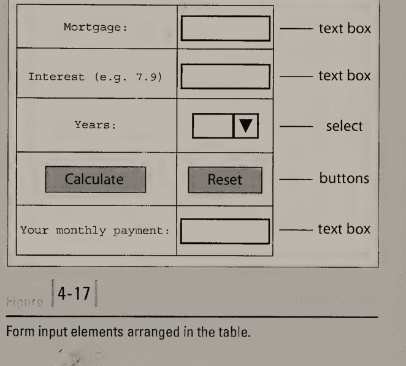

```
<input type="text" name="Amount" value=" " size="9">
```

请密切关注元素的 `name=" "` 属性。在本例中，名称等于 Amount，且首字母必须大写，以便脚本能够访问在文本框中输入的信息。同时注意，这个输入元素引入了一个新属性：`value=" "`。value 属性决定了文本框中包含的内容。如果在 value 属性的引号之间输入了一个单词，当网页加载时，该单词将出现在文本框中。但在本例中，引号之间只有一个空格。这个空格将导致文本框在观众输入内容之前显示为空。

转到第二行，在包含文本“利率（例如 7.9）”的单元格之后的单元格中放置另一个文本框。第二个文本框的代码如下：

```
<input type="text" name="Rate" value=" " size="9">
```

同样，name 属性必须正确输入。如果你不确定表格单元格中任何元素的位置，请保存你的工作并在浏览器中打开网页。你可以通过将你的表格与图4-17中的表格进行比较来检查位置。如果任何输入元素不在正确的位置，请更正你的代码。

在第三行中，你将在第二个单元格（包含文本“年限：”的单元格之后）添加另一个元素。该元素将使用 `<select>` 标签。

```
<select name="Years">
    <option value="0">0</option>
    <option value="15">15</option>
    <option value="20">20</option>
    <option value="25">25</option>
    <option value="30">30</option>
</select>
```

在表格的第四行中，你将添加两个按钮——每个单元格一个。在第一个单元格中，输入以下代码：

```
<input type="button" value="Calculate" onclick="mortCalc(Form1)">
```

该输入元素还引入了一段新代码：`onClick="mortCalc(Form1)"`。这部分代码将表单中输入的信息发送到 calculator.js 文件中的脚本。该代码的示例及其工作原理将在第6章和第7章中介绍；但对于本实验，你唯一需要关注的是正确输入代码。与其他输入元素中的 name 属性一样，请密切关注大小写字符的使用。注意 onClick、mortCalc 和 Form1 中使用的大写字母。

在该行的第二个单元格中，使用以下代码构建一个标准的重置按钮。添加重置按钮后，你可以通过保存工作并在浏览器中查看来检查元素的位置。

```
<input type="reset" value="Reset">
```

在该表格的最后一行中，你将在第二个单元格中添加另一个文本框。使用以下代码：

```
<input type="text" name="Payment" size="9">
```

添加完这最后一个元素后，保存网页并在浏览器中查看，以确保所有元素都在正确的位置。

## 将所有内容封装在表单中

现在你已经添加了所有输入元素，你需要做的就是将这部分代码封装在一组 `<form>` 标签中。在本章前面提供的示例中，只要所有输入元素都在 `<form>` `</form>` 标签内，一切都能按预期工作。但在本实验中，其他 HTML 标签（例如 `<tr>` 和 `<td>`）已穿插在输入元素之间。表单内的额外标签通常会在某些浏览器中造成混乱，因此 `<form>` 标签的位置很重要。最好的方法是将包含输入元素的整个表格放在开始和结束的 `<form>` `</form>` 标签之间。将以下代码添加到你的网页时，将开始的 `<form>` 标签放在你刚刚构建的表格的开始 `<table>` 标签之前。然后将结束的 `</form>` 标签放在同一表格的结束 `</table>` 标签之后。这样可以将表格和所有输入元素嵌套在表单内。

```
<form name="Form1">

</form>
```

注意，开始的表单标签添加了 `name="Form1"` 属性。这是表单的名称，预编写的脚本将使用它来识别从表单发送的信息。要检查你的工作，请将你的代码与以下完成的代码示例进行比较。请记住，代码在页面上的排列是为了使其更易于阅读。你输入代码的方式可能有所不同。

```
<form name="Form1">
<table width="235" height="140">
<tr>
    <td> 抵押贷款：</td>
    <td> <input type="text" name="Amount" value=" " size="9"></td>
</tr>
<tr>
    <td> 利率（例如 7.9）</td>
    <td><input type="text" name="Rate" value=" " size="9"></td>
</tr>
<tr>
    <td>年限：</td>
    <td>
        <select name="Years">
            <option value="0">0</option>
            <option value="15">15</option>
            <option value="20">20</option>
            <option value="25">25</option>
            <option value="30">30</option>
        </select>
    </td>
</tr>
<tr>
    <td>
<input type="button" align="center" value="Calculate" onclick="mortCalc(Form1)">
    </td>
    <td>
<input type="reset" value="Reset">
    </td>
</tr>
<tr>
    <td>你的每月还款额：</td>
    <td><input type="text" name="Payment" size="9"></td>
</tr>
</table>
</form>
```

检查完代码后，在浏览器中查看网页，并通过填写抵押贷款价格、添加利率和选择年限来测试表单。如果你正确编写了表单的每个部分，脚本将使用你输入的信息来计算每月还款额。

## 完成实验

要完成本实验，请使用你的网页设计和 HTML 技能，使你创建的表单和表格与网页其余部分的外观相匹配。你可以更改表格的颜色、对齐文本和元素，或使用其他 HTML 设计属性使表单在视觉上更具吸引力。这最后一步的目标是使网页的交互部分看起来像是页面的一部分，并将原本普通的表单转变为供观众使用的有吸引力的表单。

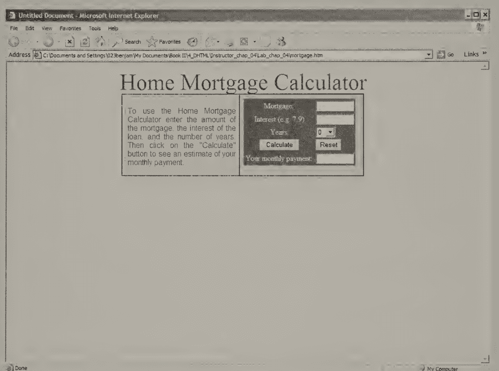

在浏览器中查看的已完成的家庭抵押贷款计算器。

## 总结

本章介绍了 XHTML，并解释了这种较新的 Web 技术与标准 HTML 之间的区别。本章的第二部分定义了 DHTML，并列出了几种被认为是 DHTML 一部分的不同 Web 技术。此外，还涵盖了与 DHTML 相关的主题，如观众反馈和交互性。本章的最后一节详细介绍了网页文档中表单和输入元素的构建和使用。

## 复习

1. DHTML 中的 *D* 代表 ________________。
2. 判断对错：可视的鼠标悬停效果提供观众反馈。
3. 表单需要什么其他 Web 技术才能实现交互性？
4. 使用 HTML，编写正确的开始和结束表单标签。
5. 在 `<input>` 标签内，哪个属性决定了将创建哪种类型的输入元素？
6. 判断对错：所有输入元素在不同浏览器中看起来都一样。
7. 提交和重置按钮必须放置在哪里才能在表单中正常工作？
8. 判断对错：单选按钮允许观众从多个选项中只选择一个。
9. 判断对错：隐藏的输入元素在网页上显示为一个小框。
10. 哪种较新的标记语言最终将取代 HTML？

## 章节目标

- 学习 JavaScript 的基础知识
- 了解脚本放置位置
- 练习调试 JavaScript

## JavaScript 简介

脚本语言是网页设计师可用的最强大的工具之一。没有脚本语言，网站将仅仅是文本和图像的集合。脚本用于创建许多使网络不仅仅是另一种被动媒介的功能，它们为访问者提供了与所访问网站互动的方式。没有脚本，就不会有鼠标悬停效果、搜索引擎或动态内容。

尽管自万维网向公众开放以来已经开发了几种不同的脚本语言，但 JavaScript 是使用最广泛的。本章将介绍 JavaScript，定义其功能，并提供如何开始为网络编写 JavaScript 的基础知识。

## JavaScript 的作用

理解 JavaScript 最简单的方式是将其视为一组供访问者计算机遵循的指令。这些指令告诉计算机（通过浏览器）更改图像、记住访问者在表单中输入的信息，或执行任何其他任务。编写 JavaScript 就像编写制作蛋糕的食谱，但有两个例外。第一个是 JavaScript 经常使用特殊的语言和词语排列（称为**语法**）；第二个是你必须小心地在指令中包含每一个细节。

> **注意**
> 许多初学者经常犯一个错误，认为 **JavaScript**（脚本语言）和 **Java**（编程语言）是同一回事，因为它们的名字相似。本文将仅涵盖 JavaScript，这是一种在 Web 浏览器和其他 Web 应用程序中工作的脚本语言。

与阅读食谱的人不同，计算机没有能力填补你可能认为会自动理解的指令细节。例如，如果食谱上写着“烘烤 20 分钟”，那么假设一个人会知道烘烤某物意味着在烤箱中烹饪它是合理的；但计算机并非如此直观。在脚本语言的世界里，你通常需要提供指令的每一步（即将烤箱加热到 350°，打开烤箱门，将蛋糕放入其中等）。

## 工作原理

在开始详细讨论 JavaScript 的工作原理之前，请记住脚本可以在访问者的计算机（称为*客户端*）上运行，也可以在提供网页的计算机（称为*服务器*）上运行。接下来几章中涵盖的所有 JavaScript 都将是**客户端脚本**，并通过访问者的浏览器在其计算机上进行解释。

在客户端脚本的情况下，JavaScript 指令通过服务器通过互联网发送到访问者的计算机（客户端）。这个概念在第 1 章关于客户端/服务器架构和客户端脚本的部分中进行了说明。JavaScript 指令可以包含在网页的代码中，也可以在一个完全独立的文件中，该文件与网页一起下载。客户端计算机下载脚本后，访问者的浏览器会解释这些指令。一个例子是简单的鼠标悬停效果，访问者将光标移到图像上，图像会更改为不同的图片。因为客户端计算机处理图像交换，所以两张图像都必须在任何更改发生之前下载。图像更改仅发生在已下载到访问者计算机的网页版本上。如果第二个人同时访问该站点，图像将显示为未更改，直到交换图像的脚本在第二个访问者的浏览器中被激活。

## 设计师和脚本

从设计师的角度来看，使用 JavaScript 似乎就像试图学习一门外语。更糟糕的是，设计师更注重视觉，更喜欢处理他们能看到的东西，而不是编写代码然后在另一个窗口中观察结果。不幸的是，JavaScript 通常涉及一个小的延迟，因为设计师编写脚本，在浏览器中测试它，然后返回进行调整或纠正错误。尽管这似乎不是理想的工作方式，但设计师在代码和脚本方面确实有一个明显的优势：他们的创造力使他们能够在完成脚本之前就预见到结果。这类似于设计师在开始创建图像之前很久就想象图像的方式。作为使用 JavaScript 的设计师，请记住要充分利用这一优势。

## 入门

在开始编写复杂的 JavaScript 之前，你应该从一些基础知识开始，其中第一个是如何在网页中编写 JavaScript。这是使用特殊的 HTML 标签完成的。这些标签告诉浏览器将标签之间的代码视为 JavaScript。以下是这些标签的示例。

```html
<script language="JavaScript">
</script>
```

`<script>` 标签像任何其他 HTML 标签一样插入到网页代码中。请注意，上一个示例中的开始 `<script>` 标签包含属性 `language="JavaScript"`。这段代码让浏览器知道在开始和结束 `<script>` 标签之间找到的任何内容都应被读取为 JavaScript。你需要记住，因为除了 JavaScript 之外还有其他脚本语言。如果网页的作者未能包含语言属性，浏览器可能无法理解正在使用哪种脚本语言。一个例子是使用旧版本 Internet Explorer 浏览器的 Microsoft 系统。该组合默认情况下会自动假设脚本语言是 VBScript（一种源自 Microsoft Visual Basic 编程语言的脚本语言），并会尝试将 JavaScript 代码解释为 VBScript。

既然已经介绍了 `<script>` 标签和语言属性，你将通过遵循以下“技术测试”中的说明来编写你的第一个功能正常的 JavaScript。

### 技术测试

你好世界！技术测试

要开始此技术测试，请打开一个文本编辑器，如 Microsoft 记事本，并编写以下 HTML 行：

```html
<html>
<head>
    <title>Hello World! TDT</title>
</head>
<body>
    <script language="JavaScript">
    </script>
</body>
</html>
```

> 注意
> 由于某种未知的原因，编写“你好世界”已成为脚本和编程语言的传统第一个教程。每当学生开始学习一种新语言，特别是从教科书或在线教程中学习时，他通常会使用“你好世界”示例。

完成代码输入后，将文档保存为 **Hello_World_TDT.html**。如果你使用的是记事本，请记住将文件类型保存为“所有文件”，以便你的文档将保存为网页而不是标准文本文件。

## 输入脚本

现在你的网页已经设置好了，你将输入一行 JavaScript。在开始和结束 `<script>` 标签之间，输入以下行：

```javascript
document.write("Hello World!");
```

如果这是你第一次看到脚本语言，它可能看起来很奇怪；但这一行包含了浏览器需要在网页上写下“你好世界！”短语的所有指令。要完成此技术测试，请在添加 JavaScript 行后保存文件，并通过在浏览器中打开文件来查看文件。（单击文件图标应会自动打开 Web 浏览器。）如果你正确编写了所有内容，你将看到“你好世界！”显示在网页上。如果你没有看到这些词，请查看源代码并查找拼写错误。

## 从技术测试中学习

在这个技术测试中，你在短短的练习中被介绍了很多信息。在从本文中复制了一行之后，你不应该期望理解关于 JavaScript 的一切，但这里有一些你应该知道的关于 JavaScript 的一般要点。

第一点是 JavaScript 区分大小写。这条规则与 HTML 非常不同，HTML 将大写和小写字母视为相同的字符。如果你输入了 `Document.Write()` 而不是 `document.write()`

## 注释与隐藏 JavaScript

在 HTML 中，注释是代码中不会在浏览器中显示的标记。与 HTML 类似，JavaScript 允许在代码中添加注释，这是一种为脚本各部分编写说明并帮助其他 Web 设计师理解脚本的方式。

JavaScript 有两种添加注释的方式。第一种是注释单行代码，在注释前使用两个斜杠。注释行可以写在代码中的两个位置：可以单独占一行，也可以放在一段 JavaScript 代码的末尾。需要记住的重要一点是，浏览器会将双斜杠后的所有内容视为注释，并且如果注释与脚本在同一行代码中，则不会解释注释后的任何脚本。这两种注释行放置方式在以下示例代码中均有展示：

```
<script language="JavaScript">
//This is a JavaScript comment
document.write("Hey!"); //This is also a JavaScript comment
</script>
```

### 注释多行内容

在某些脚本中，你可能需要进行比单行更广泛、更详细的注释。JavaScript 允许你通过使用块注释来实现这一点。要创建块注释，你可以使用 `/*` 和 `*/` 字符，其方式与使用 HTML 的开始和结束标签非常相似，如下所示。

```
<script language="JavaScript">
/* All of the lines of text between the block comment markers
are treated as a comment and will not affect the script*/
document.write("Hey!");
</script>
```

### 向不兼容的浏览器隐藏 JavaScript

过去，并非所有浏览器版本都能解释 JavaScript。此外，出于增强安全性等原因，一些 Web 用户选择在其浏览器中禁用 JavaScript。不运行 JavaScript 的浏览器在遇到嵌入在 HTML 页面代码中的 JavaScript 时可能会出现问题，并会将脚本作为页面上的文本输出。解决这个问题很简单，只需在 `<script>` 标签内使用 HTML 块注释标签即可。

```
<script language="JavaScript">
<!--Hide from incompatible browsers
document.write("Hey!");
end hiding -->
</script>
```

启用了 JavaScript 的浏览器会忽略 HTML 注释标签，并正常解释脚本。

在某些情况下，JavaScript 对于网页内容非常重要。如果是这样，设计者应该向用户发出特别通知。该通知可以通过使用 HTML 的 `<noscript>` 标签来实现。每当一个未启用运行 JavaScript 的浏览器遇到 `<noscript>` 标签时，浏览器会将标签之间的文本写入网页。要进一步了解 `<noscript>` 标签的使用、JavaScript 的隐藏以及 JavaScript 注释，请按照本 TDT 中的说明操作。

## 技术实践
### 注释 TDT

要完成此 TDT，请打开一个文本编辑器并输入以下代码：

```
<html>
<head>
    <title>Comment and Hide TDT</title>
</head>
<body>
    <script language="JavaScript">
    <!-- hide from old browsers

    /* This script is hidden from older
    and JavaScript-disabled browsers
    */

    //The line below writes a message on the Web page
    document.write("Hello");

    end hiding -->
    </script>

<noscript>This page requires a JavaScript-enabled browser.</noscript>
</body>
</html>
```

要完成此 TDT，请将文档保存为 **comment_TDT.html** 并在 Web 浏览器中进行测试。

## JavaScript 的放置位置

刚开始使用 JavaScript 时，你可能会对在 HTML 代码中的哪个位置放置脚本感到有些困惑。从技术上讲，`<script>` 标签几乎可以放在任何地方；但你会发现一些基本规则会很有帮助。为了帮助你理解这些规则，图 5-3 使用电视机作为脚本放置位置的类比。

图 5-3 是两台电视机的插图。第一台电视机类似于你习惯看到的样子。观看屏幕和用户控件放置在电视机的正面，可以看见并轻松访问，而所有的工作组件则隐藏在机箱内部。另一台电视机的组件分散开来，控件散布在各种部件之间，这使得电视机难以（如果不是危险的话）使用。

```
<html>
<head>
在 <head></head> 标签内是放置 JavaScript 大部分“工作组件”的地方。
</head>
<body>
在 <body></body> 标签内找到的元素是用户可见的元素。任何 JavaScript 显示或控件都应放置在此处。
</body>
</html>
```

编写 JavaScript 时，你应该遵循第一台电视机所示的示例。当脚本显示某些内容或存在用户控件时，你应该将两者都放在用户可以看到和访问的地方，同时将脚本的工作部分放在远离用户区域的地方。图 5-4 展示了如何做到这一点。

在 HTML 文档中，显示在网页上的元素放置在 `<body>` 标签之间。网页的访问者无法看到 `<head>` 标签之间的信息，除非他特意查看文档的代码。如前所述，即使 Web 设计师将 JavaScript 的工作部分放在 `<body>` 标签内，脚本本身也不会显示；但将脚本的工作部分放在 head 中将使构建网页更容易并保持代码整洁。

## 技术实践
### Head 和 Body TDT

在本 TDT 中，你将把 JavaScript 的不同部分放置在 HTML 文档的适当区域。首先，打开一个文本编辑器并输入以下代码：

```
<html>
    <head>
        <title>Head and Body TDT</title>
    </head>
    <body>
        <input type="button" value="click me">
    </body>
</html>
```

完成后，将文档保存为 **head_body_TDT.html** 并通过在浏览器中打开它进行测试。如果一切正确，你应该会看到一个写着 *click me* 的按钮。

接下来，在文本编辑器中再次打开网页，并在文档的 `<head>` `</head>` 标签之间添加以下脚本：

```
<script language="JavaScript">
    function message(){
        alert("Hello!");
    }
</script>
```

使用电视机的类比，这部分脚本可以比作隐藏在电视机机箱内部的工作组件。

此时，你不需要理解脚本每一行的作用；但你应该专注于准确放置。

输入这部分脚本后，你将添加另一部分作为控件的脚本。它将位于文档的 body 内，并与网页上出现的按钮相关联。要添加脚本的最后部分，请向下滚动到文档的 body 部分。在 `<input>` 标签内输入以下代码：

```
onClick="message()"
```

## 技术实践
头部与主体 TDT

续

整行代码应如下所示：

```
<input type="button" value="click me" onClick="message()">
```

当你完成脚本的最后部分后，保存文档并在浏览器中打开进行测试。如果一切操作正确，点击按钮时应出现一个提示消息。

你构建了一个在网页头部调用提示框的脚本。在按钮内部，你添加了一小段脚本，用于激活头部的脚本并使提示框显示出来。

## .js 文件

除了头部和主体，JavaScript 还可以放置在第三个位置。这个位置被称为 **.js 文件**，是网页之外的一个独立文档。要创建 .js 文件，需在文本编辑器（如 Microsoft Notepad）中编写 JavaScript，并将文件保存为 .js 扩展名，而不是 .txt 或 .html。

将 JavaScript 放入 .js 文件有几个很好的理由，其中最重要的两个如下：

- .js 文件可用于将较长的脚本移出网页代码。将较长的脚本移出后，HTML 文档将更简洁，更易于处理。
- 你可以通过插入一对相应的脚本标签，在网站的多个页面上使用相同的 JavaScript，如图 5-6 所示。

图 5-6

这是一个网站的示意图，该网站在每个页面的顶部使用轮播横幅广告。所有页面上的广告都由 banner.js 文件控制。每个页面加载时，它会从 .js 文件中提取脚本并运行，就像脚本写在 HTML 代码中一样。

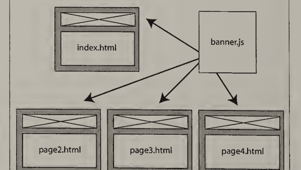

## 技术实践
.js TDT

在这个 TDT 中，你将探索如何使用一个简单的 .js 文件。首先，打开一个文本编辑器，输入以下 HTML 以创建一个网页：

```
<html>
<head>
    <title>.js TDT</title>
</head>
<body>
This line is written using HTML.<br>
</body>
</html>
```

输入完文档后，将其保存为 **js_TDT.html** 并在浏览器中测试。如果一切正确，请继续下一步。

## 创建 .js 文件

在文本编辑器中打开一个新文件，输入以下行：

```
document.write("This line is written using a .js file.");
```

输入该行后，将文件保存为 **script.js**。（如果你使用的是记事本，请记住将文件类型保存为“所有文件”，以免文档默认保存为 .txt 文件。）你还应该将 **script.js** 保存在与 **js_TDT.html** 相同的文件夹中。如果两个文件没有保存在一起，文档将无法找到脚本的源。

请注意，这个简单的 JavaScript 中没有 <script> 标签。<script> 标签实际上是 HTML；如前所述，JavaScript 内部不能包含任何 HTML。对于 .js 文件也是如此。

## 完成 TDT

再次在文本编辑器中打开 **js_TDT.html** 文档。你将添加从 .js 文件中调用脚本的代码。在这个例子中，JavaScript 显示一条消息；因此，你需要将消息放置在网页的主体中，以便网站访问者可以看到。在“This line is written using HTML.”下方添加以下代码：

```
<script language="JavaScript" src="script.js">
</script>
```

在这个 TDT 中，JavaScript 添加的行被放置在 HTML 编写的消息之后。<script> 标签与之前 TDT 中使用的类似，但有一个例外：添加了第二个属性（src="script.js"）。<script> 标签中的 src 与  标签中的 src 工作方式相同：它告诉浏览器在哪里可以找到脚本的源。

## 技术实践
.js TDT

续

## 脚本标签和 .js 文件的特殊规则

通常，你可以在网页文档中同一对 <script> 标签之间放置多个 JavaScript。事实上，将属于文档头部的所有脚本放在同一组 <script> 标签内是保持它们组织有序的有效方式。但是，如果在用于调用 .js 文件的 <script> 标签内放置任何其他脚本，代码将出错，JavaScript 将无法运行。

在将最终代码添加到 **js_TDT.html** 文档后，保存并在浏览器中测试。请记住，如果出现任何错误，错误将出现在 **js_TDT.html** 文件或 **script.js** 文档中。


图 5-7

已完成 TDT 的浏览器视图。请注意，为说明起见，文本行已居中。在你的文件中，它们将出现在浏览器窗口的左侧。

## JAVASCRIPT 的保留字

与 HTML 和一些其他 Web 技术不同，JavaScript 在命名约定方面允许极大的灵活性。在 HTML 中，<table> 标签用于在网页中创建表格，很难强制浏览器以任何其他方式解释该标签。这个例子与 JavaScript 形成对比，JavaScript 允许设计者为脚本的不同部分赋予自己的名称。（JavaScript 命名约定的详细信息将在下一章中介绍。）但正如大多数规则一样，也有例外。

在 JavaScript 的情况下，这些例外被称为 **保留字**。保留字是 JavaScript 内置的特殊名称，用于特定用途。换句话说，它们已经被分配了，就像 HTML 标签一样，在脚本中误用它们只会导致问题。表 5-1 包含了 JavaScript 保留字列表。

表 5-1
JavaScript 保留字列表。

| abstract | else | int | switch |
| boolean | extends | interface | synchronized |
| break | false | long | this |
| byte | final | native | throw |
| case | finally | new | throws |
| catch | float | null | transient |
| char | for | package | true |
| class | function | private | try |
| const | goto | protected | typeof |
| continue | if | public | var |
| default | implements | return | void |
| delete | import | short | while |
| do | in | static | with |
| double | instanceof | super |

这些保留字中有许多是常用的，随着你脚本技能的提高，你会对它们更加熟悉。其他的则较少使用；还有一些尚未分配任何特定用途，但已为未来开发预留。你现在需要知道的是这些保留字的存在，并且你可以在继续学习更多关于 JavaScript 的知识时将此列表作为参考。

## JAVASCRIPT 的强大功能

到目前为止，本章涵盖了编写 JavaScript 的基础元素。本节将探讨 JavaScript 可以使用的一些基本方式。

使用 JavaScript 可以做的事情仅受编写脚本者的技能和想象力的限制。尽管 JavaScript 执行的具体任务似乎无穷无尽，但几乎所有常用的脚本只做三件基本的事情：它们**收集数据**、**处理数据**或**处理属性**。即使是最复杂的脚本也只是两个或多个任务在同一脚本中协同工作的组合。以下是这三种应用的示例。

## 技术实践
日期和时间 TDT

在这个 TDT 中，你将使用 JavaScript 收集日期和时间作为数据，然后通过将其写入网页来处理它。首先，打开一个文本编辑器，输入以下代码：

```
<html>
<head>
<title>Date TDT</title>
<script language="JavaScript">
</script>
</head>
<body>
The current date and time is:
<script language="JavaScript">
</script>
</body>
</html>
```

输入完网页的基本代码后，将文件保存为 **date_TDT.html** 并在浏览器中测试。在这个 TDT 阶段，网页应显示 *The current date and time is:*

如果你正确输入了所有内容，请在文本编辑器中重新打开文件，并在文档头部的开始和结束 <script> 标签之间添加以下代码：

```
var theDate = new Date();
```

这行 JavaScript 创建了一个名为 `theDate` 的对象，并告诉浏览器使用 `new Date()` 从计算机获取时间和日期。对象 `theDate` 被称为**变量**；等号 (=) 告诉

## 收集与操作数据

收集数据的想法可能看起来极其技术性且尤其枯燥，但它是 JavaScript 最强大且最具交互性的用途之一。数据可以从网站访客那里获取，然后以有用且有趣的方式进行操作。一个例子是在线知识竞赛，它会对访客的答案进行评分。在这个例子中，收集的数据将是访客为每个知识问题给出的答案。检查每个答案是否正确并为访客打分，就是操作数据的一个例子。

除了访客输入，数据也可以从访客的计算机中收集，并用作网站上的内容。接下来的 TDT 将探讨 JavaScript 的这种用法。

浏览器从现在开始，`theDate` 等于当前的时间和日期。（创建和使用变量将在下一章中介绍。）

要完成此 TDT，请向下滚动，在文档主体中 `<script>` 的开始和结束标签之间输入以下 JavaScript 代码行：

```
document.write(theDate);
```

你在之前的 TDT 中使用过 `document.write()`；但在这个例子中，你没有输入像 Hello World! 这样的消息，而是插入了 `theDate`。由于 `theDate` 是一个等于当前时间和日期的变量，该脚本会将时间和日期写入网页。要查看此效果，请保存你的更改，并通过在浏览器中打开页面来测试它。


## 操作属性

在上一个 TDT 中，你从计算机收集了数据（时间和日期）。然后，当该数据被写入网页时，它被脚本操作了。在下一个 TDT 中，你将探索 JavaScript 的另一个主要用途，并操作网页元素的属性。


正如你在前面章节中读到的，HTML 组件具有属性（或特性），例如颜色和大小。其中许多属性可以通过 JavaScript 进行操作和更改。要开始此 TDT，请打开一个文本编辑器，并通过输入以下代码创建一个网页：

```
<html>
<head>
<title>Color TDT</title>
<script language="JavaScript">
</script>
</head>
<body>
<h1>Hello!</h1>
</body>
</html>
```

输入代码后，将你的文档保存为 **color_TDT.html**，并在 Web 浏览器中查看它。如果你正确编写了所有内容，你应该会看到一个带有黑色文本的白色网页。

要完成此 TDT，请在文本编辑器中重新打开文档。在文档头部 `<script>` 的开始和结束标签之间，添加以下 JavaScript 代码行：

```
document.bgColor= "blue";
document.fgColor = "white";
```

在该脚本中，`bgColor` 和 `fgColor`（已被 W3C 指定为已弃用）用于更改网页的背景色和前景色。此时不引入 CSS（第 8 章和第 9 章的主题）并使脚本比需要的更复杂，而是使用 `bgColor` 和 `fgColor` 来演示 JavaScript 如何操作属性。要查看其工作原理，请保存文档并在浏览器中再次打开它。网页的背景色为蓝色，文本 *Hello!* 为白色，如图 5-9 所示。


图 5-9
已完成 TDT 的浏览器视图。

## 动手实验

### 印刷商店网站

在本章中，你已经探索了使用 JavaScript 的基础知识，并开始熟悉一些你可以用它做的事情。本实验将向你介绍在真实网站环境中的一些实际用途。本实验中的一些示例将使用对你来说是新的脚本技术；但在你 JavaScript 入门的这个早期阶段，你不需要过于担心识别或理解每个脚本的每个部分。脚本的各个部分及其工作方式将在下一章中解释。在本实验中，除了小心避免错误外，你应开始了解脚本的各个部分如何协同工作。

本实验将包括在网站的三个独立网页上添加/编辑脚本。首先，打开随附于本教材的光盘，并将 **Lab_Chapter_05** 文件夹复制到你的桌面。复制文件后，打开该文件夹，并在浏览器中查看名为 **index.htm** 的页面，以熟悉网站的外观。然后在文本编辑器中重新打开该文档。

### 添加动态消息

本实验的第一个任务是使用 JavaScript 在网站主页上创建一条消息。该消息将是动态的，根据访客访问网站的时间而变化。首先，向下滚动到文档主体中 `<script>` 的开始和结束标签。在 `<script>` 标签内，输入以下代码：

```
var now = new Date()
var time = now.getHours()
```

> **注意**

本章讨论了将 JavaScript 的某些部分放置在文档的头部和主体中。在本实验中，整个脚本被写在同一组 `<script>` 标签内，以便于你理解脚本的工作原理。

在日期和时间 TDT 中，你使用了类似的脚本来从访客的计算机捕获时间和日期。此脚本包含一行额外的代码 `var time = now.getHours()`，它从日期和时间中获取当前小时，并将其保存为名为 `time` 的变量。因为计算机使用 24 小时制来表示一天中的每个小时，所以变量 `time` 将是一个从 1 到 24 的数字（其中 1 表示凌晨一点，24 表示午夜十二点）。这个数字将取决于页面在浏览器中打开的时间。

要完成此脚本，请在 `var time = now.getHours()` 下方输入以下内容：

```
if (time < 12) {
document.write("Good Morning! We are here and ready to handle your printing needs.")
}

if (time == 12) {
document.write("We're eating lunch, but we can still do your printing job!")
}

if (time > 12) {
document.write("Don't worry! We will be open all night.")
}
```

## 脚本解释

脚本的这一部分包含三个部分。每个部分以 *if* 开头，后跟另一段代码和一行包含 `document.write()` 消息的代码。脚本的这一部分检查分配给变量 `time` 的数字，将该数字与三个部分中的每一个进行比较，然后写入正确部分中包含的 `document.write()` 消息。换句话说，如果是在十二点之前（`time < 12`），网页将显示 *Good Morning! We are here and ready to handle your printing needs.* 如果是中午（`time == 12`）或下午（`time > 12`），则会显示另一条消息。

要完成本实验的这一部分，请保存你的工作，并通过在浏览器中打开页面来测试它。如果脚本正常工作，请继续到实验的下一部分。

### 纸张选择页面

在本实验的这一部分，你将使用 JavaScript 来操作网页的属性。首先，在 Web 浏览器中打开 **paperpckr.htm** 并查看页面内容。完成后，在文本编辑器中打开文档，并找到页面头部的 `<script>` 标签。在标签之间输入以下脚本：

```
function changeColor(color){
    document.bgColor = color
}
```


图 5-10
已完成 index 页面的浏览器视图。

## 动手实验

此时，你不需要了解该脚本部分的所有内容，但你应该理解脚本的作用。该代码创建了一个名为 `changeColor` 的 JavaScript 函数。当函数被激活时，网页的背景色通过 `document.bgColor` 行被更改。（参见本章前面的“颜色 TDT”。）要完成此脚本，请在文档内滚动到一系列如下所示的按钮：

```
<input type="button" value="lightblue">
<input type="button" value="lightgreen">
<input type="button" value="goldenrod">
<input type="button" value="yellow">
<input type="button" value="white">
```

在每个 `<input>` 标签内，你将添加脚本的另一部分。该脚本将使按钮能够激活函数并更改网页的颜色。添加的 JavaScript 将类似于 `onClick = "changeColor('lightblue')"`，只是每行代码将包含与按钮的值相同的颜色（例如，`value="lightblue"`）。

要完成此部分代码，请添加额外的脚本，使 `<input>` 标签如下所示：

```
<input type="button" value="lightblue" onClick="changeColor('lightblue')">
<input type="button" value="lightgreen" onClick="changeColor('lightgreen')">
<input type="button" value="goldenrod" onClick="changeColor('goldenrod')">
<input type="button" value="yellow" onClick="changeColor('yellow')">
<input type="button" value="white" onClick="changeColor('white')">
```

在每个按钮内添加正确的脚本后，保存你的工作，并通过在浏览器中打开网页来测试它。页面加载后，逐个单击每个按钮，以确保它们将背景更改为正确的颜色，如图 5-11 所示。

## 脚本调试

**调试**是程序员用来指代在代码行中查找和修复错误的过程。仅凭肉眼调试可能既繁琐又耗时，但有几种工具可以使这项工作变得相当容易。

### 调试？

传说中，*调试*一词起源于20世纪40年代，当时格蕾丝·霍珀海军上将与一台早期计算机发生故障的事件。在调查问题时，发现一只飞蛾钻进了计算机内部，导致了短路。当霍珀通过移除飞蛾来*调试*计算机时，问题得到了解决。

## 动手实验室

调试JavaScript最常用且最有用的工具之一是微软的浏览器Internet Explorer。如果你使用的是基于Windows的系统，只需按照以下几个简单步骤，就可以将浏览器变成一个强大的调试工具。

首先，打开浏览器。在菜单栏上，单击“工具”；然后向下滚动并单击“Internet选项”，这将打开一个控制面板。单击“高级”选项卡，在“浏览”标题下向下滚动，并在“显示每个脚本错误的通知”和“禁用脚本调试（Internet Explorer）”旁边打勾。你可能觉得勾选“禁用脚本调试（Internet Explorer）”似乎违背了初衷，但该设置提供的错误消息比标准的Internet Explorer调试应用程序包含更多信息。单击“应用”，你就可以开始调试了。

如果你使用的是Macintosh计算机，设置调试的方式大致相同，只需打开你所用浏览器的属性并启用脚本错误消息即可。

## 调试 costest.htm

要开始本TDT的最后一部分，请在启用了脚本错误通知的浏览器中打开网页**costest.htm**。此页面中嵌入了一个JavaScript，允许访客输入他们想要复印的份数。当访客点击按钮时，脚本会给出打印成本的估算。要开始调试此页面，请在标有*复印份数：*的文本框中输入一个数字，然后单击“估算”按钮。

如果你已将浏览器配置为通知你错误，你应该会收到一个弹出消息，其中包含有关错误的信息。如果没有信息，请单击弹出窗口上的“显示详细信息”按钮。

消息应大致如下：

行：39，字符：1，错误：需要对象，等等。

消息的第一部分表明文档的*第39行*或之前存在问题。通常，该行号正是错误发生的位置；但在某些情况下，比如这个例子，浏览器直到处理到下一行才检测到错误。

错误消息中下一个重要的信息是*错误：需要对象*。虽然这个信息可能看起来有点晦涩，但它表示脚本正在寻找它找不到的东西。要修复此问题，请关闭错误消息弹出窗口并查看文档的源代码。

通过向下数到第39行，你会发现没有JavaScript；但第38行在`<input>`标签内包含一小段脚本：`onClick="thecost()"`。当网站访客点击按钮时，浏览器将寻找一个名为`thecost()`的对象。现在向上滚动到文档头部的JavaScript，寻找名为`thecost()`的内容。

在该部分脚本中，你会找到一个名为`theCost()`的函数。正如本章前面提到的，JavaScript区分大小写；大写和小写*C*的差异导致了错误。你可以通过更改任一位置的*C*字符使两者匹配来纠正错误。更正后，保存文件并在浏览器中测试脚本。如果你保持浏览器窗口打开，请在运行脚本之前单击“刷新”按钮。如果不刷新页面，浏览器将重新运行已保存在其缓存中的错误版本文档。

如果你已更正脚本的`theCost()`部分，你将收到一条新的错误消息，内容如下：*行：9，字符：2，错误：'copys' 未定义*。在脚本中，在第9行附近查找单词`copys`。注意，在脚本另一行中`copys`上方的单词是`copies`。为了使脚本正常工作，这两个单词的拼写必须相同。将其中一个更改为与另一个匹配将纠正错误。完成此操作后，保存文档并在浏览器中再次测试。如果你已调试了错误，JavaScript将正常工作，用户将能够收到打印成本估算。

## 总结

本章涵盖了编写JavaScript及其在网页中使用的基础知识。除了脚本基础之外，还提供了关于在网页中放置JavaScript、JavaScript注释以及向不兼容浏览器隐藏脚本的信息。本章以一个动手实验室结束，该实验室应用了这些概念并结合了脚本调试技术来查找和纠正错误。

## 复习

1.  <script language=" "> 要使JavaScript在浏览器中正常运行，引号内应填写什么？
2.  判断正误：JavaScript可以写在网页文档的头部或主体中。
3.  如果JavaScript要显示某些内容，该部分脚本应属于HTML文档的哪个部分？
4.  判断正误：JavaScript不区分大小写。
5.  判断正误：// 可用于在JavaScript中添加注释。
6.  判断正误：JavaScript可以对不兼容的浏览器隐藏。
7.  判断正误：JavaScript需要开始和结束的<script>标签才能正常工作。
8.  哪个文件扩展名用于将整个JavaScript保存为单独的文档？
9.  判断正误：客户端JavaScript在用户的浏览器中运行。
10. 查找和纠正JavaScript中错误的过程是什么？

```html
<script language="JavaScript">
var counter = 2;
var greeting = "Hello!";
var checker = true;
    function first(){
        alert(greeting)
    }

    function last(){
        alert("Good Bye!")
    }
</script>
</head>
<body onload="first()"
onunload="last()">
```

## 章节目标：

- 了解JavaScript的三个基本元素
- 探索JavaScript三个基本元素的使用
- 使用JavaScript的三个基本元素来生成完整的脚本

## JavaScript简介

如果你翻阅一本关于JavaScript的书，你可能会发现数百页涵盖了大量详细材料。如果你不熟悉编程或脚本编写，内容的体量可能会让人不知所措。对于刚接触脚本编写的设计者来说，情况可能更糟——一页又一页充满了诸如*运算符*、*数据类型*和*变量*之类的陌生词汇，可能会让人望而生畏。

请记住，这些书是为了全面讨论该主题而编写的，通常旨在涵盖使用该特定语言的程序员将来可能需要的所有材料。要开始脚本编写，你不需要如此复杂、详尽的材料。事实上，只有三个基本的JavaScript元素就涵盖了设计者需要完成的大部分工作：变量、函数和事件。本章将介绍这三个元素，并深入探讨它们的用途。

## 机器模型

理解复杂概念最简单的方法之一是使用类比模型。为了更好地解释三个基本 JavaScript 元素的不同部分和用途，本章将使用一个机器的示例模型。

图 6-1 是机器模型的示意图。


在这个类比中，机器生产小橡皮球。通过观察示意图，你可以看到机器有三个不同的部分：

1.  一组控制装置，影响所生产球的数量和颜色
2.  制造球的机器主体部分
3.  一个控制开关，用于开启和关闭机器

机器的每个部分都可以与大多数脚本中找到的三个元素之一进行比较。在详细探讨每个元素时，我们将继续使用这个机器模型。

## 变量

本章介绍的三个 JavaScript 元素中的第一个是**变量**。传统定义将变量描述为在计算机内存中存储数据的一种方式。正如*变量*一词所暗示的，存储的值可以更改。

变量的一个例子是一个显示新年倒计时的网页；每天变量的值减少一，直到除夕夜。

关于机器模型，可以将变量视为提供给机器的关于生产球的信息。在图 6-2 中，机器被告知要生产六个红色的球。要生产的球的数量和它们的颜色代表了典型 JavaScript 中找到的变量。


图 6-2
在 JavaScript 机器模型中，变量可以被视为输入信息的控制装置。

传统定义指出变量的值可以更改。这在机器模型中也是正确的；提供给机器的信息可以更改以产生不同的结果。例如，可以调整机器上的旋钮，使机器生产九个黄色的球，而不是六个红色的球。

### 变量的组成部分

当人们用书面或口头语言交流时，他们必须遵循一定的语法规则，以便他人理解他们交流的内容。如果他们打乱句子的顺序或完全省略一些单词，他们的对话可能会变得难以理解，甚至无法理解。JavaScript 和其他编程语言也是如此。事实上，由于在大多数情况下，计算机无法解释不遵循规则的代码，因此正确使用“语法”或句法甚至更为重要。

图 6-3 是一个变量及其主要组成部分的示意图。接下来将解释每个部分。


图 6-3
JavaScript 变量的组成部分。

### var

声明变量的第一部分是使用保留字 `var`。（有关保留字的更多信息，请参见第 5 章。）`var` 后面跟着一个空格。请记住，JavaScript 区分大小写，并且此保留字中不使用大写字母。初学者常犯的错误是将 `v` 大写。输入大写 `V` 可能会导致问题，因为计算机不识别 `V` 作为变量的声明，并且在某些字体中，大写字母难以与小写字母区分。结果可能是一个无法工作的脚本和一个几乎不可能找到的错误。

虽然即使变量不以 `var` 开头，计算机也会识别它，但你应该包含 `var`，即使没有其他原因，至少它在你阅读自己的代码时会提供帮助。

### 变量的名称

变量的第二部分是它的名称。作为脚本编写者，你可以自由地用任何能帮助你记住它是什么的名称来命名变量；但有一些例外：变量名不能以数字、空格或某些非字母字符（例如 %、& 和 @）开头。除了对第一个字符的限制外，变量名不能包含空格。

传统上，JavaScript 变量名的输入方式与 JavaScript 名称类似——名称中每个单词的首字母大写——但这并不是一个规则。以下是一些合法和非法变量名的示例。

> **注意**
> 请注意，一些较旧的浏览器不识别变量名中的美元符号。尽管美元符号对于较新的浏览器是可接受的，但如果你担心旧版浏览器，你可能希望避免使用它。

合法：
- SomeThing
- something
- some_thing
- thing1
- $something

非法：
- 1thing
- #something
- some thing

如你所见，你可以用多种方式输入变量名，包括几种会产生错误的方式。避免问题的最佳方法是找到一种适合你的命名约定，并在所有脚本中坚持使用它。这样做可以为你节省大量的困惑和挫折。一种命名变量的方法是将所有单词连在一起，但将每个单词首字母大写（例如，SmallDog、TimeKeeper 和 CounterClock）。如果你坚持使用这样的命名约定，你将能够立即识别脚本中的变量。

关于变量名，还有一件事需要记住，这与 JavaScript 的区分大小写有关。在给变量命名后，你必须在整个脚本中以相同的方式输入该名称。

例如，如果你将一个变量命名为 *MyAddress*，那么当你在脚本后面将其输入为 *myaddress* 时，计算机将无法识别它。

### 变量的值

变量名后面是一个空格，然后是一个等号，然后是另一个空格。将等号后面的内容视为变量的值。从那时起，在脚本中放置变量名的任何地方，计算机都会记住它被赋予的值。换句话说，如果你使用图 6-3 中的示例并编写一个脚本告诉浏览器输出 `greeting`，它将在网页上显示 *Hello!*。要在实际脚本中看到这一点，请按照以下“技术测试”中的说明操作。

### 技术测试
变量 TDT

打开一个文本编辑器并输入以下代码：

```
<html>
<head>
    <title>Variable TDT </title>
</head>
<body>
    <script language="JavaScript">
        var greeting = "Hello!";
        document.write(greeting);
    </script>
</body>
</html>
```


输入完成后，将文件保存为 **variable_TDT.html** 并在浏览器中查看。如果有任何错误，请检查拼写错误并再次查看文件。当你有一个可工作的脚本时，可以随意通过更改引号之间的文本来更改变量的值，并查看结果。

### 变量数据类型

变量的值不仅限于单词，还可以是几种不同类型之一。这些不同类型的值被称为数据类型。在大多数情况下，你只会处理其中几种；但这里将定义所有类型以供参考。

### 字符串

```
var Tom = "I am hungry.";
```

该示例显示了一个**字符串**数据类型。它由引号内的一些字符指定。放在引号内的字符成为变量 *Tom* 的值。（记住，你可以自由地使用几乎任何名称作为变量，甚至是人名。）

对于字符串变量，计算机不识别或理解该句子。相反，它看到变量就像串上的珠子，只是珠子是输入的字符（即 **I** + 空格 + **a** + **m** + 空格 + **h** + **u** + **n** + **g** + **r** + **y** + **.**）。

### 数字

```
var Sue = 5;
```

更常用的数据类型中的第二种是**数字**。这些变量包含数字值，可以以多种不同的方式使用。有几种不同的数字数据类型，包括**浮点数**（var John = 4.325;）以及更复杂的**指数表示法**和**科学计数法**。所有这些数据类型都有数字值。

这些数据类型适用于执行数学计算的脚本。例如，查看以下脚本：

```
<script language="JavaScript">
    var apples = 2;
    var oranges = 3;
    var FruitTotal = apples + oranges;
    document.write(FruitTotal);
</script>
```

如果将该脚本放在网页中并在浏览器中打开，数字 5 将出现：变量 FruitTotal 的值被声明为变量 apples 加上变量 oranges 的总和。

### 布尔值和空值

```
var Joe = true;
var Nancy = null;
```

JavaScript 中使用了另外两种数据类型：**布尔值**和**空值**。

布尔数据类型只有真（true）或假（false）两种值。它们在更复杂的脚本中用于声明某个条件是否存在。关于布尔值的更多细节将在下一章中介绍。

空值（Null）用于变量未被赋值的情况。此时，变量的值为“无值”。你不应将空值与具有**未定义（undefined）**值的变量混淆。未定义变量将在下一节中介绍。

## 未定义

```
var Edward;
```

在这个变量中，请注意没有等号，也没有赋值。程序员使用这种技术来声明一个变量而不赋予其特定值。当脚本的其他地方需要该值时，程序员再进行赋值。本教材中的几个实验（Labs）使用了未定义变量来完成特定任务。这些实验中会解释未定义变量的用法；但目前，只需了解它们的存在即可。

## 技术实践
字符串 TDT

在这个技术实践中，你将通过将字符串变量与其他信息组合来探索其用法。首先，打开一个文本编辑器并输入以下内容：

```
<html>
<head>
    <title>String TDT</title>
</head>
<body>
    <script language="JavaScript">
        var name = "Thomas Jefferson";
        document.write("<center><h1><font color= 'red'>Welcome to the " + name + " Homepage.</font></h1></center>");
    </script>
</body>
</html>
```

> **注意**
> 请注意，包含 document.write("<center><h1>...</center>"); 的行被分成了两行以适应页面格式。在你的代码中，必须将该文本作为单行输入。如果你的脚本中该行被断开，将会收到错误。

完成代码后，将文档保存为 **string_TDT.html** 并在 Web 浏览器中查看。修正任何错误以使消息能够显示。

## 技术实践
字符串 TDT

续

图 6-5

完成后的 TDT 的浏览器视图。


> **注意**
> W3C 已将 `<center>` 和 `<font>` 元素指定为已弃用。在这个技术实践中，使用它们是为了简化演示如何将 JavaScript 用作字符串的一部分来编写 HTML。

该脚本的大部分代码你已经接触过。唯一的新增代码将位于 `document.write( );` 内部。在那里，你会看到类似 HTML 的内容、一些引号、两个加号和变量 `name`。实际上，发生的是脚本将三个独立的字符串组合成一个消息。

第一个字符串是第一组引号内的所有内容（即 "<center><h1><font color='red'>Welcome to the "）。

第一个字符串的开头字符看起来非常像 HTML 代码。事实上，当 JavaScript 将此字符串写入浏览器时，该字符串将被解释为 HTML，并以相同的方式影响字符串的其他部分。换句话说，就好像你在消息前放置了 `<center><h1><font>`。

注意第一个字符串中 `<font>` 标签的 color 属性周围的单引号。处理字符串时，你必须更改引号，以便浏览器将它们识别为字符串的一部分，而不是不同字符串的开始和结束。如果你在 red 周围使用双引号，浏览器会将其读取为两个独立的字符串（即 "<center><h1><font color=" 和 ">Welcome to the "，而单词 red 则漂浮在外）。第一个字符串中需要注意的另一件事是 Welcome to the 后面的空格。该空格被视为字符串的一部分；如果没有它，下一个字符串将与单词 the 连在一起。

第一个字符串之后是一个加号，它告诉浏览器将接下来的内容添加到第一个字符串中。在这种情况下，它是变量 name。正如本章前面所述，脚本将用分配给 name 的字符串（即 Thomas Jefferson）替换它。插入的变量之后是第二个加号，用于添加最后一个字符串。

此脚本中的第三个字符串与第一个类似，因为它包含作为消息一部分的字符，以及更多将被解释为 HTML 的字符。

在脚本中，这三个字符串被组合形成显示在 Web 页面顶部的消息。

## 用于计算的数值变量

数值变量最明显的用途是进行数学计算的脚本。当创建包含算术运算符的表达式时，可以执行这些计算。在这种情况下，不用担心技术术语。**表达式**是用于数学术语的术语，**算术运算符**是你从小学就开始使用的数学符号（例如，+、-、* 和 /）。表 6-1 包含了典型的 JavaScript 算术运算符及其描述。

表 6-1
基本 JavaScript 算术运算符。

| 符号 | 描述 | 示例 |
| :--- | :--- | :--- |
| = | 赋值（等于） | a = 2 |
| + | 加法 | n = a + 3 |
| - | 减法 | p = 5 - a |
| * | 乘法 | q = a * 3 |
| / | 除法 | r = 6 / a |
| % | 返回余数（取模） | s = 7 % 3 |
| ++ | 变量加一 | a++ |
| -- | 变量减一 | a-- |

## 技术实践
算术 TDT

在这个技术实践中，你将编写一个进行一些基本计算的脚本。首先，打开一个文本编辑器并输入以下内容：

```
<html>
<head>
    <title>Arithmetic TDT</title>
    <script language="JavaScript">
        var Salary = 35000;
        var PerSaved = 0.05;
        var YearlySaved = Salary * PerSaved;
        var DecSaved = YearlySaved * 10;
        var PerCheck = Salary * PerSaved / 52;
    </script>
</head>
<body>
<script language="JavaScript">
document.write("If you save $" + PerCheck + " from each paycheck you will have ");
document.write("$" + YearlySaved + " after one year and ");
document.write("$" + DecSaved + " saved after ten years.");
</script>
</body>
</html>
```

完成代码输入后，将文档保存为 **arithmetic_TDT.html** 并在浏览器中查看。如果你正确完成了脚本，你的 Web 页面应显示如下：If you save $33.65384615384615 from each paycheck you will have $1750 after one year and $17500 saved after ten years.

请注意，变量被放置在文档的 head 标签内。body 标签内的脚本从文档头部提取变量，并使用它们的赋值。从技术上讲，变量可以与 body 中的其余脚本放在一起；但通过放置在 head 中，它们可以在可能添加到文档的任何其他脚本中使用。


图 6-6
完成后的 TDT 的浏览器视图。

## 脚本解析

在此脚本中，两个变量被赋予了数值（即 Salary 和 PerSaved）。这些变量使用运算符（即 Salary * PerSaved / 52;）插入到数学计算中。每个计算的总和随后成为一个新的数值变量（即 YearlySaved 和 PerCheck）的值，该变量被添加到一系列字符串中并写入 Web 页面。

请记住，此脚本是为技术实践而简化的。在更有用的应用中，包含年薪（Salary）和储蓄百分比（PerSaved）的变量可以设置为由查看者更改。这将使网站访问者能够对自己的储蓄进行计算。

尽管构建计算器可能不是非常令人兴奋，但一旦你理解了算术运算符的基础知识，你就可以以一些有趣的方式使用它们。当你探索 JavaScript 的另外两个主要元素时，这将变得显而易见。

## 函数

JavaScript 三个主要元素中的第二个称为**函数**。将函数视为给浏览器的一系列指令，以执行特定任务。在机器模型中，函数由机器的主要部分表示。

## 函数的组成部分

与变量类似，函数的结构必须遵循特定的规范，浏览器才能识别和使用该函数。尽管函数可以小到只有几行代码，也可以占据文档的几页篇幅，但所有函数都有一些共同的基本组成部分。

图6-8展示了JavaScript函数的主要组成部分，随后将对每个部分进行解释。

图6-8
JavaScript函数的组成部分。


### function

典型函数的第一部分是单词 *function*。当这个词在JavaScript中使用时，它告诉浏览器将后面的内容视为一个函数。这与使用 *var* 声明变量非常相似。

与 `var` 一样，`function` 是JavaScript的保留字，必须使用小写字母输入（即 `function` 而不是 `Function`）。与 `var` 的使用不同，`function` 这个词不能省略。用户定义的函数必须以 `function` 开头。

### 函数的名称和参数

函数的第二部分包含两个元素。第一个是函数的名称，后跟一组圆括号。与变量一样，设计者可以自由地为函数命名，只要字符是合法的即可。

为避免问题，你应该遵循与命名变量相同的约定，并且根据函数的功能为其命名会很有帮助。例如，如果函数用作倒计时器，一个好的名称选择可能是 `countDownTimer()` 或像 `timer()` 这样简单的名称。对于运行函数的计算机来说，名称并不重要；但是，给函数一个描述其功能的名称将使你以后能够识别该函数。

名称后面的开括号和闭括号有不同的用途。它们用于将 **参数**（或 **实参**）传递给函数。实际上，是将另一个变量传递给函数。以下示例展示了如何操作。

```
function count_down_timer(StartTime)
```

如果该示例是一个用作游戏计时器的函数，那么在脚本的其他地方，变量 `StartTime` 将被赋予一个值来设置倒计时（例如，十秒或六十秒）。

如果你回到将脚本比作机器的类比，参数是在机器执行其功能时将另一个变量传递给机器的一种方式。传递参数通常涉及JavaScript中尚未涵盖的另一部分。关于使用参数的更详细解释将在本章后面找到。此时，请知道即使没有变量名放在括号内，括号也必须存在于函数中。

### 函数的语句

函数的最后一部分，即 **函数语句**，由开括号和闭括号指定：`{}`。在这两个括号之间输入的是函数要遵循的指令。注意以下示例：

```
function msg() {
    alert("Here is your message!");
}
```

该代码是一个非常简单的函数示例，当激活时，会在浏览器窗口中弹出一个警告框。`alert("Here is your message!");` 这一行是在函数中执行的指令，即函数语句。尽管该示例只包含单行指令，但请注意，在更复杂的脚本中，函数语句可能非常长，并且可以按顺序执行许多指令。

### 对齐代码以方便阅读

注意花括号 { } 的排列方式，使得第一个花括号 { 位于包含函数名的行的末尾，而结束花括号 } 是函数中包含的最后一个元素。结束花括号也与保留字 *function* 的开头垂直对齐。程序员使用这种排列方式，以便他们可以快速找到函数的开始和结束位置。如果所有内容都写在同一行，计算机将能够解释该函数；但在复杂的脚本中，人类可能很难理清所有内容。

## 事件

事件是JavaScript的元素，使网页访问者能够与脚本交互。事件还会触发其他元素，例如函数。

最后一次回到将JavaScript比作机器的类比，事件及其相应的 **事件处理程序** 代表了机器的控制装置。在图6-9中，事件处理程序变成了打开和关闭机器的开关。除了激活脚本的某些部分（称为 *调用函数*）之外，事件处理程序还能够输入或更改变量值。这由用于调整颜色变量或生产的球数量的旋钮表示。

图6-9
在JavaScript机器模型中，事件充当机器其他部分的控制装置。


### 事件和事件处理程序的组成部分

与变量和函数一样，事件处理程序具有特定的部分，必须按特定顺序放置才能正常工作。图6-10显示了典型事件处理程序的不同部分。每个部分将在图后的文本中进行解释。

### 事件处理程序

你可以通过单词 on 固定在另一个单词上（在本例中为 Click）来识别脚本的第一部分，即事件处理程序。有二十三个基本事件处理程序，每个都与特定事件相关联。事件可以是网页访问者执行的操作，也可以是由脚本或网页本身发生的事情触发的。在这种情况下，当网页访问者使用鼠标按钮单击对象时，事件发生。其他示例包括 onMouseOver，当光标经过网页上的对象（如图像）时发生，以及 onLoad，当特定对象（如网页本身）加载到浏览器中时激活。

表6-2提供了事件处理程序及其描述的完整列表。在你更熟悉事件处理程序的组成部分后，可以使用此表作为参考。

### 函数名称

事件的第二部分由等号 (=) 后跟引号中的函数名组成，用于调用在事件触发时激活的函数。在这种情况下，每当网页访问者单击特定对象时，就会调用函数 msg() 来执行函数语句中给出的指令。

| 事件处理程序 | 触发时机... | 通常关联于 |
|---|---|---|
| onAbort | 对象加载被中断 | 图像、页面 |
| onBlur | 变为非活动状态（与 onFocus 相反） | 窗口、表单元素 |
| onChange | 表单元素值更改 | 输入类型（表单） |
| onClick | 用鼠标按钮单击对象 | 图像、链接 |
| onDblClick | 双击对象 | 图像、链接 |
| onDragDrop | 对象被拖放 | *可能在所有浏览器中不工作 |
| onError | 加载对象时发生错误 | 图像、页面 |
| onFocus | 元素变为活动状态 | 窗口、表单元素 |
| onKeyDown | 按下指定键 | 图像、表单元素、链接 |
| onKeyPress | 按住指定键 | 图像、表单元素、链接 |
| onKeyUp | 释放指定键 | 图像、表单元素、链接 |
| onLoad | 对象加载 | 图像、窗口 |
| onMouseDown | 按下鼠标按钮 | 图像、链接 |
| onMouseMove | 移动鼠标 | 图像、链接 |
| onMouseOut | 鼠标/光标移出对象 | 图像、链接 |
| onMouseUp | 释放鼠标按钮 | 图像、链接 |
| onMouseOver | 鼠标/光标移过对象 | 图像、链接 |

## 表 6-2（续）
JavaScript 事件处理器完整列表。

| 事件处理器 | 触发时机... | 通常关联对象 |
| :--- | :--- | :--- |
| onMove | 窗口或框架被移动时 | 窗口 |
| onReset | 表单被重置时 | 表单 |
| onResize | 窗口或框架被调整大小时 | 窗口 |
| onSelect | 表单字段被选中时 | 表单元素（文本、文本区域） |
| onSubmit | 表单被提交时 | 表单 |
| onUnload | 文档卸载时 | 窗口 |

## 事件处理器的放置位置

在 JavaScript 中，事件处理器通常与网页中由用户交互或其他事件触发的部分相关联。事件处理器通过放置在这些部分的 HTML 标签内的代码与网页的相应部分连接。请看以下三个示例：

```

<a onClick="msg()"> Click Here </a>
<body onLoad="msg()"></body>
```

在第一个示例中，`onmouseover="msg()"` 被插入到 HTML 图像标签内。这段代码将事件处理器与图像关联起来；每当光标移动到图像上时，函数 `msg()` 就会被激活。

第二个示例稍微复杂一些，但原理相同。在这种情况下，`onClick="msg()"` 被放置在起始 `<a>` 标签内。当用户点击锚点 *Click Here* 时，函数 `msg()` 被调用。

在最后一个示例中，`onLoad="msg()"` 被写在起始 `<body>` 标签内，函数 `msg()` 再次被调用。但这次，触发事件的是网页（文档的 *body* 部分）的加载，而不是网页访问者执行的操作。

完成后，将文档保存为 **event_TDT.html** 并在浏览器中测试。如果你的脚本编写正确，当你点击 *Click Me* 这几个词时，会弹出一个警告框。

在这个 TDT 中，你将编写一个简单的函数来触发警告框。该函数将由一个事件处理器调用。

在文本编辑器中，输入以下代码：

```
<html>
<head>
<title>Event TDT</title>
<script language="JavaScript">
function msg(){
    alert("This alert was triggered by an event.");
}
</script>
</head>
<body>
<a onClick="msg()">Click Me</a>
</body>
</html>
```

## 传递参数

本章介绍函数的部分解释了函数名末尾的括号（参数）是向函数传递额外变量的一种方式。在许多情况下，通过参数传递的变量是根据用户输入而变化的特定信息。一个例子是在网页上播放用户选择的音乐的脚本。当特定的音乐选择作为参数传递时，同一个函数可以用来播放每个音乐样本。在接下来的 TDT 中，你将通过向同一个函数传递几个不同的参数来进一步探索这种方法。

## 技术实践
### 参数 TDT

在这个 TDT 中，你将构建一个简单的网页，使用警告框来确认用户的选择。首先，打开一个文本编辑器并输入以下 HTML 代码：

```
<html>
<head>
<title>Argument TDT</title>
</head>
<body>
<center><h1>Passing the Argument!</h1></center>
</body>
</html>
```

页面完成后，将其保存为 **argument_TDT.html**，并在进入下一节之前在浏览器中测试。现在你将编写一个脚本，包含三条消息和一个触发警告框的函数。

在文档的 `<head>` 部分（在 `<head>` 和 `</head>` 之间，但在标题标签之后），输入以下内容：

```
<script language="JavaScript">
var AnsOne = "You chose One";
var AnsTwo = "You have selected Two";
var AnsThree = "You clicked on Three";

function msg(MyAns){
    alert(MyAns);
}
</script>
```

该脚本的第一部分是三个字符串变量，它们将成为警告框中显示的消息（AnsOne、AnsTwo、AnsThree）。脚本的第二部分是一个触发警告框的函数。注意括号内名为 `MyAns` 的新变量。变量 `MyAns` 也被放置在 `alert` 的括号内，通常是放置警告消息的地方。这样做的作用是获取传递给函数参数的任何变量，并将其用作警告消息。在你完成脚本的其余部分后，这个函数会变得更清晰。

要完成这个 TDT，请在文档的 `<body>` 部分，包含 `<h1></h1>` 标签的行下方，输入以下代码：

```
<center>
<a onClick="msg(AnsOne)">One</a> &nbsp
<a onClick="msg(AnsTwo)">Two</a> &nbsp
<a onClick="msg(AnsThree)">Three</a>
</center>
```

保存你的工作，并在浏览器中通过点击 *One*、*Two* 和 *Three* 这几个词来测试。

图 6-12
已完成 TDT 的浏览器视图。

## 脚本解析

首先发生的是页面被打开，三个变量（AnsOne、AnsTwo、AnsThree）中的每一个都被赋予一个字符串值。当用户点击 *One* 这个词时，一个事件被触发，事件处理器（onClick）调用函数 `msg()`。在这部分代码的括号内插入的是变量 `AnsOne`。通过在这里插入变量名，该变量的值被传递给函数 `msg()`。由于函数 `msg()` 的括号内有一个新的变量名（`MyAns`），传递的参数值就变成了 `MyAns` 的值。换句话说，当用户在网页上点击 *One* 这个词时，`MyAns` 的值变得等于 `AnsOne` 的值，即 `MyAns = "You chose One";`。然后，相同的值被传递给 `alert` 并作为消息显示。

为了更好地理解这个脚本中发生的事情，请研究以下每个有序步骤：

1.  页面加载；`AnsOne`、`AnsTwo` 和 `AnsThree` 被赋予不同的字符串值
2.  用户点击其中一个词（One、Two 或 Three）
3.  事件处理器将变量（`AnsOne`、`AnsTwo` 或 `AnsThree`）的值传递给函数
4.  函数将传递的值赋给变量 `MyAns` 并调用 `alert`
5.  `alert` 使用 `MyAns` 的值作为其消息

每次用户点击一个词时，都会重复相同的顺序，只是传递给参数的字符串不同。

## 动手实验室

## Script House 主页

在这个动手实验室中，你将以实践的方式应用本章所学的内容。你将利用变量、函数和事件来增强一个网页。

首先，将随附于本教材的磁盘插入你的计算机。在名为 Labs 的文件夹中，找到 Chap_6 文件夹并将其拖到你的桌面。将文件夹加载到计算机后，打开该文件夹。在里面你会找到一个名为 index.htm 的文件和一些图像文件。在浏览器中打开 index.htm，熟悉你将要处理的页面。由于你编写的脚本将交换两张图片，请查看你将用于单个按钮的两张按钮图像（例如，varButA.gif 和 varButB.gif）。完成后，在文本编辑器中重新打开文档。

图 6-13 Script House 主页。

## 创建具有鼠标悬停效果的按钮

本实验的第一部分涉及为页面上的按钮创建鼠标悬停效果。你通过编写一个脚本来改变显示的图像来实现这一点。首先，在文档的 `<head>` 部分找到注释 `Write the scripts below this line`。在该行下方，输入适当的脚本标签，如下所示：

```
<script language="JavaScript">
</script>
```

你将要编写的函数很重要，因为它可以用于网页上的所有按钮。实现相同效果的一种效率较低的方法是为每个按钮构建一个单独的函数，但这会使页面的脚本部分变得非常长。相反，你将利用所学的关于参数的知识，创建一个处理每个按钮图像更改的单个函数。在脚本标签之间编写以下函数：function button_change(place, pic){
    place.src= pic;
}

脚本的这一部分创建了一个名为 `button_change()` 的函数。请注意括号内的两个新变量 `place` 和 `pic`。根据本章前面的材料，你知道 `place` 和 `pic` 的值将从页面上其他地方的事件处理程序传递过来。同时请注意，在函数语句中，`place` 和 `pic` 以 `place.src=pic;` 的形式出现。请记住，HTML 的 `` 标签有一个名为 `src` 的属性。该属性告诉浏览器使用哪个图像以及在哪里找到它。在此脚本中，当信息从事件处理程序传递过来时，`place` 将成为图像的名称，而 `pic` 将成为其源。换句话说，此函数将把每个按钮的原始图像源更改为不同的图像。要完成实验的这一部分，请在文档中向下滚动，直到看到每个按钮的图像。该部分代码将如下所示：

```
<td width="120" height="30"></td>
<td width="120" height="30"></td>
<td width="120" height="30"></td>
```

每个图像都被赋予了一个名称（例如 `varBut`、`funBut` 和 `evnBut`）和一个源（例如 `varButA.gif`）。要调用 `button_change()`，你需要为每个图像标签添加一个事件处理程序，如下例所示：

```

```

在该示例中，`onMouseOver="button_change(varBut,'varButB.gif')"` 被放置在名为 `varBut` 的图像标签内。括号内是将传递给函数的两条信息。第一条是 `varBut`，它是 `` 标签内的 HTML name 属性；第二条是 `'varButB.gif'`，它是将与原始图像交换的图像源。当调用函数 `button_change()` 时，这些值被传递，浏览器将函数语句 `place.src=pic` 解释为 `varBut.src='varButB.gif'`。当用户在浏览器中查看页面并将光标移到按钮上时，图像会从 `varButA` 变为 `varButB`。

### 引号中的引号

请注意，在此脚本的事件部分，`varButB.gif` 的值被单引号包围：`'varButB.gif'`。将引号放在代码周围表示该代码是一个字符串变量。当使用单引号时，浏览器会识别出它们与事件处理程序中使用的双引号（例如 `onMouseOver="button_change()"`）不同。这与组合字符串变量时使用单引号和双引号非常相似。

## 动手实验

此时，保存你的工作，然后在浏览器中打开它进行测试。如果你正确输入了所有内容，当你将光标放在标有 *variables* 的按钮上时，该按钮应该会发光。当脚本将图像源重定向到添加了视觉发光效果的图像时，就实现了该效果。现在，通过为每个按钮图像标签添加类似的事件处理程序来完成实验的这一部分。参见以下示例代码：

```


```

请注意，这些行中的一些 HTML 代码已被删除，以便它在本书页面上正确显示。被删除的代码应保留在你的 Web 文档中。在为每个按钮输入事件处理程序后，保存文档并在浏览器中打开以测试每个按钮。在继续之前，请更正任何错误。

## 完成鼠标悬停效果

在实验的这一点上，你已经成功创建了一个脚本，用于交换网页每个按钮的图像；但要完成鼠标悬停效果，你需要添加代码，以便在光标移开按钮时将按钮更改回其原始图像。为此，你可以使用你已经编写的函数，因为它是基于作为参数传递的变量构建的。要编写脚本的其余部分，请在文本编辑器中打开文档，并返回到你输入了 `onMouseOver` 事件处理程序的图像标签。在名为 `varBut` 的图像标签内，添加第二个事件处理程序，如下所示：

```
onMouseOut="button_change(varBut, 'varButA.gif')"
```

完成的代码应如下所示：

```

```

请注意，该行被断开以便适合本教科书的页面。在你的文档中，所有代码应在同一行上。

第二个事件处理程序与第一个没有太大不同，有两个例外。第一个区别是事件处理程序本身。在这种情况下，`onMouseOut` 替换了 `onMouseOver`。第二个区别是传递给函数的图像变量。在这个新的事件处理程序中，函数被赋予了原始图像的源。

保存你的文档并在浏览器中打开。如果你正确编写了脚本，当你将光标放在标有 *variables* 的按钮上时，该按钮会发光，而当你将光标移开按钮时，发光效果似乎会消失。

如果脚本中没有错误，请通过为每个按钮图像添加适当的事件处理程序来完成实验的这一部分。其他按钮的代码如下：

```
onMouseOut="button_change(funBut, 'funButA.gif')"
onMouseOut="button_change(evnBut, 'evnButA.gif')"
```

添加事件处理程序后，保存文档并在进入实验的下一部分之前检查错误。

## 鼠标悬停作为查看器反馈

鼠标悬停效果是增强网站的一种常见方式。除了视觉上吸引人之外，鼠标悬停效果还可以向访问者提供有关网页哪些部分充当控件的反馈。由于这一特性，许多网页在充当指向其他页面链接的按钮上使用鼠标悬停效果。

## 完成按钮

创建具有鼠标悬停效果的按钮的最后一步是编写允许图像像超链接一样运行的代码。为此，你必须为每个图像添加另一个事件处理程序。与前两个事件处理程序一样，将以名为 `varBut` 的图像为例。在这种情况下，你将在 `` 标签内的最后一个事件处理程序之后添加以下代码：

```
onClick="location.href='variables.htm'"
```

这段代码以 `onClick` 事件处理程序开头，后跟 `location.href`。代码中的 `href` 部分与 HTML 超链接中的 `href` 相同，它被设置为本实验文件夹中的测试页面 `variables.htm`。`location` 这个词在这个阶段可能看起来很奇怪，但它的用法将在下一章中进一步解释。总的来说，此脚本告诉浏览器在访问者点击图像时加载页面 `variables.htm`。如前所述，请密切关注此部分代码中单引号和双引号的使用。

添加第三个事件处理程序后，整个图像标签的内容应如下所示：

```

```

完成代码输入后，保存你的工作并在浏览器中测试。如果没有错误，请通过为其他两个按钮图像添加 `onClick` 事件处理程序来完成实验的这一部分。

```
onClick="location.href='functions.htm'"
onClick="location.href='events.htm'"
```

编写完其他两个事件处理程序后，在浏览器中测试每个按钮图像。点击每个按钮应带你到不同的页面。

## 动手实验

### 编写问候语

在实验的这一部分，你将通过操作字符串变量来构建一个问候语。问候语还将告诉访问者星期几和日期。首先，在文本编辑器中打开 `index.htm`，并滚动到表格的最后一个单元格。在那里，你会找到一个注释标签，上面写着“在此行下方放置编写问候语的脚本”。在该行下方，输入以下代码：

```
<script language="JavaScript">
    var time = new Date()
</script>
```

到目前为止，此脚本与你之前编写的脚本类似。在前面的脚本中，你能够通过使用 `new Date()` 并将其赋值给一个变量来访问日期。在那个 TDT 中，日期包含大量在此问候语中不需要的额外信息。对于本实验，消息不需要显示到百分之一秒的时间，而应只显示星期几和日期。为此，你需要通过使用 `new Date()` 来更改从计算机提取的信息。

编写完脚本的那部分后，在 `var time` 下方添加另一个变量，使代码现在如下所示：

```
<script language="JavaScript">
    var time = new Date()
    var timeString = time.toLocaleString()
</script>
```

当 `new Date()` 用作变量 `time` 的值时，数据类型不是字符串形式。但通过编写 `time.toLocaleString()`，你可以将其转换为字符串并赋值给新变量 `timeString`。

### 将数据转换为字符串

在将日期转换为设置为当前时区的字符串时，你会使用 `toLocaleString()`。但你可以使用 `toString()` 将任何非字符串变量转换为字符串。一个例子是 `var days = 719`。如果你编写 `days.toString()`，数字 719 将被转换为字符字符串（即 "719"）。这两段代码都称为方法，将在下一章中详细介绍。

例如，如果脚本在 2006 年 9 月的特定日期运行，变量 `timeString` 将如下所示：

```
var timeString = "Monday, January 16, 2006 6:38:41 PM"
```

既然你已经以字符串形式获得了时间和日期，就可以移除不需要的部分。为此，请在 `timeString` 变量下方、但仍在结束的 `</script>` 标签内添加以下代码：

```
var justDate = timeString.substring(0,24)
```

这行代码声明了一个名为 `justDate` 的新变量，并将其值设为 `timeString.substring(0,24)`。脚本中的 `.substring()` 部分从变量 `timeString` 中的长字符串中提取一部分。在本例中，它提取的是前二十四个字符，由括号中的数字（即 0 到 24）指定。如果你仍在使用示例日期，变量 `justDate` 将包含这个字符串：Monday, January 16, 2006。

请注意，括号中的数字从零开始到二十四结束，加起来是二十五个字符。然而，字符串只包含二十四个字符（包括空格）。这个奇特之处与计算机的特性有关，是你在创建类似脚本时必须记住的一点。子字符串从零开始，因为那是计算机开始计数的地方。如果括号中的数字是 1 和 24，字符串就会缺少行首的 *M*。此外，由于计算机需要的字符比字符串中实际需要的多一个，你需要添加一个额外的字符。如果数字是 0 到 23，你就会丢失字符串末尾的 6。

## 完成问候语

剩下的就是添加最后一行来完成问候语。在这行中，你将使用与 String TDT 中非常相似的代码，不同之处在于脚本将写入日期和星期几，而不是 *Thomas Jefferson*。要完成脚本，请在最后一个变量下方添加以下行：

```
document.write("<h3><font color='white'>Welcome to the script house. Today's date is " + justDate + ".</font></h3>")
```

确保所有代码在你的文档中都显示在单行上。

> 请注意，当日期转换为字符串时，不同计算机的字符长度可能不同。旧款 Macintosh 计算机就是如此。此外，月份名称的字符数也不同（例如，May 与 December）。如果你发现字符串中的字符数多于或少于二十三个，请调整第二个 `substring()`，以便问候语在浏览器中正确显示。请记住，本实验的这一部分并非关于在网页上添加日期；其目的是让你获得操作字符串变量的实践经验。

## 动手实验

完成后，整个脚本应如下所示：

```
<script language="JavaScript">
    var time = new Date()
    var timeString = time.toLocaleString()
    var justDate = timeString.substring(0,24)
    document.write("<h3><font color='white'>Welcome to the script house. Today's date is " + justDate + ".</font></h3>")
</script>
```

输入脚本后，将其保存并在浏览器中测试。

如果一切正常并显示问候语，你就成功完成了本实验。


图 6-14

完成实验的浏览器视图。

## 总结

在本章中，你了解到变量、函数和事件是大多数 JavaScript 的三个主要部分，并阅读了用于编写每个部分的独立元素。本章还涵盖了关于变量、函数和事件的具体信息，包括变量数据类型（字符串、数值等）、从事件处理程序向函数传递参数以及数学运算符的使用。

## 复习

1.  var Msg = "Hello!" 是哪种数据类型的示例？
2.  onClick 和 onLoad 是什么的例子？
3.  函数以哪个保留字开头？
4.  变量以哪个保留字开头？
5.  这行代码缺少什么：onClick=""？
6.  var Amount = 562 是哪种数据类型的示例？
7.  正确还是错误：函数名后面总是跟着一组括号 ()。
8.  正确还是错误：函数语句包含在花括号 {} 中。
9.  正确还是错误：函数将参数传递给事件处理程序。
10. 正确还是错误：+、/、- 和 * 是运算符的例子。


## 章节目标：

-   了解 JavaScript 和对象模型
-   探索 JavaScript 中决策语句的使用
-   创建变量数组

## 引言

在本章中，你将探索三个极大地增强 JavaScript 能力的概念。虽然这些概念增加了网页的交互性，但脚本执行了一些决策和大量的工作。

第一个概念是**对象模型**，这是一个为网页元素提供脚本访问的系统。第二个是两个**决策语句**，它们允许 JavaScript 更像典型的计算机程序一样使用。你已经在之前的几个 TDT 和动手实验中使用过决策语句，但现在将解释它们的用法和内部工作原理。本章的第三部分将介绍**数组**，这是一种在单个变量名中包含多个变量并允许脚本选择所需变量的方法。

## 对象模型

JavaScript 最有用的特性之一是它使用对象模型，或者可以说是**面向对象的**。就计算机编程语言而言，术语 *面向对象* 意味着该语言将元素识别为对象或作为其他对象的部分。对于 JavaScript，这意味着脚本语言可以访问或操作网页的每个部分，因为它将每个部分识别为一个单独的对象。为了更好地介绍对象模型，本文将使用一个现实世界的类比和图 7-1 中的插图。


图 7-1 包含一张汽车的图片及其下方的一些伪代码。在现实世界中，汽车不仅是一个对象，而且由作为其他对象部分的不同组件组成。例如，门把手是一个对象，它是整个门的一部分。而门本身又是一个对象，是整辆车的一部分。对象是其他对象的一部分这个概念在应用于现实世界的例子时可能显得显而易见且有点乏味，但在脚本编写中，它是一个强大的概念，因为它形成了一个系统，允许 JavaScript 定位并操作网页的部分。

继续使用汽车的类比，如果你想派人去获取汽车特定部分的信息，通过提供逐步的指令，你获得正确信息的机会会增加。你可以将汽车图片下方的伪代码视为这些指令。例如，如果你想了解其中一个轮胎的气压，你首先要告诉那个人你想让他检查哪辆车。在这个插图中，汽车是 `myCar`。然后你会告诉那个人找到右后轮（`RRWheel`）并检查轮胎（`Tire`）的气压（`AirPressure`）。


图 7-2

用于说明文档对象模型的模拟屏幕截图和代码。

尽管在现实世界中，这种给出指令的方式可能显得繁琐，但这正是 JavaScript 使用对象模型访问网页部分的方式。示例请参见图 7-2。

图 7-2 中的插图有三个部分。第一部分是一个模拟的网页，包含三个文本框，分别标记为 *Name;*、*Phone#;* 和 *E-mail;*。插图的第二部分模拟了生成该页面的 HTML 代码。模拟代码并非完全准确，但需要注意的是通过 name 属性（name = " "）给每个元素指定的名称。如果你要给 JavaScript 指令来访问 *E-mail* 框中输入的内容，你会使用类似于汽车示例中的方法。你首先输入单词 `document`。这样做告诉浏览器你正在网页上寻找某些东西。然后是单词 `document`，后面跟着一个句点和表单的名称（`form1`）。表单名称之后是另一个句点，后面是你想要访问的特定文本框的名称（`text3`）。最后，后面是另一个句点和单词 `value`，这样整行代码看起来像这样：`document.form1.text3.value`。（单词 `value` 告诉浏览器访问文本框内的任何内容。）

> 使用以 `document.` 开头的对象路径来引用网页元素的能力被称为**文档对象模型**，或 **DOM**。

## 测试驱动技术
DOM TDT

在本 TDT 中，你将使用 JavaScript 和 DOM 来访问和操作信息。首先，打开一个文本编辑器，通过输入以下 HTML 代码创建一个网页：

```
<html>
<head>
<title>DOM TDT</title>
<script language="JavaScript">
</script>
</head>
<body>
<form name="form1">
Name:
<input type="text" name="text1">
<input type="button" value="Show me!">
Another Message:
<input type="text" name="text2">
</form>
</body>
</html>
```

完成后，将文档保存为 **DOM_TDT.html** 并在浏览器中查看。如果所有代码都正确，你应该会看到两个文本框和一个按钮。要继续，请在文本编辑器中重新打开该网页；在开始和结束的 `<script>` 标签内，编写以下 JavaScript 函数：

```
function nameMsg(){
    var name = document.form1.text1.value
    alert(name);
}
```

完成此步骤后，向下滚动到按钮（`<input type="button" value="Show Me!">`）并添加一个调用 `nameMsg()` 函数的 `onClick` 事件处理程序。完成后，整个标签应如下所示：

```
<input type="button" value="Show me!" onClick="nameMsg()">
```

保存你的工作并在浏览器中测试：在第一个文本框中输入你的名字，然后点击按钮。如果所有代码都正确，一个包含你名字的警告框将会出现。

如图 7-2 所示，JavaScript 使用 DOM 访问文本框中输入的内容，并将其值赋给变量 *name*。然后，你的名字字符串被传递给 `alert`。

同样的过程也可以反向进行，JavaScript 可以用来为对象（如文本框）赋值。要查看此效果，请在文本编辑器中打开该网页，并向下滚动到函数 `nameMsg()`。在函数内部，`alert()` 之后、结束花括号 `}` 之前，添加以下代码行：

```
document.form1.text2.value = name;
```

如你所见，这行代码使用 DOM 访问了 `text2`。注意，在这行脚本中，变量的顺序被反转了。在函数语句的第一行中，变量在前（`var name = document.form1.text1.value`）。这告诉浏览器 *name* 等于第一个文本框中输入的内容。但新的脚本行（`document.form1.text2.value = name`）则相反。它告诉浏览器 *name* 是文本框的值。换句话说，该脚本将 *name* 字符串放入了文本框中。

要查看此效果，请保存文档并在浏览器中再次打开。然后在第一个文本框中输入你的名字并点击按钮。


**图 7-3**
完成后的 TDT 的浏览器视图。

## DOM 变得智能

之前涉及 JavaScript 的几个实验和 TDT 都为每个脚本提供了具体的执行指令。但当使用 DOM 时，并不总是需要如此具体，因为 DOM 赋予了 JavaScript 确定你想要访问哪些基于 HTML 的元素的能力。回到检查汽车轮胎气压的类比，你可能不会一开始就问自己：我要检查哪辆车？你可以放心地假设，你正在考虑的车就是你想要检查的车。DOM 和 JavaScript 的情况也是如此。要查看一个实际示例，请完成以下 TDT。

## 测试驱动技术
本 TDT

要开始本 TDT，请打开一个文本编辑器并输入以下代码：

```
<html>
<head>
<title>This TDT</title>
</head>
<body>
Which is the largest mammal?
<form name="mammal">
    <input type="button" value="African Elephant" onClick="this.form.elements[3].value= 'Try again!';">
    <input type="button" value="Giant Squid" onClick="this.form.elements[3].value= 'Try again!';">
    <input type="button" value="Blue Whale" onClick="this.form.elements[3].value= 'Correct!';">
    <input type="text">
</form>
</body>
</html>
```

请注意，三个 `<input>` 按钮标签的内容被换行到了下一行。这样格式化是为了让它们能放在本教材的页面上。在你的文档中，整个标签应该在同一行开始和结束（即 `<input type="button" value=" " onClick="this.form.elements[3].value=' ';">`）。

完成后，将文档保存为 **this_TDT.html** 并在浏览器中通过点击每个按钮来测试它。

## TDT 解释

在本 TDT 中，没有任何 JavaScript 位于 `<script>` 标签内，所有内容都放在了 HTML 内部。通过将脚本的部分内容放在 HTML 元素内部，你不必输入具体的指令或每个对象的名称。相反，使用了两个新的脚本组件：`this` 和 `elements[3]`。它们告诉浏览器要访问哪些元素。

这之所以有效，是因为脚本已经位于名为 `mammal` 的表单内部，浏览器已经知道在哪里可以找到每个元素。你可以输入 `this.form` 来代替 `document`、`mammal` 等，浏览器会明白你希望它访问脚本所在的表单。

每行脚本的下一部分包含 `elements[3]`。表单内部有四个输入元素（三个按钮和一个文本框）。数字 3 告诉浏览器你想要向哪个元素或 `<input>` 标签发送信息。请记住，计算机通常从零开始计数；因此，如果文本框是四个元素中的第一个，你应该输入 `elements[0]` 而不是 `elements[3]` 来访问它。

### 翻译 JavaScript

在许多情况下，可能很难跟踪 JavaScript 每个部分正在发生什么。一个可能帮助你理解每组指令的技巧是，将每个部分的功能翻译出来，就像你在给人指路一样。例如，如果你要翻译本 TDT 中找到的最后一行脚本，它读起来会像这样：在这个表单内，找到第四个输入元素，并在其中放置字符串 `Correct!`。本质上，这与相同指令的 JavaScript 版本（`this.form.elements[3].value='Correct!';`）非常相似，只是脚本语言的方式更简洁。

当你从头开始编写脚本时，同样的技巧也很有用。在这种情况下，你会像给人具体的指示一样思考指令；然后将它们翻译成浏览器能理解的 JavaScript。

## 在 JavaScript DOM 中访问元素的另一种方式

图 7-4 展示了 DOM 的结构，它会识别典型网页的不同元素。图的第一部分包含一个模拟网页，所有元素都已标记（即图像、链接和表单），而第二部分显示了不同元素的层次结构。在 DOM 中，JavaScript 将所有相似的元素归类为一个集合。这些集合被称为 *数组*。换句话说，JavaScript 自动将文档中找到的所有表单分组到一个假想的集合或数组中，称为 `forms[]`。（数组将在本章末尾详细介绍。）这种分组也会发生在文档的其他主要元素上（即所有链接将在数组 `links[]` 中，所有图像将在数组 `images[]` 中，等等）。


与前面 TDT 中使用的脚本的 `elements[]` 部分类似，文档中找到的集合或数组使用方括号 `[]`，允许 JavaScript 按照它们在网页上出现的顺序访问这些集合。例如，要检索第二个表单中找到的第一个文本框中输入的字符串，将使用以下代码行：`forms[1].elements[0].value`。请注意，这与本章开头介绍的使用每个元素名称（如 `document.form2name.textbox1name.value`）的替代方法不同。

对于很少更改的简单网页，通过名称访问元素是一种简单的方法。但许多网页具有经常变化的动态内容。一个例子是新闻网站，它会根据当天的事件提供不同数量的图像和标题。

## DOM 属性

DOM 还认识到许多 Web 元素具有属性或特性。要更好地理解属性，你可能需要回顾第 2 章。对象的属性通常与 HTML 标签内的属性相同。以下是一个简短的代码示例：

```

```

在这个例子中，`src`、`width` 和 `height` 都是 `` 标签的属性。图 7-6 展示了 DOM 如何组织对象属性。

图 7-6 显示了一个模拟的 Web 页面，其中包含一张图片和一些文本。右侧的流程图展示了 `document` 对象和 Web 页面的 `image` 对象中的一些属性。JavaScript 可以利用 DOM 来访问和操作这些属性中的每一个。例如，在第 5 章的实践实验中，你使用 JavaScript 改变了整个 Web 页面的背景颜色。你输入的脚本使用了 DOM，通过 `onClick` 事件处理器来操作颜色。以下是相同代码的简化版本：

```
<script language="JavaScript">
function changeColor(color){
    document.bgColor = color
}
</script>

<input type="button" value="lightblue" onClick="changeColor('lightblue')">
```

在这个例子中，事件将参数 `lightblue` 传递给函数 `changeColor()`。然后，该函数使用 `document.bgColor` 通过访问页面的 `bgColor` 属性来更改 Web 页面的背景颜色。

## 如何确定可用属性

各种 Web 页面元素包含许多不同的属性和特性，并且随着 Web 技术的发展，其数量还在增加。要查看最新的元素属性列表，请访问 W3C 网站 `www.w3.org`，这是此类信息的最佳来源之一。另一个很好的资源是包含每个标签属性的 HTML 标签完整列表。你可以通过互联网搜索找到这样的列表。

## DOM 之上

在 JavaScript 中，对象模型的使用不仅限于文档级别。事实上，文档只是几个可以访问的高级对象之一。图 7-7 展示了其中一些对象，并对每个对象进行了描述。

在接下来的 TDT 中，你将使用其中一些高级对象来获取信息并将其写入 Web 页面。

## 技术实践
### 对象 TDT

要开始这个练习，请打开一个文本编辑器并输入以下代码：

```
<html>
<head>
<title>Objects TDT</title>
</head>
<body>
<script language = "JavaScript">
document.write("Your browser is " + navigator.appName);
document.write("<br>");
document.write("This file is located in " + location.href);
document.write("<br>");
document.write("The number of Web pages that you visited during this session is " + window.history.length);
</script>
</body>
</html>
```

要完成这个 TDT，请将文档保存为 **objects_TDT.html** 并在浏览器中查看。

## TDT 解释

JavaScript 的第一行使用 `document.write()` 写入“Your browser is”，后面跟着 `navigator.appName`。脚本的这一部分使用 navigator 对象来找出正在使用哪个浏览器查看页面。下一行脚本 `document.write("<br>");` 使用 JavaScript 添加一个 `<br>` 标签并开始新的一行。（请记住，JavaScript 不允许将 HTML 标签放在 `<script>` 标签内。当你使用 `document.write()` 将 HTML 标签作为字符串插入时，你可以将它们用于页面格式化和布局。）

脚本的第三行使用 location 对象来查找正在查看的文件的 `href` 或位置。脚本的最后一行使用 window 对象来收集关于访问者浏览历史的信息。`history.length` 是本次浏览器会话在访问当前页面之前查看的页面数量。要看到这个数字的变化，请浏览到另一个 Web 页面，然后通过点击浏览器控件中的后退按钮返回到这个 TDT 页面。

## 方法

与对象模型相关的另一组 JavaScript 组件称为**方法**。方法是脚本的特殊部分，类似于函数，但它们与特定对象相关联。像函数一样，它们执行任务；但它们与函数的不同之处在于，它们已经内置于 JavaScript 系统中，不能由程序员定义。你完成的几个 TDT 都使用了方法。一个例子是包含 `alert()` 方法的各种脚本。

## 方法特性

请注意，`alert()` 看起来非常像一个函数。唯一缺少的是保留字 `function` 和函数语句。这两个部分不需要，因为运行脚本的浏览器已经为每个方法提供了特定的指令。

方法的另一个重要特性是它与特定对象的关联。例如，`write()` 与 document 对象相关联。你通过输入 `document.write()` 将其包含在脚本中。虽然大多数方法需要在脚本中包含它们所属的对象，但一些与高级对象相关的方法则不需要（例如，`alert()` 和 `getDate()`）。

方法的第三个共同特性是它们可以在参数或参数中内置任何需要的变量。以下部分脚本显示了两个熟悉的例子：

```
alert("This is a method.");
document.write("This is another method.");
```

在这些例子中，字符串变量已被放置在括号内。由于每个方法的指令已经内置在系统中，浏览器会自动以适当的方式使用这些变量。

## 常用方法

表 7-1 和表 7-2 包含了常用的 JavaScript 方法。每个方法都列在其关联的对象下，并给出了其用途的简要说明。

请注意，这些表格的内容并非详尽无遗，而是由常见脚本中经常出现的方法组成。列出的许多对象都有其他方法，你可以在进行必要的研究后使用它们。其他 JavaScript 方法超出了本文的范围；例如，与可用于传递 Web 页面内容的各种媒体播放器相关的方法。这类方法可用于控制播放器（例如，`play()` 将激活 Windows 媒体播放器并开始播放音频或视频文件）。最好的方法是使用互联网研究你正在使用的元素，并学习它们的方法，以便充分利用它们的潜力。

## 表 7-1

常用 JavaScript 方法。

| 方法 | 描述 |
| :--- | :--- |
| **Date 对象** | |
| getDate() | 获取 Date 对象的日期 |
| toLocaleString() | 根据当前时区将 Date 对象转换为字符串 |
| toString() | 将 Date 对象转换为字符串 |
| **Document 对象** | |
| write() | 将字符串写入网页 |
| writeln() | 将字符串写入网页并换行 |
| **Form 对象** | |
| reset() | 清除表单中输入的所有数据 |
| submit() | 提交表单中输入的数据 |
| **History 对象** | |
| back() | 与在 Web 浏览器中点击“后退”按钮相同 |
| forward() | 与在 Web 浏览器中点击“前进”按钮相同 |
| go() | 打开历史记录列表中的特定文档 |
| **Location 对象** | |
| reload() | 重新加载当前页面 |
| replace() | 用另一个 URL 替换当前页面 |
| **Math 对象** | |
| max(x,y) | 返回两个数字 x 和 y 中较大的一个 |
| min(x,y) | 返回两个数字 x 和 y 中较小的一个 |
| random() | 返回一个随机数 |
| round(x) | 返回 x 四舍五入到最接近整数的值 |
| sqrt(x) | 返回 x 的平方根 |

## 表 7-2

常用 JavaScript 方法。

| 方法 | 描述 |
| :--- | :--- |
| **String 对象** | |
| anchor() | 为文本字符串添加 `<anchor>` 标签 |
| bold() | 为文本字符串添加 `<b>` 标签 |
| charAt(index) | 返回字符串中特定位置的字符 |
| fontcolor(color) | 为文本添加带有颜色属性的 `<font>` 标签 |
| fontsize(size) | 为文本添加带有大小属性的 `<font>` 标签 |
| indexOf(text) | 返回文本参数中第一个字符在字符串中的位置编号，即 indexOf(sam) 将定位 sam 中的 s |
| italics() | 为文本添加 `<i>` 标签 |
| link(href) | 在文本字符串周围添加 `<a href="URL"></a>` |
| strike() | 为字符串添加 `<strike>` 标签 |
| sub() | 为文本字符串添加 `<sub>` 标签 |
| substring(x,y) | 返回字符串的一部分，x 和 y 表示字符（从 0–10 等） |
| **Window 对象** | |
| alert() | 显示带有“确定”按钮的对话框 |
| blur() | 从窗口移除焦点 |
| clearTimeout() | 取消已设置的超时 |
| close() | 关闭窗口 |
| confirm() | 显示带有“确定”和“取消”按钮的对话框 |
| focus() | 使 Window 对象处于活动状态 |
| open() | 打开一个新窗口，用于创建弹出窗口 |
| prompt() | 显示提示用户输入信息的对话框 |
| setTimeout() | 在指定的毫秒数后调用一个函数 |

# JAVASCRIPT 条件语句

除了对象模型和方法，另一个 JavaScript 系统允许脚本执行一些决策。该系统称为**条件语句**或**控制语句**。条件语句通过在脚本中提供一系列指令来工作，这些指令由浏览器读取。当满足特定条件时，指令就会被执行。与 JavaScript 的其他元素一样，条件语句也有特定的部分。图 7-8 使用一个 if 语句来说明这些部分，这些部分将在图后的文本中进行描述。

图 7-8
条件语句的主要部分。


> **注意**
请注意，括号内的语句包含一个双等号。双等号是一个特殊的操作符，类似于说“等于”。除了 ==，条件语句中还使用了其他几个操作符。它们将在本节后面详细介绍。

条件语句的第一部分是保留字 `if`。该词后面是一个空格和一组括号，括号内包含一个语句（`something == 2`）。括号之后是一对花括号 `{}`，其中包含一个 `alert()`。

## 条件语句详解

当浏览器作为脚本的一部分运行条件语句时，它会检查开头的保留字与括号内包含的语句。（在图 7-8 所示的示例中，保留字是 `if`。）如果语句为真，脚本将执行花括号内的步骤，其方式与函数非常相似。例如，假设在脚本的其他地方，一个名为 `something` 的变量被声明为等于 2（`var something = 2;`）。浏览器将读取图 7-8 中的脚本，并确定 `something` 等于 2，因为脚本的另一部分已将 2 赋值给该变量。发现条件为真后，浏览器将激活 `alert()`。但如果变量 `something` 等于任何其他数字，花括号内的指令将被忽略。要查看这在更长的条件语句中如何工作，请参见图 7-9。


图 7-9 中的流程图说明了条件语句和模拟脚本的操作。该脚本包含一系列 if 语句，用于检查变量 someNum 的值。当脚本运行时，浏览器逐行检查语句，查看是否有任何语句为真。读取第一行后，确定语句 someNum == 0 不为真，浏览器跳过花括号中包含的指令。然后浏览器继续处理下一个条件语句。在此示例中，第二个语句（someNum == 1）也不为真，浏览器继续处理第三个语句。由于第三个语句为真（someNum == 2），浏览器遵循该语句中包含的指令并激活 alert()。

## if 语句

在 JavaScript 中，使用几种类型的条件语句来做出决策。最简单的是 **if 语句**，这是之前用于解释条件语句部分的类型。在下面的 TDT 中，你将构建一个可工作的 if 语句来亲自检验它。

## 技术测试驱动
if TDT

开始此 TDT，请打开一个文本编辑器，并使用以下代码构建一个网页：

```
<html>
<head>
<title>if TDT</title>
<script language="JavaScript">
function ageCheck(){

}
</script>
</head>
<body>
<h2>Voter Check</h2>
Please enter your age:
<form name="form1">
    <input type="text" name="age">
    <input type="button" value="submit" onClick="ageCheck()">
</form>
</body>
</html>
```

完成后，将文档保存为 **if_TDT.html** 并在 Web 浏览器中查看。如果输入正确，将显示一个文本框和一个按钮。要完成此 TDT，请在 ageCheck() 函数的开始和结束花括号内添加以下脚本。

```
var perAge = document.form1.age.value;

if (perAge < 18){
    alert("You are not old enough to vote.");
}

if (perAge == 18){
    alert("Have you registered to vote?");
}

if (perAge > 18){
    alert("You are old enough to vote.");
}
```

添加完脚本后，保存你的工作，并在浏览器中通过提交适用于三种不同条件（例如，18 岁以下、18 岁和 18 岁以上）的不同年龄来测试它。保存网页，以便在下一个 TDT 中使用。

## 脚本详解

此脚本的工作原理与本节中作为示例给出的其他脚本相同，但它引入了两个新的运算符（< 和 >）。函数内的第一行将文本框中输入的任何内容的值赋给变量 `perAge`；然后浏览器运行每个 `if` 语句并比较 `perAge` 的值。如果语句为真，则激活相应的警报。

在第一个 `if` 语句中，文本框中输入的值与 `perAge < 18` 进行比较。该语句中的 < 符号表示“小于”；因此，如果输入的年龄小于 18，则第一个语句为真。第二个 `if` 语句中使用的运算符是双等号（`perAge == 18`）；如果文本框中输入的年龄是 18，则该语句为真。最后一个 `if` 语句包含一个大于号（`perAge > 18`），如果输入的年龄大于 18，则该语句为真。

## 决策运算符

除了 ==、< 和 > 之外，决策语句中还可以使用其他几种运算符。这些运算符可用于在脚本中构建广泛的决策能力。表 7-3 给出了这些运算符的示例和描述。

表 7-3
JavaScript 决策语句中使用的运算符。

| 运算符 | 名称 | 描述 | 示例 |
| :--- | :--- | :--- | :--- |
| == | 等于 | 如果值相等则为 true | if (a == b){ |
| != | 不等于 | 如果值不相等则为 true | if (a != b){ |
| < | 小于 | 如果左侧值小于右侧值则为 true | if (a < b){ |
| > | 大于 | 如果左侧值大于右侧值则为 true | if (a > b){ |
| <= | 小于或等于 | 如果左侧值小于或等于右侧值则为 true | if (a <= b){ |
| >= | 大于或等于 | 如果左侧值大于或等于右侧值则为 true | if (a >= b){ |
| && | 与 | 如果两个语句都正确则为 true | if (a > b) && (c < d){ |
| \|\| | 或 | 如果任一语句正确则为 true | if (a > b) \|\| (c < d){ |

## if...else 条件语句

在 JavaScript 中控制决策的另一种方式是使用 **if...else 语句**。在这种脚本中，当没有一个 if 语句被判定为真时，else 语句用于激活一系列指令。这样，脚本中 else 部分的指令就成为一种默认条件。if...else 语句的使用将在下一个 TDT 中探讨。

## 技术实践
else TDT

开始这个 TDT，请在文本编辑器中重新打开 **if_TDT.html**。将 `<title>` 标签内的文本更改为 **else TDT**，并将文件另存为 **else_TDT.html**。保存文件后，向下滚动到最后一个 `if` 语句，并将原始代码从：

```
if (perAge > 18){
    alert("You are old enough to vote.");
}
```

更改为：

```
else{
    alert("You are old enough to vote.");
}
```

要进行此更改，请移除 `if (perAge > 18)` 并将其替换为 `else`。保存你的工作，并在浏览器中测试网页。

从查看者的角度来看，脚本将像之前的 TDT 一样工作；但在脚本内部，发生了非常不同的事情。修改后的脚本只查看前两个 `if` 语句。在将它们与变量的值进行比较并发现两个语句都不为真后，它会自动激活 `else` 语句中包含的指令。完成更改后，请在浏览器中打开脚本进行测试。

虽然这对脚本来说似乎没有太大的改进（除了节省你一点输入时间），但在更复杂的决策中，使用 `else` 语句可以涵盖你可能无法预料的各种条件。例如，一个需要特定信息的脚本，比如一个问题的答案（例如，印第安纳州的首府是什么？）。脚本的决策部分将这样编写：

```
if (ans == "Indianapolis") {
    alert("That is correct!");
}
else {
    alert("Please try again.");
}
```

由于查看者可以在文本框中输入几乎任何内容，因此使用简单的 `if` 语句来涵盖每一个可能的答案几乎是不可能的。相反，单独的 `if` 语句检查正确答案，而在框中输入的任何其他内容都会收到“请重试”的提示。

虽然 `if` 和 `if...else` 语句可能是最常见的，但它们并不是 JavaScript 中使用的唯一类型的决策语句。还有一些其他的超出了本文的范围。对于典型的客户端决策，在许多情况下，`if` 和 `if...else` 条件语句提供了你所需的所有决策能力。

## 数组

数组是一种仅使用一个变量名来包含一组变量值的方法。对于需要从单个脚本访问的大量数据，数组非常有用。为了更好地理解数组，请看下面的示例：

```
var bigCities = new Array(5);
    bigCities[0] = "New York";
    bigCities[1] = "Los Angeles";
```

开始这个 TDT，请打开一个文本编辑器，并使用以下 HTML 代码构建一个网页：

```
<html>
<head>
<title> Array TDT</title>
<script language="JavaScript">

</script>
</head>
<body>
<h2>City Nicknames</h2>
    <a>City of Brotherly Love</a><br>
    <a>City of Angels</a><br>
    <a>The Big Apple</a><br>
    <a>Space City</a><br>
    <a>Windy City</a><br>
</body>
</html>
```

完成后，将文档保存为 **array_TDT.html**，并在浏览器中检查以确保你正确输入了 HTML。然后在 `<script>` 标签内，构建以下数组：

```
var cities = new Array(5);
    cities[0] = "New York";
    cities[1] = "Los Angeles";
    cities[2] = "Chicago";
    cities[3] = "Houston";
    cities[4] = "Philadelphia";
```

该部分脚本的第一部分以变量 `bigCities` 的声明开始。变量名被设置为等于 `new Array()`，这会在 JavaScript 中自动创建一个数组对象。注意括号内的数字。该数字告诉浏览器数组中将包含多少个不同的变量。（在此示例中，有 5 个。）在部分脚本的第一行下方，变量名重复了五次，后面跟着方括号 `[ ]` 内的一个数字。每个变量被设置为等于一个包含美国城市名称的字符串。

本章关于 DOM 的部分介绍了类似的方法。在那个示例中，网页的各种元素，如表单组件和链接，是通过它们的出现顺序来访问的。这是通过在括号内使用一个数字来完成的。对于数组，JavaScript 以相同的方式利用变量列表。

就在数组下方，但仍在 `<script>` 标签内，创建一个函数，该函数使用一个参数来传递用于指定数组列表中每个不同值的数字。

```
function nickName(i){
    alert(cities[i]);
}
```

在该函数中，`i` 用作参数名，并将其传递给 `alert()`。alert 内部是数组变量 `cities[i]`，它利用参数从数组中选择正确的值。

要完成脚本，请为每个 `<a>` 标签添加一个事件处理程序，该程序传递数组元素的编号。完成的代码应如下所示：

```
<a onClick="nickName(4)">City of Brotherly Love</a><br>
<a onClick="nickName(1)">City of Angels</a><br>
<a onClick="nickName(0)">The Big Apple</a><br>
<a onClick="nickName(3)">Space City</a><br>
<a onClick="nickName(2)">Windy City</a><br>
```

完成后，保存你的工作并在浏览器中测试脚本。

## TDT 解释

当点击任何城市时，数组元素的编号以参数的形式传递给函数。该数字告诉 alert 使用数组中的哪个值。然后该值被传递给 `alert()` 方法，城市名称就会出现在 alert 中。

## 更短的数组

在 JavaScript 中，当值列表不长时，还有另一种构建数组的方法。这类数组只使用单行脚本，如以下示例所示：

```
instruments = new Array("guitar", "drums", "bass",
"keyboard");
```

## 动手实验室

## 小世界新闻

在这个实验室中，你将编写三个脚本，利用本章涵盖的概念。该网站的目的是注册用户以通过电子邮件接收新闻文章。你将编写的脚本是：

- 1. 一个在主页顶部轮换显示一系列横幅图像的脚本。
- 2. 一个检查注册信息有效性的脚本。
- 3. 一个打开弹出窗口的脚本。该窗口告诉访客他们的注册已成功。

通过编写横幅图像的脚本，你将学习如何使用 JavaScript 数组，并学习如何在网站上循环使用数组中的项目。在验证电子邮件地址的脚本中，你将使用 DOM 访问表单中输入的信息。最后，你将使用 JavaScript 和对象模型中的高级对象打开一个新窗口。

开始这个实验室，请将 **Lab_Chap_07** 文件夹从随附的磁盘复制到你的桌面。在该文件夹中，你将找到四个图像和三个 HTML 文档。在浏览器中打开每一个以熟悉其内容。完成后，在文本编辑器中打开 **index.htm**。

在该示例脚本中，每个变量都列在 `new Array()` 的括号内。通过它们的顺序编号，就像处理更长的数组一样，JavaScript 就可以访问这些变量。以下脚本将数组的每个值写入网页：

```
document.write(instruments[0]);  //writes "guitar"
document.write(instruments[1]);  //writes "drums"
document.write(instruments[2]);  //writes "bass"
document.write(instruments[3]);  //writes "keyboard"
```


## 轮播图片

要开始编写第一个脚本，请在 `index.htm` 的 `<head>` 部分找到 `<script>` 标签，并输入以下脚本行：

```
var banner = new Array("newsbnr1.jpg", "newsbnr2.jpg", "newsbnr3.jpg");
```

该行声明了一个名为 `banner` 的变量作为数组。数组的括号内是三个横幅图片的字符串。编写完脚本后，在其下方添加以下行：

```
var bnrNum = 0
```

这声明了一个名为 `bnrNum` 的变量，并将其值设置为零。你将在接下来构建的函数中使用该变量。要创建函数，请在已编写的两行代码下方输入以下代码：

```
function Rotate() {
    bnrNum = bnrNum+1
}
```

在函数 `Rotate()` 内部，有一行脚本读取 `bnrNum = bnrNum+1`。该行将你最初声明为零的变量 `bnrNum` 的值每次函数运行时加 1（即，第一次 `bnrNum = 1`，第二次 `bnrNum = 2`，下一次 `bnrNum = 3`，依此类推）。

在该行下方，但仍位于函数语句 `{}` 内，编写以下条件语句：

```
if (bnrNum == 3) {
    bnrNum = 0
}
```

包含脚本的这一部分后，函数每次被调用时都会将 `bnrNum` 的值加 1；但每当 `bnrNum` 的值达到 3 时，它将被重置为 0。这将导致数字在 0、1、2 之间循环，然后回到 0。这种数字循环将用于依次调用数组中的每个项目。在条件语句下方添加以下行以完成此部分脚本：

```
document.Ad.src = banner[bnrNum]
```

该行使用 DOM 告诉浏览器使用哪张图片。`Ad` 是图片的名称（请查看此页面的 HTML 代码进行验证），因此 `document.Ad.src =` 为浏览器提供图片文件的源。在这行脚本中，源被设置为等于 `banner[bnrNum]`，它使用数组获取图片（`banner[ ]`）并在脚本循环遍历每张图片时加载当前的 `bnrNum`。（请记住，`bnrNum` 持续增加 1，直到达到 3；然后重新开始。当脚本这样设置时，图片 src 不断变化，每个横幅图片依次显示。）

要完成此函数，剩下的就是创建一个计时器来控制图片轮换的速度。在你刚刚添加的行下方，但仍位于函数语句的结束 `}` 内，添加以下内容：

```
setTimeout("Rotate()", 1500)
```

`setTimeout()` 是一个内置方法，它告诉浏览器它将以多快的速度循环执行该函数。在参数中，你告诉该方法它正在处理哪个函数（在本例中为 `Rotate()`），并设置速度（1500）。请注意，计算机以毫秒为单位跟踪时间。在此脚本中，你告诉浏览器每 1500 毫秒，即 1.5 秒运行一次该函数。因此，该函数将每 1.5 秒从数组中提取一张新图片。

完成后，完整的脚本应如下所示：

```
var banner = new Array("newsbnr1.jpg", "newsbnr2.jpg", "newsbnr3.jpg");
var bnrNum = 0
function Rotate() {
    bnrNum = bnrNum+1
    if (bnrNum == 3) {
        bnrNum = 0
    }
    document.Ad.src = banner[bnrNum]
    setTimeout("Rotate()", 1500)
}
```

此脚本的最后一部分是添加一个调用该函数的事件处理程序。

在开始的 `<body>` 标签内，添加以下内容：

```
onLoad="Rotate()"
```

添加事件处理程序后，保存你的工作并在浏览器中测试脚本。如果你正确输入了所有内容，页面顶部的横幅图片应使用数组中列出的图片文件进行循环。

## 表单验证

表单是从网站访问者获取信息的最佳方式之一，但控制访问者在文本框中输入的内容可能很困难。确保网站收集正确信息的最简单方法之一是构建表单验证脚本。如果你正在处理一个功能齐全的网站，表单中提交的信息将传递给服务器端脚本进行处理。但在此实验的这一部分，你将专注于创建一个检查表单中信息的脚本，这可以很容易地构建为客户端脚本。

开始此部分实验时，在文本编辑器中打开 **register.htm**，并在文档的 `<head>` 中找到 `<script>` 标签。在 `<script>` 标签内，编写以下函数：

```
function validate() {
}
```

完成后，此函数将使用 DOM 和 if...else 语句验证网站访问者提供的任何信息。要添加控制的第一部分，请在函数的开始和结束花括号内输入以下脚本：

```
var fName=document.register.name.value
    if (fName==" ") {
        alert("Please enter your name.")
    }
```

在此文档的主体中，已经编码了一个名为 **register** 的表单和一个名为 **name** 的表单元素文本框。你添加的脚本的第一行使得变量 **fName** 被赋予文本框中输入的任何内容的值（`var fName=document.register.name.value`）。if 语句在该行下方开始。在这种情况下，**fName** 的值与一个仅包含空格的字符串进行比较。换句话说，如果文本框 **name** 留空，`alert()` 将被激活。

现在你将添加一个 else 语句，但它将与你处理过的其他 else 语句不同。它内部将有一个 if...else 语句，这被称为**嵌套语句**。要开始构建此部分脚本，请在已完成的 if 语句下方但在函数的花括号内添加 else 语句。

```
else {
    var fMail=document.register.email.value
    var aCheck = fMail.indexOf("@")
}
```

在行 `var aCheck = fMail.indexOf("@")` 下方，但在 else 语句的结束 `}` 之前，添加以下代码，使其嵌套在其中：

```
if (fMail == " " || aCheck <= 3) {
    alert("Please enter your e-mail address")
    document.register.email.value=""
}
```

在继续此实验之前，你可能需要检查到目前为止编写的脚本并确定它的作用。脚本的每个步骤都在下面的描述性演练中涵盖：

1.  在第一个 `if` 语句中，脚本检查以确保 `name` 文本框未留空。如果为空，将弹出一个警报，要求访问者输入他的名字。
2.  如果已输入姓名，脚本将继续执行 else 语句并声明两个变量。第一个变量（`fMail`）从名为 `email` 的文本框中输入的任何内容获取其值。第二个变量（`aCheck`）使用 `indexOf()` 方法查找访问者在 `email` 文本框中输入的 @ 符号。脚本查找 @ 符号，因为它是所有电子邮件地址的常见部分。
3.  接下来是另一个嵌套在 `else` 语句中的 `if` 语句。此控制将作为脚本 `else` 部分给出的指令的一部分运行。此部分脚本中发生的情况将在下面解释。

### 嵌套 if 语句解释

此嵌套语句的第一行包含 `if (fMail == " " || aCheck <= 3)`。该控制在 `email` 文本框中输入的任何字符串中查找两个不同的内容。它首先检查文本框是否留空（`fMail == " "`），这与检查 `name` 文本框是否留空的语句非常相似。

然后控制使用 `aCheck <= 3` 来检查电子邮件文本框中输入的 @ 符号的位置。在该行上方，变量 `aCheck` 被设置为使用 `indexOf()` 方法查找字符串中 @ 的位置。可以将其视为计算输入到电子邮件文本框中的字符数，直到找到 @ 符号。如果访问者输入了 *john@site.com*，则 @ 符号的索引将为 4，因为其前面有四个字符。（请记住，计算机将从零开始计算第一个字符。）然后条件 `aCheck<=3` 比较 `aCheck` 的值以确保它大于或等于 3。换句话说，`indexOf()` 找到 @ 符号的位置，而 `<=` 确保 @ 至少是字符串中的第四个字符，然后才接受该语句为真。其背后的想法是所有电子邮件地址都包含一个名称，后跟 @ 符号。虽然脚本无法检查真实的电子邮件地址，但它至少会将输入的信息进行比较，以查看它是否看起来像标准地址。换句话说，如果访问者输入了 *W@*，脚本将读取该框为不完整。同样，如果访问者省略了 @，脚本将无法找到它并返回警报消息。

在 `fMail == " "` 和 `check <=3` 之间有两个 `||`。（你可以使用 Shift 键和 \ 键输入这些字符。）在 JavaScript 中，`||` 表示“或”；因此，如果 `email` 文本框留空或至少三个字符后没有跟 @，脚本的该部分将激活 `alert()`。

## 跟踪花括号

你可能从前面的章节中回忆到，良好的脚本编写实践包括对齐花括号，使其更易于阅读。每个闭合的 `}` 应直接放在它所关闭的语句下方。在本实验中，保持花括号组织有序的重要性将显而易见。如果不进行对齐，脚本可能会变得混乱。如需回顾此概念，请查看下面的模拟脚本：

```
function name(){
    if (conditional){
        instructions
    }
    else{
        instructions
    }
}
```

## 完成表单验证

此脚本的最后一部分是在嵌套的 `if` 语句之后添加另一个 `else` 语句。在以下脚本部分之后：

```
if (fMail == " " || check <= 3) {
    alert("Please enter your e-mail address")
    document.register.email.value=""
}
```

但仍在原始 `else` 语句的闭合 `}` 内，添加以下代码：

```
else{
    open("thanks.htm", "thnksWin", "width=400, height=260")
}
```

一旦你输入了脚本的最后一部分，你就完成了一个嵌套在另一个 `else` 语句中的 `if...else` 条件语句。

这个嵌套的 `else` 语句在脚本的其他部分都检查通过时运行。控制语句中给出的指令利用 `open()` 方法打开一个弹出窗口。在括号内，你需要输入窗口将显示的文档名称（`thanks.htm`）、窗口名称（`thnksWin`）以及窗口大小。你必须按此顺序包含这些属性，此部分脚本才能正常工作。

## 动手实验

为确保你输入的所有内容都正确，请将你的工作与以下完整代码进行比较。如果你发现有错误，请回顾文本中的相关部分，以确保你理解脚本每个部分的放置位置。

```
function validate() {
    var fName=document.register.name.value
    if (fName==" ") {
        alert("Please enter your name.")
    }
    else {
        var fMail=document.register.email.value
        var aCheck = fMail.indexOf("@")
        if (fMail == " " || aCheck <= 3) {
            alert("Please enter your e-mail address")
            document.register.email.value=""
        }
        else{
            open("thanks.htm", "thnksWin", "width=400, height=260")
        }
    }
}
```

> 注意

注意脚本末尾的三个闭合 `}`。第一个关闭嵌套的 `else` 语句，第二个关闭主 `else` 语句，最后一个关闭 `validate()` 函数。

## 完成实验

完成此实验的最后一步是添加一个事件处理程序来调用 `validate()` 函数。要添加事件处理程序，请向下滚动表单并找到“提交”按钮。在 `<input>` 标签内，添加 `onClick="validate()"`，使代码如下所示：

```
<input type="submit" name="Submit" value="Submit" onClick="validate()" >
```

添加事件处理程序后，保存你的工作并在浏览器中测试脚本。要彻底测试脚本，请第一次在不输入任何信息的情况下点击“提交”按钮。然后，仅输入你的名字后再次测试。最后，输入姓名和电子邮件地址并点击“提交”。


图 7-13
已完成的注册页面和感谢弹出窗口的浏览器视图。

## 总结

本章介绍了三种极大地增强 JavaScript 能力的脚本技术。第一种技术利用了对象模型，允许 JavaScript 访问和操作网页中的元素以及一些其他高级对象，例如浏览器本身。关于对象模型提供的信息还包括 JavaScript 方法。本章介绍的第二种脚本技术是控制语句的入门，特别是 `if` 和 `if...else` 条件语句。最后，本章介绍了 JavaScript 数组及其在网页脚本中的应用。

## 复习

- 1. JavaScript 方法可以被视为其他哪种脚本元素的内置示例？
    a. 变量
    b. 事件处理程序
    c. 函数
- 2. 判断正误：所有 JavaScript 方法都适用于任何网页元素。
- 3. 根据文本定义，DOM 是什么的缩写？
- 4. 判断正误：`if` 和 `if...else` 语句可用于在 JavaScript 中做出控制决策。
- 5. 在以下脚本中，如果名为 `Tom` 的变量等于 5，会发生什么？
    ```javascript
    if (Tom > 2){ alert("hey!"); }
    ```
- 6. 数组中的元素总是从什么数字开始？
- 7. 在以下脚本中，`if` 语句将寻找什么条件？
    ```javascript
    if (Joe == 5 || Sam < 3){
    ```
- 8. 判断正误：`var = make new Array();` 这行代码会在 JavaScript 中成功创建一个新数组。
- 9. 判断正误：`if` 和 `if...else` 语句可以嵌套在类似的语句中。
- 10. 如果表单的名称是 `form1`，文本框的名称是 `text1`，以下脚本行是否会将文本框中输入的任何内容赋值给 `Mary` 的值？
    `var Mary = document.form1.text1.value`

```
h1{
    font: 36pt "Arial";
    color: white;
}

h2{
    font: 24pt "Arial";
    color: lightblue;
}

p{
    font: 12pt "Arial";
    color: white;
}
```


层叠样式表 (css)

## 章节目标：

- 介绍 CSS 作为设计师的 Web 技术
- 定义 CSS 及其用途
- 了解外部 CSS
- 了解内部 CSS
- 了解内联 CSS

## CSS：设计师的 Web 技术

层叠样式表（或 CSS）是一项极大地造福设计师的技术。它赋予 Web 设计师操作样式的能力，例如字体、颜色以及许多与网页外观相关的其他功能。样式表不仅限于网页的视觉属性；它们还可以用于控制数字文档的其他属性，例如声音和打印。通常，CSS 的操作方式与 HTML 元素中包含的属性非常相似，但 CSS 的能力远远超出了标准 HTML。

正如前面几章所述，许多有用的 HTML 属性已被 W3C 指定为已弃用。W3C 建议使用 CSS 来替代这些属性。起初，这似乎是一种使 Web 设计变得不必要的复杂的方式，因为控制 Web 元素样式的 HTML 属性运行良好。但样式表为设计师提供了更大的灵活性，并使他们能够以不受少数可用 HTML 属性限制的方式创建网页。

## 理解 CSS

理解 CSS 基本原理的关键在于 *层叠* 这个词。层叠是由一系列台阶组成的瀑布，水流逐级倾泻而下。另一种理解 *层叠* 的方式是想象几个水壶上下叠放。第一个水壶中的水倒入下面的第二个水壶，第二个水壶中的水溢出到靠近底部的第三个水壶。参见图 8-1 的插图。

图 8-1
水从一个水壶层叠到另一个水壶。


该插图表明，如果最上面的水壶中有什么东西被改变了（想象一下倒入一杯红色染料），随着染料向下流动，下面每个水壶中的水都会受到影响。这就是 CSS 影响 Web 文档的方式。

CSS 使用三种不同类型的样式表：内联、内部和外部。每种样式表都以某种层叠的方式应用于它所应用的任何网页。为了更好地理解这个概念，请再次查看图 8-2 中显示的三个水壶的插图；每个水壶被标记为三种样式表之一。插图之后简要描述了不同样式表如何“层叠”以及它们如何影响 Web 文档。

## 层叠机制详解

为了更好地理解 *层叠* 这个术语在 CSS 中的含义，可以想象一位网页设计师希望为某个特定的 HTML 元素赋予特定的外观。她希望网站每个页面上所有的标题（使用 `<h1></h1>` 标签创建）都显示为红色。

## 外部样式表

在 CSS 中，最高层级是外部样式表。回想一下那个所有 `<h1></h1>` 标签之间的文本都显示为红色的网站示例；外部样式表是实现该效果最高效的方式。外部样式表会影响特定页面上的某个标题；并且由于外部样式表位于层叠的顶端，网站每个页面上的所有标题也将变为红色。在使用 CSS 之前，网页设计师不得不在网站的每个页面上反复使用 HTML 属性来指定每个标题的颜色。但外部样式表允许设计师为网站中的每个元素声明一种默认外观。

## 内部样式表

位于外部样式表之下的 CSS 层级是内部样式表，其影响范围仅限于网站中的单个页面。回到那个所有 `<h1></h1>` 标签内文本都为红色的网站示例，假设设计师需要将某个特殊页面上的所有标题改为蓝色。最佳方法就是使用内部样式表。因为内部样式表在层叠中的位置更低，它会覆盖外部样式表中设置的任何属性。你可以通过想象三个水罐的插图来理解这一点。如果向最上面的水罐中加入有色染料，颜色会沿着水罐链流下并改变每个水罐中液体的颜色；但如果向中间的水罐中加入不同颜色的染料，该染料只会改变其下方水罐中液体的颜色。

## 内联样式表

内联样式表在 CSS 层叠中处于最低层级。它们的影响仅限于被分配到的特定元素，例如一行文本或某个图像。在那个所有标题都为红色的网站示例中，当网页设计师只想让某个页面上的一个标题颜色与其他红色标题不同时，内联样式表是最佳选择。由于内联样式表在层叠中层级最低，它会覆盖该特定标题的任何外部或内部样式表设置。

如前所述，外部样式表可以为网站中任何网页上的 HTML 元素设置样式。在本 TDT 中，你将利用外部样式表来影响网页中多个 HTML 元素的外观。

首先，打开一个文本编辑器，使用以下代码构建一个网页文档：

```
<html>
<head>
<title>CSS TDT</title>
</head>
<body>
<h1>This is the Headline.</h1>
<br>
<p>This is some text.</p>
</body>
</html>
```

尽管这个简要概述解释了 CSS 的层叠效果，但通过实际网页查看该技术的内部工作原理将使你受益匪浅。为此，你将在接下来的几个 TDT 中创建 CSS 样式表的三个层级。

输入完代码后，将文档保存为 **externalTDT.html** 并在网页浏览器中查看。如果所有代码输入正确，你应该会看到一个普通的标题和其下方的一句话。

## 创建样式表

本 TDT 的下一步是创建外部样式表。为此，在文本编辑器中打开一个新文档并输入以下代码：

```
h1 {font: 72pt "Arial"; color: blue}
p {font: 24pt "Roman"; color: red}
```

在继续之前，花几分钟时间检查一下代码。这个简单的样式表只有两行。每行都以声明样式表将影响的 HTML 元素开头（例如 h1 和 p）。注意元素周围没有小于号（<）或大于号（>）。这是不熟悉 CSS 的设计师经常忘记的一个重要点。使用 CSS 的规则之一是，它只能包含用于样式表的代码。换句话说，HTML、JavaScript 或任何其他 Web 技术都不能与样式表信息混合。如果 CSS 中包含开始和结束的 <> 符号，它们会被视为 HTML。因为你将创建一个 CSS 文档，浏览器将只能通过元素名称来识别 HTML 元素。

每个元素后面都跟着一组花括号。花括号内部是网页浏览器应用于每个元素的样式指令。尽管该格式类似于使用 HTML 属性，但它们的编写方式略有不同。例如，看看 h1 后面的代码。首先声明的样式是 font。后面跟着一个冒号（:），它就像 HTML 属性中的等号。冒号后面是分配给网页中所有 `<h1>` 文本的属性。在本例中，它们是 72pt 和 "Arial"。（72pt 是大小，"Arial" 是字体类型。）字体样式后面是一个分号（;）。分号向浏览器发出信号，表示下一段代码是新的样式。在本例中，样式是 color:，并设置为蓝色。

在这个样式表中，`<p>` 元素重复了相同的样式，只是它们被设置为 font: 24pt "Roman"; color: red。

完成本 TDT 的这一部分后，点击文本编辑器菜单中的 *另存为*，并在文件名中输入 **mystyle.css**。如果你使用的是 Microsoft 记事本，请确保在“保存文件类型”文本框中选择 *所有文件*，并将此 CSS 文件保存在与 **externalTDT.html** 文档相同的文件夹中。

续

## 技术试驾
CSS：外部 TDT

## 链接外部样式表

要完成此 TDT，剩下的就是告诉浏览器使用 **mystyle.css** 文档。为此，在文本编辑器中重新打开 **externalTDT.html**，并在文档的 head 部分输入以下代码。（在 `<title></title>` 下方是个不错的位置。）

```
<link rel="stylesheet" href="mystyle.css" type="text/css">
```

这行代码是一个包含三个属性的 HTML link 元素。这些属性告诉浏览器它将访问一个样式表、样式表的位置和文件名（mystyle.css），以及它的类型（text/css）。

如果你想将外部样式表应用于网站中的所有网页，只需将代码添加到每个网页的 head 部分即可。当页面加载时，浏览器会访问样式表并将 CSS 应用于每个页面上的元素。

添加完这行代码后，保存你的工作并在浏览器中重新打开它。如果所有代码输入正确，你应该会看到 **mystyle.css** 中的样式已应用于网页上的两个元素。如果由于某种原因样式没有生效，请检查你的代码；但请记住，错误可能出在网页或 CSS 文档中。

> **注意**

记得保存此文件，因为你将在下一个 TDT 中继续使用它。

图 8-5

已完成 TDT 的浏览器视图。

## 技术试驾
内部 TDT

内部样式表在 CSS 层叠中层级较低，用于设置单个网页上的样式。因为内部样式表包含在网页中，所以它影响的元素仅限于该页面。

在本 TDT 中，你将通过向上一个 TDT 的文档中添加代码来创建一个内部样式表。首先，在文本编辑器中打开文件 **externalTDT.html**，并将其另存为 **internalTDT.html**。然后向下滚动到文档的 body 部分，在上一个 TDT 中编写的 `<p>This is some text.</p>` 下方添加以下代码。

```
<br>
<h2>This is a Smaller Headline.</h2>
<br>
<p>This is some more text.</p>
```

添加完这些代码行后，在浏览器中查看 **internalTDT.html** 文档。你应该会看到 `<h2></h2>` 标签内的文本显示正常，但外部样式表的属性已应用于新的 `<p></p>` 标签内的文本。

## 创建内部样式表

在下一步中，你将在文档的 head 部分创建一个内部样式表。内部样式的正确放置很重要，因为它只能应用于位于其之后的 HTML 元素。换句话说，如果内部样式表放置在网页 body 的中间，那么在样式表上方代码中编写的任何元素都不会应用这些样式。这在图 8-7 中有说明。只有位于内部样式表之后的Web元素才会受到影响。

要继续本TDT，请在文本编辑器中重新打开文档，并在`<head></head>`标签之间、外部样式表链接之后添加以下代码。如果将外部样式表的链接放在内部样式表下方的代码中，浏览器将最后读取外部CSS，并覆盖内部CSS中找到的任何样式。

```css
<style type="text/css">
h2 {font: 24pt "Courier New"; color: orange}
p {font: 10pt "Arial"}
</style>
```

将内部样式表添加到文档后，保存你的工作并在浏览器中查看网页。如果你正确输入了所有内容，你将看到TDT网页中的几处变化。

应用了内部样式表的TDT的浏览器视图。

## TEST DRIVING TECHNOLOGY
### 内部TDT

内部样式表详解

内部CSS是通过使用`<style></style>`元素创建的，这些元素告知浏览器，样式标签之间包含的所有内容都应被视为CSS。

请注意，样式标签之间的代码与上一个TDT中为外部样式表编写的代码非常相似。适用于外部样式表的相同编码规则也适用于内部样式表（即，不带`<`和`>`符号的元素名称，后跟一对包含样式属性的花括号）。

## TEST DRIVING TECHNOLOGY
### 内联TDT

CSS层叠的最低级别是内联样式表。虽然它只能为网页中的单个元素设置样式，但它能够覆盖任何外部或内部样式表中包含的属性。

8-9
CSS：内联

通过在浏览器中查看此TDT，你将看到`<h2></h2>`标签内的文本已更改以反映内部样式表中的代码。这里没有什么意外，但`<p></p>`标签中的两行文本发生了一些新的变化。内部样式表覆盖了外部样式表中`<p></p>`标签的字体属性，两行文本现在都是10pt Arial。另一个值得注意的点是，两行文本仍然是红色的。由于内部样式表中没有为`<p></p>`元素添加颜色属性，浏览器自动默认为外部样式表中提供的任何样式指令（在本例中为`color: red`）。如果在内部样式表中为`<p></p>`标签添加了新的颜色属性，两行文本将以新颜色显示。

你现在已经完成了这个TDT。保存文档，以便在下一节中再次使用。

要开始此练习，请从上一个TDT中打开**InternalTDT.html**文档，并将其另存为**InlineTDT.html**。保存新文档后，向下滚动到文本正文，并在最后一个`<p></p>`元素下方（但在结束的`</body>`标签上方）添加以下代码：

```html
<br>
<p>This text uses inline CSS.</p>
```

添加代码后，保存文档并再次在浏览器中打开它。浏览器视图应在其他文本下方显示一行新文本。因为这行新文本包含在一组`<p></p>`标签中，它将显示为具有从外部和内部样式表分配给它的属性，并且看起来与其他两行也标记为`<p></p>`元素的文本相似。

现在，在文本编辑器中重新打开文档。

## 内联CSS的放置

顾名思义，内联CSS被放置在它将应用于的任何元素的行内。实际上，样式表实际上被放置在元素的开始标签内，就像它是一个HTML属性一样。在开始的`<p>`标签内，你将添加一个`style=" "`属性。在引号内，你将编写要应用于此行文本的样式。添加内联样式表时，请参考以下代码。

```html
<p style="color: green; font-style: italic">This text uses inline CSS.</p>
```

## TEST DRIVING TECHNOLOGY
### 内联TDT

请注意，内联样式表似乎是HTML和CSS的混合体。实际上，唯一可以被认为是HTML的部分是`style=""`属性。引号内的内容使用了与外部和内部样式表中相同的代码。唯一的例外是，不需要声明特定元素（例如p、h1和h2），因为样式表已经位于元素内部。内联样式表不使用花括号，原因相同。

此样式表还引入了一个新的样式属性：`font-style`。该属性用于将文本行设置为斜体。

添加内联样式表后，保存文件并在浏览器中查看。新行应显示为绿色斜体。

## 内联样式表详解

内联样式表的添加改变了最后一行文本的颜色和字体样式，但文档中其他基于`<p></p>`元素的文本行未受影响。它们的属性仍然由层叠中更高的样式表控制。有趣的是，新行文本也获得了内部样式表的特征。由于内联CSS中没有添加字体属性，此文本仍然是10pt Arial。同样，如果内联样式表中没有包含绿色，该行文本将显示为红色，由更高级别的外部CSS决定。

## 不仅仅是花哨的文本

到目前为止，用于演示CSS的示例完全集中在文本上；但CSS技术不仅限于文本。CSS也可以被整合以改变几乎所有可见HTML元素的外观。以下示例代码中展示了一个例子：

```html

```

在该示例代码中，向HTML图像元素添加了一个内联样式表。CSS在图像周围创建了一个边框，并为边框设置了三个属性。第一个属性是`border-style`，在本例中设置为`double`，在图像周围创建双线边框。下一个属性（`border-width`）将边框设置为20像素宽，最后一个属性（`border-color`）使边框为黑色。内联CSS的效果如图8-11所示。

通常，CSS通过设置特定属性的值，为设计者提供了巨大的控制力。要应用某些效果，设计者需要做的就是编写代码，告诉浏览器如何渲染每个元素。以添加边框为例，表8-1显示了可以操作的简单边框的各种值。

## 表8-1

CSS边框属性。

| 属性 | 属性值设置 | 描述 |
| :--- | :--- | :--- |
| border-color | 任何允许的颜色（即，red, #FF0000, rgb(255,0,0)）或transparent | 设置边框颜色。 |
| border-width | thin<br>medium<br>thick<br>或特定大小（即，10px） | 设置边框的厚度。 |
| border-style | none<br>hidden<br>dotted<br>dashed<br>solid<br>double<br>groove<br>ridge<br>inset<br>outset | 使用各种图形效果设置边框样式。 |
| border-top-color<br>border-left-color<br>border-right-color<br>border-bottom-color | 与border-color相同 | 允许为四个边框中的每一个设置不同的颜色。 |
| border-top-width<br>border-left-width<br>border-right-width<br>border-bottom-width | 与border-width相同 | 允许为四个边框中的每一个设置不同的宽度。 |
| border-top-style<br>border-left-style<br>border-right-style<br>border-bottom-style | 与border-style相同 | 允许为四个边框中的每一个设置不同的样式。 |

从表8-1中列出的属性可以明显看出，CSS可用于改变边框每一侧的外观。例如，设计者可能认为，如果网页上的每个图像底部边框更厚，将更好地适应网站的整体设计。在这种情况下，她可以使用CSS不仅为每个图像放置边框，而且为底部边框赋予不同的值。此处显示了该代码的示例。

## 将 CSS 应用于特定元素

除了内联样式表，还有另外两种方法可以将样式应用于 Web 文档中的特定元素。这两种方法都可以在外部或内部样式表中使用，当你为网页创建特定外观时，它们非常有用。

第一种方法是创建一个**类**，其中的元素在样式表中会被区别对待。第二种方法是为元素添加一个 `id=""` 属性，然后为该元素的 id 分配一个样式。在下一个 TDT 中，你将同时使用 class 和 id 属性将 CSS 应用于网页的特定部分。

要开始这个 TDT，请打开一个文本编辑器并编写以下代码：

```
<html>
<head>
<title>Class & ID TDT</title>
</head>
<body>
<h1>Normal Headline</h1>
<p>Some text</p>
<h1>Sub-Headline 1</h1>
<p>Some text</p>
<h1>Sub-Headline 2</h1>
<p>Some text</p>
<p>Some different text</p>
</body>
</html>
```

输入完代码后，将文档保存为 **CSS_class_TDT.html**，并在 Web 浏览器中查看。你应该会看到几个使用 `<h1></h1>` 元素的不同标题，标题之间穿插着文本。此外，最后一行文本应显示为 *Some different text.*

## 技术实践
### 类和 ID TDT

### 构建初始样式表

在文本编辑器中重新打开该文档，并通过在 `<head></head>` 标签内添加以下代码来创建一个内部样式表：

```
<style type="text/css">
body {background-color: gray}
h1 {color: blue}
p {color: white}
</style>
```

将更改保存到文档后，在浏览器中打开它，查看样式表的效果，并确保你正确输入了所有内容。你应该会看到一个灰色的网页（由 `body {background-color: gray}` 设置），所有标题显示为蓝色，所有包含在 `<p></p>` 标签内的文本显示为白色。

### 创建样式类

在计算机脚本语言中，类通常被理解为指代一组具有相似属性的元素；同样的概念也适用于 CSS。现在，你将把两个元素分配给一个类。

在文本编辑器中重新打开 TDT 文档后，向下滚动到 body 部分，并在两个 Sub-Headline 的 `<h1>` 标签内各添加一个 `class=""` 属性。你创建的类将命名为 SH（代表 Sub-Headline），如下所示：

```
<h1 class="SH">Sub-Headline 1</h1>
<h1 class="SH">Sub-Headline 2</h1>
```

下一步是将新样式应用于你刚刚创建的类。为此，请返回到文档头部的内部样式表，并在 `<style></style>` 标签的开始和结束之间添加以下代码行：

```
h1.SH {color: goldenrod}
```

### 解释类 CSS

这行新代码看起来与内部样式表中编写的其他 CSS 行相似。不同之处在于，它没有使用通常的 `h1`，而是添加了一个句点后跟类名（即 `h1.SH`）。你可以将类命名为几乎任何名称，但一个好的规则是遵循其他 Web 技术中找到的命名约定（例如，避免保留词；不要使用数字），并将其命名为易于日后识别的名称。

在完成为两个 Sub-Headline 添加类属性并编写新的 CSS 行后，保存你的工作，并通过在浏览器中查看来测试它。你应该会看到两个 Sub-Headline 的颜色已经改变。

### 通过 id 应用 CSS

在 Web 文档中创建不同的类是将 CSS 应用于多个需要相似属性的不同元素的好方法；但在许多情况下，单个元素可能使用一组独特的样式看起来更好。虽然可以创建一个只有一个对象的类，但通过元素的 id 应用 CSS 可能更有用。在本 TDT 的最后一部分，你将使用 `id=" "` 属性为一个元素命名，然后为该元素编写新的样式。

在文本编辑器中打开 TDT 文档，并向下滚动到 body 中的最后一行（`<p>Some different text</p>`）。在开始的 `<p>` 标签内，添加 `id=" "` 属性，值为 DT（代表 different text），如下例代码所示：

```
<p id="DT">Some different text</p>
```

然后将以下行添加到内部样式表：

```
#DT {font-style: italic; color: lightblue}
```

确保在新元素的 id 值前输入一个 `#`；然后保存你的工作并在 Web 浏览器中查看结果。

### 解释 id CSS

实际上，通过 `id=" "` 属性应用 CSS 的技术与创建元素类没有太大区别。不同之处在于使用 `id=" "` 属性而不是 `class=" "`，以及在样式表中识别元素的方式。在这种情况下，浏览器被告知它将把样式应用于具有特定 id 值的特定元素。`#` 让浏览器知道它正在寻找一个具有特定 id 的对象。浏览器只需查找与 `#` 后面名称相同的元素。

图 8-12
已完成 TDT 的浏览器视图。

## CSS 为完整设计打开了大门

正如本章前面提到的，CSS 允许将样式应用于许多不同的元素。这个特性对 Web 设计师很重要，因为在引入 CSS 之前，许多网页元素在如何修改方面受到限制。一个例子是在网站上使用表单输入元素。过去，浏览器版本决定了输入元素的外观。通常，与设计良好的网页上的其他元素相比，它们显得平淡、乏味且丑陋。当 CSS 成为 Web 设计师的一个选项时，这种情况发生了变化。事实上，CSS 甚至允许设计师美化通常与浏览器窗口相关的某些网页控件，例如滚动条。在下面的实践实验中，你将使用 CSS 不仅来设计典型 HTML 元素的外观，还在网页上创建图形元素。

## 实践实验
### 使用 CSS 设计网页

要开始本实验，请将标记为 **Lab_chap_08** 的文件夹复制到你的桌面。在文件夹内，你会找到两个网页（**formpage.html** 和 **page2.html**）。在浏览器中打开这两个文档以查看内容。你会看到这两个网页都非常朴素。本实验的第一步是创建一个外部样式表，该样式表将应用于这两个文档。本实验这部分的目标是获得创建单个样式表的经验，该样式表可用于网站中的每个页面。

图 8-13
应用 CSS 之前 formpage.html 的浏览器视图。

### 为网站创建单个样式表

在文本编辑器中，输入以下代码：

```
body {
background-color: papayawhip;
font-family: century gothic;
}
```

完成后，将文件保存为 **sitestyle.css**。将 CSS 文档保存在与本实验两个网页相同的文件夹中。

接下来，依次打开每个网页（**formpage.html** 和 **page2.html**），并添加指向你刚刚创建的样式表的链接。链接每个文档的代码如下所示。

```
<link rel="stylesheet" href="sitestyle.css" type="text/css">
```

将该代码写入每个文档的头部。将代码添加到 **formpage.html** 时，请小心将 `<link>` 元素放置在文件中已包含的空内部样式表之上。你将在本实验的后面部分使用内部样式表。

在为每个页面添加链接后，在浏览器中查看它们以检查你的工作。如果你正确输入了所有内容，两个页面都将具有新的背景颜色（papayawhip），页面上的文本字体将是 Century Gothic。

### 将文本转换为图形元素

这个简单网站的设计将包括每个页面顶部的一个小彩色条。条内将包含少量文本，为网站访问者提供信息。添加该图形元素的典型方法是创建一个图像并将其放置在网页中，但你可以使用 CSS 实现相同的效果。使用样式表来渲染图形，而不是使用 .gif、.jpg 或 .png，可以让网页加载更快，因为它只需要下载几行代码，而不是整个图像文件。

## 动手实验室

要编写构建图形的 CSS，请重新打开 **sitestyle.css** 文档，并在 `body { }` 样式下方添加以下代码：

```
p.header {
background-color: white;
border-style: solid;
border-color: peru papayawhip peru papayawhip
}
```

## 解释 CSS 边框

代码的第一行声明了一个名为 `header` 的 `<p>` 标签类的样式。接下来的两行告诉浏览器，`header` 类中任何元素的 `background-color` 都是白色，并且它有一个实线边框。这两个属性本章都已介绍过，但请注意，闭合花括号前的最后一行代码看起来与之前使用的 `border-color` 属性有些不同。在这个例子中，边框颜色后面跟着四种颜色，而不是一种。这是一种简写方式，用于控制边框的四个边。虽然你可以使用以下代码为边框的每一边设置颜色，但通过按顺序添加每种颜色来包含边框各边的颜色，可以减少输入量。

```
border-top-color: peru;
border-right-color: papayawhip;
border-bottom-color: peru;
border-left-color: papayawhip;
```

这种方法的关键是记住 `border-color` 属性中边框各边的顺序，如下所示。

```
border-color: top right bottom left
```

## 创建 `header` 类

本实验室的下一步是在两个网页中创建 `header` 类。打开 **formpage.html** 并向下滚动到第一个 `<p>` 标签。为此元素添加一个 `class=""` 属性，并将其命名为 `header`，如下所示：

```
<p class="header">Please fill out the form below.</p>
```

添加新类后，保存你的工作并在浏览器中查看结果。如果你正确输入了所有内容，你会看到 CSS 在页面顶部添加了一个白色条，其顶部和底部有秘鲁色边框。由于侧边框与页面背景颜色相同（即 papayawhip），它们融合在一起，因此无法区分。


图 8-14
应用于 formpage.html 的外部 CSS 的浏览器视图。

要进一步测试外部 CSS，请在浏览器中打开 **page2.html**。在此网页中，`class="header"` 属性已包含在代码中；因此，样式表应自动应用。


图 8-15
应用于 page2.html 的外部 CSS 的浏览器视图。

## 动手实验室

将内部 CSS 添加到 formpage.html

既然外部样式表已设置为在多个页面上创建统一的外观，下一步是构建一个内部样式表，为特定页面的外观添加一些设计。要开始构建内部 CSS，请在文本编辑器中打开 **formpage.html**，并找到文档中已写好的 `<style></style>` 开始和结束标签。

第一个要编写的样式是 `<div>` 元素，它包含表单。在网站设计中，`<div>` 是在页面上创建特殊区域的有用方式。可以将该元素视为存在于另一个文档内部的某种迷你文档。放置在 `<div></div>` 开始和结束标签之间的任何内容都被作为一个独立的单元组合在一起，并且 `<div>` 允许使用与页面其余部分完全不同的属性（例如，不同的背景或不同的字体）。`<div>` 元素也可以在内容保持不变的情况下轻松重新定位。图 8-16 显示了网页上的三个 `<div>` 元素。


要设置 `<div>` 的样式，请在文档头部的 `<style></style>` 标签之间输入以下代码：

```
#formholder {
    width: 210px;
    background-color: white;
    border-style: solid;
    border-color: peru;
    padding: 10px
}
```

该 CSS 代码将通过 `id=" "` 属性应用于 `<div>` 元素。要添加该属性，请向下滚动到 `<div>` 开始标签并编写必要的代码。以下示例显示了标签完成后的样子：

```
<div id="formholder">
```

完成后，保存你的工作并在浏览器中进行测试。包含不同表单元素的区域应该具有与页面其余部分不同的外观。

## 解释 div CSS

应用于 **formholder** `<div>` 元素的大多数样式本章前面已经介绍过，但 CSS 中也包含了两个新元素。第一个是 `width: 210px;`，不言自明。该属性设置 `<div>` 区域的宽度。正如你可能猜到的，适用于标准 HTML 尺寸属性的大多数规则也可以用于 CSS 版本（例如，将宽度设置为百分比而不是特定的像素数，或者同时设置高度和宽度）。第二个新属性是 `padding: 10px`。它的作用是在 `<div>` 区域内部周围创建一个 10 像素厚的小空间。如果没有 padding 属性，`<div>` 区域的内容将紧贴边框，这可能会使阅读每个单词的第一个字母变得困难。相反，padding 在边缘周围构建了一个视觉边距，使文本和输入元素的放置看起来更专业。

## 设计输入元素的外观

在本实验室的下一节中，你将使用 CSS 来改变表单输入元素的外观，以更好地适应网页的整体设计。为此，你将向内部样式表添加新样式；然后你将为输入元素创建两个新类。要添加新样式，请在文本编辑器中打开页面并输入以下代码。你应该将新样式放在为 `#formholder` 元素添加的样式下方。

```
input.button {
background-color: goldenrod;
font-weight: bold;
font-size: 12px;
border: 1px solid
}

input.box {
border: 2px solid goldenrod;
font-size: 10pt;
background-color: khaki
}

textarea {
border: 2px solid goldenrod;
font-size: 10pt;
background-color: khaki
}
```

## 动手实验室

在审查新代码时，你会看到你正在为三个元素（即 `input.button`、`input.box` 和 `textarea`）编写样式。其中两个元素属于特定的类。要应用这些样式，你必须将 `class=" "` 属性添加到表单中的元素。首先，找到两个按钮并添加一个按钮类，如下所示：

```
<input class="button" type="submit" value="submit">
<input class="button" type="reset" value="reset">
```

然后在按钮上方的两个文本框中添加一个框类。正确的代码如下：

```
Name: <input class="box" type="text">
<br>
E-mail: <input class="box" type="text">
```

添加新样式并创建类后，保存你的工作，并通过在浏览器中打开页面来测试新代码。普通的输入元素现在外观已改变，使其与页面的其余部分更协调。要进一步测试代码，请尝试在两个文本框或文本区域中输入一些内容。注意，样式表中编写的 `font-size:` 属性已应用于两个输入元素，并且用户输入的任何字符大小都将是 10pt。

## 非传统按钮和 CSS

在某些情况下，你可能希望你的输入按钮看起来不那么传统。例如，你可能希望去掉典型的 3D 外观，并将按钮设计得更像网页上的其他元素。你可以通过使用你已经熟悉的样式来轻松地通过 CSS 实验来实现这一点。要移除按钮的 3D 外观，请在 `input.button` 样式中添加以下行：

```
border-color: brown;
```

这将把按钮周围的边框更改为纯色，而不是用于产生视觉 3D 效果的两种颜色。

## 文本区域样式中的新内容

textarea CSS 代码的第一行与本实验室和 TDT 中使用的代码有些不同。就像外部样式表中为彩色条设置的样式一样，这一行使用了一种 CSS 简写方式，允许设计者为同一属性输入多个值。通过添加 `border: 2px solid goldenrod;`，你可以设置边框厚度、类型和颜色的值，而无需使用太多额外的代码。

## 添加最后的修饰

不难发现，文本区域中的滚动条与网页设计的其余部分格格不入。事实上，改变浏览器窗口侧面灰色滚动条的外观可能也不错，这可以通过 CSS 来实现。

要修改两个滚动条的外观，请在文本编辑器中重新打开外部样式表 **sitestyle.css**，并在 `body { }` 样式内添加以下代码。将这段新代码插入到 `font-family: century gothic;` 之后、右花括号之前。

```
scrollbar-face-color:goldenrod;
scrollbar-arrow-color: brown;
scrollbar-track-color: white;
scrollbar-3dlight-color: off;
scrollbar-shadow-color: brown;
scrollbar-highlight-color: brown;
```

## 检查滚动条样式

查看修改滚动条外观所需的代码，你会发现需要为相当多的样式属性赋予新值。这是因为滚动条由许多不同的部分组成，每个部分都可以通过 CSS 进行更改。这些部分在图 8-17 中用相应的样式代码进行了标注。


## 动手实验

完成最终 CSS 的添加后，保存你的工作，并在浏览器中查看完成的网页。如果你正确输入了所有内容，你应该会看到文本区域中的滚动条和浏览器窗口右侧的滚动条已经改变，看起来更像网页中的其他元素。


8-18

## 总结

在本章中，你了解了 CSS 的本质以及如何利用该技术来设计网页的外观。本章涵盖的三种不同类型的样式表分别是外部、内部和内联样式表。在实验和 TDT 中，你使用了 CSS 来更改各种 HTML 元素的外观，并编写了一个可以应用于整个网站的外部样式表。

## 复习

1. CSS 代表什么？
2. 以下哪种样式表指定了在网页外部单独文档中编写的 CSS？
   a. 外部
   b. 内部
   c. 内联
3. 单独的 CSS 文档的正确文件扩展名是什么？
   a. .jpg
   b. .js
   c. .css
   d. .gif
4. 哪种样式表包含在网页文档的 head 中？
5. 以下哪种是编写内联样式表的正确方式？
   a. <p css="font-color: green">
   b. <p style="letter-color: green">
   c. <p style="green">
   d. <p style="color: green">
6. 哪种样式表可以应用于多个网页？
7. 判断正误：在外部和内部样式表中，必须将 < 和 > 符号与元素一起包含。
8. 如果你在样式表中放置一个 #，以下哪项允许将样式应用于元素？
   a. 它的类
   b. 它的 id
   c. 它的样式
   d. 它的地址
9. 判断正误：你通过添加 class=“ ” 属性为 HTML 元素创建一个类。
10. h1 {font: 72pt "Arial"} 在哪种样式表中*不能*工作？
    a. 外部
    b. 内部
    c. 内联


```
document.container1.style.color = "red"
```


```
document.container2.style.color = "blue"
```


| 深入使用 CSS |

## 章节目标：

- 学习使用 CSS 创建锚点效果
- 使用 CSS 定位网页的部分内容
- 了解 CSS 和 DOM
- 使用 CSS 创建动态效果
- 探索使用 CSS 创建网页布局

## 充分利用 CSS

乍一看，CSS 似乎不过是替代了那些已弃用的旧 HTML 属性。虽然 CSS 确实注定要接管为 HTML 元素应用颜色、字体和其他属性值的任务，但当设计师用这种思维方式限制自己对 CSS 的看法时，他就有错失使用这项 Web 技术带来的好处的风险。

在第 4 章中，CSS 被列为 DHTML 的第三大主要 Web 技术。CSS 被认为是 DHTML 的重要组成部分这一事实意味着 CSS 可以创建比简单的颜色和字体设置更多的东西。在本章中，你将探索使用 CSS 来创建超越静态网页的效果。此外，你将学习一些技巧，让设计师能够使用 CSS 来创建布局、制作动画，并为观众提供动态反馈。

## CSS 与观众反馈

交互式网页的设计者必须向观众提供如何导航网站的信息。设计不佳的网站常常让访客感到困惑和沮丧，因为链接与网站上的其他图形没有明显区别。避免这个问题的一种方法是使用看起来像典型超链接的链接（即带下划线的蓝色文本）。虽然标准的链接外观可以防止观众混淆，但它也带来了一个设计问题：这些蓝色链接可能看起来不如网站的其余部分好看。或者更糟的是，它们实际上可能会损害所有精心的设计工作。解决方案在于 CSS。

正如你可能猜到的，可以使用与应用于网页中任何其他文本相同类型的样式表来更改超链接的外观。此外，还可以使用 CSS 为相同的链接创建动态效果。这些效果可以为观众提供关于哪些链接可以激活以及他在网站上访问过哪些位置的信息。在接下来的 TDT 中，你将开发一系列交互式响应的链接。

## 解释 CSS

在这个内部 CSS 中，你为三类锚点标签创建了各种样式。为了更好地理解这些代码在浏览器中的行为，请检查第一组样式。

在该组中，使用名为 A 的类应用了三个样式。在每种情况下，类名后面跟着一个冒号和一个描述符（例如，a A:hover）。从技术上讲，该描述符被称为**伪类**。伪类在样式表中出现的顺序很重要。为了使一切正常工作，`link` 首先出现，然后是 `visited`，最后是 `hover` 伪类。

花括号中的每个样式在伪类描述的条件发生时应用于特定的链接。换句话说，当链接被悬停（即光标移到链接上）时，其样式会更改为分配给 hover 伪类的样式。当页面之前被访问过时，`visited` 样式会应用于该页面的链接。要测试这一点，请保存你的工作并在浏览器中查看网页。


## 技术实践

## CSS 链接效果

测试效果

在浏览器中，你会看到四个不同的链接。第一个是默认链接，具有典型链接的常规属性。通过将光标悬停在链接上来测试它们，但暂时不要点击任何链接。当你悬停在每个链接上时，你会看到应用了新的样式。在这些示例中，样式变化仅限于颜色、背景和文本装饰；但几乎可以添加任何样式（例如，文本大小和字体）。

测试完链接后，点击其中一个。你的浏览器将显示“页面无法显示”的消息，因为所有链接都指向一个不存在的页面。使用浏览器的后退按钮返回到原始页面。现在所有链接都会应用其各自的已访问样式，因为浏览器识别出你之前访问过此页面。

如你所见，CSS 的这种用法为装饰普通链接打开了许多可能性的大门。

## 使用 CSS 定位

多年来，网页设计师一直承受着试图控制网页中 HTML 元素定位的压力。默认情况下，网页浏览器会从上到下堆叠浏览器窗口中的每个元素。这意味着在一种显示器分辨率下查看的网页可能与在另一种分辨率下查看的网页看起来不同，如图 9-2 所示。

图 9-2

相同的网页元素在不同浏览器分辨率下的显示。


为了解决这个问题，网页设计师使用了多种技巧来试图让他们的页面看起来更好。他们使用 `<br>` 标签、`<center>` 标签或任何他们能想到的东西来获得对元素放置的一些控制。但这些选项都没有让设计师能够创建他们试图制作的精心设计的布局，设计师们常常被迫在设计中妥协。最终，尽管 W3C 不推荐，设计师们开始使用表格来帮助定位网页的元素。不幸的是，使用表格的选择是有限的。一旦设计师将元素放置在单元格中，他只能将元素在单元格内*左*、*右*或*居中*定位，而无法做更多事情。这导致了经常包含数十行和数十列各种高度和宽度的表格的使用。本质上，设计师被迫反向工作，通过设计表格单元格的位置来适应页面元素的布局。如图 9-3 所示。


很明显，网页设计师需要一种新的方法来构建更好的页面布局，而 CSS 提供了解决方案。

## CSS 来救援

作为一种定位和布局技术，CSS 的起步并不顺利。一个原因是基于 CSS 的完整布局并未立即被网页设计界采用。多年来，网页设计师一直使用表格和 CSS 的混合方式来创建他们的布局。直到最近版本可用之前，即使是网页设计软件应用程序也继续编写使用奇怪的半 CSS/半表格技术的代码。抵制完整 CSS 布局的另一个原因是，并非所有浏览器都以相同的方式处理 CSS；仅仅因为一个网站在一个浏览器中看起来很棒，并不能保证它在另一个浏览器中也会看起来很好。此外，有许多不同的方法可以使用 CSS 属性来定位元素，每种方法都有其自身的局限性，每种方法都有其自身的正确应用方法。所有这些不同的方法来完成（或在某些情况下*无法*完成）同一件事只会增加混乱，设计师们坚持使用他们知道有效的方法。最后，所有这些不使用 CSS 创建网页布局的理由正在消失。正确使用 CSS，设计师可以比表格和 HTML 属性更好地控制布局和定位，但这需要一些知识才能获得预期的结果。本章的下一节将介绍几种不同的方法，可以使用 CSS 来构建精心设计的网页。

## 早期 CSS 定位

第一个定位属性 **float** 是从最早的 CSS 版本遗留下来的。尽管它不像当前版本 CSS 中的属性那样提供那么多控制，但 float 属性仍然很有用。

浮动元素类似于出版物和其他印刷材料布局中使用的一种技术。你可能在杂志页面上注意到文本如何环绕图像，如图 9-4 所示。


使用 CSS 也可以实现同样的效果。下面是一个样式表的示例，它将图像浮动到文本段落的右侧，类似于图 9-4 中的文本。

```
img {float:right}
```

float 属性的值可以设置为 right、left 或 none，这控制浮动元素的水平位置。下一个代码示例显示了 `` 元素在网页文档主体中的放置。

```
<p>

图像将浮动到段落中任何文本的右侧。
</p>
```

请注意，图像元素被放置在 `<p></p>` 标签内。要浮动的元素应包含在文本的段落开始和结束标签内。这告诉浏览器浮动元素将出现在哪个特定段落中。同样重要的是要考虑浮动元素在文本中的放置位置，因为这个决定会影响文本在段落内的垂直位置。例如，如果 `` 元素被放置在文本之后，图像将浮动到文本区域的右下角。同样，如果 `` 标签被放置在文本中间，图像将浮动到段落的右侧，但其上方和下方也会有文本。这两种变化如图 9-5 所示。

### 图像位于段落底部

```
<p>
some text some text some text some text
some text some text some text some text
some text some text some text some text
some text some text some text some text
    
</p>
```


### 图像位于段落中间

```
<p>
some text some text some text some text
some text some text some text some text
    
some text some text some text some text
some text some text some text some text
</p>
```


图 9-5
垂直定位在 float 中由图像在文本中的放置位置控制。

## 完全控制 CSS 定位

最新版本的 CSS 允许完全控制元素的位置。这比早期版本的 CSS 或 HTML 中能够实现的任何功能都有了显著的改进。以下样式表示例设置了 `<h1>` 元素的位置。示例代码之后是对样式表每个部分的详细解释以及每个部分功能的说明。

```
h1 {
position: absolute;
left:100px;
top:100px;
}
```

在该示例代码中，三行代码为浏览器提供了 `<h1>` 元素精确定位的指令。第一行包含浏览器的参考点（即 position: absolute;）；另外两行通过像素数告诉浏览器将标题的顶部和左侧放置在何处。

## position 属性详解

表 9-1 包含了可以应用于 position 样式的每个值。每个值的右侧是浏览器如何处理该值的描述。

表 9-1

允许的 position 属性值。

| 值 | 描述 |
|---|---|
| Absolute | 此值允许元素在页面上的任何位置定位。 |
| Relative | 此值根据代码中其上方的元素确定其位置。 |
| Static | 此值将元素定位为没有 CSS 定位时通常出现的位置。 |

为了更好地理解这三个 position 值中的每一个，请完成以下 TDT。

## 技术实践

绝对定位和相对定位

开始此 TDT，请使用文本编辑器创建一个名为 **CSS_pos.html** 的网页文档。网页的代码如下：

```
<html>
<head>
<title>CSS Positioning</title>
<style type="text/css">
</style>
</head>
<body>
<h1>Headline 1</h1>
<h2>Headline 2</h2>
<h3>Headline 3</h3>
</body>
</html>
```

将代码保存为 HTML 文档后，在网页浏览器中查看它。如果输入正确，你将看到三个大小递减的标题。每个标题的位置由其在代码中的放置位置决定。

现在在文本编辑器中重新打开文档，并在文档头部的 style 标签内添加以下样式表：

```
h1 {
position: absolute;
left: 100px;
top: 100px;
}
```

添加完CSS代码后，保存你的工作并在浏览器中查看。在浏览器中，你会看到第一个标题的位置发生了变化。由于`position:`属性的值为`absolute`，第一个标题的左侧现在距离浏览器窗口左侧100像素，而标题顶部距离浏览器窗口顶部100像素。换句话说，设置`position: absolute`样式要求浏览器从窗口的左上角开始测量。同时请注意，由于第一个标题不再位于网页的左上角，第二个标题已经向上移动以填补该位置。


图9-6

要继续这个TDT，请向内部样式表添加第二个样式，如下所示的代码：

```
h2 {
position: relative;
left: 100px;
top: 100px;
}
```

再次保存你的工作并在浏览器中查看。当你打开浏览器时，你应该会看到一些奇怪的现象：第二个标题现在与第一个标题重叠了。这是因为第二个标题的`position`属性被设置为`relative`。这意味着第二个标题将相对于代码中它前面的任何元素，从左侧移动100像素，从顶部移动100像素。在这个例子中，第二个标题从第一个标题的原始位置（而不是其新的CSS定义位置）的左侧和顶部移动了。这在图9-7中得到了说明。


请注意，使用相对定位时，第三个标题并没有像应用绝对定位时那样向上移动到左上角。如果你想进一步测试相对定位的使用，可以更改此样式表中`left:`和`top:`属性的像素值。


图9-8

要完成这个TDT，你将为`<h3>`元素添加一个样式。使用以下代码：

```
h3 {
position: static;
}
```

对于`position: static`属性，无需包含任何测量值，因为该值告知浏览器保持元素在HTML代码中的定位。保存你的工作并在Web浏览器中查看后，你会看到第三个标题的位置没有变化。

> **注意**
>
> 确保将此Web文档保存下来，以便在下一个TDT中使用。

## 进一步的CSS定位

到目前为止，解释和示例仅限于具有特定像素设置的`left:`和`top:`属性；但这些并不是唯一可以使用的属性和值。表9-2中包含了其他属性、它们的可用值以及每个属性的描述。

表9-2：CSS定位中使用的属性和值。

| 属性 | 值 | 描述 |
| :--- | :--- | :--- |
| bottom | auto<br>%<br>长度 (px, pt, in 等) | 设置元素底边相对于父元素或浏览器窗口的位置。 |
| left | auto<br>%<br>长度 (px, pt, in 等) | 设置元素左边相对于父元素或浏览器窗口的位置。 |
| right | auto<br>%<br>长度 (px, pt, in 等) | 设置元素右边相对于父元素或浏览器窗口的位置。 |
| top | auto<br>%<br>长度 (px, pt, in 等) | 设置元素顶边相对于父元素或浏览器窗口的位置。 |

在表9-2中，每个属性都有三个可以设置的值。第一个是*auto*，它允许浏览器决定元素移动的距离。这个值可用于让元素根据浏览器的屏幕分辨率自行定位。第二个值`%`的工作方式与设置HTML属性的百分比类似。例如，如果一个元素的样式设置为`position: absolute; left: 25%`，那么该元素的左边将位于浏览器窗口总宽度的25%处。最后一个值表示为一个数字后跟一种测量单位。虽然标准单位是像素（px），但浏览器理解的任何测量单位都可以使用（例如，点和英寸）。

## 技术实践

### 设置定位值

在这个TDT中，你将进一步探索CSS定位值的设置。首先，打开上一个TDT中创建的网页（CSS_pos.html），并将其另存为CSS_pos2.html。保存文档后，找到内部样式表，并通过将`top: 100px;`行更改为`bottom: 50%;`来修改第一个标题（`h1 { }`）的CSS代码。完成更改后，保存你的工作并在浏览器中查看。

你会看到第一个标题的位置使其底边大约位于页面的中间位置。

现在找到第二个标题的样式代码，并将`left: 100px;`行更改为`right: 10px;`。保存你的工作并在浏览器中查看。你会看到第二个标题的右侧距离第一个标题原始位置（如果未通过CSS应用新位置）的末端10像素。由于该属性将第二个标题的右侧位置设置为仅距离第一个标题末端10像素，因此第二个标题被推向了左侧。这在图9-9中得到了说明。


图9-9

### 让一切不那么混乱

你可能已经注意到，当使用`position: relative`时，元素移动的方向似乎发生了变化。当第二个标题的样式是`left: 100px`时，标题向右移动了100像素（从第一个标题原始位置的左侧测量）；但当样式设置为`right: 10px`时，第二个标题向左移动了10像素（从第一个标题原始位置的右侧测量）。尽管这可能令人困惑，但在使用相对定位时，保持方向和测量点清晰的方法是*同类*从*同类*测量。换句话说，如果你处理的是`left`属性，测量将从代码中紧接在下一个元素之前的元素的左侧开始。如果你使用的是`right:`属性，测量将从前一个元素的右侧开始。

关于元素将放置在哪个方向，只需在像素数前添加一个负号，就可以轻松地将元素向相反方向移动。这在下面的示例代码中显示：

```
right: -10px;
```

如果使用了这段代码而不是`right: 10px;`，那么TDT中的第二个标题将向右移动，位于第一个标题原始位置右侧10像素处。

### 完成TDT

在TDT的最后一部分，你将探索使用CSS定位的一个奇特之处。在文本编辑器中，返回到`h1`元素的样式设置，并将`left: 100px`更改为`left: -100px`。保存你的工作并在Web浏览器中查看。

你会看到第一个标题已经移动到了浏览器窗口之外，只有一部分可见。这是因为`position: absolute`从浏览器窗口进行测量，并且第一个标题的位置被更改为-100像素。初次接触时，这可能看起来像是一个需要避免的错误，如果这是一个无意的错误，那确实如此；但在某些情况下，这个功能可能会派上用场。你将在本章后面使用这个功能。

## z-index

由于网页显示在二维显示器上，诸如左、右、上、下等方位是有意义的；但在现实世界中，存在第三个维度。这个维度在网页中也可以模拟，并可以通过CSS来利用。在样式表中，第三个维度被称为 **z-index**。它以属性的形式编写，类似于用于定位元素的其他属性（即 `z-index:`）。

*z-index* 这个名称源于使用网格来确定图形上的位置或点。在这些图形中，x轴表示从左到右的位置，而y轴确定从上到下的位置（就像计算机显示器上的维度一样）。z轴确定一个点在x轴和y轴形成的平面之上或之下的位置。这在图9-11中进行了说明。

这意味着对于网页文档元素，设计者不仅可以将它们定位在页面的上、下和横跨位置，还可以将它们彼此叠放，就像它们是图层一样。这在下面的TDT中进行了演示。

## 技术实践
### z-index TDT

要开始这个TDT，请打开一个文本编辑器，并通过输入以下代码创建一个网页文档。完成后，将文档保存为 **zindex_TDT.html**，并在网页浏览器中查看。

```
<html>
<head>
<title>z-index TDT</title>
<style type="text/css">
</style>
</head>
<body>
<h1>This is a black Heading.</h1>
<h1 id="redhead" style="color: white; background-color: red">
This is a red Heading.</h1>
</body>
</html>
```

你应该在浏览器中看到两个标题。第一个看起来正常，而第二个使用内联样式表使其文字为白色，背景为红色。

现在，在文本编辑器中重新打开文档，并找到文档头部的 `<style>` `</style>` 标签。为 #redhead 元素添加以下样式：

```
#redhead {
position:absolute;
left:0px;
top:0px;
z-index:1
}
```

完成内部样式表的创建后，保存你的工作并在浏览器中查看。你应该看到红色标题似乎与黑色标题重叠，就好像标题被分层放置在网页前面一样。

## 解释CSS代码

这个样式表的第一行通过红色标题的id（#redhead）应用CSS，而第二行将position属性设置为absolute。这很重要，因为z-index仅适用于具有绝对定位的元素。样式表的接下来两行正常设置left和top位置。最后，最后一行包含z-index属性，其值设置为1。z-index的默认设置是0，因此任何大于零的数字都会出现在模拟的前面图层中。如果在这个TDT中包含了第三个元素，通过给它一个z-index为2或任何大于1的数字，它将被设置为出现在其他两个元素之上的图层中。

红色标题出现在黑色标题前面，是因为它具有更高的z-index。

## 进一步探索z-index

要完成这个TDT，请在文本编辑器中重新打开文档，并将 #redhead 样式表的z-index从 `z-index: 1` 更改为 `z-index: -1`。保存你的工作并在网页浏览器中查看更改。

现在红色标题将出现在黑色标题后面。同样，这是因为黑色标题的默认z-index是0。当z-index设置为-1时，红色标题被定位在其后面。

## CSS、JavaScript和DOM

第7章重点介绍了JavaScript通过DOM控制和操作网页元素的能力。同样的技术可以应用于CSS，但这需要使用特定的方法和几行代码。以下示例展示了如何操作：

```
<script language="javascript">
    someTable = document.getElementById("myTable");
    someTable.style.backgroundColor= "blue";
</script>
```

## 脚本解释

前面的示例脚本可用于设置表格的背景颜色。为此，脚本使用了 `document.getElementById()` 方法。需要这个方法的原因是，各种网页浏览器在如何使用DOM访问CSS方面并不一致。与其编写多个不同的脚本来适应观众可能使用的所有可能的浏览器，不如使用 `getElementById()` 方法，这样就可以为大多数浏览器版本编写一个脚本。在这个脚本中，该方法查找包含 `id="myTable"` 属性的元素，并将其赋值给变量 `someTable`。也就是说，如果这个脚本是某个工作网站的一部分，页面某处会有一个 `<table id="myTable">` 元素。

因为 `someTable = document.getElementById("myTable");` 这一行将名为myTable的表格赋值给变量，所以下一行使用DOM设置表格背景颜色的值：`someTable.style.backgroundColor= "blue";`。也就是说，这一行以浏览器现在识别为特定元素的变量开头；该变量后面跟着 `.style`，用于访问表格的任何样式；然后style后面跟着属性 `backgroundColor`。换句话说，表格的 `background-color` 样式已被设置为蓝色。

> 名称之谜：bgColor、background-color 和 backgroundColor

你可能已经注意到，同一个属性有几种不同的写法。例如，元素背景颜色的HTML属性写作 `bgColor`，而同一属性的CSS版本写作 `background-color`。在前面的脚本中，引入了第三种写法：`backgroundColor`。使用这个脚本是因为JavaScript不识别CSS标准中的连字符。当通过JavaScript访问CSS时，规则是移除连字符，并在通常由连字符分隔的地方使用大写字母（即 `background-color` 变成 `backgroundColor`，`border-left-width` 变成 `borderLeftWidth`）。

到现在，你可能想知道为什么有人会费心用JavaScript设置样式，尤其是普通的CSS已经做得很好了。使用JavaScript操作样式的原因在于其动态能力。（回想一下DHTML章节，其中CSS被列为使用的主要技术之一。）在下一个TDT中，你将探索这种用法。

## 技术实践
### CSS和DOM

要开始这个TDT，请打开一个文本编辑器，并使用以下代码构建一个网页文档：

```
<html>
<head>
<title>CSS and the DOM</title>
<style type="text/css">
    #header {
        color: white;
        background-color: red
    }
</style>
<script language="JavaScript">

</script>
</head>
<body>
    <h1 id="header">Some text here.</h1>
</body>
</html>
```

完成后，将文档保存为 **CSS_DOM_TDT.html**，并在浏览器中查看。你应该看到一个白色字符、红色背景的标题，如内部样式表所设置。现在，在 `<script></script>` 开始和结束标签内添加以下脚本。

```
function changeColor(fColor, bColor){
    headLine = document.getElementById("header");
    headLine.style.color= fColor;
    headLine.style.backgroundColor= bColor;
}
```

完成脚本后，向 `<h1>` 开始标签添加两个事件处理程序，以便将新颜色作为参数传递给函数。完成的代码如下：

```
<h1 id="header" onmouseover="changeColor('black', 'blue');" onmouseout="changeColor('white', 'red'); ">
```

添加脚本和事件处理程序后，保存你的工作并在浏览器中查看完成的TDT。将光标移到标题上，然后移开以测试它：

图9-13
完成的TDT的浏览器视图。

## 解释代码

这个TDT结合了三种不同的技术来创建效果。第一种技术是使用JavaScript参数将多个颜色值传递给函数。当光标移到元素上时，就会发生这种情况。同一个函数通过其id获取标题元素，然后使用CSS和DOM将新的颜色值应用于该元素。当光标移开标题时，会调用同一个函数；但它传递的是内部样式表中设置的原始颜色。

## 实用效果

在前面的TDT中，你结合了几种网页技术来创建一个简单的颜色变化效果。这个TDT的目的是解释一起使用JavaScript、DOM和CSS的基础知识。在下一节中，你将基于所学知识，让这些技术协同工作，并添加实用效果，以提升你作为网页设计师的技能。

## 技术测试驱动

## CSS 菜单

在本次技术测试驱动中，你将结合使用 JavaScript 和 CSS 来创建一个在菜单被激活时显示的导航菜单。除了增加有趣的视觉效果外，这些菜单在空间有限的网页上非常有用。

本练习的部分内容将使用一些不常见的编码概念，这些概念将会被解释。因此，你应该仔细阅读说明，以确保正确添加代码的每个部分。要开始本次技术测试驱动，你将使用以下代码构建一个网页文档：

```
<html>
<head>
<title>Hidden Menu</title>
<script language="JavaScript">
</script>
<style type="text/css">
</style>
</head>
<body>
<div id="navigation">
Navigation
</div>
<p>Mouse over the navigation button to see the menu.</p>
</body>
</html>
```

完成后，将文档保存为 **CSS_Menu_TDT**。然后找到内部样式表的标签，通过在样式标签内输入以下代码来设置 `<div id="navigation">` 元素的样式：

```
#navigation {
color: white;
background-color: black;
width: 100px;
border: solid goldenrod;
text-align: center;
}
```

添加样式表后，保存你的工作并在浏览器中查看。你将看到一个用于激活菜单的小黑框。接下来，你将构建菜单；但它在代码中的插入位置非常重要。菜单必须作为文档主体中最后一个可见元素放置。在这种情况下，它位于代码行 `<p>Mouse over the navigation button to see the menu.</p>` 之后；但如果你要将此菜单添加到一个充满其他元素的网页中，它将被放置在所有其他元素之下，并且就在闭合的 `</body>` 标签之前。如果它没有作为网页文档中的最后一个视觉元素添加，它将重新定位代码中位于其后的任何其他元素，并导致网页布局出现问题。

以下菜单代码包含六个排列成列表的链接。为了使本次技术测试驱动正常运行，每个链接不需要是唯一的。为了节省时间，你可以复制并粘贴相同的链接六次。

```
<div id="Menu1">
<ul style="color: white">
<li><a class="submenu" href="page1.htm">Page 1</a></li>
<li><a class="submenu" href="page2.htm">Page 2</a></li>
<li><a class="submenu" href="page3.htm">Page 3</a></li>
<li><a class="submenu" href="page4.htm">Page 4</a></li>
<li><a class="submenu" href="page5.htm">Page 5</a></li>
<li><a class="submenu" href="page6.htm">Page 6</a></li>
</ul>
</div>
```

请注意，该菜单不过是一个包含无序链接列表的 `<div>` 元素，这些链接具有名为 submenu 的类。`<ul>` 元素包含一个内联样式表，将 color 属性设置为白色。这是因为无序列表使用项目符号代替数字或字母。通过将 color 属性设置为白色，每个链接旁边将出现一个白色项目符号。

## 用 CSS 装饰菜单

如果菜单保持原样，它将显得朴素，并且在视觉上无法与主导航控件配合工作。为了给菜单更好的外观，你将使用以下代码来设置包含菜单的 `<div>` 元素的样式并修改链接的颜色。这些样式在代码之后描述。要添加样式，请在文档头部的内部样式表中输入以下几行：

```
#Menu1 {
position: absolute;
width: 100px;
background-color: black;
border: solid goldenrod;
top: 40px;
}
a.submenu {
color: goldenrod;
}
```

样式中的第一个元素是菜单。它通过其 id 属性（Menu1）被调用。这些样式为 `<div>` 元素设置了背景颜色和宽度，设置了边框属性，并为元素赋予了一个位置。第二个元素是 a.submenu 类；它设置了出现在菜单内的链接的颜色。

添加样式后，保存你的工作并在 Web 浏览器中查看。如果你正确编码了所有内容，你将看到菜单被激活时的显示效果。

## 使菜单不可见

本次技术测试驱动的下一步是编写一个 JavaScript，该脚本将使菜单在未被激活时不可见。同样，与菜单一样，此脚本的放置位置非常重要。要添加此脚本，请向下滚动并在实际菜单的闭合 `</div>` 标签下方、但在闭合的 `</body>` 标签上方输入以下代码：

```
<script language="JavaScript">
    var menu = document.getElementById("Menu1")
    menu.style.visibility = "hidden";
</script>
```

此脚本使用 `document.getElementById()` 方法，与之前的技术测试驱动类似，但有一些不同之处。第一个区别是脚本不包含要调用的函数。由于脚本不在函数内部，它将在页面加载时自动运行。第二个区别是脚本设置的样式是元素的可见性。在这种情况下，菜单的样式已被设置为隐藏。

此脚本作为网页文档的最后一部分添加的原因是，以便浏览器可以确定脚本正在处理哪个元素（即 Menu1）。如果脚本插入在文档的头部，它将在菜单加载到浏览器之前运行，并会发生错误。这是因为浏览器不会将 Menu1 识别为 `<div>` 的 id 属性。将脚本放在代码中 `<div id="Menu1">` 元素之后，可以确保浏览器知道要隐藏哪个元素。

为了确保本次技术测试驱动中的所有内容都正常工作，请保存你的工作并在浏览器中查看。你应该看到菜单现在已隐藏。

## 控制菜单的脚本

此时，剩下的就是编写一个脚本，将菜单的样式从隐藏更改为可见，然后再变回来。要编写该脚本，请在文档头部的 `<script></script>` 开始和结束标签内添加以下代码：

```
var menu = document.getElementById("Menu1");
function show(){
    if (menu.style.visibility = "hidden")
        menu.style.visibility = "visible";
}
function hide(){
    if (menu.style.visibility = "visible")
        menu.style.visibility = "hidden";
}
```

该脚本以 `document.getElementById()` 方法开始，用于设置变量 menu 的值。然后，在两个包含条件语句的函数中使用 DOM。条件语句检查当前的可见性属性。如果调用函数 `show()` 且菜单处于隐藏状态，菜单的样式将更改为可见。如果调用函数 `hide()` 且菜单处于可见状态，菜单的样式将变为隐藏。

## 添加事件处理程序

本次技术测试驱动的最后一步是添加事件处理程序，这些程序将调用每个函数；但在编写代码之前，必须解决一个问题。本次技术测试驱动的目的是创建一个菜单，当光标移到导航控件上时显示，当光标移开同一控件时再次消失。这很容易做到，并且你已经编写了执行此效果所需的所有代码。但当查看者试图从菜单中选择一个链接时，问题就出现了。要选择一个链接，光标必须移开导航控件并移到菜单上。如果事件处理程序仅在导航控件上，移开控件将使菜单再次消失。为了解决这个问题，相同的事件处理程序将被添加到导航控件和菜单上。然后，当光标移开导航控件并移到菜单上时，菜单将保持可见。但当光标不在导航控件或菜单上时，菜单将被隐藏。

要完成本次技术测试驱动，请按照以下代码所示，将事件处理程序添加到 `<div id="navigation">` 和 `<div id="Menu1">` 元素：

```
<div id="navigation" onmouseover="show()" onmouseout="hide()">

<div id="Menu1" onmouseover="show()" onmouseout="hide()">
```


添加完两组事件处理程序后，保存你的工作并在 Web 浏览器中进行测试。

## CSS 与 JavaScript 动画

到目前为止，你已经了解到 CSS 可以与 JavaScript 结合使用来创建动态网页。接下来的部分将展示，将这两种技术结合使用的威力还能被进一步挖掘。

## 技术实践

### 动画技术实践

要开始这个技术实践，请在随附文本的磁盘上找到标记为 **animation_TDT** 的文件夹，并将其复制到你的桌面。文件夹内有一个名为 **saucer.gif** 的图像文件。你需要跟踪这个文件夹，并用它来保存你创建的 Web 文档，这样网页才能找到该图像。

图 9-15

将在本动画中使用的 saucer.gif 图像。


复制文件夹后，打开一个文本编辑器，通过输入以下代码来创建一个 Web 文档：

```
<html>
<head>
<title>Animation TDT</title>
<style type="text/css">
    body {
        background-color: #000000
    }
    h1 {color: #666666}
</style>
<script language="JavaScript">
</script>
</head>
```

在接下来的技术实践中，你将运用所学知识创建一个基于网页的动画。代码中将包含很少你在之前的练习中未曾接触过的内容。不同之处在于技术的应用方式。在完成这个技术实践时，请记住这个基本的动画脚本可以作为无数可能性的基础，这些可能性仅受限于你的想象力。

```
<body>
    <h1>Caution: Saucer Area </h1>
    <div id="flyingsaucer"></div>
</body>
</html>
```

输入完代码后，将文档以 **animation_TDT** 为名保存在与 saucer.gif 相同的文件夹中。通过在 Web 浏览器中打开页面来检查你的工作。你应该会看到一个黑色的网页，上面有一个飞碟的图像。

在代码中，飞碟的图像包含在一个 `<div></div>` 元素中，该元素被放置在页面底部。与创建消失菜单的技术实践一样，`<div>` 元素需要是文档主体中的最后一个对象。在这种情况下，除了一个标题外，`<div>` 元素上方没有任何内容。但如果你是在一个充满其他元素的网页中创建此类动画，为了达到最佳效果，所有其他元素都需要位于 `<div>` 上方。

现在，重新在文本编辑器中打开文档，并为包含图像的 `<div>` 创建样式表。为此，请将以下代码添加到你已经编写的内部样式表中：

```
#flyingsaucer {
    position:absolute;
    left:0px;
    top:20px;
    z-index:10;
}
```

如你所见，这个样式表没有包含任何新内容。样式通过 `<div>` 标签的 id 应用，并控制 `<div>` 的位置。唯一值得注意的是 `z-index` 被设置为 10，这样飞碟就会显得从任何其他页面元素（例如，页面标题）的前面经过。

在为 `#flyingsaucer` 元素添加了 CSS 后，保存你的工作并在浏览器中查看。飞碟的图像应该会出现在页面的左上角。

续

## 技术实践

### 动画技术实践

### 编写动画脚本

这个技术实践的下一步是编写将使图像动起来的脚本。这个脚本类似于你在之前的技术实践和实验中编写的脚本，但它确实包含了一长串条件语句和一个新方法。脚本的每个部分都在代码之后的章节中进行解释。要编写脚本，请将以下代码添加到已经放置在文档头部的 `<script></script>` 标签内：

```
var position = -10;
function move(){
    saucer = document.getElementById("flyingsaucer");
    saucer.style.left = position + "%";

    if(position == -10)
        direction = "forward";

    else if(position == 101)
        direction = "backward";

    if(direction == "forward")
        position++

    if(direction == "backward")
        position--

    window.setTimeout("move()",55);
}
```

### 解释动画脚本

这个脚本首先声明了一个名为 `position` 的变量，其值设置为数字 10。该变量将用作一种计数器，通过 CSS 来确定 `#flyingsaucer` 元素的位置。在脚本中，变量 `position` 的值将不断变化；这种变化将产生动画效果。

脚本中的下一行是一个名为 `move()` 的函数。该函数的前两行使用 `document.getElementById()` 方法将 `saucer.style.left` 设置为变量 `position`。这就像之前使用 `document.getElementById()` 的技术实践一样，只不过在这个脚本中，它设置的是位置 CSS 而不是可见性。在脚本的这一点上，`position` 等于 10，这意味着 `<div>` 将被放置在距离浏览器窗口左侧 10 像素的位置。由于变量 `position` 的值会变化，包含飞碟图像的 `<div>` 的位置也会随之变化。

注意在 `saucer.style.left = position` 行末尾添加了 `+"%"`。结果是一个包含百分号（%）的字符串，它被添加到变量 `position` 的值上，使得 `position` 的值等于 10%。你可能还记得本章前面的内容，CSS 定位可以使用几种不同的度量单位，也可以设置为浏览器窗口大小的百分比。在这一行添加这个字符串意味着所有通过 CSS 的定位都将基于窗口宽度的百分比。

脚本中的下一行开始一个条件判断，检查变量 `position` 的值是否等于 -10。当条件为真时，一个名为 `direction` 的新变量等于另一个名为 `forward` 的变量。条件中的下一行（即 `else if`）检查变量 `position` 是否等于 101。当该条件为真时，变量 `direction` 等于变量 `backward`。

起初，脚本的这部分可能看起来有点复杂；但当你逐步检查每一步时，它会变得更清晰。由于包含图像的 `<div>` 的实际位置是根据浏览器窗口总宽度的百分比设置的，条件的第一部分确定了当 `<div>` 到达浏览器窗口的 -10% 位置时，任何移动的 `direction` 都是 `forward`。换句话说，当 `<div>` 向左移动到超出浏览器窗口左边缘 10% 的距离时，`<div>` 的方向变为 `forward`。当 `<div>` 到达浏览器窗口宽度的 101% 的点（超出页面右侧）时，移动方向变为 `backward`。这指示脚本在动画 `<div>` 到达这两个点中的任何一个时改变方向。

脚本的这部分之后是另一组条件语句，它们实际移动 `<div>`。第一个条件检查 `direction` 是否为 `forward`。如果方向是 `forward`，那么 `position++`。使用变量后跟两个加号（++）是 JavaScript 的一种简写，告诉浏览器将变量的值加 1。如果这种代码包含在一个函数中，每次调用该函数时，变量的值都会加 1。在这种情况下，由于变量 `position` 决定了 `<div>` 的位置，只要 `direction` 是 `forward`，`<div>` 就会持续向右移动（即，窗口宽度的 55%，56%，57% 等）。下一个条件使用相同的技术，但改为使用 `position--`（每次调用函数时减 1）来移动 `<div>`。换句话说，每当 `direction` 等于 `backward` 时，`<div>` 就以 1% 的增量向左移动（即，101%，100%，99% 等）。

以下是脚本中发生情况的简要概述。包含飞碟图像的 `<div>` 从浏览器窗口总宽度的 10% 的点开始。它以 1% 的增量向右移动，直到达到浏览器窗口宽度的 101%（超出页面右侧），然后改变方向。改变方向后，包含飞碟图像的 `<div>` 以 1% 的增量向左移动，直到达到 -10% 的点（超出页面左侧）。当它从左侧离开页面时，它再次改变方向，并像之前一样向右移动。这在图 9-16 中进行了说明。

## 测试驱动技术
动画 TDT


函数的最后一行包含以下代码：`window.setTimeout("move()", 55);`

JavaScript 中的 `window.setTimeout()` 方法允许在函数内部调用自身。在这个例子中，函数 `move()` 被调用，第二个参数设置了该函数被调用的时间间隔。由于计算机以毫秒（千分之一秒）为单位计时，55 意味着函数 `move()` 每隔五十五千分之一秒，即 0.055 秒被重新调用一次。

回顾脚本的解释，`position++` 和 `position--` 会在每次函数调用时将变量 `position` 的值增加或减少 1。由于 `window.setTimeout()` 方法每 0.055 秒调用一次函数，包含图像的 `<div>` 将以相同的速度向一个方向或另一个方向移动 1 个百分点。

> 注意
由于 `window.setTimeout()` 方法使用秒的小数部分来标记时间，数字越大，函数重新调用的速度就越慢。换句话说，500（即每秒两次）等于半秒，而 250（即每秒四次）等于四分之一秒。

## 完成 TDT

完成此 TDT 只需添加一个事件处理程序，该程序将在第一次调用该函数。函数被调用后，函数内置的 `window.setTimeout()` 方法将继续自动运行动画。在开始的 `<body>` 标签内添加一个 `onLoad=""` 事件处理程序，使其看起来像以下代码：

```
<body onLoad="move()">
```

添加完事件处理程序后，保存你的工作；然后在 Web 浏览器中测试完成的脚本。如果输入完全正确，你应该会看到飞碟图像在页面上来回移动。


图 9-17
完成的 TDT 的浏览器视图。

## 创建你自己的动画

这个脚本可以作为更复杂动画的基础。例如，如果你希望一个对象（如动画 .gif）在页面上飞来飞去，而不是直线移动，你可以添加另一组条件语句来控制 CSS 中的 style.top 属性。脚本几乎相同，但你需要更改变量的名称，以免与脚本中已有的变量冲突；例如，你可能使用 horizontalDir 和 verticalDir 代替 direction，使用 verPosition 和 horPosition 代替 position。如果你真的有创意，你可以使用这个脚本创建一个在线游戏，添加一个函数，每当观众点击飞行对象时就执行某些操作。或者如果游戏对你没有吸引力，你可以在页面打开时使用类似的动画脚本在动态演示中移动 Web 页面上的对象。关键在于，通过结合一点创意以及 CSS 和 JavaScript，你可以设计出令人印象深刻的网站。

## 动手实验室

**CSS 无表格布局**

在这个实验室中，你将使用 CSS 创建一个不需要任何表格的 Web 页面布局。首先，在本教材附带的磁盘上找到 **Lab_09** 文件夹。将该文件夹及其内容复制到你的桌面。在文件夹内，你会找到一个标记为 **CSS_layout.html** 的 HTML 文档和两个图像文件（**banner.jpg** 和 **navigation.jpg**）。为了熟悉 Web 页面的内容，请在浏览器中查看该页面，然后在文本编辑器中查看源代码。

在 Web 浏览器中，你会看到页面的布局显得杂乱无章且笨拙。这是因为浏览器按照代码中出现的顺序渲染各种元素，没有任何布局指令或表格来固定它们的位置。

查看代码时，你会看到页面的内容被安排在五个 `<div>` 元素中，每个元素都有一个 id 属性（即 banner、leftcontent、centercontent、rightcontent 和 nav）。其中两个 `<div>` 元素包含图像（即 banner 和 leftcontent），而另外两个包含文本。第五个元素包含一个链接列表，将用作导航（即 nav）。

**使用 CSS 进行页面布局**

如果你从头开始设计一个 Web 页面，你会希望在开始编码之前确定页面的布局。然后你就会知道需要多少个 `<div>` 元素，以及每个元素需要由 CSS 定位在何处。在这个实验室中，布局已经确定，基本的 HTML 也已经编写好；因此，你只需要专注于编写代码。本实验室的布局和每个 `<div>` 的定位如图 9-18 所示。


在文本编辑器中，在 Web 文档头部的 `<style></style>` 内添加以下 CSS。你将在代码之后找到对 CSS 的解释。

```
body {
font-family: verdana, sans-serif;
background-color: #818CFF;
}

#leftcontent {
position: absolute;
left: 10px;

}

#centercontent {
color: blue;
margin-left: 250px;
margin-right: 250px;
}

#rightcontent {
color: white;
position: absolute;
right: 10px;
width: 190;
}

#nav {
position: absolute;
left: 15px;
top: 220px;
z-index: 2;
}

a:link {color:white; font-weight:bold}
a:hover {color: goldenrod;}
```

## 解释实验室 CSS

该代码为 Web 文档中的几个元素设置了样式：

- 第一个元素是文档的 body。body 的样式是背景颜色和将在整个页面上使用的字体系列。
- 第二个元素通过调用其 id（#leftcontent）来设置，并使用 position: absolute 属性来设置该元素在 banner div 之后出现的位置。
- 内部 CSS 中的第三个元素是 centercontent。由于它将填充 leftcontent 和 rightcontent `<div>` 元素之间的空间，因此此元素不需要定位。样式控制其中包含的任何文本的颜色，并为该文本创建边距。
- 第四个元素是 rightcontent `<div>`，CSS 设置了该元素内任何文本的颜色。CSS 还确定了元素的 right: 位置及其宽度。当这些定位属性与 leftcontent 元素的属性一起设置时，centercontent 会自动填充它们之间的区域。
- 在样式表中，nav 元素被赋予了特定的位置，因为它将使用 z-index: 属性覆盖 leftcontent 元素。
- 最后的样式设置了 Web 页面上出现的任何链接的颜色和行为。

添加完内部样式表的代码后，保存你的工作并在浏览器中进行测试。如果你输入完全正确，并且你正在 Microsoft 的 Internet Explorer 中查看文档，页面应如图 9-19 所示。

## 浏览器问题

此时，CSS 布局应该看起来相当简单；但有一个问题：并非所有 Web 浏览器都以相同的方式处理 CSS 布局。例如，虽然前面的代码在 Internet Explorer 中可以按预期工作，但在不同的浏览器中结果可能并不理想，如图 9-20 所示。

图 9-20 表明，当访问者使用不同的浏览器访问该网站时，设计者的所有努力都付诸东流。与其指责这个或那个浏览器，并避免卷入关于哪个浏览器更好的持续争论，一个优秀的 Web 设计师会接受这个简单的事实：不同的人使用不同的浏览器。设计师的工作是确保他的作品能被最多的人看到，无论他们选择哪种 Web 浏览器或操作系统。（是的，不幸的是，使用 Mac OS、Windows 或 Linux 操作系统的同一浏览器之间也会出现差异。）

解决这个问题的最佳方法是在几个不同的浏览器上查看你自己的作品。大多数浏览器是免费的，可以从互联网上下载。当你在浏览器中看到布局有问题时，你可以分析问题并进行必要的更正。

## 动手实验室

回顾图9-20的截图，可以看到Firefox浏览器中存在一个定位问题。乍一看，解决方案似乎需要调整每个元素位置的像素数。但如果为了适应Firefox浏览器而更改了`position`属性值，那么这些值在Internet Explorer中就不再正确。仔细观察Firefox的截图会发现，其他元素正向上滑动，占据了为横幅元素预留的空间。这是因为包含`banner.jpg`的`<div>`在CSS中没有设置尺寸，Firefox浏览器假定该`<div>`的宽度仅与图像相同。要修正此问题，请在文本编辑器中重新打开文档，并将以下代码添加到内部CSS中：

```
#banner {
width: 100%;
}
```

该样式表确保横幅`<div>`将填充浏览器窗口的整个宽度，并且不会有其他元素滑入该空间。图9-21显示了添加CSS后在Firefox浏览器中的截图。如你所见，问题已解决。

图9-21

修正问题后的Firefox浏览器视图。


## 总结

本章介绍了几种使用CSS的高级方法。前面几节涵盖了使用CSS为链接创建锚点效果以及使用样式表定位HTML元素。后面的章节重点介绍了结合JavaScript和CSS实现动态效果，并解释了如何使用DOM来更改CSS属性值。本章最后通过一个实验，讲解了如何构建基于CSS的布局以及如何进行跨浏览器兼容性故障排除。

## 复习

- 1. 判断正误：可以不使用JavaScript为链接创建基于CSS的效果。
- 2. 使用CSS，以下哪种样式是创建悬停效果的正确方式？
    - a. a:hover { };
    - b. a.onmouseover { }
    - c. onmouseover =“a:hover”
- 3. 判断正误：CSS允许对HTML元素进行精确定位。
- 4. 以下哪些值可以设置给CSS的`float`属性？
    - a. left
    - b. right
    - c. none
    - d. 以上所有
- 5. CSS中的`position: absolute;`样式根据什么来设置元素的位置？
- 6. CSS中的`position: relative;`样式根据什么来设置元素的位置？
- 7. 判断正误：`z-index`允许元素像图层一样被定位在其他元素的前面或后面。
- 8. 判断正误：可以使用DOM访问CSS属性值。
- 9. 以下哪项是允许通过id值访问元素的正确方法代码？
    - a. get_element_by_id.html
    - b. getelementbyid();
    - c. getElementById();
    - d. getElementById=“ ”;
- 10. 判断正误：CSS布局在所有浏览器中的工作方式都相同。

## 网页色彩

本特别章节探讨网页中颜色的使用。本节包含一些事实和参考资料，你可以将其应用于本书涵盖的不同技术。本节的最后一部分包含一个包含超过144种不同颜色的图表，每种颜色都通过网页上使用的三种主要颜色惯例进行了交叉引用。

## 网页色彩的本质

更好地使用网页颜色的第一步是理解计算机显示器如何产生颜色。显示器使用所谓的**加色**，或**RGB**，**颜色**。通过这种方法，每种颜色都是通过混合红、绿、蓝光的量来创建的。这在图cs-1所示的RGB色轮中有所展示。


图cs-1

在图cs-1中，红、绿、蓝三原色由三个圆圈表示。圆圈重叠处产生新的颜色。红光和绿光混合产生黄色；绿光和蓝光混合产生青色；蓝光和红光混合产生品红色。在色轮中心，三种颜色混合产生白色。

在RGB系统中，通过混合不同量的红、绿、蓝光来创建特定颜色。每种原色的强度可以在0到255的范围内变化。图cs-1中的色轮使用等量的颜色（所有颜色强度都设置为255）在光重叠处创建新颜色；但实际上，每种颜色的强度可以变化。这在图cs-2中有所说明。


图cs-2包含六个插图，展示了用于产生特定颜色的RGB混合。每个插图的左侧是一个条形图，模拟了大多数图像处理软件应用程序中的滑块。该图表显示了0到255范围内的红、绿、蓝光的量。每个插图下方是使用的实际RGB颜色值，插图的右侧是一个实际产生颜色的矩形。

第一个示例是一种浅棕色，通过混合特定强度的红、绿、蓝光（169、119和93）创建。第二个示例是橙色。请注意，它不包含蓝光。

图cs-2中的最后两个插图显示了白色和黑色的RGB混合。如图cs-1所示，为所有三种颜色分配255的值会产生白色。另一方面，黑色是通过将所有三种颜色的强度设置为0来创建的。换句话说，黑色是通过光的完全缺失产生的。

## 色域

术语**色域**用于指代给定系统中可用的颜色范围。不幸的是，并非所有系统都共享相同的色域，如图cs-3所示。


图cs-3

在图cs-3中，三个区域代表了设计师使用的不同色域。第一个区域是彩色拱形，代表人眼可见的光谱。第二个区域是由实心黑线指定的三角形，代表使用RGB系统的计算机显示器可以产生的光谱颜色。请注意，显示器无法使用人类能看到的所有颜色。第三个区域由虚线标记，代表CMYK四色工艺可以产生的颜色（CMYK用于印刷）。与RGB一样，该系统在可产生的颜色方面也有限制，并且其色域中的颜色少于人眼所能看到的。本书是使用CMYK工艺制作的；由于RGB和CMYK都没有使用人眼的全部色域，因此图cs-3中的颜色只是近似值。该图说明的是，当前技术无法产生自然界中存在的所有颜色。作为设计师，了解这一事实很重要。

## 添加到网站的颜色

本文涵盖的每种网页技术都允许将颜色添加到网页中的特定元素。不同的技术使用三种方式之一来设置颜色值：颜色名称、其十六进制值或其RGB值。接下来将讨论每种技术。

## 颜色名称

网站上使用的许多颜色都有浏览器识别的名称。使用颜色名称时，只需将名称添加到代码中即可，如下所示。

```
color="red"
color="lightblue"
```

尽管这似乎是向网页元素添加颜色的最简单方法，但存在一些问题。首先，并非所有颜色名称都在所有浏览器中受支持。事实上，W3C仅认可十六种颜色名称（例如，aqua、black、blue、fuchsia、gray、green、lime、maroon、navy、olive、purple、red、silver、teal、white和yellow）作为HTML 4.0的标准。超出这十六种颜色的标准缺失可能会给使用不同浏览器的观看者带来问题。

使用颜色名称的另一个缺点是许多相同的RGB颜色值共享相同的名称（例如，fuchsia和magenta）。虽然这对观看者来说问题不大，但可能会让设计师感到困惑。

第三个问题是浏览器对颜色名称可能有些挑剔。例如，如果设计师将网页的背景颜色设置为*light blue*而不是*lightblue*，浏览器将无法识别该颜色名称，并会猜测使用什么颜色。一个有趣的测试方法是创建一个网页，用你的名字或其他单词代替颜色名称。浏览器会尝试弄清楚你想要的颜色，通常会产生有趣的结果。

## 十六进制值

向网页元素添加颜色的第二种方法是使用十六进制代码。十六进制代码使用六个字符来定义一种颜色。白色和黑色的十六进制代码如下所示。

```
color = "#FFFFFF"
color = "#000000"
```

本质上，十六进制代码告诉浏览器颜色的RGB值。也就是说，每对字符代表红、绿、蓝颜色的强度。FF代表255，00代表RGB刻度上的0。

使用十六进制代码是W3C推荐的颜色惯例，也是大多数网页制作软件的标准。不幸的是，这种方法要求设计师使用软件或颜色图表，或者记住所有各种颜色的十六进制值。

## RGB 值

为网页元素添加颜色的第三种方式是直接在代码中编写 RGB 值。这里展示了红色和白色的示例。

```
color = "rgb(255,0,0)"
color = "rgb(255,255,255)"
```

起初，这种为网页元素添加颜色的技术看起来很有用。它允许设计师将图像或其他图形中的颜色 RGB 值与网页上的其他元素相匹配。不幸的是，并非所有浏览器都识别此技术。例如，如果使用第一行示例代码来设置网页的背景色，它在 Internet Explorer 中会显示为红色，但在某些其他浏览器中则会显示为深暗的绿色。

除非您正在开发内网网站，或者有办法控制用户使用的浏览器，否则目前最好避免使用此技术。

## 颜色限制：过去、现在与未来

Web 技术唯一不变的就是它们在不断演进。这些技术中颜色的使用也不例外。旧的问题和网站颜色使用方式逐渐消失，而新的问题和方法则不断涌现。下一节将探讨近期过去的一些颜色问题，审视当前一些颜色使用方法，并展望 Web 技术中颜色的未来。

## 网页安全色

过去，人们非常强调在网站设计中只使用**网页安全色**。最初，人们认为只有 216 种网页安全色在所有计算机上看起来都一样。这种限制是基于旧型号计算机使用的颜色数量（256 种）以及各种操作系统保留的特定颜色。好消息是，技术的进步已经使只使用网页安全色的障碍成为过去。计算机现在能够产生数百万种颜色，这消除了网页安全色的问题。

## 显示器色域

虽然技术进步解决了一些涉及网页颜色的问题，但也引入了新的问题。其中之一就是不同类型显示器之间的色域差异。图 cs-4 模拟了三种不同类型显示器的色域。

如图所示，这三种类型的显示器并不共享相同的色域，它们在可显示的颜色上存在细微差异。在某些领域，例如数码摄影，显示器色域和颜色校准是一个严肃的问题。但由于网页设计师几乎无法控制观看者的显示器类型或校准，最好的方法是遵循标准设计工具的颜色设置。换句话说，不要仅仅因为一小部分人群开始购买更高级的显示器（或者在 LCD 的情况下，显示颜色更少的显示器）就试图扩展您使用的颜色色域。话虽如此，显示器色域和校准问题有望随着技术的进一步发展而改变。

## 颜色图表

大多数设计师更喜欢使用视觉数据。在涉及显示颜色的调色板时尤其如此。与使用 RGB 值或十六进制代码相比，当颜色按设计师可见的顺序排列时，设计师更容易比较颜色。这使得设计师能够选择搭配良好的颜色并快速确定颜色关系。不幸的是，由于计算机显示器产生的颜色基于三组范围从 0 到 255 的 RGB 值，因此很难以这种方式绘制颜色关系图。请参见图 cs-5 的插图。

图 cs-5 包含两个不同的图像。顶部图像是一个包含 140 种命名 HTML 颜色的图表，它使用三个维度之一来表示颜色的每个 RGB 值。底部图像基本相同，只是为了更清晰，从每个彩色六边形中移除了高度图形（代表蓝光量）。尽管这两个图表在显示基于 RGB 值的颜色关系方面做得很好，但将其中任何一个用作参考都很困难。

使用更传统的颜色图表方法也好不到哪里去，如图 cs-6 所示。

图 cs-6 显示了一个十二边形色轮。虽然这种类型的颜色图表很好地显示了颜色值的规律性步骤，但只有十三种命名的 HTML 颜色出现在色轮上。

图 cs-7 显示了另一个经过修改的十二边形色轮，它包含了尽可能多的命名 HTML 颜色。尽管此图表对应用于颜色关系的 RGB 值进行了宽泛的解释，但色轮仍然极其笨拙，其细分的颜色位置和巨大的间隙。这种笨拙还因相当多的命名颜色不符合统一色轮的参数而加剧。

## 网页创作应用程序中的调色板

由于难以准确绘制 RGB 颜色关系图，网站创作软件通常使用奇怪的排列方式来呈现可用颜色。图 cs-8 展示了一个示例。

图 cs-8 中的调色板是按每种颜色的十六进制值排列的。虽然这种方法在显示可用颜色方面做得很好，但由于相似的颜色分散在整个图表中，确定颜色关系很困难。这曾是网页创作应用程序中颜色图表的标准方法。幸运的是，行业似乎正在摒弃这种方法。

还要注意，大多数网页创作应用程序仍然坚持使用网页安全色调色板。（即使是 Photoshop 和 Illustrator 等图像处理软件也将网页安全色调色板作为其颜色选择的一部分。）因此，可能需要手动编码一些颜色以超越旧的颜色惯例。

## HTML 颜色

接下来的几页是 140 多种 HTML 颜色的参考来源。这些图表中的颜色按基本色相和颜色名称排列。在某些情况下，它们被放置在其他颜色旁边，以便它们看起来更明显。

每个单元格包含颜色、该颜色的 HTML 名称、该颜色的十六进制代码和 RGB 值。这在下面的图例中进行了解释。

查看这些图表时需要注意两点。首先是颜色的外观可能不准确。这是由于计算机显示器和专业印刷使用不同的色域（RGB 与 CMYK）。其次，有些颜色有多个名称（例如，fuchsia 和 magenta）。

颜色可以在 HTML 中使用颜色名称或十六进制系统进行编码。十六进制系统具有最佳的跨浏览器兼容性。
颜色名称：color="goldenrod"
十六进制：color="#DAA520"

| 颜色名称 | 十六进制代码 | RGB 值 |
| :--- | :--- | :--- |
| white | FFFFFF | 255,255,255 |
| gainsboro | DCDCDC | 220,220,220 |
| gray | AAAAAA | 170,170,170 |
| black | 808080 | 128,128,128 |
| 606060 | 606060 | 96,96,96 |
| 404040 | 404040 | 64,64,64 |
| 202020 | 202020 | 32,32,32 |
| 000000 | 000000 | 0,0,0 |
| whitesmoke | F5F5F5 | 245,245,245 |
| lightgrey | D3D3D3 | 211,211,211 |
| darkgray | A9A9A9 | 169,169,169 |
| dimgray | 696969 | 105,105,105 |
| silver | C0C0C0 | 192,192,192 |
| lightslategray | 778899 | 119,136,153 |
| slategray | 708090 | 112,128,144 |
| darkslategray | 2F4F4F | 47,79,79 |

图 cs-9

C-14

| 颜色名称 | 十六进制代码 | RGB 值 |
| :--- | :--- | :--- |
| palegreen | 98FB98 | 152, 251, 152 |
| teal | 008080 | 0, 128, 128 |
| aquamarine | 7FFFD4 | 127, 255, 212 |
| mediumaquamarine | 66CDAA | 102, 205, 170 |
| paleturquoise | AFEEEE | 175, 238, 238 |
| turquoise | 40E0D0 | 64, 224, 208 |
| mediumturquoise | 48D1CC | 72, 209, 204 |
| darkturquoise | 00CED1 | 0, 206, 209 |
| lightcyan | E0FFFF | 224, 255, 255 |
| cyan | 00FFFF | 0, 255, 255 |
| darkcyan | 008B8B | 0, 139, 139 |
| aqua | 00FFFF | 0, 255, 255 |
| blue | 0000FF | 0, 0, 255 |
| lightblue | ADD8E6 | 173, 216, 230 |
| mediumblue | 0000CD | 0, 0, 205 |
| darkblue | 00008B | 0, 0, 139 |
| lavender | E6E6FA | 230, 230, 250 |
| lightskyblue | 87CEFA | 135, 206, 250 |
| skyblue | 87CEEB | 135, 206, 235 |
| deepskyblue | 00BFFF | 0, 191, 255 |
| slateblue | 6A5ACD | 106, 90, 205 |
| mediumslateblue | 7B68EE | 123, 104, 238 |
| darkslateblue | 483D8B | 72, 61, 139 |
| midnightblue | 191970 | 25, 25, 112 |
| lightsteelblue | B0C4DE | 176, 196, 222 |
| steelblue | 4682B4 | 70, 130, 180 |
| royalblue | 4169E1 | 65, 105, 225 |
| navy | 000080 | 0, 0, 128 |
| cadetblue | 5F9EA0 | 95, 158, 160 |
| cornflowerblue | 6495ED | 100, 149, 237 |
| dodgerblue | 1E90FF | 30, 144, 255 |
| powderblue | B0E0E6 | 176, 224, 230 |
| orchid | DA70D6 | 218, 112, 214 |
| mediumorchid | BA55D3 | 186, 85, 211 |
| darkorchid | 9932CC | 153, 50, 204 |
| thistle | D8BFD8 | 216, 191, 216 |
| darkmagenta | 8B008B | 139, 0, 139 |
| violet | EE82EE | 238, 130, 238 |
| blueviolet | 8A2BE2 | 138, 43, 226 |
| indigo | 4B0082 | 75, 0, 130 |
| purple | 800080 | 128, 0, 128 |
| mediumpurple | 9370DB | 147, 112, 219 |
| plum | DDA0DD | 221, 160, 221 |

图 cs-12

## A

class 一组具有相似属性的元素。

client 指查看者使用的计算机。

client-side scripts 在客户端应用程序（如 Web 浏览器）中下载并运行的程序或脚本；例如 JavaScript。

closing tag HTML 标签的最后一部分；它与开始标签非常相似，只是包含一个斜杠 (/) 以表示它关闭了前面的标签。

collect data JavaScript 执行的三个任务之一；另外两个任务是操作属性和操作数据。

column 表格中位于同一垂直线上的一组单元格。

conditionals 一种允许脚本执行某些决策的 JavaScript 系统；也称为控制语句。

control statements 参见 conditionals。

## D

debugging 查找并修复代码行中错误的过程。

decision statements 允许 JavaScript 更像典型计算机程序一样使用。

deprecation 由于更新的方法而逐渐淘汰 HTML 功能。

DHTML 多种协同工作的技术的组合，而不是像 HTML 或 XHTML 这样的单一 Web 技术；也称为动态 HTML。

Document Object Model (DOM) 使用以 *document* 开头的对象路径引用网页元素的能力。

DTD Document Type Declaration；为 Web 文档定义的一组规则。

Dynamic HTML 参见 DHTML。

## E

escape entities 告诉浏览器将数据作为类型字符写入，而不是将其解释为标记语言一部分的小段代码。

event handlers 当发生某些情况（例如用户按下按钮或提交表单）时执行 JavaScript 的代码。

events JavaScript 的元素，使网页访问者能够与脚本交互。

exponential notation 一种更复杂的数值数据类型，适用于执行数学计算的脚本。

expressions 用于数学术语的术语。

extensible XHTML 和 XML 中 *X* 的含义；它意味着可以向标记语言添加新的元素和属性。

## F

feedback 返回给源的任何信息。

file input 一个显示为文本框和按钮的输入元素，用于发送文件；当查看者通过单击按钮使用文件输入时，他们可以浏览计算机上的文件。

float 一种 CSS 属性，可将文本环绕在图像周围。

floating number point 一种数值数据类型，适用于执行数学计算的脚本。

forms 内置的网页元素，允许查看者输入信息或进行选择，从而影响他们的查看体验。

**frames** 用于在单个浏览器窗口中包含多个 Web 文档。

**frameset** 定义网页的布局，其内容由其他不同的 HTML 文件组成。

**function** 一个 JavaScript 元素，是一系列提供给浏览器以执行特定任务的指令；它应用变量的值来产生所需的结果。

**function statement** 包含 JavaScript 函数中的指令。

## G

**gamut** 指给定系统中可用的颜色范围。

## H

**head** HTML 文档的一部分，包含网页的一部分信息，但不是查看者看到的任何内容；例如，网页的标题。

**hidden** 一个不出现在网页上的输入元素；用于向脚本传递不需要查看者输入的信息。

**hypertext markup language** HTML；控制网页上项目外观的编码标签规则集。

## I

**if...else statement** 在 JavaScript 中控制决策的另一种方式。

**iframe** 内联框架；与标准框架非常相似，但可以像图像或任何其他 HTML 元素一样定位在网页上；它不像标准框架那样划分或分割浏览器窗口的一部分，但可以插入或浮动在文档中。

**if statement** 最简单的条件语句类型。

**input elements** 包含在表单中的各个部分，查看者可以看到并使用。

**interactivity** 查看者参与创建内容（或至少参与操作内容）的过程。

## J

**Java** Sun Microsystems 的一种编程语言；不要与 JavaScript 混淆。

**JavaScript** Netscape 产生的一种脚本语言，可以嵌入到网页的 HTML 中；不要与 Java 混淆。

## L

**linear** 指内容遵循从一个点到下一个点的线的顺序。

## M

**manipulate attributes** JavaScript 执行的三个任务之一；另外两个任务是收集数据和操作数据。

**manipulate data** JavaScript 执行的三个任务之一；另外两个任务是收集数据和操作属性。

**menu** 参见 select。

**meta tags** 可用于为浏览器、搜索引擎和网络机器人保存信息的代码片段。

**methods** 脚本的特殊部分，类似于函数，但与特定对象相关联。

## N

**nested statement** 内部包含另一个条件语句的条件语句。

**nesting** 将一组标签放在另一组标签内。

**nonlinear** 指内容的顺序，其中信息可以按任何顺序访问，这是良好 Web 设计的一个特点。

**null** JavaScript 中使用的一种数据类型，当未给变量赋值时使用。

**numeric** 一种数据类型，其中变量包含数值，可以以多种不同的方式使用。

## O

**object model** 一种为脚本提供对网页元素访问的系统。

**object-oriented** 指计算机编程语言，其中语言将元素识别为对象或其他对象的一部分。

**opening tag** HTML 标签的第一部分；它由小于号 (<)、标签名称或元素类型 (P) 和大于号 (>) 组成。

## P

**parameter** 将根据查看者输入而改变的特定信息位；也称为参数。

**properties** 标签中包含的附加信息位，影响开始标签和结束标签之间内容的外观；也称为属性。

**pseudo-class** 在 CSS 选择器中使用，允许 HTML 源外部的信息对元素进行分类。

## R

**radio** 一种类似于复选框的输入元素，不同之处在于它显示为一个小圆圈，激活时包含一个点而不是复选标记。

**reserved words** 内置于 JavaScript 中的特殊名称，用于特定用途。

**reset** 一个输入元素，当查看者单击重置按钮时，清除同一表单内输入元素中的所有信息。

**RGB color** 参见 additive color。

**row** 表格中沿同一水平线排列的一组单元格。

## S

**scientific notation** 一种更复杂的数值数据类型，适用于执行数学计算的脚本。

**select** 一种输入控件类型，允许查看者从下拉菜单中选择项目；也称为菜单。

**server** 托管 Web 文档的计算机。

**string** 一种由引号括起来的字符指定的数据类型。数据实际上是一个字符字符串。

**submit** 一个输入元素，创建一个按钮，其预定义目的是提交表单中包含的任何信息。

**syntax** 特殊的语言和单词排列。

## T

**table headers** 在表格顶部显示信息的单元格。

**tags** 定义计算机文档格式的命令。

**technology** 与其他元素协同工作或依赖其他元素来执行其功能的东西。

**terminated** 关闭。

**text** 一种输入元素类型，其特点是有一个小框，允许查看者输入信息。

**textarea** 类似于文本框的输入，允许用户输入信息，但它使用 `<textarea></textarea>` 标签代替通常的 `<input>` 标签。

**tiles** 重复。

## U

**undefined** 一个没有特定值的已声明变量。

## V

**valid** 描述遵循其 DTD 中所有规则的文档。

**variable** 在编程中，代表一个值的符号或名称。

## W

**Web documents** 计算机代码页面。

**web-safe colors** 在网页设计中使用的颜色，在所有计算机上看起来都相同。

**WYSIWYG (what you see is what you get)** 描述一种系统，其中软件显示的内容与最终打印文档非常相似。

## X

**XHTML** 网页标记语言的下一代标准，取代 HTML。

## Z

**z-index** 确定点在 x 轴和 y 轴形成的平面上方或下方的位置。

## 索引

> （转义实体），42
<（转义实体），42

## A

- 动画，242–247
- 参数，JavaScript，142–143
- 数组，JavaScript，160
  - 简介，153，174–175
  - 简写，176
- 属性
  - CSS，199–200
  - 标签，19–20

## B

- 背景属性，52
- <blockquote> HTML 标签，26
- 块引用标签，26
- <body> HTML 标签，22
- 粗体文本，HTML，27
- 布尔变量，JavaScript，130–131
- 边框，表格，46–47
- <br> HTML 标签，26
- 换行标签，26
- 浏览器，8–9
- 按钮，鼠标悬停事件，144–147

## C

层叠样式表。*参见* CSS（层叠样式表）

大小写敏感性，XHTML，73

字符格式化，HTML，27

客户端，100

客户端脚本，11

JavaScript 与，100

客户端，9–10

结束标签，19

代码

恐惧，5

学习原因，5–6

颜色，JavaScript，114–115

注释

HTML，26

JavaScript，104，105

条件语句，JavaScript

if 语句，169–171

if...else 语句，172–174

简介，168–169

操作数，172

CSS（层叠样式表）

动画与，242–247

属性，199–200

边框，199，206

类，201–203

创建样式表，205

div，209

DOM 与，235–237

元素，201

外部，189，190–193

浮动，222

标题类，206

ID，201–203

内联，190–191，196–198

输入元素，209

内部，189，194–197

简介，187–188

链接，效果，218–219

菜单，238–241

非传统按钮，210

定位值，230–231

定位与，220–232

绝对定位，224–227

相对定位，224–227

z-index，232–234

滚动条样式，210

无表格布局，248

文本转图形元素，205

文本区域样式，210

访客反馈与，218–219

花括号，138

## D

数据类型，JavaScript 变量

布尔，130–131

null，130–131

数字，130，132–133

字符串，130，131–133

未定义，131

调试，JavaScript，119–122

判断语句，JavaScript，153

弃用，HTML，29

设计

CSS 与，204–205

历史，3–4

脚本与，101

DHTML（动态 HTML）

反馈，78–79

交互性，79–80

简介，77

菜单，88

单选按钮，87

重置，85

提交，85

文本，84

文本区域，84

简介，80

脚本与，83

验证，179–182

DOM（文档对象模型），155，156–157

CSS 与，235–237

属性，162–163

DTD（文档类型声明），74–75

## E

转义实体，42

常用，42

语言，42

特殊字符，42

事件处理程序，JavaScript，138–139，139–140

事件，JavaScript，138，140–141

函数名，139–140

鼠标悬停，144–147

## F

反馈，DHTML，78–79

<form> HTML 标签，81

表单

构建，81

房屋抵押贷款计算器，91–96

输入元素，81

排列，90–91

按钮，85

复选框，86

文件，89

隐藏，90

<input> 标签，83

框架

构建，56–60

简介，54–55

声誉，55

框架集，54

代码，58–59

创建，57–58

函数，JavaScript，135–136

参数，137

花括号，138

函数，136–137

函数语句，137

名称，137

参数，137

传递参数，140–141

## G

.gif 文件，32

图形，平铺，65

问候语，编写，148–149

增长，网站与，7

## H

<h> HTML 标签，26

<head> HTML 标签，22

标题，HTML 标签，24–26

隐藏 JavaScript，104–105

历史

设计，3–4

互联网，4

房屋抵押贷款计算器，91–96

水平线，33

<hr> HTML 标签，30，33

HTML（超文本标记语言）

字符格式化，27

注释，26

弃用，29

水平线，30，33

超链接，34–35

图像作为，36

指向其他站点，35

指向同一站点中的页面，35

指向同一页面的部分，35–36

图像，30–32

.gif 文件，32

.jpg 文件，32

.png 文件，32

简介，18

遗留，29

表格

单元格，46

创建，44–45

行，46

标签，18–19

属性，19–20

blockquote，26

<body>，22

粗体文本，27

换行，26

结束，19

<head>，22

标题，24–26

斜体文本，27

JavaScript，101

列表，28

嵌套，20–21

开始，19

段落，26

预格式化，26

属性，19–20

引用，26

斜杠，19

下标文本，27

上标文本，27

文本，24–26

下划线文本，27

Hyperboreans，18

超链接，34–35

图像作为，35

指向其他站点，35

指向同一站点中的页面，35

指向同一页面的部分，35

超文本，概述，18

## I

<i> HTML 标签，27

if 语句，169–171

if...else 语句，172–174

iframe

简介，60

用途，61–62

图像

.gif，32

作为超链接，36

.jpg，32

放置，51–52

.png，32

旋转，177–178

 HTML 标签，30–32

交互性，DHTML 与，79–80

互联网，历史，4

斜体文本，HTML，27

## J

JavaScript

参数，142–143

数组

简介，174–175

简写，176

属性，114

客户端脚本，100

代码放置，106

收集数据，113

颜色，114–115

注释，104

条件语句

if 语句，169–171

if...else 语句，172–174

简介，168–169

操作数，172

日期和时间，112–113

调试，119–122

DOM，网页元素，160–161

动态消息，116

事件处理程序，138–139，139–140

事件，138，140–141

函数名，139–140

函数，135–136

参数，137

函数，136–137

函数语句，137

名称，137

参数，137

传递参数，140–141

Hello World 脚本，102–103

隐藏，104–105

简介，99–100

.js 文件，108–110

机器模型，126

操作数据，113

方法，164–165

特性，165

常用，165–166

保留字，111

标签，101

变量，126–127

数据类型，130–131

名称，128–129

值，129

var，128

.jpg 文件，32

.js 文件，108–110

## L

语言，转义实体，42

布局，设计，表格，48–50

遗留 HTML，29

<li> HTML 标签，28

线性内容顺序，6–7

流动单元格，63–67

## M

meta 标签，62–63

方法，JavaScript，164–165

特性，164–165

常用，165–166

鼠标悬停事件，144–147

## N

嵌套 if 语句，180–181

嵌套标签

HTML，20–21

XHTML，74

非线性内容顺序，7

null 变量，JavaScript，130–131

数字变量，JavaScript，130

算术运算符，134–135

表达式，132

## O

对象模型，JavaScript

简介，153

概述，154–155

面向对象编程，154

对象，164

开始标签，19

运算符，JavaScript，172

## P

段落标签，26

传递参数，JavaScript，140–141

<p> HTML 标签，26

.png 文件，32

<pre> HTML 标签，26

预格式化标签，26

属性，标签，19–20

## Q

<q> HTML 标签，26

引用标签，26

## R

保留字，JavaScript，111

## S

脚本

设计与，101

表单信息与，83

服务器，100

服务器端脚本，12–13

服务器，9–10

标签中的斜杠，19

特殊字符，转义实体，42

字符串变量，JavaScript，130，131–133

下标文本，HTML，27

上标文本，HTML，27

## T

表格，43

边框，46–47

构建，50

单元格，44

内边距，47–48

间距，47

<td> 标签，46

<th> 标签，46

列，44

创建，44–45

设计布局，48–50

表头，44

行，44

<tr> 标签，46

标签

HTML，转义实体，42

JavaScript，101

<td> HTML 标签，46

文本，HTML 标签，24–26

<th> HTML 标签，46

平铺图形，65

<tr> HTML 标签，46

## U

<u> HTML 标签，27

未定义变量，JavaScript，131

下划线文本，HTML，27

## V

变量，JavaScript，126–127

数据类型

布尔，130–131

null，130–131

数字，130

字符串，130，131–133

未定义，131

名称，128–129

数字，132–133

值，129

var，128

访客在网站上的选择，6–7

访客参与，7–8

## W

W3C（万维网联盟），8

网络浏览器，8–9

网络文档，9

网站

增长与，7

访客选择与，线性内容，6–7

访客参与与，7–8

格式良好的文档，XHTML 与，73

万维网联盟（W3C），8

编写问候语，148–149

## X

所见即所得（WYSIWYG），5
-   编辑器，5–6

XHTML（可扩展超文本标记语言）
-   属性，74
-   body 元素，75
-   大小写敏感性，73
-   闭合标签，73
-   转换为，76
-   DTD（文档类型声明），74–75
-   head 元素，75
-   id，74
-   简介，72
-   嵌套，74
-   格式良好的文档，73

XML（可扩展标记语言），72

## Z

z-index，232–234

重要提示-请仔细阅读：本最终用户许可协议（“协议”）规定了汤姆森学习公司旗下德尔玛学习部门（“汤姆森”）向您（“最终用户”）提供对汤姆森德尔玛学习公司拥有的许可内容以及本包装内包含和/或通过本产品向您提供的相关媒体、软件、文档、印刷材料和电子文档（“许可内容”）进行电子访问的条件。通过点击“我接受”按钮和/或打开本包装，您确认您已阅读所有条款和条件，并同意受其条款条件以及管理许可内容使用的所有适用法律法规的约束。

## 1.0 许可范围

1.1 许可内容。许可内容可能包含部分可修改内容（“可修改内容”）以及最终用户不得修改或以其他方式更改的内容（“不可修改内容”）。就本协议而言，可修改内容和不可修改内容可统称为“许可内容”。除非该许可内容以可修改格式呈现给最终用户，并且明确表明允许修改许可内容，否则所有许可内容均应视为不可修改内容。

1.2 在最终用户遵守本协议条款和条件的前提下，汤姆森德尔玛学习特此授予最终用户一项不可转让、非排他性的有限权利，允许其在单台个人计算机系统上访问和查看许可内容的单个副本，仅用于非商业性、内部、个人使用。最终用户不得（i）复制、拷贝、修改（可修改内容除外）、分发、展示、转让、分许可、准备基于许可内容的衍生作品、出售、交换、易货或转让、出租、租赁、贷款、转售或以任何其他方式利用许可内容；（ii）移除、遮盖或更改许可内容上或其中存在的任何汤姆森德尔玛学习知识产权通知，包括但不限于版权、商标和/或专利通知；或（iii）反汇编、反编译、翻译、反向工程或以其他方式降低许可内容。

## 2.0 终止

2.1 如果最终用户不遵守本协议的任何条款和条件，汤姆森德尔玛学习可随时（在不损害其其他权利或救济的情况下）立即终止本协议和/或暂停对部分或全部许可内容的访问。如果汤姆森德尔玛学习如此终止，最终用户应立即将许可内容的所有副本归还给汤姆森德尔玛学习。

## 3.0 专有权利

3.1 最终用户确认汤姆森德尔玛学习拥有许可内容中及之上的所有权利、所有权和权益，包括但不限于其中的所有版权，最终用户不得采取与此所有权不一致的任何行动。许可内容受美国、加拿大和其他适用版权法以及国际条约（包括伯尔尼公约和世界版权公约）的保护。本协议中的任何内容均不得解释为授予最终用户对许可内容的任何所有权。

3.2 汤姆森德尔玛学习保留随时从许可内容中撤回其不再保留发布权利的任何项目或项目部分，或其有合理理由相信侵犯版权或属于诽谤、非法或以其他方式令人反感的任何项目或项目部分的权利。

## 4.0 保护与安全

4.1 最终用户应尽最大努力并采取一切合理措施保护其许可内容副本，确保不进行任何未经授权的许可内容全部或部分复制、出版、披露、修改或分发。一旦最终用户意识到任何此类未经授权的许可内容使用，应立即通知德尔玛学习。可通过发送电子邮件至 delmarhelp@thomson.com 来通知此类违规行为。

## 5.0 许可产品的滥用

5.1 如果最终用户违反本协议使用许可内容，汤姆森德尔玛学习有权选择要求支付违约金，该违约金应包括最终用户使用许可内容产生的所有利润，加上按法律允许的最高利率计算的利息，以及汤姆森德尔玛学习为执行其权利而发生的所有法律费用和其他费用，外加罚款。

## 6.0 联邦政府客户

6.1 除非德尔玛学习明确授权，联邦政府客户仅获得本协议中规定的权利，不获得其他权利。政府确认（i）许可内容中包含的所有软件和相关文档属于 FAR 27.405(b)(2) 含义内的现有商业计算机软件；以及（2）以任何形式交付的所有其他数据属于 FAR 27.401 含义内的有限权利数据。本节中的限制是可接受的，与政府根据本协议对软件和其他数据的需求一致。

## 7.0 免责声明和责任限制

7.1 尽管汤姆森德尔玛学习认为许可内容可靠，但汤姆森德尔玛学习不保证或担保（i）许可内容中包含或产生的任何信息或材料，（ii）许可内容的准确性、完整性或可靠性，或（iii）许可内容无错误或其他重大缺陷。许可产品“按原样”提供，不附带任何明示或暗示的保证，汤姆森德尔玛学习否认所有保证，包括但不限于适销性或特定用途适用性的保证。在任何情况下，汤姆森德尔玛学习均不对任何间接的、特殊的、惩罚性的或后果性的损害负责，包括利润损失、数据丢失或其他损失。在任何情况下，德尔玛学习根据本协议的累计责任，无论是因合同、侵权、严格责任或其他原因产生的，均不得超过最终用户根据本协议为许可内容支付的费用金额。

## 8.0 一般条款

8.1 完整协议。本协议构成双方之间的完整协议，并取代所有先前关于本协议主题的口头或书面协议和谅解。

8.2 许可内容的增强/修改。汤姆森德尔玛学习可随时自行决定通知最终用户许可内容的更新、升级、增强和/或改进，并可在最终用户支付德尔玛学习确定的价格后，允许最终用户根据本协议的条款和条件访问和使用此类修改。

8.3 禁止出口。最终用户应仅在美国境内使用许可内容，不得直接或间接将许可内容转移或出口到美国境外。

8.4 可分割性。如果本协议的任何条款根据任何适用的法规或法律规则无效、非法或不可执行，则该条款应在无效、非法或不可执行的范围内视为被删除。在此情况下，本协议的其余部分应以赋予双方原始意图最大效力的方式进行解释。

8.5 弃权。任何一方在任何情况下放弃行使本协议中提供的任何权利或未能行使任何权利，不应视为未来放弃该权利或放弃本协议下的任何其他权利。

8.6 法律选择/管辖地。本协议应根据纽约州法律进行解释、理解和管辖，该法律适用于在该州签订并完全履行的合同，而不考虑其关于法律冲突的原则。双方同意，因本协议引起的或与本协议相关的任何诉讼，或本协议的违约或威胁违约，可在纽约州和县的法院提起和进行。双方同意并接受纽约州和县任何法院对任何此类诉讼的非排他性属人管辖权。

8.7 确认。通过打开本包装和/或访问本网站上的许可内容，最终用户确认其已阅读本协议，理解本协议，并同意受其条款和条件的约束。如果您不接受这些条款和条件，您不得访问许可内容，并应将许可产品归还给汤姆森德尔玛学习（在最终用户购买后30个日历日内），并附上德尔玛学习可接受的付款证明，以获得信用或退款。如果最终用户对本协议有任何问题/意见，请通过 delmarhelp@thomson.com 联系汤姆森德尔玛学习。

## 探索

## 面向设计师的WEB技术

詹姆斯·戈登·贝内特

对于平面设计专业的学生和从业者而言，本书首次提供了一本全面介绍最广泛使用的Web技术的资源——但它不会像传统面向程序员的书籍那样，用不必要的术语和技术细节来增加负担。本书致力于以设计师受益的格式，提供设计师所需的内容和技能。《面向设计师的Web技术探索》针对设计师使用互联网作为媒介时所面临的具体技术、机遇、情境和挑战进行了阐述。本书采用图形密集型方法，契合设计师的视觉特性，并以直接明了的文风撰写，对于任何希望掌握运用最新Web技术设计网站艺术的人来说，这都是一本必备之书。

## 本书亮点

-   包含真实的、动手操作的示例，吸引读者并让他们有机会应用所学知识。
-   展示如何结合JavaScript和CSS等Web技术，为读者提供增强网站设计的最新方法和工具。
-   包含一个全彩HTML颜色对照表，内含超过140个色块，列出了每种颜色的HTML名称、十六进制代码和RGB值。
-   包含章节练习的答案，让读者能即时获得关于所学技能的反馈。
-   设有全彩交叉参考部分，使内容覆盖更加全面。

## 关于作者

詹姆斯·戈登·贝内特投身于设计与技术的融合已超过十年。他的经验包括在南佛罗里达大学高度实验性的艺术与技术实验室进行的广泛工作。他是坦帕国际设计与技术学院Web开发项目的主席，也是媒体设计管理硕士项目的协调员。此前，他曾担任互动媒体和图形设计项目的主席。詹姆斯是《新媒体设计基础》一书的作者，他还曾担任多所大学的课程顾问和学科专家。

## 汤姆森·德尔玛学习公司亦有以下图书

-   《新媒体设计基础》/ 贝内特 / ISBN 978-1-4018-3779-2
-   《最佳实践：Adobe Flash专家谈》/ 伊斯特利 / ISBN 978-1-4180-5041-2
-   《面向设计师的多媒体探索》/ 比利亚洛沃斯 / ISBN 978-1-4180-0103-2
-   《网络合集揭秘高级版：Dreamweaver CS3、Flash CS3和Photoshop CS3》/ 毕晓普、舒曼和雷丁 / ISBN 978-1-4283-4083-1