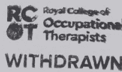
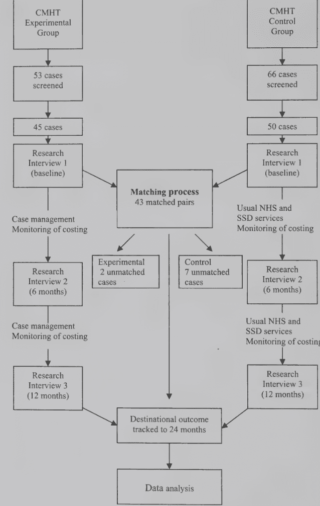

# 居家支持失智症患者：21世纪的挑战与机遇（个人社会服务研究单位联合出版）

## 与 PSSRU 合作

### 系列编辑

- David Challis 教授，曼彻斯特大学
- Martin Knapp 教授，伦敦政治经济学院 (LSE)
- Ann Netten 教授，肯特大学

David Challis, Paul Clarkson 和 Raymond Warburton

Martin Knapp, David Challis, José-Luis Fernández 和 Ann Netten 编

Caroline Mozley, Caroline Sutcliffe, Heather Bagley

Lis Cordingley, David Challis, Peter Huxley 和 Alistair Burns

David Challis, John Chestman, Rosemary Luckett, Karen Stewart

以及 Rosemary Chessum

Bledyn Davies 和 José-Luis Fernández

Linda Bauld, John Chestman, Bledyn Davies,

Ken Judge 和 Roshni Mangalore

个人社会服务研究单位 (PSSRU) 设有三个分支机构，分别位于肯特大学、伦敦政治经济学院和曼彻斯特大学。该部门从事社会和医疗保健研究，主要由卫生部支持，特别关注社区护理、长期护理及相关领域的公平与效率政策研究与分析——包括针对老年人、心理健康问题及受护理儿童的服务。

PSSRU 网站为：`www.pssru.ac.uk`。

英国，曼彻斯特大学

RICHARD VON ABENDORFF

PAMELA BROWN

JOHN CHESTERMAN

曾任职于英国肯特大学 PSSRU

# PSSRU

位于肯特大学、伦敦政治经济学院以及曼彻斯特大学。

David Challis, Caroline Sutcliffe, Jane Hughes, Richard von Abendorff, Pamela Brown 和 John Chesterman 根据《1988 年版权、设计和专利法》主本书的权利。

本工作由 PSSRU 完成；书中的观点代表作者，不一定代表卫生部的观点。

## Ashgate Publishing Limited

Wey East Court

Union Road

Farnham

Surrey, GU9 7PT

英国

## Ashgate Publishing Company

Suite 420

101 Cherry Street

Burlington

VT 05401-4405

美国

`www.ashgate.com`

# 英国图书馆编目数据

居家支持痴呆症患者：21 世纪的挑战与机遇。

1. 痴呆症--居家护理。2. 痴呆症--服务。I. Challis, David, 1948-II. 肯特大学。社会服务研究单位。362.1'9683-dc2

# 美国会图书馆编目数据

居家支持痴呆症患者：21 世纪的挑战与机遇 / David Challis ...等]。

p. cm. -- (与 PSSRU 合作)

包含参考文献和索引。

# 混合来源

来自管理良好的森林和其他受控来源

`www.fsc.org` 证书号 SA-COCC-1565

在英国由 MPG Books Group 打印并装订

# 目录

## 图

- 图 3.1 客户接触路径：38
- 图 4.1 研究设计：56
- 图 5.1 筛选与分配 63
- 图 7.1 长期护理人数：99
- 图 11.1 成效：156

## 框

- 框 1.1 社区护理：1942–1996 年政策发展 4
- 框 1.2 社区护理：1997–2007 年政策发展 6
- 框 1.3 社区护理：1988–2008 年照顾者政策发展 10
- 框 2.1 护理管理的特征：13
- 框 2.2 个案管理项目：北美：18
- 框 2.3 2006 年 NHS 法案：老年人的第 75 条灵活性：23
- 框 2.4 老年人护理安排的实施：26
- 框 3.1 设置与角色：39
- 框 3.2 个案管理的特征：41
- 框 3.3 转诊客户和照顾者的特征与状况：42
- 框 4.1 研究问题：46
- 框 4.2 访谈计划：47
- 框 4.3 访谈计划：调查领域：48
- 框 4.4 匹配变量：53
- 框 5.1 影响筛选、转诊选择的因素：64
- 框 5.2 痴呆症护理中的紧张与矛盾对服务交付的影响：73
- 框 5.3 监测：护理计划的组成部分：74
- 框 5.4 痴呆症老年人护理管理中的倡导：78
- 框 8.1 痴呆症老年人照顾者干预研究：115
- 框 8.2 客户需求领域：119
- 框 8.3 客户日常生活领域：120
- 框 9.1 年度服务成本：138
- 框 10.1 成本方程中的成效衡量：141
- 框 11.1 盖茨黑德个案管理计划的成效与成本：158
- 框 11.2 客户和护理网络的实践干预与策略：161
- 框 11.3 盖茨黑德个案管理计划：向主流服务的过渡：166
- 框 11.4 MHOA 服务：适用于不同水平的护理管理类型：168
- 框 11.5 有效老年人整合护理的特征：169

## 表

| 表 | 描述 | 页码 |
| :--- | :--- | :--- |
| 表 8.3 | 护理者每周接触小时数 | 121 |
| 表 8.4a | 护理者倦怠：所有护理者（12个月后客户仍在在家） | 123 |
| 表 8.4b | 护理者倦怠：护理者分居居住（12个月后客户仍在在家） | 123 |
| 表 8.4c | 护理者倦怠：护理者与客户同住（12个月后客户仍在在家） | 123 |
| 表 8.5 | 护理者总体压力和生活负担 | 124 |
| 表 9.1a | 平均服务接收和成本：长期护理、急性医院护理、间歇护理和日间护理 | 132 |
| 表 9.1b | 平均服务接收和成本：专业上访、居家护理和其他服务 | 133 |
| 表 9.2 | 服务平均成本 | 134 |
| 表 9.3 | 按机构划分的年成本 | 135 |
| 表 9.4 | 社会平均成本 | 137 |
| 表 10.1 | 实验组：每周社区护理包成本 | 143 |
| 表 10.2 | 控制组：每周社区护理包成本 | 143 |
| 表 10.3a | 实验组：每周平均机构成本 | 144 |
| 表 10.3b | 实验组：不同案例特征的每周平均机构成本 | 145 |
| 表 10.4a | 控制组：每周平均机构成本 | 146 |
| 表 10.4b | 控制组：不同案例特征的每周平均机构成本 | 147 |
| 表 10.5a | 实验组：社会成本 | 148 |
| 表 10.5b | 实验组：不同案例特征的每周平均社会成本 | 149 |
| 表 10.6a | 控制组：社会成本 | 150 |
| 表 10.6b | 控制组：不同案例特征的每周平均社会成本 | 150 |

## 前言

接下来的页面展示了关于居家支持痴呆症患者多年研究的结果。其主要目标是评估各种护理策略的有效性，并识别可以改进支持的领域，以提高患者及其护理者的生活质量。

研究涉及多样化的参与者，包括患者、家庭和医疗专业人员。研究结果为社区中痴呆症患者所面临的挑战提供了宝贵的见解，并强调了建立更整合、更有效的护理系统的潜力。

我们希望这份报告能为政策制定者、从业人员和研究人员提供有用的资源，并为痴呆症护理领域的进一步工作奠定基础。

本书为应对当前以及我们正进入的挑战性时期内，在痴呆症老年人护理领域中面临的一些长期存在的挑战，提供了重要的证据和论证。

布莱丁·戴维斯（Bleddyn Davies）

社会政策名誉教授

伦敦政治经济学院与肯特大学

1974–1999年肯特大学个人社会服务研究中心（PSSRU）主任

# 鸣谢

2009年《国家痴呆症战略》的发布，使得本书的内容显得尤尤为及时。该计划已构思了较之久，许多人士在研究实施和手稿准备过程中都提供了帮助。遗憾的是，并无法在此逐一点名感谢所有人。

我们特别感谢那些在多次接受采访的老年人及其护理人员。经过深思熟虑，我们决定在书中使用“客户”（client）一词来描述作为研究对象的痴呆症老年人，并用“护理者”（carer）一词来描述为这些客户提供非正式和无偿服务的亲属、朋友和邻居。在某种程度上，术语的选择具有随机性，这绝不会削弱这些个人所做的重要贡献。

我们与现名为南伦敦和莫德斯利 NHS 基金会（South London and Maudsley NHS Foundation Trust）内老年人心理健康服务（涵盖刘威沙姆区）的同事有着长期合作。埃莱恩·墨菲（Elaine Murphy）教授和阿里斯泰尔·麦克唐德（Alastair Macdonald）教授代表地方当局与阿曼达·爱德华兹（Amanda Edwards）共同促进了研究的发展。最近，卡罗琳·理奇森（Carolyn Richardson）安排了我们与当前服务的成员会面。最初研究的案例经理莉斯·亨特（Lis Hunter）在本书撰写期间提供了一个有趣的历史视角。

个人社会服务研究小组的同事在手稿起草方面提供了协助。格尼斯·哈里森（Glenys Harrison）和苏·马丁（Sue Martin）提供了秘书支持。里巴·巴杜里（Reba Bhaduri）和凯伦·斯华特（Karen Stewart）作为前同事，保罗·克拉克森（Paul Clarkson）为我们提供了宝贵的意见。

最后，我们要感谢资助个人社会服务研究小组的卫生部，为本研究提供初始资金的盖茨比慈善基金会（Gatsby Charitable Foundation）。

大卫·查利斯（David Challis）、凯罗琳·萨特利夫（Caroline Sutcliffe）、简·休斯（Jane Hughes）、理查德·冯·阿本多夫（Richard von Abendorff）、帕梅拉·布朗（Pamela Brown）和约翰·切斯特曼（John Chesterman）

# 第一章：痴呆症老年人：社区护理的发展

## 引言

在人口老龄化和许多国家财政限制日益巨大的背景下，为痴呆症老年人提供整合且协调的社区护理已引起关注。在英国，痴呆症患者人数正在迅速增加，预计在2006年至2021年间增长38%，其中80岁以上的人群增长幅度最大（Knapp et al., 2007）。事实上，这一年龄段的人可能更需要护理、养老院或家庭护理，预计将从2004年的260万增加到2031年的500万（政府精算师司，2006）。此外，认知障碍老年人的数量预计增长速度将快于仅有功能障碍的人群（Melzer et al., 1997; Comas-Herrera et al., 2007）。

政府政策日益关注满足虚弱老年人在其家中的需求。然而，很大一部分需要护理服务的可能是极高龄者和认知障碍者（Melzer et al., 1999）。此外，考虑到养老院供应量持续下降的趋势（卫生部，2001a; 2002a；社会服务监察局 (SSI)，2003；国家统计局，2007），更多的痴呆症老年人将在社区中需要进一步的支持。护理管理仍然是评估和满足需求的机制，重点是资源分配过程的透明化以及提供方式的灵活性（公共账算委员会，2008；卫生部，2008a; 2009a）。对于包括痴呆症患者在内的复杂需求老年人，护理管理很可能继续作为评估和满足需求的机制。

在上世纪的二十年里，人们日益意识到护理者对脆弱成年人护理的重要性，特别是在日常层面（Levin et al., 1989; Myers and MacDonald, 1996）。《照顾老年人》（Caring for People, 1989）和《社会服务现代化》（Modernising Social Services, 1998）等白皮书明确了护理者的关键贡献。这使得护理者有更大的潜力影响服务的提供（Department of Health, 2003）。然而，尽管关注更大的灵活性选择，但显然，由于护理人口的老龄化，非正式护理可能无法满足（Wanless, 2006; Pickett et al., 2007），导致对正式护理服务的的需求增加。

本书详细描述的刘威沙姆案例管理方案（LCMS）旨在为患有痴呆症、被确定有需求需求且可能入住养老院的老年人提供适当的社区护理方法，尽管有法律服务的投入。该方案位于一个现有的服务环境中，即一个针对老年人的专业多学科心理健康小组。它的重要性不仅在于它是跨越医疗与社会领域的老年人有效社区护理管理项目之一（Davis and Davies, 1986; Challis et al., 1995; 2002a），而且在目标人群上具有独特性。其随后演变为主流服务，反映了其与老年人心理健康护理当前发展的关联。方案的研究部分在方案的管理、规划和持续发展中发挥了整合作用，因此确保了程序的执行（Bond and McGowan, 1998; Teague et al., 1998），直到它成为多学科团队的主流服务。该研究将接受案例管理的老年人心理健康小组的人员与没有案例管理服务的类似心理健康环境的人员进行了比较。通过类似的转诊标准招募了各组的老年人，并在入组以及6个月和12个月后接受采访，其护理者也是如此。全面收集的服务利用和成本信息在十二个月内进行了随访跟踪。

本书的核心方案涵盖了《老年人国家服务框架》（NSFOP）所体现的改革计划中的许多原则和实践（卫生部，2001b）。它还证明了在痴呆症老年人护理中，专业医疗与社会护理之间联系的重要性（Philip and Able, 2005），以及个性化护理的重要性，即强调灵活使用资源以满足评估后的需求（卫生部，2008a; 2009a）。作为这一描述的序言，本书的前两章对护理管理安排演变的政策背景进行了历史回顾，并涵盖了其内在过程及其开展的组织背景。

## 老年人社区服务的发展

自 20 世纪 40 年代末福利国家出现以来，针对脆弱老年人（包括患有心理健康问题的人士）的护理安排发生了许多变化。然而，针对患有心理健康问题的老年人、特别是痴呆症患者的需求，其针对性的进展较少。表 1.1 详述的战后时期政策倡议的回顾凸显了这一点。许多发展并非专门针对老年人，而是旨在惠及所有弱势成年人，特别是在居家护理的背景下。在这一时期的早期，有三项举措与痴呆症老年人的护理特别为相关。

首先，正如 Means 和 Smith (1998) 所述，国家提供的大部分护理是基于机构的且质量较差，人们意识到这种状况无法持续下去。1946 年，纳菲尔德省医院信托在《医院调查：医院服务的末日之》（The Hospital Surveys: The Domsday Book of the Hospital Services）中报告了老年人护理问题以及养老机构条件的糟糕。同年，Seebohm-Notree 委员会（1947）对老年院的调查也描述了容纳超过 1000 人的机构条件恶，并建议对机构的结构和组织进行改革。十多年后，尽管建立了在服务点点免费的医疗服务，并要求地方政府无论年龄大小都要有需要的人提供居住护理，但似乎并没有太大变化。Townsend (1957; 1962) 描述了老年人在已转变为居住护理场所的旧家庭中的“仓储化”现象。然而，他报告说，对于未进入机构护理的老年人，支持服务匮乏（Townsend, 1962）。Robb (1967) 详细描述了护理标准的低劣，包括对针对老年精神疾病患者的医院医疗中存在虐待的指控。然而，直到近十年后，精神医院内心理健康状况的严重程度才变得清晰。为了应对这一问题，白皮书《精神疾病服务》（Services for the Mental Ill, Cmnd 6233, 1975）建议尽可能在家里或门诊诊所对他们的需求进行评估。

这反映了与痴呆症老年人护理相关的第二个主题：弱势成年人社区服务的碎片化且不均衡的发展。直到 20 世纪 70 年代，许多老年人社区服务是由自愿组织提供的，且覆盖既不不广泛。“社区护理”的首次正式提及归于 1957 年《精神健康与智力障碍皇家委员会报告》（Cmnd 169, 1957），该报告早于 1959 年的《精神健康法》。在1945 年到 1981 年白皮书《步入老年》（Growing Older，出版（Cmnd 8173, 1981）之间，几乎没有证据表明在任何用户群体中存在系统性发展。该报告主张老年人应该留在家里而不是进入长期护理，并强调了国家的主要作用是满足基本护理需求。然而，直到 1977 年

### 表 1.1 社区护理：1942–1996 年的政策进展

| 日期 | 政策倡议 | 关键要点 |
| :--- | :--- | :--- |
| 1942 | 社会保险及相关服务部门间委员会 (Cmnd 404) | 建议改革和扩展社会保障体系，并建立国家医疗服务体系。 |
| 1946 | 国家医疗服务法 | 确立了服务点免费护理，标志着《贫民法》下旧有公共机构制度的衰落。规定地方政府有在需要或其他情况下提供居住护理的责任。 |
| 1948 | 国家协助法 | |
| 1959 | 精神健康法 | |
| 1962 | 国家协助（修正）法 | 允许地方政府提供护理服务。 |
| 1963 | 健康与福利：社区护理的发展 (Cmnd 1973) | 重申了对去机构化的承诺，并强调了全国范围内服务供应的巨大差异以及老年人护理的短缺。 |
| 1968 | 健康服务与公共卫生法 | 地方政府负责老年人的整体福利发展。 |
| 1970 | 慢性病人与残疾人法 | 加强了地方政府整合碎片化服务的义务，并鼓励社区护理。 |
| 1973 | 地方当局社会服务法 | 将护理服务的责任移交给地方政府。 |
| 1975 | 精神疾病更好的服务 (Services for the Mental Ill, Cmnd 6233) | 建议尽可能在家里或门诊诊所评估患者需求。 |

| 年份 | 政策倡议 | 要点 |
|---|---|---|
| 1977 | 国家医疗服务法 | 规定地方政府有提供居家护理的责任。 |
| 1981 | 步入老年（*Growing Older*, Cmnd 8173） | 主张通过“赋能机构”的概念提供居家护理。 |
| 1989 | 关怀人们：未来十年及之后的社区护理（*Caring for People: Community Care...*, Cmnd 549） | 目标包括发展社区服务以及引入案例管理以实现这些目标。 |
| 1990 | NHS 与社区护理法 | 建立地方政府作为社区护理的领导机构，实施了全面的系统、新的检查体系和资金体系。 |

## 痴呆症老年人：社区护理的发展

针对老年人的居家（居家）护理是其主要受益者，这已成为强制要求。此外，尽管 20 世纪 70 年代的改革旨在为弱势成年人提供居家护理的协调方法，但结果是健康与社会护理提供者之间的分工变得更加明显。

第三个主题是老年人社区护理政策的发展在多大程度上关注了作为长期居住、护理和医院服务的替代方案。20 世纪 80 年代中期，审计委员会的两份报告对政府社区护理政策的有效性提出了批评（Audit Commission, 1985; 1986）。在未进行任何需求评估的情况下进入养老院的付费服务导致了进入居住护理而非居家护理的“诱因”。此外，针对最高需求人群的现有政策缺乏清晰且缺乏成本效益（Gostick et al., 1997）。

作为回应，白皮书《关怀人们》（*Caring for People*, Cm 849, 1988）概述了政府的承诺，即鼓励有身体或心理健康问题的老人在家中或社区的“家庭环境”中独立生活，纠正了被描述为“对居住和养老院护理的偏见”（1.1 节）。报告提了若干目标，其中两个是老年人社区护理的核心：将评估和案例管理作为护理的基石；促进居家护理、日间护理和喘息护理，使老年人能够尽可能留在自己家里。

这种促进老年人独立生活并提供符合个人需求的定制化服务的承诺，在 1997 年上任工党政府的白皮书《社会服务现代化》（*Modernising Social Services*, Cm 4169, 1998）中得到了进一步认可。

21 世纪英国的政策发展强调了以协调方式解决老年人健康和社会护理需求的重要性，如表 1.2 所示。自 1997 年以来，许多政策文件中反复出现的主题是提供整合的健康和社会护理。这体现在两个指南中：首先是针对特定疾病的服务范围，其次是提供这些服务的组织结构。这对于痴呆症老年人服务的发展具有重要意义。

针对特定疾病，国家医疗服务优化项目计划（NSFOP, Department of Health, 2001b）描述了关于为脆弱老年人健康和社会护理的“一项行动与改革计划”（前言，ii）。这包含了针对该群体更常见疾病的改革和发展目标，包括促进老年人的良好心理健康以及改善对痴呆症老年人的治疗和支持。

## 框 1.2 社区护理：政策发展 1997–2007

| 日期 | 政策倡议 | 要点 |
|---|---|---|
| 1998 | 社会服务现代化（Cm 4169） | 提出帮助成年人独立生活的服务，以确保服务满足个人需求。创建了更具一致的服务提供。还改进了联合工作，使健康和社会护理的整合达到高高护理标准。允许 65 岁及以上的人使用直接支付。 |
| 1999 | 《健康法》（*Health Act*） | 为国家医疗服务体系（NHS）和社会护理建立了新设施，以提供侧重于个人需求的良好整合服务。 |
| 2000 | 《护理标准法》（*Care Standards Act*） | 修订了法律，其中包括养老院的监管框架，并对居家护理引入了监管。 |
| 2000 | 《NHS 计划：投资计划、改革计划》（Cm 4818-1） | 提议建立一个新的多功能机构，负责委托和管理健康和社会护理。引入了“中间护理”（Intermediate Care）作为新的服务层级，无论在何种环境下提供，都能让人们留在家或接受注册护士的护理。 |
| 2001 | 《老年人国家服务框架》（卫生部, 2001） | 通过规定标准和模型、识别支持实施的策略以及监控进展的里程碑，旨在提高质量并减少服务提供的差异。老年人的心理健康被确立为公平性的一个特定领域。 |
| 2001 | 《健康和社会护理法》（*Health and Social Care Act*） | 建立了护理信托（Care Trusts）以协调整合的健康和社会护理，目标是改善对弱势用户的援助协调。 |
| 2001 | 《独立、福祉与选择》（Cm 6499） | 制定了一个跨越所有机构的战略框架，以确保在预防、满足低级需求以及为复杂需求的人员提供密集护理之间取得平衡。确认了护理协调员在协调复杂需求人员护理中的作用。 |
| 2006 | 《我们的健康，我们的护理，我们的话语：社区服务的新方向》（Cm 6737） | 改进了服务提供，让人们在社会长期护理服务中拥有选择权，解决了需求并改善了获得社区服务的途径，并对自我评估和需求有更大的控制权。 |
| 2006 | 《老年生活的新雄心——实施 NSFOP 的下一步》（卫生部, 2006） | 概述了十年期 NSFOP 前半部分的优先事项，以应对成年心理健康服务发展面临的挑战。目标是为老年人（特别是专家）确保全面的心理健康服务。 |
| 2007 | 《人人为本：成年社会护理转型的共同愿景与承诺》（英国政府, 2007） | 为成年社会护理建立了护理计划，开发个性化服务。强调了评估过程、以人为本的计划和个人预算。 |

## 患有痴呆症的老年人：社区护理的发展

抑郁。它规定应通过促进获得专科护理，通过早期识别和管理心理健康问题来实现后者。尽管在这些政策发展中承认患有心理健康问题的老年人的特殊特征与其他群体不同，并据此规定了与健康和社会护理相关的适当服务安排，但很少有倡议是专门针对患有痴呆症的老人的。

值得注意的是，在爱尔兰，专门为这一群体制定了计划。《健康战略战略：质量与公平：为您服务的医疗系统》（卫生与儿童部, 2001）中的一个目标是，根据爱尔兰国家年龄与老年人委员会的建议，为痴呆症实施一项为期七到十年的滚动性计划（O'Reilly and O'Shea, Quill, 2002）。后者提倡了一种适用于爱尔兰老年人及其护理者的痴呆症护理良好实践模式，重点是发展社区健康和社会护理服务的基础设施，以满足老年人的需求。

在英国，2001 年《健康和社会护理法》建立了护理信托以协调整合的健康和社会护理，目标是改善对弱势用户的援助协调。《独立、福祉与选择》（Cm 6499）制定了一个跨越所有机构的战略框架，以确保在预防、满足低级需求以及为复杂需求的人员提供密集护理之间取得平衡。确认了护理协调员在协调复杂需求人员护理中的作用。

《我们的健康，我们的护理，我们的话语：社区服务的新方向》（Cm 6737）改进了服务提供，让人们在社会长期护理服务中拥有选择权，解决了需求并改善了获得社区服务的途径，并对自我评估和需求有更大的控制权。

《老年生活的新雄心——实施 NSFOP 的下一步》（卫生部, 2006）概述了十年期 NSFOP 前半部分的优先事项，以应对成年心理健康服务发展面临的挑战。目标是为老年人（特别是专家）确保全面的心理健康服务。

《人人为本：成年社会护理转型的共同愿景与承诺》（英国政府, 2007）为成年社会护理建立了护理计划，开发个性化服务。强调了评估过程、以人为本的计划和个人预算。

在英国，《NHS 计划：投资计划、改革计划》（Cm 4818-1）提议建立一个新的多功能机构，负责委托和管理健康和社会护理。引入了“中间护理”（Intermediate Care）作为新的服务层级，无论在何种环境下提供，都能让人们留在家或接受注册护士的护理。

为患有痴呆症的老年人提供社区护理仍然至关重要。在健康和社会护理的背景下，垂直整合被描述为满足老年人需求的社区服务发展的关键特征。

《痴呆症战略》（2009）强调了针对老年人的改进社区服务。

## 患有痴呆的老年人：社区护理的发展

照顾，或针对被照顾者的服务，例如日间照料或喘息（Twigg, 1992; Pickard, 2004）。

Twigg 和 Atkin (1994) 提供了一个被广泛引用的概念框架，包含四个模型，用于描述服务对照顾者的反应。

在第一种模型中，照顾者被视为“理所当然”的资源；在第二种模型中，机构与照顾者作为同事共同工作，将他们的工作与照顾者提供的支持整合起来。这考虑了照顾者的利益和福祉，但将需要支持的人放在首位。

在第三种模型中，照顾者被视为自身需要帮助的共同客户，服务设计旨在缓解他们的处境并提高他们的福祉，在某些情况下是以牺牲老年人的利益为代价的。例如，老年人可能在离开家的情况下接受护理，主要是为了减轻照顾者的负担。

第四种模型假设照顾者的角色被取代，不再需要投入，使客户和照顾者的独立性最大化，其关注点更多在年轻残障成年人与照顾者之间的关系上。随后，这描述了照顾者作为专家的概念，展示了他们随时间发展的护理技能和专业知识（Nolan et al., 1996）。

Twigg 和 Atkin 概念框架中两个元素的使用——照顾者作为资源以及照顾者作为独立的共同客户——对于本计划在新的政策背景以及本书的核心研究中都具有特别的相关性。

在社区改革后，针对老年人照顾者的一系列政策倡议如图表 1.3 所示。在此之前，《格里菲斯报告》（1988）承认，大多数非正式护理是由家庭、朋友和邻居提供的，而公共服务的角色从定义上说是“填补空白”，或在非正式护理中断时提供护理。

它将照顾者坚定地置于资源的角色上，其建议是，针对个人的非正式护理服务包应建立在“非正式照顾者的可用贡献和邻里支持”的基础上。社区护理的目标之一是为照顾者提供支持，缓解他们照顾依赖性的人的压力。

尽管《照顾人们》白皮书（Cm 849, 1989）进一步吸取了格里菲斯报告的许多主要主题，确保服务提供者将为照顾者的实际支持放在首要位置，并“考虑到”照顾者的需求，但这两者都没有将照顾者视为独立的服务用户。

可以认为，照顾者作为共同客户的概念在 1995 年的《照顾者（承认与服务）法》中得到体现，并在 2000 年的《照顾者与残障儿童法》中加强。这些法律旨在为照顾者提供更多权利的框架，并确保他们的需求得到认可和评估。

然而，其实现的程度尚不清楚，特别是在涉及痴呆症老年人的照顾者方面，最新的证据仍然匮乏。有人建议，照顾者并不知道自己接受了评估，而且他们的需求经常被服务提供者忽视（Clarke, 1999; Wood, 1999; Moriarty and Webb, 2000）。随后，人们承认照顾者是护理中的“专家伙伴”，他们应该。

### 图表 1.3 社区护理：1988–2008 年针对照顾者的政策发展

| 日期 | 政策倡议 | 关键点 |
|---|---|---|
| 1989 | 《照顾人们，未来十年及未来的社区护理》（Cm 849） | 目标包括为照顾者提供实际支持和建议，通过支持照顾者来满足客户和需求。 |
| 1995 | 《照顾者（承认与服务）法》（卫生部 1996a） | 将向朋友或亲属提供“实质性”且“定期性”护理的人员的权利正式化，以便进行单独的评估。要求地方当局在决定照顾照顾者的服务时考虑他们的意见和评估结果。 |
| 1999 | 《关于照顾者：针对照顾者的国家战略》（卫生部 1999） | 承认照顾者自身也需要帮助，服务旨在缓解他们的处境并提高他们的福祉，有时是以老年人的利益为代价。 |
| 1999 | 《更好的护理：长期护理》（环境、运输与地区部 1999） | 为照顾者提供指导，要求地方当局在决定照顾者的服务时考虑他们的意见。 |
| 2000 | 《照顾者与残障儿童法》 | 为照顾者提供更多权利的框架，并确保他们的需求得到认可和评估。 |
| 2004 | 《照顾者（平等机会）法》 | 要求地方当局在决定照顾者的服务时考虑他们的意见和评估结果。 |
| 2006 | 《我们的健康护理，我们的选择：社区服务的新方向》（Cm 73） | 目标包括为照顾者提供实际支持和建议，通过支持照顾者来满足客户和需求。 |
| 2008 | 《处于核心的照顾者：21 世纪家庭与社区》（政府 2008） | 确定了短期和长期照顾者的优先事项。 |

> 注：例如，老年人可能在离开家的情况下接受护理，主要是为了减轻照顾者的负担。第四种模型假设照顾者的角色被取代，不再需要投入，使客户和照顾者的独立性最大化，其关注点更多在年轻残障成年人与照顾者之间的关系上。随后，这描述了照顾者作为专家的概念，展示了他们随时间发展的护理技能和专业知识（Nolan et al., 1996）。Twigg 和 Atkin 概念框架中两个元素的使用——照顾者作为资源以及照顾者作为独立的共同客户——对于本计划在新的政策背景以及本书的核心研究中都具有特别的相关性。

# 本书结构

本书的剩余部分探讨了痴呆症护理背景下的护理安排、案例管理模型、研究设计以及方案在研究期间的演变。它描述了付费护理服务的发展、痴呆症老年人及其照顾者的结果、成本差异以及该方案向主流服务的演变。研究涉及《痴呆症战略》（卫生部 2009b）的目标，特别是改善社区支持服务和照顾者的策略。

第二章探讨了痴呆症老年人护理安排的发展问题。随后，第三章描述了在威廉姆开展的痴呆症老年人案例管理模型，并概述了研究开始时的服务特征。第四章概述了研究方法论，包括所用措施的选择和类型、案例匹配的组成。还解释了访谈客户和照顾者的程序，以及对成本和结果、服务提供和实践的评估。

第五章考察了方案在研究期间演变的案例管理实践。它描述了案例发现和筛选、需求评估、护理计划、监测和案例审查、案例结案的过程，并讨论了倡导在痴呆症老年人方面的作用。

第六章描述了付费护理服务的发展、管理和演变，这是一种针对痴呆症老年人的专业居家服务，并概述了付费人员的主要特征、招聘以及方案的管理和组织。

第七章和第八章描述了实验组和对照组老年人和照顾者的结果。前者考察了方案在老年人需求方面的成功之处及其对其生活质量的影响。后者描述了照顾者的负担在多大程度上得到了减轻，并考察了方案对照顾者生活质量和压力水平的影响。

第九章探讨了方案在机构成本方面以及社会总成本方面的有效性。第十章描述了与两组成本差异相关的因素，以及各种老年人和照顾者特征的成本差异。最后，第十一章考察了方案在针对心理健康问题老年人的地方医疗护理网络中的后续演变，并回顾了研究结果在当前政策框架下的相关性。

# 第二章

## 痴呆症老年人的护理管理

### 引言

有人建议，六个特征可以将护理管理与其他服务相关的活动区分开来（Challis et al., 1995）。这些特征在框 2.1 中所示。

正如上一章所述，在痴呆症老年人社区护理背景下，护理管理的持续相关性已凸显（Cm 6499, 2005；公共账户委员会），并将其定义为长期护理模型（Challis et al., 1990），与短期的以任务为中心的干预形成对比（Reid and Shyne, 1969; Goldberg et al., 1985; Burns et al., 2005）。然而，针对痴呆症老年人的专业护理管理仍然是一个具有巨大创新和发展空间的实践领域。

在回顾针对心理健康问题（特别是痴呆症患者）老年人的护理管理安排的发展之前，反思所使用的定义和术语是有意义的。格里菲斯报告提到了“护理经理”（Griffiths, 1988, para 6.6），其目的是监督评估和重新评估的功能；然而随后的白皮书《照顾人们》（Cm 849, 1989 para 3.1.3）使用了“案例经理”一词，展示了相同的角色。

随后，卫生部的指南显示出对“护理管理”一词的偏好。在北美的许多司法辖区，这些术语是通用的；在北爱尔兰，这两个术语最初在使用时有明确的区分（Department of Health, Social Services and 1991），但现在情况已不置此（Department of Health, Social Services and Public Safety, 2006）。

针对地方当局和医疗服务的英语和威尔士语指南（National Assembly for Wales, 2002; Department of Health, 2005a）都建议将“案例管理”作为“护理管理”的替代。然而，有人认为，关于术语的辩论表明，赋予该过程意义的清晰度很重要，而非所使用的精确术语（Challis et al., 1995）。

在此基础上，本章使用了这两个术语，并关注定义该过程的组成部分。后续章节使用了“案例管理”或“案例经理”一词，反映了该研究项目在成立初的名称以及执行此项任务的成员所承担的角色。

因此，本章的目的是探索影响痴呆症老年人护理管理发展的多种因素，从而为本书其余部分的描述和分析提供背景信息。回顾的莱维沙姆管理方案（Lewisham Management Scheme）提供了有关护理管理安排的信息，旨在协调针对心理健康问题（特别是痴呆症患者）老年人的社区护理。

因此，凸显了社区护理作为养老院安置替代方案这一概念在演变中的关键因素。大部分文献源自英国，特别是英国，但也包含了一些海外参考文献。在许多情况下，这些文献指的是历期很长时间的调查，这一特征在英国文献中并不常见。

总的来说，本章探讨了包括政策倡议和试点项目在内的各种文献，并提供了与护理管理相关的定性和定量数据混合。然而，其重要的缺陷是，除某些特殊情况外，本书核心缺乏对护理管理安排有效性的稳健经济学评估。

### 框 2.1 护理管理的特征

| 功能 | 护理服务的协调与联动 |
|---|---|
| 目标 | 提供连续性和整合护理；增加居家护理机会；促进客户健康；更好地利用资源 |
| 核心任务 | 案例发现与筛查；评估；护理计划；监测与评审；护理结束 |
| 受益者特征 | 长期护理需求；多项服务需求 |
| 主要特征 | 参与强度；跨越的服务广度；参与时间之长 |
| 多级响应 | 将实践层活动与更广泛的资源和机构级活动相结合 |

来源：Challis et al. (1995)

## 早期影响

护理管理起源于北美（`Davies and Challis, 1986`; `Beardshaw and Towell, 1990`; `Fisher, 1990–91`）。它是作为护理重心从机构化向社区化转变运动的一部分发展起来的（`Huxley et al., 1990`; `Challis, 1992a, 1994a,b`）。在此背景下，具有特别意义的是美国联邦政府在20世纪80年代委托的“导接项目”（`Channeling Projects`）系列。“导接”被描述为将需要长期社区护理的人与适当的服务连接起来的过程（`Department of Health Education and Welfare, 1980`）。因此，这些项目试图将有长期护理需求的老年人与适当的社区服务联系起来并促进稀缺资源的成本利用（`Davies and Challis, 1986`）。因此，老年人护理管理的发展与这些因素以及社区护理的发展密不可分。在英国，这项倡议在1983年由中央政府发起的28个“社区护理”（`Care in the Community`）项目中得以复苏，旨在帮助长期住院的患者搬到社区环境（`Knapp et al., 1992`）。试点项目涵盖了所有群体，尽管有七个项目为老年人提供护理，其中三个项目专门针对“精神虚弱”的老年人。

在英国，三个针对老年人案例管理的试点项目影响了白皮书《照顾人们》（`Cm 849, 1989 para. 3.3.3`），这些项目先于1993年的护理管理改革。这些项目在肯特、盖茨斯德和达灵顿进行（`Challis and Davies, 1986`; `Challis et al., 1990; 1995; 2002a`），是上述社区倡议的一部分。社区护理项目（`Challis and Davies, 1986`）的目的是为有入住养老院风险的社区虚弱老年人提供长期居家护理。它通过将资源转移到社会服务部门拥有案源的一线，实现了资源的去中心化，以确保更好地响应需求。肯特方案比较了两组类似的虚弱老年人；其中一组接受案例管理的社区护理，而另一组接受标准服务。盖茨斯德方案有两个不同的阶段。第一是社会护理方案，作为一项社会服务倡议，旨在防止不必要的养老院入院（`Challis et al., 1990`）。随后，该项目与基层医疗建立了紧密联系，从而促进了医疗保健同事参与护理管理过程。这两项倡议都针对有养老院风险的老年人，并与接受通常服务的同类老年人组进行了比较（`Challis et al., 2002a`）。

达灵顿社区护理项目（`Challis et al., 1995`）是这些试点项目中的第三个，旨在为虚弱老年人提供长期住院护理的社区替代方案。它试图使用相同的方法扩展肯特和盖茨斯德研究的护理管理方法。然而，在达灵顿，该方法是在多机构环境中开发的，目标是让患者出院而非防止进入养老院，并由服务部署了自己的居家护理助理。该项目旨在检查这种护理模式对于不同程度身体和精神虚弱的老年人及其护理者如何；比较居家护理与长期住院护理的相对成本；并检查医疗和社会服务是否可以在客户层面成功整合。

有可能为认知障碍患者在其家中提供护理（`Challis and Davies, 1986`; `Challis et al., 1995; 2002a`）。此外，所有这些案例管理试点项目的共同特点是每个项目都解决了与服务有效性相关的问题。这是通过检查方案实施后老年人及其护理人员所产生的相对成本和效益实现的，包括对不同机构以及对社会的成本。

总的来说，这些项目具有三个特定特征，这些对英国后续案例管理的发展具有特别的相关性。首先，它们关注单一的客户群体，并制定了反映这一特点的程序和方案。其次，在这个广泛的群体内部，服务针对的是一个被定义为具有复杂健康和社会护理需求的小子集。第三，根据需要，通过使用病例发现和筛选过程来识别客户。在这种背景下，病例发现的目的是增加需要服务的人获得该服务的可能性，而筛选的目的是确保被定义为不符合服务条件的人不会接受服务（`Challis and Davies, 1986`）。`Gatehead` 和 `Darlington` 试点项目还突出了另一个特征，即与一级或二级医疗保健环境中的医疗保健提供者的联系（`Challis et al., 1995; 2002a`）。其他研究探索了案例管理与针对有入住养老院风险的老年人的医疗保健提供之间的联系。`Dant` 及其同事（1989）评估了一个在基层医疗保健团队中采用案例管理的卫生部门。`Bland` 及其同事（1992）评估了一个建立在医院工作部门的多多学科团队。这些研究尽管方式不同，但都强调了在提供案例管理时，健康护理与社会护理之间联系的重要性。这在随后被认为是社区护理的一个重要组成部分（`Challis et al., 2006a`），对于患有痴呆症的老年人来说，这种联系的重要性是显而易见的，而且正如上述提到的，已经得到了正式认可（`Committee of Public Accounts, 2008`）。

在美国，`Eggert` 及其同事（1990）回顾了三种强化型案例管理模型，这些模型还纳入了健康维度：“中心化个人”模型、“社区团队”模型和“家庭健康护理团队”模型。这些模型在客户评估和重新评估、直接服务和危机干预的功能方面有所不同。分析显示，患有痴呆症的人在“社区团队”模型下，其医疗服务的使用减少更多，成本更低。在实践中，案例经理的个案量小得多；上门访问次数更多；并在定义的地理区域内运营，从而获得了对当地资源的了解。更广泛地说，研究注意到最初确定适当的案例管理强度水平，以及通过有效监测进行适当调整的重要性。这说明了对需求评估进行差异化处理的重要性；对那些可能在结果方面获益、且在可能的情况下具有成本效益的客户实施案例管理进行恰当的目标定位；以及在此过程中监测的重要性。后者强调了护理管理是一种长期和短期护理的模式，正如框 2.1 所注记的，这是一个特征性特点。`Eggert` 的研究对于本章（实际上也是全书）的重点来说是重要的，它还提供了早期证据，证明了在获得充分且适当护理的情况下，案例管理具有让精神健康问题的患者留在他们自己家中的潜力。

`Eggert` 及其同事（1991）开展的进一步研究与多学科环境下的案例管理有关。该研究基于肯特社区护理项目（`Challis and Davies, 1986`）；`Davies and Challis (1986)`，并比较了两种针对需要专业护理的居家患者的案例管理类型：“中心化个人”模型和“社区团队”模型。“中心化个人”模型由社会工作者和护士担任案例经理，但他们的个案量大于“社区团队”模型中的人员。他们很少进行上门访问，且提供的护理连续性较小。“社区团队”模型的设计让护士和社会工作者担任案例经理。虽然两者的成本都较高，但“社区团队”模型由于定期的监测，提供了更好的护理连续性。

总结来说，`Gatehead` 和 `Darlington` 试点项目识别了与认知障碍患者案例管理相关的因素。`Eggert` 在美国的研究也揭示了案例管理对服务投入的影响，并审查了服务。这些项目的关键特点见框 2.2。

## 痴呆症老年人的护理管理

### 组织影响

在社区护理改革实施两年前，护理计划方案（`CPA`）就提供了一种协调精神健康问题的手段（`Department of Health, 1990a`）。它旨在确保在出院前评估这些健康和社会需求，并有服务满足这些需求。1993年社区护理改革实施之前的政策指南概述了护理系统的三个阶段：对客户和护理人员的评估；与客户和相关机构协商护理方案；以及对协议方案的实施和监测（`Department of Health, 1990b`）。随后，确定了案例管理的七项任务：发布信息、确定评估水平、评估需求、护理计划、监测和审查（`SSI/SWSG, 1991a,b`）。地方政府在开发案例管理方面的裁量权导致了服务模式的巨大差异（`Weiner et al., 2002`）。此外，研究认为，强调对案例管理七项任务的遵循会导致地方政府在实施早期关注这些离散实体，而不是开发符合案例管理作为长期护理模式的安排（`Gostick et al., 1997`）。虽然主要与年轻人有关，但其纳入标准包括自我忽视，这可能是老年精神健康问题的特征。然而，目前尚不清楚其在痴呆症老年人应用范围。在这种背景下，可能重要的是，发现精神健康老年人的案例管理存在显著重叠领域（`Hughes et al., 2001`）。事实上，`CPA` 被描述为针对精神健康问题的特殊案例管理变体（`Department of Health, 1995`）。这些指令共同构成了20世纪末精神健康老年人服务发展的政策框架，而两者之间的关系直到单项评估流程（`SAP`）的引入才明确。对于痴呆症老年人，它规定案例管理安排是协调居家护理的最合适方式（`Department of Health, 2002b`）。

#### 框 2.2 案例管理项目的特点：英国与北美

- 按客户群体专业化

- 针对复杂需求人群实施案例管理

- 多学科评估而非单一学科

- 健康护理与社会护理之间的紧密联系

- 小个案量

- 成本效益的护理需要定期监测

- 对服务投入的定期审查

- 通过定期审查提供服务替代的机会

## 痴智症老年人的护理管理

痴智症患者处于挣扎状态，并持续成为一个重要的群体。可以推断，这种状况将会持续，因为已有提议要求转型社会护理，特别是为了确保符合公共资助成人社会护理条件的个人能够获得透明的资金分配，以满足评估需求（`Cm 6377, 2006`; `卫生部, 2008, 2009a`）。

在本节的剩余部分，将从三个广泛的主题回顾英国护理管理发展的核心组织因素：支持弱势老年人在其家中接受服务的服务委托安排；财务安排；以及地方政府内部及跨越医疗与社会护理的单一学科和多学科专家培养的发展。这些问题将用一般性术语描述，尽管只要可能，所使用的示例将针对痴智症老年人服务背景下的护理管理。

### 服务委托

社会服务部门内部购买者与服务提供者职能的分离，是中央政府对地方当局提出的要求，这也是引入社区护理立法实施计划的一部分。该举目的是促进地方当局在社会护理提供背景下发挥赋能作用的手段之一（`Cm 849, 1989`）。在1993年之前或期间，超过一半的英国地方当局引入了这种职能划分（`Challis et al., 1999`），一项早期研究指出对这种划分存在僵化的阐释（`Challis, 1994`）。另一方面，随后的研究表明，购买者/提供者分离开的发展是一个缓慢的、演进过程（`Wistow et al., 1994`; `Gostick et al., 1997`; `Lewis et al., 1997`）。由于包括痴智症患者在内的弱势老年人护理仍然是地方当局事实上开展工作中最大的部分，这种分离的引入对该用户群体服务的交付产生了重大影响。伴随《照顾人们》白皮书（`Cm 849, 1989`）的政策指导强调，当局角的发展应在组织中从两个层面进行：“微观层面”和“宏观层面”，涉及满足战略目标的计划（`卫生部, 1990b`）。回溯来看，可以认为地方当局内部服务委托与服务提供的的分离，延迟了两个层面上针对痴智症老年人的专家护理管理安排的发展。

在“微观层面”，在社区改革引入之前，人们注意到以需求为导向的方法“预设了评估与提供的进步性分离”（`卫生部, 1990b, 25`），尽管指导意见并未要求一线工作人员拥有预算开发，并配备适当的财务管理和监控系统。这种缺失对于痴智症老年人护理管理安排以及通常的密集护理管理安排的发展具有重要意义，原因有二：第一，长期以来人们认为，下放预算可以对复杂护理包内的需求提供更灵活的响应（`审计委员会, 1996`），这也是痴智症老年人通常需要的。第二，与一点密切相关，下放预算是英国许多密集护理管理试点计划的共同特征（`Challis et al., 1995; 2002a`）。更广泛地说，应该注意到，购买者与提供者职能的分离与影响《照顾人们》白皮书的这些针对老年人的护理管理项目（`Cm 849, 1989, para 3.3.3`）形成对比。在这里，护理经理与护理提供者之间的紧密关系是服务交付系统的重要组成部分（`Challis et al., 1995; 2002a`）。这说明了在20世纪90年代英国护理管理安排之初，僵化的购买者/提供者划分作为其最重要的组织方面之一是不充分的。关于未来痴智症老年人居家护理安排，值得注意的是，社会护理个性化的提议包含了开发对需求的更灵活响应，这是拟议变革的核心支柱（`卫生部, 2008a; 2009a`）。

在“宏观层面”，社区护理改革引入后，社会服务当局在社区护理方面的委托角色得到了发展。如上所述，《照顾人们》白皮书（`Cm 849, 1989`）的目标之一是社会服务当局应成为“赋能型”机构，确保服务的交付，不仅是作为直接提供者，而是通过发展其购买和签约角色。预想这种变化将增加选项范围、独立提供者以及消费选择。然而，在针对痴智症老年人特殊需求引入委托服务后，最初有两个因素阻碍了委托服务的发展：第一，由于社会服务部门为这些人提供服务的方式往往与其他老年人服务分开，因此很难获得接受服务的痴智症患者人数以及此类服务支出资金的准确数据。因此，没有可靠的数据来指导委托过程。第二，在地方层面，医疗与社会服务当局之间难以为痴智症老年人建立整合的委托安排。这不仅仅是因为人员变动，而是因为对这群人的责任最初被赋予了不同的服务部门——社会服务部门内部的老年人服务，以及国民保健体系（`NHS`）内的精神健康服务（`卫生部, 1997a`）。此外，正如审计委员会（2002）随后指出的，过去和现在都需要明确的目标，包括居家、住院和医院服务之间的预定平衡，但这些基础要素往往并未到位。

### 财务安排

1993年引入护理安排后产生的财务安排也从“宏观”和“微观”两个层面得到了体现，意义在于它们影响了个人层面的护理提供以及提供此类服务的整体背景。在“微观层面”，即向个人用户提供服务，有两个实践方面对于在试点项目中执行有效的财务管理至关重要。这些是：

- 向护理经理下放预算

- 针对具有明确单位成本的购买服务的支出限制

其中第一一点重要性在前节中讨论过。长期以来人们广泛接受，明确的单位成本允许护理经理与服务用户及护理者对替代方案的可能成本和效益做出明智选择，例如在五小时居家护理或参加日间中心之间（`Challis and Davies, 1986`）。然而，研究表明，在社区改革引入后，护理包的主要组成部分可能进行了成本计算（`Challis et al., 1999`）。

最近，关注点集中在资源的公平分配以及服务用户获得一笔资金并对自己的护理负责的机会上（`卫生部, 2008a; 2009a`）。

后者最初体现在直接支付（`direct payments`）的引入中，地方当局被要求向被评估为符合援助资格的个人提供资金和设备，以便他们对如何购买和提供护理及设备做出自己的决定（`卫生部，2000a`）。对老年人使用这些措施的早期研究表明，其采纳率有限（`Fernández et al., 2007`），这表明对于痴呆症老年人来说，根据个人需求量身服务的挑战将继续是护理经理的职责。随后，引入个人预算的提议旨在促进资源分配更加透明化，并允许人们创建自己的护理方案。人们也意识到，一些老年人倾向于由护理经理（`CM`）来执行这些（`CM 6499, 2005`；`卫生部，2008a; 2009a`；`Glendinning et al., 2008`），可以推断这一群体将包括痴呆症老年人。在这种背景下，成功的关键指标将护理经理将服务提供范围扩展到家庭和日间护理之外（这是以往典型的服务响应）的能力（`卫生部，1997a`；`Moriarty and Webb, 2000`）。为了实现这一点，既需要向个人明确分配资源，也需要确定每项服务的成本。有人建议，对于有复杂问题的老年人的护理计划，在所有健康和社会护理方面都成为常规化成本之前，将无法成为现实（`Challis et al., 2007`），这一前景对于痴呆症患者具有特别的意义。

在宏观层面，20世纪90年代初引入了立法，允许对医疗和社会保健提供者之间联合工作的财务安排进行更改，正如第1章所述。在为心理健康问题老年人（特别是痴呆症患者）提供整合护理方面，这些变化认为具有特殊的意义。虽然立法包含了国家卫生服务体系（`NHS`）信托与其他`NHS`机构及地方当局“为了共同利益”合作的新法律义务，但有人认为，该立法与该领域之前的法律相比，特征是随后引入了“灵活性”，这些灵活性创造了消除联合工作障碍的新机会（`Henwood and Wistow, 1999`）。这些灵活性各种允许资金池化、委托委托或服务之间的整合。然而，一项早期的监测发现，心理健康问题老年人的服务采纳率非常有限（`Hudson et al., 2002`）。随后，《2006年`NHS`法案》重申了这些机制在追求开发更整合服务方面的核心地位。正如框 2.3 所示，每种机制对痴呆症老年人护理管理安排的发展具有特别意义的益处：更灵活的护理方案；改进的服务委托安排；以及更高的护理连续性。《痴呆症战略》（`卫生部，2009b`）通过对改进家庭护理、短期休整和痴呆症联合委托策略的建议强化了这一点。这些在书中得到了进一步讨论，事实上，它们是地方化护理管理系统（`LCMS`）的核心，其评估

#### 框 2.3 2006年NHS法案：第75条灵活性与针对痴呆症老年人的服务

| 灵活性类型 | 描述 | 对痴呆症老年人服务的可能收益 |

|---|---|---|

| 资金池化（`Pooled budgets`）。 | 医疗机构和地方当局汇总资金，使工作人员能够不考虑资金来源地开发护理方案。 | 开发更具活性和个性化的护理方案 |

| 主导委托（`Lead commissioning`）： 针对目标人群的服务委托是最常被引用的例子。 | 初级保健信托和地方当局相互委托功能。确定的益处是降低成本和更信息透明的服务委托。 | 改进地方层面的服务委托，纠正了服务提供中长期存在的弱点（在前节中讨论）。 |

| 整合提供（`Integrated provision`）： 由单一管理提供者提供医疗和地方当局服务。 | 单一机构提供医疗和社会护理。 | 通过单一机构同时提供社区护理和居家护理，实现了更高的护理连续性。 |

证明了它们在为痴呆症老年人提供家庭护理方面的重要性。

### 专业团队

本节的目的是探索负责为痴呆症老年人提供护理管理的团队组成。这涵盖了地方当局内部根据客户/用户群体出现的专业化分工，以及由医疗和社会保健人员组成的团队的发展。

首先，概述了地方当局社会服务部门内按用户群体专业化的发展。关于社会护理“通用型”和“专业型”方法的辩论始于《Seebohm 报告》（Cmd 3703, 1968）的引入。在 1971 年社会服务部门成立后，人们担心需要专业技能来满足个人需求（社会工作教育与培训中央委员会，1975），并注意到了按客户群体专业化的发展。80 年代中期，Challis 和 Ferlie（1987）注意到一种偏离通用型工作（Cmd 3703, 1068）向客户群体转变的趋势。1989 年《儿童法》和 1990 年《国家卫生服务与社区护理法》的制定为这一过程提供了刺激（Means and Smith, 1998），并注意到这种用户群体专业化的趋势。

# 在家支持痴呆症患者

对痴呆症老年人的护理管理也可以通过跨医疗和社会保健的专业服务来提供。然而，一项针对该人群护理管理的国家级研究显示，超过半的地方当局提供了……（此段原文存在大量乱码/重复，iner., 2003）。

总体而言，痴呆症老年人更有可能通过老年心理健康团队的护理管理过程获得支持。尽管如此，世纪初英国和威尔士老年心理健康服务的审计显示，在调查的地区中，只有一半以下完全配备了心理健康问题老年人的专业多学科团队（审计委员会，2002）。

此外，对痴呆症老年人服务的审查发现，专业社区健康团队（CMHTs）的规模和可用性持续变化，只有一半完全整合到医疗和社会保健中（国家审计署，2007）。虽然社会工作者传统上是承担护理管理的主要而非唯一的专业群体，被认为是多学科团队的核心成员（卫生部，2001），但情况并非总是如此（Challis et al., 2002; Tucker et al., 2007; 国家审计署，2007）。

此外，关于 CMHT 中负责痴呆症老年人社区护理协调的人员的专业背景和职称——工人还是痴呆症护理——的辩论仍在继续（服务改进伙伴，2005；卫生部，2008）。

这些发现在心理健康问题老年人（特别是痴呆症患者）作为养老和护理院替代方案的社区服务发展背景下具有特别意义。

## 痴呆症老年人的护理管理

如本章早期所述，英国的试点项目表明，按客户群体专业化是发展有效护理管理实践的一个重要因素。此外，有研究指出，通过专业团队为老年人提供护理管理，是发展强化型护理管理的必要条件之一（Challis et al., 2001a），这也是组织复杂护理方案以使痴呆症老年人能够继续居住在自己心中的先决条件。

上述证据表明，这一要求可能已经得到满足。然而，值得注意的是，尽管有一些多学科团队为痴呆症老年人提供护理管理，但从可用性或（在实地）的人员配置来看，这种提供仍并不全面。

## 实践发展

在许多国家，旨在满足居家虚弱老年人需求的政府政策是在日益紧缩的财政预算内提供的。因此，政策和服务的开发呈现出日益相似的特征（Kraan et al., 1991; Challis, 1994a,b; Delaney et al., 2001）。

英国已经承认，社区护理议程是一个长期工作，而针对老年人的居家护理的发展是一项长期计划（SSI, 1998b; Department of Health, 2000b），最近这在转型议程中得到了体现（Department of Health, 2008a）。

作为这一过程的一部分，官方制定了许多关于护理管理安排发展（包括针对痴呆症老年人的安排）的文件，并持续发布。这些文件从大量的出版物中挑选出信息、指导和关键发现，并汇总在框 2.4 中。

这些信息大部分来源于社会服务检查局（Social Services Inspectorate）的工作，特别是其对服务的检查、针对有关护理管理各方面的专门研究和年度回顾，以及审计委员会（Audit Commission）发布的报告，后者的关注范围涵盖了护理管理的财务方面。

虽然这些文件未能提供社区护理改革引入后所有与老年人护理相关的官方文档的概述，但它们反映了老年人（包括痴呆症患者）护理管理发展和过程中的特定关注领域。许多内容源于社区改革实施后的初期时期。

总的来说，这些与护理管理安排发展的各种文献中呈现出的主要主题是：

- 差异化护理管理方法的重要性；
- 针对复杂需求者的评估目标；
- 改进评估方法的必要性；
- 对护理管理安排中监测和审查方面的相对忽视。

每一个主题都得到了更详细的探讨，因为它们对痴呆症老年人的社区护理具有特别重要的意义。

### 框 2.4 老年人护理管理安排回顾

| 日期 | 文件 | 主要发现 |
| :--- | :--- | :--- |
| 1993 | 卫生部，监测与发展：评估 | 患有心理健康问题的老年人需要全面的评估。 |
| 1993 | 审计委员会，护理：进展 | 引入了新的评估方式；实际需求。 |
| 1994a | 卫生部，监测与发展：专门研究 | 护理被应用于服务使用者，而非复杂案例。 |
| 1994b | 卫生部，社会服务护理安排的检查 | 开发了灵活预算；事实上的住院护理。 |
| 1995 | SSI，关怀伙伴：首席检查员年度报告 | 对服务的关注不足；由服务驱动的计划。 |
| 1996b | 卫生部，关怀人们：第二部分 | 监测任务提供方面有所改进。 |
| 1997b | 卫生部，护理的基石：老年人护理规划检查 | 响应性服务；避免了不必要的重复。 |
| 1997 | 审计委员会，走向成熟：改进护理服务 | 信息系统的重要性；对老年人的风险。 |
| 2000 | 审计委员会，不要遗忘我：发展老年人心理健康服务 | 居家服务的平衡。 |
| 2002 | 不要遗忘我 2002：发展英国心理健康服务 | 建议建立多学科团队。 |
| 2002b | 卫生部，单次评估流程：关键影响、当地实施指南（HSC2002/01） | 准确评估；多学科评估。 |
| 2002d | 卫生部，改进老年人服务（CI）（2002）14 | 服务导向的计划；护理人员参与规划。 |
| 2008a | 卫生部，转型社会护理（LAC(DH)(2008)1） | 选择与控制；个人预算。 |

## 护理管理安排中的差异化

评估模式和护理管理的差异化方法是指：对通常需要多服务响应的复杂需求服务使用者，与通过单一机构提供的单一服务响应即可满足的较简单需求者之间进行区分。

痴呆症老年人及其护理人员通常具有复杂的健康和社会护理需求，因此，所有机构在护理管理安排的程序和协议中都有其位置以促进适当的响应是至关重要的——这种特征更有可能与差异化的护理管理方法相关，即针对复杂需求者的特定程序。

从历史上看，英国的不同地区对此采取了不同的方法，尽管如框 2.1 所示，这是护理管理安排的定义特征之一。

北爱尔兰与英国其他地区不同，改善社区护理管理和交付的建议在初期尝试采用更差异化的护理管理方法（Department of Health and Social Services，1991）。

最初的指导明确了具有复杂健康和社会护理需求的人士与对即时实际需求需要快速响应的人士之间的区别。护理管理被定义为涵盖评估、护理规划以及管理、协调和审查服务的职能。

在这一宏观概念中，“案例管理”被用于识别作为倡导者和服务协调员的活动，这仅限于需要此类服务的、具有复杂需求的个人客户。在此过程中，案例管理者作为客户与相关机构之间的中间人，其监测客户进展、制定护理计划以及维护支持性关系的角色得到了认可（卫生部/健康与社会服务部，1991）。

近期，这种方法已由一个统一的护理管理定义所取代。该定义关注具有复杂或快速变化需求的人士；其核心是评估和定制化服务（健康部、社会服务与公共安全部，2006）。

相反，英格兰社区护理改革之初引入的指南意味着，护理管理的原则应应用于所有社会接受者（Challis, 1994）。意乎不用的是，研究表明，在社区护理改革引入后，开发差异化护理管理方法的进展十分有限（Challis et al., 1999; 2001a; Weiner et al., 2002）。

此外，有建议认为地方当局在应对工作量方面经历的困难，部分源于未能区分不同的干预水平（SSI, 1997a；卫生部，2001）。

SAP 的引入（卫生部，2002b）规定了四种评估类型：

- 包括基本个人信息的接触评估；
- 概览评估；
- 专家评估；
- 综合评估。

这些都与差异化护理管理方法的发展是一致的。这一倡议在开发对痴呆老年人需求做出反应的护理管理安排方面显得尤为重要。

最初，人们预计综合评估最适合这群人，因为它被规定为进入养老院、护理院以及需要大量家庭护理包的强化型社区支持的先决条件。然而，关于其对认知障碍老年人评估影响的早期证据尚无定论（Gutcliffe et al., 2008）。由此推断，这表明识别需要护理管理的痴呆老年人的过程自 SAP 引入以来可能没有发生太大变化。

在苏格兰，在社区护理引入十年后对其进行审查后，提出了一种差异化的护理管理方法，其内容与英格兰引入 SAP 的方法不同，但目标相同——为具有复杂需求的服务使用者提供适当水平的支持。

政策指南建议将护理管理重新定义为针对具有复杂或频繁变化需求的人士的强化护理管理（苏格兰办公室，1998；苏格兰执行局，2000）。它利用了所提到的试点项目之一——肯特社区护理项目（Challis and Davies, 1986）作为良好实践的典范，从而明确了他们对护理管理差异化方法的支持。

对于需求更复杂的老年人，强化护理管理被确定为以符合其要求的方式协调和提供服务的手段。还确定了维持老年人居家生活的三项服务：

- 强化支持和护理计划；
- 更灵活、更全面的短期护理服务；
- 购物、家务和房屋维护服务。

此外，护理经理应接受强化护理管理培训，且只有接受过此类培训的人才能执行，这进一步将护理管理的发展与英格兰区分开来。

这为强化护理管理的发展提供了一个框架，英国所有的早期试点项目都证明该框架可以支持社区中的老年人，包括具有一定程度认知障碍的人士（Challis and Davies, 1986; Challis et al., 1990; 1995; 2002a）。

然而，研究表明在这方面的初步进展有限，护理管理最明显的特征是人员构成，即由有资历的社会工作者负责复杂案例（Stalker and Campbell, 2002）。因此，发布了修订后的指南，要求护理管理重新聚焦于那些具有复杂或变化需求的人士（苏格兰执行局联合未来小组，2004）。

## 痴呆老年人的护理管理

护理管理安排中的定位（Targeting）可以定义为具有复杂需求的成年人（如痴呆症）获得其所需护理方案的过程。因此，该过程及产生的方案在内容和强度上应与其他需求较少的人士所获得的方案不同。

资源定位过程发生在护理管理过程中的两个点：进入服务时和初始期间。在实践中，评估前筛选个人的方法存在很大差异（卫生部，1998），这可能意味着定位上存在巨大差异。

一项针对英格兰各地社会服务部门的研究证明了这一点，该研究检查了他们针对老年人的服务准入标准（Challis and Hughes, 2002）。结果显示，不同部门在涉及社区和居住环境的资格确定方法上，以及在决定评估和提供服务资格以收集的详细信息量上存在差异，特别是在识别老年人心理健康问题方面。随后的针对社会服务部门的指南试图通过提供建立国家性准入标准的依据来改善这一状况（卫生部，2002c）。

最初，白皮书《护理》（Caring for People, Cm 849, 1989）暗示护理管理适用于所有需要社区护理的人。在社区护理立法实施后，人们发现护理管理正变成一种向所有人提供的过程，而非针对复杂案例的定位（卫生部，1994）。

尽管如此，由于英格兰针对可能进入长期护理（如痴呆老年人）的人士提供护理管理服务，研究证实了这一点（Challis et al., 2001b），这反映了“向下替代”的政策（Cm 849, 1989）。

因此，对需求最大的老年人（特别是痴呆老年人）进行服务定位是社区护理改革后十年中反复出现的主题（卫生部，1997a；SSI, 1997）。

英格兰随后的研究得出结论认为，普通老年人的护理管理中缺乏定位证据（Stewart et al., 2003），但如果存在定位，显然短期记忆问题和认知能力水平会影响护理管理的类型（Challis et al., 2007）。

## 评估

评估被认为是英格兰实施社区护理政策的基石之一（Cm 849, 1989）。然而，正如框 2.4 所示以及在其他地方证明的，社区护理立法实施后进行的评估程序（Caldock, 1993; 1994；卫生部，1993；Lewis and Glennerner, 1996）被发现过于复杂，且通用文档不适用于识别特定用户群的需求。

事实上，研究报告了评估工具存在大量差异，且生成标准化信息的能力较低（Stewart et al., 1999）。NSFOP（卫生部，2001b）通过引入针对弱势老年人的 SAP（卫生部，2002b）试图解决这些问题，为与心理健康问题老年人特别相关的两个领域提供指导：

- 评估中要解决领域具有更大的具体性；
- 对复杂评估的跨学科贡献。

为了尝试在评估内容方面实现更高的标准化，SAP 指南如前所述，包含了 9 个领域和进一步的 34 个子领域。然而，显然有三个领域明确引用了威尔士关于统一评估程序的指南：

- 日常生活活动；
- 工具性日常生活活动；
- 照护者的观点以及他们对评估的需求（威尔士国家议会，2002）。

对于前两个领域，对参与统一评估的战略和操作人员进行的研究发现，他们倾向于合并这些领域（Seddon et al., 2008）。第三点对于评估心理健康问题老年人的需求和负担尤为重要。

护理者所经历的状况。Moriarty 和 Webb（2000）认为，为了支持护理者，评估文件应包含护理者所面临的一系列需求，例如社交和休闲需求，此外还包括涵盖日常生活能力和工具性日常生活能力评估在内的实际护理需求。

SAP（特殊护理计划）指导方在评估工具和流程方面的强制性较弱，尽管引入了一项认证程序以允许设计现成的评估工具（卫生部，2003b）。

因此，在 SAP 引入后，一项全国性调查发现，三家管理机构中有两家正在使用当地开发的评估工具，而只有两项经过认证的评估工具似乎实现了全国范围的普及（Abendstern et al., 2007）。

有趣的是，威尔士的指导方并未复制这种方法，研究指出，制定评估文件的过程尚未达成共识，导致收集的信息内容存在差异（Seddon et al., 2008），这与 SAP 实施前英国出现的类似情况相似（Stewart et al., 1999）。

此外，SAP 指南建议，老年科医生和老年精神科医生在选择合适的评估工具方面发挥领导作用，确保提供相关工具使用的培训，并对评估程序进行研究（卫生部，2002b）。

然而，在对老年科医生和老年精神科医生的调查中，少数人报告称 SAP 的引入改变了他们的实践，很少有人认为这涉及检测或筛查工具的引入（Tucker et al., 2009）。

同样值得注意的是，英国和北爱尔兰的老年精神科服务被发现使用了三种不同的标准量表，共识别出 62 种独立工具（Reilly et al., 2004）。总体而言，这表明在开发更标准的方法来评估患有健康问题的老年人的工具和量表方面还有很大空间。

与此同时，政策和实践指导日益强调了多学科评估的重要性（卫生部和社会服务部，1991; SSI/WSG, 1991a,b; 卫生部，1997c; 2001b; 2002b; 苏格兰执行委员会，2000）。

研究也证实了这一点。例如，一项随机对照研究考虑了在关键转折点的老年人群体中，额外的医疗评估与常规社会服务评估程序相比的益处（Challis et al., 2004; Venables et al., 2006）。

这些评估受到了高级护理经理和专家临床医生的重视。医疗评估识别出了一系列此前未被诊断的状况（在认知障碍方面）。这对于护理经理、护理者以及最终的服务使用者，在未来护理的规划和提供方面可能具有重大益处（卫生部，2009b）。

该研究证明了专家临床医生在虚弱老年人（特别是患有健康问题的老年人）长期护理决策过程中的价值。

总体而言，似乎在英国，近期关于评估内容的政策倡议——标准化、一致性和多学科方法——为识别需求提供了更具准确性、更具包容性的方法潜力，特别是对于患有痴呆症的老年人而言；但由于这在全国范围内尚未实现，在评估的这三个方面，无疑存在当地的良好案例。事实上，在后续章节中详细描述的 LCMS（长期护理管理系统）就是这样一个例子。

# 监测与评审

案例管理中的监测与评审被描述为记录健康状况和情况的变化，并根据需要调整护理计划组成部分的手段（Hughes et al., 2005）。它们构成了强化护理管理的标志之一，即随着时间的推移协调各种相关功能（Challis et al., 1995）。

英国社区护理改革引入之初，重点集中在筛查和评估上花费的初始阶段（SSI, 1993; 卫生部，1993; Challis, 1994c）。然而，人们意识到投入到英国护理管理过程中监测和评审组成部分的时间和资源是不足的（卫生部，1993; 1994a）。

例如，一项对地方当局护理管理安排的研究发现，所有机构在监测和评审方法以及数量问题上都陷入了挣扎。挣扎最严重的是那些没有采取差异化护理管理方法的机构（卫生部，1998）。

此外，研究显示，监测和评审活动在机构之间以及机构内部都还不发达且具有高度变异性（Hardy et al., 1999; Weiner et al., 2002; 卫生部，2002d）。

同样，一项针对地方当局的小型研究显示，许多用户和护理者并不知道自己接受过评审，并对该过程感到不愉快。作者建议评审应被视为一个持续的过程而非孤立的事件（Ware et al., 2003）。

定期评审的重要性在政策制定中也得到了认可（1997; 卫生部，2002; NICE-SCIE, 2006），特别是对于痴呆症老年人而言。在英国，报告对评审中的不一致性以及构建这些评审的问题表示担忧（CSSIW 2008a,b）。

护理管理中的监测和评审功能对于为痴呆症老年人提供居家护理至关重要。考虑到健康状况随时间的推移而恶化（Moriarty and Webb, 2000），研究表明这一方面仍然发展不足，正如第 5 章对案例管理的描述的那样。

## 总结

本章概述了针对患有健康问题的老年人（特别是痴呆症老年人）护理管理安排发展的关键问题。描述了这些术语的起源，以及影响《关怀人们》（Caring for People, Cm 849, 1989）白皮书及随护理改革实施的早期护理（案例）管理项目。此外，还探讨了这些改革实施初始阶段出现的问题，特别是服务的委托和交付安排、支持引入护理管理的财务安排，以及专业老年小组的出现。总体而言，这些主题由分散的文献所涵盖，既说明了社区护理立法中保障的改革规模，也反映了有关其影响信息的匮乏。还描述了社区护理改革实施后案例管理实践的发展，特别是在四个主题方面：护理管理安排的差异化、目标定位、评估以及监测与评审。通过研究研究和政策文件审查，突出了每个主题中的待关注领域。

本书中描述的`LCMS`（老年人案例管理方案）包含这些组件，因此，实践中对案例管理的描述有助于针对精神健康问题老年人（特别是痴呆患者）护理管理模式的演变。该方案跨越了健康与社会服务的界限，被整合到一个既定的老年人社区精神健康团队的现有服务系统中。它服务于具有复杂健康和社交护理需求的弱势老年人；由基于多学科精神健康团队以及每天为客户提供服务的护理经理进行协调。最重要的是，它为客户提供了长期护理，并以定期监测和对服务投入进行审查作为其特征。正如这所出的，它对关于痴呆老年人护理管理模式核心组成部分的辩论做出了重大且及时的贡献。在关于评估的`SAP`指导方面（卫生部，2002b），该研究工作评估了提供全面评估的实践，这种评估是提供实质性护理方案的前奏，旨在使患有痴呆的老年人能够继续在家里生活。更广泛地说，可以推测，研究结果也将为有关老年人强化护理管理知识的发展提供参考，这是在英国背景下仍在开发中的护理管理特殊变体。

## 第3章

## 服务设置

## 引言

刘威沙姆案例管理方案（`LCMS`）被设计为系列案例管理研究之一，在整体模型框架内，提供了服务环境的差异（`Challis`和`Davies, 1986; Challis等，1995, 2002a`）。在这些研究中，案例经理都处理小规模、针对性的病例，并在整体成本框架内控制资源，以便安排更灵活、更具化的护理方案。`LCMS`的目标是开发一个与早期方案类似的模型，在一个多学科团队中，其目标人群是患有痴呆症的老年人，他们被识别为有未满足的需求，且尽管有法定服务的投入，但可能面临进入机构护理的风险。正如之前讨论过的，对于独立居住或与护理人员同住的人来说，这支持了两个不同但重要的群体，仍然是国家政策倡议的核心（公共账户委员会，2008；卫生部，2008b）。

本章首先描述了作为方案基础的老年社区精神健康团队的功能和角色，其次描述了该方案的案例管理和居家护理安排。为了说明问题，书中还包含了老年社区精神健康团队成员和社会工作者对他们服务痴呆老年人能力的看法。这些内容为深入了解当时该方案所处的环境提供了见解。

## 老年社区精神健康团队

尽管许多针对精神健康问题老年人的社区团队被认为具有相似特征，但在历史上，也观察到它们在运作上存在差异。在对英国老年精神病的一项研究中，`Dening（1992）`报告说，某些社区团队兼顾了住院患者和社区生活客户的需求。团队在接收转诊的方式上各不相同，有些实行“开放转诊”系统，而另一些只接受来自全科医生的转诊。它们在初步评估的执行者、使用的评估时间表类型以及提供的疗法方面也存在差异。影响社区团队运作的其他因素还包括管理风格和工作负载的优先排序方法（`Lindsey, 1991`）。从那时，专门针对老年人的精神科服务数量稳步增加，这部分归功于多项国家倡议（卫生部，2001b；国家审计局，2007），特别是由那些在多学科团队内提供社区服务的机构（`Philpot和Banerjee, 1997; Challis等，2002a; Banerjee和Chan, 2008`）。

在上世纪后半叶的伦敦，正如其他其他地区一样，引入了专门为精神疾病老年人提供服务的专业服务，而不是维持普通的成人精神医学。这在很大程度上是为了希望将痴呆护理纳入老年人服务的范畴，并减少所谓的“年龄歧视”（`Murphy和Banerjee, 1993`）。他们实施了扩大案例管理应用和开发多学科团队的策略（`Philpot和Banerjee, 1997`），随后引入了一项在主流服务中提供痴呆症早期识别和干预的服务（`Banerjee等，2007`）。然而，尽管在此期间逐渐脱离传统服务，但对老年精神病学安排和痴呆老年人社区团队的全国性调查发现，在提供完全整合的多学科团队方面存在巨大差异，这表明老年精神病服务与社会福利服务之间的协作仍有改进空间（`Challis等，2002b; Abendstern等，2006`）。

从历史上看，刘威沙姆的老年社区精神健康团队进行过多项研究，既涉及服务获取也涉及相关安排。`Coles`及其同事（1991）报告说，在相似时期，老年社区精神健康团队接收的转诊比传统的以医院为中心的服务多。作者得出结论，这可能是因为它是一项新服务，或者是其开放转诊系统的结果。有趣的是，这两项服务的主要区别在于，老年社区精神健康团队意识到提供护理人员支持的需求。`Macdonald`及其同事（1994）研究了老年社区精神健康团队开放访问的影响，他们查看了五年间该服务新转诊的来源。他们发现几乎没有证据表明产生了不当转诊。其他针对老年精神病学安排和痴呆老年人社区团队的研究发现，提供完全整合的多学科团队方面存在显著差异，这表明老年精神病服务与社会福利服务之间的协作仍有改进空间。另一项针对老年精神病学安排的研究发现，通过全科医生路径转诊的许多病例在长期护理安排中是无法避免的（`Askham和Thompson, 1990`）。在初步评估方面，`Collighan`及其同事（1993）发现多学科团队在诊断决策方面具有极高的一致性。同样，`Lindsey`及其同事（1996）发现多学科团队在建议的精神治疗方面令人满意。

在`LCMS`成立之前，老年社区精神健康团队成员识别了许多与痴呆症特定需求和困难相关的问题。另一项对老年社区精神健康团队所持服务的研究发现，患有持续性器质障碍病例在接触模式上存在显著差异（`Brown等，1996`）。这项研究发现，一半患有分裂症影响和27%患有情感障碍（主要是抑郁症）的人在团队病例中持续了18个月，而患有痴呆症的这一比例为8%。对于痴呆症患者，典型的护理周期明显较短，平均为36周，而抑郁症患者为90周。这在图3.1所示。事实上，其他研究发现，痴呆老年人的护理是老年疾病多学科服务的临床重点考量（`Philpot, 1990; Philpot和Banerjee, 1997`），且医人员的态度可能会负面影响他们的治疗优先排序（`Rysnäminen等，2000`）。同样，在过去，如果现在，政客和大众都将老年人和痴呆患者的医疗保健优先级置较低（`Myllykangas等，2003`）。

老年社区精神健康团队的服务设置及其成员的角色（`LCMS`位于其内部）总结在框3.1中。团队是多学科的，由精神科医生、职业护士、社会工作者和心理学家组成。他们实行开放政策，提供多种服务，从“9到5”值班服务、评估、短期干预到偶尔的长期支持，并与全科医生和其他专业服务保持紧密联系。

# 社区样本

| | n=95 | 百比 |
|---|---|---|
| 器质性 | | 37.6 |
| 情感性 | | 46.3 |
| 精神分裂症 | | 10.6 |
| 其他 | | 5.3 |

### 索引日期

| | n=15 | 百比 |
|---|---|---|
| 再转诊一次 | | 60.0 |
| 器质性 | | 33.3 |
| 情感性 | | 6.7 |
| 精神分裂症 | | |

| | n=2 | 百比 |
|---|---|---|
| 再转诊两次 | | 100.0 |
| 器质性 | | |
| 情感性 | | |
| 精神分裂症 | | |
| 其他 | | |

| | n=5 | 百比 |
|---|---|---|
| 器质性 | | 60.0 |
| 情感性 | | 40.0 |
| 精神分裂症 | | |
| 其他 | | |

### 索引日期 + 18个月

| | n=59 | 百比 |
|---|---|---|
| 器质性 | | 40.7 |
| 情感性 | | 45.8 |
| 精神分裂症 | | 6.8 |
| 其他 | | 6.8 |

| | n=8 | 百比 |
|---|---|---|
| 器质性 | | 50.0 |
| 情感性 | | 30.0 |
| 精神分裂症 | | 10.0 |
| 其他 | | 6.8 |

# 出院

图 3.1 客户接触路径：社区样本随访

来源：`Brown` 等人 (1996)

一个重要特征是关键工作人员的角色，它利用了团队成员的专业技能，向一种“跨学科模型”（`Raiff and Shore, 1993`）发展，这种模型允许专业技能共享，并实现了与特定客户相关的护理连续性。由于这项研究，个案管理已成为老年人精神健康小组的一部分。在个管理的支持下，该服务采取了差异化的方法：由专家团队提供服务：在人员水平和资源方面应对需求具有灵活性；部分人员个案量较小；设有强化个案管理；以及为更广泛的客户提供护理管理（`Challis 等人，1998b；Hughes 等人，2005`）。

该方案基础的服务包含三个要素：评估、建议与支持以及转诊到其他服务。首先，提供全面的评估，侧重于精神健康问题的诊断，随后针对痴呆症患者及其配偶或家庭照顾者所报告的困难应用问题解决的方法。特别是对于新转诊的病例，这涉及到与全科医生建立密切联系，并在个案审查会议上讨论详细的评估。其次，根据评估结果给客户及其照顾者提供信息和建议，以加强对诊断的理解，并为他们提供有关适当支持安排的信息。团队成员提供短期支持，包括咨询或鼓励照顾者使用其他支持，如亲属小组和日间照。干预的第三要素是转诊到适当的服务，例如居家护理或日间照，或关于如何获得福利的建议。这对于那些以前与法定服务没有任何接触的人来说尤为相关。除了关注个人及其照顾者的护理外，一些团队成员还承担了小组工作，例如家庭治疗服务和针对痴呆早期男性的小组。

## 框 3.1 莱姆斯姆个案管理方案：设置与角色

| 短期 |
|---|
| 关键工作人员 |
| 老年社区精神健康小组（精神科医生、社区精神护士、心理学家、职业治疗师、社会工作者） |
| + |
| 长期 |
| 个案经理（负责痴呆症患者预算的社会工作者）个案 |

改编自 `Challis` 等人 (1997a)

其他人为在社区和机构环境中照顾痴呆症患者的人员提供了通用的教育和培训。例如，团队成员为养老院和针对精神健康问题老年人的专业机构的员工提供了培训课程。这旨在提高员工对老年人精神健康问题的理解，并增强对他们在这些环境中的需求和权利的认知，这些领域被确认为是政策指导和医疗保健的重要领域（审计委员会，2006；`Wanless, 2006`；社会护理检查委员会，2008；卫生部，2008b）。个案管理引入服务中补充了这些活动，并增强了其支持痴呆症老人居家的能力。

# 个案管理安排

引入具有专业资质的社会工作者担任个案经理，使团队开始关注客户及其照顾者在长期居家护理方面的个人需求，在研究开始时就建立了一种与当时主流理念和导向不同的方法。研究期间建立的个案管理模型特征总结在本章节框 3.2 中。

正如章节前面提到的，团队运行着一个开放获取的服务，为精神健康问题的老年人提供诊断和需求评估。此外，个案管理服务位于老年社区精神健康小组内部，这意味着重点更多放在个案筛选而非个案建立上。通常，能够从这项老年精神健康服务中获益的高需求人员会被转诊到该方案，如框 3.3 所示。其他地方已证明，涉及痴呆症患者的干预效果可能会受到疾病阶段的严重影响（`Zalit and Leitsch, 2001`）。因此，在疾病的适当阶段为 `LCMS` 选择个案并建立护理路径至关重要。尽管告知照顾者他们可以直接转诊到老年精神健康小组，但团队成员意识到，转诊到服务的时间往往太晚，以至于社区护理成为一种可行选择。这在另一项研究中被观察到，照顾者在危机期间不愿寻求帮助（`Levin 等人，1989`）。团队成员还注意到鼓励痴呆老人照顾者利用可用服务的困难。这种抵触部分是因为照顾者难以接受痴呆症的诊断。类似的发现其他地方也有报道和讨论（`Gilliard, 1992；Zarit 等人，1999；Zarit and Zarit, 2006`）。在这种设定下，个案经理的任务是识别患有以下问题的：

## 框 3.2 莱姆斯姆个案管理的特征

**目标群体**：患有痴呆症且有入住养老院或护理院风险的老年人

**地点**：多学科老年精神健康小组内部

**风格**：在实践方面具有临床性，结合照顾者和同事进行评估和计划；侧重于干预、危机管理策略和监测

**运作特征**：

- 角色专属性：社会工作者担任全职个案经理

- 评估与审查之间的工作平衡：初始诊断评估通常先于转诊至个案经理及其对客户和照顾者的长期参与

- 人员构成：合格的社会工作者

- 个案量：较小，每位经理 20-25 例

- 参与连续性：长期责任：个案经理负责评估、执行护理计划以及监测与审查

- 记录流程：个案计划与审查表（`CAPRE`），侧重于评估、护理计划和审查

- 对服务提供者的影响：自有预算：为接受个案管理的客户开发专业付费护理服务。使用地方当局护理服务，尽管被认为未能充分响应这些客户的需求。部分购买私人居家护理以填补服务提供的缺口

- 管理：标准与质量：个案经理从多学科小组获得同伴支持，但直线管理安排在社会服务部门

- 安排的逻辑一致性：针对高需求群体的整合服务模型，可以方便访问多学科小组获取专业评估和建议，并模糊了评估者与提供者之间的角色（即付费护理服务方面的居家护理）

改编自 `Challis (1994c)` 和 `Challis 等人 (1998b)`

## 表 3.3 转入刘维姆案例管理计划（`LCMS`）的客户与护理者的特征及状况

| 客户特征 | 护理者特征 | 状况 |
| --- | --- | --- |
| 痴呆症诊断、行为扰乱、身体虚弱 | 健康状况不、痛苦、护理负担 | 社区中高风险、等待出院、护理者撤回支持、护理者缺席 |

他们可以从案例管理服务提供的特定方法中获益。

转入该计划内案例管理人员的痴呆症老年人最初由老年人社区心理健康团队的成员进行评估。因此，在进入 `LCMS` 之前，他们接受了一项综合性的临床心理健康评估。这使得案例管理人员在评估时能够专注于与客户及其护理者建立关系，并对他们的需求、行为进行进行全面评估，同时考量其现有网络（包括家人、朋友和护理者）的贡献。因此，这两项评估在形式和内容上都是不同的。老年人社区心理健康团队进行的评估由一或两名成员在较短的时间内使用标准文档完成，其内容随后由临床团队的其他成员进行审查。相比之下，案例管理人员进行的评估更广泛，涵盖了与护理者以及客户个人史相关的信息，并在较长的时间内完成（通常为几周）。本质上，案例管理人员提供的是作为支持计划和长期护理一部分的二次评估。评估和管理是一个持续的过程，案例管理人员促进了护理过程中的参与和协商（`Smale et al., 1993`）。`LCMS` 的一个独特特征是开发了一种名为“案例计划与评审表”（`CAPRE`）的方案，该方案旨在满足运营和研究需求，由案例管理人员在初始和随后的评审中均进行。

要理解为痴呆症老年人实施案例管理所固有的挑战，将其置于当地居家护理发展的背景下是重要的，因为居家护理是痴呆症老年人最广泛使用的社区服务。国家层面的报告，在研究的机构之间，居家护理存在很大差异，且政策复杂且具有挑战性，倾向于扩大服务的“覆盖范围”而非增加服务的“强度”，即分散服务而非针对需求最大的人群（`SSI, 1987`）。研究期间，刘维姆的居家护理服务反映了这一状况。在 `LCMS` 引入之前，老年人社区心理健康团队的成员也评论说，为居家人员提供的居家护理、日间休息和住院护理在质量和数量上均不足。此外，试图聘用当地志愿者服务提供社会支持的尝试既耗时又往往失败。在 `LCMS` 引入之前之后，尝试对居家护理服务的性质进行更根本的改变以解决这些问题。

尽管如此，随着 `LCMS` 的发展，社会服务部门的员工和老年人社区心理健康团队成员继续报告在支持居家痴呆症患者方面存在困难。他们发现了服务中的若干漏洞，这些无法充分满足这些客户的特殊需求。例如，居家护理服务无法在白天或夜间多次访问，访问时间缺乏灵活性。同时，老年人入住养老和护理机构的延迟导致他们处于高依赖状态并留在家，而非常虚弱的老年人从医院回到家中也是 `LCMS` 转诊病例的特征。居家护理服务开始更多地关注个人护理而非家务。。该服务是该计划转诊的来源，特别是在试点阶段，也是护理网络中使用的重要部分。在对计划进行评估时，居家护理人员是重要的信息来源，因为他们了解痴呆症老年人的状况，在某些情况下，他们提供了关于患者需求的唯一信息。

对员工活动的研究为案例管理人员的护理逻辑提供了有趣的见解。`LCMS` 所在团队的成员参加了一项日记活动，旨在调查并区分多学科团队内的活动模式和时间利用（`von Abendorff et al., 1994`）。他们的工作被分类为几类：与客户相关的工作；服务相关的工作（用于案例会议和研究）。发现员工约四之三的时间花在“客户相关”活动上，这一比例与其他研究相似，其他研究发现案例管理人员有64%%到78% 的时间花在直接或间接的客户相关工作上（`Wright et al., 1987; Fein and Stoff, 1991; Tibbitt and Martin, 1991; Weinberg et al., 2003`）。相比之下，此类研究发现，在对虚弱人护理采取针对性方法的机构中，案例管理人员与客户和护理者直接接触的时间明显比拥有专业老年小组的机构要少得多（`Challis et al., 2007`）。另外两项关于案例管理人员时间使用的研究为 `LCMS` 提供了发现。首先，完全依赖的客户比患有痴呆或精神疾病的人需要的管理强度较小，但自矛盾的是，他们在日常活动方面的障碍反而更少（`Diwan, 1999`）。其次，一项探讨案例管理人员工作内容与客户结果之间关系的案例管理研究显示，花在与客户相关的间接服务上的时间更多与心理健康和社交网络方面的积极结果有关，这表明案例管理过程的特定部分对结果有影响（`Bjorkman and Hansson, 2000`）。

## 总结

LCMS 的引入正值其所属服务网络发生巨大变化的时期，特别是在居家护理的提供方面。此外，老年人社区心理健康团队的方法虽然受到受者的重视，但导致了简短的干预，使得许多痴呆症老年人的特殊需求未能得到满足。团队成员承认，服务的漏洞和长期支持的缺乏使得为痴呆症老年人及其护理者提供个性化支持特别困难。

另一方面，当地的老年精神医学服务发展良好，服务内部资深成员对研究的投入意味着实践既具有前瞻性又接受审查。事实上，当时提供的老年人心理健康服务领先于英国其他地区，因为它们受益于全面的多学科团队合作和护理的连续性。

因此，案例管理人员位于老年人社区心理健康团队中。这是一个专业的二级保健环境，主要提供以治疗为导向的护理模式，侧重于改善、稳定和出院。他们由社会服务部门雇用，因此能够获得所有与痴呆症老年人及其护理者相关的健康和社会资源。正是在这种背景下，需要对案例管理服务的贡献和不同的工作风格进行评估。

# 第四章

## 研究方法论

### 背景与设计

刘克姆案例管理方案（Lewisham Case Management Scheme）在许多方面都领先于当时的政策议程，因为它考察了强化护理管理的效益与成本，关注特定的高风险目标群体，并与专科二级医疗服务相衔接。该研究的重点非常广泛，考察了在当地服务背景下案例管理方案的发展，以及其影响和实践情况。该研究旨在解决痴呆症老年人及其护理者所经历的成本与效益、新服务的运行情况，并识别任何能够改善脆弱客户群体服务提供的护理实践。

该研究方法采用的是准实验设计，将痴呆症老年人及其护理者接受的案例管理服务（实验组）与在类似的社区团队环境中提供的、未包含此项创新服务的服务（对照组）进行比较。值得注意的是，两种服务环境都位于一个针对心理健康问题老年人的服务网络中，其资源可能比其他地区提供的资源更为丰富（Challis et al., 2002b）。因此，这种背景如果产生任何影响，可能会减少与干预相关的收益，从而对研究结果产生保守偏差。

作为准实验设计的一部分，研究通过应用类似的转诊标准，在实验组和对照组中确定了等效病例，即确诊为痴呆症、有显著未满足需求并因此面临入住长期护理风险的个体。随后，根据若干可能与结果相关的变量对个体进行配对，以创建匹配组。

这种特定研究设计的一个潜在问题可能出现在新服务选项的存在产生了转诊行为时（Challis and Darton, 1990）。例如，当分配到对照组的病例在被纳入研究之前就进入了长期护理，是因为实验区域存在新服务的激励措施。这可能会导致在识别实验组安置率是否有所明显下降时产生偏差，这在其他准实验研究中是不会出现的（Challis and Davies, 1986; Challis et al., 2002a）。

此外，研究人员注意到，阿尔茨海默病和其他类型痴呆症的进展性特征创造了一个护理轨迹，在此期间，开展干预计划的黄金时期是有限的（Zarit and Leitsch, 2001）。因此，疾病本身的性质以及个体进入实验组或比较组时所处的阶段，都可能影响研究结果（Challis and Darton, 1990）。

四个研究问题指导了这项研究。首先，有两个关于痴呆症老年人及其护理者的结果以及护理成本的问题。第二组问题涉及演变中的护理过程，即护理经理在老年专科心理健康团队背景下如何支持痴呆症患者及其护理者。这些细节见框 4.1。

研究与服务开发之间的紧密联系，是评估服务的科研人员一直以来所鼓励的（Zarit et al., 1999; Droes et al., 2000; Davey et al., 2005）。研究人员与案例经理，实际上与多学科团队成员之间的工作关系，为调查案例管理方案的发展和演变的某些关键过程提供了独特机会。从一开始，服务开发就被预期为护理经理工作中不可或缺的一部分。这种实质性认可体现在专科辅助服务的建立，该服务旨在为痴呆症患者在其家中提供护理。

### 框 4.1 研究问题

| 研究领域 | 研究问题 |
| :--- | :--- |
| 成本与结果 | 痴呆症老年人及其护理者的结果是什么？强化护理管理与普通护理模式相比的成本是多少？ |
| 护理过程 | 护理经理为痴呆症患者开发了哪些护理干预和策略？护理经理为了满足新案例管理服务的需求，启动了哪些形式的服务开发？ |

## 访谈：计划与流程

几个因素影响了措施选择和设计的决策。研究设计了多种访谈计划，以适应护理者不同的参与程度和可用时间。数据收集模式在访谈和自填式问卷之间切换。研究既使用了标准量表，也使用了可靠工具，而专门为本研究设计的措施有时比标准完成类措施更合适且更简洁。

事实上，有人认为，在既有量表旁边加入新量表，有助于确定它们的效性和措辞（Zarit and Leitsch, 2001）。某些条目的使用是专门为了其预期值（Bebbington et al., 1986; Levin et al., 1989; Davies et al., 1990）。与其他研究（Mozley et al., 2004）一样，对访谈计划进行了微调，以克服老年人预期值低的问题并突出不满意情绪。

本研究设计了四种不同的访谈计划，涵盖了广泛的问题和措施。这些包括关于痴呆症老年人及其护理者的背景数据、提供的护理包信息，以及客户和护理者的结果。这些计划经过颜色标记，以便灵活使用，并总结在框 4.2 中。每份计划都经过了试点，并纳入了其他研究人员针对类似群体使用的条目和方法（例如 Flynn 1986; Flynn and Salemberg, 1986; Levin et al., 1989, 1994）。

在这项研究中，主要护理者的定义是每周至少积极参与痴呆症老年人护理七小时的人。研究也对其他护理者进行了访谈，即使他们每月只访问一次。如果存在主要护理者，则以该护理者作为主要信息来源完成综合护理计划表。研究也对其他护理者进行了访谈，即使他们每月只访问一次。

原文此处存在重复或逻辑不一致。为避免重复，相关内容统一整理为：如果存在主要护理者，则以该护理者作为主要信息来源完成综合护理计划表；其他护理者也会接受访谈，即使他们每月只访问一次。

Four research questions informed this study. First, were two questions regarding the outcomes for older people with dementia and their carers, and the cost of care. The second set of questions were concerned with the care processes that evolved, namely how care managers supported people with dementia and their carers in the context of a specialist mental health team for older people. These are detailed in Box 4.1.

A close connection between research and service development is one that has been encouraged by researchers evaluating services (Zarit et al., 1999; Droes et al., 2000; Davey et al., 2005). The working relationship between researchers and the case managers and indeed members of the multidisciplinary team gave a unique chance to investigate some of the key processes in the development and evolution of the case management scheme. From the outset, service development was expected to be an integral part of the work of care managers and tangible recognition of this was seen in the establishment of the specialist helper service to provide care to people with dementia in their own homes.

### Box 4.1 Research questions

| Research domain | Research questions |
| :--- | :--- |
| Cost and outcome | What are the outcomes for older people with dementia and their carers? What are the costs of care in intensive care management compared with the usual modes of care? |
| Care process | What kinds of care interventions and strategies do care managers develop for people with dementia? What forms of service developments do care managers initiate to meet need of a new care management service? |

## Interviews: Schedules and Process

Several factors influenced decisions on the choice and design of measures. A variety of interview schedules were designed to cater for different levels of involvement and availability of carers. The mode of data collection varied between interviews and self-completion of questionnaires. Both standardised scales and reliable instruments were used, whilst measures devised specifically for the study were sometimes more suitable and briefer than standard-completion measures. Indeed, it has been argued that the inclusion of established measures alongside new scales can help determine the validity and wording of them (Zarit and Leitsch, 2001). Some items were used particularly for their expectations (Bebbington et al., 1986; Levin et al., 1989; Davies et al., 1990). Common with other studies (Mozley et al., 2004), small changes were made in the interview schedule to overcome problems of older people' low expectations and to highlight dissatisfaction.

Four different interview schedules were designed for the study encompassing a wide range of questions and measures. These included background data on the older person with dementia and their carer, information on the care packages offered, and client and carer outcomes. These were coloured for flexible use and are summarised in Box 4.2. Each schedule was piloted, and incorporated items and approaches used by other researchers for similar groups (for example Flynn 1986; Flynn and Salemberg, 1986; Levin et al., 1989, 1994).

In this study, the definition of principal carer was that they had to be actively involved in the care of the older person with dementia at least seven hours per week. Other carers were also interviewed, even if they were visiting only once a month. If there was a principal carer, the comprehensive carer schedule was completed with the carer as main informant. Where there was a principal carer, the comprehensive carer schedule was completed with the carer as main informant.

Four个研究问题指导了这项研究。首先，有两个关于痴呆症老年人及其护理者的结果以及护理成本的问题。第二组问题涉及演变中的护理过程，即护理经理在老年专科心理健康团队背景下如何支持痴呆症患者及其护理者。这些细节见框 4.1。研究与服务开发之间的紧密联系是评估服务的科研人员一直以来所鼓励的（Zarit et al., 1999; Droes et al., 2000; Davey et al., 2005）。研究人员与案例经理、多学科团队成员之间的工作关系，为调查案例管理方案的发展和演变的某些关键过程提供了独特机会。从一开始，服务开发被预期为护理经理工作的不可或缺的一部分，这种实质性认可体现在专科辅助服务的建立，该服务旨在为痴呆症患者在其家中提供护理。

### 框 4.1 研究问题

| 研究领域 | 研究问题 |
| :--- | :--- |
| 成本与结果 | 痴呆症老年人及其护理者的结果是什么？强化护理管理与普通护理模式相比的成本是多少？ |
| 护理过程 | 护理经理为痴呆症患者开发了哪些护理干预和策略？护理经理为了满足新案例管理服务的需求启动了哪些形式的服务开发？ |

## 访谈：计划与流程

几个因素影响了措施选择和设计的决策。研究设计了多种访谈计划，以适应护理者不同的参与程度和可用时间。数据收集模式在访谈和自填式问卷之间切换。研究既使用了标准量表也使用了可靠工具，而专门为本研究设计的措施有时比标准完成类措施更合适且更简洁。事实上，有人认为，在既有量表旁边加入新量表，有助于确定它们的效性和措辞（Zarit and Leitsch, 2001）。某些条目的使用是专门为了其预期值（Bebbington et al., 1986; Levin et al., 1989; Davies et al., 1990）。与其他研究（Mozley et al., 2004）一样，对访谈计划进行了微调，以克服老年人预期值低的问题并突出不满意情绪。

本研究设计了四种不同的访谈计划，涵盖了广泛的问题和措施。这些包括关于痴呆症老年人及其护理者的背景数据、提供的护理包信息，以及客户和护理者的结果。这些计划经过颜色标记以便灵活使用，并总结在框 4.2 中。每份计划都经过了试点，并纳入了其他研究人员针对类似群体使用的条目和方法（例如 Flynn 1986; Flynn and Salemberg, 1986; Levin et al., 1989, 1994）。

在这项研究中，主要护理者的定义是他们每周至少积极参与痴呆症老年人的护理至少七小时。研究人员也对其他护理者进行了访谈，即使他们每月只访问一次。如果存在主要护理者，则以该护理者作为主要信息来源完成综合护理计划表。如果存在主要护理者，则以该护理者作为主要信息来源完成综合护理计划表。

## 研究方法论

几个因素影响了措施选择和设计的决策。研究设计了多种访谈计划，以适应护理者不同的参与程度和可用时间。数据收集模式在访谈和自填式问卷之间切换。研究既使用了标准量表也使用了可靠工具，而专门为本研究设计的措施有时比标准完成类措施更合适且更简洁。事实上，有人认为，在既有量表旁边加入新量表，有助于确定它们的效性和措辞（Zarit and Leitsch, 2001）。某些条目的的使用是专门为了其预期值（Bebbington et al., 1986; Levin et al., 1989; Davies et al., 1990）。与其他研究（Mozley et al., 2004）一样，对访谈计划进行了微调，以克服老年人预期值低的问题并突出不满意情绪。

本研究设计了四种不同的访谈计划，涵盖了广泛的问题和措施。这些包括关于痴呆症老年人及其护理者的背景数据、提供的护理包信息，以及客户和护理者的结果。这些计划经过颜色标记以便灵活使用，并总结在框 4.2 中。每份计划都经过了试点，并纳入了其他研究人员针对类似群体使用的条目和方法（例如 Flynn 1986; Flynn and Salemberg, 1986; Levin et al., 1989, 1994）。

在这项研究中，主要护理者的定义是他们每周至少积极参与痴呆症老年人的护理至少七小时。研究人员也对其他护理者进行了访谈，即使他们每月只访问一次。如果存在主要护理者，则以该护理者作为主要信息来源完成综合护理计划表。如果存在主要护理者，则以该护理者作为主要信息来源完成综合护理计划表。

在选择入组研究的老年人时，采用了多维度的分析方法。如前所述，该方案提供的服务主要针对痴呆症及相关心理健康问题患者。在研究开始时，预想团队评估的个体将符合广泛使用的标准，但团队可能会选择一些特殊客户提供支持。

首先，利用案例记录信息和团队中关键人员的评估结果筛选实验组病例（Colligan et al., 1993）。其次，使用综合评估与转诊评估（CARE）访谈表的有机脑评分（OBS）（Gurland et al., 1977）进行评估，采用研究中接受的三个或以上的诊断阈值来识别可能存在的痴呆症（Lindsay et al., 1989; Lindsay and Murphy 1989; Macdonald et al., 1982）。后者源于与客户首次访谈时收集的数据。第三，根据对护理者和客户的访谈，研究人员检查了在多大程度上符合 DSM-III-R（美国精神协会，1987）痴呆症标准。

尽管客户并不总是符合三种方法的标准，但至少符合一种入选定义。没有客户根据痴呆症诊断的具体类型被排除在任何一组之外。如表 4.1 所示，显然这些病例个体地展示了社区护理中遇到的以及该服务针对的痴呆相关问题。对于对照组，研究人员在招募该组病例的团队中尽可能模拟了上述筛选过程。

使用了基于计算机的客观匹配程序来生成匹配组。如表 4.2 所示，六名对照组和三名实验组病例在评估开始一个月后进入了长期护理，因此被排除在研究之外。这种在进入研究前更频繁进入长期护理的趋势在本章的前面已讨论过。

最初招募的实验组和对照组之间的其他差异也变得明显。实验组中出现了患有痴呆症的丈夫或妻子以及身体虚弱但智力健全的护理伴侣，或者双方都处于混乱状态的夫妇，但在对照组中没有发现类似的复杂性。这表明某些更复杂的客户特指实验组来源的团队，以便可能将其纳入研究。另一个差异是，与实验组相比，对照组中已婚客户护理人员参与研究的拒绝率更高。

# 表 4.1 选择标准：痴呆症诊断

| 诊断分组 | 实验组 | 对照组 |
|---|---:|---:|
| A. 阿尔茨海默病（无其他伴随诊断） | 25 (56%) | 28 (56%) |
| B. 其他痴呆症及并发症总计 | 20 (44%) | 22 (44%) |
| 合计 | 45 | 50 |
| B. 其他痴呆症及并发症：多梗性痴呆症（无其他诊断） | 11 (24%) | 8 (16%) |
| 额叶痴呆症 | 1 | 2 |
| 伴有近期抑郁和/或偏执史的痴呆症 | 1 | 3 |
| 皮质下痴呆症（包括多发性硬化、上核性麻痹和颞动脉炎） | 2 | 2 |
| 长期精神病史或学习障碍之外的认知障碍 | 4 | 5 |
| 轻度认知障碍，通常伴随急性谵妄状态 | 1 | 2 |

# 表 4.2 样本选择

|  | 实验组 | 对照组 |
|---|---:|---:|
| 包含 | 45 | 50 |
| 排除 |  |  |
| 移出区域 | 0 | 1 |
| 讨论一个月内安置 | 3 | 6 |
| 拒绝参与研究 | 0 | 9 |
| 评估后排除 | 5 | 0 |
| 总计 | 53 | 66 |

为了通过比较分析产生两个相似的组，随后根据一组变量对案例进行了逐一匹配。这些变量已被证明会影响社区护理的结果，特别是对长期护理的预测。该过程由一名对个案情况不了解且对结果采取盲法的研究人员执行，以最大限度地减少先验知识影响并污染本阶段所选小组的概率。

这种初始的计算机匹配是基于框 4.4 所示的六个领域选出的变量进行的。其中三个领域与痴呆症老年人的个人特征有关——他们的认知和身体功能以及受扰或“尝试性”行为的程度（Levin 等，1989）。此外，还包含了他们社会状况的两个组成部分——他们是否独居以及护理人员所承受的压力——以及他们目前与专业精神健康服务接触时间的细节。

在四个领域中，可以为每个量表选择一个具有临床意义的截点，该截点基于量表的已知属性或使用该量表得出的流行病学数据，并考虑了样本评分分布。

实验组和对照组案例的匹配程序遵循四个连续步骤，该过程总结在表 4.3 中。在通过特定变量进行计算机匹配后，在匹配的前三个阶段中，如果存在一个案例可以匹配到另一个案例的情况，则对每个个案进行“临床匹配”。在这种情况下，还考虑了四个额外变量：老年人的性别、护理人员的性别、客户的年龄以及护理人员与老年人的关系。这些详细内容见于框 4.4。

首先，通过上述程序可以从实验组和对照组中匹配 20 个案例。在第二步，通过检查最重要变量（当前精神发作期）的分布模式，允许对其放松，而不会对两组的组成产生任何不利影响，并额外提供了 11 对。

## 框 4.4 匹配变量

| 领域 | 来源 |
|---|---|
| 计算机匹配变量：1. 认知功能，2. 身体功能 | OBS 量表（CARE – Gurland 等，1977）；老年人克利夫登评估程序（CAPE）：行为评分表（BRS）；身体障碍量表（Pattie and Gilleard，1979） |
| 3. 扰动行为 | 老年人克利夫登评估程序：BRS 社会干扰子表（Pattie and Gilleard，1979） |
| 4. 生活环境 | 独居还是与参与的护理人员同住 |
| 5. 护理人员压力 | 不适评分（Rutter 等，1970）。如果没有家庭护理人员，则评为零 |
| 6. 当前精神发作期 | 案例转诊至特殊案例管理服务时在团队开放的时间 |
| 额外匹配变量：1. 客户性别，2. 护理人员性别，3. 客户年龄，4. 护理人员与客户的关系 |  |

第三，对主量表的截点进行了阶进调整，又产生了另外 11 对案例。第四步涉及尝试减少两组之间预先存在的、即主要护理人员为配偶的痴呆症老年人的数量差异。这涉及将之前匹配的案例替换为未匹配的案例，首先使用计算机生成的变量，然后使用与护理人员和客户特征相关的四个额外变量。这又产生了一个匹配对，最终总计得到 43 对匹配案例。

因此，匹配组的创建导致实验组排除了 2 个案例，对照组排除了 7 个案例。如表 4.4 所示，两组在一系列描述性指标上没有达到统计学上的显著差异。

在随后的数据统计分析中，使用单向和双向方差分析了实验组和对照组随时间的变化，并将初始信息作为协变量。

## 表 4.3 匹配过程

| 步骤 | 过程 | 生成的匹配对数量 |
|---:|---|---:|
| 1 | 根据六个变量和截点匹配 | 20 |
| 2 | 根据五个变量匹配（放松当前精神发作期变量） | 11 |
| 3 | 对关键量表截点进行阶进调整，最多 2 分 | 11 |
| 4 | 通过替换之前匹配的案例减少匹配组在主要护理人员类型方面的差异 | 1 |
| 总计 |  | 43 |

## 表 4.4 按匹配组划分的案例特征

| 特征 | 实验组 | 对照组 | 显著性水平 p |
|---|---:|---:|---|
|  | E n=43 | C n=43 |  |
| 年龄（I）– 平均值 | 80.4 | 79.8 | NS¹ |
| 性别：男（R）– % | 30.2 | 30.2 | NS² |
| 社会经济组（I）：专业/中等 – % | 34.9 | 25.6 |  |
| 手动 – % | 20.9 | 32.6 |  |
| 熟练 – % | 20.9 | 9.3 |  |
| 半熟练/不熟练 – % | 23.3 |  |  |
| 护理人员的存在（I）– % | 88.4 | 83.7 | NS² |
| CAPE（I） |  |  |  |
| 总体 BRS – 平均值 | 15.7 | 15.7 | NS¹ |
| 沟通障碍 – 平均值 | 0.72 | 0.65 | NS¹ |
| 冷漠 – 平均值 | 5.73 | 5.93 | NS¹ |

来源：Challis 等 (2002)

注释：¹ 方差分析；² 卡方检验。

尽管给出精确的 p 值更好（Altman 等，2000），但在报告结果时，习惯性的 p 值（0.05、0.01 和 0.001）被认为是合适的。为了在较小的数据集中尽可能减少信息丢失，当使用标准量表且缺失项目占总分小于 20% 时，使用了其他合适的数据进行替代。对于回归分析，尽可能使用平均值代替缺失数据。

样本量较小且可能的中等到小效应意味着检验效力较低，因此发现统计差异的概率降低。案例选择和研究设计流程如图 4.1 所示。

采用了多种方法和数据来源描述方案内的密集护理过程，并将其与服务系统联系起来。首先，开发了系统的服务记录以记录案例经理的活动。其次，对案例记录的内容和满足特定需求的模式进行了分析。第三，对提供和管理服务或受直接影响的人员进行了访谈。最后，服务接收测量也为案例经理的实践及其建立的护理方案分析提供了贡献。

# 56 在家支持患有认知障碍的人士

图 4.1 案例选择过程与研究设计

## 研究方法论

由案例经理完成的案例计划与评审表系统（CAPRE）用于描述案例经理评估的客户和护理人员需求、案例计划模式以及对需求的响应、使用的资源和结果。它源自案例管理项目中使用的文档（Challis and Chesterman，1985；Challis and Davies，1986；Challis 等，1995；2002a），这些项目本身建立在 Goldberg 和 Warburton (1979) 设计的基础上。

CAPRE 鼓励目标计划，并进行了调整以适用于精神健康问题老年人。它分为两个部分，案例计划和案例评审在两个不同时间完成。

案例计划分为四部分：

1. 第一部分使用勾选框格式识别老年人和护理人员在服务系统中经历的主要问题、关注和未满足的需求。
2. 第二部分允许识别案例经理、老年人和护理人员评估的主要问题，并指示其整体严重程度。
3. 第三部分是开放式的，由案例经理描述老年人及护理者的长处和资源，并对护理工作进行整体方案制定。
4. 第四部分允许进行护理计划，制定以解决已确定需求领域的计划，确定将要使用的策略和资源，并明确意图目标。

大多数案例在第一部分完成后的四至六个月之间完成了该表格的案例审查。它包含了对计划成功与否的量化衡量，包括案例经理的意见和结论，以及产生积极或负面结果的原因。表格上有一个选择框，用于总结案例经理实际使用的主要策略和资源，并对其对案例的投入进行回顾。

如果案例需要保持开放状态，则在此处将启动另一份审查表，以继续上述的规划和审查循环。该表记录了计划中任何记录的未满足需求的改善或恶化。

正如本章早期提到的，成本信息是评估的重要部分，对于评估新型强化护理管理方案的成本和有效性至关重要。成本数据收集的方法符合全面性标准，并关注机会成本这一更通用的成本概念（Challis and Davies, 1986; Netten, 1994; Challis et al., 1995; Challis et al., 2002a; Byford et al., 2003）。机会成本被描述为“生产服务所用资产的替代方案价值”（Netten, 1994）。

成本分析需要两个要素：

- 对给定时间内服务或资源使用的细致监测；
- 对每项服务或资源单位的充分估计。

如图 4.1 所示，对于接受强化护理管理的实验组和接受标准服务的对照组，在所有服务投入的第一年期间，都进行了全面的成本核算。服务价格尽可能从当地获取，并与国家价格估算进行交叉验证。所有服务都进行了成本核算，如果由于当地情况出现差异（例如日间护理价格不同），则将来自各种来源的贡献合并为一个数字。服务的总成本详见附录 2。

这些数据来源于服务收据，以及在第二次和第三次访谈中与家人及护理者的访谈。每个客户第一年内的所有信息都绘制在成本表上，记录了每周接收了何种数量的服务。

为了进一步减少收集的服务收据数据中的误差，采用了一种简单的“减值”准确性原则。建立有效性的最大努力放在了高成本的服务上，因为在那里即使是微小的错误也可能产生巨大的影响。

成本核算涵盖了所有提供的服务以及与其交付相关的成本。因此，成本信息涵盖了可能受干预影响的利益群体，包含了机构成本、护理者成本以及整个社会的成本。

每个服务购买者（社会护理和国家医疗服务体系 NHS）都产生了成本，这些成本源于两个方面：

- 客户接收的服务量；
- 服务价格。

护理者成本是通过考虑护理的财务负担和花费的时间来评估的，并计算了其机会成本。护理者的总成本是这些各项的总和。还包括主要护理者以外的成本。

社会总成本通过结合服务成本、护理者成本、客户个人支出和住房成本进行估算。使用成本函数分析检查了实验组和对照组老年人成本差异相关的因素，以识别影响机构成本、社会成本和社区包成本的客户及护理者特征或护理过程。后者是指与维持患有认知障碍的老人在居家生活及支持其护理者相关的服务成本。

通过对护理者的访谈，收集了关于护理的信息，以及在第二次和第三次访谈中与家人及护理者的访谈。因此，成本信息涵盖了可能受干预影响的利益群体，包含了机构成本、护理者成本以及整个社会的成本。

护理（Degenholtz et al., 1999）。为老年人提供服务的一种知情方法是个案管理的重要组成部分，更广泛地说，是基于社区的护理（Moxley, 1989；Applebaum and Austin, 1990；SSI/SWSG, 1991a,b；Cm 4169, 1998；Cm 6499, 2005；Cm 6737, 2006；Department of Health, 2006），本研究以付费助手服务为典，该服务将在第6章中概述。

招募了在老年人工作方面拥有丰富技能和经验的社工作为`LCMS`（老年人病例管理计划）的个案经理。尽管在临床层面没有提供特定的培训计划，但个案经理可以获得社会工作领域通用的常规培训资源，以及某些与其客户群体具有特殊相关的专业领域资源，例如怀旧疗法和老年虐待。他们还访问了早期的个案管理方案之一，向实施该服务的员工学习经验（Challis et al., 1990; 2002a）。在方案开发过程中，试图在提供基于以往研究的个案管理方案清晰模型与开发良好实践的机会之间取得平衡。总而言，目标是为方案提供足够的灵活性，使其在独特的环境中发展和演变。

`LCMS`的成功结果为：增强护理的有效性；提高生活质量；减少老年人及其护理者的压力和不适；并让人们以尽可能符合成本效益的方式住在他们希望的地方。本章考察了支撑这些目标的个案管理实践，这些实践在研究过程中不断不断演变，并突显了个案管理与针对老年人及其护理者的更传统社工实践相比的原则（Marshall, 1990; Hughes et al., 2005）。本章讨论的发现基于被招募到`LCMS`实验组并接受个案管理的客户。信息源于两个来源：对从业人员的访谈，以及个案经理在评估客户和审查个案计划时完成的`CAPRE`文档数据（如第4章所述）。个案经理开展的工作根据个案管理的核心任务进行了考察：发现与筛选；需求评估；实施护理计划以及监测、审查和个案结案。

## 个案发现与筛选的过程

老年人社区精神健康团队社工与受雇担任个案经理的社工之间的一个显著区别是后者关注护理的长期连续性。图5.1描述了在刘维姆（Lewisham）社区精神健康团队内进行个案管理转诊的过程。个案经理所在的老年人社区精神健康团队以及社会服务部门提供的居家护理服务都是转诊的重要来源。

老年人及其护理者的居家护理与支持 63

居家护理服务的经理转诊了两类人群：护理需要更多协调以便其继续住在自家的老年人；以及从医院出院的痴症老年人，他们需要比传统服务提供的更多护理，以便他们能够在家中生活。来自医院人员通过个案经理的转诊，与住院老年精神科服务部门建立了紧密联系。这部分由同时工作于医院和社区精神健康团队的精神科医生所促进。

然而，这一过程不可避免地对其所在的老年人社区精神健康团队其他成员的工作量产生了影响。方案开始时，由于所有成员都接受了初步心理健康评估，对其他团队成员的工作量存在担忧。在方案中，个案筛选和发现的双重功能管理有时在紧密的多学科团队内部被证明难以协调，从事后角度看，这是由于对方案准入标准及流程本身缺乏透明度造成的。然而，随着个案管理方案的发展，多学科团队的其他成员能够关注更短期的干预工作，而所有团队成员的共同办公促进了工作关系的建立。如第4章所述，`LCMS`的目标的人群是患有痴症及相关心理健康问题的老年人，他们有在医院或专科接受长期护理的风险。这一定义构成了个案筛选的基础。个案经理选择客户纳入方案，并根据经验，他们了解了哪些人更有可能从个案管理服务中获益。这一点尤为显著的是可用资源有限，仅有两名个案经理，导致有时会出现老年人候补名单。上述描述的影响服务供给和需求的因素总结在框 5.1 中。

图5.1 个案管理：筛选与分配安排

## 在家中支持痴症患者

正如其他地方所提到的（Kane, 2000），长期个案管理中评估的主要目的是制定护理计划，这是`LCMS`内部个案经理的关键活动，发生在人们最初被转诊到服务时以及审查时。在个案经理协调下，客户在接受协助期间进行重新评估的重要性在护理计划中显而易见。这部分是由于痴症患者健康恶化和各种事件的结果，即持续需要监测和重新评估；也与重大事件有关，例如紧急入院后的出院计划，或护理者状况的改变，这影响了他们提供护理的能力。因此，本方案中具典型意义的个案管理方法说明了评估如何与干预过程相关联并成为其的一部分。

通常，个案经理负责由老年人社区精神健康团队成员进行的初步诊断评估。这些评估侧重于特定的社区服务包评估，以便让痴症老年人留在家中。个案经理进行的评估围绕三个时间段展开：过去的经历、现状和当前的关注，以及未来的希望和愿景。获取该老年人之前的兴趣、喜好和厌恶的历史，以建立其过去功能的图景。个案经理还将护理者的态度和护理经验，以及他们对法定服务为客户提供支持的过去和现在感知也纳入评估中。此外，个案经理还考虑了已经到位的服务，特别是居家护理人员和付费助手提供的服务，其角色在框 3.1 中概述。

### 框 5.1 影响筛选、转诊和选择的因素

| 供给侧： | 选择标准 |
| --- | --- |
| 可用性限制 | 可用资源 候补名单 方案运行时长带来的经验 |
| 刘维姆个案管理方案 | | | |
| | 需求侧：客户和护理者状况 |
| 转诊来源 | 社区精神健康团队 居家护理服务 医院人员 |

老年人及其护理者的居家护理与支持

个案经理开展的评估的特点是：他们包含了与痴症老年人相关的健康和社会护理问题；侧重于他们的生活质量；并认可了非正式和付费护理者对现有护理网络贡献的重要性。在传统的个案工作实践（Briar and Miller, 1971）和个案管理（Trevillin, 1992）中，开发支持性和灵活的社交网络的重要性已有充分记载，现在体现在开发支持脆弱用户的创新方式的动力中（Cm 6737, 2006; 公共账户委员会, 2008）。

如前章节所述，个案经理为接受个案管理的客户以 `CAPRE` 文档的形式记录信息。初步评估后，部分客户需要进一步评估。此处报告了 42 次初步评估和 72 次后续评估，共计 114 次。在评估过程中，个案经理关注三个问题：导致转诊至专家服务的障碍；呈现问题的组合；以及最严重问题的识别。与这些问题相关的判断见表 5.1，该表从九个领域考察了评估内容。为了分析，对每个客户完成的首次评估和后续评估进行了区分。识别出了大量且多样化的问题。护理者的压力和困难在两种背景下都是频繁的，在初步和后续评估中都超过了 80%。对于老年人，最频繁的是关于其心理状态，出现在首次评估的 79% 中，略

| 表 5.1 按领域划分的需求 | 客户 | 初步评估 (n=42) 数量 | 初步评估 (n=42) % | 后续评估 (n=72) 数量 | 后续评估 (n=72) % |
| 身体健康 | 22 | 52 | 44 | 61 | 44 |
| ADL | 30 | 71 | 44 | 61 | 44 |
| 心理状态 | 33 | 79 | 48 | 67 | 48 |
| 社会/休闲环境 | 32 | 76 | 35 | 49 | 35 |
| 护理者压力和困难 | 13 | 31 | 18 | 25 | 34 | 81 | 60 | 83 |
| 护理网络监测关系服务提供 | 30 | 71 | 50 | 69 | 24 | 57 | 40 | 56 | 11 | 26 | 26 | 36 |

# 在居家为失呆症患者提供支持

在 67% 的后续评估中，这一比例较低。考虑到该计划目标人群的性质，这可能并不令人意外。在护理网络方面，记录的最显著需求领域与监测其运行情况有关。同样，这在 71% 的初次评估和 69% 的后续评估中均被提到，表明维持护理网络需要大量的时间。

表 5.2 显示了个案经理对涉及客户和照顾者困难不同方面的广泛领域类别中，未满足需求的严重程度的评分。个案经理在七分制上对七个领域内问题的整体严重程度进行评分，分值范围从“无”到“严重问题”。如果客户某项问题在该量表上的评级为 5 分或以上，则被评为问题为“显著或严重”。最常被评为“显著或严重”的领域是他们的社交生活，即与他人的日常接触，超过半数的初次评估（55%）被评为此类。同样，照顾者的痛苦和困难在所有初次评估的半数（50%）中被评为“显著到严重”。有趣的是，这两个领域在初始评估和后续评估之间，显著/严重需求的减少幅度最大。后者表明，该计划同时为客户及其照顾者提供了[缺失的支持]。出乎意料的是，身体健康是唯一一个在后续评估中被评为显著或严重问题的案例比例有所增加的领域，而所有其他领域在后续中均有所减少。可以说，这是一个个案管理投入可能产生影响的领域。

额外数据揭示了个案经理记录的失呆症老年人及其照顾者的问题和未满足需求。准备食物或餐点的问题在所有初次评估的一半（50%）中被评为存在，

## 表 5.2 需求严重程度

| 评级从显著到严重的评估 | 初始评估 (n=42) | 后续评估 (n=72) |
|---|---|---|---|---|
| 客户 | 数量 | % | 数量 | % |
| 身体健康 | 13 | 31 | 27 | 38 |
| 日常活动能力 (ADL) 与环境 | 19 | 45 | 21 | 29 |
| 精神状态 | 19 | 45 | 25 | 34 |
| 社交/休闲 | 22 | 52 | 13 | 18 |
| 照顾者 | | | | |
| 痛苦与困难 | 21 | 50 | 17 | 24 |
| 对生活的影响 | 19 | 45 | 20 | 28 |
| 关系问题 | | | | |
| 客户与照顾者 | 11 | 26 | 8 | 11 |

## 老年人及其照顾者的居家护理与支持

但在所有后续评估的五分之一（22%）中被评为存在。同样，管理洗物和家庭清洁分别在所有初次评估的 31% 和 26% 中被评为问题。在后续评估中，个案经理分别在所有后续评估的 13% 和 14% 中将其评为问题。此外，注意到照顾者具有极高水平的心理健康问题。个案经理在 36% 的初次评估中评出存在焦虑或抑郁，但在所有后续评估中仅为 19%。

总而言，初始评估揭示了高水平的需求，这些通常跨越多个领域，这反映了失呆症的性质及其对老年人本身以及关注其护理人员的影响。源于其精神状态的需求可以理解为是至关重要的，尽管这些需求在后续评估中有所减少。相反，照顾者的需求在初始评估和后续评估中始终保持在较高水平。然而，对需求严重程度的评估表明，与客户心理健康和照顾者痛苦相关的需求有所减少。事实上，个案经理的评估表明，在第二次及后续评估中，需求的严重程度总体有所降低。

## 实施护理计划

护理计划被描述为“……一种资源配置过程，为客户开具服务处方”（Applebaum and Austin, 1990, 22），并被认为是个案管理的一重要功能。个案经理负责协商护理计划，涵盖一系列服务，特别是居家护理和其他服务，并在合适时提供来自机构的支持。这使得该计划能够提供包括公共和私营部门提供者以及付费辅助人员在内的密集护理包。因此，个案经理考虑了老年人的当前护理计划，以及他们家中记录的周记，该周记记录了社区精神健康团队为老年人收集的评估结果以及其他重大事件。这些记录描述了人的陪伴和刺激水平，以及他们一周的结构和组织。这具有相关性，因为有些人无法对所获得的帮助发表评论。此外，对照顾者的一天和一周的了解可以清晰地描勒他们的活动模式以及困难或风险时间。此部分的数据源自实验组中 42 名具有完整数据的客户的 80 份评审文件。这些文件总共包含 254 份护理计划，详细说明了目标、个案经理采用的干预措施以及资源的使用。在这 254 份护理计划中，指定了 245 个目标、333 种干预策略和 414 资源。在此背景下，护理计划被定义为个案经理为了解决特定需求或目标而采用的策略。

个案管理的目标（无论是客户及其家庭层面，还是其所在的组织或系统层面）往往表达模糊（Kane, 2000）。然而，在 `LCMS` 内部，它们被清晰地阐述，见表 5.3（注：原文此处为5.3，可能与后文编号对应）。在评审中，指定了七个领域，最常报告的目标是支持性的（68%）、治疗性的（66%）和实用性的（56%）。支持性目标几乎完全是为了照顾者的利益，最常的类别是减轻负担。另一方面，治疗性干预被用于失呆症老年人及其照顾者。例如，这一类包括减少与精神状态恶化相关的行为以及为照顾者提供咨询。实用性目标针对个人，健康和家务护理是最常报告的。社交性质的目标比预期的要少（40%），考虑到老年人未需求的普遍性和严重性。整体而言，表 5.3 显示，一小比例的评审（21%）提到了生活状况，这证明了这一点，此外，只有四个案例的干预目标涉及长期护理或养老院。

个案经理尝试实现其目标的手段见表 5.4。他们花费大量时间协助付费辅助人员，占所有策略的40% 以上。个案经理采用的另一组重要策略是维护现有的护理网络，再次说明了支持失呆症患者在其自己家中的承诺。对个案经理在与付费辅助人员策略上投入的时间进行仔细检查显示了几个兴趣点。投入的大量时间表明了对可能是微局部委托或服务购买者（付费辅助人员）之间密切关系的重视价值。个案经理采用的策略也值得关注。在维护护理网络方面，个案经理在与网络成员直接工作和通过他人工作的时间分配相等。在某些情况下，个案经理使用了特定的技能，例如，在咨询技能的广义定义中使用了 5%，尽管假设个案经理在维护护理网络时使用了源自专业培训的沟通技能也是合理的。

## 表 5.3 干预目标

| 案个经理对特定需求和干预目标的表述（括号内为人数） | 制定的目标数量 (n=245) | 占回顾的百分比 (n=80) |
|---|---|---|
| 支持性：减轻照顾者负担/压力 (25) 提供喘息服务 (20) 支持照顾者 (9) | 54 | 68 |
| 治疗性：减少问题行为 (19) 针对情况进行咨询 (14) 缓解痛苦/焦虑/躁动 (11) 改善精神状态 (9) | 53 | 66 |
| 实用性：满足个人护理需求 (23) 获取必要的医疗保健 (10) 满足家庭护理需求 (8) 改善环境 (4) | 45 | 56 |
| 预防性：监测与重新评估 (16) 发现恶化迹象 (11) 预防危机 (7) | 34 | 43 |
| 社交性：缓解孤独/提供社交接触 (18) 增加社交活动/刺激 (14) | 32 | 40 |
| 目的性：尽可能留在自己家中 (7) 使案主能够返回家中 (6) 安置在永久护理/居住护理机构 (4) | 17 | 21 |
| 组织性：创建/重组护理包 (10) | 10 | 13 |

改编自 Challis and Hughes (2000)

该计划的客户中，总计比例为 55%。这一数字与当地社会服务部门提供的家庭护理人员的 15% 相比。在 37% 的护理计划中，个案经理被记录为一项特有资源。从这个意义上说，他们不仅安排了服务，还负责提供援助。这种援助有时会以特定技能的形式出现（如表 5.4 所示），并通过促进获得更合适的帮助形式来实现，例如，当地专门支持照顾者的自愿组织。护理计划详细列出了来自其他专业小组的投入，特别是（或许并不意料）个案管理服务所在地的老人社区精神健康团队成员。在“专业同事”这一大类中，该团队占了护理计划中所指资源的四分之一。

## 表 5.4 个案经理的干预策略

| | 使用的策略数量 (n=333) | 百分比 |
|---|---|---|
| 使用付费辅助人员 | 67 | 20 |
| 引入工作人员 | 43 | 13 |
| 调整投入 | 15 | 5 |
| 招聘 | 5 | 2 |
| 协助护理 | 2 | 1 |
| 培训 | 132 | 41 |
| **总计** | | |
| 维护护理网络 | 41 | 12 |
| 使用自身 | 41 | 12 |
| **总计** | 82 | 24 |
| 资源获取 | 20 | 6 |
| 转诊服务 | 15 | 5 |
| 寻找服务 | 9 | 3 |
| 药物 | 6 | 2 |
| 服务间转接 | 3 | 1 |
| **总计** | 53 | 16 |
| 服务协调 | 32 | 10 |
| 联络 | 7 | 2 |
| **总计** | 39 | 12 |
| 个案经理运用的特定技能 | 16 | 5 |
| 咨询 | 8 | 2 |
| 建议 | 3 | 1 |
| 重新评估 | | |
| **总计** | 27 | 8 |

总体而言，该表显示，医疗服务领域的专业同事（特别是老年社区精神健康团队成员、社区护士或全科医生）比相同护理领域的专业同事更有可能被确定为护理计划中的资源（16% 对比 5%）。考虑到痴呆症患者精神和身体健康状况的恶化，以及老年社区精神健康团队内部成员与个案经理之间的紧密工作关系，这可能令人惊讶。值得注意的是，家庭以外的资源利用较少。只有 14% 的护理计划记录了使用日间中心提供老年护理，更少（5%）的计划提到在医院、养老院或护理院中使用喘息护理。此外，只有 1% 的护理计划将长期护理确定为一项资源。最后，值得注意的是，在所有 11% 的护理计划中，照顾者被确定为一项资源（Twigg and Atkin, 1994; Nolan and Keady, 2001），他们通常可能扮演其他角色。

## 老人及其照顾者的家庭护理与支持

表 5.6 按评估需求领域分析了资源的使用情况。显而易见，老年人精神状态的需求是获得最多资源投入的需求领域。对居家护理情况的进一步检查提供了一个有趣的发现。图表显示，作为计划一部分被招募的付费辅助人员，在精神状态方面提供援助的可能性，高于在日常生活活动方面的可能性（21% 对比 16%）。另一方面，其他辅助人员（最有可能是社会服务部门雇佣的家庭护理人员）在日常生活活动方面提供援助的可能性，高于在与案主精神状态引起的问题方面的可能性（32% 对比 18%）。机构护理的使用也值得关注。在大多数情况下，这是对家庭照顾者已识别需求的反应（58%）。然而，它在较小程度上也被用于对身体状况恶化的反应。

## 表 5.5 护理计划：资源使用

| 资源 | 资源数量 (n=414) | 护理计划中的百分比 (n=254) |
|---|---|---|
| 居家护理 | | |
| 付费辅助人员 (LCMS) | 140 | 55 |
| 家庭护理 (SSD) | 37 | 15 |
| 其他 | 17 | 7 |
| **总计** | 184 | 72 |
| 个案经理 | 94 | 37 |
| 专业同事 | | |
| 老人精神健康团队 | 14 | 6 |
| 社区护士 | 11 | 4 |
| 其他医疗服务 | 10 | 4 |
| 社会服务人员 | 8 | 2 |
| 其他社会服务 | 6 | 3 |

| 总计 | 53 | 21 |
|---|---:|---:|
| 日间中心 | 36 | 14 |
| 照顾者 | 28 | 11 |
| 家庭外的资源 |  |  |
| 喘息服务 | 13 | 5 |
| 长期医院住院 | 14 | 2 |
| 长期养老/护理院安置 | 5 | 1 |
| 总计 | 19 | 8 |

身体状况（这占评估需求的 32%）。最后，该表揭示了个案经理如何分配时间。在需求领域方面，三分之一的投入是为了满足需求。与服务共享护理对照顾者的心理影响（Zarit et al., 1998; Moriarty and Webb, 2000; Duijsteen and Ros, 2004）。本研究的一个特点是，服务对照顾者的日常生活非常重要。在这个过程中，个案经理识别了护理角色中的许多困难，特别是对于患有痴呆症的照顾者。这些困难及其对服务反应的影响源于研究者的观察（Tilki, 1999）。个案经理的一个重要角色是协助管理这些情况。

## 表 6.6 按领域划分资源类型的比例

| 资源类型（记录次数） | 需求领域（百分比） | 身体健康 | 日常活动能力 (ADL) | 精神状态 | 社交/休闲 | 环境 | 照顾者 | 护理网络关系 | 护理服务提供 |
|---|---:|---:|---:|---:|---:|---:|---:|---:|---:|
| 居家护理：付费辅助人员 (140) | 14 | 16 | 21 | 14 | 2 | 25 |  | 5 |
| 居家护理：其他 (44) | 14 | 32 | 18 | 5 | 5 | 16 |  | 2 |
| 个案经理 (94) | 12 | 6 | 21 | 4 | 4 | 34 | 13 |  | 5 |
| 其他专业人士 (53) | 34 | 7 | 11 | 0 | 9 | 21 |  | 4 |
| 日间中心 (36) | 8 | 3 | 22 | 47 | 0 | 15 |  | 3 |
| 照顾者 (28) | 22 | 21 | 21 | 11 | 0 | 14 |  | 5 |
| 机构护理 (19) | 32 | 0 | 0 | 0 | 0 | 58 |  | 5 | 0 |
| 总计 (414) | 17 | 14 | 19 | 11 | 4 | 24 |  | 6 | 5 |

## 框 5.2 失智症护理中的紧张与矛盾及其对服务交付的影响

| 困境 | 护理关系中的悖论 | 适当的应对 |
|---|---|---|
| 洞察和意识的时期对于鼓励回忆的护理者来说是有回报的，这促成了与客户之间有意义的互动。 | 对于主要照顾者而言，这可能是对客户心理状态丧失和恶化的极其毁灭性的提醒。 | 对回忆对客户的价值与其带给主要照顾者的痛苦之间的平衡，保持敏感性（Tilki, 1999）。 |
| 身体和心理健康恶化。 | 客户状况恶化，可能需要进入长期护理，最终客户去世。 | 为这些转变做好准备，以便尽可能地管理创伤和丧失。 |
| 主要照顾者和护理网络：照顾者在护理任务中需要帮助和支持。 | 投入被视为对现有关系的干扰，特别是对于夫妻关系而言。承认帮助性关系是主要的干预措施，并可能产生重大的副作用。 | 将帮助与现有的照顾者-客户关系紧密结合。 |
| 护理的压力、客户的生活质量以及他们表达出的挫败感引发了主要照顾者的焦虑。 | 其他照顾者（付费辅助人员、其他亲属）中引发的焦虑。 | 支持护理网络的所有成员，并承认他们目前的贡献受到以往照顾经验的影响。 |

## 监测、评审与个案结案

在本节中，我们从对需求、问题、计划和策略的考虑，转向对这些计划有效性的评审。它突显了所谓“强化护理管理”的特征之一，即随推移对各种相关功能的协调（Challis 等人, 1995; Mueser 等人, 1998）。本研究结合了与实施护理计划以及监测与评审相关的实践分析，这对于一个核心组成部分是对居家人员提供长期支持的服务背景来说尤为重要。事实上，Goering 及其同事（1988）指出，生活质量的两年年度结果比月度结果更具意义。Moxley（1989）规定了个案管理的各项任务，并描述了监测的四种功能：确定护理计划的实施程度；是否实现了护理计划的目标；确定支持的结果；以及识别任何需要更改护理计划的新客户需求。有趣的是，随着方案的演变，个案经理在监测护理计划时，关注了 Moxley（1929）所规定的流程组成部分。

个案经理频繁进行家门走访，并通过付费辅助人员进行监测。在适当的情况下进行评审；当社区支持不再可行时，个案经理负责为患有失智症的老人安排长期护理并促进这一过程。承担个案管理监测、评估和评审功能的个案经理，主要活动包括：走访客户和照顾者；与付费辅助人员和居家护理人员接触；与护理网络成员会议（例如促进医院出院）；记录存档；以及涵盖个案管理临床和行政方面的自身正式督导。本质上，这些活动关注于护理包的各个组成部分、其有效性和需求水平。这些被总结在框 5.3 中，该框表明个案经理面临的主要挑战是随时间创建并维持一个个人化的护理网络。个案经理的持续参与能够增强对失智症老年人及其主要护理情况的了解；护理网络的顺畅运行；以及应对任何情况和需求变化的能力。密切监测使他们能够根据需要迅速调整服务（Applebaum 和 Austin, 1990）。与客户密切接触的付费辅助人员在此背景下特别重要，是信息的现来源。这种与护理网络的长期参与是该个案管理方案的核心组成部分，并允许护理网络内部演变成一种互补关系，让照顾者与付费辅助人员共同工作（Twigg 和 Atkins, 1994）。

表 5.7 显示了哪些个案经理通过调整自己，在面对日益衰弱的情况下，实现了维持老年人在家的目标并在个案流程的监测阶段取得了成功，以及对照顾者需求的关注。目标已针对评估的需求实现，这些需求与老年人的身体健康和生活活动能力有关（分别为 68% 和 62%），并与客户的心理状态以及照顾者的需求（反映了后者所获得的援助）均相关（74%）。在网络方面，注意到在识别出服务提供需求的情况下，有 86% 的情况实现了设定目标。总体而言，个案经理认为，在超过两次的目标评审中，他们的目标已完全或几乎完全实现（68%）。值得注意的是，那些似乎解决最成功的案例可能是最具体的且易实现的，即关于护理网络中的服务提供，以及老年人内部的改变。

## 框 5.3 监测：护理计划的组成部分

| 增加对客户和主要照顾者的了解 | 评估客户行为和健康变化的影响 | 理解客户的需求、恐惧、偏好和优势 | 帮助照顾者发现他们所需的援助 | 将行为置于以往的生活经验中 |
|---|---|---|---|---|
| 维持护理网络 | 平衡和评审护理投入 | 鼓励网络成员对客户的投入 | 尊重所有网络成员的知识和投入 | 注意与客户建立联系的新方式（例如回忆） |
| 照顾者对护理网络的信任 | 为主要照顾者提供喘息 | 积累特定个案知识 |  |  |
| 对变化需求的响应能力 | 预见、识别并快速应对危机 | 监测并做出适当反应 | 警惕未预见的后果 |  |

## 老年人及其照顾者的居家护理与支持

### 表 5.7 按领域实现的目标

| 领域 | 完全实现 (%) | 部分实现 (%) | 未全部实现 (%) |
|---|---:|---:|---:|
| 身体健康 | 27 | 62 | 13 |
| 生活活动能力 (ADL) | 18 | 33 | 30 |
| 心理状态 | 25 | 50 | 20 |
| 社会休闲 | 9 | 45 | 25 |
| 环境 | 1 | 58 | 28 |
| 护理网络 | 17 | 74 | 20 |
| 人际关系 | 9 | 47 | 26 |
| 服务提供 | 7 | 86 | 14 |
| 总计 (n=266) | 18 | 68 | 32 |

### 表 5.8 问题领域的变化

| 领域（全部完成 n=80） | 增加 | 无变化 | 减少 |
|---|---:|---:|---:|
|  | 百比 | 数字 百比 | 数字 百比 |
| 身体健康 | 23 | 62 | 11 |
| 生活活动能力 (ADL) | 18 | 33 | 30 |
| 心理状态 | 28 | 50 | 20 |
| 社会休闲 | 9 | 45 | 25 |
| 环境 | 1 | 58 | 28 |
| 护理网络 | 17 | 74 | 20 |
| 人际关系 | 9 | 47 | 26 |
| 服务提供 | 7 | 86 | 12 |
| 总计 | 112 | 40 | 38 |

以及对护理者提供的协助（76%）。此外，研究表明，尽管管理与心理健康恶化相关的问题上存在困难，但案例经理通过对老年人及其状况的密切监测和详细了解，能够协助解决因日常生活能力下降而产生的问题（68%）。

表 5.9 探讨了在随后的护理计划中解决问题的范畴。这些发现显示，案例经理成功地识别并处理了护理者的需求。在几乎四分之三的审查中（73%），发现评估时识别出的与护理者相关的问题已在护理计划中得到解决。该领域描述的与患有痴呆老年人的关系，是指对他们的白间活动进行结构化、监测和促进的程度，以提高他们的生活质量。三分之二的审查中（67%）发现，如果在评估中指定了该领域，问题已在护理计划中得到解决。相比之下，在识别出精神状态相关问题的审查中，只有不到一半（48%）在护理计划中得到了解决。正如之前提到的，这可能并不意外，因为所有转入该计划的老年人人都诊断为患有痴呆。在护理网络方面，最频繁出现的问题是关于主要护理者之间的关系，出现在 37% 的审查中。虽然护理网络内部的问题受到的关注相对较少，但这并不意味着它们的优先级较低。涉及付费辅助者投入的问题可能被案例经理视为其行政和管理功能的一部分，而这在护理计划记录中并不容易被捕捉。这一观察与表 5.3 一致，表 5.3 涵盖了案例经理制定的干预目标，其中只有 13% 是以组织术语定义的，即创建或重组护理包。

在与客户长期关系的背景下，案例经理偶尔会被拉入倡导角色。有时，护理网络中的成员（包括辅助者和护理者）也会充当倡导者，尽管通常只有案例经理拥有有关服务权利的知识。这体现在两个层面——首先是针对个人情况，其次是针对通过案例管理过程识别出的几位客户的未满足需求。后者在付费辅助者的培养中得到了具体体现，并在下一章进行详细讨论。对于前者，案例经理在长期关系的背景下代表老年人行使他们的倡导角色。在这方面，这两个角色是密不可分的。LCMS 中倡导角色的主要组成部分总结在框 5.4 中。

## 表 5.9 按评估需求领域划分的结局

| 领域（所有完成的审查 n=80） | 评估时识别的问题 | 护理计划中解决的问题 | 识别问题得到解决的审查百分比 |
|---|---:|---:|---:|
| 客户 | 数量 | 数量 | % |
| 身体健康 | 50 | 29 | 58 |
| 日常活动 (ADL) | 59 | 32 | 54 |
| 精神状态 | 62 | 30 | 48 |
| 社会生活 | 45 | 30 | 67 |
| 环境 | 19 | 12 | 63 |
| 护理者 | 67 | 49 | 73 |
| 护理网络 | 46 | 17 | 37 |
| 服务提供 | 44 | 11 | 25 |

## 框 5.4 痴呆老年人案例管理中的倡导

- 赋权为个人
- 保护免受虐待
- 协助做出未来护理决策
- 获取财务和法律权利
- 确保提供符合识别需求的高质量服务

作为良好倡导的组成部分，它提供了关于个人过去生活方式和个人史的重要背景信息（Payne, 1995）。在这一设定下，他们面临着平衡自决权、自主权与保护需求之间的挑战。虽然这种困境在针对虚弱者的案例管理服务中是固有的，但在涉及痴呆症老年人以及行使倡导者角色时，这一点尤为强调。在这种情况下，对未来护理需求的判断必须放在整体风险评估的背景下（Department of Health, 2002b; Manthorpe, 2004; Cm 6499, 2005; Cm 6737, 2006; Marshall and Tibbs, 2006）。

案例结案被描述为护理过程中不可或缺的一部分，案例经理可以此做准备（Pincus and Minahan, 1977），尽管在这及类似研究中（Challis and Davies, 1986; Challis et al., 1995; 2002a），居家护理的终止有时由于计划无法控制的因素，例如由于老年人的健康状况恶化或护理者的去世。LCMS 上最常见的结案点是进入长期护理机构或去世，尽管偶尔人们在通过该计划获得支持后会被转入主流服务机构。机构护理通常被视为“次优选”，涉及前护理者的研究发现，在日后重新访谈时，他们通常对接纳亲属入院的决定感到满意（Pushkar Gold et al., 1995; Moriarty and Webb 1997b; 2000）。在本研究中，在发生进入长期护理的情况下，偶尔人们在通过计划获得支持后会被转入主流服务。总体而言，案例经理成功地让患有痴呆的老年人继续在自己家里生活，这可以说他们创造了一个让其需求能被更好地理解的环境，从而说明了传记式的必要性。

作为良好倡导的组成部分，它提供了关于个人过去生活方式和个人史的重要背景信息（Payne, 1995）。在这一设定下，他们面临着平衡自决权、自主权与保护需求之间的挑战。虽然这种困境在针对虚弱者的案例管理服务中是固有的，但在涉及痴呆症老年人以及行使倡导者角色时，这一点尤为强调。在这种情况下，对未来护理需求的判断必须放在整体风险评估的背景下（Department of Health, 2002b; Manthorpe, 2004; Cm 6499, 2005; Cm 6737, 2006; Marshall and Tibbs, 2006）。

案例结案被描述为护理过程中不可或缺的一部分，案例经理可以此做准备（Pincus and Minahan, 1977），尽管在这及类似研究中（Challis and Davies, 1986; Challis et al., 1995; 2002a），居家护理的终止有时由于计划无法控制的因素，例如由于老年人的健康状况恶化或护理者的去世。LCMS 上最常见的结案点是进入长期护理机构或去世，尽管偶尔人们在通过该计划获得支持后会被转入主流服务机构。机构护理通常被视为“次优选”，涉及前护理者的研究发现，在日后重新访谈时，他们通常对接纳亲属入院的决定感到满意（Pushkar Gold et al., 1995; Moriarty and Webb 1997b; 2000）。在本研究中，在发生进入长期护理的情况下，偶尔人们在通过该计划获得支持后会被转入主流服务。总体而言，案例经理成功地让患有痴呆的老年人继续在自己家里生活，这可以说他们创造了一个让其需求能被更好地理解的环境，从而说明了传记式的必要性。

## 总结

本章产生了若干值得关注的问题，在跨学科背景下，这些问题是护理之外的。在特定的时间背景下，跨学科服务关键性地影响了社区护理需求。此外，护理计划在实施执行中产生了第二组问题。在这一意义上，案例管理服务是以组织术语定义的，以满足需求。回顾性看，它可以被解释为为痴呆老年人提供专业护理服务规范提供元素。案例管理的实践分析不仅涉及个人，还涉及管理复杂的网络。最后，最重要的是，本章说明了虚弱老年人可以在案例管理的支持下成功维持在家。

# 第 6 章

## 服务开发

### 引言

在莱斯姆案例管理计划中，痴呆症的变性和进展性导致了对额外护理服务的需求，提供当时可用居家服务之外的协助。特别是居家护理服务无法持续提供这种强度的支持：午餐时间、下午或晚间的支持。因此，开发了一种新服务来填补服务提供的空白，并通过限制辅助者的数量来提供更大的灵活性。此外，它有能力在全天范围内痴呆老年人提供陪伴和休闲活动，将其作为护理计划的一部分。正如第 3 章所述，付费辅助者服务仅供实验组及接受案例管理的人使用，并被设计为补充护理服务。回顾性看，它可以被解读为为精神健康老年人提供专业护理规范提供元素，以及在案例管理安排下支持老年人的基础设施（公共账户委员会，2008）。正如前章所示，随后的章节将证明的，付费辅助者服务对于实验组的老年人及其护理者的积极结果起了重要作用。此外，它还可能被视为痴呆症和其他精神健康问题老年人专业护理服务的预演。服务开发可能被判定为案例管理中最被忽略的活动，在文献中经常仅被隐含提及。它可以从三个层面构想。

第一层是个人层面，其目的是确保服务是量身定制的以满足个人的评估需求，这可以说是当前政策指南中概述的灵活服务的前提（Cm 6499, 2005; Cm 6737, 2006）。

第二层是中间/团队层面，旨在确保开发当地服务以满足识别出的群体需求。

第三层是机构层面，旨在实现社区内的服务基础设施，使人们作为长期护理的替代方案在家生活。

在中间和个人层面，服务开发的重要性在早期案例管理试点项目中得到了明确证明（Challis

本章的剩余部分将概述当地护理管理服务（LCMS）中付费辅助服务的主要特征。将描述付费辅助人员的招募以及该服务的开发、管理和组织。随后，将考察辅助人员在与痴呆症老年人及其护理者直接工作中的作用，阐明他们如何与护理者支持和家庭护理服务衔接，并如何影响社区心理健康团队成员的工作。在这种背景下，承认有两个因素限制了其发展是重要的。

首先，付费辅助服务的资金未包含在原始成本中，其发展取决于额外资金的可用性。其次，大部分开发工作是由病例经理完成的，他们在承担病例管理服务临床方面工作之外还做了这些工作。该服务的增长受到了很大限制。

## 付费辅助人员的招募与管理

在招募付费辅助人员时，病例经理确定了一系列核心技能和属性。尽管这早于犯罪记录背景审查的要求（卫生部，2002e），但申请人仍被要求证明：可靠性、诚实；对老年人的宽容与尊重；根据痴呆症老年人的不同特质应对困难问题和问题的能力；以及对护理者所经历压力的敏感性。最初在当地商店、教堂和报纸上张贴了正式广告，但主要通过口口进行招募。偶尔，照顾痴呆症老年人的邻居和亲属会被用作付费辅助人员，从而使现有的安排正式化。

作为招募流程的一部分，病例经理面试了 58 名辅助人员，其中大多数被招募。其人员范围从仅提供一次或两次访问到提供数百小时的护理不等。

## 服务开发

表 6.1 显示了在完成招募问卷后招募的付费辅助人员的特征。在刘威斯姆付费服务招募的 55 名付费辅助人员中，有 53 名为女性，肯特和盖茨斯德试点计划招募的大多数人也是如此（Challis 和 Davies，1986；Challis 等，2002a）。该服务的招募人员中超过一半年龄在 40 至 60 岁之间，尽管五分之一年龄在 30 岁及以下。大多数辅助人员在付费和非付费角色方面都拥有丰富的护理经验。其中 5 人是经过培训的护士，17 人曾是家庭助理，许多人在养老院和日间中心工作过，并有照顾亲属的个人经验。大多数人在特定地区工作，但有相当少的人准备好在老年社区心理健康团队的地理边界内的任何地方工作。

在个人动机方面，付费辅助服务的招募人员基本上分为两类：一类只想工作几小时但相当灵活的人，另一类是正在寻找一种更有回报感的工作和固定收入的人。出乎意料的是，所有人对该服务都表现出了高度的投入度。

与早期的试点病例管理项目（Challis 和 Davies，1986；Challis 等，1995；2002a）一样，刘威斯姆的付费辅助人员通过合同提供服务。

## 表 6.1 招募时付费辅助人员的特征

| 年龄 | 人数 | (%) |
| :--- | :--- | :--- |
| <20 | 3 | (5) |
| 21-30 | 8 | (15) |
| 31-40 | 7 | (13) |
| 41-50 | 16 | (29) |
| 51-60 | 15 | (27) |
| 61+ | 6 | (11) |
| **总计** | **55** | |
| **就业状态** | | |
| 无 | 26 | (47) |
| 全职付费 | 14 | (25) |
| 兼职付费 | 12 | (22) |
| 非付费工作 | 2 | (4) |
| 学生 | 1 | (2) |
| **总计** | **55** | |
| **护理经验** | | |
| 护理 | 17 | (31) |
| 付费社会护理 | 31 | (56) |
| 亲属/家庭成员 | 26 | (47) |
| 志愿者工作或邻居 | 30 | (55) |

流程。从本质上说，个案经理在个人和团队层面都承担着服务开发的角色，正如本章早期讨论的那样。

第 5 章所示（见表 5.4），维护护理网络是个案经理的一项活动，有时需要他们处理网络中不同部分之间的冲突。这在许多方面都表现得十分明显。偶尔会出现这种情况：希望获得喘假的护理者将帮助者视为干扰，或者付费的辅助人员协助个案经理调查有关护理人员虐待老年人的指控。

在其他情况下，由于老年人的脆弱性使得他们难以信任新的帮助者，从而对这些帮助人员的引入产生抵触情绪；或者客户和护理者之间的竞争性需求，使得付费辅助者难以对护理计划做出有效贡献。总的来说，个案经理在维护护理网络中的重要性，以及付费辅助者在其中的关键作用至关重要，后者是实施护理计划中不可或缺的齿轮。

## 付费辅助者的角色

付费辅助者服务既是老年人和护理者获得服务的基石，也对评估过程做出了贡献，正如上一章提到的，特别是在计划的早期阶段。第 5 章（表 5.5）表明，付费辅助者出现在个案经理开发的 55% 的护理计划中，涵盖了多种角色。

通过对个案经理完成的 80 份审查进行检查发现，付费辅助者承担了大量广泛的任务，以改善个人和家庭护理并满足社会需求，如表 6.2 所示。这些包括大量时间用于为客户和护理者提供陪伴，并协助他们进行个人护理。付费辅助者还参与家庭活动，每天承担诸如烹饪等任务，以及每周承担的任务，例如购物和做家务。

虽然大多数帮助者的投入是在老年人住处中进行的，但他们也护送他们外出，以鼓励他们参加日中心或医院，监督他们的治疗（例如在探望亲属时）。付费辅助者平均与两个客户一起，每周工作十四小时。每位老年人平均有两个帮助者，尽管这掩盖了相当大的差异，反映了他们需求的不同以及个人帮助者工作模式的不同。

付费辅助者提供的护理以其响应性和主动性为特点。此外，服务不仅在白天提供，晚上也有，且可以短期预约。如前所述，他们对客户健康状况的评估和监测做出贡献，通常在进入服务的一周内就会参与。

有时，他们会参与客户出院后的随访。在这些情况下，他们接受医院工作人员的培训，学习如何在老年人出院回家后提供帮助，在目前包含在中期护理框架内的当前家庭出院计划（Cm 4818-1, 2000；卫生部, 2002f）之前，付费辅助者还负责监测和接触此前拒绝接受帮助的客户。

特别重要的是该服务在特定时期提供夜间留服务的能力。在某些情况下，付费辅助者扮演着“主要护理者”的角色，作为“认知代理”（Challis, 1993），通过他们的同理心以及解释和表述个人需求的能力发挥作用。

## 表 6.2 个案审查中识别的主要付费辅助者任务

| | 审查百分比 n=80 | | |
| --- | --- | --- |
| 陪伴次数 | % | |
| 客户 | 36 | 45 |
| 护理者 | 14 | 18 |
| 个人护理 | | |
| 洗洗/穿衣 | 26 | 33 |
| 起床与就寝 | 25 | 31 |
| 往厕所 | 14 | 18 |
| 家庭活动 | | |
| 烹饪 | 28 | 35 |
| 购物、家务 | 12 | 15 |
| 喘假 | | |
| 日间留守 | 17 | 21 |
| 夜间留守 | 9 | 11 |
| 24 小时喘假 | 3 | 4 |
| 其他 | | |
| 护送客户 | 26 | 33 |
| 评估信息收集 | 16 | 20 |
| 通过频繁白天访视监测 | 7 | 9 |

总的来说，付费辅助者服务提供了更灵活、更多样的服务水平，并补充了当时居家护理服务提供的更传统的方法，如表 5.6 所示。虽然前者主要关注老年人的心理健康，但后者更关注身体需求。

付费辅助者服务在社区护理服务和地方当局提供的居家护理服务之外还可用。相比之下，对照组只有这两项服务可用。通过一年的服务收据计算出的护理总小时数显示，实验组客户平均每周接受十四小时护理，通常由多位护理人员提供。这几乎是对照组每周约五小时平均投入的三倍。

## 服务开发

87

付费辅助者对实验组人员护理计划的贡献意味着实验组和对照组接受了不同水平的服务投入，这对护理者的贡献产生了影响。表 6.3 显示了这一点，该表根据访者访谈的信息，从时间和任务方面比较了服务投入与护理者投入的比例。

它说明，例如，对于实验组中独居的客户，护理者提供的每小时护理对应有 3.5 小时的付费护理投入。相比之下，对照组中独居的客户，护理者提供的每小时护理，仅有 1.6 小时的付费护理投入。

此外，实验组和对照组在正式服务（居家护理和付费辅助者服务）与护理者执行各项日常生活任务的相对作用上存在显著差异。这适用于有护理者的老年人和独居者。对于护理者完成的每项日常任务，付费辅助者平均协助完成 2.4 项。与之相比的是，对照组中独居客户的家庭护理者协助完成日常活动的平均任务数为 1.5 项。

无论是在实验组还是对照组，与老年人同住的护理者承担了大部分日常生活任务。然而，总体而言，实验组对护理者的支持明显高于对照组。

## 表 6.3 一年后付费辅助者服务和居家护理提供相对于护理者投入的比例

| 提供的协助 | 独居客户 | 与护理者同住的客户 | | |
| --- | --- | --- | --- |
| | E n=23 | C n=24 | E n=10 | C n=14 |
| 护理小时[服务投入+家庭护理小时] | 3.5 | 1.6 | 1.0 | 0.4 |
| 日常任务[服务投入+家庭任务] | 2.4 | 1.5 | 0.6 | 0.2 |

表 6.4 分类了实验组和对照组接收的指示性护理方案，并展示了两个小组接受的不同支持模式。它源于一年的平均服务接收。为了允许两组之间的比较，护理方案的专业监督定义为个案经理或社区精神健康团队成员的访问。

表格显示，实验组有一半（50%）每周接受 21 小时或以上的护理，而对照组仅为十分之一（11%）。值得注意的是，对照组中近四分之三（73%）接收了较低的整体护理方案和

## 表 6.4 12 个月内的护理方案类型

| 护理方案分类 | En=34 人数 (%) | Cn=38 人数 (%) |
| --- | --- | --- |
| 每周≥21 小时且每月≥1 次护理人员/团队/访视 | 15 (44) | 1 (3) |
| 每周≥21 小时且每月<1 次护理人员/团队/访视 | 2 (6) | 3 (8) |
| 每周<21 小时且每月≥1 次护理人员/团队/访视 | 8 (24) | 6 (16) |
| 每周<21 小时且每月<1 次护理人员/团队/访视 | 9 (26) | 28 (73) |

*注：实验组接受案例经理访访，对照组接受来自老年社区心理健康团队成员（例如社区精神科护士）的访问，且老年社区心理健康团队成员的访问频率较低（即每月少于一次）。当实验组的案例经理访视次数较少时（无论接受的家庭护理水平如何），他们可能得到了“关键护理人员”的支持，这些人员能够在出现问题时向案例经理汇报，这强调了他们在本章中讨论的、作为“认知替代者”的贡献。*

早期工作表明，提供付费护理可能会导致非正式护理的减少。据报道，“……这是一个令人印象深刻的证据，证实了此为止社区为其服务对象提供的护理与公共机构提供的护理之间存在负相关关系；后者取代了前者。”

随后，服务投入与护理人员之间的关系一直是研究和综述的重点，以确定付费服务是替代还是补充了虚弱老人的护理人员（Kemper 等人，1987；Arber 等人，1988；Lyons and Zarit, 1999；Wanless, 2006），以及正化服务方法在多大程度上接近护理人员提供的投入水平（Moriarty and Webb, 2000）。

框 6.1 阐明了 LCMS 如何重新分配实验组中护理人员与家庭护理服务（在适用的情况下为付费助手服务）之间的负担，并将其与对照组的传统服务进行对比。对于对照组中独居的人来说，护理人员可以描述为与付费服务“共享”护理投入。

相比之下，对于实验组以及接受案例管理方案的人员，付费助手服务成为了主要的投入，负责提供大部分护理。对于与客户住在同一住户的护理人员，实验组的护理分担似乎要大得多，而护理人员执行了大部分任务。

这表明，与客户同住且属于实验组的护理人员，正如 Twigg 和 Atkin (1994) 所描述的那样，可以被更多地视为“同事”，而不是像对照组护理人员那样仅仅是资源。

## 护理模式

| | 实验组 | 对照组 |
| --- | --- | --- |
| 组别 | 独居 | 付费助手、护理人员和家庭护理服务 | 护理人员和家庭护理服务 |
| 客户居住安排 | 与护理人员同 | 付费助手、护理人员和家庭护理服务 | 护理人员和家庭护理服务 |

注：斜体 = 责任所在

关于付费助手对所提供服务的感知，LCMS 和 Gateshead 护理方案均表达了相似的观点（Challis 等人，2002a）。在这些方案中，他们都享受工作的价值性、其灵活性以及薪资水平，但不喜欢缺乏工作保障。

尽管如此，福利性质的支付使这些服务与纯自愿的或“好邻居”方案区分开来，还让助手在护理网络的其他成员中具有了某种形式的薪资地位。许多人从在家庭工作和提供社会支持中获得了满足，特别是那些以前从未做过这类工作的人。建立良好关系的价值，以及陪伴对于患有痴呆症的老年人和其付费护理人员同样的重要性，在其他地方也有报道（Ryan 等人，2004）。

## 服务演变

从历史角度看，人们已经承认大多数针对痴呆症患者的特定方案都是根据当地需求以及涉及的人员和护理人员类型而开发的（Levin 等人，1994），LCMS 也是如此。

几乎从成立之初，该方案的一个特点就是它是针对那些法定服务难以支持的痴呆症老年人的，这无疑是其最重要的特征之一。由于缺乏足够灵活的痴呆症护理家庭服务，导致付费助手服务的开展比预期大得多，而且起初演变出的内容比之前服务的正式住院服务更广泛（Challis and Davies, 1986）。

一位案例经理认为，家庭护理服务在对非常虚弱患者进行个人护理方面更好，但付费助手在评估情况和建立需要承诺关系的关系方面更好。第 5 章表 5.6 所示的护理计划分析支持了这一点。

正如本章早期提到的，与 Kent、Gateshead 和 Darlington 项目（Challis and Davies, 1986；Challis 等人，1995；2002a）那里有定期广告不同，Lewisham 大多数工作人员是通过口头招募的，来自在该方案中工作的其他助手或其他服务提供者对方案的了解。

尽管如此，从总体上 Lewisham 付费助手服务的招募人员的特征、变异性、流失率和动机来看，他们与 Kent 方案招募的助手最为相似。后者的招聘被描述为允许：

> ... 在将大量提供几小时服务的人员纳入护理，与拥有一支易于管理、经验丰富且多才多艺的准雇助手群体之间取得平衡。（Qureshi 等人，1989, 210）

随着时间的推移，付费助手的管理安排发生了变化，它变成了地方政府家庭护理服务的一部分。最初，付费助手构成了家庭护理人员团队的核心，为痴呆症老年人提供护理。

因此，案例经理开始使用地方政府社会服务部门提供的两种家庭护理服务：标准服务和针对痴呆症患者的专业服务，后者采用了最初招募到付费助手服务的员工。每项服务都根据试点方案中学的教训制定了服务协议。

专业团队家庭护理人员与个人的匹配仍被特地考虑，因为考虑到他们在协助老年人和支持家庭护理人员方面的作用。对于专业家庭护理和标准服务，更长的可用时间（从早上 7:30 到晚上 10:00）变成了常态。

最初，LCMS 的客户并没有因为这些变化而减少家庭护理提供的时长。事实上，人们注意到在付费助手服务与地方政府居家护理服务整合后，许多人继续每周获得超过 20 小时的护理。

随后加入地方政府家庭护理服务的付费助手接受了培训并接触了 NVQ 体系。他们还从日常家庭护理组织者的支持中受益。此外，案例经理仍就痴呆症老年人的良好质量监控和相关信息与护理助理及其组织者保持联系，并为专业团队家庭护理人员的培训做出贡献。

付费助手服务的后续演变将在最后一章中讨论。

## 总结

付费助手服务是在研究期间开发的，作为实验组可用的一项额外服务。许多点

在付费辅助服务的开发和管理中，展示了一些特别值得关注的内容。这是一个通过案例管理过程识别出的需求而产生的服务开发案例，针对患有痴呆症的老人，而传统居家服务的结构和风格无法满足这些需求。

该服务的贡献对于案例经理成功让实验组的人员留在家至关重要，这为改变传统服务模式提供了早期示例，并证明了其效益（Cm 6499, 2005; Cm 6737, 2006）。事实上，这种在中级或团队层面的服务开发促进了其在个人层面的发展，允许根据客户需求创建个性化的护理方案。

随着时间的推移，这变成了一项全机构范围的服务，成为对有心理健康问题的弱势老年人支持基础设施的一部分。

它还凸显了案例经理在案例管理过程中，除了其他直接涉及为特定个人在其家中提供护理的其他任务外，承担服务开发角色时面临的挑战与机遇。虽然护理管理者的职责管理提供了一个独特的机会，可以尽可能地将需求与付费辅助者的技能和优势相匹配。

事实上，案例经理负责案例管理过程中的服务委托和提供。从研究的角度来看，这是一个重要因素，为痴呆症老年人在家中的护理连续性做出了重大贡献。本研究对痴呆症老年人以及在适当的情况下护理者的结果将在接下来的两个章节中描述。

# 第 7 章

## 老年人的体验

### 引言

本章详细介绍了刘易里沙姆案例管理计划（Lewisham Case Management Scheme）主要从老年人的视角出发的研究结果，并重点介绍了与护理者相关的部分，同时对该计划对客户和护理者结果的影响进行了评估。

它们共同说明了强化案例管理在维持和支持痴呆症老年人方面的能力，作为入住养老院的替代方案，这也是许多国家政策的目标（Carpenter et al., 2004; Wanless, 2006; Public Accounts, 2008）。

本章首先讨论了老年人及其护理者入住养老或护理院的最突出的问题。然后探讨了帮助老年人在家中保持独立的当前进展。此后，回顾了实验组和控制组客户在研究为期两年内入住养老院的情况，以及两组人员安置的预测因素。

它还描述了该计划在满足痴呆症老年人需求方面的成功，以及该计划对他们的健康和生活质量的影响。回想第 4 章，研究中的所有人都符合相同的入组标准，然而，招募到实验组的人员接受了专业的案例管理投入，而控制组接受来自法定服务的标准护理。

## 机构环境中的护理

多年来，人们对养老院和护理院为老年提供的护理质量表示担忧。例如，在整个 20 世纪 90 年代，美国实施了侧重于员工培训和使用问题解决技术来应对痴呆症居民挑战性行为的计划。

一些机构引入了专门为满足其需求的独立单元，有时通过锁闭单元将其与机构的其余部分隔离开（Lacey, 1999）。随后，针对不需要医疗护理的老年人的居住护理/辅助生活（RC/AL）设施的使用有所增加（Zimmermann et al., 2005）。

有趣的是，研究发现，痴呆症老年人在 12 个月后在健康、认知、行为问题、抑郁和社会功能方面的结果在 RC/AL 设施和护理院中是相同的（Sloane et al., 2005）。

有人建议，医疗状况稳定的痴呆症患者同样可以在居住或辅助生活设施中生活（Sloane et al., 2005; Zarit and Zarit, 2006）。

英国也注意到养老院老年人护理质量的类似发展。改善居住部门标准和护理质量的最初动力（Centre for Ageing, 1984; Department of Health/SSI, 1989）随着关于养老院和护理院国家标准的咨询文件《适应未来》（Fit for the Future, Department of Health, 1999b）的发布而延伸。

为了履行对英格兰范围内护理更大一致性和监管的承诺（Cm 4169, 1998），制定了进一步的标准，并在 2000 年《护理标准法》中确立了国家最低护理标准。这旨在将标准转向“关注最影响服务用户生活质量的关键领域以及物理标准”（Cm 4169, 1998, par 4.48）。这些不仅涵盖了设备和人员配置等结构性措施，还涵盖了健康和个人护理、以及日常生活和社交活动等过程措施（Department of Health, 2002g; 2003c）。

一项对英国养老院服务提供的研究发现，其表现仅略优于非专业机构（Reilly et al., 2006）。这两类机构在以人为本的护理和隐私方面都符合标准，但在康复活动和互动方面，或对护理者的支持方面均未达到。未来，为痴呆症老年人开发小型且家庭化的住宿被视为一个重要领域（Woods, 2008）。入住养老院后，有人建议居民在社交上仍与社区隔绝，“老年孤岛”一词被用作此类护理的比喻（Davies, 2001）。

## 老年人的体验

独立被认为是社区老年人拒绝养老护理的重要原因（Qureshi and Walker, 1989）。然而，一些社区老年人在入住养老院后经历了社交孤立和孤独（Tunstall, 1996; Ellison et al., 2001）。另一方面，护理者在入住后负担可能会减轻（Wells and Jones, 1987），尽管也有报告称负担增加了（Tornatore and Grant, 2002）。考虑到护理者的负担以及老年人安全生活的愿望，

## 在家支持老年人

长期以来，支持患有痴呆症或认知障碍的老人在居家而非入住养老院的价值得到了证明（Gilleard, 1984; 1992; Levin et al., 1989; Allen and Perkins, 1995; Andrew et al., 2000）。在护理连续体中（McKee, 1999），认为以替代服务形式提供的社区护理（如居家护理、送餐、喘息护理或其他）可以减少老年人和/或护理者的负担（Gilholtz, 1990）。

然而，在英国和北美，缺乏或不确定的证据表明居家服务或喘息护理能防止入住（Lieberman and Kramer, 1991; Gilhooy et al., 1994; Zarit et al., 1999; Gaulger et al., 2003; Arkeys et al., 2004）。提供适当且强度足够的干预以协助护理者在家维持痴呆症患者的重要性也得到了关注（Zarit et al., 1999; Zarit and Leitsch 2001; Zarit and Femia, 2008）。

在英国，促进独立和选择价值观的政府政策（Cm849, 1989; Cm4169, 1998）随后得到了指导意见，规定有复杂心理健康需求的老年人应通过外展设施、远程护理和环境技术在社区获得支持（Department of Health, 2001b, 104–5）。

更近期的政策（Cm 6737, 2006）承认辅助技术（AT）在支持人们在其家中提供了可能性。它被定义为“任何用于增加、维持或提高认知、身体或沟通障碍人士功能和独立性的物品、设备、产品或系统”。

（Marshall, 2000）。对于患有痴呆症的老人，它有多种应用，包括智能家居、远程护理和低级技术（Cash, 2006）。远程护理是设备、监控和响应的结合，可帮助个人在家里保持独立生活（Cm 6737, 2006）。

它包括：

- 支持性协助——如无钥匙门禁系统或用药提醒系统；
- 预防性协助——如跌倒预测器或人员监测器；
- 响应性协助——如烟雾探测器或气体监测器。

区分纯粹的康复性干预与以改善独立生活为目标的干预至关重要（Andersen et al., 2000），辅助技术（AT）与护理人员成本相比是廉价的，但需要在诊断后尽快引入，以便在认知能力过早下降之前鼓励其产生熟悉感（审计委员会, 2004）。

那么，辅助技术与护理管理之间是什么关系呢？它们并不互斥，而是互补的（Marshall and Tibbs, 2006）。然而，它并不具备替代护理人员提供的护理计划组成部分的能力；而是具有协助管理风险的潜力，这种风险通常与社区中的痴呆症老人有关（Woolham, 2006）。

从这个角度来看，辅助技术理论上可以增强护理管理的潜力，使痴呆症老人能够留在自己家中，这更重要的是符合他们陈述的意愿（社会护理检查委员会, 2006）。在某些人的护理成本方面，它也有相关性，养老院的成本更高，而预计痴呆症老人人数的增长引起了特别关注（Knapp et al., 2007）。

此外，辅助技术减轻护理任务或减少负担，以便护理人员有更多时间与痴呆症患者待在一起，可能被认为是有益的（Baldwin, 2006）。尽管如此，人们对在居家护理痴呆症老人中使用辅助技术仍表示担忧。

Marshall and Tibbs (2006) 认为，居家生活的痴呆症老人人数的增加、劳动力短缺以及政府政策的共同作用，意味着辅助技术可能成为许多护理计划中更常规的一部分，并存在技术将取代个人接触的可能性。他们补充了一句警告，认为技术不应取代现有服务，而应作为综合护理计划的一部分对其进行补充或支持。也有人认为，更广泛地说，人们对以人为中心的方法、伦理或法律问题（特别是关于同意的问题）的关注可能会减少（Woolham, 2006）。

本章剩余部分考察了研究结果，其中将针对痴呆症老人的密集型护理管理方案与一组仅接受法定服务的类似人群进行了比较。虽然该研究早于上述辅助技术日益普及，但尽管如此，实验组和控制组的老人都受益于使用烟雾探测器和用药提醒系统等设备，这些设备增加了他们的安全性并减少了对自己及他人的风险。从隐含上说，这是对密集护理管理方案（LCMS）为痴呆症老人提供替代入住养老院的可行方案能力的一种评估。

## 入住养老院

### 痴呆严重程度与安置

痴呆症被视为一种临床综合征，其核心特征可能包括认知功能、社会或职业功能方面的障碍，以及执行日常生活（ADLs）的能力障碍（Eastley and Wilcock, 2000），并遵循典型的临床病程。

它被描述为不同的离散阶段，如痴呆前期或极轻度；轻度或早期；中度或中期；或晚期（Roth et al., 1998; 审计委员会, 2000; Förstl, 2000; 国家审计署, 2007）。然而，也有人认为，这种描述为不同阶段的痴呆症临床模型可能会损害以人为中心的护理方法（Marshall and Tibbs, 2006）。

尽管如此，晚期或严重痴呆症（以所有认知和表达功能受损为特征，白间规律紊乱且无法洗澡、穿衣或照顾自己）通常需要长期护理护理或居住护理，或高水平的社区支持。

本研究中的所有客户均使用有机脑评分（OBS, Gurland et al., 1977）对认知障碍进行评估，分数越高表示障碍越严重。实验组中 72% 的老人和控制组中 76% 的老人在该指标上的得分为 6 分或以上，对应于“严重痴呆”。

实验组和控制组人员 OBS 分数的差异及其随后的养老院安置情况如表 7.1 所示。尽管每组观察到的病例数量较少，但似乎 OBS 量表评分低于 6 分的客户在两组中入住养老院的比例大致相同，约为一半。

然而，控制组 OBS 评分在 6 分或以上的人入住养老院的可能性是实验组的两倍；控制组中 OBS 评分 6 或 7 分的人占 53%，被安置在养老院；实验组评分 8 分或以上的人占 30%，而控制组则占 56%，被安置。

对于 OBS 评分在 6 分或以上的人，实验组和控制组在安置结果方面存在统计学上的显著差异（χ²=4.27, p<05）。这表明该病例管理方案成功地为认知障碍更严重的老人提供了居家护理。

事实上，密集护理管理为严重认知障碍老人提供居家护理的能力在其他地方也被注意到（Challis et al., 2022）。同样，Lindesay 和 Murphy (1989) 证明，独自生活且没有护理人员的痴呆症老人在专业计划的支持下留在家的时间更长。

### 表 7.1 养老院安置与 OBS 评分

| OBS 评分 | 实验组 | 控制组 |
|---|---|---|
|  | n=43 | n=43 |
| 入住养老院/OBS (%) | 入住养老院/OBS (%) |  |
| <6 | 7/12 (58) | 5/10 (50) |
| 6–7 | 3/11 (27) | 9/17 (53) |
| 8+ | 6/20 (30) | 9/16 (56) |

### 安置率

如前，LCMS 的设计旨在支持社区中的痴呆症老人。尽管如此，病例经理偶尔也会促成入住养老院，作为比继续留在社区居住更合适的长期护理形式。

一个例子涉及一对患有痴呆症的夫妇，其中付费辅助人员的虐待报告使得丈夫有必要安置在长期护理机构，以便其妻子能继续安全地住在家里。然而，这种干预并非常态，如下文所示。

该研究在实验组招募了 45 个病例，在控制组招募了 50 个，如第 4 章所述。从这些组中，识别并匹配了 43 对人员。正是基于这些匹配对进行了安置结果的比较。

表 7.2 显示了在为期两年的时间内每 6 个月对这 43 对人员的情况。这实际上是安置“现患率”的一种衡量，记录了客户在研究期间特定时间点的居住地点。

在一年后，每组约四分之三的老人仍留在家中，19% 入住了养老院，7% 已去世。实验组和控制组在居住养老院和护理养老院的安置率似乎出现在研究的第一年。在第二年，两组在安置率上出现了明显的差异。

这种效应在表 7.2 中被某种掩盖，但在图 7.1 中得到了清楚展示，该图是表中前两列的图表表示。

关于表 7.2，值得注意的是，实验组第一年的死亡率为 7%，两年内死亡率为 28%，这与某些其他痴呆症研究（无论是流行病学研究还是服务人群研究）相比是较低的。提供额外支持的社区研究

## 表 7.2 匹配组在两年内每六个月间隔的去向结果

| 月数 | 在护理机构或养老院 |  | 在家 |  | 死亡 |  |
|---|---:|---:|---:|---:|---:|---:|
|  | E 人(%) | C 人(%) | E 人(%) | C 人(%) | E 人(%) | C 人(%) |
| 0 | 0 (0) | 0 (0) | 43 (100) | 43 (100) | 0 (0) | 0 (0) |
| 6 | 5 (12) | 3 (7) | 37 (86) | 39 (91) | 1 (2) | 1 (2) |
| 12 | 8 (19) | 8 (19) | 32 (74) | 32 (74) | 3 (7) | 3 (7) |
| 18 | 12 (28) | 12 (28) | 24 (56) | 22 (51) | 7 (16) | 9 (21) |
| 24 | 9 (21) | 14 (33) | 22 (51) | 14 (33) | 12 (28) | 15 (35) |

来源：Challis 等人 (1997a)

n=43 匹配对

## 图 7.1 进入长期护理的人数

患有痴呆的老年人报告其第一年后的死亡率为 29%，第二年达到 43% (O'Connor 等人, 1991)；在美国，一项针对有条件案例管理的痴呆老年人的演示性研究显示，三年后的死亡率为 35% (Miller 等人, 1999)。

然而，在英国，一项针对患有痴呆老年人的更近期随访研究发现，15% 的人在十八个月后去世了 (Moriarty and Webb, 2000)，这一发现与本研究实验组的结果相似。

表 7.3 表明在将两年分开考虑时，进入养老院和护理院的“发生率”。在这种情况下，发生率被定义为研究样本在定义时间范围内某项事件的新发生次数。

第一年，实验组有 9 例安置，控制组有 10 例；而第二年，前者有 7 例安置（占在家人数的 22%），后者有 13 例安置（占在家人数的 41%）。在两年的时间内，实验组有 16 人被安置，而控制组为 23 人。

这提供了进一步的证据，表明该方案对进入养老院安置的影响发生在第二年，且在这一时期，实验组的安置率有所降低。

如图 7.1 所示，理解为什么实验组在方案实施的前六个月安置率略快于控制组，但在随后的十八个月内安置率相对较慢，这一点至关重要。与病例选择相关的若干因素可能相关。这些因素已在第 4 章中进行了描述，并在此处进行总结，以帮助解释与去向结果相关的研究结果。

尽管经过了匹配过程，两个匹配组中似乎存在不同的病例子群体。这一证据以及之前的一项研究 (Challis and Davies, 1986) 表明，另一种护理形式（如案例管理）的存在可以吸引特殊的病例子群体，其中一些能够获得其支持，而另一些则无法获得，因为最合适的行动被推迟，以转到该方案。

通常此类病例已达到几乎不可避免安置的程度。将这些病例纳入实验组将对干预的整体影响产生负面影响 (Challis and Darton, 1990)。因此，尽管两组在决定继续在社区居住的客观指标上匹配良好，但实验组中的某些人处于更大程度上处于……

## 表 7.3 转诊后第一年和第二年的结果

| 期间 | 年初存活且在家的人数 | 年末存活在家的人数 (%) | 年内安置人数 (%) | 年内在家死亡人数 (%) |
|---|---:|---:|---:|---:|
|  | E | C | E | C | E | C | E | C |
| 第一年 | 43 | 43 | 32 (74) | 32 (74) | 9 (21) | 10 (23) | 2 (5) | 2 (5) |
| 第二年 | 32 | 32 | 22 (69) | 14 (44) | 7 (22) | 13 (41) | 3 (9) | 5 (16) |

来源：Challis 等人 (1997a)

注：控制组中 1 例病例被安置后随后出院。

## 护理风险

实验组和控制组在转诊时匹配良好。这表明案例管理为护理人员提供了更多的支持。

总风险评分是由研究人员评估的五个因素以及第六个“其他”风险领域总和得出的。表 7.5 显示，从初始评估到六个月随访，实验组的平均分值减少了 0.72，而控制组则小幅增加了 0.22。实验组之间的分值差异在六个月和十二个月时具有统计学意义。

总体而言，可能导致进入养老院的因素在研究人员评估时，在实验组和控制组中出现的比例相似。然而，到六个月时，实验组的这些因素减少得更多，且这种状态持续了十二个月。因此，案例管理方案在降低养老院安置风险方面取得了某些成功。

### 表 7.4 总体风险：安置

| 风险领域 | 转诊时 E | 转诊时 C | 六个月后 E | 六个月后 C | 十个月后 E | 十个月后 C |
|---|---:|---:|---:|---:|---:|---:|
| 护理者情况 | n=37% | n=42% | n=29% | n=36% | n=25% | n=29% |
| 压力水平 |  |  |  |  |  |  |
| 客户情况 | 59 | 31 | 21 | 28 |  |  |
| 日常活动能力 | 46 | 38 | 27 | 31 |  |  |
| 行为问题 | 30 | 31 | 23 | 28 |  |  |
| 健康 |  |  |  |  |  |  |
| 环境因素 |  |  |  |  |  |  |

### 表 7.5 总体风险评分：养老院安置

| 指标 | 六个月内的变化 E | 六个月内的变化 C | p | 十个月内的变化 E | 十个月内的变化 C | p |
|---|---:|---:|---:|---:|---:|---:|
| 平均分值评分 | -0.72 | 0.22 | <01 | -1.11 | 0.10 | <01 |

### 表 7.1 逻辑回归分析中使用的变量

| 客户变量 | 护理者变量 |
|---|---|
| 描述性因素 | 描述性因素 |
| 性别 | 年龄 |
| 是否有护理者 | 性别 |
| 社会经济地位 |  |
| 家庭中有两名客户 |  |
| 生活质量 | 生活质量 |
| ADL（日常生活能力）需求缺口 | 护理者的安置意愿 |
| 客户活动评分 | 受护理影响的健康状况 |
| 总体风险 | 不适感评分 |
| 活动和陪伴的感知变化 | 总体压力 |
| 陪伴感 | 存在严重不适感 |
| 风险行为 | 护理者角色 |
| 依赖性 | 护理者不愿接受帮助 |
|  | 主要护理者投入的小时 |
|  | 其他护理者投入的小时 |
| 转移能力 | 护理者/客户之间的关系紧张度 |
| ADL 功能 |  |
| 行为评分量表 (CAPE) |  |
| 失禁严重程度 |  |
| 身体健康问题 |  |
| 跌倒风险 |  |
| 心理健康 |  |
| 攻击性互动 |  |
| 沟通障碍 |  |
| 抑郁 (CARE) |  |
| 记忆问题持续时间 |  |
| 夜间干扰 |  |
| 近期行为恶化 |  |
| 痛苦迹和干扰行为 |  |
| 单诊断——阿尔茨海默型 |  |
| 护理过程 |  |
| 不配合服务 |  |
| 在家月数 |  |

# 实验组

对于实验组的人员，有四个特征是进入养老院的预测因素。三个客户特征是：记忆问题的持续时间（定义为访谈者首次发现记忆问题到初始访谈之前的月数）、基于 CAPE 失禁总结衡量标准的失禁严重程度，以及社会经济地位（半技术工人或体力劳动者）。

护理者特征——安置意愿，是基于其对访谈问题的回答：“如果能为您为（该客户）安排在家里或医院的永久性护理，您会接受吗？”

如表 7.6 所示，安置的最显著预测因素是护理者对亲属需要入院护理的看法。这支持了其他研究结果（Levin et al., 1989, 1994; Moriarty and Webb, 1997b; Cohen and Pushkar, 1999; Davey et al., 2005）。

三个客户特征结合护理者特征，可以成功预测 84% 实验组人员在两年后被安置。虽然注意到在安置过程中具有影响的客户特征在统计学上仅处于显著性边缘水平，但其生活方式和行为因素结合护理者的观点，对于进入养老院的风险而言是关重要的。

# 在家支持痴呆症患者

对对照组客户永久安置养老院的预测因素进行初步分析表明，最重要的因素是护理者的存在。这种效应与安置概率降低之间的关联如此巨大，以至于取代了其他影响。因此，后来删除了这一变量预测因子，以研究更广泛因素的影响。表 7.7 展示了相关数据。

### 表 7.6 实验组：永久安置的预测因素

| 变量 | 系数 β | 优势比 (Odds Ratio) | (优势比的 95% 置信区间) 下限 | (优势比的 95% 置信区间) 上限 | Wald 统计量 p |
|---|---|---|---|---|---|
| N=43 客户特征 | | | | | |
| 记忆问题持续时间 | 0.020 | 1.02 | 1.00 | 1.04 | 0.056 |
| 失禁严重程度 | 0.713 | 2.04 | 0.97 | 4.31 | 0.062 |
| 社会经济地位 | 1.774 | 5.89 | 0.90 | 38.67 | 0.065 |
| 护理者特征 | | | | | |
| 安置意愿 | 2.180 | 8.85 | 1.99 | 39.23 | 0.004 |
| 常数 | -3.411 | 0.00 | | | 0.002 |
| 模型卡方 16.72 p<0.01 | | | | | |
| - 未安置 89% | | | | | |
| - 已安置 75% | | | | | |
| - 总体 84% | | | | | |

优势比 – 当存在特定特征时，安置概率应乘以的系数。

Wald – 测试模型中系数的统计学显著性。

### 表 7.7 对照组：永久安置的预测因素

| 变量 | 系数 β | 优势比 (Odds Ratio) | 优势比的 95% 置信区间 (下限/上限) | Wald 统计量 P |
| --- | --- | --- | --- | --- |
| N=43 | | | | |
| 客户特征 身体健康问题 | 0.857 | 2.36 | 1.13 | 4.90 | 0.022 |
| ADL 需求缺口 | 0.490 | 1.63 | 1.01 | 2.64 | 0.045 |
| 客户活动评分 | 0.171 | 1.19 | 1.00 | 1.41 | 0.054 |
| 痛苦迹象和干扰行为 | 0.259 | 1.30 | 0.97 | 1.73 | 0.079 |
| 护理者特征 | | | | | |
| 年龄 | 0.233 | 1.26 | 1.06 | 1.51 | 0.010 |
| 其他护理者投入的小时 | -0.507 | | 0.41 | 0.89 | 0.011 |
| 常数 | -20.760 | 0.00 | | | 0.008 |
| 模型卡方 34.05 p<0.001 | 正确 - 未安置 86% - 已安置 82% - 总体 84% | | | | |

优势比 – 当存在特定特征时，安置概率应乘以的系数。

Wald – 测试模型中系数的统计学显著性。

这表明客户功能的两个方面与安置概率的增加密切相关。这些方面是：研究人员评定的身体健康问题，以及与 `ADL` 相关的需求满足缺口，这两者在统计学上都是显著的（`p<0.05`）。另外两个与进入养老院相关性较弱的预测因素是：较高的客户活动评分；以及根据 `Platt` 等人（1980）的行为-情绪障碍量表测得的痛苦迹象和干扰行为较高分。这些影响反映了在家里管理躁动人员护理的困难。两个护理者特征，即护理者的年龄和主要护理者之外的护理者投入，也与安置概率的增加显著相关。

总体而言，这四个客户特征结合两个护理者特征，可以成功预测 84% 对照组人员在两年后的去向。模型中，护理者的影响在两个方面特别有趣。首先，关于主要护理者的年龄，似乎护理者年龄越大，客户进入养老院的概率越高。这可能反映了年长护理者（他们通常是配偶）体能衰弱严重。这一发现与其他研究（`Bergmann et al., 1978`）一致，该研究发现由老年配偶照顾的痴呆症患者留在社区的概率较低。然而，另一项研究（`Lieberman and Kramer, 1991`）发现，年轻护理者与后续安置有关，特别是当护理者是独自或子女时。其次，主要护理者之外的护理者的贡献与延长痴呆症患者在家的时间有关。这可能表明他们为主要护理者提供了支持。尽管如此，应该记住，减少入院概率的关键因素仅仅是任何护理者的存在，这与一项针对痴呆症患者及其护理者的研究一致（`Banerjee et al., 2003`）。

## 老年人的体验

表 7.8 中报告的结果出乎意料地表明，在 12 个月内，实验组和控制组在执行日常生活能力（`ADL`）的独立性方面功能整体恶化，表现为分数的增加。在 12 个月时，根据行为评定表（`Behaviour Rating Scale`）子量表的测量（`Pattie and Gillespie, 1979`），双方的交流能力均下降，身体残障增加，冷漠水平普遍增加。组间的这些差异并不显著。然而，痛苦迹象和干扰行为（`Platt et al., 1980`），包括痛苦、躁动、过度依赖、焦虑和攻击性，在控制组中减少更多，且在前六个月内达到了统计学上的显著差异（`p<0.05`）。这些发现的原因尚不清楚，但控制组观察到的改善可能是由于系统外因素导致的。

### 表 7.8 整体功能

| 客户功能 | 6个月变化 | | | 12个月变化 | | |
|---|---|---|---|---|---|---|
| | E | C | p | E | C | p |
| ADL功能 | | | | | | |
| 行为评定表 (BRS) | 0.78 | 0.81 | ns | 2.70 | 2.38 | ns |
| 子量表： | 0.89 | -0.74 | ns | 0.81 | -0.38 | ns |
| 交流困难 | 0.18 | 0.13 | ns | 0.21 | 0.13 | ns |
| 身体残障 | 0.08 | -0.11 | ns | 0.36 | 0.50 | ns |
| 社会干扰 | 0.10 | -0.97 | ns | -0.25 | -0.93 | ns |
| 冷漠 | 0.45 | 0.19 | ns | 0.93 | 0.10 | ns |
| 痛苦迹象和干扰行为 | 0.14 | -1.91 | <.05 | -0.94 | -1.97 | ns |
| 知访者评分 | | | | | | |
| E: min=29 max=39; C: min=31 max=46 | | | | | | |

护理人员对最初和 12 个月时存在的客户未满足需求的详细描述见表 7.9。由于 12 个月时的信息缺失，样本量较小。共识别出 20 个“需求”领域，涵盖了个人护理、家务、日间监管、休息和健康需求。护理人员被要求说明他们愿意做哪些活动或家务，哪些是他们希望减轻的、希望获得更多帮助的，或者他们认为痴呆症老年人在哪些方面需要更多帮助。护理人员对客户被独自留下的焦虑感体现在：实验组和控制组中识别出的频率最高的两个需求是希望有人在家探访陪伴，以及日间护理。在 108 名“居家支持痴呆症患者”的实验组中，81% 的人提出了日间陪伴的需求，控制组中 72% 的人也有此要求。同样，59% 的实验组和 73% 的控制组表达了离家日间护理的需求。

该表显示，与转诊时的比例相比，实验组在 12 个月时除一个领域外，所有未满足需求领域都有减少。相反，控制组有七个领域在 12 个月时的感知需求略有增加。实验组中在个人护理的三个领域（即帮助洗脸、穿衣和帮助睡觉）的识别需求客户比例更高，且下降得更为明显。

### 表 7.9 护理人员对客户未满足需求的评分

| 需求领域 | E n=22 | C n=26 |
|---|---|---|
| | 转诊时 % | 12个月后 % | 转诊时 % | 12个月后 % |
| 客户个人护理 | | | |
| 洗脸 | 55 | 9 | 12 | 19 |
| 洗澡 | 55 | 14 | 31 | 31 |
| 穿衣 | 50 | 0 | 8 | 15 |
| 帮助起床 | 36 | 0 | 12 | 12 |
| 帮助睡觉 | 36 | 5 | 8 | 15 |
| 准备食物（食物和热饮） | 32 | 5 | 38 | 23 |
| 协助如厕 | 23 | 0 | 4 | 4 |
| 医疗关注 | 15 | 26 | 37 | 41 |
| 家庭维护 | | | |
| 家务 | 55 | 27 | 35 | 27 |
| 洗衣 | 32 | 9 | 15 | 23 |
| 药物治疗 | 18 | 5 | 12 | 12 |
| 购物 | 14 | 0 | 4 | 4 |
| 财务 | 14 | 0 | 4 | 8 |
| 室内移动 | 5 | 0 | 0 | 4 |
| 额外护理 | | | |
| 日间陪伴 | 81 | 32 | 72 | 65 |
| 日间护理 | 59 | 23 | 73 | 42 |
| 间夜休息（外） | 50 | 10 | 46 | 31 |
| 间夜休息（在家） | 50 | 6 | 26 | 20 |
| 外出陪护 | 41 | 30 | 44 | 32 |
| 夜间照护 | 14 | 5 | 13 | 10 |

## 总结

在本章中，我们探讨了老年人在两种可选方案背景下的结果：机构护理和居家护理。对于参与个案管理计划（`LCMS`）的人来说，该计划实现了：成功地为患有更严重痴呆症的老人维持了居家护理；较低的养老院入住率；降低了感知的安置风险水平；减少了护理者感知的未满足需求；更高水平的陪伴和社交活动；以及在居家生活方式满意度方面更好的生活质量。这表明，痴呆症老年人的居住地点（无论是在家中还是在养老院接受护理）至关重要。该计划在第一年内，实验组和控制组的痴呆老年人在社区留存率方面均表现出高生存率，且养老院入住率均较低。在计划实施的第二年，其效果开始显现：实验组进入养老或护理院的比例低于采取标准安排的控制组。此外，观察到接受案例管理输入的老年人，其入住养老院的风险水平也有降低。对客户最初情况的客观测量显示，在广泛范围内存在高水平的未满足需求，而实验组在案例管理方面的需求减少程度远高于控制组。该计划在满足客户个人需求和提供日间陪伴方面特别有效，尽管考虑到疾病的进展性，对其行为没有产生影响并不令人意外。

然而，这些发现应该放在特定的背景来看。衡量生活质量时通常面临的问题，特别是针对患有更严重痴呆症老年人的问题已得到公认（`Downs and Zarit, 1999; Bauld et al., 2000a`）。由于疾病的恶化和身体虚弱加剧，无法对最初访谈过的所有客户进行回访，而且对于这一特定客户群体，评估生活质量随时间的变化也非常困难。在实验组中，只有一项指标显示出客户对生活质量的主观感知发生了显著变化，即六个月后对生活方式的满意度更高。然而，客观测量显示，广泛范围的需求都有所减少，且实验组的减少程度大于控制组，因为护理者认为客户所享受的活动量和陪伴有所改善。值得注意的是，在两项研究中，人们关注了客户和护理者的社交需求，特别是由于案例管理的投入，独居的老年人似乎获得了更多的陪伴和社交活动。因此，本章仅对该项研究的结果提供了部分说明，因为痴呆症护理干预的关键要素是像支持老人一样支持护理者。对护理者的影响是下一章的主题。

# 第 8 章 护理者的体验

## 引言

痴呆症老人护理者面临的需求以及应对病情影响的负担确实很高，往往会影响护理者生活的各个领域。此外，应对疾病进展过程中个人变化所带来的情感压力影响也已有详尽的文献记载（`Gilleard, 1984; Moriarty and Webb, 2000; Zarit and Zarit, 2006; Zarit and Edwards, 2008`）。性别对护理的差异影响也得到了广泛报道，研究表明女性护理者通常比其男性护理者承受着更高水平的压力（`Parker, 1990`）。照顾妻子的丈夫报告的情绪痛苦较轻（`Zarit and Whitlach, 1992`），而且在控制了应对资源和社会支持水平后，其主观护理负担也低于照顾丈夫的妻子（`Thompson et al., 2004`）。有研究引用证据表明女性护理者因护理导致了更高的精神病发率，这导致一些研究人员主张在护理过程早期将他们视为“高风险”群体（`Yee and Schulz, 2000`）。在英国，护理似乎更多由女性承担（`Wanless, 2006`），正如第 4 章所讨论的，本研究中的大多数家庭护理者是负责照顾配偶或父母的女性。因此，减少与照顾痴呆症老人相关的情绪痛苦是此处报告研究的根本关注点。

本章回顾了护理者干预计划的有效性、针对痴呆症老人及其护理者的服务干预措施，以及对护理者喘息服务的利用。随后，描述了刘威沙姆案例管理计划（`Lewisham Case Management Scheme`）的结果，涉及：客户和护理者的整体需求变化；护理者在护理任务上减轻的程度以及他们在该角色上花费的时间；以及这与护理负担的关系。它还考察了该计划对护理者生活质量的影响，以及他们对因护理角色而感受的压力水平的感知。与关注老年人体验的第七章不同，本章考察了该计划对护理网络中不同成员（主要护理者、其他护理者和有偿护理者）的影响。此外，还考察了与老人同住的护理者和未同住的护理者的结果。因此，本章呈现的发现更为复杂，特别是在护理者的生活质量方面，说明了更微妙的变化。

## 护理者干预

已有多项研究开展，考察了为痴呆症老人护理者提供支持的情况，并报告了不同水平的成功。其中大多数研究设计旨在通过减少焦虑（`Akkerman and Ostwald, 2004`）、抑郁（`Mittelman et al., 2004; Teri et al., 2005`）或负担（`Marriott et al., 2000; Ulstein et al., 2007`）来改善护理者的心理健康。然而，一种批评意见指出，由于干预措施并非在所有招募的护理者中都存在（如抑郁或负担问题），这意味着研究可能无法产生显著结果（`Zarit and Femia, 2008`）。此类研究在干预内容和持续时间上也有很大差异。在大多数情况下，护理者接受了关于痴呆症的信息，但额外的干预措施范围从教育和培训计划（`Brodaty and Gresham, 1989; Onor et al., 2007`）、治疗或自助小组（`Mohide et al., 1990; Mittelman et al., 2004`）、问题解决（`Teri et al., 2005; Ulstein et al., 2007`）以及咨询（`Marriott et al., 2000; Akkerman and Ostwald, 2004`）不等。尽管大多数干预是在现场、诊所或精神科部门进行的，但一些是在护理者家中进行的（`Mohide et al., 1990; Teri et al., 2005; Moniz-Cook et al., 2008`）。这些差异可能使得对不同研究的有效性进行比较成为一个复杂的问题。然而，有人建议，结合了三种技术（信息、问题解决和支持）的干预措施可以成为护理者的有用资源（`Zarit and Zarit, 2006`）。

显然，老年人和护理者的需求是交织在一起的，后者的福祉在很大程度上取决于前者的实际需求（`Levi et al., 1989; 1994; Venables et al., 2006`）。尽管如此，虽然许多护理干预研究对痴呆症老人没有直接影响，但一些研究报告了行为问题的频率和严重程度显著减少（`Marriott et al., 2000; Teri et al., 2005; Moniz-Cook et al., 2008`），以及痴呆症患者的情绪和社交有所改善（`Onor et al., 2007`）。在某些案例中，护理者干预的效果推迟了入住养老院的时间（`Brodaty and Gresham, 1989; Mittelman et al., 2006`）。一些持续时间更长、招募样本量更大的护理者干预研究总结在表 8.1 中。干预措施和样本的差异使得这些研究之间的比较变得困难。最重要的是，护理者与护理行为之间存在很大的异质性（`Zarit and Femia, 2008; Zarit and Edwards, 2008`）。然而，似乎有四项相关的观察结果适用于许多护理干预研究。第一，使用可靠准确的指标衡量护理者福祉的重要性，以及能够真正帮助护理者的干预类型。第二，应考虑干预措施对护理者和痴呆症老年人的差异影响。第三，旨在减轻护理者心理痛苦或推迟进入长期护理的计划可能效果有限（`Zarit et al., 1999; Zarit and Leitsch, 2001`）。

### 表 8.1 护理者干预研究：痴呆症老年患者

| 作者 | 干预措施 | 结果 |
| --- | --- | --- |
| Brodady and Gresham, 1989 | 护理者计划：应对技能培训。记忆重训练计划；同时伴有 10 天的护理者喘息。 | 护理计划中的心理压力水平较低；12 个月后，护理计划组中有 65% 的人仍居住在家，而记忆重训练计划组中这一比例为 26%。 |
| Mohide 等人, 1990 | 护理者支持小组：教育、问题解决、居家喘息、自助支持小组。常规社区护理。 | 护理者支持小组对护理角色的满意度更高，且在对照组之前护理时间更长。6 个月后，两组与长期护理相比，其焦虑或抑郁水平均无变化。 |
| Marriott 等人, 2000 | 家庭干预组：护理者教育、压力管理和应对培训。两个对照组：接受干预，但其中一组在访谈时有机会交谈并表达担忧。 | 9 个月时，干预组与对照组相比，心理压力和抑郁显著减少。9 个月时对痴呆老年人的行为有积极影响，但 12 个月时没有；12 个月时干预组的日常生活活动有所改善。 |
| Mittelmann 等人, 2004 | 增强护理组：提供个人和家庭支持小组。对照组：普通支持小组。 | 仅提供信息对护理者没有影响。假设增强组的护理者抑郁症状较少。效果持续了多年，并在老年人安置或去世后继续。老年人的病情程度较重。 |
| Mittelmann 等人, 2006 | 对照组：常规服务提供，根据要求提供支持和咨询。 | 增强组中痴呆症护理的水平显著。这是通过在基线 4 个月后与对照组相比，提高幸福感和对行为问题的耐受力实现的，并在此后维持，但效果较小。 |

## 对护理者的支持

在欧洲，对痴呆症老年人及其护理者的支持被描述为零散且资源不足，并且在护理方面已认出存在文化差异（`Marks and Sykes, 2000; Manthorpe and Moriarty, 2007`）。例如，在瑞典，人们期望医疗和社会护理系统将在护理提供中承担主要作用。相比之下，在意大利和葡萄牙等家庭作用至关重要的国家，某些地区额外资源的缺乏意味着护理者提供了大部分支持（`Marks and Sykes, 2000`）。一项由欧盟资助的社区护理接受者研究（`AdHOC`）显示在11个欧洲国家之间存在差异（`Carpenter et al., 2004; Carpenter, 2005`）。在意大利，居家支持的老年人的正式护理水平较低，与高依赖水平和显著的护理者负担形成对比。尽管德国的依赖水平较低，但护理者负担在各国中最高。可能的解释是正式护理提供的规定缺乏灵活性。尽管存在这些差异，但人们认为在全欧洲病例管理方面，痴呆症诊断的延迟往往导致在非正式护理者已经承受压力时才转诊服务。这种观点认为需要全欧洲范围的干预来帮助护理者（`Manthorpe and Moriarty, 2007`）。此外，性别的影响在服务提供方面也可能是明显的，因为在英国进行的针对老年人护理者的研究显示，似乎不成比例地期望女性承担，而男性护理者被分配了更高的优先级（`Bywaters and Harris, 1998`）。

关于为护理者提供支持，研究强调了护理计划或服务提供的重要性，这些不仅针对所有护理者，还教育他们及其亲属尽早获取服务（`Zarit and Zarit, 2006`）。考虑到护理轨迹，提供了多年护理的个人可能会精疲力竭，因此在晚阶段接受服务对减轻护理者压力的影响可能微乎其微。相反，在这一阶段接受服务可能会加速其亲属进入养老院的进程（`Lyons and Zarit, 1999`）。有趣的是，最近的研究反驳了“磨损”假说（`Townsend et al., 1989`），该假说认为护理持续时间越长，护理者产生心理和情感困扰的可能性越大。`Gaugler`及其同事（`2003b`）发现，逐渐进入护理角色的痴呆症老年人护理者不太可能将其亲属安置于长期护理，可能是因为他们的应对和管理风格在亲属痴呆症症状最困难阶段出现之前就已经确定了。尽管如此，

## 护理者的体验

护理初期的护理者可能从正式服务中获益，并推迟其亲属的机构化（见 `Gaugler, 2005`）。喘假服务是一种直接针对护理者的支持类型，让他们能够休息。调查喘假服务使用情况的研究了不同的结果。在美国，研究发现喘假服务可以加速进入长期护理的进程（`Zarit et al., 1999; Gaugler et al., 2003`），尽管随后的研究建议 `Gaugler` 等人, 2005。

## 护理者对客户需求的感知与护理协助

`LCMS`对护理者的影响应放在评估这一方面的背景下来看待。在这项研究中，通过多种方式检查了为护理者的支持，本章的其余部分报告了护理者在需求和协助方面的结果。它还考察了方案对护理者生活质量以及对护理者风险的影响。

如上一章所述，由于疾病、死亡或在境外进行长期护理等原因，在两年的随访期间无法重新访谈所有老年人和护理者。因此，为了在统计分析中尽可能保持样本量，再次使用了未匹配组来比较变化测量。与第7章类似，本章中的表格使用方差分析检验衡量了从基线到6个月和12个月的时间变化。所用衡量标准或变量的描述参见附录1。

有护理者的客户整体需求的变化见表7.9和框8.2。与对照组相比，实验组的整体需求数量在统计学上显示显著减少。这在方案实施的前六个月是明显的，并在前12个月内维持。因此，病例管理对实验组客户的影响是减轻护理者日常的实际体力负担。

探讨了主护理者和其他护理者在相对于付费护理人员和专业人员贡献方面的协助水平变化。护理负担通过检查主护理者、其他护理者和付费护理人员对十四个日常领域领域每个活动的贡献进行评估，详见框`8.3`。在每个情况下，询问主护理者是否在这些领域提供了定期帮助。

## 框图 8.2 客户需求领域

| 个人护理 | 居家维护 | 额外护理 |
|---|---|---|
| 清洗 | 家务 | 日间护理 |
| 洗浴 | 洗衣 | 白天陪伴 |
| 穿衣 | 药物管理 | 夜间喘息（在家） |
| 帮助起床 | 购物 | 夜间喘息（在外地） |
| 帮助睡觉 | 财务管理 | 护送出门 |
| 准备餐食（食物和热饮） | 室内移动 | 夜间值守 |
| 协助如厕 | | |
| 医疗照护 | | |

## 表格 8.1 6个月变化与12个月变化

| 总体需求 | | 实验组 n=23 | 对照组 n=32 | p | 实验组 n=22 | 对照组 n=26 | p |
|---|---|---|---|---|---|---|---|
| 信息提供者评分 | -4.22 | -0.25 | \<.001 | -5.14 | -0.62 | \<.001 |

其他照护者是否提供了定期帮助，以及正式服务是否提供了帮助。对于对照组中接受标准服务的人员，大多数正式护理服务是以当地政府居家护理服务中的付费照护人员形式提供的。实验组的人员在获得专业付费辅助人员服务外，还能获得这项服务。表 8.2 显示了主要照护者、其他照护者和付费服务为客户承担的任务数量的变化。负值表示帮助他们时承担的任务数量减少，正值表示任务数量增加。实验组和对照组的主要照护者投入随时间推移而减少，尽管两组之间的差异在统计学上并不显著，但实验组受到的影响似乎更大。对于主要照护者以外的照护者来说，该方案的影响显著得多。实验组的主要照护者和其他照护者在12个月内都经历了护理投入的减少。然而，对于对照组来说，主要照护者的投入似乎略有减少，但这可能是以牺牲其他照护者为代价的，因为后者在获得更多法定服务支持的同时，似乎增加了护理投入。

表 8.2 还显示，随着时间的推移，实验组和对照组的付费服务为客户执行的活动越来越多。虽然两组之间的差异在6个月时具有统计学显著性，但在12个月时则并非如此。尽管如此，观察“12个月变化”的数据，与基准相比，实验组的付费服务平均每天执行了近四项活动。对于对照组，付费服务平均多执行了某项活动。然而，总而言，无论客户是接受对照组的标准服务，还是实验组的个案管理方案，平衡点都发生了从照护者向社区服务的转变。

## 框图 8.3 客户家庭常规领域

| 个人护理 | 居家维护 |
| --- | --- |
| 清洗 | 家务 |
| 洗浴 | 洗衣 |
| 穿衣 | 购物 |
| 帮助起床 | 财务管理 |
| 帮助睡觉 | 室内移动 |
| 准备餐食（食物和热饮） | |
| 协助如厕 | |
| 椅子上下移动 | |
| 进饮 | |

## 表格 8.2 照护者及护理网络其他成员的支持活动

| 对客户护理的贡献 | 6个月变化 | | | 12个月变化 | | | | |
| --- |---|---|---|---|---|---|---|
| | E | C | p | E | C | p |
| 主要照护者 | -0.85 (n=33) | -0.30 (n=37) | ns | -1.00 (n=27) | -0.07 (n=27) | ns |
| 其他照护者 | -0.58 (n=33) | 0.16 (n=37) | ns | -1.07 (n=27) | 0.41 (n=27) | \<.01 |
| 付费服务 | 2.59 (n=32) | 1.06 (n=36) | \<.05 | 3.96 (n=27) | 2.39 (n=28) | ns |

注：照护者评分。

计算了主要照护者每周与客户接触或代表客户办事的小时数，并如表 8.3 所示。他们在12个月时的投入以及12个月期间的变化可以被视为照护者所承受身体负担的替代指标。计算包含了在往返、洗衣和通话等任务上花费的时间以及个人护理，事实上，这些都是在与老人相处时间之外的活动。表格显示，在12个月内，实验组照护者花费的护理小时数减少。相比之下，对照组照护者的护理小时数减少较。事实上，到12个月时，对照组照护者每周提供的服务时间比实验组多出近八小时。

同样有趣的是，在主要照护者群体中，实验组同住照护者的投入平均减少了6小时（20%），而对照组同住照护者的投入平均每周增加了近5小时（11%）。实验组中支持独居者的照护者每周也平均减少了3小时。相反，对照组中，支持独居者的投入每周增加了2小时。个案管理方案的影响也体现在与客户接触的小时数上，实验组显著低于对照组。

## 表格 8.3 每周接触小时数

| | 6个月变化 | | | 12个月变化 | | | |
|---|---|---|---|---|---|---|---|
| | E | C | p | E | C | p | |
| 主要照护者 | -5.92 | -1.34 | ns | -9.60 | -1.65 | \<.05 | |
| 总照护者 | -6.55 | -1.84 | ns | -11.19 | -3.15 | \<.05 | |

注：n 值。

## 生活质量

本节评估了 `LCMS` 对生活质量的影响。照护者被要求完成不适量表（`Rutter et al., 1970`），这是一个涵盖心理和身体健康领域的24项问卷。还检查了不适量表的身体和心理亚表量。前者涉及照护者因护理体力需求而承受的压力，后者涉及其回答的性质，例如感到失去控制或无法放松（`Nolan et al., 1990`）。

## 表 8.4a 护理者不适：所有护理者（12个月时客户仍在家中）

| | 6个月时的变化 | | | 12个月时的变化 | | |
|---|---|---|---|---|---|---|
| | En=27 | Cn=36 | p | En=22 | Cn=29 | p |
| 不适量表评分 | -0.48 | -0.36 | ns | -1.77 | -0.10 | \<.05 |
| 不适生理亚分评分 | 0.03 | 0.26 | ns | -0.38 | 0.03 | ns |
| 不适心理亚分评分 | -0.45 | -0.58 | ns | -1.24 | -0.26 | ns |

注：护理者评分

## 表 8.4b 护理者不适：护理者分居居住（12个月时客户仍在家中）

| | 6个月时的变化 | | | 12个月时的变化 | | |
|---|---|---|---|---|---|---|
| 护理者分居 | En=17 | Cn=19 | p | En=14 | Cn=16 | p |
| 不适量表评分 | -0.88 | -0.47 | ns | -1.29 | -0.12 | ns |
| 不适生理亚分评分 | -0.13 | -0.22 | ns | 0.15 | -0.07 | ns |
| 不适心理亚分评分 | -0.71 | -0.16 | ns | -1.00 | 0.00 | ns |

## 表 8.4c 护理者不适：护理者与客户同住（12个月时客户仍在家中）

| | 6个月时的变化 | | | 12个月时的变化 | | |
|---|---|---|---|---|---|---|
| 护理者与客户同住 | En=10 | Cn=17 | p | n=8 | Cn=13 | p |
| 不适量表评分 | 0.20 | -0.24 | ns | -2.63 | -0.08 | \<.05 |
| 不适生理亚分量 | 0.40 | 0.65 | ns | -1.25 | 0.23 | \<.05 |
| 不适心理亚分量 | 0.00 | -0.76 | ns | -1.75 | -0.23 | \<.05 |

更广泛地说，护理者被要求在七分量表上对他们的整体压力进行评分（`Morris` 等人，1988），量表范围从“无压力”到“严重压力”，其回答的问题是：“由于目前（客户）的情况，你感到有多大的压力？”他们还被要求对五个领域的生活负担的存在进行评分。这些领域是：睡眠；财务；工作；与客户的关系；以及社交生活/休闲。护理者还被问了一个关于随着时间推移其负担感是否改善的问题。结果如表 8.5 所示。其中，负值表示护理者对压力和生活负担的感知减轻，正值则表示他们认为有所改善。实验组和对照组的护理者在整体压力水平方面没有明显差异，两组均显示出感知压力水平的下降。实验组护理者的负担有所减轻，在 6 个月和 12 个月时这种减少量大约是对照组的两倍，尽管这些效应并未达到统计学意义。在负担方面，6 个月时两组之间没有差异。然而，在 12 个月时，实验组护理者的感知负担较少，而对照组护理者的感知负担则略有增加，这一差异具有统计学意义（p\<0.05）。总而言，护理者压力和生活负担随时间推移的变化非常细微，只有感知负担在年底时两组之间显示出显著差异。这种变化的缺乏可能反映了护理者对患者病情相对恶化这一不可改变事实的情绪反应。这一发现与一项美国研究相似，在该研究中，有条件接受管理的痴呆症老年人护理者与对照组相比，负担显示出具有统计学意义但非常微小的减少（`Newcomer` 等人，1999）。

## 表 8.5 护理者整体压力和生活负担

| | 6个月时的变化 | | | 12个月时的变化 | | | 样本量 | | |
|---|---|---|---|---|---|---|---|---|---|
| | E | C | p | E | C | p | | | |
| 护理者整体压力（七分量表） | -0.68 | -1.05 | ns | -1.00 | -1.19 | ns | 26 | 32 |
| 护理者生活负担（客观）（5个领域） | -0.77 | -0.38 | ns | -1.08 | -0.64 | ns | 24 | 32 |
| 护理者感知负担（改善） | 0.35 | 0.58 | ns | 1.46 | -0.39 | \<.05 | 25 | 32 |

注：护理者评分

¹前后 6 个月分分开处理

## 护理者的体验

实验组的护理者减少最为显著。实验组护理者负担的减轻在 6 个月和 12 个月时大约是对照组的两倍，尽管这些效应并未达到统计学意义。在负担方面，六个月时两组之间没有差异。然而，在 12 个月时，实验组护理者的感知负担较少，而对照组护理者的感知负担则略有增加，这一差异具有统计学意义（p\<0.05）。总而言，护理者压力和生活负担随时间推移的变化非常细微，只有感知负担在年底时两组之间显示出显著差异。这种变化的缺乏可能反映了护理者对患者病情相对恶化这一不可改变事实的情绪反应。这一发现与一项美国研究相似，在该研究中，有条件接受管理的痴呆症老年人护理者与对照组相比，负担显示出具有统计学意义但非常微小的减少（`Newcomer` 等人，1999）。

## 总结

本章首先探讨了痴呆症老年人护理者的关键作用，回顾了为支持护理者而进行的广泛干预措施的效效，并讨论了喘息服务的成果。在本研究中，`LCMS` 减轻了护理负担并改善了生活质量。具体而言，对于接受案例管理的护理者，其感知的未满足需求评分显著降低。在护理者和其他护理网络成员提供的支持方面，该方案的一个积极影响是，12 个月后实验组的主要护理者和其他护理者能够减轻压力。关于护理者生活质量测量的困难已有广泛报道。使用与非护理者标准化的可靠测量工具的重要性已得到描述（`George and Gwyther, 1986`），并且人们，改善护理者的福祉或减轻护理者压力水平并不总是干预的现实结果。

## 第9章

## 护理成本——多维度视角

## 引言

政府政策和其他文献已广泛认为，随着人口老龄化和成本增加，失智症老年人的长期护理已获得更高的优先级，因为这是健康和社会护理面临的一项重大挑战（国家审计署，2007；`Knapp`等人，2007；公共账户委员会，2008；卫生部，2008b）。预计失智症老年人数量的增加，特别是75岁及以上的人群，这意味着与失智症相关的服务费用远高于英国其他心理健康问题的费用，占所有心理服务成本的66%（`Mcrone`等人，2008）。在失智症护理成本方面，最大的成本支出与养老院住宿费用有关（`Knapp`等人，2007；公共账户委员会，2008）。

在本章及随后的章节中，将探讨与实施利维沙姆护理管理计划（`Lewisham Care Management Scheme`）相关的成本。本章分析了接受密集护理服务的失智症老年人的护理成本与通常护理模式产生成本的对比。下一章考察了接受护理管理计划的人员与接受标准服务者的个人及护理特征，以识别哪些因素与成本差异最相关。尽管对任何新护理计划进行成本计算具有显而易见的重要性，但此类分析存在许多困难。计算实际成本可能会出现问题（`Comas-Herrera等人，2006；Bowes，2007`），且服务成本计算可能不准确，此类数据应谨慎使用（`Curtis，2007`）。此外，计算非正式护理人员所产生的成本可能是困难的（`Lowin等人，2001`），这些成本在成本分析中并不总是被完全考虑进去，除了对退休护理人员不合适的工资损失估算外（`Zalit和Leitsch，2001`）。然而，分别研究成本的各个组成部分的重要性也得到了关注，例如在一种创新服务中，应该同时确定专业人员时间和相关的服务成本，以便识别不同的资源流并对有效性进行广泛评判（`Challis等人，2008`）。

尽管存在这些困难，本研究仍能够在接触服务的第一年内，对实验组人员和接受标准服务的对照组人员所接受的所有服务投入进行全面的成本核算。同样，还从多种来源获取信息，对护理人员的贡献进行了全面的成本计算。本研究的比较是实验组和对照组之间的相对成本（`Challis等人，2002a`），因此价格基准本身并不重要。本章描述了成本的推导方式，涉及机构成本、护理人员成本以及社会总成本。然后根据每组中接受不同类型护理的人员比例以及这些服务的年度成本，提供了不同类型的护理。文中还说明了各机构、家庭护理人员和社会承担的成本明细。

## 成本的推导

### 机构

这些材料源于两个组成部分：接受的服务和服务的单位成本。这两类数据通常从两个来源获得，允许进行交叉验证，并将最大的验证工作投入在成本最高的服务上（如住院护理和护理院护理），以最大限度地减少任何错误的影响。服务的详细信息、其记录来源以及价格推导请见附录2。大多数服务接收数据是以“包”的形式通过对付费护理人员的一名或双方护理人员进行访谈收集的，并辅以来自服务场所的特别收集。成本被分配到所有服务项目。对于住院服务和日间服务的供应，估算包括收入成本（工资、用品和中央管理费用）和资本成本（建筑、土地、设备和耐用物品）。此外，日间服务的成本计算包含了差旅部分，而住院护理则包含一个个人支出部分。对于单位成本，尽可能使用了当地数据，并辅以来自其他来源的数据；且对于所有项目，如果没有直接使用当地成本，则使用了伦敦区域乘数。

与日间护理和住院护理相关的数字包含了`机会成本`的概念，这是基于一种判断，即以一种方式使用资源而非另一种方式时所放弃的成本。并不意外的是，在实践中这种方法可能必须建立在可用成本信息的基础上，在对要包含的资本要素做出判断时，考虑机会成本有助于确保不同账户得到类似处理（Knapp，1984; 1993）。例如，对于地方当局的住院护理机构，资本支出的估算纳入了预计的重建成本。根据机会成本原则，假设建筑的寿命为六十年，更换成本将以每年六美分的速度增长。这构成了住院护理成本估算中包含的非建筑成本的基础。当地服务背景也通过纳入研究期间房屋的入住率，纳入了住院和长期护理成本的计算中。此外，应该注意的是，对于养老院，成本计算是针对失智症老年人的专门供应而开发的，以承认他们的特殊需求，这些需求是对于那些主要是身体虚弱的人之外的。

对于进行上门访问的专业人员，成本计算是基于项目内生成的相关团队活动记录得出的单次访问单位成本（von Bendorfff等人，1994），并在适宜的情况下包含了工资、管理费用（管理和文职）以及资本成本。假设案例经理的时间专门用于案源工作。相比之下，研究承认社区心理健康团队的一小部分工作被归类为外部工作。因此，出于本次成本计算的目的，分配了八美分的成员名义金额，并在成本计算中进行了适当调整。住院和长期护理的包含了中央管理费用，其中纳入了社会工作提供的适当要素和差旅成本。

## 护理人员

计算了护理人员成本的两个独立维度。首先是护理人员承担并报告的直接财务负担，其次是评估他们花费护理的时间以及相关的机会成本。这些内容被汇总以得出总成本。直接财务负担基于主要护理人员提供的说明。其主要部分是损失的收入，而这部分的机会成本没有考虑应交的税款。然而，它包含了许多其他部分，例如洗衣、交通、电话使用以及专门针对老年人需求的服务购买。

此外，还检查了护理网络中所有护理人员的成本，包括主要护理人员的成本，在适当的情况下，其他护理人员（包括配偶、亲属和邻居）。由于研究关注的是机会成本而非总成本，因此在护理人员有关但未估算成本的情况下，在适当的情况下从国家福利标准得出标准率，并尝试评估时间如何被替代使用，而不仅仅关注花费护理的时间。因此，护理人员贡献的成本排除了例如配偶作为关系的一部分共同度过的“正常”时间。在此背景下，成本计算是根据配偶因其疾病而对失智症患者提供的成本估算开发的。出于本次成本计算的目的，将其分为三个等级——“低”为每周28小时以内，“中”为29至56小时，“高”为57至84小时。

当时私下购买的实务任务。时间组成部分例如：面对面接触、夜间打扰、洗衣服花费的时间以及专门与护理角色相关的时间。这种接触时间由研究人员进行估算，并被分为三个等级之一。这基于客户干扰行为的程度、他们的护理需求和针对他们的任务，以及所提供的任何喘息服务。因此，在极端情况下，如果一个人的行为受到干扰，导致照顾者完全无法看电视，且几乎没有获得喘息机会，那么这种接触时间被评为高水平。在另一个极端，如果人的受损程度较轻，能够与护理者一起进行活动，生活质量和人际关系良好，护理时间将被评为每天4小时（每周28小时）。同样，护理者与患者之间的夜间接触也被量化并归类为两类之一：每周少于10小时或10小时以上。

## 社会

本质上说，对社会的成本是四个部分的总和：机构成本；护理者成本；老年人的个人开支以及住房成本。然而，进行了三项但重大的修正。首先，为了避免重复计算老年人和护理者对服务的贡献，将两者的费用合并并归于前者，因为它们是作为服务成本的一部分进行计算的。这可能会略微低估护理者成本，因为它排除了护理者专门为自己利益而使用服务的成本。其次，根据《家庭收支调查》（中央统计局，1994年）产生的个人开支包含了在家的老年人以及进入长期护理机构前六周的人员。此后，对于永久进入养老院的人员，则根据相应福利计划的个人津贴计算。第三，住房成本考虑了进入长期护理机构的前六周。同样，应用机会成本概念，如果老年人与护理者单独同住，则考虑了50%的成本。如果老年人永久进入长期护理，六周后他们的住房成本将调整为零，因为假设他们的房屋和资产已出售或处置，或者所有住房成本均归于留在房屋内的护理者。

## 服务接收与成本

表9.1a和9.1b总结了实验组和对照组接受系列护理服务的接收情况和成本。图中显示接受特定服务的老年人比例、接收金额以及该服务的成本，后者是根据服务性质由匹配组接收的平均服务单位。

## 护理成本——多视角视角

将成本以时间比例的形式呈现，可以消除实验组和对照组之间存活率差异的影响，从而允许在支出方面对两组进行直接比较。

一年中两组中不到四分之一的人使用了长期护理机构，主要来自独立部门。两组在确定性结果方面的差异已在第7章中探讨过，数据显示两组在第一年没有显著差异。对于接受长期护理服务的人，表9.1a以每年存活天数说明了这一点。对照组的人平均接受了25天的长期护理，而实验组为31天。这一发现可能归因于与病例选择的因素，并表明那些更难支持的人员被专门转介到了病例管理研究中（Challis and Darton, 1990）。

两组在急诊医院（涵盖急性精神科和医疗护理）的使用上没有显著差异。然而，实验组的住院医疗护理使用率更高（49%，对比为37%）。可能是因为实验组的老年人在住院后更有可能出院回家，随后再次进入急性医疗病床，这会对国家医疗服务体系（NHS）产生成本影响；而对照组进入同类设施的人更有可能被转入养老院。后者效应可以被视为长期护理成本负担从健康服务向社会服务的历史性转变的一部分（Wistow, 1995），并在关于痴呆护理成本的研究中被识别，随着痴呆症老年人从家转向长期护理（Schneider et al., 2003）。

每组中各三分之一的人在一年内使用了夜间喘息护理，主要在地方政府的机构。两组在离家喘息护理上花费的时间比例上没有统计学上的显著差异，尽管对照组的比例高于实验组（每年10天，对比实验组的6天）。正如前一章所述，研究报告称，离家的喘息服务主要在进入护理机构之前使用（Levin et al., 1989; 1994; Morarity and Levin, 1998）。这表明病例经理为实验组提供的服务可能在一定程度上防止了这一过程的发生，特别是他们能够为护理者在其家里提供夜间喘息，这是对照组无法提供的选择。日间服务的接收没有差异，每组约有二分之五的人接受了这项服务。

如表9.1b所示，老年人至少接受了一次专业人员的访问。然而，每年接收的访问总数在两组之间显示出统计学显著差异。实验组平均接受了63次访问，而对照组平均仅34次。这归因于病例经理的访问以及……

### 表9.1a 平均服务接收与成本：长期护理、急诊护理、喘息和日间护理

| 护理类型 | 接收比例 | 每年存活天数 | 每年存活成本 | 1993/94年成本 |

| :--- | :--- | :--- | :--- | :--- |

| 长期护理 | 4.7 | 2.3 | 107.99 | 496.01 |

| NHS精神科 | 2.3 | 0.9 | 119.17 | 1433.79 |

| NHS医疗 | 2.3 | 0.0 | 0.6 | 138.94 |

| 地方政府专家 | 2.3 | 0.0 | 49.4 | 163.43 |

| 地方政府通用 | 7.0 | 0.5 | 0.1 | 0.02 |

| 独立部门居住 | 2.3 | 0.8 | 163.34 | 62.27 |

| 独立部门护理 | 4.7 | 0.4 | 65.07 | 45.72 |

| **总计** | 14.0 | 2.3 | 1279.30 | 544.20 |

| 急诊护理 | | | | |

| 医疗 | 14.0 | 12.4 | 1565.63 | 947.68 |

| 医院 | 48.8 | 18.3 | 2971.19 | 2106.03 |

| **总计** | 58.1 | 30.7 | 4573.19 | 3085.71 |

| 离家夜间喘息 | | | | |

| 医院 | 2.3 | 1.0 | 0 | 0 |

| 地方政府专家 | 11.6 | 1.1 | 71.30 | 170.25 |

| 地方政府通用 | 25.6 | 2.7 | 147.47 | 313.41 |

| 独立部门 | 4.7 | 5.8 | 65.07 | 5.81 |

| 成人家庭安置 | 2.3 | 0.2 | 28.26 | 12.11 |

| **总计** | 32.6 | 6.0 | 391.58 | 560.84 |

| 自家夜间喘息 | | | | |

| 日间护理 | 7.0 | 0 | 57.03 | 0 |

| 地方政府专家 | 32.6 | 0.69 | 0.23 | 0 |

| 其他 | 9.3 | 0.09 | 0.23 | 0 |

| 其他* | 11.6 | 0.07 | 0.02 | 0 |

| **总计** | 41.9 | 0.84 | 0.63 | 1158.00 |

### 表9.1b 平均服务接收与成本：专业访问、居家护理和其他服务

| 护理类型 | 接收比例 | 每年存活访问次数 | 每年成本 (€) | 每年成本 (€) |

| :--- | :--- | :--- | :--- | :--- |

| 专业访问 | | | | |

| 全科医生 (GP) | 79.1 | 3.3 | 95.44 | 85.53 |

| 其他健康人员 | 81.1 | 3.7 | 56.43 | 38.77 |

| 辅助护士 | 27.9 | 16.0 | 445.01 | 265.85 |

| 地区护理 | 55.8 | 15.3 | 212.12 ** | 548.42 |

| 老年社区健康小组 (CMHT) | 65.5 | 2.7 ** | 1558.86 | 0 |

| 社工评估 (SW) | 93.5 | 16.6 | 45.21 | 61.33 |

| 居家护理员 | 34.9 | 1.1 | 9.74 | 18.89 |

| 其他 | 30.2 | 3.7 | 32.25 | 0 |

| 门诊 | 27.3 | 0.1 | 2455.07 *** | 111.10 |

| **总计** | 100 | 61.3** | | | 1925.81 |

| 居家护理 | | | | |

| LCMS: 付费助工 | 90.7 | 7.4 | 2069.92 | 0 |

| 地方政府居家护理 | 16.3 | 0.0 | 157.29 | 0 |

| 私人部门居家护理 | 81.4 | 4.0 | 331.14 | 275.61 |

| 家庭购买 | 8.6 | 1.3 | 81.78 | 49.39 |

| 咨询师 | 11.6 | 0.2 | 4780.79 *** | 361.35 |

| 志愿者 | 2.3 | <0.1 | 32.68 | 6.05 |

| **总计** | 97.7 | 13.3 *** | | |

* 数据不可用

改编自 Challis et al. (2002c)

1 合并病例且 n=43

2 CMTH: 社区健康小组

3 仅实验组

> * 单因素方差分析显著水平 p<0.05

** 单因素方差分析显著水平 p<0.01

*** 单因素方差分析显著水平 p<0.001

## 134 在家为失智症患者提供支持

社区护理服务对实验组的投入更多。对照组接受的老年心理健康小组的访视次数明显更多，这表明护理经理的贡献减少了多学科团队中 NHS（英国国家医疗服务）人员的部分工作。

另一个具有统计学意义的发现是，实验组提供的家庭护理小时总数明显更多，这反映在付费助助者的使用上。在实验组和对照组中，都有证据表明家庭从独立部门购买了额外帮助，每组占比均为 9%。实验组每周提供的家庭护理小时数显著更多，平均略高于 13 小时，而对照组则少于此。出乎意料的是，实验组的家庭护理成本显著高于对照组，无论是专业人员访视还是居家护理，均达到了统计学上的显著性水平。然而，实验组中超过 60% 的人在一年中都使用了送餐服务，而对照组中仅有 44% 的人这样做，尽管这一差异在统计学上并不显著。

表 9.2 详细列出了分配给参与失智症患者护理的各种服务提供者的成本。它是表 9.1a 和 9.1b 的子集，增加了有关老年人在 12 个月时地点的额外信息。通过这种方式，病例管理方案的影响显而易见。正如收到的服务所预期，实验组和对照组之间产生统计学显著差异的两个服务部门是专业人员访视和居家护理。

## 表 9.2 服务平均成本

| 提供的服务 | 全部 | 12 个月时安置 | 12 个月时在家 |

|---|---|---|---|---|---|

| | E (£) n=43 | C (£) n=43 | E (£) n=9 | C (£) n=10 | E (£) n=34 | C (£) n=33 |

| 长期护理 | 1599 | 1674 | 7640 | 7202 | 0 | 0 |

| 急诊医院护理 | 4573 | 3056 | 7232 | 8796 | 3869 | 1316 |

| 间歇性护理（过夜） | 449 | 561 | 488 | 767 | 438 | 498 |

| 日间护理 | 1737 | 1158 | 1461 | 1271 | 1810 | 1124 |

| 专业人员访视 | 2455 *** | 1111 | 1542 | 1211 | 2690 *** | 1040 |

| 居家护理 | 4788 *** | 2259 | 2245 | 1265 | 5452 *** | 2561 |

| 物资（包括送餐服务） | 561 | 424 | 221 | 252 | 651 | 476 |

| 其他服务'* | 189 | 241 | 114 | 198 | 208 | 257 |

| 总计 | 16344 *** | 10484 | 20943 | 20955 | 15118 *** | 7272 |

> * 包括未列在表 9.1a/b 中的额外项目。

** 单因素方差分析显著性水平 p<0.01

*** 单因素方差分析显著性水平 p<0.001

基于 1993/94 年价格的价格

## 护理成本——多维度视角

在两种情况下，实验组无论是对于所有老年人还是对于 12 个月后仍在家的人士，收到的服务都显著更多。在仅考虑一年后仍在家的人士时，实验组急诊医院护理使用量的增加占了两组间成本差异的近三分之一，导致了整体服务水平的统计学显著提高。

## 成本

### 机构

表 9.3 显示了不同机构的成本，揭示了医疗和社交护理提供者、客户以及志愿者部门所承担的成本。对于所有人而言，实验组在健康和社会服务方面的成本都更高，尽管两组之间唯一的统计学显著差异是社会服务的成本。当汇总实验组和对照组的 NHS 和社会服务机构成本时（源自列 1 和 2 的第一行），者的支出水平显而易见。根据两组之间 5670 英镑的差异，可以计算出各机构各自的成本增加。对于社会护理，这一比例为 73 分之，而健康护理为 27 分之。NHS 的成本增加主要是由于实验组与对照组相比具有更高的急诊医疗住院成本，如表 9.1a 所示。实验组社会服务的成本增加可能是由于病例经理的访视以及付费助助者服务形式提供的居家护理。这两项服务在对照组中均不可。对于 12 个月后仍在家的人士，成本差异在统计学上是显著的

| 表 9.3 按机构划分的年平均成本

| 机构 | 全部 E (£) | 全部 C (£) | 12 个月内安置 E (£) | 12 个月内安置 C (£) | 12 个月时在家 E (£) | 12 个月时在家 C (£) |

|---|---|---|---|---|---|

| | n=43 | n=43 | n=9 | n=10 | n=34 | n=33 |

| NHS | 6038 | 4507 | 8395 | 1136 | 5414 | 2407 |

| 社会服务 | 8815 | 4676 | 8997 | 7151 | 8767 | 3926 |

| 地方当局 | 6 | 6 | 0 | 0 | 0 | 0 |

| 社会保障部 | 318 | 225 | 1522 | 969 | 0 | 0 |

| 其他服务 | 15 | 15 | 0 | 0 | 0 | 0 |

| 志愿者部门 | 90 | 80 | 15 | 70 | 0 | 0 |

| 客户 | 1060 | 947 | 1980 | 1296 | 833 | 841 |

| 总计 | 16342 *** | 10454 | 20944 | 20953 | 15123 *** | 7273 |

> 注：单因素方差分析显著性水平 p<0.05

*** 单因素方差分析显著性水平 p<0.001

基于 1993/94 年的价格

对于 NHS 和社会服务机构。在两种情况下，实验组无论是对于所有老年人还是对于 12 个月后仍在家的人士，收到的都显著更多。

## 照顾者

人们已经日益意识到社区护理对照顾者的影响（Cm 416, 1998; 健康部, 2001; HM政府, 2008）。在本研究中，采用了广泛的照顾者定义。正如第 4 章所述，它涵盖了所有积极参与失智症护理且未获得报的人员。照顾者的投入已与其他投入一样进行了成本计算，并根据机会原则进行了描述，以提供其相对规模。作为社会成本的重要组成部分，照顾者的贡献在表 9.4 中列出，该表显示了实验组和对照组的成本。这个复合数字包含部分：照顾者承担的直接财务成本以及由于护理任务所需时间的间接成本。然而，实验组和对照组的成本可能被低估，因为证据是基于问卷的回顾分析和照顾者的观点，而非瞻性研究，这在其他成本数据中也有体现（Mcrone 等，2008）。

进一步分析显示，照顾者承担财务成本的主要部分是护理所需的时间。主要照顾者通常提供这种服务，且大多数老年人都有另一位照顾者提供一些投入。尽管两组在照顾者成本方面的差异在统计学上并不显著，但显然对照组的照顾者成本更高。这一发现支持了前一章关于照顾者结果的观察。在这一点中，注意到十二个月内，受 LMS 支持的照顾者的护理时间有所减少，这表明与对照组相比节省了成本。

## 社会成本

表 9.4 展示了社会成本的组成部分：机构提供服务方面的成本；护理人员成本；老年人的个人支出；以及住房成本。两组之间每周总成本的差异为 73 英镑，这一数字几乎接近统计学显著性（`p=0.059`），其中实验组的每周成本较高。与对照组相比，实验组为痴呆症老年人提供服务的成本更高，这一差异达到了统计学显著水平。这在某种程度上被实验组护理人员承担的较低成本所抵消。护理人员与服务之间的成本平衡，取决于该方案在提供服务、降低成本和结果方面为护理人员提供某种补偿的程度，因为社区改革的目标之一就是为护理人员提供足够的护理（Cm 849, 1989），并在随后的指导意见中得到了强调（Cm 4169, 1998；卫生部, 2003a；英国政府, 2008）。

### 表 9.4 社会平均成本

| 组成部分 | 实验组每周成本 (£) | 对照组每周成本 (£) | 实验组每年成本 (£) | 对照组每年成本 (£) |
|---|---:|---:|---:|---:|
| NHS & 社会服务 | 311** | 201 | 14853** | 9183 |
| 护理人员 | 82 | 111 | 3916 | 5072 |
| 个人支出 | 65 | 68 | 3104 | 3107 |
| 住房 | 32 | 37 | 1528 | 1691 |
| 总计 | 490 | 417 |  |  |
| 整个社会 |  |  | 23401 | 19053 |

配对 `n=43`。** 单因素方差显著性水平 `p<0.01`。

基于 1993/94 年价格的成本。

## 总结

总的来说，LCMS（长期护理管理服务）提供的护理比标准服务更贵。然而，如框 9.1 所示，接受标准服务的对照组在某些成本组成上反而更高。实验组在急性医院护理方面的 NHS 成本较高，这可能归因于这些老年人的需求——如果他们接受强化护理管理，他们本可能会进入长期护理机构，在那里他们的急性医疗需求可能得到满足，而无需住院。总的来说，对照组在长期护理入住方面的成本更高，主要是养老院和护理院护理，这反映了与实验组相比，居家护理的匮乏（实验组的居家护理主要以付费助手服务的形式存在）。由于专业上门和居家护理成本是由社会服务部门产生的，这解释了为什么实验组在该年龄段的成本显著更高。对照组对间歇性护理的使用增加以及相关成本的提高，可能反映了家中缺乏可获得的护理，而实验组产生较高成本的日间护理可能表明对护理人员的关注。社区精神健康团队的成员在对照组中进行了更多的上门访问，因此导致了较高的成本；而实验组的个经理则直接履行职责，或通过与付费助者的接触来访问老年人。国家政策关注对痴呆症老年人的早期识别和干预，这承认了为了成功地在家提供支持，不仅需要增加包括传统“家庭帮手”服务在内的居家护理包的数量和范围，还需要让老年人及其护理人员获得个人预算和直接支付的机会（Knapp et al., 2007；卫生部, 2008a,b; 2009a）。

### 框 9.1 每年存活服务成本

| 实验组较高 | 对照组较高 |
|---|---|
| 急性医院护理 | 长期护理 |
| 日间护理 | 离家间歇护理 |
| 专业上门访问 | 社区精神健康团队对老年人的访问 |
| 居家护理 |  |

可以认为，该方案已经证明了其成本效益，因为在考虑到包括非正式护理在内的所有社会成本时，支持痴呆症老年人及其护理人员的每周成本在接受强化护理管理的人群中并不显著更高，尽管服务的主要部分要大得多，这反映了此前的发现。必须注意的是，成本数据仅收集了一个年度的范围。在第 7 章中很清楚，养老院入住人数的减少仅在第二年才变得明显，而这方面的成本估计表明，组之间的差异随之减小（Challis et al., 2002c）。对于家庭护理人员，实验组护理人员记录的每周成本似乎低于对照组的护理人员，尽管这种差异也没有达到显著水平。在下一章中，将更详细地检查与成本变化相关的因素，例如客户和护理人员特征以及护理过程本身。

# 第 10 章 成本预测因子——个人特征

## 引言

分析成本数据的主要目的之一是确定对于谁（从个人特征而言）以及在什么情况下，哪种干预措施比另一种更具成本效益（Challis et al., 1988）。随着个人预算概念不断发展，它具有在许多方面应用的潜力（卫生部, 2008a; 2009a）。首先，这种评估在政策指导中日益强调地方数据对于指导公共、私营和自愿部门服务委托的价值的背景下具有相关性。事实上，近期的指导意见建议，可以使用地方信息来确立人口需求并开发社会护理市场（Cm 6737, 2006）。结合定义人口的人口统计学细节，这些数据可用于识别和估计针对老年人及其护理人员特定特征的护理和支持组成部分的成本。机构成本提供了有关影响护理成本因素的信息，并允许两类服务之间进行比较：例如包括住宿、个人和特定护理成本在内将实现类似的目的。此外，成本中包含与护理人员相关的数据为向该群体提供的帮助提供了证据，并允许将其纳入评估和战略规划过程。其次，成本数据对于支持个人预算的基础设施开发密切相关，这种方法试图结合个人特征和高成本服务，以告知资源分配过程，从而促进资源的公平透明使用（Cm 6499, 2005; Cm 6737, 2006）。第三，国家政策关注对痴呆症老年人的早期识别和干预，这承认了为了成功地在家提供支持，不仅需要增加包括传统“家庭帮手”服务在内的居家护理包的数量和范围，还需要让老年人及其护理人员获得个人预算和直接支付的机会（Knapp et al., 2007；卫生部, 2008a,b; 2009a）。

## 方法

使用功能分析来识别导致成本变化的因素，这种方法在以前的护理管理评估中已应用（Challis and Davies, 1986; Challis et al., 1995; 2002a）。该方法结合了回归分析，这是一种“设计用于同时理清对成本的许多影响”的多变量技术（Netten and Beecham, 1993, 64）。分析是使用向前逐步多元回归进行的。从第 7 章框 7.1 所示的客户和护理人员变量列表中选取了一系列独立变量。它们选自以下领域：依赖性和心理健康；描述性因素；护理角色；护理过程。从列表中选择了六个变量作为结果指标，更重要的是，选择这些变量的基础上是它们不仅与护理成本相关，而且对老年人和护理人员都有价值的结果。每个结果指标都以变化分的形式表示，即基线访谈到 12 个月随访访谈之间时间的变化值。这些显示在框 10.1 中。在分析中，如果信息缺失，使用了该组病例的平均值。这种方法支持了研究的核心主张，即探索涉及痴呆症老年人及其适宜护理人员护理的多个问题。

## 成本预测因素——个人特征

### 表 10.1 成本方程中使用的结果测量

| 客户变量 | 照顾者变量 |
|---|---|
| 日常活动能力（ADL）接近短缺的变化 (R) | 感知整体压力减轻 (C) |
| 对活动和陪伴的感知变化 (I) | 不适感减少 (C) |
| 总体风险 (R) |  |
| 抑郁程度减轻 (CL) |  |

- C = 照顾者评分
- CL = 客户测量
- I = 知情者评分
- R = 研究人员评分

针对居家的患痴呆症患者及其照顾者进行了研究。范围包括间歇性护理，但排除了急性医院护理和长期护理。在计算过程中，由于社区中生存率的差异，无法对两组进行匹配，因此使用了未匹配的组，以最大限度地利用可用数据并增加统计效力。实验组和控制组分别生成了独立模型，分别包含 34 和 37 个案例，如表 10.1 和 10.2 所示。这些模型衡量了社区护理方案与结果之间的关系。

其次，在宏观层面，根据每周平均成本对机构成本和社会成本进行了计算（在本例中为匹配组）。健康和社交护理的机构成本因变量基于每周总服务成本。这包括法定服务购买的私营部门护理，例如独立居家护理部门的案例经理费用。相比之下，基于每周平均成本的社会成本因变量包括：健康和社会护理机构的成本；住房成本；以及客户和照顾者所产生的额外成本。正如本章早期提到的，数据的价值在于它们纳入了照顾者的成本，从这方面来说，这些是最具包性的数据。针对机构成本和社会成本进行的分析如表 10.3a 至 10.6a 所示。这些分析用于预测实验组和控制组中不同客户与照顾者特征及组合的护理成本。根据证明显著的变量，从每个方程中开发了六类客户类型，并如表 10.3b 至 10.6b 所示。为了呈现的简洁性和相关性，在随附回归分析中出现的客户类型仅选取了少数客户和照顾者属性，尽管所有属性对成本都有影响。在大多数情况下，这些属性对任何客户类型的影响可以通过增加或减去附表中详细说明的相关系数来评估。

总而言之，这些发现，特别是表 10.1 和 10.2 中详细的护理方案以及表 10.3b 和 10.4b 所示的机构成本，可以与居住性护理和养老院的相应当地成本进行对比。

特别是，不同案例特征的平均成本表明，为具有不同状况和特征组合的人实现目标会导致不同的成本。例如，使用研究收集的数据得出的当地价格，独立部门的养老院护理每周花费 281 英镑，专业地方当局的居住性护理每周花费 390 英镑（1993/94 年数据）。这些发现的持续性体现在：Schneider 等同事（2003）发现，对于患有较重或严重痴呆症的老人来说，居住或养老护理比社区护理更具成本效益。同样，在台湾进行的研究（Chiu 等，2000）指出，与养老护理相比，对残障程度较高的人的护理效果较差。本章描述的方法无论数据何时收集，都对不同状况老年人的居家护理与居住性护理的相对成本效益做出类似的判断。

这在英国尤为重要，因为财务原因，英国已从以机构型护理为主的模式转型，在 20 世纪 80 年代和 90 年代初快速增长后，养老院床位的可用性减少（Warburton and McCracken, 1999；Bauld 等，2000a；Netten 等，2003; 2005；Dalton, 2004）。随后的政策变化侧重于让人们留在自己家中的护理政策，这意味着将在一个比以前更有成本效益的框架内实现（Cm 849, 1989）。与英国一样，许多国家都有财务激励，以尽可能地延迟老人入住养老院。因此，对于痴呆症老人，在欧洲若干国家、加拿大和美国进行的研究发现，这组老人进入养老院有许多特定国家的流程（Coleman, 1995；Payne 等，1999）。

## 护理方案

在护理方案成本的初步分析中，实验组的女性照顾者与社区护理成本降低有关。然而，在进一步检查后，这似乎是人为偏差；发现实验组的男性照顾者照顾的对象比控制组的照顾者虚弱得多。这一发现可能是偶然，也可能是针对性选择的结果。尽管如此，随后排除了这一变量，以允许其他变量进入。

表 10.1 和表 10.2 分别显示了接受案例管理的实验组和接受标准服务的控制组平均每周社区护理方案成本变化相关的因素。在实验组中，客户和照顾者的结果都与成本增加有关，即老年人总体风险的降低以及照顾者感知的生活压力减轻。然而，在控制组中，只有一项客户结果（照顾者感知的老年人活动和陪伴的积极变化）与成本增加有关。值得注意的是，控制组没有任何照顾者结果或照顾者特征进入回归模型。在两组中，住在同一家庭的照顾者出乎意料地与成本降低有关。相反，两组的状况恶化都与成本增加有关。接受密集管理的实验组对护理成本具有较好的预测性（`R²=0.60`），而接受服务的控制组则较低（`R²=0.41`）。

## 成本预测因素——个人特征

### 表 10.1 实验组：每周社区护理成本

| 变量 | 成本影响 (£) | SE | p |
|---|---:|---:|---:|
| 客户：风险降低 | 43.42 | 10.86 | 0.005 |
| 照顾者：感知压力减轻 | 23.20 | 6.03 | 0.007 |
| **客户特征** |  |  |  |
| 家庭中有两个客户 | -97.42 | 37.95 | 0.016 |
| 有配偶以外的照顾者 | -144.32 | 41.57 | 0.002 |
| 状况恶化 | 80.61 | 34.15 | 0.026 |
| **照顾者特征** |  |  |  |
| 主要照顾者投入时长 | 2.49 | 0.98 | 0.018 |
| 不愿接受帮助 | -97.31 | 36.81 | 0.014 |
| 常数 | 151.45 | 28.22 | <0.0005 |
| `F=7.99, R²=0.68, Adjusted R²=0.60, p <0.001` |  |  |  |

### 表 10.2 控制组：每周社区护理成本

| 变量 | 成本影响 (£) | SE | p |
|---|---:|---:|---:|
| **结果** |  |  |  |
| 客户：活动和陪伴的感知变化 | 15.68 | 7.78 | 0.053 |
| **客户特征** |  |  |  |
| 有照顾者 | -44.21 | 21.77 | 0.051 |
| 沟通障碍 | 14.44 | 7.90 | 0.077 |
| 状况恶化 | 62.93 | 24.49 | 0.015 |
| 跌倒风险 | 25.87 | 13.30 | 0.061 |
| 抑郁 | -15.34 | 6.10 | 0.018 |
| 常数 | 95.56 | 29.86 | 0.003 |
| `F=5.17, R²=0.51, Adjusted R²=0.41, p <0.001` |  |  |  |

## 机构与社会的承担成本

### 机构成本

表 10.3a 显示，单一诊断为阿尔茨海默型痴呆且无其他精神疾病的情况，与实验组的较低成本相关，这表明心理健康需求越复杂的成本越低。抑郁症也与较低成本相关。然而，如表 10.4a 所示，控制组并没有出现此类能大幅降低成本的特征。对家庭的支持以及护理人员对安置的意愿是两个方程中共同的变量，且它们在两组中都与较高的机构成本相关。乎意料的是，护理人员不愿接受帮助导致了较低成本，尽管这一特征仅出现在控制组中（表 10.4a）。关于机构成本，实验组的方程解释了 40% 的变异；机构成本中 57% 的变异则由控制组解释。

随附的表 10.3b 和 10.4b 展示了使用机构成本回归方程中识别出的结果变量，针对各种特征组合的护理成本细节。结果变量中的“无”、“部分”和“显著”三个类别代表了这些价值变化的程度。“无”代表价值没有变化或处于低四分位；“部分”代表价值在中值范围内的变化；“显著”代表价值在上四分位内的变化。表 10.3b 展示了阿尔茨海默型痴呆的诊断与更复杂的多种诊断（即痴呆合并其他精神疾病的诊断）相比，对实验组护理成本的影响。它还揭示了抑郁的存在降低了该组客户的机构成本。如表 10.4a 所示，对女性的支持增加了控制组的机构成本。从这些表中也可以看出，记忆问题的持续时间对成本影响，尽管夜间干扰、日常生活能力（ADL）功能不佳以及护理人员对安置的意愿增加了接受标准服务者的机构成本。

### 表 10.3a 实验组：每周平均机构成本

| 变量 | 成本 £ | SE | p |
|---|---:|---:|---:|
| 结果：客户：ADL 缺口减少 | 25.19 | 9.17 | 0.009 |
| 护理人员：感知整体压力减轻 | 18.50 | 9.11 | 0.05 |
| **客户特征** |  |  |  |
| 女性 | 141.49 | 48.32 | 0.006 |
| 抑郁 (CARE) | -38.25 | 19.48 | 0.057 |
| 单一诊断——阿尔茨海默型 | -100.71 | 44.76 | 0.031 |
| **护理人员特征** |  |  |  |
| 安置意愿 | 79.62 | 38.36 | 0.045 |
| 常数 | 50.32 | 90.48 | 0.582 |
| `F=5.71 R²=0.49` |  |  |  |
| `p<0.001 调整 R²=0.40` |  |  |  |

*改编自 Challis 等人 (1997a)。*

### 表 10.3b 实验组：不同病例特征的每周平均机构成本

| 特征 | 客户 | 护理人员感知的减轻 | ADL 减少 | 整体压力减轻 |
|---|---:|---:|---:|---:|
|  | 无 | 无 | 无 | 显著 |
|  | £ | £ | £ | £ |
| 无安置意愿 | 15 | 89 | 65 | 115 |
| 阿尔茨海默型痴呆单一诊断，男性，中度抑郁 | 156 | 230 | 206 | 257 |
| 女性，中度抑郁，无抑郁 | 233 | 307 | 283 | 357 |
| 痴呆及其他精神疾病，女性，中度抑郁 | 257 | 331 | 307 | 381 |
| 男性，中度抑郁，无抑郁 | 271 | 345 | 322 | 372 |
| 女性，无抑郁 | 413 | 487 | 463 | 537 |

（£ 按 1993/1994 年价格计算。）

### 表 10.4a 控制组：每周机构成本

| 变量 | 成本效应 £ | SE | p |
|---|---:|---:|---:|
| **结果** |  |  |  |
| 客户：整体风险减少 | 29.36 | 13.33 | 0.035 |
| 客户：抑郁减轻 (CARE) | 39.10 | 13.61 | 0.007 |
| **客户特征** |  |  |  |
| 女性 | 126.29 | 44.07 | 0.007 |
| ADL 功能 | 8.26 | 4.12 | 0.053 |
| 夜间干扰 | 24.92 | 14.62 | 0.098 |
| 记忆问题持续时间 | -1.23 | 0.44 | 0.009 |
| **护理人员特征** |  |  |  |
| 不愿接受帮助 | -117.19 | 57.26 | 0.049 |
| 安置意愿 | 33.59 | 22.46 | 0.144 |
| 常数 | -153.61 | 105.80 |  |
| `F=7.95 R²=0.65` |  |  |  |
| `p<0.001 调整 R²=0.57` |  |  |  |

*改编自 Challis 等人 (1997a)。*

### 表 10.4b 控制组：不同病例特征的每周机构成本

## 成本预测因子——个人特征

| 特征 | 无 | 无 | 无 | ADL 减少 | 整体压力减轻 |
| :--- | :--- | :--- | :--- | :--- | :--- |
| 无安置意愿 | 15 | 89 | 65 | 115 | 189 |
| 阿尔茨海默型痴呆单一诊断，男性，中度抑郁 | 156 | 230 | 206 | 257 | 331 |
| 女性，中度抑郁，无抑郁 | 233 | 307 | 283 | 357 | 333 |
| 痴呆及其他精神疾病，女性，中度抑郁 | 257 | 331 | 307 | 381 | 396 |
| 男性，中度抑郁，无抑郁 | 271 | 345 | 322 | 372 | 514 |
| 女性，无抑郁 | 413 | 487 | 463 | 537 | 588 |

（注：原文文本中的表格数据存在重叠和碎片，以上已根据提供的逻辑进行整理。）

### 表 10.6a 控制组：对社会成本

| 变量 | 成本影响 (£) | 标准差 (SE) | p |
|---|---|---|---|
| 结果——客户：抑郁减轻 (CARE) | 37.27 | 11.89 | 0.004 |
| 客户特征 | 115.91 | 40.29 | 0.007 |
| 女性 | 72.33 | 37.68 | 0.063 |
| 社会阶层 1 或 2 | 10.57 | 3.56 | 0.005 |
| ADL（日常生活能力）功能状况 | 15.00 | 6.35 | 0.024 |
| 夜间干扰 | 54.11 | 12.53 | 0.0001 |
| ADL 需求缺口 | | | |
| 护理者特征 | -112.29 | 52.75 | 0.041 |
| 不愿接受帮助 | 5.13 | 1.38 | 0.0007 |
| 年龄 | | | |
| 常数 | -398.14 | 137.23 | 0.007 |

### 表 10.6b 控制组：不同案例特征的每周对社会平均成本

| 性别 | ADL 评分 | 夜间干扰 | ADL 需求 | 社会阶层 | 客户-抑郁减轻 (CARE) - 无 (£) | 部分 (£) | 显著性 (£) |
|---|---|---|---|---|---|---|---|
| 男性 | 中等 | 低 | 无 | 非社会阶层 1 或 2 | 110 | 147 | 185 |
| 女性 | 中等 | 低 | 无 | 非社会阶层 1 或 2 | 226 | 263 | 301 |
| 女性 | 中等 | 低 | 无 | 社会阶层 1 或 2 | 298 | 336 | 373 |
| 男性 | 显著 | 高 | 中等 | 非社会阶层 1 或 2 | 342 | 379 | 416 |
| 女性 | 显著 | 高 | 中等 | 非社会阶层 1 或 2 | 535 | 572 | 609 |
| 女性 | 显著 | 高 | 中等 | 社会阶层 1 或 2 | 607 | 644 | 681 |

注：中等 ADL 评分 = ADL 功能尚可；显著 ADL 评分 = ADL 功能较差（按 1993/94 年价格计算 £）

## 成本预测因子——个人特征

出乎意料的是，减少社会成本的因素与机构成本中出现的因素相同，即阿尔茨海默病单诊（single diagnosis）和客户抑郁。相比之下，控制组中唯一与社会成本减少相关的特征是护理者特征中“不愿接受帮助”的这一项（表 10.6a）。然而，值得注意的是，护理者的结果指标仅在实验组方程中与社会成本相关，这在机构成本方面也是如此（表 10.4a）。有趣的是，与护理过程相关的变量（如在家的剩余时间）也成为了社会成本的预测因子，尽管这仅针对实验组。可以对实验组和控制组的社会成本获得相当准确的预测，每个方程解释了 67% 的变异。

表 10.5b 显示，在实验组中，性别的影响是显而易见的，支持女性的成本更高。可以说，这掩盖了从表 10.5a 中选出的其他变量的影响，特别是痴呆症单诊的影响。在表 10.6b 中，似乎 ADL 功能状况、夜间干扰、ADL 需求缺口以及社会阶层等特征对控制组的人员的社会成本具有上升影响。

## 成本预测因子——比较与效用

正如本章前面的描述，成本预测因子具有被社会护理机构使用的潜力，以促进资源的公平透明利用，针对识别出的需求进行针对性投放。在这项研究中，许多因素影响了护理方案的成本，包括接受案例管理方案的实验组和接受法定服务的组的机构成本和社会成本。总体而言，表 10.3a 到 10.6a 所示的成本变异预测因子在两组中呈现出三个重要点，分别涉及：客户依赖和心理健康；对女性客户的支持；以及护理者特征（包括他们的贡献和福祉）。首先，在客户依赖和心理健康方面，行为出现恶化的两组，其社区护理方案的成本都较高。而实验组的机构成本和社会成本较低。阿尔茨海默型痴呆症的单诊与这些病例相关，所需的干预水平低于由于多重诊断（例如痴呆症和抑郁并存）所产生的精神需求复杂性更高的病例。抑郁对这些成本分析的影响是多方面的，应该结合第 7 章中关于抑郁的发现来看待。在客户结果方面，抑郁的减轻似乎增加了控制组的机构成本和社会成本。相反，抑郁的存在似乎降低了控制组的护理方案成本，并降低了实验组的机构成本和社保成本。因此，抑郁的存在具有降低成本的效果，但要实现改善则会增加成本，这一发现与关于弱势群体治疗的其他研究相补充（Banerjee and Macdonald, 1996）。其次，在支持女性客户方面，两组的机构和社会成本都更高。这可能更容易地理解为对于有护理者的人降低了成本。其他调查支持数量性别差异的研究发现，尽管男性护理者的依赖性较低，但对女性护理者的期望更高（Bywaters and Harris, 1998）。

第三，在护理角色方面，出乎意料的是，护理者的存在降低了两组的社区方案成本，而护理者的安置意愿增加了组的成本。同样注意的是，女性护理者对护理方案的影响如此巨大，以至于该变量随后从实验组方程中删除。另一个有趣的细节是护理者不愿接受帮助的关联。在控制组中，这与社会成本降低相关，而在实验组中，这与护理方案成本降低相关。此外，感知到的整体压力和疲劳减轻仅在实验组中明显。然而，在三项分析（护理方案、机构和社会成本）中，发现它们与费用的小微增加相关。这可能表明，实验组护理者的程度与提供的资源程度以及所给予的帮助水平有关，这一观察得到了第 5 章所描述发现的支持。

## 成本预测因素——个体特征

超过了边际收益（Weissert et al., 2003）。作者们不仅认为目标定位是一个“缺陷过程”，应该用更广泛的准入范围结合对风险进行明确校准的护理来代之，而且护理中的大部分变异应该能通过个体特征来解释。LCMS（长期护理管理方案）采用的财务建模方法有能力做到，并考虑到与上述描述不同的客户和照护者的观点。然而，Greene 及其同事承认，尽管长期护理成本和养老院护理成本的净减少是干预计划评估的一个重要结果，但其改善或维持最低生活质量的能力也应该受到重视。可以认为，在本章描述的分析中纳入客户和照护者的结果，是对这种价值的一种衡量标准。

这些来自 LCMS 的结论以及 Greene 及其同事描述的计划，具有促进知情委托和服务发展的潜力。因此，它们可能与其他方法联系起来，这些方法寻求识别可以在更合适环境中接受护理的老人群体，以及提供护理的资源影响。此类研究探索如何最好地满足护理边缘虚弱老年人的需求，反映了“护理平衡”的概念，并被归纳为三个不同的特征。这些特征是：

- 包含了这些护理边缘人群依赖性特征的数据；
- 服务使用的细节；
- 个人层面上不同环境下的护理成本。

在战略规划框架中实际应用“护理平衡”概念时，包含这三个组成部分是至关重要的（Mooney, 1978）。这种方法的价值在于，它提供了数据，以有助于考虑现有护理地点的资源利用是否是“最优的”，以及在这些地点中应该增加还是减少资源（Hughes and Challis, 2004）。虽然来自 LCMS 的数据缺乏全方位，不足以做出最优性判断，但它确实具有明确的效用。它为稀缺资源的分配提供了理性依据，在这一领域，既面临着高昂的成本（涉及公共财政），又缺乏能够为个人层面决策和服务的战略委托提供信息的数据。因此，它是干预措施的一个示例，通过提高安置的合理性来影响护理平衡（Hughes and Challis, 2004）。最后，在英国背景下，最有力的一点是，研究开展的环境反映了近期的政策关注，这证明了护理组成部分与结果之间的关联（Department of Health, 2000; No 649, 2005）。

## 总结

本章描述的分析为哪些类型的个人可能是案例管理最合适的形式提供了一些迹象。如前所述，在回归分析中使用多个结果允许了职业变量的纳入。尽管如此，这些方程产生的预测对于哪些个体特征在决定成本方面具有重要性提供了有用信息。虽然数据并非定论，但它们提供的信息可以协助对被评估为需要大量护理方案的小部分老年人进行案例管理（Department of Health, 2002）。然而，这些是基于概率的，没有包含近期政策倡议中被认为重要的个体偏好差异（No 649, 2005）。尽管如此，数据表明，这种密集的案例管理方案对于留在社区的老年人来说可能是具有成本效益的。这与早期案例管理研究的原理（Challis and Davies, 1986; Levin et al., 1994; Challis et al., 1995）一致，并表明最有效的案例管理干预是那些针对需求具有高度特定化群体的干预。

## 第 11 章：评估与演变

## 引言

本章汇总了刘维姆案例管理方案（Lewisham Case Management Scheme）评估的主要结果，并考虑了在促进医疗和社会护理整合以及护理个性化的政策倡议背景下，对认知痴症老年人及其照护者护理发展的影响。如前所述，该方案采用了非等对照组设计（Campbell and Stanley, 1966）。在这些研究中，肯特、达灵顿和盖茨斯德项目也采用了相同的方法，实验组和控制组从同一医疗和护理服务覆盖范围内相邻但人口统计特征相似的区域招募，减少了服务相关差异的风险（Challis and Davies, 1986; Challis et al., 1995）。所有四项研究的设计旨在为脆弱老年人提供一种替代养老院长期安置的有效且现实的替代方案，增加了可选范围的范围。

福利生产（POW）方法（Davies and Knapp, 1981）为所有研究的研究方法提供了概念框架。它提供了一种检查由于案例管理发展而产生的因果过程结果的结果。其中包含五个相互关联的组成部分：资源投入、非资源投入、中间产出、最终产出和成本，如图 11.1 所示。在生产关系的一侧是供给侧因素，即非资源投入。在本研究中，前者主要由员工和照护者的贡献组成。另一方面，非资源投入是中间和最终产出的决定因素，在本研究中，这些因素包含了案例管理过程，以及每天提供护理的关键参与者的背景态度和经验。在这个例子中，成本包含了员工和照护者提供的服务，以及诸如负担等较无形的成本。

在生产关系的另一侧是护理的最终产出和中间产出。在衡量政策倡议有效性的背景下，两者都具有重要意义。中间产出试图捕捉社会护理服务为照护者和老年人努力实现的目标，例如援助和服务的开发。另一方面，最终产出衡量了供给侧因素（包括资源投入和非资源投入）对本研究中被确定为服务主要受益者的影响。出乎意料的是，在本研究以及该系列案例管理项目中，对干预评估的很大重点集中在成本（包括服务提供的成本和更无形的照护负担）以及中间产出（如为老年人提供护理以促进其继续留在社区中）上。本研究包含的最终产出衡量包括进入养老院或护理院的安置率、老年人及照护者的死亡率以及福祉。

**图 11.1 刘维姆案例管理方案与福利生产方法**

## 主要研究结果

在第4章中，针对刘沙姆案例管理服务（LCMS）对痴呆症老年人及其护理者、更广泛的护理网络，以及医疗和社会保健购买者和提供者的潜在影响，制定了四个研究问题。前两个与结果和成本有关，后两个与护理过程有关。

- 新型密集型护理管理服务对老年人及其护理者带来了什么结果？
- 与常规护理模式相比，密集型护理管理服务的护理成本如何？
- 护理人员为痴呆症老年人制定了哪些实践干预措施和策略？
- 护理人员启动了哪些形式的服务发展来满足需求？

这些问题根据该方案的实施经验进行了回顾，从而总结了研究的主要发现。

## 老年人及其护理者的结果

框11.1详细说明了从痴呆症老年人、其护理者、研究人员以及护理网络其他相关人员的角度，LCMS在干预结果和成本方面的主要发现。在方案的结果方面，显然到第二年时，其影响开始显现在：实验组痴呆症老年人进入养老院的比例低于对照组。这反映了另一项研究的发现，该研究评估了接受社区服务的老年人小组接受整合护理和案例管理的影响，该研究也发现入住率下降和功能下降率降低。在这项研究中，干预组没有获得额外的社区服务，这表明在整合护理系统中工作的案例管理师的作用至关重要（Bernabei et al., 1998）。正如第8章中更详细讨论的那样，接受案例管理的痴呆症老年人在减少未满足需求方面似乎获益，并获得了更多的日间陪伴。值得注意的是，生活质量衡量随时间推移没有发生太大变化，仅老年人报告对居家生活方式的满意度有所提高。然而，对于这一群体，衡量时间推移的生活质量变化是困难的（Bauld et al., 2000b; Watt, 2001），特别是痴呆症老年人的预期结果可能与生活质量衡量中通常识别的结果不同（Bamford and Bruce, 2000）。

### 框11.1 刘沙姆案例管理方案的结果与成本

| 结果 | 成本 |
| :--- | :--- |
| 接受案例管理的痴呆症老年人 | - 方案实施第二年起，入住养老院的比例降低 - 未满足需求水平减少，特别是个人护理和日间陪伴的提供 - 无护理者的老年人获得了更多陪伴和社交活动 - 生活质量衡量记录的变化较少，但对居家生活方式的满意度更高 - 行为问题未报告发生变化 | - 长期居住护理和离家休养的成本降低 - 由于社区心理健康团队成员访问需求减少，导致成本降低 - 提供专业家庭护理的居家护理成本较高 - 专业访视（特别是护理人员和案例管理师访视的成本）、日间护理和急性医院护理的成本较高 - 对于痴呆症老年人表现出行为问题的群体，案例管理组和对照组的社区护理包成本 |
| 接受案例管理的痴呆症老年人护理者 | - 减轻了护理者的部分体力护理任务 - 主要护理者和其他护理者能够减少其在护理网络中的护理小时数 - 护理者不适感减少（衡量压力的生理和心理症状）。这种效应对于与痴呆症老年人住在同一住所的护理者来说尤为明显 - 护理者感知的生命负担或压力水平没有变化 | - 因护理者投入护理时间减少而导致的直接财务成本和间接成本降低 - 护理者将痴呆症老年人安置长期护理的意愿增加了代理成本（实验组和对照组） |

护理者在维持痴呆症老年人居住在家方面的重要性已得到广泛证明（Levin et al., 1989; O’Shea and O’Reilly, 2000; Spruytte et al., 2001; Bodrat et al., 2003; Gaugler et al., 2005a; Zarit and Femia, 2008）。然而，护理对护理者的健康可能会产生负面的生理和心理影响（O’Rourki and Tuokko, 2000; Patterson and Grant, 2003; Zarit and Edwards, 2008）。这项研究表明，接受案例管理的护理者获得了实质性的益处，体现在某些体力护理任务的减轻和护理小时数的增加上。据报告，护理者的不适感（或“不健康”）有所减少，尽管护理者的生活质量衡量随时间推移没有太大变化，特别是在护理者感知的负担和压力水平方面。在其他地方也有建议，不仅这些概念中的某些（特别是护理者的“压力”或“劳累”）有时是难以区分或模糊的（Gilleard, 1984），而且在护理者评估研究中使用的护理者福祉指标也存在巨大的多样性（Gottlieb and Wolfe, 2002）。事实上，有时人们承认，改善护理者福祉或减少护理者压力水平并不总是可能的（Zarit et al., 1998; Zarit and Leitsch, 2001）。

## 护理成本

正如第4章和第9章详细提到的，LCMS使用了机会成本法。这描述了以特定方式使用资源的成本，不一定是货币成本，而是“由于失去替代用途而放弃的收益（机会成本）”（Knapp, 1993）。在比较可能稀缺的护理类型资源方面，这种方法提供了可以在替代服务之间进行选择的信息（Knapp, 1993）。在该研究中，社会的所有成本都考虑了非正式护理，支持痴呆症老年人及其护理者的每周成本在接受案例管理的人中并没有显著增加，尽管法定机构的成本要大得多。结果似乎表明案例管理方案对于痴呆症老年人及其护理者可能是具有成本效益的，特别是在护理者希望支持老年人留在社区的情况下。如框11.1总结所示，接受案例管理输入的痴呆症老年人入住养老和护理的比例较低，与接受标准服务的老年人相比，相关成本较低。在爱尔兰，估计家庭承担了照顾痴呆症老年人的经济和社会成本的50%，而社区提供占痴呆症总成本的10%（O'Shea and O'Reilly, 2000）。Dementia UK的报告（Knapp et al., 2007）估计非正式护理总占痴呆症患者成本的36%，但对于住在社区的人来说比例明显更高。因此，有趣的是，在这项研究中，接受案例管理的护理者在成本方面产生了积极影响，因为与接受标准服务的护理者相比，这一组的财务和其他成本较低。然而，由于涉及人数较少，无法区分与痴呆症老年人同住和不同住的人的非正式护理成本。尽管如此，其他地方已经证实，与痴呆症老年人同住的护理者所承担的成本是高于非住户护理人员的成本，且这些成本持续超过正式服务的费用（Schneider et al., 2003）。

若干因素可能解释了实验组和对照组中发现的相对较高的成本。该计划运作的地区其服务可能被认为比英国其他地区更昂贵（Derbyshire, 1987; Allen and Beecham, 1993），包括针对痴呆症老年人更高的社区护理服务包成本（Moriarty and Webb, 2000）。还有研究表明，在计划实施初期，由于开发工作量且招募人数较少，建立和开发新服务的成本相对于招募的人数来说将非常高（Kane et al., 1991; Challis et al., 1993）。例如，“海峡演示”项目（见第 2、9 和 10 章）是在美国建立的一系列案例管理计划，旨在确定提供特定的居家护理服务是否会降低养老院的入住率，从而减少对虚弱老年人的长期护理。对这些成本的评估发现，没有足够的证据表明养老院的节省可以抵消服务的成本（Carcagno and Kemper, 1998）。然而，随后有人认为，这些发现仅表明*从平均而言，护理提供的成本高于养老院的支出，但这种平均损失可能掩盖了各种个人获益*。许多接受演示服务的人通过减少实际或预期的养老院使用来抵消了居家护理服务的成本（Greene et al., 1998）。在这项研究中，各种个人特征被证明与成本显著相关，从而识别出那些与居住性或养老院护理相比，在家里护理的财务成本更高的人。因此，护理成本在某种程度上与老年人的特定特征以及其护理人员的某些情况有关，并体现在个人身定制的护理包中，正如本研究第 10 章所示。

## 实践干预措施与策略

案例管理过程被描述为一系列核心任务：病例发现与筛选、评估、护理计划、监控和审查。`LCMS`（长期痴呆症管理系统）已根据该模型进行了审查，如框 11.2 所示。考虑到国家政策指导，其中有三个方面值得进一步讨论：评估；提供以需求为导向的响应；以及对护理计划的监控和审查。

回顾 `LCMS` 采用的评估方法与单一评估流程（`SAP`）的关系是很有意义的，`SAP` 的引入是为了确保老年人对其健康和社会护理需求得到“恰当、有效且及时的响应”（Department of Health, 2001b; 2002b）。它规定了第 2 章描述的四种评估类型。其中，综合评估被认为是最适合痴呆症老年人的方法，因为它被确定为进入居住机构或养老院以及接受密集社区支持，或需要大量居家护理包的前提条件。由案例经理完成 `CAPRE`（一种结构化的评估和护理计划工具）将满足要求。它还包含了对护理人员需求及其角色的评估，这在政策指导中被确定为一个独立的评估领域（Department of Health 2001c,d）。有趣的是，其他研究发现护理管理人员不愿完成单独的护理人员评估，认为护理人员不愿经历这一单独的过程（Seddon and Robinson, 2001）。`CAPRE` 还涵盖了老年人的护理网络，这对于痴呆症老年人及其护理人员的护理管理实践是必要的（Fisher, 1991a,b; Stanley and Cantley, 2001）。

案例经理拥有完善的预算，允许偶尔购买小物品，尽管大部分服务开发资金支持了第 6 章描述的付费助手服务，该服务促进了以需求为导向的响应提供。这种对资源的控制与其他一些研究的发现形成对比。例如，在社区护理改革实施后的一项项目报告称，员工对缺乏预算控制和可用服务不足表示不满，尽管在评估时已识别出存在存在未满足的需求（Hoyes et al., 1994）。此外，研究发现从业人员在建立和维持以需求为导向的评估方法、区分需求与未满足的需求、以及处理资源限制方面存在困难（Parry-Jones and Soulsby, 2001）。`LCMS` 的付费助手服务虽然早于社会护理中的个人化发展议程，但它提供了一个居家护理服务的示例，即根据识别出的需求提供个人化的护理包。

### 框 11.2 针对客户和护理网络的实践干预措施与策略

| 实践干预措施与策略 | 客户 | 护理人员 | 护理网络 | 付费助手 |

| :--- | :--- | :--- | :--- | :--- |

| 病例发现与筛选：针对合适的病例 | 痴呆症诊断：由多学科团队成员转诊给案例经理 | | 信息的提供者。在护理网络内部，评估涉及关系和服务提供 | 成为护理人员的替代者，并密切参与心理状态的监控 | |

| 评估：结构化方法 | 长期需求是评估过程的核心，补充了多学科团队的初步临床评估。包含了对身体和心理健康、日常生活能力（`ADLs`）、社交/活动和家庭环境的评估 | 在需求及其对过程的贡献方面都是不可或缺的。评估了护理人员的痛苦和/或困难 | 减少对客户护理的贡献，来自案例经理的积极支持 | 护理人员与付费助手、护理网络之间的互补关系 |

| 执行护理计划：目标定义 | 管理行为的策略以及对个人护理和日常活动的协助至关重要 | 监控、审查和结案：识别资源、重新评估目标的达成情况、审查发现的问题 | 根据情况变化，通过服务调整以及家庭安全和舒适度的改变来调整护理计划 | |

| 按评估的需求领域评价结果 | | | | |

框 11.2 展示了该计划的另一个特征：对监控和审查功能的重要性。有趣的是，收集护理管理人员、老年人及其护理人员意见的其他研究发现，这一功能发育不足且存在地区差异，尽管用户和护理人员对这些安排普遍满意（Hardy et al., 1999）。此外，这些核心任务反映了将护理计划、定期审查和监控作为护理重要原则的政策指导（Department of Health, 2002b; Cm 6499, Cm 6737, 2006）。

## 服务开发

付费助手服务专门为接受案例管理的实验组痴呆患者及其护理人员提供更专业的帮助，它是该计划中最重要的创新之一。正如第 6 章所述的，该服务可以在短时间内提供，并在现有服务的正常时间之外。其最重要的特征之一是能够对法律服务难以支持的痴呆症老年人的特殊需求做出有效响应，这对于让他们留在家中至关重要。

协助家务活动和购物，并提供陪伴和监督，这些任务通常被社会服务部门视为低优先级，但受到一些老年人的高度重视（Patmore, 2001）。辅助者服务在整合性护理环境中的定位以及所提供的服务性质反映了随后的发展。例如，它说明了居家护理发展中的一种“专业化整合模式”，该模式看重居家护理人员的作用，将其与其他服务联系起来，并正如Sinclair及其同事（2000）所指出的那样，为用户提供情感和社会支持。他们对居家护理角色和表现的研究发现，由于需要在同一天大部分时间内为大量人员提供护理，管理服务的管理安排在后勤上非常困难。这表明居家护理服务应该遵循一种整合方案，由投入且多技能的人员担任关键工作者，他们能够汇合健康和社会护理的专业知识。这种服务发展方法还将克服第2章中讨论的为患有精神健康问题的老年人委托服务时固有的困难。

在全国范围内居家护理后期变化的背景下，回顾与该计划相关的服务发展也有助于评估付费辅助者计划（`scheme`）的意义。关于地方当局购买或提供的居家服务的国家统计数据显示，地方当局为较少的用户提供了更密集的服务（Department of Health, 2008c）。在1992年至2000年间，增加65%的接触小时减少了25%，这主要归功于独立部门的大幅增长，该部门由新成立的小规模组织主（Wistow and Hardy, 1999; Ware et al., 2001）。后者在居家护理市场的份额从1992年的2%增加到1996年的36%（Wistow, 2000），从2003年的67%增加到2007年的78%（Department of Health, 2008c）。这种向为有各种需求的虚弱老年人提供更大复杂护理包的重点转变，使得护理人员不仅要承担繁重的任务，还要向提供个人护理转变，例如帮助人们洗澡、穿衣服和上厕所，这与普通的家政清洁服务是不同的（Leece, 2003）。《国家居家护理最低护理标准》（Department of Health, 2003c）指出，具备适当资质的居家护理人员进行员工发展、更好的培训和护理交付的重要性。然而，随后在居家护理质量方面提到了与缺乏痴呆症护理培训人员、薪资低和高流失率相关的困难（National Audit Office, 2007; Committee of Public Accounts, 2008）。有人建议居家护理服务的针对性过狭，应该扩大到更广泛的老年群体（Commission for Social Care Inspection, 2006; Wanless, 2006）。这种包含低级支持在内的居家护理包可能有助于痴呆症老年人保持独立并更长地留在家里（Knapp et al., 2007）。在这些建议提出之前，付费辅助者服务的发展证明了发展方面的重要性：

# 在家支持痴呆症患者

一种针对痴呆症老年人的专业服务，而不是一种通用的服务响应（Department of Health, 2002c; 2009b）。随后，一些为痴呆症老年人提供更多专业居家护理服务的计划确实强调了专职人员培训、专业人员之间良好的沟通、人员连续性和灵活性的重要性（Chilvers, 2003; Walker, 2003; Rothera et al., 2008）。

## 从研究到主流服务的转型

一旦该计划的试点实践结束，当地健康和社会护理委托人共同同意维持`LCMS`（个案管理系统）。它作为一个密集护理管理的示例持续存在，个案经理协调各种服务的交付。然而，自试点项目完成以来，该服务发生了许多重大进展和变化。2004年对该服务的回访提供了捕捉其中一些变化的机会。`LCMS`所在的团队是刘里沙姆（`Lewisham`）内部三个多学科团队之一。`LCMS`所在的团队提供了针对痴呆症老年人（`MHOA`）的治疗、康复以及针对55岁以上人群精神健康问题的服务。这种方法方法了国家老年人服务框架（`NSF`）（Department of Health, 2001）以及审计委员会（`Audit Commission`, 2000）的建议。在人员组成方面，这种服务在多年内是有效的（Rendell and Haw, 2002），并确保了护理人员的整合。这些在下文中将进行详细讨论。

# 护理安排

2004年，`MHOA`服务运行一个开放系统，由全科医生和地方当局人员作为主要的推荐人。这种多学科团队成员构成了全面的评估（Department of Health, 2002b）。在计划的试点阶段后，管理的准入标准扩大到患有严重抑郁、精神分裂症的人群（Department of Health, 1999）。

## 评估与演变

在2004年的服务中，个案管理的原则体现在Box 1所示。在这种背景下，有几点值得注意：计划的持续性；管理安排；对虚弱老年人的服务以及与地方当局的联系。首先，计划的持续性具有意义（Challis et al., 2002a），许多早期个案管理是限时的（Challis, 1994b; Weiner et al., 2002）。在`MHOA`服务中，管理责任仍属于具备专业知识的社会工作者，尽管政策倡议已寻求通过鼓励健康与护理之间的整合工作来实施（SSI/SSWG, 1991a,b; Department of Health, 2002b）。

其次，在服务内部个案管理角色随时间发展的过程中，注意到个案经理的管理和监督安排的变化非常重要。正如第5章所述，在成立之初，个案经理的经理和主管虽然与服务密切相关，但并不是多学科团队的一部分，而是基于社会服务部门的一个专业团队。随后，直线管理变成了团队内部，并且对内部所有社会工作者都是类似的。在这种安排中，管理监测与临床监督进行了区分（Ovreetit, 1997），前者归团队经理，后者归服务内的社会工作者。这种方法在多学科团队中被广泛采用（Ovreetit, 1997），但与地方当局社会服务部门采用的方法不同（Cypher, 2001）。

第三，自研究结束以来，支持家中患有精神健康问题的虚弱老年人所需的个案管理服务发生了巨大变化。提供的服务见第9章表9.2。在研究期间，辅助者提供了大部分居家护理。随后，付费辅助者整合到地方当局的居家服务中，作为一种独立的专业服务，许多辅助者被招募为养老员。地方当局建立了一支针对精神健康老年人的专业居家护理团队，提供全天、晚上和周末的服务。报告称，这项专业居家护理服务支持的人尽可能得到了快速响应。然而，结果是个案经理不得不经常从独立供应商处购买，导致了护理连续性和专业知识的丢失，这两者都被认为对精神健康老年人的护理是重要的（Audit Commission, 2000）。类似的关于保证工作时长和培训护理人员的困难在其他地方也有提到（Young and

## 表格 11.3 Lewisham 案例管理方案：向主流服务的过渡

| 目标与目的 | 案例发现 | 评估 | 护理计划/援助角色 | 预算 | 援助人员 | 监测与评审 | 管理 | 监督与支持 |

| :--- | :--- | :--- | :--- | :--- | :--- | :--- | :--- | :--- |

| 为痴呆症患者提供居住护理和养老院护理的替代方案 | 老年人心理健康小组、家庭护理服务和医院人员 | 由老年人心理健康小组进行初步评估。由案例经理进行详细评估。 | 主要是当地家庭护理服务和专业付费援助人员。强调居家护理。 | 案例经理（职业为社会工作者） | 案例经理为其客户开发的专业付费服务 | 监测和评审是案例管理过程中不可或缺的一部分 | 社会服务部门内部案例经理的直系管理安排 | 案例经理在团队会议上正式和非正式地接受了来自多学科团队的同伴支持 |

| 2004 年 MHOA 服务 | 为有心理健康问题的老年人提供的护理替代方案 | 老年人心理健康小组、医院人员和团队中的老年人 | `SAP` 评审内评估方法的连续性，以及由多学科团队成员进行的专业评估；如果转诊案例管理，则由社会工作者协调进行全面评估和方案 | 本地居家护理服务和该专业心理健康领域的专业人员。强调居家护理。 | 地方当局预算。适用等同于长期护理的成本上限。负责批准计划以满足用户/或根据评估产生的护理后者的需求。这包括 `MHOA` 服务的护理计划。 | 不再存在 | 监测和评审是案例管理中不可或缺的，但由于情况发生重大变化，实践中的频率更高 | 多学科团队内部的管理职能分为：运营管理由团队经理负责（该经理可能是社会工作者，也可能不是）；专业管理和发展由首席社会工作者承担 | 维持原状 |

*Wistow（Wistow, 1996; Wistow and Hardy, 1999; Wistow, 2000）。与研究期间期间提供的服务相比，当地专业日间护理的缺乏显而易见。然而，值得注意的是，针对有心理健康问题的非罗-加勒比老年人开发了一所专业日间护理设施，反映了在 `LCMS` 试点阶段尚未同程度存在的种族多样性。长期居住护理的变化意味着大部分供应由独立部门提供，这反映了全国范围内的发展，并且由 `NHS` 资助的针对严重或长期心理健康问题老年人的持续护理由住房协会提供。当地已意识到在养老院中开发更多专业供应的需求，这反映了国家现状和政策建议（审计委员会 `Audit Commission`, 2000；卫生部 `Department of Health`, 2001b；Bush, 2003）。

第四，自研究学习结束以来，`MHOA` 服务与地方当局之间的联系已不断演变，反映了促进联合采购服务的政策指导（Cm 4169, 1998; Cm 4818-1, 2000; Cm 6268, 2004; Cm 6499, 2005; Cm 6737, 2006）。在 2004 年，这体现在案例管理服务的管理安排、运营实践以及相关的服务发展中。`MHOA` 服务内部开发了单一的运营政策，纳入了与实践领域相关的明确标准（例如接收转诊后的响应时间），为监测和评审两项服务之间的界面提供了框架。此外，服务部门与地方当局之间建立了管理协议，以便对医疗和社护人员进行整合化管理。在表格 11.3 中，`MHOA` 内部授权了间歇性护理和高成本护理包，但预算仍保持在服务部门的控制范围内。获得长期护理的途径是向区内相关的跨机构小组申请。在执业人员层面，这种联系仍保持是非正式的，`MHOA` 人员与社会服务人员进行联合上访以评估客户，这种安排被证明与协作工作的正式安排一样有效（Kharicha et al., 2004）。在服务发展的背景下，`MHOA` 和地方当局寻求合作，进一步开发一种专门针对该服务客户并在其内部管理的专业居家护理服务。*

在护理管理安排方面，2004 年 `MHOA` 服务的特征之一是它提供了一系列结构化的服务，反映了针对需求差异化处理而转化的不同需求差异化方法。正如第 2 章描述的，这是在服务内成功建立强化护理管理的先决条件之一。很久以前，政策指导确定了三种护理管理方法，大致反映了不同水平的需求：行政型；协调型；强化型。表格 11.4 提供了每种方法的总结描述，以及在现有服务结构内的实际应用预测。计划进一步加强护理管理结构之间的区分，即针对那些可以通过由一两项服务组成的简易方案满足的人群，与针对那些需要案例管理服务提供的复杂护理包的具有多种健康和社护需求的人群。在这种情况下，管理将不再是由多学科团队中带有“案例经理”头衔的指定社会工作者所承担的角色，而是成为由所有社会工作者根据老年人的需求适当承担的过程。如果采取这一行动，那么确保案例管理集中在对用户的理解以及跨越医疗和社会护理分界的多重需求上是至关重要的。这将避免许多服务中常见的陷阱，即认为护理管理视为一种不考虑其需求复杂性与否而适用于所有用户的过程或方法（Challis, 1994; Challis et al., 1994）。

## 表格 11.4 MHOA 服务：适用于不同需求的护理类型

| 类型 | 2004 年 MHOA 服务 | 预计的服务交付 |

| :--- | :--- | :--- |

| 行政型 | 提供信息和建议。通常将用户和护理人员引导至部门内的同事，协助那些心理健康问题关注的问题 | 无变化 |

| 协调型 | 处理需要单一服务或一系列简单服务的大量转诊，专门由社会工作者执行 | 在团队内进行 |

| 强化型 | 由指定的案例经理（社会工作者）将规划和协调相结合，针对具有复杂且频繁变化的需求的案例 | 由 `MHOA` 服务内的所有社会工作者执行 |

*改编自：`SSI` (1997a)*

## 整合型服务的提供

2004 年莱威沙姆的 MHOA 服务代表了一个成功转型主流服务的实验性案例管理项目，同时保留了其许多护理实践的核心特征。表格 11.5 总结了相关的证据，并在服务背景下讨论了服务提供的每一个特点。痴呆症老年人的社区护理对医疗和社会护理服务面临挑战，由于他们有复杂的医疗需求、功能障碍以及脆弱的支持网络，这些因素导致了服务的不当使用（Bergman et al., 1997; Johri et al., 2003）。Johri 同事审查了针对虚弱老年人的主要演示项目，并指出有效的整合护理系统是可能的，尽管此类计划对国家支出的影响取决于从演示阶段到实施阶段的成功扩展。他们得出结论，正如此处所示，成功的计划是具有单一入口并采用专业评估和案例管理的规模。他们还强调了将案例经理整合到多学科团队的重要性，从而将专业评估与长期案例管理相结合。案例管理的长期存在提供了研究纳入多学科团队的证据。然而，要将其视为当地主流供应的一部分，需要其链接符合

## 表格 11.5 针对老年人的整合护理特征

| 演示项目的证据 | 2004 年 MHOA 服务 |
| --- | --- |
| 研究向主流供应延伸 | LCMS 整合到 MHOA 服务中，通过地方当局社会服务提供的护理管理安排定义链接 |
| 单一入口系统 | 为社区中需要评估或可能住院的人员提供单一入口 |
| 纳入专业评估和案例管理 | 保留专业评估程序，并增加团队中执行此任务的社会工作者人数 |
| 将案例经理整合到多学科团队 | 在团队内进行管理，但预算责任在团队之外 |

改编自 Johri et al. (2003)

明确了地方当局提供的老年人护理管理安排，使得为患有心理健康问题的老年人提供的专门服务成为当地护理管理安排连续体的一部分。这需要开发相关方案，以便决定护理管理是由专业的 MHOA（老年人心理健康机构）服务提供还是由地方当局社会服务部门提供。在这种背景下，“关键”在于产生指导意见和工作安排，以促进整合服务的提供，而非划分界限。当然，这些问题并非孤立存在，但政策倡议提供了额外的动力（Cm 4169, 1998; Cm 4818-I, 2000; 卫生部, 2001b; 2002b; Cm 6737, 2006）。Johri 及其同事（2003年）将“单一入口点”确定为老年人整合护理的核心特征。在 MHOA 服务中，针对所有社区评估和大多数住院评估的转诊建立这一机制，是当地患有心理健康问题老年人整合服务提供的一项重大进一步进展。

最重要的是，2004 年有证据表明，这种多学科环境下的评估和护理管理安排正在继续演变，并反映了 Johri 及其同事（2003年）认为重要的组成部分：专门评估和案例管理。在 MHOA 内部，计划开发相关程序以提高流程的标准化，确保无论执行任务的团队成员专业背景如何，都能保持一致性。这种方法与 SAP 的指导意见（卫生部, 2002b）一致。它为 NHS（国家医疗服务体系）工作人员提供了护理管理（服务内定义）的机会，并让社会工作者扩展了他们在心理健康问题老年人所需的专门评估方面的技能和能力。此外，还保留了政策指南中定义的独立案例管理服务（SSI, 1997a; 卫生部, 2002b），并采取了差异化的护理管理方法，能够为某些患有心理健康问题的老年人以及随之而来的复杂的健康和社会需求提供援助。进一步的进展将是让 MHOA 服务承担相关的支持预算责任。2004 年，这一责任归地方当局所有，但 MHOA 服务能够授权社区护理包。法律框架已经存在可以将其正式化，但如何找到最合适的方法来实现它仍是地方谈判的问题。如果能够实现这一点，并找到一种让承担案例管理的社会工作者拥有完全预算责任和相应问责制的方法，那么刘威廉（Lewisham）的 MHOA 服务就实现了 Johri 及其同事所确定的整合服务提供的另一个标志。它还将符合个性化议程中载入的关于透明和公平分配资金的要求（卫生部, 2008a; 2009a）。

## 回顾

刘威廉研究对于关于服务发展和政策实施的三个当前关注问题提供了重要见解。这些问题涉及创新服务模式的可持续性、个性化和个人预算的部署，以及《国家痴呆症战略》的推广。

刘威廉老年心理健康服务的一个显著特点是，其运行的组织模型以及员工履行职责的方式具有连贯性和逻辑性（Macdonald, 1991; Murphy and Banerjee, 1993; Macdonald et al., 1994）。这种贯性不仅显而易见，而且来自不同学科背景的员工对服务的逻辑有着强烈的共同愿景，即关于如何以及为什么要以特定的方式处理事情。简而言之，该服务模型不仅仅是当前利益相关者之间协商的承诺的平衡。在最初项目启动相当一段时间后，很显然案例管理已经整合到了服务的整体运营模型中。这种连贯服务模型的重要性在于，它为创新方法转移并应用到其他环境和地点提供了基础。

作为个性化议程的一部分，提供个人预算的策略被确定为一种增加选择并最大化支持响应能力和灵活性的策略（卫生部, 2008a）。显然，用于管理和使用个人预算的机制将根据不同人群体使用该预算的能力和意愿而异。IBSEN 对社会护理中个人预算的评估指出，老年人对主要以直接支付模式部署预算的反应较不积极（Glendinin et al., 2008）。需要的是多样化的方式，为那些不想自己承担这些工作的老年人灵活地部署和管理个人预算。刘威廉计划及其相关研究（Challis and Davies, 1986; Challis et al., 1995; 2002a）提供了一个模型，案例经理可以灵活且响应地部署等同于个人预算的资源，为那些不适合或不接受个人管理支付的个体提供最大化的选择。这些服务对老年人及其护理者的结果通常是积极的。

刘威廉研究对于政府《国家痴呆症战略》的实施也具有特殊意义，它描述了综合社区个人支持服务的若干特征（卫生部, 2009b, 47–8）。这些包括专门的痴呆症居家护理；应对不断需求的灵活性；获得个性化社交活动、短期休息和日间服务；对危机的响应能力；在各种环境中灵活且有响应的假期护理。这些都是作为刘威廉案例管理计划的一部分交付的特征。因此，该计划的教训不仅为支持居家痴呆症老年人的新方法提供了积极发现，还为痴呆症患者及其护理者的个性化推广以及《国家痴呆症战略》的实施关键方面提供了可靠的证据基础。

## 附录 1

### 访访表：调查领域

访表中包含的所有措施列在下方，随后是完成每项指标的指示。在某些情况下，征求了多人的观点。

- OP: 痴呆症老年人
- C: 护理者
- I: 关键信息人员（与客户接触时间最长的人，无论是非正式还是有偿护理人员）
- R: 研究者评分

### 客户指标

功能与不健康状况 (OBS)

- 有机脑评分 (OBS)：该量表部分由综合评估和转诊评估（CARE）评估技术组成（Gurland et al., 1977）。客户访访表中包含几个问题，这些问题提供了认知障碍水平的衡量标准。（即，不基于）OP
- ADL 功能：这描述了客户在 14 个日常生活活动 (ADL) 领域的实际支持和表现。它是基于用于类似研究的所采用的方法（Bebbington et al., 1986; Davies et al., 1990; Challis et al., 1995）。[C / I / R]
- 行为评分表 (CAPE)：这是一个标准化衡量标准，由“身体功能障碍”、“淡漠”、“沟通困难”和“社交扰乱”子表组成。BRS 是克利夫登老年评估程序（CAPE）的一部分（Pattie and Gilleard, 1979）。[C / I / R]
- 痛苦信号和干扰行为：这是基于 Platt 等人（1980年）的行为-情绪扰乱表。它查看了客户各种痛苦信号和不健康状况以及干扰行为。
- 痛苦/抑郁：是摘自上述量表中的一个项目。

### 视角

- i. 护理不满意度是专为这项研究设计的。它包含若干关于护理问题或负担感的闭合式问题。[OP]
- ii. 活动发生情况也是专为本研究设计的，旨在调查客户对自身活动和社交支持的意识情况。[OP]
- iii. 活动不满意度也为本研究而制定，包含了一些混合项目，例如：“你感到无聊吗？”、“你有足够的事情要做来打发时间吗？”[OP]
- iv. 居家生活方式满意度：这些问题源自 Peace 等人（1982）的一项研究。[OP]
- v. 抑郁：此使用了 CARE 抑郁量表（Gurland 等，1977; 1984），该量表由老年人精神健康状况量表（Copeland 等，1976）修订而来，并由 Lindays 等人（1989）进一步完善。[OP] （注：此处可能为 Lindays）

### 生活质量

- i. 客户活动得分是以下频率的汇总衡量：在家中活动发生；访客；以及外出。它是基于 Wing（1989）。[C/I R]
- ii. 客户独处时长：记录了客户在清醒期间（早晨 6 点至傍晚 6 点）完全独处的平均小时数，包括周末。[C/I R]
- iii. 照顾者的整体感知是一个包含五项的语义差异量表，涵盖以下项目：无聊/有趣、愉快/痛苦、无用/有价值、友好/孤独/充实/空虚，基于 Lorr 和 Wanderlich（1988）。[C]
- iv. 研究人员对生活不满意度的感知：这些评分是在与客户进行访谈后，对多个领域进行的评分，包括表现出的热情、不满意度以及对社交接触的意识。它们基于 Neugarten（1961）的评分。[R]
- v. 活动和陪伴的感知变化：这是本研究设计的一个项目，用于对每个六个月期间的感知变化进行编码：“差一点/差得多、相同、好一点/好得多”。[C]

### 护理质量

- i. 个人护理与环境：这基于从 MEAP 量表（Moos and Lemke，1984）中取的若干项目，用于评估客户的个人护理和环境质量，“家居整洁整齐”。[R]
- ii. 护理满意度是为本研究设计的，由与客户分开生活的照顾者填写。它使用七点视觉模拟量表，范围从“我感到非常不满意”到“我感到非常满意”，涉及多种护理项目。[C]
- iii. 服务满意度是为本研究设计的视觉模拟量表。用于给出一个总体评分：“你对你和<客户>收到的帮助有多满意？”。[C]

## 附录 1

## 照顾者衡量指标

### 对客户的支持

以下衡量指标基于在其他研究中使用的工具（Bebbington 等，1986; Challis 等，1995）。

- i. 主要照顾者对客户护理的贡献：描述了主要照顾者提供支持的涵盖 14 个日常生活活动领域内的任务数量。[C]
- ii. 其他照顾者对客户护理的贡献与上述相同，但描述的是任何其他照顾者提供的支持，由最合适的人填写。[C]
- iii. 付费服务对客户护理的贡献：描述了任何私人或法定服务的投入，设计供照顾者填写，最好是完成上述 (i) 和 (ii) 的同一个人。[C]
- iv. 主要照顾者投入时长：此信息反映了主要照顾者每周花费在与客户接触或代表客户处理事务上的小时数。[C]
- v. 其他照顾者投入时长：此信息反映了其他照顾者每周花费在与客户接触或代表客户处理事务上的小时数。[C]
- vi. 投入时长（照顾者成本）：照顾者成本是专为本研究设计的，并根据收集的所有描述性数据衡量了照顾者的总小时数、主要照顾者小时数和其他照顾者小时数。[R]

### 负担

- i. 照顾者感到的负担为本研究进行了修订，用于衡量护理对五个生活领域的影响，包括财务、睡眠、工作、社交和休闲。项目格式源自 Platt 等（1980）和 Challis 等（1995）。[C]
- ii. 照顾者负担（感知变化）是为本研究设计的，用于衡量每个六个月期间六个生活负担领域的感知变化，包括：财务、睡眠、工作、社交/休闲、压力以及与客户的关系。[C]
- iii. 照顾者整体压力：这基于一种标准衡量方法（Morris 等，1988），在视觉模拟量表上对照顾者的整体压力水平评分，范围从“我感到没有压力”到“我感到压力很大”。[C]
- iv. 客户与照顾者关系紧张紧张：这源自 Brown 和 Rutter（1966）的一项研究。[R]

### 不适感

- i. 不适感量表：这是一项成熟的与照顾者压力相关的症状衡量工具（Rutter 等，1970）。从中衍生出两个子量表：身体不适子量表和心理不适子量表（Nolan 等，1990）。[C]

### 客户与照顾者衡量指标

总体需求及相关结果

- i. 总体需求：该量表是为本研究设计的，涵盖了多个领域，主要是各种领域以及对日护理/间歇照顾的需求。对于照顾者来说，这包含了三个额外项目：夜间值守、居家间歇照顾的[I]
- ii. ADL 需求缺口：基于 PSSRU 量表（Challis，1981; Challis 和 Davies，1986; Challis 等，1995; 2002），关注四个领域。
- iii. 特殊照顾支持：该量表是为本研究设计的，由与客户在一起的照顾者填写，描述任何特殊需求或支持，例如日常协助。[C]
- iv. 总体风险：这是一个为本研究设计的量表。它评估了多个领域是否存在风险：照顾者的痛苦、客户的 ADL、客户的行为以及环境因素。这些被汇总为一个衡量指标。

## 附录 2

服务：获取来源与价格形成

| 服务 | 价格形成 | 获取记录 |
| --- | --- | --- |
| 1. 医院——日间、急性和长期护理 | 地区当局（1990）、DHSS（1982）、Beecham 等（1993）、Kavanagh 等（1993） | 计算机化入院系统 |
| 2. 住宿和养老院护理 | 社会服务对私人和志愿服务的报告 | Beecham 等（1993） | SSD³ 中央注册 |
| 3. SSD³ 日间护理 | 社会服务报告和 SSD³ 财务部门 | Davies 和 Challis（1986）、Netten（1994） | CAPRE⁴ 记录 |
| 4. 社会工作 | 访问成本 | Netten（1994） | SSD³ 档案 |
| 5. 针对老年人的 CMHT¹ 案例经理 | 访问成本 | Netten（1994）、von Abendorff（1994） | CMHT² 档案 |
| 6. 居家护理 | SSD³ 财务部门 | Netten（1994） | CAPRE⁴ 记录 |
| 7. 付费护工服务和私人上门护理 | | | 服务获取护工支付分析 |
| 8. 社区护理服务 | 访问成本 | Netten（1994） | 计算机化记录系统 |
| 9. 其他: | | | |
| a. 助器具与改造 | PSSRU 护理管理研究（Challis 和 Davies，1986） | | |
| b. 失禁症服务和设备 | 社区护理服务 | Netten（1994） | |
| c. 养老式住房 | 住房部门咨询服务 | Bebbington（1993） | |
| d. 志愿组织/日间护理 | 地方数据返回 | Netten（1994）、Knapp 等（1989） | |
| e. 其他专业人士，包括足疗和志愿部门（例如照顾支持） | SSD³ | Butler 和 Calnan（1987）、Netten（1994） | |

附录2备注：

（1993/94年价格）

- 1. DHSS: 健康与社会保障部
- 2. Domus: 由国家医疗服务体系（NHS）提供的痴呆症老年人特殊护理机构
- 3. SSD: 社会服务部
- 4. CAPRE: 案例规划与评审表
- 5. CMHT: 社区心理健康团队

## 参考文献

Abendstern, M., Reilly, S., Hughes, J., Venables, D. and Challis, D. (2006) 痴呆症专业社区内部的整合与专业化水平，《老年精神病学国际期刊》，17, 77–85。

Abendstern, M., Hughes, J., Clarkson, P., Sutcliffe, C. and Challis, D. (2007) 英国单一评估流程（SAP）的发展与影响的系统评估——从多方利益相关者的角度看 SAP 的影响，第4卷——SAP 首席官员国家调查，曼彻斯特大学社会服务研究小组讨论论文[未公开]。

Abrams, P. (1977) 社区护理：一些问题与优先事项，《政策与政治》，6, 125–151。

Akkerman, R. and Oswald, S. (2004) 减轻阿尔茨海默症家庭照顾者的焦虑：九周认知行为干预的有效性，《美国阿尔茨海默病和其他痴呆症杂志》，19, 117–123。

Allen, C. and Beecham, J. (1993) 服务成本计算：理想与现实，收于 Netten, A and Beecham, J. (编)，《社区护理成本：理论与实践》，Ashgate, Aldershot。

Allen, I. and Perkins, E. (1995) 《老年人家庭护理的未来》，HMSO, 伦敦。

Allen, I., Hogg, D. and Peace, S. (1992) 《老年人：选择、参与与满意度》，政策研究所，伦敦。

Altman, D. G., Gardner, M. and Pocock, S. (2000) 医学期刊投稿者的统计指南，收于 Altman, D.G., Machin, D., Bryant, T.N and Gardner, M.J. (编)《自信统计》，BMJ Books, Bristol。

美国精神医学协会 (1987) 《诊断与统计手册，*第3版修订版 (DSM-III)*》，美国精神医学协会，华盛顿特。

Andersen, E., Lollar, D. and Meyers, A. (2000) 残疾结果研究：为何增加此主题的补充内容，《物理医学与康复杂志》，81, (增刊 2), S1–S4。

Andrew, T., Moriarty, J., Levin, E. and Webb, S. (2000) 认知障碍患者转诊社会服务部的结果，《老年精神病学国际期刊》，15, 406–414。

Anesenshel, C., Pearllin, L., Levy-Storms, L. and Schuler, R. (2000) 从家到养老院的转变。痴呆症患者死亡率，《老年社会科学杂志》，55, S152–S162。

Anthony, W., Cohen, M., Farkas, M. and Cohen, B. (1988) 临床护理更新，慢性精神疾病患者。案例管理——不仅是对功能障碍系统的应对，《社区心理健康杂志》，24, 219–228。

Applebaum, R., Seidl, F.W. and Austin, C.D. (1980) 威斯康星社区护理组织：密尔沃基实验的初步发现，《老年学》，20, 3, 350–355。

Applebaum, R. and Austin, C. (1990) 《长期护理案例管理：设计与评估》，Springer Publishing Co., 纽约。

Arber, S., Gilbert, N. and Evandrou, M. (1988) 残疾老年人的家庭构成与居家服务接收情况，《社会政策杂志》，17, 2, 153–175。

Arkey, H., Jackson, K., Croucher, K., Weatherly, H., Golder, S., Hare, P., Newbron, E. and Baldwin, S. (2004) 痴呆症照顾者服务及短期休息回顾，NHS 服务交付与组织国家协调中心 (`NCCSDO`) 报告，约克大学社会政策研究小组。

Asham, J. and Thompson, C. (2010) 《痴呆症与居家护理：一项痴呆症患者居家支持计划的研究报告》，Age Concern, Mitcham。

审计委员会 (1985) 《更有效地管理老年人服务》，HMSO, 伦敦。

审计委员会 (1986) 《让社区护理成为现实》，HMSO, 伦敦。

审计委员会 (1993) 《关爱：社区护理的进展，《健康与个人社会服务简报第1号，1993年12月》，HMSO, 伦敦。

审计委员会 (1996) 《平衡护理方程式：社区护理的进展，《社区护理简报第3号，3月》，HMSO, 伦敦。

审计委员会 (1997) 《走向成熟：改善老年人护理服务》，审计委员会，伦敦。

审计委员会 (2000) 《别忘我：老年人心理健康服务》，审计委员会，伦敦。

审计委员会 (2002) 《别忘我 2002：英国心理健康服务的发展》，审计委员会，伦敦。

审计委员会 (2004) 《老年人：独立与福祉》，审计委员会，伦敦。

审计委员会 (2006) 《晚年生活良好：国家服务框架进展回顾》，审计委员会，伦敦。

Baldwin, C. (2006) 伦理、痴呆症与技术的思考，收于 Woolham, J. (编)《护理中的辅助技术：痴呆症的发展》，Hawker Publications, 伦敦。

Ball, M., Whittington, F., Perkins, M., Patterson, V., Hollingsworth, C., King, S. and Combs, B. (2000) 辅助生活机构的生活质量，《应用老年学杂志》，19, 3, 304–325。

Bamford, C. and Bruce, E. (2000) 定义社区护理的结果：痴呆症患者及其照顾者的观点，《老年与社会》，20, 543–570。

Banerjee, S. and Chan, J. (2008) 精神服务的组织，《精神医学》，7, 49–53。

Banerjee, S. and Macdonald, A. (1996) 老年人群的精神障碍：与健康和社会服务的关联，《英国精神杂志》，168, 6, 750–756。

Banerjee, S., Murray, J., Foley, B., Atkins, L., Schneider, and Mann, A. (2003) 痴呆症住院的预测因素，《神经外科精神医学》，74。

Banerjee, S., Willis, R., Matthews, D., Contell, F., and Murray, J. (2007) 改善中度痴呆症的护理质量：克罗登模式评估，《老年精神病学国际期刊》，22, 782–788。

Barnett, N. (1997) 痴呆症患者及其照顾者，收于 Marshall, M. (编)《痴呆症护理现状》，老年政策中心，伦敦。

Bauld, L., Chesterman, J., Davies, B., Judge, K. and Mangal, R. (2000a) 照顾老年人：20世纪90年代的社区护理评估，Asrogate, Aldershot。

Bauld, L., Chesterman, J. and Judge, K. (2000b) 衡量老年用户的社会护理满意度：文献问题，《健康与护理》，8, 5, 316–324。

Beardshaw, V. and Towell, D. (1990) 评估与护理管理：对“照顾他人”实施，《简报第10号》，King’s Fund Institute, 伦敦。

Bebington, A. (1993) 艾滋/HIV中心成本计算，收于 Netten, A and Beecham, J. (编)《社区护理：理论与实践》，Avebury, Aldershot。

Bebington, A., Charney, H., Davies, B., Ferlie, E., Hughes, M. and Twigg, J. (1986) 居家护理项目：满足老年人的需求。中期报告，论文第456，坎特大学个人社会服务小组。

Beecham, J., Cambridge, P., Hallam, A. and Knapp, M. (1993) 居家护理成本，《老年精神病学国际期刊》，8, 827–831。

Bergman, H., Beland, F., Lebel, P., Contandriopoulos, A. P., Tousignant, P., Brunelle, Y., Kaufman, T., Leibovich, E., Rodriguez, R. and Clarfield, M. (1997) 为加拿大体弱老年人的居家痴呆症护理：碎片化还是整合？《加拿大医学杂志》，157, 1116–1121。

Bergmann, K., Foster, E.M., Justice, A.W. and Matthews, W. (1978) 社区痴呆老年患者的管理，《英国精神杂志》，132, 441–449。

Bernahei, R., Landi, F., Gambassi, G., Sgadari, A., Zuccala, G., Mor, V., Rubenstein, L. and Carbonin, P. (1998) 社区老年人整合护理与案例管理模式随机试验，《英国医学杂志》，316, 1348–1351。

Bjorkorn, T. and Hansson, L. (2000) 案例经理在做什么？案例经理干预及其与客户结果的关系调查，《社会精神医学与精神病流行学》，35, 43–50。

Bland, R., Hudson, H. and Dobson, B. (1992) 《EPIC评估：中期报告》，斯图灵大学。

Bond, G. and McGee, J. (1995) 针对精神医院频繁使用者的积极治疗，《心理健康杂志》，22, 1–47。

Bowes, A. (2007) 老年人长期护理成本研究，《政策与社会》，6, 447–459。

Briar, S. and Miller, H. (1971) 《社会工作问题与课题》，哥伦大学出版社，纽约。

Brodaty, H. and Gresham, M. (1989) 痴呆症患者照顾者压力计划的效果，《英国医学杂志》，299, 1375–1379。

Brodaty, H. and Gresham, M. (1992) 痴呆症处方——副作用、适应症与剂量，《老年精神病学国际期刊》，7, 357–362。

Brodaty, H., Green, A. and Koschera, A. (2003) 痴呆症照顾者心理社会干预的元分析，《美国老年医学杂志》，51, 657–664。

Brown, G. and Rutter, M. (1966) 家庭活动与关系的测量，《人类关系》，19, 241–263。

Brown, P., Challis, D. and von Abendorf, R. (1996) 社区心理健康团队的工作：转诊、病例、接触历史与结果，《老年精神病学国际期刊》，11, 29–39。

Burns, A., Guthrie, E., Marino-Francis, F., Morris, J., Russell, E., Mifflin, F., Lennon, S. and Byrne, J. (2005) 阿尔茨海默症的短期心理疗治疗：随机控制试验，《英国精神杂志》，187, 143–147。

Bush, J. (2003) 伙伴关系，与老年人合作，7, 1, 26–29。

Butler, J.R. and Calman, N. (1987) 《患者太多了？全科医生时间与标准的经济研究》，Aldershot。

Byford, S., McDaid, D. and Sefton, T. (2003) 《因为值得：社会福利领域经济评估的实用指南》，约瑟夫·劳特里基金会，约克。

Bywaters, P. and Harris, A. (1998) 支持护理者：实践仍然存在性别歧视吗？`Health and Social Care in the Community`， 6, 6, 458–463。

Caldock, K. (1993) 评估变变化的初步研究：考察近期政策与从业者知识、意见及实践之间的关系，`Health and Social Care`， 1, 139–146。

Caldock, K. (1994) 新评估：迈向整体性还是通往碎片化的新道路？收于 Challis, D., Davies, and Traske, K. (编) `Community Care: New Agendas and Challenges from the UK and Overseas`，Arena, Aldershot。

Campbell, D.T. and Stanley, J.C. (1966) 研究的实验与准实验设计，Rand McNally, Chicago, Illinois。

Cantley, C. and Smith, G. (2001) 痴呆症护理中的研究、政策与实践，收于 Cantley, C. (编) `A Handbook of Dementia Care`，Open University Press, Philadelphia。

Carcagno, G.J. and Kemper, P. (1998) 长期护理协调的评估。1. 渠道演示及其评估的概述，`Health Services Research`， 23, 1, 1–22。

Care and Social Services Inspectorate Wales (CSSIW) (2008a) 首席督察员概述，威尔士的护理与社会服务，CSSIW, Nantgarth。

Care and Social Services Inspectorate Wales (CSSIW) (2008b) 威尔士社会服务 2006–2007年度报告，CSSIW, Nantgarth。

Care Services Improvement Partnership (CSIP) (2005) 大家的事务。老年人整合健康服务：服务开发指南。针对委托人的关键信息，卫生部，Leeds。

Care Services Improvement Partnership (CSIP) (2007) 加强痴呆症患者的参与度，卫生部，Leeds。

Carpenter, I. (2005) 英国与欧洲的老龄化——未来的快照？`Journal of the American Geriatrics Society`， 53, S310–S313。

Carpenter, I., Gambassi, V., Topinkova, E., Schroll, M., Finne-Soveri, H., Henrard, J.C., Garms-Homolova, V., Jonsson, P., Frijters, D., Ljunggren, G., Sørøbye, L., Innerner, C., Onder, G., Pedone, C. and Bernabei, R. (2004) 欧洲社区护理。居家护理项目 (AdHOC)，`Aging Clinical and Experimental Research`， 16, 259–269。

Cash, M. (2006) 探索使用低技术设备支持痴呆症患者居家生活的潜力，收于 Woolham, J. (编) `Assistive in Dementia Care: Developing技术在痴呆症护理与康复中的作用——当前趋势与展望`，Hawker Publications, London。

Central Council for Education and Training in Social Work (1975) 社会工作教育与培训工作组 d 讨论论文，论文10，社会工作教育与培训中央委员会，London。

Central Statistical Office, (1994) 家庭支出：1993年家庭支出调查报告，HMSO, London。

Central for Policy on Ageing (CPA) (1984) 家庭生活：住院护理的实践准则，老龄政策中心，London。

Challis, D. (1981) 老年社会护理结果的测量，`Journal of Social Policy`， 10, 2, 179–208。

Challis, D. (1992a) 老年人社区护理：带来稀缺与选择、需求与成本，`Financial Accountability and Management`， 8, 2, 77–95。

Challis, D. (1992b) 欧洲老年人护理。新视角——社会护理，`European Journal of Gerontology`， 1, 334–347。

Challis, D. (1993) 长期留院护理的替代方案，收于 Levy, R., Howard, R. and Burns, A. (编) 《老年精神医学的治疗与护理》，Wrightson Biomedical Publishing Ltd, Hampshire。

Challis, D. (1994a) 护理管理，收于 Malin, N.A. (编) 《实施社区护理》，Open University Press, Buckingham。

Challis, D. (1994b) 个案管理：英国发展与问题的回顾，收于 Titterton, M. (编) `Caring for People in the Community: The New Welfare`，Jessica Kingsley Publishers, London。

Challis, D. (1994c) 实施关怀。护理管理：影响社区护理实施发展的因素，卫生部，London。

Challis, D. (1998) 整合健康与社会护理：问题、机会与可能性，`Research Policy and Planning`， 16, 2, 7–12。

Challis, D. and Chesterman, J. (1985) 针对虚弱老年人的社会工作监测系统，`British Journal of Social Work`， 15, 132。

Challis, D. and Darton, R. (1990) 渠道演示及其评估，`Health Services Research`， 23, 1, 1–22。

Challis, D. and Darton, R. (1990) 欧洲社区护理。居家护理项目 (AdHOC)，`Aging Clinical and Experimental Research`， 16, 259–269。

Challis, D. and Davies, B. (1986) 社区护理中的个案管理，Social, Aldershot。

Challis, D. and Ferlie, E. (1987) 组织模式，`British Journal of Social Work`， 17, 147。

Challis, D. and Hughes, J. (2000) 老年人护理的多学科方法，`Social Services`，London。

Challis, D. and Hughes, J. (2002a) 初级医疗保健中的护理管理。Gateshead社区护理计划，Agshate。

Challis, D. and Kelly, R. and Hughes, J. (2002c) 护理管理：痴呆症护理与专业精神健康服务的评估，`International Journal of Geriatric Psychiatry`， 17, 315–325。

Challis, D. and Chesterman, J. (1985) 针对虚弱老年人的社会工作监测系统，`British Journal of Social Work`， 15, 132。

Challis, D. and Chesterman, J. (1990) 渠道演示及其评估，`Health Services Research`， 23, 1, 1–22。

Challis, D. and Chesterman, J. (1993) 社区护理成本化，Ashgate, Aldershot。

Challis, D. and Johnson, L. (1995) 老年人护理，Social, Aldershot。

Challis, D. and Davies, B. (1986) 社区护理中的个案管理，Social, Aldershot。

Challis, D. and Knapp, M. (1988) 社会工作中的护理管理，London。

Challis, D. and Darton, R. (1994a) 护理管理，收于 Malin, N.A. (编) 《实施护理》，Gerontology, London。

Challis, D. and Darton, R. (1998a) 整合健康与社会护理：社会人的新角色，London。

Challis, D. and Darton, R. (1998b) 护理管理的新兴模型，`Journal of Case Management`， 7, 153–160。

# 参考文献

Challis, D. and Ferlie, E. (1987) 组织模式，《British Journal of Social Work》， 17, 147.

Challis, D. and Hughes, J. (2000) 老年人护理的多学科方法，《Social Services，London.

Challis, D. and Hughes, J. (2002a) 初级医疗保健中的护理管理。Gateshead社区护理计划，Agshate.

Challis, D. and Hughes, J. (2002c) 护理管理：痴呆症护理与专业精神健康服务的评估，《International Journal of Geriatric Psychiatry》， 17, 315–325.

Challis, D. and Knapp, M. (1988) 社会工作中的护理管理，London.

Challis, D. and Kelly, R., and Hughes, J. (2002c) 护理管理：痴呆症护理与专业精神健康服务的评估，《International Journal of Geriatric Psychiatry》， 17, 315–325.

Challis, D. and Darton, R.

Challis, D. and Darton, R. (1994a) 护理管理，收于 Malin, N.A. (编) 《实施护理》，Gerontology,London.

Challis, D. and Darton, R. (1998a) 整合健康与社会护理：社会人的新角色，London.

Challis, D. and Darton, R. (1998b) 护理管理的新兴模型，《Journal of Case Management》， 7, 153–160.

Challis, D. and Davies, B. (1986) 社区护理中的个案管理，Social, Aldershot.

Challis, D. and Johnson, L. (1995) 老年人护理，Social, Aldershot.

Challis, D. and Knapp, M. (1988) 社会工作中的护理管理，London.

Challis, D. and Kelly, R., and Hughes, J. (2002c) 护理管理：痴呆症护理与专业精神健康服务的评估，《International Journal of Geriatric Psychiatry》， 17, 315–325.

Challis, D. and Ferlie, E. (1987) 组织模式，《British Journal of Social Work》， 17, 147.

Challis, D. and Hughes, J. (2000) 老年人护理的多学科方法，《Social Services，London.

Challis, D. and Hughes, J. (2002a) 初级医疗保健中的护理管理。Gateshead社区护理计划，Agshate.

Challis, D. and Hughes, J. (2002c) 护理管理：痴呆症护理与专业精神健康服务的评估，《International Journal of Geriatric Psychiatry》， 17, 315–325.

Challis, D. and Knapp, M. (1988) 社会工作中的护理管理，London.

Challis, D. and Kelly, R., and Hughes, J. (2002c) 护理管理：痴呆症护理与专业精神健康服务的评估，《International Journal of Geriatric Psychiatry》， 17, 315–325.

Challis, D. and Ferlie, E. (1987) 组织模式，《British Journal of Social Work》， 17, 147.

Challis, D. and Hughes, J. (2000) 老年人护理的多学科方法，《Social Services，London.

Challis, D. and Hughes, J. (2002a) 初级医疗保健中的护理管理。Gateshead社区护理计划，Agshate.

Challis, D. and Hughes, J. (2002c) 护理管理：痴呆症护理与专业精神健康服务的评估，《International Journal of Geriatric Psychiatry》， 17, 315–325.

Challis, D., Clarkson, P., Williamson, J., Hughes, J., Burns, A., Venables, D. and Weinberg, A. (2004) 老年人进入养老院前专业临床评估的价值，*Age and Ageing*, 23, 25–34.

Challis, D., Stewart, K., Donnelly, M., Weiner, K. and Hughes, J. (2006a) 老年人的护理管理：整合能产生差异吗？*Journal of Interprofessional Care*, 20, 335–348.

Challis, D., Clarkson, P. and Warburton, R. (2006b) 《老年人社会护理绩效指标》，Ashgate 出版。

Challis, D., Hughes, J., Jacobs, S., Stewart, K. and Weiner, K. (2007) 英国老年人不同形式的护理管理与病例复杂性、服务使用及护理人员时间使用的差异相关？*Ageing and Society*, 27, 25–48.

Challis, D., Hughes, J., Clarkson, P., Tucker, S., O’Shea, S., Brand, C., Abendstein, M. and Wenborn, J. (2008) 提高护理管理评估的效率与效果，第二卷，自我评估项目：用户需求与结果，讨论论文 M178，曼彻斯特大学社会服务研究小组[未公开]。

Chilvers, D. (2003) 为痴呆症患者提供专业居家护理的必要性，*Journal of Dementia Care*, 1月/2月, 20–21页.

Chiu, L., Tang, K., Shyu, W., Huang, C. and Wang, S. (2000) 台湾南部地区居家护理及运行居家服务的成本分析，*Public Health Nursing*, 17, 325–335.

Chu, P., Edwards, J., Levin, R. and Thomson, J. (2000) 早期阿尔茨海默病患者及其家庭临床护理管理的使用，*American Journal of Alzheimer’s Disease and Dementia*, 15, 5, 284–290.

Clark, C.L. (1999) 痴呆症患者家庭护理：对政策和专业实践的某些意义，*Journal of Advanced Nursing*, 29, 3, 712–720.

CM 849 (1989) 《护理他人：未来十年及未来的社区护理》，HMSO, 伦敦。

CM 4169 (1998) 《社会服务现代化：促进独立、保护与提高标准》，The Stationary Office, 伦敦。

CM 4818-1 (2000) 《英国国家医疗服务体系（NHS）计划：投资计划。改革计划》，The Stationary Office, 伦敦。

CM 6268 (2004) 《NHS改进计划：将人置于公共服务的中心》，The Stationary Office, 伦敦。

# 参考文献

Cmnd 1973 (1963) 《健康福利：社区护理的发展》，HMSO, 伦敦.

Cmnd 3703 (1968) 《地方当局及相关社会服务委员会报告》，HMSO, 伦敦.

Cmnd 6233 (1975) 《为精神疾病患者提供更好的服务》，HMSO, 伦敦.

Cmnd 8171 (1981) 《老龄化》，HMSO, 伦敦.

Cohen, C.A. and Pushkar, D. (1999) 护理中的转型：痴呆症护理纵向研究的教训，*American Journal of Geriatric Psychiatry*, 7, 139–146.

Cohen-Mansfield, J., Marx, M.S., Lipson, S. and Werner, P. (1999) 养老院居民死亡率预测因子，*Journal of Clinical Epidemiology*, 52, 273–280.

Coleman, B. (1995) 居家和社区长期护理的欧洲模式，*International Journal of Health Services*, 25, 3, 455–474.

Coles, R.J., by Abendorff, R. and Herzberg, J.L. (1991) 城市中心精神服务中新型社区小组的影响，*International Journal of Geriatric Psychiatry*, 6, 1, 31–39.

Collighan, G., Macdonald, A., Wittenberg, R., Pilot, M. and Lindsay, J. (1993) 老年人精神诊断多学科方法的评估，*British Medical Journal*, 306, 821–824.

Comas-Herrera, A., Wittenberg, R., Costa-Fort, J., Gori, C., Di Maio, A., Patxo, C., L., Possi, A. and Rothgang, H. (2006) 德国、西班牙、意大利和英国未来的长期护理支出，*Ageing and Society*, 26, 285–302.

Comas-Herrera, A., Wittenberg, R., Pickett, L. and Knapp, M. (2007) 老年人认知障碍：长期护理服务的未来需求及成本，*International Journal of Geriatric Psychiatry*, 22, 1037–1045.

社会护理检查委员会 (CSCI) (2006) 《是护理的时间吗？老年人居家服务概述》，2006年，CSCI, 伦敦.

社会护理检查委员会 (CSCI) (2008) 《看到我，而不仅仅是痴呆症》，CSCI, 伦敦.

公共账户委员会 (2008) 《改善针对痴呆症患者的服务与支持。2007–08年度第六份报告》，The Stationary Office, 伦敦.

Copeland, J.R., Kelleher, M., Kellet, J., Gourlay, A., Gurland, B., Fleiss, J. and Sharpe, A. (1976) 用于老年人精神状态评估的半结构化访谈。《老年人精神状态：1. 开发与可靠性》，*Psychological Medicine*, 16, 89–99.

Curtis, L. (2007) 《医疗与社会护理的单位成本》，个人社会服务.

Dant, T., Carley, M., Gearing, B. and Johnson, M. (1989) 《协调：老年人居家护理最终报告》，开放大学，米尔顿肯斯，及政策研究学院，伦敦.

Darton, R. (2004) 《哪些类型的机构正在关闭？关闭机构的特征》，1996–2001年间关闭的机构特征.

Dant, T., Carley, M., Gearing, B. and Johnson, M. (1989) 《老年人居家护理协调最终报告》，开放大学，米尔顿肯斯，及政策研究学院，伦敦.

Darton, R. (2004) 《哪些类型的机构正在关闭？》，1996–2001年间关闭的机构特征，12, 254–34.

Davey, B., Levin, E., Life, S. and Kharicha, K. (2005) 《整合护理工作：社区护理模式》，19, 22–34.

Davies, B. and Challis, D. (1986) 《匹配护理需求：社区护理评估》，Gower 出版，阿文伯斯特.

Davies, B. and Knapp, M. (1981) 《老年人的护理需求：长期护理模式》，Routledge 出版.

Davies, B., Bebbington, A. and Charney, H. (1990) 《社区护理的资源》，阿文伯斯特.

Davies, S. (2001) 《老年人的护理工作：社区护理的评估》，阿文伯斯特.

Davies, S. and Grant, G. (1990) 《护理人员的需求》，阿文伯斯特.

Gegenholtz, H., Kane, R., Karl, R. and Finch, M. (1999) 《护理人员评估的案例研究》，21, 24–70.

Dening, T. (1992) 《老年化的护理模式》，*International Journal of Geriatric Psychiatry*, 75–76.

Department of Health (1990a) 《精神疾病患者的护理服务》，HSC2002/001; LAC(2002)1.

Department of Health (1990b) 《未来十年及未来的社区护理》，HMSO, 伦敦.

Department of Health (1993) 《单一评估过程：关键影响》，地方实施指南.

Department of Health (1994a) 《社区护理的案例研究》，伦敦.

Department of Health (1994b) 《医疗社会护理的单位成本》，伦敦.

Department of Health (1995) 《护理人员与残疾儿童法2000年》，实践指南.

Department of Health (1996a) 《跨机构工作护理》，伦敦.

Department of Health (1996b) 《居家护理》，CI(96)34.

Department of Health (1997a) 《针对痴呆症的居家护理》，CI(97)03.

Department of Health (1997b) 《护理基石》，CI(97)221.

Department of Health (1997c) 《针对脆弱人群的更好服务》，EL(97)62.

Department of Health (1998) 《护理管理研究》，CI(98)15.

Department of Health (1999a) 《关注护理人员：国家护理战略》，LASSL(99)2.

Department of Health (1999b) 《适应未来？养老机构和养老院的国家标准咨询文件》。

Department of Health (2000a) 《社区护理（直接支付）修正条例》，LAC(2000)1.

Department of Health (2000b) 《社会护理质量战略》，LASSL(2000)9.

Department of Health (2001a) 《2001年社区护理统计：老年人个人化服务》，英国.

Department of Health (2001b) 《老年人国家服务框架》。

Department of Health (2001c) 《护理人员与残疾儿童法2000年：对残疾儿童有责任的人的实践指南》。

Department of Health (2001d) 《根据护理人员与残疾儿童法2000年进行护理人员评估的从业指南》。

Department of Health (2002a) 《2001年社区护理统计：私立养老院、医院和诊所》，英国.

Department of Health (2002b) 《单一评估过程：关键影响、地方实施指南及附录》。

Department of Health (2002c) 《公平获得护理服务：成年社会护理准入标准》，地方当局通告 (LAC(2002)13).

卫生部 (2002d) 改善老年人服务 – 政策的实践，CL(2002)14, 卫生部，伦敦。

卫生部 (2002e) 刑事记录局、警察背景调查、儿童保护及弱势成年人保护，卫生部，伦敦。

卫生部 (2002f) 老年人国家服务框架：支持实施 – 中期护理：迈向未来，卫生部，伦敦。

卫生部 (2002g) 老年人及青少年照护之家，老年人国家最低标准——拟议修订标准，卫生部，伦敦。

卫生部 (2003a) 直接支付指南：社区护理、为护理者服务及儿童服务（直接支付）指南（英格兰），卫生部，伦敦。

卫生部 (2003b) 老年人单一评估流程：现成评估工具的认证过程，卫生部，伦敦。

卫生部 (2003c) 居家护理：国家最低标准，卫生部，伦敦。

卫生部 (2005a) 支持慢性疾病患者。英国医疗服务体系（NHS）与社会护理支持地方创新与整合，卫生部，伦敦。

卫生部，(2005b) 为老年人保障更好的心理健康，卫生部，伦敦。

卫生部 (2006) 老年生活的新目标。实施老年人国家服务框架的后续步骤，卫生部，伦敦。

卫生部 (2008a) 转型社会护理，LAC(DH)(2008)1，卫生部，伦敦。

卫生部 (2008b) 转型痴呆症护理的“质量”：关于国家痴呆症战略的咨询，卫生部，伦敦。

卫生部 (2008c) 2007年社区护理统计：英格兰成人居家服务，卫生部，伦敦。

卫生部 (2009a) 转型成人社会护理，LAC(DH)(2009)1，卫生部，伦敦。

卫生部 (2009b) 与痴呆症共生活：国家痴呆症战略，卫生部，伦敦。

卫生部与儿童部 (2001) 质量与公平。为您服务的医疗体系，办公用品局，都柏林。

卫生部与儿童部 (2005) 质量与公平：为您服务的医疗体系。2004行动计划进展报告，办公用品局，都柏林。

卫生部与环境、运输及地区部 (1999) 更好的护理，更高的标准。长期护理宪章：地方住房、医疗与社会服务指南，卫生部，伦敦。

# 参考文献

卫生部与社会安全部 (1982) 医疗服务信息指导小组。向社会服务部长提交的第一份报告（Korner 报告），HMSO，伦敦。

卫生部与社会服务部 (1991) 人人优先。护理管理：评估与社区护理提供的指南，HMSO，贝尔法斯特。

卫生部教育与福利部 (1980) 提案请求 RFP-74-80-HEW-OS。国家长期护理渠道演示，合同与资助运营处，卫生部教育与福利部，华盛顿特。

卫生部/社会服务检查局 (1989) 家是用来居住的，HMSO，伦敦。

卫生部、社会服务与公共安全部 (2006) 评估与安置指南，ECCU 3/2006，DHSSPS，贝尔法斯特。

Derbyshire, M. (1987) 关于个人社会服务的资助相关支出评估 (GREA) 的统计依据，《英国皇家统计学会杂志》，150, 309–333。

Diwan, S. (1999) 长期护理中病例管理资源的分配：预测病例管理时间的高使用，《老年医学专家》，39, 580–90。

Downs, M.G. and Zar, S.H. (1999) 痴呆症护理中什么有效？政策与实践的研究/证据：第一部分，《国际老年精神病学杂志》，14, 83–85。

Droes, R., Breebaart, E., Ettma, T., van Tilburg, M. and Mellenberg, G. (2000) 整合家庭支持与仅限日间护理对痴呆症患者行为和情绪的影响，《国际老年精神病学》，3月12日, 1, 99–115。

Duijnsteer, M. and Miesen, W. (2004) 照顾痴呆症患者，收录 Jones, G.M.M. and Miesen, B.M.L. (编辑)《痴呆症护理：研究与应用》，第3卷，Brunner-Routledge，东萨克斯。

Eastley, R. and Wilcox, G. (2000) 痴呆症的评估与鉴别诊断，收录 O’Brien, J., Ames, Burns, A. (编辑)《痴呆症》，第二版，Arnold，伦敦。

Eggert, G., Friedman, B. and Zimmer, J.G. (1990) 密集护理管理模型，收录 Reif, L. and Trager, B. (编辑)《老年护理：需求、政策》，Haworth Press，纽约。

（注：OCR 重复已处理）

卫生部/社会服务检查局 (1989) 家是用来居住的，HMSO，伦敦。

卫生部、社会服务与公共安全部 (2006) 评估与安置指南，ECCU 3/2006，DHSSPS，贝尔法斯特。

Derbyshire, M. (1987) 关于个人社会服务的资助相关支出评估 (GREA) 的统计依据，《英国皇家统计学会杂志》，150, 309–333。

Diwan, S. (1999) 长期护理中病例管理资源的分配：预测病例管理时间的高使用，《老年医学专家》，39, 580–90。

Downs, M.G. and Zar, S.H. (1999) 痴呆症护理中什么有效？政策与实践的研究/证据：第一部分，《国际老年精神病学杂志》，14, 83–85。

（注：提供的文本包含大量重复块。已根据唯一条目进行处理。）

Droes, R., Breebaart, E., Ettma, T., van Tilburg, M. and Mellenberg, G. (2000) 整合家庭支持与仅限日间护理对痴呆症患者行为和情绪的影响，《国际老年精神病学》，3月12日, 1, 99–115。

Duijnsteer, M. and Miesen, W. (2004) 照顾痴呆症患者，收录 Jones, G.M.M. and Miesen, B.M.L. (编辑)《痴呆症护理：研究与应用》，第3卷，Brunner-Routledge，东萨克斯。

Eastley, R. and Wilcox, G. (2000) 痴呆症的评估与鉴别诊断，收录 O’Brien, J., Ames, and Burns, A. (编辑)《痴呆症》，第二版，Arnold，伦敦。

Eggert, G., Friedman, B. and Zimmer, J.G. (1990) 密集护理管理模型，收录 Reif, L. and Trager, B. (编辑)《老年护理：需求、政策》，Haworth Press，纽约。

## 参考文献

个人试点预算评估 – 最终报告，社会政策研究小组，约克大学，约克。

Goering, P.N., Wasyleni, D.A., Farkas, M., Lancee, W.J. and Ballantyne, R. (1988) 个案管理带来了什么差异？《医院与社区精神病》，39, 3, 272–276。

Goldberg, M. and Warburton, W. (1979) 社会工作的目的与手段，Allen and Unwin, 伦敦。

Goldberg, E.M., Gibbs, J. and Sinclair, I. (1985) 问题、任务与结果：三种环境下以任务为中心的个案工作的评估，George Allen and Unwin, 伦敦。

Goldsmith, M., (1996) 听听痴呆患者的声音：机会与障碍，Jessica Kingsley, 伦敦。

Gostick, C., Davies, B., Lawson, R. and Salter, C. (1997) 从愿景到现实：社区护理在地方层改变方向，Arena, 阿尔德肖特。

Gottlieb, B.H and Wolfe, J. (2002) 应对痴呆症患者的家庭护理：批判性综述，《老年与心理健康》，6, 4, 325–342。

政府精算师部门 (2006) 基于2004年的国家人口预测。Stationary Office, 伦敦。

Greene, V.L., Ondrich, J. and Laditka, S. (1998) 护理服务如何在老年人长期护理中实现成本效益？《老年学杂志》，53B, 4, S228–S238。

Griffiths, R. (1988) 社区护理：行动议程，HMSO, 伦敦。

Gurland, B., Kuriansky, J., Sharpe, L., Simon, R., Stiller, P. and Birkett, P.L. (1977) 综合评估与转诊评估 (CARE) – 原理、发展与可靠性，《老年与人类发展国际杂志》，39, 1, 9–42。

Gurland, B., Golden, R., Teres, J., and Challop, J. (1984) 短CARE：一种评估抑郁、痴呆和残的有效工具，《老年学杂志》，39, 166–169。

Hancock, G.A., Reynolds, T., Woods, B., Thornicroft, G. and Orrell, M. (2003) 患有心理健康问题的老年人的需求：从用户、护理者和员工的角度，《老年精神病学国际杂志》，18, 803–811。

Hardy, B., Young, R. and Wist, (1999) 评估和护理管理过程中的选择维度：老年人、护理者和护理经理的观点，《社区健康与保健》，7, 6, 483–491。

Hedrick, S.C., Rothman, M.L., Chapko, M., Ehreth, J., Diehr, P., Inui, T.S., Connie, R.T., Grover, P.L. and Kelly, J.R. (1993) 成人日间护理健康评估的方法与结果总结与讨论，《医学护理》，31 SS94–SS103。

Henwood, M. and Wistow, G. (1999) (编) 评估照顾人的影响，收于《长期护理皇家委员会》，执行摘要，Cm 4192-11/3，关于老年：长期护理——权利与责任。社区护理与非正式护理。研究卷3，The Stationery Office, 伦敦。

# 在家支持痴呆症患者

英国女王政府 (2007) 以人为本 – 成人社会护理转型的共同愿景与承诺，卫生部，伦敦。

英国女王政府 (2008) 护理者处于21世纪家庭与社区的核心：一个在你身边的关怀体系，属于自己的生活，卫生部，伦敦。

Hoyes, L., Hart, R., Means, R. and Taylor, M. (1994) 转型中的社区护理，Joseph Rowtree Foundation, 约克。

Hudson, B. and Hardy, B. (2002) 什么是“成功的”伙伴关系以及该如何衡量？收于 Giddending, C., Powell, M. and Rummery, K (编) 伙伴关系、新工党与福利治理，The Policy Press, 布里斯托尔。

Hudson, B., Hardy, B. Giddending, C. and Young, R. (2002) 《1999年健康法案》第31条伙伴关系灵活性的国家评估最终项目报告，国家基层护理研究与发展中心，曼彻斯特大学，以及利兹大学纳菲尔健康研究所。

Hughes, J. and Challis, D. (2004) 为了老年人——护理的边缘，《临床老年学评述》，14, 155–164。

Hughes, J., Stewart, K., Challis, D., Dalton, R. and Weiner, K. (2001) 护理管理与护理计划法：向老年心理健康服务整合整合，《老年精神病学国际杂志》，16, 266–272。

Hughes, J., Sutcliffe, C. and Challis, D. (2005) 社会工作，收于痴呆症服务的标准，收于 Burns, A. 代表痴呆症共识网络 (EDCON)小组，Gower, Taylor Francis。

Huxley, P., Hagan, T., Hennelly, R. and Hunt, J. (1990) 有效社区健康服务，Gower, 阿尔德肖特。

改进与发展署 (2007) 政府平等标准，改进与发展署, 伦敦。

John, R. and Lawrence, P. (1991) 垂直整合——收于 Thompson, G., Frances, J., Levai, R. and Mitchell, J. (编) 社会生活的协调，Sage Publications, 伦敦。

Johri, M., Beland, F. and Bergman, H. (2003) 老年整合护理的国际实验，《老年精神病学国际杂志》，18, 222–235。

Kane, R. (2000) 老人的长期个案管理，收于 Kane, R.A. and Kane, R.A. (编) 评估老年人：衡量、意义与应用，University Press, 牛津。

Kane, R.A., Penrod, J., Davidson, G. (1991) 长期护理中的成本管理，《社会服务评述》，65, 281–303。

Kanter, J. (1989) 临床个案管理：定义、原则，《医院与社区精神病》，40, 361–368。

Kavanagh, S., Schneider, J., Knapp, M., and Netten, A. (1993) 认知障碍老年人：护理平衡的变化，《健康与保健》，12, 69–80。

Kemper, P., Applebaum, R. and Harrigan, M. (1987) 社区护理：我们学到了什么？《财务评述》，8, 87–100。

Kharicha, K., Levin, E., Iliffe, S. and Davey, B. (2004) 老年协作护理中的社会工作、一般实践与循证政策，《健康与保健》，12, 234–241。

Kirkhart, K. and Ruffolo, C. (1993) 个案管理的评估，《计划规划》，16, 1–55.

Kitwood, T. (1997) 重新审视痴呆：人优先，Open University Press。

Knapp, M.R. (1984) 社会保健经济学，Macmillan, 伦敦。

Knapp, M.R. (1993) 背景理论，收于 Netten, A. and Beecham, J. (编) 社区护理成本：理论与实践，Ashgate, 阿尔德肖特。

Knapp, M., Beecham, J. and Allen, C. (1989) 用户使用的社区和医院服务成本法，个人服务研究小组，肯特大学。

Knapp, M., Cambridge, P., Thomason, C., Dhanasiri, S., Fernández, C., McCrone, P., Snell, T. and Stewart, R. (2007) 英国痴呆症：完整报告，阿尔茨海默症协会，伦敦。

Knight, B.G., Lutzky, S. and Macofsky-Urban, F. (1993) 护理者压力的元分析：未来研究建议，《老年学》，33, 240–248。

Kraan, R., Baldock, J., Davies, B., Evers, A., Knapen, M., Thorslund, M. and Tunissen, C. (1991) 欧洲国家的创新，Westview, 波尔德。

Lacey, D. (1999) 护理的演变：阿尔茨海默症患者机构化的100年史，《老年社会工作杂志》，31/4, 101–131。

Leece, J. (2003) 居家护理的发展：未来将如何？《实践》，15, 17–30。

Levin, E. and Moriarty, J. (1996) 间歇性服务的评估，收于 Bland, R. (编) 为老年人及其家庭开发服务，Jessica Kingsley, 伦敦。

Levin, E., Sinclair, I. and Gorbach, P. (1989) 老年的家庭、服务与混乱，Gower, 阿尔德肖特。

Levin, E., Moriarty, J. and Gorbach, P. (1994) 更好的护理，HMSO, 伦敦。

Lewis, J.E. and Glennerster, H. (1996) 实施新社区护理，Open University Press, 白明翰。

Lewis, J. with Bernstock, P., Bovell, V. and Wookey, F. (1997) 实施护理管理：与新社区相关的问题，《英国社会工作杂志》，27, 1, 5–24。

Lieberman, M. and Kramer, J. (1991) 影响老年人入住决策的因素，《老年学》，31, 371–374。

Lindesay, J. (编) (1991) 建立与运行老年精神医学小组，精神病研究与发展，伦敦。

Lindesay, J. and Murphy, E. (1989) 痴呆症与后续机构化：家庭支持的影响，《老年精神病学国际杂志》，4, 3–9。

Lindesay, J., Briggs, E. (1989) Guy’s Concern调查：城市老年人认知障碍、焦虑的流行率，《英国精神医学》，155, 317–329。

Lindesay, J., Herzberg, G., Collighan, A. and Macdonald, A. (1996) 多学科老年精神医学小组后的治疗决策，《精神杂志》，20, 78–81。

Lorr, M. and Wunderlich, R. (1988) 语义差异情绪量表，《临床心理学杂志》，44, 1, 33–36。

Lowin, A., Knapp, M. and McCrone, P. (2001) 英国阿尔茨海默症：健康服务资资金成本与量的比较评估，《老年精神病学国际杂志》，16, 1143–1148。

Lyons, K. and Zarit, S.H. (1999) 正式与非正式支持：巨大的鸿沟，《老年精神病学国际杂志》，14, 183–196。

Macdonald, A. (1991) 团队运行，收于 Lindesay, J. (编) 工作工作：建立与运行社区精神医学小组，精神病研究与发展，伦敦。

Macdonald, A., Mann, A.H., Jenkins, R., Godlove, C. and Rodwell, (1982) 通过匹配组研究尝试确定四种护理对伦敦老年人的影响，《精神医学》，12, 193–200。

Macdonald, A., Goddard, C. and Poynton, A. (1994) “开放式”获取专科服务的影响：社区老年精神医学的案例，《老年精神病学国际杂志》，9, 709–712。

Manthrope, J. (2004) 风险承担，收于 Innes, A., Arcibald, C. and Murphy, C. (编) 痴呆症与社会融合，Jessica Kingsley, 伦敦。

Manthrope, J. and Moriarty, J. (2007) 其他国家的模式：与痴呆症患者及其护理者的社会工作，收于 Cox, C. (编) 痴呆症《社会工作实践：研究与干预》，Springer 出版社，纽约。

Marks, D.F. 和 Sykes, C. (2000) 《应对痴呆症：近期欧洲研究》，米德尔塞克斯大学出版社，伦敦。

Marriott, A., Donaldson, C., Tarrier, N. 和 Burns, A. (2000) 认知行为家庭干预在减轻阿尔茨海默病患者护理者护理负担方面的有效性，《英国精神医学杂志》，176, 557–562。

Marshall, M. (1990) 《与痴呆症合作：专业人员指南》，英国社会工作协会，Venture，肯特郡。

Marshall, M. (1999) 服务规划者和政策制定者从研究中需要什么？，《国际老年精神病学杂志》，14, 86–96。

Marshall, M. (2000) 编) 《ASTR：一种满足痴呆症患者及其护理者需求的社会与技术应对：痴呆症护理中使用技术指南》，Hawker，伦敦。

Marshall, M. 和 Tibbs, M. (2006) 《社会工作与痴呆症》，The Policy Press，布里斯托尔。

Mcrone, P., Dhanasiri, S., Patel, A., Knapp, M. 和 Lawson-Smith, S. (2008) 《付出代价：2026年英国心理健康护理成本》，King’s Fund，伦敦。

McKee, K.J. (1999) 《这是你的人生：痴呆症护理中的研究范式》，收录于 Adams, T. 和 Clare, C. (编) 《痴呆症护理：实践中建立伙伴关系》，Bailliand，伦敦。

Means, R. 和 Smith, R. (1998) 《社区护理与预防》，第二版，Macmillan，贝西斯托克。

Meiland, F.J., Danske, J.A., Gunning-Schers, L.J. 和 Klazinga, N.S. (2001) 延迟进入精神老年护理院对患者及其非正式护理者负担的影响，《医疗质量》，10, 218–228。

Melzer, D., Ely, M. 和 Brayne, C. (1997) 老年人认知障碍：英国、苏格兰和威尔士未来人口的未来估算，《英国医学杂志》，315, 462。

Melzer, D., Williams, B., Brayne, C., Johnson, 和 Bond, J. (1999) 老年人残疾概况：纵向研究的估计，《英国医学杂志》，318, 1088–1111。

Miller, R., Newcomer, R. 和 Fox, P. (1999) 医疗保险阿尔茨海默病演示计划对进入养老院的影响（医疗保险阿尔茨海默病演示计划），《健康服务研究》，34, 691–700。

Mittelman, M., Roth, D., Coon, D. 和 Haley, W. (2004) 支持性干预对阿尔茨海默病患者护理者抑郁症状的持续益处，《美国医学杂志》，161, 850–856。

Mittelman, M., Haley, W., Clay, O. 和 Roth, D. (2006) 提高护理者福祉可延迟阿尔茨海默病患者进入养老院，《神经病学》，67, 1592–1599。

Mittelman, M., Roth, D., Clay, O., 和 Haley, W. (2007) 保护阿尔茨海默症护理者的健康：配偶护理者干预的影响，《美国老年精神病杂志》，15, 9, 780–789。

Mohide, E.A., Pringle, D.M., Streiner, D.L., Gilbert, J.R., Muir, G., 和 Tew, M. (1990) 痴呆症家庭管理中家庭护理支持的随机试验，《美国老年医学杂志》，38, 4, 446–454。

Moniz-Kook, E., Easton, C., Gardner, E., Agar, S., Silver, M., Win, T. 和 Wang, M. (2008) 培训心理健康护士以支持家庭护理者可以减少痴呆症的行为问题吗？一项探索性实用随机对照试验，《国际老年精神病学杂志》，23, 185–191。

Montgomery, R. 和 Rowe, J. (2007) 喘息，收录于 Cox, C. (编) 《痴呆症与社会工作实践：研究与干预》，Springer 出版社，纽约。

Mooney, G.H. (1978) 老年护理平衡规划，《苏格兰政治经济杂志》，25, 249–64。

Moore, M., Zhu, C. 和 Cli, E. (2001) 痴呆症护理的非正式成本：来自国家纵向护理者研究的估计，《老年学杂志B系列：生物与社会科学》，56(B), S219–S228。

Moos, R.H. 和 Lemke, S. (1984) 多阶段环境评估程序 (MEAP)，斯坦福医学中心，美国。

Moriarty, J. 和 Levin, E. (1998) 居家和医院的喘息护理，收录于 Jack, R. (编) 《住院护理与社区护理》，Macmillan，贝西斯托克。

Moriarty, J. 和 Webb, S. (1997a) 老年人在评估后的感受如何，《痴呆症护理杂志》，9/10月。

Moriarty, J. 和 Webb, S. (1997b) 社区护理体验，阿尔茨海默症协会，10月。

Moriarty, J. 和 Webb, S. (2000) 《生活的一部分：痴呆症老年人的社区护理》，The Policy Press，布里斯托尔。

Morris, L., Morris, R., 和 Britton, P. (1988) 配偶护理者中亲婚姻亲密感、感知压力与抑郁之间的关系，《医学心理学杂志》，61, 231–236。

Moxley, D. (1989) 《案例管理实践》，Sage Publications，加利福尼亚州。

Mosley, C., Huxley, P., Sutcliffe, C., Bagley, H., Burns, A., Challis, D., 和 Kelly, L., (1999) “不知道我不知道我喜欢什么”：老年人的认知障碍与生活质量反应，《国际老年精神病学杂志》，14, 776–783。

Mosley, C., Sutcliffe, C., Bagley, H., Kelly, L., Huxley, P., Challis, D., 和 Burns, A. (2004) 《迈向优质护理：居家老年人的结果》，Ashgate，奥尔德肖特。

Mueser, K.T., Bond, G., Drake, R. 和 Resnick, S. (1998) 严重精神疾病社区护理模式：案例管理回顾，《精神分裂症简报》，24, 1–74。

## 参考文献

Murphy, E. 和 Banerjee, S. (1993) 老年精神病学的组织，《临床老年学评论》，3, 367–78。

Myers, F. 和 MacDonald, C (1996) 权力归民？在需求评估和护理规划中让用户和护理者参与——从业者的观点，《社区健康与社会护理》，4, 86–95。

Mylykkangas, M., Ryynänen, O., Lammant, J., Isomäki, V., Kunnunen, J. 和 Halonen, P. (2003) 临床管理与优先排序：芬兰经验，《健康组织与管理杂志》，17, 338–348。

National Assembly for Wales (2002) 成人健康与社会护理：建立公平体系，威尔士议会。

National Audit Office (2007) 痴呆症服务的改进与支持，国家审计署，伦敦。

国家卫生临床卓越协会 (NICE) 和 社会护理学院 (SCIE) (2006) 支持痴呆症患者及其护理者，`www.nice.org/CG04`

National Statistics (2007) 2007年社区统计（成人），国家统计局，利物。

Netten, A. (1994) 社区护理成本，个人服务研究小组，坎特。

Netten, A. 和 Beecham, J. (编) (1993) 《社区护理成本：理论与实践》，Ashgate，奥尔德肖特。

Netten, A., Darton, R. 和 Williams, J. (2003) 养老院关闭：对能力和资源的影响，《年龄与社会》，32, 332–337。

Netten, A., Williams, J. 和 Darton, R. (2005) 英国养老院关闭：原因与影响，《年龄与社会》，25, 319–338。

Neugarten, B.L., Havigurst, R.J. 和 Tobin, S.S. (1961) 生活满意度的测量，《老年学杂志》，16, 134–143。

Newcomer, R., Yordi, C., DuNah, R., Fox, P. 和 Wilkinson, A. (1999) 医疗保险阿尔茨海默病演示计划对护理负担和抑郁的影响（医疗保险阿尔茨海默病演示计划），《健康服务研究》，34, 669–700。

在居家支持痴呆症患者被收治长期护理机构？《英国医学杂志》，302, 871–875。

O'Reilly, S. 和 O'Shea, E. (1999) 痴呆症行动计划，报告第 54 号，国家老年化与老年人委员会，爱尔林。

O'Rourke, N. 和 Tuokko, H. (2000) 照料的心理与生理成本：关于健康与老龄化的加拿大研究。《应用老年学杂志》，19, 4, 389–405。

O'Shea, E. 和 O'Reilly, S. (2000) 爱尔兰痴呆症的经济与社会成本，《国际老年精神病学杂志》，15, 208–218。

Onor, M., Trevisiol, M., Negro, C., Alessandra, S., Saina, M. 和 Aguglia, E. (2007) 多模态康复干预对痴呆症患者及其护理者的影响，《美国阿尔茨海默病及其他痴呆症杂志》，22, 261–272。

Øvreetit, J. (1997) 如何描述专业工作，载于 Øvstraat, J., Mathias, P. 和 Thompson, T. (编) 健康与社会保健的跨专业工作，Palgrave Macmillan，贝辛斯托克。

Parker, G. (1990) 随疾病护理与关注：非正式家庭政策研究，政策中心，伦敦。

Parry-Jones, B. 和 Bousby, S. (2001) 需求导向评估：挑战与现实，《社区中的健康与社会保健》，9, 6, 414–428。

Patmore, C. (2001) 提高居家护理质量：以个人为中心的方法，《老年质量——政策、实践与研究》，2, 23–15。

Patterson, T.L. 和 Grant, I. (2003) 痴呆症照料干预：生理结果，《当前精神病学观点》，16, 6, 629–633。

Pattie, A.H. 和 Gildeard, C.J. (1979) 克利夫顿老年人评估手册，斯托克和索桑顿，肯特。

Payne, K., Wilson, C., Caro, J. 和 O’Brien, J. (1999) 痴呆症患者与护理者的资源利用：长期护理医疗和社会服务流程的国际调查，《长期护理公告》，7, 7, 263–276。

Payne, M. (1995) 社会工作与社区护理，MacMillan，贝辛斯托克。平衡的生活？对 100 家地方当局高龄人养老院生活的消费者研究，北伦敦理工大学，伦敦。

Philippson, C., Bernard, M., Phillips, J. 和 Ogg, J. (2001) 老年人的家庭与社区生活：城市的社会网络与社会支持，Routledge，伦敦。

Philhot, M. P. (1990) 关于优先级的简报，未出版报告——刘易沙姆和南萨沃克卫生局。

Philhot, M. 和 Banerjee, S. (1997) 伦敦老年人的心理健康服务，载于 Johnson, S., Ramsay, R., Thorcroft, G., Brooks, L., Lelliot, P., Peck, E., Smith, H., Chisholm, D., Audini, B., Knapp, M. 和 Goldberg, D. (编) 伦敦的心理健康，King’s Fund Publishing，伦敦。

## 参考文献

Pickard, L. (1999) 老年人非正式护理者的政策选择，载于长期护理皇家委员会，Cm 4192-II/3，关于老年时期：长期护理——权利与责任。社区护理与非正式研究第 3 卷，国家出版社，伦敦。

Pickard, L. (2004) 老年人非正式护理者的支持与服务的有效性及成本效益。为审计委员会准备的文献综述，审计委员会，伦敦。

Pickard, L., Wittenberg, R., Comas-Herrera, A., King, D. 和 Malley, J. (2007) 配偶照料，英国至 2031 年老年人非正式护理预测，《社会政策与社会》，6, 353–366。

Pincus, A. 和 Minahan, A. (1973) 社会工作实践：模型与方法，Peacock Publishers，伊利诺伊。

Pincus, A. 和 Minahan, A. (1977) 社会工作实践模型，载于 Sprecht, H. 和 Vickery, A. (编) 整合社会工作方法，George Allen and Unwin Ltd，伦敦。

Platt, S.D., Weyman, A.J., Hersch, S.R. 和 Hewitt, S. (1980) 社会行为评估表 (`SBAS`)：新量表的原理、内容、评分和可靠性，《社会精神医学》，15, 43–55。

Pot, A. (2004) 护理压力过程，载于 Jones, G.M.M. 和 Miesen, M.L. (编) 痴呆症照料。研究与应用第 3 卷，Brunner-Routledge，东萨塞克斯。

Pushkar D., Feldman, M., Markiewicz, D. 和 Andres, D. (1995) 护理者的护理结果：一项关于医疗和社会服务流程的国际调查，《护理公告》，7, 7, 263–276。

Payne, M. (1995) 社会工作与社区护理，MacMillan，贝辛斯托克。平衡的生活？对 100 家地方当局高龄人养老院生活的消费者研究，北伦敦理工大学，伦敦。

Philippson, C., Bernard, M., Phillips, J. 和 Ogg, J. (2001) 老年人的家庭与社区生活：城市的社会网络与社会支持，Routledge，伦敦。

Philhot, M. P. (1990) 关于优先级的简报，未出版报告——刘易沙姆和南萨沃克卫生局。

Philhot, M. 和 Banerjee, S. (1997) 伦敦老年人的心理健康服务，载于 Johnson, S., Ramsay, R., Thorcroft, G., Brooks, L., Lelliot, P., Peck, E., Smith, H., Chisholm, D., Audini, B., Knapp, M. 和 Goldberg, D. (编) 伦敦的心理健康，King’s Fund Publishing，伦敦。

## 参考文献

Pickard, L. (1999) 老年人非正式护理者的政策选择，载于长期护理皇家委员会，Cm 4192-II/3，关于老年时期：长期护理——权利与责任。社区护理与非正式研究第 3 卷，国家出版社，伦敦。

Pickard, L. (2004) 老年人非正式护理者的支持与服务的有效性及成本效益。为审计委员会准备的文献综述，审计委员会，伦敦。

Pickard, L., Wittenberg, R., Comas-Herrera, A., King, D. 和 Malley, J. (2007) 配偶照料，英国至 2031 年老年人非正式护理预测，《社会政策与社会》，6, 353–366。

Pincus, A. 和 Minahan, A. (1973) 社会工作实践：模型与方法，Peacock Publishers，伊利诺伊。

Pincus, A. 和 Minahan, A. (1977) 社会工作实践模型，载于 Sprecht, H. 和 Vickery, A. (编) 整合社会工作方法，George Allen and Unwin Ltd，伦敦。

Platt, S.D., Weyman, A.J., Hersch, S.R. 和 Hewitt, S. (1980) 社会行为评估表 (`SBAS`)：新量表的原理、内容、评分和可靠性，《社会精神医学》，15, 43–55。

Pot, A. (2004) 护理压力过程，载于 Jones, G.M.M. 和 Miesen, M.L. (编) 痴呆症照料。研究与应用第 3 卷，Brunner-Routledge，东萨塞克斯。

Pushkar D., Feldman, M., Markiewicz, D. 和 Andres, D. (1995) 护理者的护理结果：一项关于医疗和社会服务流程的国际调查，《护理公告》，7, 7, 263–276。

Payne, M. (1995) 社会工作与社区护理，MacMillan，贝辛斯托克。平衡的生活？对 100 家地方当局高龄人养老院生活的消费者研究，北伦敦理工大学，伦敦。

Philippson, C., Bernard, M., Phillips, J. 和 Ogg, J. (2001) 老年人的家庭与社区生活：城市的社会网络与社会支持，Routledge，伦敦。

Philhot, M. P. (1990) 关于优先级的简报，未出版报告——刘易沙姆和南萨沃克卫生局。

Philhot, M. 和 Banerjee, S. (1997) 伦敦老年人的心理健康服务，载于 Johnson, S., Ramsay, R., Thorcroft, G., Brooks, L., Lelliot, P., Peck, E., Smith, H., Chisholm, D., Audini, B., Knapp, M. 和 Goldberg, D. (编) 伦敦的心理健康，King’s Fund Publishing，伦敦。

## 参考文献

Pickard, L. (1999) 老年人非正式护理者的政策选择，载于长期护理皇家委员会，Cm 4192-II/3，关于老年时期：长期护理——权利与责任。社区护理与非正式研究第 3 卷，国家出版社，伦敦。

Pickard, L. (2004) 老年人非正式护理者的支持与服务的有效性及成本效益。为审计委员会准备的文献综述，审计委员会，伦敦。

Pickard, L., Wittenberg, R., Comas-Herrera, A., King, D. 和 Malley, J. (2007) 配偶照料，英国至 2031 年老年人非正式护理预测，《社会政策与社会》，6, 353–366。

Pincus, A. 和 Minahan, A. (1973) 社会工作实践：模型与方法，Peacock Publishers，伊利诺伊。

Pincus, A. 和 Minahan, A. (1977) 社会工作实践模型，载于 Sprecht, H. 和 Vickery, A. (编) 整合社会工作方法，George Allen and Unwin Ltd，伦敦。

Platt, S.D., Weyman, A.J., Hersch, S.R. 和 Hewitt, S. (1980) 社会行为评估表 (`SBAS`)：新量表的原理、内容、评分和可靠性，《社会精神医学》，15, 43–55。

Pot, A. (2004) 护理压力过程，载于 Jones, G.M.M. 和 Miesen, M.L. (编) 痴呆症照料。研究与应用第 3 卷，Brunner-Routledge，东萨塞克斯。

Pushkar D., Feldman, M., Markiewicz, D. 和 Andres, D. (1995) 护理者的护理结果：一项关于医疗和社会服务流程的国际调查，《护理公告》，7, 7, 263–276。

Payne, M. (1995) 社会工作与社区护理，MacMillan，贝辛斯托克。平衡的生活？对 100 家地方当局高龄人养老院生活的消费者研究，北伦敦理工大学，伦敦。

Philippson, C., Bernard, M., Phillips, J. 和 Ogg, J. (2001) 老年人的家庭与社区生活：城市的社会网络与社会支持，Routledge，伦敦。

Philhot, M. P. (1990) 关于优先级的简报，未出版报告——刘易沙姆和南萨沃克卫生局。

Philhot, M. 和 Banerjee, S. (1997) 伦敦老年人的心理健康服务，载于 Johnson, S., Ramsay, R., Thorcroft, G., Brooks, L., Lelliot, P., Peck, E., Smith, H., Chisholm, D., Audini, B., Knapp, M. 和 Goldberg, D. (编) 伦敦的心理健康，King’s Fund Publishing，伦敦。

## 参考文献

Sloane, P., Zimmerman, S., Gruber-Baldini, A., Hebel, J., Magaziner, J. and Konrad, T. (2005) 居住护理和辅助生活设施中痴呆患者的健康功能结局及医疗利用：与养老院的比较，Gerontologist, 45, 特刊 1, 124–132。

Smale, G., Tuson, G., Bielhal, N. and Marsh, P. (1993) 赋能、评估、护理管理与技术练工，国家社会工作学院，HMSO, 伦敦。

Social Services Inspectorate (SSI) (1987) 从家到家护理：政策资源配置与服务管理的分析，SSI, 伦敦。

Social Services Inspectorate (SSI) (1993) 社会服务部门评估与护理管理安排的视察。中期概览报告，卫生部，伦敦。

Social Services Inspectorate (SSI) (1995) 护理伙伴——社会服务监察局首席长1994/95年度第四份年度报告，HMSO, 伦敦。

Social Services Inspectorate (SSI) (1997a) 更好的管理，更好的护理，社会服务监察局首席长1996/97年度第六份年度报告，HMSO, 伦敦。

Social Services Inspectorate (SSI) (1997b) 独居患有精神健康问题的老年人：任何人的优先事项吗？卫生部，伦敦。

Social Services Inspectorate (SSI) (1998a) 他们在照顾他们自己，不是吗？针对黑人及少数族裔人士社区服务的视察，CI(98)2, 社会服务监察局，卫生部，伦敦。

Social Services Inspectorate (SSI) (1998b) 面临未来的社会服务，社会服务监察局首席长1997/98年度第七份年度报告，HMSO, 伦敦。

Social Services Inspectorate (SSI) (2003) 现代社会服务——对未来的承诺，社会服务首席长2002–2003财年度第12份年度报告，卫生部，伦敦。

Social Services Inspectorate and Social Works Group (SSI/SWSG) (1991a) 护理管理与评估：经理指南，HMSO, 伦敦。

Social Services Inspectorate and Social Works Group (SSI/SWSG) (1991b) 护理管理与评估：从业者指南，HMSO, 伦敦。

Spruytte, N. Van Oudhoven, C. and Lammertyn, F. (2001) 由亲属照顾的认知障碍老年人进入机构的预测因素，International Journal of of Psychiatry, 16, 1119–1128。

Stalker, K. and Campbell, I. (2002) 苏格兰护理管理回顾，苏格兰执行政府中央研究小组，爱丁堡。

Stanley, D. and Cantley, C. (2001) 评估、护理计划与护理管理，收录 Cantley, C. (编) 《痴呆护理手册》，开放大学出版社，伯肯明汉。

Stein, L.I. and Test, M.A. (1980) 精神健康治疗的替代方案：概念模型、治疗计划与临床评估，Archives of General Psychiatry, 37, 392–397。

## 居家照顾痴呆症患者

Stein, L.I. and Test, M.A. (1985) 社区生活训练模型的演变，收录于 Stein, L.I. and Test, M.A. (编) 《社区生活训练模型：十年的经验》，精神健康服务新方向，第26号，Jossey-Bass, 加利福尼亚州金山。

Stewart, K., Challis, D., Carpenter, and Dickinson, E. (1999) 接受社会护理的老人的评估方法：内容与覆盖范围，International Journal of Geriatric Psychiatry, 14, 147–156。

Stewart, K., Hughes, J., Challis, D. and Weiner, K. (2003) 老年人护理管理：获取以及评估、监控与审查之间的平衡，Research Policy and Planning, 21, 13–22。

Sutcliffe, C., Hughes, J., Abendstern, M., Clarkson, P. and Challis, D. (2008) 开发多学科评估——从社会护理角度探索证据，International Journal of Geriatric Psychiatry, 23, 1297–1305。

Teague, G.B., Bond, G.R. and Drake, R.E. (1998) 社区治疗中的计划忠实度：衡量标准的开发与使用，American Journal of Orthopsiatry, 68, 216–232。

Teri, L., McCurry, S., Logdon, R. and Gibbons, L. (2005) 培训社区顾问以帮助家庭成员改善痴呆护理：随机对照试验，Gerontologist, 45, 802–811。

Test, M. (1992) 社区生活训练，收录于 Liberman, R. (编) 《精神康复手册》，Macmillan, 纽约。

Thompson, R., Lewis, S., Murphy, M., Hale, J., Blackwell, P., Acton, G., Clough, D., Patrick, G. and Bonner, P. (2004) 阿尔海默症患者因果照顾者的情绪和生物学反应是否存在性别差异？Journal of Care, 5。

Tibbitt, J. and Martin, P. (1991) 护理的去向，社会服务小组。

Tiki, M. (1999) 怀旧，收录于 Corley, G. (编) 《老年人的需求》，Open University, 泰恩威尔。

Tornatore, J. and Grant, L. (2002) 照顾阿尔茨海默症患者的负担，Gerontologist, 42, 497–506。

Townsend, A., Noel, L. and Bass, D. (1989) 照顾的长期影响，Psychology and Aging, 4, 393–401。

Townsend, P. (1957) 家庭生活，老年期。

Townsend, P. (1962) 最后的避护所，社会政策。

Townsend, P. (1992) 护理者，系统。

Tucker, S., Baldwin, R., Hughes, J., Barker, A. and Burns, A. (2007) 老年人的国家服务框架：精神健康服务的实施，Journal of Care, 22, 211–217。

# 参考文献

Tucker, S., Baldwin, R., Hughes, J., Barker, A. and Burns, A. (2009) 英国老年人的护理采购：来自经理、用户和照顾者的视角，`Ageing and Society`, 26, 341–354。

Tigg, J. (1994) 照顾者，`Open University Press`。

Tigg, J. and Atkin, K. (1998) 老年人的护理采购，收录于 Bernard, M. and Phillips, J. (编) 老年的社会政策，老年政策中心。

Ulstein, I., Sadvik, L. and Wyller, T. (2007) 针对脆弱老年人的影响的一项随机对照试验，`Ageing and Society`, 26, 867–882。

Victor, C., Scambler, S., Bowling, A. and Bond, D. (2005) 晚年孤独的流行病率和风险因素：英国老年人调查，`Ageing and Society`, 25, 357–275。

von Abendorff, R., Challis, D. and Netten, A. (1994) 社区精神健康小组的工作活动模式，`International Journal of Geriatric Psychiatry`, 9, 897–906。

Walker, B. (2003) 使专业居家护理有效的关键因素，`Journal of Dementia Care`, 25–27。

Wanless, D. (2006) 确保老年人的良好：长期视角，`King’s Fund`, 伦敦。

Warburton, R. and McCracken, J. (1999) 卫生部关于1993年改革对虚弱老人护理影响的证据观点，收录于 Henwood, M. and Wistow, G. (1999) 关于长期的皇家委员会——权利与责任。社区护理与非正式护理。研究卷3，国家出版局，伦敦。

Ware, P., Matosevic, T., Förder, J., Hardy, B., Kendall, J. and Knapp, M. (2001) 1995年至1999年间独立部门居家护理者的运动与变化，`Health and Social Care in the Community`, 9, 6, 334–340。

Ware, T., Matosevic, T., Hardy, B., Knapp, M., Kendall, J. and Forder, J. (2003) 英国老年人的护理采购：来自护理经理、用户和照顾者的视角，`Ageing and Society`, 23, 411–428。

Watt, H.M. (2001) 基于社区的案例管理：一种非机构化老年人结果导向的研究模型，`Home Health Care Services Quarterly`, 20, 1, 39–69。

Weinberg, A. A., Williamson, J., Challis, D. and Hughes, J. (2003) 护理经理在做什么？老年人服务工作实践研究，`British Journal of Social Work`, 33, 901–919。

Weiner, K., Stewart, K., Hughes, J., Challis, D. and Darton, R. (2002) 英国老年人的案例管理安排：一项国家研究中的关键差异领域，`Ageing and Society`, 22, 419–439。

Weiner, K., Hughes, J., Challis, D. and Pederson, I. (2003) 在微观层面整合医疗与社会护理：作为老年人护理经理的医疗人员，`Social Policy and Administration`, 37, 5, 498–515。

Weissert, W. G. and Hedrick, S.C. (1994) 从社区长期护理影响研究中获得的经验，`Journal of the American Geriatrics Society`, 42, 348–353。

Weissert, W., Mercer, and Mirth, R. (2003) 针对衰弱老年客户的居家服务的滴定与目标化，`Journal of Aging and Health`, 15, 99–123。

Wells, J.D. and Jord, A.E. (1987) 针对痴呆症患者的特殊养老院的评估，`Australian and New Zealand Journal of Psychiatry`, 21, 524–531。

Whitlach, C.J., Feinberg, L.F. and Stevens, E.J. (1999) 阿尔茨海默病患者住院的预测及其对家庭照顾者的影响，`Journal of Mental Health and Aging`, 5, 3, 275–288。

Willocks, D., Peace, S and Kellaher, L. (1987) 公共场所中的私人生活。Tavistock, 伦敦。

Wing, L. (1989) 医院关闭与社区安置：Daren精神健康残障护理案例，Avebury, Aldershot。`Health and Social Care in the Community`, 3, 4, 227–40。

Wistow, G. (1995) 愿望与现实：十字路口上的社区护理。`Journal of Management in Medicine`, 14, 1, 7–24。

Wistow, G. and Hardy, B. (1999) 居家护理的发展：任务完成了吗？`Policy and Politics`, 27, 2, 173–186。

Wistow, G., Knapp, M., Hardy, B. and Allen, C. (1994) 混合经济中的社会护理，Open University Press, 丁明汉。

Wittenberg, R., Picker, L., Cormas-Herrera, A., Davies, B. and Darton, R. (2001) 截至2031年英国老年人长期护理的需求，`Health Statistics Quarterly`, 12, 5–17。

Wood, S. (1999) 痴呆症患者的非正式照顾者：新的国家护理框架，`Nursing Standard`, 14, 41–43。

Woods, B. (2008) 住护理，见 Woods, B. and Clare, L. (编) `老年临床心理学手册`，第2版，John Wiley and Sons, 奇切斯特。

## 参考文献

Woods, B. and Clare, L. (2008) 痴呆症患者的心理干预，见 Woods, B. and Clare, L. (编) `老年临床心理学手册`，第2版，John Wiley and Sons, 奇切斯特。

Woolham, J. (2006) 引言，见 Woolham, J. (编) 痴呆症护理中的辅助技术：发展技术在痴呆症患者护理与康复中的作用——当前趋势与展望，Hawker Publications, 伦敦。

Wright, R., Skelbar, H. and Heiman, J. (1987) 强化社区支持计划中的案例管理活动模式：第一年，`Community Mental Health Journal`, 23, 1, 53–59。

Yee, J. and Schulz, R. (2000) 家庭照顾者精神发病率的性别差异：回顾与分析，`Gerontologist`, 40, 147–164。

Young, R. and Wistow, G. (1996) 行动护理手册：增长与稳定性？Charburton Beech: 英国护理协会与 Leeds Northfield 健康学院，社区护理分分部。

Zarit, S. and Edwards, A. (2008) 家庭护理：研究与临床干预，见 Woods, B. and Clare, L. (编) `老年临床心理学手册`，第2版，John Wiley and Sons, 奇切斯特。

Zarit, S. and Zemelia, E. (2008) 家庭护理与痴呆症干预研究的未来？挑战与策略，`Aging and Mental Health`, 12, 5–13。

Zarit, S. and Whitlach, C. (2001) 为阿尔茨海默病患者及其照顾者开发并评估社区项目，`Aging and Mental Health`, 5, 1, S84–98。

Zarit, S. and Zarit, J. (2006) 老年精神障碍：基础与治疗，第二版，Guilford Press, 纽约。

Zarit, S., Stephens, M., Townsend, A. and Greene, R. (1998) 家庭照顾者的压力减轻，`Gerontological Science`, 53, S267–277。

Zarit, S., Gaugler, J. and Jarrott, S. (1999) 有用的家庭服务：研究与方向，`International Journal of Geriatric Psychiatry`, 14, 3, 165–177。

Zimmerman, S., Sloane, P., Heck, E., Maslow, K. and Schulz, R. (2005) 导论：养老院的护理与生活质量，`Gerontologist`, 45, 特刊, 5–7。

# 姓名索引

- Abendstern, M. 24, 28, 36, 37, 94, 127
- Abrams, P. 88
- Acton, G. 113
- Agar, S. 114, 115
- Aguglia, E. 114
- Akerman, R. 114
- Albanese, E. 1, 8, 96, 127, 138, 159, 163
- Allen, C. 160
- Alessandra, S. 114
- Allen, C. 15, 19, 177
- Allen, I. 95
- Altman, D. 55
- American Psychiatric Association 50
- Andrews, D. 79
- Andresen, E. 96
- Andrew, T. 95
- Anhel, C. 94
- Anthony, W. 61
- Applebaum, R. 62, 67, 74, 76, 88, 152
- Appleby, L. 2
- Arber, S. 88
- Arksey, H. 95
- Askham, J. 36, 49
- Atkins, L. 106, 131, 142, 160
- Audit Commission
  - (1985) 5
  - (1986) 5
  - (1993) 26
  - (1996) 20
  - (1997) 26
  - (2000) 27, 97, 164, 165, 167
  - (2002) 20, 24, 164
  - (2004) 96
  - (2006) 40
- Austin, C.D. 62, 67, 74, 76
- Avery, A. 164

- Bagley, H. 47, 50, 94, 95
- Baldock, J. 25
- Baldwin, C. 96
- Baldwin, R. 24, 31
- Baldwin, S. 95
- Ball, M. 94, 95
- Ballantyne, R. 74
- Bamford, C. 157
- Banerjee, S. 1, 8, 18, 36, 97, 106, 127, 131, 138, 142, 152, 159, 160, 163, 171
- Barker, A. 24, 31
- Barnett, D. 55
- Bass, D. 116
- Baudld, L. 111, 142, 157
- Beardshaw, V. 14
- Bebbing, A. 47, 173, 175, 177
- Beecham, J. 150, 160, 177
- Beland, S. 24, 31
- Bergman, H. 169, 170
- Bergmann, K. 105
- Bernabei, R. 93, 116, 157
- Bernard, M. 95
- Bernstock, P. 19
- Birkett, P. L. 50, 53, 97
- Bjorkman, T. 44
- Blackwell, P. 113
- Bland, R. 16
- Bond, G. R. 2, 61, 73
- Bond, J. 1, 95
- Bonner, P. 113
- Bovell, V. 19
- Bowes, A. 127
- Bowling, A. 95
- Brand, C. 127
- Brayne, C. 1
- Breeba, E. 46
- Briar, S. 65
- Briggs, L. 50, 174
- Britton, P. 124, 176
- Brodaty, H. 114, 115, 117
- Brook, C.P. 99

# 在居家支持痴呆症患者

- Brown, G. 121, 176
- Brown, P. 37, 38, 39, 99, 100, 132, 133, 138, 144
- Bruce, E. 157
- Brunelle, Y. 169
- Burns, A. 13, 24, 31, 36, 45, 47, 50, 94, 95, 114, 115
- Bush, J. 177
- Butler, J. 177
- Byford, S. 57
- Byrne, J. 13
- Bywaters, P. 116, 152

- Challis and Davies (1986) 2, 15, 16, 21, 28, 29, 35, 45, 55, 57, 61, 72, 82, 83, 89, 100, 140, 155, 171, 176
- Challis et al. (1988) 139
- Challis et al. (1990) 13, 15, 29, 61, 62
- Challis et al. (1993) 160
- Challis et al. (1995) 2, 13, 14, 15, 20, 29, 32, 35, 45, 55, 57, 61, 72, 82, 83, 89, 109, 140, 155, 171, 173, 175, 176
- Challis et al. (1997a) 39, 99, 104, 146
- Challis et al. (1997b) 139
- Challis et al. (1998) 39, 41
- Challis et al. (1999) 19, 21, 28
- Challis et al. (2001a) 24, 168
- Challis et al. (2001b) 29
- Challis et al. (2002a) 2, 15, 16, 20, 29, 35, 36, 45, 55, 57, 62, 78, 82, 89, 97, 128, 140, 155, 165, 171, 176
- Challis et al. (2002b) 24, 36, 45
- Challis et al. (2002c) 132, 133, 138
- Challis et al. (2004) 31
- Challis et al. (2006a) 16, 24
- Challis et al. (2006b) 139
- Challis et al. (2007) 22, 30, 43
- Challis et al. (2008) 127
- Challis and Ferlie (1987) 23
- Challis and Hughes (2000) 69
- Challis and Hughes (2002) 29

- Caldock, K. 30
- Calnan, N. 177
- Cambridge, P. I. 157
- Campbell, D.T. 155
- Campbell, I. 29
- Cantley, C. 48, 161
- Carbonin, P. 157
- Cargagno, G.J. 60
- Care Services Improvement Partnership 24, 48
- Care and Social Services Inspectorate Wales 33
- Carley, M. 16
- Caro, J. 142
- Carpenter, I. 30, 31, 93, 116, 139
- Cash, M. 96
- Central Council for Education and Training in Social Work. 23
- Central Statistical Office 130
- Centre for Policy on Ageing. 94
- Challis, D.
  - (1981) 176
  - (1992a) 14
  - (1992b) 14
  - (1993) 86
  - (1994a) 14, 25
  - (1994b) 165
  - (1994c) 28, 41, 168
  - (1998) 7
- Abendstern et al. (2006) 36
- Abendstern et al. (2007) 31
- Brown et al. (1996) 37, 38
- Challis and Chesterman (1985) 5, 55
- Challis and Darton (1990) 45, 46, 100, 131
- Davies and Challis (1986) 14, 17
- Glendinning et al. (2008) 22, 171
- Hughes and Challis (2004) 153
- Hughes et al. (2001) 18, 24
- Hughes et al. (2005) 39, 62
- Mozley et al. (1999) 50
- Mozley et al. (2004) 47, 94, 95
- Qureshi et al. (1989) 90
- Reilly et al. (2004) 31
- Reilly et al. (2006) 94

# 姓名索引

- Tucker et al. (2009) 31

- Venables et al. (2006) 31, 114

- von Abendorf et al. (1994) 43, 129, 177

- Weiner et al. (2003) 43

- Weiner et al. (2002) 18, 28, 32, 165

- Weiner et al. (2003) 24

- Challop, J. 110

- Chan, J. 36

- Chapko, M. 152

- Charmley, H. 47, 173

- Chernew, M. 153

- Chessum, R. 2, 13, 15, 16, 20, 29, 35, 45, 55, 57, 61, 62, 78, 82, 83, 97, 128, 140, 155, 161, 176

- Chesterman, J. 2, 13, 15, 16, 20, 29, 36, 45, 55, 57, 61, 62, 78, 83, 89, 97, 111, 128, 132, 138, 140, 142, 157, 160, 165, 171, 176

- Chesterton, A. 39, 99, 100, 144

- Chilvers, D. 164

- Chiu, L. 142

- Chu, P. 117

- Clare, L. 116

- Clarfield, M. 169

- Clarke, C.L. 9

- Clarkson, P. 24, 28, 31, 114, 127, 139

- Clay, O. 114

- Clay, T. 95, 117, 158

- Clipp, E. 136

- Clough, D.

- Cm B. 1, 4, 5, 9, 10, 14, 15, 19, 20, 30, 33, 61, 95, 137, 142

- Cm 4169? 7, 8, 21, 32, 82, 94, 136, 137, 167, 170

- Cm 4818-i 2, 6, 7, 86, 170

- Cm 6268 167

- Cm 6499 1, 6, 13, 15, 22, 78, 81, 91, 139, 153, 154, 161, 167

- Cm 6737 1, 6, 7, 8, 10, 19, 21, 62, 65, 78, 81, 92, 95, 96, 139, 153, 154, 161, 167, 170

- Cmnd 169 3

- Cmnd 1973 4

- Cmnd 3703 23

- Cmnd 3233 3, 4

- Cmd 6404 4

- Cmnd 8173, 3, 4

- Cohen, B. 61

- Cohen, C.A. 104

- Cohen, M. 61

- Cohen-Mansfield, J. 94

- Coleman, B. 142

- Coles, R.J. 36

- Collighan, G. 36, 37, 50

- Combs, W. 9, 95

- Commas-Herrera, A. 1, 2, 8, 127

- 公共账户委员会 1, 13, 16, 35, 65, 81, 93, 127, 163

- 社会护理检查委员会 40, 963

- Connis, R.T. 152

- Contandriopoulos, A.P. 169

- Contell, F. 36

- Coon, D. 114, 115

- Copeland, J.R.M. 174

- Cordley, L. 47, 50, 94

- Costa-Fest, J. 127

- Coucher, K. 95

- Curtis, L. 127

- Cypher, J. 165

- Danse, J.A. 95

- Dant, T. 16

- Darton, R. 2, 7, 8, 13, 14, 15, 16, 18, 19, 20, 21, 24, 28, 29, 32, 35, 39, 41, 45, 46, 55, 57, 61, 73, 82, 83, 89, 100, 109, 131, 140, 142, 153, 155, 168, 171, 173, 175

- Davey, B. 46, 104, 167

- Davison, G. 160

- Davies, B. 2, 5, 8, 14, 15, 16, 17, 18, 21, 25, 28, 29, 35, 45, 47, 55, 61, 78, 82, 83, 90, 100, 111, 139, 140, 142, 154, 156, 171, 175

- Davies, S. 94

- Davy, V. 22

- Gegenholz, H. 62

- Deimling, G. 116

- Delaney, S. 25

- Dening, T. 35

- 环境部 (1999) 10, 177

- 健康部及居家失呆症支持部 (1999) 10

- 健康部与教育福利部 (1990a) 17, (1990b) 18, 19, (1993) 26, 30, 32, (1994a) 19, 24, 32, (1994b) 26, 30, (1994c) 26, (1995) 18, (1996a) 10, (1996b) 26, (1997a) 20, 22, 30, 32, (1997b) 26, (1997c) 31, (1998) 29, 32, (1999a) 10, 164, (1999b) 94, (2000a) 22, 153, (2000b) 25, (2001a) 1, (2001b) 2, 5, 6, 24, 28, 30, 35, 36, 95, 136, 160, 164, 167, 170, (2001c) 161, (2001d) 16, (2002a) 2, (2002b) 8, 18, 28, 30, 31, 34, 78, 154, 160, 161, 164, 165, 170, (2002c) 8, 21, 27, 29, 32, 161, 164, (2002d) 27, 32, (2002e) 82, (2002f) 86, (2002g) 94, (2003a) 1, 137, (2003b) 31, (2003c) 84, 94, 163, (2005a) 14, (2005b) 82, (2006) 6, 62, (2008a) 1, 2, 8, 19, 20, 21, 22, 25, 27, 138, 139, 170, 171, (2008b) 24, 35, 40, 127, 138, (2008c) 163, (2009a) 1, 2, 8, 19, 20, 21, 128, 139, 170, 171, (2009b) 9, 8, 31, 164

- 健康与社会保障部 177

- 健康与社会服务部 14, 28, 31

- 健康、社会服务与公共安全部 14, 28

- 健康部/社会服务处局 94

- Derbyshire, M. 160

- Dhanasiri, S. 1, 8, 96, 127, 138, 159, 163

- Di Maio, A. 127

- Dickinson, E. 30, 31

- Dehr, P. 152

- Diwan, S. 43

- Dobson, B. 16

- Donaldson, C. 114, 115

- Donnelly, M. 24

- Drake, R.E. 2, 61, 73

- Droes, R. 46

- Duijee, M. 72

- Eastley, R. 97

- Edwards, A. 113, 114, 159

- Edwards, J. 117

- Eggert, G.M. 16, 17, 61

- Ellis, N.C. 122, 176

- Elston, C. 114, 115

- Ely, M. 1

- Endal, P. 89

- Engedal, K. 114, 15

- Evers, A. 25

- Farkas, M. 61, 74

- Fein, E. 43

- Fein, L.F. 117

- Feldman, M. 79

- Fermat, E. 95, 114, 158

- Finley, E. 23, 173, 175

- Fernandez, J. 22

- Fernandez, J.L. 1, 8, 22, 96, 127, 138, 159, 163, 171

- Ferri, C. 127, 138, 159, 163

- Fich, M.D. 62

- Finne-Sover, H. 93, 116

- Fisher, K. 164

- Fisher, M. 14, 161

- Fleiss, J.L. 174

- Flynn, M.C. 47

- Foley, B. 106, 131, 142, 160

- Folder, D. 32, 163

- Forstl, H. 97

- Foster, E.M. 105

- Fox, P. 99, 124

- Friedman, B. 16, 17, 61

- Gambassi, G. 93, 116, 157

- Garavan, R. 25

- Gardiner, E. 114, 115

- Gardner, M. 55

- Garms-Holova, V. 93, 116

- Gaugler, J. 40, 46, 95, 114, 117

- Gaugler, J.E. 95, 116, 117, 158

- Gearing, B. 16

- George, L.K. 125

- Gibbons, J. 13

- Gibbons, L. 114

- Gibbs, J. 163

- Gilbert, J.R. 114, 115

- Gilbert, N. 88

- Gilchrist, H. 24, 36, 45

- Gilhooly, M.L.M. 59, 95

- Gilleard, C. 40

- Gilleard, C.J. 53, 107, 163

- Gilleard, C.S. 95, 113, 126, 159

- Glendinning, C. 7, 22, 171

- Glennesse, H. 24, 30

- Goddard, C. 36, 171

- Godlove, C. 50

- Goering, P.N. 74

- Goldberg, E.M. 13

- Goldberg, M. 55

- Golden, R. 110

- Golderer, S. 95

- Goldsmith, M. 48

- Gorbach, P. 1, 1-6, 40, 47, 52, 89, 95, 104, 114, 117, 125, 131, 154, 158

- Gore, S. 55

- Gori, C. 127

- Gostick, C. 5, 18, 19

- Gottlieb, B.H. 159

- Gourlay, A.J. 174

- 政府拍卖部 1

- Grant, G. 9, 122, 176

- Grant, I. 159

- Grant, L.A. 95

- Green, A. 158

- Greene, R. 72, 117, 126, 159

- Greene, V.L. 52, 153, 160, 173, 174

- Gresham, M. 114, 117

- Griffiths, R. 9, 31

- Grover, P.L. 152

- Gruber-Baldini, A. 94

- Gunning-Schepers, L.J. 50, 53, 97, 110

- Gurland, B.J. 174

- Guthrie, E.

- Gwyther, L.P. 125

- Hagan, T. 14

- Hale, J.

- Haley, W. 114, 115

- Hallam, A. 131, 142, 160, 177

- Halonen, P. 37

- Hancock, G.A. 48

- Hanson, L. 44

- Hardy, B. 7, 19, 22, 32, 161, 163

- Hare, P. 95

- Harrigan, M. 88, 152

- Harris, A. 116, 152

- Harwood, R. 164

- Havighurst, R.J. 174

- Haw, D. 16

- Heebel, J. 94

- Heck, E. 93

- Hedrick, S.C. 152

- Heiman, J. 43

- Hennelly, R. 14

- Hennard, J.C. 93, 116

- Henwood, M. 22

- Hertzberg, J. 36, 37, 50

- Hertzberg, J.L. 105, 107, 173, 175

- Hicks, L. 163

- Hirsch, S.R. 105, 107, 173, 175

- Hirth, R. 152

- Kavanagh, S. 177

- Keady, J. 9, 71

- Hogg, D. 95

- Kellaher, L. 94, 174

- Hollingsworth, C. 95

- Kelleher, M.J. 174

- Hoyes, L. 16

- Kellett, J.M. 174

- Kelly, J.R. 152

- Hudson, B. 7, 22

- Hudson, H. 16

- Kemper, P. 88, 152, 160

- Hughes, J. 16, 18, 19, 21, 22, 24, 28, 29, 30, 31, 36, 37, 39, 41, 43, 45, 62, 94, 114, 127, 132, 133, 138, 139, 153, 165, 168

- Charicha, K. 46, 104, 167

- King, D. 2, 139, 153, 165, 168

- King, S. 94, 95

- Hug, M. 47, 173, 175

- Minnune, J. 37

- Hunt, J. 14

- Kirkhart, K.E. 48

- Huppert, F.A. 97

- Kitwood, T. 126

- Klazinga, N.S. 95

- Huxley, P. 14, 39, 41, 47, 50, 95, 139

- Knapen, M. 25

- Knapp, M. 19, 22, 32, 127, 136, 159, 163, 171, 177

- Knapp, M.R. 1, 8, 15, 96, 127, 128, 138, 155, 156, 169, 177

- Iliffe, S. 46, 104, 167

- 改进与发展局 8

- Inui, T.S. 152

- Knight, B.G. 59, 117

- Isomaki, V. 37

- Konrad, T. 94

- Jackson, K. 95

- Koschera, A. 158

- Jacobs, S. 22, 30, 43, 171

- Kraan, R. 25

- James, V. 64

- Kramer, J. 95, 105

- Janter, J. 61

- Kuriansky, J. 50, 53, 97

- Jarrott, S. 40

- Jarrott, S.E. 117

- Lacey, D. 93

- Lammert, J. 25

- Lammert, F. 158

- Lammint, J.

- Landika, S. 152, 153, 160, 173

- Lance, W.J. 35, 57, 61, 72, 83, 89, 109, 140, 154, 151, 173, 176

- Landi, F. 157

- Lawrence, P.R. 7

- Lawson, R. 5, 18, 19

- Lawton-Smith, S. 127, 136

- Johnston, P.

- Lebel, P. 96

- Jones, R. 164

- Jonsson, P. 93, 116

- Leitsch, S.A. 40, 45, 59, 95, 114, 126, 159

- Judge, K. 111, 142, 157

- Justice, A.W. 105

- Lemke, S. 174

- Lennon, S. 13

- Kamul, M. 131, 142, 160

- Levin, E. 1, 6, 40, 47, 52, 59, 89, 95, 104, 114, 117, 125, 131, 154, 158

- Levin, R.A. 62, 64, 68, 95, 117, 158, 160

- Levin, R. 117

- Levy-Storms, L. 94

- Lewis, J. 215

- Lewis, J.E. 24, 30

- Lewis, S. 113

- Lindays, J. 36, 37, 50, 97, 174

- Lipson, S. 94

- Ljunggren, G. 93, 116

- Lodsgor, R. 114

- Lollar, D. 96

- Lorr, M. 174

- Lowin, A. 127

- Luckett, R. 2, 13, 15, 16, 20, 29, 35, 36, 45, 55, 57, 61, 72, 78, 83, 89, 97, 128, 140, 155, 161, 176

- Lutsky, S.N. 59, 117

- Lyons, K. 88, 116

- Mcackeracker, J.

- McCrone, P. 1, 8, 96, 127, 136, 138, 159, 163

- McCurry, S. 114

- McDaid, D. 57

## 姓名索引

- Macdonald, A. 36, 37, 50, 152, 171
- MacDonald, C. 1
- McGee, H. 25
- McGrew, J.H. 2
- McKee, K.J. 95
- Macfsky-Urban, F. 59, 117
- McWilliams, B. 1
- Magazines, J. 94
- Mailey, J. 2
- Mangalore, R. 111, 142
- Mann, A. 106, 131, 160
- Mann, A.H. 50
- Manthorpe, J. 22, 78, 116, 171
- Margison, F. 13
- Marino-Francis, F. 13
- Markiewicz, M. 79
- Marks, D.F. 116
- Marriott, A. 114, 115
- Marshall, M. 62, 78, 94, 96, 97
- Martin, P. 43
- Marx, M.S. 94
- Maslow, K. 95
- Mathews, D. 36
- Mathews, T. 35
- Meilander, G. 21
- Melzer, A. 96
- Miller, H. 65
- Miller, R. 99
- Minahan, A. 14
- Mittelman, M. 114, 115
- Mohide, E. 61
- Mori, M. 88
- Mooney, G.H. 17
- Moore, S. 30
- Moscovice, I. 160
- Mountjoy, C.Q. 97
- Moxley, D.P. 62
- Mueser, K.T. 61, 73
- Muir, G. 114, 115
- Myers, F. 1
- Nolan, R. 14

## 216 在居家支持痴呆症患者

- Nolan, M.R. 122, 176
- Suffield 省立信托 3
- Possi, A. 127
- Pot, A. 106
- Poynton, A. 36, 171
- Prince, M. 1, 8, 96, 127, 138, 159, 163
- Pringle, D.M. 114, 115
- Pushkar Gold, D. 79
- Pushkar, D. 104
- O'Brien, J. 142
- O'Connor, D.W. 99
- Ogg, J. 95
- Onder, G. 93, 116
- Ondrich, J. 152, 153, 160, 173, 174
- Onor, M. 114
- O'Reilly, S. 7, 158, 159
- O'Rourke, N. 159
- Orrell, M. 48
- O'Shea, E. 7, 158, 159
- O'Shea, S. 127
- Ostwald, S. 114
- Ovretvit, J. 165
- Quill, S. 7
- Qureshi, H. 90, 95
- Raiff, N. R. 39
- Reed, J. 94
- Reid, D. 89
- Reid, W.J. 13
- Reilly, S. 24, 31, 36, 45, 94
- Reiss, B.B. 99
- Rendell, C. 164
- Resnick, S.G. 61, 73
- Reynolds, T. 48
- Rich, E. 160
- Richard, R. 50
- Robb, B. 3
- Robinson, C. 30, 31, 161
- Rodriguez, R. 169
- Rodwell, G. 50
- Ros, W. 72
- Roth, D. 114, 115
- Roth, M. 97, 99
- Rothera, I. 164
- Rothgang, H. 127
- Rothman, M.L. 152
- Rowe, J. 117
- Rubenstein, L. 157
- Ruffolo, C. 48
- Russell, E. 13
- Mutter, S. 53, 121, 122, 176
- Ryan, T. 89
- Ryynanen, O.P. 37
- Parker, G. 113
- Parris Stephens, M. 117
- Parry-Jones, B. 161
- Patel, A. 127, 136
- Patmore, C. 163
- Patrick, G. 113
- Patterson, T.L. 159
- Patterson, V. 94, 95
- Pattie, A.H. 53, 107, 173
- Papto, C. 127
- Payne, K. 142
- Payne, M. 78
- Peace, S. 94, 95, 174
- Pearlin, L. 1, 24, 94
- Pederson, C. 93, 116
- Pedone, C. 936
- Penrod, J. 160
- Perkins, E. 95
- Perkins, M. 94, 95
- Perry, J. 30, 31
- Phillips, J. 95
- Hillipson, C. 95
- Philp, I. 2
- Philpot, M. 18, 36, 37, 50
- Philpot, M.P. 37
- Pickard, L. 1, 2, 8, 9, 117, 127
- Pincus, A. 76, 78
- Platt S.D. 105, 107, 173, 175
- Pocock, S. 55
- Pollitt, P.A. 99

## 217

- Sade, M. 48
- Sadvik, L. 114, 115
- Maina, M. 114
- Saleem, J.K. 47
- Salter, C. 5, 18, 19
- Scambler, S. 95
- Schneider, J., 106, 131, 139, 142, 160, 177

## 姓名索引

- Scholl, M. 93, 116
- Schuler, R. 94
- Schulz, R. 93, 113
- 苏格兰执行部门 29, 31
- 苏格兰执行部门联合未来部门 29
- 苏格兰办事处 29
- Seddon, D. 30, 31, 161
- Seebohm Rowntree 委员会 3
- Sefton, T. 57
- Seidl, F. 57
- Sadari, A. 157
- Sharpe, L. 50, 53, 174
- Shaw, I. 64
- Shore, B.K. 39
- Shyne, W. 142
- Silver, M. 114, 115
- Simon, R. 50, 53, 97
- Sinclair, I., 6, 13, 40, 52, 95, 104, 114, 125, 131, 158
- Skellar, H. 43
- Slane, P. 93, 94
- Smale, G. 42
- Smith, R., 24, 1, 8, 96, 127, 138, 163
- 社会服务处 94
- 社会服务监察与工作小组 (SSI) 18, 31, 62, 165
- 社会服务监察 (SSI)(1987) 42
- 社会服务监察 (SSI)(1993) 32
- 社会服务监察 (SSI)(1994) 32
- 社会服务监察 (SSI)(1995) 26
- 社会服务监察 (SSI)(1997a) 28
- 社会服务监察 (SSI)(1997b) 30
- 社会服务监察 (SSI)(1998a) 8
- 社会服务监察 (SSI)(1998b) 25
- 社会工作小组 (SWSG) 18, 31, 62
- Sorby, L. 93, 116
- Soulsby, J. 161
- Spruytte, N. 158
- Staff, I. 43
- Stalker, K. 29
- Stanley, D. 161
- Stanley, J.C. 155
- Stein, L.I. 61
- Stephens, M. 72, 126, 159
- Stevens, E.J. 117
- Stevens, M. 222, 171
- Stewart, C. 22, 7, 8, 15, 16, 19, 20, 21, 24, 28, 29, 30, 31, 32, 35, 36, 39, 41, 43, 45, 55, 57, 62, 78, 82, 83, 84, 89, 97, 128, 140, 155, 168, 176
- Stewart, R. 1, 8, 96, 127, 138, 159, 163
- Stiller, P. 50, 53, 97
- Stone, M. 2, 12, 13, 14, 15, 20, 29, 32, 55, 57, 61, 73, 82, 83, 84, 89, 109, 140, 151, 173, 175
- Steiner, D.L. 114, 115
- Sutcliffe, C. 24, 28, 31, 39, 47, 50, 62, 94, 95
- Sweeting, H. 95
- Sykes, C. 116
- Takala, J. 37
- Tang, K. 142
- Tarrier, N. 114, 115
- Taylor, M. 161
- Teague, G.B. 2
- Teresi, J. 114
- Teri, L. 115
- Test, M.A. 61
- Tew, M. 114, 115
- Thomason, C. 15
- Thompson, C. 36, 49
- Thompson, J. 117
- Thompson, R. 113
- Thorncroft, G. 48
- Thorsland, M. 25
- Tibbitt, J. 43
- Tibbs, M. 78, 96, 97
- Tilki, M. 72, 73
- Tizard, J. 53, 122, 176
- Tobin, S.S. 174
- Topinkova, E. 93, 116
- Tornatore, J.B. 95
- Tousignant, P. 169
- Towell, D. 14
- Townsend, A. 72, 116, 117, 126, 159

## 在居家支持痴呆症患者

- Townsend, P. 3
- Traske, K. 2, 13, 14, 15, 16, 20, 29, 32, 35, 57, 61, 62, 73, 82, 83, 84, 89, 109, 140, 154, 155, 160, 171, 173, 175
- Trevillion, S. 65
- Trevis, M. 114
- Tucker, P. 127
- Tucker, S. 24, 31
- Tunissen, C. 25
- Tuokko, H. 159
- Twigg, J. 47, 173, 175
- Tym, E. 97
- Weissert, W. 153
- Wells, Y.D. 95
- Wenborn, J. 127
- Werner, P. 94
- Weyman, A.J. 105, 107, 173, 175
- Whitlach, C. 113
- Whitlach, C.J. 117
- Whitmore, I.C. 53, 122, 176
- Whittick, J. 95
- Wington, F. 94
- Wilberforce, M. 22, 171
- Wilcock, G. 97
- Wilkinson, A. 124
- Wilcocks, D. 94, 174
- Williams, J. 142
- Williamson, J. 31, 43
- Willis, R. 36
- Wilson, C. 142
- Ulstein, 114, 115
- Van Ahoven, C. 158
- vanburg, W. 46
- Venables, D. 31, 36, 94
- Victor, C. 95
- von Abendorff, R. 36, 37, 38, 43, 99, 100, 129, 133, 144, 177
- Win, T. 114, 15
- Wing, L. 174
- Wistow, G. 19, 22, 32, 161
- Wittenberg, R. 1, 2, 8, 172
- Wolfe, J. 159
- Wood, S. 9
- Boods, B. 48, 94, 116
- Wookey, F. 19
- Woolham, J. 96
- Wright, R. 43
- Wunderlich, R.A. 174
- Yyller, T. 114, 115
- Wagner, C. 93, 116
- Waite, J. 164
- Walker, A. 95
- Walker, B. 164
- Wang, M. 114, 115
- Sang, S. 2, 8, 40, 88, 93, 113, 163
- Warburton, M. 55
- Warburton, R. 139, 142
- Ware, P. 163
- Wasyleni, D.A. 74
- Hatt, M. 157
- Weatherley, H. 95
- Webb, S. 9, 22, 31, 33, 48, 49, 72, 79, 88, 94, 95, 104, 113, 160
- Weinberg, A. 43
- Weiner, K. 16, 18, 19, 21, 22, 24, 28, 29, 30, 32, 43, 165, 168
- Yee, J. 113
- Yordi, C. 124
- Young, R. 7, 22, 32, 161, 167
- Zarit, L. 40, 94, 113, 114, 116
- Zarit, S. 40, 45, 46, 47, 59, 72, 94, 95, 113, 114, 116, 117, 128, 157, 159
- Zarit, S.H. 88, 111, 116, 117
- Zhu, C. 136
- Zimmer, J.G. 16, 17, 61
- Zimmerman, S. 93, 94
- Zuccala, G. 157

## 主题索引

- 虐待 62, 85, 98
- `ADL`（日常生活活动能力） 65, 66, 72, 75, 76, 78, 109
- 倡导 77–8
- 年龄歧视 36
- 机构，护理费用 128–9, 135–137, 139, 141, 144–6
- 主动社区治疗 (`ACT`) 61
- `AT`（辅助技术） 95–6
- `CAPRE`（案例计划与评估） 41, 42, 55, 57, 62, 65, 110
- 社区护理项目 15–16, 17, 25
- `CARE`（综合评估与评估） 50
- 护理管理 14
- 评估 30–32
- 服务委托 19–21
- 早期发展 14–17
- 入组标准 29
- 财务安排 21–3
- 监测与审查 32–3, 73–8
- 实践发展 25–33
- 七项任务 18
- 专家团队 23–5
- 阶段 18
- 护理经理
  - 角色 13–14
- 护理网络 65, 66, 72, 75, 76, 78
- 护理结果 106–11
- 护理包 18, 87–8
- 护理计划 27, 64, 67–73
- 护理法案 (2000) 6, 94
- 护理信托 7
- 虐待患者 62, 85, 98
- 负担 95, 96
- 护理费用 124–5
- 照顾护者的心理健康状况 122–5
- 作为专家的伙伴 52
- 性别问题 114
- 干预措施 114–16
- 患者的需求 116
- 结果 157–9
- 政策发展 3–8
- 主要照护者 47–8
- 患者的意见 107–18
- 与患者关系的紧张关系 121
- 精神健康 53, 66, 114
- 使用时间 43–4
- 案例发现 16
- 个案管理
- 集中式个人模式 16, 17
- 集中式精神健康护理小组 (`CMHTs`) 24, 35–40, 62
- 社区护理

# 主题索引

- 地方政府平等标准 8
- 伦理问题，研究方法论 49
- 少数族群体，服务 8, 167
- 欧洲，对护理者的支持 116
- 支出限制 21
- 明确单位成本 21
- `CAPRE`（案例计划与评审表）41, 42, 55, 57, 62, 65, 161
- 护理服务包 87–88
- 护理计划 67–73, 162
- 护理者的经验 113–26
- 案例结案 78–9, 162
- 案例发现与检索 62–7, 162
- 案例管理 40–44
- 客户经验 93–111
- 护理成本 127–38, 155–6, 158, 159–60
- 预测因子 139–54
- 评估 155–6, 171–2
- 干预策略 68–73, 160–61
- 监测与评审 73–8, 81
- 家庭治疗服务 39
- 最终产出 155–6
- 案例管理中的财务安排 21–3, 26
- Gateshead社区护理项目 15, 16, 17, 83, 89–90
- 性别问题
  - 在护理中 113, 116
  - 护理成本 151, 152
- 德国，对护理者的支持 116
- 目标，案例管理中的 67–8, 69, 75
- 《健康法》（1999年）6, 22
- 《健康服务与公共卫生法》（1968年）4
- 《健康与社会护理法》（2001年）6, 7
- 居家护理/家庭护理
  - 医院护理，成本 132, 134
- 《人权法》（1998年）8
- 独立性，丧失 94–5
- 密集护理管理 29, 32, 39
- 密集护理管理模型 61
- 中期产出 155–6
- 干预策略，`LCMS` 68–73, 160–61
- 访谈（`LCMS`研究）46–50
- 爱尔兰，针对老年痴呆症老年人的服务 7, 159
- 意大利，对护理者的支持 116
- 医疗与社会服务提供者之间的联合工作 22
- Kent社区护理项目 15, 17, 29, 83, 89–90
- 关键工作人员角色，`LCMS`中 39
- `LCMS`（刘威姆案例管理计划）2
- 研究发现 157–64
- 研究方法论
  - 案例选择 50–5, 6
  - 内容与设计 45–6, 56
  - 伦理问题 49
  - 访谈 46–50
- `POW`（福利生产）方法 155–6
- 服务与成本信息 55, 57–8
- 社区精神健康小组的角色 30–40, 62–3
- 服务开发 81–91, 161, 162–4, 163–4
- 资源利用 71
- 另见 `MHOA`（刘威姆成人）服务，老年人健康服务

- 《地方当局社会服务法》（1970年）4
- 长期护理，成本 132, 134
- 不适症状量表（Malaise Inventory）122–3
- 《精神健康法》（1959年）3, 4
- 精神健康领域 65, 66, 72, 75, 76, 78
- MHOA（刘威姆老年人精神健康）服务 164, 166
  - 案例管理 164–5, 166–167–8
  - 家庭护理服务 165, 167
  - 集成服务提供 169–70
  - 另见 LCMS（刘威姆案例管理计划）

# 在居家支持痴呆症患者

- 监测，案例管理中的 32–3, 73–8, 161
- 多跨学科案例管理 17, 27, 31
- 身体健康领域 65, 66, 72, 75, 76, 78
- 安置率 98–101
- 政策制定
  - 针对老年人的社区服务 3–8
  - 针对护理者的服务 10
- POW（福利生产）方法 155–6
- 实际目标 68, 69
- 入住养老院护理成本的预测因子 139–59 102–6
- 预防性上门 69
- 专业上门，133, 134
- 精神科医生 37, 39
- 心理学家 37, 39
- 购买者/提供者分离 19–20
- 《国家援助法》（1948年）4
- 《国家援助（修正案）法》（1962年）4
- 《国家医疗服务法》（1946年）4
- 《国家医疗服务法》（1977年）4
- 国家最低护理标准 94
- 家庭护理最低标准 163
- 养老院与护理院标准 94
- 社区管理小组 16, 17
- NHS（国家医疗服务），护理成本 135–6, 137
- NHS 法（2006年）22, 23
- 《重组法》（1973年）4
- 非资源投入 155–6
- 北爱尔兰，社区管理 27–8
- 护理院护理，成本 142
- 生活质量 106–111
- 护理者 122–5
- 问卷 46–7
- 《种族关系法》（1976年）8
- RC/AL（养老/辅助生活）设施 93–4
  - 家庭护理服务 62–3
  - 开放获取 36, 40, 164
  - 有偿护理者 82–4
  - 社区康复 61
- 研究发现，LCMS 157–64
- 职业治疗师 37, 39
- 老龄 31, 35–6
- 开放获取 36, 40, 164
- 机会成本 128–9, 159
- 结果，针对客户和护理者 157–9
- 研究方法论
  - 案例选择 50–55
  - 背景与设计 45–6
  - 伦理问题 49
  - 访谈 46–50
  - 有偿助手 68–9, 70, 72, 81–2
  - 招募与管理 82–5
  - 养老院 3, 9–5
  - 服务与成本信息 55, 57–8
  - 成本 142, 159
- 个人预算 21–2, 27, 171
- 身体功能 71, 72, 97–102
- 预测因子 102–6
- RC/AL 设施 93–4
- 痴呆症设施 94
- 员工培训 40
- 资源投入 155–6
- 间歇护理 5, 9, 71, 95, 117, 131
- 成本 132, 134
- 案例管理中的评审 32–3, 73–81, 161
- 入住养老院的风险因素 101–2
- SAP（单一评估程序）18, 28, 30, 31, 160–61, 164
- 另见评估
- 苏格兰，社区管理 28–9
- 社会目标 69
- 社会孤立 94, 94–5
- 痴呆症老年人的社交网络 65
- 社会服务机构，护理成本 135–6, 137, 138
- 作为案例经理的社工 37, 39, 40, 62
- 社会/休闲领域 65, 66, 72, 75, 76, 78, 130, 141, 148–51
- 基于客户群的专业化 23–4
- 专业评估 28
- 案例管理中的专家团队 23–5
- 社区护理优势模型 61
- 支持性目标 68, 69
- 瑞典，对护理者的支持 116
- 案例管理中的资源定位 29–30
- 辅助技术 95–6
- 远程护理 95–6
- 护理/护理者关系的紧张 121
- 治疗性目标 68, 69
- 培训 40, 62, 84
- 英国
  - 社区护理项目 15–17, 18, 25
  - 社区护理 142
  - 痴呆症人数 1
  - 养老院质量 94
  - 威尔士单一评估程序 30–31
  - 未满足的需求 107–9
- 美国
  - 案例管理项目
  - 渠道示范项目
  - 案例管理发展 14–15, 152, 160
  - 养老院 93–4
  - 护理服务的垂直整合 7
  - 志愿者组织提供服务 3, 43
- 威尔士
  - 案例管理 32–3
  - 单一评估程序 30–31

# 在居家支持痴呆症患者

## 21世纪的挑战与机遇

David Challis, PSSRU, 曼彻斯特大学，英国

Caroline Sutcliffe, PSSRU, 曼彻斯特大学，英国

Jane Hughes, PSSRU, 曼彻斯特大学，英国

Richard von Abendorff, 前 PSSRU, 肯特大学，英国

Pamela Brown, 前 PSSRU, 肯特大学，英国

John Chesterman, 前 PSSRU, 肯特大学，英国

这项针对有入住养老院风险的老年痴呆症患者的案例管理计划采用了准实验方法，其中一个老年社区健康小组的个人接受了案例管理，并与未获得此类服务的社区健康环境的人进行匹配。研究根据老年人的最终安置情况、护理质量、生活质量和整体需求，以及护理者的需求对证据进行了分析。还对案例经理的工作方式以及他们如何解决老年人和护理者面临的问题和需求进行了详细分析。本书从老年人及其护理者的角度提供了关于最大化痴呆症老年人独立性和福祉的宝贵证据。对于服务采购者来说，这对英国国家痴呆症战略中的服务模式具有高度参考价值。
