# SurviveJS - Webpack 和 React：从入门到精通


本书可以在 [`leanpub.com/survivejs_webpack_react`](http://leanpub.com/survivejs_webpack_react) 购买


## 前言

前端开发进展非常快。衡量这一点的一个良好指标是新技术出现在舞台的速度。[Webpack](https://webpack.github.io/) 和 [React](https://facebook.github.io/react/) 是近期的两个新秀。这些工具结合使用，可以让你快速构建各种 Web 应用程序。最重要的是，学习这些工具可以为你提供视角。这正是本书的主题。

### 什么是 Webpack？

浏览器的设计初衷是消耗 HTML、JavaScript 和 CSS。简单的开发方法是直接编写浏览器能够理解的文件。但问题是，这最终会变得难以管理。当你开发 Web 应用程序时，尤其如此。

解决这个问题有多种方法。你可以开始将 JavaScript 和 CSS 拆分到单独的文件中。你可以通过 `script` 标签加载依赖项。虽然这样更好，但仍然存在一些问题。

如果你想使用编译为这些目标格式的技术，就需要引入预处理步骤。任务运行器（如 Grunt 和 Gulp）可以让你实现这一点，但即使如此，你仍然需要编写大量的配置。

#### Webpack 如何改变现状？

Webpack 采取了另一条路线。它允许你将项目视为依赖图。你可以在项目中有一个 `index.js`，通过标准的 `import` 语句引入项目所需的依赖。你可以以同样的方式引用样式文件和其他资源。

Webpack 会为你完成所有的预处理工作，并根据你指定的配置提供包。这种声明式的方法非常强大，但学习起来有些困难。然而，一旦你开始理解 Webpack 的工作原理，它就会变成必不可少的工具。本书旨在帮助你度过最初的学习曲线。

### 什么是 React？

Facebook 的 React 是一个 JavaScript 库，是一种基于组件的视图抽象。组件可以是表单输入、按钮或用户界面中的任何其他元素。这与早期的方法形成了有趣的对比，因为 React 在设计上并没有绑定 DOM。例如，你可以用它来实现移动应用程序。

#### React 仅仅是整体的一部分

鉴于 React 只关注视图，你可能需要用其他库来补充缺失的部分。这与基于框架的方法形成了有趣的对比，因为框架提供了更多开箱即用的功能。两种方法各有优劣。在本书中，我们将关注以库为导向的方法。

React 引入的理念影响了框架的发展。最重要的是，它帮助我们理解了基于组件的思维有多适合 Web 应用程序。

### 你将学到什么？

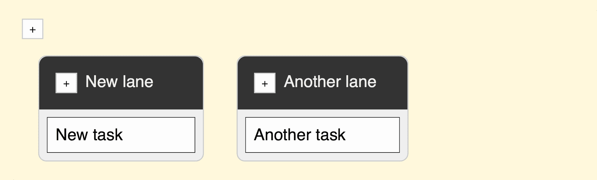

看板应用

本书将教你如何构建一个[看板](https://en.wikipedia.org/wiki/Kanban) 应用程序。除了这些之外，书中还讨论了 Web 开发的更多理论方面。完成项目将让你对如何独立实现功能有很好的理解。在此过程中，你将学到为什么某些库是有用的，并能够更好地为你的技术选择提供合理的理由。

### 本书是如何安排的？

我们将从构建一个基于 Webpack 的配置开始。之后，我们将开发一个著名的 [Todo 应用程序](http://todomvc.com/) 的小克隆版本。这引导我们思考扩展性问题。有时，你需要用笨办法的方法处理事情，以理解为什么最终需要更好的解决方案。

我们将从那里进行泛化，并引入 [Flux 架构](https://facebook.github.io/flux/docs/overview.html)。我们将应用一些 [拖放（DnD）魔术](https://gaearon.github.io/react-dnd/) 并开始拖动物品。最后，我们将完成一个生产级别的构建。

书的最后一个理论部分涵盖了更高级的主题。如果你阅读的是本书的商业版，里面还有额外的内容。我将向你展示如何处理 React 中的类型定义以产生更高质量的代码。你还将学习测试你的组件和逻辑。

我还会向你展示如何使用 [ESLint](http://eslint.org/) 以及各种其他工具有效地对代码进行检查。书中有一章节学习如何在 [npm](https://www.npmjs.com/) 上发布库。在在那里学到的经验对应用程序也有用。最后，你将学习如何以各种新兴的方式为你的 React 应用程序设置样式。

结尾处有两个附录。它们旨在提供思考，并更详细地解释如语言特性等方面。如果书中某些语法对你来说很奇怪，你可能会在那里找到更多信息。

### 什么是看板？


Dennis Hamilton 绘制看板 (CC BY)

看板最初开发于丰田，允许你跟踪任务状态。它可以用“道（Lanes）”和“便签（Notes）”来建模。随着任务的完成，“便签”从左到右通过不同的“道”，代表不同的阶段。“便签”本身可以根据需要包含任务本身的信息、其优先级等。

该系统可以通过多种方式进行扩展。一种简单的方法是对每道应用“进行中（WIP）限制”。这样做的效果是迫使你专注于完成任务。这是使用看板的一个优点。移动这些便签是非常有成就感的。作为额外，你获得了可见性，并知道还有什么未完成。

#### 在哪里使用看板？

该系统可以用于各种用途，包括软件开发和生活管理。例如，你可以用它来跟踪个人项目或生活目标。

#### 如何构建看板？

构建看板的最简单方法是获取大量的便利贴并找一面墙。之后，你将其分成若干列。这些“道”可以由以下阶段组成：Todo、Doing、Done。所有的“便签”最初进入 Todo。当你开始处理它们时，你会将它们移动到 Doing，最后在完成后移动到 Done。这是入门的最简单方法。

这只是道配置的一个示例。“道”可以根据匹配你的流程进行配置。例如，可以有审批步骤。如果你正在建模一个软件开发流程，可以为测试和部署设置独立的道，例如。

#### 可用的看板实现


[Trello](https://trello.com/) 可能是最为人知的看板（Kanban）在线实现。Sprintly 开源了他们的 [React Kanban 实现](https://github.com/sprintly/sprintly-kanban)。基于 Meteor 的 [wekan](https://github.com/wekan/wekan) 是另一个很好的例子。我们的项目不会像这些那样复杂，但足够入门了。

## 这本书是给谁看的？

我预计你已经具备 `JavaScript` 和 `Node.js` 的基础知识。你应该能够在基础水平上使用 `npm`。如果你对 `Webpack`、`React` 或 `ES6` 有所了解，那太棒了。通过阅读这本书，你将加深对这些工具的理解。

写书最困难的事情之一就是写在合适的水平上。由于本书涵盖范围很广，因此有一些附录涵盖了语言细节等基础主题，其详细程度比正文更深。

如果你发现自己很吃力，可以考虑学习附录，或向书籍相关的社区寻求帮助。如果你遇到卡壳或理解某些内容，我们将在这里提供帮助。你的任何建议都将有助于改进书籍内容。

## 如何阅读这本书？

虽然阅读书籍的自然方式是从第一章开始按顺序阅读章节，但并不是阅读这本书的唯一方法。章节顺序只是一个阅读建议。根据你的背景，你可以考虑以下顺序，甚至完全跳过某些部分：

*   从头到尾 - 这是传统的读书方式。它需要最长的时间。但优点是你可以稳步进展。
*   先 React，后 Webpack - 另一种替代方法是跳过关于 `Webpack` 的早期章节，从仓库下载一个[起点](https://github.com/survivejs/webpack_react/tree/master/project_source/03_webpack_and_react/kanban_app)，首先完成看板演示。。之后遵循 `Webpack` 章节来理解配置在做什么以及为什么。“高级技术”部分和附录很好地补充了这些内容。
*   仅看 Webpack - 如果你非常熟悉 `React`，也许只看 `Webpack` 部分是有意义的。毕竟，你可以在 `React` 之外应用同样的技能。
*   仅看高级技术 - 鉴于 `React` 生态系统如此庞大，“高级技术”部分涵盖了你可能错过的有趣领域。学习像代码检查（linting）之类的技术，或学习改进你的 `npm` 设置。深入研究各种样式方法以找到适合你目标的方案可能是值得的。

本书并没有涵盖你开发前端应用所需的所有知识。那对于单本书来说内容实在太丰富了。然而，我相信它可能引导你走向正确的方向。`Webpack` 和 `React` 周边的生态系统相当庞大，我已经尽力涵盖了其中的很大一部分。

由于本书依赖于许多新的语言特性，我将最重要的特性汇集到一个单独的“语言特性”（`Language Features`）附录中，以便快速查阅。如果你想孤立地理解这些特性，或者对某些内容不确定，那里是一个很好的地方。

## 书籍的版本控制

由于创新速度快，本书接受了大量的维护和改进，因此有一套粗略的版本控制方案。我在[书籍博客](http://survivejs.com/blog/) 上为每个新版本维护发布日志。这应该让你对版本之间的变化有一个良好的了解。此外，检查 GitHub 仓库也可能有所益。我推荐为此使用 GitHub 的 `compare` 工具。例如：

```
https://github.com/survivejs/webpack_react/compare/v1.9.10...v1.9.17
```

该页面将向你展示给定版本范围内提交到项目的单独提交。你也可以看到书籍中发生变化的行。这不包括私有章节，但足以让你对书籍的重大更改有一个良好的了解。

书籍的当前版本是 `2.0.5`。

## 额外材料

书籍内容和源码可以在 [GitHub 上的书籍仓库](https://github.com/survivejs/webpack_react) 获取。请注意，仓库默认是项目的 `dev` 分支。这便于贡献。要找到与你正在阅读书籍版本匹配的源码，请使用 GitHub 用户界面上的标签选择器，如下图所示：

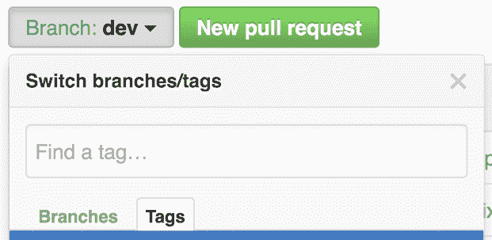

GitHub 标签选择器

书籍仓库包含每章的代码。这意味着你可以从任何地方开始，而无需自己手动输入一遍。如果你对某些内容不确定，可以随时参考。

你可以在 [survivejs 组织](https://github.com/survivejs/) 找到很多补充材料。例如，使用 [mobservable](https://github.com/survivejs/mobservable-demo)、[Redux](https://github.com/survivejs/redux-demo) 和 [Cerebral/Baobab](https://github.com/survivejs/cerebral-demo) 编写的应用程序替代实现。学习这些可以让你很好地了解不同架构是如何使用相同示例工作的。

## 获取支持

由于没有哪本书是完完美的，你可能会遇到问题，并对内容有一些疑问。有几种处理方法：

*   通过 [GitHub Issue Tracker](https://github.com/survivejs/webpack_react) 与我联系
*   在 [Gitter Chat](https://gitter.im/survivejs/webpack_react) 加入我
*   在 Twitter 上关注 [@survivejs](https://twitter.com/survivejs) 或直接私信 [@bebraw](https://twitter.com/bebraw)
*   发送邮件至 info@survivejs.com
*   在 [SurviveJS AMA](https://github.com/survivejs/ama) 向我提任何关于 Webpack 或 React 的问题

如果你在 Stack Overflow 上发布问题，请标记 `survivejs` 以便我收到通知。你可以在 Twitter 上使用标签 `survivejs` 达到同样的效果。

我尝试在“故障排除”（`Troubleshooting`）附录中涵盖常见问题。随着常见问题的发现，那里将会扩展。

## 公告

我通过几个渠道发布 SurviveJS 相关新闻：

*   [邮件列表](http://eepurl.com/bth1v5)
*   [Twitter](https://twitter.com/survivejs)
*   [博客 RSS](http://survivejs.com/atom.xml)

欢迎订阅。

## 致谢

如果没有社区的支持，这种努力是不可能实现的。结果就是有很多人需要感谢！


一路上，许多个人都提供了支持和反馈。在此感谢大家（不分先后顺序）：Vitaliy Kotov, @af7, Dan Abramov, @dnmd, James Cavanaugh, Josh Perez, Nicholas C. Zakas, Ilya Volodin, Jan Nicklas, Daniel de la Cruz, Robert Smith, Andreas Eldh, Brandon Tilley, Braden Evans, Daniele Zannotti, Partick Forringer, Rafael Xavier de Souza, Dennis Bunskoek, Ross Mackay, Jimmy Jia, Michael Bodnarchuk, Ronald Borman, Guy Ellis, Mark Penner, Cory House, Sander Wapstra, Nick Ostrovsky, Oleg Chiruhin, Matt Brookes, Devin Pastoor, Yoni Weisbrod, Guyon Moree, Wilson Mock, Herryanto Siatono, Héctor Cascos, Erick Bazán, Fabio Bedini, Gunnari Auvinen, Aaron McLeod, John Nguyen, Hasitha Liyanage, Mark Holmes, Brandon Dail, Ahmed Kamal, Jordan Harband, Michel Weststrate, Ives van Hoorne, Luca DeCaprio, @dev4Fun, Fernando Montoya, Hu Ming, @mpr0xy, David “@davegomez” Gómez, Aleksey Guryanov, Elio D’antoni, Yosi Taguri, Ed McPadden, Wayne Maurer, Adam Beck, Omid Hezaveh, Connor Lay, Nathan Grey, Avishay Orpaz, Jax Cavalera, Juan Diego Hernández, Peter Poulsen, Harro van der Klauw, Tyler Anton, Michael Kelley, @xuyuanme, @RogerSep, Jonathan Davis, @snowyplover, Tobias Koppers, Diego Toro, George Hilios, Jim Alateras, @atleb, Andy Klimczak, James Anaipakos, Christian Hettlage, Sergey Lukin, Matthew Toledo, Talha Mansoor, Pawel Chojnacki, @eMerzh, Gary Robinson, Omar van Galen, Jan Van Bruggen, Savio van Hoi, Alex Shepard, Derek Smith, 以及 Tetsushi Omi。如果我漏掉了你的名字，可能是忘记添加了。

# 设置 Webpack

Webpack 是一个强大的模块打包器。它在配置背后隐藏了许多功能。一旦理解了它的基础知识，使用这种力量就会变得容易。。初，它可能是一个令人困惑的工具，但一旦入门，它就会变得更好。

在这一部分，我们将开发一个基于 Webpack 的项目配置，为 Kanban 项目以及整体 React 开发提供坚实的基础。

## 1. Webpack 对比

通过将它放在历史背景中，你可以更好地理解为什么 Webpack 的方法是强大的。在过去，只需将一些脚本拼接在一起就够了。但时代已经了，现在分发你的 JavaScript 代码是一项复杂的工程。

### 1.1 SPA 的兴起

随着单页应用（SPA）的兴起，这个问题升级了。它们倾向于依赖许多沉重的库。你最不想做的事情就是一次性加载它们。有更好的解决方案，而 Webpack 与许多解决方案配合工作。

Node.js 和 [npm](https://www.npmjs.com/)（Node.js 包管理器）的流行提供了更多背景。在 npm 之前，消费依赖非常困难。现在 npm 在前端开发中变得流行，情况发生了变化。依赖管理比以前容易得多。

### 1.2 任务运行器和打包器

从历史上说，有很多构建系统。[Make](https://en.wikipedia.org/wiki/Make_%28software%29) 可能是最为人知的，并且仍然是一个可行选项。为了让事情更简单，出现了专门的任务运行器，如 [Grunt](http://gruntjs.com/) 和 [Gulp](http://gulpjs.com/)。通过 npm 提供的插件让这两种任务运行器都变得强大。

任务运行器在高层面上是很好的工具。它们允许你以跨平台的方式执行操作。当你需要将各种资产拼接在一起并产生包时，问题开始了。这就是我们拥有打包器的原因，例如 [Browserify](http://browserify.org/) 或 [Webpack](https://webpack.github.io/)。

继续这条路，[JSPM](http://jspm.io/) 将包管理直接推向浏览器。它依赖于 [System.js](https://github.com/systemjs/systemjs)，一个动态模块加载器。与 Browserify 和 Webpack 不同的是，它在开发期间完全跳过了打包步骤。然而，你可以用它生成生产环境包。Glen Maddern 在他[关于 JSPM 的视频](https://www.youtube.com/watch?t=33&v=iukBMY4apvI) 中进行了详细介绍。

### 1.3 Make

你可以说 Make 的历史非常久远。它最初发布于 1977 年。尽管它是一个旧工具，但它一直保持着相关性。Make 允许你为各种目的编写单独的任务。例如，你可能为创建生产构建、压缩你的 JavaScript 或运行测试编写单独的任务。你可以在许多其他工具中发现同样的想法。

尽管 Make 主要用于 C 项目，但它与此没有任何关系。James Coglan 详细讨论了[如何将 Make 用于 JavaScript](https://blog.jcoglan.com/2014/02/05/building-javascript-projects-with-make/)。考虑下面基于 James 文章的简写代码：

#### Makefile

```makefile
PATH  := node_modules/.bin:$(PATH)
SHELL := /bin/bash

source_files := $(wildcard lib/*.coffee)
build_files  := $(source_files:%.coffee=build/%.js)
app_bundle   := build/app.js

```

.PHONY: all clean

all: $(app_bundle)

build/%.coffee
    coffee -co $@

$(app_bundle): $(libraries)
    uglifyjs -c $@

test: $(app_bundle)
    phantomjs
```

通过 Make，你使用 Make 特定语法建模任务。这使得它能够轻松与 Webpack 集成。

### 1.4 Grunt


Grunt 在 Gulp 之前进入主流。它的插件架构特别促进了它的流行。与此同时，这种架构是 Grunt 的致命伤。这是一个来自 [Grunt 文档](http://gruntjs.com/sample-gruntfile) 的示例：

```javascript
module.exports = function(grunt) {
  grunt.initConfig({
    jshint: {
      files: ['Gruntfile.js', 'src/**/*.js', 'test/**/*.js'],
      options: {
        globals: {
          jQuery: true
        }
      }
    },
    watch: {
      files: ['<%= jshint.files %>'],
      tasks: ['jshint']
    }
  });

  grunt.loadNpmTasks('grunt-contrib-jshint');
  grunt.loadNpmTasks('grunt-contrib-watch');

  grunt.registerTask('default', ['jshint']);
};
```

在这个示例中，我们定义了与 jshint 相关的基本任务，jshint 是一种可以在 JavaScript 源代码中定位可能问题点的 检查工具。我们有一个运行 j own 的独立任务。此外，我们还有一个基于监听器的任务。当我们运行 Grunt 时，当我们编辑并保存源代码时，会在终端中实时收到警告。

在实践中，你将为各种目的编写许多小任务，例如构建项目。示例显示了这些任务是如何构建的。

Gulp 采取了不同的方法。与其依赖每个插件的配置，你处理的是实际代码。Gulp 构建在经过测试且有效的管道（piping）概念之上。如果你熟悉 Unix，这里是相同的想法。你只需要有源。过滤器对源执行操作（例如转换为 JavaScript）。最后，结果被传递给汇（例如你的构建目录）。


```javascript
var gulp = require('gulp');
var coffee = require('gulp-coffee');
var concat = require('gulp-concat');
var uglify = require('gulp-uglify');
var sourcemaps = require('gulp-sourcemaps');
var del = require('del');

var paths = {
    scripts: ['client/js/**/*.coffee', '!client/external/**/*.coffee']
};

// 并不是所有任务都需要使用流
// 一个 gulpfile 只是另一个 node 程序，你可以使用所有在 npm 上可用的包
gulp.task('clean', function(cb) {
  // 你可以像使用 `gulp.src` 一样使用多个 glob 模式
  del(['build'], cb);
});

gulp.task('scripts', ['clean'], function() {
  // 压缩并复制所有 JavaScript（除供应商脚本外）
  // 并贯穿始终 sourcemaps
  return gulp.src(paths.scripts)
    .pipe(sourcemaps.init())
      .pipe(coffee())
      .pipe(uglify())
      .pipe(concat('all.min.js'))
    .pipe(sourcemaps.write())
    .pipe(gulp.dest('build/js'));
});

// 当文件更改时重新运行任务
gulp.task('watch', function() {
  gulp.watch(paths.scripts, ['scripts']);
});

// 默认任务（当从命令行运行 `gulp` 时被调用）
gulp.task('default', ['watch', 'scripts']);
```

由于配置是代码，当你遇到问题时，总是可以对其进行黑客（hack）。你可以将现有的 Node.js 包封装为 Gulp 插件等。与 Grunt 相比，你对发生的情况有更清晰的认识。不过，对于简单的任务，你仍然需要编写大量的样板代码。这就是一些新方法出现场的地方。

### 1.6 Browserify


Browserify

处理 JavaScript 模块一直是个问题。该语言本身直到 ES6 之前实际上并没有模块的概念。因此，在浏览器环境方面，我们一直停留在 90 年代。目前已经提出了许多解决方案，包括 [AMD](http://requirejs.org/docs/whyamd.html)。

在实践中，仅仅使用 Node.js 格式 CommonJS 并让工具处理其余部分就是很有用的。它的优势在于，你通常可以挂钩 npm 并避免重复轮子。

[Browserify](http://browserify.org/) 是解决模块问题的一种方案。它提供了一种将 CommonJS 模块打包在一起的方法。你可以将其与 Gulp 结合。还有一些较小的转换工具允许你超越基础用法。例如，[watchify](https://www.npmjs.com/package/watchify) 提供了一个文件监听器，可以在开发期间为你创建构建包。这将节省一些精力，而且无疑在某种程度上是一个很好的解决方案。

Browserify 的 生态系统由许多小模块组成。通过这种方式，Browserify 遵循了 Unix 哲学。相比 Webpack，Browserify 更容易采用，事实上，它是后者的一个良好替代品。

### 1.7 Webpack

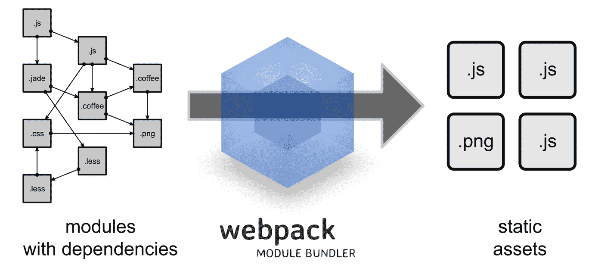

webpack

你可以说 Webpack（或简称 `webpack`）比 Browserify 采取了更具单体的方法。Browserify 由多个小工具组成，而 Webpack 自带一个提供许多箱箱用功能的核心。该核心可以使用特定的 `loaders` 和 `plugins` 进行扩展。

Webpack 将遍历你项目中的 `require` 语句并生成你定义的构建包。你甚至可以使用自定义的 `require.ensure` 语句以动态方式加载依赖。loader 机制也适用于 CSS，并支持 `@import`。还有针对特定任务的插件，例如压缩压缩、本地化、热加载等。

给你举个例子，`require('style!css!./main.css')` 加载了 `main.css` 的内容，并从右到左通过 CSS 和 style loader 进行处理。鉴于像这样的声明（如上所示）将源代码与 Webpack 绑定在了一起，因此最好在 Webpack 配置中设置这些 loader。以下是一个根据 [webpack 官方教程](http://webpack.github.io/docs/tutorials/getting-started/) 适配的示例配置：

**webpack.config.js**

```javascript
var webpack = require('webpack');

module.exports = {
  entry: './entry.js',
  output: {
    path: __dirname,
    filename: 'bundle.js'
  },
  module: {
    loaders: [
      {
        test: /\.css$/,
        loaders: ['style', 'css']
      }
    ]
  },
  plugins: [
    new webpack.optimize.UglifyJsPlugin()
  ]
};
```

由于配置是用 JavaScript 编写的，它是非常灵活的。只要是 JavaScript，Webpack 都能接受。

这种配置模型可能会让 Webpack 有时显得有些晦涩。理解它在做什么可能是困难的。这对于更复杂的案例尤为如此。我与 Christian Alfoni 一起编写了一本 [webpack 菜谱](https://christianalfoni.github.io/react-webpack-cookbook/)，在涉及特定问题时提供了更详细的细节。

### 1.8 JSPM

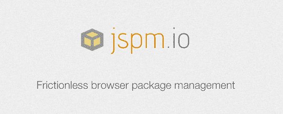

JSPM

使用 JSPM 与早期的工具非常不同。它自带一个自己的 CLI 工具用于。

### 1.9 为什么要使用 Webpack?

为什么相比 Gulp 或 Grunt 要使用 Webpack？这不是一个非此即一的命题。Webpack 处理打包的难题，但还有更多。

#### 热模块替换 (Hot Module Replacement)

你可能熟悉某些工具，如 [LiveReload](http://liveeload.com/) 或 [Browsersync](http://www.browsync.io/)。这些工具会在你做出更改时刷新浏览器。HMR 则更进一步。在 React 的情况下，它允许应用程序保持状态。这听起来很简单，但在实践中影响巨大。注意 Browserify 可以通过 [livereload](https://github.com/milankinen/livereload) 使用 HMR，所以这不是 Webpack 特有的。

#### 包分割 (Bundle Splitting)

除了 HMR 功能，Webpack 的打包能力也是强大的。它允许以各种方式拆分包。你甚至可以随着应用程序的发展动态地加载它们。这种懒加载非常有用，特别是对于较大的应用程序。你可以根据需要加载依赖。

#### 资源哈希 (Asset Hashing)

通过 Webpack，你可以轻松地为每个包名称注入哈希（例如 `app.d587bbd6e837f5accd.js`）。这允许在做出更改时失效包。在理想情况下，包拆分允许客户端只加载一小部分数据。

#### Loader 和插件

所有这些小功能累积起来是巨大的。令人的是，你可以开箱即用完成很多工作。如果你缺少某些功能，有可用的 loader 和插件供你使用。

Webpack 带有显著的学习曲线。尽管如此，它仍然值得学习的工具，因为从长远来看它节省了大量的时间精力。为了更好地了解它与其它工具的对比，请查看[官方对比](https://webpack.github.io/docs/comparison.html)。

### 1.10 Webpack 支持的模块格式

Webpack 允许你使用不同的模块格式，但在底层它们都以相同的方式工作。

#### CommonJS

如果你用过 Node.js，你可能已经熟悉 CommonJS 了。这是一个简短的示例：

```javascript
var MyModule = require('./MyModule');

// 在模块根部导出
module.exports = function() { ... };

// 或者，导出单个函数
exports.hello = function() {...};
```

#### ES6


ES6 是我们自 1995 年以来一直期待的格式。如你所见，它有点像 CommonJS，而且非常清晰！

```
import MyModule from './MyModule.js';

// 在模块根部导出
export default function () { ... };

// 或者作为模块函数导出，
// 每个模块可以有多个这样的函数
export function hello() {...};
```

该格式在 `Language Features` 附录中有更详细的讨论。

#### AMD

AMD，即异步模块定义，是作为一种替代方案而发明的。它引入了一个 `define` 包装器：

```
define(['./MyModule.js'], function (MyModule) {
  // 在模块根部导出
  return function() {};
});

// 或者
define(['./MyModule.js'], function (MyModule) {
  // 作为模块函数导出
  return {
    hello: function() {...}
  };
});
```

顺便一下，你可以在包装器内这样使用 `require`：

```
define(['require'], function (require) {
  var MyModule = require('./MyModule.js');

  return function() {...};
});
```

这种方法确实消消除了一些杂乱。你最终仍然会得到一些可能感觉冗余的代码。鉴于现在有了 ES6，除非你真的需要，否则使用 AMD 可能已经没有意义了。

#### UMD

UMD，通用模块定义，将这一切推向了新的高度。它是一个怪物级的格式，旨在让上述格式相互兼容。这里我就不折磨你的眼睛了。永远不要自己手写它，把它交给工具即可。如果这没能吓跑你，请查看[官方定义](https://github.com/umdjs/umd)。

Webpack 可以为你生成 UMD 包装器（`output.libraryTarget: 'umd'`）。这对于库的作者特别有用。我们稍后会在 `Authoring Packages` 章节详细讨论 npm 和库的编写时回到这一点。

### 1.11 结论

我希望这一章帮助你理解为什么 Webpack 是一个值得学习的价值工具。它解决了大量的常见 Web 开发问题。如果你熟悉它，它将为你节省大量时间。在接下来的章节中，我们将更详细地研究 Webpack。你将学习开发一个简单的开发配置。我们还将开始我们的看板应用。

你可以，可能也应该配合其他工具使用 Webpack。它不会解决所有问题。然而，它确实解决了复杂的打包问题。这让开发过程中少了一个顾虑。正如我们很快看到的，仅仅使用 `package.json`、`scripts` 和 Webpack 就能带你走很远。

## 2. 使用 Webpack 进行开发

如果你不是那些喜欢跳过介绍的人，你可能已经猜到 Webpack 是什么。简单来说，它是一个模块打包器。它接收一组资源并输出你可以交付给的资源。

这听起来很简单，但在实践中，这可能是一个复杂且混乱的过程。你绝对不想自己处理所有的细节。这正是 Webpack 的用场。接下来，我们将设置 Webpack 并让你的第一个项目在开发模式下运行。

### 2.1 设置项目

Webpack 是依赖于 [Node.js](http://nodejs.org/) 的工具之一。确保你已经安装了它，并且在终端可以使用 `npm`。为你的项目设置目录，进入该目录，执行 `npm init` 并填写一些详细信息。你可以直接对每一项按 `return` 键，它就可以工作。以下是命令：

```
mkdir kanban_app
cd kanban_app
npm init -y # -y 提供默认的 *package.json*，跳过以获得更多控制
```

结果是，你应该在项目根目录下有一个 `package.json`。你仍然可以手动调整它以进行进一步更改。我们将通过 `npm` 工具进行一些更改，但按照你的喜好调整文件也是好的。官方文档详细解释了各种 [package.json ](https://docs.npmjs.com/files/package.json)。我会在本书的后面介绍一些实用的库编写相关技巧。

#### 设置 Git

如果你喜欢版本控制（你本应该喜欢），现在是设置仓库的好时机。你可以随着项目的进展创建提交。

如果你正在使用 git，我建议在项目根目录设置一个 `.gitignore`：

`.gitignore`

```
node_modules
```

至少你应该在这里包含 `node_modules`，因为你可能不想让它进入版本控制。这样做是因为，由于某些模块需要按平台进行编译，协作会变得相当混乱。理想情况下，你的 `git status` 应该是干净的。你可以根据需要随时扩展 `.gitignore`。

### 2.2 安装 Webpack

接下来，你应该安装 Webpack。我们将进行本地安装并将其保存为项目依赖。这将允许我们为每个项目维护 Webpack 的版本。执行

```
npm i webpack --save-dev
```

npm 维护一个目录，在其中安装包可能的可执行文件。你可以使用 `npm bin` 显示确切路径。它可能指向 `.../node_modules/.bin`。尝试在终端通过 `node_modules/.bin/webpack` 或类似的命令从那里执行 Webpack。

你应该会看到版本号、一个指向命令行界面指南的链接以及长长的选项列表。我们不会使用其中大部分选项，但了解它们是好的。

```
webpack $ node_modules/.bin/webpack
```
### ..3 目录结构

由于只有 `package.json` 的项目很无聊，我们应该设置一些具体的内容。为了开始，我们可以实现一个加载 JavaScript 的小型网站。建立如下结构：

*   /app
    *   index.js
    *   component.js
*   /build
    *   index.html
*   package.json
*   webpack.config.js

### 2.4 设置资源

既然你永远厌厌 `Hello world`，那我们就建立它的变体吧。建立这样一个组件：

**app/component.js**

```
module.exports = function () {
  var element = document.createElement('h1');

  element.innerHTML = 'Hello world';

  return element;
};
```

接下来，我们需要为应用程序准备入口。它将简单地 `require` 我们的组件并通过 DOM 渲染它：

**app/index.js**

```
var component = require('./component');
var app = document.createElement('div');

document.body.appendChild(app);

app.appendChild(component());
```

我们还需要一些 HTML 来加载生成的包：

**build/index.html**

```html
<!DOCTYPE html>
<html lang="en">
  <head>
    <meta charset="utf-8">
    <title>Kanban app</title>
  </head>
  <body>
    <div id="app"></div>

    <script src="./bundle.js"></script>
  </body>
</html>
```


我们需要告诉 Webpack 如何处理我们刚刚设置的资源。为此，我们将开发一个 `webpack.config.js` 文件。Webpack 及其开发服务器将通过约定发现此文件。

为了将我们的应用程序映射到 `build/bundle.js`，我们需要这样的配置：

`webpack.config.js`

```
const path = require('path');

const PATHS = {
  app: path.join(__dirname, 'app'),
  build: path.join(__dirname, 'build')
};

module.exports = {
  // Entry 接受一个路径或一个入口对象。我们将使用 
  // 后者形式，因为它在处理更复杂的配置时非常方便。
  entry: {
    app: PATHS.app
  },
  output: {
    path: PATHS.build,
    filename: 'bundle.js'
  }
};
```

`entry` 路径可以使用相对路径给出。[[上下文](https://webpack.github.io/docs/configuration.html#context) 字段可以用于配置该查找。鉴于很多地方都期望绝对路径，我更倾向于处处使用绝对路径以避免混乱。

我喜欢使用 `path.join`，但 `path.resolve` 是一个很好的替代方案。`path.resolve` 等同于通过 `cd` 遍历文件系统。`path.join` 仅提供连接功能。具体细节请参阅 [Node.js path API](https://nodejs.org/api/path.html)。

如果你执行 `node_modules/.bin/webpack`，你应该能看到如下的输出：

```
Hash: 2dca5a3850ce5d2de54c
Version: webpack 1.12.13
Time: 85ms
    Asset     Size  Chunks             Chunk Names
bundle.js  1.75 kB       0  [emitted]  app
   [0] ./app/index.js 144 bytes {0} [built]
   [1] ./app/component.js 136 bytes {0} [built]
```

这意味着你在输出目录中生成了一个构建产。你可以直接通过浏览器打开 `build/index.html` 文件来检查结果。在 OS X 上，运行 `open ./build/index.html` 即可。

### 2.6 添加构建快捷键

鉴于执行 `node_modules/.bin/webpack` 有些繁琐，我们应该对其做些处理。npm 和 `package.json` 在经过配置后可以兼任任务运行器。进行如下调整：

`package.json`

```
...
"scripts": {
  "build": "webpack"
},
...
```

你可以通过 `npm run` 执行这种方式定义的脚本。如果你现在执行 `npm run build`，你应该能像之前一样在输出目录中获得构建产物。

这之所以有效，是因为 npm 会临时地将 `node_modules/.bin` 添加到路径中。因此，我们不需要编写 `"build": "node_modules/.bin/webpack"`，只需编写 `"build": "webpack"` 即可。除非 Webpack 安装在项目中，否则它可能会指向一个可能的全局安装。这可能会导致混淆。由于这个原因，请优先选择本地安装而非全局安装。

任务运行器（如 Grunt 或 Gulp）允许你以跨平台的方式实现相同的结果。如果你像这样处理 `package.json`，你可能需要更加小心。优点是，这是一种非常轻量的方法。为了保持简单，我们将依赖于它。

### 2.7 设置 `webpack-dev-server`

由于通过这种构建脚本开发应用程序最终会变得无聊，Webpack 特别为开发提供了更整洁的手段。`webpack-dev-server` 是一个运行在内存中的开发服务器。在你开发应用程序时，它会自动刷新浏览器中的内容。这使其大致等同于如 [LiveReload](http://livereload.com/) 或 [Browsersync](http://www.browsersync.io/) 等工具。

Webpack 相比这些工具的最大优势是热模块替换（HMR）。简而言之，它提供了一种在不完全刷新的情况下更新浏览器状态的方法。我们将在介绍 React 设置时详细讨论它。

要开始使用 `webpack-dev-server`，请在项目根目录下执行

```
npm i webpack-dev-server --save-dev
```

以安装服务器。

与上面一样，我们需要在 `package.json` 的 `scripts` 部分定义一个入口点。由于我们的 `index.html` 位于 `./build` 之下，我们应该让 `webpack-dev-server` 从那里提供内容。我们稍后会将此移动到 Webpack 配置中，但目前这样做：

`package.json`

```
...
"scripts": {
  "build": "webpack"
  "build": "webpack",
  "start": "webpack-dev-server --content-base build"
},
...
```

如果你现在执行 `npm run start` 或 `npm start`，你应该会在终端看到类似如下的内容：

```
> webpack-dev-server

http://localhost:8080/
webpack result is served from /
content is served from .../kanban_app/build
404s will fallback to /index.html

webpack: bundle is now VALID.
```

输出意味着开发服务器正在运行。如果你在浏览器中打开 `http://localhost:8080/`，你应该能看到内容。如果你尝试修改代码，你应该会在终端看到输出。问题是浏览器在不进行强制刷新的情况下无法捕捉这些变化。这是我们接下来需要解决的问题。


Hello world

#### 分拆配置

由于开发设置有其特定的需求，我们需要拆分 Webpack 配置。由于 Webpack 配置只是 JavaScript，有许多方法可以实现这一点。至少以下方法是可行的：

*   在多个文件中维护配置，并通过 `--config` 参数将 Webpack 指向每个文件。通过模块导入共享配置。你可以在 [webpack/react-starter](https://github.com/webpack/react-starter) 中看到这种方法的实际应用。

*   将配置推送到库中然后由你消费。示例：[HenrikJoreteg/hjs-webpack](https://github.com/HenrikJoreteg/hjs-webpack)。

*   在单个文件中维护配置并在那里进行分支。如果我们通过 `npm` 触发脚本（例如 `npm run test`），npm 会将此信息设置在环境变量中。我们可以对其进行匹配并返回我们需要的配置。

我更倾向于最后一种方法，因为它让我更容易理解发生了什么。这对于像这样的小项目是理想的。

为了保持简单并方便这种方法，我定义了一个自定义的 `merge` 函数，它可以合并数组和对象。这在使用 Webpack 时非常方便，我们很快就会看到。执行

```
npm i webpack-merge --save-dev
```

将其添加到项目中。

接下来，我们需要为配置定义一些拆分点，以便根据 npm 脚本进行自定义。基本思路如下：

`webpack.config.js`

```
...
const merge = require('webpack-merge');

const TARGET = process.env.npm_lifecycle_event;
const PATHS = {
  app: path.join(__dirname, 'app'),
  build: path.join(__dirname, 'build')
};

module.exports = {
const common = {
  // Entry 接受一个路径或一个入口对象。我们将使用 
  // 后者形式，因为它在处理更复杂的配置时非常方便。
  entry: {
    app: PATHS.app
  },
  output: {
    path: PATHS.build,
    filename: 'bundle.js'
  }
};

// 默认配置
if(TARGET === 'start' || !TARGET) {
  module.exports = merge(common, {});
}

if(TARGET === 'build') {
  module.exports = merge(common, {});
}
```

现在我们有了扩展空间，可以连接热模块替换来刷新浏览器，并让开发模式更有用。

#### 配置热模块替换 (HMR)

热模块替换为我们在做出更改时自动刷新浏览器提供了简单手段。其理念是如果我们更改了 `app/component.js`，浏览器将刷新。对于可能的 CSS 变化也是如此。

为了使之工作，我们需要将运行在内存中的生成的包连接到开发服务器。Webpack 使用基于 WebSocket 的通信来实现。为了保持简单，我们将通过开发服务器的 `inline` 选项让 Webpack 为我们生成客户端部分。该选项会将 HMR 需要的客户端脚本包含在 Webpack 生成的包中。


除此之外，我们还需要启用 `HotModuleReplacementPlugin` 来使配置生效。此外，我将启用 HTML5 History API 回退（fallback），因为这是一个方便的默认选项，特别是当你正在处理高级路由时。以下是配置方法：

#### webpack.config.js

```
...
const webpack = require('webpack');

...

if(TARGET === 'start' || !TARGET) {
  module.exports = merge(common, {});
  module.exports = merge(common, {
    devServer: {
      contentBase: PATHS.build,

      // 启用 history API 回退，以便基于 HTML5 History API
      // 的路由工作。这是一个很好的默认设置，在复杂的
      // 配置中非常有用。
      historyApiFallback: true,
      hot: true,
      inline: true,
      progress: true,

      // 仅显示错误以减少输出量。
      stats: 'errors-only',

      // 从环境变量解析主机和端口，以便自定义。
      //
      // 如果你使用 Vagrant 或 Cloud9，设置
      // host: process.env.HOST || '0.0.0.0';
      //
      // 0.0.0.0 与默认的 localhost 不同
      // 对所有网络设备可用
      host: process.env.HOST,
      port: process.env.PORT
    },
    plugins: [
      new webpack.HotModuleReplacementPlugin()
    ]
  });
}

...
```

既然我们已经将 `contentBase` 配置推送到 JavaScript，我们可以从 `package.json` 中将其删除：

#### package.json

```
...
"scripts": {
  "build": "webpack",
  "start": "webpack-dev-server --content-base build"
  "start": "webpack-dev-server"
},
...
```
*(注：原文示例中存在两个 "start" 键，此处为原文格式错误，翻译已保留原样格式)*

执行 `npm start` 并访问 `localhost:8080`。尝试修改 `app/component.js`。浏览器应该会刷新。注意，如果你修改了 JavaScript 代码，这是强制刷新。CSS 的修改方式则更优雅，并且无需刷新即可应用。在下一章中，我们将讨论如何在 React 中实现类似的功能。这将为我们提供更好的开发体验。

如果你使用的是 Windows 且没有刷新，请查看以下章节的替代方案。

#### Windows 上的 HMR

该配置在某些版本的 Windows 上可能会出现问题。与其使用 `devServer` 和 `plugins` 配置，不如按照如下方式实现：

#### webpack.config.js

```
...

if(TARGET === 'start' || !TARGET) {
  module.exports = merge(common, {});
}

...
```

#### package.json

```
...
"scripts": {
  "build": "webpack",
  "start": "webpack-dev-server",
  "start": "webpack-dev-server --watch-poll --inline --hot"
},
...
```

鉴于此配置会轮询文件系统，它将消耗更多资源。不过，如果默认设置不起作用，值得一试。

#### 从网络访问开发服务器

在我们的配置中，可以通过环境变量自定义主机和端口设置（例如，在 Unix 上使用 `export PORT=3000` 或在 Windows 上使用 `SET PORT=3000`）。如果你想使用同一网络内的其他设备访问服务器，这将非常有用。在大多数平台上，默认设置已经足够了。

要访问你的服务器，你需要确定你机器的 ip 地址。在 Unix 上，可以使用 `ifconfig` 实现。在 Windows 上，可以使用 `ipconfig`。一个 npm 包，如 [node-ip](https://www.npmjs.com/package/node-ip)，可能也会很有帮助。特别是在 Windows 上，你可能需要将 `HOST` 设置为与你的 ip 匹配，以便能够访问。

#### 使用 webpack-dev-server 的其他方法

我们可以通过终端传递 `webpack-dev-server` 选项。我发现在 Webpack 配置中管理它更清晰，因为这有助于保持 `package.json` 的整洁。

或者，我们可以建立自己的 Express 服务器，并将 `webpack-dev-server` 作为[中间件](https://webpack.github.io/docs/webpack-dev-middleware.html)。这里还有一个 [Node.js API](https://webpack.github.io/docs/webpack-dev-server.html#api)。

### 2.8 刷新 CSS

我们可以扩展这种方法来处理 CSS。Webpack 允许我们在不强制全刷新的情况下更改 CSS。要将 CSS 加载到项目中，我们需要使用一些加载器（loaders）。开始之前，执行：

```
npm i css-loader style-loader --save-dev
```

现在我们有了所需的加载器，需要确保 Webpack 感知它们。配置如下：

#### webpack.config.js

```
...

const common = {
  ...
  },
  module: {
    loaders: [
      {
        // test 期望一个正则表达式！注意斜杠！
        test: /\.css$/,
        loaders: ['style', 'css'],
        // include 接受路径或路径数组。
        include: PATHS.app
      }
    ]
  }
}

...
```

我们添加的配置意味着以 `.css` 结尾的文件应该调用给定的加载器。`test`  JavaScript 风格的正则表达式。加载器从右到左进行评估。在这种情况下，`css-loader` 接收 `style-loader`。`style-loader` 处理 `@import` 语句。

### 2.9 设置 CSS

我们只缺少真正的 CSS：

#### main.css

```css
body {
  background: lime;
}
```

此外，我们需要让 Webpack 感知它：

#### index.js

```javascript
require('./main.css');

...
```

### 2.10 启用 Source Maps

为了提高应用程序的可调试性，我们可以设置 source maps。它们允许你看到错误发生在哪里。在 Webpack 中，这通过 `devtool` 设置进行控制。可以使用如下良好的默认设置：

#### webpack.config.js

```
...

if(TARGET === 'start' || !TARGET) {
  module.exports = merge(common, {
    devtool: 'eval-source-map',
    ...
  });
}

...
```

如果你运行开发构建 `npm start`，Webpack 将生成 source maps。正如[官方文档](https://webpack.github.io/docs/configuration.html#devtool) 所述，Webpack 提供了多种生成方式。在这种情况下，我们使用的是 `eval-source-map`。它构建缓慢，但提供了真实的文件。

快速开发选项（如 `cheap-module-source-map` 和 `eval`）产生的质量较低的 source maps。所有 `eval` 选项都会将 source maps 作为 JavaScript 代码的一部分输出。因此，它们不适用于生产环境。考虑到在开发期间大小不是问题，它们通常适合这种用例。

你可能需要在浏览器中启用 source maps 才能使其工作。更多详情请参见 [Chrome](https://developer.chrome.com/devtools/docs/javascript-debugging) 和 [Firefox](https://developer.mozilla.org/en-US/docs/Tools/Debugger/How_to/Use_a_source_map) 指南。

### 2.11 使用 npm-install-webpack-plugin 避免 npm install

为了避免某些输入，我们可以设置名为 [npm-install-webpack-plugin](https://www.npmjs.com/package/npm-install-webpack-plugin) 的插件。在我们开发时，它会检测 Webpack 配置和项目文件的更改并为我们安装依赖。它也会自动修改 `package.json`。

如果你愿意，仍然可以手动安装依赖。任何 `app` 内的依赖都应该通过 `--save`（或 `-S`）安装。根级依赖（即 Webpack 需要的包）应该通过 `--save-dev`（或 `-D`）安装。这种分离在我们*构建 Kanban* 生成生产包时将非常有用。

为了安装该插件，执行：

```
npm i npm-install-webpack-plugin --save-dev
```


我们还需要将其与配置结合起来：

`webpack.config.js`

```
const path = require('path');
const merge = require('webpack-merge');
const webpack = require('webpack');
const NpmInstallPlugin = require('npm-install-webpack-plugin');

...

// Default configuration
if(TARGET === 'start' || !TARGET) {
  module.exports = merge(common, {
    ...
    plugins: [
      new webpack.HotModuleReplacementPlugin(),
      new webpack.HotModuleReplacementPlugin(),
      new NpmInstallPlugin({
        save: true // --save
      })
    ]
  });
}

if(TARGET === 'build') {
  module.exports = merge(common, {});
}
```

在进行此更改后，我们可以节省大量的输入工作和上下文切换。

### 2.12 项目的代码检查 (Linting)

我将在 `Webpack 中的 Linting` 章节中详细讨论代码检查。现在就可以将这套设置集成到你的项目中，因为这将节省一些调试时间。它将让你更早地发现某些类别的错误。

### 2.13 总结

在本章中，你学习了使用 Webpack 进行构建和开发。我将在 `构建看板` 章节中回到构建主题。目前的配置对于生产环境并不理想。此时，重要的是开发环境配置。在下一章中，我们将看到如何扩展这种方法以配合 React 使用。

## 3. Webpack 和 React

结合 Webpack，使用 React 变得是一件乐事。尽管你可以与其他构建工具一起使用 React，但 Webpack 是非常合适的选择，而且设置非常简单。在本章中，我们将扩展配置。之后，我们就为进一步开发应用有了良好的起点。

### 3.1 什么是 React？


React

Facebook 的 [React](https://facebook.github.io/react/) 改变了我们思考前端开发的方式。此外，得益于 [React Native](https://facebook.github.io/react-native/)，这种方法不仅限于 Web。虽然 React 简单简单，但它提供了强大的功能。

React 并不是像 `Angular.js` 或 `Ember` 那样的框架。框架倾向于开箱提供大量的解决方案。使用 React 时，你需要从不同的库中组装你的应用程序。这两种方法各有优劣。框架可能上手更快，但当你触及它们的边界时，处理起来可能会变得更加困难。在基于库的方法中，你拥有更大的灵活性，但也承担更大的责任。

React 为 Web 开发者引入了虚拟 DOM 的概念。与之前所有的库和框架不同，React 维护着自己的一套 DOM。当虚拟 DOM 发生变化时，React 将将其认为最佳的方式将这些更改批量应用于实际 DOM。

#### JSX 和虚拟 DOM

React 提供了一个[高级 API](https://facebook.github.io/react/docs/top-level-api.html) 来生成虚拟 DOM。使用该 API 生成复杂结构会很快变得繁琐。因此，人们通常不手动编写。相反，他们使用某些中间格式并转换为它。Facebook 的 [JSX](https://facebook.github.io/jsx/) 就是一种流行的格式。

JSX 是 JavaScript 的超集，允许你将类似 XML 的语法与 JavaScript 混合。考虑下面的示例：

```
const Names = () => {
  const names = ['John', 'Jill', 'Jack'];

  return (
    <div>
      <h2>Names</h2>

      {/* 这是一个名字列表 */}
      <ul className="names">{
        names.map(name =>
          <li className="name">{name}</li>
        )
      </ul>
    </div>
  );
};
```

如果你以前没见过 JSX，它看起来可能很怪异。在开始理解它之前，经历过“JSX 冲击”并不罕见。之后，一切都变得合理了。

Cory House 详细讨论了[关于这种冲击](https://medium.com/@housecor/react-s-jsx-the-other-side-of-the-coin-2ace7ab62b98)。简而言之，JSX 为我们提供了以前以前未遇到过的验证水平。这需要一段时间来掌握，但一旦你理解了，就很难回头了。

#### JSX vs HTML

在 JSX 中，我们将一些看起来有点像 HTML 的东西与 JavaScript 混合。注意我们是如何处理属性的。我们不像在原生 HTML 中那样使用 `class`，而是使用 `className`，这是 DOM 的等效写法。尽管初次使用 JSX 可能会觉得有点奇怪，但随着时间的推移，它会变成本能。

React 的开发者将自己从 DOM 的限制中解耦出来。结果是，React 性能极高。不过这也是有代价的。库并没有你想象的那么小。你可以预计小型应用程序的体积大约在 150-200k 左右，包含 React。在网络传输经过 gzip 压缩后，数字会少得多，但仍然是一分量。

#### 有了朋友更好

React 并不是那里最小的库。不过，它确实解决了基本问题。得益于其相对简单性和强大的 API，开发 React 是一件乐事。你需要一组工具来补充它，但你可以根据实际需求选择这些工具。它远不是一种“一刀切”的解决方案，而框架往往是这种类型。

React 使用的方法允许 Facebook 在相同的理念之上开发了 React Native。这一次，我们操作的不是 DOM，而是移动平台的渲染。

### 3.2 Babel


Babel

[Babel](https://babeljs.io/) 对社区产生了巨大影响。它允许我们使用来自 JavaScript 未来的特性。它会将你的代码转换为浏览器能理解的格式。Babel 为标准 ES6 之外的某些 ES7 特性提供了支持。其中某些可能会进入语言核心，而另一些可能会被丢弃。语言提案被分为几个阶段：

*   **Stage 0** - 草稿 (Strawman)
*   **Stage 1** - 提议 (Proposal)
*   **Stage 2** - 草案 (Draft)
*   **Stage 3** - 候选 (Candidate)
*   **Stage 4** - 完成 (Finished)

我会非常小心阶段 `0` 的特性。问题在于，如果该特性发生变化或被移除，你将将导致损坏的代码并需要重写。尽管在较小的实验项目中，这种风险可能是值得的。

#### 配置 `babel-loader`

你可以通过 [babel-loader](https://www.npmjs.com/package/babel-loader) 轻松在 Webpack 中使用 Babel。它将我们基于 ES6 模块定义的代码转换为 ES5 包。通过以下命令安装 *babel-loader*：

```
npm i babel-loader babel-core --save-dev
```

*babel-core* 包含了 Babel 的核心逻辑，因此我们需要安装它。

为了使其工作，我们需要在配置的 *loaders* 部分为 `babel-loader` 添加一个加载器声明。它使用正则表达式 (`/\.jsx?$/`) 同时匹配 `.js` 和 `.jsx`。

为了保持性能，我们应该限制加载器在 `./app` 目录内操作。这样它就不会遍历 `node_modules`。另一种方案是显式设置一个针对 `node_modules` 的 `exclude` 规则。我发现使用 `include` 更有用，因为更明确。毕竟你永远不知道结构中会有哪些文件。


```
...

const common = {
  entry: {
    app: PATHS.app
  },
  // 添加 resolve.extensions。
  // '' 是必要的，允许没有扩展名的导入。
  // 注意扩展名前的 '.'，否则它将无法匹配！！！
  resolve: {
    extensions: ['', '.js', '.jsx']
  },
  output: {
    path: PATHS.build,
    filename: 'bundle.js'
  },
  module: {
    loaders: [
      {
        test: /\.css$/,
        loaders: ['style', 'css'],
        include: PATHS.app
      }
      },
      // 设置 jsx。得益于正则表达式，它也接受 js
      {
        test: /\.jsx?$/,
        // 在开发期间启用缓存以提高性能
        // 它默认使用操作系统目录。如果你需要更
        // 自定义的路径，请传递路径给它。例如 babel?cacheDirectory=<path>
        loaders: ['babel?cacheDirectory'],
        // 仅解析 app 文件！如果不这样做，它将遍历整个项目。
        // 除了速度慢，这很可能导致错误。
        include: PATHS.app
      }
    ]
  }
};

...
```

注意 `resolve.extensions` 设置将允许你在不使用扩展名的情况下引用 JSX 文件。为了清晰起见，我将使用扩展名，但如果你愿意，也可以将其省略它。

#### 设置 .babelrc

此外，我们需要一个 [.babelrc](https://babeljs.io/docs/usage/babelrc/)。你可以通过 Webpack 传递 Babel 设置（例如 `babel?presets[]=react,presets[]=es2015`），但那样它只对 Webpack 有效。这就是为什么我们要将 Babel 设置推送到这个特定的点文件中。同样的思想也适用于其他工具，如 `ESLint`。

Babel 6 依赖于 `plugins`（插件）。插件有两种类型：语法（syntax）和转换（transform）。前者允许 Babel 解析额外的语法，而后者应用转换。这样一来，使用未来语法的代码就可以转换回旧环境可以理解的 JavaScript。

为了更方便地使用插件，Babel 支持 `presets`（预设）的概念。每个预设都有一组插件，这样你就不需要单独连接它们。在这种情况下，我们将依赖 ES2015 和 React 预设：

```
npm i babel-preset-es2015 babel-preset-react --save-dev
```

此外，我们还将启用一些自定义功能，使项目开发更加方便：

*   [属性初始化](https://github.com/jeffmo/es-class-static-properties-and-fields) (Property initializers) - 示例：`renderNote = (note) => {`。这会自动将 `renderNote` 方法绑定到实例上。随着我们使用它，这个功能会变得更有意义。

*   [装饰器](https://github.com/wycats/javascript-decorators) (Decorators) - 示例：`@DragDropContext(HTML5Backend)`。这些注解允许我们为类及其方法附加功能。

*   [对象剩余参数/扩展运算符解赋值](https://github.com/sebmarkbage/ecmascript-rest-spread) (Object rest/spread) - 示例：`const {a, b, …props} = this.props`。这种语法允许我们轻松从对象中提取特定属性。

为了更方便地设置这些功能，我创建了一个[特定的预设](https://github.com/survivejs/babel-preset-survivejs-kanban) 包含它们。它还包含了 [babel-plugin-transform-object-assign](https://www.npmjs.com/package/babel-plugin-transform-object-assign) 和 [babel-plugin-array-includes](https://www.npmjs.com/package/babel-plugin-array-includes) 插件。前者允许我们使用 `Object.assign`，后者提供了 `Array.includes`，而无需担心为旧环境对其进行垫片（shimming）。

预设简单来说导出 Babel 配置的 npm 模块。维护这样的预设可能很有用，特别是当你想在多个项目中共享同一组功能时。安装该预设：

```
npm i babel-preset-survivejs-kanban --save-dev
```

接下来，我们需要设置一个 `.babelrc` 文件来让这一切正常工作：

**.babelrc**

```
{
  "presets": [
    "es2015",
    "react",
    "survivejs-kanban"
  ]
}
```

Babel 提供了特定阶段的预设。直接依赖你可能想要使用的任何自定义功能更加清晰。这很好地记录了你的项目并保持了可维护性。你甚至可以放弃 `babel-preset-es2015` 并逐个启用你需要的功能。除了这里涵盖的，还有其他的 [.babelrc ](https://babeljs.io/docs/usage/options/)。

### 3.3 定义自己的 Babel 预设

Babel 预设简单来说导入其他预设和插件的 Node.js 包。其理念是预设将拉取它需要的依赖，然后通过标准的 Node.js 暴露它们。例如，我们可以这样定义一个预设：

**index.js**

```
module.exports = {
  plugins: [
    require('babel-plugin-syntax-class-properties'),
    require('babel-plugin-syntax-decorators'),
    require('babel-plugin-syntax-object-rest-spread'),

    // 你可以使用数组语法传递参数
    [
      require('babel-plugin-transform-regenerator'),
      {
        async: false,
        asyncators: false
      }
    ]
  ]
};
```

在这种情况下，我们通过 `plugins` 字段拉取预设。假设我们将包命名为 `babel-preset-survivejs-kanban`，我们可以通过 `.babelrc` 将其传递给项目。

#### 在 Webpack 配置中使用 Babel

可以在你的 Webpack 配置文件中使用 转换后的功能。只需重命名 `webpack.config.js` 即可生效。为了让这一切工作，你需要安装 [babel-register](https://www.npmjs.com/package/babel-register) 到你的项目中。Webpack 内部依赖 `.babelrc` 来实现这一点。


处理查询参数的另一种方法是依赖 Node.js 的 [querystring](https://nodejs.org/api/querystring.html) 模块，并通过它对结构进行序列化，以便它们可以通过 `loaders` 定义进行传递。

### 3.5 开发第一个 React 视图

首先，我们应该定义 `App`。这将是我们应用程序的核心。它代表了应用的高层视图并作为入口点。稍后它将编排整个执行过程。我们可以通过使用 React 的类组件定义语法开始：

`app/components/App.jsx`

```
import React from 'react';
import Note from './Note.jsx';

export default class App extends React.Component {
  render() {
    return <Note />;
  }
}
```

#### 设置 `Note`

我们还需要定义 `Note` 组件。在这种情况下，我们只想显示一些像 `Learn Webpack` 这样的文本。如果你喜欢陈词滥调，用 `Hello world` 也可以的。鉴于组件如此简单，我们可以使用 React 的函数组件定义：

`app/components/Note.jsx`

```
import React from 'react';

export default () => <div>Learn Webpack</div>;
```

虽然我们在这里没有通过代码直接引用 React，但最好记住，JSX 将被转换为通过它进行的调用。因此，如果你删除了 `import` 语句，代码将会崩溃。如果你倾向于避免导入，名为 [babel-plugin-react-require](https://www.npmjs.com/package/babel-plugin-react-require) 的 Babel 插件能够自动为你生成 `imports`。

#### 通过 `index.jsx` 进行渲染

为了让这一切能够运行，我们需要调整 `index.js` 以渲染渲染组件。请注意，由于那里有 JSX 内容，我已将其重命名为 `index.jsx`。我们将通过一个名为 `react-dom` 的包来渲染内容。考虑到我们在这里处理的是浏览器，这是正确的选择：

`app/index.jsx`

```
import './main.css';

import React from 'react';
import ReactDOM from 'react-dom';
import App from './components/App.jsx';

ReactDOM.render(<App />, document.getElementById('app'));
```

如果你正在运行开发服务器，你应该在 `localhost:8080` 看到一些熟悉的内容：


Hello React

如果你尝试修改你的 React 组件，你会看到 Webpack 强制了全刷新。这是我们接下来通过启用热加载（hot loading）来修复的。

在继续之前，现在是删除 `app` 根目录下的旧 `component.js` 文件的好时候了。我们不再需要它了。

### 3.6 为开发激活热加载

注意，每当你执行修改时，浏览器都会闪一下。这很遗憾，因为这意味着我们的应用程序丢失了状态。目前还没有关系，但随着我们不断扩展应用程序，这将变得痛苦。为了测试某些东西，将用户界面操作回原来的状态是非常令人恼的。

我们已经为此实现了开发服务器端的设置。问题是我们缺少一个允许客户端捕获变化并补丁代码的部分。为了将其添加到项目中，需要一些设置。

[babel-plugin-react-transform](https://github.com/gaearon/babel-plugin-react-transform) 允许我们以各种方式对 React 组件进行实例化。热加载就是其中之一。可以通过 [react-transform-hmr](https://github.com/gaearon/react-transform-hmr) 启用。

`react-transform-hmr` 会在组件变化时逐个交换 React 组件，而不会强制全刷新。鉴于它只是替换了方法，它不会捕获所有可能的更改。这包括对类构造函数进行的更改。有时你可能需要强制刷新，但在大多数情况下它都能工作。

名为 [babel-preset-react-hmre](https://www.npmjs.com/package/babel-preset-react-hmre) 的 Babel 预设将保持我们的设置简单。它带有合理的默认值，并减少了你需要维护的配置数量。通过以下方式安装它：

```
npm i babel-preset-react-hmre --save-dev
```

我们还需要让 Babel 感知到 HMR。首先，我们应该通过 Webpack 配置将目标环境传递给 Babel。这允许我们通过 `.babelrc` 控制特定环境的功能。在这种情况下，我们只想为开发环境启用 HMR。如果你想为生产环境构建启用某些特定插件，可以使用相同的思路。

控制 `.babelrc` 的简单方法是将 `BABEL_ENV` 环境变量设置为 npm 的生命周期事件。这让我们在 `package.json` 和 `.babelrc` 之间建立了一个可预测的映射：

`webpack.config.js`

```
...

process.env.BABEL_ENV = TARGET;

const common = {
  ...
};

...
```

此外，我们需要扩展 Babel 配置以包含我们在开发期间需要的插件。这就是 `BABEL_ENV` 发挥用场的地方。Babel 如下确定 `env` 的值：

1. 如果设置了 `BABEL_ENV`，则使用其值。
2. 如果设置了 `NODE_ENV`，则使用其值。
3. 默认值为 `development`。

要将 `BABEL_ENV='start'` 与 Babel 连接，配置如下：

`.babelrc`

```
{
  "presets": [
    "es2015",
    "react",
    "survive-kanban"
  ],
  "env": {
    "start": {
      "presets": [
        "react-hmre"
      ]
    }
  }
}
```

再次尝试 `npm start` 并修改组件。注意这次没有闪烁！

这可能需要时间来理解，但在实践中，这是一个强大的功能。这些小细节会累积并让你更高效。

### 3.7 React 组件样式

除了 ES6 类之外，React 允许你使用 `React.createClass` 和函数来构建组件。`React.createClass()` 是创建组件的原始方法，目前在使用。这些方法默认并不是同等的。

当你使用 `React.createClass` 时，可以使用 mixins 注入功能。Mixins 在 ES6 中默认不可用。然而，你可以使用 [react-mixin](https://github.com/brigand/react-mixin) 等工具来提供某些功能。在后面的章节中我们将替代方法。它们允许你获得与 mixins 类似的结果。通常一个装饰器就是你需要的。

此外，ES6 类组件默认不会将其方法绑定到 `this` 上下文。这就是为什么在组件构造函数中绑定是一个良好的实践。解决此问题的另一种方法是使用属性初始化。我们将使用这种方法，因为它减少了代码量，并且更容易理解发生了什么。

### 3.8 总结

现在你应该理解了如何使用 Webpack 设置 React。热加载是让 Webpack 脱颖而出的特性之一。现在我们已经有了良好的开发环境，可以专注于 React 开发了。在下一章节中，你将看到如何实现一个简单的笔记应用。它将在后续章节中改进为一个完整的看板应用。

# 第二部分 开发看板应用

React 尽管是一个年轻的库，但它对前端开发社区产生了巨大影响。它引入了虚拟 DOM 等概念，并让社区理解了组件的力量。它的组件化设计方法非常适用于 Web。但 React 不仅限于 Web。你可以用它开发移动端甚至终端用户界面。


在本部分中，我们将实现一个小型看板（Kanban）应用程序。在此过程中，你将学习 React 的基础。由于 React 只是一个视图库，我们还将讨论支持性技术。Alt 作为一个 Flux 框架，它是 React 的良好伴侣，允许你保持组件的整洁。你还将看到如何使用 React DnD 为看板板添加拖放功能。最后，你将学习如何使用 Webpack 创建一个生产级的构建版本。

## 4. 实现一个基础笔记应用程序

鉴于我们现在有了良好的开发环境，实际上可以开始做工作了。我们这里的目标是得到一个原始的笔记应用程序。它将具有基础的操作功能。我们将从零开始构建应用程序并遇到一些问题。通过这种方式，你将理解为什么需要像 Flux 这样的架构。

### 4.1 初始数据模型

通常，设计应用程序的一个良好方法是从数据开始。我们可以将笔记列表建模如下所示：

```
[
  {
    id: '4a068c42-75b2-4ae2-bd0d-284b4abbb8f0',
    task: 'Learn Webpack'
  },
  {
    id: '4e81fc6e-bfb6-419b-93e5-0242fb6f3f6a',
    task: 'Learn React'
  },
  {
    id: '11bbffc8-5891-4b45-b9ea-5c99aadf870f',
    task: 'Do laundry'
  }
];
```

每条笔记都是一个对象，包含了我们需要的数据，包括一个 `id` 和我们想要执行的 `task`。以后可以扩展此数据定义，以包含笔记颜色或所有者等内容。

### 4.2 将数据与 `App` 连接

我们可以在定义中跳过 ids。但随着应用程序的增长，这会成为问题。如果你根据数组索引引用数据而数据发生了变化，那么每个引用也必须更改。我们可以通过自己生成 ids 来轻松避免这一点。

#### 生成 ids

通常这个问题由后端解决。由于我们现在还没有后端，我们将使用一种名为 [RFC4122](https://www.ietf.org/rfc/rfc4122.txt) 的标准。它允许我们生成唯一的 ids。我们将使用一个名为 `node-uuid` 的 Node.js 实现及其 `uuid.v4` 变体。它将为我们提供如 `1c8e7a12-0b4c-4f23-938c-00d7161f94fc` 的 ids，并且极高概率保证是唯一的。

#### 设置 `App`

现在我们知道如何处理 ids 并理解了我们需要什么类型的数据模型，我们需要将数据模型与 `App` 连接。目前实现这一点的简单方法是直接将数据推给 `render()`。这不会很高效，但它可以允许我们开始。下面的实现展示了在 React 术语中这是工作的：

`app/components/App.jsx`

```
import uuid from 'node-uuid';
import React from 'react';
import Note from './Note.jsx';

export default class App extends React.Component {
  render() {
    const notes = [
      {
        id: uuid.v4(),
        task: 'Learn Webpack'
      },
      {
        id: uuid.v4(),
        task: 'Learn React'
      },
      {
        id: uuid.v4(),
        task: 'Do laundry'
      }
    ];

    return <Note />;
    return (
      <div>
        <ul>{notes.map(note =>
          <li key={note.id}>{note.task}</li>
        )}</ul>
      </div>
    );
  }
}
```

在在上面的代码段落中，我们使用了 React 的各种重要特性。理解这些特性是无价的。我在下面注释了重要的部分：

* `<ul>{notes.map(note => ...)}</ul>` - `{}` 允许我们在 JSX 中混合 JavaScript 语法。`map` 返回一个 `li` 元素列表以供 React 渲染。
* `<li key={note.id}>{note.task}</li>` - 为了告诉 React 以什么种顺序渲染元素，我们使用 `key` 属性。确保该属性是是重要的，否则 React 将无法确定正确的渲染顺序。如果没有设置，React 将给出警告。更多信息请参阅 [多个组件](https://facebook.github.io/react/docs/multiple-components.html)。

如果你现在运行该应用程序，你可以看到一个笔记列表。它并不特别漂亮，但只是一个开始：

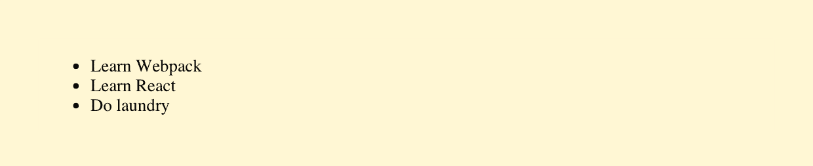

### 4.3 向列表添加新项目

向列表添加更多项目是进一步开发的良好起点。每个 React 组件都可以维护内部的 `state`。在这种情况下，`state` 指的是我们刚刚定义的数据模型。当我们通过 React 的 `setState` 方法修改 `state` 时，React 将最终调用 `render()` 方法并更新用户界面。这个想法允许我们实现交互性，例如向列表添加新项目。


如果我们正在与后端交互，我们会在这里触发查询并从响应中捕获 `id`。目前，只需生成一个条目和一个自定义 id 就足够了。

如果你现在刷新浏览器并点击加号按钮，你应该会在列表中看到一个新项目：

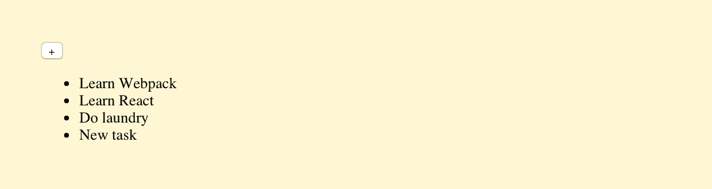

带有加号的笔记

我们仍然缺少两个关键功能：编辑和删除。在继续处理这些功能之前，最好的做法是通过扩展我们的组件层级来为它们留出空间。这样做之后处理这些功能将会变得更容易。使用 React 就像是这样：你开发一个组件一段时间，直到你意识到它可以被进一步拆分。

### 4.4 改进组件层级

我们目前基于单个组件的设置无法带我们走得远。要在其中添加更多独立的笔记集合将变得非常复杂。在目前的设置下，这意味着我们必须重复代码。

幸运的是，我们可以通过为我们的系统建模更多组件来解决这个问题。除了解决问题外，它们还促进了代码复用。在理想情况下，我们可以在多个不同的系统中使用良好的组件。

由于笔记集合看起来像是一个组件，我们可以将其建模为 `Notes`。此外，我们可以将其与 `Note` 概念分离出来。这种分离为我们提供了另一个非常有帮助的抽象层次。这种设置为我们提供了一个三层组件层级，看起来如下：

通过观察我们的应用程序，我们可以设计出这样的组件层级：

*   `App` - `App` 保留应用状态并处理高层逻辑。
*   `Notes` - `Notes`充当中间包装器，渲染单个 `Note` 组件。
*   `Note` - `Note` 是我们应用程序的核心工作。编辑和删除将在这里触发。该逻辑将通过中间的连接级联到 `App`。

以后，我们可以通过引入 `Lane`（通道）和 `Lanes`（通道列表）的概念将层级扩展为完整的看板（Kanban）。这两个概念位于 `App` 和 `Notes` 之间。不过，我们现在不需要担心这个。

#### 提取 `Note`

向我们目标层级迈出的良好第一步是提取 `Note`。`Note` 是一个需要接收 `task` 作为 `prop` 并将其渲染的组件。在 JSX 来说，这看起来像是 `<Note task="这里是任务" />`。

除了 `state` 之外，`props` 是你将经常使用的另一个概念。它们描述了组件的外部接口。你可以像在*React 类型*章节中讨论的那样对它们进行注释。为了保持简单，我们在这里跳过了 `propType` 注释。

函数组件将接收 `props` 作为其第一个参数。我们可以通过 [ES6 解构语法](https://developer.mozilla.org/en/docs/Web/JavaScript/Reference/Operators/Destructuring_assignment#Object_destructuring) 从中提取特定的 props。函数组件本身就是 `render()`。它们比基于类的组件要局限得多，但它们非常适合简单的展示目的，例如这里。为了将这些想法结合起来，我们可以得到如下组件定义：

**app/components/Note.jsx**

```jsx
import React from 'react';

export default ({task}) => <div>{task}</div>;
```

#### 将 `Note` 连接到 `App`

现在我们有了一个接受 `task` prop 的简单组件，我们可以将其与 `App` 连接起来，以接近我们构思的组件层级：

**app/components/App.jsx**

```jsx
import uuid from 'node-uuid';
import React from 'react';
import Note from './Note.jsx';

export default class App extends React.Component {
  constructor(props) {
    ...
  }
  render() {
    const notes = this.state.notes;

    return (
      <div>
        <button onClick={this.addNote}>+</button>
        <ul>{notes.map(note =>
          <li key={note.id}>{note.task}</li>
          <li key={note.id}>
            <Note task={note.task} />
          </li>
        )}</ul>
      </div>>
    );
  }
  ...
}
```

应用程序看起来应该是一样的。为了实现我们想要的结构，我们应该再进行一次微调并提取 `Notes`。

#### 提取 `Notes`

提取 `Notes` 是一个类似的操作。我们需要理解 `App` 的哪些部分属于该组件，然后为它编写定义。这与之前的 `Note` 是一样的想法：

**app/components/Notes.jsx**

```jsx
import React from 'react';
import Note from './Note.jsx';

export default ({notes}) => {
  return (
    <ul>{notes.map(note =>
      <li key={note.id}>
        <Note task={note.task} />
      </li>
    )}</ul>
  );
}
```

此外，我们需要将 `App` 与新定义连接：

**app/components/App.jsx**

```jsx
import uuid from 'node-uuid';
import React from 'react';
import Note from './Note.jsx';
import Notes from './Notes.jsx';

export default class App extends React.Component {
  constructor(props) {
    ...
  }
  render() {
    const notes = this.state.notes;

    return (
      <div
        <button onClick={this.addNote}>+</button>
        <ul>{notes.map(note =>
          <li key={note.id}>
            <Note task={note.task} />
          </li>
        )}</ul>
        <Notes notes={notes} />
      </div>
    );
  }
  addNote = () => {
    this.setState({
      notes: this.state.notes.concat([{
        id: uuid.v4(),
        task: 'New task'
      }])
    });
  };
}
```

应用程序的行为应该保持不变。但在结构上，我们比之前更好。现在我们可以开始考虑为系统添加新功能。

### 4.5 编辑 `Notes`

为了编辑单个 `Note`，我们应该为这些设置一些钩子（hooks）。逻辑上可能会发生以下情况：

1. 用户点击 `Note`。
2. `Note` 渲染为一个显示当前值的输入框。
3. 用户确认修改（触发 `blur` 事件或按下回车键）。
4. `Note` 渲染新值。

这意味着 `Note` 需要某种方式跟踪其 `editing` 状态。此外，我们需要通知值（`task`）已更改，以便 `App` ...更新其状态。解决这两个问题将得到一个功能性的结果。

#### 跟踪 `Note` 的 `editing` 状态

就像之前的 `App` 一样，我们再次需要处理状态。这意味着函数组件不再足够。相反，我们需要将其转换为更重的格式。为了保持一致性，我将使用与 `App` 相同的组件定义风格。此外，我们需要根据用户行为更改 `editing` 状态，最后根据它渲染正确的元素。在 React 来说，这意味着：

**app/components/Note.jsx**


```javascript
import React from 'react';

export default class Note extends React.Component {
  constructor(props) {
    super(props);

    // 跟踪 `editing` 状态。
    this.state = {
      editing: false
    };
  }
  render() {
    // 根据状态渲染渲染组件。
    if(this.state.editing) {
      return this.renderEdit();
    }

    return this.renderNote();
  }
  renderEdit = () => {
    // 我们在这里处理失去焦点和输入处理器。这些映射到 DOM 事件。
    // 我们还通过 ref 的回调将选择位置设置为输入末尾。
    // 它在组件挂载后被触发。
    //
    // 我们也可以使用字符串引用（例如 `ref="input"`），
    // 然后在代码的后续部分引用该元素。这
    // 允许我们通过 this.refs.input 使用底层的 DOM API。
    // 这在与 React 生命周期钩子结合时非常有用。
    return <input type="text"
      ref={
        (e) => e ? e.selectionStart = this.props.task.length : null
      }
      autoFocus={true}
      defaultValue={this.props.task}
      onBlur={this.finishEdit}
      onKeyPress={this.checkEnter} />;
  };
  renderNote = () => {
    // 如果用户点击普通笔记，触发编辑逻辑。
    return <div onClick={this.edit}>{this.props.task}</div>;
  };
  edit = () => {
    // 进入编辑模式。
    this.setState({
      editing: true
    });
  };
  checkEnter = (e) => {
    // 用户按了 *回车*，让我们完成它吧。
    if(e.key === 'Enter') {
      this.finishEdit(e);
    }
  };
  finishEdit = (e) => {
    // 当 `Note` 有新值时，它将触发一个可选的 `onEdit` 回调。
    // 我们用此将更改通信给 `App`。
    //
    // 处理默认值的更智能的方法是通过 `defaultProps` 设置它。
    //
    // 更多信息请查看 *Typing with React* 章节。
    const value = e.target.value;

    if(this.props.onEdit) {
      this.props.onEdit(value);

      // 退出编辑模式。
      this.setState({
        editing: false
      });
    }
  };
}
```

现在如果你尝试编辑 `Note`，你应该能看到一个输入框并能够编辑数据。由于我们还没有设置 `onEdit` 处理器，它目前还没有执行任何有用的操作。接下来我们需要捕获编辑后的数据并更新 `App` 状态，以便代码能够工作。

#### 通信 `Note` 状态的变化

鉴于我们目前在 `App` 中处理逻辑，我们也可以在那里处理 `onEdit`。另一种设计可能是将逻辑推到 `Notes` 级。这在处理 `addNote` 时会产生问题，因为该功能不属于 `Notes` 领域。因此，我们将应用程序状态保持在 `App` 级。

为了让 `onEdit` 起作用，我们需要捕获它的输出并将结果委托给 `App`。此外，我们需要知道是哪个 `Note` 被修改了，以便我们相应地更新数据。这可以通过下图所示的数据绑定来实现：


`onEdit` 流程

由于 `onEdit` 定义在 `App` 级，我们需要通过 `Notes` 传递 `onEdit` 处理器。因此，为了让存根工作，需要修改两个文件。`App` 的代码看起来应该是这样的：

**app/components/App.jsx**

```javascript
import uuid from 'node-uuid';
import React from 'react';
import Notes from './Notes.jsx';

export default class App extends React.Component {
  constructor(props) {
    ...
  }
  render() {
    const notes = this.state.notes;

    return (
      <div>
        <button onClick={this.addNote}>+</button>
        <Notes notes={notes} />
        <Notes notes={notes} onEdit={this.editNote} />
      </div>
    );
  }
  addNote = () => {
    ...
  };
  editNote = (id, task) => {
    // 如果尝试设置空值，则不修改
    if(!task.trim()) {
      return;
    }

    const notes = this.state.notes.map(note => {
      if(note.id === id && task) {
        note.task = task;
      }

      return note;
    });

    this.setState({notes});
  };
}
```

为了让方案按照设计工作，我们需要修改 `Notes` 以符合该思路。它将 `绑定` 目标笔记的 `id`。当回调被触发时，剩余参数将接收一个值并调用该回调：

**app/components/Notes.jsx**

```javascript
import React from 'react';
import Note from './Note.jsx';

export default ({notes, onEdit}) => {
  return (
    <ul>
      {notes.map(note =>
        <li key={note.id}>
          <Note
            task={note.task}
            onEdit={onEdit.bind(null, note.id)}
            onDelete={onDelete.bind(null, note.id)}
          />
        </li>
      ))}
    </ul>
  );
};
```


从美学角度来看，我们目前的应用程序非常简陋。由于漂亮的应用用起来更有趣，我们可以对此做些改进。在这种情况下，我们将采用一种传统的样式化方法。换句话说，我们会在到处散布一些 CSS 类，然后根据这些类应用 CSS 选择器。*Styling React* 章节将更详细地讨论其他各种其他方法。

#### 为组件挂载类

为了让我们的应用程序可以进行样式化，我们需要为它的各个部分附加一些类：

`app/components/App.jsx`

```jsx
import uuid from 'node-uuid';
import React from 'react';
import Notes from './Notes.jsx';

export default class App extends React.Component {
  ...
  render() {
    const notes = this.state.notes;

    return (
      <div>
        <button onClick={this.addNote}>+</button>
        <button className="add-note" onClick={this.addNote}>+</button>
        <Notes notes={notes}
          onEdit={this.editNote}
          onDelete={this.deleteNote} />
      </div>
    );
  }
  ...
}
```

`app/components/Notes.jsx`

```jsx
import React from 'react';
import Note from './Note.jsx';

export default ({notes, onEdit, onDelete}) => {
  return (
    <ul>{notes.map(note =>
    <ul className="notes">{notes.map(note =>
      <li key={note.id}>
      <li className="note" key={note.id}>
        <Note
          task={note.task}
          onEdit={onEdit.bind(null, note.id)}
          onDelete={onDelete.bind(null, note.id)} />
      </li>
    )}</</ul>
  );
}
```

`app/components/Note.jsx`

```jsx
import React from 'react';

export default class Note extends React.Component {
  ...
  renderNote = () => {
    const onDelete = this.props.onDelete;

    return (
      <div onClick={this.edit}>
        <span>{this.props.task}</span>
        <span className="task">{this.props.task}</span>
        {onDelete ? this.renderDelete() : null }
      </div>
    );
  };
  renderDelete = () => {
    return <button onClick={this.props.onDelete}>x</button>;
    return <button
      className="delete-note"
      onClick={this.props.onDelete}>x</button>;
  };
  ...
}
```

#### 组件样式化

第一步是去掉那个难看的*衬线*字体。

`app/main.css`

```css
body {
  background: cornsilk;
  font-family: sans-serif;
}
```

现在看起来好看一点了：

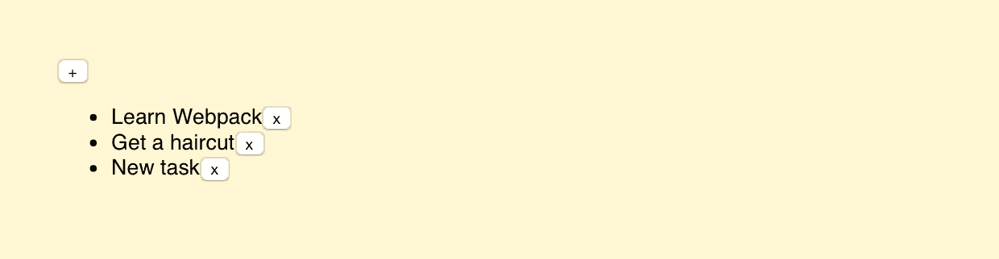

无衬线字体

良好的下一步是稍微限制 `Notes` 容器，并去掉那些列表符号。

`app/main.css`

```css
...

.add-note {
  background-color: #fdfdfd;
  border: 1px solid #ccc;
}

.notes {
  margin: 0.5em;
  padding-left: 0;

  max-width: 10em;
  list-style: none;
}
```

去掉符号很有帮助：

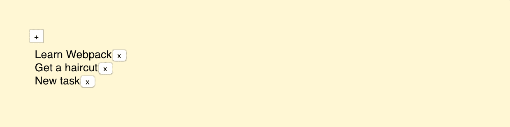

无符号

为了让单个 `Notes` 脱颖而出，我们可以应用几条规则。

`app/main.css`

```css
...

.note {
  margin-bottom: 0.5em;
  padding: 0.5em;

  background-color: #fdfdfd;
  box-shadow: 0 0 0.3em 0.03em rgba(0, 0, 0, 0.3);
}
.note:hover {
  box-shadow: 0 0 0.3em 0.03em rgba(0, 0, 0, 0.7);

  transition: 0.6s;
}

.note .task {
  /* 强制使用 inline-block 以便它获得最小高度 */
  display: inline-block;
}
```

现在笔记看起来突出了一了：

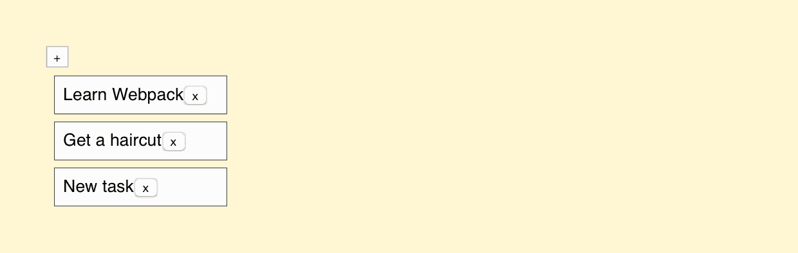

样式化笔记

我在过程中为 `Note` 阴影了动画。这样用户可以更好地指示哪个 `Note` 正被悬停着。这在基于触摸的界面上不起作用，但对于桌面端来说是一个亮点。

最后，我们应该让那些删除按钮不那么显眼。实现这一点的方法之一是默认隐藏它们并在悬停时显示它们。问题是删除在触摸上无法工作，但我们可以接受这一点。

`app/main.css`

```css
...

.note .delete-note {
  float: right;

  padding: 0;

  background-color: #fdfdfd;
  border: none;

  cursor: pointer;

  visibility: hidden;
}
.note:hover .delete-note {
  visibility: visible;
}
```

不再有那些讨厌的删除按钮了：

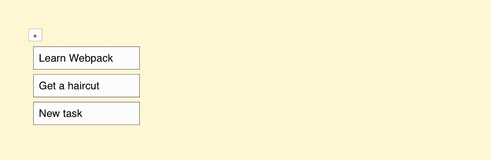

悬停删除

### 4.8 理解组件

在完成这几个步骤后，我们有了生命周期钩子。了解它们是如何运作的。。React 提供了以下生命周期钩子：

- `componentWillMount()` 在任何渲染之前触发。
- `componentDidMount()` 在初始渲染后触发。
- `componentWillReceiveProps(object nextProps)` 当组件接收新属性时触发。
- `shouldComponentUpdate(object nextProps, nextState)` 允许你优化渲染。如果你检查属性和状态不需要更新，返回 `false`。
- `componentWillUpdate(object nextProps, nextState)` 在 `shouldComponentUpdate` 之后 `render()` 之前触发。
- `componentDidUpdate()` 在渲染后触发。
- `componentWillUnmount()` 在组件从 DOM 卸载之前触发。

除了生命周期钩子，如果你在使用 `React.createClass`，还应该了解各种属性和方法：

- `displayName` - 最好设置 `displayName`，这将改进调试信息。对于 ES6 类，它是根据类名自动派生的。
- `getInitialState()` - 在类方法中，可以通过 `constructor` 实现。
- `getDefaultProps()` - 在类中可以通过 `constructor` 中设置这些。
- `mixins` - `mixins` 包含应用到组件的 mixins 数组。
- `statics` - `statics` 包含组件的静态属性和方法。在 ES6 中，你可以按照如下将它们赋值给类：

```jsx
class Note {
  render() {
    ...
  }
}
Note.willTransitionTo = () => {...};

export default Note;
```

某些库例如 React DnD 依赖静态方法提供过渡钩子。它们允许你控制当组件显示或隐藏时发生什么。根据定义，静态方法可以通过类本身可用。


> React 提供了一项名为 [refs](https://facebook.github.io/react/docs/more-about-refs.html) 的功能，让你可以通过 DOM 对 React 元素执行操作。这是一个逃生机制，专为那些 React 本身无法胜任的情况设计。进行测量就是一个很好的例子。Refs 需要附加到有状态的组件上才能工作。

## 4.9 React 组件规范

我倾向于将 `constructor` 放在最前面，接着是生命周期钩子、`render()`，最后是 `render()` 使用的方法。我喜欢这种自上而下的方法，因为它使得代码遵循起来一目了然。有些人倾向于将 `render()` 使用的方法放在它之前。还有各种命名规范。你也可以使用 `_` 前缀作为事件处理程序。

最后，你必须找到适合你自己的且对你最有效的规范。我将在 *Webpack 中的 Linting* 章节中详细介绍这一主题，在那个章节中，我将介绍各种与代码质量相关的工具。通过使用这些工具，可以在一定程度上强制编码风格。

这在团队环境中非常有用。它减少了处理他人编写的代码时的摩擦。即使在个人项目中，使用工具来为你验证语法和标准也是很有用的。它减少了错误的数量和严重程度。

## 4.10 结论

仅使用原生 React 就能走得很远。问题是，我们开始将数据相关的关注点逻辑与视图组件混合。我们将通过引入 Flux 来改进应用程序的架构。

## 5. React 和 Flux

通过将一切保持在组件中，你可以走得很远。尽管如此，最终会变得痛苦。[Flux 应用架构](https://facebook.github.io/flux/docs/overview.html) 有助于为我们的 React 应用带来清晰度。它不是唯一的解决方案，但它是一个不错的起点。

Flux 允许我们将数据和应用状态从视图中分离。这有助于我们保持它们的整洁并使应用程序具有维护性。Flux 设计时考虑了大型团队。因此，你可能会发现它非常冗长。不过，这带来了巨大的优势，因为处理起来非常直观。

### 5.1 Flux 简介

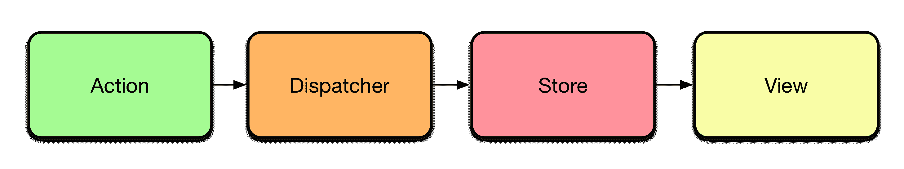

单向 Flux 数据流

到为止，我们一直只处理视图。Flux 架构在其中引入了几个新概念。这些是动作（actions）、调度器（dispatcher）和存储（stores）。与流行的 Angular 或 Ember 等框架不同，Flux 实现的是单向流。尽管双向绑定可能很方便，但它们是有代价的。很难推断发生了什么以及为什么。

#### 动作 (Actions) 和存储 (Stores)

Flux 并不完全容易理解，因为有很多概念需要考虑。在我们的案例中，我们将为 `NoteActions` 和 `NoteStore`。`NoteActions` 提供了我们对数据上执行的具体操作。例如，我们可以拥有 `NoteActions.create({task: 'Learn React'})`。

#### 调度器 (Dispatcher)

当我们触发一个动作时，调度器会收到通知。调度器能够处理存储之间可能的依赖关系。某个动作可能需要在另一个动作之前发生。调度器允许我们实现这一点。

在最简单的层面，动作只需原样将消息传递给调度器。它们还可以触发异步查询，并最终根据结果触发调度器。这允许我们处理收到的数据和可能的错误。

一旦调度器处理了动作，监听它的存储就会被触发。在我们的案例中，`NoteStore` 会收到通知。结果是它能够更新其内部状态。在此之后，它将通知可能的监听者新状态。

#### Flux 数据流

这完成了 Flux 基础的单向但线性的流程。然而，单向过程通常具有循环流，并且并不一定结束。接下来的图说明了一个更常见的流。这仍然是同一个想法，但增加了一个返回的循环。最终，依赖于我们存储数据的组件将通过这个循环过程得到刷新。

对于创建一个新 `Note` 这样简单的事情来说，这听起来有很多步骤。这种方法确实有其益处。鉴于流始终是单方向的，因此很容易追踪和调试。如果有问题，它一定在循环中的某处。

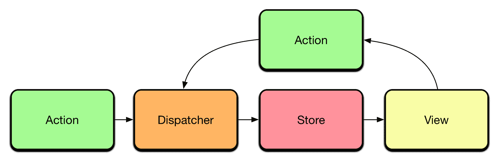

带有循环的 Flux 数据流

#### Flux 的优势

尽管这听起来有点复杂，但这种安排为我们的应用程序提供了活性。例如，我们可以在视图之外实现 API 通信、缓存和 i18n（国际化）。这样，它们可以保持逻辑之外的纯洁，同时让应用程序更容易理解。

在你的应用程序中实现 Flux 架构实际上会增加一些代码量。重要的是，最小化编写的代码量并不是 Flux 的目标。它的设计是为了让大型团队提高生产力。你可以说显式比隐式更好。

#### 使用哪种 Flux 实现？

库的情况在不断变化。解释这种架构没有单一的正确方法。你会发现适合不同口味的实现。[voronianski/flux-comparison](https://github.com/voronianski/flux-comparison) 提供了某些较流行的实现之间很好的比较。

在选择库时，取决于你个人的喜好。你必须考虑各种因素，如 API、功能、文档和支持。从较流行的替代方案之一开始是一个好主意。当你开始理解架构时，你能够做出更好地服务你的选择。

### 5.2 迁移到 Alt


Alt

在本章中，我们将使用一个名为 [Alt](http://alt.org/) 的库。它是一个灵活、功能全面的实现，为通用渲染设计。

在 Alt 中，你将处理动作和存储。调度器是隐藏的，但需要时你仍然可以访问它。与其他实现相比，Alt 隐藏了很多模板代码。它具有特殊功能允许你保存和恢复应用程序状态。#### 设置 Alt 实例

Alt 的一切始于 Alt 实例。它跟踪动作和存储并保持通信。为了保持简单，我们将所有的 Alt 组件视为[单例](https://en.wikipedia.org/wiki/Singleton_pattern)。通过这种模式，我们在整个应用程序中重用同一个实例。为了实现这一点，将其如下：

**app/libs/alt.js**

```
import Alt from 'alt';
//import chromeDebug from 'alt-utils/lib/chromeDebug';

const alt = new Alt();
//chromeDebug(alt);

export default alt;
```

Webpack 会缓存模块，所以下次导入 Alt 时它将返回同一个实例。

#### 为 Notes 定义 CRUD API

接下来，我们需要定义一个操作 Note 数据的基本 API。为了保持简单，我们可以对其进行 CRUD（增删改查）。由于读取是隐式的，我们不需要它。不过，我们可以将其余部分建模为动作。Alt 提供了一个名为 `generateActions` 的快捷方式。我们可以这样使用它：

**app/actions/NoteActions.js**

```
import alt from '../libs/alt';

export default alt.generateActions('create', 'update', 'delete');
```

### 5.3 为 `Notes` 定义存储

存储是应用程序状态某部分的单一事实来源。在我们的案例中，我们需要一个来维护笔记的状态。我们将使用 `bindActions` 函数连接上面定义的所有动作。


我们已经在 `App` 中拥有了 store 所需的逻辑。我们将这些逻辑移动到 `NoteStore`。

#### 搭建骨架

第一步，我们可以为 store 搭建一个骨架。之后，我们可以填充需要的方法。Alt 使用标准的 ES6 类，因此它的语法与我们之前看到的 React 组件相同。这里是一个起点：

**app/stores/NoteStore.js**

```
import uuid from 'node-uuid';
import alt from '../libs/alt';
import NoteActions from '../actions/NoteActions';

class NoteStore {
  constructor() {
    this.bindActions(NoteActions);

    this.notes = [];
  }
  create(note) {

  }
  update(updatedNote) {

  }
  delete(id) {

  }
}

export default alt.createStore(NoteStore, 'NoteStore');
```

我们调用 `bindActions` 将每个 action 映射到对应的同名方法。之后，我们在每个方法中触发相应的逻辑。最后，我们使用 `alt.createStore` 将 store 与 Alt 连接起来。

注意，不需要为 store 分配标签（在此例中为 `NoteStore`）。不过这是一个良好的习惯，它可以保护代码免受混淆（minification）。当我们持久化数据时，这些标签会变得重要。

#### 实现 `create`

与之前的逻辑相比，`create` 会自动为 `Note` 生成一个 id。这是一个隐藏在 store 内部的细节：

**app/stores/NoteStore.js**

```
import uuid from 'node-uuid';
import alt from '../libs/alt';
import NoteActions from '../actions/NoteActions';

class NoteStore {
  constructor() {
    ...
  }
  create(note) {
    const notes = this.notes;

    note.id = uuid.v4();

    this.setState({
      notes: notes.concat(note)
    });
  }
  ...
}

export default alt.createStore(NoteStore, 'NoteStore');
```

为了保持实现的整洁，我们使用了 `this.setState`。这是 Alt 的功能，允许我们表示要修改 store 的状态。Alt 会向可能的监听器信号变化。

#### 实现 `update`

`update` 除了重命名外，遵循之前的逻辑。最重要的是，我们通过 `this.setState` 提交新状态：

**app/stores/NoteStore.js**

```
...

class NoteStore {
  ...
  update(updatedNote) {
    const notes = this.notes.map(note => {
      if(note.id === updatedNote.id) {
        // 这里使用 Object.assign 来修补 note 数据。它
        // 会变异目标（第一个参数）。为了避免这一点，
        // 我使用 {} 作为目标并在其上应用数据。
        //
        // 示例：{}, {a: 5, b: 3}, {a: 17} -> {a: 17, b: 3}
        //
        // 你可以向该方法传递任意数量的对象。
        return Object.assign({}, note, updatedNote);
      }

      return note;
    });

    // 这等同于 `this.setState({notes: notes})`
    this.setState({notes});
  }
  delete(id) {

  }
}

export default alt.createStore(NoteStore, 'NoteStore');
```

我们只剩下最后一个操作：`delete`。

#### 实现 `delete`

`delete` 是直观的。像之前一样，查找并销毁，并记住提交更改：

**app/stores/NoteStore.js**

```
...

class NoteStore {
  ...
  delete(id) {
    this.setState({
      notes: this.notes.filter(note => note.id !== id)
    });
  }
}

export default alt.createStore(NoteStore, 'NoteStore');
```


尽管整合 Alt 费了大量精力，但并非徒劳无功。考虑以下问题：

1. 假设我们想将笔记持久化在 `localStorage` 中。你会哪里实现它？一种方法是在应用初始化时处理。
2. 如果有很多组件依赖于这些数据呢？我们只需要消费 `NoteStore` 并以我们想要的方式显示它即可。
3. 如果我们有针对不同任务类型的多个独立 Note 列表呢？我们可以设置另一个 store 来跟踪这些列表。该 store 可以通过 id 引用实际的。。将在下一章进行此类操作，并将该方法进行泛化。

这就是为什么 Flux 与 React 使用时是强强大的架构的原因。找到此类问题的答案并不困难。虽然代码更多，但它更容易推理。由于我们处理的是单向流，因此拥有了易于调试和测试的东西。

## ## 5.5 在 `localStorage` 上实现持久化

我们将修改 `NoteStore` 的实现，以便在更改时持久化数据。这样我们在刷新后就不会丢失数据。实现这一点的一种方法是使用 [localStorage](https://developer.mozilla.org/en/docs/Web/API/Window/localStorage)。这是一个支持良好的特性，允许你将数据持久化到浏览器。

### ### 理解 `localStorage`

`localStorage` 有一个名为 `sessionStorage` 的兄弟节点。`sessionStorage` 在浏览器关闭时会丢失数据，而 `localStorage` 会保留其数据。它们共享下面所讨论的[相同 API](https://developer.mozilla.org/en-US/docs/Web/API/Web_Storage_API/Using_the_Web_Storage_API)：

* `storage.getItem(k)` - 返回给定键的存储的字符串值。
* `storage.removeItem(k)` - 与键匹配的数据。
* `storage.setItem(k, v)` - 使用给定的键存储给定的值。
* `storage.clear()` - 清空存储内容。

注意，使用浏览器开发者工具操作该 API 是方便的。例如，在 Chrome 中，你可以通过 `Resources` 标签页查看存储状态。`Console` 标签页允许你对数据进行直接操作。你甚至可以使用 `storage.key` 和 `storage.key = 'value'` 简写形式进行快速修改。

`localStorage` 和 `sessionStorage` 合共可以使用多达 10 MB 的数据。尽管它们得到了良好支持，但在某些边界情况下会出现有趣的失败。这些包括在 Internet Explorer 中内存耗尽（静默失败）以及在 Safari 的无痕模式下完全失败。不过，这些可以规避这些故障。

### ### 为 `localStorage` 实现包装器

为了保持简单易于管理，我们可以为 `storage` 实现一个小型包装器。它将封装所有这些复杂性。API 期望字符串。

由于对象很方便，我们将使用 `JSON.parse` 和 `JSON.stringify` 进行序列化。我们只需要实现所示的 `storage.get(k)` 和 `storage.set(k, v)`：

**app/libs/storage.js**

```javascript
export default {
  get(k) {
    try {
      return JSON.parse(localStorage.getItem(k));
    }
    catch(e) {
      return null;
    }
  },
  set(k, v) {
    localStorage.setItem(k, JSON.stringify(v));
  }
};
```

该实现可以进一步泛化。你可以将其转换为工厂（`storage => {...}`）并使其能够交换存储。现在除非更改代码，否则我们被局限于 `localStorage`。

### ### 使用 `FinalStore` 持久化应用

除了这个小工具，我们还需要适配应用以使用它。Alt 提供了一个名为 `FinalStore` 的内置 store，非常适合此目的。我们可以使用 `FinalStore`、引导（bootstrapping）和快照（snapshotting）来持久化应用程序的状态。`FinalStore` 是一个监听所有现有 store 的 store。每当某个 store 变化时，`FinalStore` 都会。。这使其持久化的理想选择。

每当 `FinalStore` 变化时，我们可以获取整个应用状态的快照并将其推送到 `localStorage`。这解决了问题的部分。引导过程解决了剩余部分，因为 `alt.bootstrap` 允许我们设置所有 store 的状态。该方法不会发出事件。为了让我们的 store 填充正确的状态，我们需要在组件渲染之前调用它。在我们的案例中，我们将从 `localStorage` 获取数据并调用它来填充我们的 store。

为了将此主意整合到我们的应用中，我们需要实现一个很小的模块来管理它。我们在那里考虑了可能的初始数据并触发新逻辑。

`app/libs/persist.js` 完成了困难部分。它将设置 `FinalStore`、处理引导（恢复数据）和快照（保存数据）。我包含了一个 `debug` 标记形式的逃生口。如果设置了它，数据将不会保存到 `localStorage`。理由是通过这样做，你可以设置标记（`localStorage.setItem('debug', 'true')`）、点击 `localStorage.clear()` 并刷新浏览器以获得干净的起点。下面的实现说明了这些思想：

**app/libs/persist.js**

```javascript
import makeFinalStore from 'alt-utils/lib/makeFinalStore';

export default function(alt, storage, storeName) {
  const finalStore = makeFinalStore(alt);

  try {
    alt.bootstrap(storage.get(storeName));
  }
  catch(e) {
    console.error('Failed to bootstrap', e);
  }

  finalStore.listen(() => {
    if(!storage.get('debug')) {
      storage.set(storeName, alt.takeSnapshot());
    }
  });
}
```


```
import AltContainer from 'alt-container';
import React from 'react';
import Notes from './Notes.jsx';
import NoteActions from '../actions/NoteActions';
import NoteStore from '../stores/NoteStore';

export default class App extends React.Component {
  constructor(props) {
    super(props);

    this.state = NoteStore.getState();
  }
  componentDidMount() {
    NoteStore.listen(this.storeChanged);
  }
  componentWillUnmount() {
    NoteStore.unlisten(this.storeChanged);
  }
  storeChanged = (state) => {
    // Without a property initializer `this` wouldn't
    // point at the right context (defaults to `undefined` in strict mode).
    this.setState(state);
  };
  render() {
    const notes = this.state.notes;

    return (
      <<div>
        <button className="add-note" onClick={this.addNote}>+</button>
        <Notes notes={notes}
          onEdit={this.editNote}
          onDelete={this.deleteNote} />
        <AltContainer
          stores={[NoteStore]}
          inject={{
            notes: () => NoteStore.getState().notes
          }}
        >
          <Notes onEdit={this.editNote} onDelete={this.deleteNote} />
        </AltContainer>
      </div>
    );
  }
  ...
}
```

`AltContainer` 允许我们将数据绑定到它的直接子元素上。在这种情况下，它向 `Notes` 注入了 `notes` 属性。这种模式允许我们建立与多个 store 的任意连接并对其进行管理。你可以在关于装饰器的附录找到另一种可能的方法。

集成 `AltContainer` 将此组件与 `Alt` 绑定。如果你希望具有前瞻性，可以将其放入你自己的组件中。该外层会隐藏 `Alt` 并允许你以后将其替换为其他东西。

### 5.7 在 Alt 中分发 (Dispatching)

尽管你不使用 Flux 分发器也能走很远，但了解一些它仍然是有用的。Alt 提供了两种使用它的方法。如果你想记录通过你的 `alt` 实例的所有内容，可以使用代码片段，例如 `alt.dispatcher.register(console.log.bind(console))`。或者，你可以在 store 构造函数中触发 `this.dispatcher.register(...)`。这些机制允许你实现有效的日志记录。

### 5.8 替代实现

尽管我们最终在实现中使用了 `Alt`，但它并不是唯一的选择。为了对各种架构进行基准测试，我使用不同的技术实现了同一个应用程序。我在下面简要比较了它们：

* [Redux](http://rackt.org/redux/) 是一种受 Flux 启发的架构，设计以热加载为主要约束进行设计。Redux 基于单一状态树运行。树的状态通过称为 reducers 的 `pure functions` 进行操纵。尽管有一些样板代码，但 Redux 强制你深入研究函数式编程。- [Redux demo](https://github.com/survivejs/redux-demo)

* 与 Redux 相比，[Cerebral](http://www.cerebraljs.com/) 有不同的起点。它的开发是为了提供关于应用程序如何改变状态的见解。Cerebral 提供了更具主见性的开发方式，因此自带了更多功能（batteries included）。- [Cerebral demo](https://github.com/survivejs/cerebral-demo)

* [Mobservable](https://mweststrate.github.io/mobservable/) 允许你让数据结构变得可观测。这些结构可以与 React 组件连接，这样每当结构更新时，React 组件也会之更新。可以使用结构之间的真实引用，Kanban 的实现简单得惊人。- [Mobservable demo](https://github.com/survivejs/mobservable-demo)

### 5.9 Relay?

与 Flux 相比，Facebook 的 [Relay](https://facebook.github.io/react/blog/2015/02/20/introducing-relay-and-graphql.html) 在数据获取方面有所改进。它允许你将数据需求推送到视图层。根据，它可以独立使用或配合 Flux 使用。

鉴于它在很大程度上仍然未经过充分测试，我们还没有在书中介绍它。Relay 有它自己的特殊要求（GraphQL 兼容 API）。只有时间才能证明它如何被社区采用。

### 5.10 结论

在本章中，你了解了如何我们将简单的应用程序迁移到使用 Flux 架构。在这个过程中，我们学习了 Flux 的基本概念。现在我们准备好为我们的应用程序添加更多功能了。

## 6. 从 Notes 到 Kanban


看板 面板

到目前为止，我们开发了一个在 `localStorage` 中跟踪笔记的应用程序。我们仍然有工作要做将其变成上面所示的真实看板。最重要的是，我们的系统缺少 `Lane`（通道）的概念。

`Lane` 是一个应该能够在内部包含许多 `Notes` 并跟踪它们顺序的东西。建模这种关系的方法之一是让 `Lane` 通过一个 `Note` id 数组指向 `Notes`。这种关系可以反过来。一个 `Note` 可以使用 `id` 指向 `Lane` 并维护关于它在 `Lane` 中位置的信息。在这种情况下，我们将坚持前一种设计，因为这有利于以后的重新排序。

### 6.1 提取 Lanes

正如之前，我们在这里使用两个组件的想法。这里有一个高层组件（即 `Lanes`）和一个低层组件（即 `Lane`）。高层组件将处理通道排序。`Lane` 将渲染自身（即名称和 `Notes`）并具有基本操作。

正如与 `Notes` 一样，我们需要一组操作。目前，只要我们可以创建新通道就足够了，如下：

**app/actions/LaneActions.js**

```javascript
import alt from '../libs/alt';

export default alt.generateActions('create');
```

此外，我们需要 `LaneStore` 和一个匹配 `create` 的方法。与之前的 `NoteStore` 非常相似。`create` 将一个新的通道连接到通道列表中。之后，更改将传播到监听器（即 `FinalStore` 和组件）。

**app/stores/LaneStore.js**

```javascript
import uuid from 'node-uuid';
import alt from '../libs/alt';
import LaneActions from '../actions/LaneActions';

class LaneStore {
  constructor() {
    this.bindActions(LaneActions);

    this.lanes = [];
  }
  create(lane) {
    const lanes = this.lanes;

    lane.id = uuid.v4();
    lane.notes = lane.notes || [];

    this.setState({
      lanes: lanes.concat(lane)
    });
  }
}

export default alt.createStore(LaneStore, 'LaneStore');
```

我们还需要 `Lanes` 的一个存根。我们稍后会扩展它。现在我们只想让它显示出来。

**app/components/Lanes.jsx**

```javascript
import React from 'react';

export default class Lanes extends React.Component {
  render() {
    return (
      <div className="lanes">
        lanes should go here
      </div>
    );
  }
}
```

接下来，我们需要在 `App` 中为 `Lanes` 留出空间。我们将只需将 `Notes` 引用替换为 `Lanes`，根据需要设置操作和存储。

**app/components/App.jsx**


```javascript
import AltContainer from 'alt-container';
import React from 'react';
import Notes from './Notes.jsx';
import NoteActions from '../actions/NoteActions';
import NoteStore from '../stores/NoteStore';
import Lanes from './Lanes.jsx';
import LaneActions from '../actions/LaneActions';
import LaneStore from '../stores/LaneStore';

export default class App extends React.Component {
  render() {
    return (
      <div
        <button className="add-note" onClick={this.addNote}>+</button>
        <button className="add-lane" onClick={this.addLane}>+</button>
        <AltContainer
          stores={[NoteStore]}
          inject={{
            notes: () => NoteStore.getState().notes
          }}
        >
        <AltContainer
          stores={[LaneStore]}
          inject={{
            lanes: () => LaneStore.getState().lanes || []
          }}
        >
          <Notes onEdit={this.editNote} onDelete={this.deleteNote} />
          <Lanes />
        </AltContainer>
      </div>
    );
  }
  deleteNote = (id, e) => {
    e.stopPropagation();

    NoteActions.delete(id);
  };
  addNote = () => {
    NoteActions.create({task: 'New task'});
  };
  editNote = (id, task) => {
    // 如果尝试设置空值，则不修改
    if(!task.trim()) {
      return;
    }

    NoteActions.update({id, task});
  };
  addLane() {
    LaneActions.create({name: 'New lane'});
  }
}
```

如果你在浏览器中查看实现代码，你会发现目前的实现并没有做什么什么。它只是显示了一个加号按钮和 `lanes should go here` 文本。甚至添加按钮还没有作用。我们仍然需要建模 `Lane` 并将 `Notes` 载到上面，才能让这一切功能工作起来。

## 6.2 建模 `Lane`

`Lanes` 容器将分别渲染每个 `Lane`。每个 `Lane` 随后会渲染关联的 `Notes`，就像我们之前的 `App` 所做的那样。在这种意义上，`Lanes` 与 `Notes` 是相似的。下面的示例说明了如何设置它：

**app/components/Lanes.jsx**

```javascript
import React from 'react';
import Lane from './Lane.jsx';

export default ({lanes}) => {
  return (
    <div className="lanes">{lanes.map(lane =>
      <Lane className="lane" key={lane.id} lane={lane} />
    )}</</div>
  );
}
```

我们还需要一个 `Lane` 组件来使此功能工作。它将渲染 `Lane` 名称和关联的 `Notes`。下面的示例在很大程度上参考了我们之前对 `App` 的实现。它将渲染整个通道，包括它的名称和关联笔记：

**app/components/Lane.jsx**

```javascript
import AltContainer from 'alt-container';
import React from 'react';
import Notes from './Notes.jsx';
import NoteActions from '../actions/NoteActions';
import NoteStore from '../stores/NoteStore';

export default class Lane extends React.Component {
  render() {
    const {lane, ...props} = this.props;

    return (
      <div {...props}>
        <div className="lane-header">
          <div className="lane-add-note">
            <button onClick={this.addNote}>+</button>
          </div>
          <div className="lane-name">{lane.name}</div>
        </div>
        <AltContainer
          stores={[NoteStore]}
          inject={{
            notes: () => NoteStore.getState().notes || []
          }}
        >
          <Notes onEdit={this.editNote} onDelete={this.deleteNote} />
        </AltContainer>
      </div>
    );
  }
  editNote(id, task) {
    // 如果尝试设置空值，则不修改
    if(!task.trim()) {
      return;
    }

    NoteActions.update({id, task});
  }
  addNote() {
    NoteActions.create({task: 'New task'});
  }
  deleteNote(id, e) {
    e.stopPropagation();

    NoteActions.delete(id);
  }
}
```

我在示例中使用了 [Object 解构/展开语法 (stage 2)](https://github.com/sebmarkbage/ecmascript-rest-spread) (`const {a, b, ...props} = this.props`)。这允许我们为 `Lane` 附加一个 `className`，并避免用我们不需要的 HTML 属性污染它。该语法将对象的键值对展开为 props，这样我们就不需要单独编写每个需要的 prop。

如果你运行应用程序并尝试添加新笔记，你会发现有些不对。你添加的每条笔记都被所有通道共享。如果修改了某条笔记，其他通道也会更新。

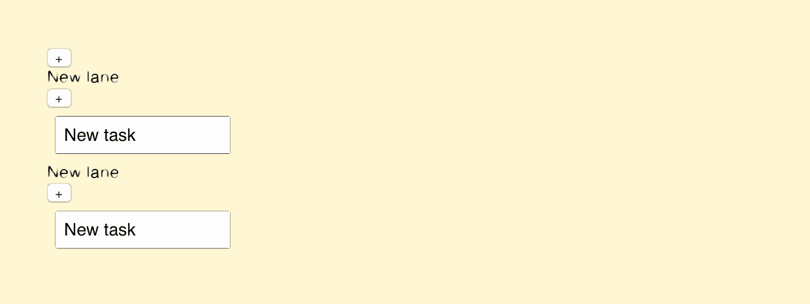

重复的笔记

发生这种情况的原因很简单。我们的 `NoteStore` 是一个单例。这意味着每个监听 `NoteStore` 的组件都将接收到相同的数据。我们需要某种方式来解决这个问题。

### 6.3 让 `Lanes` 负责 `Notes`

目前，我们的 `Lane` 仅包含一个对象数组。每个对象都知道自己的 `id` 和 `name`。我们需要更多内容。

为了让此功能工作，每个 `Lane` 需要知道哪些 `Notes` 属于它。如果一个 `Lane` 包含一个对象数组……

#### 设置 `attachToLane`

当我们使用 `addNote` 向系统添加 `Note` 时，我们需要将其附加到通道中。例如：

```javascript
const note = NoteActions.create({task: 'New task'});

LaneActions.attachLane({
  noteId: note.id,
  laneId
});
```

为了开始，我们应该在 actions 中添加 `attachToLane`：

**app/actions/LaneActions.js**

```javascript
import alt from '../libs/alt';

export default alt.generateActions('create', 'attachToLane');
```

**app/stores/LaneStore.js**

```javascript
import uuid from 'node-uuid';
import alt from '../libs/alt';
...
```

#### 设置 `detachFromLane`

`deleteNote` 是 `addNote` 的相反操作。在移除 `Note` 时，同样移除它与 `Lane` 的关联。为了这个目的，我们可以实现 `LaneActions.detachFromLane({laneId: <id>})`。我们可以这样使用它：

```javascript
LaneActions.detachFromLane({laneId, noteId});
NoteActions.delete(noteId);
```


```javascript
import uuid from 'node-uuid';
import alt from '../libs/alt';
import LaneActions from '../actions/LaneActions';

class LaneStore {
  ...
  attachToLane({laneId, noteId}) {
    ...
  }
  detachFromLane({laneId, noteId}) {
    const lanes = this.lanes.map(lane => {
      if(lane.id === laneId) {
        lane.notes = lane.notes.filter(note => note !== noteId);
      }

      return lane;
    });

    this.setState({lanes});
  }
}

export default alt.createStore(LaneStore, 'LaneStore');
```

仅仅在通道（lane）和笔记（note）之间建立关联是不够的。我们需要某种方法将笔记引用解析为可以通过用户界面显示的数据。为此，我们需要实现一个特殊的 getter（getter），以便为每个通道获取我们想要的数据。

#### 为 `NoteStore` 实现 getter

将通道笔记解析为实际数据的一种巧妙方法是实现一个公共方法 `NoteStore.getNotesByIds(notes)`。它接受一个 `Note` id 数组，并返回对应的对象。

仅仅实现该方法是不够的。我们还需要将其公开。在 Alt 中，这可以通过 `this.exportPublicMethods` 实现。它接收一个描述该 store 公共接口的对象。请考虑下面的实现：

**app/stores/NoteStore.jsx**

```javascript
import uuid from 'node-uuid';
import alt from '../libs/alt';
import NoteActions from '../actions/NoteActions';

class NoteStore {
  constructor() {
    this.bindActions(NoteActions);

    this.notes = [];

    this.exportPublicMethods({
      getNotesByIds: this.getNotesByIds.bind(this)
    });
  }
  ...
  getNotesByIds(ids) {
    // 1\. 确保我们正在对数组进行操作并
    // 遍历 ids
    // [id, id, id, ...] -> [[Note], [], [Note], ...]
    return (ids || []).map(
      // 2\. 提取匹配的笔记
      // [Note, Note, Note] -> [Note, ...] (匹配) 或 [] (不匹配)
      id => this.notes.filter(note => note.id === id)
    // 3\. 过滤掉可能的空数组并获取笔记
    // [[Note], [], [Note]] -> [[Note], [Note]] -> [Note, Note]
    ).filter(a => a.length).map(a => a[0]);
  }
}

export default alt.createStore(NoteStore, 'NoteStore');
```

注意，该实现过滤了可能的空数组。

#### 将 `Lane` 与逻辑连接

现在我们已经有了逻辑部分，可以将其与 `Lane` 集成。我们需要考虑 props：

**app/components/Lane.jsx**

```javascript
...
import LaneActions from '../actions/LaneActions';

export default class Lane extends React.Component {
  render() {
    const {lane} = this.props;

    return (
      <div className="lane">
        <div className="lane-header">{lane.name}</div>
        <AltContainer
          stores={[NoteStore]}
          notes={() => NoteStore.getNotesByIds(lane.notes)}
        >
          <Notes onEdit={this.editNote} onDelete={this.deleteNote} />
        </AltContainer>
      </div>
    );
  }
  editNote(task) {
    if(!task) {
      return;
    }
    LaneActions.update({task});
  }

  deleteNote(id) {
    e.stopPropagation();
    LaneActions.delete(id);
  }

  addNote = () => {
    LaneActions.create({task: 'New task'});
  }

  deleteNote = (noteId, e) => {
    e.stopPropagation();

    const laneId = this.props.id;

    detachActions.,FromId});
  };
}
```

有三个重要的变化：

*   需要引用 `this` 的方法已在 `constructor` 中进行了绑定。
*   `notes={() => NoteStore.getNotesByIds(lane.notes)}` - 我们新的 getter 被用于过滤笔记。
*   `addNote`、`deleteNote` - 这些方法现在根据新逻辑运行。

在完成这些更改后，我们拥有了一个可以维护 `Lanes` 和 `Notes` 之间关系的系统。当前的结构允许我们保持单例 store 和扁平化的数据结构。处理引用有点笨拙，但这与 Flux 架构是一致的。

如果你尝试向特定通道添加笔记，它们不应该被重复。此外，编辑笔记的行为应该如你预期的：

 允许我们处理数据依赖关系。它告诉 dispatcher 在继续执行之前应该等待。以下是这种方法的工作方式示例（无需更改你的代码！）：

```javascript
NoteActions.create({task: 'New task'});

// 触发 waitFor
LaneActions.attachToLane({laneId});
```

**app/stores/LaneStore.js**

```javascript
class LaneStore {
  ...
  attachToLane({laneId, noteId}) {
    if(!noteId) {
      this.waitFor(NoteStore);

      noteId = NoteStore.getState().notes.slice(-1)[0].id;
    }

    ...
  }
}
```

幸运的是，在这种情况下我们可以避免使用 `waitFor`。你应该谨慎地使用它。然而，当你需要处理相互依赖的异步获取的数据时，它是必须的。

### 6.4 为 `Lane` 实现编辑/删除

我们仍然缺少一些基础功能，例如编辑和删除通道。将 *Note.jsx* 复制为 *Editable.jsx*。我们会在项目的后期阶段回到原始的 *Note.jsx*。现在，我们只想让 `Editable` 处于良好的状态。按照如下方式调整代码以泛化实现：


```javascript
import React from 'react';

export default class Note extends React.Component {
export default class Editable extends React.Component {
  constructor(props) {
    super(props);

    // Track `editing` state.
    this.state = {
      editing: false
    };
  }
  render() {
    // Render the component differently based on state.
    if(this.state.editing) {
      return this.renderEdit();
    }

    return this.renderNote();
  }
  render() {
    const {value, onEdit, onValueClick, editing, ...props} = this.props;

    return (
      <div {...props}>
        {editing ? this.renderEdit() : this.renderValue()}
      </div>
    );
  }
  renderEdit = () => {
    return <input type="text"
      ref={
        (e) => e ? e.selectionStart = this.props.task.length : null
        (e) => e ? e.selectionStart = this.props.value.length : null
      }
      autoFocus={true}
      defaultValue={this.props.task}
      defaultValue={this.props.value}
      onBlur={this.finishEdit}
      onKeyPress={this.checkEnter} />;
  };
  renderNote = () => {
    const onDelete = this.props.onDelete;

    return (
      <div onClick={this.edit}>
        <span className="task">{this.props.task}</span>
        {onDelete ? this.renderDelete() : null }
      </div>
    );
  };
  renderValue = () => {
    const onDelete = this.props.onDelete;

    return (
      <div onClick={this.props.onValueClick}>
        <span className="value">{this.props.value}</span>
        {onDelete ? this.renderDelete() : null }
      </div>
    );
  };
  renderDelete = () => {
    return <button
      className="delete-note"
      className="delete"
      onClick={this.props.onDelete}>x</button>;
  };
  edit = () => {
    // Enter edit mode.
    this.setState({
      editing: true
    });
  };
  checkEnter = (e) => {
    if(e.key === 'Enter') {
      this.finishEdit(e);
    }
  };
  finishEdit = (e) => {
    const value = e.target.value;

    if(this.props.onEdit) {
      this.props.onEdit(value);

      // Exit edit mode.
      this.setState({
        editing: false
      });
    }
  };
}
```

有几处重要的更改：

*   ```{editing ? this.renderEdit() : this.renderValue()}` - 这个三元运算符根据编辑状态选择渲染内容。之前我们用的是 `Note`。现在我们使用 `Value` 术语，因为它更通用。

*   `renderValue` - 以前这被称为 `renderNote()`。同样，这是一层抽象步骤。注意我们引用的是 `this.props.value` 而不是 `this.props.task`。

*   `renderDelete` - 现在不再使用 `delete-note` 类，而是使用了更通用的 `delete`。

由于类名发生了变化，`main.css` 需要一些微调：

**app/main.css**

```
...

.note .task {
.note .value {
  /* 强制使用 inline-block 以获得最小高度 */
  display: inline-block;
}

.note .delete-note {
.note .delete {
  ...
}
.note:hover .delete-note {
.note:hover .delete {
  visibility: visible;
}
```

#### 将 `Notes` 指向 `Editable`

接下来，我们需要让 `Notes.jsx` 指向新组件。我们需要修改 `render()` 中的导入语句和组件名称：

**app/components/Notes.jsx**

```javascript
import React from 'react';
import Editable from './Editable.jsx';

export default ({notes, onValueClick, onEdit, onDelete}) => {
  return (
    <ul className="notes">{notes.map(note =>
      <li className="note" key={note.id}>
        <Editable
          editing={note.editing}
          value={note.task}
          onValueClick={onValueClick.bind(null, note.id)}
          onEdit={onEdit.bind(null, note.id)}
          onDelete={onDelete.bind(null, note.id)} />
      </li>
    )}</ul>
  );
}
```

如果你刷新浏览器，应该看到 `Uncaught TypeError: Cannot read property 'bind' of undefined`。这与我们添加的 `onValueClick` 定义有关。我们接下来解决这个问题。

#### 将 `Lane` 与 `Editable` 连接

接下来，我们可以使用这个通用组件来修改 `Lane` 的名称。这将为我们的逻辑提供一个钩子。我们需要如下如下修改 `<div className='lane-name'>{name}</div>`：

**app/components/Lane.jsx**

```javascript
...
import Editable from './Editable.jsx';

export default class Lane extends React.Component {
  render() {
    const {value, onEdit, onValueClick, editing, ...props} = this.props;

    return (
      <div {...props}>
        {editing ? this.renderEdit() : this.renderValue()}
      </div>
    );
  }
}
```


```javascript
...
export default Lane extends React.Component {
  ...
  editNote(id, task) {
    // Don't modify if trying set an empty value
    if(!task.trim()) {
      return;
    }

    NoteActions.update({id, task});
  }
  editNote(id, task) {
    // Don't modify if trying set an empty value
    if(!task.trim()) {
      NoteActions.update({id, editing: false});

      return;
    }

    NoteActions.update({id, task, editing: false});
  }
  ...
  editName = (name) => {
    const laneId = this.props.lane.id;

    console.log(`edit lane ${laneId} name using ${name}`);
  };
  deleteLane = () => {
    const laneId = this.props.lane.id;

    console.log(`delete lane ${laneId}`);
  };
  activateLaneEdit = () => {
    const laneId = this.props.lane.id;

    console.log(`activate lane ${laneId} edit`);
  };
  activateNoteEdit(id) {
    console.log(`activate note ${id} edit`);
  }
  editName = (name) => {
    const laneId = this.props.lane.id;

    // Don't modify if trying set an empty value
    if(!name.trim()) {
      LaneActions.update({id: laneId, editing: false});

      return;
    }

    LaneActions.update({id: laneId, name, editing: false});
  };
  deleteLane = () => {
    const laneId = this.props.lane.id;

    LaneActions.delete(laneId);
  };
  activateLaneEdit = () => {
    const laneId = this.props.lane.id;

    LaneActions.update({id: laneId, editing: true});
  };
  activateNoteEdit(id) {
    NoteActions.update({id, editing: true});
  }
}
```

现在尝试修改泳道名称。现在的修改应该像保存卡片的方式被保存。删除泳道也应该是可能的。

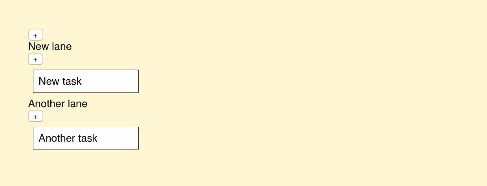

编辑泳道名称

### 6.5 为看板设置样式

当我们向应用中了 `Lanes`（泳道）时，样式变得有些混乱。添加以下样式让它看起来更好一些：

**app/main.css**

```css
body {
  background: cornsilk;
  font-family: sans-serif;
}

.lane {
  display: inline-block;

  margin: 1em;

  background-color: #efefef;
  border: 1px solid #ccc;
  border-radius: 0.5em;

  min-width: 10em;
  vertical-align: top;
}

.lane-header {
  overflow: auto;

  padding: 1em;

  color: #efefef;
  background-color: #333;

  border-top-left-radius: 0.5em;
  border-top-right-radius: 0.5em;
}

.lane-name {
  float: left;
}

.lane-add-note {
  float: left;

  margin-right: 0.5em;
}

.lane-delete {
  float: right;

  margin-left: 0.5em;

  visibility: hidden;
}
.lane-header:hover .lane-delete {
  visibility: visible;
}

.add-lane, .lane-add-note button {
  cursor: pointer;

  background-color: #fdfdfd;
  border: 1px solid #ccc;
}

.lane-delete button {
  padding: 0;

  cursor: pointer;

  color: white;
  background-color: rgba(0, 0, 0, 0);
  border: 0;
}
...
```

你最终会得到这样的结果：


设置样式的看板

由于这是一个小项目，我们可以将 CSS 这样保留在单个文件中。如果它开始变大，考虑将其拆分为多个文件。一种方法是为每个组件提取 CSS，然后在那里引用它（例如在 `Lane.jsx` 中使用 `require('./lane.css')`）。

除了保持整洁之外，Webpack 的懒加载机制也可以识别这些。结果是用户需要加载的初始 CSS 将更小。我稍后会在讨论 *React 样式* 时进行更详细的说明。

### 6.6 关于组件命名空间

到目前为止，我们都是每个文件定义一个组件。这并不是唯一的方法。将一个文件视为命名空间并从中暴露多个组件可能很有用。React 专门为此提供了[命名空间组件](https://facebook.github.io/react/docs/jsx-in-depth.html#namespaced-components)（namespaces components）。在这种情况下，我们可以将命名空间应用于 `Lane` 或 `Note` 概念。这会为我们的系统增加一些灵活性，同时保持管理的简单性。通过使用命名空间，我们可以得到类似这样的：

**app/components/Lanes.jsx**

```javascript
import React from 'react';
import Lane from './Lane';
import Note from './Note';

export default function Lanes({lanes}) {
  return (
    <div className="lanes">
      {lanes.map(lane => (
        <Lane key={lane.id}>
          <div className="lane-header">
            <div className="lane-name">{lane.name}</div>
            <button className="lane-add-note">添加卡片</button>
            <button className="lane-delete">删除</button>
          </div>
          <Note id={lane.id} />
        </Lane>
      ))}
    </div>
  );
}
```

### 6.7 总结

目前，我们的设计存在一些局限性。我们仍然无法在泳道之间或泳道内部移动卡片。我们将在下一章通过实现拖放功能来解决这个问题。处理处理逻辑将会变得困难。

## 7 实现拖放

我们的看板应用现在可以使用了。它看起来还可以，并且有一些功能。在本章中，我将向你展示如何更上一层楼。我们将通过设置拖放功能来实现。

### 7.1 设置 React DnD

第一步，我们需要将 React DnD 连接到我们的项目。。我们将使用基于 HTML5 的拖放后端。对于测试和[触摸](https://github.com/yahoo/react-dnd-touch-backend)，有特定的后端。为了设置它，我们需要使用 `DragDropContext` 装饰器并为它提供后端：

**app/components/App.jsx**

```javascript
import {DragDropContext} from 'react-dnd';
import HTML5Backend from 'react-dnd-html5-backend';

@DragDropContext(HTML5Backend)
export default class App extends React.Component {
  ...
}
```

更改后，应用程序应该和之前完全一样。我们现在准备好为其添加一些功能了。

### 7.2 准备需要排序的卡片

接下来，我们需要告诉 React DnD 哪些可以拖动以及在哪里。由于我们需要移动卡片，我们需要对它们进行标注。此外，我们需要一些逻辑来告诉我们发生了什么。

早些时候我们从 `Note` 中提取了编辑功能，结果丢掉了 `Note`。似乎我们需要把这个概念加回来以便实现拖放。


在这里我们可以使用一个实用的小技巧，让我们避免代码重复。我们可以将 `Note` 实现为一个包装组件。它会接受 `Editable` 并渲染它。这将允许我们将与 DnD 相关的逻辑保留在 `Note` 中。这避免了重复任何与 `Editable` 相关的逻辑。

这里的魔法在于 React 的一个名为 `children` 的属性。React 会在 `{this.props.children}` 槽中渲染可能的子组件。如下所示设置 `Note.jsx`：

**app/components/Note.jsx**

```
import React from 'react';

export default class Note extends React.Component {
  render() {
    return <li {...this.props}>{this.props.children}</li>;
  }
}
```

我们还需要调整 `Notes` 以使用我们的包装组件。我们只需使用 `Note` 包装 `Editable` 即可完成工作。我们将 `note` 数据传递给包装组件，因为我们稍后在处理逻辑时需要它：

**app/components/Notes.jsx**

```javascript
import React from 'react';
import Editable from './Editable.jsx';
import Note from './Note.jsx';

export default ({notes, onValueClick, onEdit, onDelete}) => {
  return (
    <ul className="notes">{notes.map(note =>
      <li className="note" key={note.id}>
        <Editable
          editing={note.editing}
          value={note.task}
          onValueClick={onValueClick.bind(null, note.id)}
          onEdit={onEdit.bind(null, note.id)}
          onDelete={onDelete.bind(null, note.id)} />
      </li>
      <Note className="note" id={note.id} key={note.id}>
        <Editable
          editing={note.editing}
          value={note.task}
          onValueClick={onValueClick.bind(null, note.id)}
          onEdit={onEdit.bind(null, note.id)}
          onDelete={onDelete.bind(null, note.id)} />
      </Note>
    )}</ul>
  );
}
```

在此更改之后，应用程序看起来应该和之前完全一样。我们我们还没有实现任何功能。幸运的是，既然我们已经打好了基础，现在可以添加功能了。

### 7.3 允许 Note 被拖拽

React DnD 使用常量来区分不同的可拖拽项。按照如下设置一个文件来跟踪 `Note`：

**app/constants/itemTypes.js**

```javascript
export default {
  NOTE: 'note'
};
```

当我们以后向系统添加新类型时，可以扩展此定义。

接下来，我们需要告诉 `Note` 它是可以被拖放的。这是通过 `@DragSource` 和 `@DropTarget` 注解实现的。

#### 设置 `Note` 的 `@DragSource`

将组件标记为 `@DragSource` 仅仅意味着它可以被拖拽。按如下所示设置注解：

**app/components/Note.jsx**

```javascript
import React from 'react';
import {DragSource} from 'react-dnd';
import ItemTypes from '../constants/itemTypes';

const noteSource = {
  beginDrag(props) {
    console.log('begin dragging note', props);

    return {};
  }
};

export default class Note extends React.Component {
  render() {
    return <li {...this.props}>{this.props.children}</li>;
  }
}
@DragSource(ItemTypes.NOTE, noteSource, (connect) => ({
  connectDragSource: connect.dragSource()
}))
export default class Note extends React.Component {
  render() {
    const {connectDragSource, id, onMove, ...props} = this.props;

    return connectDragSource(
      <li {...props}>{props.children}</li>
    );
  }
}
```

有几个重要的变化：

*   我们为新逻辑设置了导入。
*   我们定义了一个 `noteSource`。它包含一个 `beginDrag` 处理器。我们可以在这里设置拖拽的初始状态。目前我们只是在那里写了一个调试日志。
*   `@DragSource` 将 `NOTE` 类型与 `noteSource` 连接起来。
*   `id` 和 `onMove` 属性从 `this.props` 中提取。我们稍后将使用它们来设置回调函数，以便 `Note` 的父组件可以处理移动相关的逻辑。
*   最后，`connectDragSource` 属性包裹了 `render()` 方法中的元素。它可以应用于元素的特定部分。这对于实现手柄（handles）等功能非常方便。

如果你现在拖拽一个 `Note`，你应该会在控制台中看到一条调试消息。

我们仍然需要确保 `Note` 作为 `@DropTarget` 工作正常。稍后在我们添加逻辑后，这将允许它们进行交换。

#### 设置 `Note` 的 `@DropTarget`

`@DropTarget` 允许组件接收标记了 `@DragSource` 的组件。当 `@DropTarget` 触发时，我们可以根据组件执行实际逻辑。按如下扩展：

**app/components/Note.jsx**

```javascript
import React from 'react';
import {DragSource} from 'react-dnd';
import {DragSource, DropTarget} from 'react-dnd';
import ItemTypes from '../constants/itemTypes';

const noteSource = {
  beginDrag(props) {
    console.log('begin dragging note', props);

    return {};
  }
};

@DragSource(ItemTypes.NOTE, noteSource, (connect) => ({
  connectDragSource: connect.dragSource()
}))
@DropTarget(ItemTypes.NOTE, noteTarget, (connect) => ({
  connectDropTarget: connect.dropTarget()
}))
export default class Note extends React.Component {
  render() {
    const {connectDragSource, connectDropTarget, id, onMove, ...props} = this.props;

    return connectDragSource(
      connectDropTarget(
        <li {...props}>{props.children}</li>
      )
    );
  }
}
```

### 7.4 开发 `onMove`

### 7.5 为移动添加 Action 和 Store 方法


拖放的逻辑如下。假设我们有一个包含笔记 `A`、`B`、`C` 的泳道（lane）。如果我们把 `A` 移动到 `C` 之下，结果应该是 `B`、`C`、`A`。如果我们有另一个列表，比如 `D`、`E`、`F`，并将 `A` 移动到它的开头，结果应该是 `B`、`C` 和 `A`、`D`、`E`、`F`。

在我们的案例中，跨泳道的拖会导致引入一些额外的复杂性。当我们移动一个 `Note` 时，我们知道它的原始位置和预期的目标位置。`Lane` 通过 `id` 知道哪些 `Notes` 属于它。我们需要某种方法来告诉 `LaneStore` 应该对给定的笔记执行该逻辑。一个良好的起点是定义 `LaneActions.move`：

#### app/actions/LaneActions.js

```javascript
import alt from '../libs/alt';

export default alt.generateActions(
  'create', 'update', 'delete',
  'attachToLane', 'detachFromLane',
  'move'
);
```

我们应该将此 action 与我们刚刚定义的 `onMove` 钩子连接：

#### app/components/Notes.jsx

```jsx
import React from 'react';
import Editable from './Editable.jsx';
import Note from './Note.jsx';
import LaneActions from '../actions/LaneActions';

export default ({notes, onValueClick, onEdit, onDelete}) => {
  return (
    <ul className="notes">{notes.map(note => {
      return (
        <Note className="note" id={note.id} key={note.id}
          onMove={({sourceId, targetId}) =>
            console.log(`source: ${sourceId}, target: ${targetId}`)
        }>
        <Note className="note" id={note.id} key={note.id}
          onMove={LaneActions.move}>
          <Editable
            editing={note.editing}
            value={note.task}
            onValueClick={onValueClick.bind(null, note.id)}
            onEdit={onEdit.bind(null, note.id)}
            onDelete={onDelete.bind(null, note.id)} />
        </Note>
      );
    })}
    </ul>
  );
}
```

我们应该在 `LaneStore` 中定义一个存根（stub），以检查是否正确连接了它：

#### app/stores/LaneStore.js

```javascript
...

class LaneStore {
  ...
  detachFromLane({laneId, noteId}) {
    ...
  }
  move({sourceId, targetId}) {
    console.log(`source: ${sourceId}, target: ${targetId}`);
  }
}

export default alt.createStore(LaneStore, 'LaneStore');
```

你应该能看到之前相同的日志消息。接下来，我们需要添加一些逻辑来实现它。我们可以在这里使用上述概述的逻辑。我们需要担心两种情况：在泳道内部移动以及从一个泳道移动到另一个泳道。

### 7.6 实现笔记拖放逻辑

在泳道内部移动是复杂的。当你基于 `ids` 进行操作时，当你根据 `ids` 操作并执行时，需要考虑可能的变化。通过[不可变性](https://developer.mozilla.com/en-US/docs/Web/JavaScript/Reference/Global_Objects/Array/splice)来解决泳道到泳道的问题。使用[不可变性](https://developer.mozilla.com/en-US/docs/Web/JavaScript/Reference/Global_Objects/Array/splice)来解决泳道到泳道的问题。使用[不可变性](https://developer.mozilla.com/en-US/docs/Web/JavaScript/Reference/Global_Objects/Array/splice)来解决泳道到泳道的问题。使用[不可变性](https://developer.mozilla.com/en-US/docs/Web/JavaScript/Reference/Global_Objects/Array/splice)来解决泳道到泳道的问题。使用[不可变性](https://developer.mozilla.com/en-US/docs/Web/JavaScript/Reference/Global_Objects/Array/splice)来解决泳道到泳道的问题。使用[不可变性](https://developer.mozilla.com/en-US/docs/Web/JavaScript/Reference/Global_Objects/Array/splice)来解决泳道到泳道的问题。使用[不可变性](https://developer.mozilla.com/en-US/docs/Web/JavaScript/Reference/Global_Objects/Array/splice)来解决泳道到泳道的问题。使用[不可变性](https://developer.mozilla.com/en-US/docs/Web/JavaScript/Reference/Global_Objects/Array/splice)来解决泳道到泳道的问题。使用[不可变性](https://developer.mozilla.com/en-US/docs/Web/JavaScript/Reference/Global_Objects/Array/splice)来解决泳道到泳道的问题。使用[不可变性](https://developer.mozilla.com/en-US/docs/Web/JavaScript/Reference/Global_Objects/Array/splice)来解决泳道到泳道的问题。使用[不可变性](https://developer.mozilla.com/en-US/docs/Web/JavaScript/Reference/Global_Objects/Array/splice)来解决泳道到泳道的问题。使用[不可变性](https://developer.mozilla.com/en-US/docs/Web/JavaScript/Reference/Global_Objects/Array/splice)来解决泳道到泳道的问题。使用[不可变性](https://developer.mozilla.com/en-US/docs/Web/JavaScript/Reference/Global_Objects/Array/splice)来解决泳道到泳道的问题。使用[不可变性](https://developer.mozilla.com/en-US/docs/Web/JavaScript/Reference/Global_Objects/Array/splice)来解决泳道到泳道的问题。使用[不可变性](https://developer.mozilla.com/en-US/docs/Web/JavaScript/Reference/Global_Objects/Array/splice)来解决泳道到泳道的问题。使用[不可变性](https://developer.mozilla.com/en-US/docs/Web/JavaScript/Reference/Global_Objects/Array/splice)来解决泳道到泳道的问题。使用[不可变性](https://developer.mozilla.com/en-US/docs/Web/JavaScript/Reference/Global_Objects/Array/splice)来解决泳道到泳道的问题。使用[不可变性](https://developer.mozilla.com/en-US/docs/Web/JavaScript/Reference/Global_Objects/Array/splice)来解决泳道到泳道的问题。使用[不可变性](https://developer.mozilla.com/en-US/docs/Web/JavaScript/Reference/Global_Objects/Array/splice)来解决泳道到泳道的问题。使用[不可变性](https://developer.mozilla.com/en-US/docs/Web/JavaScript/Reference/Global_Objects/Array/splice)来解决泳道到泳道的问题。使用[不可变性](https://developer.mozilla.com/en-US/docs/Web/JavaScript/Reference/Global_Objects/Array/splice)来解决泳道到泳道的问题。使用[不可变性](https://developer.mozilla.com/en-US/docs/Web/JavaScript/Reference/Global_Objects/Array/splice)来解决泳道到泳道的问题。使用[不可变性](https://developer.mozilla.com/en-US/docs/Web/JavaScript/Reference/Global_Objects/Array/splice)来解决泳道到泳道的问题。使用[不可变性](https://developer.mozilla.com/en-US/docs/Web/JavaScript/Reference/Global_Objects/Array/splice)来解决泳道到泳道的问题。使用[不可变性](https://developer.mozilla.com/en-US/docs/Web/JavaScript/Reference/Global_Objects/Array/splice)来解决泳道到泳道的问题。使用[不可变性](https://developer.mozilla.com/en-US/docs/Web/JavaScript/Reference/Global_Objects/Array/splice)来解决泳道到泳道的问题。使用[不可变性](https://developer.mozilla.com/en-US/docs/Web/JavaScript/Reference/Global_Objects/Array/splice)来解决泳道到泳道的问题。使用[不可变性](https://developer.mozilla.com/en-US/docs/Web/JavaScript/Reference/Global_Objects/Array/splice)来解决泳道到泳道的问题。使用[不可变性](https://developer.mozilla.com/en-US/docs/Web/JavaScript/Reference/Global_Objects/Array/splice)来解决泳道到泳道的问题。使用[不可变性](https://developer.mozilla.com/en-US/docs/Web/JavaScript/Reference/Global_Objects/Array/splice)来解决泳道到泳道的问题。使用[不可变性](https://developer.mozilla.com/en-US/docs/Web/JavaScript/Reference/Global_Objects/Array/splice)来解决泳道到泳道的问题。使用[不可变性](https://developer.mozilla.com/en-US/docs/Web/JavaScript/Reference/Global_Objects/Array/splice)来解决泳道到泳道的问题。使用[不可变性](https://developer.mozilla.com/en-US/docs/Web/JavaScript/Reference/Global_Objects/Array/splice)来解决泳道到泳道的问题。使用[不可变性](https://developer.mozilla.com/en-US/docs/Web/JavaScript/Reference/Global_Objects/Array/splice)来解决泳道到泳道的问题。使用[不可变性](https://developer.mozilla.com/en-US/docs/Web/JavaScript/Reference/Global_Objects/Array/splice)来解决泳道到泳道的问题。使用[不可变性](https://developer.mozilla.com/en-US/docs/Web/JavaScript/Reference/Global_Objects/Array/splice)来解决泳道到泳道的问题。使用[不可变性](https://developer.mozilla.com/en-US/docs/Web/JavaScript/Reference/Global_Objects/Array/splice)来解决泳道到泳道的问题。使用[不可变性](https://developer.mozilla.com/en-US/docs/Web/JavaScript/Reference/Global_Objects/Array/splice)来解决泳道到泳道的问题。使用[不可变性](https://developer.mozilla.com/en-US/docs/Web/JavaScript/Reference/Global_Objects/Array/splice)来解决泳道到泳道的问题。使用[不可变性](https://developer.mozilla.com/en-US/docs/Web/JavaScript/Reference/Global_Objects/Array/splice)来解决泳道到泳道的问题。使用[不可变性](https://developer.mozilla.com/en-US/docs/Web/JavaScript/Reference/Global_Objects/Array/splice)来解决泳道到泳道的问题。使用[不可变性](https://developer.mozilla.com/en-US/docs/Web/JavaScript/Reference/Global_Objects/Array/splice)来解决泳道到泳道的问题。使用[不可变性](https://developer.mozilla.com/en-US/docs/Web/JavaScript/Reference/Global_Objects/Array/splice)来解决泳道到泳道的问题。使用[不可变性](https://developer.mozilla.com/en-US/docs/Web/JavaScript/Reference/Global_Objects/Array/splice)来解决泳道到泳道的问题。使用[不可变性](https://developer.mozilla.com/en-US/docs/Web/JavaScript/Reference/Global_Objects/Array/splice)来解决泳道到泳道的问题。使用[不可变性](https://developer.mozilla.com/en-US/docs/Web/JavaScript/Reference/Global_Objects/Array/splice)来解决泳道到泳道的问题。使用[不可变性](https://developer.mozilla.com/en-US/docs/Web/JavaScript/Reference/Global_Objects/Array/splice)来解决泳道到泳道的问题。使用[不可变性](https://developer.mozilla.com/en-US/docs/Web/JavaScript/Reference/Global_Objects/Array/splice)来解决泳道到泳道的问题。使用[不可变性](https://developer.mozilla.com/en-US/docs/Web/JavaScript/Reference/Global_Objects/Array/splice)来解决泳道到泳道的问题。使用[不可变性](https://developer.mozilla.com/en-US/docs/Web/JavaScript/Reference/Global_Objects/Array/splice)来解决泳道到泳道的问题。使用[不可变性](https://developer.mozilla.com/en-US/docs/Web/JavaScript/Reference/Global_Objects/Array/splice)来解决泳道到泳道的问题。使用[不可变性](https://developer.mozilla.com/en-US/docs/Web/JavaScript/Reference/Global_Objects/Array/splice)来解决泳道到泳道的问题。使用[不可变性](https://developer.mozilla.com/en-US/docs/Web/JavaScript/Reference/Global_Objects/Array/splice)来解决泳道到泳道的问题。使用[不可变性](https://developer.mozilla.com/en-US/docs/Web/JavaScript/Reference/Global_Objects/Array/splice)来解决泳道到泳道的问题。使用[不可变性](https://developer.mozilla.com/en-US/docs/Web/JavaScript/Reference/Global_Objects/Array/splice)来解决泳道到泳道的问题。使用[不可变性](https://developer.mozilla.com/en-US/docs/Web/JavaScript/Reference/Global_Objects/Array/splice)来解决泳道到泳道的问题。使用[不可变性](https://developer.mozilla.com/en-US/docs/Web/JavaScript/Reference/Global_Objects/Array/splice)来解决泳道到泳道的问题。使用[不可变性](https://developer.mozilla.com/en-US/docs/Web/JavaScript/Reference/Global_Objects/Array/splice)来解决泳道到泳道的问题。使用[不可变性](https://developer.mozilla.com/en-US/docs/Web/JavaScript/Reference/Global_Objects/Array/splice)来解决泳道到泳道的问题。使用[不可变性](https://developer.mozilla.com/en-US/docs/Web/JavaScript/Reference/Global_Objects/Array/splice)来解决泳道到泳道的问题。使用[不可变性](https://developer.mozilla.com/en-US/docs/Web/JavaScript/Reference/Global_Objects/Array/splice)来解决泳道到泳道的问题。使用[不可变性](https://developer.mozilla.com/en-US/docs/Web/JavaScript/Reference/Global_Objects/Array/splice)来解决泳道到泳道的问题。使用[不可变性](https://developer.mozilla.com/en-US/docs/Web/JavaScript/Reference/Global_Objects/Array/splice)来解决泳道到泳道的问题。使用[不可变性](https://developer.mozilla.com/en-US/docs/Web/JavaScript/Reference/Global_Objects/Array/splice)来解决泳道到泳道的问题。使用[不可变性](https://developer.mozilla.com/en-US/docs/Web/JavaScript/Reference/Global_Objects/Array/splice)来解决泳道到泳道的问题。使用[不可变性](https://developer.mozilla.com/en-US/docs/Web/JavaScript/Reference/Global_Objects/Array/splice)来解决泳道到泳道的问题。使用[不可变性](https://developer.mozilla.com/en-US/docs/Web/JavaScript/Reference/Global_Objects/Array/splice)来解决泳道到泳道的问题。使用[不可变性](https://developer.mozilla.com/en-US/docs/Web/JavaScript/Reference/Global_Objects/Array/splice)来解决泳道到泳道的问题。使用[不可变性](https://developer.mozilla.com/en-US/docs/Web/JavaScript/Reference/Global_Objects/Array/splice)来解决泳道到泳道的问题。使用[不可变性](https://developer.mozilla.com/en-US/docs/Web/JavaScript/Reference/Global_Objects/Array/splice)来解决泳道到泳道的问题。使用[不可变性](https://developer.mozilla.com/en-US/docs/Web/JavaScript/Reference/Global_Objects/Array/splice)来解决泳道到泳道的问题。使用[不可变性](https://developer.mozilla.com/en-US/docs/Web/JavaScript/Reference/Global_Objects/Array/splice)来解决泳道到泳道的问题。使用[不可变性](https://developer.mozilla.com/en-US/docs/Web/JavaScript/Reference/Global_Objects/Array/splice)来解决泳道到泳道的问题。使用[不可变性](https://developer.mozilla.com/en-US/docs/Web/JavaScript/Reference/Global_Objects/Array/splice)来解决泳道到泳道的问题。使用[不可变性](https://developer.mozilla.com/en-US/docs/Web/JavaScript/Reference/Global_Objects/Array/splice)来解决泳道到泳道的问题。使用[不可变性](https://developer.mozilla.com/en-US/docs/Web/JavaScript/Reference/Global_Objects/Array/splice)来解决泳道到泳道的问题。使用[不可变性](https://developer.mozilla.com/en-US/docs/Web/JavaScript/Reference/Global_Objects/Array/splice)来解决泳道到泳道的问题。使用[不可变性](https://developer.mozilla.com/en-US/docs/Web/JavaScript/Reference/Global_Objects/Array/splice)来解决泳道到泳道的问题。使用[不可变性](https://developer.mozilla.com/en-US/docs/Web/JavaScript/Reference/Global_Objects/Array/splice)来解决泳道到泳道的问题。使用[不可变性](https://developer.mozilla.com/en-US/docs/Web/JavaScript/Reference/Global_Objects/Array/splice)来解决泳道到泳道的问题。使用[不可变性](https://developer.mozilla.com/en-US/docs/Web/JavaScript/Reference/Global_Objects/Array/splice)来解决泳道到泳道的问题。使用[不可变性](https://developer.mozilla.com/en-US/docs/Web/JavaScript/Reference/Global_Objects/Array/splice)来解决泳道到泳道的问题。使用[不可变性](https://developer.mozilla.com/en-US/docs/Web/JavaScript/Reference/Global_Objects/Array/splice)来解决泳道到泳道的问题。使用[不可变性](https://developer.mozilla.com/en-US/docs/Web/JavaScript/Reference/Global_Objects/Array/splice)来解决泳道到泳道的问题。


如果你现在刷新浏览器并将笔记拖到一条通道（lane），你应该会在控制台中看到日志消息。问题是该如何处理这些数据呢？在实际将笔记移动到通道之前，我们应该检查它是否为空。如果它已经包含内容，该操作就没有意义。我们现有的逻辑可以处理这种情况。

这是一个简单的检查。鉴于我们在 `noteTarget` `hover` 处理器中知道了目标通道，我们可以按照如下方式检查它的 `notes` 数组：

`app/components/Lane.jsx`

```
...

const noteTarget = {
  hover(targetProps, monitor) {
    const targetId = targetProps.lane.id;
    const sourceProps = monitor.getItem();
    const sourceId = sourceProps.id;

    console.log(`source: ${sourceId}, target: ${targetId}`);
  }
  hover(targetProps, monitor) {
    const sourceProps = monitor.getItem();
    const sourceId = sourceProps.id;

    if(!targetProps.lane.notes.length) {
      console.log('source', sourceId, 'target', targetProps);
    }
  }
};

...
```

现在，如果你再次刷新浏览器并进行拖动，只有当你将笔记拖到一个尚未附加任何笔记的通道时，日志消息才会出现。

#### 触发 `move` 逻辑

现在我们知道要把哪个 `Note` 移动到哪个 `Lane` 了。`LaneStore.attachToLane` 是此目的的理想选择。按如下调整 `Lane`：

`app/components/Lane.jsx`

```
...

const noteTarget = {
  hover(targetProps, monitor) {
    const sourceProps = monitor.getItem();
    const sourceId = sourceProps.id;

    if(!targetProps.lane.notes.length) {
      console.log('source', sourceId, 'target', targetProps);
    }
  }
  hover(targetProps, monitor) {
    const sourceProps = monitor.getItem();
    const sourceId = sourceProps.id;

    if(!targetProps.lane.notes.length) {
      LaneActions.attachToLane({
        laneId: targetProps.lane.id,
        noteId: sourceId
      });
    }
  }
};

...
```

不过，有一个问题。旧的 `Note` 实例会发生什么？在当前的解决方案中，旧通道将有一个指向它的 id。结果是，系统中会出现重复数据。

早些时候我们使用 `detachFromLane` 解决了这个问题。问题是，我们不知道笔记属于哪条通道。我们可以通过组件层级传递这些数据，但这种感觉并不好。

我们可以通过在 `attachToLane` 中添加一个检查来解决这个问题：

`app/stores/LaneStore.js`

```
...

class LaneStore {
  ...
  attachToLane({laneId, noteId}) {
    const lanes = this.lanes.map(lane => {
      if(lane.notes.includes(noteId)) {
        lane.notes = lane.notes.filter(note => note !== noteId);
      }

      if(lane.id === laneId) {
        if(lane.notes.includes(noteId)) {
          console.warn('Already attached note to lane', lanes);
        }
        else {
          lane.notes.push(noteId);
        }
      }

      return lane;
    });

    this.setState({lanes});
  }
  ...
}
```

`removeNote(noteId)` 会遍历 `LaneStore` 数据。如果它通过 id 找到笔记，就会将其移除。之后，我们就有了一个干净的起点，可以将笔记添加到通道中。此更改允许我们完全从系统中移除 `detachFromLane`，但我将交由你决定。

在进行这些更改后，你应该能够将笔记拖动到空通道中。

#### 修复拖拽过程中的编辑行为

目前的实现有一个小故障。如果你正在编辑笔记，你仍然可以在编辑时将其拖动它。这并不理想，因为覆盖了大多数人习惯的默认行为。例如，你将无法通过双击输入框来选择所有文本。

幸运的是，这很容易修复。我们需要使用每个 `Note` 的 `editing` 状态来调整它的行为。首先，我们需要将 `editing` 状态传递给单个 `Note`：

`app/components/Notes.jsx`

```
...

export default ({notes, onValueClick, onEdit, onDelete}) => {
  return (
    <ul className="notes">{notes.map(note =>
      <Note className="note" id={note.id} key={note.id}
        onMove={LaneActions.move}>
      <Note className="note" id={note.id} key={note.id}
        editing={note.editing} onMove={LaneActions.move}>
        <Editable
          editing={note.editing}
          value={note.task}
          onValueClick={onValueClick.bind(null, note.id)}
          onEdit={onEdit.bind(null, note.id)}
          onDelete={onDelete.bind(null, note.id)} />
      </Note>
    )}</ul>
  );
}
```

接下来，我们需要在渲染时考虑到这一点：

`app/components/Note.jsx`

```
...

@DragSource(ItemTypes.NOTE, noteTarget, (connect) => ({
  dragSource: connect.dragSource()
}))
@DropTarget(ItemTypes.NOTE, noteTarget, (connect) => ({
  dropTarget: connect.dropTarget()
}))
export default class Note extends React.Component {
  render() {
    const {editing, onMove, children} = this.props;
    const {dragSource, dropTarget} = this.state;
    const isDragging = this.props.monitor.isDragging();

    return dragSource(dropTarget(
      <li style={{
        opacity: isDragging ? 0 : 1
      }}>{children}</li>
    ));
  }
}
```

这个小小的更改给了我们想要的行为。如果你现在尝试编辑笔记，输入框应该像你预期的那样工作。从设计角度上说，将 `editing` 状态保持在 `Editable` 之外是一个好主意。


1.12 MB 是一个非常大的数字！我们可以做一些基础操作来精简我们的构建（build）。我们可以对它进行一些混淆（minification）。我们还可以告诉 React 让它进行优化。两者兼顾将带来显著的体积节省。如果我们在提供内容时对其应用 gzip 压缩，可能会获得进一步的收益。

### 混淆 (Minification)

混淆会将我们的代码转换为更小的格式而不丢失任何含义。通常这意味着通过预定义的转换对代码进行某种程度的重写。有时这可能会破坏代码，因为它可能会重写你无意中依赖的代码片段。这就是为什么我们为存储（stores）提供了显式的 ID 的原因。

启用混淆最简单的方法是调用 `webpack -p`（`-p` 代表 `production`）。或者，我们可以直接使用插件，因为这能为我们提供更多控制。默认情况下，Uglify 会输出大量警告，而在这种情况下它们没有价值，我们将禁用它们。在你的 Webpack 配置中添加以下部分：

**webpack.config.js**

```
if(TARGET === 'build') {
  module.exports = merge(common, {});
  module.exports = merge(common, {
    plugins: [
      new webpack.optimize.UglifyJsPlugin({
        compress: {
          warnings: false
        }
      })
    ]
  });
}
```

如果你现在执行 `npm run build`，你应该能看到更好的结果：

```
> webpack

Hash: ff80bbb1bdd7df271313
Version: webpack 1.12.13
Time: 9159ms
    Asset    Size  Chunks             Chunk Names
bundle.js  368 kB       0  [emitted]  app
    + 337 hidden modules
```

由于它需要执行更多工作，所以时间更长。但好的一面是，现在的构建体积小了很多。

#### 设置 `process.env.NODE_ENV`

我们可以再采取一步来进一步减小构建体积。React 依赖于基于 `process.env.NODE_ENV` 的优化。如果我们强制将其设置为 `production`，React 将以优化的方式进行构建。这将禁用一些检查（例如，属性类型检查）。最重要的是，它将给你提供更小的构建体积并提高性能。

在 Webpack 术语中，你可以将以下代码段添加到配置的 `plugins` 部分：

**webpack.config.js**

```
...

if(TARGET === 'build') {
  module.exports = merge(common, {
    plugins: [
      // 设置 DefinePlugin 会影响 React 库的体积！
      // DefinePlugin 原样替换内容，因此我们需要额外的引号
      // 以让生成的代码具有意义
      new webpack.DefinePlugin({
        'process.env.NODE_ENV': '"production"'

        // 对于你的开发目标，可以将其设置为 JSON.stringify('development')
        // 以强制 NODE_ENV 为开发模式
        // 无论如何
      }),
      ...
    ]
  });
}
```

这对于你自己的代码是一个非常有用的技术。如果你有一部分代码在处理后评估为 `false`，混淆器将将其完全从构建中移除。

再次执行 `npm run build`，你应该能看到改进的结果：

```
> webpack

Hash: cde2c1861fbd65f03c3b
Version: webpack 1.12.13
Time: 9032ms
    Asset    Size  Chunks             Chunk Names
bundle.js  307 kB       0  [emitted]  app
    + 333 hidden modules
```

所以我们从 1.12 MB 减到了 368 kB，最后减到了 307 kB。最终构建比之前的快一点点。由于这 307 kB 可以以 gzipped 格式提供，它是非常合理的。gzip 将再次减少约 40%。浏览器对此支持良好。

不过，我们可以做得更好。我们可以拆分 `app` 和 `vendor` 包，并向它们的文件名添加哈希值。

## 8.2 分拆 `app` 和 `vendor` 包

将应用程序拆分为两个独立的包的主要优势是它允许我们从客户端缓存中受益。例如，我们可能只对较小的 `app` 包进行大部分更改。在这种情况下，假设 `vendor` 包已经加载，客户端将只需要获取 `app` 包。

由于存在额外的请求，这种方案在初次加载时速度可能不会比单包快。得益于客户端缓存，我们可能不需要为每次请求都重新加载所有数据。如果某个包保持不变，情况尤为如此。如果只有 `app` 更新，则可能只需要下载那一个。

#### 定义 `vendor` 入口点

在开发应用程序时，我们确保将 `dependencies` 和 `devDependencies` 分离开。这种拆分现在将大显用场。它允许我们将 `dependencies` 推送到它自己的包中。非常重要的是，不要在该定义中包含任何与开发相关的部分（例如 Webpack），否则构建将不会按照你预期的方式工作。

如果你检查 `package.json`，列出的 `dependencies` 应该如下：alt, alt-container, alt-utils, node-uuid, react, react-addons-update, react-dnd, react-dnd-html5-backend 和 react-dom。如果你那里有其他依赖项，请在继续之前将它们移动到 `devDependencies` 下。

为了开始，我们需要定义一个 `vendor` 入口点。以下是设置：

```javascript
const path = require('path');
const merge = require('webpack-merge');
const webpack = require('webpack');
const NpmInstall = require('npm-install');

const TARGET = process.env.NODE_ENV;

const PATHS = {
  src: path.join(__dirname, 'src'),
  build: path.join(__dirname, 'dist')
};

const common = {
  entry: {
    app: PATHS.src + '/index.js'
  },
  output: {
    path: PATHS.build,
    filename: '[name].js'
  },
  resolve: {
    extensions: ['.js', '.jsx']
  }
};

const dev = {
  entry: {
    vendor: Object.keys(require('./package.json').dependencies).filter(function(v) {
      return v !== 'alt-utils';
    })
  }
};

const build = {
  output: {
    filename: '[name].[chunkhash].js'
  }
};

if (TARGET === 'build') {
  module.exports = merge(common, dev, build);
} else {
  module.exports = merge(common, dev);
}
```

除此之外，还可以定义动态加载的块（chunks）。可以通过 [require.ensure](https://webpack.github.io/docs/code-splitting/) 实现。

如果你现在运行构建 `npm run build`，你应该能看到类似的内容：

```
> webpack

Hash: 192a0643b92456a6e0
Version: webpack 1.12.13
Time: 14745ms
    Asset    Size  Chunks             Chunk Names
app.js  307 kB       0  [emitted]  app
vendor.js  286 kB       1  [emitted]  vendor
   [0] multi vendor 112 bytes {1} [built]
```

现在我们有了独立的 *app* 和 *vendor* 包。但有些问题。如果你检查文件，你会发现 *app.js* 包含了 *vendor* 依赖。我们需要做一些事情来告诉 Webpack 避免这种情况。这就是 `CommonsChunkPlugin` 发挥作用的地方。

#### 设置 `CommonsChunkPlugin`

`CommonsChunkPlugin` 允许我们提取 `vendor` 包所需的代码。此外，我们将使用它来提取一个 *manifest*。这是一个告诉 Webpack 如何映射每个模块到每个文件的文件。在下一步设置长期缓存时，我们需要它。以下是设置：

```javascript
...

if(TARGET === 'build') {
  module.exports = merge(common, {
    // 定义拆分所需的 vendor 入口
    entry: {
      ...
    },
    plugins: [
      // 提取 vendor 和 manifest 文件
      new webpack.optimize.CommonsChunkPlugin({
        names: ['vendor', 'manifest']
      }),
      ...
    ]
  });
}
```

[/content] 修正：结束应为


```
> webpack

Hash: 3a08642b633ebeafa62f
Version: webpack 1.12.13
Time: 11044ms
      Asset       Size  Chunks             Chunk Names
     app.js    21.3 kB    0, 2  [emitted]  app
  vendor.js     286 kB    1, 2  [emitted]  vendor
manifest.js  743 bytes       2  [emitted]  manifest
   [0] multi vendor 112 bytes {1} [built]
    + 333 hidden modules
```

现在的情况好多了。注意看 `app` 包相对于 `vendor` 包有多小。为了真正从这种拆分中获益，我们应该设置缓存。这可以通过在文件名中添加缓存失效哈希（cache busting hashes）来实现。

#### 在文件名中添加哈希

Webpack 提供了占位符，正如我们之前看到的，它们可以被用来访问不同类型的哈希和入口名称。最用的包括：

* `[name]` - 返回入口名称。
* `[hash]` - 返回构建哈希。
* `[chunkhash]` - 返回特定块（chunk）的哈希。

使用这些占位符，你可以得到如下所示文件名：

```
app.d587bbd6e38337f5accd.js
vendor.dc746a5db4ed650296e1.js
```

如果文件内容发生变化，哈希也会随之改变，导致缓存失效；更准确地说，浏览器将为新文件发送新请求。这意味着如果只有 `app` 包更新了，则只需要重新请求该文件。

我们可以像这样在配置中使用占位符的想法：

**webpack.config.js**

```javascript
if(TARGET === 'build') {
  module.exports = merge(common, {
    // 定义拆分所需的 vendor 入口点
    entry: {
      ...
    },
    output: {
      path: PATHS.build,
      filename: '[name].[chunkhash].js',
      chunkFilename: '[chunkhash].js'
    },
    plugins: [
      ...
    ]
  });
}
```

如果你现在执行 `npm run build`，你应该会看到如下输出。

```
> webpack

Hash: 7ddb226a34540aa401bc
Version: webpack 1.12.13
Time: 8741ms
                           Asset       Size  Chunks             Chunk Names
     app.5b758fea66f30faf0f0e.js    21.3 kB    0, 2  [emitted]  app
  vendor.db9a3343cf47e4b3d83c.js     286 kB    1, 2  [emitted]  vendor
manifest.19a8a5985bb61f546ce3.js  763 bytes       2  [emitted]  manifest
   [0] multi vendor 112 bytes {1} [built]
    + 333 hidden modules
```

我们的文件现在有了整洁的哈希。为了证明它是有效的，你可以尝试修改 `app/index.jsx` 并在其中包含一个 `console.log`。构建完成后，只有与 `app` 和 `manifest` 相关的包应该发生变化。

进一步改进构建的另一种方法是通过 CDN 加载流行的依赖项（例如 React）。这将进一步减小 `vendor` 包的大小，同时为项目引入了外部依赖。其思路是，如果用户之前访问过 CDN，缓存就可以像这里一样发挥作用。

### 8.3 通过 `html-webpack-plugin` 生成 `index.html`

尽管我们现在拥有了精细的包，但仍然存在一个问题。我们目前的 `index.html` 没有正确指向它们。我们可以手动编写需要的 script 标签，但幸运的是有更好的方法。一种方案是通过其 [Node.js API](https://webpack.github.io/docs/node.js-api.html) 触发 Webpack。其 API 提供的构建输出包含了我们需要资源名称。之后，我们可以将它们应用到某些模板中。

另一个很好的替代方案是使用专门为此目的设计的 Webpack 插件和模板。[html-webpack-plugin](https://www.npmjs.com/package/html-webpack-plugin) 和 [html-webpack-template](https://www.npmjs.com/package/html-webpack-template) 配合良好，可以为我们完成很多繁重工作。首先安装它们：

```bash
npm i html-webpack-plugin html-webpack-template --save-dev
```

为了将它与我们的项目连接起来，我们需要对配置进行微调。顺便删除 `build/index.html`，因为我们不再需要它了。系统会在此步骤之后为我们生成它：

**webpack.config.js**

```javascript
...
const HtmlWebpackPlugin = require('html-webpack-plugin');

...

const common = {
  ...
  module: {
    ...
  }
  },
  plugins: [
    new HtmlWebpackPlugin({
      template: 'node_modules/html-webpack-template/index.ejs',
      title: 'Kanban app',
      appMountId: 'app',
      inject: false
    })
  ]
};

if(TARGET === 'start') {
  ...
}
```

如果你现在执行 `npm run build`，你应该看到如下输出。

```
> webpack

Hash: 7ddb226a34540aa401bc
Version: webpack 1.12.13
Time: 8741ms
                           Asset       Size  Chunks             Chunk Names
     app.5b758fea66f30faf0f0e.js    21.3 kB    0, 2  [emitted]  app
  vendor.db9a3343cf47e4b3d83c.js     286 kB    1, 2  [emitted]  vendor
manifest.19a8a5985bb61f546ce3.js  763 bytes       2  [emitted]  manifest
   [0] multi vendor 112 bytes {1} [built]
    + 333 hidden modules
```

尽管这为我们的项目增加了一些配置，但我们不需要担心把东西粘在一起。如果需要更多灵活性，可以实现自定义模板。

### 8.4 清理构建目录

我们目前的设置在构建之间不会清理 `build` 目录。由于这可能会令人困扰，我们可以使用插件来为我们清理目录。安装插件并按如下所示更改构建配置：

```bash
npm i clean-webpack-plugin --save-dev
```

**webpack.config.js**

```javascript
...
const CleanPlugin = require('clean-webpack-plugin');

...

if(TARGET === 'build') {
  module.exports = merge(common, {
    ...
    plugins: [
      new CleanPlugin([PATHS.build]),
      ...
    ]
  });
}
```

更改后，我们的构建目录在构建时应该保持整洁。更多选项请参见 [clean-webpack-plugin](https://www.npmjs.com/package/clean-webpack-plugin)。

### 8.5 分离 CSS

尽管现在有了良好的构建设置，但所有的 CSS 都去哪儿了？根据我们的配置，它们被内联到了 JavaScript 中！尽管这在开发期间可能很方便，但听起来并不理想。目前的解决方案不允许我们缓存 CSS。在某些情况下，我们可能会遇到无样式闪烁（FOUC）。

幸运的是，Webpack 提供了一种生成独立 CSS 包的方法。我们可以使用 [ExtractTextPlugin](https://www.npmjs.com/package/extract-text-plugin) 实现这一目标。它在编译阶段会带来开销，并且在设计上不支持热模块替换（HMR）。由于我们仅在生产环境中使用它，这并不会成为问题。

这需要一些配置才能生效。接下来，我们需要删除 `common` 配置中当前的 CSS 相关的声明。之后，我们需要将其拆分到 `build` 和 `dev` 配置部分，如下所示：


```
...
const ExtractTextPlugin = require('extract-text-webpack-plugin');

...

const common = {
  entry: {
    app: PATHS.app
  },
  resolve: {
    extensions: ['', '.js', '.jsx']
  },
  module: {
    loaders: [
      {
        // Test 期望一个正则表达式！注意斜杠！
        test: /\.css$/,
        loaders: ['style', 'css'],
        // Include 接受一个路径或一个路径数组。
        include: PATHS.app
      },
      {
        test: /\.jsx?$/,
        loaders: ['babel?cacheDirectory'],
        include: PATHS.app
      }
    ]
  },
  plugins: [
    new HtmlWebpackPlugin({
      template: 'node_modules/html-webpack-template/index.html',
      title: 'Kanban app',
      appMountId: 'app',
      inject: false
    })
  ]
};

if(TARGET === 'start' || !TARGET) {
  module.exports = merge(common, {
    devtool: 'eval-source-map',
    devServer: {
      ...
    },
    module: {
      loaders: [
        // 定义开发环境特定的 CSS 配置
        {
          test: /\.css$/,
          loaders: ['style', 'css'],
          include: PATHS.app
        }
      ]
    },
    plugins: [
      ...
    ]
  });
}

if(TARGET === 'build') {
  module.exports = merge(common, {
    ...
    output: {
      ...
    },
    module: {
      loaders: [
        // 在构建期间提取 CSS
        {
          test: /\.css$/,
          loader: ExtractTextPlugin.extract('style', 'css'),
          include: PATHS.app
        }
      ]
    },
    plugins: [
      new CleanPlugin([PATHS.build], {
        verbose: false // 不要向控制台写入日志
      }),
      // 将提取的 CSS 输出到文件
      new ExtractTextPlugin('[name].[chunkhash].css'),
      ...
    ]
  });
}
```

使用这种配置，我们仍然可以在开发过程中受益于 HMR（热模块替换）。对于生产环境构建，我们会生成一个独立的 CSS 文件。`html-webpack-plugin` 会自动获取并将其注入到 `index.html` 中。

运行 `npm run build` 后，你应该看到类似下面的输出：

```
> webpack

clean-webpack-plugin: .../kanban_app/build has been removed.
Hash: 32b800b64e76fbd5d447
Version: webpack 1.12.13
Time: 9125ms
                           Asset       Size  Chunks             Chunk Names
     app.341186f43191211bee0c.js    16.5 kB    0, 2  [emitted]  app
  vendor.db9a3343cf47e4b3d83c.js     286 kB    1, 2  [emitted]  vendor
manifest.c3a4ec998b7ccca9268f.js  763 bytes       2  [emitted]  manifest
    app.341186f43191211bee0c.css    1.16 kB    0, 2  [emitted]  app
                      index.html  713 bytes          [emitted]
   [0] multi vendor 112 bytes {1} [built]
    + 333 hidden modules
Child html-webpack-plugin for "index.html":
        + 3 hidden modules
Child extract-text-webpack-plugin:
        + 2 hidden modules
```

现在我们的样式已被推送到一个独立的 CSS 文件中。结果是，我们的 JavaScript 包变小了。我们还避免了 FOUC（无样式闪烁）问题。浏览器不需要等待 JavaScript 加载即可获取样式信息。相反，它可以单独处理 CSS，避免无样式内容闪（FOUC）。

### 改进缓存行为

当前方法有一个轻微的问题。生成的 `app.js` 和 `app.css` 属于同一个块（chunk）。这意味着如果与 JavaScript 或 CSS 相关的内容发生变化，哈希值也会随之改变。这并不理想，因为即使我们不想这样做，它也会导致我们的缓存失效。

解决此问题的方法是将样式推送到它自己的块中。这打破了依赖关系并修复了缓存。为了实现这一点，我们需要将样式从当前的块中解耦，并通过配置为它定义一个自定义的块：

**app/index.jsx**

```
import './main.css';

...
```

**webpack.config.js**

```
...

const PATHS = {
  app: path.join(__dirname, 'app'),
  build: path.join(__dirname, 'build'),
  style: path.join(__dirname, 'app/main.css')
};

...

const common = {
  entry: {
    app: PATHS.app,
    style: PATHS.style
  },
  ...
}

...
```

如果你现在通过 `npm run build` 构建项目，你应该能看到类似这样的的内容：


如果你想进一步开发该项目，重新考虑项目结构可能是一个好主意。我在*React 项目结构*附录中讨论过这个话题。阅读*编写包*章节可以为你提供更多关于如何改进项目 npm 设置的思路，非常有帮助。

# III. 进阶技术

有很多高级的 Webpack 和 React 技巧值得关注。代码检查（Linting）可以提高你的代码质量，因为它允许你更早地发现潜在问题。我们还将讨论各种使用 Webpack 打包应用程序的方法。

除了消费库之外，创建库也件很有趣的事。因此，我将讨论一些与编写相关的常见问题，并展示如何以最少的精力发布库。有很多你应该注意的微小技巧，它们会让你作为库作者的生活变得更轻松。

React 的样式样式化本身就是一个复杂的话题。实现它有多种方法，在 React 的语境下，对于正确的方法还没有明确的共识。我将为你提供关于当前状况的良好思路。

## 9. 测试 React

测试让我们能够确保一切运行都符合我们的预期。在我们修改代码时，它提供了安全保障。即使是一个微小的改变也可能破坏关键部分，如果没有测试，我们可能在部署到生产环境之前才发现错误。虽然仍然可能出问题，但测试允许我们在开发周期的早期捕捉错误。你可以将它们视为安全网。

### 9.1 测试分级

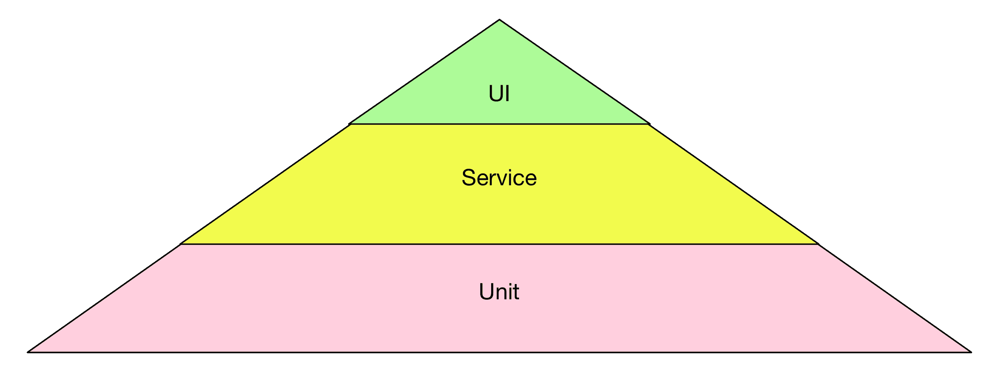

测试金字塔

测试分级可以使用 Mike Cohn 流行的“测试金字塔”概念来描述。他将测试分为三个级别：单元、服务和用户界面。他认为你应该尽可能进行单元测试，其次是服务级（集成测试），而在最上方应该是用户界面层级的测试。

这些层级中的每一个都为我们提供了关于系统行为方式的信息。它们让我们确信代码的运行正如我们想象的那样。在高级别，我们可以断言应用程序遵循其规范。在低级别，我们可以断言某个特定函数按照我们预期的方式运行。

在研究新系统时，测试可以以探索的方式进行。同样的思路对于调试也有用。我们将进行一系列断言来帮助我们隔离并修复问题。

我们有各种技术可以覆盖整个测试金字塔。这并不是一份详尽的列表，更多的是让你了解目前有哪些技术。我们将在在本章的后半部分对项目使用其中的几种技术。

#### 单元测试

*单元测试*完全关于孤立地测试一段代码——一个单元。例如，我们可以对单个函数进行单元测试，以断言它的行为方式。不过，单元的定义可以比这更大。在某个时刻，我们将进入*集成测试*的领域。通过这种方式，我们想要断言系统的部分能够按照应该的方式协同工作。

#### TDD 和 BDD

有时，先开发测试或与代码同步开发是很有方便的。这种*测试驱动开发*（TDD）是行业中一种非常流行的技术。在更高级别上，你可以使用*行为驱动开发*（BDD）。

有时，我会使用*README 驱动开发*（README Driven Development），并先编写项目的 README 来指导组件开发。这迫使我从用户的角度考虑组件，并可以帮助我通过更少的迭代获得更好的 API。

BDD 侧于在业务层面描述规范，而不需要大量的技术知识。它们为非技术人员提供了一种用流畅语法描述应用程序行为的方法。然后，程序员可以根据这些功能规范执行更低层次的测试。

TDD 是一种可以描述为三个简单步骤的技术：

1. 编写一个失败的测试。
2. 创建最小的实现。
3. 重复。

一旦你进展得足够远，就可以*重构*你的代码。

一旦你走得足够远就可以就可以构构代码。。测试测试测试测试，，测试测试测试测试测试测试测试测试测试测试非常有用。

#### 覆盖测试

我们可以使用各种技术来覆盖测试金字塔。这绝不是一份详尽的列表。更多的是让你大致了解有哪些技术。我们将在在本章的后半部分对项目使用其中的几种技术。

#### 单元测试

*测试测试**测试测试。。。。。。。。。。，，，，，，，，，，言言言断言。

#### 测试测试

测试测试测试测试测试测试。。。。。。。。。。。。。。。测试测试测试测试测试测试测试测试测试测试测试。。这可以帮助我们发现可能的问题。

#### 属性测试

除了这些，还有一些更专业的技术。例如，*属性测试*允许我们检查不变性是否成立。例如，我们可能会得到如下测试：

```
sort([-123242342, 231, -0.43429, 1.797693134862157e30])
sort([1.72e+32])
sort([0, 0, 0])
sort([])
sort([1])
```

我们可以编写任意多的测试。我们可以以伪随机的方式生成它们。这意味着我们可以重现相同的测试。这允许我们发现可能的错误。

这种方法最大的优势是它允许我们测试可能无法获得的值和范围。计算机擅长生成测试。问题在于确定良好的测试不变性。

#### 变异测试

*变异测试*允许你测试你的测试。变异测试框架以各种方式修改你的源代码并观察你的测试如何表现。它可能会揭示你可以根据测试和覆盖率删除或简化的代码部分。这不是一种特别流行的技术，但了解它是好的。

### 9.2 配置 Webpack

使用 Webpack 测试有多种方法。我将讨论一种基于 [Karma](https://karma-runner.github.io) 和 [Mocha](https://mochajs.org/) 的方法。这种方法是根据 Cesar Andreu 的 `web-app` 适配的，因为它运行良好。

#### 测试运行器

Karma 是一个测试运行器。它允许你在浏览器中执行测试。在这种情况下，我们将使用 [PhantomJS](http://phantomjs.org/)，这是一个流行的基于 Webkit 的无头浏览器。Karma 为我们完成了大部分工作。可以根据你的偏好配置它以与各种测试工具配合。

[Testem](https://github.com/airportyh/testem) 是 Karma 的有效替代方案。

#### 单元测试

Mocha 用于结构化测试。它遵循简单的 `describe`, `it` 格式。它没有任何方式指定断言。我们将使用 Node.js [assert](https://nodejs.org/api/assert.html)，因为这对于我们的目的已经足够。替代方案（如 [Chai](http://chaijs.com/)）提供了更强大、更有表现力的语法。


Facebook 的 [Jest](https://facebook.github.io/jest/) 是 Mocha 的流行替代方案。它基于另一个流行工具 [Jasmine](https://jasmine.github.io/)，且配置比 Mocha 更简单。遗憾的是，它存在一些与 Node.js 版本相关的问题，并且有某些功能（主要是默认的自动 mock）可能有些违背直觉。尽管如此，它是一个有效的替代方案。

## 代码覆盖率

为了更好地了解测试的 `code coverage`（代码覆盖率），我们将使用 [Istanbul](https://gotwarlost.github.io/istanbul/)。它将为我们提供一份供研究的 HTML 报告。这将帮助我们理解代码的哪些部分可以使用测试。然而，它并没有告诉我们关于测试质量的任何信息。它只是告诉我们测试覆盖了代码的某些分支。

## 安装依赖

我们的测试设置将需要许多新依赖。执行以下命令来安装它们：

```
npm i react-addons-test-utils isparta-instrumenter-loader karma karma-coverage karma\
arma-mocha karma-phantomjs-launcher karma-sourcemap-loader karma-spec-reporter k\
arma-webpack mocha phantomjs-prebuilt phantomjs-polyfill --save-dev
```

除了这些依赖，我们还需要做一些配置工作。

## 设置 `package.json` 中的 `scripts`

和通常一样，我们将通过 `package.json` 的 `scripts` 来封装工具。我们将编写一个用于运行一次测试，另一个用于持续运行测试。设置如下：

**package.json**

```
{
  ...
  "scripts": {
    "stats": "webpack --profile --json > stats.json",
    "build": "webpack",
    "start": "webpack-dev-server",
    "test": "karma start",
    "tdd": "karma start --auto-watch --no-single-run"
  },
  ...
}
```

`npm run test` 或直接运行 `npm test` 将简单执行我们的测试。`npm run tdd` 将在我们开发项目时持续运行测试。这是你在开发过程中会经常依赖的。

## 测试文件布局

为了保持简单，我们将使用单独的目录存放测试。以下是我们将最终形成的结构示例：

- `/tests`
    - `demo_test.js`
    - `editable_test.jsx`
    - `note_store_test.js`
    - `note_test.jsx`

对此有多种可用的约定。另一种替代方案是将测试推送到组件级。例如，你可以为每个组件准备一个目录。该目录将包含组件、相关样式和测试。测试目录和测试文件可以命名为 `specs`。在这种情况下，你将拥有 `/specs` 和 `demo_spec.js` 等。

## 配置 Karma

我们仍然缺少几个关键部分来让这个设置工作。我们需要同时配置 Karma 和 Webpack。我们可以先设置 Karma：

**karma.conf.js**

```
// Reference: http://karma-runner.github.io/0.13/config/configuration-file.html
module.exports = function karmaConfig (config) {
  config.set({
    frameworks: [
      // Reference: https://github.com/karma-runner/karma-mocha
      // 将框架设置为 mocha
      'mocha'
    ],

    reporters: [
      // Reference: https://github.com/mlex/karma-spec-reporter
      // 将报告器设置为将详细结果打印到控制台
      'spec',

      // Reference: https://github.com/karma-runner/karma-coverage
      // 输出代码覆盖率文件
      'coverage'
    ],

    files: [
      // Reference: https://www.npmjs.com/package/phantomjs-polyfill
      // 是因为 React.js 需要 bind 而 phantomjs 不支持它
      'node_modules/phantomjs-polyfill/bind-polyfill.js',

      // 获取 tests 目录下包含 _test 的所有文件
      'tests/**/*_test.*'
    ],

    preprocessors: {
      // Reference: http://webpack.github.io/docs/testing.html
      // Reference: https://github.com/webpack/karma-webpack
      // 使用 webpack 文件并加载 sourcemaps
      'tests/**/*_test.*': ['webpack', 'sourcemap']
    },

    browsers: [
      // 使用 PhantomJS 运行测试
      'PhantomJS'
    ],

    singleRun: true,

    // 配置代码覆盖率报告器
    coverageReporter: {
      dir: 'build/coverage/',
      type: 'html'
    },

    // 测试 webpack 配置
    webpack: require('./webpack.config'),

    // 从输出中隐藏 webpack 构建信息
    webpackMiddleware: {
      noInfo: true
    }
  });
};
```

如从注释所示，你可以通过多种方式配置 Karma。例如，你可以将其指向 Chrome 甚至同时指向多个浏览器。

我们仍然需要编写一些 Webpack 特有的配置来让这一切正常工作。

## 配置 Webpack

Webpack 需要自身的一些特殊配置。为了让 Karma 找到我们想要的代码，我们需要将 Webpack 指向它。此外，我们需要配置 `isparta-instrumenter-loader`，以便我们的代码覆盖率报告生成通过 Istanbul 工作。

**webpack.config**

```
...
```


更好，我们现在可以尝试运行 `npm run tdd`。执行它并尝试修改测试。例如，让它失败。如你所见，这为我们提供了一个良好的测试工作流。既然我们已经测试了测试本身是有效的，现在可以专注于实际工作了。

## 9.3 测试 Kanban 组件

通过观察我们的 Kanban 应用程序组件，可以看到 `Editable` 具有很多复杂性。对其进行测试以锁定这些逻辑是一个好主意。

`Note` 是另一个有趣的组件。尽管它是一个微不足道的组件，但考虑到它依赖于 React DnD，测试它并不完全简单。这需要进行一些额外的思考。

我将涵盖这两个案例，因为理解它们将帮助你在如果需要的话，为剩余组件实现测试。核心思想始终是一致的：

1. 确定你想测试什么。
2. 通过 React 的 `renderIntoDocument` 渲染待测试的组件。
3. （可选的）以某种方式操作该组件。例如，你可以通过 React 的 API 模拟用户操作。
4. 断言某些真值。

理想情况下，你的单元测试应该一次只测试一件事。保持它们简单是一个好主意，因为这会在调试代码时提供帮助。正如之前讨论的，单元测试不能证明 Bug 的不存在。相反，它们证明了代码对于该特定测试是正确的。这就是单元测试对调试有用之处。你可以使用它们来证明你的假设。

在开始之前，我们应该为 `Editable` 制定测试计划并完成一些测试。注意，你可以使用 `npm run tdd` 实现这些测试并在编写过程中输入它们。尽管去尝试弄坏一些东西以获得更好的感觉。

### `Editable` 的测试计划

`Editable` 中有几点需要测试的：

* 它是否正确渲染了给定的 `value`？
* 如果不在编辑模式下，它会触发 `onValueClick` 吗？
* 在编辑时是否会触发 `onEdit` 回调？
* 在删除时是否会触发 `onDelete` 回调？

我确定还有几个额外的案例是值得测试，但这些将帮助我们开始，并帮助我们理解如何为 React 组件编写单元测试。

### `Editable` 渲染值

为了检查 `Editable` 是否渲染了值，我们需要：

1. 在渲染组件时向它传递一些 `value`。
2. 从 DOM 中找到该值。
3. 检查该值是否是我们预期的。

在代码方面它看起来如下：

**tests/editable_test.jsx**

```
import React from 'react';
import {
  renderIntoDocument,
  findRenderedDOMComponentWithClass
} from 'react-addons-test-utils';
import assert from 'assert';
import Editable from '../app/components/Editable.jsx';

describe('Editable', () => {
  it('renders value', () => {
    const value = 'value';
    const component = renderIntoDocument(
      <Editable value={value} />
    );

    const valueComponent = findRenderedDOMComponentWithClass(component, 'value');

    assert.equal(valueComponent.textContent, value);
  });
});
```

这里有几个重要的部分值得理解，因为它们之后会重复：

* `renderIntoDocument` 是 React 提供的一个测试工具。它将给定的标记渲染到文档中，我们可以对其进行检查。它需要 DOM 才能工作。
* `findRenderedDOMComponentWithClass` 允许我们遍历 DOM 并寻找匹配给定类名的组件。它期望找到好一个匹配项，否则将抛出异常。`scry` 变体更通用，返回匹配项列表。
* `valueComponent.textContent` 为我们访问 DOM 节点的文本内容。

这些函数是 React [Test Utilities](https://facebook.github.io/react/docs/test-utils.html) API 的一部分。

既然我们可以确定 `Editable` 可以渲染传递给它的值，我们可以尝试一些更复杂的操作，即进入编辑模式。

### `Editable` 进入编辑模式

我们在这里可以遵循之前类似的思路。不过，这个案例更复杂。首先，我们需要以某种方式进入编辑模式。之后，我们需要检查输入框显示了正确的值。考虑下面的实现：

**tests/editable_test.jsx**

```
import React from 'react';
import {
  renderIntoDocument,
  findRenderedDOMComponentWithClass,
  findRenderedDOMComponentWithClass,
  findRenderedDOMComponentWithTag,
  Simulate
} from 'react-addons-test-utils';
import assert from 'assert';
import Editable from '../app/components/Editable.jsx';

describe('Editable', () => {
  ...

  it('triggers onValueClick', () => {
    let triggered = false;
    const value = 'value';
    const onValueClick = () => triggered = true;
    const component = renderIntoDocument(
      <Editable value={value} onValueClick={onValueClick} />
    );

    const valueComponent = findRenderedDOMComponentWithClass(component, 'value');
    Simulate.click(valueComponent);

    assert.equal(triggered, true);
  });
});
```

`Simulate.click` 触发了我们在 `Editable` 中定义的 `onClick` 行为。还有其他的方法可以模拟其他用户输入。

还有一些工作需要完成。

### `Editable` 触发 `onEdit`

既然我们可以确定 `Editable` 可以渲染传递给它的值，我们可以尝试一些更复杂的操作，即进入编辑模式。我们在这里可以遵循之前类似的思路。不过，这个案例更复杂。首先，我们需要以某种方式进入编辑模式。之后，我们需要检查输入框显示了正确的值。考虑下面的实现：

**tests/editable_test.jsx**

```
...

describe('Editable', () => {
  ...

  it('triggers onEdit', () => {
    let triggered = false;
    const newValue = 'value';
    const onEdit = (val) => {
      triggered = true;
      assert.equal(val, newValue);
    };
    const component = renderIntoDocument(
      <Editable editing={true} value={'value'} onEdit={onEdit} />
    );

    const input = findRenderedDOMComponentWithTag(component, 'input');
    input.value = newValue;

    Simulate.blur(input);

    assert.equal(triggered, true);
  });
});
```

`findRenderedDOMComponentWithTag` 用于匹配 `input` 标签。这与类的方法相同。还有一个 `scry` 变体以相同的方式针对标签名工作。

与之前的测试相比，这里没有多少新内容。我们在 `onEdit` 处进行断言并通过 `Simulate.blur` 触发行为。

### `Editable` 允许删除

最后一个测试。

检查 `Editable` 是否允许删除与 `onEdit` 案例类似。我们只需要检查回调是否触发：

**tests/editable_test.jsx**

```
describe('Editable', () => {
  ...

  it('allows deletion', () => {
    let deleted = false;
    const onDelete = () => {
      deleted = true;
    };
    const component = renderIntoDocument(
      <Editable value={'value'} onDelete={onDelete} />
    );

    let deleteComponent = findRenderedDOMComponentWithClass(component, 'delete');
    Simulate.click(deleteComponent);

    assert.equal(deleted, true);
  });
});
```

我们现在有了一些基础测试，但覆盖率如何？

#### 检查测试覆盖率

现在是检查我们的覆盖率报告了。运行 `build/coverage/PhantomJS .../` 浏览器中检查它。你应该看到类似这样的内容：

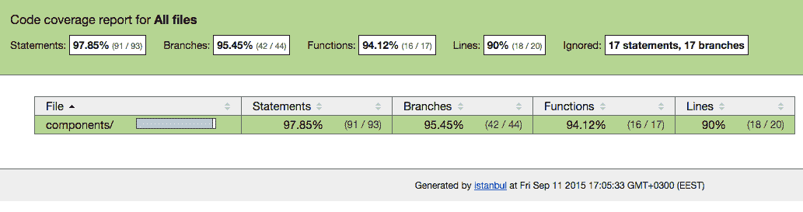

Istanbul coverage

根据统计数据，我们做得不错。我们仍然缺少一些分支，但我们覆盖了大部分 `Editable`，所以这很好。你可以尝试移除测试以查看统计的变化。你也可以尝试找出哪些分支没有被覆盖。

你可以通过在浏览器中查看 `components/Editable.jsx.html` 来查看特定组件的报告。那将向你显示 `checkEnter` 尚未被任何测试覆盖。在某个时候实现缺失的测试将是一个好主意。


### 测试 `Note`

尽管 `Note` 是一个非常简单的包装组件，但测试它是很有用的，因为这可以帮助我们理解如何处理 React DnD。它在设计上就是可测试的。它的[测试文档](https://gaearon.github.io/react-dnd/docs-testing.html) 有详细的介绍。

在这种情况下，我们可以不依赖 `HTML5Backend`，而是依赖 `TestBackend`。困难的部分在于构建测试所需的上下文，以确保 `Note` 确实渲染了它的内容。执行：

```
npm i react-dnd-test-backend --save-dev
```

来安装后端。下面的测试说明了基本思想：

`tests/note_test.jsx`

```javascript
import React from 'react';
import {
  renderIntoDocument
} from 'react-addons-test-utils';
import TestBackend from 'react-dnd-test-backend';
import {DragDropContext} from 'react-dnd';
import assert from 'assert';
import Note from 'app/components/Note.jsx';

describe('Note', () => {
  it('renders children', () => {
    const test = 'test';
    const NoteContent = wrapInTestContext(Note);
    const component = renderIntoDocument(
      <NoteContent id="demo">{test}</NoteContent>
    );

    assert.equal(component.props.children, test);
  });
});

// https://gaearon.github.io/react-dnd/docs-testing.html
function wrapInTestContext(DecoratedComponent) {
  @DragDropContext(TestBackend)
  class TestContextContainer extends React.Component {
    render() {
      return <DecoratedComponent {...this.props} />;
    }
  }

  return TestContextContainer;
}
```

测试本身很简单。我们只需要检查 `children` 属性是否按照我们预期的方式设置了。通过 DOM 检查渲染输出可以改进该测试。

### 9.4 测试 Kanban Store

Alt 提供了一种很好的方法来同时测试[actions](http://alt.js.org/docs/testing/actions/) 和[stores](http://alt.js.org/docs/testing/stores/)。鉴于我们的 actions 如此简单，关注 stores 是有意义的。为了你们展示基本思想，我将展示如何测试 `NoteStore`。同样的思路也可以应用于 `LaneStore`。

#### `NoteStore` 的测试计划

为了覆盖 `NoteStore`，我们应该断言以下事实：

* 它是否正确创建了笔记？
* 它是否允许正确编辑笔记？
* 它是否允许通过 id 删除笔记？
* 它是否允许通过指定的 id 数组过滤笔记？

此外，我们还可以针对特殊情况进行测试，并观察 `NoteStore` 处理各种类型输入的行为。这是非常有用的最小需求，并将让我们很好地覆盖常见路径。

#### `NoteStore` 支持 `create`

创建新笔记很简单。我们只需要调用 `NoteActions.create` 并查看 `NoteStore.getState` 的结果包含新创建的 `Note`：

`tests/note_store_test.js`

```javascript
import assert from 'assert';
import NoteActions from 'app/actions/NoteActions';
import NoteStore from 'app/stores/NoteStore';
import alt from 'app/libs/alt';

describe('NoteStore', () => {
  it('creates notes', () => {
    const task = 'test';

    NoteActions.create({task});

    const state = NoteStore.getState();

    assert.equal(state.notes.length, 1);
    assert.equal(state.notes[0].task, task);
  });
});
```

除了需要的导入之外，这比我们的 React 测试要简单。测试逻辑易于理解。

#### `NoteStore` 支持 `update`

为了进行 `update`，我们首先需要 `create` 一个 `Note`。之后，我们可以某种方式更改它的内容。最后，我们可以断言状态发生了变化：

`tests/note_store_test.js`

```javascript
...

describe('NoteStore', () => {
  ...

  it('updates notes', () => {
    const task = 'test';
    const updatedTask = 'test 2';

    NoteActions.create({task});

    const note = NoteStore.getState().notes[0];

    NoteActions.update({...note, task: updatedTask});

    const state = NoteStore.getState();

    assert.equal(state.notes.length, 1);
    assert.equal(state.notes[0].task, updatedTask);
  });
});
```

问题是 `assert.equal(state.notes.length, 1);` 将失败。这是因为我们的 `NoteStore` 是一个单例。我们的第一个测试已经向它创建了一个 `Note`。有两种解决方法：

1. 将 `alt.CreateStore` 推向更高。现在我们在模块级别创建关联，而这现在导致了问题。
2. 在每个测试之前 `flush` Alt store 的内容。

在这种情况下，我选择第 2：

`tests/note_store_test.js`

```javascript
...

describe('NoteStore', () => {
  beforeEach(() => {
    alt.flush();
  });

  ...
});
```

在经过这个小调整后，我们的测试运行方式符合我们的预期。这仅仅说明有时我们需要调整测试。

#### `NoteStore` 支持 `delete`

测试 `delete` 同样简单。我们需要创建一个 `Note` 然后断言它已经不存在了：

`tests/note_store_test.js`

```javascript
describe('NoteStore', () => {
  it('deletes notes', () => {
    // logic to create and delete
    NoteActions.create({task: 'test'});
    NoteActions.delete(id);
    const state = NoteStore.getState();
    assert.equal(state.notes.length, 0);
  });
});
```

#### `NoteStore` 支持 `get`

只剩下 `get` 需要测试了。由于它是 `NoteStore` 的公共方法，我们可以直接测试：

`tests/note_store_test.js`

```javascript
describe('NoteStore', () => {
  it('gets notes', () => {
    const task = 'test';
    NoteActions.create({task});

    const note = NoteStore.getState().notes[0];
    const notes = NoteStore.getByIds([note.id]);

    assert.equal(notes.length, 1);
    assert.equal(notes[0].task, task);
  });
});
```

### 9.5 总结

现在我们的 Kanban 应用有一些基础单元测试。虽然远未完全测试，但我们成功覆盖了一些关键部分。结果是我们对它的正常运行更有信心。不过，测试剩余部分是一个好主意，也许还可以重构那些测试。还有一些我们没有考虑考虑特殊情况。

我们还完全缺少验收测试。幸运的是，这是一个可以在 React、Alt 等工具之外解决的话题。[Nightwatch](http://nightwatchjs.org/) 是一个运行在 Selenium 服务器之上的工具，允许你编写这类测试。学习这种工具需要一些精力，但它允许你测试应用程序的更多定性方面。

## 10 在 React 中使用类型

就像代码检查（linting）一样，类型系统也是另一个可以让我们生活更轻松的功能，特别是在处理大型代码库时。某些语言在这方面非常严格，但正如你们所知，JavaScript 非常灵活。

灵活性在原型设计阶段非常有用。遗憾的是，这意味着很容易犯错并在为时太晚才发现。这就是为什么测试和类型如此重要。类型系统是增强代码并使其难以被破坏的好方法。它也可以作为其他开发人员的文档形式。

在 React 中，你使用 `propTypes` 来记录组件的预期。通过 Flow（一种渐进式类型语法）可以超越这一点。React 也有对应的 [TypeScript 类型定义](https://github.com/borisyankov/DefinitelyTyped/tree/master/react)，但我们不会深入探讨。

### 10.1 `propTypes` 和 `defaultProps`


`propTypes` 允许你记录组件预期接收的数据类型。`defaultProps` 允许你为 `propTypes` 设置默认值。这可以减少你需要编写的代码量，因为你不需要过多担心特殊情况。

这些注解数据在开发期间使用。如果你违反了类型契约，React 会通知你。因此，你能够在潜在问题造成危害之前修复它们。为了提高性能，这些检查在生产模式（`NODE_ENV=production`）下会被禁用。

## 注释样式

注解组件的方式取决于你声明它们的方式。我在下方使用各种语法提供了一些简化的示例：

### ES5
```
module.exports = React.createClass({
  displayName: 'Editable',
  propTypes: {
    value: React.PropTypes.string
  },
  defaultProps: {
    value: ''
  },
  ...
});
```

#### ES6
```javascript
class Editable extends React.Component {...}

Editable.propTypes = {
  value: React.PropTypes.string
};
Editable.defaultProps = {
  value: ''
};

export default Editable;
```

### ES7 (建议的属性初始化器)
```javascript
export default class Editable extends React.Component {
  static propTypes = {
    value: React.PropTypes.string
  }
  static defaultProps = {
    value: ''
  }
}
```

Props 默认是可选的。可以使用注解（如 `React.PropTypes.string.isRequired`）来强制传递 prop。如果没有传递，你将收到一个警告。

## 注解类型

`propTypes` 支持以下基础类型：`React.PropTypes.[array, bool, func, number, object, string]`。此外，还有一个特殊的 `node` 类型，指代任何可以被 React 渲染的内容。`any` 包含字面上的任何内容。`element` 映射到 React 元素。此外还有以下函数：

* `React.PropTypes.instanceOf(class)` - 使用 JavaScript 的 `instanceof` 进行检查。
* `React.PropTypes.oneOf(['cat', 'dog', 'lion'])` - 检查是否提供了值中的之一。
* `React.PropTypes.oneOfType([<propType>, ...])` - 与 `propTypes` 相同。你可以在这里使用基础类型定义（例如 `React.PropTypes.array`）。
* `React.PropTypes.arrayOf(<propType>)` - 检查给定数组是否包含给定类型的项。
* `React.PropTypes.objectOf(<propType>)` - 与数组的思路相同。
* `React.PropTypes.shape({<name>: <propType>})` - 检查给定对象是否符合具有特定 `propTypes` 的特定对象形状。

还可以通过向 prop 类型传递使用以下签的函数来实现自定义验证器：`function(props, propName, componentName)`。如果自定义验证失败，你应该返回一个错误（例如 `return new Error('Not a number!')`）。

[文档](https://facebook.github.io/react/docs/reusable-components.html) 提供了更详细的说明。

## 10.2 类型看板 (Typing Kanban)

为了让你更好地了解 `propTypes` 是如何工作的，我们可以对我们的看板应用进行类型化。只有少数组件需要注解。我们可以跳过对 `App` 的注解，因为它是应用程序的根组件。其余部分可以使用一些类型。

### 注释通道 (Lanes)

`Lanes` 提供了一个很好的起点。它期望一个 `lanes` 数组。我们可以将其设为可选，并默为空列表。这意味着我们可以稍微简化 `App`：

**app/components/App.jsx**
```javascript
// 而不是
lanes: () => LaneStore.getState().lanes || []

// 我们可以这样做
lanes: () => LaneStore.getState().lanes
```

在 `propTypes` 方面，我们的注解看起来如下：

**app/components/Lanes.jsx**
```javascript
export default ({lanes}) => {
const Lanes = ({lanes}) => {
  ...
}
Lanes.propTypes = {
  lanes: React.PropTypes.array
};
Lanes.defaultProps = {
  lanes: []
};

export default Lanes;
```

现在我们记录了 `Lanes` 期望的内容。`App` 也变得整洁了一些。不过，如果通道项的格式无效，这并帮助不大。我们应该注解 `Lane` 及其子组件以防止这种情况。

### 注释单个通道 (Lane)

根据我们的隐式定义，`Lane` 期望一个 `id`、`name` 和 `connectDropSource`。`id` 应该是必须的，因为没有 id 的通道没有任何意义。其余部分可以保持可选。翻译成 `propTypes` 后我们将得到：

**app/components/Lane.jsx**
```javascript
export default class Lane extends React.Component {
class Lane extends React.Component {
  ...
}
Lane.propTypes = {
  lane: React.PropTypes.shape({
    id: React.PropTypes.string.isRequired,
    editing: React.PropTypes.bool,
    name: React.PropTypes.string,
    notes: React.PropTypes.array
  }).isRequired,
  connectDropTarget: React.PropTypes.func
};
Lane.defaultProps = {
  name: '',
  notes: []
};

export default Lane;
```

如果现在我们的基础数据模型出现了错误，我们将知道。为了加固我们的系统，我们应该注解 `Notes`。

### 注释注释 (Notes)

在我们的系统中，`Notes` 接受 `notes`、`onEdit` 和 `onDelete`。它能够渲染可选的 `value`。使用注解语法得到：

**app/components/Notes.jsx**
```javascript
export default ({lanes}) => {
const Notes = ({lanes, onEdit, onDelete}) => {
  ...
}
Notes.propTypes = {
  notes: React.PropTypes.array,
  onEdit: React.PropTypes.func,
  onDelete: React.PropTypes.func
};
Notes.defaultProps = {
  notes: [],
  onEdit: () => {}
};

export default Notes;
```

### 注释 (Note)

在我们的实现中，`Note` 作为一个渲染内容的包装。它接收 `connectDragSource` 和 `connectDropTarget`。在注解格式得到：

**app/components/Note.jsx**
```javascript
...
export default class Note extends React.Component {
class Note extends React.Component {
  ...
}
Note.propTypes = {
  id: React.PropTypes.string.isRequired,
  editing: React.PropTypes.bool,
  connectDragSource: React.PropTypes.func,
  connectDropTarget: React.PropTypes.func,
  isDragging: React.PropTypes.bool,
  onMove: React.PropTypes.func
};
Note.defaultProps = {
  onMove: () => {}
};

export default Note;
```

### 注释可编辑 (Editable)

在我们的系统中，`Editable` 处理了一些繁性工作。它能够渲染可选的 `value`。它应该接收 `onEdit` 钩子。`onDelete` 是可选的。

**app/components/Editable.jsx**
```javascript
import React from 'react';

export default class Editable extends React.Component {
class Editable extends React.Component {
  ...
  finishEdit = (e) => {
    const value = e.target.value;

    if(this.props.onEdit) {
      this.props.onEdit(value);
    }
    this.props.onEdit(e.target.value);
  };
}
Editable.propTypes = {
  value: React.PropTypes.string,
  editing: React.PropTypes.bool,
  onEdit: React.PropTypes.func.isRequired,
  onDelete: React.PropTypes.func,
  onValueClick: React.PropTypes.func
};
Editable.defaultProps = {
  value: '',
  editing: false,
  onEdit: () => {}
};

export default Editable;
```


虽然 `propTypes` 很好用，但它们也有些冗长。Flow 类型系统可以在这方面为提供帮助。

## 10.3 使用 Flow 进行类型检查


Flow

Facebook 的 [Flow](http://flowtype.org/) 为 JavaScript 提供了渐进式类型系统。这意味着你可以根据需要为代码添加类型。我们可以实现与 `propTypes` 类似的结果，并根据需要为代码添加额外的不变约束（invariants）。为了让你直观地感受，请考虑以下简单示例：

```
function add(x: number, y: number): number {
  return x + y;
}
```

定义表明 `add` 应该接收两个数字并返回一个数字作为结果。这是静态类型语言中的典型做法。现在我们可以在 JavaScript 中从这种思想中受益。

Flow 依赖于必须单独安装的静态类型检查器。当你运行该工具时，它会评估你的代码并提供建议。为了方便开发，有一种方法可以在运行时评估 Flow 类型，这可以通过 Babel 插件实现。

### 设置 Flow

针对常见平台有[预编译的二进制文件](http://flowtype.org/docs/getting-started.html)。你也可以通过 Mac OS X 上的 Homebrew 安装（`brew install flow`）。

由于 Flow 依赖配置且没有配置将无法运行，我们需要生成一些配置。执行 `flow init`。这将生成一个 `.flowconfig` 文件，用于[高级配置](http://flowtype.org/docs/advanced-configuration.html)。

我们需要进一步微调以适应我们的环境。我们希望确保它在解析 `./app` 目录时跳过 `./node_modules`。此外，我们需要为 Flow 接口设置入口，并让 Flow 忽略某些语言特性。

由于我们想避免解析 `node_modules`，我们应该如下调整配置：

**.flowconfig**

```
[ignore]
.*/node_modules

[include]
./app

[libs]
./interfaces

[options]
esproposal.decorators=ignore
esproposal.class_instance_fields=ignore
```

### 运行 Flow

运行 Flow 非常简单，只需执行 `flow check`。你可能会看到类似这样的输出：

```
$ flow check
find: ..././interfaces: No such file or directory

Found 0 errors
```

我们稍后会修复那个警告。在此之前，我们应该让通过 npm 触发变得容易。在你的 `package.json` 中添加以下内容：

**package.json**

```
{
  ...
  "scripts": {
    ...
    "flow": "flow check"
  },
  ...
}
```

之后，我们就可以执行 `npm run flow`，而无需关心调用它的确切细节。请注意，如果进程失败，它会给出一个看起来很难看的 npm 错误（多行 `npm ERR!`）。如果你想禁用它，可以改运行 `npm run flow --silent` 来过滤掉它。

### 设置演示

Flow 期望你在使用它的文件中通过在文件开头使用 `/* @flow */` 声明对文件进行标注。或者，你也可以尝试运行 `flow check --all`。请记住，这可能会缓慢，因为它会处理你包含的每一个文件，无论该文件是否已标记了 `@flow`！在本项目，我们将坚持使用前者。

为了更好地了解 Flow 输出的样式，我们可以尝试一个小演示。按照如下方式设置：

**demo.js**

```
/* @flow */
function add(x: number, y: number): number {
  return x + y;
}

add(2, 4);

/* 根据定义，这应该是无效！ */
add('foo', 'bar');
```

现在运行 `npm run flow --silent`。如果运行正常，你应该看到类似的内容：

```
find: .../kanban_app/./interfaces: No such file or directory
demo.js:9
  9: add('foo', 'bar');
     ^^^^^^^^^^^^^^^^^ function call
  9: add('foo', 'bar');
         ^^^^^ string. 此类型与 number 不兼容
  2: function add(x: number, y: number): number {
                     ^^^^^^ number

demo.js:9
  9: add('foo', 'bar');
     ^^^^^^^^^^^^^^^^^ function call
  9: add('foo', 'bar');
                ^^^^^ string. 此类型与 number 不兼容
  2: function add(x: number, y: number): number {
                                ^^^^^^ number

Found 2 errors
```

这意味着一切运行正常，且 Flow 为我们捕捉了一个糟糕的编程错误。有人试图向 `add` 传递不兼容类型的值。在上线之前知道这一点是很好的。

既然我们知道 Flow 可以帮我们发现问题，在继续之前删除演示文件。

## 10.4 将 `propTypes` 转换为 Flow 检查

为了让你更好地了解迁移应用到 Flowmap，接下来我将为你展示如何将我们的组件转换为该格式。

### 将 `Editable` 迁移到 Flow

`Editable` 是一个很好的起点。在这种情况下，所有的 `props` 都是可选的。不过，如果我们想要，也可以很容易让它们变为强制。我已经将 propType 定义转换为 ES7 样式，因为那是 Flow 期望的：

**app/components/Editable.jsx**

```
/* @flow */
import React from 'react';

class Editable extends React.Component {
  static props: {
    value: string;
    editing: boolean;
    onEdit: Function;
    onDelete: Function;
    onValueClick: Function
  };
  static defaultProps = {
    value: '',
    editing: false,
    onEdit: () => {},
    onDelete: () => {},
    onValueClick: () => {},
  };

  render() {
    const {value, editing, onEdit, onDelete, onValueClick} = this.props;
    return (
      <div className="editable">
        <input
          value={value}
          onChange={(e) => onEdit(e.target.value)}
        />
        {editing && (
          <>
            <button onClick={onDelete}>Delete</button>
            <button onClick={onValueClick}>Value</button>
          </>
        )}
      </div>
    );
  }
}

Editable.propTypes = {
  value: PropTypes.string.isRequired,
  editing: PropTypes.bool.isRequired,
  onEdit: PropTypes.func.isRequired,
  onDelete: PropTypes.func.isRequired,
  onValueClick: PropTypes.func.isRequired,
};

Editable.defaultProps = {
  value: '',
  editing: false,
  onEdit: () => {},
  onDelete: () => {},
  onValueClick: () => {},
};

export default Editable;
```

如果你执行 `npm run flow --silent`，你不应该看到任何错误：

```
find: .../kanban_app/./interfaces: No such file or directory

Found 0 errors
```

一个简单的组件，如 `Note`，另一个很好的选择。

### 将 `Note` 迁移到 Flow

将 `Note` 迁移到 Flow 并没有我希望那么容易。由于 Flow 不支持类的装饰器语法，我们需要将定义改为基于函数。经过这个微调，我们就有了可以类型的内容：

**app/components/Note.jsx**

```javascript
import React from 'react';
import {DragSource, DropTarget} from 'react-dnd';
import ItemTypes from '../constants/itemTypes';

const Note = ({id, onMove}) => {
  return (
    <div className="note">
      {id}
    </div>
  );
};

export default DragSource(ItemTypes.NOTE, (connect, monitor) => ({
  dragSource: connect.dragSource(),
  isDragging: monitor.isDragging()
}))(DropTarget(ItemTypes.NOTE, (connect) => ({
  dropTarget: connect.dropTarget()
}))(Note);
```


```
$ npm run flow --silent
find: .../kanban_app/interfaces: No such file or directory
app/components/Note.jsx:3
  3: import {DragSource, DropTarget} from 'react-dnd';
                                          ^^^^^^^^^^^ react-dnd. Required module\
 not found

Found 1 error
```

错误意味着 `Flow` 正在寻找一个模块，但未能找到它。这就是 `interfaces` 目录的作用所在。由于我们的模块期望类型定义，我们应该给它提供如下类型定义：

`interfaces/react-dnd.js`

```javascript
declare module 'react-dnd' {
  declare function DragSource(): any;
  declare function DropTarget(): any;
}
```

这表示 `react-dnd` 是一个导出了两个可以返回任何类型的函数的模块。如果我们的应用程序中有第三方代码，我们需要实现像这样的声明来与之交互。再举一个例子，`alt-container` 的接口可能像这样：

`interfaces/alt-container.js`

```
declare module 'alt-container' {
  declare function exports(): Object;
}
```

`alt-container` 是一个导出一个对象的模块。我们当然可以比这更具体。[Flow 文档](http://flowtype.org/docs/declarations.html) 对该主题有更详细的介绍。

如果你现在执行 `npm run flow --silent`，你不应该收到任何错误或警告：

```
$ npm run flow --silent

Found 0 errors
```

在编写时，`Flow` 还没有为函数组件提供良好的类型化方法 ([#1081](https://github.com/facebook/flow/issues/1081))。一旦情况发生变化，我会向你展示如何实现。目前，这个小演示足以让你对如何使用 `Flow` 有一个大致的概念。

虽然还有一些不完善的地方，但当它工作时，它可以帮助更早地发现潜在问题。相同的注解在开发期间的运行时检查很有用。名为 [babel-plugin-typecheck](https://www.npmjs.com/package/babel-plugin-typecheck) 的 Babel 插件可以实现这一点。

### 10.5 Babel Typecheck

`babel-plugin-typecheck` 能够将你的 `Flow` 注释转换为运行时检查。要开始，请执行

```
npm i babel-plugin-typecheck --save-dev
```

为了让 `Babel` 感知到它，我们需要修改 `.babelrc`：

`.babelrc`

```json
{
  ...
  "env": {
    "start": {
      "presets": [
        "react-hmre"
      ]
      ],
      "plugins": [
        [
          "typecheck"
        ]
      ]
    }
  }
}
```

此此更改后，我们的 `Flow` 检查将在开发期间执行。`Flow` 静态检查器能够发现更多的错误。不过，运行时检查也有其优势，比什么都没有好得多。你可以通过故意破坏 `Editable` 的 `render()` 方法来测试它。尝试从那里返回一个字符串，看看它是如何崩溃的。`Flow` 会捕获它，但在开发过程中获得这样的反馈是很棒的。


[ESLint](http://eslint.org/) 是最近用于 JavaScript 的代码检查解决方案。它构建在 JSLint 和 JSHint 理念之上。更重要的是，它允许你开发自定义规则。因此，针对 React 开发了一套非常棒的规则，形式为 [eslint-plugin-react](https://www.npmjs.com/package/eslint-plugin-react)。

## 将 ESLint 与 `package.json` 接

为了将 ESLint 集成到我们的项目中，我们需要进行一些细微的调整。首先，我们需要执行：

```
npm i eslint eslint-plugin-react --save-dev
```

这会将 ESLint 和我们想要使用的插件作为项目的开发依赖添加。接下来，我们需要进行一些配置：

**package.json**

```
"scripts": {
  ...
  "lint": "eslint . --ext .js --ext .jsx"
}
...
```

这将触发对项目中所有 JS 和 JSX 文件的 ESLint 检查。这可能会检查的内容有点多。像下面这样在项目根目录下设置 `.eslintignore` 以跳过 `build/*`：

**.eslintignore**

```
build/
```

## 将 ESLint 与 Babel 连接

接下来，我们需要激活 ES6 解析、几个 React 特有的规则，并设置一些我们自己的规则。你可以根据喜好进行调整。详情请参阅官方的 [ESLint 规则文档](http://eslint.org/docs/rules/)。请注意，我们正在通过 `extends` 字段扩展推荐的规则集：

**.eslintrc**

```
{
  "extends": "eslint:recommended",
  "parserOptions": {
    "ecmaVersion": 6,
    "ecmaFeatures": {
      "jsx": true
    },
    "sourceType": "module"
  },
  "env": {
    "browser": true,
    "node": true
  },
  "plugins": [
    "react"
  ],
  "rules": {
    "no-console": 0,
    "new-cap": 0,
    "strict": 0,
    "no-underscore-dangle": 0,
    "no-use-before-define": 0,
    "eol-last": 0,
    "quotes": [2, "single"],
    "jsx-quotes": 1,
    "react/jsx-no-undef": 1,
    "react/jsx-uses-react": 1,
    "react/jsx-uses-vars": 1
  }
}
```

单个规则的严重程度通过数字定义，如下如下：

- 0 - 规则已禁用。
- 1 - 规则将发出警告。
- 2 - 规则将发出错误。

某些规则（如 `quotes`）接受数组。这允许你向它们传递额外参数。具体细节请参考该规则的文档。

上面列出的 `react/` 规则只是所有可用规则的一个小子集。根据需要从 [eslint-plugin-react](https://www.npmjs.com/package/eslint-plugin-react) 中选择规则。

## 处理 `ELIFECYCLE` 错误

在检查过程失败时，`npm` 会给你返回一个很难看的 `ELIFECYCLE` 错误。实现更整洁输出的好方法是调用 `npm run lint --silent`。这将隐藏 `ELIFECYCLE` 部分。你可以为此目的定义一个别名。在 Unix 中，你可以执行 `alias run='npm run --silent'` 然后执行 `run <script>`。

或者，你可以像这样将输出通过管道给 `true`：

**package.json**

```
"scripts": {
  ...
  "lint": "eslint . --ext .js --ext .jsx || true"
}
...
```

这种方法的问题是，如果你通过其他命令调用 `lint`，即使发生失败它也会通过。如果你有另一个类似 `npm run lint && npm run build` 的脚本，那么无论第一个命令的输出如何，它都会进行构建！

## 将 ESLint 与 Webpack 连接

我们可以使用 [eslint-loader](https://www.npmjs.com/package/eslint-loader) 让 Webpack 为我们输出 ESLint 消息。第一步执行：

```
npm i eslint-loader --save-dev
```

接下来，我们需要调整开发配置以包含它。向配置中添加以下部分：

**webpack.config.js**

```
var common = {
  ...
  module: {
    preLoaders: [
      {
        test: /\.jsx?$/,
        loaders: ['eslint'],
        include: PATHS.app
      }
    ]
  },
};
```

我们将配置包含在 `common` 中，这样就能始终执行检查。这样你就可以确保生产环境构建通过你的规则，同时确保在开发期间从检查中获益。

如果你现在执行 `npm start` 并破坏了某些检查规则，你应该能在终端中看到。当你构建项目时也会发生这种情况。

## 11.4 定制 ESLint

尽管你可以使用原生的 ESLint 达到很远的目标，但有一些你需要了解的技巧。例如，你可能想按文件跳过某些规则。你甚至可能想实现自己的规则。接下来我们将简要介绍这些情况。

### 跳过 ESLint 规则

有时，你可能想按文件或按行跳过规则。

### 编写你的规则

ESLint 规则依赖于抽象语法树 (AST)。它是词法分析后 JavaScript 代码的数据结构。有一些工具（如 [recast](https://github.com/benjamn/recast））允许你使用 AST 对 JavaScript 进行转换。为了更好地了解 AST 的工作原理及其外观，你可以查看 [Esprima 在线视化](http://esprima.org/demo/parse.html) 或 [AST Explorer](http://astexplorer.net/)。或者，你可以安装 `recast` 并检查输出。这就是我们在编写规则时将使用的结构。在 ESLint 的情况下，我们只是想检查结构并在出错时报告。实现一个简单的规则非常简单：

1. 创建名为 `eslint-plugin-custom` 的新项目。你可以将 `custom` 替换为任何内容。ESLint 遵循这种命名规范。
2. 执行 `npm init -y` 创建一个空的 `package.json`。
3. 在项目根目录下设置 `index.js`，内容如下：

**eslint-plugin-custom/index.js**

```javascript
module.exports = {
  rules: {
    demo: function(context) {
      return {
        Identifier: function(node) {
          context.report(node, '这是意外的！');
        }
      };
    }
  }
};
```

在这种情况下，我们只是对每个标识符进行报告。在实践中，你可能想做比这更复杂的事情，但这是一个良好的起点。

接下来，你需要在 `eslint-plugin-custom` 内部执行 `npm link`。这将使你的插件在系统中可见。`npm link` 允许你轻松地消费你正在开发的开发版本。当你觉得需要时，可以执行 `npm unlink` 反反。

我们需要修改项目配置，使其能够找到插件和其中的规则。

**.eslintrc**


```json
{
  ...
  "plugins": [
    "react",
    "react",
    "custom"
  ],
  "rules": {
    "custom/demo": 1,
    ...
  }
}
```

如果你现在运行 ESLint，你将会看到一堆警告。任务完成！

当然，这个规则目前还没有做任何实用的事情。为了继续进行，我建议查看关于[插件](http://eslint.org/docs/developer-guide/working-with-plugins.html)和[规则](http://eslint.org/docs/developer-guide/working-with-rules.html)的官方文档。

你也可以查看一些现有的规则和插件来获取灵感，看看它们是如何实现某些功能的。ESLint 允许你通过 `extends` 属性来[扩展这些规则集](http://eslint.org/docs/user-guide/configuring.html#extending-configuration-files)。它接受一个路径（`"extends": "./node_modules/coding-standard/.eslintrc"`）或一个路径数组。条目按照给顺序应用，后面的项会覆盖前面的项。

### ESLint 

除了 [eslint.org](http://eslint.org/) 上的官方文档外，你应该查看以下博客文章：

*   [Lint Like It’s 2015](https://medium.com/@dan_abramov/lint-like-it-s-2015-6987d44c5b48) - Dan Abramov 的这篇文章展示了如何让 ESLint 与 Sublime Text 良好地工作。

*   [使用 ESLint 自动检测 JavaScript 问题](http://davidwalsh.name/eslint) - 关于该主题的一个非常好的教程。

*   [理解使用 ESLint 的真实优势](http://rangle.io/blog/understanding-the-real-advantages-of-using-eslint/) - Evan Schultz 的文章深入探讨了细节。

*   [eslint-plugin-smells](https://github.com/elijahmanor/eslint-plugin-smells) - 由 Elijah Manor 开发的这个插件允许你针对各种 JavaScript 代码异味（smells）进行 lint。推荐使用。

如果你只是想要一个起点，可以从 [eslint-config packages](https://www.npmjs.com/search?q=eslint-config) 中选择一个，或者使用 [standard](https://www.npmjs.com/package/standard) 风格。看起来，`standard` 在 [JSX 方面有一些问题](https://github.com/feross/standard/issues/138)，所以使用要小心。

### 11.5 Linting CSS

[stylelint](http://stylelint.io/) 允许我们对 CSS 进行 lint。它可以通过 [postcss-loader](https://www.npmjs.com/package/postcss-loader) 与 Webpack 使用。

```
npm i stylelint postcss-loader --save-dev
```

接下来，我们需要将其与我们的配置集成：

**webpack.config.js**

```javascript
...
var stylelint = require('stylelint');

...

var common = {
  ...
  module: {
    preLoaders: [
      {
        test: /\.css$/,
        loaders: ['postcss'],
        include: PATHS.app
      },
      ...
    ],
    ...
  },
  postcss: function () {
    return [stylelint({
      rules: {
        'color-hex-case': 'lower'
      }
    })];
  },
  ...
}
```

如果你定义了一个 CSS 规则，例如 `background-color: #EFEFEF;`，你应该会在终端看到一个警告。查看 stylelint 文档获取完整的规则列表。npm 列出了[可能的 stylelint 规则集](https://www.npmjs.com/search?q=stylelint-config)。你可以像这样将它们作为项目依赖消耗：

```javascript
var configSuitcss = require('stylelint-config-suitcss');

...

stylelint(configSuitcss)
```

由于 stylelint 仍在开发中，尚未提供 CLI 工具。计划支持 `.stylelintrc` 类型的功能。

### 11.6 使用 JSCS 检查 JavaScript 

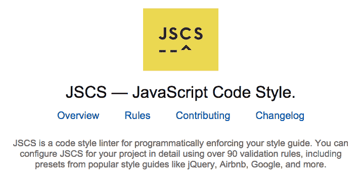

#### JSCS

特别是在团队环境中，如果一个人使用 Tab 而另一个人使用空格，会让人非常困扰。空格的使用也可能存在差异。有些人喜欢使用两个空格缩进，而另一些喜欢四个。简而言之，如果没有任何规范，代码会变得非常混乱。为了解决这个问题，JSCS 允许你为项目定义一个风格指南。

可以通过以下方式安装 JSCS：

```
npm i jscs jscs-loader --save-dev
```

[jscs-loader](https://github.com/unindented/jscs-loader) 为该工具提供了 Webpack 钩。集成方式与 ESLint 类似。你将定义一个包含风格指南规则的 `.jscsrc`，并使用如下配置：

```javascript
module: {
  preLoaders: [
    {
      test: /\.jsx?$/,
      loaders: ['eslint', 'jscs'],
      include: PATHS.app
    }
  ]
}
```

这是一个示例配置：

**.jscsrc**

```json
{
  "esnext": true,
  "preset": "google",

  "fileExtensions": [".js", ".jsx"],

  "requireCurlyBraces": true,
  "requireParenthesesAroundIIFE": true,

  "maximumLineLength": 120,
  "validateLineBreaks": "LF",
  "validateIndentation": 2,

  "disallowKeywords": ["with"],
  "disallowSpacesInsideObjectBrackets": null,
  "disallowImplicitTypeConversion": ["string"],

  "safeContextKeyword": "that",

  "excludeFiles": [
    "dist/**",
    "node_modules/**"
  ]
}
```

JSCS 支持通过 `jscsConfig` 字段基于 `package.json` 进行配置。

### 11.7 EditorConfig

[EditorConfig](http://editorconfig.org/) 允许你在不同的 IDE 和编辑器之间保持一致的代码风格。有些编辑器内置了支持。对于其他编辑器，你必须安装单独插件。此外，你还需要这样设置一个 `.editorconfig` 文件：

**.editorconfig**

```ini
root = true

# 整个项目的通用设置
[*]
indent_style = space
indent_size = 4

end_of_line = lf
charset = utf-8
trim_trailing_whitespace = true
insert_final_newline = true

# 特定格式覆盖
[*.md]
trim_trailing_whitespace = false

[/**/*.js]
indent_style = space
indent_size = 2
```

### 11.8 总结

在本章中，你学习了如何通过各种方式使用 Webpack 对代码进行 lint。这些技术从长期来看是有益的。你可以在问题变成事实之前修复它们。

## 12 发布包

[npm](https://www.npmjs.com/) 是 Node.js 流行的原因之一。最终，你可能想要编写自己的包。发布一个包相对容易，尽管有很多细节需要注意。本章将介绍这些细节，以便你避免一些常见问题。

### 12.1 包的结构

大多数的 npm 包都很小，只包含几个文件，例如：

*   `index.js` - 对于小型项目，根目录下有代码就足够。对于较大的项目你可能希望进一步拆分。

*   `package.json` - JSON 格式的 npm 元数据

*   `README.md` - README 是项目最重要的文档。它使用 Markdown 格式概述。简单项目的整个文档都可以放在这里。它会在 npm.com 的包页面显示。

*   `LICENSE` - 你应该在项目中包含许可信息。你可以在 `package.json` 中引用它。

在较大的项目中，你可能会发现以下内容：

*   `CONTRIBUTING.md` - 给潜在贡献者的指南。代码应该如何开发等等。

*   `CHANGELOG.md` - 此文档描述了每个版本的重大更改。如果你进行了重大 API 更改，在这里涵盖它们是一个好主意。可以基于 Git 提交历史生成该文件。

*   `.travis.yml` - [Travis](https://travis-ci.org/) 是流行的持续集成平台，对开源项目免费。你可以使用它在多个系统上运行包的测试。当然还有其他方案，但 Travis 非常流行。

*   `.gitignore` - Git 的忽略模式，即哪些文件不应该受版本控制。在这里忽略 npm 分发文件是有用的，可以避免它们弄乱你的仓库。


*   `.npmignore` - npm 的忽略模式。它描述了哪些文件不应该出现在你的发布版本中。一个很好的替代方案是使用 `package.json` 中的 [files](https://docs.npmjs.com/files/package.json#files)字段。它允许你维护一个白列表，将其包含在发布版本中。
*   `.eslintignore` - ESLint 的忽略模式。同样，这是特定工具的。
*   `.eslintrc` - 校验规则。你可以根据喜好使用 `.jshintrc` 等文件。
*   `webpack.config.js` - 如果你使用的是简单的设置，你也可以将配置放在项目根目录下。

此外，你可能会有各种用于源码、测试、演示、文档等的目录。

## 12.2 理解 package.json

所有的包都带有一个 `package.json` 文件，它描述了与它们相关的元数据。这包括关于作者、各种链接、依赖项等的信息。[官方文档](https://docs.npmjs.com/files/package.json) 详细地涵盖了这些内容。

我在下方注释了我的 [React 组件模版](https://github.com/survivejs/react-component-boilerplate) 中 `package.json` 的部分：

```
{
  /* 项目名称 */
  "name": "react-component-boilerplate",
  /* 简要描述 */
  "description": "Boilerplate for React.js components",
  /* 作者 + 可选的邮箱 + 可选的网站 */
  "author": "Juho Vepsäläinen <email goes here> (site goes here)",
  /* 包的版本 */
  "version": "0.0.0",
  /* `npm run <name>` */
  "scripts": {
    "start": "webpack-dev-server",

    "test": "karma start",
    "test:tdd": "karma start --auto-watch --no-single-run",
    "test:lint": "eslint . --ext .js --ext .jsx",

    "gh-pages": "webpack",
    "gh-pages:deploy": "gh-pages -d gh-pages",
    "gh-pages:stats": "webpack --profile --json > stats.json",

    "dist": "webpack",
    "dist:min": "webpack",
    "dist:modules": "babel ./src --out-dir ./dist-modules",

    "pretest": "npm run test:lint",
    "preversion": "npm run test && npm run dist && npm run dist:min && git commit --allow-empty -am "Update dist\"",
    "prepublish": "npm run dist:modules",
    "postpublish": "npm run gh-pages && npm run gh-pages:deploy",
    /* 如果你的库通过 Git 安装，你可能想对其进行转译 */
    "postinstall": "node lib/post_install.js"
  },
  /* 终端入口点（即 <package name>） */
  /* 除非打算允许 CLI 使用，否则不要设置此项 */
  "bin": "./index.js",
  /* 入口（默认 index.js） */
  "main": "dist-modules",
  /* 包依赖 */
  "dependencies": {
    "react": "⁰.14.0",
    "react-dom": "⁰.14.0"
  },
  /* 包开发依赖 */
  "devDependencies": {
    "babel": "⁶.3.17",
    ...
    "webpack": "¹.12.2",
    "webpack-dev-server": "¹.12.0",
    "webpack-merge": "⁰.7.0"
  },
  /* 包同级依赖。消费者将修复精确版本。 */
  /* 在 npm3 中，这些不会自动安装，由用户 */
  /* 定义使用哪些版本。 */
  "peerDependencies": {
    "lodash": ">= 3.5.0 < 4.0.0"
  }
  /* 仓库、首页和问题跟踪器的链接 */
  "repository": {
    "type": "git",
    "url": "https://github.com/bebraw/react-component-boilerplate.git"
  },
  "homepage": "https://bebraw.github.io/react-component-boilerplate/",
  "bugs": {
    "url": "https://github.com/bebraw/react-component-boilerplate/issues"
  },
  /* 与包相关的关键词。 */
  /* 填好此项使包更容易被找到。 */
  "keywords": [
    "react",
    "reactjs",
    "boilerplate"
  ],
  /* 使用什么许可证 */
  "license": "MIT"
}
```

如你所见，`package.json` 可以包含很多信息。你可以在那里附加 npm 特有的元数据，这些数据可以被工具使用。由于可能会导致 `package.json` 膨肿，将元数据保留在独立的文件中可能更好。

## 12.3 npm 工作流

使用 npm 运行出奇地简单。要开始使用，你需要使用 [npm adduser](https://docs.npmjs.com/cli/adduser)（别名为 `npm login`）。它允许你设置账户。在此过程完成后，它将创建 `~/.npmrc` 并使用该数据进行身份验证。还有 [npm login]。

### 发布包

有时，你可能想发布一些初步的内容供他人测试。这里有一些特定的约定。例如，一个包可能有如下版本：

-   `1.0.0-alpha`
-   `1.0.0-beta.1`
-   `1.0.0-beta.2`
-   `1.0.0-rc.1`
-   `1.0.0-rc.2`
-   `1.0.0`

在这种情况下，工作流是直接的：

1. `npm version 1.0.0-alpha` - 如前所述更新 `package.json`。
2. `npm publish --tag alpha` - 在 `alpha` 标签下发布包。

为了消费该版本，用户必须使用 `npm i <package name>@alpha`。

### 发布预发布版本

有时，你可能想发布一些初步的内容供他人测试。有一些特定的约定。*alpha*、*beta* 和 *rc*（发布候选）是常见的。例如，一个包可能有如下版本：

-   `alpha`
-   `beta`
-   `rc`

初始的 alpha 版本将允许用户尝试后续内容并提供反馈。beta 版本被认为更稳定。发布候选（rc）接近正式发布，且不会引入任何功能。它们都是为了完善发布直到适用于通用消费。

### 提升版本

为了提升版本，你需要以下命令之一：

-   `npm version x.y.z` - 自定义。
-   `npm version major|minor|patch` - 让 npm 根据 SemVer 更新版本。
-   `npm version premajor|preminor|prepatch|prerelease` - 注意 `prerelease` 后缀示例：`2.1.2`。

### 关于包命名

在开始开发之前，花一点时间为你的包想一个好名字是个好主意。写了一个棒的包才发现名字被占用并不有趣。一个好的名字容易通过搜索引擎找到，最重要的是在 npm 上是可。

从 npm 2.7.0 开始可以创建[作用域包](https://docs.npmjs.com/getting-started/scoped-packages)。它们遵循格式 `@username/project-name`。在命名项目时只需遵循该格式。

### 处理 npm 分文件

将 npm 特有的发布文件包含在版本控制中是不良好的做法。通常你会 `.gitignore` 它们。不过这些文件会被包含在上传到 npm 的版本中。这样做的好处是保持你的版本历史整洁。

当你想要通过 Git 而不是 npm 来消费你的包时（使用 `"depName": "<github user>/<project>#<reference>"`），这种方法就会出现问题。特别是当你尝试某些东西，或者需要修复某些问题以便目前工作时。


解决此问题的方法是设置一个 `postinstall` 脚本，在库不存在时为你的库生成一个本地的 npm 版本。可以通过如下的 `postinstall` 脚本来实现：

`package.json`

```json
{
  ...
  "scripts": {
    ...
    "postinstall": "node lib/post_install.js"
  },
  "devDependencies": {
    ...
    /* 你应该通过 `npm i` 安装 sync-exec 获取最新版本 */
    "sync-exec": "⁰.6.2"
  }
}
```

此外，我们需要定义一个简单的脚本来为我们工作。它将检查包是否包含我们预期的目录，并根据结果采取操作。如果不存在，我们将生成它：

`lib/post_install.js`

```javascript
// adapted based on rackt/history (MIT)
// Node 0.10+
var execSync = require('child_process').execSync;
var stat = require('fs').stat;

// Node 0.10 check
if (!execSync) {
  execSync = require('sync-exec');
}

function exec(command) {
  execSync(command, {
    stdio: [0, 1, 2]
  });
}

stat('dist-modules', function(error, stat) {
  // Skip building on Travis
  if (process.env.TRAVIS) {
    return;
  }

  if (error || !stat.isDirectory()) {
    exec('npm i babel-cli babel-preset-es2015 babel-preset-react');
    exec('npm run dist-modules');
  }
});
```

你可能需要调整脚本以适应你的具体用途，但它给了你基本的思路。

### 遵守语义化版本 (SemVer)

尽管发布新版本很容易，但遵守 SemVer 非常重要。简单来说，它规定在满足某些规则的情况下，你不应该破坏后兼容性。例如，如果你当前版本是 `0.1.4` 并且执行了破坏性更改，你应该升级到 `0.2.0` 并记录这些更改。你可以通过学习[在线工具](http://semver.npmjs.com/) 及其行为来更好地理解 SemVer。

### 版本范围

npm 支持多个版本范围。我在下方列出了常见的范围：

*   `~` - 波号仅匹配补丁版本（patch versions）。例如，`~1.2` 等于 `1.2.x`。
*   `^` - 符号是你使用 `--save` 或 `--save-dev` 默认默认。它匹配次版本（minor versions）。这意味着 `⁰.2.0` 等于 `0.2.x`。
*   `*` - 星号匹配主版本（major releases）。这是范围中最危险的一个。轻率使用此符号很容易在未来破坏你的项目，我建议不要使用它。
*   `>= 1.3.0 < 2.0.0` - 版本之间的范围。如果你在使用 `peerDependencies`，这特别有用。

你可以使用 `npm config set save-prefix='^'` 设置默认范围，如果你倾向于使用符号之外的其他选项。或者，你也可以直接修改 `~/.npmrc`。特别是将默认设置为波号可能是一个好主意，可以帮助你避免一些依赖项问题。

### 12.4 库格式

在我的模板代码中，我以各种格式输出我的 React 组件。我通过 Babel 处理我的组件代码，生成一个方便在 Node.js 中消费的版本。这会将 ES6 和其他优秀特性转换为原生 Node.js 可以消费的格式。这允许用户在需要时引用整个库中的某些特定模块。

此外，我还会生成所谓的*分发包*（distribution bundles）：`.js` 和 `.min.js`。两者都有一个用于调试的源映射文件（`.map`）。这些包是可以独立被消费的，因为它们带有一个 [UMD](https://github.com/umdjs/umd) 封装器。

UMD 使得从各种环境（包括全局、AMD 和 CommonJS (Node.js 格式)）消费它们成为可能。你可以通过查看 *Webpack Compared* 章节中的具体示例来重温记忆。

使用 Webpack 生成上述包出奇地简单。下面的示例应该能给你基本的思路：

`webpack.config.js`

```javascript
...

var config = {
  paths: {
    dist: '...',
    src: '...',
  },
  filename: 'demo',
  library: 'Demo'
};

var commonDist = {
  devtool: 'source-map',
  output: {
    path: config.paths.dist,
    libraryTarget: 'umd',
    library: config.library
  },
  entry: config.paths.src,
  externals: {
    react: 'react'
    // 为 lodash 使用更复杂的映射。
    // 我们需要根据环境
    // 以不同的方式访问。
    lodash: {
      commonjs: 'lodash',
      commonjs2: 'lodash',
      amd: '_',
      root: '_'
    }
  },
  module: {
    loaders: [
      {
        test: /\.jsx?$/,
        loaders: ['babel?cacheDirectory'],
        include: config.paths.src
      }
    ]
  }
};

if(TARGET === 'dist') {
  // ... logic for dist
}
```

### 12.5 npm 生命周期钩子 (Lifecycle Hooks)

npm 提供了许多非常有用的钩子。假设你正在编写某些兼容 ES5 的版本。由于我们希望避免每次发布新版本时直接运行命令，我们可以这样将其连接到 `prepublish`：

```json
"scripts": {
  ...
  "prepublish": "npm test"
}
```

确保执行了 `npm i babel --save-dev` 将工具包含在你的项目中。

你可能不希望目录内容出现在你的 Git 仓库中。为了避免这种情况并保持 `git status` 清洁，请考虑如下 `.gitignore`：

```
dist-modules/
```

除了 `prepublish`，npm 还提供了系列其他钩子。命名方式始终相同，并遵循 `pre<hook>`, `<hook>`, `post<hook>` 模式，其中 `<hook>` 可以是 `publish`、`install`、`test`、`stop`、`start`、`restart` 或 `version`。尽管 npm 会自动触发绑定到这些钩子的脚本，但你也可以通过 `npm run` 显式触发它们（例如 `npm run prepublish`）。

### 保持依赖更新

维护 npm 包的一个重要部分是保持它们的依赖项更新。如何这样做很大程度上取决于你的包的成熟程度。理想情况下，你有一套覆盖所有功能的良好测试。如果没有，情况可能会变得棘手。更新依赖有几种方法：

*   你可以一次性更新所有依赖并尽听运气。诸如 [npm-check-updates](https://www.npmjs.com/package/npm-check-updates) 等工具可以为你完成。
*   安装某些特定依赖的最新版本，例如 `npm i lodash@* --save`。这是一种更受控的问题解决方法。
*   通过直接修改 `package.json` 手动更新补丁版本信息。


请记住，你的依赖可能会引入向后兼容的更改。记住 `SemVer` 的工作原理并研究依赖的发布说明很有帮助。这些说明并不总是存在，因此你可能需要回溯项目的提交历史。有几个服务可以帮助你跟踪项目的依赖项：

*   [David](https://david-dm.org/)
*   [versioneye](https://www.versioneye.com/)
*   [Gemnasium](https://gemnasium.com)

这些服务提供了可以集成到你的项目 `README.md` 中的徽章。这些服务可能会就重要的更改向你发送电子邮件。它们还可以指出已修复可能的安全性问题。

为了测试你的项目，你可以考虑一些解决方案，例如 [Travis CI](https://travis-ci.org/) 或 [SauceLabs](https://saucelabs.com/)。[Coveralls](https://coveralls.io/) 可以为你提供代码覆盖率信息以及可以包含在 `README` 中的徽章。

这些服务非常有价值，因为它们允许你快速地针对各种平台测试你的更新。在你的系统上可以运行的东西在某些特定配置下可能无法运行。你希望尽快了解这些情况，以避免引入问题。

## 12.7 分享作者身份

随着包的演进，你可能想要开始与其他人一起开发。你可以成为某些项目的新维护者，或者将接力棒交给别人。这些情况随着包的演进而发生。

`npm` 为这些目的提供了一些命令。它们都位于 `npm owner` 命名空间下。更具体地说，你将会在那里找到 `ls <package name>`、`add <user> <package name>` 和 `rm <user> <package name>`（即 `npm owner ls`）。仅此而已。

请查看 [npm 文档](https://docs.npmjs.com/cli/owner) 获取关于该主题的最新信息。

## 12.8 结论

现在你应该对如何借助 Webpack 帮助编写 npm 包有了基本的了解。它减少了过程中的大量工作量。在开发时只需记住基本规则，并记得尊重 `SemVer`。

## 13. React 的样式处理

传统上，网页被分为标记（HTML）、样式（CSS）和逻辑（JavaScript）。得益于 React 和类似的方法，我们开始质疑这种划分。我们可能仍然想以某种方式分离关注点。但这种划分可以在不同的轴上进行。

这种心态的转变导致了思考样式的新方法。在 React 中，我们仍在寻找最佳实践。然而，一些早期模式已经显现。因此，目前很难提供任何确定的建议。相反，我将介绍各种方法，以便你根据自己的具体需求做出决定。

### 13.1 老派样式处理

老式的样式处理方法是到处散布一些 `ids` 和 `classes`，设置 CSS 规则，并尽听天。在 CSS 中，默认情况下一切都是全局的。嵌套定义（例如 `.main .sidebar .button`）为你的样式创建了隐式逻辑。这两个特性随着项目的项目的增长会导致大量的复杂性。在开始阶段，这种方法是可以接受的，但随着你的开发，你很可能想要迁移它。

#### 原生 CSS 的 Webpack 配置

在 Webpack 中配置原生 CSS 很容易。考虑下面的示例：

**webpack.config.js**

```
var common = {
  ...
  module: {
    loaders: [
      {
        test: /\.css$/,
        loaders: ['style', 'css'],
        include: PATHS.style
      }
    ]
  },
  ...
};
```

首先，[css-loader](https://www.npmjs.com/package/css-loader) 会处理匹配文件中可能的 `@import` 和 `url()` 语句，并将它们视为普通的 `require`。这允许我们依赖许多其他 loader，例如 [file-loader](https://www.npmjs.com/package/file-loader) 或 [url-loader](https://www.npmjs.com/package/url-loader)。

`file-loader` 生成文件，而 `url-loader` 可以为小型资源创建内联数据 URL。这对于优化应用程序加载很有用。在提供略大负载的同时，避免了不必要的请求。如果你在样式定义中依赖于许多小资源，微小的改进也能产生巨大的收益。

最后，`style-loader` 接收 `css-loader` 的输出并将 CSS 注入到包中。正如我们早些在构建章节中看到的，可以使用 `ExtractTextPlugin` 生成单独的 CSS 文件。

### 13.2 CSS 方法论

当你的应用程序开始扩展并添加新概念时会发生什么？宽泛的 CSS 选择器就像全局变量。如果你必须处理加载顺序，问题会变得糟糕。如果选择器最后平局，则最后一个声明获胜，除非某处有 `!important`。它会迅速变得非常复杂。

我们可以通过使选择器更具体、使用一些命名规则等来对抗这个问题。但这只是在推迟不可避免的结果。由于人们与这个问题斗争了很久，各种方法应运而生。

特别是 [OOCSS](http://oocss.org/)（面向对象的 CSS）、[SMACSS](https://smacss.com/)（CSS 可扩展模块化方法）和 [BEM](https://en.bem.info/method/)（块元素修饰符）广为人知。它们都以自己的方式解决了原生 CSS 的问题。

#### BEM

BEM 源于 Yandex。BEM 的目标是允许可重用的组件和代码共享。网站（如 [Get BEM](http://getbem.com/)）可以帮助更详细地理解这种方法论。

为了重用组件，维护 BEM 所需的长类名可能是很辛苦的。因此出现了一些库来让这变得更容易。对于 React，这些示例包括 [react-bem-helper](https://www.npmjs.com/package/react-bem-helper)[react-bem-render](https://www.npmjs.com/package/react-bem-render) 和 [bem-react](https://www.npmjs.com/package/bem-react)。

注意 [postcss-bem-linter](https://www.npmjs.com/package/postcss-bem-linter) 允许你检查 CSS 是否符合 BEM。

#### OOCSS 和 SMACSS

就像 BEM 一样，OOCSS 和 SMACSS 都有自己的规范和方法论。目前还没有针对 React 的 OOCSS 和 SMACSS 辅助库。

#### 优缺点

采用方法论的主要优点是它为你的项目带来了结构。与其编写临时规则并希望一切顺利，你将有一个更强大的支撑。这些方法论解决了一些基本问题，并有助于长期开发良好的软件。

缺点是，一旦你采用了其中一种，你基本上就被困于了，迁移将非常。但如果你愿意投入，就有收益可言。

方法论还会带来它们自己的特性（例如复杂的命名方案）。这可能会让某些事情变得比实际需要的更复杂。它们并没有解决任何更深层次的底层问题。它们只是针对这些问题提供了补丁。

有各种更深入的方法可以解决其中的一些根本问题。尽管如此，这并不是此消彼的关系。即使使用某些 CSS 处理器，你也可以采用方法论。

### 13.3 Less, Sass, Stylus, PostCSS, cssnext

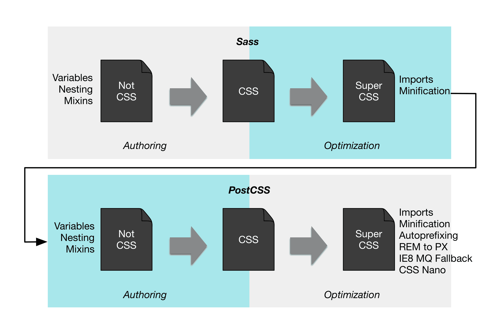

CSS 处理器

原生 CSS 缺少一些可以让维护工作更容易的功能。考虑一些基础功能，如变量、嵌套、混合、数学运算或颜色函数。如果能够忘记浏览器特定的前缀就更好了。这些小事累积起来很快，并让编写原生 CSS 变得令人厌烦。


有时，你会看到 `preprocessor`（预处理器）或 `postprocessor`（后处理器）这些术语。[Stefan Baumgartner](https://medium.com/@ddprrt/deconfusing-pre-and-post-processing-d68e3bd078a3) 将这些工具简单地称为 `CSS processors`。上面根据 Stefan 的工作改编的直击主题。这些工具在编写和优化层面都可以运行。我们所说的编写是指让编写 CSS 更容易的功能。优化功能则基于原生 CSS 运行，并转换为更适合浏览器消费的格式。

有趣的是，你实际上可能想要使用多个 CSS 处理器。Stefan 的图片说明了你可以如何使用 `Sass` 编写代码，同时从通过 `PostCSS` 处理中获益。例如，它可以对你的 CSS 代码进行 `autoprefix`（自动前缀），这样你就不再需要担心为浏览器添加前缀了。

## Less

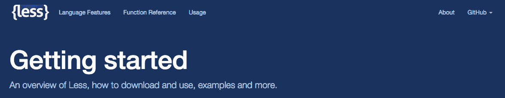

[Less](http://lesscss.org/) 是一个功能强大的 CSS 处理器。在 Webpack 中使用 `Less` 并不费力。[`less-loader`](https://www.npmjs.com/package/less-loader) 处理了大部分性工作：

```
{
  test: /\.less$/,
  loaders: ['style', 'css', 'less'],
  include: PATHS.style
}
```

同时也支持 `Less` 插件、sourcemaps 等。要了解这些是如何运作的，你应该查看项目本身。

## Sass


[Sass](http://sass-lang.com/) 是 `Less` 的流行替代方案。你应该配合 [`sass-loader`](https://www.npmjs.com/package/sass-loader) 使用它。记得在项目中安装 `node-sass`，因为加载器对该包有同级依赖。Webpack 不需要复杂的配置：

```javascript
{
  test: /\.scss$/,
  loaders: ['style', 'css', 'sass'],
  include: PATHS.style
}
```

查看 loader 以获取更高级的用法。

## Stylus


[Stylus](https://learnboost.github.io/stylus/) 是一种受 Python 启发的编写 CSS 的方式。除了提供基于缩进语法外，它还是一个全功能的处理器。在使用 Webpack 时，你可以使用 [`stylus-loader`](https://www.npmjs.com/package/stylus-loader) 在项目中使用 Stylus`。配置如下：

```javascript
{
  test: /\.styl$/,
  loaders: ['style', 'css', 'stylus'],
  include: PATHS.style
}
```

你还可以通过设置 `stylus.use: [plugin()]` 与其配合 `Stylus` 插件。查看 loader 以获取更多信息。

## PostCSS

[PostCSS](https://github.com/postcss/postcss) 允许你通过 JavaScript 插件对 CSS 进行转换。你甚至可以找到提供类似 `Sass` 特性的插件。`PostCSS` 可以被视为样式领域的 Babel。可以通过如下 Webpack 配合 [`postcss-loader`](https://www.npmjs.com/package/postcss-loader) 使用它：

```javascript
var autoprefixer = require('autoprefixer');
var precss = require('precss');

module.exports = {
  module: {
    loaders: [
      {
        test: /\.css$/,
        loaders: ['style', 'css', 'postcss'],
        include: PATHS.style
      }
    ]
  },
  // PostCSS 插件在这里
  postcss: function () {
      return [autoprefixer, precss];
  }
};
```

## cssnext


[cssnext](https://cssnext.github.io/) 是一个 `PostCSS` 插件，允许我们现在体验未来。虽然有一些限制，但可能值得一试。在 Webpack 中，只需安装 [`cssnext-loader`](https://www.npmjs.com/package/cssnext-loader) 并将其附加到你的 CSS 配置中。在我们的情况下，你将得到如下：

```javascript
{
  test: /\.css$/,
  loaders: ['style', 'css', 'cssnext'],
  include: PATHS.style
}
```

或者，如果你需要更多控制，可以通过插件的形式通过 `postcss-loader` 消费它。

`PostCSS` 和 `cssnext` 的优势在于你实际上是在为未来编写代码。随着浏览器的改进和标准的采用，你不需要担心迁移问题。

## 优缺点

与原生 CSS 相比，处理器带来了很多便利。它们处理某些烦人的问题（例如 `autoprefixing`），同时提高了你的生产力。`PostCSS` 从定义上来说更细粒，允许你只使用你想要的功能。诸如 `Less` 或 `Sass` 等处理器则更全面。这些方法可以结合使用，例如，你可以用 `Sass` 编写样式，然后根据需要对其应用一些 `PostCSS` 插件。

在我们的项目中，即使我们没有对 CSS 做任何更改，也可以从 `cssnext` 中获益。得于 `autoprefixing`，我们车道的圆角即使在旧浏览器中也能良好显示。此外，得于变量，我们可以对样式进行参数化。

### 13.4 基于 React 的方法

通过 React，我们有一些额外的替代方案。如果我们一直以来思考样式的方式是错误的呢？CSS 是强大的，但如果没有规范，它就会变成难以维护的混乱。CSS 是强大的，但如果没有规范，它就会变成难以维护的混乱。CSS 是强大的，但如果没有规范，它就会变成难以维护的混乱。CSS 是强大的，但如果没有规范，它就会变成难以维护的混乱。CSS 是强大的，但如果没有规范，它就会变成难以维护的混乱。CSS 是强大的，但如果没有规范，它就会变成难以维护的混乱。CSS 是强大的，但如果没有规范，它就会变成难以维护的混乱。CSS 是强大的，但如果没有规范，它就会变成难以维护的混乱。CSS 是强大的，但如果没有规范，它就会变成难以维护的混乱。

#### 内联样式的救星

React 通过内联样式解决了这一问题。放弃内联样式是使用独立文件的主要原因之一。现在我们回到了：

```javascript
render(props, context) {
  const notes = this.props.notes;

  return <ul className='notes'>{notes.map(this.renderNote)}</ul>
}
```

配合 CSS，我们可以像这样：

```javascript
render(props, context) {
  const notes = this.props.notes;
  const style = {
    margin: '0.5em',
    paddingLeft: 0,
    listStyle: 'none'
  };

  return <ul style={style}>{notes.map(this.renderNote)}</ul>
}
```


```
const styles = {
  button: {
    padding: '1em',

    ':hover': {
      border: '1px solid black'
    },

    '@media (max-width: 200px)': {
      width: '100%',

      ':hover': {
        background: 'white',
      }
    }
  },
  primary: {
    background: 'green'
  },
  warning: {
    background: 'yellow'
  },
};

...

<button style={[styles.button, styles.primary]}>Confirm</button>
```

为了让 `style` 属性生效，你需要使用 `@Radium` 装饰器来标记你的类。

### React Style

[React Style](https://github.com/js-next/react-style) 使用了与 React Native [StyleSheet](https://facebook.github.io/react-native/docs/stylesheet.html#content) 相同的语法。它通过引入用于片段（fragments）的额外键扩展了基础定义。

```
import StyleSheet from 'react-style';

const styles = StyleSheet.create({
  primary: {
    background: 'green'
  },
  warning: {
    background: 'yellow'
  },
  button: {
    padding: '1em'
  },
  // media queries
  '@media (max-width: 200px)': {
    button: {
      width: '100%'
    }
  }
});

...

<button styles={[styles.button, styles.primary]}>Confirm</button>
```

如你所见，我们可以使用单个片段来获得与 Radium 修饰器相同的效果。此外，它支持媒体查询。React Style 期望你通过 JavaScript 操作浏览器状态（例如 `:hover`）。此外，CSS 动画将无法工作。相反，最好使用其他解决方案。

有趣的是，有一个[针对 Webpack 的 React Style 插件](https://github.com/js-next/react-style-webpack-plugin)。它可以将 CSS 声明提取到单独的包中。现在我们更接近熟悉的领域了，但没有了层级联（cascades）。我们还在组件级别上拥有自己的样式声明。

### JSS

[JSS](https://github.com/jsstyles/jss) 是一个 JSON 到 StyleSheet 的编译器。使用 JSON 结构来表示样式非常方便，因为它为我们提供了易于管理的命名空间。此外，可以对 JSON 进行转换以获得某些功能，例如自动前缀处理。JSS 专门为此提供了一个插件接口。

可以通过 [react-jss](https://www.npmjs.com/package/react-jss) 在 React 中使用 JSS。还有一个针对 Webpack 的实验性 [jss-loader](https://www.npmjs.com/package/jss-loader)。你可以像这样通过 `react-jss` 使用 JSS：

```
...
import classNames from 'classnames';
import useSheet from 'react-jss';

const styles = {
  button: {
    padding: '1em'
  },
  'media (max-width: 200px)': {
    button: {
      width: '100%'
    }
  },
  primary: {
    background: 'green'
  },
  warning: {
    background: 'yellow'
  }
};

@useSheet(styles)
export default class ConfirmButton extends React.Component {
  render() {
    const {classes} = this.props.sheet;

    return <button
      className={classNames(classes.button, classes.primary)}>
        Confirm
      </button>;
  }
}
```

该方法支持伪选择器，也就是说你可以在定义内部定义选择器，例如 `&:hover`，它会直接生效。

### React Inline

[React Inline](https://github.com/martinandert/react-inline) 是 StyleSheet 的一种有趣变体。它根据使用它的元素的 `className` 属性生成 CSS。上面的示例可以这样适配到 React Inline：

```
import cx from 'classnames';
...

class ConfirmButton extends React.Component {
  render() {
    const {className} = this.props;
    const classes = cx(styles.button, styles.primary, className);

    return <button className={classes}>Confirm</button>;
  }
}
```

与 React Style 不同，该方法支持浏览器状态（例如 `:hover`）。遗憾的是，它依赖于自己的自定义工具来生成所需的 React 代码和 CSS。在本文写作时，还没有可用的 Webpack 加载器。

### jsxstyle

Pete Hunt 的 [jsxstyle](https://github.com/petehunt/jsxstyle) 旨在缓解 React Style 方法的某些问题。正如你在之前的示例中看到的，我们仍然有与组件标记分离的样式定义。jsxstyle 合并了这两个概念。考虑以下示例：

```
// PrimaryButton 组件
<button
  padding='1em'
  background='green'
>Confirm</button>
```

该方法仍仍处于早期阶段。例如，它缺少对媒体查询的支持。你无法像上面那样定义修饰器，而是将定义更多的组件来支持你的用例。

就像 React Style 一样，jsxstyle 自带了一个 Webpack 加载器，可以将 CSS 提取到单独的文件中。

### 13.5 CSS Modules

似乎 React 的样式选项还不够多，但还有一个值得提的。[CSS Modules](https://github.com/css-modules/) 从 CSS 默认应该是局部的假设出发。

### 13.6 结论

尽管 React 的样式选项已经足够多，但仍然值得关注。你可以通过 Webpack 尝试各种方案，从原生 CSS 到更复杂的配置。React 特定的工具甚至自带了加载器，这使得尝试替代方案变得简单。

基于 React 的样式方法允许我们将样式推组件级别。这与将 CSS 分离的传统方法形成了鲜明对比。处理组件特定的逻辑变得更容易。你会失去一些 CSS 提供的功能。作为回报，你获得了一个更容易理解、更难破坏的东西。

CSS Modules 在传统方法和 React 特定方法之间取得了平衡。尽管它是一个新事物，但它显示出了巨大的潜力。它是对常用方法的一种很好的改进。

# 附录

由于并不是所有讨论的内容都能放入书中，我将相关材料汇成了简短的附录。这些附录支持正文并更详细地解释了某些主题，例如语言特性。最后还有一些故障提示。

## React 项目结构

React 不强制执行任何特定的项目结构。这样做的好处是它允许你根据自己的需求构建结构。


# 按概念划分目录

我们的 Kanban 应用采用了扁平的结构：

```
├── actions
│   ├── LaneActions.js
│   └── NoteActions.js
├── components
│   ├── App.jsx
│   ├── Editable.jsx
│   ├── Lane.jsx
│   ├── Lanes.jsx
│   ├── Note.jsx
│   └── Notes.jsx
├── constants
│   └── itemTypes.js
├── index.jsx
├── libs
│   ├── alt.js
│   ├── persist.js
│   └── storage.js
├── main.css
└── stores
    ├── LaneStore.js
    └── NoteStore.js
```

这对于目前的目的已经足够了，但还有一些有趣的替代方案：

- 每个概念一个文件 - 非常适合小型原型。随着你的应用程序变得复杂，你可以对其进行拆分。
- 按组件划分目录 - 可以将组件放入它们自己的目录中。虽然这种方法更重，但正如我们很快将会看到的，它有一些有趣的优点。
- 按视图划分目录 - 当你想在应用程序中引入路由时，这种方法就变得相关了。

还有其他替代方案，但这些涵盖了一些常见的情况。可以根据应用程序的需求随时进行调整。

# 按组件划分目录

如果我们将组件拆分到它们自己的目录中，结果可能是这样的：

```
├── actions
│   ├── LaneActions.js
│   └── NoteActions.js
├── components
│   ├── App
│   │   ├── App.jsx
│   │   ├── app.css
│   │   ├── app_test.jsx
│   │   └── index.js
│   ├── Editable
│   │   ├── Editable.jsx
│   │   ├── editable.css
│   │   ├── editable_test.jsx
│   │   └── index.js
...
│   └── index.js
├── constants
│   └── itemTypes.js
├── index.jsx
├── libs
│   ├── alt.js
│   ├── persist.js
│   └── storage.js
├── main.css
└── stores
    ├── LaneStore.js
    └── NoteStore.js
```

与我们目前的解决方案相比，这种方法会更重。`index.js` 文件的作用是为组件提供方便的入口。尽管它们增加了代码量，但它们简化了导入。

不过，这种方法也有一些有趣的优点：

- 我们可以利用技术（如 `CSS Modules`）为每个组件单独设置样式。
- 鉴于每个组件现在都是一个独立的“包”，从项目中提取它们将变得更简单。你可以将通用组件推到其他地方，并在多个应用程序中消费。
- 我们可以在组件层级定义单元测试。这种方法鼓励你进行测试。我们仍然可以在应用程序的根级别编写更高层的测试，就像之前一样。

尝试将 actions 和 stores 也推到 `components` 中可能很有趣。或者它们也可以遵循类似的目录方案。这样做的好处是它允许你以类似的方式定义单元测试。

当你想要向应用程序中添加多个视图时，这种设置是不够的。需要其他方式来支持。

# 按视图划分目录

多个视图带来了自身的挑战。首先，你需要定义一个路由方案。[react-router](https://github.com/rackt/react-router) 是此目的的一个流行替代方案。除了路由方案外，你还需要定义在每个视图上显示什么。你可以为应用程序的首页、注册、Kanban 面板等创建单独的视图，匹配每个路由。

这些需求意味着需要向结构中引入新概念。处理路由的一种方法将其推送到一个 `Routes` 组件中，该组件根据当前路由协调在任何时刻显示哪个视图。我们不再使用 `App`，而是直接使用多个视图。一个可能的结构如下：

```
├── components
│   ├── Note
│   │   ├── Note.jsx
│   │   ├── index.js
│   │   ├── note.css
│   │   └── note_test.jsx
│   ├── Routes
│   │   ├── Routes.jsx
│   │   ├── index.js
│   │   └── routes_test.jsx
│   └── index.js
...
├── index.jsx
├── main.css
└── views
    ├── Home
    │   ├── Home.jsx
    │   ├── home.css
    │   ├── home_test.jsx
    │   └── index.js
    ├── Register
    │   ├── Register.jsx
    │   ├── index.js
    │   ├── register.css
    │   └── register_test.jsx
    └── index.js
```

这个想法与之前相同。只是这一次我们有更多部分需要协调。应用程序从 `index.jsx` 开始，它将触发 `Routes`，而 `Routes` 反而选择某些视图进行显示。之后就是我们熟悉的流程了。

这种结构可以进一步扩展，但它也有局限性。一旦你的项目开始增长，你可能想向其引入新概念。在视图和组件之间引入诸如“功能 (feature)”这样的概念可能是自然的。

例如，你可能有一个高级的 `LoginModal`，当用户会话超时时它会显示在某些视图上。它由低级组件组成。再次，当你发现有重用潜力时，可以将常用功能从项目本身提取出来放入它们自己的包中。

# 结论

使用 React 构建项目结构没有单一的正确方法。

## 语言特性

ES6 引入了正式的模块声明。早些，这是即时的，我们使用如 AMD 或 CommonJS 等格式。请参阅 *Webpack* 章节。两种格式仍在在使用，但采用标准总是更好的。

### `import` 和 `export` 导出单个

为了给出一个通过模块直接导出的示例，考虑以下内容：

**persist.js**
```
import makeFinalStore from 'alt-utils/lib/makeFinalStore';

export default function(alt, storage, storeName) {
  ...
}
```

**index.js**
```
import persist from './persist';

...
```

### `import` 和 `export` 导出多个

有时将模块作为函数的命名空间很有用：

**math.js**
```javascript
export function add(a, b) {
  return a + b;
}

export function multiply(a, b) {
  return a * b;
}
```

或者我们可以以这种形式编写模块：

**math.js**
```javascript
const add = (a, b) => a + b;
const multiple = (a, b) => a * b;

export {add, multiple};

// 等同于
//export {add: add, multiple: multiple};
```

这种定义可以通过如下导入进行消费：

**index.js**
```javascript
import {add} from './math';

// 或者我们可以将数学方法绑定到键上
// import * as math from './math';
// math.add, math.multiply, ...
```

### 导入别名

有时为导入设置别名会很有用。例如：

```javascript
import {actions as TodoActions} from '../actions/todo'
```

`as` 允许你避免命名冲突。

### Webpack `resolve.alias`


打包工具（如 `Webpack`）可以提供此之外的一些功能。例如，你可以为某些模块目录定义 `resolve.alias`。这允许你无论在何处导入都使用导入语句，例如 `import persist from 'libs/persist';`。一个简单的 `resolve.alias` 看起来如下：

```
...
resolve: {
  alias: {
    libs: path.join(__dirname, 'libs')
  }
}
```

官方文档更详细地描述了[可能的变体](https://webpack.github.io/docs/configuration.html#resolve-alias)。

### 类 (Classes)

与其他许多语言不同，JavaScript 使用的是基于原型的继承，而不是基于类的继承。这两种方法都各有优劣。事实上，你可以通过基于原型的模型来模拟基于类的模型。ES6 类本质上是在 JavaScript 基础机制之上提供的语法糖。在内部，它仍然使用旧的系统，只是对程序员来说看起来略有不同。

如今，`React` 支持基于类的组件定义。并不是所有人都认为这是一件好事。尽管如此，只要你不滥用它，这种定义可以非常整洁。为了给你一个简单的例子，考虑下面的代码：

```javascript
import React from 'react';

export default class App extends React.Component {
  constructor(props) {
    super(props);

    // 这是 React 机制之外的普通属性。
    // 如果你不需要在它改变时触发 render()，
    // 这样做是可以行的。
    this.privateProperty = 'private';

    // React 特有的状态。通过 `this.setState` 修改它。
    // 这最终会调用 `render()`。
    this.state = {
      name: 'Class demo'
    };
  }
  render() {
    // 以某种方式使用这些属性。
    const privateProperty = this.privateProperty;
    const name = this.state.name
    const notes = this.props.notes;

    ...
  }
}
```

基于类的方法最大的优势可能是它减少了一些复杂性，特别是涉及到 `React` 生命周期钩子时。需要注意的是，类方法默认不会被绑定！这就是为什么书中依赖于一种被称为“属性初始化”（property initializers）的实验性特性。

### 类与模块 (Classes and Modules)

如上所述，ES6 模块允许 `export` 和 `import` 单个或多个对象、函数，甚至类。在后者中，你可以使用 `export default class` 导出一个匿名类，或者使用 `export class className` 从同一个模块中导出多个类。

要导出和导入单个类，你可以使用 `export default class` 导出匿名类，并在导入时按你喜欢的名称进行重命名：

**Note.jsx**

```javascript
export default class extends React.Component { ... };
```

**Notes.jsx**

```javascript
import Note from './Note.jsx';
...
```

或者使用 `export class className` 从单个模块中导出多个命名类：

**Components.jsx**

```javascript
export class Note extends React.Component { ... };

export class Notes extends React.Component { ... };
```

**App.jsx**

```javascript
import Notes from './Components.jsx';
import Note from './Components.jsx';

...
```

建议将你的类拆分在不同的模块中。

### 类属性与属性初始化 (Class Properties and Property Initializers)

ES6 类默认不会绑定它们的方法。这有时会产生问题，因为你可能仍然想要访问实例属性。被称为[类属性和属性初始化](https://github.com/jeffmo/es-class-static-properties-and-fields)的实验性特性解决了这个问题。如果没有它们，我们可能会写出这样的代码：

```javascript
import React from 'react';

class App extends React.Component {
  constructor(props) {
    super(props);

    this.renderNote = this.renderNote.bind(this);
  }
  render() {
    // 在此处以某种方式使用 `renderNote`。
    ...

    return this.renderNote();
  }
  renderNote() {
    // ...
  }
}
```
（注：由于提供的原始文本包含大量重复和乱码片段，以上翻译已基于核心逻辑进行了清理和整理。）


在历史上，处理函数参数的方法相当局限。虽然有各种黑科技方法，例如 `values = values || [];`，但它们并不特别优雅，而且容易出错。例如，使用 `||` 可能会导致与 0 产生的问题。ES6 通过引入默认参数解决了这个问题。现在我们可以简单地写成 `function map(cb, values=[])`。

这不止于此，默认值甚至可以相互依赖。你还可以通过 `function map(cb, values...)` 传递任意数量的参数。在这种情况下，你通过 `map(a => a * 2, 1, 2, 3, 4)` 来调用函数。对于 `map` 来说，这个 API 可能并不完美，但在某些其他场景下它可能更有意义。

还有很方便的方法可以从传递的对象中提取值。这在使用函数语法定义的 React 组件中非常有用：

```javascript
export default ({name}) => {
  // ES6 字符串插值。注意反引号！
  return <div>{`Hello ${name}!`}</div>;
};
```

## 字符串插值

早早，，在 JavaScript 中处理字符串相当痛苦。通常你最终只能使用类似 `'Hello' + name + '!'` 这样的语法。为了这个目的重载 `+` 可能并不是最聪明的举措，因为它可能由于类型转换导致奇怪的行为。例如，`0 + ' world` 会产生字符串 `0 world`。

除了更清晰之外，ES6 风格的字符串插值还为我们提供了多行字符串。这是旧语法不支持。考虑下面的示例：

```javascript
const hello = `Hello ${name}!`;
const multiline = `
multiple
lines of
awesomeness
`;
```

反引号语法可能需要一段时间才能习惯适应，但它非常强大且更不容易出错。

## 解构

那个 `...` 与解构的想法有关。例如，`const {lane, ...props} = this.props;` 会从 `this.props` 中提取出 `lane`，而对象的其余部分将进入 `props`。这种基于对象的语法仍然是实验性阶段。ES6 规定了官方方法来对数组执行相同的操作：

```javascript
const [lane, ...rest] = ['foo', 'bar', 'baz'];

console.log(lane, rest); // 'foo', ['bar', 'baz']
```

展开运算符（`...`）对于合并非常有用。你在 Redux 示例中经常看到这种语法。它们依赖于实验[对象剩余/展开语法](https://github.com/sebmarkbage/ecmascript-rest-spread)：

```javascript
[...state, action.lane];

// 这等于
state.concat([action.lane])
```

同样的思想适用于 React 组件：

```javascript
...

render() {
  const {value, onEdit, ...props} = this.props;

  return <div {...props}>Spread demo</div>;
}

...
```

## 对象简写

为了让处理对象变得更方便，ES6 专门为此提供了各种功能。援引 [MDN](https://developer.mozilla.org/en-US/docs/Web/JavaScript/Reference/Operators/Object_initializer)，考虑下面的示例：

```javascript
const a = 'demo';
const shorthand = {a}; // 等同于 {a: a}

// 简写方法
const o = {
  get property() {},
  set property(value) {},
  demo() {}
};

// 计算属性名
const computed = {
  [a]: 'testing' // demo -> testing
};
```

## `const`, `let`, `var`

在 JavaScript 中，变量默认是全局的。`var` 将它们绑定在`函数级`上。这与许多实现`块级`绑定的其他语言形成对比。ES6 通过 `let` 引入了块级绑定。

还有对 `const` 的支持，它保证了变量本身的引用不能改变。然而，这并不意味着你不能修改变量的内容。所以如果你指向一个对象，你仍然允许对其进行调整！

我倾向于尽可能默认使用 `const`。如果我需要某些可变内容，`let` 就足够。现在很难再找到 `var` 的任何良好用处了，因为 `const` 和 `let` 以更易理解的方式涵盖了需求。事实上，除了本附录外，书中的所有代码都依赖于 `const`。这足以说明你使用它可以走多远。

## 装饰器 (Decorators)

由于装饰器仍然是一个实验性特性，并且关于它们有很多需要介绍，因此有一个整个附录专门介绍该主题。阅读 *Understanding Decorators* 以获取更多信息。

## 结论

ES6 以及即将推出的规范远多于此。如果你想更深入地理解规范，[ES6 Katas](http://es6katas.org/) 是学习更多内容的良好起点。只要对基础有一个良好的了解，就能带你走很远。

## 理解装饰器

如果你以前用过 Java 或 Python 等语言，你可能熟悉这个想法。装饰器是语法糖，允许我们包装和注解类和函数。在他们的[当前提案](https://github.com/wycats/javascript-decorators) (阶段 1) 中，仅支持类和方法级别的包装。函数以后可能会被支持。

在 Babel 6 中，你可以通过 [babel-plugin-syntax-decorators](https://www.npmjs.com/package/babel-plugin-syntax-decorators) 和 [babel-plugin-transform-decorators-legacy](https://www.npmjs.com/package/babel-plugin-transform-decorators-legacy) 启用这种行为。前者提供了语法级支持，而后者提供了我们要讨论的行为。

装饰器的最大好处是它们允许我们将行为封装成简单的、可复用的块，同时减少噪音。完全可以不用它们编写代码。它们只是让某些任务变得整洁。

### 实现一个日志装饰器

有时，知道方法是如何调用的很有用。你当然可以在那里附加 `console.log`，但实现 `@log` 更有趣。考虑下面的示例：

```javascript
class Math {
  @log
  add(a, b) {
    return a + b;
  }
}

function log(target, name, descriptor) {
  var oldValue = descriptor.value;

  descriptor.value = function() {
    console.log(`Calling "${name}" with`, arguments);

    return oldValue.apply(null, arguments);
  };

  return descriptor;
}

const math = new Math();

// 现在传递的参数会被记录
math.add(2, 4);
```

想法是我们的 `log` 装饰器包装了原始函数，触发 `console.log`，最后将原始 [arguments](https://developer.mozilla.org/en-docs/Web/JavaScript/Reference/Functions/arguments) 传递它。如果你以前没见过 `arguments` 或 `apply`，可能看起来有点奇怪。

`apply` 可以被视为调用函数的另一种方式，同时将它的上下文（`this`）和参数作为数组传递。`arguments` 隐式接收函数参数，所以它是这种情况的理想选择。

这个日志记录器可以推送到单独的模块。之后，当我们记录某些方法时，可以在整个应用程序中使用。一旦实现，装饰器将变成强大的构建块。

装饰器接收三个参数：

*   `target` 映射到类的实例。
*   `name` 包含被装饰方法的名称。
*   `descriptor` 是最有趣的部分，因为它允许我们注解方法并操纵它的行为。它可能像这样：

```javascript
const descriptor = {
  value: () => {...},
  enumerable: false,
  configurable: true,
  writable: true
};
```

正如你上面看到的，`value` 使得塑造行为成为可能。其余部分允许你在方法级别修改行为。例如，一个 `@readonly` 装饰器可以限制访问。`@memoize` 是另一个有趣的例子，因为它允许你为方法实现简单的缓存。

### 实现 `@connect`


`connect` 将把我们的组件封装在另一个组件中。相反，它将处理连接逻辑（`listen/unlisten/setState`）。它将在内部维护 store 状态，然后传递给我们正在封装的子组件。在此过程中，它通过 props 传递状态。下面的实现说明了这一思想：

`app/decorators/connect.js`

```
import React from 'react';

const connect = (Component, store) => {
  return class Connect extends React.Component {
    constructor(props) {
      super(props);

      this.storeChanged = this.storeChanged.bind(this);
      this.state = store.getState();

      store.listen(this.storeChanged);
    }
    componentWillUnmount() {
      store.unlisten(this.storeChanged);
    }
    storeChanged() {
      this.setState(store.getState());
    }
    render() {
      return <Component {...this.props} {...this.state} />;
    }
  };
};

export default (store) => {
  return (target) => connect(target, store);
};
```

你能看出这种封装的想法吗？我们的装饰器跟踪 store 状态。之后，它通过 props 将状态传递给包含的组件。

你可以这样将装饰器连接到 `App`：

`app/components/App.jsx`

```
...
import connect from '../decorators/connect';

...

@connect(NoteStore)
export default class App extends React.Component {
  render() {
    const notes = this.props.notes;

    ...
  }
  ...
}
```

将逻辑推送到装饰器允许我们保持组件的简单。如果我们想向系统添加更多 store 并将它们连接到组件，现在将变得轻而易举。更好的是，我们可以轻松地将多个 store 连接到单个组件。

### 装饰器构思

我们可以以这种方式为各种功能构建新的装饰器，例如撤销（undo）。它们允许我们保持组件的整洁，并将通用逻辑推到视线之外。良好的装饰器可以在多个项目之间使用。

#### Alt 的 `@connectToStores`

Alt 了一个了一个名为 `@connectToStores` 的类似装饰器。它依赖于静态方法。与绑定到特定实例的普通方法不同，这些方法是在类级别上绑定的。这意味着你可以通过类本身调用它们（例如 `App.getStores()`）。下面的示例展示了我们如何将 `@connectToStores` 集成到应用程序中。

```
...
import connectToStores from 'alt-utils/lib/connectToStores';

@connectToStores
export default class App extends React.Component {
  static getStores(props) {
    return [NoteStore];
  };
  static getPropsFromStores(props) {
    return NoteStore.getState();
  };
  ...
}
```

这种更冗长的方法与我们的实现大致相当。它实际上功能更多，因为它允许你同时连接到多个 store。它还对你将 store 状态塑形为 props 的方式提供了更多控制。

### 结论

尽管仍然有一点实验性，但装饰器为将逻辑推送到它所在的地方提供了很好的手段。更好的是，它们在保持组件整洁的同时，为我们提供了某种程度的重用性。

### 故障排除

我尝试在这里涵盖了一些常见问题。随着常见问题的发现，本章将进行扩展。

### `EPEERINVALID`

你可能会看到类似下面的消息：

```
npm WARN package.json kanban_app@0.0.0 No repository field.
npm WARN package.json kanban_app@0.0.0 No README data
npm WARN peerDependencies The peer dependency eslint@0.21 - 0.23 included from e\
slint-loader will no
npm WARN peerDependencies longer be automatically installed to fulfill the peerD\
ependency
npm WARN peerDependencies in npm 3+. Your application will need to depend on it \
explicitly.

...

npm ERR! Darwin 14.3.0
npm ERR! argv "node" "/usr/local/bin/npm" "i"
npm ERR! node v0.10.38
npm ERR! npm  v2.11.0
npm ERR! code EPEERINVALID

npm ERR! peerinvalid The package eslint does not satisfy its siblings' peerDepen\
dencies requirements!
npm ERR! peerinvalid Peer eslint-plugin-react@2.5.2 wants eslint@>=0.8.0
npm ERR! peerinvalid Peer eslint-loader@0.14.0 wants eslint@0.21 - 0.23

npm ERR! Please include the following file with any support request:
...
```

用通俗的话说，这意味着某些包（在这种情况下是 `eslint-loader`）具有过于严格的 `peerDependency` 限制。我们的项目已经安装了较新版本。由于所需的 peer dependency 比我们的版本要旧，我们得到了这个特定的错误。

有几种方法可以规避这个问题：

1. 向包作者报告错误，并希望版本范围能扩大。
2. 通过妥协到满足 peer dependency 的版本来解决冲突。在这种情况下，我们可以将 `eslint` 锁定到版本 `0.23`（`"eslint": "0.23"`），这样大家都会满意。
3. 分叉（Fork）该包，修复版本范围，并指向你的自定义版本。在这种情况下，你将有一个类似于 `"<package>": "<github user>/<project>#<reference>"` 的声明。
