# Svelte：初学者指南


## 关于 SitePoint

SitePoint 专门为 Web 专业人士编写有趣、实用且易于理解的内容。访问 [`www.sitepoint.com/`](http://www.sitepoint.com/) 访问我们的博客、书籍、时通讯、文章和社区论坛。你可以在这里找到关于 JavaScript、PHP、设计等大量信息。

## 关于作者

Simon 对 Web 前充满热情。他在`Angular`和`Svelte`方面拥有专家知识，并精通其他框架，曾领导多个项目取得成功。他还是 Svelte 维护团队的一员，他最重要的贡献是了`VS Code`扩展。

# 前言

## 谁应该读这本书？

本书面向具有`JavaScript`经验的开发者。如果你已经使用过如`React`等 JavaScript 框架，你会发现这本书很容易读，但它也适合没有此类框架经验的读者。

## 使用的约定

### 代码示例

书中的代码使用等宽字体显示，如下：

```
 <h1>A Perfect Summer's Day</h1>
<p>这是一个公园散步的美好日子。
鸟儿在歌唱，孩子们都回学校了。</p> 
```

你会发现，我们在整本书中使用特定的布局样式来表示不同类型的信息。请关注以下项目。

#### 提示、注释和警告

#### 嘿，你！

提示（Tips）提供有用的小建议。

#### 咳，不好意思……

注释（Notes）与当前主题相关但并非关键的补充说明。将它们视为额外的信息片段。

#### 确保你始终……

…… 注意这些重要要点。

#### 注意！

警告（Warnings）强调了在过程中可能会让你绊倒的任何陷阱。

## 补充材料

* [`www.sitepoint.com/community/`](https://www.sitepoint.com/community/) 是 SitePoint 的论坛，用于解决任何棘手问题提供帮助。
* `books@sitepoint.com` 是我们的邮箱地址，如果你需要联系我们报告问题或出于其他原因。

# 第 1 章：开始使用 Svelte

Svelte 是一个用于开发网站和 Web 应用的较新的 JavaScript 前框架。

Svelte 在过去两年收到的赞誉证明了它不仅仅是“另一个前端框架”。它在 2019 年的 State of JS 调查中获得了“年度突破”，并在 2020 年的满意度排名中位首。它在 Stack Overflow 2021 调查中被选为最受欢迎的 Web 框架。

Svelte 以其较小的包体积、卓越的性能和易用性吸引了开发者。同时，它还包含了许多优秀特性。它已经提供了一个用于构建的简单状态管理解决方案，以及开箱即用的过渡和动画。本入门教程将阐明 Svelte 是如何实现这些点的。系列中的后续教程将详细介绍如何利用 Svelte 提供的各种可能性使用 Svelte 实现应用程序。

## Svelte 背景

首先，简单介绍一下 Svelte 的背景。虽然它直到 2020 年初才进入主流视野，但 Svelte 已经存在了很久。

第一次提交到 GitHub 是 2016 年底。它的创建者是 Rich Harris，一位开源魔法师，他最著名的其他发明是现代打包器`Rollup`。当时，Rich Harris 在新闻杂志《英国卫报报》（*The Guardian*）担任图形编辑。他的日常工作是为网站创建交互式可视化图形，他希望有一种工具，可以在不牺牲包体积或速度的情况下轻松编写这些内容。同时，他希望它是易于上手的，以便其他技术不太精通的同事能够快速创建可视化。

由于这些需求，Svelte 诞生了。从新闻室开始，Svelte 迅速在开源社区中聚集了一小群粉丝。但直到 2019 年 4 月，Svelte 才真正为人所知。该日期标志着版本 3 的发布，这是一个完全重写的版本，专注于开发者体验和易用性。从那时起，Svelte 的人气增加了，维护者加入了，Rich Harris 甚至加入了 Vercel 全职开发 Svelte。

## 构建简单的书籍列表

让我们进入 Svelte 的世界！我们将构建一个允许我们添加和删除书籍的小型书籍列表。最终结果看起来像这样。

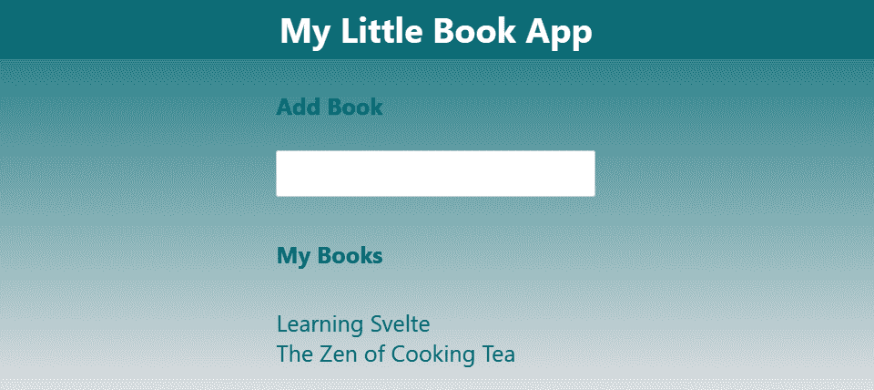

我们将从项目模板脚手搭建项目。我们将使用官方的 [Svelte 模板](https://github.com/sveltejs/template/)。其他替代方案是使用 [基于 Vite 的模板](https://github.com/vitejs/vite/tree/main/packages/create-vite/template-svelte) 或使用 [SvelteKit](https://kit.svelte.dev/)（构建在 Svelte 之上的框架，但在本教程中我们将保持最简单）。

下载模板后，进入其文件夹并运行`npm install`，下载我们需要的所有包。然后切换到`App.svelte`，我们将内容替换为纯 HTML 版本，以布局我们想要的视觉效果：

```html
<h4>添加书籍</h4>
<input type="text" />
<h4>我的书籍</h4>
<ul>
  <li>一本书</li>
</ul>
```

> 我们可以直接在 Svelte 文件的顶层编写上述代码；不需要添加任何包装元素。Svelte 的语法是 HTML 的超集，因此任何在 HTML 文件中有效的代码在 Svelte 文件中都是有效的。

现在的问题是如何将动态部分加入其中。我们首先在脚本中添加一个静态列表，并通过循环进行渲染：

```html
<script>
  let books = ['学习 Svelte', '泡茶之道'];
</script>

<label>
  <h4>添加书籍</h4>
  <input type="text" />
</label>

<h4>我的书籍</h4>
<ul>
  {#each books as book}
    <li>{book}</li>
  {/each}
</ul>
```

我们添加了一个`script`标签，并在其中放入了与组件相关的 JavaScript 逻辑。该逻辑会在组件每次挂载时执行。我们还使用特殊的 Svelte 语法增强了 HTML，创建一个循环并打印每本书的标题。如你所见，Svelte 的控制流块有独特的语法，与 Vue 或 Angular 不同，后者通过特殊属性的形式添加此类功能。这使得代码更具读性，因为你可以更容易发现它。它意味着如果你想在控制流块中包含多个顶层级项，就不需要创建包装元素了。

书的标题通过用大括号包裹变量来输出。通常情况下，每当你在模板中遇到大括号时，你就知道自己正在进入与 Svelte 相关的内容。我们将在本系列教程的第 2 部分更详细介绍模板语法。

## 响应用户输入

我们现在可以渲染由`books`变量定义的任意书名列表。那么添加新书呢？要做到这一点，我们需要增强`<script>`标签中的逻辑，并将其与`<input>`元素连接：

```html
<script>
  let books = ['Learning Svelte', 'The Zen of Cooking Tea'];
  let newBook = '';

  function addBook(evt) {
    if (evt.key === 'Enter') {
      books = [...books, newBook];
      newBook = '';
    }
  }
</script>

<label>
  <h4>Add Book</h4>
  <input type="text" bind:value={newBook} on:keydown={addBook} />
</label>

<h4>My Books</h4>
<ul>
  {#each books as book}
    <li>{book}</li>
  {/each}
</ul>
```

我们添加了一个名为`newBook`的新变量，它应该镜像输入值。为了做到这一点，我们通过编写`bind:value={newBook}`将其绑定到`<input>`。这建立了双向绑定，因此每当用户向`<input>`输入文本时，`newBook`就会更新；如果`newBook`在`<script>`标签中更新，`<input>`的显示值就会改变。我们可以使用简单的动态属性实现同样的功能，但这种方法节省了一些代码——你会在 Svelte 中经常遇到这种思维模式。

当用户按下`enter`键时，我们想要将新标题添加到列表中。为了做到这一点，我们添加了一个 DOM 事件监听器。要告诉 Svelte 挂钩该事件，我们只需要在`on`和事件名称部分之间添加一个冒号——在这种情况下是`on:keydown`。之后，我们使用大括号并将函数名放在其中。每次事件触发时都会调用该函数。关于此模板语法的更多信息可以在本系列教程的第 2 部分找到。

这种情况下调用的函数是`addBook`，在其中我们检查键盘事件，如果用户确实按了`enter`，我们就更新`books`变量。注意，这里没有 Angular 或 Vue 2 中那样的`this`上下文，没有 Vue 3 那样的特殊值对象，也没有 React 中的`setState`。在在这种情况下，Svelte 不需要额外的语法来感知变量已更新。这听起来可能像魔法，但同时也像“纯粹且简单的 JavaScript”。

要理解 Svelte 是如何实现这一点的，我们需要查看其内部机制。Svelte 实际上对`.svelte`文件做了什么，以及在什么时候处理它？答案是：Svelte 实际上是一个编译器！在你的代码加载到浏览器之前，它已经完成了大部分工作。Svelte 解析代码并将其转换为普通的 JavaScript。在解析过程中，它能够看到如`newBook`之类的变量被用于模板中，因此对它的赋值将导致重新渲染。因此，编译输出会将这些赋值封装在`$$invalidate`函数的调用中，该函数将为下一次浏览器绘制调度该组件的重新渲染。这就是 Svelte 卓越性能的秘密：它预先知道哪些部分可能会触发重新渲染，只需要在这些精确的位置执行工作，手术式地更新 DOM。这也是 Svelte 应用包大小如此之小的原因：所有不需要的内容都不会包含在输出中，因此 Svelte 可以舍弃其微小运行时中每个不需要的部分。一个 Svelte Hello World! 应用的包大小仅为 2.5KB！

唯一注意的是，Svelte 只查找赋值操作。这就是为什么我们需要执行`books = [...books, newBook];`或`books.push(newBook); books = books;`。否则，Svelte 将不知道`books`已经更新。

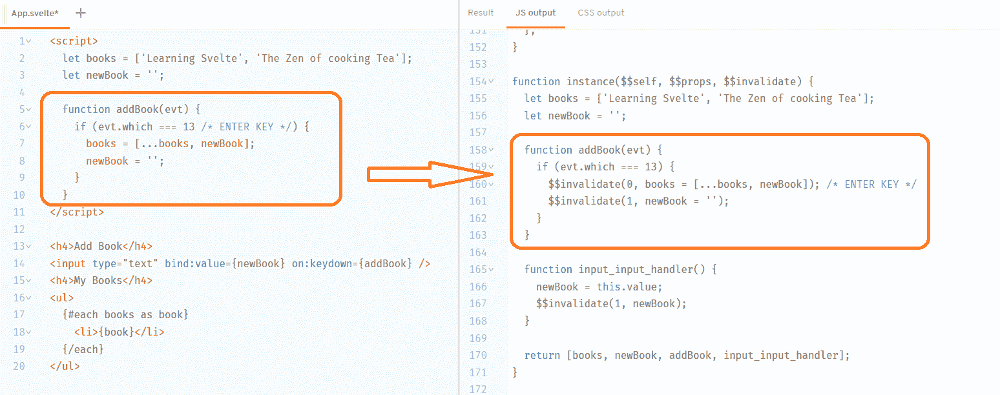

## 最后的完善

我们做到了！我们现在可以查看并向列表添加书籍了！不过看起来没那么漂亮，所以让我们给 UI 做一些最后的修饰。首先，我们将添加一些 CSS 来美化元素：

```html
<!-- script and html code... -->
<style>
  input {
    padding: 5px 10px;
  }
  li {
    list-style: none;
  }
  ul {
    padding: 5px 0;
  }
</style>
```

如你所见，我们只需要在`.svelte`文件中添加`<style>`标签并继续编写普通的 CSS。（注：原文中存在大量重复内容，此处已清理）。

正如你所见，Svelte 为我们所有的需求提供了解决方案，我们将在本系列中介绍这些方案。

## 准备好了吗，准备好……Svelte？

那么，在你的下一个项目中使用 Svelte 安全吗？你的经理可能会问 Svelte 在未来几年内是否还会存在，还是会像之前的前端框架明星一样销毁。虽然没有像 Angular 和 React 那样有一家大公司支持 Svelte 的整个开发，但 Vue 已经证明这并不是问题。此外，正如开头提到的，Svelte 的创建者 Rich Harris 现在正在全职投入其中。随着 Svelte 气气的持续上升，没有迹象表明它在未来几年会消失。

选择框架的另一个方面是生态系统及其工具。与 React 相比，它的生态系统仍然较小，但每天都有新库出现，并且已经有很多非常优秀的组件库。同时，由于 Svelte 非常接近原生 HTML 和 JavaScript，你可以非常轻松地将任何现有的 HTML/JavaScript 库集成到你的代码库中，而无需封装库。

在工具方面，Svelte 的表现看起来不错。有一个活跃维护的官方 VS Code 扩展，还有一个底层的语言服务器可以供许多其他 IDE 使用以集成智能补全。IntelliJ 也有 Svelte 的插件，并且最近聘请了其创建者在 JetBrains 工作。还有各种工具可以将 Svelte 与各种打包器集成。而且是的，你也可以在 Svelte 中使用 TypeScript。

如果你正在构建一个完整的网站或 Web 应用，你可能还会感兴趣查看 [SvelteKit](https://kit.svelte.dev/)。它提供了极佳的开发体验，并带有灵活的基于文件的路由。它还允许你部署到许多不同的平台，如 Vercel、Netlify、你自己的 Node 服务器，或简单的静态文件服务器，取决于你的应用程序的功能和需求。

### Svelte 总结

简而言之，这里是 Svelte 需要记住的重要点：

* 它有全职维护者
* 它有良好的工具
* 它的功能是稳定的
* 它的生态系统正在增长
* 可以使用 SvelteKit 快速构建应用

总结一下：Svelte 绝对准备好用于你的下一个项目了！如果你想尝试并了解更多信息，本教程系列将为你解答。在第 2 章中，我们将仔细查看模板语法。在第 3 章中，我们将查看响应式语句以及它们如何帮助我们响应变量变化或派生计算变量。在第 4 章中，我们将查看 store，它们将帮助我们在 Svelte 文件外部和之间处理逻辑，我们也可以将其用于状态管理。在第 5 章中，我们将查看各种组件交互概念。最后，在第 6 章中，我们将研究测试 Svelte 应用。

我们希望这引起你对 Svelte 的兴趣！

## 第 2 章：模板语法

在第一章中，我们介绍了 Svelte 的历史，并在编写简单组件方面迈出了第一小步。在本及后续章节中，我们将更仔细地观察编写 Svelte 代码的特定方面。最后，你将能够在 Svelte 中创建可的应用程序。我们将从深入研究 Svelte 的模板语法开始。

与 Angular 或 Vue 类似，Svelte 通过几个功能增强了 HTML 语法，用于表示动态属性、循环等。我们将查看每一个功能，并看看它们如何帮助你编写可读性代码。Svelte 的优点之一是，你可以从“纯 HTML”开始，逐渐用动态功能增强你的标记。你通过使用特殊语法来实现——在 Svelte 中称为 HTMLx——它作为 HTML 的增强。我们将使用这种语法逐渐增强以下代码，该代码代表待办事项应用的初始草稿：

```html
<label>
    New To-Do
    <!-- 实现：让这里更新列表 -->
    <input type="text" />
</label>

<!-- 实现：只有当还没有待办事项时才显示此内容 -->
<p>你想处理些什么？</p>

<ul>
    <!-- 实现：使其成为动态列表 -->
    <li>一个项目</li>
</ul>
```

上面的代码片段展示了我们想通过这个小应用实现的目标：能够输入新的待办事项并在列表列表中显示它们。其他事宜（如将待办事项标记为已完成）目前不在考虑范围内，但当然，你完全可以在读完本教程后自己添加这些功能。

最终的应用程序看起来会像下面的图片一样。

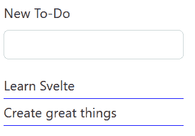

### 控制流语法

首先，我们想让列表动态化，并将文本条数组渲染为我们的待办事项列表。为了实现这一点，我们需要添加一个`<script>`块，以便将待办事项列表放入变量中。我们在第一章中看到，我们可以在`<script>`标签的内容中编写普通的 JavaScript 代码，其变量和函数随后可以在模板中可用。然后我们使用`#each`块——目前 Svelte 中四种控制流块之一——来在模板中遍历待办事项列表：

```html
<script>
    let todos = ['Learn Svelte', 'Create great things'];
</script>

<!-- ... -->
<ul>
    <!-- 语法：{#each <arrayname> as <entry>} -->
    {#each todos as todo}
        <li>{todo}</li>
    {/each}
</ul>
```

正如你所见，Svelte 在模板语法上与 Vue 或 Angular 采取了不同的方法。虽然后两者增加了循环等控制流语法，但 Svelte 为此创建了独特的语法。这使得代码更具可读性，因为你可以更容易发现它。它还让如果你想在控制流块中包含多个顶层项目时，就不需要创建封装元素。一个待办事项项的文本通过用大括号包裹变量来输出。

通常情况下，每当你遇到大括号，你就知道自己正在进入与 Svelte 相关的内容。

#### 寻找大括号！

让我们使用另一个控制流块来解决第二个任务：即当我们还没有待办事项时显示消息。我们将使用`#if`块：

```html
<script>
    let todos = ['Learn Svelte', 'Create great things'];
</script>

<!-- ... -->
{#if todos.length === 0}
    <p>你想处理些什么？</p>
```


```svelte
{:else}
  <ul>
    {#each todos as todo}
      <li>{todo}</li>
    {/each}
  </ul>
{/if}
```

### 更多控制流

`if` 块读起来非常像普通的 JavaScript `if` 块。块以 `{#if ..}` 开始，并可以有多个 `{:else ..}` 分支以及一个最终的 `{:else}` 分支。和普通的 `if` 块一样，后两者是可选的。通过编写 `{/if}` 关闭块。通常，控制流语法是 `{#<name> ..} .. {:<possibly something>} .. {/<name>}`。井号标记块的开始，冒号标记可选分支（冒号后面的文本取决于控制流块），斜杠标记块的结束。

`#if` 和 `#each` 可能是你最常使用的，但还有两个控制流块在某些场景下也会派上用场。

第一个是 `#await` 块，它允许你在标记中使用 Promise：

```html
{#await somePromise}
  Loading..
{:then result}
  结果是 {result}
{:catch error}
  噢不！发生了错误：{error}
{/await}
```

如上所示，我们可以处理 Promise 的所有状态，从加载结果到捕获错误。就像我们在 `#if` 中看到的那样，其语法和语义与在普通 JavaScript 中使用 Promise 高度类似：你对 Promise 进行 `#await`，`{:then ...}` 非常类似于 Promise 对象的 `.then(..)` 函数，而 `{:catch ...}` 非常类似于 Promise 对象对应的 `.catch(..)` 函数。这些分支都是可选的，你也可以通过 `{#await somePromise then result}..{/await}` 来跳过显示加载分支。

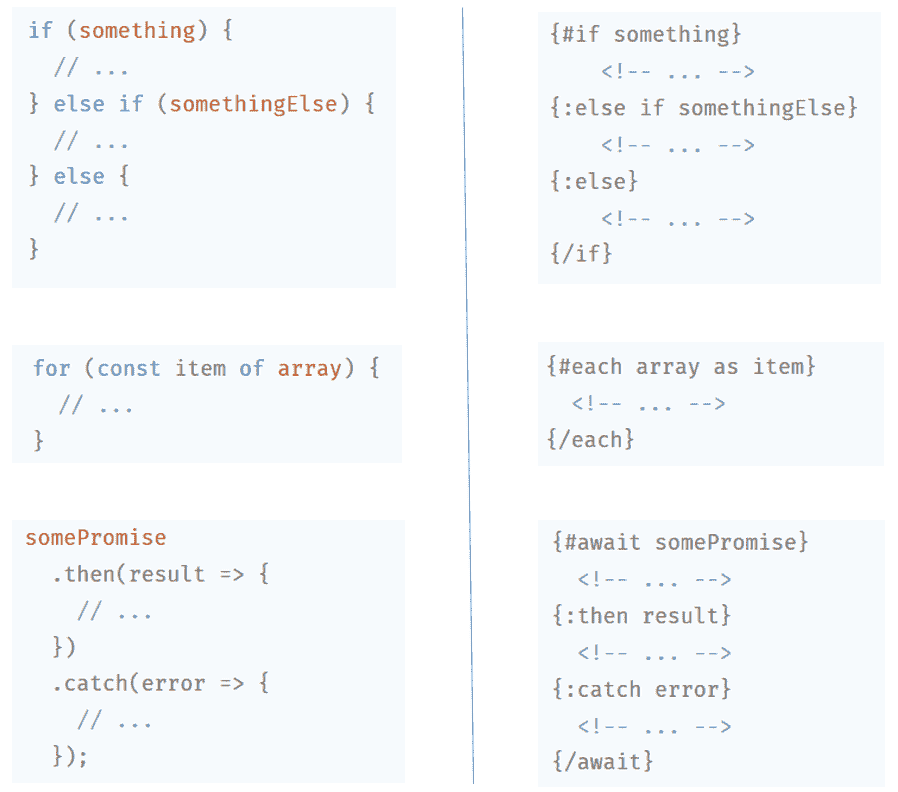

最后一个控制流块是 `#key`，它是最近添加的。如果传递给它的值发生变化，它将销毁并重建其内部的所有内容：

```svelte
{#key someValue}
  每当 `someValue` 变化时，我会被销毁并重建
{/key}
```

这主要在两种场景下非常有用。第一种场景是你有一个组件，从头开始创建它的状态和内容比更新它更简单——例如，当你封装了一个没有提供良好更新机制的第三方库时。第二种场景是你想要重新播放过渡动画（transition）。过渡是一种在元素创建或销毁时才会触发的动画。

让我们回到示例，它现在看起来如下：

```svelte
<script>
  let todos = ['Learn Svelte', 'Create great things'];
</script>

<label>
  新待办事项

  <!-- 实现：让此操作更新列表 -->

  <input type="text" />
</label>

{#if todos.length === 0}
  <p>你想做点什么？</p>
{:else}
  <ul>
    {#each todos as todo}
      <li>{todo}</li>
    {/each}
  </ul>
{/if}
```

我们现在能够区分空列表和有待办事项的情况，并且可以将它们中的每一项渲染到列表中。太棒了！

## 使用事件和绑定添加新的待办事项

剩下的工作是能够向列表添加新的待办事项。当我们在文本框中输入内容并按下 `Enter` 键时，我们希望将该文本作为新项目添加到列表中。第一个版本看起来如下：

```svelte
<script>
  let todos = ['Learn Svelte', 'Create great things'];
  let newTodo = '';

  function handleKeyup(evt) {
    if (evt.key === 'Enter') {
      todos = [...todos, newTodo];
      newTodo = '';
    }

    newTodo = evt.target.value;
  }
</script>

<label>
  新待办事项
  <input type="text" value={newTodo} on:keyup={handleKeyup} />
</label>

<!-- ... -->
```

这里发生了几点事情，让我们逐一来看。

首先，我们通过将 `newTodo` 的值赋值来设置 input 的 `value` 属性。每当 `newTodo` 更新时，输入框也会随之更新。如果我们给变量起一个与属性相同的名称，我们可以写成 `{value}`，这是 `value={value}` 的简写。当变量名和属性名相同时，就可以使用这些简写。

接下来，我们监听 input 的 `keyup` 事件。有许多 DOM 事件，都以 `on` 开头——在这种情况下是 `onkeyup`。要告诉 Svelte 挂钩该事件，我们只需要在 `on` 和事件名的其余部分之间添加冒号——因此在这里是 `on:keyup`。之后，我们使用大括号并将函数名放在里面。每当事件触发时都会调用该函数。如果你喜欢，也可以在里面放置一个匿名函数。

在 `handleKeyup` 内部，我们随后监听 `keyup` 事件并采取相应的行动。每当我们输入一个字符时，都会更新 `newTodo`，当我们按下 `Enter` 时，我们将文本添加到待办事项列表中，然后重置输入值。注意，我们不需要任何像 `setState` 这样的额外函数来告诉 Svelte 变量变化进行重新渲染。Svelte 通过查找赋值运算符来判断何时需要重新渲染，因此它知道哪个变量是“脏”（dirty）。在编译 Svelte 组件时，它会将这些赋值封装在一个函数调用中，告诉运行时在下一次浏览器绘制时重新渲染。但要小心，这意味着仅执行 `todos.push(newTodo)` 是不起作用的：Svelte 只会将通过赋值更新的变量标记为脏。因此，编写 `todos.push(newTodo); todos = todos;` 就可以。

上面的代码可以工作，但我们可以做得更好。我们与其通过监听 `keyup` 事件来手动保持 `newTodo` 与输入值的同步，还可以使用绑定。结果如下：

```svelte
<script>
  let todos = ['Learn Svelte', 'Create great things'];
  let newTodo = '';

  function handleKeyup(evt) {
    if (evt.key === 'Enter') {
      todos = [...todos, newTodo];
      newTodo = '';
    }
  }
</script>

<label>
  新待办事项
  <input type="text" bind:value={newTodo} on:keyup={handleKeyup} />
</label>

<!-- ... -->
```

有了这些工具，你现在准备好为你的 HTML 丰富动态内容和行为了！在下一章中，我们将介绍响应式语句（reactive statements）以及它们如何帮助我们推导出计算变量或响应变量的变化，以及 Svelte 如何再次利用其独特优势——作为编译器——来让编写这些代码的开发者体验尽可能良好。

# 第 3 章：响应式语句

到目前为止，我们已经了解到 `Svelte` 能够将组件内部普通的变量赋值编译为能够自动更新视图的内容。每当你给一个变量赋值时，`Svelte` 都会注意到这一点，并为下一次浏览器绘制调度一次重新渲染（rerender）。随后我们仔细查看了组件语法，了解了如何向 HTML 代码中添加动态行为。在本章中，我们将关注 `<script>` 标签的内容，并查看我们如何响应变量的变化来运行其他代码。

你是否曾经需要对变量的变化做出响应？可能每天都以某种形式需要过。`Svelte` 已经通过重新渲染视图来很好地响应变量的变化了。但如果我们需要在 `<script>` 标签内部显式地对变量变化做出响应呢？例如：计数翻倍、在 ID 变化时从后端获取新对象——这里有很多用例。这就是响应式语句大显身场的地方。它们看起来像：

```javascript
<script>
  // 响应式声明
  $: foo = bar;

  // 响应式语句
  $: {
    something = somethingElse;
  }
</script>
```

在语法上，响应式语句通过美元符号加冒号——`$:` 来表示。这实际上是有效的 JavaScript 语法。最初，它表示一个标签语句（labelled statement）——`labelname : statement`——你可以通过 `continue` 或 `break` 告诉 JavaScript 跳到该标签。但由于没有人使用它，`Svelte` 填补了这个空白，用来在语法上表示它的响应式语句。这意味着你不能在 `Svelte` 文件中使用名为 `$` 的标签语句，但由于你很可能也不会使用任何类型的标签语句，这不会产生任何影响。

解决了语法问题，让我们来看看响应式语句的语义含义，它们有两种形式：响应式声明（reactive declarations）和响应式语句（reactive statements）。

## 响应式声明

`响应式声明` 定义了一个值依赖于其他变量的变量。一个简单的响应式声明可能像这样：

```svelte
<script>
  let count = 0;
  $: doubled = count * 2;
</script>

<p>Count: {count}</p>
<p>Doubled: {doubled}</p>
<button on:click={() => count += 1}>Increase count</button>
```

这个响应式声明定义了变量 `doubled`，它表示为变量 `count` 的两倍。每当 `count` 变化时，`Svelte` 都会计算 `doubled` 的新值。将响应式声明想象成 Excel 单元格的公式：你声明式地定义结果，`Svelte` 处理剩下的部分——但请注意稍后我们将提到的注意事项。响应式声明也可以依赖其他响应式声明，所以你可以写 `$: quadrupled = doubled * 2`。

## 响应式语句

`响应式语句` 并不定义计算变量。相反，它定义了一个当依赖项变化时应该重新运行的块。在响应式语句块内部为了计算结果而被读取（*而不是*写入）的每一个变量都是依赖项。响应式语句看起来像这样：

```svelte
<script>
  let count = 0;
  let prevCount = 0;
  let countWentUp = false;

  // 语句
  $: console.log('Count is' + count);

  // 块语句
  $: {
    countWentUp = prevCount < count;
    prevCount = count;
  }
</script>

<p>Count: {count}</p>
<p>Count went {countWentUp ? 'up' : 'down'}</p>

<button on:click={() => count += 1}>Increase count</button>
<button on:click={() => count -= 1}>Decrease count</button>
```

如你所示，响应式语句本质上是在特定时间重新运行的任意代码。在上面的示例中，`console.log` 语句每当 `count` 变化时都会重新运行。在块语句内部，我们响应 `count` 的变化来更新两个变量。首先，我们将之前的计数与当前计数进行比较，以确定计数增加还是减少，然后我们将当前计数存储为下一次运行的新之前的计数。你可以使用响应式语句来表达副作用，或者运行那些不适合简单的声明语句的、或涉及多个变量的计算。本质上，响应式语句是响应式声明的超集：你可以将每个响应式声明重写为响应式语句。以下代码在语义角度上是完全相同的：

```svelte
<script>
  let something = 'something';

  // 这 ...
  $: declaration = something;

  // 等于这个
  let statement;

  $: {
    statement = something;
  }
</script>
```

## 执行顺序

你现在可能会问，这些响应式语句按什么顺序运行。直觉上，它们与它们使用的内容之间存在某种顺序是合理的，但具体是怎样的呢？答案很简单：在编译时，`Svelte` 会查看响应式语句的*直接*代码并检查每个被*读取*的变量。这些是我们在上一节中简要提到过的依赖项。根据这些依赖项，`Svelte` 决定执行顺序。

从数学上来说，这被称为变量的**拓扑排序**（topological ordering）。如果 `Svelte` 无法通过这种方式确定顺序——例如，因为语句没有依赖项——它们将按照你写的顺序执行：

```svelte
<script>
  let count = 0;

  $: quadrupled = doubled * 2; // 第 2 次运行
  $: doubled = count * 2; // 第 1 次运行
  $: console.log(quadrupled); // 第 3 次运行
  $: console.log(count); // 最后运行
</script>
```

可能会出现某些情况，我们需要从依赖项中隐藏一个变量。在下面的任意（但简单）的示例中，我们希望 `multiplied` 只在我们增加 `count` 时更新，而在改变 `multiplyBy` 时不更新。我们通过将变量 `multiplyBy` 移动到函数中从直接依赖项中隐藏它来实现：

```svelte
<script>
  let count = 0;
  let multiplyBy = 2;

  $: multiplied = multiply(count);

  function multiply(value) {
    return value * multiplyBy;
  }
</script>
```

现在，`multiplied` 只在 `count` 变化时改变，而当 `multiplyBy` 变化时不会改变。这之所以有效，是因为 `Svelte` 只查看响应式语句的*直接*代码；它不会追踪函数调用。

反之也可能成立：我们可能希望即使在一个不直接导致结果的变量发生变化时也重新触发响应式语句。在这种情况下，我们可以通过让该变量出现在响应式语句中来添加该变量：

```svelte
<script>
  // ...

  $: variableWhichShouldTriggerRecalculation, retriggerCalculation();

  // ...
</script>
```

由于响应式语句是普通的 JavaScript，你还可以使用 `if` 块来对语句的重新运行时进行更多控制，仅在满足特定条件时才执行其主体。

```html
<script>
  // ...

  $: if (someVariable < 100) {
    // ...
  }

  // ...
</script>
```

上述代码会在 `someVariable` 或响应式语句中的任何内容发生更新时执行，但只有在满足 `if` 条件时才会进入语句体。你可以将其用作替代方案，用于从语句中隐藏变量；同时，还可以通过将其作为 `if` 语句中的一个占位条件（dummy condition），在正体中未使用的变量发生变化时重新运行该语句。

大多数情况下，你不需要关心依赖关系。与 `React` 相比，这让人轻松很多，因为在 hooks 的上下文中，你需要非常显式地声明依赖项。在 `Svelte` 中，大多数情况下它都会像你预期的那样“自动运行”，如果你需要微调执行行为，可以通过使用上面显示的技术之一轻松地调整代码。

让我们通过看另一个例子来总结这些发现。下面的截图显示了响应式语句运行的顺序。箭头表示对其他响应式语句的依赖。`multiplied` 先运行，因为它依赖于 `count`。`doubleMultiplied` 第二个运行，因为它依赖于 `multiplied`。`refreshDetails()` 第三个运行，因为它依赖于 `doubleMultiplied`。`console.log(count)` 最后运行，因为它写在所有其他响应式语句之后，且没有其他语句需要它先运行。当 `multiplyBy` 发生变化时，没有任何语句会重新运行，因为它们没有一个对它有直接依赖。

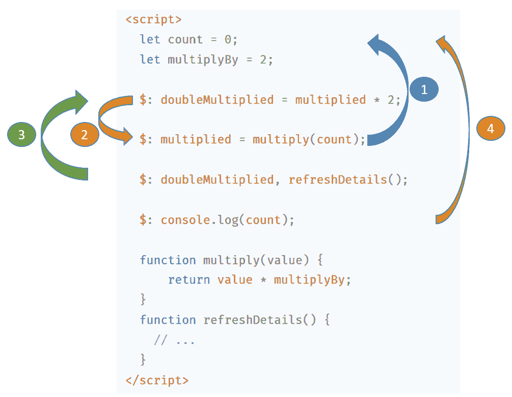

## 响应式语句只运行一次

在之前的章节中不清楚但可能重要的有一点是响应式语句的执行时机。如果一个普通变量被重新赋值，`Svelte` 会在下一次浏览器绘制（paint）时调度更新。在调度和绘制之间就是响应式语句执行的时间——但它们只执行一次。这意味着，如果一个响应式语句写入之前运行过的响应式语句正在读取的变量，那么该响应式语句将不会重新运行。这防止了无限循环、性能问题，并且使得某些响应式语句编写可行。让我们再次看看上面的响应式语句：

```html
<script>
  let count = 0;


`let prevCount = 0;`

`let countWentUp = false;`

```
$: {
    countWentUp = prevCount < count;
    prevCount = count;
}
```

这个响应式语句读取 `prevCount`，但也写入了 `prevCount`。如果该语句运行多次，将意味着它会立即再次失效，导致无限循环，并且最终始终给 `countWentUp` 赋值为 `false`，这违背了它的初衷。就像依赖关系一样，大多数情况下这不需要担心，因为编写响应式语句感觉非常自然。但一旦你进入更复杂的用例，记住这一点是有好处的。

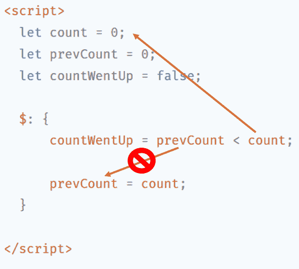

## 总结

本教程介绍了响应式语句。我们可以使用它们来响应其他变量的赋值，以执行副作用或创建计算变量。在 Svelte 中，响应式语句是通过查看直接依赖关系进行排序的，并被调度在变量赋值后运行。如果无法确定顺序，它们将按照声明的顺序运行。我们可以利用这一点，通过将变量移动到函数中从依赖项中隐藏它们，或者向语句中添加额外的变量来重新触发该语句的执行。如果在同一次运行期间，后执行的响应式语句更新了它们依赖的变量，则之前的响应式语句不会重新运行。考虑到这些，你现在已经准备好响应所有事情了！

这标志着我们专门关注单个组件内部结束。在第一章中，我们了解到 Svelte 是一个编译器，提供一些独特的优势，我们在本章中也看到了。在第二章中，我们仔细查看了组件语法，了解了如何向 HTML 代码添加动态行为。接下来的章节将涉及如何将组件相互整合。我们将首先查看 Svelte stores（存储），它们为我们提供了一个简单而强大的 API 来处理应用程序中的跨组件状态。

# 第 4 章：Stores

Svelte 在 Svelte 组件内部的响应式是直观且容易的。因为 Svelte 是一个编译器，它可以将普通的变量赋值转换为 UI 在变化时会重新渲染的内容（正如我们在第 2 章中看到的）。响应式赋值使得衍生或计算变量变得非常简单（正如我们在第 3 章中看到的）。

在 Svelte 组件之外，我们有不同的思维模型，代码没有固有的连接的 UI 层，且 Svelte 编译器不会触碰 Svelte 文件之外的代码。但如果我们也想在 Svelte 组件之外获得响应性的妙处呢？如果我们有一个位于 JavaScript 文件中的全局状态，当它变化时，许多组件应该对其做出响应怎么办？这就是 Svelte stores 用用场场。在本章中，我们将仔细查看 store API、如何使用它来构建封装良好的模块，以及如何在 Svelte 组件内部轻松地使用它们。

作为整个教程的实际示例，让我们选择一个可能在几乎所有应用程序中全局可用的东西：用户状态。在这个例子中，该状态将包含用户是否登录，以及如果他们登录了，他们的用户名。页面上有一个区域仅对身份验证的用户可见，如果他们登录了，他们的用户名始终在顶栏可见。

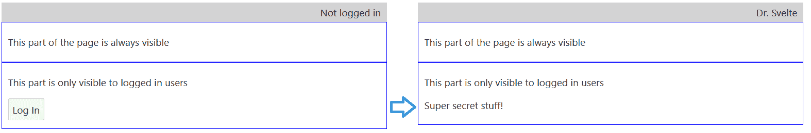

这个应用肯定不会为我们赢得任何设计奖，但它帮助我们展示了在这个应用程序中处理全局状态的问题。应用程序的根部如下：

```
<script>
    import Topbar from './Topbar.svelte';
    import AuthOnly from './AuthOnly.svelte';
</script>

<Topbar />

<div>
    <p>
        页面的这部分始终可见
    </p>
</div>

<div>
    <p>
        这部分仅对登录用户可见
    </p>
    <AuthOnly />
</div>

<style>
    div {
        border: 1px solid blue;
        padding: 5px 10px
    }
</style>
```

该组件使用了其他组件。为了做到这一点，我们在 `<script>` 标签中将它们作为默认导入导入。然后我们可以在模板中使用与默认导入相同的名称来使用它们。（我们将在系列的第 5 部分更深入地研究组件交互。）

`Topbar.svelte` 看起来如下：

```
<div>
    如何在这里获取用户名？
</div>

<style>
    div {
        background: lightgrey;
        padding: 5px;
        text-align: right;
    }
</style>
```

而 `AuthOnly.svelte` 看起来如下：

```
<script>
    let authenticated = false;
</script>

{#if authenticated}
    <p>
        超级秘密的内容！
    </p>
{:else}
    <button on:click={() => authenticated = true}>登录</button>
{/if}
```

`Topbar` 和 `AuthOnly` 组件都需要访问用户状态；通过属性传递并不是一个选项。在这个简单的示例中，我们只需要将用户状态传递给一个组件，但在现实中这几乎不会发生。所以我们需要另一个地方来共享状态。此外，`AuthOnly` 需要更新状态以登录用户。现在我们把状态放在哪里呢？最好将其放在一个导出状态的 JavaScript 文件中，这样所有人都可以访问。让我们试试吧！

## 第一次尝试

创建一个包含如下内容的 `user.js`：

```
export let user = { loggedIn: false };

export function login() {
  user = { loggedIn: true, name: "Dr. Svelte" };
}
```

我们还在 `Topbar.svelte` 中导入了 `user` 状态：

```
<script>
  import { user } from './user';
</script>

<div>
    {user.name || '未登录'}
</div>
<!-- style... -->
```

我们在 `AuthOnly.svelte` 中执行了同样的操作，在那里调用了 `login` 函数：

```
<script>
    import { user, login } from './user';
    let authenticated = user.loggedIn;
</script>

{#if authenticated}
    <p>
        超级秘密内容！
    </p>
{:else}
    <button on:click={() => login()}>登录</button>
{/if}
```

这在开始时会正确显示未登录状态，但我们不知为何无法让登录状态回传到组件中。为什么呢？根结底，这在 Svelte 文件内部的工作原理不是一样的吗？原因是 Svelte 编译器只查看 Svelte 文件来执行转换。JavaScript 文件则保持原样。此外， JavaScript 文件内部的语义是不同的；它与视图层没有直接连接。因此，我们某种程度上需要显式地将状态表达为一个随时间变化的的对象，Svelte 组件可以对其做出响应。这就是 Svelte store（存储）大显身手的地方。

## 介绍 Writable Stores

Svelte 提供了一个非常简单的 API 来初始化和更新 store。`store` 是一个存储（故名如此）值（也称为状态）的东西，其他人可以对其进行订阅，并在该 store 的值更新时接收通知。

Svelte store API 的核心是 `writable` 函数，它提供了这种功能。调用 `writable` 函数时传入初始状态，它会返回一个包含 `set`、`update` 和 `subscribe` 方法的对象。`set` 被调用时传入新的期望状态。`update` 调用时传入一个函数，该函数获取当前状态并预期返回下一个状态。`subscribe` 调用时传入一个回调函数，该函数每当状态改变时就会被调用，并返回一个可以用来取消订阅的函数：

```
import { writable } from "svelte/store";

const store = writable("initial value");

const unsubscribe = store.subscribe((value) =>
  console.log("the current value is " + value)
);

store.set("new value");
store.update((value) => value + " 2");

unsubscribe();
store.set("another value");
```

在上面的代码段中，值首先是 `"initial value"`，然后是 `"new value"`，最后是 `"new value 2"`。所有这些字符串都被记录了，因为 `subscribe` 回调函数每次被调用并将其记录下来。`subscribe` 函数返回一个 `unsubscribe` 函数。在调用它之后，对 store 的更新——在本例中为 `"another value"`——将不再被记录。如果你熟悉 RxJS，这个 API 可能会看起来很熟悉，事实上，该 API 紧遵循观察者（observables）原则。

让我们把 `writable` 应用到我们的用例：

```
import { writable } from "svelte/store";

export let user = writable({ loggedIn: false });

export function login() {
  user.set({ loggedIn: true, name: "Dr. Svelte" });
}
```

我们更改了 JavaScript 文件中的代码，并用 `writable` 包裹了状态。这意味着我们需要调整 Svelte 组件来订阅该状态。这是在 `Topbar.svelte` 中的第一次尝试：

```
<script>
  import { user } from './user';
  import { onDestroy } from 'svelte';

  let _user;
  const unsubscribe = user.subscribe(u => _user = u);
  onDestroy(unsubscribe);
</script>

<div>
    {_user.name || '未登录'}
</div>
<!-- style... -->
```

这起作用了！如果在 `AuthOnly.svelte` 内部按下 `login`，我们将在顶部栏看到“Dr. Svelte”的名字。不过，这个解决方案有点模板化：我们必须订阅 store，将其赋值给本地变量，并记住在组件销毁时取消订阅。我们能做得更好吗？这又是 Svelte 的大优势大用武之地：它是一个编译器。既然编译器无论会将 Svelte 文件转换为 JavaScript 文件，它也可以进行转换以消除这些订阅的模板代码。我们只需要在 store 前面加一个美元符号 `$`，Svelte 就会处理其余工作：

```
<script>
  import { user } from './user';
</script>

<div>
    {$user.name || '未登录'}
</div>
<!-- style... -->
```

就像响应式语句（我们在第 3 部分中介绍过）一样，美元符号被用于某些响应式的 Svelte 魔法。在 Svelte 文件中，禁止在变量名前前声明（但不使用）美元符号。相反，它们是给编译器的信号，用于为我们生成之前手动编写的所有订阅模板代码。这在更新 store 时也有效。如果我们在 Svelte 组件内部编写 `$user.name = "Dr. Dollarsign` 或 `$user = { loggedIn: false }`，这会被 Svelte 编译器转换为 store 更新。很酷！但请注意，无法使用 `$` 语法订阅未在顶层创建的 store（导入是顶层的，所以那没问题）。我们也无法订阅嵌套在对象内部的 store：我们首先需要将其提取到顶层变量中。这些局限性值得记在心里，但你可能很少会遇到它们。

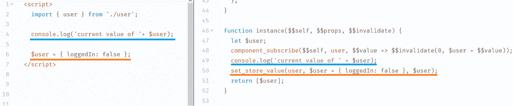

通过美元符号语法订阅 store 不仅适用于 Svelte stores。每个满足 store 契约的对象（换句话说，提供了 `subscribe` 方法）都可以以这种方式使用。例如，如果你倾向于使用 RxJS，你可以使用完全相同的 `$user` 语法来订阅观察者。我们可以利用这一点来创建自己的封装好的用户 API。现在，每个人都能直接更新用户状态，因为我们暴露了整个 `writable`。为了确保每个使用用户状态的人都通过 API 来更新状态，我们可以这样创建自己的 store：

```
import { writable } from "svelte/store";

let _user = writable({ loggedIn: false });

function login() {
  _user.set({ loggedIn: true, name: "Dr. Svelte" });
}

export const user = {
  subscribe: _user.subscribe,
  login,
};
```

然后我们像这样调整 `AuthOnly.svelte` 组件：

```
<script>
  import { user } from './user';

  $: authenticated = $user.loggedIn;
</script>

{#if authenticated}
    <p>
        超级秘密内容！
    </p>
{:else}
    <button on:click={() => user.login()}>登录</button>
{/if}
```

我们可以继续使用 `$user` 语法，并通过该对象的方法来更新状态。像 `$user.loggedIn = true` 或 `user.set({ loggedIn: true })` 这样的操作不再可行，因为 `writable` 的 `set` 方法不再暴露。还要注意我们可以在 `<script>` 标签和响应式语句中使用 `$user`。它是可以在组件中任何地方使用的变量。

下面的截图可视化了我们示例应用的状态流。

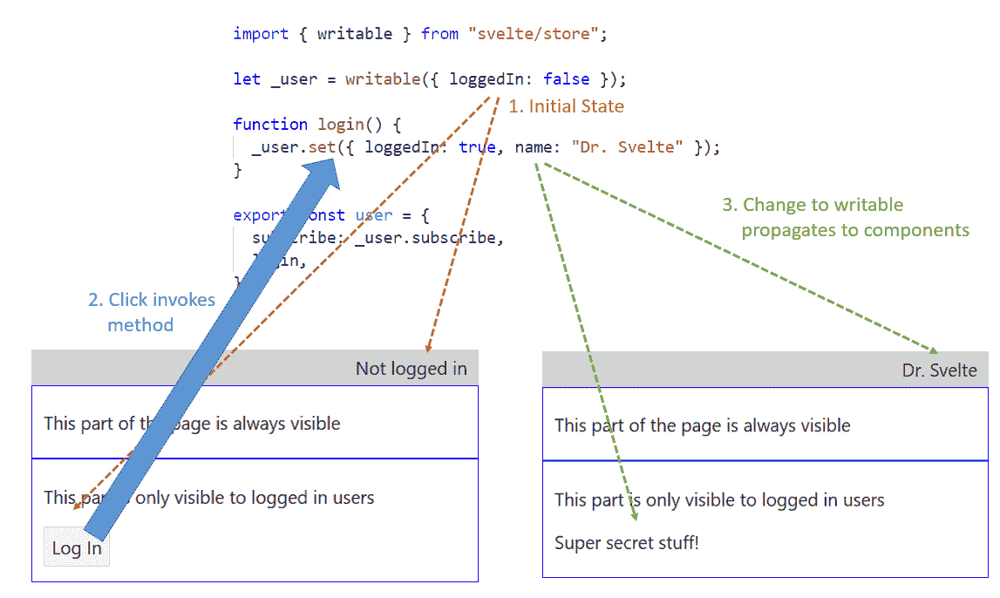

## Readable Stores

有时我们可能想要创建一个无法从外部更新的 store。一个用例是确保没有人（不包括文件内部）从外部更新 store，因为它们应该是自包含的——例如一个每秒更新一次且无法从外部重置或调整的时钟。在这种情况下，可以使用 `readable`：

```
import { readable } from "svelte/store";

const time = readable(null, (set) => {
  set(new Date());

  const interval = setInterval(() => {
    set(new Date());
  }, 1000);

  return () => clearInterval(interval);
});
```

上面的代码创建一个没有 `set` 或 `update` 方法只有 `subscribe` 方法的 store。我们无法从外部设置。`readable` 的初始状态通过第一个参数设置；第二个参数是一个在订阅计数从 0 变为 1 时调用的函数。它被传递一个 `set` 函数，我们可以用它从内部更新状态——在本例中，每秒更新当前时间。我们可以返回一个在订阅计数从 1 变为 0 时调用的函数。在这种情况下，我们清理了定时器。

一旦我们开始使用 store（存储器），我们可能还想要将一些 store 组合，或者从某个 store 派出一个不同的值。在这种情况下，我们可以使用 `derived`。假设我们的用户名被分为姓（surname）和名（lastname），但我们希望在应用的不同地方显示组合后的名称。为了避免重复代码，我们使用一个 `derived` store 将它们合并在一起：

```
import { derived } from "svelte/store";
import { user } from "./user";

export const username = derived(
  user,
  (_user) => _user.surname + " " + _user.lastname
);
```

在最简单的形式下，`derived` 接受一个 store 或 store 数组作为第一个参数，并将一个获取该 store 或这些 store 当前值的函数作为第二个参数。对于更复杂的用例，该函数还提供了第二个参数——`set`——我们可以用它在适当的时候更新 `derived` 状态。在这种情况下，返回值可以是一个函数，该函数会在订阅者数量从 1 变为 0 时被调用。此时我们还可以给 `derived` 传递第三个参数，用于标记初始值。

这是一个示例：

```
import { derived } from "svelte/store";

// ...
```


`export const itemDetails = derived(itemId, (_itemId, set) => { getItemDetails(_itemId).then((details) => set(details)); }, "Loading...");`

上面的代码创建了一个 `derived` store，每当 ID 变化时，它都会根据 ID 获取项目的详情，并初始显示 `"Loading..."`。

## 总结

就是这些！在本系列教程第四个教程中，我们深入研究了 Svelte stores。我们学习了可以使用 `writable` 让状态在多个 Svelte 组件间可用，而这些组件只需在变量名后添加一个美元符号 `$` 即可响应更新。

我们看到，它并不非得是一个 Svelte store。相反，任何实现了 `subscribe` 契约的对象都可以在 Svelte 组件中那样使用。这允许我们使用诸如`RxJS`的其他库，或者创建自定义对象。Svelte stores 帮助我们管理状态，为健壮的状态管理解决方案提供了原语。

我们还查看了`readable` store，它帮助我们创建从外部无法更改的状态；以及`derived` store，它为从传入的 store 创建派生状态提供了选项。Svelte store API 的核心非常易理解，但也能扩展到更复杂的用例。

你现在准备好创建 store 来处理跨不同组件共享的状态了！在下一章中，我们将查看除使用 store 之外的组件交互，以构建健壮的应用。

# 第 5 章：组件交互概念

组件是`Svelte`等前端框架的核心。它们是组织和实现视图层的主要单元。组件封装了特定的 UI 和/或行为——例如按钮的外观、包含任意元素的列表，或页面的特定部分。

在书的前半部分，我们关注的是单个组件的内部细节。我们在第 2 章中查看了模板语法，在第 3 章中查看了响应式语句。在第 4 章中，我们查看了 Svelte stores，它为实现状态管理提供了一个方便的 API，并且可以跨组件更新。当然，还有更多方法可以将组件进行相互集成——我们将在本教程中介绍它们。读完本章后，你将能够为正确的工作使用正确的组件 API。

## 使用其他组件

组织代码的关键部分是将每个部分放在最合适的位置。这意味着编写和复用组件。我们可以通过作为默认导入来引入另一个组件，然后在模板内部像使用普通元素标签一样使用它：

```svelte
<script>
  import SomeOtherComponent from "../somewhere/else/SomeOtherComponent.svelte";
</script>

<SomeOtherComponent />
```

列表现在已经显示了，我们可以重新加载它，但列表项的样式是固定的；我们无法从外部更改它。为了改变这一点，我们使用了插槽（slots）。`slot` 就像一个占位符，其内容由父组件决定。让我们先在列表组件中定义插槽：

```svelte
<script>
  // ...
</script>

{#if showReload}
  <button on:click>Reload list</button>
{/if}

<ul>
  {#each items as item}
    <li>
      <slot {item}>
        {item}
      </slot>
    </li>
  {/each}
</ul>
```

`<slot>` 标签标记该区域为父组件内容的放置位置。`{item}` 属性意味着父组件在提供 UI 时可以使用 `item` 属性。否则，我们没有办法在父组件中输出项的文本。`<slot>` 内部的内容是它的回退内容（fallback content），以防父组件没有提供它自己的 UI。回退内容是可选的，你并不需要提供它。

让我们在父组件中使用组件插槽：

```svelte
<script>
  import List from "./List.svelte";
  // ...
</script>

<List items={list} showReload={true} on:reload={reloadList} let:item>
  <b>{item}</b>
</List>
```

我们选择简单地将项的文本放入 `<b>` 标签中，使其加粗。插槽的 UI 位于组件的标签内部。我们可以通过编写 `let:item` 来使用传递给插槽的 `item` 属性。如果想重命名该属性，可以写 `let:item={anotherVariableName}`。

上面的插槽是默认插槽。我们还可以使用具名插槽（named slots）来提供多个插槽，它们可以出现在不同的区域。给插槽命名只需要写 `<slot name="desiredName" />`，而使用它同样一样，只需在父组件的元素上添加 `slot="desiredName"` 属性，该元素就会进入特定的插槽。如果有一个“空列表占位符”插槽，它看起来会像这样：

```svelte
<!-- ... -->
<List items={list} showReload={true} on:reload={reloadList} let:item>
  <b>{item}</b>
  <!-- 如果组件传递了插槽属性，你也可以在具名插槽上使用 let:xx -->
  <p slot="empty">列表为空</p>
</List>
```

下面的截图可视化了插槽功能。

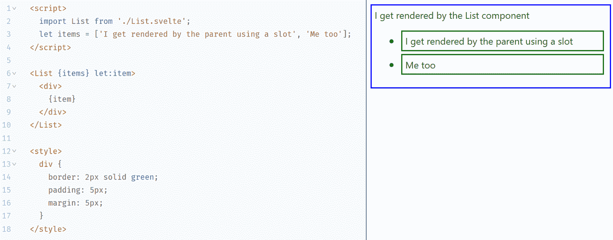

## 使用 Module 脚本管理相同组件的实例

列表的重新加载功能非常成功——确实很大，以至于老板现在要求在页面顶部某处添加一个“全部刷新”按钮。对于这种情况——即我们需要管理和/或协调多个相同类型的组件实例，或者在组件生命周期之外运行代码但将其与组件放在一起——我们可以使用`module`脚本标签。这是另一个带有额外`context="module"`属性的脚本标签。该脚本标签内部的代码只运行一次且立即执行。可以将其看作一个独立的 JavaScript 文件，但它与 Svelte 组件位于同一处。让我们用它来实现“全部刷新”的行为：

```svelte
<script context="module">
  let reloads = new Set();

  export function reloadAll() {
    reloads.forEach((reload) => reload());
  }
</script>

<script>
  import { createEventDispatcher, onMount } from "svelte";

  export let items;
  export let showReload = false;

  const dispatch = createEventDispatcher();

  onMount(() => {
    const reload = () => dispatch("reload");
    reloads.add(reload);

    return () => reloads.delete(reload);
  });
</script>

<!-- ... -->
```

我们创建了一个包含所有“刷新”`dispatch`函数的`Set`。每当创建一个列表实例时，我们就封装`dispatch`函数并将其添加到`Set`中。当组件实例销毁时，我们将其移除。现在剩下的工作是在实现“全部刷新”按钮的地方使用导出的`reloadAll`函数：

```svelte
<script>
  import { reloadAll } from "../somewhere/List.svelte";
</script>

<button on:click={reloadAll}>全部刷新</button>
```

Svelte 组件的默认导入是组件构造函数本身。具名导入是从模块脚本导出的内容。这样，我们就可以轻松地导入`reloadAll`并在适当调用它。

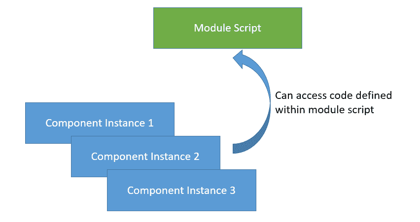

你可能偶尔需要模块脚本，但当你需要时，它们将非常有用，允许与你的组件进行命令式交互，或者用于管理和协调多个相同类型的实例。另一个例子——来自 Svelte 官方教程——涉及到多次渲染音频播放器组件，但只允许其中一个同时播放。这也可以通过模块脚本轻松实现。

## 使用 Context 为组件树提供状态

在“全部刷新”功能上线一天后，老板意识到实际上刷新所有列表可能不是个好主意，而是应该刷新特定的列表。判断页面上某个列表区域是否支持刷新的计算是在这些列表的根部完成的。这被称为属性钻取（property drilling）。对于这种情况，向子组件提供上下文会非常有用。看起来如下：

```svelte
<!-- 在某个父组件中 -->
<script>
  import { setContext } from 'svelte';

  setContext('partOfAll', someCalculationThatReturnsBoolean());
  // ...
</script>

<!-- 在 List.svelte 中 -->
<script>
  import { getContext, onMount } from 'svelte';
  // ...

  const isPartOfAll = getContext('partOfAll');

  onMount(() => {
    if (!isPartOfAll) {
      return;
    }

    const reload = () => dispatch("reload");
    reloads.add(reload);

    return () => reloads.delete(reload);
  });
</script>
```

这两个函数——`setContext`和`getContext`——允许我们为提供组件的所有子组件提供特定内容。这类似于 React 中的`useContext`、Vue 中的`provide`/`inject`或 Angular 中的服务。注意需要在组件初始化期间调用这些函数。你不能在生命周期后期或异步调用它们。

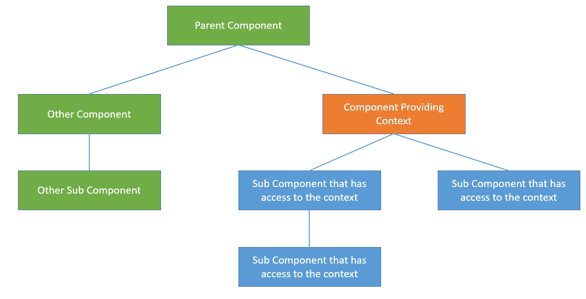

在上面的示例中，我们使用字符串作为键，但也可以使用`Symbol`或其他保证唯一的类型。值可以是任何内容。在这个例中，它是一个简单的布尔值，但也可以是一个函数或 store。上下文和 store 是提供随时间变化且子组件能够做出响应的值良好方法。这是一个例子：

```svelte
<!-- 在某个父组件中 -->
<script>
  import { setContext } from 'svelte';
  import { writable } from 'svelte/store';

  const count = writable(1);
  setContext('count', count);
  // ...
</script>

<!-- 在某个子组件中 -->
<script>
  import { getContext } from 'svelte';

  const count = getContext('count');
</script>

<p>计数是 {$count}</p>
```

如果你有全局可用的状态，你当然可以跳过使用上下文，直接从中心位置导入该状态。这就是我们在应用程序的上一个部分中使用 store 完成的工作。

## 总结

这是一个很长的篇章！在本教程中，我们学习了许多组件交互概念。总结一下：

*   使用组件属性和事件来实现基础组件交互。
*   当你需要从父组件在子组件的特定位置提供自定义 UI 时，请使用插槽。
*   当你需要管理或协调同一组件的多个实例，或者导出与其相关的命令式逻辑时，使用`<script context="module">`标签。
*   当你需要为应用的某个子部分提供某些值并希望避免属性层传递（property drilling）时，请使用`setContext`和`getContext`。

有了这些工具，你现在准备好以最好的方式来构建和组织你的组件了。

你现在准备好在 Svelte 中编写完整的应用程序了。在最后一章中，我们将测试这些应用程序。我们将探讨可以测试的不同层次，以及让你的应用程序具有测试性意味着什么。

# 第 6 章：测试应用程序

我们已经走了很长的一路了。我们从查看 Svelte 的历史以及使用它编写应用程序的第一步开始。随后，我们详细地介绍了构建此类应用程序的工具。我们深入研究了 Svelte 的模板语法（它是 HTML 的扩展）。我们看到了如何使用响应式语句来响应变量的变化——例如，为了创建计算变量。然后，我们查看了 Svelte 存储（stores），它们可以用于在多个组件之间共享状态，并且学习了组件之间相互集成的各种方法。

这一切赋予了我们创建可扩展 Svelte 应用程序的能力。但我们如何测试这些应用程序呢？这就是我们在最后一章中将看到的。

## 测试金字塔

在进入技术细节之前，让我们先后退一步，思考我们测试应用程序的方法。事实证明，并没有一种真正的方法。相反，测试有不同的层级。这实际上有一个专门的名字，你可能已经遇到过："测试金字塔"。

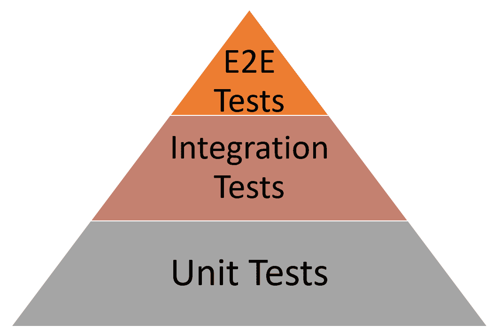

`testing pyramid`帮助我们分类各种测试方式。

在底部是`单元测试`（unit tests），它们一次只查看应用程序的一小部分——例如隔离测试某个特定的函数。

在其之上是`集成测试`（integration tests），它们组合测试应用程序的小中等部分。虽然单元测试对于测试诸如函数是否返回了正确结果等事情非常好，但它们无法告诉你该函数是否以正确的方式使用。你所有的单元测试都通过了，但你所测试的各个之间的交互可能是错误的。集成测试有助于发现这些错误。

金字塔的最顶层是`端到端测试`（end-to-end tests，缩写 E2E），它们比集成测试更进一步一步，不仅运行应用程序的一部分，还运行整个应用程序并从终端用户的视角进行测试。挑战在于让整个应用程序在测试条件下运行。优势是它们需要的模拟（mock）更少：只需要后端，或者如果你愿意，甚至后端也可以作为 E2E 测试的一部分运行。

它之所以被称为"测试金字塔"而不是简单的"测试层级"，是因为其理念是低层级的测试应该比高层级更多。有些人说，你应该追求 60% 的单元测试、30% 的集成测试和 10% 的 E2E 测试。然而，这没有单一的正确方法，特别是对于前端测试，甚至有人完全挑战金字塔理论，认为 E2E 测试是测试 Web 应用最简单、最稳健的方法——特别是在实现变化方面——所以你应该最关注这些。

最后，如何组织你的测试取决于你，我们将在本教程的剩余部分中专注于为每个层级提供一个示例。

## 测试设置

我们将使用[Jest](https://jestjs.io/)进行单元测试和集成测试。Jest 是目前前端代码最流行的测试库。如果你在使用 SvelteKit，可以通过[svelte-add-jest](https://github.com/rossyman/svelte-add-jest)在 SvelteKit 项目根目录下运行以下命令来设置并安装 Jest 测试所需的所有依赖：

```bash
npx apply rossyman/svelte-add-jest
npm install @testing-library/svelte -D
```

第一条命令为你完成了所有最小所需依赖的安装，并创建了所需的配置。之后我们只需要再安装一个包即可使用。

如果你没有使用 SvelteKit，还有一些手动步骤需要执行。首先，安装所有所需的依赖。如果你使用 JavaScript，依赖如下：

```bash
npm install jest svelte-jester @babel/core @babel/preset-env babel-jest @testing-library/svelte -D
```

`jest`是核心测试框架，`svelte-jester`是为了支持 Svelte 而对应的插件。需要 Babel 来转换较新的 ES 模块代码。正如我们稍后看到的，`testing-library`包将帮助我们编写更健壮的测试。然后，创建一个包含以下内容的`jest.config.js`，以告诉 Jest 正确处理 Svelte 文件：

```javascript
module.exports = {
  testEnvironment: "jsdom",
  transform: {
    "^.+\\.svelte$": "svelte-jester",
  },
  moduleFileExtensions: ["js", "svelte"],
};
```

然后创建一个`.babelrc`并添加以下代码，这是为了将较新的 JavaScript 语法编译为 Jest 能理解的内容：

```json
{
  "presets": [["@babel/preset-env", { "targets": { "node": "current" } }]]
}
```

这些是使用 JavaScript 时创建测试的步骤。如果你使用的是 TypeScript，设置看起来会有所不同。首先，你需要安装以下包：

```bash
npm install typescript svelte-preprocess jest ts-jest svelte-jester @testing-library/svelte -D
```


你可能已经有了 `typescript` 和 `svelte-preprocess`，因为开发 Svelte 应用程序需要它们。B 依赖被 `ts-jest` 取代，它负责正确转换代码。之后，在项目根目录下添加以下配置文件：

在 `svelte.config.js` 中，添加内容：

```js
const sveltePreprocess = require("svelte-preprocess");

module.exports = {
  preprocess: sveltePreprocess(),
};
```

在 `jest.config.js` 中，添加内容：

```js
module.exports = {
  testEnvironment: "jsdom",
  transform: {
    "^.+\\.svelte$": [
      "svelte-jester",
      {
        preprocess: true,
      },
    ],
    "^.+\\.ts$": "ts-jest",
  },
  moduleFileExtensions: ["js", "ts", "svelte"],
};
```

这些文件确保 Jest 在运行测试之前知道如何预处理 TypeScript 和 Svelte 文件。`svelte.config.js` 告诉工具在交给编译器之前如何预处理 Svelte 文件，而 Jest 配置告诉 Jest 如何转换 Svelte 和 TypeScript 文件。

## 编写你的第一个测试

完成所有设置后，让我们开始编写第一个测试吧！我们将测试的应用程序是你在第 1 章中熟悉的非常简单的书籍列表。作为提醒，下面的图片显示了它的样子。


这是它背后的代码：

```svelte
<script>
  import { fade } from 'svelte/transition';

  let books = ['Learning Svelte', 'The Zen of cooking Tea'];
  let newBook = '';

  function addBook(evt) {
    if (evt.key === 'Enter') {
      books = [...books, newBook];
      newBook = '';
    }
  }
</script>

<h2>我的小书签应用</h2>

<div>
  <label>
    <h4>添加书籍</h4>
    <input type="text" bind:value={newBook} on:keydown={addBook} />
  </label>
  <h4>我的书籍</h4>
  <ul>
    {#each books as book}
      <li transition:fade>{book}</li>
    {/each}
  </ul>
</div>

<style>
  div {
    display: inline-block;
    margin-left: auto;
    margin-right: auto;
  }
  h2 {
    background: rgb(9,111,121);
    padding: 5px 10px;
    text-align: center;
    color: white;
    font-weight: bold;
    margin: 0;
  }
  input {
    padding: 5px 10px;
  }
  li {
    list-style: none;
  }
  ul {
    padding: 5px 0;
  }
  :global(body) {
    background: rgb(9,111,121);
    background: linear-gradient(180deg, rgba(9,111,121,1) 0%, rgba(255,241,242,1) 60%, rgba(255,241,242,1) 100%);
    display: flex;
    flex-direction: column;
  }
</style>
```

我们想要测试添加书籍的功能是否正常工作。这意味着要确保输入的文本作为列表中的一项出现，并且在添加书籍后输入框会被清空。

如何处理？第一个想法可能是以某种方式访问组件的编译版本，然后更新并调用所需的变量和函数。然而，由于我们与组件的实现细节紧密绑定，这种方法非常脆弱。如果我们可以通过渲染后的 HTML 在高一个抽象层上进行测试，效果会更好。这意味着我们模拟与 HTML 的交互，然后检查它是否已正确更新。

在我们的情况下，这意味着要模拟在输入框中打字、按下 `enter`，然后检查更新后的 HTML 是否有新的书籍条目。`@testing-library/svelte` 将帮助我们完成。它是 `Testing Library` API 的封装，该 API 提供了一套用于与 HTML 交互的实用程序。如果你已经使用围绕该库的其他封装器编写了测试（例如使用 React 或 Vue），下面的代码片段对你来说非常熟悉：

```javascript
import { render, fireEvent } from "@testing-library/svelte";
import App from "./App.svelte";

describe("Book App", () => {
  test("can add book", async () => {
    // 实例化并渲染组件
    const app = render(App);

    // 检查最初没有列表项
    expect(() => app.getAllByRole("listitem")).toThrow();

    // 模拟用户输入
    const input = await app.findByLabelText("Add Book");
    await fireEvent.input(input, {
      target: { value: "Writing Svelte Tests" },
    });
    await fireEvent.keyDown(input, { key: "Enter" });

    // 检查现在有一个列表项
    expect(app.getAllByRole("listitem").length).toBe(1);
    expect(app.getByText("Writing Svelte Tests")).toBeDefined();
  });
});
```

我们首先使用提供的名为 `render` 的实用函数实例化组件。在检查列表最初是否为空后，我们模拟了用户输入，然后测试在按下 `enter` 键后新书籍是否已添加。这些方法返回 promise，并在 Svelte 编译器重新渲染时立即解析完成，而重新渲染是异步执行的。正如你所看到的，我们并没有通过查找特定的 HTML 标签或类来这样做（尽管如果需要我们可以回退到那种方法）。相反，我们选择了一种更具语义的方法，通过查找（例如）特定的文本或特定的角色（role）来访问 HTML。这使得我们的测试对 Svelte 模板的变化更具健壮性。上面的示例是对一个相当简单的组件进行的测试。当涉及的组件连接到上下文或全局状态，或者其下方有许多组件时，测试可能会变得更加复杂。如果你只想测试特定组件，你需要 mock（模拟）掉所有不需要的依赖，这取决于需要 mock 什么，可能很简单，也可能很难。

如果很难 mock 掉某些内容或通常难以进行测试，这暗示你的代码可能与所有依赖项耦合过于紧密。你可能需要拆分、模块化或重新组织部分代码。例如，如果你为了测试特定的业务逻辑而需要创建一个复杂的测试设置，那么将计算提取到独立于组件的单独 JavaScript 文件中的函数可能会有利，这使得测试该函数变得简单得多。

为提高可测试性而准备代码通常会导致整体代码更加整洁，因此测试时的愉快心情通常会随之而来。

## 编写你的 E2E 测试

[Cypress](https://www.cypress.io/) 是一种用于任何 Web 应用程序的 JavaScript 端测试工具。它可以让你轻松地为浏览器编写快速可靠的测试。

无论你决定如何进行，都可以看到编写 E2E 测试时的抽象层级更高。你不需要在应用程序内部 mock 任何东西。事实上，你可以像平时开发时一样运行它。如果你计划重写应用的部分并希望确保行为不变，这将非常有帮助。

[Selenium](https://www.selenium.org/) 是一个用于自动化浏览器的开源框架。它允许使用各种编程语言编写测试并在不同的浏览器中运行。[Playwright](https://playwright.dev/) 是微软推出的用于现代应用端到端测试的框架。它快速、可靠并支持多种浏览器。

如果你想使用相同的样式获取 HTML 元素，Testing Library 可以提供。只需安装 `@testing-library/cypress`，你就可以使用熟悉的查询方法。

Cypress 运行在特定的环境中，因此我们在 `cypress/integration` 中创建一个新的 `.spec.js` 文件，并继续编写之前的相同测试，这次使用 Cypress：

```javascript
/// <reference types="cypress" />

describe("Books App", () => {
  beforeEach(() => {
    // 打开应用
    cy.visit("http://localhost:3000");
  });

  it("can add book", () => {
    // 检查最初没有项
    cy.get("li").should("have.length", 0);

    // 模拟用户输入
    cy.get("input").type("Writing Svelte Tests{enter}");

    // 检查现在有一个列表项
    cy.get("li")
      .should("have.length", 1)
      .last()
      .should("contain.text", "Writing Svelte Tests");
  });
});
```

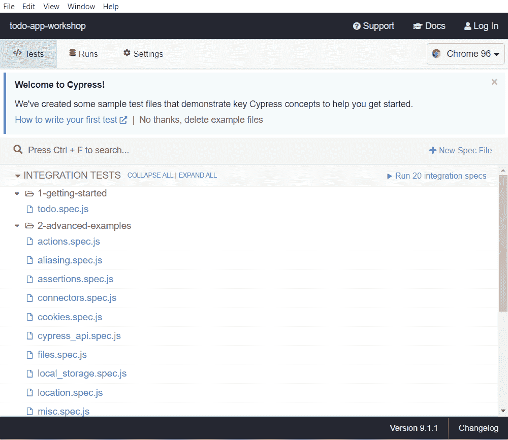

正如你看到的，测试读起来与我们之前编写的 Jest 测试非常相似。我们首先打开应用，检查列表是否为空，然后通过用户输入添加一项，最后检查是否存在预期的项目。

## 结语

目前关于 Svelte 应用测试的内容就到这里！我们学习了如何使用 `Jest` 进行单元测试和集成测试，如何使用 `Cypress` 进行 E2E 测试来构建正确的测试环境，并使用每种工具编写了简单的测试。我们学习了测试金字塔，它展示了测试中不同层次的抽象，并通过这两个测试工具亲身体验了它们之间的区别。我们还了解到良好的测试和良好的代码往往相互影响，而脆弱和/或难以编写的测试可能意味着你的代码需要一些重构。

本书到此结束了！我们已经走了很长一段路。我们学习了模板语法的方方面面，以及如何为 HTML 添加动态行为。我们学习了响应式语句，它们能帮助我们计算派生值或响应其他变量的变化，并发现编写它们是多么简单。在使用 Svelte store 时我们也看到了同样的特性：订阅它们非常简单，以及如何基于它们构建健壮的状态管理解决方案。我们还学习了不同的组件交互概念，这些概念有助于你组织和扩展应用程序。最后，在本章中，我们学习了如何测试 Svelte 应用。

有了这些新知识，你现在准备好构建可扩展的 Svelte 应用了。祝你好运，玩得开心！
