# 视觉自学 HTML 和 CSS 入门指南

## 视觉化书籍的赞誉

“我理解很多其他人只有当我视觉上看到它们时才理解得最好。你们的书真的让学习变得简单，生活变得有趣。”

John T. Frey (密歇根州卡迪)

“我上个月买了我的第一本视觉化学会系列书。现在我想以这种格式学习一切！”

Tom Vial (纽约州纽约)

“我有几本你们的视觉化书籍，并且对每一本都非常满意。我喜欢它们呈现课程的方式！”

Mary Jane Newton (加州约尔巴·林达)

“感谢，感谢，感谢……让我能如此轻松地进入这个高科技世界。我现在拥有了四本你们的书。我向任何像我这样的初学者推荐它们。”

Gay O'Donnell (加拿大艾尔伯塔省卡尔加里)

“我购买了第三本视觉化书籍（我的前两本被我翻破了！），再次，你们的产品超出了我的预期。”

Tracey Moore (田纳西州孟菲斯)

“写信是为了表达对你们书籍的感谢和赞赏。它们清晰、易于理解且直击重点。继续加油吧！我买了你们的几本书，它们恰恰好！完全不后悔！我会买你们的书，因为它们是最好的。”

Seward Kollie (塞内加尔达喀尔)

“我是你们的忠实粉丝。如果我想学习任何东西，我只需要买一本你们的书，很快就能掌握该主题。惊喜甚至训练了我的朋友送我视觉化书籍作为礼物。”

Illona Bergstrom (佛罗里达州阿文代尔)

“向厨师们点赞！！你们的书非同凡！或者简单地说，让其他部分更有意义！感谢！感谢！感谢！我为朋友和同事购买这些书。”

Christian J. Manfr (科罗拉多州卡斯尔)

“感谢你们让它变得如此清晰。我很感激。我会买很多视觉化书籍。”

J.P. Sangdong (加拿大安大略省北约克)

“你们制作了多么奇妙的书！祝贺你们和你们员工。你们应该获得诺贝尔奖。”

## 关于作者

Mike Wooldridge 是住在旧金山湾的用户设计师。自1995以来一直在使用HTML构建网站。

Linda Wooldridge 曾是《Macworld》杂志的高级编辑。她是视觉化学会 Photoshop Elements等书籍的合著者。

## 作者感谢

Mike 和 Linda 感谢 Jody Lefever 分配本书，Jade Williams 管理项目，Namir Shammas 进行技术编辑，Kim Heusel 进行校对，以及 Ronda David-Burroughs 和 Cheryl Grubbs 的艺术创作。Mike 和 Linda 将本书献给他们八岁的儿子，他喜欢冲浪网络和写博客。

- 添加边框 ................................................................................. 216
- 隐藏元素 ............................................................................ 246

# 第 1 章

## 熟悉 HTML 和网页基础

你对构建自己的网页感兴趣吗？本章向你介绍 HTML，这是用于创建网页的语言。它还解释了 HTML 编辑器和网页浏览器的原理，你使用它们来设计和查看你的网页内容。

- 互联网基础 ............................................................4
- HTML 简介 ................................................6
- 探索网页浏览器 ................................................8
- 探索 HTML 编辑器 ................................................9
- 理解 HTML 语法 ................10
- 在浏览器中查看 HTML 代码...........................12
- 规划网站 .........................................14

### 互联网基础

互联网是全球互联计算机网络的集合，使企业、组织、政府和个人能够各种方式进行通信。用户在互联网上通信最流行的方式之一是发布和交互网页。你还可以使用互联网发送和接收电子邮件、与其他用户聊天以及在计算机之间传输文件。

互联网于 20 世纪 60 年代末的一个军事研究项目。2007 年，全球互联网用户超过了 12 亿。

### 连接类型

用户通过多种方法连接到互联网。拨号服务相对廉价但连接速度慢，涉及使用调制解器和电话线。更快的连接方式包括 DSL（数字用户线路）、电缆调制解器、卫星和 ISDN（综合业务数字网络）。网络还包括特殊的无线发射器，允许计算机无线访问互联网。帮助你连接到互联网的公司被称为互联网服务提供商，或 ISP。

### 连接速度

连接速度在用户的互联网体验中起着重要作用，因为较慢的连接会导致互联网访问慢、文件传输慢以及网页查看慢。拨号提供每秒高达 56 千比特（或 Kbps），其次是 64 到 128 Kbps 的 ISDN 连接。DSL 连接速度通常高达每秒 3 兆比特（或 Mbps），而电缆调制解器可以达到 6 Mbps 的速度。通过拨号连接下载需要约 20 秒的网页，使用电缆调制解器可能不到一秒。

### 通信标准

互联网基础设施依赖于各种协议，这些协议规定了计算机和网络之间如何对话。例如，传输控制协议/网协议（或 TCP/IP）是一组规定消息在计算机之间流动的规则。超文本传输协议（或 HTTP）是一组决定浏览器如何请求网页以及服务器计算机如何交付网页的规则。拥有一致的协议允许连接到互联网的不同类型计算机之间进行无缝通信。

### 全球网

全球维网（World Wide Web）是存储在全球计算机上的巨大文档和页面集合。通常被称为 Web，这个页面集合代表了任何连接互联网的计算机可使用的丰富文本、图像和视频。网页存储在服务器上，服务器是运行允许其提供信息的互联网连接计算机。通过访问服务器上特殊 Web 目录中的文本文件、图像或其他文档，可以获取这些信息。第 15 章介绍了如何传输信息

### URL 和链接

Web 上的每个页面都有唯一的地址，称为 URL，它是统一资源定位符的缩写。URL 看起来如下：

```
http://www.example.com/index.html
```

如果你知道页面的 URL，就可以将其输入网页浏览器进行查看。用户还可以点击超链接（简单称为链接）在 Web 上跳转。第 6 章讨论了如何创建链接。

### 浏览器

网页浏览器允许你查看和交互网页。当你输入 URL 或点击浏览器中的链接时，浏览器会从服务器检索相应的页面。Microsoft Explorer、Mozilla Firefox 和 Apple Safari 是目前最流行的浏览器。每个程序都有版本，较新的版本支持更多的 Web 功能。当你使用 HTML 代码构建页面时，请记住不同的浏览器显示页面的方式略有不同。

### HTML 简介

你使用 HTML 构建网页，HTML 是超文本标记语言的缩写。HTML 文档由文本内容和称为标签的特殊代码组成，告诉浏览器如何显示内容。HTML 文档通过其 `.html` 或 `.htm` 文件扩展名进行标识。

大多数情况下，HTML 是平台无关的这意味着可以在任何计算机操作系统（包括 Windows、Mac 和 Linux）上查看网页。

### HTML 标签

### 渲染 HTML

HTML 由夹杂其中的特殊指令（标签）组成。HTML 标签被括号 `<>` 包围，告诉浏览器如何组织和呈现项目以及其他网页内容。许多标签使用起始标签和结束标签来包裹显示在页面上的内容。在编写 HTML 标签时，可以使用大写或小写字母。为了让代码与页面上的文本区分开来，你可以大写标签名称。详情见“理解 HTML 语法”。

当浏览器显示网页时，它从服务器检索该页面的 HTML 文件，解析 HTML 以确定如何格式化内容并渲染页面。HTML 标签告诉图像、视频、音频和其他内容需要下载并集成到页面中。HTML 可能还会告诉浏览器下载样式表和交互脚本以进一步增强页面。要查看网页底层的 HTML，请见“在浏览器中查看 HTML 代码”。

### HTML 标准

万维网联盟（W3C）是指导 HTML 语言演进的主要团体。W3C 由数百家公司和组织组成，包括微软、苹果和谷歌等 Web 行业领导者。W3C 开发的标准为 Web 服务器和浏览器的开发者提供了一套通用指南，用它们来开发产品。你可以访问 W3C 网站 `www.w3.org`。

### HTML 版本

HTML 的最新版本是 4.01，版本 4.01包含了对 90 多个 HTML 标签的使用规则，其中大部分标签在本书中都会介绍。它通过增加对多媒体、脚本和样式表的更好支持，对之前的版本进行了改进。样式尤其为重要，因为它允许开发者对网页应用更多格式设置。它还允许开发者将复杂的样式信息与 HTML 其他部分分开来。样式表将在第 10、11 和 12 章中介绍。

### XHTML

### 下一代 HTML

XHTML（或可扩展超文本标记语言）是一种编写网页的替代语言，它符合更严格的 XML（可扩展标记语言）标准。XHTML 是基于标签的，并使用了与 HTML 许多相同的标签。但在 HTML 中，所有标签必须关闭，标签名和属性必须全小写，且属性值必须用引号括起来。大多数现代浏览器都能读取 HTML 和 XHTML。虽然本书没有涵盖 XHTML，但你可以在 W3C 网站 `www.w3.org` 上阅读更多信息。

在本书出版期间，W3C 正在开发 HTML 5 规范，这是 HTML 的下一个版本。该版本将引入相关功能，帮助开发者更轻松地维护今天网站的主页面。HTML 5 将包含用于定义页眉、页脚和导航部分的标签，以及用于交互元素（如可编辑和可排序表格）的标签。更多信息请参阅 `www.whatwg.org/html`。

### 探索浏览器

Web 浏览器是一种可以从 Web 获取 HTML 文档、解析 HTML 指令并显示生成的网页的软件。你也可以使用浏览器显示保存在计算机本地的 HTML 文档。在编写 HTML 时，可以使用浏览器来测试你的工作。

### 浏览器差异

大多数现代浏览器都能读取 HTML 和 XHTML。虽然本书没有涵盖 XHTML，但你可以在 W3C 网站 `www.w3.org` 上阅读更多信息。

在本书出版期间，W3C 正在开发 HTML 5 规范，这是 HTML 的下一个版本。该版本将引入相关功能，帮助开发者更轻松地维护今天网站的主页面。HTML 5 将包含用于定义页眉、页脚和导航部分的标签，以及用于交互元素（如可编辑和可排序表格）的标签。更多信息请参阅 `www.whatwg.org/html`。

Web 浏览器是一种可以从 Web 获取 HTML 文档、解析 HTML 指令并显示生成的网页的软件。你也可以使用浏览器显示保存在计算机本地的 HTML 文档。在编写 HTML 时，可以使用浏览器来测试你的工作。

### 属性和值

你可以为每个 HTML 标签分配属性以自定义其行为。大多数属性通过设置数值或描述性值来起作用。例如，你可以使用 `ALIGN` 属性并配合类型（`left`、`right` 或 `center`）来设置段落在页面上的对齐方式。创建一个居中段落的代码如下：

```
<P ALIGN="center">My centered text.</P>
```

属性始终位于起始标签内部，将属性值用引号括起来是良好的习惯。

### 实体

你可以通过使用特殊代码向页面添加特殊字符，例如版权符号或分数。实体代表键盘上无法直接提供的字符。所有实体都以安培符号（`&`）开头，以分号（`;`）结尾。例如，以下代码会在你的页面上添加版权符号：

```
&copy;
```

更多实体和特殊字符，请参阅第 3 章。

## 避免 HTML 错误

为了避免 HTML 错误，请务必花时间检查你的代码。大多数 HTML 编辑器具有高亮错误语法的功能。确保你的标签有括号，结束标签包含斜杠，并且你的属性值用引号括起来。多个 HTML 标签应该正确嵌套，这意味着你的结束标签顺序应该与起始标签的顺序相反。例如：

```
<P ALIGN="center"><b>B</b></P>
```

为了让你的 HTML 具有可读性，考虑使用换行编写代码，而不是将所有内容挤在一行。这样做不会影响页面的显示效果，因为 Web 浏览器会忽略额外的空格。

## 在浏览器中查看 HTML 代码

你可以查看任何加载到 Web 浏览器的 Web 页的 HTML 代码。查看不同网站的 HTML 是学习如何编写自己代码的好方法，并能为你自己的页面激发新灵感。你还可以将网页保存到本地，作为模板使用或稍后学习。

在 Microsoft Windows Vista 中，Internet Explorer 会在记事本编辑器中打开 HTML 代码。要查看你已保存到本地的 HTML 页面，请参阅第 2 章。

```
<HTML>
<HEAD>
<TITLE>MY WEB PAGE</TITLE>
</HEAD>
```

### 查看源代码

1. 在你的浏览器窗口中打开网页。
2. 点击“查看”（View）。
3. 点击“源代码”（Source）。

| 首页 (HOME) | 主题 (SUBJECTS) | 关于网络 (ABOUT WEB) | | | | |
| | | | | | | |
| | | | | | | |
| | | | | | | |
| | | | | | | |
| | | | | | | |
| 作者 (Authors) | | | | | | |
| 地点 (Locations) | | | | | | |
| 书信 (Bookletters) | | | | | | |
| 出版会议 (Conferences of Press) | | | | | | |
| 作者活动 (Author Events) | | | | | | |
| 会计 (Accounting) | | | | | | |
| 艺术与建筑 (Arts & Architecture) | | | | | | |
| 化学与物理 (Chemistry & Physics) | | | | | | |
| 计算 (Computing) | | | | | | |
| 烹饪与酒店业 (Culinary & Hospitality) | | | | | | |
| 工程学 (Engineering) | | | | | | |
| 地球科学 (Earth Science) | | | | | | |
| 生命 (Life) | | | | | | |
| 生命科学 (Life Sciences) | | | | | | |
| 数学与统计学 (Mathematics & Statistics) | | | | | | |

显示页面 HTML 源代码的记事本窗口。

4. 完成后点击关闭按钮。

窗口关闭。

```
<!DOCTYPE html>
<html>
<head>
<link rel="stylesheet" href="http://www.wiley.com/assets/css/style.css">
<title>test-page</title>
</head>
<body>
<script type="text/javascript">
function search() {
  if (value == "") {
    alert('please enter an item in the search product field');
  }
  return false;
}
</script>
<form onsubmit="search()">
  <input type="text" name="search">
  
  <a href="http://www.wiley.com/section/id-301023.html" style="text-decoration:none">Search</a></a>
</form>
</body>
</html>
```

### 保存源代码

1. 在显示源代码的记事本窗口中，点击“文件”（File）。
2. 点击“另存为”（Save As）。

出现“另存为”对话框。

3. 点击此处导航到你想存储页面的文件夹。
4. 为页面输入一个名称。

HTML 页面应该具有 `.html` 或 `.htm` 文件扩展名。

5. 点击“保存”（Save）。

记事本保存了页面。

我保存到电脑的 HTML 文档在浏览器中打开时能正常工作吗？可能取决于 HTML 是如何编写的。除了 HTML 之外，你可能还需要单独下载图像、样式表、脚本和其他外部内容，并编辑 HTML 以便页面正确引用它们。有关更多引用的内容，请参阅第 6 章。

我如何在浏览器中保存网页？

在 Internet Explorer 中，你可以点击“文件”然后点击“另存为”。浏览器为你提供了保存页面的几种方法。“紧凑”（Compact）会保存 HTML 和嵌入内容，“仅限 HTML”（HTML only）会将 HTML 和其他内容保存为单个文件。

## 规划网站

网站是一组相关的网页，所有页面都通过超链接连接在一起，并托管在服务器上。在开始编写 HTML 创建站点页面之前，做一些规划是一个好主意。

### 了解你的受众

了解访问你网站页面的受众非常重要。了解他们的技术能力非常重要，这样你就可以使用他们所熟悉的语言。了解他们的兴趣也很重要，这样你就可以展示让他们保持兴趣并留在其中的图像和其他内容。你可以尽早对潜在用户进行访谈，为你的网站设计收集想法。你也可以让用户测试你的网站。

### 规划首页

首页是访问你的网站时看到的第一个页面。为了确保良好的用户体验，首页的设计至关重要。首页应该清晰地传达网站的主题，并引导用户访问其他部分。


## 网站地图

网站地图是网站页面结构的视觉图。它显示了各个页面之间的关系。规划网站地图可以帮助你构思网站的结构之前。

### 层级结构

层级结构类似于金字塔，首页位于顶部。层级结构适用于具有分类内容的网站。

### 线性结构

### 收集内容

在规划了网站的结构之后，你需要收集内容。对于简单的网站，这可能涉及文本和照片。更复杂的网站需要音频、视频和交互媒体。你可以将所有内容整合到网页中。

# 第 2 章：创建你的第一个页面

准备好创建一个网页了吗？本章将向你如何开始基础 HTML 文档。

## 理解 HTML 结构

### 开始 HTML 文档

### 保存 HTML 文档

### 查看 HTML 页面

### 添加文档声明

## 理解 HTML 结构

虽然网页在内容和布局上差异很大，但所有页面都有某些相同的 HTML 标签。这种结构有助于你开始构建自己的 HTML 页面。

## 文档声明

你可以添加 `DOCTYPE` 声明来指定浏览器在你的 HTML 文档中可以看到的标签。在 HTML 4.01 中，有三种类型：HTML 4.01 Transitional、HTML 4.01 Strict 和 HTML 4.01 Frameset。过渡类型最具包容性，包含了当前和过时的（或废弃）旧标签。严格类型更为精简，排除了废弃标签。框架集类型与过渡类型相同，但包含了在页面上制作框架的所有标签。有关更多框架，请参阅第 8 章。

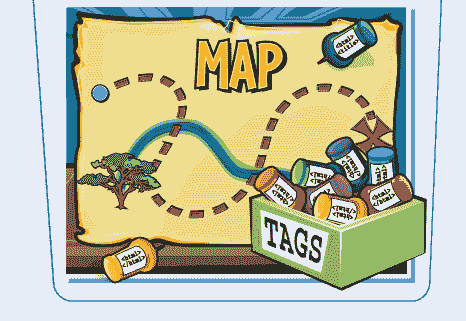

> > 声明！

> HTML 4.01 STRICT

> HTML 4.01 FRAMESET

> HTML 4.01 TRANSITIONAL

## 创建你的第一个 HTML 页面

### 文档头部

你使用 HTML 文档的页头来为你的网页添加描述性和辅助性信息。文档头部标签 `<HEAD>` 和 `</HEAD>` 紧跟在起始 `<HTML>` 之后。文档头部包含不显示在浏览器窗口中的信息，包括标题信息、元数据、脚本和样式表。有关更多脚本，请参阅第 13 章。有关更多关于样式表的信息，请参阅第 10 章。

### 文档标题

你可以为 HTML 文档添加标题，以帮助人们和搜索引擎识别你的网页。例如，如果你正在为某公司构建网页，你可能想在标题中包含公司名称和规格。大多数浏览器会在浏览器的标题栏中显示标题。`<TITLE>` 和 `</TITLE>` 标签定义页面标题，并出现在文档头部内部。将标题长度保持在 64 个字符以内比较好。

```html
<HEAD>
<TITLE>HTML MAP</TITLE>
</HEAD>
```

### 元数据

元数据意味着“关于数据的数据”。在网页上，元数据可以包括作者信息、创建页面使用的编辑器类型、内容描述、相关关键词和版权信息。搜索引擎在尝试对页面进行分类时经常使用元数据。你将元数据放在文档头部。

### 正文

构成你网页的可见内容，包括 HTML 文档主体中的段落、列表、表格和图像。文档主体由 `<body>` 和 `</body>` 标签识别。文档的正文位于文档头部之后。文档主体中涵盖的大部分 HTML 将决定其内容的格式化。学习如何开始格式化正文，请参阅第 3 章。

### 开始 HTML 文档

你可以使用文本编辑器、HTML 编辑器或文字处理程序开始 HTML 文档。你使用 HTML 标签来定义页面的基本结构。

`&lt;html&gt;`、`&lt;head&gt;` 和 `&lt;title&gt;` 标签是所有 HTML 文档开头的基础元素。

### 开始 HTML 文档

- 1. 打开编辑器或文字处理程序。
- 注意：书中的示例同时使用了记事本和 WordPad。查看第 1 章以了解更多关于器的信息。
- 2. 输入 `&lt;html&gt;`。此标签将文档声明为 HTML。
- 4. 输入 `&lt;head&gt;`。此标签定义标题、元数据和其他描述信息。
- 注意：有关向网页添加元数据的更多信息，请参阅“添加元数据”部分。
- 5. 按 Enter。

# 创建你的第一个 HTML 页面

- 6. 输入 `<TITLE>`。
- 7. 输入页面的标题文本。标题文本描述页面内容并显示在网页浏览器的标题栏中。
- 8. 输入 `</TITLE>`。
- 9. 按 Enter。
- 10. 输入 `<HEAD>`。此标签完成了页面的文档头部信息。
- 11. 按 Enter。
- 注意：你不需要在开始新标签或添加结束标签时都按回车。然而，将标签单独放在一行可以帮助你的代码更具可读性。
- 注意：浏览器在渲染网页时会忽略代码中的额外空格。

| 我应该先向我的 HTML 文档添加什么，HTML 标签还是页面内容？ | 我用大写、小写还是混合写输入标签重要吗？ |
| :--- | :--- |
| 通过输入基础结构标签来启动你的 HTML 文档更容易，这些标签包括 `<HTML>`、`<HEAD>` 和 `<body>` 标签。这些标签出现在所有 HTML 文档中，先输入它们可以帮助你找到有效语法并确保顺序正确。在添加基础结构标签后，你可以添加正文内容和额外的 HTML 标签来格式化这些内容。 | 不需要。当前的 HTML 标准允许 HTML 文本使用不同的大小写。然而，保持 HTML 格式一致是好的。此外，用大写输入标签更容易区分 HTML 代码和页面内容，并识别你代码中的错误。 |

### 开始 HTML 文档（续）

你可以使用正文标签 `<body>` 和 `</body>` 来定义页面内容。文档主体可以包括文本、列表和表格。

### 开始 HTML 文档（续）

- 12. 输入 `<body>`。此标签标记正文的开始。
- 13. 输入正文内容。
- 14. 输入 `</body>`。此标签结束正文。
- 15. 按 Enter。

# 创建你的第一个 HTML 页面

- 16. 输入 `<TITLE>`。
- 17. 输入页面的标题文本。标题文本描述页面内容并显示在网页浏览器的标题栏中。
- 18. 输入 `</TITLE>`。
- 19. 按 Enter。

（注，此处文本文本重复）

# 创建你的第一个 HTML 页面

- 20. 输入 `</html>`。此标签结束 HTML 文档。
- 21. 按 Enter。

# 查看 HTML 页面

1. 打开你的 Web 浏览器。本示例使用 Internet Explorer 浏览器。
2. 点击“文件”。
3. 点击“打开”。

出现“打开”对话框。

4. 点击“浏览”。

# 创建你的第一个 HTML - 第 2 章

- 点击此处导航到存储 HTML 文档的文件夹或驱动器。
- 点击文件名。
- 点击“打开”。
- “打开”对话框显示文件的路径和名称。
- 在“打开”对话框中，点击“确定”。

网页浏览器显示页面。

- 标题显示在这里。
- 正文信息显示在这里。
- HTML 文件的位置显示在这里。

如果你对浏览器中显示的页面 HTML 进行更改，可以点击刷新页面查看更改。

# 我使用什么浏览器查看我构建的页面重要吗？

所有流行的浏览器都已设置为查看保存在计算机上的 HTML 页面（也称为离线页面）。在 Internet Explorer 以外的浏览器（如 Mozilla Firefox）中打开离线 HTML 文档可能需要遵循略有不同的步骤。请务必参考你的浏览器文档获取更多信息。

## 如果我无法查看页面怎么办？

如果你看不到页面的任何内容，你需要双检 HTML 代码中的错误。确保你的文档使用了正确解析的起始和结束标签，并校对你的 HTML 代码以确保一切正确。还要确保你使用的是扩展名为 `.html` 或 `.htm` 的页面。

# 添加文档声明

你可以在 Web 页面顶部使用文档声明，声明浏览器期望看到的 HTML 标签类型。你可以使用三种类型中的一种：HTML 4.01 Transitional（过渡型）、HTML 4.01 Strict（严格型）或 HTML 4.01 Frameset（框架型）。

HTML 的过渡版本兼容性性。它包含了所有的标准结构元素以及已在当前标准中淘汰的旧标签。严格类型仅包含当前许可的标签。frameset 类型与过渡类型相同，但包含了创建框架的额外标签。

## 添加文档声明

1. 打开你想要编辑的 HTML 文档。
2. 将光标置于 `<HTML>` 标签之前并按回车插入新行。
3. 输入 `DOCTYPE` 声明。

要指定 HTML 4.01 Transitional，输入：

```html
<!DOCTYPE HTML PUBLIC "//W3C//DTD HTML 4.01//EN"
"http://www.w3.org/TR/html4/loose.dtd">
<<html>>
<head>
<title>M. and L's Travel Agency</title>
</head>
<body>
There are more than 15 years...
</body>
</html>
```

你可能需要按回车键以在的一的一行中继续编写代码。

# 创建你的第一个 HTML 页面

要指定 HTML 4.01 Strict，输入：

```html
http://www.w3.org/TR/REC-html4/strict.dtd">
```

要指定 HTML 4.01 Frameset，输入：

```html
http://www.w3.org/TR/REC-html4/frameset.dtd">
```

声明语句完成。

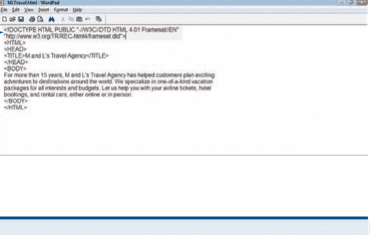

## 我必须包含文档声明吗？

大多数流行的浏览器可以在没有 `DOCTYPE` 声明的情况下显示你的页面。然而，如果你使用验证工具检查你的页面，该工具可能要求你包含声明，以便它知道应该按照什么种 HTML 类型验证你的页面。包含声明也是良好的习惯。

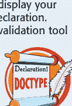

## 我应该使用哪个版本的 HTML？

所有 Web 浏览器都支持 HTML。专业开发者正转向层样式表（CSS）来控制格式。许多过时的标签已被使用 CSS 的规则所取代。如果你使用框架，则需要 Frameset。使用哪种版本取决于你计划使用的元素以及你所熟悉的编码类型。

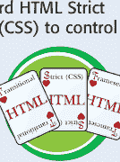

## 添加元数据

向页面添加不在浏览器窗口中显示的元数据，包含页面描述、作者和版权信息、关键词等。在元数据标签中插入的内容可以帮助搜索引擎分类你的页面。使用 `<META>` 标签在文档头中定义元数据。


### 添加作者名称

1. 在 `<HEAD>` 和 `</HEAD>` 标签之间点击新行。在本示例中，元数据显示在 `<TITLE>` 标签下方。
2. 输入 `<META name="author">` 后加空格。
3. 输入 `CONTENT="My Name"`，将 My Name 替换为你的名字。
4. 按回车。

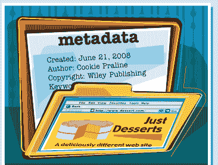

### 添加页面描述

5. 输入 `<META name="description">` 后加空格。
6. 输入 `CONTENT="Page Description"`，将 Page Description 替换为你自己的页面描述。
7. 按回车。


```html
<!DOCTYPE HTML PUBLIC "//W3C//DTD HTML 4.0//EN"
http://www.w3.org/TR/HTML4/strict.dtd>

<html>

<head>

<title>Travel Agency</title>

<meta name="author" content="M and L">

<body>

For more than 15 years, M and L's Travel Agency have helped customers planning vacations around the world. We specialize in one kind of vacation packages for all interests and budgets. Let us help you with your airline tickets, hotel bookings, and rental cars, online or person.

</body>

</html>
```

```html
<!DOCTYPE HTML PUBLIC "//W3C//DTD HTML 4.0//EN"
http://www.w3.org/TR/HTML4/strict.dtd>

<html>

<head>

<title>Travel Agency</title>

<meta name="description" content="exciting vacation packages.">

<body>

For more than 15 years, M and L's Travel Agency have helped customers planning vacations around the world. We specialize in one kind of vacation packages for all interests and budgets. Let us help you with your airline tickets, hotel bookings, and rental cars, online or person.

</body>

</html>
```

# 创建你的第一个 HTML 页面

## 指定关键词

8. 输入 `<META NAME="keywords">` 后加空格。
9. 输入 `CONTENT="My Keywords"`，将 My Keywords 替换为关键词。

对于多个关键词，使用逗号后加空格来分隔关键词。

10. 按回车。

```html
<!DOCTYPE html PUBLIC "-//W3C//DTD HTML 4.01//EN"
"http://www.w3.org/TR/html4/strict.dtd">

<html>

<head>

<meta charset="UTF-8">

<meta name="author" content="John Doe">

<meta name="description" content="M and L's Travel Agency specializes in vacations, hotels, rental cars, jungle tours, hiking vacations. Tropical vacations">

<meta name="copyright" content="copyright 2008">

<title>M and L's Travel Agency</title>

</head>

<body>

<p>For more than 15 years, M and L's Travel Agency has helped customers plan exciting adventures around the world. We specialize in one-stop vacation planning and help you with your vacation tickets, hotel bookings and rental cars, online-person.</p>

</body>

</html>
```


### 添加版权

11. 输入`META NAME="copyright"`后加空格。
12. 输入`CONTENT="2008"`，将`2008`替换为你的年份。
13. 按回车。

元数据现在是 HTML 文档的一部分。

### 我如何使用程序根据元数据信息设计我的页面？

要指定编写程序，输入`<META NAME="generator" CONTENT="Program Name">`。将`Program Name`替换为你的名字。

只有能看到你元数据的用户是查看了页面 HTML 代码的用户。要在浏览器窗口中查看任何页面的 HTML 代码，点击“查看”并找到“源代码”。这将打开一个文本编辑器窗口，显示创建你页面的 HTML。分配给文档的任何元数据出现在顶部`<HEAD>`标签内部。


# 第 3 章 添加文本

你是否准备好通过添加文本来开始构建你的网页了？本章将向你展示如何向文档中添加不同类型的文本元素。

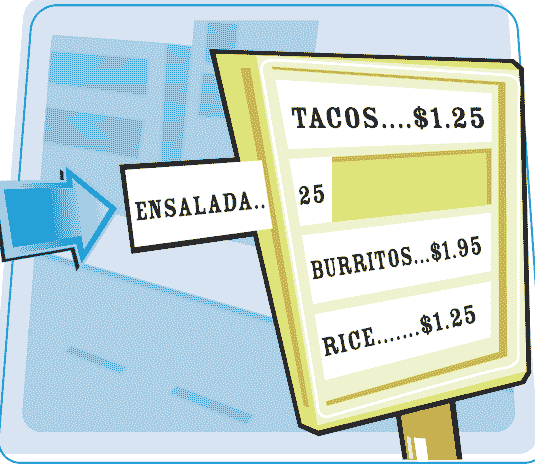

- 创建新段落 .......................................34
- 更改段落对齐..................................35
- 添加换行符 ................................................36
- 插入空白 ..........................................37
- 插入预格式文本 ................................38
- 插入标题 ........................................39
- 添加块引用 .......................................40
- 插入注释 ..........................................41
- 创建有序列表 ................................42
- 创建无序列表 ...............................4..44
- 创建嵌套列表 ................................46
- 创建定义列表 ............................47
- 插入特殊字符 ...................48
- 特殊字符 ................................49

### 创建新段落

你可以使用段落标签在 HTML 文档中开始新段落。在文字处理程序中，按下 Enter 或 Return 键分开文本块。网络浏览器不会读取这些换行符。相反，每当你在网页中开始新段落时，必须在 HTML 中插入`<p>`标签。

段落默认左对齐，但你可以通过对齐标签来选择不同的对齐方式。请查看“更改段落对齐”部分了解更多信息。

### 创建新段落

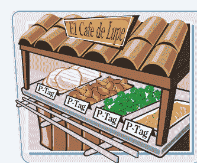

1. 输入`<p>`开始新段落。
2. 输入你的文本。
3. 在段落结束处输入`</p>`。

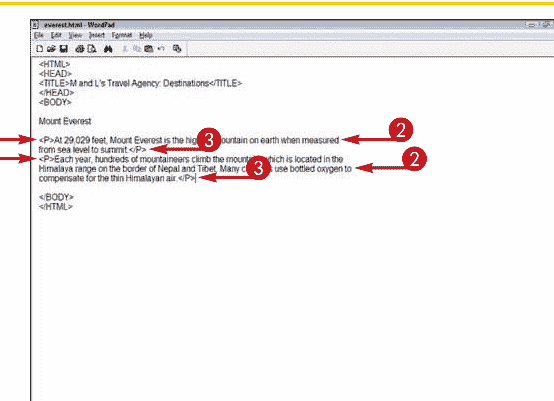

当在网络浏览器中显示时，文本显示为一个段落，并在上下留有额外的空间。

**注意：** 要创建两侧缩进的段落，请查看“添加块引用”部分。

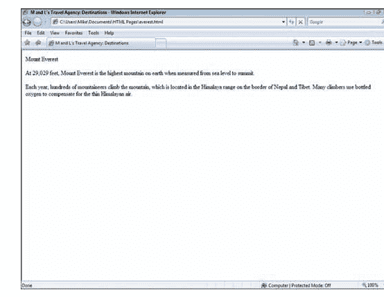

### 更改段落对齐

你可以使用`ALIGN`属性来控制段落的水平位置或对齐。你可以选择将段落左对齐、右对齐或居中，或者对文本进行两端对齐使其左右对齐。段落默认左对齐。

你可以在许多标签元素（包括标题和列表）中使用`ALIGN`属性。例如，你可以让标题居中，或让一个无序列表右对齐。

### 更改段落对齐

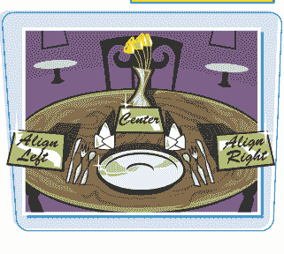

1. 点击你想更改对齐方式的`<p>`标签。
2. 输入一个空格，然后输入`ALIGN="?"`，将`?`替换为`Left`（左）、`Center`（中）、`Right`（右）或`Justify`（两端对齐）。

注意：你可以使用大写、小写或两者的组合输入 HTML 命令。

当在网络浏览器中显示时，文本将按指定方式对齐。

- 在这种情况下，该行文本在页面上居中。

注意：要使用样式表控制段落宽度，请参阅第 12 章获取更多信息。

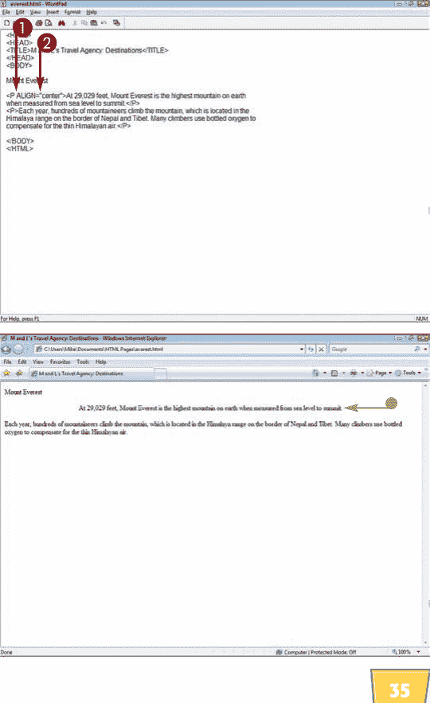

### 添加换行符

你可以使用换行标签`<BR>`来控制文本的断行位置。网络浏览器通常会自动换行文本；当一行文本到达浏览器窗口右侧时，它会断开并在下一行继续。你可以插入换行符来指示浏览器断开文本并跳转到新行。

你还可以使用`<BR>`标签在段落之间添加空行。如果你想在文本块或标题上方或下方添加额外空间，这将非常有用。

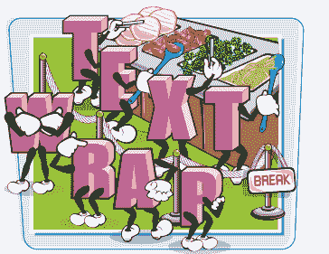

1. 在想要显示为新行的文本行前输入`<BR>`。
2. 在任何想要换行的地方输入额外的`<BR>`标签。

*注意：* `<BR>`标签不需要闭合标签。

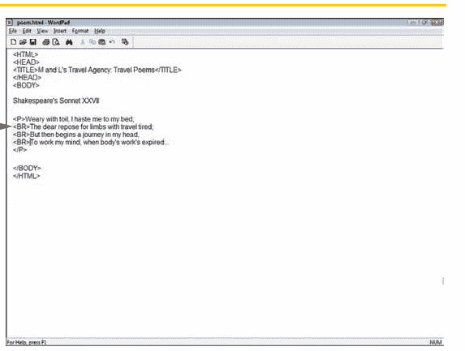

- 当页面在网络浏览器中显示时，每个标签实例都会创建一个新的文本行。

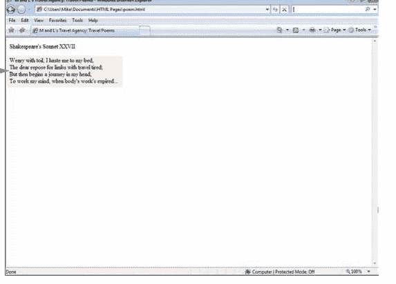

36

### 插入空白

你可以在文本行内插入空白，以对文本进行缩进或添加强调。你还可以使用空白来帮助定位网页上的元素，例如图形或照片。


### 插入空白

1. 在文本行中输入`&nbsp;`以插入空白。

要添加多个空格，请多次输入`&nbsp;`。在网络浏览器中显示时，

- `&nbsp;`是**不换行空格**。


### 预格式文本

你可以使用预格式标签`<PRE>`和`</PRE>`来保留所有的原始换行和空格。浏览器通常会忽略这些换行，除非你使用预格式标签。


在网络浏览器中显示时，文本以等宽字体显示。


### 预格式文本

1. 在想要保留的文本上方输入`<PRE>`。
2. 在文本结束处输入`</PRE>`。


### 标题

你可以使用标题在页面上突出信息。你可以选择六个标题级别，从最大的 1 到最小的 6。

你可以使用`ALIGN`属性更改标题的对齐方式，例如`<H1 ALIGN="right">`。查看“更改段落对齐”部分了解更多信息。


### 标题

- 在你想变成标题的文本前输入`<H?>`，将`?`替换为你想要的级别。
- 级别从 1 到 6。
- 在标题结束处输入`</H?>`，将`?`替换为相应的级别。

为你想在页面上强调的任何文本添加标题标签。


- 标题在网络浏览器中以粗体显示。

此图显示了每个标题的递减示例。


### 块引用

你可以使用块引用将段落与文档的其他部分隔离开。块引用通常用于引用文本或其他出处。


### 块引用

1. 在你想变成块引用的文本前输入`<BLOCKQUOTE>`。
2. 在文本结束处输入`</BLOCKQUOTE>`。

```html
<HTML>
<title>旅行社：引用</title>
<h2>名言</h2>
<BLOCKQUOTE>商业让一切变得困难，但勤奋让一切都变得容易。吃得晚的人必须禁食，行动得如此缓慢，以至于贫困追上了他的业务。<BLOCKQUOTE>
本杰明·富兰克林
</BLOCKQUOTE>
</BODY>
</HTML>
```


网络浏览器将块引用显示为文档页面上的缩进文本。

- 你可以在多个`<BLOCKQUOTE>`标签内放置文本以增加更多缩进。

### 插入注释

你可以使用注释在 HTML 文档中为自己写备注。浏览器在显示网页时，注释不会出现。例如，你可能会对某个未来的编辑任务留下注释，或者为查看你 HTML 源代码的其他 Web 开发者留备注。

你也可以将注释包裹在 HTML 代码周围以禁用该代码。HTML 标签注释不会被浏览器解释。

### 插入注释

1. 在你想放置注释的地方输入`<!--`。
2. 输入注释文本。
3. 输入`-->`。

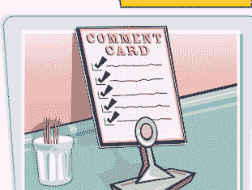

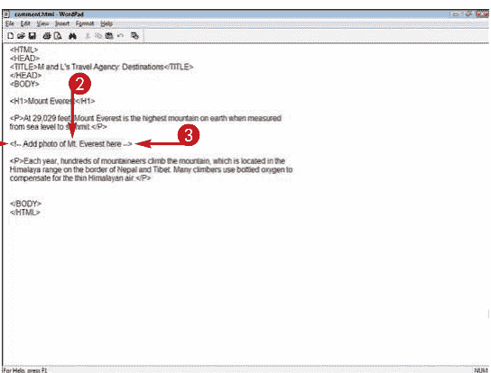

注释不会出现在 Web 浏览器查看的页面上。

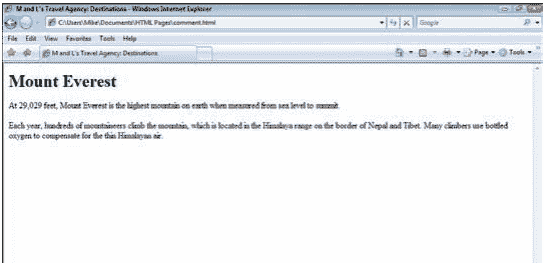

### 珠穆朗峰

从海平面到山顶，珠穆朗峰海拔 29022 英尺，是地球最高的山。

每年都有数百登山者攀这座位于尼泊尔和西藏边界喜马拉雅山脉的山。许多登山者使用瓶氧来补偿喜马拉雅稀薄的空气。

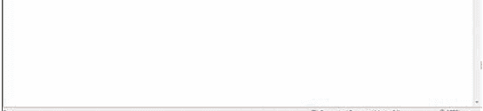

### 创建有序列表

你可以在网页上使用有序列表来显示各种列表。例如，你可以使用有序列表来显示步骤或对项目排序。

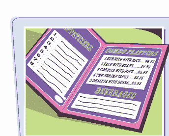

### 创建有序列表

#### 在有序列表中放置文本

1. 在你想要转换为有序列表的文本上方输入`<ol>`。
2. 在列表的每个项目前输入`<li>`。
3. 在每个列表项目后输入`</li>`。
4. 在列表文本后输入`</ol>`。

```html
<html>
<head>
<title>M and L's Travel Agency</title>
</head>
<body>
<h1>M and L's Travel Agency Tips</h1>
<h3>Things to Do</h3>
<ol>
<li>Check in at air counter</li>
<li>Go through security</li>
<li>Find gate</li>
<li>Buy a newspaper to read</li>
<li>Take off</li>
</ol>
</body>
</html>
```

- 文本在网页上显示为编号有序列表。

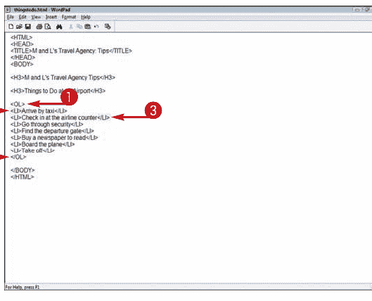

M and L 旅行社提示

在机场要做的事

1. 在值机柜台办理机
2. 经过安检
3. 寻找登机口
4. 买一份报纸读
5. 起飞

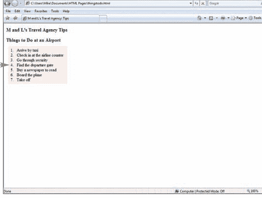

#### 设置数字样式

在`<OL>`标签内输入`TYPE="?"`，将`?`替换为数字样式代码：

- `A`: A, B, C
- `a`: a, b, c
- `I`: I, II, III
- `i`: ii, iii
- `1`: 1, 2, 3

有序列表将按你选择的样式显示。

在此示例中，列表使用了字母而非数字。

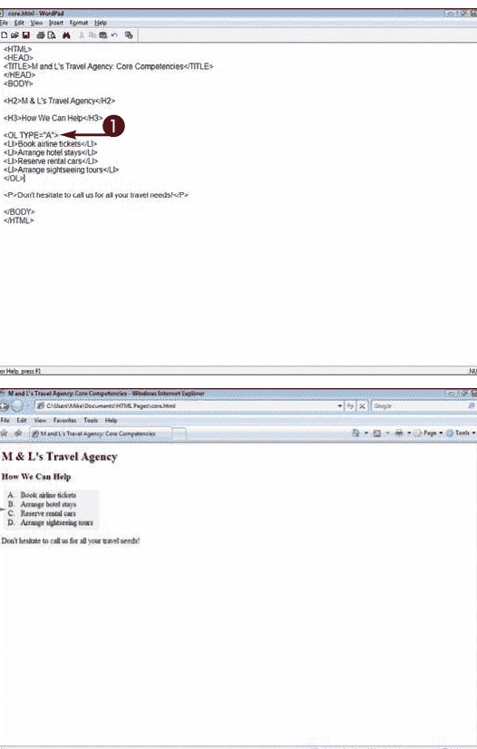

### 如何向我的有序列表添加另一个项目？

只需在列表中你想插入文本的地方，并在文本前后添加`<LI>`和`</LI>`标签。Web 浏览器会在下次查看页面时显示更新后的列表。

### 如何开始不同于默认的列表编号？

默认情况下，Web 浏览器读取你的有序列表代码并从数字 1 开始。要从不同的数字开始，你必须向`<OL>`标签添加`START`属性。例如，如果编号从 5 开始，代码将为`<OL START="5" TYPE="1">`。

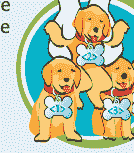

43

### 创建无序列表

你可以为文档添加无序列表，将项目列表与页面其余部分隔离开。当你不需要按特定顺序显示项目时，可以使用无序列表（也称为符号列表）。

默认情况下，符号显示为实心圆。如果你想使用其他符号样式，必须向`<UL>`标签添加`TYPE`属性。

### 创建无序列表

#### 在无序列表中放置文本

1. 在你想添加的文本前输入`<ul>`。
2. 在列表的每个项目前输入`<li>`。
3. 在每个列表项目后输入`</li>`。
4. 在列表文本后输入`</ul>`。

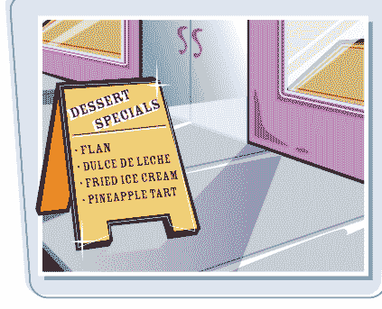

文本在网页上显示为无序列表。

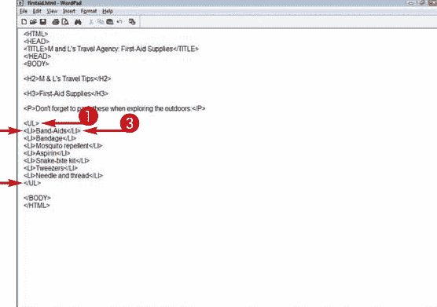

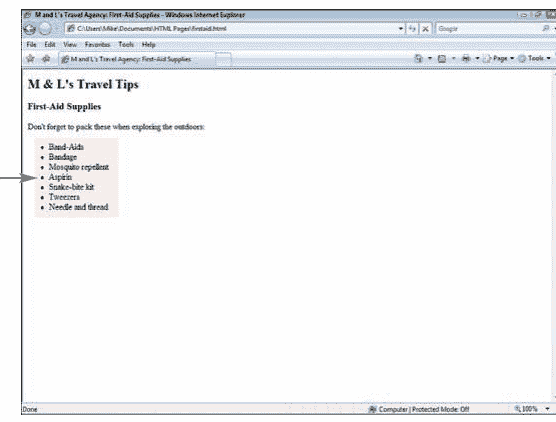

### 设置符号样式

在`<ul>`标签处输入`TYPE="?"`，将`?`替换为符号样式；例如`circle`或`square`。

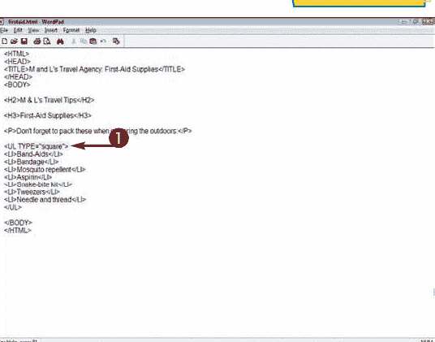

无序列表按你选择的样式显示。

在此示例中，无序列表使用了方块。

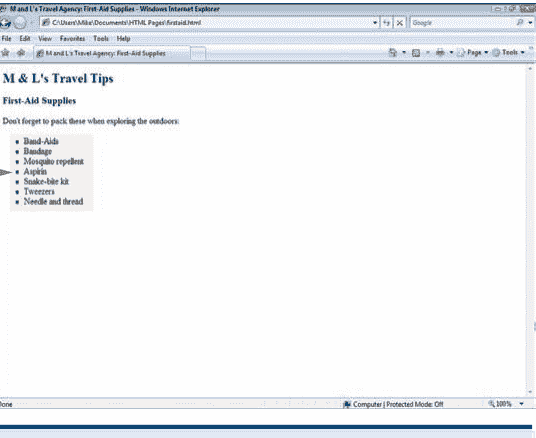


### 我可以停止无序列表某行文本并在下一行继续吗？

可以。如果你为某行文本省略`<li>`和`</li>`标签，Web 浏览器会将该行渲染为普通文本。但是，你可以插入换行符`<BR>`或使用段落或标题标签来格式非列表文本，例如：

```html
<ul>
<li>Dogs</li>
<li>Cats</li>
<br>and the-popular
<li> pigs</li>
</ul>
```


- 狗
- 猫
- 爬行动动物


### 创建列表

你可以使用嵌套列表在网页列表内部添加列表。嵌套列表允许你在列表中不同层级显示文本。你可以在现有列表中同时使用有序和无序列表。

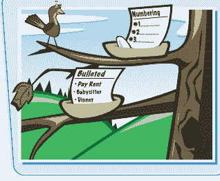

### 创建嵌套列表

1. 点击你想插入嵌套列表的地方，或在现有列表中添加新行并输入`<ol>`表示有序列表或`<ul>`表示无序列表。注意：要创建有序列表，请参见“创建嵌套列表”部分。要创建无序列表，请参见“创建无序列表”部分。
2. 使用创建原始列表的方法输入列表文本，包括`<li>`和`</li>`标签。
3. 在嵌套列表结束输入`</ol>`或`</ul>`。

文本在网页上显示为嵌套列表。

浏览器通常为嵌套列表设置不同的符号样式。在此示例中，嵌套列表使用的是空心圆。

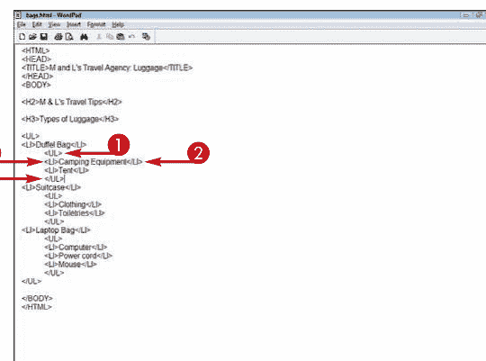

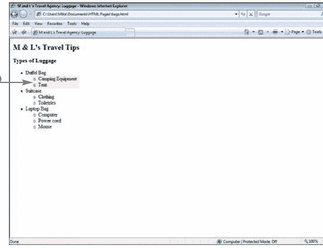

### 创建定义列表

### 添加文本 3

你可以在文档中使用定义列表以词汇表或字典的格式将文本分开。

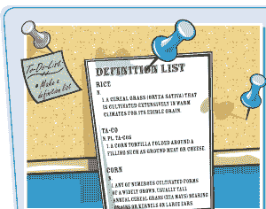

### 创建定义列表

- 在我们想要设置为定义列表的每个术语前输入`<dt>`。
- 在每个术语后（即每个术语前）输入`</dt>`。
- 在每个定义前输入`<dd>`，在每个定义后输入`</dd>`。
- 在定义列表后输入`</dl>`。

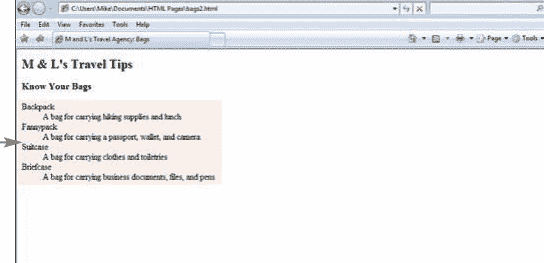

文本在网页上显示为定义列表。

### 插入特殊字符

你可以使用 HTML 代码在你的网页页面文本中插入特殊字符。特殊字符是键盘上通常不出现的字符。

用于插入特殊字符的代码称为实体（entities）。实体由由符号（`&`）开头的数字或名称代码组成。

1. 点击你想插入特殊字符的地方。
2. 输入字符的数字或名称代码，前面加上和符号（`&`）。
3. Web 浏览器显示指定的字符。

### 插入特殊字符

为了在页面文本中正确插入许多特殊字符，你需要知道它们的实体代码。下表列出了你可以插入的常见特殊字符。参见“插入特殊字符”部分。

| 描述 | 特殊字符 | 代码 | 描述 | 特殊字符 | 代码 |
| :--- | :--- | :--- | :--- | :--- | :--- |
| 版权 | © | `&copy;` | 小写 o 斜 | ø | `&oslash;` |
| 注册商标 | ® | `&reg;` | 长破折号 | — | `&mdash;` |
| 商标 | ™ | `&trade;` | 短破折号 | – | `&ndash;` |
| 段落标记 | ¶ | `&para;` | 微符号 | μ | `&micro;` |
| 不换行空格 | | `&nbsp;` | 长音符号 | | `&macron;` |
| 引号 | “ | `&quot;` | 上标 1 | 1 | `&sup1;` |
| 左引号 | ‹ | `&laquo;` | 上标 2 | 2 | `&sup2;` |
| 右引号 | » | `&rsquo;` | 上标 3 | 3 | `&sup3;` |
| 和符号 | & | `&amp;` | 半分之一 | ½ | `&frac;12;` |
| 反感叹号 | i | `&iexcl;` | 四分之一 | ¼ | `&frac;14;` |
| 反问号 | ¿ | `&iquest;` | 三分之 | ¾ | `&frac;34;` |
| 破裂竖线 | | `&brvar;` | 度符号 | ° | `&deg;` |
| 章节符号 | § | `&sect;` | 乘号 | x | `&times;` |
| 不等于 | | `&not;` | 除号 | | `&divide;` |
| 急音符号 | | `&acute;` | 加减号 | ± | `&pmmn;` |
| 小于号 | < | `&lt;` | 大于号 | > | `&gt;` |
| 符号 | • | `&bull;` | 剑号 | † | `&dagger;` |
| 大写 N 波浪号 | Ñ | `&Tilde;` | 双剑号 | ‡ | `&Dagger;` |
| 小写 n 波浪号 | ñ | `&tilde;` | 美分符号 |  | `&cent;` |
| 英镑 | £ | `&pound;` | 欧元 | € | `&euro;` |
| 日元 | ¥ | `&yen;` |

# 第 4 章

## 文本格式化

你可以应用格式标签来控制页面上文本的显示。本章将向你如何添加属性和标签，让你的文本呈现最佳效果。

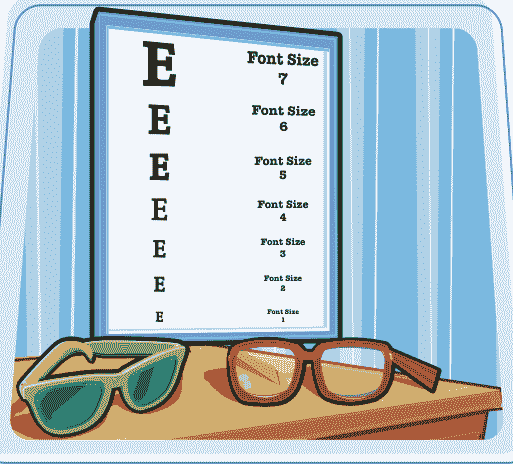

- 文本加粗 ............................................................52
- 文本斜体 ............................................................53
- 为文本添加下划线 ................................................54
- 更改字体 ................................................................55
- 更改字体大小 ......................................................56
- 更改文本颜色 ................................................58
- 调整边距 ........................................................60
- 设置页面背景颜色 .......................................61
- 添加水平线 ......................................62

### 使文本加粗

你可以为文本添加加粗格式，以使其更加强调或使你的页面更具视觉吸引力。例如，你可能会对段落中的公司名称加粗，或者对项目列表加粗。

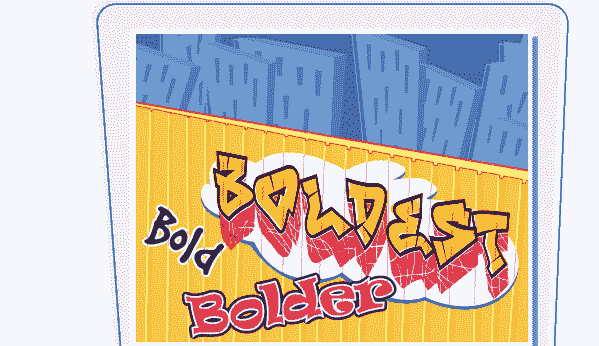

### 使文本加粗

1. 在想要加粗的文本前加上`<b>`。
2. 在文本结束处输入`</b>`。

```html
<html>
<head>
<title>玛丽旅行社</title>
</head>
<body>
<h1 align="center">玛丽旅行社</h1>
<p>15 多年来，玛丽旅行社一直致力于帮助客户规划世界各地激动人心的冒险之旅。我们专业为各种各种兴趣和预算的客户提供独一无二的度假套餐。无论是在线还是亲临，让我们为您提供机票、酒店预订和租车服务吧。</p>
<p>热门目的地：</p>
<ul>
<li>埃及，金字塔</li>
<li>秘鲁，马丘比丘</li>
<li>伯利兹，开罗</li>
<li>中国，长城</li>
</ul>
</body>
</html>
```

当在浏览器中显示时，文本将呈现为**粗体**。

注意：要使用 CSS 中的`font-weight`属性创建加粗文本，请参第 11 章。

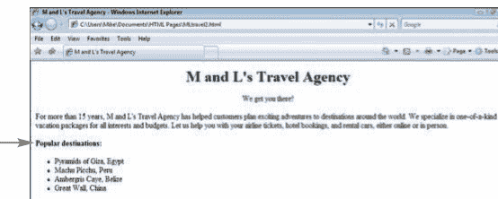

### 文本斜体

你可以为文本添加斜体以使其更加强调或使你的页面更具视觉吸引力。例如，你可能会将标题下的描述设为斜体，以与其他页面内容区分开来。

### 文本斜体

- 在想要斜体的文本前加上`<i>`。
- 在文本结束处加上`</i>`。


当在浏览器中显示时，文本将呈现为*斜体*。

注意：要使用 CSS 中的`font-style`属性将文本变为斜体，请参考第 11 章。

```html
<html>
<head>
<title>玛丽旅行社</title>
</head>
<body>
<h1 align="center">玛丽旅行社</h1>
<p align="center">欢迎来到我们的旅行社。我们帮助客户规划世界各地目的地的冒险之旅。我们专业为各种兴趣和预算的客户提供独一无二的度假套餐。无论是在线还是亲临，让我们为您提供机票、酒店预订和租车服务。</p>
<p>热门目的地：</p>
<ul>
<li>埃及，金字塔</li>
<li>秘鲁，马丘比丘</li>
<li>希腊，大都会</li>
<li>中国，长城</li>
</ul>
</body>
</html>
```

### 玛丽旅行社

15 多年来，玛丽旅行社一直帮助数千人规划世界各度假套餐。我们专业为各种兴趣和预算提供独一无二的度假。无论是在线还是亲临，让我们为您提供机票、酒店预订和租车服务。

热门目的地：
- 埃及，金字塔
- 秘鲁，马丘比丘
- 中国，长城

### 为文本添加下划线

你可以为文本添加下划线以强调。例如，你可能会对某个术语或重要名称添加下划线。在 Web 页面上应用下划线时要加小心，因为某些用户可能会将下划线文本误认为链接。请查看第 6 章了解更多关于在 Web 页面中使用链接的内容。


### 为文本添加下划线

1. 在想要添加下划线的文本前加上`<u>`。
2. 在文本结束处加上`</u>`。

```html
<html>
<head>
<title>玛丽旅行社</title>
</head>
<body>
<h1 align="center">欢迎来到玛丽旅行社</h1>
<p align="center">15 多年来，玛丽旅行社一直帮助客户规划前往选定目的地的精彩假期。我们专业为各种兴趣和预算的客户提供定制的度假套餐。无论是在线还是亲临，让我们为您提供机票、酒店和租车服务。</p>
<p>热门目的地：</p>
<ul>
<li>埃及，开罗</li>
<li>法国，尼斯</li>
<li>希腊，雅典</li>
<li>印度，阿格拉石窟</li>
<li>中国，长城</li>
</ul>
</body>
</html>
```

文本在 Web 页面上显示为下划线。

注意：要使用 CSS 中的`text-decoration`属性为文本添加下划线，请参考第 11 章。

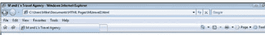

### 玛丽旅行社

送您到达目的地！

15 多年来，玛丽旅行社一直帮助客户规划前往世界各地目的地的精彩冒险。我们是独一无二的——我们专业为各种兴趣和预算提供提供定制的度假套餐。无论是在线还是亲临，让我们为您提供机票、酒店和租车服务。

热门目的地：
- 埃及，开罗
- 法国，尼斯
- 印度，阿格拉石窟
- 中国，长城

### 更改字体

你可以使用`SIZE`属性更改 Web 页面文本的外观。你可以在 HTML 中指定七种字体大小。字体大小 1 创建最小的文本，而字体大小 7 创建最大的文本。

虽然属性允许你设置部分文本的大小，但`<FONT>`标签可以设置整个页面的字体大小。

你可以使用`<FONT>`和`</FONT>`标签以及`FACE`属性更改文本的外观。并不是所有浏览器都显示所有字体。使用`FACE`属性指定大多数计算机上常见的字体，如 Times Roman 和 Arial。在`FACE`属性中指定多个字体名称，因为第一个字体在计算机上可能可用。

### 更改字体

1. 在想要更改的文本前加上`<FONT SIZE="7">`，将`?`替换为 1 到 7 之间的数字。
2. 在文本结束处加上`</FONT>`。
3. 对于任何你想设置大小的文本，输入额外的`<FONT>`标签和`SIZE`属性。

文本在 Web 页面上以指定的字体大小显示。

```html
<!DOCTYPE html>
<html>
<head>
<title>玛丽旅行社</title>
</head>
<body face="Arial, sans-serif">
<h1 align="center">玛丽旅行社</h1>
<p>15 多年来，玛丽旅行社一直帮助客户规划世界各地目的地的冒险之旅。我们专业为各种兴趣和预算的客户提供独一无二的度假套餐。无论是在线还是亲临，让我们为您提供机票、酒店预订和租车服务。</p>
<ul>
<li>埃及，金字塔</li>
<li>秘鲁，马丘比丘</li>
<li>柬埔寨，吴哥窟</li>
<li>中国，长城</li>
</ul>
</body>
</html>
```

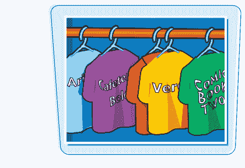

### 玛丽旅行社

15 多年来，玛丽旅行社一直帮助客户规划前往世界各地目的地的冒险之旅。我们是独一无二的——我们专业为各种兴趣和预算提供定制的度假套餐。无论是在线还是亲临，让我们为您提供机票、酒店预订和租车服务。

热门目的地：
- 埃及，金字塔
- 秘鲁，马丘比丘
- 柬埔寨，吴哥窟
- 中国，长城

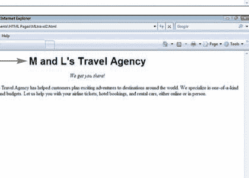

### 更改字体大小

你可以使用`SIZE`属性更改 Web 页面文本的字体大小。可以在 HTML 中指定七种字体大小。字体大小 1 创建最小的文本，而字体大小 7 创建最大的文本。

虽然属性允许你设置部分文本的大小，但`<FONT>`标签可以设置整个页面的字体大小。

### 更改字体大小

#### 更改部分文本

1. 在想要更改的文本前加上`<FONT SIZE="7">`，将`?`替换为 1 到 7 之间的数字。
2. 在文本结束处加上`</FONT>`。
3. 对于任何你想设置大小的文本，输入额外的`<FONT>`标签和`SIZE`属性。

文本在 Web 页面上以指定的字体大小显示。

# 第 4 章

## 更改所有文本

在 Web 页面内容的顶部输入`<BASEFONT="?>`，将`?`替换为从 1 到 7 之间所需的尺寸。

```html
<html>
<head>
<title>我和 L 的旅行社：徒步旅行</title>
<body>
<BASEFONT SIZE="5">
<h2>徒步必备</h2>
<p>
坚固的鞋子<br>
短裤<br>
雨衣<br>
指南针<br>
太阳镜<br>
晒霜<br>
帽子<br>
</p>
</BASEFONT>
</body>
</html>
```

所有文本在 Web 浏览器中将以新的尺寸显示。

注意：`<BASEFONT>`标签不会影响任何标题（Web 页面文本中的`<H1>`）的大小。

### 徒步必备

- 坚固的鞋子
- 短裤
- 雨衣
- 指南针
- 太阳镜
- 晒霜
- 帽子

如果我使用 **SIZE 属性** 设置尺寸，我的文本在页面上将以多大显示？

文本的精确尺寸取决于你使用的浏览器，尽管大多数现代浏览器以相同的尺寸显示。此表显示了 Internet Explorer 6 和 Firefox 2 显示文本的尺寸。

可以使用七个尺寸级别以外的内容设置尺寸吗？

可以，使用相对字体大小。如果你在尺寸数字前加上加号（`+`）或减号（`-`），浏览器将以相对于周围文本的尺寸显示文本。例如，如果你输入`<SIZE="+2">`，浏览器显示的文本将比周围文本大两个尺寸。

| 尺寸属性 | 字体大小 |
|---|---|
| 1 | 7 磅 |
| 2 | 10 磅 |
| 3 | 12 磅 |
| 4 | 14 磅 |
| 5 | 18 磅 |
| 6 | 24 磅 |
| 7 | 36 磅 |

### 更改文本颜色

你可以通过添加颜色来增强文本。`COLOR`属性与`<FONT>`标签配合使用，将页面上的文本从默认黑色改为颜色。你可以使用十六进制值指定颜色，或者对于常用颜色，使用颜色名称。

在给文本应用属性时，可读性始终是一个问题。务必选择在 Web 页面上易读的颜色。在彩色背景上应用彩色文本时要小心。始终测试你的文本，以确保颜色不冲突且文本保持清晰易读。

#### 更改部分文本

1. 在你想更改的文本前输入`<FONT COLOR="?>`，将`?`替换为所需颜色的名称或十六进制值。

此示例显示了色的色的名称。

2. 在文本末尾输入`</FONT>`。

文本将在 Web 页面上显示指定的颜色。

注意：要使用 CSS 中的`color`属性更改字体颜色，请参第 11 章。

```html
<html>
<head>
<title>M 和 L 的旅行社</title>
</head>
<body>
<center>
<h1><FONT COLOR="red">M 和 L 的旅行社</FONT></h1>
<p><center>我们带您到达目的地！</p>
<p>15 多年来，M 和 L 的旅行社一直帮助客户规划世界各地的冒险之旅。我们专注于为所有兴趣和预算提供独一无二的假期计划。无论在线还是线下，让我们为您提供机票机票、酒店预订和租车服务。</p>
<p>热门目的地：</p>
<ul>
<li>埃及，金萨</li>
<li>墨西哥，墨西哥城</li>
<li>法国，巴黎</li>
<li>意大利，罗马</li>
<li>希腊，雅典</li>
<li>中国，长城</li>
</ul>
</center>
</body>
</html>
```


# 文本格式

在`<body>`标签内，输入`TEXT="?>`，将`?`替换为颜色的名称或十六进制值。

此示例使用了十六进制值而不是颜色名称。始终在十六进制值前加一个`#`。

所有文本在 Web 浏览器中将以新的颜色显示。你使用`<FONT>`标签着色的文本将保持不变。

注意：`TEXT`属性不会影响链接的颜色。要了解更多关于链接的信息，请查看第 6 章。

## 我可以为 Web 页面设置哪些颜色？

使用符号（`#`）开头的六位十六进制值进行 HTML 编码，如表所示。浏览器也理解此处列出的颜色名称。

| 颜色 | 十六进制值 | 颜色 | 十六进制值 |
|---|---|---|---|
| 青色 (Aqua) | `#00FFFF` | 深蓝色 (Navy) | `#000080` |
| 黑色 (Black) | `#000000` | 橄榄绿 (Olive) | `#808080` |
| 蓝色 (Blue) | `#0000FF` | 紫色 (Purple) | `#808080` |
| 品红色 (Fuchsia) | `#FF00FF` | 红色 (Red) | `#FF0000` |
| 灰色 (Gray) | `#808080` | 银色 (Silver) | `#C0C0C0` |
| 绿色 (Green) | `#008080` | 青蓝色 (Teal) | `#808080` |
| 柠檬绿 (Lime) | `#00FF00` | 白色 (White) | `#FFFFFF` |
| 暗红色 (Maroon) | `#800000` | 黄色 (Yellow) | `#FFFF00` |

## 调整边距

你可以调整 Web 页面的边距来更改顶部、底部、左侧或右侧显示的空间大小。默认情况下，HTML 边距设置为 10 像素。你可以根据需要进行设置。

- 在`<body>`标签内输入`MARGIN="`以及你想更改的：`LEFTMARGIN`、`RIGHTMARGIN`、`TOPMARGIN`、`BOTTOMMARGIN`、`MARGINWIDTH`和`MARGINHEIGHT`。将`?`替换为所需的像素值。

你可以设置页面的一侧或四边的边距，都在`<body>`标签内。

网页浏览器按指定的边距显示页面。

注意：要学习如何对齐页面文本，请查看第 3 章。注意：使用样式表调整边距，请查看第 12 章。

## 设置背景颜色

你可以使用`BGCOLOR`属性为页面添加颜色。选择一个不会遮挡文本的背景颜色是好的。

- 在`<BODY>`标签内输入`BGCOLOR="?"`。使用颜色名称或十六进制值。

注意：关于可以使用的 16 颜色代码，请查看“更改文本颜色”部分。

```html
<html>
<head>
<title>M 和 L 的旅行社</title>
</head>
<body BGCOLOR="yellow">
<h1 align="center">M 和 L 的旅行社</h1>
<p align="center">欢迎来到我们的网站！</p>
<p>M 和 L 的旅行社一直帮助客户规划世界各地的冒险之旅。我们专注于为所有兴趣和预算提供独一无二的假期计划。无论在线还是线下，让我们为您提供机票、酒店预订和租车服务。</p>
<ul>
<li>埃及，金萨金字塔</li>
<li>秘鲁，马丘比丘</li>
<li>澳大利亚/印度，大堡礁</li>
<li>中国，长城</li>
</ul>
</body>
</html>
```

页面在 Web 浏览器中以分配的颜色显示。

注意：要使用样式表更改背景，请查看第 11 章。

## 添加水平线

你可以在页面上添加一条实线（即水平规则）来分隔信息块。水平规则必须单独占据一行，不能出现在段落内。

你可以使用`SIZE`和`WIDTH`属性定义水平线的厚度和长度。

### 添加简单的线

- 在你想插入水平规则的地方输入`<HR>`。

浏览器将跨页面显示该线。

## 设置线条的粗细和宽度

- 在`<HR>`标签中，将`SIZE="%"`替换为想要分配的百分比（以像素为单位）。
- 在`<HR>`标签中，将`WIDTH="%"`替换为想要让线条跨页面的百分比。

你也可以设置一个数值以像素为单位设置规则线的粗细。

浏览器会在页面上显示该线条。

# 文本格式第 4 章

```html
<!DOCTYPE html>
<head>
<title>M and L 旅行社</title>
</head>
<body>
<center><h1>M and L 旅行社</h1>
<hr width="50%">
<p>比我们想象的要多，M and L 旅行社已经帮助客户规划了环游世界的冒险之旅。我们专门提供独一无二的度假套餐、在线或线下的机票和酒店预订。</p>
<p>你梦想去哪里呢？</p>
<hr width="30%">
<ul>
<li>埃及金字塔</li>
<li>秘鲁马丘丘丘</li>
<li>意大利罗马斗兽场</li>
<li>中国长城</li>
</ul>
</center>
</body>
</html>
```

# M and L 旅行社

我们带你前往彼处！

多年来，M and L 旅行社一直帮助客户规划世界各地令人兴奋的假期。我们专门为各种兴趣和预算的用户提供独一无二的套餐。让我们在线或线下帮助您处理机票、酒店预订和租车服务吧。

热门目的地：

- 埃及金字塔
- 秘鲁马丘丘丘
- 意大利罗马斗兽场
- 中国长城

## 如何让我的线条看起来更实心？

默认情况下，浏览器显示带有阴影的水平规则，使线条具有三维效果。要去除阴影，请在你的`<HR>`标签中添加`NOSHADE`属性，使其变为`<HR NOSHADE>`。

## 我可以给水平线添加颜色吗？

可以。你可以插入`COLOR`属性并为线条分配颜色值。例如，如果你输入`<HR COLOR="#0000FF">`，浏览器会将线条显示为蓝色。有关 HTML 颜色的更多信息，请参见“更改文本颜色”章节。

# 第 5 章

## 添加图像

你准备好为 Web 页面添加图像了吗？图像包括照片、标志、剪贴画以及任何可以添加到 Web 页面上的视觉对象。本章将向你展示如何添加和处理图像，包括照片、图形文件和背景图像。

| 主题 | 页码 |
| :--- | :--- |
| 理解网页图像 | 66 |
| 为网络准备图像 | 68 |
| 插入图像 | 70 |
| 指定图像大小 | 72 |
| 添加备用文本 | 74 |
| 创建图像标签 | 75 |
| 为图像添加版权文本 | 76 |
| 水平对齐图像 | 77 |
| 垂直对齐图像 | 78 |
| 居中图像 | 79 |
| 在图像间环绕文本 | 80 |
| 停止文本环绕 | 81 |
| 设置图像框 | 82 |
| 在图像周围添加空间 | 83 |
| 添加背景图像 | 84 |
| 创建图像横幅 | 85 |

## 理解网页图像

你可以在 Web 页面上以多种方式使用图像。图像包括从图形、剪贴画到照片和其他视觉对象的一切。图像可以说明文本、显示产品、提供背景装饰，或作为网站的导航按钮。在自己的网站上有效使用图像的一个重要部分是理解浏览器如何显示他人的图像供查看。

### 图像文件格式

虽然用于图像的文件类型有很多，但 JPEG 和 GIF 是 Web 上最流行的两种类型。这两种格式都是跨平台的，并提供文件压缩。PNG 是图像文件格式中的较新成员，在 Web 开发者中越来越流行。如今流行的 Web 浏览器的版本可以显示 JPEG、GIF 和 PNG 图像。

#### JPEG

JPEG 代表联合摄影专家小组（Joint Photographic Experts Group），支持 24 位色彩，允许数百万种颜色。JPEG 格式通常用于复杂图像，例如使用数百万种颜色并包含大量细节的照片或图形。对于纯色艺术品来说，JPEG 不是一个好的选择，因为它会导致总体尺寸增大，意味着下载时间更长。JPEG 图像通常使用`.jpg`扩展名。

#### GIF

GIF 代表图形交换格式（Graphics Interchange Format），支持多达 256 种颜色。GIF 格式更多用于简单图像，例如包含基本形状和线条的标志和图形。如果你的图像或图形颜色较少且没有太多细节，GIF 是一个很好的选择。单个 GIF 文件还可以存储多幅图像并将它们显示为动画。GIF 使用`.gif`扩展名。

#### PNG

PNG（便携网络图形）格式提供了丰富的色彩支持和先进的压缩，因此它是各种图像类型的良好选择。像 JPEG 一样，PNG 支持 24 位色彩，但也可以像 GIF 一样以较少的颜色保存。由于 PNG 是一个较新的格式，如果你的目标受众拥有最新的浏览器，请使用它。PNG 图像使用`.png`扩展名。

### 下载注意事项

用户在 Web 页面上查看图像之前，浏览器必须先下载图像。大图像需要很长时间显示，特别是当互联网连接较慢时。因此，在决定将其添加到 Web 页面时，请考虑图像的总体文件大小。

### 优化图像

大多数图像编辑程序允许通过调整质量来控制文件大小。你还可以通过缩小或裁剪图像来控制文件大小。

## 为网络准备图像

你可以使用图像编辑软件来编辑图像。无论你计划在 HTML 页面使用照片还是图形，通过先在图像程序中准备图像再插入页面，可以节省你的精力。关于图像及使用的格式的更多信息，请参见“理解网页图像”。

### 图像编辑程序

有很多程序可用于编辑图像。某些程序如 Adobe Photoshop Elements 和 Corel's Paint Shop Pro 价格合理，允许你减少图像的总体大小并使用 JPEG、GIF 或 PNG 等 Web 格式。来自 Windows 的 Paint 也提供了可以帮助优化文件大小的图像编辑功能。

### 缩小图像宽度和高度

在 Web 页面上放置图像时，尺寸是一个重要的考虑因素。比窗口宽图像无法完全显示，需要用户滚动。你可以使用图像编辑程序调整图像大小。裁剪掉不想在 Web 页面显示的图像区域有助于减少总体文件大小。

### 图像压缩

图像编辑程序允许将图像保存为特定文件类型并设置压缩级别。JPEG 图像使用的压缩有时可以将文件大小缩小 90%。许多程序允许你在压缩前后查看图像以检查差异。

### 颜色数量

对于 GIF 图像和某些 PNG 图像，你可以减少图像中的颜色以减小文件大小。例如，虽然 GIF 图像最多包含 256 种颜色，但对于大多数区域为纯色的插图，使用 16 色 GIF 效果可能很好。大多数图像编辑器允许你在保存前比较不同颜色设置下的图像。

## 插入图像

你可以向网页中添加图像，以增加视觉趣味或说明某个主题。例如，你可以在企业的网页上添加产品照片或公司标志。HTML 编码允许你将图像作为内联元素显示，这意味着它们会与文本一起出现在页面主体。

你可以使用来自数码相机或扫描仪的图像，也可以使用图形程序创建插图。如果你不是图像的原始作者，在将其放置到网站之前，需要获得使用许可。

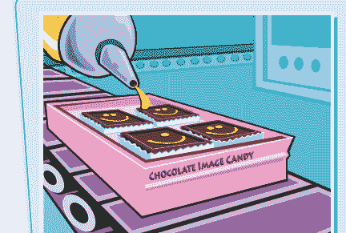

### 插入照片

- 在你想插入照片的地方输入``，并替换为你想要文件的完整路径。

在这个示例中，由于图像与 HTML 文件保存在同一个文件夹中，因此只需使用文件名来引用它。

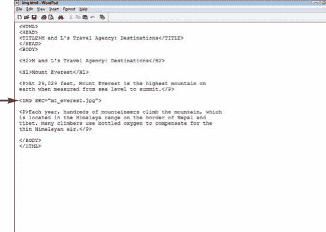

- 网页浏览器在页面上显示图像。

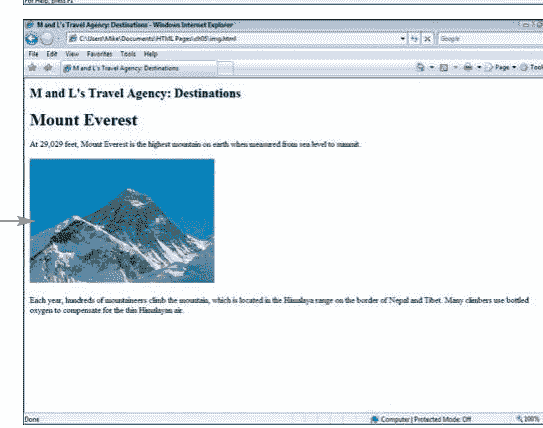

### M 和 L 旅行社：目的地

#### 珠穆朗玛峰

从海拔测量，珠穆朗玛峰为 25029 英尺，是地球最高山。

每年都有成千上万登山者攀登这座山，它位于尼泊尔和西藏边界的喜马拉雅山脉。许多登山者使用瓶装氧气来补偿喜马拉雅稀薄的空气。

70

### 插入图形文件

在你想插入图形的地方输入``，并将`?`替换为你想要文件的完整路径。

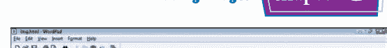

在这个示例中，图形文件保存在相对于 HTML 文件的 images 子目录中，你通过子目录名称加斜杠（`/`）以及文件名来引用它。

- 网页浏览器在页面上显示图形。

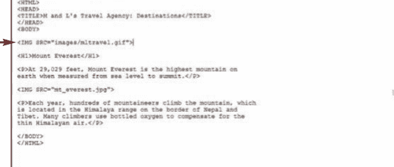

### M 和 L 旅行社

#### 珠穆朗玛峰

从海平面到山顶测量，珠穆朗玛峰为 29028 英尺，是地球最高山。

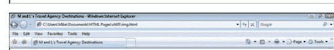

每年有数百名登山者攀登这座山，它位于尼泊尔和西藏边界的喜马拉雅山脉。许多登山者使用瓶装氧气来补偿氧气的不足。

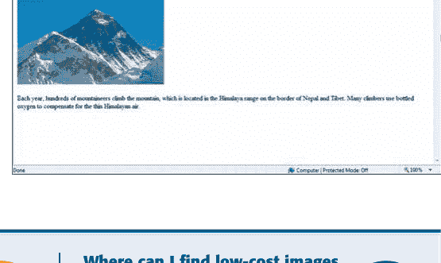

### 如何从网页下载图像？

Internet Explorer、Firefox 以及大多数其他浏览器都允许你通过右键点击图像并选择保存命令从网站复制图像。如果你将图像保存在与 HTML 文件相同的文件夹中，然后可以使用之前的步骤在页面上使用它。在使用网站图像之前，请确保你已获得图像所有者的许可。

### 在哪里可以找到用于我网站的低廉图像？

许多网站提供了公有领域或可供非商业使用的图像。Wikimedia Commons (https://commons.wikimedia.org) 就是其中一个网站。如果你有一点预算资金，可以使用微图网站的图像，这些网站以低廉、可下载的图像闻名。iStockPhoto (www.istockphoto.com) 是一个流行的微图站。


71

## 指定图像大小

如果你的图像在网页上显得太大或太小，可以使用 HTML 编码中的图像属性来更改大小。你可以以像素或整个窗口大小的百分比设置图像的宽度和高度。

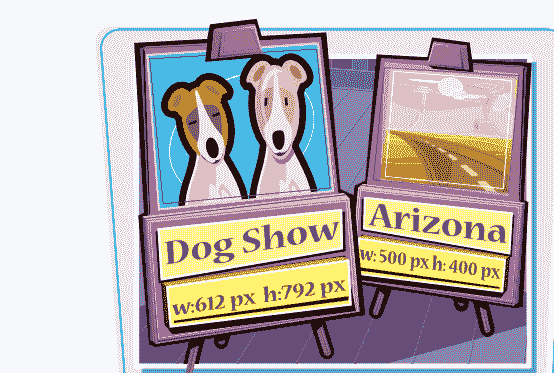

### 指定图像大小

- 点击``标签内部并输入`WIDTH="?"`，替换为你想要设置的宽度值。

```html
<html>
<head>
<title>Everest and L's Travel Agency: Destinations</title>
</head>
<body>

<p>Everest (29029 ft), Mount Everest is the highest mountain on earth measured from sea level.</p>

<p>多年来，登山者一直攀登这座山，它位于尼泊尔和西藏边界的喜马拉雅山脉。许多登山者使用瓶装氧气来补偿喜马拉雅空气的空气。</p>
</body>
</html>
```

- 输入`WIDTH="?"`，替换为你想要设置的宽度值。

```html
<html>
<head>
<title>Everest and L's Travel Agency: Destinations</title>
</head>
<body>

<p>Everest (29029 ft), Mount Everest is the highest mountain on earth measured from sea level.</p>

<p>多年来，登山者一直攀登这座山，它位于尼泊尔和西藏边界的喜马拉雅山脉。许多登山者使用瓶装氧气来补偿喜马拉雅空气的空气。</p>
</body>
</html>
```

- 输入`WIDTH="?"`，替换为你想要设置的宽度值。

### 添加图像

如果你的图像在网页上显得太大或太小，可以使用 HTML 编码中的图像属性来更改大小。你可以以像素或整个窗口大小的百分比设置图像的宽度和高度。

你也可以将宽度和高度设置为百分比。网页浏览器将按百分比显示图像。如果你指定了百分比，浏览器将按比例显示图像。

注意：如果你指定了百分比，浏览器将按比例显示图像。

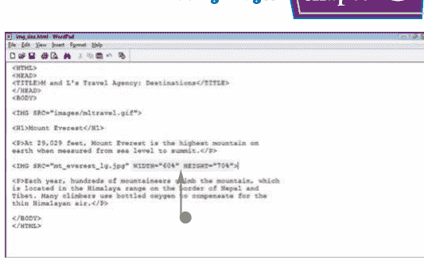

```html
<html>
<head>
<title>Everest and L's Travel Agency: Destinations</title>
</head>
<body>

<p>Everest (29029 ft), Mount Everest is the highest mountain on earth measured from sea level.</p>

<p>多年来，登山者一直攀登这座山，它位于尼泊尔和西藏边界的喜马拉雅山脉。许多登山者使用瓶装氧气来补偿喜马拉雅空气的空气。</p>
</body>
</html>
```

## 创建标签 (Label)

## 添加图片 第5章

你可以添加一个标签，当用户将鼠标指针移动到网页上的特定图片上时，该标签就会出现。你可以使用标签提供有关图片的详细信息。

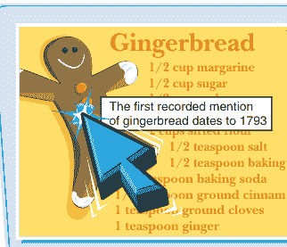

标签的工作原理与替代文本（alternative text）不同。图片关闭时，替代文本会出现在页面上。而用户将鼠标悬停在图片上时，标签会在弹出框中显示。

### 创建标签

- 在``标签内输入`TITLE="?"`以及你想要显示的标签。

```html
<html>
<head>
```


# Mount's Travel Agency: Destinations

## 珠穆玛峰

从海拔计算，珠穆玛峰高度为 29,029 英尺，是地球最高山。

每年都有数百登山者攀登这座山，它位于尼泊尔和西藏的喜马拉雅山脉。许多登山者携带瓶氧气以补偿喜马拉雅山稀薄的空气。

- 当你在浏览器窗口中将鼠标指针移动到图片上时，标签就会出现。

注意：标签文本还可以帮助搜索引擎确定你页面上的内容类型。

## Mount 旅游旅行社

### 珠穆玛峰

从海拔计算，珠穆玛峰高度为 29,029 英尺，是地球最高山。

每年都有数百登山者攀登这座山，它位于尼泊尔和西藏的喜马拉雅山脉。许多登山者携带瓶氧气以补偿喜马拉雅山稀薄的空气。

## 为图片添加版权文本

在图片下方或旁边添加版权信息，以注明作者署名。如果你在使用来自其他来源的图片，请务必先获得许可。你可以添加版权文本来注明图片的来源。

### 为图片添加版权文本

1. 输入`©`：创建版权符号。

**注意：** 更多关于在页面上添加特殊字符的信息，请参第 3 章。

2. 输入空格，然后输入你想要添加的版权文本。

**注意：** 如需使用标签控制字体和字体大小，请参第 4 章。

- 在此示例中，换行标签`<BR>`将版权文本放在新的一行。
- 版权文本会出现在浏览器窗口中。

```html
<html>
<head>
<title>Copyright Page</title>
</head>
<body>

<p>2008 Mike Woodridge. 版权所有。</p>
</body>
</html>
```

### 秘鲁，马丘丘

2008 Mike Woodridge. 版权所有。
位于秘鲁安第斯山脉的古代印加城市马丘丘建于 14 世纪，当时是印加帝国鼎盛时期。在印加帝国被西班牙征服后，它被遗弃了100 多多年。如今，马丘丘是秘鲁最著名的景点。

## 水平对齐

## 添加图片 第5章

你可以使用`left`和`right`对齐属性来控制图片在页面上的水平位置。对齐属性还控制文本如何环绕图片。

你也可以在页面上垂直对齐图片。参见“垂直对齐图片”部分获取更多信息。

### 水平对齐

- 在``标签内输入`ALIGN="?"`以及你想要应用的对齐方式（`left`或`right`）。

```html
<!DOCTYPE html>
<html>
<head>
<title>Ira's Travel Agency: Machu Picchu</title>
</head>
<body>

<p>秘鲁安第斯山脉的古代印加城市马丘丘建于 14 世纪，当时是印加帝国鼎盛时期。在印加帝国被西班牙征服后，它被遗弃了100 多多年。如今，马丘丘是秘鲁最著名的景点。</p>
</body>
</html>
```

浏览器按照指定的方式对齐图片。

- 在此示例中，图片右对齐。

注意：如需居中对齐图片，请参见“居中图片”。
注意：如需对图片对齐进行更多控制，请考虑将图片放在表格中。参阅第 7 章。

### 秘鲁，马丘丘

位于秘鲁安第斯山脉的古代印加城市马丘丘建于 14 世纪，当时是印加帝国鼎盛时期。在印加帝国被西班牙征服后，它被遗弃了100 多多年。如今，马丘丘是秘鲁最著名的景点。

## 垂直对齐

你可以使用对齐属性来控制页面上图片相对于后续文本的垂直位置。对齐属性有`top`、`middle`和`bottom`。

### 垂直对齐

- 在``标签内输入`ALIGN="?"`以及你想要应用的对齐方式（`middle`、`top`或默认的`bottom`）。

如果图片与文本共用同一行，对齐属性控制图片相对于文本的位置。

浏览器按照指定的方式对齐图片。

- 在此示例中，图片与现有文本中对齐。

注意：如需对图片对齐进行更多控制，请考虑将图片放在表格中。参阅第 7 章。

## 居中图片

你可以使用`<div>`标签和`align`属性将图片在页面居中。居中图片可以使其更加突出，并帮助它从文本或其他页面元素中颖而出。

## 添加图片 第5章

### 居中图片

- 在``标签之前输入`<div>`。
- 在`<div>`标签内输入`align="center"`。
- 在``标签的结束括号之后输入`</div>`。

```html
<html>
<head>
<title>Inca's Travel Agency: Destinations</title>
</head>
<body>

</body>
</html>
```

秘鲁人于印加帝国鼎盛时期建造了马丘丘这座古代城市。当印加帝国崩溃时，它被遗弃了不到 100 年。如今，马丘丘是秘鲁最著名的景点。

图片在网页上居中显示。

### 秘鲁，马丘丘

在秘鲁安第斯山脉，古代印加城市马丘丘建于 14 世纪，当时是印加帝国鼎盛时期。在印加帝国被西班牙征服后不到 100 年，它被遗弃了。如今，马丘丘是秘鲁最著名的景点。

## 在图片之间环绕文本

将两张图片并排放置让文本在它们之间环绕。为了创建这种效果，你将一张图片左对齐，另一张右对齐。

### 在图片之间环绕文本

1. 使用``标签将两张图片插入你想环绕的文本上方。
2. 在第一个``标签内输入`ALIGN="left"`。
3. 在第二个``标签内输入`ALIGN="right"`。

```html
<html>
<head>
<title>Machu Picchu - Leo's Travel Agency Destinations</title>
</head>
<body>


马丘丘建于印加帝国鼎盛时期。在印加帝国被西班牙征服后不到 100 年，它被遗弃了。马丘丘是秘鲁最著名的景点。
</body>
</html>
```

文本在网页上环绕在两张图片之间。

注意：如需了解如何在图片与周围文本之间添加间距，请参见“添加图片周围间距”部分。

## 停止文本环绕

你可以使用换行标签配合`clear`属性来停止文本在图像周围环绕。

- 点击你想结束文本环绕的地方，输入`<BR CLEAR="?">`，将`?`替换为要清除的边距，可以是左、右或全部。

文本环绕在页面上的选定点结束。

- 在此示例中，下一个段落从与图像不同的行行开始。

```html
<head>
<title>Machu Picchu</title>
<body>


<p>马丘丘是一处考古遗址。古老的印加城市马丘丘建于 14 世纪，正值印加帝国的鼎盛时期。它在西班牙征服下被遗弃，并在 1911 年被重新发现。如今，它是秘鲁最受欢迎的景点之一。</p>
</body>
</html>
```

## 设置图像边框

你可以为图像添加边框，以增强其视觉效果或使其在页面上看起来更具吸引力。你可以以像素为单位定义边框的厚度。

- 点击``标签内部并输入`BORDER="?"`，将`?`替换为你想要应用的厚度。

要移除不再需要的边框，将`?`替换为 0。

```html
<!DOCTYPE html>
<html>
<head>
<title>旅行社：L 旅行社</title>
</head>
<body>

<p>珠穆玛峰按海平面测量是地球上最高的山峰。</p>

<p>成千上万的登山者攀登这座位于尼泊尔和西藏喜马拉雅山脉的山。许多登山者使用氧气来应对喜马拉雅稀薄的空气。</p>
</body>
</html>
```

- 浏览器会在图像周围显示黑色边框。

注意：你可以使用样式表为图像添加带有自定义颜色的边框。详情请参见第 11 章。

### M 和 L 的旅行社

#### 珠穆玛峰

珠穆玛峰海拔 8,848 米，按海平面测量是地球上最高的山峰。

每年都有数百名登山者攀登这座位于尼泊尔和西藏边界喜马拉雅山脉的山。许多登山者使用氧气来补偿喜马拉雅稀薄的空气。

## 在图像周围留空

## 添加图像 第 5 章

大多数网页浏览器在图像和文本之间仅显示少量的空间，也称为*内边距*（padding），使页面更具视觉吸引力且易于阅读。你可以使用`HSPACE`属性增加空间量，并控制图像左右的内边距。你可以使用`VSPACE`属性控制图像上下的内边距。

用于水平和垂直属性的值以像素为单位指定内边距。

- 点击``标签内部并输入`HSPACE="?"`或`VSPACE="?"`，将`?`替换为你想要想要插入的空间量。

你可以为图像添加一个或两个属性。

如果你添加了两个属性，请在 HTML 代码中用空格将它们隔开。

```html
<html>
<head>
<title>It's La 旅行社：目的地</title>
</head>
<body>


<p>马丘丘位于秘鲁安第斯山脉，这座古城是由印加人建造在山脉顶部的。在印加帝国在西班牙征服下崩溃后，它被遗弃了 100 多多年。如今，马丘丘是秘鲁最受欢迎的旅游景点。</p>
</body>
</html>
```

- 浏览器在图像周围显示具有指定内边距的边框。

`HSPACE`和`VSPACE`属性为图像的两侧添加内边距。如果你只想为一侧添加，请使用样式表。

马丘丘 秘鲁

## 为页面添加背景

你可以通过`<body>`标签设置属性为页面添加背景图像。如果你使用较大的图像，它将填充整个页面；如果你使用较小的图像，它将平铺显示。

- 在`<body>`标签内输入`BACKGROUND="?"`，将`?`替换为你要使用的背景文件。

马丘丘 秘鲁
注意：要了解如何为页面创建背景，请参见第 12 章。

```html
<html>
<head>
<title>L 旅行社：目的地</title>
</head>
<body background="machu.jpg">
<h1>马丘丘是一处考古遗址。马丘丘</h1>
<p>马丘丘是一处考古遗址。古老的印加城市马丘丘建于 14 世纪，正值印加帝国的鼎盛时期。它在西班牙征服下被遗弃，并在 1911 年被重新发现。如今，它是秘鲁最受欢迎的景点。</p>
</body>
</html>
```


### 创建横幅

### 添加图像 第 5 章

你可以在页面顶部使用横幅来广告产品或服务，或者让你的网站具有一致的外观。

横幅通常宽 468 像素，高 60 像素，但你可以根据需要设置尺寸。

- 在页面顶部，在任何文本之前，输入 ``，将 `?` 替换为横幅文件的路径。

要了解如何设置图像宽高，请参见本章早前的“设置图像”。

- 在 `` 标签内输入 `WIDTH="?"`，将 `?` 替换为像素值。
- 在 `` 标签内输入 `HEIGHT="?"`，将 `?` 替换为像素值。

- 浏览器在页面顶部显示横幅。

马丘丘 秘鲁
在秘鲁安第斯山脉，这座古城马丘丘建于 14 世纪，它在印加帝国的鼎盛时期。在印加帝国在西班牙征服下崩溃后，它被遗弃了 100 多多年。如今，马丘丘是秘鲁最受欢迎的旅游景点。

# 第 6 章

### 添加链接

你准备好为你的网页添加链接了吗？本章将向你如何在 HTML 文档中创建链接，允许用户跳转到其他网站或你自己网站的其他页面。你还将学习如何添加电子邮件链接以及控制链接的外观。

# 了解链接

超链接（简称为链接）是网页区别于其他计算机文档的。任何公开访问的网页都可以通过创建链接与另一个页面连接。链接使用户可以在一个网站内从一个主题跳转到另一个主题，从一个网站跳转到另一个网站。用户点击链接，浏览器就会打开目标页面。

# 链接的类型

### 指向外部网页的链接

链接可以是文本也可以是图像。文本链接通常显示为页面上带有下划线且颜色不同的文字。网页上的任何图像也可以转换为链接。例如，出现在页面顶部或侧边的图形化站点地图和导航栏，可以方便用户访问同一网站上的其他页面。当用户将鼠标指针悬停在链接上时，指针会变成指向的手形，表示存在一个活跃的可点击的链接。

你可以使用网页上的链接将用户引导至互联网上的其他页面。例如，你可以在你的公司网页上包含一个指向当地餐厅和酒店目录的链接。你可能可以在产品页面上添加一个指向制造商网站的链接。

### 添加链接

### 指向站点其他页面的链接

如果你的网站包含多个页面，你可以包含指向该站点其他页面的链接。例如，你的主页可以提供指向业务、产品以及订单信息的链接。如果你维护了一个博客，主页通常会链接到你创建的文章。

### 指向同一页面其他区域的链接

如果你的网页特别长，你可以提供指向页面上不同区域的链接。例如，在页面顶部，你可以包含指向下方每个章节或照片的链接。这允许用户无需滚动即可跳转到他们想要的信息。

# 绝对链接与相对链接

你可以在 HTML 文档中使用两种链接：绝对和相对。绝对链接使用完整的 URL 指向特定服务器上的特定页面。相对链接使用简写引用页面而不指定服务器。你通常使用相对链接来引用同一网站上的文档。

# 锚点标签

用于创建链接的 HTML 代码称为锚点标签，由起始 `<a>` 和结束标签 `</a>` 组成。`HREF` 属性在起始锚点标签内定义要链接的 URL（或网页地址）。你可以在下一节学习更多关于 URL 的知识。

# 了解 URL

Web 上的每个页面都有唯一的地址，称为 URL。URL 是统一资源定位符，它标识 Web 服务器的域名以及指向该服务器文件的目录路径。绝对链接指定完整的网页 URL，而相对链接使用简写指定相对于链接所在的页面。

### HTTP 前缀

所有网页 URL 都包含标准的 HTTP（超文本传输协议）前缀，例如 `http://www.example.com`。虽然大多数浏览器在你输入如 `www.example.com` 的地址时会自动为你插入 `http://` 前缀，但在 HTML 中引用 URL 时，必须包含该前缀。

### FTP 或 MAILTO 前缀

你可能会在 URL 中使用 HTTP 以外的前缀。如果你链接到文件传输站点上的文档，使用 FTP 前缀（`ftp://`）。如果你想创建一个打开电子邮件程序并允许用户发送邮件的链接，请使用 MAILTO 前缀（`mailto:`）。

# 域名

URL 中的前缀之后是存储页面的 Web 服务器的域名。通常，域名对应托管你网页文件的公司或组织。主机可以包括商业公司、教育机构和政府机构。在 URL `http://www.example.com` 中，“example.com”是域名的名称，指定了该域名下的 Web 服务器。你可能会在 URL 中使用数字 IP（网协议）地址如 `208.215.179.146`，而不是域名。

# 目录路径与文件名

URL 中的域名之后是关于 HTML 文件名以及页面存储所在目录的信息。例如，`http://www.example.com/pages/home.html` 文件名为 `home.html`，存储在 Web 服务器上名为 `pages` 的目录中。你使用斜杠（`/`）分隔域名、目录和文件名。当你引用网站的主页时，通常会从 URL 中省略路径和文件名，例如 `http://www.example.com`。在这种情况下，服务器会返回该站点的默认页面，通常命名为 `index.html`，位于 Web 服务器的根目录下。

# URL 错误

创建链接时最容易犯的错误之一是输入错误的 URL。这会导致用户在点击链接时收到错误信息。URL 中错一个字母或缺少斜杠都会导致链接失效。重命名 Web 服务器上的文件也可能破坏链接。

# 另一个页面的链接

你可以在 HTML 中创建一个链接，点击后将用户带到 Web 上的另一个页面。你必须先知道要链接的页面 URL，例如 `http://www.example.com`。

# 插入文本链接

- 输入你想作为链接的文本。
- 在文本前输入 `<a href="?">`，并将 `?` 替换为链接的 URL。
- 在文本后输入 `</a>`。
- 浏览器会将文本显示为带有下划线的链接。
- 当你将鼠标指针悬停在链接上时，指针会变成指向的手形。
- 状态栏会显示链接的 URL。

```html
<html>
<head>
<title>链接测试</title>
</head>
<body>
<a href="http://www.wiley.com">点击这里</a>
</body>
</html>
```

# 插入图像链接

- 使用 `` 标签添加你想作为链接的图像。
注意：要了解如何向页面添加图像，请参阅第 5 章。
- 在图像前输入 `<a href="?">`，并将 `?` 替换为链接的 URL。
- 在图像后输入 `</a>`。
- 浏览器会将图像显示为链接。
- 当你将鼠标指针悬停在链接上时，指针会变成指向的手形。
- 状态栏会显示链接的 URL。

```html
<html>
<head>
<title>链接测试</title>
</head>
<body>
<a href="http://www.example.com"></a>
</body>
</html>
```

### 在新窗口中打开链接页面

你可以为 HTML 链接添加指令，告诉浏览器在新的浏览器窗口中打开链接页面。如果你希望保留一个自己网站的窗口，以便用户能够轻松返回你的页面，则可以添加此指令。

在链接锚点元素 (`<a>`) 中使用 `target` 属性可以在新窗口中打开链接。要让页面上的所有链接都在新窗口中打开，你可以使用 `<BASE>` 元素。要了解更多关于链接和 URL 的工作原理，请参见本章开头的章节。

### 在新窗口中打开链接页面

- 点击你想要编辑的链接的 `<a>` 标签，并输入 `TARGET="?"`，将 `?` 替换为新窗口名称。

网页上的其他链接可以引用相同的 `target` 名称，在同一个新窗口中打开页面。

如果你想在一个新的未命名窗口中打开链接，请输入 `"blank"`。

- 当点击链接时，链接页面将在目标窗口中打开。

```html
<!DOCTYPE html>
<html>
<head>
<title>M and L's Travel Agency</title>
</head>
<body>
<a href="http://www.travelagency.com" target="_blank">M and L's Travel Agency</a>
<p>15多年来，M and L's Travel Agency 帮助了无数旅行者。我们专门为各种兴趣和预算提供独特的旅游包。您可以在线或通过面面找到预订和租汽车的优优优惠。</p>
<a href="http://www.willey.com" target="_blank">Wiley Publishing</a>
<a href="http://www.wikipedia.org/wiki/America" target="_blank">Travel destinations</a>
<a href="http://www.google.com" target="_blank">Google: Discover other web ideas</a>
</body>
</html>
```

### 让所有链接在新窗口中打开

### 添加链接

在 `<HEAD>` 和 `</HEAD>` 标签之间点击，并输入 `<BASE TARGET="?">`，将 `?` 替换为新窗口名称，例如 `main`。

如果你想让链接在一个新的未命名窗口中打开，请输入 `"blank"`。

- 当用户点击页面上的任何链接时，链接页面将在目标窗口中打开。

```html
<html>
<title>L and L's Travel Agency</title>
<body>

<p>你来这里旅行的。</p>
<p>17多年来，L and L's Travel Agency 帮助了无数人环游世界。我们专门为各种兴趣和预算提供独特的假期套餐。我们在线或通过面面处理预订、酒店和租汽车。</p>
<p>其他旅行资源：
<a href="http://www.wikipedia.org/wiki/Publisher">Find travel</a>
<a href="http://www.wikipedia.org/wiki/Tripguide">Research travel destinations</a>
<a href="http://www.google.com">Google: Discover other web sites.</a></p>
</body>
</html>
```

| L and L's Travel Agency - 窗口资源管理器 |
| --- |
| 1 C:\Documents\Document.html 第1页/2页 | document.html |
| 文件 | 编辑 | |
| L and L's Travel Agency |

### L and L's Travel Agency

你来到这里。
17多年来，L and L's Travel Agency 帮助了无数人去世界各地度假。我们专门为各种兴趣和预算提供独特的假期套餐。让我们帮助您处理旅行票、酒店、预订和租汽车，无论是在线还是面面均可。

- 其他旅行资源：
- 搜索旅行目的地
- 发现其他网站。

### 我需要为新窗口指定名称吗？

与其担心给新窗口起什么名字，你只需保持窗口未命名即可。你可以通过使用 `TARGET="blank"` 属性来实现这一点。一个新的、未命名的窗口将会打开。

### 我应该为每个链接打开一个新窗口吗？

可能不需要。如果你的页面上每次点击链接都会打开一个新窗口，用户可能会很快被打开的窗口数量搞得崩溃不堪。你可能只想在链接指向当前网站之外的页面时才打开新窗口。这样，当前网站就在用户的计算机上保持打开。

### 链接到同一页上的区域

你也可以链接到将用户带到同一页面另一个地方的页面。这对于较长的文档特别有用。例如，你可以链接将用户带到文档中不同的标题。

要链接到同一页上的位置，你必须为你想要链接的区域分配名称。你可以使用锚点标签 (`<a>`) 和 `name` 属性来实现。这些被称为命名锚点。

### 链接到同一页上的区域

- 在你想要创建链接的章节前方点击，并输入 `<a NAME="#">`，将 `?` 替换为该区域的唯一名称。

最好保持你的名称简短简单，只使用字母和数字。

- 在章节的末尾输入 `</a>`。

| 为区域命名 |
| --- |
```html
<html>
<h3><a name="Everest">珠穆玛峰</a></h3>
<p>珠穆玛峰海拔29,032英尺，是地球上最高的山，位于西藏的喜马拉雅山脉。每年有成百上千的登山者访问。他们使用氧气到达顶峰。</p>
<h3><a name="Machu Picchu">马丘比丘</a></h3>
<p>马丘比丘位于秘鲁安第斯山区，古代马丘比丘是由印加帝国建造的。100年后当印加帝国在西班牙征服期间崩溃，它被遗弃了。马丘比丘是秘鲁最著名的旅游景点。</p>
<h3><a name="Santiago de Compostela">圣地亚哥-科波斯斯特拉</a></h3>
<p>位于西班牙北部加利西亚地区的，圣地亚哥-科波斯斯特拉是圣雅各的朝圣地。每年有数万朝圣者沿着圣地亚哥之路行走，花费几周或几个月的时间步行、骑自行车甚至骑驴到达圣雅各安葬的教堂。传说圣雅各的遗骸葬在那里。</p>
</html>
```


### 创建区域的链接

### 添加链接

在你想要变成链接的文本前方输入`<a href="#">`，将`?`替换为目标区域的名称。

注意：链接到页面其他区域时，不要留下井号（`#`）。

- 在链接后输入`</a>`。

注意：要将图像作为链接，请参见“插入链接”章节。

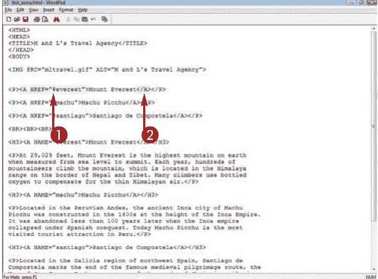

当用户点击链接时，浏览器滚动到页面指定的章节。


### M and L's Travel Agency

- 珠穆玛峰
- 马丘比丘
- 圣地亚哥-科波斯斯特拉


<h3>珠穆玛峰</h3>
珠穆玛峰海拔29,032英尺，从海平面测量，它是地球上最高的山。每年都有登山者攀登这座位于尼泊和中国边界喜马拉雅山脉的山峰。许多登山者使用氧气来应对高海拔。

<h3>马丘比丘</h3>
在秘鲁安第斯山区，古代马丘比丘在印加帝国鼎盛时期建于1450年。印加帝国崩溃不到100年后，它被遗弃了。

<h3>圣地亚哥-科波斯斯特拉</h3>
圣地亚哥-科波斯斯特拉位于西班牙西北部，是著名的中世纪朝圣之路——圣地亚哥之路的终点。


### 我可以在页面底部添加一个返回到页面顶部的链接吗？

可以。在长页面底部添加链接是一个好主意，可以帮助用户无需滚动即可回到顶部。要创建此类链接，按照本章节中的步骤在页面顶部创建一个命名锚点：插入引用该锚点的链接。此类链接的良好文本是“返回顶部”或“回到顶部”。


### 如何链接到我网站上另一个页面的特定位置？

你可以使用本章节所示的相同技术链接到另一个页面上的章节。首先

## 链接到其他类型的文件

你可以为非 HTML 资源添加链接，例如 Word 文档、表格文件、图像文件、压缩文件等。为了让此类文件可以在 Web 上访问，你必须将它们存储在 Web 服务器上与你的 HTML 文件相同的位置。

由于特殊的插件，某些 Web 浏览器可以打开非 HTML 文件。对于浏览器无法打开的文件，浏览器可能会提示你将文件保存到计算机上。

## 链接到其他类型的文件

- 1 输入用于链接的文本。

在页面上包含一段描述以识别该链接打开的文件类型是比较好的。


```html
<html>

<HEAD>

  <title>M and L's Travel Agency</title>

</HEAD>

<body

  

  <a href="destinations.zip">

    <p>15 年来，M and L's Travel Agency 一直在帮助客户前往世界各地的目的地旅行。我们专注于为所有兴趣和预算提供独一无二的度假套餐。我们提供机票、预订和租车，无论是在线还是亲自办理。</p>

    

  </a>

  <p>点击此处下载一组来自顶级冒险目的地的图片：该set已保存为单个 single.zip 文件。</p>

</body>

</html>
```


- 2 输入`<A HREF="?">`并替换为文件的完整路径和名称。

- 3 在链接文本末尾输入`<A>`。

```html
<html>

<HEAD>

  <title>M and L's Travel Agency</title>

</HEAD>

<body

  

  <a href="destinations.zip">

    <p>15 年来，M and L's Travel Agency 一直在帮助客户前往世界各地的目的地旅行。我们专注于为所有兴趣和预算提供独一无二的度假套餐。我们提供机票、预订和租车，无论是在线还是亲自办理。</p>

    

  </a>

  <p>点击此处下载一组来自顶级冒险目的地的图片：该set已保存为单个 single.zip 文件。</p>

</body>

</html>
```

### 添加链接

- 链接出现在 Web 页面上。

当点击链接时，浏览器可能会浏览器窗口中显示文件。

**注意：** 如果要在新窗口中打开文件，请参见“在新窗口中打开链接页面”部分。


如果浏览器无法打开文件，可能会出现文件下载框，允许用户将文件下载到其计算机上。


### 我可以包含指向纯文本文件的链接吗？

可以，大多数浏览器都能够打开并显示此类文件。因为纯文本文件不包含 HTML 格式，浏览器将显示无格式文本，且不包含内联图像或其他特性。

### 如果用户无法下载或打开文件会怎样？

如果用户访问非 HTML 文件时遇到问题，或者她的浏览器或计算机可能会显示错误消息。为了帮助可能发生的任何问题，请务必在 Web 页面上包含文件格式和大小的信息；还要包含任何可以帮助用户处理文件的链接。例如，如果链接是 PDF 文件，请包含指向 Adobe 网站的链接，用户可以在那里下载可以读取 PDF 的 Adobe Acrobat Reader。


### 链接到电子邮件地址

你可以在 Web 页面上创建一个链接，允许用户发送电子邮件消息。添加电子邮件链接是向你的网站访问者征求反馈和问题的好方法。


### 链接到电子邮件地址

- 输入你想要作为电子邮件链接的文本。

使用电子邮件地址作为文本链接是标准做法。

```html
<HTML>

<head>

<title>N and L's Travel Agency</title>

</head>

<body


<p>15 年来，N and L's Travel Agency 一直在帮助客户前往世界各地的目的地旅行。我们专注于为所有兴趣和预算提供独一无二的度假套餐、预订和租车，无论是在线还是亲自办理。</p>

<a href="mailto:info@mailtravel.com">联系我们：</a></p>

</body

</HTML>
```

- 在链接前，输入`<A HREF="mailto:?">`并将`?`替换为你想要使用的电子邮件地址。

```html
<HTML>

<head>

<title>N and L's Travel Agency</title>

</head>

<body


<p>15 年来，N and L's Travel Agency 一直在帮助客户前往世界各地的目的地旅行。我们专注于为所有兴趣和预算提供独一无二的度假套餐、预订和租车，无论是在线还是亲自办理。</p>

<a href="mailto:info@mailtravel.com">联系我们：</a></p>

</body>
```

- 在链接文本末尾输入`<A>`。

### 添加链接

- 链接出现在 Web 页面上。

当点击链接时，浏览器可能会在浏览器窗口中显示文件。

**注意：** 如果要在新窗口中打开文件，请参见“在新窗口中打开链接页面”。


如果浏览器无法打开文件，可能会出现文件下载框，允许用户将文件下载到其计算机上。


### 我可以包含指向纯文本文件的链接吗？

可以，大多数浏览器都能够打开并显示此类文件。因为纯文本文件不包含 HTML 格式，浏览器将显示无格式文本，且不包含内联图像或其他特性。

### 如果用户无法下载或打开文件会怎样？

如果用户访问非 HTML 文件时遇到问题，或者她的浏览器或计算机可能会显示错误消息。为了帮助可能发生的任何问题，请务必在 Web 页面上包含文件格式和大小的信息；还要包含任何可以帮助用户处理文件的链接。例如，如果链接是 PDF 文件，请包含指向 Adobe 网站的链接，用户可以在那里下载可以读取 PDF 的 Adobe Acrobat Reader。


### 链接到电子邮件地址

你可以在 Web 页面上创建一个链接，允许用户发送电子邮件消息。添加电子邮件链接是向你的网站访问者征求反馈和问题的好方法。


### 链接到电子邮件地址

- 输入你想要作为电子邮件链接的文本。

使用电子邮件地址作为文本链接是标准做法。

```html
<HTML>

<head>

<title>N and L's Travel Agency</title>

</head>

<body


<p>15 年来，N and L's Travel Agency 一直在帮助客户前往世界各地的目的地旅行。我们专注于为所有兴趣和预算提供独一无二的度假套餐、预订和租车，无论是在线还是亲自办理。</p>

<a href="mailto:info@mailtravel.com">联系我们：</a></p>

</body

</HTML>
```

### 添加链接

- 输入`VLINK="?"`，将其替换为你想要应用于页面上之前所选链接的颜色值。


```html
<TITLE>Ivan 和 L 的旅行社</TITLE>

<BODY VLINK="#FF0000" VLINK="#0000FF">

<a href="Everest.html">Ivan 和 L 的旅行社</a>

<p><a href="#Everest">珠穆玛峰</a></p>

<p><a href="#Santiago">圣地亚哥-德康孔波斯特拉</a></p>

<p>海拔 29032 英尺处，珠穆玛峰是世界上最高的山峰。每年有数百登山者攀这座位于喜马拉雅山脉的山，并携带氧气以应对稀薄的空气。</p>

<p><a href="#MachuPicchu">马丘比丘</a></p>

<p>位于秘鲁斯山脉的马丘比丘古城是由印加帝国在十五世纪建造的。该帝国在西班牙征服后 100 年被遗弃。如今，马丘比丘是秘鲁最受欢迎的景点。</p>
```

浏览器将以你选择的颜色显示链接。注意：要学习使用 CSS 更改链接，请参第 11 章。


Ivan 和 L 的旅行社

珠穆玛峰

马丘比丘

圣地亚哥-德康孔波斯特拉

珠穆玛峰

海拔 29032 英尺处，珠穆玛峰是世界上最高的山峰。每年有数百登山者攀这座位于喜马拉雅山脉的山，并携带氧气以应对稀薄的空气。

马丘比丘

位于秘鲁斯山脉的马丘比丘古城是由印加帝国在十五世纪建造的。该帝国在西班牙征服后 100 年被遗弃。如今，马丘比丘是秘鲁最受欢迎的景点。

圣地亚哥-德康孔波斯特拉


可以使用颜色名称而不是十六进制值吗？你可以使用任何 Web 安全名称而非十六进制值来更改链接颜色。例如，如何移除文本的下划线？你可以使用层级样式表或 CSS 移除浏览器用于链接下划线。CSS 为你的网页提供了更大的格式控制。欲了解更多 CSS 的知识，请参阅第 11 章。

```html
<BODY LINK="teal" VLINK="gray" ALINK="red"
并实现相同的效果：
<BODY LINK="#008080" VLINK="#FF0000">
```

颜色名称及其十六进制值的列表，请参阅第 4 章。


# 第 7 章

使用表格


你是否正在寻找一种将网页上的数据组织成行和列的方法？或者将页面分为若干部分以放置头部、页脚和导航链接？本章将向你展示如何使用 HTML 表格来实现。

| 主题 | 页码 |

| :--- | :--- |

| 理解表格结构 | 106 |

| 添加表格 | 108 |

| 分表格边框 | 110 |

| 调整单元内边和间距 | 112 |

| 调整单元宽度和高度 | 114 |

| 添加列标签 | 116 |

| 创建报纸风格列 | 117 |

| 创建侧边导航 | 118 |

| 添加表格标题 | 119 |

| 控制显示哪些边框 | 120 |

| 调整表格大小 | 122 |

| 更改单元对齐 | 124 |

| 跨跨行扩展单元 | 126 |

| 创建列和行组 | 128 |

| 为单元添加背景颜色 | 132 |

| 为表格添加背景颜色 | 133 |

| 在单元中插入图像 | 134 |

| 插入背景图像 | 135 |

| 更改表格对齐 | 136 |

| 控制单元内的文本换行 | 138 |

| 表格嵌套表格 | 139 |

### 理解表格结构

HTML 表格允许你以行和列的形式有效地呈现大量数据。你还可以使用表格来组织网页的整体结构。例如，你可以创建一个双列表格，在一列组织导航链接列表，另一列组织主文本和图像内容。


### 表格结构

每个表格基本上是一个包含行和列的矩形。列和行相交的地方称为单元。每个单元都可以包含网页内容。使用 HTML 属性，你可以设置整个表格的大小，也可以设置特定单元的大小。你还可以根据是否想要突出表格的结构来开启或关闭表格及其单元的边框。

### 单元跨格

单元可以跨越两个或多个列或行，以形成更大的数据容器。例如，表格可以在顶部包含一个跨越多个列的单元，或者一个向下跨越几行的单元。当你在表格中跨格时，内部边框会消失，从而创建更大的单元。


### 传统表格

传统的表格允许你以行和列的形式在网页上呈现数据。你还可以使用表格来组织网页的整体结构。例如，你可以创建一个双列表格，在一列组织导航链接列表，另一列组织主文本和图像内容。

### 演示表格

传统的表格允许你以行和列的形式在网页上呈现数据。你还可以使用表格来组织网页的整体结构。例如，你可以创建一个双列表格，在一列组织导航链接列表，另一列组织主文本和图像内容。

### 使用表格

传统的表格允许你以行和列的形式在网页上呈现数据。你还可以使用表格来组织网页的整体结构。例如，你可以创建一个双列表格，在一列组织导航链接列表，另一列组织主文本和图像内容。

### 表格元素

HTML 表格的构建模块是`<table>`、`<tr>`和`<td>`。`<table>`定义表格本身。`<tr>`定义行。`<td>`定义单元内容。除了这些，你还可以添加头部、标题和列组。

### 创建表格

在开始创建任何类型的表格之前，先画出你想要的表格样式以及你希望每个单元包含什么数据。提前准备有助于你更快、更准确地构建表格。


### 添加表格

你可以将表格插入到页面中以组织数据或控制页面布局。HTML 表格由成行和列的单元组成。你可以将不同的页面元素分配给不同的单元，以控制这些元素在页面上的位置。单元可以包含文本、图像和其他网页内容。

### 使用表格

- 8 根据需要继续添加行和单元格数据。

- 9 在表格数据末尾输入`</TABLE>`。


浏览器以表格格式显示数据。

- 在此示例中，表格单元格需要一些内边距、间距或边框。

> 注意：请查看“分配表格边框”和“调整单元格内边距和间距”章节以了解更多信息。


### 如何为表格设置尺寸？

你可以使用`<TABLE>`标签的`WIDTH`和`HEIGHT`属性将表格的尺寸设置为精确的像素值或浏览器窗口的百分比。如果你想设置固定尺寸并在浏览器中显示整个表格宽度，请将宽度设置为 750 像素或少，因为大多数用户在使用 Web 时显示器设置至少为 800 像素。有关更多信息，请参见“调整表格尺寸”章节。

### 构建表格的最佳方法是什么？

在开始编写表格代码之前，先在纸上画出来以组织单元格内容、设计列标题和行，并确定其整体布局和尺寸。当你准备好开始编码时，首先在单元格中输入数字作为占位符。你可以在浏览器中检查结构以查看效果，然后返回编辑器开始填充真实的单元格数据。


109

### 分配表格边框

表格边框使你的单元格更容易区分，并为页面上的表格提供可见的结构。边框是出现在表格周围以及表格内每个单元格周围的简单线条。默认情况下，表格没有边框，除非你指定了它。你可以使用`BORDER`属性开启或关闭边框。

当你设置边框厚度时，它仅适用于表格的外边缘，而不适用于内部的单元格。边框厚度以像素测量。除非指定颜色，否则边框显示为灰色。查看“调整单元格内边距和间距”章节了解如何控制内部边框。

1. 在`<TABLE>`中输入`BORDER="?"`，替换为你想要设置的边框厚度值。

### 分配表格边框

注意：请查看“添加表格”章节了解如何创建基础表格。

2. 要设置边框颜色，在`<TABLE>`标签中输入`BORDERCOLOR="?"`，将`?`替换为你想要应用的值。

```html
Table Borders.html - WordPad
File Edit View Zoom Help [x] 

<FONT face="Arial" color="green">按面积最大的国家</FONT>
<TABLE BORDER="5">
<TR>
<TD>Area</TD>
<TD>Size</TD>
</TR>
<TR>
<TD>Canada</TD>
<TD>9,998,400</TD>
</TR>
<TR>
<TD>United States</TD>
<TD>9,968,191</TD>
</TR>
<TR>
<TD>China</TD>
<TD>9,976,1440</TD>
</TR>
<TR>
<TD>Russia</TD>
<TD>10,1798,960</TD>
</TR>
</TABLE>
</BODY>
</HTML>
```

```html
Table Borders.html - WordPad
File Edit View Zoom Help [x] 

<FONT face="Arial" color="green">按面积最大的国家</FONT>
<TABLE BORDER="5" BORDERCOLOR="red">
<TR>
<TD>Area</TD>
<TD>Size</TD>
</TR>
<TR>
<TD>Canada</TD>
<TD>9,998,400</TD>
</TR>
<TR>
<TD>United States</TD>
<TD>9,968,191</TD>
</TR>
<TR>
<TD>China</TD>
<TD>9,976,1440</TD>
</TR>
<TR>
<TD>Russia</TD>
<TD>10,1798,960</TD>
</TR>
</TABLE>
</BODY>
</HTML>
```

在此示例中，浏览器显示了一个带有默认灰色边框的表格。

### 使用表格


在此示例中，浏览器显示了带有彩色边框的相同表格。


### 我可以使用样式表设置框吗？

可以。在样式表中，使用`border: 1px solid color;`。将颜色替换为你想要的颜色。查看章节以了解更多关于使用样式表设置边框的信息。


### 如果我使用布局，我需要添加边框吗？

不需要。通常不需要为布局添加边框。


111

### 调整单元内边距和间距

你可以使用内边距来增加边框和内容之间的距离。内边距以像素测量。


### 设置内边距

- 在`<TABLE>`标签中输入`CELLPADDING="?"`，替换为你想要设置的值。

| Area | Size |
| :--- | :--- |
| Canada | 9,998,400 |
| United States | 9,968,191 |
| China | 9,976,1440 |
| Russia | 10,1798,960 |

在此示例中，浏览器显示了一个带有默认灰色边框的表格。

```html
<FONT face="Arial" color="green">按面积最大的国家</FONT>
<TABLE BORDER="5">
<TR>
<TD>Area</TD>
<TD>Size</TD>
</TR>
<TR>
<TD>Canada</TD>
<TD>9,998,400</TD>
</TR>
<TR>
<TD>United States</TD>
<TD>9,968,191</TD>
</TR>
<TR>
<TD>China</TD>
<TD>9,976,1440</TD>
</TR>
<TR>
<TD>Russia</TD>
<TD>10,1798,960</TD>
</TR>
</TABLE>
```

在此示例中，浏览器显示了带有彩色边框的相同表格。


112

### 使用表格

1. 在`<TABLE>`中输入`CELLSPACING="?"`，替换为你想要设置的值。

- 在此示例中，浏览器显示了带有彩色边框的相同表格。


### 设置间距

你可以使用间距来增加单元格之间的距离。


### 设置单元格高度

在`<TD>`标签中，输入`HEIGHT=""`，将 2 替换为像素值或百分比以设置单元格。

注意：请参见“调整表格大小”以设置整个表格的高度。

### 使用表格


```html
<TABLE border="1">
  <FONT face="Arial" color="green">面积最大的国家</FONT>
  <TR>
    <td>国家</td>
    <td>面积</td>
  </TR>
  <TR>
    <td>俄罗斯</td>
    <td>17,098,650</td>
  </TR>
  <TR>
    <td>加拿大</td>
    <td>9,984,670</td>
  </TR>
  <TR>
    <td>美国</td>
    <td>9,833,517</td>
  </TR>
  <TR>
    <td>中国</td>
    <td>9,596,961</td>
  </TR>
</TABLE>
```

网页浏览器会为该单元格设置固定高度，以及同一行中的所有其他单元格。


| 排名 | 国家 | 面积（平方公里） |
|---|---|---|
| 1 | 俄罗斯 | 17,098,650 |
| 2 | 加拿大 | 9,984,670 |
| 3 | 美国 | 9,833,517 |
| 4 | 中国 | 9,596,961 |

> 如果我想精确控制表格中的尺寸，我需要为所有单元格设置宽度和高度吗？

如果你有一个包含多个单元格的表格，不需要。当你为一个单元格设置宽度时，也会设置上方或下方单元格的宽度。当你为一个单元格设置高度时，也会设置它左侧或右侧所有单元格的高度。因此，你只需要对每行或每列设置一次宽度或高度。

我可以为单个单元格设置宽度而不影响其他单元格吗？

当你更改一个单元格的宽度时，列中的所有其他单元格都会调整为相同的宽度。如果你想跨越一个或多个列，可以使用另一组代码来控制单个单元格的宽度。查看“跨列扩展单元格”部分以了解更多。


### 添加列标签

如果你正在构建一个填充数据的表格，可以使用`<TH>`标签在每列顶部添加标签（也称为表头）。例如，如果你的表格列出了产品和价格，你的列头可能包含产品编号、产品名称和价格等标签。列头以粗体显示，并在每个单元格内居中对。


### 添加列标签

1. 在你想要作为列标签的行`<TR>`标签之后添加`<TH>`。

   注意：请参见“添加表格”部分学习如何创建基础表格。

2. 为第一列输入标签文本。

3. 在标签结束处输入`</TH>`。

4. 重复步骤 1 到 3 以添加你所需的任意列标签，用`</TR>`标签结束该行。

- 网页浏览器将标签作为表格中的列头显示。

```html
<html>
<head>
<title>面积最大的国家</title>
</head>
<body>
<table border="1" bgcolor="green" cellpadding="5">
<tr>
<th>国家</th>
<th>面积（km²)</th>
</tr>
<tr>
<td>俄罗斯</td>
<td>17,098,242</td>
</tr>
<tr>
<td>加拿大</td>
<td>9,984,670</td>
</tr>
<tr>
<td>美国</td>
<td>9,833,517</td>
</tr>
<tr>
<td>中国</td>
<td>9,596,961</td>
</tr>
</table>
</body>
</html>
```

| | 国家 | 面积（km²） |
|---|---|---|
| 1 | 俄罗斯 | 17,098,242 |
| 2 | 加拿大 | 9,984,670 |
| 3 | 美国 | 9,833,517 |
| 4 | 中国 | 9,596,961 |

### 创建报纸风格的列

#### 使用表格

你可以使用表格格式在网页上展示列文本，就像报纸一样。例如，你可能想将文本组织成两列或三列。每列内包含段落。可以使用垂直对齐属性使每列在顶部对齐。

### 创建报纸风格的列

- 在`<TR>`标签内，使用`<TD valign="top">`开始第一列。

  注意：查看“添加表格”学习如何创建基础表格。

- 你可以可选地指定`<WIDTH>`属性来包含列的宽度。

- 输入你的列宽度。

- 在文本结束处使用`</TD>`。

- 重复步骤 2 和 3 以添加更多列和文本。

网页浏览器将文本以列的形式显示在页面上。


### 创建导航

你可以使用表格创建双列布局。你可以使用左侧的窄列放置链接，右侧的宽列放置主内容。


### 创建侧边导航

1. 使用`<TABLE>`和`<TR>`标签开始表格。
2. 输入`<TD valign="top">`以及分配给列的像素值或百分比。
3. 输入你的链接。

   注意：更多信息请见第6章。

4. 在链接结束处输入`<TD>`。
5. 输入`<TD valign="top">`以及分配给列的像素值或百分比。
6. 输入你的主内容。
7. 输入`</TR>`然后输入`</TABLE>`关闭表格。

网页浏览器在左侧显示链接。

```html
<!DOCTYPE html>
<html>
<head>
<title>旅行社</title>
<meta charset="UTF-8">
<meta name="viewport" content="width=device-width, initial-scale=1">
<link rel="stylesheet" href="style.css">
</head>
<body>
<table cellspacing="0">
  <tr>
    <td valign="top">
      
      <a href="index.html">首页</a><br>
      <a href="tours.html">热门旅游</a><br>
      <a href="contact.html">联系我们</a>
    </td>
    <td valign="top">
      <p>我们为所有旅行者提供套餐。我们遍布世界。</p>
    </td>
  </tr>
</table>
</body>
</html>
```


### 添加表格标题

你可以为表格添加标题以帮助用户识别内容。标题出现在顶部或底部。默认情况下，除非指定了其他对齐方式，否则标题出现在表格上方。


### 添加表格标题

1. 添加`<caption>`标签。

   注意：请参见“添加表格”部分学习如何创建基础表格。

2. 输入`<caption ALIGN="bottom">`将标题放在表格下方。
3. 输入标题文本。
4. 在标题结束处输入`</caption>`。


网页浏览器将标题作为表格中的列头显示。

| 城市 | 低温 | 高温 |
|---|---|---|
| 阿卡普尔科 | 21 | 46 |
| 卡华塔维多利亚 | 6.1 | 48 |
| 瓜达拉哈拉 | 5.5 | 39.6 |
| 拉帕斯 | 6.5 | 43 |
| 墨西哥 | 8.2 | 52 |
| 墨西哥城 | 4.4 | 33.9 |
| 蒙特雷雷 | 10.5 | 31.5 |
| 布埃韦拉 | 5 | 37.8 |
| 坦皮科 | 2.5 | 44 |
| 蒂华亚 | 8.5 | 23 |
| 坎昆 | | |

### 控制显示的边框

通常，当你为表格分配边框时，它会围绕表格和单个单元格。你可以使用`FRAME`和`RULES`属性控制表格中显示的外部和内部边框。例如，你可以关闭单元格的顶部和底部边框，或者在没有边框的情况下显示表格的右侧。通过控制显示哪些边框，你可以创建一个自定义表格。

此节包含了所有外部和内部边框值的列表供快速参考。

### 控制外部边框

- 在表格的`border`属性中，输入`FRAME="?"`并将其替换为你想要的边框显示方式。

你可以使用`void`、`above`、`below`、`rhs`、`lhs`、`vsides`或`border`。


网页浏览器按照你指定的外部边框显示表格。

- 在这种情况下，表格侧侧被隐藏了。


### 控制内部边框

在表格的`ORDER`属性中，输入`RULES="2"`，将`?`替换为你想要显示的边框值。

你可以使用`none`、`cols`、`rows`、`groups`或`all`。


网页浏览器显示带有内部边框的表格。

在此示例中，内部的行边框被隐藏了。


### 我使用什么值来定义外部或内部边框？

| 外部边框 | 显示 | 内部边框 | 数值 | 显示 |
|---|---|---|---|---|
| `VOID` | 无外部边框 | `NONE` | 无内部边框 | |


| `ABOVE` | 表格上方边框 | `COLS` | 列之间的边框 |
|---|---|---|---|
| `BELOW` | 表格下方的边框 | `ROWS` | 行之间的边框 |
| `RHS` | 表格右侧边框 | `GROUPS` | 列组之间的边框 |
| `LHS` | 表格左侧边框 | `ALL` | 贯穿单元格的框（默认） |
| `HSIDES` | 表格顶部和底部的边框 | | |
| `VSIDES` | 表格左右两侧的边框 | | |
| `BORDER` | 表格各边的边框（默认） | | |


# 调整表格大小

你可以使用`<TABLE>`标签中的`WIDTH`和`HEIGHT`属性来控制表格的精确尺寸。你可以用像素指定表格大小，也可以将大小设置为浏览器窗口的百分比。在设置像素宽度时，请将值限制在 750 像素以内，以确保表格适应屏幕。如果你更喜欢灵活的表格，可以将大小设置为百分比。这允许表格在浏览器窗口缩放时进行调整大小。

## 以像素设置表格大小

1. 在`<TABLE>`标签中，输入`WIDTH="7"`，将其替换为你想要分配的像素值。
2. 输入尺寸。
3. 输入`HEIGHT="?"`，将其替换为你想要分配的像素值。

注意：`HEIGHT`属性的支持程度不如`WIDTH`属性，可能在所有浏览器中都无法正常显示。浏览器将按照指定的尺寸显示表格。


```html
<html
<head>
<title>Travel Agency</title>
</head>
<body style="width:750px">
<table border="1">
<tr><th>Temperature</th><th>Low</th><th>High</th></tr>
<tr><td>Acapulco</td><td>11</td><td>40.5</td></tr>
<tr><td>Ciudad Victoria</td><td>-6</td><td>46</td></tr>
<tr><td>Guadalajara</td><td>-4.5</td><td>43.1</td></tr>
<tr><td>La Paz</td><td>-0.6</td><td>52</td></tr>
<tr><td>Mexical</td><td>-4.4</td><td>33.9</td></tr>
<tr><td>Puebla</td><td>-5</td><td>37.8</td></tr>
<tr><td>Tampico</td><td>-2.5</td><td>44</td></tr>
<tr><td>Tijuana</td><td>-3.3</td><td>40</td></tr>
<tr><td>Cancun</td><td>7.2</td><td>38.9</td></tr>
</table>
</body>
</html>
```


| 城市 | 低温 | 高温 |
|---|---:|---:|
| Acapulco | 11 | 40.5 |
| Ciudad Victoria | -6 | 46 |
| Guadalajara | -4.5 | 43.1 |
| La Paz | -0.6 | 52 |
| Mexical | -4.4 | 33.9 |
| Puebla | -5 | 37.8 |
| Tampico | -2.5 | 44 |
| Tijuana | -3.3 | 40 |
| Cancun | 7.2 | 38.9 |


## 使用表格

## 以百分比设置表格大小

在`<TABLE>`标签中，输入`WIDTH="?"`，将其替换为你想要分配的百分比值。如果你的表格需要高度，可以在`<TABLE>`标签中输入`HEIGHT="?"`。

注意：`height`属性的支持程度不如`WIDTH`属性，可能在所有浏览器中都无法正常显示。网页浏览器按指定的尺寸显示表格。


| 城市 | 低温 | 高温 |
|---|---:|---:|
| Acapulco | 11 | 60.5 |
| Ciudad Victoria | -1 | 46 |
| Guadalajara | -0.5 | 39.6 |
| La Paz | -0.8 | 43.1 |
| Mexical | -6 | 52 |
| Mexico City | -4.4 | 33.9 |
| Monterrey City | -0.5 | 40.5 |
| Puebla | -5 | 37.8 |
| Tampico | -2.5 | 44 |
| Tamaul | -3.3 | 38 |
| Cancun | 7.2 | 38.9 |


可以将表格设置得比其内容还小吗？如果你不小心将表格设置得太小，浏览器会忽略测量值并尽力适应。另一方面，如果你将表格设置得太宽，用户必须滚动查看部分表格。为了获得最佳效果，不要让表格超过 750 像素。

如果不指定精确宽度，浏览器如何设置我的表格大小？如果没有设置`WIDTH`属性，浏览器将根据内容调整大小。当表格中有文字时，表格会扩展以适应窗口边缘。如果表格包含大图像，它可能会超出窗口。


## 单元格对齐

你可以使用`ALIGN`和`VALIGN`属性控制表格单元格内数据的对齐方式。`ALIGN`属性控制水平对齐：左、中、右。默认情况下，所有输入的表格数据都是左对齐。`VALIGN`属性控制垂直对齐：顶、中、底。默认情况下，表格数据垂直对齐在每个单元格的中间。你可以对单个单元格、行或全部添加对齐属性。要了解如何定位表格，请查看“更改对齐”部分。

```html
<table border="1" cellspacing="10" cellpadding="5">
<tr><th align="center">City</th><th align="center">Low</th><th align="center">High</th></tr>
<tr><td>Acapulco</td><td>11</td><td>68</td></tr>
<tr><td>Cuice</td><td>-4</td><td>46</td></tr>
<tr><td>Guadalajara</td><td>-5.5</td><td>39.8</td></tr>
<tr><td>La Paz</td><td>-5.8</td><td>36.5</td></tr>
<tr><td>Mexcalco</td><td>-6</td><td>52</td></tr>
<tr><td>Mexico City</td><td>-4.4</td><td>33.9</td></tr>
<tr><td>Monterrey</td><td>-5</td><td>5</td></tr>
<tr><td>Puebla</td><td>-3</td><td>37.8</td></tr>
<tr><td>Tampico</td><td>-2.5</td><td>44</td></tr>
<tr><td>Tijuana</td><td>-3.3</td><td>40</td></tr>
<tr><td>Cancun</td><td>7.2</td><td>38.9</td></tr>
</table>
```

网页浏览器按照指定的对齐方式显示表格。在此示例中，单个单元格的内容是居中的。


# 墨西哥温度

| 城市 | 低温 | 高温 |
|---|---:|---:|
| Acapulco | 11 | 20 |
| Ciudad Victoria | -1 | 46 |
| Guadalajara | -5.5 | 39.6 |
| La Paz | -4.6 | 43 |
| Mexico | -6 | 52 |
| Mexico City | -4.4 | 33.9 |
| Monterrey | -4.5 | 39.2 |
| Puebla | -6 | 37.8 |
| Tampico | -2.5 | 44 |
| Torreón | -3 | 40 |
| Cancun | 72 | 38.9 |

我可以为单个单元格覆盖列或行组的对齐吗？是的，你可以设置列或行的对齐方式，然后覆盖组内单个单元格的对齐方式。只需将属性添加到该单元格即可。请查看“创建列和行组”部分以了解更多信息。

## 跨列跨行扩展单元格

你可以通过跨越两个或更多列或行，在你的表格中创建一个更大的单元格。跨单元格（也称为合并单元格）允许你在表格中创建独特的单元格结构。例如，你可以在表格顶部包含一个跨列的大单元格，用于放置标题或图像。


## 跨列跨扩展单元格

- 点击你想要跨列扩展的单元格标签。
- 输入`COLSPAN="?"`，将`?`替换为你想要跨越的列数。


网页浏览器将显示跨越指定列数的单元格。

- 在此示例中，标题列跨越了表格顶部。


| Basel | Bern | Geneva | Zurich |
|---|---|---|---|
| Basel |  |  | 21 |
| Bern | 54 | 161 | 67 | 122 |
| Geneva |  | 94 | 07 | - |
| Lausanne |  | 188 |  | - |
| Zurich | 85 | 223 | 210 | - |

### 表格操作

### 在单元格标签内部使用 `EXTEND`

1. 点击你想要跨行扩展的单元格标签内部。
2. 输入`ROWSPAN="2"`，将`7`替换为你想要跨越的行数。

网页浏览器将显示跨越指定行数的单元格。


- 在此示例中，一个标题跨越了表格顶部的两个单元。
- 在此示例中，一个标题跨越了五列。你可以结合列跨和行跨来创建复杂的表格设计。


| City | Basel | Bern | Geneva | Zurich |
|---|---:|---:|---:|---:|
| Basel | 54 | 161 | 144 | 122 |
| Bern | 168 |  | 259 |  |
| Geneva | 188 | 57 | 210 |  |
| Zurich | 85 | 123 | 216 |  |


## 我可以同时跨列和跨行扩展单元格吗？

可以。如果你在行或头标签中添加`COLSPAN`和`ROWSPAN`属性，你可以让表格中的单元格在水平和垂直方向上都扩展。只需记住删除当前单元格想要跨越的列和行中的单元格即可。

你可以通过添加一个跨越下方所有与其对齐的单元格的顶部单元格来创建一个标题单元格。你可以查看“为单元格添加背景颜色”章节以获取更多信息。你还可以使用`<TH>`标签来创建单元格头。详情请参见“添加列标签”章节。

## 创建列组和行组

你可以在表格中定义一组列，并使用`<colgroup>`标签为该组设置属性。这可以避免你逐个为这些列中的所有单元格单独应用属性的繁恼。你可以使用`<COL>`标签为与组内其他列不同的列添加特殊格式。


### 创建列组

1. 在你想插入新列组的地方添加一行，并输入`<COLGROUP SPANS="?>`，将`?`替换为你想要包含在组内的列数。
2. 你可以在`<colgroup>`标签内输入任何你想要分配给该组的格式属性。
3. 输入`</colgroup>`结束该组。
4. 为你想创建每个列组重复步骤 1 和 2。

你分配给组的任何格式都将应用于组中的每个单元格。

- 在此示例中，一组具有灰色背景颜色，而另一组具有紫色背景颜色。

注意：查看“为单元格添加背景颜色”章节进行学习。


| Rank | Country | Continent | Area (sq. km) |
|---:|---|---|---:|
| 1 | Russia | Europe | 17,098,242 |
| 2 | Canada | North America | 9,984,670 |
| 3 | United States | North America | 9,833,517 |
| 4 | China | Asia | 9,596,961 |
| 5 | Brazil | South America | 8,515,767 |


## 创建结构化列组

### 表格操作第 7 章

1. 在`<colgroup>`标签之后，在你想创建新列定义的地方添加一行并输入`<COL="...">`，将`?`替换为你想要格式化的列数。
2. 在`<COL>`标签内输入任何你想分配给列的格式属性。`<COL>`标签不需要结束标签。
3. 为你想创建的每个列重复步骤 1 和 2。

任何格式都会应用于组中的对应列。在此示例中，两列的宽度较窄，而第三列的宽度较宽。注意：查看“调整单元格宽度和高度”获取更多信息。


## 地理事实

| Rank | Country | Continent | Area |
|---:|---|---|---:|
| 1 | USA | North America | 17,078,260 |
| 2 | Canada | North America | 9,984,640 |
| 3 | United Kingdom | Europe | 242,495 |
| 4 | China | Asia | 9,596,960 |
| 5 | Brazil | South America | 8,515,965 |


### 我的表格可以包含分组和未分组的列吗？

可以。例如，你的表格可能包含一组单元格，而剩余单元格则未分组。

### 如果我的列组包含标题并为组分配了对齐方式，标题会改变吗？

不会。标题单元格不受你为列组分配的对齐方式的影响。浏览器读取`<th>`标签并自动居中文本。然而，你可以使用对齐属性单独对齐单元格。查看“更改单元格对齐”章节学习如何对齐表格单元格。


## 行组（续）

你可以使用行组将表格分为水平区域。你使用`<HEAD>`和`<tbody>`标签创建行组。`<HEAD>`标签为行组创建一个头。如果行组需要页，你可以使用`<TFOOT>`标签添加一个。


### 创建行组

1. 在你想分组的标题行之前输入`<HEAD>`。你可以在标签内添加任何应用于组的格式。注意：查看“为单元格添加背景颜色”学习为表格添加颜色。
2. 在你想包含在标题组的最后一行之后输入`</thead>`。
3. 在你想包含在组的第一行之后输入`<tbody>`。你可以在标签内输入任何分配给该组的格式属性。
4. 在你想包含在组的最后一行之后输入`</tfoot>`。

要创建多个行组，请对表格中其他分组行重复步骤 3 和 4。

```html
<table>
  <head>
    <tr bgcolor="#CC00FF">
      <th>Country</th>
      <th>Area</th>
    </tr>
  </head>
  <tbody>
    <tr>
      <td>Germany</td>
      <td>357,022 sq km</td>
    </tr>
    <tr>
      <td>France</td>
      <td>551,695 sq km</td>
    </tr>
    <tr>
      <td>Italy</td>
      <td>301,340 sq km</td>
    </tr>
    <tr>
      <td>Spain</td>
      <td>505,990 sq km</td>
    </tr>
  </tbody>
</table>
```


`<table>` 标签用于创建 HTML 表格。以下示例展示了一个基础表格结构，其中包含 `<head>`、`<tbody>` 等行组标签。

```html
<table>
  <head>
    <tr bgcolor="#CC00FF">
      <th>Country</th>
      <th>Area</th>
    </tr>
  </head>
  <tbody>
    <tr>
      <td>Germany</td>
      <td>357,022 sq km</td>
    </tr>
    <tr>
      <td>France</td>
      <td>551,695 sq km</td>
    </tr>
    <tr>
      <td>Italy</td>
      <td>301,340 sq km</td>
    </tr>
    <tr>
      <td>Spain</td>
      <td>505,990 sq km</td>
    </tr>
  </tbody>
</table>
```

## 表格操作

### 添加页脚组

1. 在你想包含在页脚组的第一行之前输入 `<tfoot>`。你可以在标签内使用任何格式属性分配该组。
2. 在你想包含在页脚组的最后一行之后输入 `</tfoot>`。


网页浏览器显示表格中的行。在此示例中，行组分配了不同的背景颜色以区分。


## 地理事实

| Rank | Country | Continent | Area |
|---|---|---|---|
| 1 | Russia | Asia | 17,098,242 sq km |
| 2 | Canada | North America | 9,984,670 sq km |
| 3 | USA | North America | 9,833,517 sq km |
| 4 | China | Asia | 9,596,960 sq km |
| | | | 1 km=0.621 miles |


### 分配列组或行组后，我如何对齐组中的每个单元格？

你可以在 `<HEAD>`、`<TFOOT>` 或 `<tbody>` 标签中添加 `ALIGN` 属性为整个组分配对齐方式。例如，如果你使用 `<tbody align="right">`，组中的所有内容将右对齐于单元格。

### 如果我的列组包含标题并为组分配了对齐方式，标题会改变吗？

不会。标题单元格不受你为列组分配的对齐方式的影响。浏览器读取 `<th>` 标签并自动居中文本。然而，你可以使用对齐属性单独对齐单元格。

### 我如何在我的组之间添加边框？

你可以使用 `FRAME` 属性精确地指定表格中显示的单元格边框和表格边框。例如，你可以在行组的顶部和底部设置粗粗的有颜色的边框，使该组从表格的其他部分脱颖出来。查看本章前面的“控制显示哪些边框”章节获取更多信息。


## 为单元格添加背景

你可以为表格中的单个单元格或包含行和列的区域添加颜色。你可以使用背景颜色来引起用户对单元格内容的注意。

应用背景颜色时，请注意不要选择会导致表格数据难以阅读的颜色。请查看第 4 章了解更多关于在 HTML 中设置颜色值的信息。


## 为单元格添加背景色

1. 点击想要添加背景色的单元格或行的标签。
2. 输入 `BGCOLOR="?"`，将其替换为你想要分配的颜色值。

*注意：请查看第 4 章了解更多关于分配颜色值的信息。*

要为特定列添加颜色，你可以向列中的每个单元格添加颜色属性，或者向列组标签添加属性。

*注意：请查看“创建列和行”章节了解更多。*

要为某行添加颜色，可以在 `<TR>` 标签中添加颜色属性。

Web 浏览器将显示单元格、行或列的背景色。

- 在此示例中，为单元格添加了颜色。

```html
<html>
<table>
<tr>
<td>Temperature (°C)</td>
<td>Low</td>
<td>High</td>
</tr>
<tr>
<td>Acapulco</td>
<td>11</td>
<td>40.5</td>
</tr>
<tr>
<td>Cancun</td>
<td>7</td>
<td>39.5</td>
</tr>
<tr>
<td>Ciudad Veracruz</td>
<td>-6.1</td>
<td>40</td>
</tr>
<tr>
<td>Guadalajara</td>
<td>-5.5</td>
<td>39.6</td>
</tr>
<tr>
<td>La Paz</td>
<td>-4.1</td>
<td>41.2</td>
</tr>
<tr>
<td>Mexcali</td>
<td>-0</td>
<td>32</td>
</tr>
<tr>
<td>Mexico City</td>
<td>-4.4</td>
<td>51.9</td>
</tr>
<tr>
<td>Monterrey</td>
<td>-2.4</td>
<td>46.5</td>
</tr>
<tr>
<td>Tijuana</td>
<td>-3.3</td>
<td>40</td>
</tr>
</table>
</html>
```


## 为表格添加背景色

你可以为整个数据表格添加一个背景色。你可以使用背景颜色使表格从网页的其他部分脱颖而出。

应用背景颜色时，请注意不要选择会导致表格数据难以阅读的颜色。请查看第 4 章了解更多关于在 HTML 中设置颜色值的信息。


- 在 `<TABLE>` 标签内，输入 `BGCOLOR="?"`，将其替换为你想要分配的颜色。


- Web 浏览器将带有指定的背景色表格。

注意：要为特定单元格添加颜色，请查看“为单元格添加背景色”章节。

### 墨西哥的极端气温

| 城市 | 温度 (C) 低温 | 温度 (C) 高温 |
| :--- | :--- | :--- |
| Acapulco | 11 | 40.5 |
| Cancun | 17 | 33 |
| Ciudad Victoria | 6.1 | 46 |
| Guadalajara | 10 | 35 |
| Jalisco | -5.5 | 43 |
| Mexical | 8 | 52 |
| Mexico City | 14.4 | 30.5 |
| Morelia | 8.5 | 46.5 |
| Tijuana | -3.3 | 40 |


## 在单元格中插入图像

你可以向表格中的任何单元格添加图像。如果你将表格作为页面布局结构（例如），你可能会在不同的单元格中放置图像来说明你的页面。如果你仅将表格用于存储数据，你可能会插入内容的照片，例如产品图片。

你还可以使用 `BACKGROUND` 属性为整个表格添加图像。请查看“插入背景图像”章节了解更多。

## 在单元格中插入图像

- 点击要添加图像的单元格，在起始 `<TD>` 标签之后输入 ``，并输入你想要使用的图像名称和路径。

注意：请查看第 5 章了解如何添加图像。


- Web 浏览器显示带有指定图像的单元格。


## 插入背景图像

你可以为整个表格添加添加一个背景图像。背景图像可以为你的表格提供有趣的设计。

使用图像作为背景时，请注意设计不要与表格数据冲突或使其难以阅读。你可能需要更改颜色使其从背景中脱颖而出。请查看第 4 章了解如何分配颜色。

## 插入背景图像

- 点击 `<TABLE>` 标签输入 `BACKGROUND="?"`，将其替换为你想要使用的图像名称和路径。

注意：请查看第 5 章了解如何添加图像。


- Web 浏览器显示带有背景图像的表格。

```html
<html>
<head>
<title>World's Travel Agency</title>
</head>
<body bgcolor="?" face="Arial" size="3">
<table border="1" bgcolor="background-bg.jpg" bordercolor="#009999">
<td align="center" width="300">Great Wall of China</td>
<td align="center" width="300">Giza Pyramid</td>
<td align="center" width="300">Angkor Wat</td>
<td align="center" width="300">Machu Picchu</td>
</table>
</body>
</html>
```


## 对齐

你可以使用 `ALIGN` 属性控制表格在页面上的位置。你可以将其居中或右对齐。`ALIGN` 属性还决定文本环绕表格的方式。例如，如果将表格右对齐，文本将环绕左侧。

- 在 `<TABLE>` 标签内输入 `BGCOLOR="?"`，将其替换为你想要分配的颜色。注意：要为特定单元格添加颜色，请查看“为单元格添加背景色”。


- 点击 `<TABLE>` 标签输入 `ALIGN="?"`，将其替换为你想要应用的对齐方式。注意：除非指定对齐方式，否则表格默认左对齐。

```html
<html>
<head>
<title>World's Travel Agency</title>
</head>
<body bgcolor="?" face="Arial" size="3">
<table border="1" bgcolor="background-bg.jpg" bordercolor="#009999" align="right">
<td align="center" width="300">Great Wall of China</td>
<td align="center" width="300">Giza Pyramid</td>
<td align="center" width="300">Angkor Wat</td>
<td align="center" width="300">Machu Picchu</td>
</table>
</body>
</html>
```


在此示例中，表格左左对齐，文本环绕右侧。


在此示例中，表格居中对齐，没有发生环绕。


| 城市 | Basel | Bern | Geneva | Zurich |
| :--- | :--- | :--- | :--- | :--- |
| Basel | | 94 | 255 | 168 | 85 |
| Bern | | | 94 | 142 | 122 |
| Geneva | | | | 161 | 67 | 283 |
| Lausanne | 188 | | | 94 | 216 |
| Zurich | 51 | 122 | 283 | | |

> 瑞士的道路展现了阿尔卑斯山脉的壮丽景色，那是世界上最风景秀的山脉之一。交通在夏季和旅游季节往往最为繁忙。

## 控制单元格中的文本换行

根据表格的大小，Web浏览器会在需要时自动换行单元格文本。你可以通过单元格内的换行来控制换行，也可以完全关闭文本换行。


## 控制单元格中的文本换行

- 点击你想要控制的文本所在的单元格标签，并输入 `NOWRAP`。
- 要指定换行位置，请输入 `<BR>`。
- 你也可以使用 `<p>` 标签来控制单元格内的换行。


- 浏览器在显示文本时不进行换行。


## 在表格中嵌套表格

你可以在表格内部创建另一个表格，即嵌套表格。嵌套表格允许你创建更复杂的表格布局。


## 在表格中嵌套表格

- 在主表格中，在你想要添加另一个表格的单元格内添加一行。
- 嵌套表格和普通表格一样。

注意：请参见“添加表格”章节以学习如何创建基础 HTML 表格。

为了将嵌套表格与主表格区分开，在输入嵌套数据时可以考虑使用缩进或换行。


```html
<html>
<table border="1" width="300" borderColor="blue" cellspacing="0">
  <tr>
    <th>Area</th>
    <th>Population</th>
  </tr>
  <tr>
    <td>Russia</td>
    <td>17,095,490 sq km</td>
  </tr>
  <tr>
    <td>Canada</td>
    <td>9,984,670 sq km</td>
  </tr>
  <tr>
    <td>United States</td>
    <td>9,531,468 sq km</td>
  </tr>
</table>
</html>
```

Web浏览器在主表格内显示该表格。


| 国家 |Area | 人口 |
|---|---|---|
| Russia | 17,095,490 sq km | 145,914,629 |
| Canada | 9,984,670 sq km | 38,251,442 |
| 美国 | 9,531,468 sq km | 331,909,440 |

* 下一步

# 第8章 框架（Frames）操作

你正在寻找一种增强网站布局的方法吗？框架可以帮助你在一个屏幕上为访问者展示多个页面。本章将向你展示如何创建框架集（framesets）并为你的网站添加框架。


- 理解框架..................................................142
- 创建框架...............................................................144
- 自定义框架框 ................................146
- 控制框架边距 .......................................148
- 添加替代文本 .......................................149
- 防止框架调整大小 ................................150
- 隐藏或显示框架滚动条 ...............151
- 链接目标 .................................................152
- 创建嵌套框架集 ...................154
- 创建内联框架..................................155

## 理解框架

我们使用框架将你的网页划分为若干部分，并允许用户在一个屏幕上访问网站的不同页面。虽然框架不像以前那样被广泛使用，但它们仍然可以作为帮助你创建动态网站结构的有用工具。


### 框架基础

浏览器窗口通常由一个显示单个 HTML 文档的框架组成。如果页面内容超过了框架的大小，就会出现滚动条，允许用户查看页的不同部分。通过多个框架，浏览器窗口可以同时显示多个 HTML 文档，每个框架都是一个独立的屏幕。每个框架都可以有自己的滚动条，允许用户查看网页的不同部分。

## 使用框架的方法

我们使用框架将你的网页划分为若干部分，并允许用户在一个屏幕上访问网站的不同页面。虽然框架不像以前那样被广泛使用，但它们仍然可以作为帮助你创建动态网站结构的有用工具。


## 框架的操作

- 第 4 步：输入 `<FRAME NAME=`，将 `?` 替换为框架的名称。
- 第 5 步：输入空格和 `SRC=`，将 `?` 替换为想要在框架中显示的网页的名称和位置。
- 第 6 步：对第 3 步中指定的每个框架重复第 4 步和第 5 步。
- 第 7 步：输入 `</FRAMET>`。

浏览器显示这些框架。

在这种情况下，浏览器窗口中会出现两行。

你可以使用嵌套框架集（`frameset`）在框架集中组合行和列。

> 注意：若要创建一个同时包含行和列的框架集，请参见“创建嵌套框架集”。


```html
<html
<TITLE>I'm Travel Agency</TITLE>
<FRAMET ROWS="*,*">
<FRAME NAME="left" SRC="travel_menu.html">
<FRAME NAME="main" SRC="travel_main.html">
</FRAMET>
</html>
```


## L 旅行社

10 年来，L's 旅行社一直帮助客户规划世界各地的惊险冒险。

我们专门提供适合各种兴趣和预算的各类假期套餐。让我们为您提供旅行安排、酒店以及其他旅行相关的服务吧。

以下是我们的一些特色目的地：

### 马丘比丘

在秘鲁的安第斯山脉，古城马丘比丘建于 15 世纪。它位于海拔 2,430 米处，躲避了西班牙人的征服几个世纪。如今，马丘比丘是秘鲁最受欢迎的景点。

### 珠穆峰

从海平面到山顶，珠穆峰是世界最高山。每年都有数百名登山者攀登这座位于尼泊尔和西藏之间的喜马拉雅山山。许多登山者使用氧气瓶来弥补喜马拉雅稀薄的空气。阅读更多……

`Everest.com` 通信


## 框架集文档声明

### 我需要为我的框架页面声明一个框架集文档吗？

在页面中包含声明是一个良好的习惯。你可以在 HTML 代码的顶部指定你的框架集的类型。该声明看起来可能如下所示：

```html
<!DOCTYPE HTML PUBLIC "//W3C//DTD HTML 4.01 Frameset//EN" "http://www.w3.org/TR/REC-html140/frameset.dtd">
```

请查看第 2 章了解更多关于文档声明的信息。

### 我必须为每个框架指定行高或列宽吗？

是的，但高度或宽度可以是通配符。在定义第一个框架之后，你可以使用星号（`*`）将剩余空间分配给其他框架。例如：

```html
<FRAMET ROWS=",65,*,60>
```

在这个框架集中，中间框架的大小设定为占据两个框架确定尺寸后剩余的所有空间。


## 自定义框架边框

你可以使用 `BORDER` 属性更改框架边框的厚度。默认情况下，浏览器显示的框架边框厚度为 6 像素。你也可以将框架边框设置为其他尺寸并控制边框颜色。


### 修改框架边框

- 在 `<FRAMESET>` 标签内，输入 `BORDER="7"`，将 `?` 替换为像素值的厚度值。

```html
<html>
<head>
<title>M and L's Travel Agency</title>
</head>
<FRAMESET rows="160,*" border="10">
<frame name="left" src="left_banner.html"></frame>
<frame name="main" src="main_main.html"></frame>
</FRAMESET>
</html>
```


浏览器以指定的边框厚度显示框架。

## M and L 旅行社

15 多年来，M and L 旅行社一直帮助客户享受世界各地的惊险冒险。

我们专门为各种兴趣和预算提供独一无二的假期。让我们在线上或面对地帮助您规划旅行、蜜月等。

我们提供的一些特色目的地：

### 马丘比丘

马丘比丘位于秘鲁安第斯山脉，建于 15 世纪。它位于海拔 2,430 米处，曾隐秘了几个世纪。今天，马丘比丘是秘鲁游客量最多的景点。

### 珠穆峰

从海平面到山顶测量，珠穆峰是世界最高山。每年有数百名登山者攀登这座位于尼泊尔和西藏之间的喜马拉雅山脉。许多登山者使用氧气瓶来弥补喜马拉雅空气的不足。

## 添加备用文本

你可以使用 `<NOFRAMES>` 标签为不支持框架的浏览器用户插入备用文本。在某些情况下，用户可能决定关闭框架显示。备用文本可以提醒他们错过了的内容。


- 在 `</FRAMES>` 标签正上方，添加一行并输入 `<NOFRAMES>`。

```html
<html>
<head>
<title>It's Lisa's Travel Agency</title>
</head>
<FRAME name="banner" SRC="travel_banner.html">
<FRAME name="main" SRC="travel_main.html" MARGINWIDTH="50">
<FRAME name="content" SRC="content.html">
<NOFRAMES>
您的网页浏览器不支持框架，或者框架显示已关闭。
</NOFRAMES>
</html>
```

- 输入任何你希望显示的备用文本。
- 输入 `<NOFRAMES>`。

如果用户的浏览器不支持框架，或者框架显示已关闭，则会出现一个带有备用文本的页面。

```html
<html>
<head>
<title>It's Lisa's Travel Agency</title>
</head>
<FRAME name="banner" SRC="travel_banner.html">
<FRAME name="main" SRC="travel_main.html" MARGINWIDTH="50">
<NOFRAMES>
您的网页浏览器不支持框架，或者框架显示已关闭。
</NOFRAMES>
</html>
```

## 防止调整大小

默认情况下，用户可以调整网页中框架的大小，以便在框架中查看更多信息。你可以通过限制框架调整大小来控制页面布局。如果你需要保持框架尺寸固定以确保内容正确显示，这种方法非常有用。


- 在你想要控制的框架 `<FRAME>` 标签内输入 `NORESIZE`。你不需要为 `NORESIZE` 属性赋值。
- 你可以对任何其他想要防止调整大小的框架重复步骤 1。

```html
<html>
<head>
<title>M and L's Travel Agency</title>
</head>
<frameset name="top" size="160*">
<frame name="main" src="main_frame.html">
<frame name="bottom" src="bottom_frame.html" NORESIZE="50">
</frameset>
</html>
```


用户无法在浏览器窗口中调整框架大小。

- 在此示例中，顶部框架禁用了调整大小。


## M and L 旅行社

15 多年来，M and L 旅行社一直帮助客户探索世界各地目的地的冒险之旅。

我们对所有可能的兴趣和预算都有广泛的了解。无论是在线还是线下，我们都能协助您预订机票、酒店和租用汽车。

以下是我们的部分特色目的地：

### 马丘丘

马丘丘位于秘鲁的安第斯山脉，这座古城建造于印加帝国时期。在帝国在西班牙征服下倒塌后不到 100 年，它被重新发现。如今，马丘丘是秘鲁最受欢迎的景点之一。

### 珠穆玛峰

从海拔计算，珠穆玛峰是地球上最高的山。每年都有数百名登山者攀登位于尼泊尔和西藏边界的山峰。


## 隐藏或显示滚动条


如果框架的内容超过了框架的大小，网页浏览器会自动显示滚动条。你可以使用 `SCROLLING` 属性来控制滚动条的出现。值为 `yes` 显示滚动条，值为 `no` 则隐藏滚动条。


- 点击你想控制的框架的 `<FRAME>` 标签。
- 输入 `SCROLLING="?"`，将 `?` 替换为 `yes` 显示或 `no` 隐藏。你可以重复步骤 1 和步骤 2 来控制其他框架的滚动条。浏览器将根据指令显示或隐藏滚动条。
- 在此示例中，底部框架的滚动条被隐藏了。


你可以让页面上的链接在特定框架中打开。要定位特定的框架，必须为每个框架指定一个名称并使用`<a>`标签引用该名称。你还可以使用`TARGET="top"`值将页面在整个浏览器窗口中打开，这将退出当前框架。如何命名框架，请参见“创建框架”部分。

## 在框架中创建链接

1. 打开链接应该出现的 HTML 文件。
2. 输入`<A href="?>`，将`?`替换为目标页面。
3. 输入`TARGET="?"`，将`?`替换为框架名称。如何命名框架，请参见“创建框架”部分。
4. 输入链接文本。
5. 输入`<a>`。
6. 浏览器显示链接。
7. 当用户点击链接时，页面在指定的框架中打开。


## 框架操作第 8 章

打开链接应该出现的 HTML 文件。

输入`<A href="?>`，将`?`替换为目标页面。

输入`TARGET="_top"`。如何命名框架，请参见“创建框架”部分。

输入链接文本。

输入`<a>`。

```html
<HTML>
<HEAD>
<TITLE>L's Travel Agency</TITLE>
</HEAD>
<FRAMSET ROWS="100%">
<FRAME NAME="menu" SRC="menu.html">
<FRAMSET COLS="200*">
<FRAME NAME="main" SRC="main.html" TARGET="_top">
<FRAME NAME="bottom" SRC="bottom.html">
</FRAMSET>
</FRAMSET>
<BODY>
<A href="madrid.html">Madrid</a>
<A href="seville.html">Seville</a>
<A href="barcelona.html">Barcelona</a>
<A TARGET="_parent">
<A href="santiocompostela.html" target="_top">Santiago de Compostela
</A>
</BODY>
</HTML>
```

当用户点击链接时，页面现有框架集的上方打开。在步骤 3 中，你可以输入`TARGET="_parent"`以在嵌套框架的父框架集中打开页面。


## 圣地亚哥

圣地亚哥·孔波斯特拉位于西班牙的加利西亚地区，是该省的首府。每年都有成千上万的基督徒步行数周到达圣雅各教堂。每年他们到达这座教堂，传说圣雅各的遗骸就葬在那里。

## 如何让所有链接在同一个框架中打开？

要让所有页面链接在同一个框架中打开，你可以在`<HEAD>`标签中添加目标框架信息，输入`<BASE TARGET="?>`，将`?`替换为目标框架名称。你必须在框架文档中命名框架，以便使用`TARGET`属性引用它。

## 我可以让目标链接在新窗口中打开吗？

是的。你可以使用`TARGET`属性构建在新窗口中打开链接。要在未命名的窗口中打开链接页面，请使用`_blank`值。例如：

```html
<A href="mypage.html" TARGET="_blank">
点击此处查看页面</A>
```

在此代码中，当用户点击链接时，`mypage.html`将在新浏览器窗口中打开。

## 创建嵌套框架

你可以将框架嵌套在另一个框架中，创建一个组合框架。例如，你可能会将一个双框架集放在你的主框架内。

创建嵌套框架的方法与创建初始框架相同。参见“创建框架”部分获取更多关于创建框架文档和定义框架的知识。

### 创建嵌套框架

1. 在框架文档中，添加一行用于插入嵌套框架。
2. 输入`<FRAMES ROWS="?>`插入行，或输入`<FRAMES COLS="?>`插入列，并带有行或列值。
3. 添加框架标签定义框架名称和源页面。
4. 输入`</FRAMESET>`完成嵌套框架。


浏览器在原始框架内显示框架。在此示例中，嵌套框架由位于行下方的两个列组成。


# 创建内联框架

## 第 8 章：框架操作

你可以创建一个浮动框架，也称为内联框架（inline frame），它显示在网页内容之中。内联框架不需要框架集（frameset）。

## 创建内联框架

1. 在你想插入内联框架的地方输入`<IFRAME SRC="">`，将`?`替换为想要在内联框架中显示的页面名称和位置。
2. 输入空格和`NAME="?"`，将`?`替换为内联框架的名称。
3. 输入空格和`WIDTH="?"``HEIGHT="?"`，将`?`替换为宽度和高度数值。
4. 输入`<IFRAME>`。

浏览器将显示该内联框架。

内联框架对于插入文本段落（例如条款和条件）非常有用。


```html
<html>
<title>L and L's Travel Agency</title>
<body>
<body bgcolor="#f0f0f0">
<iframe src="destination.html" width="100%" height="100%">
L and L's Travel Agency 帮助客户规划世界各地兴奋的冒险。15年来，我们一直在世界各地旅行，无论是在线还是线下。
</iframe>
</body>
</html>
```


# H and L 旅行社

10 多年来，H and L 旅行社一直帮助客户规划世界各地兴奋的冒险。

我们专门为所有旅行者提供独一无二的套餐，无论是在线还是线下，我们都能带您去任何地方。

以下是我们的一些目的地：

## 马丘比丘

马丘比丘位于秘鲁安第斯山脉，建于 15 世纪，在印加帝国在西班牙征服下崩溃后，一直与世隔绝。今天，马丘比丘是秘鲁最受欢迎的景点。


## 珠穆朗玛峰

珠穆朗玛峰海拔 29028 英尺，是地球上最高的山。

# 第 9 章：创建表单

正在寻找一种让你的网站访问者与你交流的方法吗？本章将向你展示如何构建收集用户信息的表单，并教你处理这些信息的各种方法。


| 主题 | 页码 |
| :--- | :--- |
| 理解表单 | 158 |
| 表单元素类型 | 160 |
| 收集表单数据 | 162 |
| 创建表单 | 164 |
| 将表单数据发送至电子邮箱 | 165 |
| 添加文本框 | 166 |
| 添加大型文本区域 | 168 |
| 添加复选框 | 170 |
| 添加单选按钮 | 172 |
| 添加菜单列表 | 174 |
| 添加提交按钮 | 176 |
| 添加重置按钮 | 177 |
| 添加活动标签 | 178 |
| 标签选项顺序 | 179 |
| 添加文件上传元素 | 180 |
| 分组表单元素 | 182 |

## 理解表单

你可以使用表单从访问你网站的人们那里收集信息。例如，你可能允许访问者向你发送反馈、在文章下发表评论，或从你的业务购买商品或服务。在开始构建自己的表单之前，请花时间研究表单的工作原理，以及你可以在自己的网站上使用它们的各种方式。


告诉我们你自己，以便我们更好地提供服务。

## 表单如何工作

表单使用输入元素来收集用户数据，例如文本字段和复选框。用户填写数据后，可以点击按钮提交表单，浏览器会将数据发回给 Web 服务器。作为 Web 开发者，你决定如何处理这些数据。例如，你可以编写脚本解析数据并返回自定义 Web 页面，让程序将数据存储在数据库中，或者通过电子邮件接收数据。大多数表单数据由 Web 服务器上的 CGI 脚本处理。你可以在本章的“收集表单数据”部分了解更多处理数据的各种方法。

## 表单的 HTML

网页有三个重要部分：`<FORM>`标签、表单输入和提交按钮。在设计和构建表单时，你编写 HTML 来定义允许用户输入或选择信息的不同对象。这些对象包括文本字段、单选按钮、复选框等。所有表单都应该包含一个提交按钮。


## 表单设计

在编写表单代码之前，花时间考虑你如何让用户与表单交互、你想要收集什么信息，以及你希望表单的外观如何。确保为表单元素添加活动标签。


## 表单类型

你可以创建不同类型的表单。例如，你可以创建一个让用户搜索你网站的表单。你也可以通过表单收集信息，如姓名。你的表单可以是简单的，也可以是复杂的调查问。


## 控制数据输入

你可以控制用户如何向表单输入数据。例如，通过控制引导用户从一个字段移动到另一个。参见“标签选项顺序”部分了解更多信息。你还可以控制字段类型，使其只接受数字。

## 确认

在表单数据处理后，脚本通常会在浏览器窗口中显示一条消息，告知表单数据是否发送。你还可以编写脚本通过电子邮件发送确认。在收集表单数据时，为访问者提供确认或保证是一种良好的做法。这种确认通常是用 HTML 编写的页面。


## 表单元素类型

表单由各种输入元素组成。某些元素（如文本框）允许用户以自由的方式添加信息。其他元素（如单选按钮）则限制了用户提交的内容。你可以在表单中混合不同类型的输入元素。


### 文本框

文本框是专门设计用于用户输入数据的字段，例如姓名或评论。文本框可以是单行的，用于收集有限数量的字符，如电话号码或邮政编码。文本框也可以是大型的字段，允许提交段落。在单行文本框中，你可以控制用户输入的最大字符数。

### 复选框

复选框允许用户从列表中选择一个或多个选项。例如，如果你想收集有关用户对计算机熟悉程度的信息，可以在一组计算机应用程序旁边放置复选框。在设计表单时，你可以选择将复选框呈现为已选中状态。

### 单选按钮（Radio Buttons）

单选按钮是表单中的小型圆形按钮，因其外观类似于旧式汽车收音机的按钮而得名。与复选框一样，单选按钮用于向用户提供多个选择。然而，与复选框不同，用户在一组按钮中只能选择一个单选按钮。例如，如果你在页面上包含一个对你的网站评分的反馈表单，你可以包含“优秀”、“良好”、“中等”和“差”这些值的单选按钮。用户只能在这四个选项中选择一个。


### 菜单和列表（Menus and Lists）

菜单和列表输入元素允许你在表单展示大量的选择。在下拉菜单中，用户点击框打开一个选项列表，从中只能选择一个。例如，用户在地址表单中选择州或国家时，经常使用下拉菜单。你还可以将数据作为可滚动列表呈现，并允许用户选择多个选项。


### 提交和重置按钮（Submit and Reset Buttons）

用户需要一种方法将数据发送到 Web 服务器。他们可以使用“提交”按钮，该按钮通常出现在表单输入元素的最后。只有在用户点击此按钮后，数据会被收集。你还可以为 HTML 表单添加一个“重置”按钮，允许用户重置所有输入字段并重新开始。


### 收集表单数据（Gather Form Data）

用户从表单提交数据到 Web 服务器后，你必须对这些信息进行某些处理。在开始表单之前，你需要知道收集到的数据将如何被处理。Web 主机通常可以帮助你设置名为“脚本”的程序来处理表单信息。


### CGI 脚本（CGI Scripts）

你收集的表单数据可能会由 CGI（通用网关接口）脚本处理。这些脚本通常用 Perl、PHP 或 Java 编写，并运行在提供 HTML 页面的同一个 Web 服务器上。脚本获取表单数据并对其进行有用处理，例如将其放入数据库、写入文件、创建自定义的 HTML 响应页面或将信息发送到电子邮件地址。

### 查找 CGI 脚本（Finding CGI Scripts）

如果你熟悉 Perl、PHP 或 Java 等编程语言，并能够调整网络上提供的许多免费 CGI 脚本，你就可以编写自己的 CGI 脚本。像 CGI Resource Index（`http://cgi.resourceindex.com`）、Matt's Script Archive（`www.scriptarchive.com`）和 HotScripts.com（`www.hotscripts.com`）这样的网站都是不错的选择。你还应该咨询你的 Web 主机，查看它提供了什么。


### CGI 脚本与 Web 服务器（CGI Scripts and Web Servers）

#### 准备脚本（Preparing a Script）

许多 Web 主机提供用于处理表单数据的 CGI 脚本。如果你的 Web 主机提供，你需要找到服务器`cgi-bin`目录的位置。`cgi-bin`目录是 Web 上存储 CGI 脚本的地方（取决于服务器，名称可能是其他）。如果你的 Web 主机不允许 CGI 脚本，你可能考虑使用另一种语言来生成表单结果。Digital Resources（`www.creative-d.com`）和 Response-O-Matic（`www.response-o-matic.com`）等网站提供免费处理服务。

为了将 CGI 脚本适配你的表单输出，你需要调整脚本变量和路径以适应你的 Web 服务器。你必须使用 FTP（文件传输协议）将 CGI 脚本传输到你的服务器。你应该询问所在的 Web 托管在哪里存储 CGI 文件。有些人倾向于将脚本存储在中央`cgi-bin`目录中，而另一些则允许你将其存储在文件夹中，只要脚本具有特定的文件扩展名即可。


#### 将数据发送到数据库（Sending Data to Databases）

#### 将数据发送到电子邮件地址（Sending Data to an E-mail Address）

CGI 脚本的另一个用途是将数据发送到数据库。数据库程序旨在存储和管理大量数据。CGI 脚本将 Web 服务器的请求转换为数据库可读的格式。如果你计划在数据库中使用表单数据，你需要了解更多关于数据库如何与 Web 工作的知识。

如果你不想使用 CGI 脚本，可以在`<FORM>`中直接使用命令将表单数据发送到电子邮件地址。此操作会返回字段名称列表以及每个字段中输入的值。此选项仅在表单简单时有用；更复杂的表单需要脚本或数据库来处理这些信息。要了解更多通过电子邮件发送数据的方法，请查看“将数据发送到电子邮件地址”章节。


### 创建表单（Create a Form）

你可以使用表单从访问网站的人那里收集信息。要创建一个表单，使用`<FORM>`标签指向处理表单的 CGI 脚本，定义表单元素，并显示一个“提交”按钮将数据发送到脚本。


#### 创建表单（Create a Form）

在你想插入表单的地方输入`<FORM METHOD="`、`post`或`get`。使用的方法类型取决于你收集的信息或处理数据的脚本。如果你在表单中包含文件上传，请使用`post`方法。将`ACTION="?"`替换为所需的 CGI 脚本的名称和位置。你可能需要联系 Web 主机来确定名称和位置。输入`</FORM>`。你可以在`<FORM>`和`</FORM>`标签之间向表单添加输入元素。查看本章剩余章节以了解更多关于输入元素的知识。


```html
<!DOCTYPE html>
<html>
<head>
<title>Customer and I's Travel Agency</title>
</head>
<body>
<input type="text" name="name" size="2">
<textarea name="customer" rows="4" cols="20"></textarea>
<p>tell us about yourself so we can help you with your needs.</p>
<form method="post" action="cgi-bin/customer.cgi">
<input type="submit" value="Submit">
</form>
</body>
</html>
```

## 创建表单章节 9 (Creating Forms chapter 9)

## 发送数据到电子邮件地址 (Send Form Data to an E-mail Address)

你可以指示浏览器将表单数据发送到电子邮件地址。你可以通过创建一个简单表单或如果你的 Web 服务器不支持 CGI 脚本来实现。


### 将表单数据发送到电子邮件地址 (Send Form Data to an E-mail Address)

1. 在你想插入表单的地方输入 `METHOD="post"`。
2. 输入 `enctype="text/plain"`。
3. 输入 `ACTION="mailto:?"`，替换为你想发送表单数据的电子邮件地址。

```html
<html>
<head>
<title>Lila's Travel Agency</title>
</head>
<body bgcolor="#FFFFE0">
<center face="Arial" size="4">

<h2 id="000066">Customer Information Form="/process.php"</h2>
<p>Please tell us about yourself so we can help you with your travel</p>
<form method="post" enctype="text/plain" action="mailto:webmaster@example.com">
</center>
</body>
</html>
```

4. 输入`</FORM>`。你可以在`<FORM>`和`</FORM>`标签之间向表单添加输入元素。注意：查看本章剩余章节以了解更多关于输入元素的知识。

## 添加文本框 (Add a Text Box)

你可以向表单添加文本框，允许用户输入单行回复。创建文本框时，必须用唯一的名称标识输入字段。你还可以控制文本框的大小和用户在字段中可以输入的字符数。

默认情况下，浏览器显示的文本框宽度为 20 个字符。使用`SIZE`属性，你可以通过指定`MAXLEN`属性的值来控制文本框允许的字符数。


### 添加文本框 (Add a Text Box)

1. 在`<FORM>`和`</FORM>`标签中，为文本框添加新行。
2. 输入`<INPUT TYPE="text">`。
3. 输入`NAME="?"`，将`?`替换为文本框的唯一标识符。
4. 输入`SIZE="?"`，将`?`替换为字符宽度。

```html
<FORM>
<HEAD>
<title>Customer and I's Travel Agency</title>
</HEAD>
<BODY BACKGROUND="#FFFFFF" TEXTCOLOR="#000000">

<H2 id="000066">Customer Information Form="/process.php"</h2>
<p>Please tell us about yourself so we can help you with your travel needs.</p>
<form method="post" action="cgi-bin/customer.cgi">
<input type="text" name="username" size="20">
</form>
</body>
</html>
```


要为该字段定义最大字符数，请输入`LENGTH="?"`，将其替换为允许的最大字符数。

注意：不要忘记在输入元素标签的末尾输入闭合括号 (`>`)。

浏览器会在表单中显示文本框。

用户可以点击文本框内部并输入所需信息。

### 我可以为文本框添加默认值吗？

可以。默认值是用户查看表单时显示在框中的文本。你可以使用默认值来显示关于所需数据类型的说明，为用户提供你正在寻找的数据示例，或者显示一个常用的选择或回答。要指定默认值，可以使用`<INPUT>`标签的`VALUE`属性。例如：

```
<INPUT TYPE="text" NAME="email" VALUE="Enter your e-mail address">
```

## 创建表单

# 9

5


### M 和 L 旅行社

### 客户信息表

请告诉我们关于您的信息，以便我们帮助处理您的旅行需求。

您的姓名：Linda Woodridge


### 我如何创建一个密码文本框？

浏览器处理密码框的方式与普通文本框略有不同。输入字段不会显示输入的字符，而是以星号 (`*`) 显示字符。这可以防止他人看到密码文本。要创建一个输入密码的文本框，你可以在`<INPUT>`标签中指定密码类型。你的代码可能看起来如下：

```
<INPUT TYPE="password" NAME="password" SIZE="45">
```


167

* 此

## 添加大型文本区域

如果你的表单需要较大的文本输入框，你可以创建一个可以包含多行文本的大型文本区域。例如，如果你创建一个默认表单，可以使用大型文本区域允许用户输入段落文本。

在定义文本区域时，你可以控制文本框的大小以及文本在字段内的换行方式。文本大小根据字符高度按行和列来衡量。


1. 在`<FORM>`和`</FORM>`标签之间为大型文本框添加新行。

2. 输入`<TEXTAREA type 和 name="`，将其替换为文本区域的唯一名称。

注意：你可以使用`<BR>`或`<p>`标签将输入元素分隔到表单中的不同行。

| Form-contents.html - Notepad |
| :--- |
| `<html>` |
| `<head>` |
| `<title>I and L's Travel Agency</title>` |
| `<body>` |
| `<textarea rows="5" cols="20">` |
| `` |
| `<input name="customer" id="$Customer Information Form" />` |
| `<p>Please tell us about yourself so we can help you with your travel needs.</p>` |
| `<form method="POST" action="cgi-bin/customer.cgi">` |
| `Name:` |
| `<input type="text" name="username" size="20" maxlength="65">` |
| `<br>` |
| `Comment:` |
| `<textarea name="comment" rows="5" cols="50 textarea>` |
| `</form>` |
| `</body>` |
| `</html>` |

3. 输入一个空格并输入`ROWS="`，将其替换为你想要指定的行数，以确定文本区域的高度。

4. 输入一个空格并输入`COLS="`，将其替换为字符列数，以确定文本区域的宽度。

| Form-contents.html - Notepad |
| :--- |
| `<html>` |
| `<head>` |
| `<title>I and L's Travel Agency</title>` |
| `<body>` |
| `<textarea rows="5" cols="20">` |
| `` |
| `<input name="customer" id="$Customer Information Form" />` |
| `<p>Please tell us about yourself so we can help you with your travel needs.</p>` |
| `<form method="POST" action="cgi-bin/customer.cgi">` |
| `Name:` |
| `<input type="text" name="username" size="20" maxlength="65">` |
| `<br>` |
| `Comment:` |
| `<textarea name="comment" rows="5" cols="50 textarea>` |
| `</form>` |
| `</body>` |
| `</html>` |

3. 输入一个空格并输入`ROWS="`，将其替换为你想要指定的行数，以确定文本区域的高度。

4. 输入一个空格并输入`COLS="`，将其替换为字符列数，以确定文本区域的宽度。

| Form-contents.html - Notepad |
| :--- |
| `<html>` |
| `<head>` |
| `<title>I and L's Travel Agency</title>` |
| `<body>` |
| `<textarea rows="5" cols="20">` |
| `` |
| `<input name="customer" id="$Customer Information Form" />` |
| `<p>Please tell us about yourself so we can help you with your travel needs.</p>` |
| `<form method="POST" action="cgi-bin/customer.cgi">` |
| `Name:` |
| `<input type="text" name="username" size="20" maxlength="65">` |
| `<br>` |
| `Comment:` |
| `<textarea name="comment" rows="5" cols="50 textarea>` |
| `</form>` |
| `</body>` |
| `</html>` |

3. 输入一个空格并输入`ROWS="`，将其替换为你想要指定的行数，以确定文本区域的高度。

4. 输入一个空格并输入`COLS="`，将其替换为字符列数，以确定文本区域的宽度。

## 添加单选按钮

如果你想允许用户在一组中仅选择一个项目，可以使用单选按钮。用户点击按钮即可激活选择。


### 添加单选按钮

1. 在`<FORM>`和`</FORM>`标签之间

2. 输入空格并`NAME="?"`，将`?`替换为单选按钮组的唯一名称

3. 输入空格并`VALUE="?"`，将`?`替换为描述该单选按钮的值

注意：单选按钮的值不会显示在表单上。

```
<TEXTAREA NAME="customercomment" ROWS="5" COLS="60" READ="hard">
 your comment here.
</TEXTAREA>
<BR>
Service:
<INPUT TYPE="checkbox" NAME="flight" VALUE="yes">Flight
<INPUT TYPE="checkbox" NAME="hotel" VALUE="yes">Hotel
<INPUT TYPE="checkbox" NAME="car" VALUE="yes">Car
<BR>
Returning customer:
<INPUT TYPE="radio" NAME="returning" VALUE="yes">
</BODY>
</FORM>
```

输入你想要在单选按钮旁边显示的文本。

重复步骤 1 到 4 以向组中添加单选按钮，为组中的所有按钮使用相同的名称。

注意：你可以选择性地使用`<BR>`或`<P>`标签将输入元素隔在表单中的不同行。


浏览器在表单上显示单选按钮。

用户可以点击单选按钮来选择该选项。


### 如果我给一组单选按钮赋予不同的名称，会发生什么？

当单选按钮具有不同的`NAME`属性时，浏览器会将它们视为不同的单选按钮组。这意味着用户可以通过点击同时开启多个按钮。确保组中的所有单选按钮具有相同的`NAME`属性以避免这种情况。

### 我可以默认显示某个特定的单选按钮为选中状态吗？

可以。你可以使用`CHECKED`属性将组中的一个单选按钮设置为默认选中。`CHECKED`属性插入在 HTML 代码中`VALUE`属性之后。你的代码可能如下：

```
<INPUT TYPE="radio" NAME="agerange" VALUE="40-50" CHECKED>
```


## 添加菜单列表

在表单中添加菜单，为用户提供一组选项。菜单允许你将选项以下拉列表的形式显示，该列表在用户点击列表时出现。通过将长选项列表存储为下拉列表，你可以为表单中的其他输入项留空间。


### 添加菜单列表

1. 在`<FORM>`和`</FORM>`标签之间，输入`<SELECT NAME="">`，将`""`替换为菜单的唯一名称。

2. 输入空格并`SIZE="">`，将`""`替换为以字符行数的菜单输入高度。

如果你想显示下拉菜单，请将高度设置为 1。

3. 另起一行并输入`<OPTION VALUE="">`，将`""`替换为描述菜单的单词。

4. 输入你想要在菜单列表中显示的文本。

```
<br><br>
Returning customer:
<INPUT TYPE="radio" NAME="returning" VALUE="yes">
<INPUT TYPE="radio" NAME="returning" VALUE="no">
<br>
Comments:
<SELECT NAME="content" SIZE="1">
</FORM>
<br>
</body>
</html
```

5. 重复步骤 3 和 4 向列表添加菜单项。

6. 要让列表中的一个菜单项显示为选中，在`VALUE`属性之后输入`SELECTED`。


# 创建表单

## 在表单上显示菜单

输入`</SELECT>`后，Web浏览器会在表单上显示菜单。用户可以点击此处显示下拉列表，并点击列表项以进行选择。

## 如何创建菜单？

使用`<SELECT>`标签：

```html
<SELECT NAME="flower">
<option VALUE="Daisy">Daisy</option>
<option VALUE="Lily">Lily</option>
<option VALUE="Annual">Annual</option>
<option VALUE="Petunia">Petunia</option>
<option VALUE="Impatiens">Impatiens</option>
</SELECT>
```

通过`SIZE`属性可以在表单上显示菜单。如果列表很长，会占用表单上的空间。如果想在表单上节省空间，可以使用下拉菜单。

## 添加提交按钮

在表单中添加提交按钮，以便用户提交他们输入的数据。为了让用户理解，可以在表单底部添加一个提交按钮，让用户知道点击它来提交数据。

1. 在`<FORM>`和`</FORM>`标签之间，输入`<INPUT TYPE="submit"`
2. 输入空格并`VALUE="?"`，将`?`替换为你想要在按钮上显示的文本。

浏览器会在表单上显示按钮。当用户点击按钮时，表单数据将发送到指定的地点。

## 添加重置按钮

你可以在表单中添加重置按钮，让用户清除输入的数据。例如，用户可能在提交信息后改变主意。

1. 在`<FORM>`和`</FORM>`标签之间，输入`<INPUT TYPE="reset"`
2. 输入空格并`VALUE="?"`，将`?`替换为你想要在按钮上显示的文本。

浏览器会在表单上显示按钮。当用户点击按钮时，表单将恢复到初始设置。

## 激活标签

为了让表单更容易使用，你可以将输入元素旁边的文本标识为标签。浏览器会将文本视为激活表单元素，这意味着用户点击文本时，输入元素会发生变化。例如，如果你在复选框旁边制作文本，用户点击文本或复选框都可以选择选项。

1. 点击你想要标记的表单元素内部，并输入`ID="?"`，将`?`替换为元素的描述性单词。
2. 在文本之前输入`LABEL FOR="?"`，将其替换为你在步骤1中分配的单词。
3. 输入标签文本，然后是`</label>`。

你可以重复步骤1到3以添加更多标签。

```html
评论：
<input type="text" name="customercomment" rows="4" cols="20">
在这里输入您的评论。
<br>
偏好：
<input type="checkbox" name="flight" value="yes" id="Flight"> 
<input type="checkbox" name="hotel" value="yes" id="hotel"> 
<br>
回头客：
<input type="checkbox" name="returning" value="yes" id="returning"> 回头客
```

用户可以将鼠标指针悬停在标签上以触发输入元素，也可以点击来激活输入元素。

## 更改标签顺序 (Tab Order)

填写表单的用户可以通过点击元素或按下Tab键从一个元素导航到下一个元素。默认情况下，Tab键会遵循你在HTML文档中输入输入元素的顺序。你可以更改标签顺序，以便让用户以不同的顺序在表单中移动。

1. 点击第一个元素标签并添加`tabindex="1"`，将其替换为代表该元素在标签顺序中位置的数字。

```html
<!-- Customer Information Form -->
<form cols="#000000" action="cgi-bin/customer.asp">
  <p>Please tell us about yourself so we can help you with your travel needs.</p>
  Your name:
  <input type="text" name="name" size="20" tabindex="1">
  <br>
  Comment:
  <textarea name="comment" rows="5" cols="20" tabindex="2"></textarea>
  <br>
  Service:
<br>
  <input type="checkbox" name="Flight" value="Flight" id="Flight">
  <label for="Flight">Flight</label>
  <input type="checkbox" name="Hotel" value="Hotel" id="Hotel">
  <label for="Hotel">Hotel</label>
  <input type="checkbox" name="Car" value="Car" id="Car">
  <label for="Car">Car</label>
  Returning customers:
  <input type="radio" name="returning" value="yes" id="yes">
  <label for="yes">Yes</label>
  <input type="radio" name="returning" value="no" id="no">
  <label for="no">No</label>
</form>
```

2. 对剩余元素重复步骤1。

注意：你可以输入负数来将输入元素从标签顺序中排除。

用户可以使用你指定的顺序通过Tab键在你的表单中移动。

```html
<!-- Customer Information Form -->
<form cols="#000000" action="cgi-bin/customer.asp">
  <p>Please tell us about yourself so we can help you with your travel needs.</p>
  Your name:
  <input type="text" name="name" size="20" tabindex="1">
  <br>
  Comment:
  <textarea name="comment" rows="5" cols="20" tabindex="2"></textarea>
  <br>
  Service:
<br>
  <input type="checkbox" name="Flight" value="Flight" id="Flight">
  <label for="Flight">Flight</label>
  <input type="checkbox" name="Hotel" value="Hotel" id="Hotel">
  <label for="Hotel">Hotel</label>
  <input type="checkbox" name="Car" value="Car" id="Car">
  <label for="Car">Car</label>
  Returning customers:
  <input type="radio" name="returning" value="yes" id="yes">
  <label for="yes">Yes</label>
  <input type="radio" name="returning" value="no" id="no">
  <label for="no">No</label>
</form>
```

## 添加文件上传元素

如果你想让用户发送文件（如简历或照片），可以在表单中添加一个文件上传元素。当你添加该元素时，字段旁边会出现一个“浏览”按钮，允许用户找到他们想要发送的文件。

只有当`<FORM>`标签的`METHOD`属性设置为`post`时，上传元素才有效。查看“创建表单”部分了解更多关于指定方法的信息。

1. 确保`<FORM>`标签的`method`设置为`post`。
2. 在`<FORM>`标签内，输入`ENTYPE="multipart/form-data"`。
3. 输入你想显示在上传元素旁边的文本。
4. 输入`<INPUT TYPE="file">`。

```html
<html>
<head>
<title>ITM and L's Travel Agency</title>
</head>
<body>
<h1 value="water-gif">LEFEBRAN="25"
<p>ABRAHAM,ISAAC</p>

<p style="color:#000066">Customer Information Form</p>
<p>Please tell us all about your travel needs so we can help you with your travel needs.</p>
<form method="post" action="/customer.cgi" enctype="multipart/form-data">
Your name:<br>
<input type="text" name="username" size="30"><br><br>
Comment:<br>
<textarea rows="5" cols="30"></textarea><br><br>
Reviews:<br>
<input type="checkbox" name="Flight" value="yes">
<label for="Flight">Flight</label>
<input type="checkbox" name="Hotel" value="yes">
<label for="Hotel">Hotel</label>
<input type="checkbox" name="Car" value="yes">
<label for="Car">Car</label>
<input type="radio" name="region" value="North America" selected>
<input type="radio" name="region" value="South America">
Attach your photo: <input type="file" name="File"><br><br>
Action:<br>
<input type="submit" value="Send">
<input type="reset" value="Reset">
</form>
</body>
</html>
```

5. 输入`NAME="?"`，将`?`替换为输入字段的名称。
6. 输入`SIZE="?"`，将`?`替换为输入字段的长度。

网页浏览器会在表单上显示上传元素。用户可以使用路径指定要上传的文件，或者点击“浏览”来定位文件。

### M and L's Travel Agency

## 客户信息表

请告诉我们您的旅行需求，以便我们为您提供帮助。

姓名：

意见：

服务：

老客户：

## 文件提交后会发生什么？

你需要一个CGI脚本来处理服务器上的文件。除非你的主机提供了上传脚本，否则你需要从互联网获取。你可以访问`www.cgi-resources.com`或`www.scripts.com`来搜索上传脚本。

## 如果我的网页服务器限制某些文件类型怎么办？

你可以使用`ACCEPT`属性来列出服务器可以处理的文件。你可以通过MIME（多用途扩展名）列出文件。你的HTML代码如下：

```html
<INPUT TYPE="file" NAME="users"
ACCEPT="image/gif, image/jpeg, image/png">
```

## 表单元素分组

如果你的表单非常长，可以将不同部分分组。例如，你可以将个人信息与问卷数据分开。分组会通过边框与表单的其他部分分开。你可以为组分配一个标题，以区分表单中的其他输入字段。并不是所有的浏览器都支持表单分组。

1. 在你想分组的第一个元素上方使用`<FIELDSET>`。
2. 在你想分组的最后一个元素之后输入`</FIELDSET>`。

```html
<form action="cgi-bin/customer.cgi"
ctype="multipart/form-data">
<fieldset>
<label for="firstname">Firstname</label>
<input type="text" name="firstname" size="30">
<br>
<label for="email">Email</label>
<input type="text" name="email" size="60">
<br>
<textarea name="customercomment" rows="2" cols="30"></textarea>
<br>
<input type="checkbox" name="Flight" value="yes">
<input type="checkbox" name="Hotel" value="yes">
</fieldset>
</form>
```

3. 在`</FIELDSET>`标签下方使用`<LEGEND>`。
4. 输入`ALIGN="?"`，将`?`替换为组标题的对齐方式（左、右、顶或底部）。

```html
<form action="cgi-bin/customer.cgi"
ctype="multipart/form-data">
<fieldset>
<legend align="top">Customer Information</legend>
<label for="firstname">Firstname</label>
<input type="text" name="firstname" size="30">
<br>
<label for="lastname">Lastname</label>
<input type="text" name="lastname" size="30">
<br>
<label for="email">Email</label>
<input type="text" name="email" size="60">
<br>
<textarea name="customercomment" rows="2" cols="30"></textarea>
<br>
</fieldset>
</form>
```

5. 为组输入标题。
6. 输入`<LEGEND>`。

你可以重复步骤1到6，以定义表单上的其他输入元素组。


```html
<FORM ACTION="cgi-bin/customer.cgl"
METHOD="POST" enctype="multipart/form-data">
<FIELDSET>
<legend>Personal Data</legend>
First name:
<input type="text" name="fname" size="30">
<br>
Last name:
<input type="text" name="lname" size="30">
<br>
E-mail address:
<input type="text" name="email" size="30">
<br>
Comment:
<textarea name="comment" rows="4" cols="30">
Add your comment here.
</textarea>
<br>
Service:
<input type="checkbox" name="Flight" value="yes" id="Flight">
<input type="checkbox" name="Hotel" value="yes" id="Hotel">
<input type="checkbox" name="Car" value="yes" id="Car">
</FIELDSET>
</FORM>
```

网页浏览器会将分组的元素显示在一起。


# 第 10 章

## 创建样式表

正在寻找一种为 Web 页面内容应用复杂样式的简单方法吗？本章将向你展示如何使用层级样式表（CSS）为你的 HTML 文档以及整个网站分配格式。

- 了解样式表 .........................................186
- 创建外部样式表......................................................188
- 链接到样式表......................................................190
- 在样式表中添加注释..............................................191
- 创建内部样式表................................................192
- 创建类................................................................194
- 使用 DIV 标签应用样式..........................................196
- 局部应用样式................................................198
- 使用 ID 属性应用样式................199

## 了解样式表

你可以使用层级样式表（或 CSS）来控制 HTML 文档的外观。样式表可以帮助你在整个网站中保持一致的视觉效果和感受。通过将格式控制交给单独的 CSS，你可以让 HTML 文档从重复的代码中解放出来，专注于构成页面的内容。与 HTML 文档一样，CSS 文档也是简单的文本文件。

## 定义样式表

样式表通常是一个与 HTML 文档分离的文本文件。样式表也可以是内部的，存在于 HTML 代码之中。样式表包含控制 Web 页面外观的格式代码。你可以使用样式表来更改任何 Web 元素的外观，例如段落、列表、背景等。对于任何想要将外部样式的格式应用到 HTML 文档的情况，你可以使用 `LINK` 标签将样式表附加到页面。样式表文件具有 `.css` 扩展名。

## 控制多个页面

你可以将网站中的每个页面都链接到单个样式表。你对样式表格式所做的任何更改都会反映在每个链接到该样式表的 HTML 文档中。通过将所有格式存储在一个地方，你可以一次性地更新网站页面的外观。如果你的网站包含很多页面，这将非常节省时间。

## 样式表语法

样式表由规则组成，每个规则都有两个部分：选择器（selector）和声明（declaration）。选择器指定了你想应用样式规则的元素，而声明指定了该选择器的格式。例如，在规则`h2 {color: silver};`中，`h2`是选择器，后面是声明。应用到页面时，此规则将使所有二级标题显示为银色。

## 样式表声明

一个声明由一个或多个属性和值的值对组成，例如`font-size: 12px`或`position: absolute`。属性和值之间用冒号分隔；声明中的多个属性-值对之间用分号分隔。在编写规则时，将每个属性-值对单独放在一行是良好的做法。与 HTML 类似，你可以在样式表中添加空格和换行符使其更具可读性。在第 11 章中学习更多关于编写规则的知识。

## 样式类

如果你只想将样式应用到特定的特定实例，可以在该标签内部使用类（class）属性。你可以为一个类分配一个独特的名称，并添加一个仅适用于该类的样式规则。例如，你可能想给一个段落添加特殊格式，而不是给其他段落。在你的样式表中定义该样式，然后在段落标签中引用类名。

## 继承

添加到其他标签内部的标签会继承外部标签的格式，除非你另有指定。例如，如果你定义了一个`<BODY>`样式，则`<BODY>`样式内的任何标签都会继承该格式。HTML 使得在元素内添加新项目时能够轻松保持格式的一致性。文档中不同样式之间的继承关系被称为级联（cascade）。

## 外部和内部样式表

你可以将 HTML 文档连接到外部或内部样式表。内部样式表存在于 HTML 页面的`<HEAD>`和`</HEAD>`标签之间，而外部样式表是独立的文件。外部样式表非常有用，因为你可以将它们链接到多个 HTML 文档。如果你的网站只有一个页面，可以使用内部样式表。

## 创建样式表

我们可以使用外部样式表定义格式和布局，然后将这些指令应用于你的 HTML 文档。你可以将样式表保存为文本文件并分配`.css`扩展名以识别该文件为层级样式表。有关更多样式表及其工作原理，请参见“了解样式表”部分。

1. 在你的文本编辑器中创建一个新文档。创建和保存 HTML 文档参见第 2 章。
2. 要创建样式规则，输入你想定义格式属性的元素标签。此示例显示了如何为二级标题创建样式规则。
3. 输入一个空格。
4. 输入`{`。
5. 输入一个或多个声明。每个声明包含一个属性和一个值，中间用冒号分隔。
6. 用分号分隔多个声明。在此示例中，规则包含了设置字体和样式。
7. 输入`}`结束规则。
8. 重复步骤 2 到 6，以继续向你的样式表添加规则。
9. 为你的样式表输入一个唯一的文件名和`.css`扩展名。
10. 你的文本编辑器保存了新样式表。

样式声明需要放在单行上吗？不需要。与 HTML 类似，你可以在 CSS 中添加换行符和空格，而不会改变规则的效果。将每个声明放在单独的一行是一个好主意，这样更容易查看和编辑你的规则。你还可以使用制表符使 CSS 属性和值位于某一行或另一行。

我可以用 CSS 覆盖 HTML 标签的普通样式吗？可以的。你可以使用 CSS 更改 HTML 标签的默认外观，使其行为像其他标签。例如，你可以更改标题标签的样式使其看起来像普通段落，反之亦然。查看第 11 章了解可以使用 CSS 应用的标签的类型。

## 链接到样式表

链接样式表以为你的 HTML 文档分配一组格式规则。你可以将多个文档链接到同一个样式表，为你网站的所有页面提供一致的视觉效果。

1. 打开你要链接样式表的 HTML 文档。注意：要学习如何创建样式表，请参见“创建外部样式表”部分。
2. 点击`<head>`和`</head>`标签内部添加新行。
3. 输入`<link rel="stylesheet" type="text/css">`。
4. 输入一个空格和`href="?"`，将问号替换为样式表的名称。如果样式表位于子文件夹，指定路径。

样式表现在已链接到你的页面。你可以在浏览器中测试页面以查看样式表的结果。

```html
<html>
<head>
<title>Lucy and L's Travel Agency: Destinations</title>
<link rel="stylesheet" type="text/css" href="styles.css">
<meta name="description="Machu Picchu, Peru"/>


<p>位于秘鲁安德斯山脉的古印加城市马丘比丘建于 1450 年，正值印加帝国鼎盛时期。在印加帝国被西班牙征服不到 100 年后就被遗弃了。今天，马丘比丘是秘鲁游客最多的景点。</p>
</head>
</html>
```

## 在样式表中添加注释

你可以向样式表添加注释，以描述和标识你的样式规则。例如，当规则应用到文本时，你可以添加注释来描述该规则的效果。浏览器不会解释样式表中的信息。


### 在样式表中添加注释

- 在你的样式表文件中，输入`/*`开始注释。


**注意：** 要学习如何创建样式表，请参见“创建外部样式表”章节。

- 输入注释文本。
- 输入`*/`结束注释。

当页面在浏览器中显示时，注释会被忽略。


## 创建内部样式表

创建一个位于 HTML 文档`<HEAD>`标签内的内部样式表。如果你的 Web 站点由单个页面组成，内部样式表非常方便，因为你可以在同一个文件中更改规则和 HTML。


### 创建内部样式表

1. 在`<HEAD>`和`</head>`之间添加一行并输入`<STYLE>`。
2. 添加一行并输入创建规则的元素。在此示例中，为`<h2>`元素创建了一个样式规则。
3. 输入`{`。
4. 输入规则的属性和值。如果你打算为规则添加多个声明，请确保用分号隔开声明。
5. 输入`}`结束规则。

注意：要了解更多关于编写样式规则的知识，请参见第 11 章。

```html
<html>
<head>
<title>马丘比丘旅行行程</title>
<style>
body { font-family: Arial; font-style: italic; }
</style>
</head>
<body>
<h2 face="马丘比丘</h2>
<p>马丘比丘古城建于 14 世纪印加帝国鼎盛时期。西班牙征服者到来时被遗弃。马丘比丘是秘鲁最受欢迎的景点。</p>
</body>
</html>
```


6. 重复步骤 2 到 5，继续向你的内部样式表添加样式规则。

```html
<html>
<head>
<title>旅行行程</title>
<style>
body { font-family: Arial, sans-serif; font-style: italic; }
h1 { color: #666666; }
</style>
</head>
<body class="">

<p>马丘比丘古城建于 14 世纪印加帝国鼎盛时期。一个世纪后被遗弃。如今，马丘比丘是秘鲁最受欢迎的景点。</p>
</body>
</html>
```


7. 添加一行并输入`<STYLE>`。

你可以保存页面并在浏览器中测试它以查看结果。

注意：要了解更多关于在浏览器中查看 HTML 文档的知识，请参见第 2 章。

```html
<html>
<head>
<title>旅行行程</title>
<style>
body { font-family: Arial, sans-serif; font-style: italic; }
h1 { color: #666666; }
</style>
</head>
<body class="">

<p>马丘比丘古城建于 14 世纪印加帝国鼎盛时期。一个世纪后被遗弃。如今，马丘比丘是秘鲁最受欢迎的景点。</p>
</body>
</html>
```


所有的浏览器都识别样式表吗？

某些旧版浏览器不支持样式表，因此它们会忽略`<STYLE>`标签。然而，这些浏览器并不会忽略标签内部的内容，因此你在`<STYLE>`标签之间输入的任何代码都会出现在页面上。你可以通过在样式规则前后输入`<!--`来防止旧版浏览器显示样式标签。

我可以将另一个 Web 页面链接到我的内部样式表吗？

不可以。页面无法访问另一个页面的内部样式表。如果你希望 Web 页面跟踪一组规则，必须在外部样式表中定义它们并将页面链接到它。内部样式表仅在你希望将这些样式应用于单个 HTML 文档时有用。请参见“外部样式表”章节以了解更多信息。


## 创建类

你可以创建一个 CSS 类来将样式规则应用于特定的 HTML 标签。例如，如果你想让介绍段落的格式与其他所有段落不同，可以为这些段落创建一个类。创建类后，浏览器将将其应用到所有分配给它的段落。

你可以在外部或内部样式表中设置一个类，然后使用`CLASS`属性将规则分配给标签。


### 创建类

**定义类**

1. 在你的外部或内部样式表中，输入你想要创建类的标签。
2. 输入一个点。
3. 输入类名。
4. 输入`{`。
5. 输入规则的声明。用分号隔开多个声明。

注意：要了解更多关于编写样式规则的知识，请参见第 11 章。

6. 输入`}`结束规则。

现在已经定义了类。如果你正在编辑外部样式表，请保存样式表。

```css
.special {
font-family: Arial;
  font-style: italic;
}
```

```css
.special {
font-family: Arial;
  color: #666666;
}
```

**分配类**

1. 在 HTML 文档中打开要分配类的元素。
2. 添加一行并输入`class="?"`，将`?`替换为类名。你可以通过空格分配多个类。
3. 在浏览器中打开。

注意：要了解更多关于在浏览器中查看 HTML 文档的知识，请参见第 2 章。


### 穆朗玛峰

穆朗玛峰是世界最高峰，位于尼泊尔和中国边界。

### 圣地亚哥

Santiago de Compostela

圣地亚哥位于西班牙西北部的加利西亚地区。每年都有成千上万的朝圣者沿着路线向南出发，最终到达圣地亚哥大教堂。


### 圣地亚哥

圣地亚哥位于西班牙西北部的加利西亚地区。每年都有成千上万的朝圣者沿着路线向南出发，最终到达圣地亚哥大教堂。


## 应用 DIV 标签

1. 在 HTML 文档中，点击你想要分配 DIV 标签的章节之前并添加一行。
2. 输入`<div class="?`，将`?`替换为 DIV 类名。
3. 在章节的末尾输入`</div>`。
4. 在网络浏览器中打开 HTML 文档。

```html
<div class="?
<span class="?位于秘鲁安第斯山脉，古代的印加城市马丘比丘建于 15 世纪。在西班牙征服后它被遗弃，直到 1911 年美国探险家希拉姆·宾厄首次访问这里。如今，马丘比丘是秘鲁最受欢迎的景点。</span></span>
</div>
```

```html
<div class="?
<span class="?位于西班牙北部的加利西亚地区，圣地亚哥·康波斯特拉是世界上最著名的朝圣路线之一。每年都有成千上万的基督徒步行该城市，向圣雅各的墓地致敬。传说在那座大教堂里，埋着圣雅各的遗骸。</span></span>
</div>
```


注意：要了解如何在浏览器中查看 HTML 文档，请参阅第 2 章。

- 网络浏览器将样式应用到该 HTML 章节。

## L 的旅行之旅

**珠穆玛峰**：珠穆玛峰按海平面计算是地球上最高的山。它位于尼泊尔和中国边界。成千上万的登山者使用瓶装氧气来补偿喜马拉雅山稀薄的空气。

## 马丘比丘

**马丘比丘**：古代的印加城市马丘比丘建于 15 世纪。在西班牙征服后它被遗弃，直到 1911 年美国探险家希拉姆·宾厄首次访问这里。如今，马丘比丘是秘鲁最受欢迎的景点。

## 圣地亚哥·康波斯特拉

**圣地亚哥·康波斯特拉**：位于西班牙北部的加利西亚地区，圣地亚哥·康波斯特拉是世界上最著名的朝圣路线之一。每年都有成千上万的基督徒步行该城市，向圣雅各的墓地致敬。传说在那座大教堂里，埋着圣雅各的遗骸。


## 如何格式化段落或其他章节中的文本？

你可以使用`<span>`为 HTML 文档中的文本应用格式。与`<div>`不同，`<span>`是一个内联标签；它不会在文本前后添加换行符。

1. 为`<span>`标签定义一个类。
2. 在你想要格式化的文本之前，输入`<span class="?"`，将`?`替换为类名。
3. 在你想要格式化的文本之后，使用`</span>`。

## 本地应用样式

你可以使用 HTML 属性对文档中的单个标签实例应用样式。`STYLE`属性允许你在不单独在内部或外部样式中定义规则的情况下，为标签应用样式规则。

当你本地应用样式时，它会覆盖内部或外部样式中针对相同标签的任何样式。应用样式对于一次性更改效果最好。对于你计划应用多次的样式，你应该使用内部或外部样式。

### 应用本地样式

1. 点击你想要更改的元素标签并输入`STYLE="style?"`，将`?`替换为你想要分配的样式声明。

   用分号分隔多个声明。

   注意：要了解更多关于编写样式规则的知识，请参阅第 11 章。

   

2. 在网络浏览器中打开 HTML 文档。

   注意：要了解如何在浏览器中查看 HTML 文档，请参阅第 2 章。

   网络浏览器将样式应用到标签上。

   

## 使用 ID 属性应用样式

你可以使用 ID 属性为单个页面元素分配样式规则。ID 类似于类，不同之处在于类可以与页面上的多个元素相关。

如果你想为相同标签的多个元素分配样式规则，请改用类。请查看“创建类”章节以了解更多信息。

### 应用 ID 样式

1. 打开你的外部样式表或滚动到你的内部样式表。
2. 输入你想要分配 ID 的标签。
3. 输入`#?`，将其替换为 ID 名称。
4. 输入名称并定义样式规则。
5. 在你想要创建样式规则的元素中，输入`ID="?"`，将其替换为 ID。


```html
<HTML>
<head>
<title>L's Travel</title>
<body style="font-family:Arial; font-size:12px;">
<h1 id="travel">L's Travel</h1>
<p>L's Travel 遍布世界。</p>
<p id="everest">海拔 8848 米的珠穆玛峰是世界最高峰。位于尼泊尔和中国边界。</p>
<h2 id="machu-picchu">马丘比丘</h2>
<p>位于安第斯山脉的古代</p>
<h2 id="santiago">圣地亚哥·康波斯特拉</h2>
<p>位于西班牙北部的加利西亚地区，圣地亚哥·康波斯特拉是</p>
</body>
</HTML>
```

# 第 1 章：使用样式表格式化文本


准备好使用样式表格式化网页了吗？本章介绍了如何使用属性应用于 HTML 元素。

- 加粗文本 ....................................202
- 斜体文本 ....................................203
- 缩进文本 ....................................204
- 字体大小 ....................................205
- 字体 ........................................206
- 文本大小 ....................................208
- 文本对齐 ....................................209
- 行间距控制 ..................................210
- 字间距控制 ..................................211
- 为文本添加颜色 ............................212
- 为元素添加背景颜色 ........................213
- 添加边框 ....................................216
- 链接颜色 ....................................220
- 列表或编号样式 ............................222
- 自定义表单元素 ............................224

## 加粗文本

你可以使用样式规则中的`font-weight`属性让网页文本加粗。该属性允许你控制加粗程度。将文本加粗可以帮助在页面上突出显示。`font-weight`值有`lighter`、`normal`、`bold`和`bolder`。你还可以使用数值。


### 应用加粗文本

1. 在标签声明内部点击`font-weight:`。

   注意：要了解更多关于编写样式表的知识，请参阅第 10 章。
2. 输入一个空格。
3. 输入权重值（`bold`或`bolder`）。

你可以使用`normal`值来移除从前的样式规则继承的加粗。

你可以使用`lighter`值来减少文本权重。

你还可以使用 100 到 900 的百倍数数值来控制加粗程度。并非所有浏览器都支持此功能。

网络浏览器保留样式应用于标签的所有文本。

在此示例中，所有段落现在都加粗了。

注意：要了解如何将样式表链接到你网站上的所有页面，请参阅第 10 章。

## 斜体文本

使用样式表格式化文本 第 11 章。

你可以使用`font-style`属性使网页文本变为斜体。应用斜体是为文本添加强调的一种简单方法。`font-style`的值有`italic`（斜体）、`oblique`（倾斜）和`normal`（正常）。


### 应用斜体文本

1. 点击标签声明内部并输入`font-style:`。

   注意：要了解更多关于编写样式表和规则的知识，请参阅第 10 章。
2. 输入空格。
3. 输入斜体值（`italic`或`oblique`）。

你可以使用`normal`值来移除从之前的样式规则继承的斜体。


Web 浏览器会将所有应用该标签的文本变为斜体。

在此示例中，标号（slogan）文本被设置为斜体。


## 文本缩进

你可以使用样式规则中的`text-indent`属性为段落的第一行缩进。你可以将缩进设置为特定的测量值，或整个文本块的百分比。


### 设置文本缩进

1. 点击标签声明内部并输入`text-indent: ?`：将`?`替换为你想要缩进的距离。

你可以将尺寸单位设置为像素（`px`）、毫米（`mm`）、厘米（`cm`）、英寸（`in`）、磅（`pt`）、份卡（`pc`）、x 高（`ex`）或`em`。

你也可以将缩进大小设置为文本块宽的百分比，例如 20%。


Web 浏览器会对应用该标签的所有文本的第一行进行缩进。

在此示例中，所有的`<P>`标签都缩进了。

注意：要使用边距进行缩进，请参阅第 12 章。


## 更改字体大小

使用样式表格式化文本 第 11 章。

你可以使用`font-size`属性更改文档文本的字体大小。与其遍历文档并更改每个标签实例，不如可以使用样式表规则来更改文档中所有标签实例的字体大小。


### 设置字体大小

1. 点击标签声明内部并输入`font-size:`，再输入一个空格。
2. 输入以磅（`pt`）、像素（`px`）、毫米（`mm`）、厘米（`cm`）、英寸（`in`）、份卡（`pc`）、x 高（`ex`）或`em`为单位的字体大小。

你也可以描述字体大小（`xx-small`、`x-small`、`small`、`medium`、`large`、`x-large`或`xx-large`）。


网页浏览器为应用该标签的任何文本分配字体大小。

在此示例中，样式被应用于表格内部的链接。

注意：在第 7 章学习如何创建表格。


## 更改字体

要更改网页文本的字体，你可以使用`font-family`属性。你可以通过名称指定字体。由于计算机上并非所有字体都可用，因此你应该指定第二个和第三个选择。如果计算机没有安装第一个选择，浏览器将尝试显示其中的下一个。

为了确保大多数浏览器都能显示你的字体，请分配一种常用字体，如 Arial、Verdana、Courier 或 Times New Roman。

### 设置字体

1. 点击标签声明内部并输入`font-family:`。

   注意：要了解更多关于编写样式表和规则的知识，请参阅第 10 章。

   

2. 输入空格并输入`"Arial"`，将`?`替换为你想要使用的字体名称。

确保将字体名称包含在双引号内。

```css
BODY : font-family:
```

```css
BODY : font-family: "Arial"
```

## 使用样式表格式化文本

要指定第二个备用字体选择，输入逗号、空格和第二个字体名称。你可以重复此操作以分配额外的字体。


Web 浏览器会对应用该标签的任何文本应用样式。在此示例中，样式应用于`body`。


### 我可以同时更改多个设置吗？

是的，你可以通过样式规则组合多个设置。

```css
p { font-size: 18pt; font-family: "Times New Roman", "Arial"; }
```

Web 浏览器会对应用该标签的文本应用设置。


### 更改文本的大小写（转换文本）

使用`text-transform`属性来更改网页文本的大小写。你可以使用该属性来将文本转换为大写、小写或将每个单词的首字母大写。

该属性的值有`uppercase`、`lowercase`和`normal`。


#### 更改文本的大小写

使用`text-transform`属性来更改网页文本的大小写。你可以使用该属性来将文本转换为大写、小写或将每个单词的首字母大写。

你可以选择这些值。使用`capitalize`值，如果你希望每个单词的首字母变为大写。使用`normal`值来保持文本原样。


1. 点击标签声明内部并输入`text-transform:`，再输入一个空格。
2. 输入大小写值（`capitalize`、`lowercase`或`normal`）。

注意：要了解更多关于编写样式表和规则的知识，请参阅第 10 章。


Web 浏览器为应用该标签的文本分配大小写。

在此示例中，`<h2>`标签内的文本显示为大写。


## 更改文本对齐

使用样式表格式化文本 第 11 章。

你可以使用`text-align`属性来控制页面中块级文本的水平位置。块级文本包括段落、表格和其他由空行隔开的元素。你可以将文本左对齐或右对齐、居中或创建对齐文本。默认情况下，除非有说明，大多数浏览器都会左对齐。


### 更改对齐

1. 点击标签声明内部并输入`text-align:`，再输入一个空格。
2. 输入对齐方式（`left`、`center`、`right`或`justify`）。

此示例显示了单个规则中的多个声明。用分号分隔多个声明。

> 注意：要了解更多关于编写样式表和规则的知识，请参阅第 10 章。

```css
h1 {
  font-family: "Arial", "Verdana";
  text-transform: uppercase;
  text-align: center;
}
```


## 控制行间距

你可以使用`line-height`属性来调整文本行之间的间距（或称为行距）。调整行间距可以使你的 Web 页面文本更易读。行间距的值指定为元素字体高度的倍数。


### 设置行间距

1. 在标签声明内部点击，并输入`line-height:`后加一个空格。
2. 输入间距值。

此示例使用`2.0`的值，使间距变为当前高度的两倍。

你也可以设置间距的百分比或绝对值。

注意：要了解更多关于编写样式和规则的信息，请参阅第 10 章。


Web 浏览器将行间距分配给内容。

在此示例中，`<p>`标签内的文本显示出额外的间距。


| 特色目的地 | 介绍 |
| :--- | :--- |
| 珠穆玛峰 | 珠穆玛峰海拔 29,028 英尺，是地球上海拔最高的山。每年有数百名登山者攀登这座位于尼泊尔和西藏边界喜马拉雅山脉的山峰。许多登山者使用氧气来补偿喜马拉雅稀薄的空气。 |
| 马丘丘 | 马丘丘位于秘鲁安第斯山脉，这座古老的印加城市建于 14 世纪印加帝国巅峰时期。100 多年后，随着印加帝国在西班牙征服下崩溃，它被遗弃。马丘丘是秘鲁最受欢迎的景点。 |
| 圣地亚哥-com波斯特拉 | 位于西班牙西北部的加利西亚地区，圣地亚哥-com波斯特拉 |

## 第 11 章：使用样式表格式化文本

你可以使用`letter-spacing`属性控制字符之间的间距（或字间距）。字母间距通过增加或压缩字母之间的空间来改变文本的外观。

你可以使用磅（`pt`）、像素（`px`）、毫米（`mm`）、厘米（`cm`）、英寸（`in`）、皮卡（`pc`）、x 高度（`ex`）或`em`来指定字母间距。


### 控制字母间距

1. 在标签声明内部点击，并输入`letter-spacing:`后加一个空格。
2. 输入间距值。

注意：要了解更多关于编写样式表和规则的信息，请参阅第 10 章。


Web 浏览器将字母间距分配给内容。

在此示例中，通过使用`style-class`类将字母间距应用于标语。

注意：参阅第 10 章以了解更多关于在样式表中创建类的信息。


### M 和 L 旅行社

我们带你到达这里！

首页 | 目的地 | 旅游技巧 | 联系我们

在过去的 15 多多年里，M 和 L 旅行社一直帮助客户规划前往世界各地目的地的惊险之旅。我们专长为各种兴趣和预算提供各种类型的假期。

让我们帮助您满足所有的旅行需求：

- 飞机机票
- 酒店预订
- 租车

我们提供在线或面对面的服务。

## 特色目的地

### 珠穆玛峰

珠穆玛峰海拔 29,028 英尺，是从海平面到山顶计算的地球上山峰。每年有数百名登山者。


## 为文本添加颜色

你可以使用`color`属性更改 Web 页面文本的颜色。你可以指定 16 种预定义颜色之一，或从十六进制色板中指定颜色。你还可以使用`color`属性更改其他 Web 页面元素，例如表格、边框和水平线。


### 添加颜色

- 点击标签声明并输入`color:`后加一个空格。
- 输入你想要分配的颜色名称或十六进制值。

注意：有关 HTML 颜色的更多信息，请参阅第 4 章。

```css
body {
  font-family: "Arial", "Verdana";
  color: red;
}
```


Web 浏览器将分配的颜色用于标签所应用的文本。

- 在此示例中，颜色被分配给 `<h2>` 标签内的文本。


## 使用样式表格式化文本

### 添加背景

你可以使用 `background` 属性设置元素的背景颜色。使用 `background` 属性可以改变元素后面的背景。

#### 添加背景颜色

1. 在标签声明内部点击并输入 `background:` 后加一个空格。
2. 输入你想要分配的颜色名称或十六进制值。


Web 浏览器将背景颜色分配给内容。

- 在此示例中，背景颜色被分配给 `<p>` 标签内的文本。


#### 添加背景

你可以使用 `background` 属性设置元素的背景颜色。使用 `background` 属性可以改变元素后面的背景。

1. 在标签声明内部点击并输入 `background:` 后加一个空格。
2. 输入你想要分配的颜色名称或十六进制值。


#### 添加背景

你可以使用 `background` 属性设置元素的背景颜色。使用 `background` 属性可以改变元素后面的背景。

1. 在标签声明内部点击并输入 `background:` 后加一个空格。
2. 输入你想要分配的颜色名称或十六进制值。


#### 添加背景

你可以使用 `background` 属性设置元素的背景颜色。使用 `background` 属性可以改变元素后面的背景。

1. 在标签声明内部点击并输入 `background:` 后加一个空格。
2. 输入你想要分配的颜色名称或十六进制值。


#### 添加背景

你可以使用 `background` 属性设置元素的背景颜色。使用 `background` 属性可以改变元素后面的背景。

1. 在标签声明内部点击并输入 `background:` 后加一个空格。
2. 输入你想要分配的颜色名称或十六进制值。


#### 添加背景

你可以使用 `background` 属性设置元素的背景颜色。使用 `background` 属性可以改变元素后面的背景。

1. 在标签声明内部点击并输入 `background:` 后加一个空格。
2. 输入你想要分配的颜色名称或十六进制值。


#### 添加背景

你可以使用 `background` 属性设置元素的背景颜色。使用 `background` 属性可以改变元素后面的背景。

你可以使用 `repeat` 选项来控制背景图片：

- `repeat` 重复填充背景。
- `repeat-x` 水平方向重复。
- `repeat-y` 垂直方向重复。
- `no-repeat` 防止背景图片重复。


## 使用样式表格式化文本

- Web 浏览器将字母间距分配给内容。
- 在此示例中，通过使用 `style-class` 类将字母间距应用于标语。

注意：参阅第 10 章以了解更多关于在样式表中创建类的信息。


### M 和 L 旅行社

**我们带你带达这里！**

首页 | 目的地 | 旅游技巧 | 联系我们

在过去的 15 多年里，M 和 L 旅行社一直帮助客户规划前往世界各地目的地的惊险之旅。我们专长为各种兴趣和预算提供各种类型的假期。

让我们帮助您满足所有的旅行需求：

- 飞机机票
- 酒店预订
- 租车

我们提供在线或面对面的服务。

## 特色目的地

### 珠穆玛峰

珠穆玛峰海拔 29,028 英尺，是从海平面到山顶计算的地球上最高的山峰。每年有数百名登山者前来挑战。


## 为文本添加颜色

你可以使用 `color` 属性更改 Web 页面文本的颜色。你可以指定 16 种预定义颜色之一，或从十六进制色板中指定颜色。你还可以使用 `color` 属性更改其他 Web 页面元素，例如表格、边框和水平线。


### 添加颜色

1. 点击标签声明并输入 `color:` 后加一个空格。
2. 输入你想要分配的颜色名称或十六进制值。

注意：有关 HTML 颜色的更多信息，请参阅第 4 章。

```css
body {
  font-family: "Arial", "Verdana";
  color: red;
}
```


Web 浏览器将分配的颜色用于标签所应用的文本。

- 在此示例中，颜色被分配给 `<h2>` 标签内的文本。


## 使用样式表格式化文本

### 添加背景

你可以使用 `background` 属性设置元素的背景颜色。使用 `background` 属性可以改变元素后面的背景。

#### 添加背景

1. 在标签声明内部点击并输入 `background:` 后加一个空格。
2. 输入你想要分配的颜色名称或十六进制值。


Web 浏览器将行间距分配给内容。

- 在此示例中，`<p>` 标签内的文本显示出额外的间距。


### 添加边框

你可以使用 `border` 属性为 Web 页面元素添加边框。边框可以帮助元素与其他网页对象隔离开。你可以指定像素的厚度值，或三个描述性值之一：`thin`（细）、`medium`（中）或 `thick`（粗）。

你可以为边框分配一个颜色值。有关 HTML 颜色的更多信息，请参阅第 4 章。

#### 添加边框

1. 在标签声明的 `border` 处点击，后跟一个空格。
2. 输入像素厚度值或描述性值（`thin`、`medium` 或 `thick`）。
3. 输入一个空格，然后是边框样式（`solid`、`double`、`groove`、`ridge`、`inset`、`outset`、`dotted` 或 `dashed`）。

注意：如果你没有在 `border` 属性中设置边框样式，浏览器将不会显示边框。


## 使用样式表格式化文本

输入空格，然后是颜色值。

注意：要查看颜色值列表，请参阅第 4 章。

- 在许多情况下，你可能需要在内容和边框之间添加一些内边距（padding）；你可以使用 `padding` 属性来实现。

确保在规则中区分多个样式声明时，使用分号（`;`）将它们隔开。

注意：参阅第 12 章学习有关内边距（padding）。

浏览器为内容分配了一个边框。

- 在此示例中，使用样式表类为介绍段落添加了边框。

注意：参阅第 10 章了解更多关于在样式表中创建类的信息。


### 我可以为元素的侧边而不是整个元素添加边框吗？

可以。你可以使用 `border-left`、`border-right`、`border-top` 和 `border-bottom` 属性来指定你想添加边框的侧边。你的代码可能如下：

```css
H3 {border-left: double 5px; border-right: double 5px}
```

在此示例中，标题的左侧和右侧添加了边框。

### 有没有办法移除页面上所有的边框？

可以。要移除边框（例如默认图像的边框），你可以使用 `border` 属性并将值设置为 `none`。你的代码可能如下：

```css
IMG {border:none}
```


## 修改链接颜色

你可以使用样式规则控制整个 Web 页面中链接的外观。你可以更改未访问、已访问和激活链接的颜色。你还可以移除通常出现在链接下方的默认下划线。


### 修改链接颜色

1. 使用 `[:type]` 来识别链接标签，将 `type` 替换为你想更改的链接类型（`link`、`visited` 或 `active`）。

注意：要了解更多关于编写样式表和规则的信息，请参阅第 10 章。

2. 在 `{ }` 之间点击并输入 `color:`，后跟一个空格。
3. 输入你想分配的颜色名称或十六进制代码。

注意：要查看颜色值列表，请参阅第 4 章。


## 使用样式表格式化文本

- 输入分号（`;`）后跟一个空格。
- 输入 `text-decoration: none` 来移除链接下划线。


Web 按照你指定的样式显示链接。

- 在此示例中，样式被分配给导航链接。


### 我还可以给链接应用哪些其他样式属性？

你可以使用 `background` 和 `font` 属性来控制链接的外观。这是一个分配了其他属性的规则示例：

```css
A:link { background: yellow; font-family: "Arial"; }
```

每当你在样式规则中输入多个声明时，请务必使用分号将它们隔开。

### 我需要使用样式来更改链接颜色吗？

如果你想更改链接颜色，就必须使用样式。你可以使用 `BODY` 标签的 HTML 属性分别设置普通链接、已访问链接和激活链接的颜色。更多信息请参阅第 6 章。


## 修改链接效果

你可以使用样式规则控制悬停在链接上时的显示。例如，你可以更改字体样式、添加边框或更改背景。如果你创建了移除链接下划线的规则，可以使用 `:hover` 样式让下划线重新出现。


### 悬停效果

1. `:hover {}` 定义悬停选择器。

注意：要了解更多关于编写样式表和规则的信息，请参阅第 10 章。

2. 在 `{}` 之间点击，当鼠标指针悬停在链接上时将应用一个或多个声明。


在此示例中，定义了粗体和边框样式。

## 使用样式表格式化文本

3. 为了添加下划线，输入 `text-decoration: underline`。

```css
a {
  font-family: "Arial", "Verdana";
  font-weight: bold;
  border: solid 2px red;
  text-decoration: underline;
}
```


当鼠标指针悬停在链接上时，Web 浏览器会更改链接的样式。


## Miles 旅行社

**我们带你去那里！**

10 年来，Miles 旅行社已帮助无数旅行者发现世界各地的景点。我们为所有兴趣和预算提供独特的度假套餐。让我们帮助解决所有的旅行需求：

- 机票
- 酒店预订
- 租赁

我们提供在线或线下服务。

### 特色景点

#### 珠穆玛峰

海拔 29,022 英尺的珠穆玛峰是地球上最高的山。许多登山者曾登顶。每年都有数百登山者通过它了解人类体验的奇妙范围。


### 我可以为悬停样式添加线条装饰吗？

除了给 `text-decoration` 属性分配 `underline` 值外，你还可以在链接上分配 `line-through` 以在链接内添加一条线。你也可以使用这些装饰来格式化非链接文本。


### 我为什么可能想要使用 CSS 添加悬停样式？

通过样式，你可以自定义链接使其看起来更像普通文本。你还可以更改它们的颜色并移除与文本链接相关的下划线。这在样式上可能很有吸引力，但也隐藏了页面元素是超链接的事实。悬停样式可以提供页面文字是可点击链接的视觉反馈。


## 修改符号或数字样式

你可以使用 `list-style` 属性更改无序列表的符号或数字样式。你可以从三种符号样式和五种数字样式中选择。符号有 `circle`（圆形）、`disc`（实圆）和 `square`（正方形）。`disc` 是默认符号样式。数字可以是 `decimal`（1, 2, 3）、`lower-alpha`（a, b）、`upper-alpha`（A, B, C）、`lower-roman`（i, ii, iii）和 `upper-roman`（I, II, III）。默认数字样式是 `decimal`。

### 修改符号或数字样式

#### 修改符号样式

1. 在 UI 声明内部点击输入 `list-style:` 后跟一个空格。
2. 输入你想应用的符号样式（`circle`、`disc` 或 `square`）。

> 注意：要了解更多关于创建列表的信息，请参阅第 3 章。


Web 浏览器显示你在规则中指定的符号样式。

- 在此示例中，符号列表使用了正方形符号。


# 使用样式表格式化文本

## 更改数字列表样式

1. 点击 `ol` 标签声明内部并输入 `list-style:`，后跟一个空格。
2. 输入你想要应用的数字类型（进制、小写字母、大写字母、小写罗马数字或大写罗马数字）。

注意：要了解更多关于创建列表的信息，请参阅第 3 章。


网页浏览器将使用你在样式规则中指定的数字样式。

- 在此示例中，数字列表显示的是小写罗马数字。


### M 和 L 旅行社

#### 在机场要做的事情

1. 在航空公司柜台办理登机
2. 通过安检
3. 找到登机口
4. 买些食物
5. 登飞机
6. 起飞


## 我可以使用图片作为项目符号吗？

是的。你可以使用图片作为项目符号，你必须包含 URL 值来指定图像的位置和名称。你的样式规则可能像这样：

```css
UL {list-style: url('images/flower.gif') circle};
```


你可以在 Web 上找到许多项目符号图像。`W3 Schools` 网站（`www.w3schools.com/graphics/`）和 `Stylegalery.com/features/bulletness/` 是两个这样的站点。

# 我可以控制列表列表中项目符号或数字的位置吗？

是的。你可以使用 `inside` 或 `outside` 值来确定列表列表中项目符号或数字的位置。你可以使用 `inside` 值让文本包裹在项目符号或数字标记下方。`outside` 值将文本缩进到标记内侧的行。以下是在样式规则中应用 `inside` 值的示例：

```css
OL {list-style: decimal; inside};
```

# 自定义表单元素

你可以使用样式表来自定义表单中的元素。你可以放大文本字段，使其在页面上更突出。你还可以更改表单按钮的颜色，使其与页面上的其他颜色匹配。

### 自定义文本字段

1. 在你的样式表中，输入 `INPUT{}`，并将其替换为你的文本框类的唯一名称。

**注意：** 有关创建 CSS 类的更多详细信息，请参阅第 10 章。

2. 输入高度声明来设置文本框的高度。

3. 输入字体大小声明来设置文本框字体的大小。

4. 在文本框的 `INPUT` 标签内部，使用 `class=""`，并替换为类名。

5. 网页浏览器将新样式应用到表单文本框。

```html
<!DOCTYPE html>
<html>
<head>
<title>I's Travel Agency</title>
<style>
body{font-family:sans-serif}
input{height:32px}
</style>
</head>
<body>
<h1>I's Travel Agency</h1>
<form action="/customer.php" method="post">
<input type="text" name="username" size="30" class="Bigbox">
<input type="radio" name="returning" value="yes"> Yes
<input type="radio" name="returning" value="no"> No
</form>
</body>
</html>
```

# 自定义按钮

### 使用样式表格式化文本

1. 在你的样式表中，输入 `INPUT{}`，将 `?` 替换为按钮的唯一名称。

**注意：** 有关创建 CSS 类的更多详细信息，请参阅第 10 章。

2. 输入颜色声明来设置标签文本的颜色。

3. 输入背景声明来设置按钮的背景颜色。

4. 在按钮的 `INPUT` 标签内部，输入 `CLASS=""`，将 `?` 替换为类名。

5. 网页浏览器将新样式应用到表单按钮。

# 我可以使用样式表自定义表单菜单吗？

是的。你可以像自定义文本字段一样自定义 HTML 表单中的菜单。

1. 在你的样式表中，输入 `SELECT{}`，将 `?` 替换为你的菜单类的唯一名称。

2. 在 `{}` 内部，输入一个高度声明来设置菜单的高度。

3. 在标签内部，输入字体大小声明来设置菜单中字体的大小。

4. 在菜单的 `SELECT` 标签内部，输入 `CLASS=""`，将 `?` 替换为类名。

5. 网页浏览器将新样式应用到表单菜单。

# 12 章：使用样式表布局

## 更改数字列表样式

网页浏览器将使用你在样式规则中指定的数字样式。

- 在此示例中，数字列表显示的是小写罗马数字。

### M 和 L 旅行社

### 在机场要做的事情

1. 在航空公司柜台办理登机

2. 通过安检

3. 找到登机口

4. 买些食物

5. 登飞机

6. 起飞

# 我可以使用图片作为项目符号吗？

是的。你可以使用图片作为项目符号，你必须包含 `URL` 值来指定图像的位置和名称。你的样式规则可能像这样：

```css
UL {list-style: url('images/flower.gif') circle};
```

你可以在 Web 上找到许多项目符号图像。`W3 Schools` 网站（`www.w3schools.com/graphics/`）和 `Stylegalery.com/features/bulletness/` 是两个这样的站点。

# 我可以控制列表中项目符号或数字的位置吗？

是的。你可以使用 `inside` 或 `outside` 值来确定列表中项目符号或数字的位置。你可以使用 `inside` 值让文本包裹在项目符号或数字标记下方。`outside` 值将文本缩进到标记内侧的行。以下是在样式规则中应用 `inside` 值的示例：

```css
OL {list-style: decimal; inside};
```

# 自定义表单元素

你可以使用样式表来自定义表单中的元素。你可以放大文本字段，使其在页面上更突出。你还可以更改表单按钮的颜色，使其与页面上的其他颜色匹配。

### 自定义文本字段

1. 在你的样式表中，输入 `INPUT{}`，并将其替换为你的文本框类的唯一名称。

**注意：** 有关创建 CSS 类的更多详细信息，请参阅第 10 章。

2. 输入高度声明来设置文本框的高度。

3. 输入字体大小声明来设置文本框字体的大小。

4. 在文本框的 `INPUT` 标签内部，使用 `class=""`，并替换为类名。

5. 网页浏览器将新样式应用到表单文本框。

```html
<!DOCTYPE html>
<html>
<head>
<title>I's Travel Agency</title>
<style>
body{font-family:sans-serif}
input{height:32px}
</style>
</head>
<body>
<h1>I's Travel Agency</h1>
<form action="/customer.php" method="post">
<input type="text" name="username" size="30" class="Bigbox">
<input type="radio" name="returning" value="yes"> Yes
<input type="radio" name="returning" value="no"> No
</form>
</body>
</html>
```

# 自定义按钮

### 使用样式表格式化文本

1. 在你的样式表中，输入 `INPUT{}`，将 `?` 替换为按钮的唯一名称。

**注意：** 有关创建 CSS 类的更多详细信息，请参阅第 10 章。

2. 输入颜色声明来设置标签文本的颜色。

3. 输入背景声明来设置按钮的背景颜色。

4. 在按钮的 `INPUT` 标签内部，输入 `CLASS=""`，将 `?` 替换为类名。

5. 网页浏览器将新样式应用到表单按钮。

# 我可以使用样式表自定义表单菜单吗？

是的。你可以像自定义文本字段一样自定义 HTML 表单中的菜单。

1. 在你的样式表中，输入 `SELECT{}`，将 `?` 替换为你的菜单类的唯一名称。

2. 在 `{}` 内部，输入一个高度声明来设置菜单的高度。

3. 在标签内部，输入字体大小声明来设置菜单中字体的大小。

4. 在菜单的 `SELECT` 标签内部，输入 `CLASS=""`，将 `?` 替换为类名。

5. 网页浏览器将新样式应用到表单菜单。

# 12 章：使用样式表布局

## 更改数字列表样式

网页浏览器将使用你在样式规则中指定的数字样式。

- 在此示例中，数字列表显示的是小写罗马数字。

### M 和 L 旅行社

### 在机场要做的事情

1. 在航空公司柜台办理登机

2. 通过安检

3. 找到登机口

4. 买些食物

5. 登飞机

6. 起飞

# 我可以使用图片作为项目符号吗？

是的。你可以使用图片作为项目符号，你必须包含 `URL` 值来指定图像的位置和名称。你的样式规则可能像这样：

```css
UL {list-style: url('images/flower.gif') circle};
```

你可以在 Web 上找到许多项目符号图像。`W3 Schools` 网站（`www.w3schools.com/graphics/`）和 `Stylegalery.com/features/bulletness/` 是两个这样的站点。

# 我可以控制列表中项目符号或数字的位置吗？

是的。你可以使用 `inside` 或 `outside` 值来确定列表中项目符号或数字的位置。你可以使用 `inside` 值让文本包裹在项目符号或数字标记下方。`outside` 值将文本缩进到标记内侧的行。以下是在样式规则中应用 `inside` 值的示例：

```css
OL {list-style: decimal; inside};
```

# 自定义表单元素

你可以使用样式表来自定义表单中的元素。你可以放大文本字段，使其在页面上更突出。你还可以更改表单按钮的颜色，使其与页面上的其他颜色匹配。

### 自定义文本字段

1. 在你的样式表中，输入 `INPUT{}`，并将其替换为你的文本框类的唯一名称。

**注意：** 有关创建 CSS 类的更多详细信息，请参阅第 10 章。

2. 输入高度声明来设置文本框的高度。

3. 输入字体大小声明来设置文本框字体的大小。

4. 在文本框的 `INPUT` 标签内部，使用 `class=""`，并替换为类名。

5. 网页浏览器将新样式应用到表单文本框。

```html
<!DOCTYPE html>
<html>
<head>
<title>I's Travel Agency</title>
<style>
body{font-family:sans-serif}
input{height:32px}
</style>
</head>
<body>
<h1>I's Travel Agency</h1>
<form action="/customer.php" method="post">
<input type="text" name="username" size="30" class="Bigbox">
<input type="radio" name="returning" value="yes"> Yes
<input type="radio" name="returning" value="no"> No
</form>
</body>
</html>
```

# 自定义按钮

### 使用样式表格式化文本

1. 在你的样式表中，输入 `INPUT{}`，将 `?` 替换为按钮的唯一名称。

**注意：** 有关创建 CSS 类的更多详细信息，请参阅第 10 章。

2. 输入颜色声明来设置标签文本的颜色。

3. 输入背景声明来设置按钮的背景颜色。

4. 在按钮的 `INPUT` 标签内部，输入 `CLASS=""`，将 `?` 替换为类名。

5. 网页浏览器将新样式应用到表单按钮。

# 我可以使用样式表自定义表单菜单吗？

是的。你可以像自定义文本字段一样自定义 HTML 表单中的菜单。

1. 在你的样式表中，输入 `SELECT{}`，将 `?` 替换为你的菜单类的唯一名称。

2. 在 `{}` 内部，输入一个高度声明来设置菜单的高度。

3. 在标签内部，输入字体大小声明来设置菜单中字体的大小。

4. 在菜单的 `SELECT` 标签内部，输入 `CLASS=""`，将 `?` 替换为类名。

5. 网页浏览器将新样式应用到表单菜单。

# 12 章：使用样式表布局

## 更改数字列表样式

网页浏览器将使用你在样式规则中指定的数字样式。

- 在此示例中，数字列表显示的是小写罗马数字。

### M 和 L 旅行社

### 在机场要做的事情

1. 在航空公司柜台办理登机

2. 通过安检

3. 找到登机口

4. 买些食物

5. 登飞机

6. 起飞


# 自定义按钮

### 使用样式表格式化文本

1. 在你的样式类型中，输入 `?`，将 `?` 替换为按钮的唯一名称。

注意：有关创建 CSS 类的更多详细信息，请参阅第 10 章。

2. 输入颜色声明来设置标签文本的颜色。

3. 输入背景声明来设置按钮的背景颜色。

4. 在按钮的 `INPUT` 标签内部，输入 `CLASS=""`，将 `?` 替换为类名。

5. 网页浏览器将新样式应用到表单按钮。


# 我可以使用样式表自定义表单菜单吗？

是的。你可以像自定义文本字段一样自定义 `HTML` 表单中的菜单。

1. 在你的样式类型中，输入 `SELECT?`，将 `?` 替换为你的菜单类的唯一名称。

2. 在 `{}` 内部，输入一个高度声明来设置菜单的高度。

3. 在标签内部，输入字体大小声明来设置菜单中字体的大小。

4. 在菜单的 `SELECT` 标签内部，输入 `CLASS=""`，将 `?` 替换为类名。

5. 网页浏览器将新样式应用到表单菜单。


# 12 章：使用样式表布局

## 更改数字列表样式

（注：此处原文 `ol` 标签和 `list-style:` 描述部分已根据要求处理，此处确保了翻译的逻辑性）

（此处省略图片描述）

网页浏览器将使用你在样式规则中指定的数字样式。

- 在此示例中，数字列表显示的是小写罗马数字。


### M 和 L 旅行社

### 在机场要做的事情

1. 在航空公司柜台办理登机

2. 通过安检

3. 找到登机口

4. 买些食物

5. 登飞机

6. 起飞


# 我可以使用图片作为项目符号吗？

是的。你可以使用图片作为项目符号，你必须包含 `URL` 值来指定图像的位置和名称。你的样式规则可能像这样：

```
UL {list-style: url('images/flower.gif') circle};
```

你可以在 Web 上找到许多项目符号图像。`W3 Schools` 网站（`www.w3schools.com/graphics/`）和 `Stylegalery.com/features/bulletness/` 是两个这样的站点。


# 我可以控制列表中项目符号或数字的位置吗？

是的。你可以使用 `inside` 或 `outside` 值来确定列表中项目符号或数字的位置。你可以使用 `inside` 值让文本包裹在项目符号或数字标记下方。`outside` 值将文本缩进到标记内侧的行。以下是在样式规则中应用 `inside` 值的示例：

```
OL {list-style: decimal; inside};
```


# 自定义表单元素

你可以使用样式表来自定义表单中的元素。你可以放大文本字段，使其在页面上更突出。你还可以更改表单按钮的颜色，使其与页面上的其他颜色匹配。


# 自定义表单元素

### 自定义文本字段

1. 在你的样式表中，输入 `INPUT{}`，并将其替换为你的文本框类的唯一名称。

**注意：** 有关创建 CSS 类的更多详细信息，请参阅第 10 章。

2. 输入高度声明来设置文本框的高度。

3. 输入字体大小声明来设置文本框字体的大小。

4. 在文本框的 `INPUT` 标签内部，使用 `class=""`，并替换为类名。

5. 网页浏览器将新样式应用到表单文本框。

```html
<!DOCTYPE html>
<html>
<head>
<title>I's Travel Agency</title>
<style>
body{font-family:sans-serif}
input{height:32px}
</style>
</head>
<body>
<h1>I's Travel Agency</h1>
<form action="/customer.php" method="post">
<input type="text" name="username" size="30" class="Bigbox
<input type="radio" name="returning" value="yes"> Yes
<input type="radio" name="returning" value="no"> No
</form>
</body>
</html>
```


# 自定义按钮

### 使用样式表格式化文本

1. 在你的样式类型中，输入 `?`，将 `?` 替换为按钮的唯一名称。

注意：有关创建 CSS 类的更多详细信息，请参阅第 10 章。

2. 输入颜色声明来设置标签文本的颜色。

3. 输入背景声明来设置按钮的背景颜色。

4. 在按钮的 `INPUT` 标签内部，输入 `CLASS=""`，将 `?` 替换为类名。

5. 网页浏览器将新样式应用到表单按钮。


# 我可以使用样式表自定义表单菜单吗？

是的。你可以像自定义文本字段一样自定义 `HTML` 表单中的菜单。

1. 在你的样式类型中，输入 `SELECT?`，将 `?` 替换为你的菜单类的唯一名称。

2. 在 `{}` 内部，输入一个高度声明来设置菜单的高度。

3. 在标签内部，输入字体大小声明来设置菜单中字体的大小。

4. 在菜单的 `SELECT` 标签内部，输入 `CLASS=""`，将 `?` 替换为类名。

5. 网页浏览器将新样式应用到表单菜单。


# 12 章：使用样式表布局

## 更改数字列表样式

（注：此处原文 `ol` 标签和 `list-style:` 描述部分已根据要求处理，此处确保了翻译的逻辑性）

（此处省略图片描述）

网页浏览器将使用你在样式规则中指定的数字样式。

- 在此示例中，数字列表显示的是小写罗马数字。


### M 和 L 旅行社

### 在机场要做的事情

1. 在航空公司柜台办理登机

2. 通过安检

3. 找到登机口

4. 买些食物

5. 登飞机

6. 起飞


# 我可以使用图片作为项目符号吗？

是的。你可以使用图片作为项目符号，你必须包含 `URL` 值来指定图像的位置和名称。你的样式规则可能像这样：

```
UL {list-style: url('images/flower.gif') circle};
```

你可以在 Web 上找到许多项目符号图像。`W3 Schools` 网站（`www.w3schools.com/graphics/`）和 `Stylegalery.com/features/bulletness/` 是两个这样的站点。


# 我可以控制列表中项目符号或数字的位置吗？

是的。你可以使用 `inside` 或 `outside` 值来确定列表中项目符号或数字的位置。你可以使用 `inside` 值让文本包裹在项目符号或数字标记下方。`outside` 值将文本缩进到标记内侧的行。以下是在样式规则中应用 `inside` 值的示例：

```
OL {list-style: decimal; inside};
```


# 自定义表单元素

你可以使用样式表来自定义表单中的元素。你可以放大文本字段，使其在页面上更突出。你还可以更改表单按钮的颜色，使其与页面上的其他颜色匹配。


# 自定义表单元素

### 自定义文本字段

1. 在你的样式表中，输入 `INPUT{}`，并将其替换为你的文本框类的唯一名称。

**注意：** 有关创建 CSS 类的更多详细信息，请参阅第 10 章。

2. 输入高度声明来设置文本框的高度。

3. 输入字体大小声明来设置文本框字体的大小。

4. 在文本框的 `INPUT` 标签内部，使用 `class=""`，并替换为类名。

5. 网页浏览器将新样式应用到表单文本框。

```html
<!DOCTYPE html>
<html>
<head>
<title>I's Travel Agency</title>
<style>
body{font-family:sans-serif}
input{height:32px}
</style>
</head>
<body>
<h1>I's Travel Agency</h1>
<form action="/customer.php" method="post">
<input type="text" name="username" size="30" class="Bigbox
<input type="radio" name="returning" value="yes"> Yes
<input type="radio" name="returning" value="no"> No
</form>
</body>
</html>
```


# 自定义按钮

### 使用样式表格式化文本

1. 在你的样式类型中，输入 `?`，将 `?` 替换为按钮的唯一名称。

注意：有关创建 CSS 类的更多详细信息，请参阅第 10 章。

2. 输入颜色声明来设置标签文本的颜色。

3. 输入背景声明来设置按钮的背景颜色。

4. 在按钮的 `INPUT` 标签内部，输入 `CLASS=""`，将 `?` 替换为类名。

5. 网页浏览器将新样式应用到表单按钮。


# 我可以使用样式表自定义表单菜单吗？

是的。你可以像自定义文本字段一样自定义 `HTML` 表单中的菜单。

1. 在你的样式类型中，输入 `SELECT?`，将 `?` 替换为你的菜单类的唯一名称。

2. 在 `{}` 内部，输入一个高度声明来设置菜单的高度。

3. 在标签内部，输入字体大小声明来设置菜单中字体的大小。

4. 在菜单的 `SELECT` 标签内部，输入 `CLASS=""`，将 `?` 替换为类名。

5. 网页浏览器将新样式应用到表单菜单。

 # 12 章：使用样式表布局

## 更改数字列表样式

（注：此处原文 `ol` 标签和 `list-style:` 描述部分已根据要求处理，此处确保了翻译的逻辑性）

（此处省略图片描述）

网页浏览器将使用你在样式规则中指定的数字样式。

- 在此示例中，数字列表显示的是小写罗马数字。


### M 和 L 旅行社

### 在机场要做的事情

1. 在航空公司柜台办理登机

2. 通过安检

3. 找到登机口

4. 买些食物

5. 登飞机

6. 起飞


# 我可以使用图片作为项目符号吗？

是的。你可以使用图片作为项目符号，你必须包含 `URL` 值来指定图像的位置和名称。你的样式规则可能像这样：

```
UL {list-style: url('images/flower.gif') circle};
```

你可以在 Web 上找到许多项目符号图像。`W3 Schools` 网站（`www.w3schools.com/graphics/`）和 `Stylegalery.com/features/bulletness/` 是两个这样的站点。


# 我可以控制列表中项目符号或数字的位置吗？

是的。你可以使用`inside`或`outside`值来确定列表中项目符号或数字的位置。你可以使用`inside`值让文本包裹在项目符号或数字标记下方。`outside`值将文本缩进到标记内侧的行。以下是在样式规则中应用`inside`值的示例：

```css
OL {list-style: decimal; inside};
```


# 自定义表单元素

你可以使用样式表来自定义表单中的元素。你可以放大文本字段，使其在页面上更突出。你还可以更改表单按钮的颜色，使其与页面上的其他颜色匹配。


## 使用样式表格式化文本

### 更改数字列表样式

1. 点击`ol`标签声明内部并输入`list-style:`，后跟一个空格。
2. 输入你想要应用的数字（进制、小写字母、大写字母、小写罗马数字或大写罗马数字）。

> 注意：要了解更多关于创建列表的信息，请参阅第 3 章。


网页浏览器将使用你在样式规则中指定的数字样式。

- 在此示例中，数字列表显示的是小写罗马数字。


### M 和 L 旅行社

### 在机场要做的事情

1. 在航空公司柜台办理登机
2. 通过安检
3. 找到登机口
4. 买些食物
5. 登飞机
6. 起飞


## 我可以使用图片作为项目符号吗？

是的。你可以使用图片作为项目符号，你必须包含 URL 值来指定图像的位置和名称。你的样式规则可能像这样：

```css
UL {list-style: url('images/flower.gif') circle};
```

你可以在 Web 上找到许多项目符号图像。W3 Schools 网站（www.w3schools.com/graphics/）和 Stylegalery.com/features/bulletness/ 是两个这样的站点。


# 自定义表单元素

## 自定义文本字段

1. 在你的样式表中，输入`INPUT{}`，并将其替换为你的文本框类的唯一名称。

   **注意：** 有关创建 CSS 类的更多详细信息，请参阅第 10 章。

2. 输入高度声明来设置文本框的高度。
3. 输入字体大小声明来设置文本框字体的大小。
4. 在文本框的`INPUT`标签内部，使用`class=""`，并替换为类名。
5. 网页浏览器将新样式应用到表单文本框。

```html
<!DOCTYPE html>
<html>
<head>
<title>I's Travel Agency</title>
<style>
body{font-family:sans-serif}
input{height:32px}
</style>
</head>
<body>
<h1>I's Travel Agency</h1>
<form action="/customer.php" method="post">
<input type="text" name="username" size="30" class="Bigbox
<input type="radio" name="returning" value="yes"> Yes
<input type="radio" name="returning" value="no"> No
</form>
</body>
</html>
```


## 自定义按钮

1. 在你的样式类型中，输入`INPUT?`，将`?`替换为按钮的唯一名称。

   **注意：** 有关创建 CSS 类的更多详细信息，请参阅第 10 章。

2. 输入颜色声明来设置标签文本的颜色。
3. 输入背景声明来设置按钮的背景颜色。
4. 在按钮的`INPUT`标签内部，输入`CLASS=""`，将`?`替换为类名。
5. 网页浏览器将新样式应用到表单按钮。


## 我可以使用样式表自定义表单菜单吗？

是的。你可以像自定义文本字段一样自定义 HTML 表单中的菜单。

1. 在你的样式类型中，输入`SELECT?`，将`?`替换为你的菜单类的唯一名称。
2. 在`{}`内部，输入一个高度声明来设置菜单的高度。
3. 在标签内部，输入字体大小声明来设置菜单中字体的大小。
4. 在菜单的`SELECT`标签内部，输入`CLASS=""`，将`?`替换为类名。
5. 网页浏览器将新样式应用到表单菜单。


# 第 12 章：使用样式表布局

## 设置元素的宽度和高度

你可以在样式表中使用宽度（`width`）和高度（`height`）属性来设置 Web 页面元素的尺寸。例如，如果你想让特定的段落在页面流中占据特定的空间，可以使用 ID 属性应用样式。请参见第 10 章以了解更多关于 ID 属性的信息。

你也可以根据百分比指定宽度。


### 定义绝对尺寸

1. 点击标签声明并输入`width: 7px; height: 7px;`，将`7`替换为宽度和高度的绝对尺寸。

   你可以指定点（`pt`）、像素（`px`）、毫米（`mm`）、厘米（`cm`）、英寸（`in`）、磅（`pc`）、x-十六进制（`xh`）或其他值。

   在此示例中，通过为`DIV`标签内部的 ID 属性分配样式来应用尺寸。

   > 注意：有关 ID 属性的更多信息，请参见第 10 章。

2. 在 HTML 标签中输入`id="7"`，将`7`替换为 ID 名称。

网络浏览器以绝对宽度和高度显示元素。

在此示例中，开启了边框以显示框的尺寸。


```html
<div id='7'>
<head>
<style>
#7 {
  font-family: "Arial", sans-serif;
  border: 1px solid #000;
  width: 600px;
  height: 200px;
}
</style>
</head>
<body>
<div id='7'>This is the content.</div>
</body>
</html>
```


### 埃及大金字塔

吉萨大金字塔建于公元前 2560 年，是三座金字塔中最古、规模最大的一个。它是古代世界七奇迹中唯一幸存的成员。金字塔在 3800 多年里一直是世界上最高的人造结构。它是作为法老胡夫的墓建造的。

### 长城

中国长城是一系列石质和土质结构，旨在保护中国北方边界免受外族入侵。它沿着内蒙古南部边缘延伸超过 6000 英里。在鼎盛时期，长城由石块和砖块建成。它是唯一能从月球上看到的人造结构，尽管计算显示这是不可能的。

### 大堡礁

大堡礁是世界上最长的珊瑚系统，由近 3000 个珊瑚礁和 900 多个岛屿组成。它实际上位于澳大利亚昆士兰州岸外。大堡礁是世界上由生物建造的最大单一结构。这个礁石结构由珊瑚组成，并由活的珊瑚虫建造。

# 使用样式表控制布局

## 定义百分比尺寸

1. 点击标签声明并输入`width: ?; height: ?`，将`?`替换为宽度和高度的百分比尺寸。
2. 在 HTML 标签中输入`id="?"`，将`?`替换为 ID 名称。

网络浏览器以相对于包含框尺寸的高度来显示元素。

在这种情况下，包含框是`<BODY>`标签，因此内容根据浏览器窗口的尺寸调整大小。


### 埃及大金字塔

吉萨大金字塔完成于公元前 2560 年，是作为法老胡夫的墓建造的，胡夫是古代世界七奇迹之一。这座金字塔在 3800 多年里一直是世界上最高的人造结构，目前仍是第四王朝埃及法老的坟墓。

### 长城

中国长城是一系列石质和土质结构，旨在保护中国帝国北方边界免受各种游牧群的入侵。它是沿中国北部边缘的一条弧。在鼎盛时期，长城长超过五千英里，在月球上甚至不可见，尽管科学计算显示它是不可比拟的。

### 大堡礁

大堡礁是世界上最长的珊瑚礁系统，由近 3000 个独立岛屿组成。该礁位于澳大利亚昆士兰州岸外的珊瑚海。大堡礁是世界上由生物建造的最大单一结构。这个礁石由珊瑚和其他被称为珊瑚虫的生物组成。


## 什么是`em`和`ex`样式单位？

`em`和`ex`允许你根据周围文本的大小定义页面上的尺寸。这个概念源于排版，其中`em`代表大字母 M 的宽度，而`ex`代表小字母 x 的高度。如果你将样式测量值设置为`2em`，它将是普通字体的两倍。如果查看调整了浏览器的字体大小，使用元素定义的尺寸也会随之调整。`ex`单位的工作方式类似，但比例较小。


## 当文本超出框时如何控制？

你可以使用`overflow`属性控制框外的文本。将属性设置为`visible`允许文本在框外渲染。`scroll`和`auto`值在需要时提供滚动条。


# 使用相对定位

你可以对页面上的元素应用相对定位，将内容相对于其他内容放置。如果你对元素设置`top`、`right`或`bottom`属性，元素将相对于其起始位置进行偏移。`relative`是定位属性的默认值。


## 应用相对定位

1. 点击标签声明并输入`position: relative`。
2. 在此示例中，定位应用于页面上的`<P>`标签。

```html
<!DOCTYPE html>
<html>
<head>
<title>Destinations</title>
<style>
p { position: relative; }
</style>
</head>
<body>
<h2>Great Destiny</h2>
<p>吉萨大金字塔建于公元前 2560 年，是开罗附近三座金字塔中最古、规模最大的一个。它是古代奇迹中唯一幸存的结构。金字塔在 3800 多年里一直是世界上最高的人造结构，被认为是法老胡夫的墓。</p>
<p>中国长城是一系列跨越北方边界的工事。它沿着许多山脉延伸超过 4000 英里。长城由超过百万士兵守卫。关于其历史的各种描述都令人印象深刻。</p>
```

浏览器顺序显示相对定位的元素。

在此示例中，对段落应用了背景颜色以显示框。


# 使用样式表控制布局

## 应用偏移（`OFFSET`）

1. 点击标签声明并输入`top: ?`，将`?`替换为你想让元素离开正常页面流的偏移量。
2. 点击标签声明并输入`left: ?`，将`?`替换为你想让元素离开正常页面流的偏移量。

你可以指定点（`pt`）、像素（`px`）、毫米（`mm`）、厘米（`cm`）、英寸（`in`）、磅（`pc`）、x-height（`ex`）或`em`。

浏览器显示应用了偏移的元素。

在此示例中，段落偏移到页面流中的正常位置。你可以通过设置尺寸来缩小页面上的元素，使其出现在浏览器窗口内。详情参见“设置元素的宽度和高度”。


## 我可以从底部或右侧偏移内容吗？

可以，但请注意从底部偏移可能会遮挡元素上面的页面内容。使用以下步骤：

1. 点击标签声明并输入`bottom: ?`，将`?`替换为距离底部的偏移量。
2. 点击标签声明并输入`right: ?`，将`?`替换为距离右侧的偏移量。

浏览器将页面内容向下偏移 100 像素，向左偏移 50 像素。


# 伟大奇迹

吉萨大金字塔完成于公元前 2560 年，是开罗附近三座埃及金字塔中最古老的。它是古代世界七奇迹中唯一幸存的成员。大金字塔在 3800 多年里一直是最高的人造结构。它是为第四王朝法老胡夫建造的。

中国长城是一系列保护中国北方边界免受游牧群入侵的墙。它从蒙古北部延伸到南戈壁沙漠。它是世界上最长的人造结构，从月球上可见，尽管科学计算显示并非如此。

大堡礁是世界上最大的珊瑚礁系统，由 2900 多个独立珊瑚礁和 900 个岛屿组成。它位于澳大利亚昆士兰州岸外的珊瑚海。大堡礁是世界上由生物建造的最大活结构。这个礁石结构由数十亿微小生物（称为珊瑚虫）组成。


它长 4000 英里，跨越一个位于蒙古南部边缘的地区。长城是由各中国皇帝建造的，以保护中国免受入侵。它是唯一这样的人造结构。

## 使用绝对定位

你可以应用绝对定位将元素放置在页面的坐标上，且独立于其之前的元素。坐标是相对于包含它们的盒框确定的。这允许你像拼图一样，将文本框、图像和其他内容精确地放置在页面上。

绝对定位会将对象从内容的标准文档流中移除。它的尺寸和位置对后续内容的位置没有影响。


### 使用绝对定位

1. 点击标签声明内部，并输入`position: absolute`（绝对）。
2. 点击标签声明内部，并输入`left: 7`，将其替换为你想要让元素距离左侧偏移的数值。

   在此示例中，图像被偏移到几段文本的左侧。

```html
<html>
<head>
<title>Great Destinations</title>
<style>
body { font-family: "Arial"; }
#Great-light {
position: absolute;
left: 7px;
}
</style>
</head>
<body>
<h1>Great Destinations</h1>

</body>
</html>
```


### 使用样式表控制布局

1. 点击`top: 7`内部，并将`?`替换为你想要让元素距离顶部偏移的数值。
2. 在 HTML 标签内部输入`ID=""`以应用样式，将`?`替换为 ID 名称。
3. Web 浏览器显示带有偏移量的元素。

该元素相对于其包含它的盒框（即浏览器窗口）进行偏移。

在此示例中，段落通过`width`样式收窄了宽度，为右侧的图像留出空间。


吉萨大金字塔建于公元前 2550 年，是埃及三大金字塔中最大的。它是古代世界七奇迹中唯一幸存的成员，被认为是为埃及第四王朝法老胡夫建造的陵墓。


中国长城由许多段组成。它沿着中国北边界延伸超过 4000 多英里。有人声称它是唯一从月球上可见的人造结构，但这是一个神话；这并非事实。

大堡礁是全球最大的珊瑚礁系统，由 2900 个岛屿、900 个礁石组成，长达 2300 公里。它可以从外太空可见，是数千种海洋生物（包括鱼类和珊瑚）的家园。

## 如何对图像和标题应用定位？

你可以通过`DIV`标签包裹内容，同时对图像和标题应用定位。使用以下步骤：

- 为`div`定义自定义样式。
- 输入图像和标题的 HTML 代码。
- 在图像和标题之前，输入`<DIV ...`。
- 在图像和标题文本之后，输入`</DIV>`。

> 注意：更多详细信息请参阅第 10 章。

## 使用固定定位

你可以将固定定位应用到页面上精确坐标的元素，并使其在查看者滚动时保持不变。这是在访问者查看长页面时保持导航链接可见的方法之一。

你也可以通过将内容放入框架（frame）来固定 Web 页面上的内容。更多框架信息请参见第 8 章。


### 使用固定定位

- 点击标签声明内部，并输入`position: fixed`（固定）。

在此示例中，使用`DIV`和`ID`属性对主体导航链接应用固定定位。

> 注意：关于使用`DIV`和`ID`属性的详细信息，请参阅第 10 章。

点击标签声明内部，并输入`left: 7,`，将其替换为你想要从元素中移除的元素。


```html
<html
<head>
<title>Destinations</title>
</head>
<body style="position:fixed;width:600px;height:600px;left:100px;top:20px;">
<h1>Destinations</h1>
<ul>
<li><a href="europe.html">Europe</a></li>
<li><a href="asia.html">Asia</a></li>
<li><a href="africa.html">Africa</a></li>
<li><a href="america.html">America</a></li>
</ul>
</body>
</html>
```


```html
<html
<head>
<title>Destinations</title>
</head>
<body style="position:fixed;width:600px;height:600px;left:100px;top:20px;">
<h1>Destinations</h1>
<ul>
<li><a href="europe.html">Europe</a></li>
<li><a href="asia.html">Asia</a></li>
<li><a href="africa.html">Africa</a></li>
<li><a href="america.html">America</a></li>
</ul>
</body>
</html>
```

## 使用样式表控制布局

- 点击`top: 7`内部，并将`?`替换为你想要让元素距离顶部偏移的数值。
- 在 HTML 标签内部输入`ID=""`以应用样式，将`?`替换为 ID 名称。
- Web 浏览器显示带有偏移量的元素。

该元素相对于其包含它的盒框（即浏览器窗口）进行偏移。

在此示例中，段落通过`width`样式收窄了宽度，为右侧的图像留出空间。

（注：原文存在重复内容，已按要求不再重复翻译）

```html
<html
<head>
<title>Destinations</title>
</head>
<body style="position:fixed;width:600px;height:600px;left:100px;top:20px;">
<h1>Destinations</h1>
<ul>
<li><a href="europe.html">Europe</a></li>
<li><a href="asia.html">Asia</a></li>
<li><a href="africa.html">Africa</a></li>
<li><a href="america.html">America</a></li>
</ul>
</body>
</html>
```

（注：原文存在重复内容，已按要求不再重复翻译）

## 元素文字环绕

你可以使用`float`属性来控制文字如何在网页上环绕元素。`left`值控制元素的左侧，`right`值控制元素的右侧。为了确保文字正确环绕，请将浮动元素放在你想环绕的文本之前。

`float`属性不适用于已分配绝对（absolute）或固定（fixed）位置的元素。


### 元素文字环绕

1. 点击你想控制的标签声明，输入`float:`并加空格。
2. 输入`left`将元素设置在文本的左侧，或输入`right`将其设置为文本的右侧。

```html
<html>
<title>Destinations</title>
<style>
img { margin: 5px; font-family: "Arial"; }
p { padding: 10px; margin: 10px; background: #DCDCDCD; width: 50%; }
left { float: left; }
right { float: right; }
</style>
<body>

<p>胡夫金字塔是位于开罗附近的三座埃及金字塔中最古老、规模最大的之一。它在 3800 多年里一直是世界上最高的人造结构，被认为是为埃及第四王朝法老胡夫建造的墓。。</p>

<p>长城是一系列为了防御中国帝国边界的石质和土质结构。它延伸 6000 多英里，到达蒙古南部。在巅峰时期，它几乎是无不可破的。</p>
</body>
</html>
```

网页浏览器会按照指示浮动元素。

- 在此示例中，``元素浮动在标题和段落的右侧。
- ``元素增加了外边距（Margins）以与文本隔开。

> 注意：有关外边距的详细信息请参见“添加外边距”章节。


### 胡夫金字塔

胡夫金字塔是位于开罗附近的三座埃及金字塔中最古老、规模最大的之一。它在 3800 多年里一直是世界上最高的人造结构，被认为是为埃及第四王朝法老胡夫建造的墓。

### 长城

长城是一系列为了防御中国帝国边界的石质和土质结构。它延伸 6000 多英里，到达蒙古南部。在巅峰时期，它几乎是无不可破的。

### 大堡礁

大堡礁是世界上最大的珊瑚礁系统，由 2,900 多个珊瑚礁和 900 个岛屿组成。它延伸至澳大利亚昆士兰州岸外的 2,300 多公里。大堡礁是由数十亿微小的活珊瑚组成并建成的。


## 修改垂直对齐

### 使用样式表控制布局 第 12 章

你可以使用`vertical-align`属性控制页面上元素的位置。你可以从六种垂直对齐方式中进行选择：基线（baseline）、文本顶（text-top）、文本底（text-bottom）、居中（middle）、顶部（top）和底部（bottom）。


### 修改垂直对齐

- 点击标签声明内部并输入`vertical-align: ?`，将其替换为你想要分配的垂直对齐选项（baseline、text-top、text-bottom、middle、top 或 bottom）。
- 网页浏览器将垂直对齐方式显示元素。
- 在此示例中，图像被垂直对齐，使其位于文本的基线上。

> 注意：在第 5 章学习如何添加图像。


## 创建居中布局

你可以使用样式表创建一个在浏览器窗口中居中的固定宽度布局。该布局在内容的左右两侧都留了等宽的间距。


### 创建居中布局

- 在`BODY`标签的声明中输入`text-align: center`。
- 通过输入`DIV#?`为`DIV`标签创建一个 ID，将`?`替换为唯一名称。

> 注意：关于创建 ID 的更多信息，请参见第 10 章。

```html
<html>
<head>
<title>Destinations</title>
</head>
<body>
<style>
body {
  font-family:"Arial"; text-align:center;
  margin:0;
}
/* (其余代码根据上下文已解构/重构) */
</style>
```

### 使用样式表控制布局 第 12 章

- 在你想要显示的元素的 ID 样式声明内部，输入`z-index: 7`，将`?`替换为大于第 4 步中数字的值。

```html
<head>
<title>Great Destinations</title>
</head>
<style>
#paris {
  position: absolute; top: 50px; left: 100px;
}
#rome {
  position: absolute; top: 80px; left: 250px;
  filter: opacity(0.5);
}
</style>
<body


</body>
```

浏览器根据`z-index`值决定的堆叠顺序显示内容。

- 在此示例中，`z-index`为 1 的图像位于底部。
- `z-index`为 2 的图像位于上方。

## 如何让元素透明，以便其下方的元素显示出来？

你可以通过更改透明度（opacity）使 Web 页面上的内容透明。请注意，不同的浏览器识别更改透明度的不同样式命令。使用以下步骤：

- 为你想要透明的元素创建一个规则。
- 输入`filter: alpha(opacity=?)`，将`?`替换为最高至 100 的值。`filter`属性在 Internet Explorer 中有效。
- 输入`opacity: ?`，将`?`替换为 0 到 1.0 之间的分数值。`opacity`属性在更流行的浏览器中有效。

```html
<head>
<title>Great Destinations</title>
</head>
<style>
#paris {
  position: absolute; top: 50px; left: 100px;
}
#rome {
  position: absolute; top: 80px; left: 250px;
  filter: opacity(0.5);
}
</style>
<body


</body>
```

浏览器将元素变为透明，允许其下方的元素显示。

## 隐藏元素

你可以使用 CSS 中的`display`属性来决定 HTML 中的元素是否显示。当`display`属性设置为`none`时，浏览器会隐藏该元素并将其移出页面流。

通常，此功能与 JavaScript 代码结合使用，使元素像链接一样出现。JavaScript 可以通过更改`display`属性的值来关闭元素。详见第 13 章。

## 经典样式

Lorem ipsum dolor amet, consectetur elit, sed do tempor incididunt et dolore aliqua. Ut enim ad minim veniam, nostrud exercitation nisi aliquip ex ea commodo consequat. Duis aute irure dolor in voluptate esse cillum nulla pariatur. Excepteur sint occaecat non proident, sunt in culpa officia deserunt, mollit est laborum. Curabitur dolor amet, consectetur elit, sed do tempor incididunt et dolore aliqua.

### 隐藏元素

1. 输入想要隐藏的元素的 HTML。在此示例中，页面上的照片之一将被隐藏。
2. 输入`IMG={}`，将`?`替换为用于隐藏元素的样式名称。

> 注意：关于创建 ID 样式，请参见第 10 章。

```html
<html>
<head>
<title>Destinations</title>
</head>
<body>


</body>
</html>
```

- 在 CSS 括号内，输入`display: none`。

```html
<style>
#img2 { display: none; }
</style>
<body>


</body>
```

4. 输入想要隐藏元素的属性`ID="?"`，将`?`替换为样式 2。

```html
<html>
<title>Great Destinations</title>
<style>
#slideshow { display:none; }
</style>
<body>


</body>
</html>
```

浏览器隐藏了元素。

## `display`属性还接受哪些值？

`display`属性可以接受多个值，但只有两个在目前所有浏览器中都支持。`block`值创建一个块级元素，这意味着元素在上下会有换行。`inline`值创建一个可以位于句子文本中的元素，类似于`SPAN`标签的作用。关于`SPAN`标签，请参见第 10 章。

## 什么是`visibility`属性？

`visibility`属性与`display`属性之处在于它可以渲染元素不可见。然而，`visibility`属性不会移除元素占据的区域。例如，使用`visibility`属性隐藏元素会在页面上留 true空白矩形区域。

## 自定义背景图像

将图像作为背景放在你的 Web 页面上，并使用样式表控制图像的重复方式。你可以让它水平重复以在顶部创建边界，或垂直重复以在左侧创建边界。

背景图像通常水平和垂直重复。

1. 将图像作为背景放在你的 Web 页面上。
2. 关于创建 ID 样式，请参见第 10 章。
3. 要将图像插入背景，输入`background-image:(?)`，将`?`替换为文件名。

```html
<!DOCTYPE html>
<head>
<title>Great Destinations</title>
<style>
#paris {
  position: absolute; top: 50px; left: 100px;
}
#rome {
  position: absolute; top: 80px; left: 250px;
  filter: opacity(0.5);
}
</style>
</head>
<body>


</body>
```

```html
<style>
#img2 { display: none; }
</style>
<body>


<head>
<title>Great Destinations</title>
<style>
#paris {
  position: absolute; top: 50px; left: 100px;
}
#rome {
  position: absolute; top: 80px; left: 250px;
```


```html
filter: opacity(0.5);

}

</style>

</head>

<body>


</body>
```

使用样式表控制图像的重复方式。

# 第 13 章：使用 JavaScript


正在寻找为你的网站添加动态效果和趣味的方法吗？JavaScript 可以帮助你为 HTML 文档添加交互性。本章将向你展示如何使用 JavaScript 代码让你的页面对访问网站的人来说更具趣味。

## 目录

- 了解 JavaScript ..................................................252
  - 了解脚本事件和处理器 ......................................254
  - 在网页上添加 JavaScript ....................................256
  - 创建 JavaScript 文件 ..........................................257
  - 隐藏 JavaScript ..................................................258
  - 添加备用文本 .....................................................259
  - 插入当前日期和时间 ............................................260
  - 显示警告消息框 ...................................................261
  - 显示弹出窗口 ......................................................262
  - 为链接自定义状态栏 ............................................263
  - 创建图像鼠标悬停效果 ........................................264
  - 验证表单数据 .......................................................266
  - 显示隐藏元素 .......................................................268

## 了解 JavaScript

你使用用 JavaScript 编写的代码段为你的网页添加动态效果。此类脚本可以帮助将静态 HTML 页面转变为更令人兴奋、交互式的体验。你可以使用 JavaScript 来显示消息框、当用户鼠标滑过页面某个区域时、验证表单信息等。


### 脚本如何工作

脚本是你可以编写的短短程序，用于为网页添加交互性。当事件发生时，脚本指令可以被激活，例如用户点击链接或将鼠标指针移动到图像上时。脚本也可以在用户下载页面时自动激活。由于脚本是用编程语言编写的，因此你需要了解一点编程知识来编写自己的脚本。要了解更多关于编写脚本的信息，请访问 `www.htmlgoodies.com/primers/js/`。

### JavaScript

大多数网页脚本是用 JavaScript 语言编写的，几乎所有的浏览器都支持这种语言。由于 JavaScript 是由浏览器（也称为客户端）执行的，因此 JavaScript 被称为客户端脚本语言。其他脚本语言（如 PHP 和 Perl）运行在 Web 服务器上，被称为服务器端脚本语言。


## 在页面中添加脚本

JavaScript 代码可以嵌入到页面的 HTML 中，也可以放在单独的文件中。如果你将 JavaScript 放在 HTML 页面中，你需要用起始和结束 `<SCRIPT>` 标签将其括起来。如果你将 JavaScript 放在单独文件中，你需要以 `.js` 扩展名结尾文件名。要使用来自外部文件的代码，你需要使用 `src` 属性在页面中链接该文件。JavaScript 是区分大小敏感的，并且对分号、单引号、双引号和其他标点符号的放置有要求，因此在输入脚本时要小心。

### 脚本工具

你可以使用 HTML 编辑器创建你的脚本。许多编辑器（如 Adobe Dreamweaver）提供了内置工具集，帮助你创建脚本，而无需了解大量编程知识。你还可以轻松整合其他用户编写的脚本。


### 寻找预写脚本

许多网站都提供可以在自己的网页中使用的 JavaScript。如果需要，请务必征许可。例如，JavaScript.net（`www.javascript.net`）、JavaScript City（`www.javascriptcity.com`）和 The JavaScript Source（`javascript.internet.com`）为网页提供免费的 JavaScript。

### 脚本提示

某些用户出于安全考虑会关闭浏览器中的 JavaScript 功能。你可以使用 `<NOSCRIPT>` 标签来包含关于脚本的备用文本。例如如“您的浏览器不支持此脚本”之类的消息。在 HTML 文档中使用 `<META>` 标签注明脚本语言也是一种良好的策略。本章的其余部分将向你展示一些可以在自己的页面上尝试的 JavaScript 特性。


## 了解脚本事件和处理器

当你使用 JavaScript 为页面添加交互性时，了解脚本在何时以及为何执行会有帮助。某些脚本在页面下载后立即运行，而另一些脚本则需要网页访问者执行操作。作为网站开发者，你决定脚本在何时以及如何执行。你可以使用事件和事件处理器来控制它。


### 脚本事件

脚本事件是网页访问者采取的任何操作，例如点击页面的某个区域。浏览器也可以导致事件的发生，例如加载页面。例如，鼠标事件是用户使用鼠标执行的动作，如点击、将鼠标指针移动到图像上。

### 处理器

你可以决定当事件发生时发生什么。事件处理器是与事件关联的脚本。例如，鼠标事件是用户使用鼠标执行的动作。处理器是触发的。


| 事件 | 触发 |
|---|---|
| `LOAD` | 页面加载时 |
| `UNLOAD` | 页面加载时 |
| `MOUSEOVER` | 鼠标悬过元素时 |
| `MOUSEOUT` | 鼠标离开元素时 |
| `MOUSEOWN` | 按下鼠标键时 |
| `MOUSEUP` | Release 鼠标键时 |
| `CLICK` | 点击元素时 |
| `BLCLICK` | 双击元素时 |
| `KEYPRESS` | 按下并释放键时 |
| `KEYDOWN` | 按下键时 |
| `KEYUP` | 释放键时 |
| `SUBMIT` | 表单提交时 |
| `RESET` | 表单重置时 |

## 在页面中添加脚本

JavaScript 是为页面添加交互性的很好的方法。你可以使用 `<SCRIPT>` 和 `</SCRIPT>` 标签将 JavaScript 添加到你的 HTML 文档中。浏览器会将这两个标签之间的任何内容视为脚本。

要了解更多关于编写自己的 JavaScript 的信息，请尝试这些书籍：JavaScript for Dummies、Beginning JavaScript 或 JavaScript Blueprint，均由 Wiley 出版。


### 在网页上添加 JavaScript

1. 在你想在页面插入脚本的地方使用 `<SCRIPT LANGUAGE="javascript">`。
2. 输入你想添加的脚本代码。

   在这个示例中，脚本告诉用户显示器屏幕。
3. 在脚本结束处使用 `<SCRIPT>`。

```html
<html>

<head>

<title>Uriel 的旅行社: 目的地</title>

body {font-family: "Arial"; font-size:12px;}

</head>

<body>

<script language="javascript">

<script align="center">

document.write("你的屏幕宽度和高度为：" + screen.width + " 和 " + screen.height + "");

</script>

<center>


document.write("马丘丘位于秘鲁。马丘丘古城建于 15 世纪印加帝国鼎盛时期。直到 1911 年它才被遗弃。如今，马丘丘是秘鲁访问量最多的景点。");

</center>

</body>

</html>
```

## 创建 JavaScript 文件

许多开发者倾向于将脚本保存在单独的文本文件中，并将文件链接到网页上。将脚本存储在单独文件中可以释放你的 HTML 文档，使其专注于网页内容。保存 JavaScript 文件时，请使用 `.js` 扩展名。

当你将网页上传到服务器时，请务必包含链接的 JavaScript 文件。请参第 15 章了解更多关于发布网页的知识。


1. 在编辑器中创建一个新文档。
2. 输入你的 JavaScript 代码。

   注意：你可以在互联网上找到许多 JavaScript 程序。请查看“理解 JavaScript”部分了解更多。
3. 使用 `.js` 扩展名保存文件。

   注意：请查看第 2 章了解如何创建和保存文档。“javascript”。
4. 在你的网页文档中，点击你想插入代码的地方并输入 `<script type="text/javascript">`。
5. 输入一个空格和 `src="?"`，将其替换为 JavaScript 文件的位置和名称。
6. 输入 `</script>`。

现在 JavaScript 文件已链接到网页上。


## 隐藏脚本

你可以向旧版本的网页浏览器隐藏你的 JavaScript 代码。通常，如果浏览器不支持 JavaScript，它会在网页上显示脚本代码而不是激活它。为了防止这种情况发生，你可以使用注释标签隐藏脚本。


### 隐藏 JavaScript

1. 在起始 `<SCRIPT>` 标签后直接输入 `<!--`。

```html
<html

<head>

<title>Inca and L's Travel Agency: Destinations</title>

<body style="font-family: Arial; font-size:12px;">

<script language="text/javascript">

document.write(new Date());

</script>

<br>

<table align="center" width="500">

<tr>

<td align="center" font-family="Arial;">Machu Picchu</td></tr>

</table>

<p>位于秘鲁安第斯山脉的古代印加城市马丘丘在 1400 年代印加帝国被西班牙征服者入侵而被遗弃。今天，马丘丘是秘鲁最受欢迎的旅游景点。</p>

</body>

</html>
```

2. 在闭合的 `</SCRIPT>` 标签之前直接输入 `//`。

如果旧浏览器不读取页面上的脚本，它将不会页面上显示脚本代码。

```html
<html

<head>

<title>Inca and L's Travel Agency: Destinations</title>

<body style="font-family: Arial; font-size:12px;">

<script language="text/javascript">

document.write(new Date());

</script>

<br>

<table align="center" width="500">

<tr>

<td align="center" font-family="Arial;">Machu Picchu</td></tr>

</table>

<p>位于秘鲁安第斯山脉的古代印加城市马丘丘在 1400 年代印加帝国被西班牙征服者入侵而被遗弃。今天，马丘丘是秘鲁最受欢迎的旅游景点。</p>

</body>

</html>
```

## 添加替代文本

某些用户出于安全考虑在网页浏览器中关闭了 JavaScript。你可以提供替代文本来描述用户错过了什么，或者提醒他们脚本功能已关闭。


### 添加替代文本

1. 在 `</SCRIPT>` 标签下方输入 `<NOSCRIPT>`。
2. 输入你的替代文本消息。
3. 输入 `</NOSCRIPT>`。

注意：你可以对替代文本进行格式化。请查看第 3 章了解如何为 HTML 文本添加格式。

```html
<html

<title>Lara's Travel Agency: Destinations</title>

<body style="font-family:Arial; font-size:12px">

<script language="javascript"></script>

<noscript>

您的浏览器不支持此页面上的 Javascript。

</noscript>

<h1>Machu Picchu, Peru</h1>

<p>在秘鲁安第斯山脉，古代城市马丘丘始于 1400 年代印加帝国鼎盛时期。它在不到 100 年后印加帝国崩溃时被遗弃了。今天，马丘丘是秘鲁最受欢迎的旅游景点。</p>

</body>

</html>
```

如果浏览器的脚本功能被关闭，浏览器将显示你的替代文本。


## 插入当前日期时间

你可以使用 JavaScript 在网页上插入当前日期和时间。这可以帮助你的页面看起来是最新的。


### 插入当前日期时间

1. 点击你想在页面上插入日期时间的地方并换行。
2. 输入 `<script type="text/javascript">`。
3. 输入 `document.write(Date())`。
4. 输入 `</script>`。

你可以让脚本保持一行，也可以将其分成多行以便阅读。

网页浏览器显示当前日期和时间。


## 显示警告框

你可以使用 JavaScript 在网页上显示一个警告框。例如，你可以使用 `alert` 消息提供关于你网站的特殊说明，或向用户提示任何信息。在阅读消息后，用户可以关闭框。


### 显示警告框

- 输入 `<script type="text/javascript">`。
- 输入 `alert("")`，将 `""` 替换为你想在框中显示的消息。
- 输入 `</script>` 结束 JavaScript 代码。

脚本在页面上的位置决定了它何时出现。将脚本放在顶部首先加载，或放在底部最后加载。

当用户在浏览器中显示你的页面时，警告消息会出现。

- 用户可以点击此处关闭框。

```html
<html>

<HEAD>

<TITLE>L's Travel Agency</TITLE>

<BODY BACKGROUND="#F0F0F0">


<FONT COLOR="#000000">Customer Information Form</FONT>

<script TYPE="text/javascript">

function alertMsg() {

alert("告诉我们关于您的情况以便我们帮助您的旅行需求？");

}

</script>

<form>

<input type="text" name="email" value="example@example.com">

您的姓名：

<input type="text" name="user-age" size="30">

<input type="radio" name="returning" value="yes"> <input type="radio" name="returning" value="no">

老客户：

</form>

</BODY>

</html>
```


# L's Travel Agency

## 客户信息表


## 显示弹出窗口

你可以使用 JavaScript 在网页上显示一个弹出窗口。弹出窗口非常适合向网页访问者提供有关你网站的重要新闻、宣布促销或描述即将发生的活动。窗口中出现的消息实际上是为弹出窗口创建的另一个网页。

弹出窗口引用单独 HTML 文件。在使用 JavaScript 之前你需要创建该文件。请查看第 2 章了解更多关于构建 HTML 文档的知识。

### 显示弹出窗口

1. 使用 `<body>` 标签 `onload="javascript:window.open('?')"`。
2. 将 `?` 替换为要在弹出框中显示的网页位置和名称。
3. 输入 `?`，替换为窗口名称。
4. 输入 `'HEIGHT=?, WIDTH=?'`，将每个 `?` 替换为以像素为单位的弹出窗口高度和宽度。


当用户在浏览器中显示页面时，弹出窗口会出现。

- 用户可以点击此处关闭窗口。

**注意：** 请注意你在 JavaScript 中使用的标点符号。漏掉逗号或引号会导致你的脚本出现错误。


## 自定义链接的状态栏消息

通常，当用户将鼠标指针移动到页面上的链接上，浏览器的状态栏会显示链接的地址。你可以自定义链接状态栏中显示的文本。例如，你可以将复杂的地址缩短为更简单的内容，或者创建自己的文本消息来代替。

在 JavaScript 代码中务必小心输入单引号和双引号。除非代码需要，否则错误可能会无意中留下任何空格。错误可能会导致你的脚本出现问题。

### 自定义链接的状态栏消息

- 在要更改的链接的 `<a>` 标签内，输入 `ONMOUSEOVER="window.status="`。
- 后面跟状态消息文本，以 `'` 结尾。
- 在单引号之间输入的任何内容将出现在状态栏中。
- 返回 `"true"`。
- 当用户将鼠标指针移动到链接上时，状态栏将显示你的自定义文本。


```html
<input type="text" name="user-age" size="3">

<input type="text" onchange="window.status='Hello'">

<input type="text" onchange="window.status='Bye'">
```

## 创建图片悬停效果

可以使用 JavaScript 创建图片悬停效果。当用户将鼠标指针移动到页面上的图片上时，图片将替换为另一张。当用户将鼠标指针移出图片时，原始图片将恢复。

要创建图片悬停效果，你必须为超链接添加两个鼠标事件处理程序。如果图片的尺寸相同，该效果即可生效。你可以使用图像编辑程序调整图片的大小。


1. 通过输入 `` 为页面添加图片，将 `?` 替换为图片的文件和位置。
2. 输入空格，然后输入 `NAME="?"`，将 `?` 替换为标识符。
3. 在 `` 标签之前输入 `<A HREF="?">`，将 `?` 替换为链接的目标。
4. 在 `` 标签之后输入 `<A>`。

注意：关于添加图像的更多信息，请参阅第 5 章。关于链接的更多信息，请参阅第 6 章。

5. 在 `<a>` 标签内输入 `ONMOUSEOVER="document.?"`，将 `?` 替换为步骤 2 中的标识符。
6. 输入 `src="?"`，将 `?` 替换为用户悬停在图片上将替换的图片名称和位置。

注意：小心不要在脚本中留下任何单引号。

```html
<html>
<head>
<title>Links Title</title>
</head>
<body>
<a href="beach.jpg" NAME="beach">

</a>
</body>
</html>
```


## 使用 JavaScript

输入空格，然后输入 `ONMOUSEOUT="document.?"`，将 `?` 替换为原始图片的名称。

输入空格，然后输入 `.src="?"`，替换为原始图片的名称和位置。

```html
<html>
<head>
<TITLE>Image Links</TITLE>
</head>
<body>
<a href="home.html" ONMOUSEOVER="document.image.src='llama_over.jpg'" ONMOUSEOUT="document.image.src='llama.jpg'">


</a>
</body>
</html>
```

当用户将鼠标指针移动到图片上时，Web 浏览器会将原始图片替换为悬停图片。


## 如何让悬停效果立即生效？

你可以指示 JavaScript 使用浏览器预加载悬停图片。这样，当鼠标指针悬停在原始图片上时，浏览器不需要下载图片。你可以通过在 HTML 的 `<HEAD>` 标签内添加以下脚本来预加载图片：

```html
<SCRIPT>new Image(h,w).SRC="image.url"</SCRIPT>
```

将 `?` 替换为图片的标识符，将 `h,w` 替换为图片的宽高值，并将 `image.url` 替换为图片的位置和文件名。

## 如何在我的页面中添加多个悬停图片？

对每张图片重复前面的步骤，但请记住在步骤 2 中为每张图片分配不同的 `NAME` 标识符。如果你为多张图片指定相同的标识符，某些浏览器将无法正确显示悬停效果。


## 验证表单数据

你可以使用 JavaScript 验证表单提交后 Web 页面的值。如果值无效，脚本可以提示用户输入正确的值。表单验证有助于确保只有有效信息会被提交到你的 Web 表单中。

关于创建 Web 页面的更多信息，请参阅第 9 章。


### 验证输入字符

1. 在你要验证的 `<INPUT>` 或 `<TEXTAREA>` 标签中，使用 `ONCHANGE="var pattern=[\/];"`，将 `?` 替换为不允许在表单中输入的字符。
2. 输入空格并输入 `if (pattern.test(this.value)) alert("")`，替换为你想要显示的错误消息文本。

在此示例中，验证防止了用户在表单字段中输入数字。


## 使用 JavaScript 第 13 章

在你想要验证的 `<INPUT>` 或 `<TEXTAREA>` 标签中，输入 `ONCHANGE="(this.value.length)"`，替换为表单允许的最大字符数。

要设置最小字符数，输入空格并输入 `alert("")`，替换为你想显示的错误消息文本。

- 如果用户超过了最大字符数，验证提示框将出现。

## 使用 JavaScript JavaScript

7. 在 `<a>` 标签内，输入 `ONCLICK="document.?"`，将 `?` 替换为第 3 步创建的标识符。
8. 输入 `.style.display="";`，将 `?` 替换为 `inline` 或 `block`。

`inline` 值将元素显示在周围文本流中。`block` 值将元素单独占一行显示，并在上下留出空间。


9. 点击网页上的链接。
10. 元素出现了。


### 如何使用 JavaScript 隐藏页面上的元素？

使用上述描述的技术，但将元素的 `display` 属性设置为 `inline` 或 `block`。使用 JavaScript 将 `display` 属性更改为 `none`。你可以在页面上创建单独的链接来同时显示和隐藏元素。

### 当鼠标指针悬停在链接上时隐藏元素？

不要使用之前显示的 `ONCLICK` 事件处理程序，而是使用 `ONMOUSE` 事件处理程序。这会导致元素在用户悬停在链接上时出现。你可以在同一个链接上添加 `ONMOUSEOUT` 事件处理程序，将 `display` 属性改回 `none`，这样当用户将鼠标移出链接时，元素再次消失。


# 第 14 章：添加多媒体和其他效果

你想在你的网页中添加多媒体和其他额外效果吗？本章将向你展示如何使用 HTML 集成音频、视频、Java 等内容，让你的页面充满活力并吸引访问。


- 理解多媒体元素 ……272
- 理解插件和播放器 ……………274
- 链接音频或视频文件 ………………………276
- 嵌入视频文件 …………………………………278
- 嵌入音频文件 ………………………………280
- 嵌入 Flash 电影 …………………………………282
- 添加 Java Applet …………………………………283
- 从 YouTube 嵌入视频片段 …………………284
- 从 Flickr 嵌入图像 ………………………286
- 为你的页面添加 Google 搜索框 …………288
- 为你的页面添加 Digg 链接 ………………290
- 自动加载另一个网页 ………………………292
- 创建图像映射 …………………………………294

## 理解多媒体元素

多媒体一词涵盖了各种动态视觉和音频数据，包括图形、声音、动画和电影。你可以将多媒体元素整合到自己的 HTML 页面中，但首先了解这些元素在 Web 上是如何运作的非常有用的。


### 使用多媒体的方法

你可以在网页上以多种方式使用多媒体文件。媒体可以为网站营造氛围、增强网站信息、说明产品或服务，或仅仅为了娱乐。在选择要添加到页面的媒体文件和格式时，务必考虑页面的主要目标受众。确保在页面上包含有关多媒体元素的说明，以防用户需要安装特殊程序或插件才能查看它们。

### 交付媒体文件

你可以通过多种方式向网站访问者交付多媒体文件。你可以链接到外部媒体文件、将文件嵌入页面或流式传输文件。你选择的方法取决于你希望用户如何与文件交互。无论使用哪种方法，你都必须指定文件的位置——是在你的 Web 服务器上（多媒体文件与 HTML 存储在一起），还是像 YouTube 这样的外部主机上。


### 外部媒体文件

将多媒体元素整合到页面中的一种方法是提供外部文件的链接。例如，你可以允许访问者点击链接并下载你的假期照片幻灯片或你最新歌曲的音乐文件。如果用户决定访问该文件，浏览器将帮助他们确定如何下载以及存储在何处。下载文件后，用户可以使用适当的媒体播放器或程序在单独窗口中播放该文件。


### 嵌入文件

你可以通过嵌入文件将多媒体文件直接整合到页面中。当用户访问页面时，文件将作为页面内容的一部分播放。例如，你可能嵌入一个视频文件作为页面内容的一部分播放。

### 流媒体

对于流媒体，用户会开始缓冲。流式传输的方法与链接类似，但不是引用文件，而是定义参数。


## 理解插件和播放器

互联网上存在多种媒体格式。如果用户没有正确的插件，他们可以从 Web 下载。


## 添加多媒体和其他效果

### 元素的竞争

为网页开发建立标准是世界维网联盟（W3C）的一项持续任务。目前，存在两种用于在网页显示多媒体的流行元素：`EMBED` 和 `OBJECT`。Netscape 创建了非标准的 `EMBED` 元素，而 W3C 引入了标准的 `OBJECT` 元素。微软为 `OBJECT` 元素增加了 ActiveX 控制。今天的浏览器以不同程度支持它们。为了获得最广泛的支持，许多开发者将 `OBJECT` 元素与非标准的 `EMBED` 元素结合。


### 使用 ActiveX 控制嵌入

将视频片段嵌入页面的另一种方法是使用 ActiveX 控制结合 `OBJECT` 元素。ActiveX 使用 `CLASSID` 属性值来定义浏览器加载什么类型的数据进行播放。例如，QuickTime 的 `CLASSID` 属性与 Windows Media Player 不同。在定义了正确的播放器后，你可以为片段的播放设置参数。


## 音频或视频文件的链接

你可以在网页上插入链接，点击后可以下载并播放音频或视频文件。当你链接到一个文件时，文件可能会在网络浏览器中打开，也可能会在独立的应用程序窗口中打开，取决于电脑的配置。链接是向页面访问者提供多媒体文件最简单的方法。

将 HTML 页面发布到网络服务器时，请确保与 HTML 文档一起上传音频或视频文件。

### 音频或视频文件的链接

1. 输入你想作为链接的文本。
2. 在链接文本前输入 `<A href="">`，将 `?` 替换为你想要链接的音频或视频文件的路径和名称。

   **注意：** 请参阅第 6 章了解更多关于创建 HTML 链接的知识。

3. 在链接文本末尾输入 `</a>`。

你可以选择对多媒体文件进行描述。你可以包含文件名和大小。


```html
<html>
  <head>
    <title>N and L's Travel Agency</title>
    <style>
      body { font-family: 'Arial'; background: #FFFFFF; }
      p { text-align: center; }
    </style>
  </head>
  <body>
    <h1 style="color:#0000FF;">HIMALAYAS-200</h1>
    <a href="travel.jpg">点击此处查看</a>
    <p>在过去的 15 多年里，N and L's 旅行社帮助了无数客户，专门提供世界范围内独一无二的度假套餐。我们提供价格实惠的旅游、酒店预订和租赁服务，在线或线下均。</p>
    <h2 style="color:#008000;">我们的“客户证言”是怎么说的？</h2>
    <p>"这次旅行太棒了！我一定会再次使用 N and L 的服务！” - John Doe</p>
    <p>"N and L's 旅行社是业内最好的。” - Jane Smith</p>
    <h2 style="color:#008000;">珠穆朗玛峰</h2>
    <p>珠穆朗玛峰是根据海拔测量的地球最高山峰。每年都有数百名登山者尝试登顶，该峰位于尼泊尔和西藏的边界上。许多登山者使用瓶装氧气来补偿稀薄的空气。</p>
  </body>
</html>
```

## 添加多媒体和效果

当你打开 HTML 文档时，网络浏览器会在页面上显示链接。

- 当用户点击链接时，网络浏览器会尝试播放音频或视频文件。

**注意：** 请参阅第 2 章了解更多如何作为离线页面查看你的 HTML 文档。


在这个示例中，网络浏览器内显示了一个 QuickTime 播放器来播放音频文件。

- 点击按钮播放文件。


### 我的页面需要包含关于可下载文件的信息吗？

为你的网页访问者提供他们下载和查看任何类型的多媒体文件所需的所有信息是一个良好的做法。例如，你可以包含文件的简要描述、列出格式和大小，并提供用户可能需要的用于播放文件的任何插件或媒体播放器的链接。


### 我如何为我的页面添加背景音乐？

你可以使用`BGSOUND`标签在用户访问你的页面时在背景播放音频片段。该标签不是官方 HTML 标准的一部分；它在 Internet Explorer 中不起作用，但在 Firefox 等其他浏览器中有效。你使用`SRC`属性引用音频片段，例如`<BGSOUND SRC="audio.mp3">`。


## 嵌入视频文件

你可以使用`<embed>`标签向你的 HTML 页面添加嵌入视频片段。嵌入视频直接在你的页面上播放。播放控件也会出现在页面上，允许你启动和停止视频。

你可以控制嵌入视频文件出现的窗口大小。

1. 在页面上插入视频窗口的地方输入`<embed SRC="">`，将`?`替换为视频文件的路径和名称。
2. 在`<embed>`标签内，输入`WIDTH=""`和`HEIGHT=""`，将两个属性中的`?`替换为窗口大小。


```html
<html>
<head>
<title>N and L's Travel Agency</title>
<style>
body { font-family:Arial; background: #FFFFFF; }
</style>
</head>
<body>
<p align="center"></p>
<p align="center">马丘丘</p>
</body>
</html>
```


```html
<html>
<head>
<title>N and L's Travel Agency</title>
<style>
body { font-family:Arial; background: #FFFFFF; }
</style>
</head>
<body>
<p align="center"></p>
<p align="center">马丘丘</p>
<embed src="machu.gif" WIDTH="320" HEIGHT="200">
</body>
</html>
```

### 添加多媒体和效果

- 如果你想让视频在页面加载时立即播放，在`<embed>`标签中输入`AUTOSTART="true"`。
- 如果你想让视频循环播放，在`<embed>`标签中使用`LOOP="true"`。

```html
<!DOCTYPE html>
<html>
<head>
<title>N and L's Travel Agency</title>
<body style="font-family:Arial; background:#FFFFFF;">
<center LEFTMARGIN="200" RIGHTMARGIN="200">
<a href="travel.html">
<embed src="travel_movie.gif" width="300" height="200" AUTOSTART="true" LOOP="true">
</embed>
</a>
</center>
</body>
</html>
```


当你打开 HTML 文档时，网络浏览器会在页面上显示视频窗口和播放控件。

- 嵌入控件允许你播放、暂停、停止和快进视频。


### 网上常见的视频格式有哪些？

以下是许多浏览器、插件和媒体播放器支持的常见视频格式：

| 视频格式 | 文件扩展名 |
| --- | --- |
| AVI (Audio/Video Interleaved) | `.avi` |
| QT (Apple QuickTime) | `.qt` |
| MOV (QuickTime) | `.mov` |
| MPG (Motion Picture Experts) | `.mpg` |
| RV (Real Video) | `.rv` |
| DCR (Macromedia Director) | `.dcr` |

## 嵌入音频文件

你可以使用`<embed>`标签向你的 HTML 页面添加嵌入音频。你可以用`<object>`标签包裹`<embed>`标签以使代码与网络浏览器兼容。

你可以调整音频控件出现的空间。


### 嵌入音频文件

1. 在你想插入音频控件的地方输入`<embed SRC="">`，将`?`替换为音频文件的路径和名称。
2. 在`<embed>`标签内，输入`WIDTH=""`和`HEIGHT=""`，将两个属性中的`?`替换为控件的大小。

你可以尝试不同的值，使控件适合你的页面。

3. 在`embed`标签之前，输入`<object class="">`，将`?`替换为多媒体插件的 ID。

在这个示例中，指定的 QuickTime 插件 ID 为`02BF250D-BC1C7-4B23-BC80-D348CC6`。你可以通过网络搜索找到其他流行插件的 ID。

4. 在两个属性中将`?`替换为大小值，输入`WIDTH=""`和`HEIGHT=""`。

| 示例 |
| --- |
| `<audio src="test.mp3" width="100" height="50"></audio>` |
| `<object src="test.mp3" width="100" height="50"></object>` |
| `<embed src="test.mp3" width="100" height="50">` |

### 添加多媒体和效果

5. 在`<embed>`标签中输入`src="?"`。
6. 在`<embed>`标签之后输入`</object>`。

```html
<p>你在这里：</p>
<p>在过去的 15 多年里，N and L's 旅行社帮助了无数客户，专门提供世界范围内独一无二的度假套餐。我们提供价格实惠的旅游、酒店预订和租赁服务，在线或线下均。</p>
<p>查看我们的：</p>

<p>查看我们的最新优惠！</p>
```

当你打开 HTML 文档时，网络浏览器会显示嵌入视频窗口和播放控件。

- 用户可以点击开始声音。
- 嵌入控件允许你播放、暂停、停止以及控制音量。

## M and L's 旅行社

在过去的 10 多年里，N and L's 旅行社帮助了无数客户，专门提供世界范围内独一无二的度假套餐。我们提供价格实惠的旅游、酒店预订和租赁服务，在线或线下均。</

# 嵌入 Flash 电影

你可以在你的网页上添加 Flash 动画。通过在`OBJECT`元素中使用 ActiveX 控件编号，你可以指令浏览器加载并播放 Flash 文件。


### 嵌入 Flash 电影

1. `<OBJECT classid="clsid:D27CD6B6-AE6D-116CF-96B8-444533550000">`
2. 输入`CODEBASE="http://download.macromedia.com/pub/shockwave/cabs/flash/swflash.cab#version=6.0,2.9"`。
3. 输入`WIDTH="" HEIGHT="?"`，将`?`替换为宽度和高度值。
4. 输入`PARAM NAME="movie VALUE="?"`，将`?`替换为 Flash 文件名。
5. 输入结束标签`</OBJECT>`。当浏览器显示你的页面时，嵌入的 Flash 电影就会播放。

```html
<html>
<head>
<title>M and L's Travel Agency</title>
</head>
<body style="family:Arial; background:#FFFFFF">
<object src="movie.swf" width="640" height="480"
classid="clsid:D27CD6B6-AE6D-116CF-96B8-444533550000"
codebase="http://download.macromedia.com/pub/shockwave/cabs/flash/swflash.cab#version=6.0,2.9">
</object>
</body>
</html>
```


# 添加 Java Applet

## 添加多媒体和额外效果第 14 章

你可以在网页中使用 Java applet 来添加动画和交互性。Java applet 是用 Java 语言编写的程序。

网上有许多可以下载的 Java applet。Java Boutique (`www.javboutique.com`) 和 JavaShare.com (`www.javashare.com`) 是很好的入门选择。你也可以通过网络搜索查找免费的 Java applet。


### 添加 Java Applet

1. 点击你想插入 applet 的位置并输入`CODE="?"`，将`?`替换为 applet 的位置和名称。
   - 可选，为了控制 applet 窗口的大小，在`<APPLET>`标签内输入`WIDTH="?" HEIGHT="?"`，将`?`替换为宽度和高度值。
   - 你还可以为不运行 Java applet 的浏览器添加替代文本。
2. 输入`<APPLET>`。


```html
<!DOCTYPE html>
<html>
<head>
<title>L's Travel Agency</title>
</head>
<body style="font-family:Arial; background:#FFFFFF">
<body>
<table align="center">
<applet src="file.java" width="600" height="600">
你的浏览器不支持 Java applet。
</applet>
</table>
<h1>Hot Deals:</h1>
</body>
</body>
</html>
```


- 当用户查看你的页面时，Web 浏览器会运行该 Java applet。

# 从 YouTube 嵌入视频剪辑

你可以通过在网页中插入 HTML，来嵌入存储在 YouTube 等托管服务上的视频。视频在页面上的显示方式与存储在本地文件中的视频相同。

若要在 YouTube 上托管视频，你可以在`www.youtube.com`注册免费账户并使用该服务的上传工具。

### 从 YouTube 嵌入视频剪辑

1. 打开浏览器，访问你想添加到网页的 YouTube 视频。

   你可以访问`www.youtube.com`查看 YouTube。
2. 点击“嵌入”（Embed）字段。

   已选中 HTML 代码。
3. 在浏览器中，点击“编辑”（Edit）。
4. 点击“拷贝”（Copy）。

评分：


# 添加多媒体和额外效果

- 打开你想嵌入视频的 HTML 文档。
- 在你的 HTML 中，点击你想插入视频的位置。
- 点击“编辑”（Edit）。
- 点击“粘贴”（Paste）。

视频 HTML 已插入。

| 文件 | 编辑 | 插入 | 窗口 | 帮助 |
| :--- | :--- | :--- | :--- | :--- |
| 粘贴 | 特殊粘贴... |  |  |  |
| 选择全部 |  |  |  |  |
| 查找 |  |  |  |  |
| 对象 |  |  |  |  |

```html
<video width="640" height="360" controls="video">
<source src="transparent.mp4" type="video/mp4">
你的浏览器不支持 video 标签。
</video>
<iframe width="640" height="360" src="https://www.youtube.com/embed/"></iframe>
```

- 保存你的 HTML 文档。
- 在浏览器中打开文档。

视频剪辑带有控制控件出现。


### 我可以在我的页面中嵌入任何 YouTube 视频吗？

当你把视频放在 YouTube 上，可以控制是否可以嵌入其他页面。嵌入功能仅适用于设置了嵌入的视频。

### 我如何更改视频的尺寸？

你可以通过更改嵌入代码中的`WIDTH`和`HEIGHT`属性来更改嵌入视频的尺寸。为了兼容大多数浏览器，请记住同时在`OBJECT`标签和`embed`标签中更改`WIDTH`和`HEIGHT`属性。

# 从 Flickr 嵌入图片

你可以将托管在 Flickr 的图片插入到你的网页。找到托管图片的 URL 后，你可以将其插入页面上的``标签。图片在页面上的显示方式与本地存储的文件相同。

若要在 Flickr 上托管图片，你可以在`www.flickr.com`注册免费账户并使用该服务的上传工具。


1. 打开浏览器，访问你想添加到网页的 Flickr 图片。

   你可以访问`www.flickr.com`查看 Flickr。
2. 点击“所有尺寸”（All Sizes）。
3. 滚动到页面底部。图片带有不同尺寸的链接。
   - 你可以点击不同的尺寸查看更大或更小的版本。


# 添加多媒体和额外效果

4. 点击文本框选择图片的 URL。
   - 你也可以点击这里选择插入链接图片的 HTML。
5. 在你的浏览器中，点击“编辑”（Edit）。
6. 点击“拷贝”（Copy）。


7. 在你的 HTML 中，输入``。

   注意：更多添加图片信息请参见第 5 章。
8. 点击引号内部。
9. 点击“编辑”（Edit）。
10. 点击“粘贴”（Paste）。

URL 已添加到 IMG 标签中。

保存页面后，你可以打开它查看插入的图片。


### 我如何自定义页面上的 Flickr 图片？

你可以像处理页面上的其他照片一样，使用 IMG 属性自定义嵌入的 Flickr 照片。你可以使用`ALIGN`属性将照片对齐到页面文字的左侧或右侧。你可以使用`WIDTH`和`HEIGHT`属性调整图片大小。关于自定义图片，请参见第 5 章。


### 还有哪些图片托管服务？

除了 Flickr，还有许多免费托管服务如 ImageBucket (`www.imagebucket.com`)、Picsama (`www.picassa.com`) 和 WebShots (`www.webshots.com`)。这些服务中的许多可以轻松将托管图片嵌入到你自己的网站上。


# 在你的页面上添加 Google 搜索框

通过添加 Google 搜索框，你可以方便访问者直接从你的网页进行搜索。当用户在框内输入关键词并点击提交（Submit）按钮时，会出现 Google 结果页面。你可以自定义搜索框以显示来自你网站的结果。

要添加搜索框，你需要使用第 9 章描述的某些表单标签。

### 在你的页面上添加 Google 搜索框

- 你在 HTML 中想添加搜索框的位置


- 为搜索表单输入标签。
- 输入`<input type="text" NAME="q" SIZE="2">`，将 7 替换为搜索框。


# 添加多媒体和额外效果

1. 在文本框内输入`<input type="submit" value="?>`，将`?`替换为按钮文字。这创建了一个提交按钮。
2. 输入`</FORM>`以完成表单。
3. 保存页面并在浏览器中打开。

Google 搜索框出现。

```html
<form method="GET" action="http://www.google.com/search">
  <input type="hidden" name="as_ value="">
  <input type="text" name="q" size="31">
  <input type="radio" name="sitesearch" value="web" checked> Web
  <input type="radio" name="sitesearch" value="site"> Site
  <input type="submit" value="Search">
</form>
```

### M and L's Travel Agency

10 年来，M and L's Travel Agency 一直帮助客户规划全球旅行。我们专门为各种兴趣兴趣和预算提供独一无二的度假套餐。让我们在线或线下为您规划梦想之旅、酒店预订和租车服务。

- 热门目的地：
  - 埃及金字塔
  - 中国长城
  - 秘鲁马丘丘
  - 大堡礁

获取更多旅行信息。

## 为你的页面添加 Digg 链接

你可以为你的页面添加一个 Digg 链接，允许访问者向 Digg 的读者推荐该页面，Digg 是一个社交化推荐网站。在 Digg 网站（`www.digg.com`）上获得大量推荐的页面可以增加你的页面流量。

你通过向页面添加 JavaScript 代码来创建 Digg 链接。更多关于 JavaScript 的信息，请参见第 13 章。

### 为你的页面添加 Digg 链接

1. 点击你想嵌入链接的地方。
2. 输入`<SCRIPT TYPE="text/javascript">`。


```html
<html
<head>
  <title>Video of the Day</title>
  <style>
    body { font-family:"Arial"; text-align:center; }
    div { border: 1px solid gray; padding: 20px; margin: 20px auto; background: #f0f0f0; }
  </style>
</head>
<body>
<div id="video"></</div>
<script>
<script type="text/javascript">
```

3. 输入`digg_url="?"`并加上你页面的绝对 URL。

绝对 URL 包括`http://`以及你的域名；例如，`http://www.example.com/page.html`。

4. 输入`<SCRIPT>`。

```html
<html
<head>
  <title>Video of the Day</title>
  <style>
    body { font-family:"Arial"; text-align:center; }
    div { border: 1px solid gray; padding: 20px; margin: 20px auto; background: #f0f0f0; }
  </style>
</head>
<body>
<div id="video"></</div>
<script>
<script type="text/javascript">
```

## 添加多媒体和额外效果

5. 输入`<script src="http://digg.com/tools/digg.js">`。
6. 输入一个空格，然后输入`type="javascript">`。
7. 输入`<script>.`


8. 保存页面并在浏览器中打开它。

Digg 链接会出现在页面上。出现的图形由 Digg Web 服务器提供。

用户可以点击链接将网页提交到 Digg。


## 如何在我的网页上添加 del.licious 超链接？

按照以下步骤添加 del.licious 网站链接。

1. 在你想添加链接的地方，输入`<A HREF="http://del.licious/post?url=?">`，将`?`替换为你的网页的 URL。确保 URL 中包含`http://`。
2. 输入`&title=?`，将第二个`?`替换为你页面的标题。
3. 输入`">Add to del.licious.us</a>`完成超链接。

```text
代码片段示例
```

## 自动加载另一个网页

在经过一段时间后，在浏览器中自动加载新网页。你可以在占位页面上使用这种技术，告知访问者你的网页已移动。


1. 在`<HEAD>`和`</HEAD>`标签之间添加新行。
2. 输入`<META HTTP-EQUIV="Refresh;seconds">`。

```html
<html
<head>
<title>John and L's Travel Agency</title>
<style>
body { font-family: "Arial"; background: #FFFFFF; }
</style>
<meta http-equiv="Refresh;content=200">
</head>
<body>
<p align="center"></p>
<br>
<h2 align="center">This Page Has Moved!</h2>
<br>
<p align="center">You will be redirected in a moment.</p>
</body>
</html>
```

3. 输入一个空格和`CONTENT="";`，将其替换为在你在新页面出现之前想要经过的秒数。

```html
<html
<head>
<title>John and L's Travel Agency</title>
<style>
body { font-family: "Arial"; background: #FFFFFF; }
</style>
<meta http-equiv="Refresh;content=5">
</head>
<body>
<p align="center"></p>
<br>
<h2 align="center">This Page Has Moved!</h2>
<br>
<p align="center">You will be redirected in a moment.</p>
</body>
</html>
```

4. 输入一个空格和`URL="?",`，将`?`替换为你想让的页面的位置和名称。

```html
<html
<head>
<title>John and L's Travel Agency</title>
<style>
body { font-family: "Arial"; background: #FFFFFF; }
</style>
<meta http-equiv="Refresh;content=5">
</head>
<body>
<p align="center"></p>
<br>
<h2 align="center">This Page Has Moved!</h2>
<br>
<p align="center">You will be redirected in a moment.</p>
</body>
</html>
```

5. 保存并打开你的 HTML 页面。

浏览器显示第一个页面。在指定的时间后，会加载第二个页面。


## John and L's Travel Agency

页面已移动。

片刻后跳转。

### 我可以在加载另一个页面后创建幻灯片效果吗？

可以。你可以使用用于加载页面的`<META>`标签设置页面的自动幻灯片。按照以下步骤：

1. 在`<HEAD>`和`</HEAD>`标签之间添加新行。
2. 输入`<META HTTP-EQUIV="Refresh" CONTENT="`，将`?`替换为想要当前页面显示的秒数。
3. 输入一个空格和`URL="?",`，将`?`替换为想要显示的下一个页面的 URL。
4. 在每个想要显示的页面中重复步骤 1 到 3。对于最后一个页面，引用第一个页面，幻灯片就会循环。

```html
<html
<title>L's Travel Agency</title>
<style>
body {font-family: 'Arial'; background: #ffff;}
</style>
<meta http-equiv="Refresh" content="10;URL=page.html">
</head>
<body WIDTH="200" MARGIN="200">
<center><a href="travel.html">HERE</a></center>
<center><h1>This Page Has Moved</h1><p>You will be redirected in a moment.</p></center>
</body>
</html>
```

## 创建图像地图

你可以创建一个根据用户点击图像的位置链接到不同页面的图像地图。你可以将图像地图作为网站的导航工具。创建图像地图的关键是找到点击的区域。你可以使用三种形状定义地图上的每个点击区域：`rect`（矩形）、`circle`（圆形）和`poly`（多边形或不规则形状）。


### 制作图像地图

1. 点击你想插入图像地图的地方。
2. 输入`
<title>John and L's Travel Agency</title>
<style>
body { font-family: Arial; background: #FFFFFF; }
</style>
</head>
<body>
<a align="center">
<p align="center">Click a destination on the image above to view more information.</p>
</body>
</html>
```

3. 加上一个空格，然后输入`USEMAP="#?",`，将`?`替换为图像地图的名称。

```html
<html
<head>
<title>John and L's Travel Agency</title>
<style>
body { font-family: Arial; background: #FFFFFF; }
</style>
</head>
<body>
<a align="center">
<p align="center">Click a destination on the image above to view more information.</p>
</body>
</html>
```

4. 点击你想插入地图信息的地方，输入`<MAP NAME=""?>`，将`?`替换为第 3 步中指定的地图名称。

```html
<html
<head>
<title>Leo and Lea's Travel Agency</title>
<style>
body { font-family: "Arial"; background: #FFFFFF; }
</style>
</head>
<body>
<div align="center">

<MAP NAME="imagemap">
<a align="center">Click a destination on the image above to
more information.</a>
</div>
</body>
</html>
```


5. 输入`<AREA>`和一个空格。
6. 输入`SHAPE="?"`后跟一个空格，将`?`替换为区域的形状（`rect`、`circle`或`poly`）。

选择一个适合你想创建的点击区域的形状。

```html
<html
<head>
<title>Leo and Lea's Travel Agency</title>
<style>
body { font-family: "Arial"; background: #FFFFFF; }
</style>
</head>
<body>
<div align="center">

<MAP NAME="imagemap">
<area SHAPE="rect">
<a align="center">Click a destination on the image above to
more information.</a>
</div>
</body>
</html>
```


## 客户端图像地图和服务器端图像地图的区别是什么？

## 如何准备图像以成为图像地图？

图像地图有两种类型：客户端端和服务器端。客户端地图由浏览器解释，因此响应速度快得多。用户点击地图区域后，页面加载必须通过 CGI 脚本发送到服务器才能显示链接页面。大多数 Web 开发人员为复杂的网站创建客户端地图。

你可以使用照片作为图像地图，也可以设计自己的图形地图。你可以使用绘图程序创建一个多个形状的简单图像地图。例如，你可以取一个大形状并为每个形状分配不同的颜色和标签，对应网页或网站内容。无论如何创建图像地图，它都应该有逻辑上的点击区域。


## 创建图像地图（继续）

使用`<AREA>`标签来定义图像地图的每个可点击部分。这些信息包含了可点击区域的形状以及在图像上相应的坐标。你还可以指定点击地图上的每个区域时想要打开哪个 Web 页面。


## 创建图像地图（继续）

7. 输入可点击形状的坐标：

   - 对于矩形，使用`COORDS="x1,y1,x2,y2"`，将`x1,y1`替换为左上角的坐标，将`x2,y2`替换为右下角的坐标。
   - 对于圆形，使用`COORDS="x,y,r"`，将`x,y`替换为圆心坐标，将`r`替换为半径。
   - 对于多边形，使用`COORDS="x1,y1,x2,y2,x3..."`，将每对坐标替换为多边形的每个顶点坐标。

```html
<HTML>
<head>
<title>L's Travel Agency</title>
<style>
body { font-family: Arial; background: #FFFFFF; }
</style>
</head>
<body>
<a href="center">

<AREA SHAPE="circle" COORDS="1,150,250" HREF="center">
<p id="center">点击上方图像上的目的地
以查看更多信息。</p>
</body>
</HTML>
```

8. 输入一个空格并输入`HREF="?"`，将`?`替换为点击该区域时想要显示的 Web 页面名称和位置。


```html
<HTML>
<head>
<title>L's Travel Agency</title>
<style>
body { font-family: Arial; background: #FFFFFF; }
</style>
</head>
<body>
<a href="center">

<AREA SHAPE="circle" COORDS="1,150,250" HREF="center">
<p id="center">点击上方图像上的目的地
以查看更多信息。</p>
</body>
</HTML>
```

## 添加多媒体和额外细节

- 为图像地图的每个区域重复步骤 5 到 8。
- 输入 `</MAP>`。

```html
<html>
<head>
<title>John and L's Travel Agency</title>
<style>
body{font-family:"Arial"; background: #FFFFFF}
</style>
</head>
<body>
<center>

<area shape="rect" coords="1,250,200,350">
<area shape="rect" coords="250,250,500,350">
<area shape="rect" coords="500,250,750,350">
<area shape="rect" coords="750,250,1000,350">
</map>
<a href="page">点击上方图像上的目的地以查看更多信息。</a>
</center>
</html>
```

Web 浏览器显示图像地图。

- 当用户点击地图上的某个区域时，相应的 Web 页面将打开。


## 如何确定图像地图上区域的坐标？

你可以使用图像地图编辑器来创建图像地图。你也可以使用图像地图编辑器定义地图内的坐标。最流行的图像地图编辑器之一是 `Mapedit`。你可以在 `www.boutell.com/mapedit` 找到它。你可以搜索免费的图像地图编辑器。如果你的图形编辑程序具有图表功能，你也可以用它来确定地图坐标。

## 如果我的可点击区域重叠会怎样？

如果你不小心让两个区域坐标重叠，Web 浏览器会将第二个区域视为第一个区域的一部分。如果你输入的坐标超出了图像区域，Web 浏览器将忽略它们。


# 第 15 章：发布你的 Web 页面

你准备好将 HTML 文档放置在 Web 上让其他人查看你的页面了吗？本章将向你展示如何寻找 Web 主机并将文件传输到服务器。


- 理解 Web 页面发布 .......300
- 使用 FTP 将文件传输到 Web 服务器..............304
- 故障排除你的 Web 页面 ..............308
- 推广你的网站 .........310

## 理解 Web 页面发布

创建 Web 站的最后阶段是发布你的页面。在 HTML 领域中，“发布”指的是为了让其他人可以使用你的 HTML 文档而必须采取的所有步骤。

## Web 主机

为了在 Web 上发布你的页面，你需要一台 Web 服务器——一台专门用于存储和管理页面的连接计算机。这通常被称为 `hosts`（主机）。Web 服务器允许你存储 HTML 文档、图像和多媒体文件。除非你有自己的 Web 服务器，否则你需要找一个来发布你的页面。

## 确定你的需求

在开始寻找 Web 主机之前，首先确定你需要的功能和服务。例如，你需要多大的存储空间？你的网站是否需要像购物车这样的功能？你是否需要跟踪访问网站的统计数据？提前了解你的需求将帮助你找到合适的主机。


## Web 托管场景

世界上许多公司提供网站托管。有些是免费的，以此交换广告，而另一些收取月费。许多互联网服务提供商（ISP）提供一定量的存储空间。如果你预计网站会产生大量流量，可以使用专门帮助建立在线存在的供应商。Web 供应商通常比 ISP 提供更多功能和支持。


## 寻找 Web 主机

寻找 Web 主机的最佳地方是你自己的 ISP 或商业服务。如果它不提供服务，你可以在互联网上寻找托管服务。例如，Web Ratings（`www.webhostingratings.com`）可以帮助你开始。还要考虑你的朋友。

## 需要考虑的功能

在考虑 Web 主机时，花些时间比较其功能和服务。了解主机允许多少磁盘空间。虽然 HTML 文档通常很小，但包含的多媒体文件会消耗大量空间。还要了解主机支持哪些高级功能和软件，如 CGI 脚本、PHP 和数据库访问。询问它是否提供技术支持、注册域名或提供访问网站的统计数据。

## 理解 Web 页面发布（继续）

你为网站找到了一个主机并建立了域名，如果需要，下一步是将 HTML 文档传输到 Web 服务器。

通常，当你将页面发布到 Web 主机时，你的 Web 地址是主机名称加上文件的路径。如果你想要一个唯一的地址，你可能想要获取自己的域名。域名是 Web 网站的高级地址，例如 `wiley.com`（由本书出版商所有）。要获取域名，你必须注册并付费。


## 获取你自己的域名

你可以通过 VerSign（`nets.com`）注册域名，它管理 `.com` 和 `.net` 域名的基础设施。许多其他域名注册商可以帮助你注册这些和其他类型的域名。你的 Web 托管服务可能还提供域名注册服务，只需较低费用。获取域名后，你可以要求你的 Web 主机在服务器上为你的网站创建一个虚拟域名。这允许你在 URL 中使用唯一的域名而不是供应商的服务器名称。

## 传输文件

在 Web 主机上设置账户后，你可以将 HTML 文件传输到服务器并设置你的网站。从计算机传输文件到 Web 服务器被称为上传。根据服务器的不同，你可以使用 FTP（文件传输协议）或托管服务提供的 Web 界面传输文件。大多数情况下，你使用 FTP 上传文件。


302

## FTP 程序

FTP 是互联网上文件传输的标准。要使用 FTP 传输文件，你需要一个 FTP 程序，也称为 `client`（客户端）。你可以在互联网上找到免费和共享软件类的 FTP 客户端。流行的 FTP 程序包括适用于 Windows 系统的 WS_FTP（`www.ipswitch.com/Products/WS_FTP/`）和 CuteFTP（`www.globalscale.com/products/cuteFTP`）。此外，请检查你的 Web 托管主机，查看它提供了哪些 FTP 客户端或文件上传工具。更多信息请参阅“使用 WS FTP 文件到 Web 服务器”章节。


## 维护你的网站

上传页面后，你可以查看并测试你的网站。作为 Web 开发人员，你的工作之一就是维护你的 Web 网站。保持信息和链接更新是你的责任。定期测试网站是否存在断链是一个良好的习惯。参阅“排除 Web 页面故障”章节以了解更多修复页面问题的方法。虽然其他人也会这样做，但定期更新内容或偶尔为内容提供新面貌也是很好的做法。过时的数据会导致访问者不再返回你的网站。

## 推广你的网站

发布 Web 网站后，你可以寻找吸引访问者的方法。你可以在 `<META>` 标签中添加描述、关键词以及实用的页面标题，以获得搜索引擎的关注。更多信息请参阅第 2 章。你还可以通过其他网站、电子邮件和线下广告推广你的页面。更多信息请参阅“推广你的 Web 网站”章节。


## 使用 WS_FTP 文件到 Web 服务器

你可以使用 FTP 软件将 Web 页面文件传输到 Web 服务器。FTP 代表文件传输协议（File Transfer Protocol），它是互联网上移动文件的方法。在本节中，你将学习如何使用 IPSwitch WS_FTP 传输文件，这是一个传输 Web 文件的流行程序。如果你使用任何 FTP 程序，步骤可能会有所不同。


## 设置你的连接

- 打开 WS_FTP 程序窗口。

第一次使用该程序时，会弹出连接向导（Connection Wizard）帮助你设置服务器连接。

注意：要下载并安装该程序，请访问 `www.ipswitch.com`。本示例使用 WS_FTP 的 Home 版本。

为你的连接输入一个名称。这可以是你的 Web 网站的名称。

点击“下一步”（Next）。


- 选择连接类型。

传输文件的默认且最常见的类型是 FTP。

点击“下一步”（Next）。


## 发布你的 Web 页面

### 第 15 章

6. 输入你的服务器地址。

如果你不知道服务器地址，请联系你的服务提供商获取更多信息。

通常，你在注册账户时会收到这些信息。

7. 点击“下一步”（Next）。


8. 输入你的用户名。
9. 输入你的密码。

如果你不知道用户名或密码，请联系你的服务提供商。

同样，你通常在注册账户时会收到这些信息。

10. 点击“下一步”（Next）。


> **提示**
>
> **我可以在哪里找到 FTP 程序？**
>
> 你可以在互联网上找到许多 FTP 程序，包括免费和共享软件。Download.com（`www.download.com`）是获取程序的流行网站。许多程序提供免费试用版，你可以进行尝试以决定是否想购买完整版。你可以在 `www.ipswitch.com` 找到 Ipswitch WS FTP 的试用版。
>
> **使用 FTP 程序设置账户需要哪些信息？**
>
> 大多数服务器要求你提供服务器地址、用户名和密码。当你向 Web 托管主机创建账户时，他们会提供这些信息，包括服务器目录上的一个目标文件夹。你可以使用此文件夹存储你的 HTML 文件，以及包含在 Web 页面中的任何图像和多媒体文件。

## 使用 WS_FTP 文件到 Web 服务器（续）

建立服务器连接后，你就可以开始传输文件。WS_FTP 程序显示两个窗格，一个显示你计算机上的文件，另一个显示服务器上的文件。你可以通过点击“上传”（Upload）和“下载”（Download）按钮在两个窗格之间移动文件。

你可以上传单个文件或多个文件。每当你需要更新网站时，都必须向服务器传输更多文件。

- 如果你想在完成连接向导后立即打开连接，可以选择此选项。
- 点击“完成”（Finish）。

你的连接信息已保存，程序窗口将保持打开，并准备执行你想要进行的任何文件传输活动。


## 传输文件

- 如果你尚未连接到服务器，点击“连接”（Connect）。

注意：你必须在传输文件之前连接到互联网。

站点管理器（Site Manager）对话框出现。

- 从列表中选择你的连接名称。
- 点击“连接”（Connect）。

WS_FTP 将你的计算机连接到服务器。


## 发布你的 Web 页面

### 第 15 章

- 导航到计算机上包含 HTML 和其他文件的文件夹。
- 你可能需要导航到服务器上存储网站文件的特殊文件夹。请咨询你的服务提供商以获取详情。
- 点击你想传输的文件。
- 选择多个文件，在点击文件名时按住 Shift 键。
- 点击“上传”（Upload）按钮。


- WS_FTP 在传输文件时会显示状态消息。
- 根据文件大小，传输可能需要几分钟。
- 传输的文件将出现在列表中。
- 完成传输后，点击“关闭”（Close）按钮退出程序。

你现在可以使用浏览器查看文件。

> **我如何从网站中删除文件？**
>
> 打开服务器连接，在左窗格中选择要删除的文件，然后按“删除”（Delete）。如果你真的想删除文件，会弹出对话框。点击“是”（Yes）。
>
> **我可以传输已在服务器上的新文件吗？**
>
> 可以。你可以覆盖现有文件。如果在服务器上发现相同文件，WS_FTP 会提示你。如果你倾向于检查文件，点击“跳过”（Skip），WS_FTP 将保留服务器上的原始文件。


## 排除 Web 页面故障

无论你创建页面有多小心，错误都会出现。如果你的 Web 页面在浏览器中显示异常，你需要追踪问题。在大多数情况下，你可以将问题追溯到常见的代码错误。即使在彻底检查后仍找不到错误，也可以尝试将文档展示给其他 Web 开发人员寻求反馈。


### 输入错误

输入错误是 HTML 文档中最常见的错误。网络浏览器会忽略它们不识别的标签，因此故障排除过程始终从校对文档开始。阅读文档的每一行，特别注意标签和属性。许多 Web 编辑器会为 HTML 标签着色以帮助发现此类错误。

### 无效路径

错误的文件路径会导致页面出现错误。这可能发生在链接、图像和多媒体标签以及 JavaScript 和 CSS 的引用中。如果服务器无法在 Web 托管主机找到文件，就无法访问或显示相应的内容。当内容未按预期显示时，请检查文本中的路径是否正确。在指定文件时，使用正确的文件扩展名也至关重要。

## 发布你的网页

### 第 15 章

### 破损的链接

即使你的链接路径在语法上是正确的，也不能保证相应的服务器仍然存在。没有什么比 Web 访问者点击无效链接更让人感到沮丧的，因此请定期测试你的链接。由于 Web 上的页面会不断更替，请将检查链接作为你的常规习惯。

### 缺失的图片文件

如果浏览器无法显示你的图片，你可能输入了错误的文件名。请验证你的图片名称，确保输入了正确的大小写。为图片文件输入错误的扩展名也是常见现象，例如将 JPG 写成 GIF。记住，并不是所有浏览器都支持所有类型的图像文件。务必坚持 Web 上常用的格式。更多信息请参阅第 5 章。

### HTML 代码显示

如果浏览器显示的是你的 HTML 代码而不是网页，你可能将文档保存为了 TXT 文件而不是 HTML 文件。还要双倍检查页面顶部是否出现了 `<HTML>` 标签。如果缺少此标签，浏览器可能不会将你的页面识别为 HTML 文档。

### HTML 验证器

在上传页面之后，你可以访问 HTML 验证器，让它自动下载并处理你的页面内容。由于大多数验证器引用官方 HTML 规范，它们可以指出语法错误，并告诉你你的代码是否符合最新的官方标准。W3C 维护 HTML 规范，并在 `/w3.org` 提供验证服务。

## 推广你的网站

发布网站后，其他人就可以在 Web 上查阅它了。有几种方法可以引起人们关注你的网站。你可以通过将 URL 添加到名片、信具和其他分发给他人的产品中投放线下广告。你可以通过将 URL 添加到电子邮件签名中在线上推广你的网站。你还可以寻求搜索引擎的帮助来索引你的网站。

### 搜索引擎

搜索引擎收集在 Web 上遇到的页面相关信息，然后让这些信息变得易于搜索。它们通过对 HTML 文档中的 URL、关键词、页面标题和文本进行分类来实现这一点。当有人执行关键词搜索时，搜索引擎会将请求与其数据库中收集的信息进行比较，并将匹配的结果以链接的形式显示，优先列出它认为相关性最高的内容。

### 提交你的网站

为了让人们关注你的网站，你可以在搜索引擎中注册它。某些搜索引擎提供了你可以填写的在线表单来注册你的 URL。常用的搜索引擎包括 Google（`www.google.com/addurl.html`）和 Yahoo（`docs.yahoo.com/info/suggest/`）。即使你不在搜索引擎中注册网站，它们通常也能通过跟踪其他网站的链接来找到你的网站。

## 发布你的网页

### 第 15 章

### 添加关键词


当用户寻找网站时，他们会在搜索引擎中输入关键词。你可以在页面中添加关键词以帮助用户找到你的网站。你可以将关键词添加到元数据信息中，也可以在标题和头部标签中使用它们。关键词应该如实地反映你的内容。思考一下用户为了找到你的页面可能输入的关键词，并将它们添加到你的元数据标签中。请参阅第 2 章了解如何在页面上插入元数据。

## 编写良好的页面标题

由于搜索引擎在分析 Web 页面时会对页面标题赋予更大的权重，因此描述性的标题可以帮助用户访问你的网站。搜索引擎搜索结果通常会列出页面标题，一个编写良好的标题可以告诉潜在访问者你的网站是否相关。在编写标题时，保持文字具有描述性且简洁。请参阅第 2 章了解如何为页面添加标题。

## 与他人建立链接

推广网站的另一个好方法是通过链接。你可以联系内容相似的网站，看看它们是否愿意链接到你的网站。然后你可以通过交换链接到那些网站。你还可以加入相似网站的“网站环”（Web rings）。网站环是一组关注相关主题的网站，它们相互链接。

## 广告

你可以在其他页面上推广你的网站。一些免费的链接交换网络可以允许你与相似网站交换链接，从而帮助你推广网站。在你喜爱的搜索引擎上搜索“link exchange”来找到它们。如 Adbrite (www.adbrite.com) 和 Google Adwords (http://www.google.com) 等广告网络允许你付费在其他网站上推广你的网站。

### HTML 标签

| 标签/属性 | 说明 |
| :--- | :--- |
| `<I>` | 插入注释 |
| `<DOCTYPE>` | 表示使用的是何种类型的 HTML |
| `<BODY>` | 识别网页上的内容 |
| `<BR>` | 创建换行 |
| `<H1>`, `<H2>`, `<H3>`, `<H4>`, `<H5>`, `<H6>` | 创建标题级别 |
| `<HEAD>` | 包含标题、样式表和关键词信息 |
| `<HTML>` | 识别 HTML 文档 |
| `<META>` | 包含关于页面的额外信息 |
| `<CONTENT>` | 指定关于页面的自定义信息 |
| `<NAME>` | 添加描述或版权 |
| `<P>` | 开始新段落 |
| `<ALIGN>` | 对齐段落 |
| `<TITLE>` | 为网页创建标题 |

| 标签/属性 | 说明 |
| :--- | :--- |
| `<B>` | 文本加粗 |
| `<BASEFACE>` | 为整个页面指定默认字体 |
| `<COLOR>` | 指定默认颜色 |
| `<FACE>` | 指定默认字体 |
| `<SIZE>` | 指定默认大小 |
| `<BIG>` | 使文本比周围文字大 |
| `<BLINK>` | 使文本闪烁 |
| `<BLOCKQUOTE>` | 将引用与正文分离以引起关注 |
| `<BODY>` | |
| `<BGCOLOR>` | 设置背景颜色 |
| `<BOTTOMMARGIN>` | 设置底部边距 |
| `<LEFTMARGIN>` | 设置左边距 |
| `<MARGINHEIGHT>` | 设置顶部边距 |

## HTML 标签附录

| 标签/属性 | 说明 |
| :--- | :--- |
| `<MARGINWIDTH>` | 设置左右边距 |
| `<RIGHTMARGIN>` | 设置右边距 |
| `<TEXT>` | 设置文本颜色 |
| `<TOPMARGIN>` | 设置顶部边距 |
| `<CENTER>` | 页面居中 |
| `<FONT>` | 更改字体 |
| `<COLOR>` | 文本颜色 |
| `<FACE>` | 更改字体 |
| `<SIZE>` | 更改大小 |
| `<I>` | 倾斜文本 |
| `<PRE>` | 预留格式的文本 |
| `<Q>` | 为文本添加引用 |
| `<SMALL>` | 使文本变小 |
| `<STRIKE>` | 给文本添加删除线 |
| `<SUB>` | 将文本放在基线下方 |
| `<SUP>` | 将文本放在基线上方 |
| `<TT>` | 创建打字字体文本 |
| `<U>` | 添加下划线 |

| 列表标签/属性 | 说明 |
| :--- | :--- |
| `<DD>` | 识别列表中的定义 |
| `<DL>` | 创建定义列表 |
| `<DT>` | 定义列表中的术语 |
| `<LI>` | 识别有序或无序列表的项目 |
| `<OL>` | 创建有序列表 |
| `<START>` | 指定有序列表的起始数字 |
| `<TYPE>` | 指定有序列表的类型 |
| `<UL>` | 创建无序列表 |
| `<TYPE>` | 指定无序列表的类型 |

| 标签/属性 | 说明 |
| :--- | :--- |
| `<CAPTION>` | 为表格添加标题 |
| `<CENTER>` | 表格居中 |
| `<COL>` | 在列组中定义特殊列 |
| `<ALIGN>` | 对齐内容 |
| `<SPAN>` | 指定要格式化的列数 |
| `<WIDTH>` | 指定列的宽度 |
| `<COLGROUP>` | 定义列组 |
| `<ALIGN>` | 对齐内容 |
| `<SPAN>` | 指定列数 |
| `<WIDTH>` | 指定列的宽度 |
| `<TABLE>` | 创建表格 |
| `<ALIGN>` | 控制表格对齐 |
| `<BACKGROUND>` | 为表格插入背景图片 |
| `<BGCOL>` | 更改表格背景颜色 |
| `<BORDER>` | 为表格添加边框 |
| `<CELLPADDING>` | 更改单元格周围的空间 |
| `<CELLSPACING>` | 更改单元之间的间距 |
| `<HEIGHT>` | 控制表格高度 |
| `<WIDTH>` | 控制表格宽度 |
| `<TD>` | 在表格中创建数据单元 |
| `<ALIGN>` | 对齐单元格数据 |
| `<BGCOL>` | 更改单元格背景颜色 |
| `<COLSPAN>` | 跨列合并多个单元格 |
| `<HEIGHT>` | 控制单元格高度 |
| `<NOWRAP>` | 防止单元格内文字换行 |
| `<ROWSPAN>` | 跨行合并多个单元格 |
| `<VALIGN>` | 在单元格内垂直对齐 |
| `<WIDTH>` | 控制单元格宽度 |
| `<TH>` | 创建表头单元 |
| `<ALIGN>` | 对齐表头单元数据 |
| `<BGCOL>` | 为表头单元添加背景颜色 |
| `<COLSPAN>` | 跨列合并多个表头单元 |
| `<HEIGHT>` | 控制表头单元高度 |

# HTML 标签附录

| 标签/属性 | 描述 |
|---|---|
| `<NOWRAP>` | 保持标题单元格中的文本为单行 |
| `<ROWSPAN>` | 纵向合并两个或多个标题单元格 |
| `<WIDTH>` | 控制标题单元格的宽度 |
| `<VALIGN>` | 在标题单元格内垂直对齐数据 |
| `<TR>` | 在表格中创建新行 |
| `<ALIGN>` | 在表格中水平对齐数据 |
| `<BGCOLOR>` | 更改行的背景颜色 |
| `<VALIGN>` | 在表格中垂直对齐数据 |

| 图像标签/属性 | 描述 |
|---|---|
| `<BODY>` | 在页面上插入背景图像 |
| `<BACKGROUND>` | |
| `<BR>` | 防止文本环绕图像 |
| `<CLEAR>` | |
| `<CENTER>` | 图像居中对齐 |
| `<HR>` | 添加水平线 |
| `<ALIGN>` | 对水平线进行对齐 |
| `<NOSHADE>` | 显示不带阴影的规则线 |
| `<SIZE>` | 更改水平线的厚度 |
| `<WIDTH>` | 更改水平线的宽度 |
| `` | 在页面上插入图像 |
| `<ALIGN>` | 在页面上对齐图像 |
| `<ALT>` | 当图像未下载时显示替代文本 |
| `<BORDER>` | 为图像添加边框 |
| `<HEIGHT>` | 控制图像的高度 |
| `<HSPACE>` | 在图像左右两侧添加空间 |
| `<SRC>` | 指定图像的位置或路径 |
| `<VSPACE>` | 在图像上下方添加空间 |
| `<WIDTH>` | 控制图像的宽度 |

### HTML 标签

| 标签/属性 | 描述 |
|--- | --- |
| `<A>` | 创建链接 |
| `<HREF>` | 指定链接的页面或其他资源的路径和位置 |
| `<NAME>` | 为 Web 页面区域命名，以便通过链接引用 |
| `<TARGET>` | 指定链接信息出现的位置 |
| `<BODY>` | 在用户点击链接时更改链接的颜色 |
| `<LINK>` | 更改未访问链接的颜色 |
| `<VLINK>` | 更改已访问链接的颜色 |

| 标签/属性 | 描述 |
|--- | --- |
| `<AREA>` | 指定图像区域 |
| `<COORDS>` | 指定图像区域的所有坐标 |
| `<HREF>` | 指定链接到图像区域的 Web 页面位置 |
| `<NOREF>` | 从图像映射中排除区域 |
| `<SHAPE>` | 控制图像区域的形状 |
| `<TARGET>` | 指定链接应该显示的窗口或框架 |
| `` | 在页面上添加图像 |
| `<USEMAP>` | 为图像标识图像映射 |
| `<MAP>` | 创建图像映射 |
| `<NAME>` | 为图像映射命名 |

| 标签/属性 | 描述 |
|--- | --- |
| `<A>` | 指定链接的音频或视频的路径和位置 |
| `<HREF>` | |
| `<BGSOUND>` | 为 Web 页面指定背景音频片段 |
| `<LOOP>` | 控制音频片段的播放次数 |
| `<SRC>` | 指定音频片段的路径和位置 |

# HTML 标签附录

| 标签/属性 | 描述 |
| --- | --- |
| `<EMBED>` | 在 Web 页面添加音频或视频片段 |
| `<AUTOSTART>` | 自动播放多媒体片段 |
| `<CONTROLS>` | 为多媒体元素添加控制按钮 |
| `<HEIGHT>` | 控制多媒体元素的高度 |
| `<LOOP>` | 循环播放多媒体片段 |
| `<SRC>` | 指定多媒体片段的路径和位置 |
| `<WIDTH>` | 指定多媒体元素的宽度 |
| `<OBJECT>` | 在 Web 页面添加多媒体对象 |
| `<ALIGN>` | 对齐对象 |
| `<BORDER>` | 为对象添加边框 |
| `<CLASSID>` | 标识嵌入对象的类型 |
| `<CODEBASE>` | 定义源对象的基 URL |
| `<DATA>` | 标识多媒体文件的源 |
| `<HEIGHT>` | 控制对象的高度 |
| `<HSPACE>` | 在对象的两侧添加空间 |
| `<NAME>` | 标识对象 |
| `<STANDBY>` | 在加载时显示消息 |
| `<TYPE>` | 标识对象的 MIME 类型 |
| `<VSPACE>` | 在对象的顶部底部添加空间 |
| `<WIDTH>` | 控制对象的宽度 |

| 标签/属性 | 描述 |
| --- | --- |
| `<APPLET>` | 在 Web 页面添加 Java applet |
| `<CODE>` | 指定 Java applet 的位置 |
| `<HEIGHT>` | 指定 Java applet 的高度 |
| `<WIDTH>` | 指定 Java applet 的宽度 |
| `<NOSCRIPT>` | 当 JavaScript 未运行时显示替代文本 |
| `<SCRIPT>` | 在 Web 页面添加 JavaScript 代码 |
| `<SRC>` | 指定 JavaScript 代码的路径和位置 |
| `<TYPE>` | 标识脚本为 JavaScript |

### HTML 标签

| 标签/属性 | 描述 |
| :--- | :--- |
| `<A>` | 指定在框架中出现的链接 Web 页面的位置 |
| `<HREF>` | 指定链接 Web 页面出现的框架 |
| `<TARGET>` | 指定页面上链接的信息 |
| `<BASE>` | 指定链接 Web 页面出现的框架 |
| `<FRAME>` | 指定链接 Web 页面出现的框架 |
| `<MARGINHEIGHT>` | 更改上下边距 |
| `<MARGINWIDTH>` | 更改左右边距 |
| `<NAME>` | 为框架命名 |
| `<NOSIZE>` | 防止用户调整大小 |
| `<SCROLLING>` | 显示滚动条 |
| `<SRC>` | 指定框架的位置 |
| `<FRAMESET>` | 指定结构 |
| `<BORDER>` | 指定边框 |
| `<COLS>` | 创建列 |
| `<ROWS>` | 创建行 |
| `<NOFRAMES>` | 显示不出现框架 |

| 标签/属性 | 描述 |
| --- | --- |
| `<FORM>` | 创建表单 |
| `<ACTION>` | 指定 CGI 的位置 |
| `<METHOD>` | 指定数据发送方式 |
| `<INPUT>` | 创建输入框 |
| `<CHECKED>` | 自动选择单选按钮 |
| `<ENTYPE>` | 指定类型 |

# HTML 标签附录

| 标签/属性 | 描述 |
| --- | --- |
| `<MAXLENGTH>` | 指定最大字符 |
| `<NAME>` | 表单的名称 |
| `<SIZE>` | 指定大小 |
| `<TYPE>` | 输入类型 |
| `<VALUE>` | 指定表单的值 |
| `<LABEL>` | 为元素标记标签 |
| `<FOR>` | 指定标签所属的元素 |
| `<OPTION>` | 创建选项 |
| `<SELECTED>` | 指定默认的选项 |
| `<SELECT>` | 创建菜单 |
| `<NAME>` | 菜单的名称 |
| `<SIZE>` | 指定显示的选项数量 |
| `<TEXTAREA>` | 创建文本区域 |
| `<COLS>` | 指定文本区域的宽度 |
| `<NAME>` | 文本区域的名称 |
| `<ROWS>` | 指定文本区域的高度 |
| `<WRAP>` | 文本区域内的换行 |

| 标签/属性 | 描述 |
| --- | --- |
| `<CLASS>` | 为 HTML 标签分配样式规则 |
| `<ID>` | 为 HTML 标签分配 ID |
| `<STYLE>` | 为 HTML 标签分配样式声明 |
| `<DIV>` | 为页面特定区域分配样式 |
| `<CLASS>` | 分配样式规则 |

### HTML 标签

| 标签/属性（继续） | 描述 |
| --- | --- |
| `<LINK>` | 将 Web 页面链接到外部样式表 |
| `<HREF>` | 指定样式表的路径和位置 |
| `<REL>` | 指定样式表的关系，是主要的还是备用的 |
| `<TYPE>` | 指定样式表的格式 |
| `<STYLE>` | 创建样式表 |

| 特性 | 描述 |
| --- | --- |
| `background` | 指定背景颜色或图像 |
| `background-color` | 指定元素的背景颜色 |
| `border` | 指定边框 |
| `border-color` | 指定边框颜色 |
| `border-spacing` | 控制表格边框之间的间距 |
| `border-style` | 指定边框样式 |
| `border-width` | 指定边框线宽 |
| `color` | 指定颜色 |
| `float` | 在页面上对齐并环绕文本 |
| `font-family` | 指定字体 |
| `font-size` | 指定字体大小 |
| `font-style` | 倾斜文本 |
| `font-weight` | 加粗文本 |
| `height` | 指定元素的高度 |
| `line-height` | 指定行间距 |
| `list-style` | 指定列表的项目符号或数字样式 |
| `margin` | 设置元素的边距 |
| `padding` | 指定内容与边框之间的空间 |
| `text-align` | 对齐文本 |
| `text-decoration` | 为文本添加下划线 |
| `text-indent` | 文本第一行的缩进 |
| `text-transform` | 指定文本的大小写 |
| `width` | 指定元素的宽度 |

## HTML 标签附录

| 颜色 | 名称 |
|---|---|
| 黑色 | `#000000` |
| 银色 | `#C0C0C0` |
| 灰色 | `#808080` |
| 白色 | `#FFFFFF` |
| 栗红色 | `#800000` |
| 红色 | `#FF0000` |
| 紫色 | `#800080` |
| 品红 | `#FF00FF` |
| 绿色 | `#008000` |
| 柠檬绿 | `#00FF00` |
| 橄榄色 | `#808080` |
| 黄色 | `#FFFF00` |
| 海军蓝 | `#000080` |
| 蓝色 | `#0000FF` |
| 青色 | `#808080` |
| 水蓝色 | `#00FFFF` |

## 索引

A.

- `<a>` 和 `</a>` 标签，锚点标签, 89
- 绝对链接，URL, 89
- 绝对定位，内容, 229, 234–235
- `ACCEPT` 格式，文件上传, 181
- `ACTION` 属性，创建, 164
- 激活条目，表单, 178
- 激活链接，`ALINK` 锚点, 102–103
- 激活控件, 275, 282
- Adobe Dreamweaver, 9, 253
- Adobe Photoshop Elements，图像编辑器, 68
- 广告，网站推广, 311
- `alert()`，JavaScript, 261
- `ALINK` 属性
- 闪烁图像, 237
- 标题, 39
- 图像对齐, 77–78
- 段落对齐, 35
- 表格对齐, 136–137
- 表格单元格, 124
- 对齐
    - 图像, 77–78
    - 表格单元格, 124–125
    - 表格, 136–137
    - `text-align` 属性, 209
    - `vertical-alignment` 属性, 241
- `ALLINK` 链接，颜色, 102–109
- all-in-players，多媒体播放, 274–275
- `ALT` 属性，占位符文本, 74
- 替代文本, 69, 143, 259
- 增强，多媒体使用, 272
- Ampersand (`&`) 字符，实体, 11, 48–49


- 尖括号 `< >` 字符，HTML, 60
- 闪烁电影中的角度嵌入, 208
- Apple Safari, 5, 另另 Apple Safari
- `<APPLE>` 和 `</APPLE>` 标签，Java applets, 283
- `<AREA>` 标签，图像映射, 296–297
- Arial 字体, 55, 206
- 星号 (`**`)，字符, 145, 167
- 属性，10 个字符，样式表注释, 191
- 属性, 187, 312–321
- 音频文件, 276, 276–280
- 音频信息，元数据, 19, 30–31

## B

- `<B>` 和 `</B>` 标签，粗体文本, 52
- `BACKGROUND` 属性, 64, 135
- 背景颜色, 61, 132–133
- `background` 属性，背景颜色, 213
- 背景图像, 84, 135, 214–215, 248–249
- 背景音乐，多媒体, 277
- `background-attachment` 属性，滚动图像, 249
- `background-position` 属性, 249
- `background-repeat` 属性, 249
- `<BASE TARGET>` 标签, 94–95, 163
- `<BASEFONT>` 标签，字体大小, 56–57
- `BCOLOR` 属性, 61, 132–133
- `<BGOUNDS>` 标签，背景, 277
- 空格, 137
- 块引用, 40
- 块级元素, 247
- 块级标签, 228
- 块级文本，`text-align` 属性, 209
- `<BLOCKQUOTE>` 和 `</BLOCKQUOTE>` 标签, 40
- 身体内容, 10, 19–22
- `<body>` 和 `</BODY>` 标签, 19, 22–23
- 粗体颜色, 262
- 书签，de.luca.io, 29
- `BORDER`, 82, 93, 110–111, 146–147
- `border` 属性, 216–217
- `bORDERCOLOR` 属性, 110–111, 147
- `borders order` 属性, 216–217
- 表单组, 182–183
- 框架, 146
- 图像链接, 253
- 图像, 82
- 全部删除, 217
- 表格显示控制, 120–121
- 表格行/列, 151
- 表格, 110–111

## C

- 缆调制调制调器，互联网连接, 4
- `<CAPTION>` 和 `</CAPTION>` 标签，表格标题, 119
- 标题, 225
- 级联样式表 (CSS). 另另样式表
  - 绝对定位, 229, 234–235
  - 背景颜色, 213
  - 背景图像, 214–215, 248–249
  - 粗体文本, 202
  - 边框, 216–217
  - 浏览器支持, 193
  - 项目符号, 52
  - 项目列表, 44, 89, 222–223
  - 按钮, 225
  - 居中布局, 242–243
  - `class` 分配, 195
  - `class` 属性, 187
  - `class` 定义, 194
  - 类, 187
  - 注释, 191
  - ` -- `, 229, 233
  - `css` 文件扩展, 186
  - 声明, 186–188
  - `<DIV>` 和 `</DIV>` 标签, 196–197
  - 元素重叠, 244–245
  - 外部样式表创建, 188–189
  - 内部样式表, 187
  - 固定定位, 226, 237
  - 浮动内容, 229
  - 字体大小, 205
  - 字体样式, 206–207
  - 表单按钮, 225
  - 表单菜单, 225
  - 表单文本字段, 224
  - 通用类, 195
  - 高度设置, 230–231
  - 隐藏/显示元素, 246–247
  - `HTML` 文档控制, 186
  - `ID` 属性, 199
  - 内部样式表创建, 192–193
  - 斜体文本, 203
  - 字间距, 211
  - 布局控制, 228–229
  - 行高, 210
  - 链接颜色, 218–219
  - 链接悬停效果, 220–221
  - 链接, 190
  - 本地应用, 198
  - 边距, 229
  - 多页控制, 186
  - 数字样式, 223
  - 覆盖 `HTML` 默认样式, 189
  - 内边距, 229
  - 段落格式文本, 197
  - 属性/值对, 187, 188
  - 相对定位, 229, 232–233
  - 去下划线, 103
  - 保存外部样式表, 189
  - `<span>` 标签, 197
  - `STYLE` 属性, 198
  - 语法规则, 186
  - 文本对齐, 209
  - 文本颜色, 208
  - 文本换行, 240
  - 透明元素, 245
  - 垂直对齐, 241
  - 宽度设置, 230–231
- `CELLPADDING` 属性，表格, 112–113
- 单元格
  - 背景颜色, 132
  - 跨列/行扩展, 126–127
  - 分组对齐, 131
  - 高度对齐, 114–115
  - 图像插入, 134
  - 换行, 137
  - 合并, 126–127
  - 覆盖对齐, 125
  - 内边距, 112–113
  - 单单元格宽度对齐, 115
  - 间距, 112–115
- 表格元素, 124–125
- 表格元素, 106
- `<TD>` 和 `</TD>` 标签, 108–109
- 文本换行, 138
- 单元格颜色, 127
- 宽度调整, 114–115
- `CELLSPACING` 属性，表格, 113
- 中对齐, 15, 136–137
- 居中布局，样式表, 242–243
- CGI 脚本，共同网关验证 (CGI)
- 字符输入，JavaScript 表单数据, 266–267
- 复选框, 150, 170–171
- `CHECKBOX` 属性, 171, 173
- `CLASS` 属性, 194–196
- 类, 187–195
- `CLASSID` 属性，ActiveX 控件, 275
- `CLASS` 属性，文本换行, 81
- 客户端映射，使用服务器映射, 295
- 居中代码，另另源代码
- `<` 和尖括号字符, 60
- 实体（特殊字符）, 11, 48–49
- 错误避免技术, 11
- 开启/关闭标签, 60
- 语法, 10–11
- 意外显示的故障排排除, 309
- 大写/小写文本事件, 6, 10
- 值, 11
- 空格, 17
- 代码标识符，`<HTML>` 和 `</HTML>` 标签, 188
- `<COLOR>` 和 `</COLOR>` 标签, 128–129
- 冒号 (`:`) 字符，样式表设置器, 187, 188
- `COLOR` 属性，文本颜色, 58–59
- `color` 属性，文本颜色, 212
- `ENTITY` 属性, 165
- entertainment, multimedia use, 272
- entities, 11, 48–49
- events, JavaScript, 254–255
- experts, 40
- Extensible HyperText Markup Language (XHTML), 7
- external borders, table display, 120–121
- external media files, uses, 273
- external style sheets
- data entry controls, 159
- data gathering methods, 162–163
- databases, 163
- design guidelines, 159
- disabling elements, 183
- drop-down lists, 174–175
- element grouping, 182–183
- file uploads, 180–181
- `<FORM>` 和 `</FORM>` 标签, 158
- Google search box, 288–289
- hosting services, 163
- input elements, 158
- JavaScript data validation, 266–267
- lists, 161, 174–175
- menus, 161, 174–175, 225
- passwords, 167
- rad buttons, 161, 172–173
- Reset button, 161
- search, 159
- sending data to an e-mail address, 163, 163
- subscribe, 175
- Submit button, 156, 161, 176
- tab order, 179
- text area, 169, 166–167
- text boxes, 160, 166–167
- text fields, 224
- uses, 158
- workflow process, 158

## F

- `FACE` 属性，字体样式, 55
- feedback form, use, 153
- `<FIELDSET>` 和 `</FIELDSET>`, 182–183
- file dialogs, error display, 66–79, 291
- file names, address element, 91
- file pads, troubleshooting, 308
- File Transfer Protocol (FTP), 163–303
- file transfers, FTP prefs, 90
- file sizes, 302–307
- file types, 98–99
- file uploads, 180–181
- files, 24–25, 187, 252
- `filter` 属性, transparent elements, 245
- Firefox. 另 Firefox
- fixed positioning, content, 226–237
- fixed moves, embedding, 282
- Flash Player, 274–275
- Flicker images, embedding, 286–287
- `float` 属性, text wrapping, 240
- `<FORM>` 和 `</FORM>` 标签, font styles, 55–56
- `Font-family` 属性, 206–207
- fonts, 55, 59–207
- `font-size` 属性, 205
- `font-style` 属性, 203
- `font-weight` 属性, boldface text, 202
- fonts, row groups, 130–131
- `<FORM>` 和 `</FORM>` 标签, 158, 164
- forms
  - active labels, 168
  - body content, 222
  - buttons, 225
  - CGI scripts, 158, 159, 162–163
  - CGI-bin directory, 163
  - check boxes, 160, 170–171
  - confirmation messages, 159
  - creating, 164
- `FRAME` 属性, borders, 121
- `<FRAME>` name, tag creation, 145
- `<FRAME>` tag, tag creation, 144–145
- frames
  - alternative text, 149
  - border thickness controls, 147
  - borders, 147
  - column widths, 145
  - creating, 144
  - document declarations, 145
  - frameset document, 143
  - hiding/displaying borders, 147
  - hiding/displaying scroll bars, 151
  - inline, 145
  - links, 152–153
  - margins, 149
  - nested, 143
  - nested framesets, 154
  - opening in a new window, 153
  - resizing prevention, 150
  - row heights, 145
  - uses, 142
- frameset document, elements, 143

## Index

- Frameset, DOCTYPE declaration, 18, 28–29
- `<CLASSES>` 和 `</CLASSES>` 标签, 144–154
- `FRAMESPING` 属性, frame border, 147
- FTP prefix, URL address element, 90
- FTP 另 File Transfer Protocol (FTP)

## G

- generic classes, 195
- `get` method, creation, 164
- glossary, definition list, 47
- Google search box, Web page addition, 288–289
- Google site promotion, 310
- Graphics Interface (GIF), images, 66–67
- group, 231, 182–183
- guest books, form use, 159

## H

- `<h1>` 和 `</h1>`, heading levels, 39
- handlers, JavaScript, 254–255
- `<HEAD>` 和 `</HEAD>` 标签, 19, 192–193
- HTML, 19, 116–221
- heads, 35, 39
- figure adjustments, 287
- image banners, 85
- image sizing, 72–73
- table cell offsets, 114–115
- table sizing, 109–122
- video clip, 285
- `height` 属性, style sheet elements, 230–231
- hexadecimal values, 59, 105
- horizontal layout, Web site planning, element
- horizontal page, 14
- horizontal alignment, 39, 77, 124
- horizontal rule, `<HR>` 标签, 62–63
- horizontal space, image padding, 83
- hosting services, 163, 300–321
- `<HR>` 标签, rule, 62–63
- `HREF` 属性, anchors, 209
- `HSPACE` 属性, image padding, 83
- HTML extension, HTML documents, 64–25
- content placement, 20–25
- CSS appearance, 186
- DOCTYPE declarations, 18, 28–29
- frameset, 143
- `<HTML>` 和 `</HTML>` 标签, 18
- metadata, 19, 30–31
- naming conventions, 24–25
- offline pages, 27
- proofreading before publishing, 308
- saving, 24–25
- `<SPAN>` 标签, 197
- style sheet links, 190
- titles, 19
- viewing in a browser, 26–27
- viewing/source code, 12–13
- HTML editors, 9, 253
- `<HTML>` 和 `</HTML>` 标签, 18, 20, 23
- HTTP prefix, URL address element, 90
- HyperText Markup Language editors
  - platform independent, 6
  - rendering by a browser, 6
  - syntax, 10
  - tag conventions, 6
  - tag reference, 32–321
  - text editors, 9
  - versions, 7
  - word processes, 29
- HyperText Transfer Protocol (HTTP), 5

## I

- `<i>` 和 `</i>` 标签, italics, 53
- ID attribute style, application, 199
- illustrations, multimedia, 272
- image editors, 68
- image links, 88, 93
- image maps, creating, 294–297
- absolute position, 215


- alternative text, 69, 74

- background, 84, 214–215, 248–249

- banners, 85

- body content, 19

- borders, 82

- bullets, 223

- centering, 79

- compression, 69

- copyright text, 76

- downloading, 67, 71

- file formats, 66–67

- height/width reduction, 68

- horizontal alignment, 77

- image maps, 294–297

- image-editors, 68

- inserting, 70–71

- Internet resources, 215

- labels, 75

- microstock, 71

- optimizing, 68

- padding, 83

- placeholder text, 74

- public domain, 71

- rollover effects, 264–255

- sizing, 72–73

- table caption, 135

- table cell insertion, 134

- text wrapping, 80–81

- tiling, 214–215

- troubleshooting, 309

- `<TAG>` image insertion, 70

- indentation, 60, 204

- `index.html` file, home page, 24

- inheritance, style sheet cascade, 187

- inline frames, 145

- input charts, JavaScript data validation, 266–267

- inset text, 40

- integrated services digital network (ISDN), 4

- inner tables, debar, 121

- inner style sheets, CSS, 187, 192–193

- Web pages, tag, links, 68

- Internet, 4–215

- Internet Explorer: 另 Microsoft Explorer

- `<BOUNDARY>` tag, 277

- embedded fonts, 207

- saving Web pages, 135

- viewing documents, 26–27

- viewing/source code, 12–13

- Internet Protocol (IP), URL address element, 91

- service providers (ISPs), connections, 4

- ISDN. 另 integrated services digital network (ISDN)

- microstock, 71

- italic text, 53, 203

- items, adding to numbered list, 43

# J

- Java apps, adding to a Web page, 283

- alert message, 261

- alternative text, 253

- case-sensitive, 253

- client-side language, 25

- current date/time insertion, 260

- displaying/hiding elements, 269

- file creation, 257

- form data validation, 266–267

- handlers, 254–255

- hidden element, 268–269

- hiding/hiding, 258

- image roller, 264–255

- JavaScript file extension, 253, 257

- rollover effects, 265

- pop-up windows, 265

- quote characters, 263

- script events, 254

- `<SCRIPT>` and `</SCRIPT>` tags, 253, 256

- status bar, 263

- Web page, 236

- JPEG (JPEG) formats, 66

- JPEG compression, 69

- JavaScript file extension, 253, 257

- justified alignment, 35, 125

# K

- Kbps. 另 kilobytes per second (Kbps)

- kerning, letter-spacing property, 211

- keywords, 19, 31, 311

- kilobytes per second (Kbps), Internet speeds, 4

# L

- LABEL attribute, form element, 175

- `<LABEL>` and `</LABEL>` tags, 75, 116

- layouts, CSS controls, 228–229

- leading, line-height property, 210

- alignment, 35, 136–137

- `<LEGEND>` and `</LEGEND>` tags, 182–183

- legibility, text styles, 58–59

- letters, numbered list, 43

- letter-spacing property, kerning, 211

- levels, 39

- `<LI>` and `</LI>` tags, 42–45

- line breaks, 36, 45, 137

- line spacing, line-height property, 210

- linear structure, Web site layout, 15

- line-height property, leading, 210

- horizontal rule, 62–63

- LINK attribute, link colors, 102–103, 219

- link exchanges, Web site promotion, 311

- links

- absolute, 89

- anchor tag, `<a>` and `</a>`, 89

- another place/same Web-page, 96–97

- another Web page, 92–93

- another Web page/same Web site, 93

- areas, 96–97

- audio/video file, 226–277

- borders, 94

- colors, 88, 102–108, 219

- Ding, 290

- e-mail address, 100–101

- external sheets, 178

- external Web pages, 311

- type, 98–99

- frames, 152–153

- hover effects, 220–221

- image maps, 294–297

- images, 88

- internal Web pages, 311

- media file device, 272–276

- new browser window, 94–95

- online bookmark tools, 291

- plain-text fields, 99

- nested, 46

- numbered (ordered), 42–43

- list-style property, 222–223

- logos, GIF format, 67

- lowercase cases, 10, 21, 208

# M

- Macintosh, 8–9

- MAILTO prefix, 90, 100–101

- `<MAP>` and `</MAP>` tags, 296–297

- Mapped, image map editor, 297

- MARGIN attribute, 60

- MARGIN property, 238

- MARGINHEIGHT attribute, 148

- margins, 60, 148, 229

- MARWIDTH attribute, frame maps, 148

- MAXLENGTH attribute, form text box, 166–167

- megabits per second (Mbps)

- measurement units, 204–205, 239

- media players, multimedia playback, 274–275

- megabits per second (MIME), connection speed, 4

- merging cells, 126, 174–175, 225

- message boxes, JavaScript, 261

- `<META>` tag, 30–31, 293

- metadata, 19, 30–31

- Microsoft Expression, HTML editor, 9

- Microsoft Internet Explorer, 5. also Internet Explorer

- Microsoft Windows Vista, 8, 9–12

- Microsoft Word, HTML editor uses, 9

- MIME, Full-purpose Internet Extensions (MIME)

- minimum length, JavaScript data validation, 267

- modems, Internet connection type, 4

- monitor images, issues size, 75

- monoscripts, supposed font style, 55

- mouse pointer, 88–222, 264–265, 299

- Mozilla Firefox, 5, 8. see also Firefox

- multimedia

- ActiveX controls, 275

- background music, 277

- EMBED element, 275

- embedded media types, 272, 273

- embedding a Flash movie, 282

- embedding files, 278–281

- external media files, 273

## 目录

- 媒体播放器, 274-275

- OBJECT 元素, 275

- 插件, 274-275

- 流媒体媒体, 272, 273

- 支持的文件格式, 279, 281

- 用途, 272

- 页面描述信息, 277

- YouTube 视频片段, 284-285

- `<BLOCKQUOTE>` 和 `</BLOCKQUOTE>` 标签, 40

- 主体内容, 19, 22

- CSS 格式, 197

- `<P>` 和 `</P>` 标签, 10, 34

- 密码, 表单文本框, 167

- 句号 (:): CSS 类, 194

- perf., 服务端脚本语言, 252

- 摄影, 66, 70–71

- PHP, 服务端脚本语言, 252

- 占位页, 292–293

- 占位文本元素, 74

- 纯文本编辑器, 代码编写工具, 9

- 纯文本链接, 99

- 插件, 多媒体播放, 274–275

- 加号 (+), 相对字体大小, 257

- PNG 格式, 69

- 手形光标, 可点击链接指示器, 88

- 弹出窗口, JavaScript, 262

- 可变网络图形 (PNG) 格式, 66–67

- position 元素, 232, 233–234

- post-方法, 表单文本, 创建, 164

- `<PRE>` 和 `</PRE>` 标签, 38

- 预格式文本, 38

- 演示表, 样式, 107

- 加载, 110, 308

- 属性, 样式表声明, 187, 188

- 协议, 互联网通信标准, 5

- 一一致性, 使用, 158

# N

- + NAME 属性, 96–97, 172–173, 178–179

- 嵌套框架, 143

- 嵌套框架, 154

- 嵌套列表, 96

- 嵌套表格, 109

- 网络, 4

- 报纸栏, 表格, 117

- `<NOFRAME>` 和 `</NOFRAME>` 标签, 149

- 不换行空格, `&nbsp;` 标签

- 非 HTML 文件, 98–99

- 非结构颜色组, 表格, 129

- NORZE 属性, 框架, 150

- `<NOSCRIPT>` 和 `</NOSCRIPT>` 标签, 253, 259

- NOSHADE 属性, 水平线, 63

- 记事本 (Notepad), 9–12

- NORMAL 属性, 表格单元换行, 138

- 数字符号 (#) 字符, 文本颜色, 59

- 编号列表, 42, 222–223

- 编号列表起始数字, 43

- `<OBJECT>` 和 `</OBJECT>` 标签, 275, 280–282

- 离线页面, 文档查看, 27

- `<OL>` 和 `</OL>` 标签, 编号列表, 42–43

- opacity 属性, 透明元素, 245

- 操作系统, 内置 Web 浏览器, 8

- `<OPTGROUP>` 和 `</OPTGROUP>` 标签, 表单提交, 175

- 有序列表, 43, 222–223

# P

- + `<P>` 和 `</P>` (段落) 标签, 10, 34

- 添加, 89, 229, 239

- padding 属性, 元素间距, 239

- padding-top 属性, 表格单元格, 113

- 页面描述, 元数据, 30

- 段落 `<P>` 和 `</P>` 标签, 10, 34

- 段落

- ALIGN 属性, 35

- 对齐方式, 35

# Q

- QuickTime 播放器, 多媒体播放, 274–275

- + 单选按钮, 表单元素, 161, 172–173

- READONLY 属性, 表单文本区域, 169

- RealPlayer, 多媒体播放, 274–275

- 相对字体大小, 加号 (+) 或 减号 (−) 字符, 57

- 相对链接, 89, 93, 97

- 相对定位, 坐标, 229, 232–233

- 重置按钮, 表单元素, 161, 177

- 分辨率, 图像尺寸, 173

- 右对齐, 35, 136–137

- 扩展单元格, 126–127

- 框架创建, 144–145

- 分组, 128–131

- 表格元素, 106

- `<TR>` 和 `</TR>` 标签, 108–109

- ROWS 属性, 框架, 144–145

- ROWSPAN 属性, 127

- RULES 属性, 表格框, 121–122

# S

- Safari, Macintosh 电脑, 8. 另见 Apple Safari

- 无衬线字体 (sans serif), 字体样式, 55

- 卫星, 互联网连接, 4

- 屏幕阅读器, 替代文本, 69, 74

- 脚本事件, JavaScript, 254–255

- `<SCRIPT>` 和 `</SCRIPT>` 标签, 253, 256

- 滚动条, 159

- SCROLLING 属性, 滚动条, 151

- 搜索区域, 19, 310–311

- 搜索, 228–289, 301

- 选择器, 样式元素, 168

- 分号 (;), 11, 48, 187–188

- 衬线字体 (serif), 样式, 55

- 服务器变量, 客户端图像映射, 295

- 购物车, 表单用途, 159

- 侧边栏栏, 表格, 118

- 单引号属性, JavaScript, 263

- snap 元素, 15

- SIZE 属性, 56–57, 62–166, 175

- 斜杠 (/), 类, 60, 73

- 星号 (*), 195

- 幻灯片播放, 229

- 源代码, 12–13. 另见代码

- 垃圾邮件, 邮件地址, 101

- `<SPAN>` 和 `</SPAN>` 标签, 197

- 特殊字符, 11, 48–49, 75

- SSC 属性, 70–71, 145

- STAT 属性, 编号列表, 43

- 状态栏, 消息, 263

- 流媒体传输, 272, 273

- Street, 226–229, 237

- STYLE 属性, 本地样式, 198

- 样式代码, 项目列表, 44–45

- 样式代码, 编号列表, 43

- 样式表, 111, 113, 37. 另见 级联样式 (CSS)

- 样式, `<STYLE>` 标签, 192–193

- 请求, 用于, 175

- 提交按钮, 表单元素, 158, 161, 176

- 调查, 表单用途, 159

# T

- Tab 键, 表单导航, 179

- Tab 顺序, 表单, 179

- TABINDEX 属性, 表单顺序栏, 179

- 表格数据, `<TD>` 和 `</TD>` 标签, 108–109

- 表格行, `<TR>` 和 `</TR>` 标签, 108–109

- `<TABLE>` 和 `</TABLE>` 标签, 103

- 标签

- `<` 和 括号字符, 6, 10

- 属性, 118

- 块级, 228

- 废弃, 186


- HTML 规范，6
- 引用，312–321
- 表格，107
- `text-transform` 属性，208
- 值，11
- `TARGET` 属性，94–95，152–153
- `<BODY>` 和 `</BODY>` 标签，行组，130–131
- TCP/IP（传输控制协议/互联网协议），5
- `<TD>` 和 `</TD>` 标签，数据表，108–109
- 电话线，拨号调制调器，4
- 文本区域，168–169
- 文本框，元素，160–167
- 文本颜色属性，22
- 文本版本，HTML 文档创建，9，20–23
- 文本元素
  - 空格，块级
  - 项目列表，44–45
  - 定义列表，41
  - 标题，39
  - 换行，36
  - 嵌套列表，46
  - 编号列表，42
- 幻灯片播放，229
- 文本格式，34
- 文本装饰属性，25
- 文本链接，54，88
- 文本字段，9
- `text-transform` 属性，208
- `<TEXTAREA>` 和 `</TEXTAREA>` 标签，168–169
- 样式表，245
- `<STYLE>` 标签，192–193
- 请求，用于，175
- 提交按钮，表单元素，158，161，176
- 调查，表单用途，159
- 表格，108–109
  - 对齐方式，136–137
  - 背景颜色，133
  - 背景图像，135
  - 主体内容，19，22
  - 框颜色，110–111
  - 框样式表，111
  - 框，110–111
  - 构建指南，109
  - 标题，119
  - 单元格对齐，124–125
  - 单元格背景颜色，132
  - 单元格高度调整，114–115
  - 单元格插入，134
  - 单元格换行，137
  - 单元格内边距，112–113
  - 单元格间距，112–113
  - 单元格跨度，106
  - 单元格文本换行，138
  - 单元格宽度调整，114–115
  - 列组，128
  - 列标签，106
  - 内容类型，108–109
  - 扩展单元格，126–127
  - 外部框，120
  - 表单元素分组，183
  - 两端对齐，125
  - 布局框，111
  - 合并单元格，126–127
  - 测试，107，139
  - 报纸样式列，117
  - 结构列组，129
  - 演示样式，107
  - 行组，128–131
  - 行，106
  - 侧边栏列，118
  - 尺寸调整，122–123
  - 标题标签，127

## 索引

- 支持的字体族，206
- 支持的字体样式，55，206
- 支持的视频文件，279
- 标题信息，19
- 查看/保存源代码，12–13
- 网页发布
  - 删除文件，307
  - 域名，302
  - 错误修正与故障排除，308–309
  - 文件传输，302–303
  - 托管服务，300–301
  - 判定，300–301
  - 覆盖现有文件，307
  - `WS_FTP` 文件传输，304–307
- 网页
  - 警框消息，261
  - 背景音乐，277
  - 盒模型布局，228
  - 插入当前日期/时间，260
  - 添加 `Digg` 链接，290–291
  - 文档命名规范，22–45
  - 嵌入字体，207
  - 添加 `Google` 搜索框，228–289
  - 隐藏元素显示，268–269
  - 图像热地图，294–297
  - `Java` 应用，263
  - 添加 `JavaScript`，256
  - 链接导航方法，5
  - 多媒体描述信息，277
  - 离线页面，257
  - 占位页面，292–293
  - 保存，13
  - 文本颜色编辑器，58–59
  - 查看/保存源代码，12–13
- `Digg`，290
- `Download.com`，305
- `EOT`（嵌入式开放类型）字体，207
- `Flickr`，286
- 表单托管服务，163
- `Free-Backgrounds.com`，215
- `FTP`（文件传输协议）程序，303–305
- `Geo`，210
- `Google AdWords`，311
- `HotScripts.com`，162
- `HTML`，5–7
- 图像托管服务，287
- 图像地图编辑器，297
- `ImageBucket`，287
- `iStockPhoto`，71
- `Java` 应用，283
- `Java Boutique`，283
- `JavaScript City`，253
- `JavaScript` 表单数据验证，267
- `JavaScript Source`，253
- `JavaScript`，223
- `JavaShareware`，283
- `Matt's Script Archive`，162
- 媒体播放器，275
- 微库存图片，71
- `Mozilla Firefox`，8
- `Picasa`，287
- 规划元素，14–15
- 插件，275
- 预写 `JavaScript`，253
- 公有领域图像，71
- `Response-O-Matic`，163
- 脚本编写技术，252
- `StyleGa`，223
- 网页环，网站推广，311

### Web 服务器

- `CGI-bin` 目录，163
- 删除文件，307
- 嵌入字体，207
- 表单上传，181
- 覆盖现有文件，307
- 发布主机，300–301

### Web 网站

- `Adbrite`，310
- 背景图像，215
- `BackgroundCity.com`，215
- 签签工具，291
- 项目符号图标，223
- `CGI` 资源索引，162
- `Creative Digital Resources`，163
- `CubeFTP`，303
- `WEFT`，`EOT`（嵌入式开放类型）字体，207
- 空白，11，37，83，239

### Widget 属性

- `Flickr` 图像调整，287
- 水平线，62–63
- 图像横幅，85
- 图像尺寸调整，72–73
- 表格单元调整，114–115
- 表格尺寸调整，109，122–123
- 视频剪尺寸调整，285
- `width` 属性，样式表元素，230–231
- 宽度，框架列，145
- `Wikimedia Commons`，公有领域图像，71
- `Wikipedia`，Web 浏览器信息资源，8
- `Windows`，94–95，153，262
- `Windows Media Player`，多媒体播放，274–275
- `Windows PC`，8–9
- 文字处理器，互联网连接类型，4
- 文字处理器，HTML 代码编写工具，9
- `WordPad`
  - 保存外部样式表，189
  - 保存文档，24–25
  - 文本换行，23
- 世界维网联盟（`W3C`），7，275
- `WS_FTP`，文件传输，304–307

### X

`XHTML`。参见可扩展超文本标记语言（`XHTML`）

### Y

`Yahoo`，网站推广，310

- `YouTube`，嵌入视频片段，284–285

### Z

`z-index` 属性，元素重叠，244–245

- 外部样式表创建，188–189
- HTML 创建，20–23
- 内部样式表创建，192–193

## 基础

针对每个学习者的视觉化书籍……

## 基础

如果你是计算机新手。

- 创建网页
- `Mac OS`
- `Office`
- `Windows`

## 视觉化

针对各种主题的中级培训。

- `Access`
- `Bridge`
- `Computers`
- `Crochet`
- 数字图像
- `Dog`
- `Dreamweaver`
- `Excel`
- `Flash`
- `Golf`
- `Guitar`
- `Jewelry Making`
- `Knitting`
- `Mac OS`
- `Office`
- `Photoshop`
- `Piano`
- `Poker`
- `Quilting`
- `Sewing`
- `Networking`
- `Word`

## 100 快速技巧

让你在更短的时间内完成任务。

- 数字图像
- `ebay`
- `Google`
- `Internet`
- `Mac OS`
- `Office`
- `Photoshop`
- `Photoshop Elements`
- `PowerPoint`
- `Windows`

## 视觉化

专为视觉学习者设计！

完整的《视觉化》系列书籍，请访问 `wiley.com/visual`。

## 其他主题？

查看《视觉化》系列标题及其他书籍，请访问 `wiley.com/go/visual`。

`Wiley`、`VISUALLY` 标志、`VISUALLY` 快速技巧均为 John Wiley & Sons 或其关联公司的商标。所有其他商标均归所有所有。

## 了解更多

你是视觉学习者吗？你更喜欢截图吗？如果是，这本书适用于：

- `HTML`
- `Mac OS`
- `Office`
- `Photoshop`
- `PowerPoint`
- `Windows`

## 视觉化

- `HTML`
- `Mac OS`
- `Office`
- `Photoshop`
- `PowerPoint`
- `Windows`

## 视觉化

- `HTML`
- `Mac OS`
- `Office`
- `Photoshop`
- `PowerPoint`
- `Windows`

## 视觉化

- `HTML`
- `Mac OS`
- `Office`
- `Photoshop`
- `PowerPoint`
- `Windows`

## 视觉化

- `HTML`
- `Mac OS`
- `Office`
- `Photoshop`
- `PowerPoint`
- `Windows`

## 视觉化

- `HTML`
- `Mac OS`
- `Office`
- `Photoshop`
- `PowerPoint`
- `Windows`

## 视觉化

- `HTML`
- `Mac OS`
- `Office`
- `Photoshop`
- `PowerPoint`
- `Windows`

## 视觉化

- `HTML`
- `Mac OS`
- `Office`
- `Photoshop`
- `PowerPoint`
- `Windows`

## 视觉化

- `HTML`
- `Mac OS`
- `Office`
- `Photoshop`
- `PowerPoint`
- `Windows`

## 视觉化

- `HTML`
- `Mac OS`
- `Office`
- `Photoshop`
- `PowerPoint`
- `Windows`

## 视觉化

- `HTML`
- `Mac OS`
- `Office`
- `Photoshop`
- `PowerPoint`
- `Windows`

## 视觉化

- `HTML`
- `Mac OS`
- `Office`
- `Photoshop`
- `PowerPoint`
- `Windows`

## 视觉化

- `HTML`
- `Mac OS`
- `Office`
- `Photoshop`
- `PowerPoint`
- `Windows`

## 视觉化

- `HTML`
- `Mac OS`
- `Office`
- `Photoshop`
- `PowerPoint`
- `Windows`

## 蓝图

前往专业级教程。内部样式风格的。

- `Ajax`
- `ASP.NET 2.0`
- `Excel Data Analysis`
- `Excel Pivot Tables`
- `Excel Programming`
- `HTML`
- `JavaScript`
- `Mambo`
- `PHP & SQL`
- `SEO`
- `Vista Sidebar`
- `Visual Basic`
- `XML`

## 百科全书

从 A 到 Z 的工具和技术。视觉风格。

- `Dreamweaver`
- `Excel`
- `Mac OS`
- `Photoshop`
- `Windows`
- `Crochet`
- `Digital Photography`
- `Excel`
- `iPod and iTunes`
- `Knitting`
- `MySpace`
- `Office`
- `PowerPoint`
- `Windows`
- `Wireless`

## 快速技巧

了解更多。

我该如何更改嵌入视频的尺寸？通过更改 `iframe` 标签的 `width` 和 `height` 属性。为了兼容大多数浏览器，请使用 480x360 尺寸。

我可以嵌入 YouTube 上的任何视频吗？可以，但你可以嵌入某些视频。只有在开启嵌入时，嵌入功能才有效。

编程语言/ `HTML`，`SGML`

$29.99 美国 • $32.99 加拿 • £28.58-b

ISBN 978-0-470-28588-6 52999

`www.wiley.com/go/visual`
