# 视觉化 Web 设计入门指南

## 致谢

**采购编辑**
Aaron Black

**图形与制作专家**
Carrie Cesavice, Andrea Hornberger, Jennifer Mayberry

**高级项目编辑**
Sarah Hellert

**质量控制技术员**
Rebecca Denoncour

**技术编辑**
Dennis R. Cohen

**校对**
Jacqueline Brownsley

**文字编辑**
Scott Tullis

**索引员**
Valerie Haynes Perry

**编辑总监**
Robyn Siesky

**媒体开发项目经理**
Laura Moss

**编辑经理**
Rosemarie Graham

**媒体开发助理项目经理**
Jenny Swisher

**业务经理**
Amy Knies

**媒体开发副制片**
Shawn Patrick

**高级营销经理**
Sandy Smith

**艺术家**
Ana Carrillo, Ronda David-Burroughs, Cheryl Grubbs, Mark Pinto, jill A. Proll

**副总裁兼执行集团出版**
Richard Swadle

**副总裁兼执行出版**
Barry Pruett

**项目协调员**
Patrick Redmond

## 关于作者

罗·哈德勒斯顿（Rob Huddleston）自1994年以来一直开发网页和应用程序，并自1999年起担任导师，教过数千名学生网页和图形设计课程。他的客户包括美国土地管理局、美国专利和商标局、加利福尼亚州和内华达州以及许多其他联邦、市、县机构；美国陆军和空军；如 AT&T、美国银行、富盛银行等财富1500强公司。

---

# 第 1 章 Web 设计工具与站点规划

在深入创建 Web 网站之前，你首先需要了解你所需的工具。本章将向你展示创建 Web 页面、向其添加图像以及预览完成品所需的软件。然而，单凭软件无法创建一个出色的 Web 网站。你需要仔细规划站点的内容、设计和整体结构才能创建一个站点。因此，本章还详细介绍了在开始构建站点之前为了规划站点而应该采取的步骤。

## 目录

- Web 简史
- 理解浏览器
- 视觉化设计工具
- 代码类工具
- 图形程序
- 理解规划站点的重要性
- 理解你的受众
- 收集你的材料
- 规划导航结构
- 规划文件结构

## Web 简史

在发明仅仅二十年后，万维网已经普及，并从根本上改变了我们工作、生活和与他人互动的方式。然而，这种媒介在许多方面仍处于婴儿阶段，当你深入学习设计页面时，你会遇到许多限制，这主要是因为 Web 最初并不是为了卖书或与高中同学保持联系而设计的。理解 Web 为何被发明以及其初衷将有助于你更好地理解这些问题。

### Web 的发明

万维网是 1990 年由蒂姆·伯纳斯利（Tim Berners-Lee）发明的。伯纳斯利是位于日内瓦的欧洲核研究组织的物理学家。伯纳斯利注意到，访问这里的科学家为了进行像《星际迷航》那样的实验，由于计算机系统不兼容，只能通过纸交换信息。因此创建了 Web，以便这些科学家无论使用什么计算机系统都能分享他们的发现。

### Web 与互联网

抛开对政治的玩笑不谈，并没有一个人发明了互联网。相反，它是几十年来从各种来源演变而来的。关于互联网的早期工作大部分发生在 20 世纪 60 年代。尽管美国国防部资助了早期研究，但互联网并非人们所认为的那样是由军事设计的或为军事设计的。

### 协议

计算机网络依赖于协议，它们本质上是两台计算机之间使用通用语言进行通信的标准。互联网依赖于一组双协议：`TCP`，即传输控制协议，和 `IP`，即互联网协议。`TCP/IP` 由罗伯特·卡恩（Robert Kahn）和温特·策夫（Vint Cerf）于 20 世纪 70 年代开发。网页主要使用超文本传输协议，即 `HTTP`，由蒂姆·伯纳斯-利（Tim Berners-Lee）于 1990 年开发。

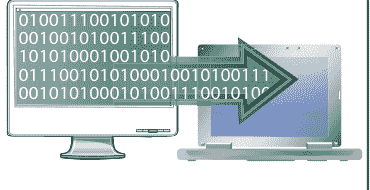

### 万网的扩张

欧洲核子研究组织（CERN）对伯纳斯-利的发明并没有表现出太兴趣，因此允许他在没有任何许可限制的情况下将其公开。很快，斯坦福大学和美国国家超级计算机应用中心的科学家们采用了他的想法，并开始构建用于配合的服务器和浏览器。各大公司也随之加入，到 20 世纪 90 年代中期，万网开始蓬勃发展。


### 世界维网联盟

1994 年 10 月，伯纳斯-利离开了 CERN，并创立了世界维网联盟（W3C），作为万网开发的一种准管理机构。如今，W3C 仍然负责维护和采用如 `HTML`（超文本标记语言）等语言的标准。他们还促进万网其他方面的标准，例如图形格式和级联样式表（`CSS`）。

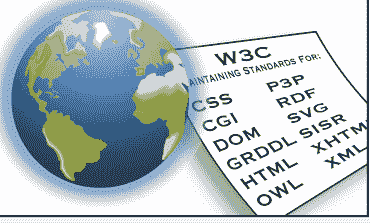

### 如今的万网

确切的数字很难找到，但大多数估计显示存在数百亿个网页。搜索引擎 Google 在 2008 年宣布其索引了数万亿个唯一的网页地址。目前可能有数亿个网站正在运行。考虑到 2010 年仅是万网诞生的 20 周年，它的扩张确实令人惊叹。

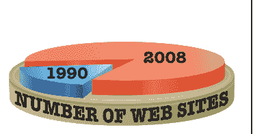

## 理解浏览器

大多数人访问万网的主要手段是通过浏览器。浏览器简单来说是读取和解释 `HTML` 页面的软件应用程序。在某种意义上，你可以将浏览器看作是你设计页面的画布。遗憾的是，浏览器在显示页面上并不一致，这仍然是万网设计者头疼的主要源头。尽管你可以在页面上尽量减少这些差异，但理解浏览器是学习如何创建避免这些问题的网站的重要第一步。

### WWW：第一个浏览器

蒂姆·伯纳斯-利在发明万网时开发了第一个浏览器。尽管他考虑过许多名字，但他最终选定了 `WorldWideWeb`。他的想法是拥有浏览器/编辑器，让用户能够依赖单一工具来查看和创建页面。

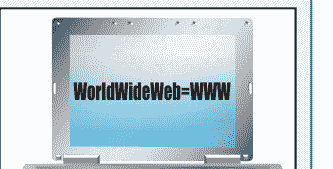

### NCSA Mosaic 和其他早期浏览器

第一批能够与文本一起显示图像的图形化浏览器之一是由国家超级计算机档案中心开发的。`Mosaic` 浏览器的领军人物马克·安德森（Marc Andreessen）不久后离开，创立了 Netscape Communications 并创建了 `Navigator`，这是第一个商业且广泛采用的浏览器。

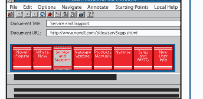

### Internet Explorer

随着万网开始变得流行，微软开发了自己的浏览器，并命名为 Internet Explorer，但通常被称为 IE。在早期浏览器中，IE 是唯一一个。

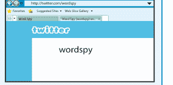

### Mozilla Firefox

当 AOL 购买 Netscape 后，Mozilla 开发了 `Firefox`。尽管他们考虑过许多名字，但最终选定了 WorldWideWeb。

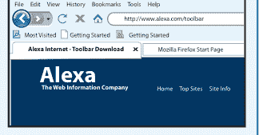

### Safari 和 Chrome

当前浏览器市场中另外两个主要参与者是苹果的 `Safari` 和谷歌的 `Chrome`。`Safari` 于 2003 年首次随 Mac OS X 一起发布，并仍是 Mac 电脑上的默认浏览器。谷歌于 2008 年发布了 `Chrome`。这两款浏览器都宣称比竞争对手速度更快、更简洁。

---

## 视觉化设计工具

鉴于浏览器最初是为显示学术文章而设计的，它们天生对文字内容友好，但对图像和布局支持不足。随着网页设计的发展，人们开发了视觉化编辑器来处理页面的布局，而无需编写繁琐的代码。这些视觉化工具通常通过图形化界面让你设计页面，并自动为你生成代码。

### Adobe Dreamweaver

`Dreamweaver` 是目前最主流和最受认可的视觉化 Web 编辑器。它最初由 Macromedia 开发，现在由 Adobe 拥有。最新版本 `Dreamweaver CS5` 于 2010 年 4 月发布。它的功能极其强大，适用于从初学者到专家的所有层次。

### Adobe Flash

严格来说，`Flash` 并不是用于创建网页，而是用于在页面上创建交互式内容。`Flash` 是 Adobe 的交互式动画和应用程序开发工具，可以在网页中嵌入动画、游戏、导航系统和更复杂的应用。

---

## 基于代码的工具

由于学习编写 `HTML` 和 `CSS` 对于成功的 Web 设计师来说仍然非常重要，许多人决定，既然他们必须编写代码，他们更倾向于使用纯代码编辑器而不是视觉化工具。代码编辑器相比视觉化设计工具最大的优势是，有数百种代码编辑器可以免费下载，而所有优秀的视觉编辑器都是必须购买的商业产品。使用编码工具还可以让你对自己的代码拥有控制权。

### TextEdit 和记事本

由于可以使用任何文本工具创建 HTML，某些不想购买或下载其他工具的设计师会使用操作系统自带的免费文本编辑器，包括 Macintosh 上的 `TextEdit` 和 Windows 上的 `Notepad`。

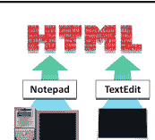

### Dreamweaver 和 Expression

虽然 `Dreamweaver` 和 `Expression` 主要是视觉工具，但它们都包含了强大的代码编辑功能。事实上，每个程序的许多日常用户根本不使用视觉化工具，而是倾向于将其作为代码编辑器使用。


### Eclipse

`Eclipse` 是一个开源开发工具集。虽然它本身没有特定的 HTML 编辑功能，但可以下载免费的插件来增加功能。`Eclipse` 可以从 `www.eclipse.org` 免费获取；HTML 和其他插件可以在 `www.eclipse.org/downloads` 下载。

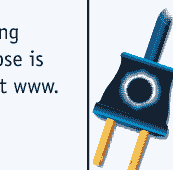

### HomeSite

多年来，`HomeSite` 一随 `Dreamweaver` 软件包。自 2003 年以来，`HomeSite` 就没有发布过新版本，Adobe 也于 2009 年正式停止了它的开发。然而，许多开发者非常喜欢它强大的代码编辑功能，并继续使用他们的旧版本。


---

## 图形程序

Web 是一种视觉媒介。因此，图像和图形在你的网站开发中起着重要作用。今天，许多强大的图形工具可以让你创建专业级的图像。你计划在网站上使用的照片可能需要校正颜色，可能需要裁剪或调整大小，或者你可能想应用特殊的视觉效果。你可能还需要从头创建图像，例如网站 Logo、按钮或其他图标。因此，你需要了解你所使用的工具。

### Adobe Photoshop

`Photoshop` 长期以来一直是图像处理的行业标准工具，以至于它的名字几乎已成为编辑的同义词。今天，`Photoshop` 将同样强大的编辑工具与针对 Web 设计师的不断增长的功能结合在一起。最新版本 `CS5` 已于 2010 年 4 月发布。

### Adobe Illustrator

`Illustrator` 之于矢量绘图程序，正如 `Photoshop` 之于照片编辑。艺术家和平面设计师几十年来一直依赖它来创建从全方位印刷活动在内的一切内容。它的许多新功能都是针对 Web 设计师的。`Illustrator CS5` 于 2010 年 4 月发布。

### Adobe Fireworks

`Fireworks` 最初由 Macromedia 创建，旨在作为 `Photoshop` 和 `Illustrator` 的竞争品，如今由于其易用性、丰富的工具集和极其高效的优化功能，它已成为许多 Web 设计师的首选图形工具。`Fireworks CS5` 已于 2010 年 4 月发布。

### Core Draw

`Core Draw` 与 `Adobe Illustrator` 一样，是一种矢量绘图工具。今天，它包含了许多与 `Illustrator` 类似的功能，使其成为处理 Web 图形的理想工具。名为 `XS` 的新版本于 2010 年 2 月发布。对于今天的设计师来说，它唯一的缺点是仅适用于 Windows 系统。

### GIMP

`GIMP`（GNU 图像操作程序）是一个免费的开源图形编辑器。它提供与 `Photoshop` 类似的许多功能，包括图层、滤镜和颜色校正，使其成为预算有限的设计师的绝佳选择。


GIMP 是一个开源图形工具集，旨在模仿 Photoshop 和其他商业产品的许多功能。其名称全称是 GNU Image Manipulation Program，对于预算有限的设计师来说是一个可行的选择。可以从 `www.gimp.org` 免费下载。

## Adobe Photoshop Elements

Photoshop 完整版是为专业人士设计的。Adobe 为爱好者和家庭用户创建了 Photoshop。然而，尽管它的价格大约是 Photoshop 的 1/5，但 Elements 实际上包含了大量的 Photoshop 功能。

## Aperture

Aperture 由 Apple 制造，是 Macintosh 用户首选的图像编辑工具。它拥有 Photoshop 的许多功能，包括一组专为 Web 设计的工具。它的主要缺点是仅适用于 Macintosh 电脑。

## 了解规划网站的重要性

虽然你可能忍不住想坐在电脑前开始为网站编写代码，但优秀的 Web 网站并非偶然而就的。相反，需要细致的规划来确保你的网站运行良好且直观。

## 头脑风暴概念

大多数成功的设计都是将几个想法结合成一个整体的结果。无论你是独立工作还是在团队工作，请始终记住你网站的需求。

## 设计线框图

线框图只是网站和布局的表示。它不需要很华丽——但你应该尝试确保它是可行的。你可以手画线框图，也可以使用 Fireworks 等程序。

## 故事板页面

故事板提供了对你设计更详细的表示。你可以为每个页面创建一个故事板，尽管带有动画元素的网站可能不需要。

## 制定完成时间表

如果你在为客户工作或开发网站，你需要与客户讨论一个包含截止日期的现实时间表。如果你在创建一个个人网站，时间表同样有助于你保持进度。

## 了解你的受众

Web 是一个以用户为中心的环境。你几乎所有的用户都会以“这对我有什么好处”的态度对待你的网站。传统业务在某种程度上可以依赖这样一个事实：当客户走进店门时，他们已经为此投入了某些，例如时间和汽油。因此，他们可能更愿意忍受某种程度的不便。在 Web 上，你的客户到达你的网站并没有投入任何成本。了解你的受众是赢得并留住他们访问网站的关键。

### 市场研究

公司长期以来一直意识到研究计划开展业务的市场的重要性，以便向客户投放广告和产品。然而，许多网站却忽略了这一步，这将是危险的。

### 人口统计学

人口统计学是对人口的研究。你需要了解潜在受众的人口统计情况，以确保你的网站满足他们的需求。研究的一般问题包括受众的年龄、教育程度、社会经济背景等。

# 准备你的素材

构建网站需要你管理大量的资产，从页面本身到控制其外观的样式表，再到你使用的图片、广告和视频。保持良好的条理会让整个过程变得简单得多。无论你是在处理一个拥有成百个甚至几千个文件的大型网站，还是一个只有几十个文件的小型网站，杂乱无章都会迅速消耗大量的时间和网站预算。组织网站没有一种正确的方法；请使用任何最适合你的方法。

## 根目录

你网站的所有文件和资产最终都需要存储在硬盘上的一个单一文件夹内。因此，你应该从创建此文件夹并将任何资产移动到其中开始。该文件夹可以位于计算机的任何位置，并按你的意愿命名，但在 Web 术语中，该文件夹被称为“根（root）”。

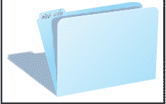

## 图片

大多数网站都需要大量的图片。在开始阶段阶段，你应该考虑你需要的图片并开始收集它们，无论是从你自己的收藏、公司的媒体部门，还是在线素材图片资源。

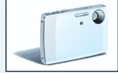

## 多媒体资产

如果你计划使用音频和视频文件，你应该尽早开始它们做准备，因为这些媒体的制作可能需要大量的额外时间和精力。如果你有计划使用的现有多媒体文件，现在将其复制到根目录。否则，请尽快开始准备制作，以确保它们不会耽误项目。


## 源文档

许多公司已经以各种电子格式准备好了营销和其他材料。你应该尝试收集那些包含你所需信息的文档，并将它们放在根目录中，以便以后访问。

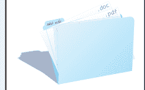

# 规划导航结构

精心布局的导航让你的网站既易用又直观，这反过来确保了用户在你的网站上获得更成功的体验。你应该在设计过程早期规划导航，确保所有重要页面都是可导航的，并确保导航与你的设计匹配。导航结构设计糟糕的网站会迅速让用户感到困惑和沮，这可能导致他们放弃并寻找另一个网站。良好的导航应该是直观的，让用户不需要意识地去思考它。

## 主导航

主导航是包含指向网站主要部分链接的区域，例如你的首页和部门页面。主导航可能会出现在网站的每个页面上，传统上显示在网站顶部的水平位置或沿左侧的垂直位置。

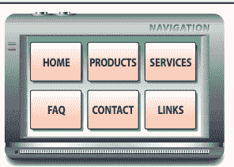

## 章节子导航

你网站的每个部分可能都需要它自己的导航到该章节内部的页面。章节导航可以直接显示在主导航下方或旁边，或者作为一个独立的单元。对于用户来说，视觉上应该明显看出这些区域代表了章节内部的链接。

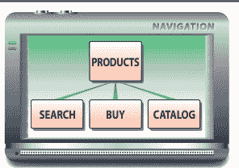

## 像用户一样思考

不要根据你公司的内部结构来组织网站的导航。相反，要从外人的视角来看网站，并根据潜在用户的需求来组织你的导航。


# 规划你的文件结构

你网站的文件结构主要是为了你的方便。你想要确保网站的组织方式允许你在需要时轻松地找到文件。在组织网站文件时，没有任何一种“正确”的方法来布局你的网站结构；你只需要确保它对你是有逻辑的。大多数设计师依赖嵌套文件夹来保持文件整齐。文件夹结构很重要，文件夹的命名同样重要：确保你使用逻辑名称。

## 在根目录下方组织

某些设计师倾向于只将首页直接放在根目录中，然后将网站的所有其他页面放在根目录的子文件夹中。另一些人倾向于将所有顶级页面直接放在根目录，并为每个章节设置子文件夹。使用任何对你来说合理的计划，但要保持一致。

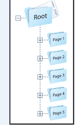

## 文件夹命名

你网站中的文件夹名称在用户浏览器的导航栏上是可见的，因此请给你的文件夹命名既对你有意义，又能帮助用户导航网站。文件夹名称必须以字母开头，且不能包含空格。

```
http://www.mysite.com/startup/
```

## 图片目录

大多数设计师在根目录下放置一个 `images` 文件夹，并将网站的所有图形放在其中。较大的网站可能需要图片文件夹包含子文件夹。

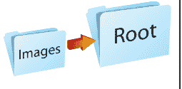

## 其他资产

许多网站可能包含已经准备好的多媒体素材。


# 第2章 开始使用 HTML

如果你计划使用音频和视频文件，你应该尽早开始它们做准备，因为这些媒体的制作可能需要大量的额外时间和精力。如果你有计划使用的现有多媒体文件，现在将其复制到根目录。否则，请尽快开始准备制作，以确保它们不会耽误项目。


# 源文档

许多公司已经以各种电子格式准备好了营销和其他材料。你应该尝试收集那些包含你所需信息的文档，并将它们放在根目录中，以便以后访问。


# 图片

大多数网站都需要大量的图片。在开始阶段阶段，你应该考虑你需要的图片并开始收集它们，无论是从你自己的收藏、公司的媒体部门，还是在线素材图片资源。


# 准备你的素材

构建网站需要你管理大量的资产，从页面本身到控制其外观的样式表，再到你使用的图片、广告和视频。保持良好的条理会让整个过程变得简单得多。无论你是在处理一个成百个甚至几千个文件的大型网站，还是一个只有几十个文件的小型网站，杂乱无章都会迅速消耗大量的时间和网站预算。组织网站没有一种正确的方法；请使用任何最适合你的方法。

## 根目录

你网站的所有文件和资产最终都需要存储在硬盘上的一个单一文件夹内。因此，你应该从创建此文件夹并将任何资产移动到其中开始。该文件夹可以位于计算机的任何位置，并按你的意愿命名，但在 Web 术语中，该文件夹被称为“根（root）”。


# 规划导航结构

精心布局的导航让你的网站既易用又直观，这反过来确保了用户在你的网站上获得更成功的体验。你应该在设计过程早期规划导航，确保所有重要页面都是可导航的，并确保导航与你的设计匹配。导航结构设计糟糕的网站会迅速让用户感到困惑和沮，这可能导致他们放弃并寻找另一个网站。良好的导航应该是直观的，让用户不需要意识地去思考它。

## 主导航

主导航是包含指向网站主要部分链接的区域，例如你的首页和部门页面。主导航可能会出现在网站的每个页面上，传统上显示在网站顶部的水平位置或沿左侧的垂直位置。


## 章节子导航

你网站的每个部分可能都需要它自己的导航到该章节内部的页面。章节导航可以直接显示在主导航下方或旁边，或者作为一个独立的单元。对于用户来说，视觉上应该明显看出这些区域代表了章节内部的链接。


## 像用户一样思考

不要根据你公司的内部结构来组织网站的导航。相反，要从外人的视角来看网站，并根据潜在用户的需求来组织你的导航。


# 规划你的文件结构

你网站的文件结构主要是为了你的方便。你想要确保网站的组织方式允许你在需要时轻松地找到文件。在组织网站文件时，没有任何一种“正确”的方法来布局你的网站结构；你只需要确保它对你是有逻辑的。大多数设计师依赖嵌套文件夹来保持文件整齐。文件夹结构很重要，文件夹的命名同样重要：确保你使用逻辑名称。

## 在根目录下方组织

某些设计师倾向于只将首页直接放在根目录中，然后将网站的所有其他页面放在根目录的子文件夹中。另一些人倾向于将所有顶级页面直接放在根目录，并为每个章节设置子文件夹。使用任何对你来说合理的计划，但要保持一致。


## 文件夹命名

你网站中的文件夹名称在用户浏览器的导航栏上是可见的，因此请给你的文件夹命名既对你有意义，又能帮助用户导航网站。文件夹名称必须以字母开头，且不能包含空格。

```
http://www.mysite.com/startup/
```

## 图片目录

大多数设计师在根目录下放置一个 `images` 文件夹，并将网站的所有图形放在其中。较大的网站可能需要图片文件夹包含子文件夹。


## 其他资产

许多网站可能包含已经准备好的多媒体素材。


# 第2章 开始使用 HTML

如果你计划使用音频和视频文件，你应该尽早开始它们做准备，因为这些媒体的制作可能需要大量的额外时间和精力。如果你有计划使用的现有多媒体文件，现在将其复制到根目录。否则，请尽快开始准备制作，以确保它们不会耽误项目。

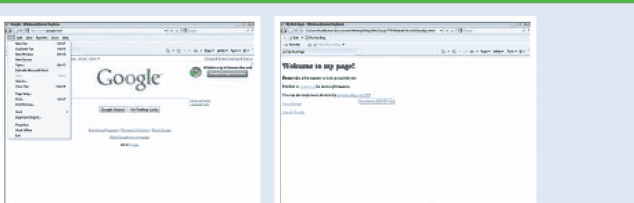

# 介绍 HTML

# 第2章 开始使用 HTML

- 介绍 HTML . . . . . . . . . . . . . . 18
- 创建你的第一个网页 . . . . . . . . . . . . . . 20
- 保存你的网页 . . . . . . . . . . . . . . 22
- 在浏览器中预览页面 . . . . . . . . . . . . . . 24
- 声明文档类型 . . . . . . . . . . . . . . 26
- 添加标题 . . . . . . . . . . . . . . . 28
- 添加段落 . . . . . . . . . . . . . . 30
- 应用逻辑格式 . . . . . . . . . . . . . . 32
- 理解 URL 和文件路径 . . . . . . . . . . . . . . 34
- 链接网站中的其他页面 . . . . . . . . . . . . . . 36
- 页面内链接 . . . . . . . . . . . . . . 38
- 链接到电子邮件地址 . . . . . . . . . . . . . . 40
- 链接到其他文档类型 . . . . . . . . . . . . . . 44
- 显示链接工具提示 . . . . . . . . . . . . . . 46

## 介绍 HTML

超文本标记语言 (HTML) 是 Web 页面的基础语言，也是任何想要学习网页设计的人的起点。坦率地说，HTML 不是一种编程语言。你不需要学习复杂的逻辑过程或担心数学计算。相反，HTML 最好被看作是一组相对简单的指令，告诉浏览器如何解释文本。HTML 是完全免费的，所以你不需要为使用它付费。

## 标签

HTML 文档是由标签组成的。标签是对显示页面的软件（通常是 Web 浏览器）如何解释和显示包含文本的指令。标签由角括号和元素名称组成，有时包含属性。

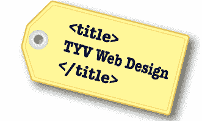

## 元素

元素是构成 HTML 的基本部分。该语言包含大约 100 个元素，当放在标签中并插入你的页面时，它们告诉浏览器如何渲染文本。元素包括 `html`、`body`、`p` 和 `table`。

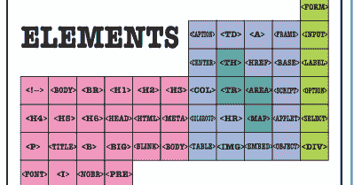

## 属性

元素本身通常没有足够的信息来告诉浏览器具体如何处理文本。在这种情况下，你还需要添加属性，属性提供了关于该元素应如何显示的额外细节。属性放在标签内部，元素名称之后。


你网站的文件结构主要是为了你的方便。你想要确保网站的组织方式允许你在需要时轻松地找到文件。在组织网站文件时，没有任何一种“正确”的方法来布局你的网站结构；你只需要确保它对你是有逻辑的。大多数设计师依赖嵌套文件夹来保持文件整齐。文件夹结构很重要，文件夹的命名同样重要：确保你使用逻辑名称。

在根目录下方组织

某些设计师倾向于只将首页直接放在根目录中，然后将网站的所有其他页面放在根目录的子文件夹中。另一些人倾向于将所有顶级页面直接放在根目录，并为每个章节设置子文件夹。使用任何对你来说合理的计划，但要保持一致。


文件夹命名

你网站中的文件夹名称在用户浏览器的导航栏上是可见的，因此请给你的文件夹命名既对你有意义，又能帮助用户导航网站。文件夹名称必须以字母开头，且不能包含空格。

```
http://www.mysite.com/startup/
```

图片目录

大多数设计师在根目录下放置一个`images`文件夹，并将网站的所有图形放在其中。较大的网站可能需要图片文件夹包含子文件夹。

其他资产

许多网站可能包含已经准备好的多媒体素材。 

# 第2章 开始使用 HTML

- 介绍 HTML . . . . . . . . . . . . . . 18
- 创建你的第一个网页 . . . . . . . . . . . . . . 20
- 保存你的网页 . . . . . . . . . . . . . . 22
- 在浏览器中预览页面 . . . . . . . . . . . . . . 24
- 声明文档类型 . . . . . . . . . . . . . . 26
- 添加标题 . . . . . . . . . . . . . . . 28
- 添加段落 . . . . . . . . . . . . . . 30
- 应用逻辑格式 . . . . . . . . . . . . . . 32
- 理解 URL 和文件路径 . . . . . . . . . . . . . . 34
- 链接网站中的其他页面 . . . . . . . . . . . . . . 36
- 页面内链接 . . . . . . . . . . . . . . 38
- 链接到电子邮件地址 . . . . . . . . . . . . . . 40
- 链接到其他文档类型 . . . . . . . . . . . . . . 44
- 显示链接工具提示 . . . . . . . . . . . . . . 46

## 介绍 HTML

超文本标记语言 (`HTML`) 是 Web 页面的基础语言，也是任何想要学习网页设计的人的起点。坦率地说，`HTML` 不是一种编程语言。你不需要学习复杂的逻辑过程或担心数学计算。相反，`HTML` 最好被看作是一组相对简单的指令，告诉浏览器如何解释文本。`HTML` 是完全免费的，所以你不需要为使用它付费。

### 标签

`HTML` 文档是由标签组成的。标签是对显示页面的软件（通常是 Web 浏览器）如何解释和显示包含文本的指令。标签由角括号和元素名称组成，有时包含属性。

 

### 元素

元素是构成 `HTML` 的基本部分。该语言包含大约 100 个元素，当放在标签中并插入你的页面时，它们告诉浏览器如何渲染文本。元素包括 `html`、`body`、`p` 和 `table`。

 

### 属性

元素本身通常没有足够的信息来告诉浏览器具体如何处理文本。在这种情况下，你还需要添加属性，属性提供了关于该元素应如何显示的额外细节。属性放在标签内部，元素名称之后。

## HTML 2 入门

### 容器标签

大多数 `HTML` 标签都是容器标签，它们包裹文档中的文本块，以告诉浏览器何时开始应用格式化以及何时结束。容器标签成对使用，包含一个起始标签和一个结束标签。结束标签包含尖括号、元素名，并且还包含一个反斜杠。

```
<beg formatting>
block of text
</end formatting>
```

### 空元素标签

少数 `HTML` 标签本质上是给浏览器的指令。例如，`` 标签告诉浏览器在何处插入图像。空元素标签没有或不需要结束标签，而是单独放置在文档中。

```

```

### 空格与大小写

`HTML` 既不区分空格也不区分大小写。你应该在代码中包含空格以提高其可读性，但它不会影响页面的显示。元素名称和属性可以用任何大小写编写，同样不会影响页面显示。

```
<html>
<head>
<TITLE>My Web Site</title>
white space
</head>
</html>
```

### HTML 与 XHTML

`XHTML` 仅仅是 `HTML` 的一个版本，它要求更严格的语法。在 `XHTML` 中，所有元素和属性名称必须是小写，且属性值必须包含在引号中。`XHTML` 没有空元素标签——所有标签（包括 `` 这样的指令标签）必须始终关闭。

```

XHTML
<frame noresize="noresize" />
```

## 创建你的第一个网页

你可以在选择的编辑器中开始构建简单的网页。网页使用一组 `HTML` 标签来定义其内容。虽然每个页的内容会有很大差异，但所有页面都包含相同的基础起始标签集。这些标签首先告诉浏览器文档确实包含 `HTML` 标签，然后将页面分为两个部分：头部（`head`），包含给浏览器的信息；以及主体（`body`），包含用户在页面上实际看到的所有内容。头部部分还包含标题，它出现在浏览器的标题栏和标签栏上。

### 创建你的第一个网页

1. 打开编辑器新建一个空白页。

注意：本章中的示例使用了 Windows 记事本，但可以使用任何编辑器来完成这些部分。有关编辑器的更多信息，请参第 1 章。

2. 输入 `<html>`。
3. 按回车键。
4. 输入 `<head>`。

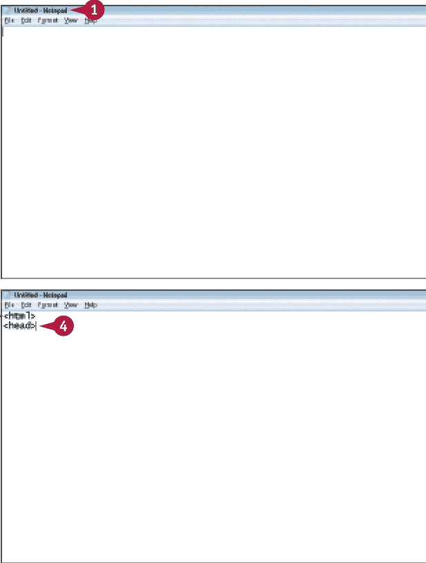

5. 按回车键。
6. 输入 `<title>My First Page</title>`。

```
<html>
<head>
<title>My First Page</title>
</head>
```

7. 按回车键。
8. 输入 `</head>`。
9. 按回车键。
10. 输入 `<body>`。
11. 按回车键。
12. 输入 `</body>`。

```html
<html>
<head>
<title>My First Page</title>
</head>
<body>
</body>
</html>
```

13. 按回车键。
14. 输入 `</html>`。

文档现在包含了网页所需的 Basic标签。

| 大小写和间距重要吗？`XML` 要求所有标签和属性必须写成小写字母。空格并不重要；上面的示例以及整本书中的示例将代码分在不同的行以提高可读性，但所有代码写在单行上的页面也是有效的。 | 我在每个文档中都需要这些标签吗？如果你没有这些基础标签，浏览器也会显示你的页面，但可能显示得不正确，所以你应该始终包含它们。大多数专业的 `HTML` 编辑器在创建新文档时会自动添加它们。 |

## 保存你的网页

在预览你的页面或允许他人看到它之前，你需要保存文档。保存网页不涉及任何特殊步骤——只需使用你编辑程序的“保存”功能即可。你需要确保将文件保存到你网站的根目录，或根目录的子目录下。你的文件名必须以字母开头，只能包含字母、数字和下划线。你的页面可以以 `.html` 或 `.htm` 结尾。你的首页可能需要保存为 `index.htm` 或 `index.html`。

### 保存你的文件。

- 点击“文件”。
- 点击“另存为”。

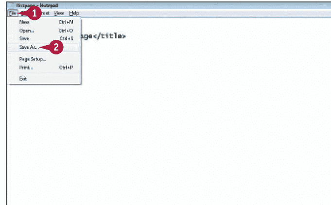

出现“另存为”对话框。

- 为你的网页输入名称。

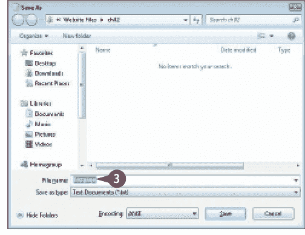

- 输入 `.html` 作为扩展名。
- 点击“保存”。

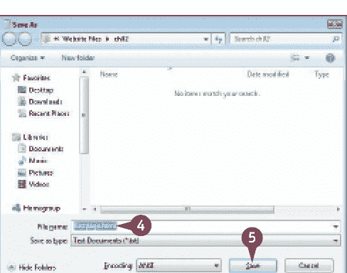

对话框关闭，文件已保存。

```html
<html>
<head>
  <title>My First Page</title>
</head>
<body>
</body>
</html>
```

### 提示 我可以随心所欲命名文件名吗？

Web 对文件名限制比你的操作系统严格得多。要记住的最重要的一点是，文件名绝对不能包含空格。它还应该以字母开头，并且只能包含字母、数字和下划线字符。

### `.html` 和 `.htm` 之间有区别吗？

没有。两者都有效，但现在更流行使用 `.html`。

## 预览你的网页

为了在浏览器中查看你的页面，你需要将 `HTML` 文件保存到硬盘上，然后使用浏览器打开它。

1. 打开浏览器。
2. 点击“文件”。
3. 点击“打开”。

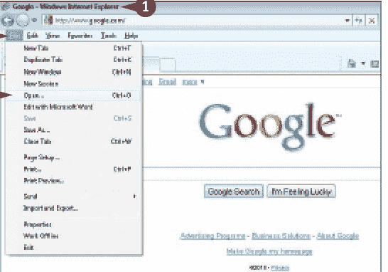

4. 导航到你保存网页的文件夹。
5. 选择文件。
6. 点击“打开”。

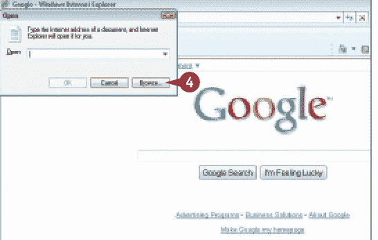

打开对话框关闭。

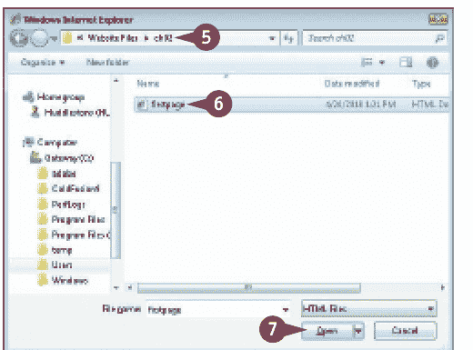

页面在浏览器中打开。

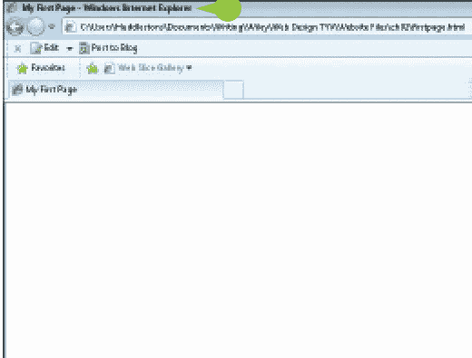

### 提示 我可以使用任何浏览器来测试我的页面吗？

虽然浏览器在过去几年里显示页面方面变得越来越一致，但差异仍然存在。技术上答案是肯定的，你可以使用任何浏览器，但理想情况下你应该使用几个。至少，Windows 用户应该在 Internet Explorer、Firefox 和 Safari 中测试他们的页面，Mac 用户应该在 Safari 和 Firefox 中测试。

### 我可以在测试时让页面留在编辑器中打开吗？

是的。大多数设计师会同时打开编辑器和浏览器，并在需要时两者之间切换以测试页面。在切换到浏览器之前，确保在编辑器中保存页面，并在每次返回浏览器时刷新浏览器视图，以确保你看到的是最新版本。

## 预览你的页面

1. 打开浏览器。
2. 点击“文件”。
3. 点击“打开”。

注意：根据浏览器的，菜单可能会略有不同。如果你使用的是 Internet Explorer，你可能需要按 `Alt` 键。

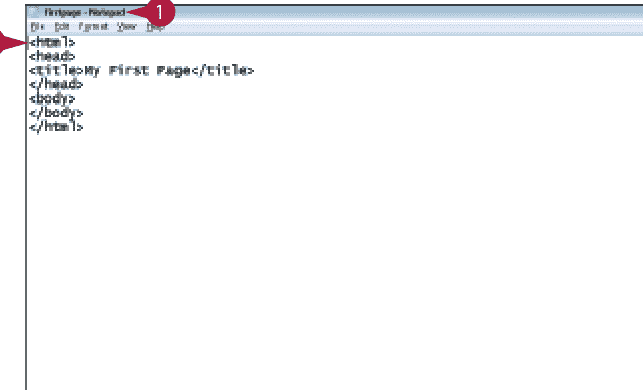

打开对话框出现。

4. 点击“浏览”。

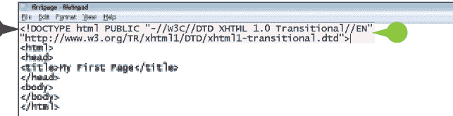

5. 导航到你保存网页的文件夹。
6. 选择文件。
7. 点击“打开”。

对话框关闭。

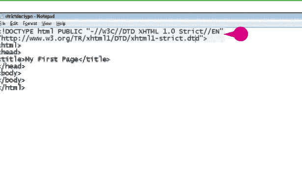

页面在浏览器中打开。

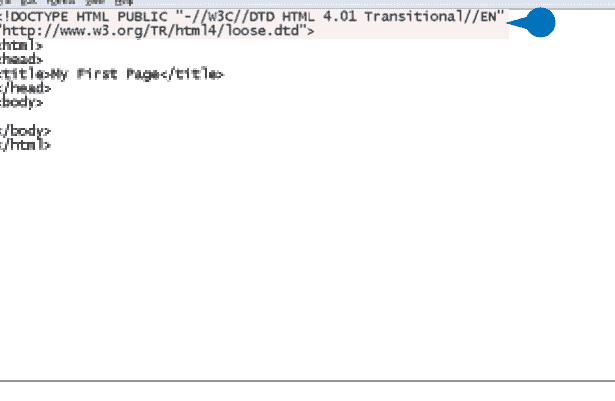

## 声明你的类型

在浏览器能够正确渲染你的 `HTML` 之前，它需要知道你使用的语言版本。`HTML` 和 `XHTML` 都支持三个变体或风格：严格（`Strict`）、过渡型（`Transitional`）和无框架（`Frameless`）。你可以通过在文档中添加文档类型声明，即 `DOCTYPE` 来设置此版本。这个特殊代码不是 `HTML` 标签，位于文档的最顶部；事实上，如果你在 `DOCTYPE` 之前使用空行，某些浏览器可能会渲染错误。大多数现代网站使用 `XHTML` 的过渡型。

### 声明你的文档类型

1. 打开 `HTML` 文档。
2. 点击文档顶部。
3. 如果必要，按回车键在 `<html>` 标签上方创建一个新行。
4. 输入相应的文档类型声明。
   - 对于 `XHTML Transitional`，输入 `<!DOCTYPE html PUBLIC "-//W3C//DTD XHTML 1.0 Transitional//EN" "http://www.w3.org/TR/xhtml1/DTD/xhtml-transitional.dtd">`。

- 对于 `XHTML Strict`，输入：

```html
<!DOCTYPE html
PUBLIC "-//W3C//DTD HTML 1.0 Strict//"
EN "http://www.w3.org/TR/xhtml1/DTD/xhtml1-strict.dtd">
```


- 对于 `HTML 4.01 Transitional`，输入：

```html
<!DOCTYPE HTML
PUBLIC "//W3C//DTD HTML 4.01 Transitional//EN"
"http://www.w3.org/TR/html4/loose.dtd">
```


文档类型声明会被添加到页面中。

| 我必须在页面上添加声明吗？ | 这些类型之间的区别是什么？ |
|---|---|
| 浏览器即使没有声明也能显示你的页面，但如果你没有正确的文档类型，某些浏览器在渲染时更容易出错，因此强烈建议添加声明。大多数专用的 `HTML` 编辑器会自动为你添加声明，所以你可能不需要实际输入它。 | `HTML` 和 `XHTML Transitional` 是限制最少的类型，最适合文档。`Strict` 则强制你完全遵循语言语法和 Web 标准，因此它在框架（frames）中使用起来更困难。`Frameset` 为框架提供了默认标签，但现在已经很少有 Web 网站再使用框架了。 |

## 添加标题

许多研究表明，大多数人是扫读网页而不是仔细阅读。因此，标题非常重要，它们能让用户知道页面上有哪些他们可能想要停下来阅读的主题。网页上的标题的作用与印刷材料中的标题相同。例如，这本书在当前段落上方有一个主标题，这让你这个读者能够快速判断出这些页面涵盖了为你的页面添加标题的主题。就像该标题帮助你在书中找到信息一样，网页上的标题也能帮助你的用户。

### 添加标题

1. 在你的编辑器中打开一个网页。
2. 将光标置于 `<body>` 结束 `</body>` 标签之间。
3. 输入 `<h1>`。
4. 输入标题文本。

```html
<!-- heading: Heading
<!DOCTYPE html PUBLIC "//W3C//DTD HTML 1.0 Transitional//EN"
 "http://www.w3.org/TR/html11/DTD/html1-transitional.dtd">
<head>
<title>My First Page</title>
</head>
<body>
<h1>icon to my page</h1>
</body>
</html>
```

5. 输入 `<h1>`。

```html
<!DOCTYPE html PUBLIC
  "//W3C//DTD HTML 1.0 Transitional//EN"
  "http://www.w3.org/TR/html4/DTD/html4-transitional.dtd">
<html>
<head>
<title>My First Page</title>
</head>
<body>
<h1>welcome to my page!</h1>
</body>
</html>
```


6. 点击 `File`（文件）。
7. 点击 `Save`（保存）。

```html
<!DOCTYPE html PUBLIC
  "//W3C//DTD HTML 1.0 Transitional//EN"
  "http://www.w3.org/TR/html4/DTD/html4-transitional.dtd">
<html>
<head>
<title>My Page</title>
</head>
<body>
<h1>page!</h1>
</body>
</html>
```

页面已保存。标题已添加到页面中。

**注意：** 如果你想查看标题将如何显示，请按照上述列出的步骤在浏览器中预览页面。

### 贴士

`HTML` 是否提供多一个层级的标题？

是的。`HTML` 实际上包含了六级标题。这些元素在本质上是相同的：每个都是一个字母后面跟着一个数字，1–6。你的主主题应该由 `H1` 指定。主主题下的子主题应为 `H2`，`H2` 下的子主题为 `H3`，以此此类推。

我可以更改标题的大小和字体吗？可以。Web 设计师可以使用一种名为层叠样式表（`CSS`）的强大格式语言，它允许你更改屏幕上几乎任何内容的外观，包括标题的大小和字体。`CSS` 将后面的第 4 章和第 5 章中详细介绍。

## 添加段落


任何未被定义为标题的逻辑文本块都可能是一个段落。XHTML 使用 `<p>` 标签指定段落。你应该将每个逻辑文本块封装在该标签内。在浏览器中显示时，段落的上下方都会有一个空行，而不是缩进第一行。请记住，XHTML 会忽略代码中的空白字符，因此仅仅在文本块之间添加换行符不会在浏览器中创建空间；你需要使用 `<p>` 标签。

## 添加段落

1. 打开你想添加文本的页面。

```html
<!DOCTYPE html PUBLIC "-//W3C//DTD HTML 1.0 Transitional//EN"
"http://www.w3.org/TR/html1/DTD/html1-transitional.dtd">
<html>
<head>
<title>My First Page</title>
</head>
<body>
<h1>icon to my page</h1>
</body>
</html>
```

2. 输入 `<p>`。
3. 输入文本。

```html
<!DOCTYPE html PUBLIC "-//W3C//DTD HTML 1.0 Transitional//EN"
"http://www.w3.org/TR/html1/DTD/html1-transitional.dtd">
<html>
<head>
<title>My First Page</title>
</head>
<body>
<h1>welcome to my page!</h1>
</body>
</html>
```

## HTML 入门

- 输入 `<p>`。

```html
<!DOCTYPE html PUBLIC "-//W3C//DTD HTML 1.0 Transitional//EN"
"http://www.w3.org/TR/html1/DTD/html1-transitional.dtd">
<html>
<head>
<title>My First Page</title>
</head>
<body>
<h1>welcome to my page!</h1>
</body>
</html>
```

## 格式化

- 输入 `<h1>`。

```html
<!DOCTYPE html PUBLIC "-//W3C//DTD HTML 1.0 Transitional//EN"
"http://www.w3.org/TR/html1/DTD/html1-transitional.dtd">
<html>
<head>
<title>My First Page</title>
</head>
<body>
<h1>heading</h1>
<p>please take a few minutes to look around.</p>
</body>
</html>
```

## 格式化

- 输入 `<p>`。

```html
<!DOCTYPE html PUBLIC "-//W3C//DTD HTML 1.0 Transitional//EN"
"http://www.w3.org/TR/html1/DTD/html1-transitional.dtd">
<html>
<head>
<title>My First Page</title>
</head>
<body>
<h1>heading</h1>
<p>please take a few minutes to look around.</p>
</body>
</html>
```

## 格式化

- 输入 `<h1>`。

```html
<!DOCTYPE html PUBLIC "-//W3C//DTD HTML 1.0 Transitional//EN"
"http://www.w3.org/TR/html1/DTD/html1-transitional.dtd">
<html>
<head>
<title>My First Page</title>
</head>
<body>
<h1>heading</h1>
<p>please take a few minutes to look around.</p>
</body>
</html>
```

## 格式化

- 输入 `<h1>`。

```html
<!DOCTYPE html PUBLIC "-//W3C//DTD HTML 1.0 Transitional//EN"
"http://www.w3.org/TR/html1/DTD/html1-transitional.dtd">
<html>
<head>
<title>My First Page</title>
</head>
<body>
<h1>heading</h1>
<p>please take a few minutes to look around.</p>
</body>
</html>
```

## 格式化

- 输入 `<h1>`。

```html
<!DOCTYPE html PUBLIC "-//W3C//DTD HTML 1.0 Transitional//EN"
"http://www.w3.org/TR/html1/DTD/html1-transitional.dtd">
<html>
<head>
<title>My First Page</title>
</head>
<body>
<h1>heading</h1>
<p>please take a few minutes to look around.</p>
</body>
</html>
```

## 格式化

- 输入 `<h1>`。

## 格式化

- 输入 `<h1>`。

## 格式化

格式化。

- 输入 `<h1>`。

```html
<!DOCTYPE html PUBLIC "-//W3C//DTD HTML 1.0 Transitional//EN"
"http://www.w3.org/TR/html1/DTD/html1-transitional.dtd">
<html>
<head>
<title>My First Page</title>
</head>
<body>
<h1>heading</h1>
<p>please take a few minutes to look around.</p>
</body>
</html>
```

## 格式化

- 输入 `<h1>`。

## 格式化

- 输入 `<h1>`。

## 格式化

- 输入 `<h1>`。

## 格式化

- 输入 `<h1>`。

## 格式化

- 输入 `<h1>`。

## 格式化

- 输入 `<h1>`。

## 格式化

- 输入 `<h1>`。

## 格式化

- 输入 `<h1>`。

## 格式化

- 输入 `<h1>`。

## 格式化

- 输入 `<h1>`。

## 格式化

- 输入 `<h1>`。

## 格式化

- 输入 `<h1>`。

## 格式化

- 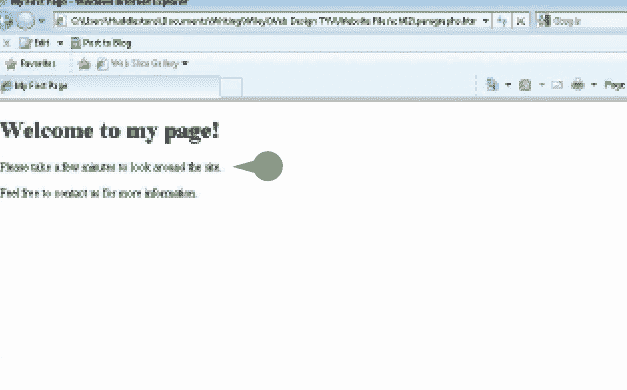

### 贴士

除了 `<i>` 之外，还有其他标签可以斜体文本吗？是的。事实上，有相当多，但它们都有特定的语义含义。例如，`<cite>` 将其文本渲染为斜体，但在逻辑上将文本标记为引用。`<address>` 标签用于标识页面上的地址，也会渲染为斜体。

# 理解 URL 和文件路径

我们的网站是链接页面的集合。你可以在页面上放置链接，将你带到网站内的其他页面、Web 上的其他网站、同一文档内的其他位置或电子邮件地址。创建这些链接的详细信息将在后续章节中介绍，但在你开始理解链接的 HTML 语法之前，你需要了解如何在文档中引用其他页面以及 Web 上的其他网站。

## 相对路径

网站内的页面可以通过相对路径相互引用，在这种路径下，你所链接的页面是相对于当前页面的。你可以将其想象为给街上的某人指路，你根据自己当前的位置告诉他们怎么走。

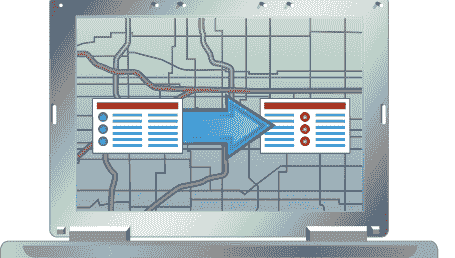

## 文件夹中的页面

在提供相对路径时，你所链接的文件可能位于包含链接文件的之外的其他文件夹中。如果你链接的页面位于一个文件夹中，且该文件夹与包含链接的页面是同一个，你只需提供文件夹名称、斜杠和文件名，例如 `products/widget.html`。

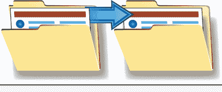

## 绝对路径

指向 Web 上其他网站的超链接需要使用绝对路径进行引用。绝对路径包含网站的完整地址，包括 `http://`。使用绝对路径类似于在邮件中写地址：无论信件源自何处，都提供完整的地址。

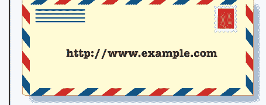

## HTTP 前缀

绝对路径要求你使用目标页面的完整地址。对于大多数网站，这以 `http://` 开始，这是告诉浏览器你正在使用 HTTP 协议进行连接的方法。另一个常见的前缀是 `https://`，它是 HTTP 的安全版本。你需要使用你所连接的网站所需的任何前缀。

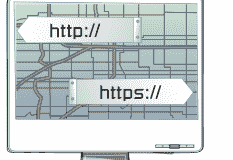

## 主机、域名和顶级域名

前缀之后的地址部分由主机、域名和顶级域名（TLD）组成。在示例 `www.wiley.com` 中，主机是 `www`，域名是 `wiley`，顶级域名是 `.com`。某些网站（如 `twitter.com`）不使用主机。其他常见的顶级域名包括 `.net` 和 `.org`。

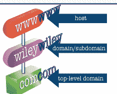

## 文件夹路径

当你链接到网站首页之外的任何页面时，主机、域名和顶级域名之后是请求页面的文件夹路径。例如，指向地址 `www.robhuddleston.com/books/tyvwebdesign.html` 的链接是在请求该站点名为 `books` 文件夹下的 `tyvwebdesign.html` 文档。

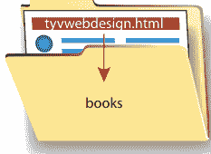

## 请求默认文档

当你链接到一个网站但没有请求特定页面时（例如仅提供前缀、主机、域名和顶级域名），或者当你链接到网站内的某个文件夹时，你是在请求该网站或该文件夹的默认文档，更常见的是首页。例如，指向 `http://www.yoursite.com/products` 的链接实际上返回的是 products 文件夹下的首页。


## 链接到网站内的其他页面

超链接是 Web 核心概念，Web 最初被构想为一组超链接文档。网站的导航将由指向你网站内其他页面的超链接组成。HTML 中的超链接使用锚点标签创建，语言简写为 `<a>`。该标签有一个必需属性 `href`，其值设置为你所链接的页面路径。大多数情况下，对于网站内部的链接，你应该使用相对路径。

## 链接到网站内的其他页面

- 打开你想添加超链接的页面。

```html
<!DOCTYPE html PUBLIC "//W3C//DTD HTML 1.0 Transitional//EN">
```

```html
<!DOCTYPE html PUBLIC "//W3C//DTD HTML 1.0 Transitional//EN">
<a href="http://www.yoursite.com/products">链接文本</a>
```

### HTML 入门

#### 在文本之后，输入 `<a></a>`。

```html
<!DOCTYPE html PUBLIC "-//W3C//DTD HTML 1.0 Transitional//EN"
"http://www.w3.org/TR/html4/DTD/html41-transitional.dtd">
<html>
<head>
  <title>我的第一个页面</title>
</head>
<body>
  <h1>欢迎来到我的页面！</h1>
  <p><strong>花几分钟环顾一下网站吧。</strong></p>
  <p>如需获取<em>更多信息</em>，请随时与我们联系。</p>
  <p><a href="secondpage.html">第二页</a></p>
  <p><a href="http://www.google.com">在 Google 上搜索</a></p>
</body>
</html>
```


在 Web 浏览器中查看时，文字呈蓝色并带有下划线。点击文字跳转到另一个站点。


# 提示

我真的可以链接到 Web 上的任何页面吗？

大多数情况下，Web 正是为了这个目的而构建的。你无法链接到页面的情况是该页面需要用户登录，这时你可能只能链接到登录页面。

有简单的方法获取我想链接的页面地址吗？

有的。只需像往常一样浏览器导航到该页面，然后你可以从浏览器的地址栏复制地址并粘贴到你的代码中。

# 页面内链接

如果你有一份很长的文档，你可能想要提供内部链接；即从文档顶部到文档内标题的链接，或者从底部返回顶部的链接。在创建这些链接时，你需要再次使用锚点标签，但也必须在你想要链接的地方添加一些 HTML 代码。这将成为链接的目标。最简单的方法是给任何元素添加 `ID` 属性。你的锚点标签 `href` 属性以 `#` 号开头，后跟 ID。

1. 打开你想添加内部链接的页面。
2. 在要作为链接的文本之前，输入 `<a href="#">`，并替换为页面上你想链接点的标识符。

   注意：标识符必须是不带空格的单个单词。

3. 在输入之后，使用 `</a>`。

## 链接到其他类型的文档

除了链接到网页，你还可以链接到其他类型的文档。例如，你可能有一个以 Adobe PDF 格式保存的用户手册并想要访问它。幸运的是，链接这些文档的过程与链接到网页相同：你添加一个锚点标签（anchor tag），然后提供文档的绝对路径或相对路径。根据你所链接的文档类型，它可能会在用户的浏览器中通过插件打开，或者浏览器会提示你下载并保存它。

- 打开你想要添加链接的页面。

```html
<!DOCTYPE html>
//-//W3C//DTD HTML 4.0 Transitional//EN//
 "http://www.w3.org/TR/html4/transitional.dtd">
<head>
<title>My First Page</title>
</head>
<body>
<p><a href="page1.html">come to my page!</a></p>
<p><strong>please</strong> take a few minutes to look around the site.</p>
<p>Feel free <a href="mailto:contact@example.com">contact us</a>a> for information.</p>
<p>you also learn more about us by downloading our PDF.</p>
<p><a href="page2.html">second page</a></p>
<p><a href="http://www.google.com">search Google</a></p>
</body>
</html>
```

- 在你想要链接的文本之前，输入 `<a href="#">`，并将 `?` 替换为你想要链接的文档路径。**注意：** 请确保包含适当的文件扩展名，例如 `.pdf`。

```html
<!DOCTYPE html>
//-//W3C//DTD HTML 4.0 Transitional//EN//
 "http://www.w3.org/TR/html4/transitional.dtd">
<head>
<title>My First Page</title>
</head>
<body>
<p><a href="page1.html">come to my page!</a></p>
<p><strong>please</strong> take a few minutes to look around the site.</p>
<p>Feel free <a href="mailto:contact@example.com">contact us</a>a> for information.</p>
<p>you also learn more about us by downloading our PDF.</p>
<p><a href="page2.html">second page</a></p>
<p><a href="http://www.google.com">search Google</a></p>
</body>
</html>
```

## 开始使用 HTML

- 在文本之后，使用 `<a href="#">`。


```html
<!DOCTYPE html PUBLIC "-//W3C//DTD HTML 4.0 Transitional//EN"
 "http://www.w3.org/TR/html4/transitional.dtd">
<html>
<head>
  <title>My First Page</title>
</head>
<body>
  <p>Welcome to my page! Please take a few minutes to look around the site.</p>
  <p>Feel free to contact us <a href="mailto:contact@mysite.com">contact us</a>a for more information.</p>
  <p>You can also learn more about us by <a href="info.pdf">downloading our PDF</a>a>.</p>
  <p>Go <a href="secondpage.html">Second page</a></p>
  <p><a href="http://www.google.com">search Google</a>a></p>
</body>
</html>
```

在 Web 浏览器中查看时，文本显示为蓝色并带有下划线。点击文本以打开或保存文档。

## 欢迎我的首页！

请花几分钟浏览一下网站。

欢迎随时联系我们获取更多信息。

你也可以通过下载我们的 PDF 更多关于我们的信息。

# 提示

### 我可以控制浏览器询问我保存文档而不是打开它吗？

不可以。如果用户拥有该文档类型的正确插件（例如用于 PDF 文件的 Adobe Reader），文档将直接打开。如果用户没有正确的插件，浏览器会提示用户下载文件。如果你想确保文件被下载，请将其保存为 Zip 文件，因为所有浏览器都会下载 Zip 文件而不是直接打开它。

### 如果我链接到 Microsoft Office 文档会怎样？

Office 文档的处理方式与其他任何文档相同。如果用户使用 Windows 系统并使用 Internet Explorer 且安装了 Office，文档将在浏览器内的特殊插件中打开。如果用户不是 Windows 系统，或者正在使用不同的浏览器，则会被提示下载并保存文档。

## 为链接显示工具提示（Tool Tips）

当用户将鼠标悬停在链接上时，你可以显示工具提示（或小型弹出消息），提供有关目标页的一些详细信息。这可以帮助确保用户链接是安全的。你可以使用锚点标签的可选`title`属性来添加此工具提示。请确保工具提示文本准确描述了用户点击链接后将到的页面。

1. 打开一个包含超链接的页面。

```html
<!DOCTYPE html PUBLIC "-//W3C//DTD HTML 4.0 Transitional//EN"
"http://www.w3.org/TR/html4/transitional.dtd">
<html>
<head>
<title>My First Page</title>
</head>
<body>
<a href="home.html">come to my page!</a>a
<p><strong>Please</strong> take a few minutes to look around the site.</p>
<p>Feel free to <a href="mailto:contact@somesite.com">contact us</a>a for more information.</p>
<p>You can also learn more about us by <a href="info.pdf">downloading our PDF</a>a></p>
<p><a href="secondpage.html">second page</a>a></a></p>
<p><a href="http://www.google.com">search Google</a>a></a></p>
</body>
</html>
```

2. 在现有的锚点标签内部之后，输入`title=""`并带有描述链接目标页面的适当文本。

```html
<!DOCTYPE html PUBLIC "-//W3C//DTD HTML 4.0 Transitional//EN"
"http://www.w3.org/TR/html4/transitional.dtd">
<html>
<head>
<title>My First Page</title>
</head>
<body>
<a href="home.html">come to my page!</a>a
<p><strong>Please</strong> take a few minutes to look around the site.</p>
<p>Feel free to <a href="mailto:contact@mysite.com">contact us</a>a for more information.</p>
<p>You can also learn more about us by <a href="info.pdf">downloading our PDF</a>a>.</p>
<p><a href="secondpage.html">second page</a>a></p>
<p><a href="http://www.google.com">search Google</a>a></p>
</body>
</html>
```

在浏览器中查看时，链接显示方式与之前相同。当你将指针置于链接上时，标题文本将作为工具提示出现。

# 第三章：创建图像

Web 是一种视觉媒体，有效使用图像将极大增强你的页面设计。本章将向你介绍一些领先的图像编辑工具，并如何将这些图像放入你的页面中。

| 主题 | 页码 |
| :--- | :--- |
| 理解图像格式 | 50 |
| 合法获取素材图片 | 51 |
| 理解图像优化 | 52 |
| 从网络下载素材图片 | 54 |
| 了解 Photoshop界面 | 58 |
| 了解 Photoshop Elements界面 | 59 |
| 使用 Photoshop 修复颜色 | 60 |
| 在 Photoshop 中裁剪和调整图像大小 | 62 |
| 在 Photoshop 中保存 Web 版 | 64 |
| 在 Photoshop Elements 中打开图像编辑 | 66 |
| 使用 Photoshop Elements 修复颜色 | 68 |
| 在 Photoshop Elements 中旋转图像 | 69 |
| 在 Photoshop Elements 中裁剪图像 | 70 |
| 在 Photoshop Elements 中调整图像大小 | 71 |
| 在 Photoshop Elements 中保存 Web 版 | 72 |
| 了解 Fireworks 界面 | 74 |
| 了解 Illustrator 界面 | 75 |
| 在 Fireworks 中创建按钮 | 76 |
| 在 Fireworks 中保存 Web 版 | 80 |
| 在 Illustrator 中创建 Logo | 82 |
| 保存 Illustrator 图像为 Web 版 | 86 |
| 向你的网页添加图像 | 88 |
| 让你的图像无无障碍 | 90 |
| 使用图像作为链接 | 92 |

## 理解图像格式

根据图像创建方式，你想要在网站上使用的图像可能来自成百种格式中的任何一种，但 Web 只支持三种：GIF、JPEG 和 PNG。在开始在页面上处理图像之前，你需要了解这些格式，以便选择最合适的一个。每种格式都有特定的优缺点，你可能需要对每张图像进行评估，以确定最适合它的格式。

## Web 图像格式

浏览器可以原生显示保存为 JPEG、GIF 和 PNG 格式的图像。任何其他格式都要求浏览器使用插件，因此这三 格式通常被认为是 Web 支持的格式。如果你有任何其他格式的图像，将需要将其转换为这些格式之一。

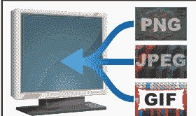

## JPEG

JPEG 是联合摄影专家小组（Joint Photographic Expert's Group）的缩写，这是最初开发该格式的组织。JPEG 格式支持数百万种颜色，因此最适合摄影图像。今天大多数数字相机默认都将图像保存为 JPEG。

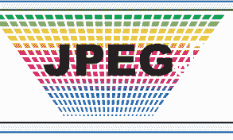

## GIF

图形交换格式（Graphics Interchange Format）最初由 CompuServe 在 20 世纪 80 年代开发，在 Web 出现之前就已经了很久。GIF 最多支持 256 种颜色，今天主要用于标志、线条画和按钮。与 JPEG 不同，GIF 支持透明和动画。

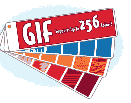

## PNG

可迁移网络图形（Portable Network Graphics）格式作为 GIF 的替代方案，结合了 JPEG 和 GIF 格式的优点。像 JPEG 一样，PNG 可以具有数百万种颜色；像 GIF 一样，PNG 支持透明。

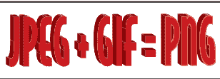

# 第 3 章

## 合法获取素材图片

任何创意作品都受版权保护。这适用于像本书这样的书面作品，也适用于照片等艺术作品。你当然可以自由使用你创建的任何图像；如果你为一家大公司工作，他们可能有一系列已经获取的图像，这些图像在公司网站上使用同样是安全的。在使用并非由你或你的公司创建的图像之前，你需要确保你拥有使用它的合法权利。

## 免版税图像 (Royalty-Free Images)

如果你想使用他人的作品，每次使用时都必须通过版税向他们支付该费用。但是，你可能只需要支付一次费用，从以后就可以自由地使用该图像。此类图像被称为免版税图像。注意，你可能需要预付费用，因此免版税并不意味着免费。

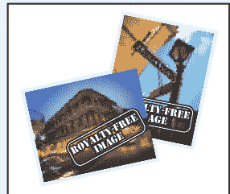

## 素材图片 (Stock Images)

素材图片通常是供公司和组织使用的免版税图像。素材图片的主题往往具有通用性：人群、动物和风景是素材图片的常见主题。

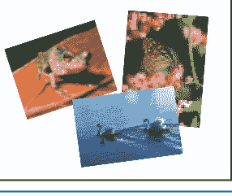

## 如果不确定，就不要使用

使用他人版权材料的惩罚可能非常严重。保护自己免受非法使用图像而被起诉的最简单方法是：除非你绝对确定这样做是可以的，否则永远不要使用东西。除非你在获取图像的页面上找到明确说明可以使用的文本，否则不要使用该网站上的图像。

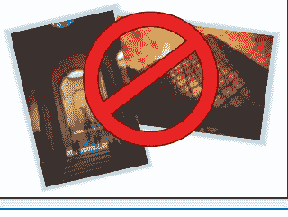

## 理解图像优化

添加到页面的每张图像都会增加页面在浏览器中的加载时间。优化图像是减少其文件大小的过程，同时尽可能减少这种减少对图像质量的影响。每个主要的图形程序都提供了优化图像的工具，但这些工具通常提供一系列令人困惑的选项，因此你应该对图形优各种方式有基本的了解，以便更好地理解这一过程。

### JPEG 优化

JPEG 通过压缩图像进行优化。遗憾的是，这使用了一种被称为有损压缩的技术，即从图像中删除数据。因此，你对图像优化的程度越深，它看起来就越差。压缩通常以百分比表示，100% 表示保留了所有原始数据且未经过压缩。

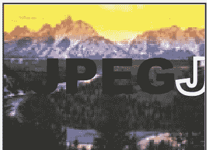

### GIF 优化

你可以通过从 GIF 中删除不必要的颜色来优化它。GIF 可以包含最多 256 种颜色，但不需要使用所有颜色。简单的标志可能只由一两种颜色组成，因此保存额外的颜色信息只是浪费空间。然而，如果你删除了需要的颜色，更复杂的图像可能会开始损失质量。

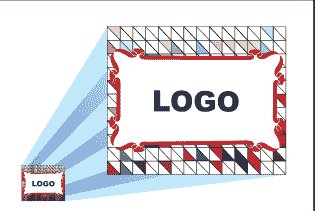

### PNG 优化

PNG 可以通过压缩来优化。由于 PNG 格式使用无损压缩，因此它在减小文件大小的同时不会影响图像质量。

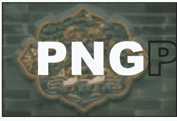

## 在 Web 上下载素材图片

stockphoto.com 是寻找免版税图像的绝佳资源。虽然你可能需要为大多数图像付费，但它们每周提供免费下载的图像。你可以通过创建一个免费账户开始获取图像。

### 免费注册

1. 打开浏览器并访问 stockphoto.com。
2. 点击注册。

出现注册表单。

3. 在表单上填写所需信息。
4. 点击同意会员协议。
5. 点击注册！

| 登录信息 | 保持登录 iStockphoto |
| --- | --- |
| 邮箱 | 您未订阅 iStock 和 Getty Images 的新闻和促销信息。 |
| 告诉我们你自己 | 您已同意会员协议。 |
| 国家：美国 | |
| 主要用途：个人 | |
| 使用类型：个人网站/博客 | |

出现确认屏幕。

检查信息是否正确。

点击确认。

出现完成屏幕。

点击继续。

返回首页。

你已完成！

你已登录，可以开始搜索数百万免版税素材照片、插图、视频和音频了！

- 购买素材在 iStock 上购买照片需要积分。它是非现金的。

购买积分

- 出售素材

分享投稿文章

如果你有促销码，请在此输入。

# 提示

网上还有哪些素材图片网站？

有很多，SpiderPic (www.spiderpic.com) 是一个很好的起点。与其他网站不同，SpiderPic 不销售图像；相反，它允许你在许多其他素材网站之间进行比较，通常可以找到更便宜的相同图像。

哪里可以获得完全免费的免版税图像？

是的。Stock.xching (www.sxc.hu) 不需要付费的免版税图像。但是，请务必仔细阅读每张图像的许可，因为权限在不同之间是不同的。

## 从网络下载素材图片（续）

一旦你已经在 iStock 注册了免费账户，你就可以购买点数来购买图片，也可以每周访问网站下载他们的每周免费图片。每个点数的价格约为 1 美元，但与许多其他网站一样，如果你一次性购买多个点数，单点数的价格就会下降。请仔细计划，因为积分在您购买后一年就会过期。你应该尝试提前计划，以便获得足够一年的积分来享受折扣，同时又不会因为购买过多而导致部分浪费。

## 从网络下载素材图片（续）

### 下载每周免费图片

- 在 iStock 首页页上，点击“每周免费照片”（Free Photo of the Week）标题上方的图片。

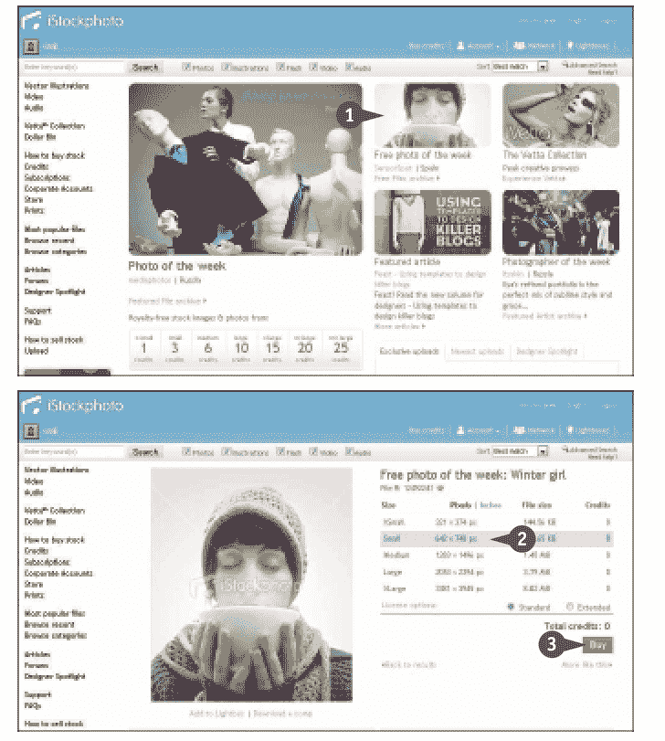

加载免费照片页面。

- 选择你想要下载的图片尺寸。
- 点击“购买”（Buy）。

# 第 3 章

出现“下载每周免费文件”（Download Free File of the Week）窗口。

下载每周免费文件。

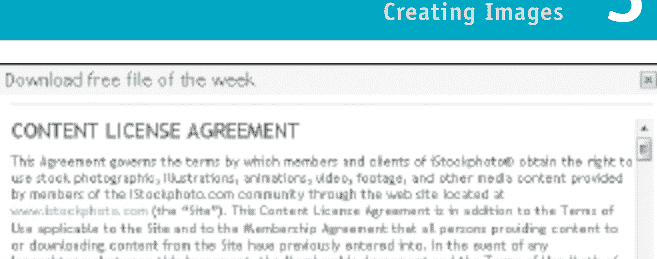

点击“接受协议并开始下载”（Accept Agreement & Start Download）。

## 内容许可协议

本协议规定了 iStockphoto 成员和客户使用 iStockphoto.com 社区成员通过此处提供的素材摄影、插图、动画、视频、片段和其他媒体内容的条款。通过使用本网站，您表示同意适用于本网站的“使用条款”以及您之前在订购或下载文件时进入的“会员协议”。

如果本协议与所述的“会员协议”之间发生任何冲突，应以本协议的条款为准。

注意：如果页面显示您需要完成会员个人资料，请填写表单并点击“更新个人资料”（Update Profile）。

1. 协议背景。

A) 本是一个具有法律约束力的文件，包含了许多影响您的权利义务的重要条款。通过勾选下方的复选框，您接受本协议为“我同意”，或以其他方式表示您或代表您的雇主或标识为会员账户持有者的实体接受本协议，并同意受其条款的约束。如果您代表您的雇主或会员账户持有者实体接受，则代表您拥有约束此类雇主或其他实体的权限。如果您没有此类权限或不接受、同意此类条款，请勿接受协议且勿下载内容。

B) 在本协议中，“您”或“客户”指的是您，或者您正在代表……

出现“文件下载”对话框。


点击“保存”（Save）。

图片已下载到您的计算机。


当文件在计算机中时，它可能会损害您的计算机。如果您不信任来源，请勿打开或保存该文件。风险是什么？

# 提示

## 图片将保存在哪里？

取决于你使用的浏览器，系统会要求你指定保存文件的位置，或者直接下载。在后的情况下，文件可能会被放置在你的“下载”文件夹或桌面上。

## 我应该选择多大尺寸的图片？

对于每周的第一张图片，你应该下载可选的最大尺寸，因为这在处理图片图层时提供了最大的灵活性。图片可以缩小，但不能缩得太厉害；对于你购买的图片，你应该获取你认为可能需要的最大尺寸。

57

## 了解 Photoshop 界面

20 多年来，图形设计师和摄影师一直依赖于图像处理和校正。今天，Photoshop 是需要为自己的网站准备图像的 Web 设计师的必备工具。与许多其他公司创建的软件不同，Adobe 的 Creative Suite 产品（包括 Photoshop）将工具和大多数功能放置在面板中，这些面板固定在屏幕的左侧和右侧。这让你比在其他程序中更快访问这些功能，但可能会让界面看起来极其复杂。

## 菜单栏

用于处理文件、更改视图和访问其他命令的菜单。

## 视图按钮

这些按钮允许你更改视图、放大/缩小以及访问 Bridge。

## 工作空间菜单

你可以通过选择这些工作空间之一来更改程序的布局。


## 工具箱

在这里可以访问在 Photoshop 中工作的所有基本工具。

## 文档标签页

通过点击这些标签页在打开的文档之间切换。如果你使用 Mac，你可能看不到这些标签页。


## 面板

Photoshop 的大部分控件可以通过这些面板可用。

## 文档信息

此处显示文档的大小和当前的放大倍数。

## 了解 Photoshop Elements 界面

Photoshop Elements 是为想要清理和处理照片但不需要 Photoshop 全功能集的业余和家庭用户设计的。Photoshop Elements 的价格比 Photoshop 便宜得多。

## 菜单栏

程序中的大多数命令可以在菜单中可用。

## 命令任务

重置界面，撤销更改。

## 命令栏

命令栏上的按钮会发生变化。

## 工具箱

在这里可以访问在 Photoshop 中工作的所有基本工具。

## 项目

撤销更改。

## 桶

在 Photoshop 中工作的工具在这里。


## 面板

Photoshop 的大部分控件可以通过这些面板可用。

## 切换

切换模式。

## 编辑

在面板中应用。

## 使用 Photoshop 校正颜色

大多数数字相机的图像都需要色彩校正。其他调整类型允许通过各种技术更改色彩平衡。你可以应用一些效果，例如将图片转换为黑白。

### 操作步骤

1. 点击“文件”。
2. 点击“打开”。


打开对话框。

3. 导航到包含图片的文件夹。
4. 双击图片。


60

图片在 Photoshop 中打开。

5. 点击“窗口”。
6. 点击“调整”打开调整面板。
7. 点击“色彩平衡”（⌘）。


色彩调整滑块。

8. 拖动色彩滑块以达到所需的色彩平衡。
9. 图片色彩已校正。


### 提示

**什么是其他调整？**

大多数数字相机的图像都需要色彩校正。其他调整类型允许通过各种技术更改色彩平衡。

**为什么调整颜色添加了一个新层？**

Photoshop 依赖于非破坏性编辑。通过将色彩平衡作为新层，Photoshop 在不更改原始图像的情况下应用效果，如果你想删除更改，可以随时删除色彩平衡层。

71

## 在 Photoshop 中裁剪和调整图片大小

一旦你校正了图片的颜色，你需要根据网站的需求调整图片大小。大多数现代数相机拍摄的照片很大，但对于大多数网站，你需要更小的图片，即使没有其他原因，你也需要图片适应页面。你可以通过调整大小来缩小整张图片，也可以通过称为裁剪的过程切掉图片不需要的部分。Photoshop 让这些操作都变得非常简单。

### 裁剪图片

1. 在工具箱上，点击`裁剪`工具。
2. 在图片上点击并拖动以定义要保留的区域。

**注意：**在绘制裁剪框后，可以通过拖动手柄来调整裁剪框。


3. 双击裁剪框内部。
4. 图片已裁剪。


## 调整图像大小

1. 点击“图像”。
2. 点击“图像大小”。

出现“图像大小”对话框。

3. 输入所需的宽度。

注意：当你输入宽度值时，高度会自动调整。

4. 点击“确定”。

图像已调整大小。


## 提示士

**我该如何知道图像应该做得多大？**

图像需要适应你的设计。希望你在进入 Photoshop 之前已经对设计进行了详尽的规划，并知道图像需要多大的尺寸。只要你保留原始图像，将裁剪和调整大小后的图像保存为副本，你就可以在需要时随时返回它并重新调整大小。

**裁剪图像时出现的网格是什么？**

摄影师在构图时通常遵循“三分法”。基本上，这个主意是如果你将图像分成九个等份，并将图像的焦点放在两条网格线的交处，你将获得一张更有视觉趣味的图像。Photoshop 的裁剪工具提供了网格来帮助你实现这一点。

## 在 Photoshop 中为网络版保存图像

Photoshop 使用原生格式 PSD 来保存图像。你在程序中对图像进行的大多数调整和编辑都包括将其保存为这种格式，无论你开始时使用的是什么格式。因此，在完成编辑后，你需要将其保存为 GIF、JPEG 或 PNG 格式用于网络版。Photoshop 的“存储为网络版”框提供了一种优化图像并将其保存为相应格式的简单方法。你在 Photoshop 中创建或修改的大多数图像以 JPEG 格式效果最好。

### 操作步骤

1. 点击“文件”。
2. 点击“存储为网络版”。
3. 从弹出菜单中选择一种格式。


## 创建图像

- 如果你选择 JPEG，请选择一个质量预设。
- 你也可以手动设置质量百分比。
- 点击“保存”。


出现“存储为优化存储的”对话框。

- 导航到包含你网站图像的文件夹。
- 为图像命名。
- 点击“保存”。

图像已保存。


## 提示士

**我可以比较不同的质量设置以查看哪一个效果最好吗？**

可以。点击对话框右上角的“2路并排”或“4路并排”按钮。然后，点击其中一个预览并更改设置。点击另一个预览以修改设置。最后，点击结果最佳的预览，并点击“保存”。

**我可以只查看图像的一部分吗？我该如何查看其余部分？**

你可以简单地在图像上点击并拖动来移动图像。你也可以通过在右下角选择不同的放大倍数来缩小视图，但在 100% 视图下选择优化设置是最好的。

## 在 Photoshop Elements 中打开图像进行编辑

Photoshop Elements 的设计不仅是为了让图像编辑变得简单，还为了组织和共享图像。当你首次启动程序时，看不到主界面，而是看到一个欢迎界面，该界面提供了指向程序编辑和组织部分的按钮，以及通向帮助文件的链接。为了对你的照片进行调整或编辑，你需要通过点击欢迎界面上的相应按钮进入“编辑器”。从那里，你可以打开图像并开始对其进行更改。

### 操作步骤

- 在 Photoshop Elements 欢迎界面上，点击“编辑”。


启动编辑器。

- 点击“文件”。
- 点击“打开”。


## 章节

创建图像 3

出现“打开”对话框。

4. 选择你想要打开的图像。
5. 点击“打开”。


- 图像在 Photoshop Elements 中打开，现在可以进行编辑。


## 提示士

**我如何使用 Photoshop Elements 来组织图像？**

数字摄影最棒的事情之一是与胶片时代不同，你可以拍摄无限数量的图像。遗憾的是，度假回来时带着 2000 张照片可能会让人措所措。从欢迎界面或编辑器窗口右上角可以“组织器”，它提供了帮助你管理摄影收藏的工具。

**从 Photoshop Elements 共享图像有哪些可用选项？**

Photoshop Elements 提供了工具来创建在线相册、发送电子邮件、将照片刻入 CD 或 DVD 以及创建幻灯片。

## 使用 Photoshop Elements 修复颜色

Photoshop Elements 拥有强大的色彩功能。在 Photoshop 和 Photoshop Elements 中，你都可以使用色彩调整来修复图像。Photoshop Elements 提供了许多自动调整来解决问题。

### 操作步骤

1. 点击“增强”。
2. 点击“自动色彩”。


色彩调整已应用。


## 旋转图像

8

数字相机营销人员关注的主要特征是百万像素。与人们的观点相反，这与图像质量无关；它只是相机尺寸的衡量。600万像素的相机拍摄的图像对于网站来说通常太大：宽3000像素，高2000像素。大多数网站可以有效使用宽在100 到 600 像素之间的图像。你可以使用 Photoshop Elements 将它们缩小到适合你网站的尺寸。

## 在 Photoshop Elements 中旋转图像

你可能需要旋转图像以适应你的网站。幸运的是，Photoshop Elements 会自动处理这一过程。当你打开图像时，Photoshop Elements 会检查它是否需要旋转。

### 操作步骤

1. 点击“文件”。
2. 点击“存储为网络版”。
3. 选择需要旋转的图像。
4. 点击“打开”。

出现“打开”对话框。

Photoshop Elements 会旋转图像。


## 裁剪图像

9

许多图像包含不需要的细节。你可以通过裁剪来关注你区域。

## 在 Photoshop Elements 中裁剪图像

1. 点击工具箱中的“裁剪工具”。
2. 调整裁剪框的句柄。

注意：按住 Shift 保持图像比例。

3. 点击裁剪区域下方的“提交”按钮。


图像已裁剪。


## 调整图像大小

## 在 Photoshop Elements 中调整图像大小

1. 点击“图像”。
2. 点击“调整大小”。
3. 点击“图像大小”。

出现“图像大小”对话框。

4. 将“采样”更改为 ☑。
5. 在“像素尺寸”部分输入图像的新宽度。
6. 点击“确定”。

图像已调整大小。


## 在 Photoshop Elements 中为网络版保存图像

与 Photoshop 一，Photoshop Elements 中的图像默认以 PSD 格式保存。为了将图像放到网络上，你需要将其保存为 JPEG、PNG 或 GIF，尽管大多数照片需要 JPEG。你还需要优化图像，以在最大化质量的同时最小化文件大小。Photoshop Elements 中的“存储为网络版”功能允许你完成所有这些目标。

### 操作步骤

1. 点击“文件”。
2. 点击“存储为网络版”。
3. 从弹出菜单中选择一个预设。


如果你需要，可以通过手动调整质量百分比来修改预设设置。

点击“确定”。


出现“存储存储为”对话框。

导航到你网站的图像文件夹。

为你的图像输入一个名称。

点击“保存”。

优化后的图像已保存。


## 提示

### 我应该使用什么格式？

在大多数情况下，你在 Photoshop Elements 中处理的图像是照片，因此使用 JPEG 或 PNG-24 都能让你获得最小的文件和最好的质量。GIF 和 PNG-8 因为它们是为只有几种颜色的图像设计的，通常看起来较差且导致文件较大。

### 我如何知道我的文件会有多大？

Photoshop Elements 在预览窗的右下角显示优化后的图像文件大小。你可以调整设置并在此查看文件大小将如何受到影响。

73

## 了解 Fireworks 界面

Fireworks 由一家名为 Macromedia 的公司创建。与当时作为竞争对手的 Adobe 系列 Photoshop 不同，Fireworks 是专门为创建 Web 图形设计的。由于其以 Web 为中心，Fireworks 仍然是许多 Web 设计师的最选。它的界面设计在外观和感觉上与其他 Creative Suite 产品相似，其功能被组织在面板中，这些面板主要沿屏幕右侧分组。Fireworks 还包含一组工具，允许你对图像进行各种操作。

## 菜单栏

程序中的大多数命令都可以从这些菜单中访问。


## 视图选项

使用这些工具在文档上缩放和移动。

## 工作空间切换器

通过选择不同的工作空间来更改面板的布局。

## 面板

你在 Fireworks 中的大部分工作将通过面板完成。

## 文档标签

你可以通过选择文档标签在打开的文档之间切换。

## 属性

此面板是动态的，并根据当前选的工具或对象呈现不同的选项。

## 预览选项

选择以原始、预览、2 并在或 4 并在模式查看你的文档。

## 工具箱

Fireworks 中的绘制工具可以在这里找到。

74

## 了解 Illustrator 界面

几乎所有的计算机图形要么是位图（这意味着它们由微小的像素组成），要么是矢量图（它们是通过通过定义点并使用数学算法在点之间画线来构建的）。Illustrator 是一款非常强大的基于向量的设计工具。许多代表大型企业的 Logo 都是在 Illustrator 中设计的。与它的 Creative 对应产品一样，Illustrator 的界面包含一系列面板（可以从这些面板访问程序的大部分功能）以及一组绘制工具。

## 菜单栏

你可以从这些菜单访问程序中的命令。


## Bridge 和窗口工具

启动 Bridge 或排列打开的文档。

## 工作空间切换

通过选择不同的工作空间来更改面板的布局。

## 面板

你在 Illustrator 中的大部分工作将通过这些面板完成。点击面板图标进行展开。

## 文档标签

你可以通过选择其标签在打开的文档之间切换。

## 工具箱

程序中的绘制和其他工具可以从工具箱访问。

## 画布

你的文档的绘制区域。

## 控制栏

控制栏上的可用项目取决于当前选中的工具。

## 画板

画布周围的区域。

## 在 Fireworks 中创建按钮

通过使用 Fireworks 工具让你的 Web 网站更有趣。你可以使用 Fireworks 工具根据你的视觉设计来设置按钮。在开始之前，你需要创建一个文档。根据你的需求设置按钮的大小。

### 在 Fireworks 中创建按钮

出现“新建文档”对话框。

1. 拖动鼠标在画布上创建按钮。


2. 输入你想要的尺寸。
3. 点击“确定”。


4. 优化后的图像已保存。
5. 使用填充工具。


6. 使用属性面板选择字体。
7. 使用属性面板设置字号。


8. 在仍按住鼠标时在画布上拖动添加圆角。
9. 释放鼠标。画布上绘制了形状。


10. 点击文字工具（`T`）。
11. 使用属性面板选择字体。
12. 使用属性面板选择字体颜色。
13. 使用属性面板设置字体大小。


14. 点击画布。
15. 为按钮输入标签。
16. 如果必要，点击指针工具（`X`）移动文字以正确定位。

按钮已完成。

## 提示

### 我应该担心画布上的多余空间吗？

图像的大小将是画布的大小，所以对于按钮之类的东西，你想确保画布与作品匹配。你可以点击“修改”、“画布”、“裁剪画布”让 Fireworks 删除多余空间。

### 我应该把按钮做得多大？


按钮的具体大小取决于网站的设计。大多数按钮大约宽 150 像素，高 50 像素，但你不受这些数字的限制。

79

## 在 Fireworks 中导出图像

Fireworks 的原生格式是 PNG。然而，Fireworks 版本的格式包含额外数据以存储程序功能的信息（如图）。Fireworks 还包含一组用于 Web 的优化工具，让你获得比其他程序保存的文件更，同时保持视觉质量。优化直接在程序中通过一个专用任务的面板进行，并通过导出将图像保存为 JPEG、GIF 或 PNG。

### 在 Fireworks 中导出图像

1. 点击“窗口”。
2. 点击“优化”。

优化面板打开。


3. 选择你想将图像保存的文件格式。


4. 点击“文件”。
5. 点击“导出”。


出现“导出”对话框。

6. 导航到你网站的图像文件夹。
7. 为图像输入名称。
8. 确保导出设置为“仅图像”。
9. 点击“保存”。

图像已以正确的格式导出。


## 提示

### 我如何比较不同的优化设置？

你可以点击“2路并列（2-Up）”和“4路并列（4-Up）”按钮来同时查看多个版本的图像。然后，你可以点击每个版本并选择不同的优化设置，以便比较结果并选择看起来最好的一个，从而获得最小的文件。

### “导出”对话框中还有哪些导出选项？

Fireworks 可以导出多种格式的图像。大多数情况下，你可能会选择“仅图像”，但你也可以将复杂的设计导出为“HTML 和图像”，或导出到 Dreamweaver 或 Lotus Domino Designer 等程序。

## 在 Illustrator 中创建 Logo

Illustrator 包含了一套强大的绘图工具，允许艺术家绘制图像，其限制仅限于他们的创造力和想象力。作为一个基于矢量的程序，它的工具设计是围绕绘制新图像的，而不是编辑现有图像。使用其他工具时，你开始创建一个新文档，并将 Illustrator 的——即绘图区域——设置为图像所需的尺寸。Illustrator 的文字工具允许你创建使用任何已安装字体体的图像图像。

### 在 Illustrator 中创建 Logo

- 从 Illustrator 欢迎界面，点击“Web 文档”。


出现“新建文档”对话框。

- 将宽度和高度设置为你所需的值。
- 点击“确定”。

新文档已创建。

- 点击“文字工具 (T)”。
- 点击画布。
- 输入你的公司或组织名称。


- 点击“选择工具 (V)”。

对象已被选中。

- 从控制栏中，点击“填充颜色”控制并为文本选择一种颜色。


### 我如何向“填充颜色”下拉菜单中添加更多颜色？

Illustrator 在“填充颜色”下拉菜单中显示当前文档的色板。你可以通过点击“窗口”和“颜色”并拖动滑块创建新颜色。然后，点击面板右上角的下拉菜单并选择“创建新色板”。

### 我需要用文字工具选择文本来更改字体属性吗？

不需要。如果你使用选择工具选中了文本框，或者直接使用文字工具选中了文本，你可以从控制栏中更改字体、颜色、大小、对齐方式和其他字体属性。

## 在 Illustrator 中创建 Logo（续）

Illustrator 的“挤压与斜角（Extrude & Bevel）”命令允许你轻松地为对象（包括文本）添加 3D 效果。你可以更改光源、角度和其他属性来创建你想要的效果。虽然你最初无法看到应用到作品上的效果，但该命令的对话框包含一个复选框，允许你预览效果，这样你就能准确看到完成后艺术的样子。尽管创建 3D 效果可以增加页面的视觉效果，但你应该确保文字保持可读。

### 在 Illustrator 中创建 Logo（续）

- 9 点击“效果”。
- 10 点击“3D”。
- 11 点击“挤压与斜角”。


出现“3D 挤压与斜角选项”对话框。

- 12 点击“预览”（变为 ✓）。

注意：你可能需要移动对话框以显示你的作品。

画布更新以显示效果。


- 尝试对话框中的设置以实现你想要的文字效果。
- 点击“确定”。


- 作品已更新了 3D 效果。


> 我如何更改“3D 挤压与斜角选项”对话框的颜色？点击“更多选项”显示下拉菜单以更改阴影颜色。从框中选择“自定义”，并选取一种颜色。关闭对话框后，你可以通过从工具箱中选择颜色来更改作品的前部分。

## 为 Web 保存 Illustrator 图像

你在 Illustrator 中创建的所有图像以 AI 格式保存。类似于 Photoshop PSD 格式，AI 格式图像无法直接放在你的网站上，而是需要使用“存储为 Web 格式”命令。该命令会打开一个对话框。

1. 点击“文件”。
2. 点击“存储为 Web 格式”。


出现“存储为 Web 格式”对话框。

3. 选择一个预设。
4. 点击“保存”。


图像已为 Web 保存。

## 让你的图片具有访问性

确保具有不同身体需求的用户能够访问你的页面是非常重要的，这样你就不会流失潜在的客户或用户。为了让盲人能够理解你的页面，你应该为你的图片提供文本描述。你可以通过 `<>` 标签的 `alt` 属性添加此描述。你使用 HTML 添加到页面上的每张图片都需要描述性的替代文本。该属性实际上是 HTML 和 XHTML 的要求；在许多司法管辖区，它可能是一项法律要求。

### 让你的图片具有访问性

1. 在你的编辑器中打开包含 `<>` 标签的编辑器。

```html
<!DOCTYPE html PUBLIC "-//W3C//DTD XHTML 1.0 Transitional//EN"
"http://www.w3.org/TR/xhtml1/DTD/xhtml1-transitional.dtd">
<html>
<head>
<title>Magazines Now Home Page</title>
</head>
<body>

</body>
</html>
```

2. 在标签内，在闭合符号 `/>` 之前，输入 `alt`。

```html
<!DOCTYPE html PUBLIC "-//W3C//DTD XHTML 1.0 Transitional//EN"
"http://www.w3.org/TR/xhtml1/DTD/xhtml1-transitional.dtd">
<html>
<head>
<title>Magazines Now Home Page</title>
</head>
<body>

</body>
</html>
```

### 类型 = "?"，将其替换为图片的描述。


当在浏览器中查看时，页面的外观与之前没有任何不同。替代文本是为残障人士提供的，不会影响页面的显示方式。


## 提示

### 一个使用 Internet Explorer 6 的客户说，当他鼠标悬停在图片上时可以看到替代文本。这是为什么呢？

旧版本的微软 Internet Explorer 将图片替代文本显示为工具提示。这从未是浏览器的官方规范的一部分，因此没有其他浏览器也这样做。微软在较新版本的 IE 中放弃了这种做法。

### 盲人是如何上网的？

盲人依赖于名为“屏幕阅读器”的软件，这种软件会读出屏幕上的所有内容。当盲人浏览文档时，屏幕阅读器会读出你页面上图片的替代文本描述。

## 将图片作为链接

图片可以代表超链接中的文本。常见的做法是将网站的 Logo 链接到其首页。许多网站使用图形按钮作为导航元素。你可以将已经掌握的创建链接的知识与添加图片的知识结合起来，因为作为链接的图片无非是包裹在 `<a>` 标签中的 `<>` 标签。`src` 属性像往常一样指向图片，而锚点标签的 `href` 属性也如常地指向你想要链接的页面。

### 将图片用链接

1. 在你的编辑器中，打开你想在图片周围添加超链接的页面。

```html
<!DOCTYPE html PUBLIC "-//W3C//DTD XHTML 1.0 Transitional//EN" "http://www.w3.org/TR/xhtml1/DTD/xhtml1-transitional.dtd">
<html>
<head>
<title>Magazines Now Home Page</title>
</head>
<body>

</body>
</html>
```

2. 在 `<>` 标签之前，输入 `<a href="?`，并替换为你想要链接的页面路径。

```html
<!DOCTYPE html PUBLIC "-//W3C//DTD XHTML 1.0 Transitional//EN" "http://www.w3.org/TR/xhtml1/DTD/xhtml1-transitional.dtd">
<html>
<head>
<title>Magazines Now Home Page</title>
</head>
<body>
<a href="index.html"></a>
</body>
</html>
```

### 第 3 章

在 `<>` 标签之后，输入 `<a>`。

```html
<!DOCTYPE html PUBLIC "-//W3C//DTD HTML 1.0 Transitional//EN"
"http://www.w3.org/TR/html1/DTD/html1-transitional.dtd">
<head>
  <title>Magazines Now Home Page</title>
</head>
<body>
  <a href="index.html"></a>
</body>
</html>
```

当在浏览器中查看时，图片就是一个链接。你可以点击图片导航到指定的页面。


## 提示

### 我的图片现在周围有一个蓝色或紫色的边框。我该如何去掉它？

这个边框是浏览器指示该图片是链接的显示，就像将文本变为蓝色并添加下划线作为链接一样。你可以使用 CSS 移除边框。

### 用户如何知道图片是可以点击的？

你应该通过图片的设计让用户知道它是一个元素。在图片上提供文本线索。

### 第 4 章

## 格式化页面

网页依赖于另一种名为层叠样式表（CSS）的语言。本章将介绍这种语言。


- 介绍 CSS . . . . . . . . . 96
- 创建样式表 . . . . . . . . . 98
- 理解单位 . . . . . . . . . 100
- 设置页面上的字体 . . . . . . . . . 102
- 使用 CSS 设置颜色 . . . . . . . . . 104
- 为 Web 设置颜色 . . . . . . . . . 106
- 使用内边距控制间距 . . . . . . . . . . . . 118
- 使用外边距控制空白 . . . . . . . . . . . . 120
- 设置宽度 . . . . . . . . . 122
- 添加边框 . . . . . . . . . 124

## CSS 简介

HTML 是一种用于定义文档结构的语言。随着它的演变，添加了标签来处理格式，但这些标签难以操作、难以编辑，并增加了页面的体积。层叠样式表（CSS）的引入是为了解决这些问题。通过 CSS，你可以更改文本属性、控制元素间距、绘制边框。无论你使用什么版本的 HTML 或 XHTML，都可以使用 CSS。

## 编写 CSS

像 HTML，CSS 文件是纯文本，可以在任何文本编辑器中编写。现代 HTML 编辑器也支持 CSS，因此你编写 HTML 的编辑器也适用于你的 CSS。


## CSS 语法

CSS 的语法与 HTML 有很大不同。由一系列规则组成。每个规则包含一个选择器和一个声明。选择器对大小写敏感，而组成声明的属性和值不敏感。像 HTML 一样，CSS 对空格不敏感。


## 选择器

选择器定义了规则应用于文档的部分。选择器可以是 HTML 元素，也可以对应 HTML 中 ID 或类属性的值。更复杂的选择器允许你根据相对于其他元素的位置来应用规则。

```html
<h1>1> <item> <style>
SELECTORS
h1 item style
```

## 声明

CSS 声明由属性和值组成。属性定义了要应用的格式类型。属性被设置为值。属性和值之间用冒号分隔，每对都以分号结束。应用于特定选择器的所有声明都封装在大括号内。你可以在《HTML, XHTML, and CSS: Your visual blueprint for designing effective Web pages》(Wiley, 2008) 中找到 CSS 中可用的属性和值列表。


## 嵌入式样式表

你想应用到特定 Web 页面的样式可以通过在文档的头部放置一个 `<style>` 标签块，然后在标签块内放置你的样式规则，直接嵌入到页面中。


## 外部样式表

可以将一组样式组合在一个具有 `.css` 扩展名的单个文档中，创建一个外部样式表。外部样式表可以链接到任意数量的 HTML 文档，你可以创建一个单一样式表来定义并控制你整个网站的格式。


## 内联样式

样式属性和值可以使用 `style` 属性直接放置在 HTML 标签内。这是应用 CSS 灵活性最低的方法，应该尽可能避免，因为它使得你更难维护网站一致的一致视觉效果。


## 浏览器支持

如今，大多数现代浏览器以相同的方式支持 CSS。你仍然会在旧版浏览器（如 Internet Explorer 6）中遇到问题，因此你应该仔细测试你的页面，以确保它们按照你想要显示。


## 创建嵌入式样式表

嵌入式样式表将样式规则直接放在 HTML 页面中。它们是学习 CSS 的有用起点，因为你只需要引用一个文档。嵌入样式放置在 `<head>` 中的 `<style>` 标签中，该标签有一个必需属性 `type`，其值始终设置为 `"text/css"`。务必添加闭合标签 `</style>`，因为如果没有它，浏览器将不会在页面上显示任何内容。

1. 在编辑器中，打开你想添加样式的页面。
2. 在 `head` 部分内，输入 `<style>`。
3. 输入 `type="text/css"`。


```html
<!DOCTYPE html PUBLIC "-//W3C//DTD XHTML 1.0 Transitional//EN"
"http://www.w3.org/TR/xhtml1/xhtml-transitional.dtd">
<head>
<title>Information</title>
<style type="text/css">
</style>
</head>
<body>
<h1 id="top">Some Information</h1>
<p>此页面包含一种被称为 'Lorem Ipsum' 的填充文本。设计师使用它来填充页面布局，但还没有实际的文本。我们正在使用长页面内容来演示内部链接。</p>
<p>你可以在 <a href="http://www.lipsum.com">Lorem Ipsum</a> 获取 Lorem Ipsum 文本。</p>
<p>Lorem ipsum dolor sit amet, consectetur adipiscing elit. Nullam malesuada porta neque viverra. Pellentesque</p>
```

- 4. 按两次回车键。
- 5. 输入 `</style>`。页面中已创建嵌入式样式表。

```html
<!DOCTYPE html PUBLIC "-//W3C//DTD XHTML 1.0 Transitional//EN"
"http://www.w3.org/TR/xhtml1/xhtml-transitional.dtd">
<head>
<title>Information</title>
<style type="text/css">
</style>
</head>
<body>
<h1 id="top">Some Information</h1>
<p>此页面包含一种被称为 'Lorem Ipsum' 的填充文本。设计师使用它来填充页面布局，但还没有实际的文本。我们正在使用长页面内容来演示内部链接。</p>
<p>你可以在 <a href="http://www.lipsum.com">Lorem Ipsum</a> 获取 Lorem Ipsum 文本。</p>
<p>Lorem ipsum dolor sit amet, consectetur adipiscing elit. Nullam malesuada porta neque viverra. Pellentesque</p>
```

# 提示

## `type` 属性的作用是什么？

`type` 属性告诉浏览器该样式是用纯文本编写的，并且正在使用 CSS。目前尚没有其他可用选项，但现在添加该属性可以为你的文档提供未来的前瞻性：如果以后开发了其他选项，未来的浏览器将不必猜测该页面使用的是什么。

## 样式表应该出现在 `head` 部分的末尾

不是。样式可以放置在 `head` 内的任何位置。传统上它被放置在该部分的底部，但这不是强制要求。

# 理解单位

任何 CSS 属性都需要你指定测量单位，例如元素之间的间距、边框宽度和字体大小。该语言支持多种测量单位。理解在什么情况下使用哪种单位有助于你成为一个更好的 CSS 设计师，并帮助避免当测量工作方式不符合设计师预期时发生的常见错误。可用单位范围从你可能熟悉的到你从未听过的。在大多数页面设计中，你将使用多种测量单位的组合。

## 英语和公制单位

CSS 支持以英寸、厘米和毫米测量值。然而，无法从下一步预测英寸、厘米或毫米的实际尺寸，因此不建议在任何情况下都使用这些单位。

|  |  | 1 in |  |  | 3 |  |  |  |  |  |
|---|---|---|---|---|---|---|---|---|---|---|
| 厘米 | 1 cm | 2 |  | 4 | 5 | 6 | 7 |  |  |  |

## 像素

像素是构建网页的基块。与英语和公制单位一样，像素的实际尺寸是不可预测的，但设计师使用像素来元素间距、边框宽度、字体大小、内边距和外边距，因此不建议在任何情况下使用它们。


## 磅和点

点是基于英寸的。网页不包含嵌入字体，它们只包含关于使用何种字体的指令。

| CSS 单位 |  |
|---|---|
| 像素 | px |
| 磅 | pc |
| 厘米 | cm |
| 英寸 | in |
| 毫米 | mm |
| 相对测量 |  |

## `em` 和 `ex`

`em` 是父元素的宽度。由于它们是相对于字体大小的，因此不可预测的，因此不建议使用它们。


## 百分比

你可以使用百分比来测量元素大小。例如，如果你将字体大小设置为 90%，它将是父元素的 90%。


## IE 和字体缩放

浏览器应该允许缩放文本。然而，IE 并不完全遵循这一点，如果你使用 `em`，它是相对的。


## 指定单位

任何 CSS 属性都需要你指定测量单位，例如元素之间的间距、边框宽度和字体大小。该语言支持多种测量单位。理解在什么情况下使用哪种单位有助于你成为一个更好的 CSS 设计师，并帮助避免当测量工作方式不符合设计师预期时发生的常见错误。可用单位范围从你可能熟悉的到你从未听过的。在大多数页面设计中，你将使用多种测量单位的组合。

## 设置字体和文本大小

字体在网页是非常有限的。网页不包含嵌入字体，它们只包含关于使用何种字体的指令。`font-face` 属性用于提供这些指令。`font-size` 属性允许你设置文本的大小。这些属性可以应用到任何包含文本的元素，例如标题或段落，如下例所示。

```html
<!DOCTYPE html PUBLIC "-//W3C//DTD XHTML 1.0 Transitional//EN"
"http://www.w3.org/TR/xhtml1/xhtml-transitional.dtd">
<html>
<head>
<title>Information</title>
<style type="text/css">
/* here */
</style>
</head>
<body>
<h1 id="top">Some Information</h1>
<p>此页面包含一种被称为 'Lorem Ipsum' 的填充文本。设计师使用它来填充页面布局，但还没有实际的文本。我们正在使用长页面内容来演示内部链接。</p>
<p>你可以在 <a href="http://www.lipsum.com">Lorem Ipsum</a> 获取 Lorem Ipsum 文本。</p>
<p>Lorem ipsum dolor sit amet, consectetur adipiscing elit. Nullam malesuada porta neque viverra. Pellentesque</p>
</body>
</html>
```

# 第 4 章

- + 5 输入字体大小：?，替换为一组字体名称或类别，例如 Arial、Helvetica、sans-serif。
- + 6 按回车键。
- + 7 输入字体大小：?，替换为数值和测量单位，最高为 90%；
- + 8 按回车键。
- + 9 输入。

当在浏览器中查看时，页面上的文本将以您指定的字体和大小显示。


## 一些有趣信息

此页面包含被称为“Lorem Ipsum”的填充性文本。当设计师需要填充页面布局但没有足够的文本来让页面看起来像真实内容时，他们会使用它。

您可以在 lipsorum.com 生成 Lorem Ipsum。

Lorem ipsum dolor sit amet, consectetur adipiscing elit. Aliquam erat varius ultricies. Nulla mauris, dui, ipsum et tempor, nisl elementum. Praesent a faciletate ege eros felis feugiat, tellus eu nisl a arcu. Curibitur lacinia, non scislisque auctor aliquip. Aliquam id justo mauris turpis, blandit in nibh, in congue nislisque neque. Nulla nisl elit, vel vel a dui, nisl a elit, nisl a turpis. Praesent non nisl neque. Pellentesque massa nisl a elit, nisl a elit, nisl a, nisl a elit, nisl a sem, sem commodo neque.

Velabitur sem tristique. Nulla tellus. In aculis, eu pretium, a dui. Donec hendrerit, eu vellus. Donec nunc nisl a elit, a nisl nisl, nisl a elit, a nisl a erat. Nibitur feugiat eu gravida sapien. Quisque ultrices, massa sagittis dictum. Curabitur eget nisl. Nulla massa elementum a nisl a nisl a nisl a nisl a nisl elit. In non dui nisl neque. Praesent nec nisl a placer. In rhabitur risus, at condimentum lectus, at nisl vitae massa.

# 提示

## 我可以使用任何字体显示文本吗？

## 为什么我需要提供字体列表？

不是。你并没有将字体文件嵌入到文档中。你仅仅是要求浏览器使用该字体，只有当你的用户安装了相同的字体时，这种情况才能发生。大多数设计师将自己限制在 Arial、Times New Roman、Verdana 和 Courier，否则像 Georgia 等其他字体正在变得流行。

列表提供了备用字体，以防用户没有与你相同的字体。如果你将 `font-face` 属性设置为 `Arial, Helvetica, sans-serif`，就意味着你倾向于使用 Arial，但如果不可用，则使用 Helvetica。如果系统中没有该字体，它会退回到通用的无衬线字体（sans-serif）。

103

# 理解 Web 颜色

颜色是任何设计的重要部分。为你的网站选择正确的配色方案对你网站的情绪、外观和感受产生巨大影响。看看你喜爱的一些网站，思考颜色对你对网站印象的影响。亮色通常比深色传达出更轻快、更快乐的感觉，但取决于网站的用途，两者都可能是合适的。为了有效使用颜色，你需要了解颜色在 Web 上是如何运作的。

## RGB

RGB 显示器通过组合红、绿、蓝光来产生颜色，因此被称为 RGB 设备。每种颜色都用数值表示，值范围从 0 到 255。因此，你可以将紫色表示为 `rgb(128, 0, 128)` —— 128 红、无绿、128 蓝。


## 十六进制

十六进制是一种使用 16 个主数字的计数系统，而不是我们使用的 10 个。额外的 6 个数字由英语字母表的前 6 个字母 A 到 到）表示。十六进制允许你仅用 2 位数字而不是 3 位数字从 0 数到 255，因此对于数值非常有用。紫色在十六进制中表示为 `#800080`。

> `#800080`

### 颜色

官方规范识别了 Web 的 16 种命名颜色：`aqua`、`black`、`blue`、`fuchsia`、`green`、`lime`、`maroon`、`navy`、`olive`、`purple`、`red`、`silver`、`teal` 和 `yellow`。然而在实践中，所有现代浏览器都识别 140 种命名颜色。你可以在附录中查看所有颜色的列表。


## 安全色

在 Web 早期，大多数显示器只能显示 256 种颜色，其中只有 216 种颜色在 Windows 和 Macintosh 系统之间共享。因此，了代表这 216 种颜色的 Web 安全色。今天，没有理由将自己限制在这个色范围内，因为所有现代显示器都能处理数百万种颜色。


## 无障碍与颜色

目前的估计大约 5% 的人口在某种程度上是盲。色盲通常表现为无法区分相似的颜色。当你选择网站的颜色时，请记住这个问题，并确保颜色具有足够的对比度。

| 糟糕的对比 | 良好的对比度 |
|---|---|
|  |  |
|  |  |
|  |  |

## CSS 3 与透明度

CSS 第 3 版本增加了指定 Alpha 通道（透明度）的功能。可以使用 `rgba(128,0,128,.5)` 语法创建一个具有 50% 透明度的紫色。

| RGB (128,0,128) | RGBA (128,0,128,.5) |
|---|---|

## 使用 Color 确定配色

Adobe Color 是一个免费资源，允许设计师访问并使用他人创建的配色。当你找到喜欢的颜色时，可以在 Web 中使用它们。

- 在你的浏览器中，访问 `http://color.com`。
- 你可以在这里创建配色方案。
- 点击箭头查看配色方案。
- 你可以通过十六进制值搜索颜色。


### 格式化页面

你可以使用配色方案来创建主题。

- 确保你选择的颜色与背景对比良好。
- 在你的页面中，使用十六进制值。
- 也可以将颜色应用于整个文本块。


# 提示

**我可以在 Web 上创建配色方案吗？**

是的，即使你还没有 Adobe 帐户，也可以在页面右上角登录创建。

**我可以使用 Color 来确定颜色吗？**

是的，你可以在页面右上角登录以创建配色方案。你可以在 Web 中显示它们。

107

# 设置文本颜色

CSS `color` 属性应用于任何元素的前景。然而在实践中，它只用于文本。确保你选择的颜色与背景有足够的对比度，以确保文本可读。你可以将颜色应用于单个单词，甚至是字符。

## 设置文本颜色

- 在你的编辑器中，打开一个包含内联样式表的页面。
- 在声明中，输入 `color: ?`，将 `?` 替换为所需的颜色十六进制值。

```html
<!DOCTYPE html PUBLIC "-//W3C//DTD HTML 1.0 Transitional//EN"
"http://www.w3.org/TR/html1/html-transitional.dtd">
<head>
<title>信息</title>
<style type="text/css">
body {
font-family: Arial, Helvetica, sans-serif;
font-size: 80%;
color: #540907;
}
</style>
</head>
<body>
<h1 id="top">一些有趣信息</h1>
</body>
```

- 当在浏览器中查看时，页面上的文本将显示您指定的颜色。


### 一些有趣信息

Lorem ipsum sit amet, consectetur adipiscing elit. 当设计师在需要填充页面但没有足够的内容来让页面足够长以演示内部链接时，他们会使用它们。

Lorem ipsum dolor sit amet, Ipsum.com.

Lorem ipsum sit amet, consectetur adipiscing elit. Maecenas fermentum porttitor libero, dapibus lobortis varius, nec neque. Nulla ac tincidunt mauris. Procepteur ut aliquip ex commodo consequat.

Sed ut perspiciatis unde omnis iste natus error sit voluptatem doloremque laudantium, rem aperiam, ea ipsa quae nesciunt, ut aliquid ad ea, possimus, in velit velit esse in questi qui officia deserunt mollit, anim id est laborum, perspiciatis.

## 设置背景颜色

你可以使用 CSS `background-color` 属性更改页面或页面内元素的背景颜色。背景颜色需要与文字颜色形成对比，以确保良好的可读性。`background-color` 的默认值为 `none`，意味着元素是透明的。几乎所有浏览器都会将 `body` 的背景设置为白色，尽管如果你想使用白色背景，你可能需要显式地将 `body` 的背景设置为白色，以防止某些可能具有不同默认值的浏览器。

- 在你的编辑器中，打开一个包含内联样式表或现有 `body` 声明的文档。
- 在声明中，输入 `background-color: #;`，将其替换为你想要使用的颜色的十六进制值。
- 在浏览器中查看时，页面现在将具有指定的背景颜色。


```html
<!DOCTYPE html PUBLIC "//W3C//DTD HTML 4.0 Transitional//EN"
 "http://www.w3.org/TR/html4/DTD/html4-transitional.dtd">
<html>
<head>
<title>Information</title>
<style type="text/css">
body {
  font-family: Arial, Helvetica, sans-serif;
  font-size: 90%;
  color: #FF0000;
  background-color: #FFC0C0;
}
</style>
</head>
<body>
<h1>Some Interesting Information</h1>
</body>
</html>
```


## 添加背景图片

你可以使用 CSS 的`background-image`属性将图像作为页面的背景。background image（背景图片）可以放置在页面上的任何元素中，尽管将其放置在`body`中以覆盖整个页面是常见的做法。虽然你可以使用任何 JPEG、GIF 或 PNG 作为背景，但你应该仔细确保图片不会分散对页面的注意力，因此你应该选择一张对比度不明显且整体相当微妙的图片。

1. 在你的编辑器中，打开一个包含内联样式表和现有`body`声明的文档。

   

2. 在声明中，输入`background-image:-;`。

   

## 格式化你的页面

3. 输入`url(" ");`，将空格替换为你想要使用的图片的相对路径或绝对路径。

```html
<!DOCTYPE html PUBLIC "//W3C//DTD HTML 4.1 Transitional//EN"
   "http://www.w3.org/TR/html41/DTD/html41-transitional.dtd">
<head>
  <title>Information</title>
  <style type="text/css">
  body {
    font-family: Arial, Helvetica, sans-serif;
    font-size: 100%;
    background-color: #FF5555;
    background-image: url("images/backgroundtile.gif");
  }
  </style>
</head>
<h1 id="top">Some Interesting Information</h1>
```

在浏览器中查看时，图片将会出现，并在屏幕上水平方向和垂直方向上平铺。


## 一些有趣信息

此页面包含填充文本“Lorem ipsum”，用户在需要填充页面布局但没有实际文本来填充重要内容时会使用它。

Lorem ipsum dolor sit amet, consectetur adipiscing elit. Nullam do eiusmod tempor incididunt ut labore et dolore magna aliqua. Ut enim ad minim veniam, quis nostrud exercitation ullamco laboris nisi ut aliquip ex ea commodo consequat. Duis aute irure dolor in reprehenderit in voluptate velit esse cillum dolore eu fugiat nulla pariatur. Excepteur sint occaecat cupidatat non proident, sunt in culpa qui officia deserunt mollit anim id est laborum.

Curabitur pretium tincidunt lacus. Nulla gravida orci a, a odio, elit. Nullam varius, turpis et comodis, est, bibendum elit, nec luctus felis, sollicitudin mauris. Maurellus risus, a, est, tempor, luctus risus, neque nibh nulla neque neque. Integer in mauris et a odio, ac vehicula tellus. Pellentesque habitat morbi tristique senectus et netus et pharetra ultrices donec turpis, est luctus, luctus, donein mauris a massa.

Suis aute sunt in culpa qui officia deserunt mollit anim id est laborum. Excepteur sint occaecat cupidatat non proident, sunt in culpa qui officia deserunt mollit anim id est laborum.

> 我可以添加多一张图片作为背景吗？

遗憾的是，CSS 只允许每个元素放置一张背景图片。你可以通过在页面的其他元素中放置其他图像来创建多个背景的错觉。例如，你可以在`div`中放置一个背景图片，然后在`div`内部的段落中放置另一个。更多`div`请参见第 5 章。

### 什么是良好的背景图片？

良好的背景图片是对比度小的图片，因为具有非常深和亮区域的图片会导致可读性问题。此外，背景图片应该增强页面的整体外观，而不是分散注意力或干扰作品。

111

## 控制背景图片平铺

默认情况下，背景图片会水平和垂直平铺。`background-repeat`属性允许你控制这种行为。`repeat-x`使图片仅水平平铺，`repeat-y`使图片仅垂直平铺，而`no-repeat`则防止平铺。如果你使用像素设置位置，图片在调整大小时将保持不变，但使用百分比则允许图片移动。如果你设置`repeat`属性，图片将双方向平铺。

1. 在你的编辑器中，打开一个包含内联样式表和现有`body`声明的文档。
2. 在声明中，输入`background-repeat: ?`，使用`repeat-x`、`repeat-y`或`no-repeat`。

   

- 在浏览器中查看时，图片将水平、垂直或。

  

## 位置图片

背景图片最初位于元素的右上角。`background-position`属性允许你控制位置。该属性接受两个值，用逗号分隔：第一个距离顶部的距离，第二个是左侧的距离。这些距离可以使用任何单位设置。如果你使用像素设置，图片在调整大小时将保持不变，但使用百分比则允许图片移动。

- 在你的编辑器中，打开一个包含内联样式表或现有`body`声明的文档。
- 在声明中，输入`background-position: ?;`，将其替换为你想要使用的单位。注意：确保包含你想要使用的单位。
- 在浏览器中查看时，图片将位于指定的地点。如果图片被设置为平铺，它将从该位置平铺。

  

```html
<!DOCTYPE html PUBLIC "//W3C//DTD HTML 4.0 Transitional//EN"
"http://www.w3.org/TR/html4/DTD/html4-transitional.dtd">
<html>
<head>
<title>Information</title>
<style type="text/css">
body {
  font-family: Arial, Helvetica, sans-serif;
  font-size: 20px;
  color: blue;
  background-color: #FFC0C0;
  background-image: url('flowers.gif');
  background-repeat: no-repeat;
  background-position: 50px 50px;
}
</style>
</head>
<body>

</body>
</html>
```

## 一些有趣信息

此标签被称为`blockquote`。当你需要从文本中提取引用并将其显示在左侧缩进的新段落时，使用它。

Lorem ipsum dolor sit amet, consectetur adipiscing elit. Nullam varius, turpis et condimentum dictum, dui luctus, elit, eu nibh. Praesent sapien mollis nulla, nec acisl est, non dapibus neque. Mauris mauris a elit, blandit convallis, cursus metus. Sed ut nulla sem, trisque at imperdiet, non neque. Pellentesque habitasse tristique senectus et pharetra.

113

# 应用额外的文本格式

除了设置字体和颜色外，你还可以控制额外的文本属性，包括行高和大小写。CSS 的`line-height`属性是从行文本的底部或基线到下一行基线的距离。调整`line-height`可以通过增大文本间距来提高可读性，但注意不要添加得过多，以免适得其反。`transform`属性接受`uppercase`（大写）、`lowercase`（小写）和`capitalize`（大写）值，允许你控制文本的大小写，这对于标题特别有用。

## 应用额外的文本格式

1. 在你的编辑器中，打开一个包含嵌入样式表的文档。
2. 在样式表内部，输入`h1`。
3. 按回车键。
4. 输入`(`。
5. 输入`text-transform: ?;`，替换为`uppercase`、`lowercase`或`capitalize`。
6. 按回车键。
7. 输入`)`。

## 章节：格式化你的页面

8. 输入`p`。
9. 按回车键。
10. 输入`(`。
11. 输入`line-height: ?;`，替换为你想要应用的高度。
12. 按回车键。
13. 输入`)`。

```css
<style type="text/css">
body
  font-family: Arial, Helvetica, sans-serif;
  font-size: 90%;
  color: #F4F0F7;
  background-color: #FFC955;
  background-image: url("images/flowers.gif");
  background-repeat: no-repeat;
  background-position: 50px 0;

h1
  text-transform: uppercase;
  line-height: 1.5em;
</style>
```

当在浏览器中查看时，页面上的主标题应用了文本转换，段落则具有行高。

### 一些有趣信息

此页面包含填充文本“Lorem ipsum”，当它们需要填充页面布局以使页面足够长以演示其效果时。

你可以在`Lorem.com`学习更多信息。

Lorem ipsum dolor amet, consectetur adipiscing elit. Nulla gravida eleifend fermentum. Nulla varius, turpis et, tincidunt non elit, auctor facilisi in libero volutpat, nec justo aliquam elementet interdum mauris. Maecenas turpis, at convallis, ac lectus. Sed ut orci bibendum scelerisque. Aliquam mauris dui. Vivellus a massa eu elit, dictum luctus, nec non hendrerit. Aliquam mollis, sem, neque tincidunt mauris. Nulla mauris in eros at sem, dictum hendrerisque.

Vestibulum at ante. Nulla tincidunt, massa a porttitor nibh, ultricies. Duis tortor, vehicula pellentesque trisque, tellus scelerisque at metus et luctus, sem dapibus. Pellentesque, massa, at vestibulum, vehicula dapibus, erat scelerisque, lectus mauris. Pellentesque trisque et metus at massa sapien in dapibus erat. Nulla arcu in elit, pellentesque id est, media id ac ca

# 提示

### 行高我应该使用什么测量单位？

许多设计师依赖于`em`来设置行高。由于`em`的精确大小取决于字体大小，因此使用`em`设置行高可以确保高度随字体同步缩放。你可以使用小数来设置分数行高，例如`1.5 em`将行高设置为文本大小的一点半倍。

### 对标题使用`text-transform`有什么优势？我不能直接用正确的大小写输入标题吗？

大型网站可能有很多人添加内容，你无法控制他们如何输入内容。使用`text-transform`可以保证标题使用一致的大小写。

## 缩进和对齐文本

CSS 可用于控制段落等文本的第一行缩进。注意，只有第一行文本会被缩进。你可以对此属性使用任何测量单位，尽管像素（pixels）和`em`是最常见的，应该尝试以确定哪个值视觉效果最佳。`text-align`属性允许`center`（居中）、`left`（左对）、`right`（右对）和`justify`（两端对齐）值。

- 在你的编辑器中，打开一个包含嵌入样式表的文档。
- 在现有的`p`声明中输入`text-indent: ?;`，替换为你想要的首行缩进量。

```html
<!DOCTYPE HTML PUBLIC "-//W3C//DTD HTML 1.0 Transitional//EN" "http://www.w3.org/TR/html-transitional.dtd">
<html
<head>
<title>Information</title>
<style type="text/css">
body {
  font-family: Arial, Helvetica, sans-serif;
  font-size: 900%;
  color: #FF555;
  background-image: url("images/flowers.gif");
  background-repeat: no-repeat;
  background-position: 50px 0;
}
h1 {
  text-transform: uppercase;
}
p {
  line-height: 1.5em;
  text-indent: .75em;
}
</style>
</head>
<body>
<h1 id="top">Some Interesting Information</h1>
<p>此页面包含一种名为“Lorem Ipsum”的填充文本。设计师使用它来填充布局，使区域内的文本看起来像真实内容。
```

```css
/* Family Arial... */

body {
  font-family: Arial, Helvetica, sans-serif;
  font-size: 90%;
  color: #FFC955;
  background-image: url('images/flowers.gif');
  background-repeat: no-repeat;
  background-position: 0 0;
}

h1 {
  text-transform: uppercase;
}

p {
  line-height: 1.5em;
  text-indent: .75em;
  text-align: justify;
}
```

当在浏览器中查看时，段落的第一行被缩进并对齐到你设置的值。

## 应用内边距

页面元素周围的空间被称为盒模型。盒模型的内部区域是填充区域，它被边框包围，边框之外是外边距。`padding`属性允许你控制内容与边框之间的空间。

- 在你的编辑器中，打开一个包含内嵌样式表的文档。

```html
<!DOCTYPE html PUBLIC "-//W3C//HTML 4.0 Transitional//EN" "http://www.w3.org/TR/html4/DTD/html4-transitional.dtd">
```


<html>

<head>

<title>Example</title>

<style type="text/css">

body {

  font-family: Arial, Helvetica, sans-serif;

  font-size: 90%;

  color: #ffc555;

  background-image:url('images/flowers.gif');

  background-repeat: no-repeat;

  background-position:550px 0;

}

h1 {

  text-transform: uppercase;

  padding-left: 20px;

}

</style>

</head>

<body>

<h1 id="top">Some Interesting Information</h1>

<p>此页面包含一种名为 "Lorem Ipsum" 的填充文本。设计师使用它来填充布局，使区域内的文本看起来像真实内容。

```css

/* Family Arial... */

body {

  font-family: Arial, Helvetica, sans-serif;

  font-size: 90%;

  color: #ffc555;

  background-image:url('images/flowers.gif');

  background-repeat: no-repeat;

  background-position:550px 0;

}

h1 {

  text-transform: uppercase;

  padding-left: 20px;

}

```

# 第 4 章

在现有的`p`声明中，将`padding-left: ?;`替换为想要应用的内边距值。

```css

body {

  font-family: Arial, Helvetica, sans-serif;

  font-size: 16px;

  color: #333333;

  background-color: #ffc0c0;

  background-image: url('images/flowers.gif');

  background-repeat: no-repeat;

  background-position: 550px 0;

}

h1 {

  text-transform: uppercase;

  padding-left: 20px;

}

```

在浏览器中查看时，标题和段落将具有指定的内边距。

```html

<style>

<head>

<body>

```


## 信息

此页面包含名为“Lorem ipsum”的占位文本。设计人员在需要填充页面内容以展示布局而非使用真实单词时使用它。
Lorem ipsum dolor sit amet, consectetur elit.
Lorem ipsum dolor sit amet, consectetur adipiscing elit. Curabitur vel neque. Praentesque in nulla nulla. Nulla gravida at metus, a tincidunt dapibus, lobortis et, sollicitudet Sed nec dui. Utalrer nec aliquip ex ea commodo. Duis aute irure dolor in reprehenderit in voluptate velit esse cillum dolore fugiat nulla pariatur. Excepteur sint occaecat cupidatat non pro proident, sunt in culpa qui officia deserunt mollit anim id est laborum.

ab deserunt mollit anim id est laborum.

# 提示

### 我可以设置所有侧的内边距吗？
可以。你可以通过四个内边距属性分别设置：`padding-left`、`padding-top` 和 `padding-bottom`（以及`padding-right`）。你也可以使用快捷属性，提供单个值来设置四个侧相同的内边距；提供两个值，第一个用于顶部和底部，第二个用于右侧和左侧；或者提供四个值，第一个是顶部，第二个右侧，第三个底部，第四个左侧。

## 使用外边距控制空白

盒模型的最外层元素代表页面上元素之间的间距。CSS 包含五个用于设置外边距的属性：`margin-top`、`margin-bottom`、`margin-left` 让你单独设置每一侧，而`margin`属性是同时设置四个外边距的快捷属性。此快捷属性可以接受单个值来设置四个外边距，第一个应用于顶部和底部，第二个应用于左侧和右侧；或者接受四个值，第一个设置顶部，第二个右侧，第三个底部，第四个左侧。

## 使用外边距控制空白

- 在你的编辑器中，打开一个包含嵌入样式表和现有`body`声明的文档。

```html

<!DOCTYPE html PUBLIC "//W3C//HTML 1.0 Transitional//EN"

"http://www.w3.org/TR/html1/DTD/html1-transitional.dtd">

<html>

<head>

<title>Information</title>

<style type="text/css">

body {

  font-family: Arial, Helvetica, sans-serif;

  font-size: 90%;

  color: #ffc555;

  background-image:url("images/flowers.gif");

  background-repeat: no-repeat;

  background-position:550px 0;

}

h1 {

  text-transform: uppercase;

  padding-left: 20px;

}

</style>

</head>

<body>

```

- 在`body`声明中，添加`margin-top:0;`

- 在现有的`h1`声明中，添加`margin-top:0;`

```css

body {

  font-family: Arial, Helvetica, sans-serif;

  font-size: 90%;

  color: #ffc555;

  background-image:url("images/flowers.gif");

  background-repeat: no-repeat;

  background-position:550px 0;

  margin:0;

}

h1 {

  text-transform: uppercase;

  padding-left: 20px;

  margin-top:0;

  margin-bottom:10px;

}

p {

  line-height: 1.5em;

  text-align: justify;

  padding-left: 20px;

}

```

- 按回车键。

- 输入`margin-bottom: ?;`，将其替换为你想要的底部外边距值。

# 第 4 章
格式化你的页面

- 在现有的声明中，输入`margin-top:0;`
- 按回车键。
- 输入`margin-bottom: ?;`，替换为所需的底部外边距值。

```css

h1 {

  text-transform: uppercase;

  padding-left: 20px;

  margin-top: 0;

  margin-bottom: 10px;

}

p {

  line-height: 1.5em;

  text-indent: .75em;

  text-align: justify;

  padding-left: 20px;

  margin-top: 0;

  margin-bottom: 10px;

}

```

```html

<style>

<head>

<body>

<h1 id="top">一些有趣的信息</h1>

```

- 在浏览器中查看时，页面边缘不再有留白。标题和段落之间的间距也发生了变化。


**有趣的信息**
此页面包含“Lorem Ipsum”内容。设计人员使用这些填充文本来使页面看起来像真实内容。

## 添加边框

你可以在 CSS`border`属性周围绘制视觉线条。要添加边框，你需要设置它的宽度、颜色和样式。这三个属性可以以任何顺序设置。你可以使用`border-top`、`border-bottom`、`border-left`或`border-right`来设置单个边框。如上述所述，每个属性都采用相同的三个值：宽度、颜色和样式。边框的宽度可以使用任何测量单位设置，但最常用的是像素（pixels）。颜色可以是任何有效的颜色或十六进制值。样式使用十个关键字之一进行设置。

- 1. 在你的编辑器中，打开一个包含嵌入样式表的文档。


- 2. 在现有的`h1`声明中，输入`border:`

输入`? ? ?;`，将第一个`?`替换为所需的宽度，第二个替换为所需的颜色，第三个替换为像`solid`或`dashed`这样的样式关键字。

```css

margin:0;

h1 {

text-transform: uppercase;

padding-left: 20px;

margin-top: 0px;

margin-bottom: 10px;

width: 320px;

border: 1px dashed #540907;

}

line-height: 1.5em;

text-indent: .75em;

```

在浏览器中查看时，标题周围就会有一个边框。


## 重要信息

此页面包含名为“Lorem Ipsum”的填充文本。当设计人员需要填充布局但还没有实际内容时会使用它。我们在这里使用它是为了使页面足够长以演示内部链接。

Lorem ipsum dolor sit amet, consectetur adipiscing elit. Nunc vel scelerisque mauris, neque nibh bibendum elit. Duisisque urna, erat velit eu tempor enim. Nulla facilisi a sapien eget, lacinia eu vehicula a orci. Phasellus ult libero, accumsan consequat, sed aliquip ex ea. Duis aute irure dolor in reprehenderit in voluptate velit esse cillum dolore. Interdum et quam, commodo mollis lobortis. Mauris sem sceler

# 提示

边框样式的可能值有哪些？
你可以使用以下任何值作为边框样式。

| 样式 |  |
| :--- | :--- |
| none | 不绘制边框。 |
| hidden | 除表格外，这等同于 none。在表格中，当该属性与`border-collapse`一起使用时，会抑制边框。 |
| solid | 实线。 |
| double | 双线。浏览器决定行之间的间距。 |
| dotted | 由一系列点组成边框。点的确切形状和位置由浏览器决定。 |
| dashed | 一系列虚线，确切位置由浏览器决定。 |
| groove | 带有阴影的线条，创建略微凹入的 3D 效果。阴影由浏览器决定。 |
| ridge | groove 的相反，ridge 使用阴影创建凸起的视觉效果。 |
| inset | 浏览器使用边框的两个侧面创建框低于页面的效果。配合此处的其他属性，确切的阴影由浏览器决定。 |
| outset | inset 的相反，框明显凸于页面之上。 |

## 第 5 章

## 高级 CSS

CSS 提供了许多属性，允许你精调网站的外观和感受。在本章中，你将学习如何定位页面上的元素，以及如何将样式表外部化以便在多个页面上使用它。


- 样式多个元素 . . . . . . . . . . . . . . . . 128
- 使用 Spans 格式化文本. . . . . . . . . . . . . . . . . . 130
- 使用 Divs 分组元素 . . . . . . . . . . . . . . . . . . 132
- 使用 Classes 应用样式. . . . . . . . . . . . . . . . . . 134
- 使用 IDs 应用样式. . . . . . . . . . . . . . . . . . 136
- 使用上下文选择器 . . . . . . . . . . . . . . . . . . 138
- 使用伪元素. . . . . . . . . . . . . . . . . . . 140
- 使用伪类 . . . . . . . . . . . . . . . . . . . 142
- 创建外部样式表 . . . . . . . . . . . . 144
- 将样式表链接到页面 . . . . . . . . . . . 146
- 使用层叠 (Cascade) . . . . . . . . . . . . . . . . . . 148

## 样式多个元素

设计人员通常需要对多个元素应用相同的样式属性集。例如，你可能希望所有的标题都使用相同的字体、共享相同的颜色，并应用相同的边框。使用单个组合 CSS 选择器，你可以一次性设置所有这些属性，这节省了你的初始开发时间以及未来的维护时间，因为你可以通过更改单个规则来改变所有元素的外观。组合选择器通过简单使用逗号分隔的元素列表创建。

- 1. 在你的编辑器中，打开一个包含嵌入样式表的页面。

```html

<!DOCTYPE html PUBLIC "-//W3C//DTD HTML401 Transitional//EN"

"http://www.w3.org/TR/html4/transitional.dtd">

<html>

<head>

<title>Information</title>

<style type="text/css">

body {

  font-family: Arial, Helvetica, sans-serif;

  font-size: 90px;

  color: #FFC55;

  background-image:url("images/flowers.gif");

  background-repeat: no-repeat;

  background-position: 550px 0;

  margin: 0;

}

h1 {

  text-transform: uppercase;

  padding-left: 20px;

}

```

- 2. 在样式表内，输入想要应用样式的元素列表。
- 3. 按回车键。
- 4. 输入 {

```css

body {

  font-family: Arial, Helvetica, sans-serif;

  font-size: 90px;

  color: #FFC55;

  background-image:url("images/flowers.gif");

  background-repeat: no-repeat;

  background-position: 550px 0;

  margin: 0;

}

h1, h2 {

  font-family: Georgia, "Times Roman", Times, serif;

}

h1 {

  text-transform: uppercase;

  padding-left: 20px;

  margin-top: 0px;

  margin-bottom: 100px;

  width: 520px;

  border: 1px dashed #540907;

}

```

- 5. 输入一个或多个样式规则。

```css

body {

  font-family: Arial, Helvetica, sans-serif;

  font-size: 100%;

  color: #ffc953;

  background-image:url("images/flowers.gif");

  background-repeat: no-repeat;

  background-position: 350px 0;

  margin: 0;

}

h1, h2 {

  font-family: Georgia, "Times Roman", Times, serif;

}

h1 {

  text-transform: uppercase;

  padding-left: 20px;

  margin-top: 0px;

  margin-bottom: 100px;

  width: 520px;

  border: 1px dashed #540907;

}

```


- 6. 当你在 Web 浏览器中查看页面时，所有指定的元素共享相同的样式。


## 趣味信息

当你想要添加还没有实际样式的文本时，这个标签被称为 `span`，或者你使用它来加长这部分以演示内部链接。

你可以获取链接（在 jQuery.com 了解更多）。

## 一些额外的有趣点

Lorem ipsum dolor sit amet, consectetur adipiscing elit. Proin vestibulum massa sodales porta at semper. Pellentesque mauris eu turpis, dapibus ac nisl elementum, lacinia in massa Maurisque fehabibus et orci. Phasellus nec erat libero, ac quam consequat, semper in arcu. Curabitur n neque aliquet eu tempor porttitor id massa proin. Donec turpis, at a diam, a nisl a vehicula, nec erat.

# 提示

如果部分样式应用于所有元素怎么办？
你可以组合样式声明应用于多个元素，然后包含单独规则为单个元素应用不同样式。例如，你可以创建一个类似于本节的组合样式，将所有标题设置为相同的字体，然后为每个标题级别添加单独的样式声明设置不同的字体大小。

组合规则中元素的顺序重要吗？
不。如果你既有组合选择器又有元素的单独选择器，你可以列出它们；如果单独选择器包含与组合选择器冲突的规则，则你想应用的规则必须出现在样式表的最后。

## 使用 Spans 格式化文本

CSS 格式通过更改包含文本的最近 HTML 标签的外观应用于文本。对于页面上的大部分工作，你可以简单使用任何已存在的标签，例如段落。然而，有时你可能对大块中的一组单词或字母进行样式设置，并特别对周围没有其他标签的文本部分进行样式设置。`<span>` 标签被添加到 HTML 中，为你提供一个可以应用样式的内联元素。

## 使用 Spans 格式化文本

- 1. 在你的编辑器中，打开一个包含嵌入样式表的页面。

```html
<!DOCTYPE html PUBLIC "//W3C//HTML 1.0 Transitional//EN"

"http://www.w3.org/TR/html1-transitional.dtd">

<html>

<head>

<title>Information</title>

<style type="text/css">

body {

  font-family: Arial, Helvetica, sans-serif;

  font-size: 20px;

  background-color: #f0f0f0;

  background-image: url('images/flowers.gif');

  background-repeat: no-repeat;

  background-position: 500px 0;

  margin: 0;

}

h1, h2 {

  font-family: Georgia, "Times Roman", Times, serif;

}

```
```

- 2. 在正文中，在你想要应用样式的单词或词之前输入 `<span>`。

- 3. 按回车键。

- 4. 输入文本。

- 5. 在文本后使用 `</span>`。

# 高级 CSS 5

- 在样式表内部，输入 `span`。

- 按回车。

- 输入 `{`。

- 输入一个或多个样式规则。

- 按回车。

- 输入 `}`。

```css
span {
  line-height: 1.5em;
  text-indent: .7em;
  text-align: justify;
  padding-left: 20px;
  margin-top: 0;
  margin-bottom: 10px;
  width: 520px;
}
<style>
span {
  font-weight:bold;
  font-style:italic;
}
</style>
<head>
<body>
<h1 id="top">一些有趣信息</h1>
```

当在浏览器中查看页面时，包裹在 `span` 内部的文本将应用指定的样式。

# 提示

我如何对不同的文本部分应用不同的样式？

你可以使用 `<span>` 标签编写任何文本。CSS 提供了两个特殊选择器——类（classes）和 ID（IDs），它们允许你对同一个元素的不同实例应用不同的样式。本章稍后会介绍这两个选择器。

如果我在页面上添加了 `<span>` 标签但没有对它应用样式，会怎样？

`<span>` 没有默认格式，因此在页面上添加它而没有对应相应的样式，它完全不会影响页面的外观。`<span>` 标签被专门添加到 HTML 中，以便在没有其他标签存在的地方应用样式。

# 使用 Div 分组元素

有时，你可能有一组需要样式的元素。例如，页面顶部的横幅区域可能由一个或多个图像、一个标题以及一组用于主导航的链接组成。你可以通过 `<div>` 标签将这些标签分组，从而对这些标签应用样式。与 `<span>` 标签一样，`<div>` 没有任何默认格式属性，它允许你在逻辑上将其他元素分组为区域并相应地应用样式。

# 使用 Div 分组元素

1. 在你的编辑器中，打开一个包含嵌入样式表的页面。

2. 在文档正文中，在你想要包含在组中的第一个元素之前输入 `<div>`。

3. 在最后一个元素的闭合标签之后，输入 `</div>`。

```html
<head>
<body>
<div id="top">一些有趣信息</div></div>
```

<p>此页面包含填充文本 <<span>Lorem Ipsum</span>。这些设计设计为了填充页面布局，但并不一定需要实际的文本。我们需要让这个页面足够长，以演示内部链接。</div></p>

<p>你可以在 <a href="http://www.lipsum.com">Lorem Ipsum</a> 获得 Lorem Ipsum。</p>

<h2>一些额外信息</h2>

```html
<div>
<p>ipsum dolor sit amet, consectetur adipiscing elit. Nulla venenatis
consectetur. Aenean nibh nisl, nec ultricies in massa nisl
et varius tempus et magnis, eu nulla facil faucibus eu orci. Phasellus erat libero, consaecat augue a sem,
curabitur tincidunt, neque neque, imperdiet erat a odio. Donec justo sodales malesuada mauris. Maecenas turpis mauris, laoreet ac ultellus a, nunc ultellus erat erosistique a. Vivacibus diam, fringilla vitae eleget, ullamcorper Vivam mauris eleifend volutpat. Vivam interdum erat id felis erat. Vivam dictum id felis velit dictum. Pellentesque malesuada sem at orci.</p>
</div>
```

<p>Morbi vehicula tristique tortor, porttitor auctor eu. Nulla id diam nibh. Nulla Mauris vehicula nec elit, nulla faucibus orci. Praesent facilisis, elit vestibulum a quam. Integer porttitor neque purus sodales blandit. Donec sollicitudin gravida. Aenean nulla urna nec facilisis eu nisi massa. Nulla auctor rutrum. Curabitur id est, a gravida elit. Class aptent socios in turpis et ut lacus. Nulla facilisi eu orci diam libero. Donec nulla mauris. Maecenas nec est fermentum in porttitor ut

Nullam id erat. In vitae lectus adipiscing tempor. Suspendisse hendrerit sem ac dictum. Vivam non gravida placerat. Sed dictum. Nulla non consectetur ante. Donec tempus est. Donec quis nibh felis, quis nec condimentum. Donec aliquam nisi a pharetra erat. Nulla facilisis orci. Nulla semper, magnis sit purus erat. In hendrerit lectus massa cursus metus, a tellus in nisi</div>

</body>

```

## 第 5 章 高级 CSS

4. 在样式表内部，输入 `div`。
5. 按回车。
6. 输入 `{`。
7. 输入一个或多个样式规则。
8. 按回车。
9. 输入 `}`。

```css
index.html

margin-top:0;

margin-bottom:10px;

width:520px;

}

span {

  font-weight:bold;

  font-style:italic;

}

div {

  margin-left:20px;

  border:1px solid #540097;

  background-color:#FFFFFF;

  width:500px;

}

</style>

<head>

<body>

```

当在浏览器中查看页面时，包裹在 `div` 内部的元素将应用指定的样式。

## `<div>` 和 `<span>` 之间的区别是什么？

一些有趣信息

此内容并非真正的 Lorem Ipsum；当你需要填充布局但还没有实际内容时，请使用它。我们在这里使用它是为了让页面足够长，以演示内部链接。你可以在 Lipsum.com 这里 Lorem Ipsum。

一些额外信息

Lorem ipsum dolor sit amet, consectetur adipiscing elit. Nullam varius, libero massa porta dictum, elit. Vivam a sapien, tempor ut, neque eu, tempus massa nulla. Pellis gravida facilisis. Phasellus mauris, consequat a nulla elit, dapibus in mauris Aliquam semper in mauris. Curabitur tincidunt justo aliquet eu nibh ut leo posuere. Maecenas <span>是一个内联元素，意味着它应该只用于包裹位于其他元素中的文本片段，例如段落或标题。另一方面，`<div>` 标签是一个块级元素，因此它应该用于包裹较大的元素。如果你想设置段落中的一组单词，使用 `<span>`。如果你想设置一组段落，使用 `<div>`。

# 使用类应用样式

当你使用元素选择器应用样式时，样式会影响元素的每个实例，这可以在页面上完成。通常，你只想针对元素的少数实例应用样式，这时可以使用类选择器和属性。类选择器在你的 CSS 中用于创建通用规则，而匹配的类属性被添加到你的 HTML 中以指定应用哪些类规则。在 CSS 中，类名必须以点开头，但在 HTML 属性中不使用点。

1. 在你的编辑器中，一个包含嵌入样式表的页面。

```html
<!DOCTYPE html PUBLIC "//W3C//DTD HTML 1.0 Transitional//EN"

"http://www.w3.org/TR/html1-transitional.dtd">

<html>

<head>

<title>信息</title>

<style type="text/css">

body {

  font-family: Georgia, "Times New Roman", Arial, Helvetica, sans-serif;

  font-size: 20pt;

  color: #000000;

  background-color: url('images/flowers.jpg');

  background-repeat: no-repeat;

  background-position: center;

  margin: 0;

}

h1, h2 {

  font-family: Georgia, "Times New Roman", serif;

}

```

2. 在你想应用样式的标签内，输入 `class="`，替换为类名。

```html
<h3 class="subheading">副标题</h3>
```

Lorem sit amet tellus lacus, libero, accumsan consequat, sem faucibus at ele dictum nunc nec purus turpis aliquque tempor diam, ut mauris mauris malesuada. Maecenas

## 高级 CSS

- 在样式表中，输入一个点（.）以及你在第 2 步中使用的类名。
- 按回车键。
- 输入 `{`
- 输入一个或多个样式规则。
- 按回车键。
- 输入 `}`。

```css
div {

  margin-left: 20px;

  border:1px solid #540907;

  background-color: #FFFFFF;

  float: 50px;

}

.contentsSub {

  font-family: Georgia, "Times New Roman", times, serif;

  margin-left: 20px;

}
```

```html
<style>

<head>

<h1 id="top">一些有趣的信息</h1>

<body>

<p>此页面包含填充文本 <span>Lorem Ipsum</span>。设计师需要填充页面布局，但没有实际的文本。我们需要让这个页面变得足够长，以演示内部链接。</p>

<p>你可以在 <a href="http://www.lipsum.com/">Lorem Ipsum</a> 获取 Lorem Ipsum。</p>
```


当你在浏览器中查看页面时，添加了`class`属性的标签将应用该样式。


## 补充说明

Lorem ipsum dolor sit amet, consectetur adipiscing elit. Nullam varius ultricies consectetur. Aenean massa porta neque at sem gravida. Pellentesque habitant morbi tristique senet et netus et malesuada facilisis at odio. Praesent elementum libero, aliquam in arcu Curabitur mollis nec nisl imperdiet, facilisis quis a turpis. Mauris. Aliquam erat nisque, nec elementum, dictum a, nisl, ac libero, nisl a nisl. Vivellus mauris nisl, nisque nisl luctus, a diam. Aliquam erat volutpat. Inellus vitae velit luctus massa. Integer eu mauris, a sagittis velit, felis massa tempor, sed commodo in nulla mauris, auctor mauris at, neque, lacinia tincidunt massa. Mauris lacinia massa ut tellus pell porttitor non imperdiet.

## 带有内容的子标题

Vestibulum ut amet metus leo. Nulla tellus turpis, a pretium at nulla.

# 提示

类名的命名规则是什么？

是的。类名必须以字母开头，并且只能包含字母、下划线、连字符和数字。类名不能包含空格。类名还是区分大小写的，因此你需要确保 HTML 属性中的大小写情况与样式中的完全一致。

我可以在一个页面中多次使用同一个类名吗？

是的。同一个类可以应用于页面上的任意数量的元素。你不需要将其应用于同一个元素，例如，你可以毫无问题地为同一个文档中的`span`和`p`标签应用同一个类。

## 使用 ID 应用样式

就像类名（`class`）一样，ID 选择器允许你创建一组通用的样式和规则，然后通过匹配的 HTML 属性`id`将其应用到页面。然而，一个重要的区别是，ID 选择器只能应用于 HTML 页面上的单个标签，而类选择器在理论上可以应用于页面上的任意数量的元素。在你的 CSS 中，ID 选择器必须以井号（`#`）开头，但在匹配的 HTML 属性中不需要重复该符号。

## 使用 ID 应用样式

1. 在你的编辑器中，打开一个包含内联样式表的页面。

```html
<!DOCTYPE html PUBLIC "//W3C//DTD HTML 1.0 Transitional//EN"
"http://www.w3.org/TR/html1/DTD/html1-transitional.dtd">

<html>
  <head>
  <title>信息</title>
  <style type="text/css">
  body {
    font-family: Arial, Helvetica, sans-serif;
    font-size: 16px;
    color: #000000;
    background-color: #f0f0f0;
    background-image: url('images/flowers.gif');
    background-repeat: no-repeat;
    background-position: 350px 0;
    margin: 0;
  }
  h1, h2 {
    font-family: Georgia, "Times New Roman", Times, serif;
  }
  </style>
  </head>
</html>
```

2. 在你想要应用样式的标签内输入`id="?"`，将`?`替换为具体的 ID。

```html
</head>
<body>
<h1 id="top">一些有趣的信息</h1>
<p>此页面包含名为 Lorem Ipsum 的填充文本，设计时没有实际文本。我们需要填充页面布局，但已经有了必要的内部链接。</p>
<p>你可以在 <a href="http://www.loremsum.com">Lorem Ipsum.</a> 获取 Lorem Ipsum 文本。</p>
<h2>其他感兴趣的点</h2>
<div id="main-content">
<p>Lorem ipsum dolor sit amet, consectetur adipiscing elit. Venenat consectetur. Aenean elean nulla porta necisque, donec mauris sapien aie id tempor at turpis et eum, nulla facilisis. Praoreet Phasellus erat libero, conguis quis consequat a, sem Curabitur tincidunt, risus, velit a neque, justo malesuada posuere. Maecenas turpis mauris, laoreet ut convallis a, cu Mauris sit urna ac sem scelerisque lobortis. Nulla facilisis pharetra mi, cu</p>
</div>
```

3. 在样式表中，输入`#`以及你在第 2 步中使用的 ID。
4. 按回车键。
5. 输入`{`
6. 输入一个或多个样式规则。
7. 按回车键。
8. 输入`}`。

当你在浏览器中查看页面时，添加了`class`属性的标签将应用该样式。


# 重要的属性

Lorem ipsum dolor sit amet, consectetur adipiscing elit. Venenat consectetur. Aenean elean nulla porta necisque, donec mauris sapien aie id tempor at turpis et eum, nulla facilisis. Praoreet Phasellus erat libero, conguis quis consequat a, sem Curabitur tincidunt, risus, velit a neque, justo malesuada posuere. Maecenas turpis mauris, laoreet ut convallis a, cu Mauris sit urna ac sem scelerisque lobortis. Nulla facilisis pharetra mi, cu

3. 在样式表中，输入`#`以及你在第 2 步中使用的 ID。
4. 按回车键。
5. 输入`{`
6. 输入一个或多个样式规则。
7. 按回车键。
8. 输入`}`。

当你在浏览器中查看页面时，添加了`class`属性的标签将应用该样式。


## ID 与类

ID 和类之间的区别是什么？

ID 是唯一的，而类可以在多个元素处使用。

# 上下文选择器

上下文选择器通过空格将父元素或 ID 与子元素连接起来。这允许你针对特定结构下的元素应用样式。

# 使用上下文选择器

1. 在样式表中，输入一个点（`.`）以及你在第 2 步中使用的类名。
2. 按回车键。
3. 输入`{`
4. 输入一个或多个样式规则。
5. 按回车键。
6. 输入`}`。

## 使用伪元素

伪元素（`pseudo-element`）是一种特殊的选择器类型，允许在特殊情况下针对某个元素。例如，你可以使用`:first-line`伪元素仅对元素的第一行应用样式，而`:first-letter`伪元素则应用于指定元素内的第一个字符。伪元素通过冒号与元素隔开：若要为段落的第一行设置样式，你可以使用`p:first-line`。CSS 也能识别`before`和`after`伪元素，但某些浏览器并不很好地支持它们。

## 使用伪元素

1. 在你的编辑器中，打开一个包含内联样式表的页面。

```html
<!DOCTYPE html PUBLIC "//W3C//DTD HTML 1.0 Transitional//EN"
"http://www.w3.org/TR/html41/transitional.dtd">

<html>
<head>
<title>Information</title>
<style type="text/css">
body {
  font-family: Arial, Helvetica, sans-serif;
  font-size: 20px;
  color: #540097;
  background-image: url('images/flowers.gif');
  background-repeat: no-repeat;
  background-position: 550px 0;
  margin: 0;
}
h1, h2 {
  font-family: Georgia, 'Times New Roman', Times, serif;
}
</style>
</head>
</html>
```

2. 在样式表内部，输入元素的名称。
3. 输入一个冒号。
4. 输入你想要使用的伪元素。

```css
#mainContent {
  margin-left: 20px;
  border: 1px solid #540097;
  background-color: #FFFFFF;
  width: 560px;
}
#mainContent p {
  text-indent: 0;
  padding-top: 3px;
}
#mainContent p:first-line {
}
```

5. 按回车键。
6. 输入`{`。
7. 输入你想要样式。
8. 按回车键。
9. 输入`}`。

```css
#maincontent {
  margin-left: 20px;
  border: 1px solid #540907;
  background-color: #FFFFFF;
  width: 560px;
}
#maincontent p {
  text-indent: 0;
  padding-top: 20px;
}
#maincontent p:first-line {
  font-weight: bold;
}
```

当你在浏览器中查看页面时，样式将根据伪元素进行应用。在这个示例中，段落中的第一行文本被格式化为加粗体。

Lorem ipsum dolor sit amet, consectetur adipiscing elit, an scelerisque elit. Aenean massa porta neque elit, vel mollis varius. Pellentesque mauris turpis, a facilisis dapibus nisl nec arcu. Praesent a eleget sagittis nibh nec eu Phasellus eleit. Curabitur non nec justo, aliquam quis congue in arcu. Nulla tincidunt non nec justo, mollis scelerisque nisl. Proin tincidunt turpis, blandit ut convallis a lectus arcu. Sed metus ac sem orci lobortis. Nulla facilisis placer n, vel tincidunt porttitor a, massa neque nisl dui sit amet, diam id justo in mauris. Aliquam erat volutpat. Vivamus inter nec velit blandit mauris risus gravida. Maurellus velit a lobortis amet, metus tempus. Vivellus auctor mollis in nec congue tincidunt non. Meris massa at ut orci tellus neque non porttitor imperdiet.

## 一些趣点

### 内容中的子标题

Vestibule ac amet tincidunt turpis. Nulla tellus lorem, vestibulum at pretium massa. Vivellus erat. Duis leo tortor, vehicula lacinia quis id amet.

# 提示

我可以对哪些元素应用伪元素？从理论上说，在实践中，当伪元素未应用于基于文本元素（如段落、列表和单元格）时，浏览器往往会忽略它。

可以使用 ID 或类选择器应用伪元素吗？可以。你只需将冒号之前的元素名称替换为类名或 ID。因此，`.intro:first-line` 会为任何带有该类的元素的第一行设置样式，而 `#mainArticle:first-line` 将为具有 `mainArticle` ID 的元素应用样式。

## 使用伪类

伪类（`pseudo-class`）可以根据元素的当前状态为元素应用样式。最常用的伪类用于为链接的五种常见状态设置样式：普通、访问、悬停、激活和聚焦。`a:link` 伪类在链接的正常状态下应用样式。`a:visited` 在你悬停在链接目标时应用。`a:hover` 在用户鼠标悬停在链接上应用，而 `a:active` 应在链接被选中时应用——例如，当你按下鼠标它时。最后，`a:focus` 定义了使用 Tab 键导航页面时显示的样式。

## 使用伪类

在你的编辑器中，打开一个包含内联样式表的页面。

```html
<!DOCTYPE html PUBLIC "//W3C//DTD HTML 1.0 Transitional//EN"
"http://www.w3.org/TR/html41/transitional.dtd">

<html>
<head>
  <title>Information</title>
  <style type="text/css">
  body {
    font-family: Arial, Helvetica, sans-serif;
    font-size: 90%;
    color: #FFC955;
    background-color: #f0f0f0;
    background-image: url('images/flowers.gif');
    background-repeat: no-repeat;
    background-position: 350px 0;
    margin: 0;
  }
  h1, h2 {
    font-family: Georgia, "Times New Roman", Times, serif;
  }
  </style>
</head>
</html>
```

在样式表内部，输入`a:link`。

按回车键。

输入`{`。

输入你想对链接应用的样式。

```css
#MainContent p {
  text-indent: 0;
  padding-top: 20px;
}
#MainContent p:first-line {
  a:link {
    font-weight: bold;
    color: #540907;
  }
}
```

按回车键。

输入`}`。

重复步骤 2 到 7，为`a:visited`、`a:hover`、`a:active`和`a:focus`创建样式选择器。

```css
a:link {
  font-weight: bold;
  color: #540907;
}
a:visited {
  font-weight: bold;
  color: #8A3D20;
}
a:hover {
  text-decoration: none;
  color: #372F22;
}
a:active {
  text-decoration: none;
  color: #372F22;
}
a:focus {
  text-decoration: none;
  color: #372F22;
}
```


当你在浏览器中查看页面时，样式将根据伪元素应用。当你把鼠标指针悬停在链接上，你应该看到 `a:hover` 样式。

### 有趣信息

> 此页面包含填充文本。  
> 设计师在需要显示区域时从 Lipsum.com 获取免费。

## 一些额外点

Lorem ipsum dolor sit amet, consectetur adipiscing elit. Aenean varius nulla, massa porta neque.

## 除了样式还有其他伪类吗？

CSS 定义了一个 `first-child` 伪类，允许对紧跟在应用样式元素后的元素。例如，`h2:first-child` 不应用于标题，而是应用于紧跟在标题后面的任何元素，可能是段落。

## 创建外部样式表

你可以确保你的网站保持一致的外观，我们可以依靠 CSS 最强大的功能之一：独立于文档定义样式。通过将内容和呈现分离到不同的文档，你可以将样式应用于尽可能多的 HTML 文档。外部样式文档可以反映在你所有的 HTML 页面中。外部样式表保存为独立文档，通常使用 `.css` 扩展名。

## 创建外部表

1. 在你的编辑器中，打开一个包含内式样式表的页面。
2. 选择 `<style>` 标签内的所有内容。
3. 点击编辑。
4. 剪切。
5. 在编辑器中打开一个新的空白文件。
6. 点击编辑。
7. 粘贴。
8. 保存文档，使用 `.css` 扩展名。
9. 返回原始页面。
10. 删除起始和结束样式表。

样式表已从 HTML 文档中移除并保存为外部文档。

## 将样式表链接到页面

一旦你将样式移动到外部表中，就必须将 HTML 页面链接到 CSS 文档以便重新应用样式。你可以使用 `<link>` 标签来实现。`<link>` 元素接受三个属性：`rel`、`type` 和 `href`。`rel` 属性指定此页面与样式表之间的关系，通常被设置为值 `stylesheet`。`type` 属性告知浏览器在从服务器请求样式表时预期的文件类型，它始终是 `text/css`。最后，`href` 属性设置指向样式表文档的路径。

- 在你的编辑器中，打开一个你想要链接样式表的页面。

```html
<!DOCTYPE html PUBLIC "//W3C//DTD HTML 1.0 Transitional//EN"
"http://www.w3.org/TR/html1/DTD/html1-transitional.dtd">

<html>

<head>

<title>Interesting Information</title>

</head>

<body>

<h1>Some Interesting Information</h1>

<p>This page contains filler text called <span>Lorem Ipsum</span>, Design they need. 设计者需要填充页面布局但没有实际想要的文本。目的是使此页面足够长以演示内部链接。</p>

<p>You can get Lorem Ipsum text at <a href="http://www.lipsum.com">lipsum</a>.</p>

<h2>Some Additional Interesting Points</h2>

<div id="maincontent">

<p>Lorem ipsum dolor sit amet, consectetur adipiscing elit. Nulla verenat consectetur. Aenean malesuada porta nec sit amet viverra. Pellentesque eu tempor et turpis, eu ante Nulla facilisis. Praesent sapien eu faucibus id odio. Phasellus erat libero, cumquis consequat, sem</p>
```

- 在文档的 `<head>` 部分，输入 `<link>`。

```html
<!DOCTYPE html PUBLIC "//W3C//DTD HTML 1.0 Transitional//EN"
"http://www.w3.org/TR/html1/DTD/html1-transitional.dtd">

<html>

<head>

<title>Interesting Information</title>

<link>

</head>

<body>

<h1>Some Interesting Information</h1>

<p>This page contains filler text called <span>Lorem Ipsum</span>, Design they need. 设计者需要填充页面布局但没有实际想要的文本。目的是使此页面足够长以演示内部链接。</p>

<p>You can get Lorem Ipsum text at <a href="http://www.lipsum.com">lipsum</a>.</p>

<h2>Some Additional Interesting Points</h2>

<div id="maincontent">

<p>Lorem ipsum dolor sit amet, consectetur adipiscing elit. Nulla verenat consectetur. Aenean malesuada porta nec sit amet viverra. Pellentesque eu</p>
```

## 高级 CSS

- `type="text/css"`。
- `rel="stylesheet"`。
- `href="?" />`，替换为样式表的相对路径或绝对路径。

```html
<!DOCTYPE html PUBLIC "//W3C//DTD XHTML 1.0 Transitional//EN"
"http://www.w3.org/TR/xhtml1/DTD/xhtml1-transitional.dtd">

<head>

<title>Information</title>

<link type="text/css" rel="stylesheet" href="style.css" />

</head>

<body>

<h1 id="top">Some Interesting Information</h1>

<p>This page contains filler text called <span>Lorem Ipsum</span>. Designers need to fill a page layout but do not have the actual text, yet. We are trying to make this page long enough to demonstrate internal links.</p>

<p>You can get Lorem Ipsum text at <a href="http://www.lipsum.com">Lipsum</a>.</p>

<h2>Some Additional Interesting Points</h2>

<div id="maincontent">

<p>Lorem ipsum dolor sit amet, consectetur adipiscing elit. Nulla verenat consectetur. Aenean malesuada porta nec sit amet viverra. Pellentesque eu</p>
```

## 将样式表链接到页面

一旦你将样式移动到外部表中，就必须将 HTML 页面链接到 CSS 文档以便重新应用样式。你可以使用 `<link>` 标签来实现。`<link>` 元素接受三个属性：`rel`、`type` 和 `href`。`rel` 属性指定此页面与样式表之间的关系，通常被设置为值 `stylesheet`。`type` 属性告知浏览器在从服务器请求样式表时预期的文件类型，它始终是 `text/css`。最后，`href` 属性设置指向样式表文档的路径。

- 在你的编辑器中，打开一个你想要链接样式表的页面。

```html
<!DOCTYPE html PUBLIC "//W3C//DTD HTML 1.0 Transitional//EN"
"http://www.w3.org/TR/html1/DTD/html1-transitional.dtd">

<html>

<head>

<title>Interesting Information</title>

</head>

<body>

<h1>Some Interesting Information</h1>

<p>This page contains filler text called <span>Lorem Ipsum</span>, Design they need. 设计者需要填充页面布局但没有实际想要的文本。目的是使此页面足够长以演示内部链接。</p>

<p>You can get Lorem Ipsum text at <a href="http://www.lipsum.com">lipsum</a>.</p>

<h2>Some Additional Interesting Points</h2>

<div id="maincontent">

<p>Lorem ipsum dolor sit amet, consectetur adipiscing elit. Nulla verenat consectetur. Aenean malesuada porta nec sit amet viverra. Pellentesque eu tempor et turpis, eu ante Nulla facilisis. Praesent sapien eu faucibus id odio. Phasellus erat libero, cumquis consequat, sem</p>
```

- 在文档的 `<head>` 部分，输入 `<link>`。

```html
<!DOCTYPE html PUBLIC "//W3C//DTD HTML 1.0 Transitional//EN"
"http://www.w3.org/TR/html1/DTD/html1-transitional.dtd">

<html>

<head>

<title>Interesting Information</title>

<link>

</head>

<body>

<h1>Some Interesting Information</h1>

<p>This page contains filler text called <span>Lorem Ipsum</span>, Design they need. 设计者需要填充页面布局但没有实际想要的文本。目的是使此页面足够长以演示内部链接。</p>

<p>You can get Lorem Ipsum text at <a href="http://www.lipsum.com">lipsum</a>.</p>

<h2>Some Additional Interesting Points</h2>

<div id="maincontent">

<p>Lorem ipsum dolor sit amet, consectetur adipiscing elit. Nulla verenat consectetur. Aenean malesuada porta nec sit amet viverra. Pellentesque eu</p>
```

## 高级 CSS

- `type="text/css"`。
- `rel="stylesheet"`。
- `href="?" />`，替换为样式表的相对路径或绝对路径。

```html
<!DOCTYPE html PUBLIC "//W3C//DTD XHTML 1.0 Transitional//EN"
"http://www.w3.org/TR/xhtml1/DTD/xhtml1-transitional.dtd">

<head>

<title>Information</title>

<link type="text/css" rel="stylesheet" href="style.css" />

</head>

<body>

<h1 id="top">Some Interesting Information</h1>

<p>This page contains filler text called <span>Lorem Ipsum</span>. Designers need to fill a page layout but do not have the actual text, yet. We are trying to make this page long enough to demonstrate internal links.</p>

<p>You can get Lorem Ipsum text at <a href="http://www.lipsum.com">Lipsum</a>.</p>

<h2>Some Additional Interesting Points</h2>

<div id="maincontent">

<p>Lorem ipsum dolor sit amet, consectetur adipiscing elit. Nulla verenat consectetur. Aenean malesuada porta nec sit amet viverra. Pellentesque eu</p>
```

## 将样式表链接到页面

一旦你将样式移动到外部表中，就必须将 HTML 页面链接到 CSS 文档以便重新应用样式。你可以使用 `<link>` 标签来实现。`<link>` 元素接受三个属性：`rel`、`type` 和 `href`。`rel` 属性指定此页面与样式表之间的关系，通常被设置为值 `stylesheet`。`type` 属性告知浏览器在从服务器请求样式表时预期的文件类型，它始终是 `text/css`。最后，`href` 属性设置指向样式表文档的路径。

- 在你的编辑器中，打开一个你想要链接样式表的页面。

```html
<!DOCTYPE html PUBLIC "//W3C//DTD HTML 1.0 Transitional//EN"
"http://www.w3.org/TR/html1/DTD/html1-transitional.dtd">

<html>

<head>

<title>Interesting Information</title>

</head>

<body>

<h1>Some Interesting Information</h1>

<p>This page contains filler text called <span>Lorem Ipsum</span>, Design they need. 设计者需要填充页面布局但没有实际想要的文本。目的是使此页面足够长以演示内部链接。</p>

<p>You can get Lorem Ipsum text at <a href="http://www.lipsum.com">lipsum</a>.</p>

<h2>Some Additional Interesting Points</h2>

<div id="maincontent">

<p>Lorem ipsum dolor sit amet, consectetur adipiscing elit. Nulla verenat consectetur. Aenean malesuada porta nec sit amet viverra. Pellentesque eu tempor et turpis, eu ante Nulla facilisis. Praesent sapien eu faucibus id odio. Phasellus erat libero, cumquis consequat, sem</p>
```

- 在文档的 `<head>` 部分，输入 `<link>`。

```html
<!DOCTYPE html PUBLIC "//W3C//DTD HTML 1.0 Transitional//EN"
"http://www.w3.org/TR/html1/DTD/html1-transitional.dtd">

<html>

<head>

<title>Interesting Information</title>

<link>

</head>

<body>

<h1>Some Interesting Information</h1>

<p>This page contains filler text called <span>Lorem Ipsum</span>, Design they need. 设计者需要填充页面布局但没有实际想要的文本。目的是使此页面足够长以演示内部链接。</p>

<p>You can get Lorem Ipsum text at <a href="http://www.lipsum.com">lipsum</a>.</p>

<h2>Some Additional Interesting Points</h2>

<div id="maincontent">

<p>Lorem ipsum dolor sit amet, consectetur adipiscing elit. Nulla verenat consectetur. Aenean malesuada porta nec sit amet viverra. Pellentesque eu</p>


## 高级 CSS

- `type="text/css"`。
- `rel="stylesheet"`。
- `href="?" />`，替换为样式表的相对路径或绝对路径。

```html
<!DOCTYPE html PUBLIC "//W3C//DTD XHTML 1.0 Transitional//EN"
"http://www.w3.org/TR/xhtml1/DTD/xhtml1-transitional.dtd">

<head>
<title>Information</title>
<link type="text/css" rel="stylesheet" href="style.css" />
</head>

<body>
<h1 id="top">Some Interesting Information</h1>

<p>This page contains filler text called <span>Lorem Ipsum</span>. Designers need to fill a page layout but do not have the actual text, yet. We are trying to make this page long enough to demonstrate internal links.</p>

<p>You can get Lorem Ipsum text at <a href="http://www.lipsum.com">Lipsum</a>.</p>

<h2>Some Additional Interesting Points</h2>

<div id="maincontent">
<p>Lorem ipsum dolor sit amet, consectetur adipiscing elit. Nulla verenat consectetur. Aenean malesuada porta nec sit amet viverra. Pellentesque eu</p>
```

## 将样式表链接到页面

一旦你将样式移动到外部表中，就必须将 HTML 页面链接到 CSS 文档以便重新应用样式。你可以使用 `<link>` 标签来实现。`<link>` 元素接受三个属性：`rel`、`type` 和 `href`。`rel` 属性指定此页面与样式表之间的关系，通常被设置为值 `stylesheet`。`type` 属性告知浏览器在从服务器请求样式表时预期的文件类型，它始终是 `text/css`。最后，`href` 属性设置指向样式表文档的路径。

- 在你的编辑器中，打开一个你想要链接样式表的页面。

```html
<!DOCTYPE html PUBLIC "//W3C//DTD HTML 1.0 Transitional//EN"
"http://www.w3.org/TR/html1/DTD/html1-transitional.dtd">

<html>
<head>
<title>Interesting Information</title>
</head>

<body>
<h1>Some Interesting Information</h1>

<p>This page contains filler text called <span>Lorem Ipsum</span>, Design they need. 设计者需要填充页面布局但没有实际想要的文本。目的是使此页面足够长以演示内部链接。</p>

<p>You can get Lorem Ipsum text at <a href="http://www.lipsum.com">lipsum</a>.</p>

<h2>Some Additional Interesting Points</h2>

<div id="maincontent">
<p>Lorem ipsum dolor sit amet, consectetur adipiscing elit. Nulla verenat consectetur. Aenean malesuada porta nec sit amet viverra. Pellentesque eu tempor et turpis, eu ante Nulla facilisis. Praesent sapien eu faucibus id odio. Phasellus erat libero, cumquis consequat, sem</p>
```

- 在文档的 `<head>` 部分，输入 `<link>`。

```html
<!DOCTYPE html PUBLIC "//W3C//DTD HTML 1.0 Transitional//EN"
"http://www.w3.org/TR/html1/DTD/html1-transitional.dtd">

<html>
<head>
<title>Interesting Information</title>
<link>
</head>

<body>
<h1>Some Interesting Information</h1>

<p>This page contains filler text called <span>Lorem Ipsum</span>, Design they need. 设计者需要填充页面布局但没有实际想要的文本。目的是使此页面足够长以演示内部链接。</p>

<p>You can get Lorem Ipsum text at <a href="http://www.lipsum.com">lipsum</a>.</p>

<h2>Some Additional Interesting Points</h2>

<div id="maincontent">
<p>Lorem ipsum dolor sit amet, consectetur adipiscing elit. Nulla verenat consectetur. Aenean malesuada porta nec sit amet viverra. Pellentesque eu</p>
```

## 高级 CSS

- `type="text/css"`。
- `rel="stylesheet"`。
- `href="?" />`，替换为样式表的相对路径或绝对路径。

```html
<!DOCTYPE html PUBLIC "//W3C//DTD XHTML 1.0 Transitional//EN"
"http://www.w3.org/TR/xhtml1/DTD/xhtml1-transitional.dtd">

<head>
<title>Information</title>
<link type="text/css" rel="stylesheet" href="style.css" />
</head>

<body>
<h1 id="top">Some Interesting Information</h1>

<p>This page contains filler text called <span>Lorem Ipsum</span>. Designers need to fill a page layout but do not have the actual text, yet. We are trying to make this page long enough to demonstrate internal links.</p>

<p>You can get Lorem Ipsum text at <a href="http://www.lipsum.com">Lipsum</a>.</p>

<h2>Some Additional Interesting Points</h2>

<div id="maincontent">
<p>Lorem ipsum dolor sit amet, consectetur adipiscing elit. Nulla verenat consectetur. Aenean malesuada porta nec sit amet viverra. Pellentesque eu</p>
```

## 将样式表链接到页面

一旦你将样式移动到外部表中，就必须将 HTML 页面链接到 CSS 文档以便重新应用样式。你可以使用 `<link>` 标签来实现。`<link>` 元素接受三个属性：`rel`、`type` 和 `href`。`rel` 属性指定此页面与样式表之间的关系，通常被设置为值 `stylesheet`。`type` 属性告知浏览器在从服务器请求样式表时预期的文件类型，它始终是 `text/css`。最后，`href` 属性设置指向样式表文档的路径。

- 在你的编辑器中，打开一个你想要链接样式表的页面。

```html
<!DOCTYPE html PUBLIC "//W3C//DTD HTML 1.0 Transitional//EN"
"http://www.w3.org/TR/html1/DTD/html1-transitional.dtd">

<html>
<head>
<title>Interesting Information</title>
</head>

<body>
<h1>Some Interesting Information</h1>

<p>This page contains filler text called <span>Lorem Ipsum</span>, Design they need. 设计者需要填充页面布局但没有实际想要的文本。目的是使此页面足够长以演示内部链接。</p>

<p>You can get Lorem Ipsum text at <a href="http://www.lipsum.com">lipsum</a>.</p>

<h2>Some Additional Interesting Points</h2>

<div id="maincontent">
<p>Lorem ipsum dolor sit amet, consectetur adipiscing elit. Nulla verenat consectetur. Aenean malesuada porta nec sit amet viverra. Pellentesque eu tempor et turpis, eu ante Nulla facilisis. Praesent sapien eu faucibus id odio. Phasellus erat libero, cumquis consequat, sem</p>
```

- 在文档的 `<head>` 部分，输入 `<link>`。

```html
<!DOCTYPE html PUBLIC "//W3C//DTD HTML 1.0 Transitional//EN"
"http://www.w3.org/TR/html1/DTD/html1-transitional.dtd">

<html>
<head>
<title>Interesting Information</title>
<link>
</head>

<body>
<h1>Some Interesting Information</h1>

<p>This page contains filler text called <span>Lorem Ipsum</span>, Design they need. 设计者需要填充页面布局但没有实际想要的文本。目的是使此页面足够长以演示内部链接。</p>

<p>You can get Lorem Ipsum text at <a href="http://www.lipsum.com">lipsum</a>.</p>

<h2>Some Additional Interesting Points</h2>

<div id="maincontent">
<p>Lorem ipsum dolor sit amet, consectetur adipiscing elit. Nulla verenat consectetur. Aenean malesuada porta nec sit amet viverra. Pellentesque eu</p>
```

## 高级 CSS

- `type="text/css"`。
- `rel="stylesheet"`。
- `href="?" />`，替换为样式表的相对路径或绝对路径。

```html
<!DOCTYPE html PUBLIC "//W3C//DTD XHTML 1.0 Transitional//EN"
"http://www.w3.org/TR/xhtml1/DTD/xhtml1-transitional.dtd">

<head>
<title>Information</title>
<link type="text/css" rel="stylesheet" href="style.css" />
</head>

<body>
<h1 id="top">Some Interesting Information</h1>

<p>This page contains filler text called <span>Lorem Ipsum</span>. Designers need to fill a page layout but do not have the actual text, yet. We are trying to make this page long enough to demonstrate internal links.</p>

<p>You can get Lorem Ipsum text at <a href="http://www.lipsum.com">Lipsum</a>.</p>

<h2>Some Additional Interesting Points</h2>

<div id="maincontent">
<p>Lorem ipsum dolor sit amet, consectetur adipiscing elit. Nulla verenat consectetur. Aenean malesuada porta nec sit amet viverra. Pellentesque eu</p>
```

## 将样式表链接到页面

一旦你将样式移动到外部表中，就必须将 HTML 页面链接到 CSS 文档以便重新应用样式。你可以使用 `<link>` 标签来实现。`<link>` 元素接受三个属性：`rel`、`type` 和 `href`。`rel` 属性指定此页面与样式表之间的关系，通常被设置为值 `stylesheet`。`type` 属性告知浏览器在从服务器请求样式表时预期的文件类型，它始终是 `text/css`。最后，`href` 属性设置指向样式表文档的路径。

- 在你的编辑器中，打开一个你想要链接样式表的页面。

```html
<!DOCTYPE html PUBLIC "//W3C//DTD HTML 1.0 Transitional//EN"
"http://www.w3.org/TR/html1/DTD/html1-transitional.dtd">

<html>
<head>
<title>Interesting Information</title>
</head>

<body>
<h1>Some Interesting Information</h1>

<p>This page contains filler text called <span>Lorem Ipsum</span>, Design they need. 设计者需要填充页面布局但没有实际想要的文本。目的是使此页面足够长以演示内部链接。</p>

<p>You can get Lorem Ipsum text at <a href="http://www.lipsum.com">lipsum</a>.</p>

<h2>Some Additional Interesting Points</h2>

<div id="maincontent">
<p>Lorem ipsum dolor sit amet, consectetur adipiscing elit. Nulla verenat consectetur. Aenean malesuada porta nec sit amet viverra. Pellentesque eu tempor et turpis, eu ante Nulla facilisis. Praesent sapien eu faucibus id odio. Phasellus erat libero, cumquis consequat, sem</p>
```

- 在文档的 `<head>` 部分，输入 `<link>`。

```html
<!DOCTYPE html PUBLIC "//W3C//DTD HTML 1.0 Transitional//EN"
"http://www.w3.org/TR/html1/DTD/html1-transitional.dtd">

<html>
<head>
<title>Interesting Information</title>
<link>
</head>

<body>
<h1>Some Interesting Information</h1>

<p>This page contains filler text called <span>Lorem Ipsum</span>, Design they need. 设计者需要填充页面布局但没有实际想要的文本。目的是使此页面足够长以演示内部链接。</p>

<p>You can get Lorem Ipsum text at <a href="http://www.lipsum.com">lipsum</a>.</p>

<h2>Some Additional Interesting Points</h2>

<div id="maincontent">


<p>Lorem ipsum dolor sit amet, consectetur adipiscing elit. Nulla verenat consectetur. Aenean malesuada porta nec sit amet viverra. Pellentesque eu</p>

## 高级 CSS

- `type="text/css"`。
- `rel="stylesheet"`。
- `href="?" />`，替换为样式表的相对路径或绝对路径。

```html
<!DOCTYPE html PUBLIC "//W3C//DTD XHTML 1.0 Transitional//EN"
"http://www.w3.org/TR/xhtml1/DTD/xhtml1-transitional.dtd">

<head>
<title>Information</title>
<link type="text/css" rel="stylesheet" href="style.css" />
</head>

<body>
<h1 id="top">Some Interesting Information</h1>

<p>This page contains filler text called <span>Lorem Ipsum</span>. Designers need to fill a page layout but do not have the actual text, yet. We are trying to make this page long enough to demonstrate internal links.</p>

<p>You can get Lorem Ipsum text at <a href="http://www.lipsum.com">Lipsum</a>.</p>

<h2>Some Additional Interesting Points</h2>

<div id="maincontent">

<p>Lorem ipsum dolor sit amet, consectetur adipiscing elit. Nulla verenat consectetur. Aenean malesuada porta nec sit amet viverra. Pellentesque eu</p>
```

## 将样式表链接到页面

一旦你将样式移动到外部表中，就必须将 HTML 页面链接到 CSS 文档以便重新应用样式。你可以使用 `<link>` 标签来实现。`<link>` 元素接受三个属性：`rel`、`type` 和 `href`。`rel` 属性指定此页面与样式表之间的关系，通常被设置为值 `stylesheet`。`type` 属性告知浏览器在从服务器请求样式表时预期的文件类型，它始终是 `text/css`。最后，`href` 属性设置指向样式表文档的路径。

- 在你的编辑器中，打开一个你想要链接样式表的页面。

```html
<!DOCTYPE html PUBLIC "//W3C//DTD HTML 1.0 Transitional//EN"
"http://www.w3.org/TR/html1/DTD/html1-transitional.dtd">

<html>
<head>
<title>Interesting Information</title>
</head>

<body>
<h1>Some Interesting Information</h1>

<p>This page contains filler text called <span>Lorem Ipsum</span>, Design they need. 设计者需要填充页面布局但没有实际想要的文本。目的是使此页面足够长以演示内部链接。</p>

<p>You can get Lorem Ipsum text at <a href="http://www.lipsum.com">lipsum</a>.</p>

<h2>Some Additional Interesting Points</h2>

<div id="maincontent">

<p>Lorem ipsum dolor sit amet, consectetur adipiscing elit. Nulla verenat consectetur. Aenean malesuada porta nec sit amet viverra. Pellentesque eu tempor et turpis, eu ante Nulla facilisis. Praesent sapien eu faucibus id odio. Phasellus erat libero, cumquis consequat, sem</p>
```

- 在文档的 `<head>` 部分，输入 `<link>`。

```html
<!DOCTYPE html PUBLIC "//W3C//DTD HTML 1.0 Transitional//EN"
"http://www.w3.org/TR/html1/DTD/html1-transitional.dtd">

<html>
<head>
<title>Interesting Information</title>
<link>
</head>

<body>
<h1>Some Interesting Information</h1>

<p>This page contains filler text called <span>Lorem Ipsum</span>, Design they need. 设计者需要填充页面布局但没有实际想要的文本。目的是使此页面足够长以演示内部链接。</p>

<p>You can get Lorem Ipsum text at <a href="http://www.lipsum.com">lipsum</a>.</p>

<h2>Some Additional Interesting Points</h2>

<div id="maincontent">

<p>Lorem ipsum dolor sit amet, consectetur adipiscing elit. Nulla verenat consectetur. Aenean malesuada porta nec sit amet viverra. Pellentesque eu</p>
```

## 高级 CSS

- `type="text/css"`。
- `rel="stylesheet"`。
- `href="?" />`，替换为样式表的相对路径或绝对路径。

```html
<!DOCTYPE html PUBLIC "//W3C//DTD XHTML 1.0 Transitional//EN"
"http://www.w3.org/TR/xhtml1/DTD/xhtml1-transitional.dtd">

<head>
<title>Information</title>
<link type="text/css" rel="stylesheet" href="style.css" />
</head>

<body>
<h1 id="top">Some Interesting Information</h1>

<p>This page contains filler text called <span>Lorem Ipsum</span>. Designers need to fill a page layout but do not have the actual text, yet. We are trying to make this page long enough to demonstrate internal links.</p>

<p>You can get Lorem Ipsum text at <a href="http://www.lipsum.com">Lipsum</a>.</p>

<h2>Some Additional Interesting Points</h2>

<div id="maincontent">

<p>Lorem ipsum dolor sit amet, consectetur adipiscing elit. Nulla verenat consectetur. Aenean malesuada porta nec sit amet viverra. Pellentesque eu</p>
```

## 将样式表链接到页面

一旦你将样式移动到外部表中，就必须将 HTML 页面链接到 CSS 文档以便重新应用样式。你可以使用 `<link>` 标签来实现。`<link>` 元素接受三个属性：`rel`、`type` 和 `href`。`rel` 属性指定此页面与样式表之间的关系，通常被设置为值 `stylesheet`。`type` 属性告知浏览器在从服务器请求样式表时预期的文件类型，它始终是 `text/css`。最后，`href` 属性设置指向样式表文档的路径。

- 在你的编辑器中，打开一个你想要链接样式表的页面。

```html
<!DOCTYPE html PUBLIC "//W3C//DTD HTML 1.0 Transitional//EN"
"http://www.w3.org/TR/html1/DTD/html1-transitional.dtd">

<html>
<head>
<title>Interesting Information</title>
</head>

<body>
<h1>Some Interesting Information</h1>

<p>This page contains filler text called <span>Lorem Ipsum</span>, Design they need. 设计者需要填充页面布局但没有实际想要的文本。目的是使此页面足够长以演示内部链接。</p>

<p>You can get Lorem Ipsum text at <a href="http://www.lipsum.com">lipsum</a>.</p>

<h2>Some Additional Interesting Points</h2>

<div id="maincontent">

<p>Lorem ipsum dolor sit amet, consectetur adipiscing elit. Nulla verenat consectetur. Aenean malesuada porta nec sit amet viverra. Pellentesque eu tempor et turpis, eu ante Nulla facilisis. Praesent sapien eu faucibus id odio. Phasellus erat libero, cumquis consequat, sem</p>
```

- 在文档的 `<head>` 部分，输入 `<link>`。

```html
<!DOCTYPE html PUBLIC "//W3C//DTD HTML 1.0 Transitional//EN"
"http://www.w3.org/TR/html1/DTD/html1-transitional.dtd">

<html>
<head>
<title>Interesting Information</title>
<link>
</head>

<body>
<h1>Some Interesting Information</h1>

<p>This page contains filler text called <span>Lorem Ipsum</span>, Design they need. 设计者需要填充页面布局但没有实际想要的文本。目的是使此页面足够长以演示内部链接。</p>

<p>You can get Lorem Ipsum text at <a href="http://www.lipsum.com">lipsum</a>.</p>

<h2>Some Additional Interesting Points</h2>

<div id="maincontent">

<p>Lorem ipsum dolor sit amet, consectetur adipiscing elit. Nulla verenat consectetur. Aenean malesuada porta nec sit amet viverra. Pellentesque eu</p>
```

## 高级 CSS

- `type="text/css"`。
- `rel="stylesheet"`。
- `href="?" />`，替换为样式表的相对路径或绝对路径。

```html
<!DOCTYPE html PUBLIC "//W3C//DTD XHTML 1.0 Transitional//EN"
"http://www.w3.org/TR/xhtml1/DTD/xhtml1-transitional.dtd">

<head>
<title>Information</title>
<link type="text/css" rel="stylesheet" href="style.css" />
</head>

<body>
<h1 id="top">Some Interesting Information</h1>

<p>This page contains filler text called <span>Lorem Ipsum</span>. Designers need to fill a page layout but do not have the actual text, yet. We are trying to make this page long enough to demonstrate internal links.</p>

<p>You can get Lorem Ipsum text at <a href="http://www.lipsum.com">Lipsum</a>.</p>

<h2>Some Additional Interesting Points</h2>

<div id="maincontent">

<p>Lorem ipsum dolor sit amet, consectetur adipiscing elit. Nulla verenat consectetur. Aenean malesuada porta nec sit amet viverra. Pellentesque eu</p>
```

## 将样式表链接到页面

一旦你将样式移动到外部表中，就必须将 HTML 页面链接到 CSS 文档以便重新应用样式。你可以使用 `<link>` 标签来实现。`<link>` 元素接受三个属性：`rel`、`type` 和 `href`。`rel` 属性指定此页面与样式表之间的关系，通常被设置为值 `stylesheet`。`type` 属性告知浏览器在从服务器请求样式表时预期的文件类型，它始终是 `text/css`。最后，`href` 属性设置指向样式表文档的路径。

- 在你的编辑器中，打开一个你想要链接样式表的页面。

```html
<!DOCTYPE html PUBLIC "//W3C//DTD HTML 1.0 Transitional//EN"
"http://www.w3.org/TR/html1/DTD/html1-transitional.dtd">

<html>
<head>
<title>Interesting Information</title>
</head>

<body>
<h1>Some Interesting Information</h1>

<p>This page contains filler text called <span>Lorem Ipsum</span>, Design they need. 设计者需要填充页面布局但没有实际想要的文本。目的是使此页面足够长以演示内部链接。</p>

<p>You can get Lorem Ipsum text at <a href="http://www.lipsum.com">lipsum</a>.</p>

<h2>Some Additional Interesting Points</h2>

<div id="maincontent">

<p>Lorem ipsum dolor sit amet, consectetur adipiscing elit. Nulla verenat consectetur. Aenean malesuada porta nec sit amet viverra. Pellentesque eu tempor et turpis, eu ante Nulla facilisis. Praesent sapien eu faucibus id odio. Phasellus erat libero, cumquis consequat, sem</p>
```

- 在文档的 `<head>` 部分，输入 `<link>`。

```html
<!DOCTYPE html PUBLIC "//W3C//DTD HTML 1.0 Transitional//EN"
"http://www.w3.org/TR/html1/DTD/html1-transitional.dtd">

<html>
<head>
<title>Interesting Information</title>
<link>
</head>

<body>
<h1>Some Interesting Information</h1>

<p>This page contains filler text called <span>Lorem Ipsum</span>, Design they need. 设计者需要填充页面布局但没有实际想要的文本。目的是使此页面足够长以演示内部链接。</p>


你可以在 <a href="http://www.lipsum.com">lipsum</a> 获取 Lorem Ipsum 文本。

## Some Additional Interesting Points

<div id="maincontent">

<p>Lorem ipsum dolor sit amet, consectetur adipiscing elit. Nulla verenat consectetur. Aenean malesuada porta nec sit amet viverra. Pellentesque eu</p>

## 高级 CSS

- `type="text/css"`。
- `rel="stylesheet"`。
- `href="?" />`，替换为样式表的相对路径或绝对路径。

```html
<!DOCTYPE html PUBLIC "//W3C//DTD XHTML 1.0 Transitional//EN"
"http://www.w3.org/TR/xhtml1/DTD/xhtml1-transitional.dtd">

<head>
<title>Information</title>
<link type="text/css" rel="stylesheet" href="style.css" />
</head>

<body>
<h1 id="top">Some Interesting Information</h1>

<p>This page contains filler text called <span>Lorem Ipsum</span>. Designers need to fill a page layout but do not have the actual text, yet. We are trying to make this page long enough to demonstrate internal links.</p>

<p>You can get Lorem Ipsum text at <a href="http://www.lipsum.com">Lipsum</a>.</p>

<h2>Some Additional Interesting Points</h2>

<div id="maincontent">

<p>Lorem ipsum dolor sit amet, consectetur adipiscing elit. Nulla verenat consectetur. Aenean malesuada porta nec sit amet viverra. Pellentesque eu</p>
```

## 将样式表链接到页面

一旦你将样式移动到外部表中，就必须将 HTML 页面链接到 CSS 文档以便重新应用样式。你可以使用 `<link>` 标签来实现。`<link>` 元素接受三个属性：`rel`、`type` 和 `href`。`rel` 属性指定此页面与样式表之间的关系，通常被设置为值 `stylesheet`。`type` 属性告知浏览器在从服务器请求样式表时预期的文件类型，它始终是 `text/css`。最后，`href` 属性设置指向样式表文档的路径。

- 在你的编辑器中，打开一个你想要链接样式表的页面。

```html
<!DOCTYPE html PUBLIC "//W3C//DTD HTML 1.0 Transitional//EN"
"http://www.w3.org/TR/html1/DTD/html1-transitional.dtd">

<html>
<head>
<title>Interesting Information</title>
</head>

<body>
<h1>Some Interesting Information</h1>

<p>This page contains filler text called <span>Lorem Ipsum</span>, Design they need. 设计者需要填充页面布局但没有实际想要的文本。目的是使此页面足够长以演示内部链接。</p>

<p>You can get Lorem Ipsum text at <a href="http://www.lipsum.com">lipsum</a>.</p>

<h2>Some Additional Interesting Points</h2>

<div id="maincontent">

<p>Lorem ipsum dolor sit amet, consectetur adipiscing elit. Nulla verenat consectetur. Aenean malesuada porta nec sit amet viverra. Pellentesque eu tempor et turpis, eu ante Nulla facilisis. Praesent sapien eu faucibus id odio. Phasellus erat libero, cumquis consequat, sem</p>
```

- 在文档的 `<head>` 部分，输入 `<link>`。

```html
<!DOCTYPE html PUBLIC "//W3C//DTD HTML 1.0 Transitional//EN"
"http://www.w3.org/TR/html1/DTD/html1-transitional.dtd">

<html>
<head>
<title>Interesting Information</title>
<link>
</head>

<body>
<h1>Some Interesting Information</h1>

<p>This page contains filler text called <span>Lorem Ipsum</span>, Design they need. 设计者需要填充页面布局但没有实际想要的文本。目的是使此页面足够长以演示内部链接。</p>

<p>You can get Lorem Ipsum text at <a href="http://www.lipsum.com">lipsum</a>.</p>

<h2>Some Additional Interesting Points</h2>

<div id="maincontent">

<p>Lorem ipsum dolor sit amet, consectetur adipiscing elit. Nulla verenat consectetur. Aenean malesuada porta nec sit amet viverra. Pellentesque eu</p>
```

## 高级 CSS

- `type="text/css"`。
- `rel="stylesheet"`。
- `href="?" />`，替换为样式表的相对路径或绝对路径。

```html
<!DOCTYPE html PUBLIC "//W3C//DTD XHTML 1.0 Transitional//EN"
"http://www.w3.org/TR/xhtml1/DTD/xhtml1-transitional.dtd">

<head>
<title>Information</title>
<link type="text/css" rel="stylesheet" href="style.css" />
</head>

<body>
<h1 id="top">Some Interesting Information</h1>

<p>This page contains filler text called <span>Lorem Ipsum</span>. Designers need to fill a page layout but do not have the actual text, yet. We are trying to make this page long enough to demonstrate internal links.</p>

<p>You can get Lorem Ipsum text at <a href="http://www.lipsum.com">Lipsum</a>.</p>

<h2>Some Additional Interesting Points</h2>

<div id="maincontent">

<p>Lorem ipsum dolor sit amet, consectetur adipiscing elit. Nulla verenat consectetur. Aenean malesuada porta nec sit amet viverra. Pellentesque eu</p>
```

## 将样式表链接到页面

一旦你将样式移动到外部表中，就必须将 HTML 页面链接到 CSS 文档以便重新应用样式。你可以使用 `<link>` 标签来实现。`<link>` 元素接受三个属性：`rel`、`type` 和 `href`。`rel` 属性指定此页面与样式表之间的关系，通常被设置为值 `stylesheet`。`type` 属性告知浏览器在从服务器请求样式表时预期的文件类型，它始终是 `text/css`。最后，`href` 属性设置指向样式表文档的路径。

- 在你的编辑器中，打开一个你想要链接样式表的页面。

```html
<!DOCTYPE html PUBLIC "//W3C//DTD HTML 1.0 Transitional//EN"
"http://www.w3.org/TR/html1/DTD/html1-transitional.dtd">

<html>
<head>
<title>Interesting Information</title>
</head>

<body>
<h1>Some Interesting Information</h1>

<p>This page contains filler text called <span>Lorem Ipsum</span>, Design they need. 设计者需要填充页面布局但没有实际想要的文本。目的是使此页面足够长以演示内部链接。</p>

<p>You can get Lorem Ipsum text at <a href="http://www.lipsum.com">lipsum</a>.</p>

<h2>Some Additional Interesting Points</h2>

<div id="maincontent">

<p>Lorem ipsum dolor sit amet, consectetur adipiscing elit. Nulla verenat consectetur. Aenean malesuada porta nec sit amet viverra. Pellentesque eu tempor et turpis, eu ante Nulla facilisis. Praesent sapien eu faucibus id odio. Phasellus erat libero, cumquis consequat, sem</p>
```

- 在文档的 `<head>` 部分，输入 `<link>`。

```html
<!DOCTYPE html PUBLIC "//W3C//DTD HTML 1.0 Transitional//EN"
"http://www.w3.org/TR/html1/DTD/html1-transitional.dtd">

<html>
<head>
<title>Interesting Information</title>
<link>
</head>

<body>
<h1>Some Interesting Information</h1>

<p>This page contains filler text called <span>Lorem Ipsum</span>, Design they need. 设计者需要填充页面布局但没有实际想要的文本。目的是使此页面足够长以演示内部链接。</p>

<p>You can get Lorem Ipsum text at <a href="http://www.lipsum.com">lipsum</a>.</p>

<h2>Some Additional Interesting Points</h2>

<div id="maincontent">

<p>Lorem ipsum dolor sit amet, consectetur adipiscing elit. Nulla verenat consectetur. Aenean malesuada porta nec sit amet viverra. Pellentesque eu</p>
```

## 高级 CSS

- `type="text/css"`。
- `rel="stylesheet"`。
- `href="?" />`，替换为样式表的相对路径或绝对路径。

```html
<!DOCTYPE html PUBLIC "//W3C//DTD XHTML 1.0 Transitional//EN"
"http://www.w3.org/TR/xhtml1/DTD/xhtml1-transitional.dtd">

<head>
<title>Information</title>
<link type="text/css" rel="stylesheet" href="style.css" />
</head>

<body>
<h1 id="top">Some Interesting Information</h1>

<p>This page contains filler text called <span>Lorem Ipsum</span>. Designers need to fill a page layout but do not have the actual text, yet. We are trying to make this page long enough to demonstrate internal links.</p>

<p>You can get Lorem Ipsum text at <a href="http://www.lipsum.com">Lipsum</a>.</p>

<h2>Some Additional Interesting Points</h2>

<div id="maincontent">

<p>Lorem ipsum dolor sit amet, consectetur adipiscing elit. Nulla verenat consectetur. Aenean malesuada porta nec sit amet viverra. Pellentesque eu</p>
```

## 将样式表链接到页面

一旦你将样式移动到外部表中，就必须将 HTML 页面链接到 CSS 文档以便重新应用样式。你可以使用 `<link>` 标签来实现。`<link>` 元素接受三个属性：`rel`、`type` 和 `href`。`rel` 属性指定此页面与样式表之间的关系，通常被设置为值 `stylesheet`。`type` 属性告知浏览器在从服务器请求样式表时预期的文件类型，它始终是 `text/css`。最后，`href` 属性设置指向样式表文档的路径。

- 在你的编辑器中，打开一个你想要链接样式表的页面。

```html
<!DOCTYPE html PUBLIC "//W3C//DTD HTML 1.0 Transitional//EN"
"http://www.w3.org/TR/html1/DTD/html1-transitional.dtd">

<html>
<head>
<title>Interesting Information</title>
</head>

<body>
<h1>Some Interesting Information</h1>

<p>This page contains filler text called <span>Lorem Ipsum</span>, Design they need. 设计者需要填充页面布局但没有实际想要的文本。目的是使此页面足够长以演示内部链接。</p>

<p>You can get Lorem Ipsum text at <a href="http://www.lipsum.com">lipsum</a>.</p>

<h2>Some Additional Interesting Points</h2>

<div id="maincontent">

<p>Lorem ipsum dolor sit amet, consectetur adipiscing elit. Nulla verenat consectetur. Aenean malesuada porta nec sit amet viverra. Pellentesque eu tempor et turpis, eu ante Nulla facilisis. Praesent sapien eu faucibus id odio. Phasellus erat libero, cumquis consequat, sem</p>
```

- 在文档的 `<head>` 部分，输入 `<link>`。

```html
<!DOCTYPE html PUBLIC "//W3C//DTD HTML 1.0 Transitional//EN"
"http://www.w3.org/TR/html1/DTD/html1-transitional.dtd">

<html>
<head>
<title>Interesting Information</title>
<link>
</head>

<body>


# Some Interesting Information

此页面包含名为`Lorem Ipsum`的填充文本。设计者需要填充页面布局但没有实际想要的文本。目的是使此页面足够长以演示内部链接。

你可以在[lipsum](http://www.lipsum.com)获取Lorem Ipsum文本。

## Some Additional Interesting Points

Lorem ipsum dolor sit amet, consectetur adipiscing elit. Nulla verenat consectetur. Aenean malesuada porta nec sit amet viverra. Pellentesque eu

## 高级 CSS

- `type="text/css"`。
- `rel="stylesheet"`。
- `href="?" />`，替换为样式表的相对路径或绝对路径。

```
<!DOCTYPE html PUBLIC "//W3C//DTD XHTML 1.0 Transitional//EN"
"http://www.w3.org/TR/xhtml1/DTD/xhtml1-transitional.dtd">
<head>
<title>Information</title>
<link type="text/css" rel="stylesheet" href="style.css" />
</head>
<body>
<h1 id="top">Some Interesting Information</h1>
<p>This page contains filler text called <span>Lorem Ipsum</span>. Designers need to fill a page layout but do not have the actual text, yet. We are trying to make this page long enough to demonstrate internal links.</p>
<p>You can get Lorem Ipsum text at <a href="http://www.lipsum.com">Lipsum</a>.</p>
<h2>Some Additional Interesting Points</h2>
<div id="maincontent">
<p>Lorem ipsum dolor sit amet, consectetur adipiscing elit. Nulla verenat consectetur. Aenean malesuada porta nec sit amet viverra. Pellentesque eu</p>
```

---

# 第6 章

## 页面布局

CSS 允许你在页面中快速方便地创建多列布局。

- 设置 CSS 布局 . . . . . . . . 52
- 浮动元素 . . . . . . . . . . . . . 54
- 使用外边距和内边距解决浮动问题 . . . . . . . . 56
- 处理溢出 . . . . . . . . . . . . . 58

## 设置 CSS 布局

使用 CSS 布局页面涉及将元素通过`<div>`标签组合在一起。在学习属性之前，你必须创建这些组并为它们分配适当的属性。现在你应该规划网站的设计。网站将包含几个部分——大多数页面都有头部、主体和页脚，并且还包含一个或多个侧边栏或列。这些部分每一个都是用`<div>`标签创建的。

### 设置 CSS 布局

1. 在编辑器中，打开你想要用于布局的页面。
2. 在你想要创建一个部分的地方，输入`<div id="">`并将其替换为该部分的标识符。

```
<!DOCTYPE html PUBLIC "-//W3C//HTML4.0//EN" "http://www.example.org/TR/html4/transitional.dtd">
<head><title>信息</title><link rel="stylesheet" href="styles.css" /></head><body><p>nullam mauris eros. In vitae metus id adipiscing tempus, semper felis et amet pretium porta. Aquisque mauris id sit purus. Quisque non gravida urna. Quisque metus velit. semper eget fringilla. Sed cursus nec velit nibh. Nulla consectetur auctor. Donec a tempus est. Donec nunc libero felis, aestas malesuada velit, tristique neque tellus. Consectetur a suscipit nec, Cras at leo scisque.
```
3. 在部分的结束处，输入`</div>`。

```
<!DOCTYPE html PUBLIC "//W3C//HTML1.0//EN" "http://www.example.org/TR/xhtml/DTD/html1-transitional.dtd">
<head><title>信息</title><link rel="stylesheet" href="styles.css" /></head><body><div id="sidebar"><h3>内容标题</h3><p>nullam mauris eros. In vitae metus. Nunc et felis amet erat pretium porta. Aquisque mauris id sit amet, porta. Quisque non augue orci. Utisque cursus is vel augue nibh. Duis placeram, semper eleistique fringilla. Sed cursus mollis velit facilis. Donec a tempus nec. Duis libero libero felis, aestas malesuada velit, tristique neque tellus. Duis consectetur suscipit nec, condimentum eu dolor. Donec aliquam nec a nulla scelerisque. Nulla fac. Nullam magna sit arcu vitae erat. Nulla hendreritdiet, lectus cursus metus</p></div>
```
4. 重复步骤 2 和 3，在你页面上的其他逻辑组周围添加额外的`<div>`标签。

页面被分为若干部分。

```
<p>nullam mauris eros. In vitae metus id adipiscing turpis. Nunc et felis amet erat pretium porta. Aquisque mauris id sit amet, porta. Quisque non augue orci. Utisque cursus is vel augue nibh. Duis placeram, semper eleistique fringilla. Sed cursus mollis velit facilis. Donec a tempus nec. Duis libero libero felis, aestas malesuada velit, tristique neque tellus. Donec a tempus nec. Duis libero libero felis, aestas malesuada velit, tristique neque tellus. Donec aliquam nec a pharetra scelerisque. Nulla facilis. Nullam sit sit metus erat. Nulla hendreritdiet, lectus cursus metus</p></div>

<div id="MainContent"><h1 id="top">一些有趣的信息</h1><p>此页面包含名为 <span>Lorem Ipsum</span>的填充文本。设计需要填充一个页面布局，但没有实际文本。我们的目标是让此页面足够长以演示交互链接。</p><p>你可以在 <a href="http://www.lipsum.com"> Ipsum Ipsum 文本。</p>
```

## 我可以有嵌套组吗？

是的。许多网站在页面上有嵌套部分或组。例如，你可能想将主导航放在头部部分内。在这种情况下，你会将头部`<div>`标签中的元素分组，然后将该组放在另一个`<div>`标签内部。你也可以在任何其他部分拥有逻辑组。你可以根据需要无限深度嵌套组。

## 浮动元素

创建多列布局最简单的方法可能是使用`float`属性。当你对元素应用浮动时，你是在说后续的内容将浮在它旁边。`float`的三个值是`left`、`right`和`none`。将`float`设置为`none`可以移除浮动。

```css
/* 样式表 */
text-indent: 0;
padding-top: 20px;

#maincontent p:first-line {
  font-weight: bold;
}

a:link {
  font-weight: bold;
}

a:visited {
  font-weight: bold;
}

a:hover {
  text-decoration: none;
}

a:active {
  text-decoration: none;
}

a:focus {
  text-decoration: none;
}

#sidebar {
  width: 250px;
  float:left;
}
```

注意：以下步骤也可以使用嵌入式样式表完成。

1. 在样式表中，输入`#`后跟上你想要浮动的元素的 ID。
2. 按回车。输入`width:`并替换为元素的大小。确保包含单位，如`px`。
3. 按回车。输入`float:`并替换为`left`或`right`。
4. 按回车。

当你在浏览器中查看页面时，后续内容将根据你在步骤 7 中选择的值，浮在它的右侧或左侧。布局可能看起来不正确。

### 提示

**我必须设置宽度吗？**

是的。默认情况下，元素的宽度为 100%，没有为后续浮动的元素留任何空间。因此，你必须为每个想要浮动的元素设置宽度。你通常会在浮动元素的后续元素上设置以更好地控制它们。

**我可以停止作为页脚的部分浮动吗？**

是的。你可以为页脚创建一个样式并使用 CSS `clear:all` 属性，告诉浏览器部分不浮动。你也可以将`clear`设置为`left`或`right`，让它忽略该侧的浮动。

## 使用外边距和内边距解决浮动问题

第 4 章讨论了如何使用外边距属性为页面添加空白区域。当你对页面的部分进行浮动（`float`）时，通常需要对其他部分设置外边距和内边距，以解决浮动引起的布局问题。例如，如果你将一个侧边栏浮动在长主列的左侧，主列将在侧边栏结束后折叠回左侧。为该列应用等于或超过侧边栏宽度的左外边距即可解决此问题。

### 使用外边距和内边距解决浮动问题

- 在你的编辑器中，打开与 HTML 文档链接的样式表文档。

注意：以下步骤也可以使用嵌入式样式表完成。

```css
span {
  text-align: justify;
  padding-left: 20px;
  margin-top: 0;
  margin-bottom: 10px;
}

.contentssubhead {
  font-weight: bold;
  font-style: italic;
}

.content-1 {
  font-family: Georgia, "Times New Roman", Times, serif;
  margin-left: 20px;
}

#hover {
  margin-left: 20px;
  border: 3px solid #540907;
  background-color: #FFFFFF;
  width: 560px;
}

a:hover {
  text-decoration: none;
  color: #37f2f2;
}

a:active {
  text-decoration: none;
  color: #37f2f2;
}

a:focus {
  text-decoration: none;
  color: #37f2f2;
}

#sidebar {
  width: 150px;
  padding-right: 20px;
}
```

- 在包含浮动的声明中，如果你使用了`float:left`，则输入`padding-right: "?"`；如果你将`?`替换为适当的内边数值，则输入`padding-left: "?"`。

## 页面布局

在另一个元素的声明中，添加`margin-left: "?"`或`margin-right: "?"`以在元素之间创建空间。将`?`替换为适当的外边距值，该值应等于浮动元素的宽度。

```css
margin-left: ?;
margin-bottom: 10px;

span {
  font-weight:bold;
  font-style:italic;
}

.contentSubhead {
  font-family: Georgia, "Times New Roman", Times, serif;
  margin-left: 20px;
}

#maincontent {
  margin-left: 20px;
  border:1px solid #540907;
  background-color:#FFFFFF;
  width: 560px;
  margin-right: 17px;
}
```


在浏览器中浮动 HTML 页面时，浮动产生的问题将得到解决。


## 内容之外的小标题

### 一些有趣的信息

- h1 id mauris
- eros id velatus
- did accuis inspiring
- tempor
- Supervise
- potent Nuc et felis
- sid amet porta
- pretium orisque
- quis non neque
- adipipis eleccion
- did id amet porta
- Quisque non

此页面包含过滤后的文本 Lorem ipsum，当设计师在需要填充页面布局但没有实际文本时会使用它。我们在这里使用它是为了让页面足够长以演示内部链接。

你可以在 `Ipsum.com` 获取 Lorem ipsum。

### 一些额外的有趣点

Lorem dolor sit amet, consectetur adipiscing elit, Nullam venenatis accumsumsrer Maenas massa neque id, velit. VivipSuspend sc nulla, tempor varius ac, erat mauris. Nulla facilisis. Praabitur eget in, erat facilisis at eu, tellus. Proin vitae erat, accumsan quam

## 为什么我需要为非浮动元素添加外边距？

浮动元素会脱离页面的流；也就是说，页面上的其他元素可能认为该元素不存在。文本会绕过元素，但背景颜色和边框不会。因此，你需要为非浮动元素添加足够的外边距，强制它避开浮动元素。

## 处理溢出

你可以使用 CSS `height` 属性来指定元素的高度，但如果你添加的内容超过了指定的高度，浏览器可能会选择溢出容器（这对你的布局是有利的），或者它可能会裁剪而不显示内容。遗憾的是，不同的浏览器处理此问题的方式不同，因此你无法确定页面的外观。CSS `overflow` 属性允许你根据需要添加滚动条来控制这种行为。

### 处理溢出

1. 在你的编辑器中，打开一个包含分组内容和嵌入式样式表的既有文档。

注意：以下步骤也可以使用现有的外部样式表完成。

2. 在你想要设置 `overflow` 的元素声明中，输入 `height:?`，并替换为元素的高度。确保包含如 `px` 等测量单位。

```css
/* Heading */

body {
  font-family: Arial, Helvetica, sans-serif;
  font-size: 800%;
  background-color: #FFC93;
  background-image: url("images/flowers.gif");
  background-repeat: no-repeat;
  background-position: 700px top;
  margin: 0;
}

h1, h2 {
  font-family: Georgia, "Times Roman", sans-serif;
}

h1 {
  text-transform: uppercase;
  padding: 5px;
  margin-top: 0;
  margin-bottom: 10px;
  border: 1px dashed #540907;
}

a:hover {
  text-decoration: none;
  color: #37f2f2;
}

a:active {
  text-decoration: none;
  color: #37f2f2;
}

a:focus {
  text-decoration: none;
  color: #37f2f2;
}

#sidebar {
  width: 150px;
  float: left;
  padding-right: 20px;
  margin-right: 500px;
}
```


### 页面布局

在新的一行，输入 `overflow:auto;`

```css
a:hover {
  text-decoration: none;
  color: #37f2f2;
}

a:active {
  text-decoration: none;
  color: #37f2f2;
}

a:focus {
  text-decoration: none;
  color: #37f2f2;
}

#sidebar {
  width: 150px;
  padding-right: 20px;
  height: 500px;
  overflow: auto;
}
```

在浏览器中查看 HTML 页面时，元素会显示滚动条。


## 提示

`overflow` 的其他选项是什么？
`overflow` 属性的其他值为 `visible`、`hidden` 和 `scroll`。如果你设置为 `visible`，不适应框的内容会溢出或强制扩展页面。`hidden` 值会裁剪内容，在框底部截止。`scroll` 值会添加滚动条；`scroll` 和 `auto` 的区别在于，前者滚动条总是可见的。

## 添加表格和列表

HTML 提供了一组标签，允许你使用表格展示复杂数据集，并使用列表以编号或符号格式显示项目。


- 添加表格 ............ 162
- 使用 CSS 格式化表格 .......164
- 创建复杂表格 ........166
- 添加表头行 ..........168
- 添加表格节 .........170
- 添加无序列表 ......172
- 添加有序列表 ........174
- 列表样式化 .................176

## 添加表格

表格允许你以组织的方式向用户展示大量数据，例如电话列表、产品规格表和日历。HTML 使用三个标签来定义基本表格。`<table>` 标签定义表格本身。表格的每一行由表格行 `<tr>` 定义。然后，每个单元格使用 `<td>` 元素创建，`<td>` 是 table data 的缩写。这些标签相互嵌套，因此 `<td>` 只出现在起始 `<tr>` 和结束 `</tr>` 之间，而它们又出现在 `<table>` 标签内。

### 添加表格

- 在你的编辑器中，打开一个包含基本 HTML 标签的新 HTML 文档。


- 在 body 中，输入 `<table>`。
- 按回车。
- 输入 `<tr>`。
- 按回车。
- 输入 `<td>`。
- 表格第一个单元格的内容。

注意：显示的代码使用了 Tab 进行了缩进。这不是强制要求的，但强烈建议。

### 添加表格和列表

9. 重复步骤 6 到 8 向该行添加更多单元格。
10. 按回车。
11. 输入 `</tr>`。
12. 重复步骤 4 到 11 添加更多行。
13. 按回车。
14. 输入 `</table>`。

```html
<html>
<head>
<body>
<table>
<tr><td>姓名</td><td></td><td><td>在 Web 浏览器中查看时，数据以基本的表格格式布局。</td></td></tr>
<tr><td>姓名</td><td>部门</td><td>电话</td></tr>
<tr><td>Malcolm Reynolds</td><td>行政</td><td>555-1212</td></tr>
<tr><td>Inara Serra</td><td>公共关系</td><td>555-1234</td></tr>
<tr><td>Jayne Cobb</td><td>安全</td><td>555-4321</td></tr>
</table>
</body>
</html>
```


## 使用 CSS 格式化表格

由于 CSS 样式依赖于对页面上的元素应用规则，得益于涉及的标签数量，设计师在对表格进行样式时拥有丰富的可能性。通过一些创意，表格可以成为页面上视觉上最有趣的元素之一。格式化文本的 CSS 属性（如字体和颜色）可以应用于文本单元格。此外，`background-color` 和 `background-image` 属性也适用于表格、行或单元格。你还可以使用 CSS 来添加和格式化表格的边框。

- 在你的编辑器中，打开一个包含表格的文档。
- 如果必要，在文档的 `<head>` 部分添加起始和结束的 `<style>` 标签。

注意：以下步骤可以在外部样式表中完成。

- 在样式表中，输入 `table`。
- 按回车键。
- 输入 ` {`。
- 输入 `background-color: ?`，将 `?` 替换为有效的颜色值。

```html
<!DOCTYPE html PUBLIC "//W3C//DTD HTML 2.0 Transitional//EN"
"http://www.w3.org/TR/html2/html2-transitional.dtd">
<head>
<title>Directory</title>
<style type="text/css">
</style>
</head>
<body>
<table>
<tr>
<td>Name</td>
<td>Department</td>
<td>Phone</td>
</tr>
<tr>
<td> Malcolm Reynolds</td>
<td>Administration</td>
<td>555-1212</td>
</tr>
</table>

table {
  background-color: #FFC955;
}
```

### 添加表格和列表

- 按回车键。
- 输入 `border: ? ? ? ;;`，将每个 `?` 替换为边框宽度、样式和颜色值。
- 按回车键。
- 输入 ` }`。

```html
<!DOCTYPE html PUBLIC "//W3C//DTD HTML 1.0 Transitional//EN"
"http://www.w3.org/TR/html11/DTD/html11-transitional.dtd">
<html>
<head>
<title>title</title>
<style type="css">
t {
background-color: #FFC9C9;
border: 1px solid #F5A9A9;
}
</style>
</head>
<body>
<tr>
<td>Name</td>
<td>Department</td>
<td>Phone.</td>
</tr>
</body>
</html>
```

当在浏览器中查看时，表格现在具有指定的背景颜色，且边框位于表格的外边缘。

| 姓名 | 部门 | 电话 |
|---|---|---|
| Malorie Reynolds | Administration | 555-1212 |
| Iara Sims | Public Relations | 555-1234 |
| James Cubb | Security | 555-4321 |

## 提示

我可以为单个单元格添加边框吗？可以，只需简单创建一个使用 `td` 作为选择器并以 `border` 属性作为规则的 CSS 声明即可。你可能还想在表格声明中添加 `border-collapse:collapse` 规则，这样单元格的边框宽度看起来就不会是双倍。

我可以为行创建交替的背景颜色吗？可以。你只需要在 CSS 中创建两个类，为每个类应用不同的 `background-color`。然后，为文档中的每个交替的 `<tr>` 标签添加相应的 `class` 属性。

## 创建复杂表格

有时，你可能需要不需要简单行或列的表格。你可以使用 HTML 的 `rowspan` 和 `colspan` 属性来实现这一点，这两个属性都可以添加到表格单元格中。它们的值都是整数，表示跨越的单元格数量。某一个单元格包含 `colspan` 的行，其总单元格数将相应减少，而 `rowspan` 则会导致等数量的行出现缺失单元格。

1. 在你的编辑器中，打开一个包含表格的文档。
2. 在表格中，输入 `<tr>`。
3. 按回车键。
4. 输入 `<td colspan="*`，将 `*` 替换为你想要单元格跨越的列数。
5. 输入单元格的内容。
6. 输入 `</td>`。
7. 按回车键。
8. 输入 `</tr>`。
9. 添加额外的行以完成表格。

```html
<tr>
<td>Inara Serra</td>
<td>Public Relations</td>
<td>555-1234</td>
</tr>
<tr>
<td>Jayne Cobb</td>
<td>Security</td>
<td>555-4521</td>
</tr>
<tr>
<td colspan="3">Other Personnel</td>
</tr>
<tr>
<td>Simon Tam</td>
<td>Medical</td>
<td>555-5555</td>
</tr>
<tr>
<td>Kaylee Frye</td>
<td>Facilities</td>
<td>555-4242</td>
</tr>
```

当在浏览器中查看页面时，该单元格将跨越指定的列。

## 提示

为什么有必要从行中删除额外的单元格？你需要确保你的 HTML 表格遵循网格。如果一个表格行跨越了三列，那么该行应该只包含一个单元格，因为这个单元格代表了所有三个单元格。

我如何使用 `rowspan`？`rowspan` 属性的作用与 `colspan` 相同，它可以允许单元格垂直跨越多个行。

## 添加表头行

大多数表格需要表头或列来定义数据代表的内容。通过使用 `<thead>` 标签来定义表头。如果没有表头，这些数据是没有意义的。在 HTML 中，通过使用 `<th>` 标签来定义这些行。

1. 在你的编辑器中，打开一个包含表格的文档。
2. 在表格起始标签下方，输入 `<thead>`。
3. 在表头中最后一个 `</tr>` 之后，输入 `</thead>`。
4. 在下一行，输入 `<tfoot>`。
5. 输入 `<td colspan="?">`，将 `?` 替换为表格列数的值。
6. 添加页脚数据。

```html
<table>
<tr>
<th>Name</th>
<th>Department</th>
<th>Phone</th>
</tr>
<tr>
<td>Malcolm Reynolds</td>
<td>Administration</td>
<td>555-1212</td>
</tr>
<tr>
<td>Inara Serra</td>
<td>Public Relations</td>
<td>555-1234</td>
</tr>
<tr>
<td>Jayne Cobb</td>
<td>Security</td>
<td>555-4521</td>
</tr>
</table>
```

当你在浏览器中查看页面时，表头单元格是加粗并居中的。

| 姓名 | 部门 | 电话 |
|---|---|---|
| Malcolm Reynolds | Administration | 555-1212 |
| Inara Serra | Public Relations | 555-1234 |
| Jayne Cobb | Security | 555-4521 |

### 添加表格和列表

8. 输入 `</td>`。
9. 输入 `</tr>`。
10. 输入 `</tfoot>`。
11. 在下一行，输入 `</body>`。
12. 在表格的最后一个 `</tr>` 之后，输入 `</tbody>`。

当在浏览器中查看页面时，你会发现这些更改并没有影响表格的外。

**为什么在代码中 `<tfoot>` 位于 `<body>` 之前？**
浏览器在能够正确布局表格之前，需要知道页脚信息是什么。不按顺序定义这些部分可能会有些困惑，最初按照更符合逻辑的顺序创建表格（将页脚放在底部），然后在完成表格创建后将这些行剪切并粘贴到正确的位置，可能会有所帮助。

171

## 添加无序列表

你可能会发现很多在页面上使用列表的理由。你可能需要列出菜谱中的成分，或者项目或教程所需的材料。然而，最常见的列表可能是你的导航；毕竟，导航可以简单地说是指向你网站页面的链接列表。也许网站上常见的列表类型是*无序*（或项目符号）列表。列表通过 `<ul>` 标签定义，每个项目由列表项目标签 `<li>` 表示。

### 添加无序列表

1. 在你的编辑器中打开一个新的包含基础 HTML 结构标签的 HTML 文档。

**注意：** 如果你想的话，可以在现有的页面上完成以下步骤。

```html
<!DOCTYPE html PUBLIC "-//W3C//DTD HTML 1.0 Transitional//EN"
"http://www.w3.org/TR/html1/xhtml1-transitional.dtd">
<html
<head>
<title>List</title>
</head>
<body>
</body>
</html>
```


## 添加无序列表

- 1. 在文档的`body`中，输入`<ul>`。
- 2. 按`Enter`键。
- 3. 输入`<li>`。
- 4. 输入列表项内容。
- 5. 输入`</li>`。
- 6. 按`Enter`键。

```html
<!DOCTYPE html PUBLIC "-//W3C//DTD HTML 1.0 Transitional//EN"
"http://www.w3.org/TR/html1/xhtml1-transitional.dtd">
<html>
<head>
<title>List</title>
</head>
<body>
<ul>
<li>Jump, Van Halen</li>
</ul>
</body>
</html>
```

**注意：** 所示代码使用`Tab`进行了缩进。这并不是强制的，但强烈建议这样做。

## 第 7 章

- 针对列表中的每个额外项目重复步骤 4 到 7。
- 按`Enter`键。
- 输入`<ul>`。

## 添加表格和列表

```html
<!DOCTYPE html PUBLIC "-//W3C//DTD HTML 1.0 Transitional//EN"
"http://www.w3.org/TR/html10/DTD/html10-transitional.dtd">
<html>
<head>
<title></title>
</head>
<body>
<ul>
<li>"Jump", Van Halen</li>
<li>"Mickey", Toni Basil</li>
<li>"Blaze of Glory", Bon Jovi</li>
<li>"Tik Tok", Kesha</li>
</ul>
</body>
</html>
```

当你在浏览器中查看页面时，这些项目会以符号列表的形式出现。

## 我可以更改项目符号吗？

可以。CSS 包含一组用于列表样式的属性，其中包含将项目符号更改为任意数量符号的能力，包括你自己的图片。列表样式设置将在本章稍后部分介绍。

## 我可以在其他列表内部嵌套列表吗？

可以。只需将一个新的`<ul>`和一组`<li>`标签作为外部列表列表中某个`<li>`标签的子元素即可。嵌套列表将进一步缩进，并以不同的符号字符显示。

## 添加有序列表

有序列表（编号列表）比无序或符号列表少见，但在许多网站上仍然有用。有序列表使用`<ol>`标签来定义整个列表，但像无序列表一样，依赖`<li>`标签来定义项目。浏览器会自动控制列表项目的编号，因此你可以自由地添加、删除和重新排列项目，而无需担心数字本身。嵌套有序列表使用编号方案来区分。

### 添加有序列表

- 1. 在你的编辑器中打开一个新的或现有的 HTML 文档。
- 2. 在文档的`body`中，输入`<ol>`。
- 3. 按`Enter`键。
- 4. 输入`<li>`。
- 5. 输入列表项内容。
- 6. 输入`</li>`。
- 7. 按`Enter`键。

## 第 7 章 添加表格和列表

- 针对列表中的每个额外项目重复步骤 4 到 7。
- 按`Enter`键。
- 输入`<ol>`。

```html
<!DOCTYPE html PUBLIC "-//W3C//DTD HTML 1.0 Transitional//EN"
"http://www.w3.org/TR/html1/DTD/html1-transitional.dtd">
<html>
<head>
<title>Movies</title>
</head>
<body>
<ol>
<li>Serenity</li>
<li>Star Wars</li>
<li>The Empire</li>
<li>The Princess</li>
</ol>
</body>
</html>
```


当你在浏览器中查看页面时，这些项目会以编号列表的形式出现。

## 我可以更改项目符号吗？

可以。CSS 包含一组用于列表样式的属性，其中包含将项目符号更改为任意数量符号的能力，包括你自己的图片。列表样式设置将在本章稍后部分介绍。

## 我可以在其他列表内部嵌套列表吗？

可以。只需将一个新的 `<ul>` 和一组 `<li>` 标签作为外部列表列表中某个 `<li>` 标签的子元素即可。嵌套列表将进一步缩进，并以不同的符号字符显示。

## 目录

- Dreamweaver 界面介绍 ................................ 180
- 在 Dreamweaver 中定义站点 ............................ 181
- 创建新文档 .......................................... 182
- 替换 Logo 占位符 .................................... 184
- 替换主内容 .......................................... 185
- 替换侧边栏和页脚中的内容 ............................ 186
- 添加导航 ............................................ 187
- 添加图像 ............................................ 188
- 插入 Photoshop 图像 ................................ 190
- 在 Dreamweaver 中编辑 Photoshop 图像 ............... 194
- 修改 CSS ............................................ 196
- 添加新样式 .......................................... 198
- 使用实时视图预览页面 ................................ 200
- 在浏览器中预览页面 .................................. 201
- 使用 BrowserLab 在其他浏览器中预览页面 ............. 202

## Dreamweaver 界面介绍

作为 Adobe Creative Suite 的一部分，Dreamweaver 的界面与 Photoshop、Illustrator 和 Fireworks 相似。Dreamweaver 界面由三个基本元素组成：菜单栏、面板和主工作区。面板允许你向页面添加元素、控制站点的文件结构，并修改你已插入的项目。当你启动 Dreamweaver 时，主工作区会显示欢迎屏幕。一旦打开文档，大多数面板将变为激活以便你使用它们。


### 菜单栏

菜单提供了访问 Dreamweaver 命令的途径。

### 工作区菜单

你可以使用此处提供的选项在各种工作区或面板布局之间切换。

### 面板

程序的主要功能可以通过这些面板进行访问。双击面板标题可以打开或折叠它。

### 属性面板

此面板显示当前选中对象的属性，并根据所选对象的类型而变化。

### 标签选择器

通过点击快速选择文档中的 HTML 元素。

### 工具栏

使用这些工具可以在 Dreamweaver 的视图之间进行切换，或为你的文档添加标题。

### 浏览器导航栏

在使用 Dreamweaver 的实时视图（Live view）时，你可以像在普通浏览器中一样导航到页面或站点。

### 文档页

使用这些标签页在打开的文档之间切换。

## 在 Dreamweaver 中定义站点

你将主要使用 Dreamweaver 创建和编辑网站——相关页面的集合。虽然你可以处理单个页面，但你会发现，只有在定义站点时，许多高级功能才可用。在较早的站点规划中，你已经创建了一个单一根文件夹来存放站点的所有文件。最简单的方法是，在 Dreamweaver 中定义站点，允许你告诉程序这些文件所在。之后，你可以配置额外的设置将文件上传到你的 Web 托管。

### 在 Dreamweaver 中定义站点

1. 点击站点（Site）。
2. 点击新站点（New Site）。

   出现站点设置对话框。

3. 为你的站点输入名称。
4. 输入路径或浏览到硬盘上包含你站点文件的文件夹。
5. 点击保存（Save）。

站点已创建。


## 创建新文档

与其他程序一样，你可以通过从“文件（File）”菜单中选择“新建（New）”来创建新文档。如果你没有打开任何文档，也可以从欢迎屏幕创建新文档。Dreamweaver 包含一组启动页面，你可以使用它们来启动你的设计。启动页面使用 CSS 进行布局，使你无需自己实现 CSS 代码。你还可以为你的文档选择想要使用的 DOCTYPE，并将其链接到外部样式表。

### 创建新文档

1. 点击文件（File）。
2. 点击新建（New）。
3. 选择空白页（Blank Page）。
4. 选择 HTML。
5. 选择一种布局。
6. 点击创建（Create）。

出现新文档对话框。


182

## 在 Dreamweaver 中视觉化创建页面

出现“另存样式表文件（Save Style Sheet File As）”对话框。

- 为你的样式表输入名称。
- 点击保存（Save）。

新文档已创建。


> **启动页面布局之间有什么区别？**
>
> 提供的启动页面布局包括单列、双列或三列页面。固定布局使用像素进行布局，这意味着它们不会随着你调整大小而扩展。流式布局使用百分比，因此它们可以适应屏幕。

## 替换 Logo 占位符

有时你需要一个 Logo 占位符。Dreamweaver 包含一个图像占位符功能，你可以以后将其替换为自己的。要插入 Logo，使用属性面板选择图像。

### 替换 Logo 占位符

- 双击图像。
- 选择目录。
- 选择图像。
- 点击确定（OK）。


184

## 替换主内容

启动页面包含多个主内容区域。你可以替换占位符文本。通过在属性面板输入你想链接的地址，可以在 Dreamweaver 中添加超链接。

### 替换主内容

1. 为你的样式表输入名称。
2. 点击保存（Save）。

文档已创建。


## 替换侧边栏和页脚中的内容

启动页面包含侧边栏和页脚。页脚区域通常用于版权声明。要插入版权符号，使用插入（Insert）、特殊字符（Special Characters）和版权（Copyright）。

### 替换侧边栏和页脚

- 选择侧边栏中的文本。
- 输入你的内容。


所有内容版权 2010，TVY Industries。保留所有权利。

## 添加导航

Dreamweaver 的启动页面包含一组示例链接，可以快速转换为侧边栏中的站点主导航。这些侧边栏必须看起来像导航按钮。你只需替换占位符文本和超链接即可创建你的导航。

### 添加导航

1. 选择链接（Link）。
2. 输入你想用于第一个链接的文本。
3. 在属性面板上，将链接文本中的 `#` 替换为你的页面的地址。


# 添加图像

你可以使用 Dreamweaver 的“插入”面板向页面添加图像，这允许你只需导航到硬盘上的 PNG、GIF 或 JPEG 图像即可。图像应该已经位于你网站文件夹内的某处，位于专门用于图像的目录中。如果你导航到根目录之外的图像，Dreamweaver 会询问你是否要将其移动到网站中。它会将图像复制到你指定的目录中。当你插入图像时，Dreamweaver 会提示你输入备用文本（alternate text）。请为残障人士提供图像的文字描述。

## 添加图像

1. 点击页面上你想要放置图像的位置。
2. 双击“插入”。打开“插入”面板。
3. 点击“插入：图像”。
4. 点击“图像”。出现“选择源”对话框。
5. 导航到包含你的图像的文件夹。
6. 选择该图像。
7. 点击“确定”。


# 第 8 章

出现“图像标签可访问性”对话框。

- 在“备用文本”框中输入图像的描述。
- 点击“确定”。
- 图像被插入到页面。

# 在 Dreamweaver 中视觉化创建页面


# 提示

### 我需要为每个图像都提供备用文本吗？

屏幕阅读器——盲人使用的设备在遇到页面上的图像时会读取备用文本，因此你应该始终为插入的每个图像提供描述性文本。

### 我可以在 Dreamweaver 中调整图像大小吗？

可以，你可以在“属性”面板中输入新的宽度和高度。但请注意，这仅仅是添加 HTML 代码来更改大小，效果不如使用图像编辑工具进行缩放调整。

189

# 插入 Photoshop 图像

作为 Adobe Creative Suite 的一部分，Dreamweaver 包含专门设计与其他 Creative Suite 工具协同工作的功能。通常，在 Photoshop 中创建并使用其原生 PSD 格式保存的图像无法插入页面，但 Dreamweaver 实际上在你使用“插入图像”功能时允许你选择 PSD 文件。当你选择 PSD 时，Dreamweaver 会自动提示你进行优化设置，并将图像的副本以 JPEG、GIF 或 PNG 保存到你的网站文件夹中。

## 插入 Photoshop 图像

1. 点击页面上你想要插入图像的位置。
2. 点击“插入：图像”。


出现“选择图像源”对话框。

3. 导航到包含你的 Photoshop PSD 图像的文件夹。
4. 选择该图像。
5. 点击“确定”。

# 在 Dreamweaver 中视觉化创建页面

出现“图像预览”对话框。

- 选择所需的格式。
- 选择所需的优化设置。
- 点击“文件”。


出现“文件”选项卡。

- 设置所需的缩放比例，或输入宽度和高度设置。
- 点击“确定”。

Dreamweaver 提示保存图像。


# 提示

### 我可以插入其他图像编辑工具创建的图像吗？

你可以使用任何编辑器为你的网站创建图像。但是，在将其插入 Dreamweaver 之前，你必须使用该编辑器将图像保存为 GIF、JPEG 或 PNG。只有 Photoshop 图像可以直接插入。

### 当我在“图像预览”对话框中设置尺寸时，我真的在调整图像大小吗？

是的。与在 Dreamweaver 的“属性”面板中设置尺寸不同，“图像预览”对话框会根据你指定的数值实际调整图像大小。

续

191

# 插入 Photoshop 图像（续）

一旦选择了 Photoshop 图像及其优化设置，你就可以将其保存到网站的哪个位置，设置其备用文本，并将其插入页面。此时，插入图像的操作与插入页面上的任何其他图像相同。事实上，这正是你所做的：原始 PSD 并没有被添加到你的图像中，而是你插入了优化的 JPG、GIF 或 PNG。

## 插入 Photoshop 图像（续）

出现“保存 Web 图像”对话框。

1. 导航到你网站内想要保存图像的文件夹。


2. 为图像输入文件名。
3. 点击“保存”。


# 第 8 章：在 Dreamweaver 中视觉化创建页面

出现“图像标签可访问性”对话框。

- 输入图像的描述。
- 图像被插入到页面。


# 提示

### Dreamweaver 修改了我的原始图像吗？

没有。Dreamweaver 创建了你图像的新版本，根据你选择的格式保存为 JPEG、GIF 或 PNG。你的原始文件没有发生任何移动或更改。

### 任何 Photoshop 图像都可以通过此导入吗？

是的。所有的 Photoshop 图像，无论多复杂，都可以使用这种技术导入到 Dreamweaver。

# 在 Dreamweaver 中编辑 Photoshop 图像

当你直接将 Photoshop 图像插入 Dreamweaver 时，会保留指向原始源文件的链接，这允许你编辑图像并使页面中的图像随之更新。Dreamweaver 在左上角显示一个图标，表示它来自 Photoshop 图像，并指示你当前在页面上看到的版本是否对应最新版本。如果你修改了 PSD，只需点击“属性”面板上的按钮。

## 在 Dreamweaver 中编辑 Photoshop 图像

- 点击页面上从 PSD 插入的图像。
- 在“属性”面板上，点击“编辑”按钮。
- 原始图像将在 Photoshop 中打开。
- 对图像进行任何编辑。
- 点击“文件”。
- 点击“保存”。


194

# 在 Dreamweaver 中视觉化创建页面

- 返回 Dreamweaver。
- 图像显示资源已修改。
- 点击“从源文件更新”按钮。


- 图像使用所有的优化设置进行更新。


# 提示

### 我可以更改优化设置吗？

可以。点击“属性”面板上的“编辑设置”按钮重新打开“图像预览”对话框并更改设置。Dreamweaver 将使用新设置覆盖图像副本。

### 如果我移动或重命名原始 PSD 图像会怎样？

你可以通过使用“属性”面板上的“源”浏览到新位置，在 Dreamweaver 中重新链接原始 PSD 图像。

195

# 修改 CSS

Dreamweaver 默认使用 CSS 进行你在页面上的所有格式设置。其 CSS 面板为你提供了管理网站样式的单一位置。从面板中，你可以通过选择列表或查看应用于所选元素或对象的规则。无论何种方式，你都可以修改现有属性或添加新属性。在整个过程中，Dreamweaver 为你提供选项列表，减少了你的输入量。

## 修改 CSS

- 在设计视图中，点击要样式的元素。
- 你可以使用设计窗口底部的“标签选择器”进行更精确的选取。


- 点击“当前”。
- 点击现有属性的值。
- 选择一个新值。

此示例将标题的背景颜色改为白色。

- 点击“添加属性”。


# 第 8 章：在 Dreamweaver 中视觉化创建页面

- 选择你想要添加的属性。
- 设置其值。

此示例为页眉添加了背景图像。

- 样式表已修改。
- 设计视图已更新以显示更改的属性。


## 提示士

### Dreamweaver 能正确显示所有样式吗？

遗憾的是，Dreamweaver 的设计视图并不总是能准确显示 CSS 样式，特别是使用 CSS 布局时。你可以在浏览器中预览页面，或使用实时视图查看页面真实效果。

### 是否有简单的方法可以查看哪些样式应用于元素？

是的。当你选择页面上的某个区域时，代码导航器会以一个小飞轮图标的形式出现。你可以点击该图标查看该页面区域的所有样式，并点击列出的样式进行编辑。

## 添加新样式

除了修改现有样式外，Dreamweaver 还允许轻松地为元素添加新样式。CSS 面板底部的“新建样式”按钮会打开一个对话框，你可以在其中选择选择器。然后你会看到另一个包含大多数 CSS 属性的对话框。大多数属性以下拉列表的形式呈现，允许你从默认值中选择所需的值。设置完成后，可以点击 OK 将样式添加到样式表中。

1. 点击或选择页面上要添加样式的元素。
2. 在 CSS 面板上点击新建 Rule。
3. 输入选择器类型。
4. 选择将样式添加到现有样式表、新建外部样式表或嵌入页面中。
5. 点击 OK。

新建 CSS 规则对话框已打开。


出现样式定义对话框。

- 选择一个类别。
- 应用所需的设置。

在此示例中，图像应用了 `float` 属性，允许文本环绕其显示。

- 点击 OK。

新样式已创建并应用于页面。


## 欢迎来到 TYV 工业

TYV 工业为全球公司提供组件而自豪。

Lorem ipsum dolor sit amet, consectetur adipiscing elit. Suspendisse felis leo. Aliquam facilisis placer pulvinar. Suspendisse euismod magna vitae. Praesent a Aenean congue, lacus sit amet, faucibus elit, tincidunt nibh mi neque tincidunt vestibulum gravida vel, blandit. Nulla nisi. Sed fermentum est ut augue.

## 提示士

### 如何为页面上的元素应用类或 ID？

你可以通过设计视图中选择元素，然后在属性面板的类或 ID 下拉菜单中选择。

### 如何对文本片段应用样式？

你可以选择文本的一部分，并在属性面板的类下拉菜单中选择合适的类。Dreamweaver 会自动在代码中添加 `<span>` 标签。

## 使用实时视图预览页面

Dreamweaver 的实时视图使用真实的浏览器渲染引擎来显示页面在浏览器中的实际外观，而无需离开页面。实时视图使用的渲染引擎与 Apple Safari 和 Google Chrome 等浏览器使用的引擎相同。你可以在实时视图中点击超链接并浏览网站，但无法在实时视图中编辑页面。不过，你可以使用 Dreamweaver 的拆分视图，在查看——编辑源代码的同时查看页面。

- 在工具栏上，点击实时视图。

页面显示在实时视图。


- 点击设计。

页面返回设计视图。


## 在浏览器中预览页面

实时视图对于测试页面很有帮助，但你应该记住它只是镜像了页面在 Safari 和 Chrome 中的显示。尽管大多数情况下，如果你的页面在实时视图中看起来正常，你仍然应该在其他浏览器（如 Internet Explorer 和 Firefox Firefox）中查看页面，因为你可能仍然发现需要修复的显示问题。但请记住，跨浏览器的像素级渲染几乎是不可能的，所以你只需要确保页面在所有浏览器中看起来良好，而不是效果完全一致。

- 从工具栏上，点击在浏览器中预览。
- 选择你想要查看页面的浏览器。

页面显示在所选浏览器中。


## 使用 BrowserLab 在其他浏览器中预览页面

设计师面临的最大挑战之一是跨操作系统在多个浏览器上进行测试。这可能成本高昂，因为至少需要你拥有同时运行 Windows 和 Macintosh 的电脑。即使如此，你可能仍遇到问题，因为你只能在机器上运行一个版本的浏览器。

- 双击 BrowserLab。
- 点击预览。

BrowserLab 已启动。


# 在 Dreamweaver 中视觉化创建页面

新建 Cloud 对话框已打开。

- 点击下一步。


输入你的 ID 和密码。

- 点击登录。

## 提示士

### BrowserLab 是免费的吗？

BrowserLab 是提供的服务之一。

### 哪些是其他服务？

Creative Cloud 还包括 Story、SiteCatalyst 以及 Acrobat。你可以在 `www.adobe.com/products/` 获取更多信息。

## 使用 BrowserLab 在其他浏览器中预览页面（继续）

一旦你登录了 BrowserLab，你就可以在各种浏览器中测试页面。它提供的浏览器包括：Firefox 3.0（Mac）、Safari 3.0（Mac）、Internet Explorer 6.0（Windows）、Firefox 3.6（Mac）、Chrome 3.0（Windows）以及 Internet Explorer 7.0（Windows）。你也可以在其他浏览器中查看页面。BrowserLab 会调整浏览器。

### 使用 BrowserLab 在其他浏览器中预览页面（继续）

字体登录对话框已打开。

- 输入用户名和密码。

BrowserLab 加载了页面。Firefox 3.0 – OS X 页面出现。点击查看向下箭头。


- 浏览器列表出现。
- 选择另一个浏览器。


## 欢迎来到 TYV 工业

TYV 工业为全球公司提供组件而自豪。

Lorem ipsum dolor sit amet, consectetur adipiscing elit. Suspendisse in nibh. Alam facilisis sed placerat pulvinar. Suspendisse lacus eu metus, euismod gravida vitae. Praesent a massa. Aenean consequat, id dapibus mauris magna. In purus, tincidunt vestibulum nec, nibh mi orci nulla. Nulla blandit, erat congue eros elit. Nulla blandit, erat in lacinia laoreet ante massa ultricies lorem, ac rhoncus libero a ligula.

- 页面在另一个浏览器中加载。


## 欢迎来到 TYV 工业

TYV 工业为全球公司提供组件而自豪。

Lorem ipsum dolor sit amet, consectetur adipiscing elit. Suspendisse in nibh. Alam facilisis sed placerat pulvinar. Suspendisse lacus eu metus, euismod gravida vitae. Praesent a massa. Aenean consequat, id dapibus mauris magna. In purus, tincidunt vestibulum nec, nibh mi orci nulla. Nulla blandit, erat congue eros elit. Nulla blandit, erat in lacinia laoreet ante massa ultricies lorem, ac rhoncus libero a ligula.

## 添加交互性与多媒体

交互性和多媒体可以让你的网站与其他网站脱颖而出。无论你是添加 JavaScript、Flash 还是视频，交互性都能为你的网站增加一个新的维度。

- JavaScript 和 Ajax 简介 ................................ 208
- 在 HTML 中嵌入 JavaScript .............................. 210
- 编写函数 .............................................. 212
- 更改对象的可见性 .................................... 214
- 使用 Spry 创建菜单 .................................. 218
- 使用 YUI 创建日历控件 ................................ 220
- 使用 jQuery 创建图片库 ................................ 222
- 使用 Flash Professional 创建动画 ..................... 226
- 发布 Flash 电影 ...................................... 230
- 在 Dreamweaver 中向页面添加 Flash 电影 ............. 231
- 将视频转换为 Flash 视频 .............................. 232
- 使用 Flash Professional 添加 Flash 视频 ............. 234
- 使用 HTML5 添加视频 ................................ 236

## JavaScript 和 Ajax 简介

在 Web 早期，出现了一种允许设计人员为用户提供某些交互性的需求。当时最流行的浏览器开发者 Netscape 为这一目的创建了一种轻量级脚本语言。该语言命名为 JavaScript，于 1996 年由 Netscape 2 浏览器首次引入。尽管人们曾尝试创建竞争语言，但最终每个浏览器都采纳了 JavaScript。欧洲计算机制造商协会维护了一个标准版本，其更正式的名称为 ECMAScript。

## JavaScript

JavaScript 是基于文本的，可以在任何文本编辑器中编写。几乎所有为编写网页而设计的编辑器（无论是基于代码的编辑器还是可视化编辑器）都可能以代码提示和语法高亮的形式为 JavaScript 提供帮助。

## 运行 JavaScript

为了运行，你的 JavaScript 代码必须由应用程序进行解释。在大多数情况下，用于运行它的应用程序是浏览器。然而，今天许多其他应用程序也以某种形式支持 JavaScript，因此你可能会在其他地方遇到它的使用。

| 寻找酒店 | |
| :--- | :--- |
| 市中心 | 选择入住日期 |
| 北部 | S M T W F F S |
| 南部 | 1 2 3 |
| 西部 | 4 5 6 7 8 9 10 |
| | 11 12 13 14 15 16 17 |
| | 18 19 20 21 22 23 24 |
| | 25 26 27 28 29 30 31 |

## 浏览器支持

每个现代浏览器都对 JavaScript 提供完全支持。微软的 Internet Explorer 正式支持 ECMAScript，但这实际上意味着支持 JavaScript。你可以安全地假设，除非用户专门禁用了它，否则浏览器将运行你的脚本。

## JavaScript 不是 Java

Java 是来自 Sun Microsystems 的非常强大的面向对象编程语言，而 JavaScript 是一种脚本语言。除了名称之外，它们实际上完全没有共同之处。尽管初级 Web 设计师经常会混淆两者，但应该注意，Java 的任何帮助对 JavaScript 编程并无用处，反之亦然。

## JavaScript 和 HTML

JavaScript 允许开发者实现 HTML 无法提供的许多效果。例如，HTML 表单的功能非常有限，在验证机制方面提供的支持很少，无法确保输入的数据是预期的。JavaScript 允许开发者在表单上编写他们需要的任何复杂验证方案。JavaScript 还可以结合 CSS 使用来实现高级视觉效果，如下拉菜单、手风琴等。

## Ajax

Ajax 的开发是为了允许设计人员和开发者扩展 HTML 和 CSS 提供的功能。大多数 Ajax 开发通过预构建的 JavaScript 库完成，这节省了你重写代码的时间。更好、更流行的库关注良好的可用性和访问性，还提供了许多功能，例如允许 JavaScript 只刷新网页的一部分。极其流行的 Google Maps 应用就是 Ajax 的示例。

## JavaScript 库

现在存在许多 JavaScript 函数库，允许开发者实现复杂的脚本效果，而他们只需编写或无需编写任何脚本。这些库让开发者从需要花费时间编写代码和调试应用程序中解放出来，转而专注于终端用户体验。

## 在 HTML 中嵌入 JavaScript

JavaScript 代码可以直接嵌入 HTML 页面中，也可以写在链接到该页面的单独文本文件中。你可以通过向页面添加一个 `<style>` 标签来嵌入 JavaScript。该标签在 HTML 中是唯一的，因为它是唯一可以合法放置在文档 `<head>` 或 `<body>` 中的标签。该标签接受一个必需的 `type` 属性，其值始终被设置为 `text/javascript`。务必记住闭合标签，因为没有它，浏览器将不会在页面上显示任何内容。

1. 在你的编辑器中打开一个 HTML 文档。
2. 在 `<head>` 部分内，输入 `type="javascript"`。
3. 在标签内输入代码。
4. 输入脚本代码。

# 第 9 章：添加交互性与多媒体

5. 按回车键。
6. 输入一个左大括号。
7. 按两次回车键。

```html


```html
<!DOCTYPE html PUBLIC "//W3C//DTD HTML 1.0 Transitional//EN"
  "http://www.w3.org/TR/html1/html-transitional.dtd">

<html xmlns="http://www.w3.org/1999/xhtml">
<head>
  <meta http-equiv="Content-Type" content="text/html; charset=utf-8" />
  <title>Untitled document</title>
  <link href="style.css" rel="stylesheet" type="text/css" />
  <script type="text/javascript"></script>
</head>

<body>
  function hideDiv() {
```

```html
<script>
</head>

<body>
  <div class="container">
    <div class="header"><a href="#
```

- 8 输入一些编辑器的右大括号。

注意：Dreamweaver CS 等编辑器会自动插入大括号。

函数代码已添加到你的页面中。

```html
<!DOCTYPE html PUBLIC "//W3C//DTD HTML 1.0 Transitional//EN"
  "http://www.w3.org/TR/html1/html-transitional.dtd">

<html xmlns="http://www.w3.org/1999/xhtml">
<head>
  <meta http-equiv="Content-Type" content="text/html; charset=utf-8" />
  <title>Untitled document</title>
  <link href="style.css" rel="stylesheet" type="text/css" />
  <script type="text/javascript"></script>
</head>

<body>
  <div class="container">
    <div class="header"><a href="#
```

# 提示

## 圆括号和大括号的作用是什么？

更复杂的函数可以接收作为参数或参数传递的数据。函数期望的数据包含圆括号内。大括号在整个语言中都用于表示代码块。对于函数来说，它们表示组成函数的代码。

## 我给函数命名有限制吗？

是的。函数名必须以字母开头，且只能包含字母、数字和下划线。它们不能包含空格或任何特殊字符。JavaScript 是区分大小写的。函数使用什么种大小写并不重要，但你必须保持一致。

## 修改对象的可见性

JavaScript 被称为基于对象的语言。基本上，它是调用和修改编程对象，其中最常见的对象是 `document`，它代表网页本身。`document` 对象反过来包含一个通用函数 `getElementById()`，它可以返回页面上具有给定 ID 的元素。使用该元素，你可以通过 `style` 属性获取 CSS 样式，包括用于显示和隐藏元素的 `visibility` 属性。因此，代码 `document.getElementById("content").style.visibility = "hidden"` 会隐藏页面上 ID 设置为 content 的元素。

## 修改对象的可见性

1. 在你的编辑器中，打开一个包含脚本块的文档。

```html
<!DOCTYPE html PUBLIC "//W3C//DTD HTML 1.0 Transitional//EN"
  "http://www.w3.org/TR/html1-transitional.dtd">

<html lang="http://www.w3.org/1999/xhtml">
<head>
  <meta http-equiv="Content-Type" content="text/html; charset=utf-8" />
  <title>Untitled document</title>
  <link rel="stylesheet" href="main.css" type="text/css" />
  <script type="text/javascript"></script>
</head>

<body>
  <div class="container">
    <div class="header">
      <a href="index.html"></a>
    </div>

    <div class="sidebar">
      <ul class="nav">
        <li><a href="products.html">Products</a></li>
        <li><a href="services.html">Services</a></li>
        <li><a href="about.html">About Us</a></li>
        <li><a href="locations.html">Locations</a></li>
      </ul>
```

2. 在 body 中，输入 `<div id="?` 并替换为 ID。
3. 输入一些文本。
4. 输入 `<div class="content">`。使用上面的链接探索我们的网站。

有限时间内，我们的小部件免费 50%！

欢迎来到 TYY 行业！

 行业提供高质量的产品和服务。Lorem ipsum dolor sit amet, consectetur adipiscing elit. Susip nec elit, orci mauris placerat. Praesent a mauris metus. Aliquam sit amet, mauris facilit, tincidunt nibh purus turpis, tincidunt varius, aliquam massa ut libero et eros diam. Sed feferment eleget nulla congue. Nulla vehicula pretim venenatis ornare nibh, sit amet sollicitudin imper est est. Ut dapibus magna vitae, elit et

## 添加交互性与多媒体

5. 在脚本中，`hideDiv()`。
6. 按回车键。
7. 输入 ``。

```html
<!DOCTYPE html PUBLIC "//W3C//DTD HTML 1.0 Transitional//EN"
  "http://www.w3.org/TR/html1-transitional.dtd">

<html>
<head>
  <meta http-equiv="Content-type" content="text/html; charset=utf-8" />
  <title>Untitled document</title>
  <link rel="stylesheet" href="styles.css" type="text/css" />

  <script type="text/javascript">
    function hideDiv() {
    }
  </script>
</head>

<body>
  <div class="container">
    <div class="header"><a href=""></a></div>
```

5. `function hideDiv()`
8. 输入 `document.getElementById("*").style.visibility = "hidden";` 将 `*` 替换为第 2 步中使用的 ID。
9. 按回车键。
10. 输入 `.`

隐藏内容的函数已创建。

```html
<!DOCTYPE html PUBLIC "//W3C//DTD HTML 1.0 Transitional//EN"
  "http://www.w3.org/TR/html1-transitional.dtd">

<html>
<head>
  <meta http-equiv="Content-type" content="text/html; charset=utf-8" />
  <title>Untitled document</title>
  <link rel="stylesheet" href="styles.css" type="text/css" />

  <script type="text/javascript">
    document.getElementById("special").style.visibility = "hidden";
  </script>
</head>

<body>
  <div class="container">
    <div class="header"><a href=""></a></div>
```

# 提示

## 我可以设置任何样式属性吗？

是的允许你修改任何 CSS 属性。你可以通过输入 `document.getElementById("content").style.background-color = "#FF0000";` 将背景颜色改为红色。

## 哪里可以关于 JavaScript 对象的更多信息？

你可以在 Web 上找到丰富的信息。与其通过特定网站，你可以使用你喜欢的搜索引擎来查找细节。《HTML, XHTML, and CSS: Your visual blueprint for designing effective pages》(Wiley, 2008) 也有一章详细涵盖了该主题。

## 修改对象的可见性

如果你将 JavaScript 封装在函数中，你必须显式调用该函数它才能运行。JavaScript可以通过浏览器事件（如页面加载）或用户事件（如移动鼠标或点击）来调用。HTML 有一组属性可用于匹配这些。例如，如果你希望在用户点击链接时执行 JavaScript，你可以在链接上使用 `onclick` 属性。属性的值将设置为要调用的函数名。

11. 输入 `function showDiv()`。
12. 按回车键。
13. 输入 `{` 并按回车键。
14. 输入 `document.getElementById("?").style.visibility = "visible";` 将 `?` 替换为第 2 步中使用的 ID。
15. 按回车键。
16. 输入 `}`。
17. 在 body 中，输入 `<a href="javascript:void`
18. 输入 `onclick="hideDiv()">`。
19. 输入链接的描述性文本。
20. 输入 `</a>`。

```html
<!DOCTYPE html PUBLIC "//W3C//DTD HTML 1.0 Transitional//EN"
  "http://www.w3.org/TR/html1-transitional.dtd">

<html lang="http://www.w3.org/1999/xhtml">
<meta http-equiv="Content-Type" content="text/html; charset=utf-8" />
<link rel="stylesheet" href="style.css" type="text/css" />

<script type="text/javascript">
  function showDiv() {
    document.getElementById("special").style.visibility = "visible";
  }
</script>
</head>

<body>
  <div class="container">
    <div class="header">
      <a href="
```

## 章节：添加交互性与多媒体

在正文部分，使用 `<a href="javascript:void;" onclick="showDiv()">链接的描述性文本。</a>`。

```html
<script>
<Head>
<body>
<div class="header"><a href="#"></a>
</</div>

<div class="container">
  <a href="products.html">产品</a>
  <a href="services.html">服务</a>
  <a href="about.html">关于我们</a>
  <a href="contact.html">联系我们</a>
</div>

<p>使用这些链接探索我们的网站。</p>

<!-- 侧边栏 -->

<a href="#" onclick="hideSpecial()">隐藏特惠</a>

<div id="special" onclick="showSpecial()">显示特惠</a></a>>
</</div>
```


- 当在浏览器中查看时，内容是可见的。当你点击“链接”时，内容会消失。当你点击“显示”链接时，内容会重新出现。


- 使用这些链接探索我们的网站。

## `javascript:void;` 在 `href` 属性中起什么作用？

为了拥用一个有效的锚点标签，你需要一个 `href` 属性。然而，在这个示例中，你不希望用户在点击链接时离开页面，而是仅仅触发脚本。`javascript:void` 本质上告诉浏览器在用户点击链接时忽略 `href` 属性。许多教程建议改用井号（`#`）代替，但某些浏览器会在你点击该链接时重新加载页面，因此 `javascript:void` 更加安全。

## 使用 Spry 创建菜单

Spry 是 Adobe 的一个 Ajax 框架。与许多其他框架不同，Spry 专注于视觉组件和效果，尽管它确实具有读取和解释 XML 和 HTML 数据文件的能力。如果你使用 Dreamweaver，几乎不需要编写代码就可以使用 Spry，因为 Spry 的功能直接包含在程序中。不过，Adobe 确实允许任何人下载并根据需要使用 Spry 框架。Spry 常用的小部件之一是它的菜单栏，它可以创建一个带有弹出菜单的交互式菜单。

1. 在 Dreamweaver 中，打开一个现有文档或新文档。
2. 在“插入”（`Insert`）面板中，点击“常用”（`Common`）。
3. 点击“Spry”。

“插入”面板打开并显示 Spry 组件。

4. 如必要，向下滚动面板并点击“Spry Menu Bar”（Spry 菜单栏）。

注意：如果此时提示保存文档，请点击“是”。

5. 选择你想要垂直菜单还是水平菜单（更改为）。
6. 点击“确定”。


## 章节

菜单已添加到页面中。

- 点击 Spry 菜单栏：菜单栏`MenuBar`
- 属性检查器（Property Inspector）显示菜单栏属性。
- 将 `Item 1` 替换为描述性文本。
- 为链接添加一个项目。
- 如果需要，将 `Item 1` 到 3 替换为描述性文本和适当的链接；你也可以使用按钮删除它们。
- 对剩余链接重复步骤 8 到 10。
- 当在浏览器中查看页面时，在标签页之间导航。


## 欢迎来到 TVY 工业

TVY 工业以为全球公司提供优质组件为自豪。

Lorem ipsum dolor sit amet, consectetur elit. Sed do tempor incididunt ut labore et magna aliqua. Suspendisse ulteler massa, quis euismod placerat. Praesent a mauris metus. Curabitur in nulla, non feugiat, ut tincidunt nibh mi eu. In purus, gravida velit. Nulla facilis. Sed fermentum est est, blandit, erat in mauris risus, condimentum elementum id, nec neque. Mauris varius ornare, sit amet sollic

# 提示

我可以添加更多菜单项目吗？
可以。你可以点击标签页面板顶部的蓝色条，然后使用屏幕底部的“属性”面板来添加和删除项目。

我可以更改菜单的外观吗？
可以。菜单的外观完全由 CSS 控制。你的 CSS 面板显示了一个 `SpryMenuBar.css` 文件，其中包含该组件的所有样式规则。

## 使用 YUI 创建日历控件

互联网提供商 Yahoo! 开发了一套 Ajax 组件，这些组件可以在他们的网站 `http://developer.yahoo.com/yui/` 上免费获取。从这里你可以获得组件的代码。通过这里你可以获取代码、阅读文档并获得帮助。YUI 控件允许你通过 `script` 标签链接 JavaScript 文件。一个特别实用的控件是日历，它以月份格式显示，并允许用户前后移动。

1. 在编辑器中，打开一个现有文档或新文档。
2. 在 `<head>` 部分，使用 `<link rel="stylesheet" href="http://developer.yahoo.com/yui/2.6/theme/skin.css">`。
3. `<script src="http://developer.yahoo.com/yui/2.6/build/calendar.js">`。
4. `<script src="http://developer.yahoo.com/yui/2.6/build/calendar-min.js">`。
5. 在 `<body>` 部分，`<div class="container">`。
6. `<div id="calendar"></div>`。


## 添加交互性与多媒体

在浏览器中查看时，内容是可见的。当你点击“链接”时，内容会消失。当你点击“显示”链接时，内容会重新出现。

```html
<script>

<Head>

<body>

<div class="header"><a href="#"></a>

</div>

<div class="container">

<a href="products.html">产品</a>

<a href="services.html">服务</a>

<a href="about.html">关于我们</a>

<a href="contact.html">联系我们</a>

</div>

<p>使用这些链接探索我们的网站。</p>

<!-- 侧边栏 -->

<a href="#" onclick="hideSpecial()">隐藏特惠</a>

<div id="special" onclick="showSpecial()">显示特惠</a></a>>

</div>
```

## `javascript:void;` 在 `href` 属性中起什么作用？

为了拥用一个有效的锚点标签，你需要一个 `href` 属性。然而，在这个示例中，你不希望用户在点击链接时离开页面，而是仅仅触发脚本。`javascript:void` 本质上告诉浏览器在用户点击链接时忽略 `href` 属性。许多教程建议改用井号（`#`）代替，但某些浏览器会在你点击该链接时重新加载页面，因此 `javascript:void` 更加安全。

## 使用 Spry 创建菜单

Spry 是 Adobe 的一个 Ajax 框架。与许多其他框架不同，Spry 专注于视觉组件和效果，尽管它确实具有读取和解释 XML 和 HTML 数据文件的能力。如果你使用 Dreamweaver，几乎不需要编写代码就可以使用 Spry，因为 Spry 的功能直接包含在程序中。不过，Adobe 确实允许任何人下载并根据需要使用 Spry 框架。Spry 常用的小部件之一是它的菜单栏，它可以创建一个带有弹出菜单的交互式菜单。

1. 在 Dreamweaver 中，打开一个现有文档或新文档。
2. 在“插入”（`Insert`）面板中，点击“常用”（`Common`）。
3. 点击“Spry”。

“插入”面板打开并显示 Spry 组件。

4. 如必要，向下滚动面板并点击“Spry Menu Bar”（Spry 菜单栏）。

注意：如果此时提示保存文档，请点击“是”。

5. 选择你想要垂直菜单还是水平菜单（更改为）。
6. 点击“确定”。


## 章节

菜单已添加到页面中。

- 点击 Spry 菜单栏：菜单栏`MenuBar`
- 属性检查器（Property Inspector）显示菜单栏属性。
- 将 `Item 1` 替换为描述性文本。
- 为链接添加一个项目。
- 如果需要，将 `Item 1` 到 3 替换为描述性文本和适当的链接；你也可以使用按钮删除它们。
- 对剩余链接重复步骤 8 到 10。
- 当在浏览器中查看页面时，在标签页之间导航。


## 欢迎来到 TVY 工业

TVY 工业以为全球公司提供优质组件为自豪。

Lorem ipsum dolor sit amet, consectetur elit. Sed do tempor incididunt ut labore et magna aliqua. Suspendisse ulteler massa, quis euismod placerat. Praesent a mauris metus. Curabitur in nulla, non feugiat, ut tincidunt nibh mi eu. In purus, gravida velit. Nulla facilis. Sed fermentum est est, blandit, erat in mauris risus, condimentum elementum id, nec neque. Mauris varius ornare, sit amet sollic

# 提示

我可以添加更多菜单项目吗？
可以。你可以点击标签页面板顶部的蓝色条，然后使用屏幕底部的“属性”面板来添加和删除项目。

我可以更改菜单的外观吗？
可以。菜单的外观完全由 CSS 控制。你的 CSS 面板显示了一个 `SpryMenuBar.css` 文件，其中包含该组件的所有样式规则。

## 使用 YUI 创建日历控件

互联网提供商 Yahoo! 开发了一套 Ajax 组件，这些组件可以在他们的网站 `http://developer.yahoo.com/yui/` 上免费获取。从这里你可以获得组件的代码。通过这里你可以获取代码、阅读文档并获得帮助。YUI 控件允许你通过 `script` 标签链接 JavaScript 文件。一个特别实用的控件是日历，它以月份格式显示，并允许用户前后移动。

1. 在编辑器中，打开一个现有文档或新文档。
2. 在 `<head>` 部分，使用 `<link rel="stylesheet" href="http://developer.yahoo.com/yui/2.6/theme/skin.css">`。
3. `<script src="http://developer.yahoo.com/yui/2.6/build/calendar.js">`。
4. `<script src="http://developer.yahoo.com/yui/2.6/build/calendar-min.js">`。
5. 在 `<body>` 部分，`<div class="container">`。
6. `<div id="calendar"></div>`。


## 添加交互性与多媒体

在浏览器中查看时，内容是可见的。当你点击“链接”时，内容会消失。当你点击“显示”链接时，内容会重新出现。

```html
<script>

<Head>

<body>

<div class="header"><a href="#"></a>

</div>

<div class="container">

<a href="products.html">产品</a>

<a href="services.html">服务</a>

<a href="about.html">关于我们</a>

<a href="contact.html">联系我们</a>

</div>

<p>使用这些链接探索我们的网站。</p>

<!-- 侧边栏 -->

<a href="#" onclick="hideSpecial()">隐藏特惠</a>

<div id="special" onclick="showSpecial()">显示特惠</a></a>>

</div>
```

## 添加交互性和多媒体元素

8. 在你的编辑器中，打开一个现有文件或创建一个新文件。

9. 在头部（`<head>`）部分，输入 `<link rel="stylesheet" href="nivo-slider.css" type="text/css" media="screen" />`。

10. `<script src="http://ajax.google.com/ajax/libs/jquery/1.4.2/jquery.min.js" type="text/javascript"></script>`。

11. `<script src="jquery.nivo.slider.pack.js" type="text/javascript"></script>`。

```html
<!DOCTYPE html PUBLIC "//W3C//DTD HTML 1.0 Transitional//EN"

"http://www.w3.org/TR/html1/transitional.dtd">

<html xmlns="http://www.w3.org/1999/xhtml">

<head>

  <meta http-equiv="Content-Type" content="text/html;charset=utf-8" />

  <link rel="stylesheet" href="nivo-slider.css" type="text/css" media="screen" />

  <title>jQuery 示例</title>

</head>

<body>

</body>

</html>
```

```html
<!DOCTYPE html PUBLIC "//W3C//DTD HTML 1.0 Transitional//EN"

"http://www.w3.org/TR/html1/transitional.dtd">

<html xmlns="http://www.w3.org/1999/xhtml">

<head>

  <meta http-equiv="Content-Type" content="text/html;charset=utf-8" />

  <title>jQuery 示例</title>

  <link rel="stylesheet" href="nivo-slider.css" type="text/css" media="screen" />

  <script src="http://ajax.google.com/ajax/libs/jquery/1.4.2/jquery.min.js" type="text/javascript"></script>

  <script src="jquery.nivo.slider.pack.js" type="text/javascript"></script>

</head>

<body>

</body>

</html>
```


> 我可以在本地使用 jQuery 而不链接脚本吗？可以。你可以访问 [http://jquery.com](http://jquery.com) 并自行下载代码库。如果你需要在可能没有活动互联网连接的情况下开发和测试页面，这特别有用。jQuery 网站还包含有关该库的文档、教程以及一个讨论区，你可以在那里与其他 jQuery 用户联系以寻求额外帮助。

## 使用 jQuery 创建图片库（续）

每当你使用 JavaScript 时，担心的就是如果用户在浏览器中禁用了脚本，你的页面会发生什么。Nivo slider 使用了一组 HTML `` 标签配合 `<div>` 来显示图像，这种脚本具有良好的降级处理——启用脚本的用户只会看到页面上的图像，而没有动画效果。对于禁用脚本的用户来说也是如此。依赖屏幕阅读器的盲人听到的页面就像脚本不存在一样，因此他们将获得图像的替代文本（alt text）。

## 使用 jQuery 创建图片库（续）

- 在主体（`<body>`）中，输入 `<div id="slider">`，将路径替换为你想在幻灯片显示的第一张图片，并将第二个替换为图片的适当替代文本。
- 对于想在幻灯片中显示的每个额外图片，重复步骤 13。
- 输入 `<<div></div>`。
- 在头部（`<head>`）中，在其他脚本类型下方，输入 `<script type="text/javascript"></script>`。
- 按回车。
- `$(window).load(function() {`

```html
<meta http-equiv="Content" content="text/html; charset=utf-8" />

<link rel="stylesheet" href="nivo.css" type="text/css" media="screen" />

<script src="https://ajax.googleapis.com/ajax/libs/jquery/1.4/jquery.min.js" type="javascript"></script>

<script src="https://ajax.googleapis.com/ajax/libs/nivo.slider.pack.js" type="javascript"></script>

<head>

<div id="slider">


</div>

</body>

</html>
```

# 第 9 章

19. 输入 `$('#slider').nivoSlider();`。
20. 输入 `});`。
21. 按回车。
22. 输入 `</script>`。

```html
<!DOCTYPE html>

<!DOCTYPE html PUBLIC "-//W3C//DTD XHTML 1.0 Transitional//EN"
"http://www.w3.org/TR/xhtml1/xhtml-transitional.dtd">

<html xmlns="http://www.w3.org/1999/xhtml">

<head>

  <meta http-equiv="Content-Type" content="text/html; charset=UTF-8">

  <title>Query 示例/标题</title>

  <link rel="stylesheet" href="nivo-slider.css" type="text/css" />

  <script src="https://ajax.googleapis.com/ajax/libs/jquery/2.4.1/jquery.min.js" type="text/javascript"></script>

  <script src="nivo.slider.pack.js" type="text/javascript"></script>

  <script type="text/javascript">

    $(window).load(function() {

      $('#slider').nivoSlider();

    });

  </script>

</head>
```

## 使用 Flash 创建动画

Flash 一直一直是 Web 内容、游戏的事实标准，视频只是其用途之一。Adobe 目前有多种工具，Flash 是最容易学习的。要创建简单的动画，你需要在舞台上开始绘制，工具类似于 Illustrator。

1. 从屏幕，ActionScript。
2. 点击矩形工具。
3. 在属性面板中，点击填充（Fill）。
4. 选择一种颜色。
5. 在舞台上点击并拖动创建形状。
6. 点击选择工具。
7. 双击形状以选择其填充和描边。
8. 点击修改（Modify）。
9. 点击转换符号（Convert Symbol）。
10. 为符号输入一个名称。
11. 选择电影剪辑（Movie Clip）。
12. 点击确定。

形状已转换为符号并准备好进行动画。

> **提示**
>
> **什么是电影剪辑？**
>
> Flash 支持三种类型的符号：电影剪辑、按钮和图形。电影剪辑是最常用的，因为它们最通用。按钮通过允许在用户悬停和点击按钮时改变外观来提供交互。图形是最基本的符号类型，但很少使用，因为它们有电影剪辑不具备的严重局限性。

## 使用 Flash 创建动画（续）

Flash 物体的方式与传统电影相似：通过在系列帧中微移动物体，然后快速播放这些帧，以欺骗眼睛认为物体正在移动。Flash 有一种名为补间（tweening）的过程，你作为设计师只需要指定动画的起点和终点。Flash 处理形状在每一帧中的位置。默认情况下，补间持续 24 帧，相当于一秒，但你可以使用时间面板调整其长度。

13. 右键点击（Control + 点击）舞台上的符号。
14. 选择创建运动补间（Create Motion Tween）。
15. 在舞台上，移动形状到你想让动画结束的位置。

## 添加交互性和多媒体

16. 在时间轴上点击并拖动补间（tween）的右边缘来延长或缩短其持续。
17. 按 Ctrl + Enter（Control + Enter）。


测试窗口打开并显示动画。


# 提示

**我可以防止动画循环播放吗？**

可以。Flash 包含一种名为 ActionScript 的强大脚本语言，它允许你对电影进行充分的控制。ActionScript 允许你添加代码，功能涵盖从停止电影、循环播放到更复杂的功能，例如加载外部服务器内容。《ActionScript: Your visual blueprint for creating interactive projects in Flash CS4 Professional (Wiley, 2009)》将引导你学习这种语言。

**舞台上带点的线条代表什么？**

当你创建一个补间时，Flash 会在舞台上画出线条，向你展示形状将过的路径。点代表每一帧。如果你想让形状遵循曲线路径，可以拖动这条线使其弯曲。

# 发布 Flash 电影

当你完成 Flash 电影后，必须将其从编辑格式 FLA 发布为发布格式 SWF。SWF 是你添加到 HTML 文档中的文件。然而，请注意，SWF 不是可编辑格式，因此你应该确保保存 FLA 文件，因为如果你以后想进行更改，必须返回该文件。更改后的文件随后必须重新发布为 SWF。

# 发布 Flash 电影（步骤）

1. 在 Flash Professional 中，打开一个有的 Flash 电影。
2. 点击“文件”（File）。
3. 点击“发布设置”（Publish Settings）。

打开发布设置对话框。


4. 如果必要，为 SWF 输入文件名。

   注意：由于此文件将链接到你的网页，请确保文件名符合第 1 章中概述的 Web 命名规则。

5. 取消 HTML 更改旁边的复选标记。
6. 点击“发布”（Publish）。

文件已发布。

## 在页面中添加 Flash 电影

一旦你发布了 SWF 文件，就可以将其嵌入到 HTML 页面中。将 Flash 电影添加到页面的流行方法是通过 JavaScript 的 SWFOject 库。SWFOject 允许你嵌入电影，同时也允许检测播放器，以确保没有正确版本播放器的用户会被提示下载它。它进一步允许在用户未或无法安装 Flash 时在页面上显示备用内容。Dreamweaver 的“插入”（Insert）面板包含一个使用 SWFOject 将 Flash 电影插入页面的选项。

## 在 Dreamweaver 中向页面添加 Flash 电影

- 在 Dreamweaver 中，打开一个现有页面或创建一个页面。
- 在“插入”（Insert）面板上，点击“多媒体”（Media）。
- 点击“SWF”。
- 选择要插入的 SWF 文件。
- 点击“确定”（OK）。
- 电影已插入到页面中。
- 你可以点击“属性”（Properties）面板上的播放按钮预览你的电影。


## 将视频转换为 Flash 视频

如今许多网站包含视频。虽然拍摄和制作视频本身是一项技能，但得益于 Flash，将视频放在网上并不困难。Flash 视频是今天网络上最流行的视频格式，用于 YouTube 和 Facebook 在内的网站。你相机使用的视频格式将与 Flash Player 不兼容，因此将视频放到网络上的第一步将其转换为 Flash Video 格式。任何 Creative Suite 版本都免费附带了 Adobe Media Encoder，它可以为你完成这项任务。

## 将视频转换为 Flash 视频

1. 打开 Adobe Media Encoder。
   - 在 Windows 上，点击“开始”、“所有程序”，找到 Adobe 程序所在的文件夹，然后选择 Adobe Media Encoder。
   - 在 Mac 上，使用 Finder 找到你的“应用程序”文件夹，然后选择 Adobe Media Encoder。
2. 点击“添加”（Add）。
3. 导航到包含视频文件的文件夹。
4. 选择你想转换的视频。
5. 点击“打开”（Open）。

出现打开对话框。


## 添加交互性和多媒体

6. 点击“格式”（Format）下拉菜单并选择 FLV/F4V。
7. 确保输出文件位置正确。
8. 点击“开始队列”（Start Queue）。
   - 视频编码过程开始。在编码时，会播放视频预览。


# 提示

**我可以使用什么编辑我的视频？**

存在许多视频编辑软件。专业的视频编辑人员通常依赖 Apple 的 FinalCut Pro 和 Adobe 的 Premiere。

**我的视频需要什么格式？**

存在许多视频编辑软件。具体来说，浏览器目前仅支持视频的几种实现，因此你必须将视频编码为至少两种不同的格式才能使其正常工作。

## 添加交互性与多媒体

6. 输入 `<source src="? type="video/mp4" codecs="avc1.42E01E, mp4a.40.2">`，将 `?` 替换为视频路径。
7. 按回车键。
8. 输入 `</video>`。

当在 Firefox、Safari 或 Chrome 浏览器中查看时，视频将播放。

```html
<!DOCTYPE html>

<html>

<head>

<meta http-equiv="Content-Type" content="text/html; charset=utf-8" />

<title>HTML5 Video</title>

</head>

<body>

<video src="video.ogg" type="video/ogg" codecs="theora, vorbis">

<source src="video.mp4" type="video/mp4" codecs="avc1.42E01E, mp4a.40.2" />

</video>

</body>

</html>
```


| 哪些浏览器支持 HTML5 视频？ | 什么是编码器？ |
|---|---|
| 截至 2010 年中期，`Firefox` 3.5、`Opera` 10.5 和 `Chrome` 5 支持使用 `OGG` 编码视频；`Chrome`、`Safari` 以及 `iPhone`、`iPad` 和 `Android` 移动设备上的浏览器支持使用 `H.264` 编码视频。目前，`Internet Explorer` 不支持 `HTML5` 视频，但于 2010 年底发布的 `IE9` 将支持。 | 编码器是视频编码的手段。`HTML5` 目前不支持特定的编码器，因此需要准备视频的多个副本。关于编码器的详细解释，以及将视频转换为 `OGG` 和 `H.264` 的逐步说明，可以在 `http://diveintohtml5.org/video.html` 处找到。 |

# 第 10 章 网站的可访问性

为了让你的网站尽可能接触广泛受众，你必须考虑那些可能有身体或认知障碍的用户，这些障碍会阻碍他们有效使用你的网站。


- 理解 Web 标准 . . . . . . . . . . . . . 240
- 理解 Web 可访问性 . . . . . . . . . . . . . 242
- 为表格添加说明和摘要 . . . . . . . . . . . . . 244
- 创建可访问的表头 . . . . . . . . . . . . . 246
- 创建可访问的导航 . . . . . . . . . . . . . . 248

## 理解 Web 标准

尽管 `HTML` 是由个人蒂姆·伯纳斯-李（`Tim Berners-Lee`）发明的，但它的开发很快就交给了一个相对非正式、临时的社区。社区中的许多人对这种语言的发展有不同的想法。因此，到 20 世纪 90 年代后期，这种语言是结构性代码和表现性代码的混乱混合体，并混杂了一些特定浏览器的标签。为了解决这个问题，一群优秀的设计师和开发者聚集在一起开始推动 Web 标准，希望回到“编写一次页面并在处处显示一致”的原始理想。

### 语义

`HTML` 最初被构想为一种描述页面逻辑结构的语言；也就是说，它为开发者提供了定义标题、段落、列表等的能力。Web 标准运动的一个重要方面是让设计师回到这一理想。语义化设计侧重于使用对相关文本在逻辑上最合理的 `HTML` 标签，而不是旧的常见做法——即使用以设计师想要的方式显示文本的标签。


### 分离内容、表现与行为

遵循 Web 标准的设计师不再尝试将页面的内容、表现和行为混合在单个文档中，而是将它们各分离到逻辑文档中：`HTML` 页面用于内容，`CSS` 用于表现，`JavaScript` 用于行为。这样做使每个文档都更容易编写、更容易维护，并在日后更容易被复用。


### 渐进式增强

有一天，我们可能会达到久已实现的目标：让所有浏览器以相同的方式显示页面。然而，今天我们拥有具有不同能力的浏览器。渐进式增强允许你拥有一个在所有浏览器上显示的基础页面，然后添加一些功能（如在支持的浏览器上显示的 `JavaScript` 菜单）。这样，拥有功能更丰富的浏览器可以获得更好的体验，但所有人都可以访问内容。

| 产品 | 产品 |
|---|---|
| 红色小组件 | 服务 |
| 蓝色小组件 | 关于我们 |
| 绿色小组件 | 东部 |
| 服务 | 位置 |
| 关于我们 | 西部 |
| 位置 | 中西部 |

### 验证

从一开始，浏览器的设计就是为了忽略错误代码。当它们遇到不识别的 `HTML` 标签时，只会直接忽略它。因此，当你的页面出现错误时，并不会得到错误。验证提供了一个解决方案：通过使用免费在线服务（如 `http://validator.w3.org`）来检查你的页面。


### 良好的代码可以解决显示问题

从长期以来，浏览器的设计就是为了忽略错误代码。很多初学者误认为，由于浏览器不显示无效 `HTML`，良好的代码并不重要。通常情况下，显示问题是由 `CSS` 引起的，可以通过正确的代码来解决。


## 理解 Web 可访问性

许多管辖区的法律要求网站具有可访问性。通常情况下，企业如果忽视了网站的可访问性，就会流失客户。

### 视觉障碍
由于 Web 是一种视觉为主的媒介，视觉障碍可能是最重要的考虑因素。视觉障碍人士几乎完全依赖屏幕阅读器。

### 听力障碍
你需要确保任何音频内容都能通过字幕或其他技术获取。

### 色盲
很大比例的人患有不同程度的色盲，极端情况涉及完全无法识别颜色。

### 认知障碍
对于认知障碍（如学习障碍或阅读障碍）的人来说，如果你不考虑这些因素并创建易理解的内容，他们将很难理解你的网站。

### 运动障碍
许多人无法完全使用双手，这意味着他们无法使用鼠标。他们使用键盘进行导航。

### 可访问性并非困难或昂贵

一个常见的误区是创建可访问的网页是困难且昂贵的。如果你从开发过程初期就考虑到可访问性并遵循 Web 标准，你会发现你的页面大部分情况下都是可访问的。

### 可访问性与法律

许多管辖区的法律要求网站具有可访问性。例如，在美国，《康复法案》修正案（称为第508条）要求政府网站具有可访问性，而且越来越多的判例正在迫使私营行业效仿。请务必检查当地和联邦法规以了解可能适用的要求。

### 对非残障用户的益处

为了使网站可访问而所做的几乎一切工作都能让非残障用户受益。带有字幕的视频可以在无法开启传感器的办公环境中被观看。布局合理、内容良好的页面对所有人都更容易遵循。不需要鼠标悬停在小目标的菜单更容易操作。

### 可访问性与搜索引擎

`Google` 有时是 Web 上最大的盲人。搜索引擎及其竞争对手并不关心你页面的外观。可访问的网站是那些提供清晰、内容良好、逻辑组织内容的网站，这正是搜索引擎在索引网站时寻找的内容。因此，与不可访问网站相比，可访问页面更容易获得良好的搜索引擎排名。

## 为表格添加标题和摘要

为了确保你网站的可访问性，你不应该使用表格来布局页面。然而，你可以、也应该使用表格来展示表格化数据。你还可以使用 `<caption>` 标签在表格上方立即显示标题或说明。为盲人士设计的屏幕阅读器会将表格线性化处理，这意味着它们会从上到下进行读取。插入到起始 `<table>` 标签中的摘要可以为用户提供表格结构和内容的概览，帮助他们理解所听到的内容。

### 为表格添加标题和摘要

- 在你的编辑器中，打开一个包含 `<table>` 的 `HTML` 页面

```html
<table>
  <tr>
    <td>Name</td>
    <td>Department</td>
    <td>Phone</td>
  </tr>
  <tr>
    <td>Malcolm Reynolds</td>
    <td>Administration</td>
    <td>555-1212</td>
  </tr>
  <tr>
    <td>Inara Serra</td>
    <td>Public Relations</td>
    <td>555-1234</td>
  </tr>
  <tr>
    <td>Jayne Cobb</td>
    <td>Security</td>
    <td>555-4321</td>
  </tr>
</table>
```

- 在起始 `<table>` 标签之后，输入 `<caption>`，将 `?` 替换为适用于你表格的适当标题或说明。

```html
<table>
  <caption>Company Phone directory</caption>
  <tr>
    <td>Name</td>
    <td>Department</td>
    <td>Phone</td>
  </tr>
  <tr>
    <td>Malcolm Reynolds</td>
    <td>Administration</td>
    <td>555-1212</td>
  </tr>
  <tr>
    <td>Inara Serra</td>
    <td>Public Relations</td>
    <td>555-1234</td>
  </tr>
  <tr>
    <td>Jayne Cobb</td>
    <td>Security</td>
    <td>555-4321</td>
  </tr>
</table>
```

在起始的 `<table>` 标签内，输入 `summary="?"`，将 `?` 替换为表格结构和内容的摘要。

```html
<table summary="This table displays employee contact information. It consists of: the first lists the employee name; the second, the employee's department; third, the employee's phone number.">
  <caption>Company Phone Directory</caption>
  <tr>
    <th>Name</th>
    <th>Department</th>
    <th>Phone</th>
  </tr>
  <tr>
    <td>Malcolm Reynolds</td>
    <td>Administration</td>
    <td>555-1212</td>
  </tr>
  <tr>
    <td>Inara Serra</td>
    <td>Public Relations</td>
    <td>555-1234</td>
  </tr>
  <tr>
    <td>Jayne Cobbe</td>
    <td>Security</td>
    <td>555-4321</td>
  </tr>
</table>
```

当在 Web 浏览器中查看时，表格表头会与标题一起出现。摘要不会显示。


### 提示

**为什么我看不到表格的摘要？**
摘要是你为了可访问性而在代码中添加的少数内容之一，它纯粹是为盲人（特别是视障人士）设计的。使用屏幕阅读器的用户可以听到摘要，但它不会出现在页面的任何地方。

**我可以更改标题的外观吗？**
可以，通过 `CSS`。确保你的页面在没有 `CSS` 的情况下逻辑通顺是重要的。一旦做到，你就可以自由地对其进行样式化处理。

## 创建可访问的表格表头

复杂的表格可能包含多个行头或列头（行和列中均如此）。作为视力正常的用户，你可以通过回看来不断引用标题。然而，使用屏幕阅读器的视障用户无法这样做，当表格被线性化并回读时，他们可能会感到困惑。幸运的是，`HTML` 通过其表头（`headers`）和 `ID` 属性提供了解决方案。你可以为每个表头添加 `ID`，并在单元格范围内引用该 `ID`。当屏幕阅读器读取页面时，它会在读取每个单元格的内容之前引用相关的表头。

### 创建可访问的表格表头

1. 在你的编辑器中，打开一个包含表格的页面。
2. 如果必要，将任何作为表头的 `<td>` 标签转换为 `<th>` 标签。

```html
<table summary="This table displays contact information. It contains columns: the first lists the employee name; the second, the employee's department; the third, the employee's phone number.">
  <caption>Company Phone Directory</caption>
  <th name="name">Name</th>
  <th name="department">Department</th>
  <th name="phone">Phone</th>
  <tr>
    <td>Malcolm Reynolds</td>
    <td>Administration</td>
    <td>555-1212</td>
  </tr>
  <tr>
    <td>Inara Serra</td>
    <td>Public Relations</td>
    <td>555-1234</td>
  </tr>
  <tr>
    <td>Jayne Cobb</td>
    <td>Security</td>
    <td>555-4321</td>
  </tr>
</table>
```

3. 为每个 `<th>` 标签添加一个带有适当值的 `id` 属性。
4. 在单元格中，将 `headers="?"` 替换为该单元格对应的头部 `ID`。

### 使可访问的步骤

为每个单元格重复步骤 4。

```html
<table summary="This table displays contact information. It contains columns: the first lists the employee name; the second, the employee's department; the third, the employee's phone number.">
  <caption>Company Phone Directory</caption>
  <th id="name">Name</th>
  <th id="department">Department</th>
  <th id="phone">Phone</th>
  <tr>
    <td headers="name">Malcolm Reynolds</td>
    <td headers="department">Administration</td>
    <td headers="phone">555-1212</td>
  </tr>
  <tr>
    <td headers="name">Inara Serra</td>
    <td headers="department">Public Relations</td>
    <td headers="phone">555-1234</td>
  </tr>
  <tr>
    <td headers="name">Jayne Cobb</td>
    <td headers="department">Security</td>
    <td headers="phone">555-4321</td>
  </tr>
</table>
```

表格现在更具可访问性。当在 Web 浏览器中查看时，表格没有变化。


| Name | Department | Phone |
|---|---|---|
| Malcolm Reynolds | Administration | 555-1212 |
| Inara Serra | Public Relations | 555-1234 |
| Jayne Cobb | Security | 555-4321 |

> **我可以为单个单元格引用多个标题吗，例如具有列头和行头的表格？**
> 你可以提供空格分隔的标题 `ID` 列表。例如，你可以写 `<td headers="product June">`。列出 `ID` 的顺序无关。

## 创建可访问的导航

在正常情况下，视障人士的屏幕阅读器按顺序读取页面。由于大多数网站的导航位于文档顶部或附近，用户必须确保每次都要阅读所有链接，这会很快变得非常烦人。解决方案是跳过导航链接，实现非常简单。

1. 在编辑器中打开一个页面。
2. 在封装主内容的元素中或主内容的第一个元素中添加一个描述性的 `ID` 属性（如果尚不存在）。
3. 在页面顶部，输入 `<a href="#?>`，替换你在步骤 2 中添加的链接。

```html
index: Homepage

<body>
  <div class="container">
    <div class="header"><a href="#main-content">Skip to main content</a>
```

## 章节 制作网站的可访问性

4. 跳过导航。
5. 输入 `<a>`。

```html
<head>
  <meta http-equiv="Content-Type" content="text/html; charset=utf-8" />
  <title>未命名文档</title>
  <link href="mainstyles.css" rel="stylesheet" type="text/css" />
</head>

<body>
  <div class="container">
    <div class="mainSection">
      <a href="#skip">跳过导航</a>
      <div class="header">
        <a href="#">
      </div>
    </div>
```


<div class="sidebar">

  <ul>

    <li><a href="products.html">产品</a></li>

    <li><a href="services.html">服务</a></li>

    <li><a href="about.html">关于</a></li>

    <li><a href="locations.html">地点</a></li>

  </ul>

</div>

<p>使用上方链接探索我们的网站。</p>

</div>

</body>

在浏览器中查看页面时，你可以通过跳过导航链接到主内容。


# 欢迎来到 TYV工业（注：根据上下文可能为 TYV）

TYV工业以为全球客户提供最优质的部件为自豪。Lorem ipsum dolor sit amet, consectetur adipiscing suspendisse et feie leo. Aliquam facilisis placer volutpat. Suspendisse lobortis eu euismod congue, tellus.

> **提示：** 我可以隐藏跳过导航吗？
> 可以。你可以使用 CSS，通过负的 `text-indent` 属性或绝对定位将链接移到页面之外。然而，许多可访问性倡导者指出，链接不仅可以提高页面的访问性，还能提高其易用性。某些用户倾向于使用键盘而不是鼠标，他们面临着在页面上反复通过 Tab 键遍历导航才能到达内容的问题。

## 第 11 章节：为你的网站添加表单

许多网站都包含用于收集信息的表单。网站使用表单允许用户注册账户、购买产品、登录、更改密码等。HTML 提供了一组标签用于创建这些表单。


- 创建表单 ................................................................... 252
- 添加文本字段 ................................................... 254
- 添加标签 ....................................................................... 256
- 添加复选框 ................................................... 258
- 添加单选按钮 ................................................................ 260
- 创建下拉列表 ................................................ 262
- 插入文本区域 ................................................................ 264
- 为你的表单添加按钮 ................................................ 266
- 分组相关的表单元素....................................................... 268

## 创建表单

HTML 中的表单由一组封装在 `<form>` 标签中的控件组成。该标签有两个常用的属性：`action` 和 `method`。`action` 的值是一个指向处理表单数据所需代码的 URL。`method` 属性接受两个值之一。将值设置为 `get` 指令浏览器通过将表单数据附加到 `action` URL 后面来发送，而将值设置为 `post` 则让浏览器将数据作为其通常发送到服务器的背景信息的一部分发送。

1. 在你的编辑器中，打开一个你想添加表单的新型或现有 HTML 文档。
2. 在 `body` 中，输入 `<form>`。
3. 输入 `action="?"`，将 `?` 替换为处理你表单的文件路径。
   **注意：** 有关编写处理表单脚本的更多信息，请参见第 12 章节。

```html
<body>
  <div class="container" id="skipnavigation" class="skip navigation"></a>
  <div class="header">
    <a id="mainSection" href="#main"></a>
  </header>
  <!-- sidebar -->
  <div class="sidebar">
    <ul>
      <li><a href="products.html">Products</a></li>
      <li><a href="services.html">Services</a></li>
      <li><a href="about.html">About Us</a></li>
      <li><a href="locations.html">Locations</a></li>
    </ul>
  </div>
  <p>Use the links above to explore our site.</p>
  <!-- sidebar -->
  <div class="content" id="mainSection">
    <form>
      <!-- content -->
      <div class="footer">
        <p>Copyright 2010, TVV Industries. All rights reserved</p>
        <!-- footer -->
        <!-- content -->
      </div>
    </form>
  </div>
</body>
```

```html
<body>
  <div class="container" id="skipnavigation" class="skip navigation"></a>
  <div class="header">
    <a id="mainSection" href="#main"></a>
  </header>
  <!-- sidebar -->
  <div class="sidebar">
    <ul>
      <li><a href="products.html">Products</a></li>
      <li><a href="services.html">Services</a></li>
      <li><a href="about.html">About Us</a></li>
      <li><a href="locations.html">Locations</a></li>
    </ul>
  </div>
  <p>Use the links above to explore our site.</p>
  <!-- sidebar -->
  <div class="content" id="mainSection">
    <form action="process.php">
      <!-- content -->
      <div class="footer">
        <p>Copyright 2010, TVV Industries. All rights reserved</p>
        <!-- footer -->
        <!-- content -->
      </div>
    </form>
  </div>
</body>
```

## 第 11 章节

4. `method="?"`，将 `?` 替换为 `get` 或 `post`。
5. 输入 `<form>`。
6. 按两次回车键。

```html
<div class="container">
  <a href="mainsection" id="skip navigation"></a>
  <div class="header">
    
  </div>
  <!-- end header -->
  <div class="sidebar">
    <ul>
      <li><a href="products.html">Products</a></li>
      <li><a href="services.html">Services</a></li>
      <li><a href="about.html">About Us</a></li>
      <li><a href="locations.html">Locations</a></li>
    </ul>
  </div>
  <!-- end sidebar -->
  <p>Use the links above to explore our site.</p>
  <!-- end p -->
  <div class="content" id="mainsection">
    <h1>Contact Us</h1>
    <form action="process.php" method="post">
      -->
    </form>
  </div>
  <div class="footer">
    <p>all content 2010, TVV Industries. All rights reserved.</p>
    <!-- end p -->
  </div>
  <!-- end container -->
</div>
```

7. 输入 `</form>`。
   表单在页面上创建。

```html
<div class="container">
  <a href="mainsection" id="skip navigation"></a>
  <div class="header">
    
  </div>
  <!-- end header -->
  <div class="sidebar">
    <ul>
      <li><a href="products.html">Products</a></li>
      <li><a href="services.html">Services</a></li>
      <li><a href="about.html">About Us</a></li>
      <li><a href="locations.html">Locations</a></li>
    </ul>
  </div>
  <!-- end sidebar -->
  <p>Use the links above to explore our site.</p>
  <!-- end p -->
  <div class="content" id="mainsection">
    <h1>Contact Us</h1>
    <form action="process.php" method="post">
      -->
    </form>
  </div>
  <div class="footer">
    <p>all content 2010, TVV Industries. All rights reserved.</p>
    <!-- end p -->
  </div>
  <!-- end container -->
</div>
```

# 提示：我应该使用哪种方法？

默认方法是 `get`。然而，使用 `get` 有许多缺点，万网联盟（W3C）长期以来建议所有表单使用 `post` 作为方法。今天，除了搜索引擎外，几乎所有网站表单都使用 `post`。搜索引擎继续使用 `get` 是因为方法允许用户书签表单的结果。大多数脚本语言处理数据的方式不同，因此方法的选择取决于你编写的脚本。

## 添加文本字段

最常见的表单控件是单行文本字段。然而，正如你将看到的，大多数使用的表单控件都需要你提供 `type` 属性来设置 `text` 值。还需要一个 `name` 属性，其值被服务器端脚本用于处理，且被服务器端脚本用于处理此字段。`name` 属性的值应该是一个单一的描述性单词，以字母开头并仅包含字母、数字和下划线。

1. 在你的编辑器中，打开包含 `<form>` 标签的 HTML 文档。
2. 在起始和结束表单标签之间，输入文本作为字段的标签。

```html
<div class="container">
  <div class="mainSection" id="skipnavigation">
    <a href="#">跳过导航</a>
    <div class="header"><a href="#
```

3. 输入 `<input`。
4. 输入 `"text"`。

```html
<div class="container">
  <div class="mainSection" id="skipnavigation">
    <a href="#">跳过导航</a>
    <div class="header"><a href="#
```

# 为网站添加表单

5. 输入 `name="?"`，将其替换为字段名称。
6. 输入 `type=""`。

```html
<div class="container">
  <a href="#maincontent" class="header">skip navigation</a>
  <div class="header"><a href="#">` 标签添加 `maxlength` 属性，可以限制用户只能输入指定数量的字符。你还可以指定 `value` 属性来为字段预填充文本。

255

# 添加标签

虽然放置在字段旁简单文本可以作为表单字段的标签，但你应该始终将文本封装在 HTML `<label>` 标签中。该标签可以同时包裹标签和表单字段，也可以单独包裹文本。无论哪种方式，你都应该为字段添加 `id` 属性，并为标签添加 `for` 属性，其值设置为字段的 ID。这在字段和标签之间创建了逻辑关联，无论标签标签是否包含该字段。


# 添加标签

- 在你的编辑器中，一个包含 `<form>` 标签和至少一个表单控件的 HTML 页面。

```html
<body>
  <div class="container">
    <a href="#header" class="skipnav">Skip navigation</a>
    <div class="mainSection"><a href="#header"> </div>
    <!-- end_header -->
  </div>
  <div class="sidebar">
    <ul class="nav">
      <li><a href="products.html">Products</a></li>
      <li><a href="services.html">Services</a></li>
      <li><a href="about.html">About</a></li>
      <li><a href="locations.html">Locations</a></li>
    </ul>
    <p>使用上方链接探索我们的网站。</p>
    <!-- end_sidebar -->
  </div>
  <div class="content" id="mainSection">
    <h1>Contact Us</h1>
  </div>
  </div>
  <form action="processform.php" method="post">
    First Name: <input type="text" name="firstname" id="firstname" />
  </form>
</body>
```


```html
</form>

</body>
```


- 在字段标签内，输入 `id="?"`，将其替换为字段的描述性标识符。

```html
<body>

<div class="container">

<a href="#header" class="skipnav">Skip navigation</a>

<div class="mainSection"><a href="#header"> </a></div>

<!-- end_header -->

</div>

<div class="sidebar">

<ul class="nav">

<li><a href="products.html">Products</a></li>

<li><a href="services.html">Services</a></li>

<li><a href="about.html">About</a></li>

<li><a href="locations.html">Locations</a></li>

</ul>

<p>使用上方链接探索我们的网站。</p>

<!-- end_sidebar -->

</div>

<div class="content" id="mainSection">

<h1>Contact Us</h1>

</div>

</div>

<form action="processform.php" method="post">

First Name: <input type="text" name="firstname" id="firstname" />

</form>

</body>
```


256

# 为你的网站添加表单

- 在使用字段的标签之前，输入 `<label for="?">`，将其替换为步骤 2 中使用的 ID。
- 在标签文本之后，输入 `</label>`。

```html
<div class="container">

<a href="#maincontent">skip navigation</a>

<div class="header"><a href="#header"> </a></div>

<!-- end_header -->

<div class="main">

<ul>

<li><a href="products.html">Products</a></li>

<li><a href="services.html">Services</a></li>

<li><a href="about.html">About</a></li>

<li><a href="locations.html">Locations</a></li>

</ul>

<p>使用上方链接探索我们的网站。</p>

</div>

<div class="content">

<h1 id="mainsection">Contact Us</h1>

<form action="processform.php" method="post">

<label for="firstName">First Name:</label><input type="text" name="firstName" id="firstName">
```

在浏览器中查看时，表单外观与之前一样

如果没有改变表单的外观，为什么我要使用 `<label>` 标签？

使用该标签提高了表单的可访问性，因为盲人阅读器可以轻松将文本与字段关联。该标签还简化了表单，因为它们都具有可以在 CSS 中使用的一致标签。现代浏览器允许用户点击标签将光标置于字段中。

271

# 添加复选框

与其让用户输入，不如提供一组选项。当你想要让用户从一组选项中选择并允许他们选择多个时，可以使用复选框。在 HTML 中，复选框使用 `type="checkbox"` 的 `<input>` 标签。类似于文本字段，复选框需要 `name` 属性，它们还需要 `value`。一组复选框应该具有相同的 `name` 但不同的值。如果你使用标签，每个都需要唯一的 ID。

## 添加复选框

1. 在你的编辑器中，打开一个包含 `<form>` 标签的 HTML 页面。
2. 输入 `<input type="checkbox">`。
3. 输入 `name="?"`，将其替换为复选框组的描述性名称。
4. 输入 `value="?"`，将其替换为该复选框的值。
5. 输入 `id="?"`，将其替换为适当的 ID。
6. 输入 `/>`。

```html
<ul class="menu">

<li><a href="products.html">Products</a></li>

<li><a href="services.html">Services</a></li>

<li><a href="about.html">About Us</a></li>

<li><a href="locations.html">Locations</a></li>

</ul>

<p>使用上方链接探索我们的网站。</p>

<div class="content" id="mainsection">

<form action="process.php" method="post">

<label for="firstname">First Name:</label><input type="text" name="firstname" id="firstname" />

<label for="lastname">Last Name:</label><input type="text" name="lastname" id="lastname" />

<p>My query is in regard to:<br>

<input type="checkbox" name="widgets" value="redwidget" id="redwidget" /></p>

</form>

</div>
```

258

# 为你的网站添加表单

7. 在表单内，输入 `<label for="...">`，将其替换为步骤 5 中添加的 ID。
8. 在 `</label>` 旁边输入文本。
9. 重复步骤 2 到 8 以添加额外的复选框。

注意：确保 `name` 属性是相同的。

```html
<ul>

<p>使用上方链接探索我们的网站。</p>

<!-- sidebar -->

<div id="mainSection">

<h1>Contact Us</h1>

<form action="processform.php" method="post">

<div id="firstname">

<label for="firstname">First Name:</label><input type="text" name="firstname" id="firstname">

</div>

<div id="lastname">

<label for="lastname">Last Name:</label><input type="text" name="lastname" id="lastname">

</div>

<p>My query is regard to:</p>

<input type="checkbox" name="widgets" value="redwidget" id="redwidget"><label for="redwidget">Red Widget</label>

<p>My query is regard to:</p>

<input type="checkbox" name="widgets" value="bluewidget" id="bluewidget"><label for="bluewidget">Blue Widget</label>

</form>

</div>
```

当图像在浏览器中时，会出现复选框。此时可以选择其中任何一个或全部

# 提示

## 我可以拥有页面加载时预勾选的复选框吗？

## 我该如何布局我的复选框？

可以。每个复选框都接受一个可选属性，用于预选添加的勾选。如果你使用的是 HTML，只需在标签中添加 `checked`；而相反，XHTML 要求属性必须有值，因此在 XHTML 中你必须编写 `checked="checked"` 来预勾选框框。

如果你想让每个复选框独占一行，只需在每个框后面添加 HTML 换行标签 `<br>`。或者，你也可以使用 CSS 布局属性。关于 CSS 布局的更多信息请参见第 6 章。

259

## 添加单选按钮

可以通过单选按钮（radio buttons）在页面上添加一组互斥的选项。在代码中，单选按钮和复选框（check boxes）几乎完全相同。使用 `<input>` 标签，两者都需要 `name` 和 `value` 属性。对于复选框，一组单选按钮需要具有相同的 `name`。唯一的区别是 `type` 值现在被设置为 `radio`。此外，用户可以根据需要选择任意数量的复选框，但在一组内只能选择一个单选按钮。当选择第二个按钮时，第一个会被取消选择。

### 添加单选按钮

1. 在编辑器中，打开一个包含表单的 HTML 页面。
2. 输入 `<input type="radio">`。
3. 输入 `name="?"`，将其替换为该单选按钮组的描述性名称。
4. 输入 `value="?"`，将 `?` 替换为此单选按钮的值。
5. 输入 `id="?"`，将其替换为合适的 ID。
6. 输入 `/>`。

```html
<form action="processform.php" method="post">

<label for="firstname">First Name:</label> <input type="text" name="firstname" id="firstname" />

<label for="lastname">Last Name:</label> <input type="text" name="lastname" id="lastname" />

<p query="is in regard to:">

<input type="checkbox" name="widgets" value="red" id="redwidget" for="redwidget">Red widget</label>

</p>

<input type="checkbox" name="widgets" value="blue" id="bluewidget" for="bluewidget">Blue widget</label>

<input type="checkbox" name="widgets" value="green" id="greenwidget" /><label for="greenwidget">Green widget</label>

<p>I am dr: 

<input type="radio" name="status" />

</p>

</form>
```

```html
<form action="processform.php" method="post">

<label for="firstname">First Name:</label> <input type="text" name="firstname" id="firstname" />

<label for="lastname">Last Name:</label> <input type="text" name="lastname" id="lastname" />

<p query="is in regard to:">

<input type="checkbox" name="widgets" value="red" id="redwidget" for="redwidget">Red widget</label>

</p>

<input type="checkbox" name="widgets" value="blue" id="bluewidget" for="bluewidget">Blue widget</label>

<input type="checkbox" name="widgets" value="green" id="greenwidget" /><label for="greenwidget">Green widget</label>

<p>I am dr: 

<input type="radio" name="status" value="current" id="current" />

</p>

</form>
```

在表单内，输入 `<label for="?">`，将其替换为第 5 步使用的 ID。

输入标签文本和 `</label>`。

重复步骤 2 到 8 以添加一个额外的单选按钮。

注意：确保 `name` 属性是相同的。

当在浏览器中查看页面时，单选按钮将会出现。同时只能选择其中一个。

```html
<label for="firstname">First Name:</label> <input type="text" name="firstname" id="firstname" />

<label for="lastname">Last Name:</label> <input type="text" name="lastname" id="lastname" />

<p>My query is in regard to: <label><input type="checkbox" name="widgets" value="redwidget" id="redwidget" /></label> <label><input type="checkbox" name="widgets" value="bluewidget" id="bluewidget" /></label>

<label><input type="checkbox" name="widgets" value="greenwidget" id="greenwidget" /></label>

<input type="radio" name="status" value="current" id="current" /><label for="current">current customer</label>

<input type="radio" name="status" value="future" id="future" /><label for="future">future customer</label>
```


## 我如何强制用户选择单选按钮之一呢？

像复选框一样，单选按钮接受一个可选的 `checked` 值来预选一个。然而，用户可以取消选择复选框而不选择另一个，从而在未勾选任何复选框的情况下提交表单。如果你预选了一个单选按钮，则只能通过选择组中的另一个按钮来取消选择。因此，使用 `checked` 属性预选单选按钮本质上会强制你的用户至少选择一个按钮。

## 创建下拉列表

你可以通过结合 `<select>` 标签及其子标签 `<option>` 标签在 HTML 中创建下拉列表。`<select>` 标签包含 `name` 以及在必要的 `id`。下拉列表中的每个选择都由一个 `<option>` 标签提供。在列表中显示的文本仅仅是 `<option>` 标签内的文本。如果你希望提交到服务器的值与用户看到的值略有不同，可以选择性为该标签添加 `value` 属性。选择列表可以包含你需要的数量的选项。

1. 在编辑器中，打开一个包含表单的 HTML 页面。
2. 在表单内，输入 `<label for="?">`，将其替换为你计划用于列表的 ID。
3. 输入列表文本和 `</label>`。
4. 输入 `<select name="">`，将其替换为列表的描述性名称。
5. 输入 `id=""`，将其替换为第 2 步使用的值。
6. 输入 `>`。

```html
<input type="checkbox" name="widgets" value="greenwidget" id="greenwidget" /><label for="greenwidget">Green Widget</label>

<p>I am;br />

<input type="radio" name="status" value="current" id="current" /><label for="current">current</label>

<input type="radio" name="plan" value="future" id="future" /><label for="future">future</label>

<label for="contact">Please contact me:</label>

</form>

<!-- end content -->

<div>
```


# 为您的网站添加表单

## 第 11 章

### 插入下拉列表

在浏览器中查看页面时，下拉列表会出现。


### 用户可以一次性选择多个选项吗？

可以，你可以为`<select>`标签添加`multiple`属性。在 HTML 中，你只需输入`multiple`；在 XHTML 中，你需要编写`multiple="multiple"`。你还可以添加`size`属性，将其值设置为希望列表无需滚动即可显示的选项数量。

#### 如何选择多个选项？

你可以按住 Shift 键选择连续选项。对于不连续选择，你可以在 Windows 上按住 Ctrl 或在 Mac 上按住 Cmd。你应该在页面上为用户提供这些说明。

### 插入文本区域

HTML 允许你使用`<textarea>`标签为用户提供输入大量文本的能力。与其他表单控件一样，该标签有一个`name`属性。字段的默认显示大小在不同浏览器之间不同，但该标签也接受`rows`和`cols`属性来设置大小，其中前者设置高度，后者设置宽度。`<textarea>`是一个容器并有一个强制的结束标签。如果你想为字段填充一些默认文本，文本将出现在起始和结束标签之间。

#### 插入文本区域的步骤

1. 在编辑器中，打开一个包含表单的 HTML 页面。
2. 在表单内，输入`<label for="?">`，将`?`替换为你计划用于列表的 ID。
3. 输入文本和`</label>`。
4. 输入`<br />`。
5. 输入`<textarea name="?">`，将`?`替换为字段的描述性名称。
6. 输入`id="?"`，将其替换为第 2 步使用的值。
7. 输入`rows="?"`，用一个数字表示字段的高度。
8. 输入`cols="?"`，用一个数字表示字段的宽度。
9. 输入`<textarea>`。


- 当在浏览器中查看页面时，文本区域将会出现。


#### 用户可以在字段中输入多少文本？

某些浏览器将字段限制为 65,536 个字符，但另一些浏览器则没有。你可以使用 JavaScript 自行设置限制。一些 Ajax 库（包括 Adobe Aspire）具有预构建的控件，可以限制输入到文本区域的文本。

#### 我可以添加工具栏来允许格式化文本吗？

HTML 不提供这种功能，但存在多种实现方法。一种流行的免费选项是 CKEditor，可以从`www.ckeditor.com`下载。

### 为您的表单添加按钮

为了将数据提交到服务器，用户必须点击按钮。HTML 提供了两种向表单中添加按钮的方法。第一种是使用`<input>`标签，并将`type`属性设置为`submit`。第二种是使用`<button>`标签，同样将`type`设置为`submit`。两者的作用相同，取决于你使用哪一种。按钮上显示的文本在浏览器之间有所不同，但你可以添加`value`属性将其设置为你选择的文本。

#### 添加按钮的步骤

1. 在您的编辑器中，打开一个包含表单的 HTML 页面。
2. 输入`<input>`。
3. 输入`type="submit"`。
4. 输入`value="?"`，将`?`替换为你想在按钮上显示的文本。

当你在浏览器中查看页面时，按钮将会出现。如果你点击按钮，表单数据将提交到`<form>`标签中`action`属性指定的页面。


#### 包含一个清除表单的按钮

可以。HTML 为`<input>`和`<button>`都包含了`type="reset"`。在添加按钮之前，你应该仔细考虑它是否真的有所帮助。

### 分组元素

`<fieldset>`标签允许你对元素进行逻辑分组。`<legend>`标签为 fieldset 提供标题。

#### 使用分组元素的步骤

1. 在您的编辑器中，打开一个包含表单的 HTML 页面。
2. 在 fieldset 中使用`<legend>`标签。
3. 输入`<fieldset>`。
4. 输入`<legend>`。
5. 输入一个描述性的 legend。
6. 输入`</legend>`。
7. 在最后的表单标签之后，输入`</fieldset>`。

当在浏览器中查看页面时，fieldset 以边框的形式出现。legend 出现在左上角。


```html
<footer class="footer">

<p>All content copyright 2010, TVY Industries. All rights reserved.</p>

<!-- end footer -->

</div>

<!-- end container -->

<body>

</html>
```

```html
<option am="dir" />

<input type="radio" name="status" value="current" id="current">for="contact">A current customer</label>

<input type="radio" name="plan" value="future" id="future">future customer</label>

<label for="contact">Please contact me:</label>

<select name="contact" id="contact">

<option>Email</option>

<option>Phone</option>

<option>Mail</option>

</select>

<!-- end content -->

<div class="footer"></div>

<p>All content copyright 2020, TTV Industries. All rights reserved</p>

<!-- end footer -->

<div class="container"></div>

<body>

</html>
```

```html
<input type="checkbox" name="widgets" value="greenwidget" id="greenwidget"><label for="greenwidget">Green widget</label>

</p>

<p>I am: br /></p>

<input type="radio" name="status" value="current" id="current" /><label for="current">Current</label>

<input type="radio" name="plan" value="future" id="future" /><label for="future">Future</label>

<label for="contact">Please contact me:</label><select name="contact" id="contact"><option>Email</option><option>Phone</option><option>Mail</option></select></p>

<p>2 <label for="comments">Additional comments</label><br /></p>

<form>
```

```html
<p><textarea name="comments" id="comments" /></p>

<form>
```

```html
<input type="checkbox" name="widgets" value="greenwidget" id="greenwidget"><label for="greenwidget">绿色小部件</label>

<input type="radio" name="status" value="current" id="current"><label for="current">当前客户</label>

<input type="radio" name="plan" value="future" id="future"><label for="future">未来客户</label>

<label for="contact">请通过以下方式联系我：</label>

<select name="contact">

<option>电子邮件</option>

<option>电话</option>

<option>邮件</option>

</select>

<label for="comments">额外的评论：</label>

<textarea name="comments" id="comments" rows="5" cols="40"></textarea>

</form>
```

```html
<input type='widget' id='greenidget' /><label for='greenidget'>green widget</label><br>

<input type='radio' name='status' value='current' id='current' /><label for='current'>current customer</label>

<input type='radio' name='plan' value='future' id='future' /><label for='future'>future</label>

<label for='contact'>请通过以下方式联系我：</label><select name='contact' id='contact'>

<option>Email</option>

<option>Phone</option>

<option>Mail</option>

</select>

<label for='comments'>额外的评论：</label><br><textarea name='comments' id='comments' rows='5' cols='40'></textarea>
```

```html
<input type='radio' name='status' value='current' id='current' /><label for='current'>current customer</label>

<input type='radio' name='plan' value='future' id='future' /><label for='future'>future</label>

<label for='contact'>请通过以下方式联系我：</label><select name='contact' id='contact'>

<option>Email</option>

<option>Phone</option>

<option>Mail</option>

</select>

<label for='comments'>额外的评论：</label><br><textarea name='comments' id='comments' rows='5' cols='40'></textarea>

<input type='submit' />

</form>
```

```html
<p>I am <br />

<input type="radio" name="status" value="current" id="current">

<label for="current">A current customer</label>

<input type="radio" name="plan" value="future" id="future">

<label for="future">A future customer</label>

<label for="contact">请通过以下方式联系我：</label>

<select name="contact" id="contact">

<option>Email</option>

<option>Phone</option>

<option>Mail</option>

</select>

<label for="comments">额外的评论：</label>

<textarea name="comments" id="comments" rows="5" cols="40"></textarea>

<input type="submit" value="Contact us />

</form>
```

```html
<div class="sidebar">

  <ul>

    <li><a href="products.html">Products</a></li>

    <li><a href="services.html">Services</a></li>

    <li><a href="about.html">About</a></li>

    <li><a href="locations.html">Locations</a></li>

  </ul>

  <p>Explore our site.</p>

</div>

<div class="content">

  <h1>Contact Us</h1>

  <form action="process.php" method="post">

    <fieldset>

      <label for="firstname">First Name:</label><input type="text" id="firstname"><br>

      <label for="lastname">Last Name:</label><input type="text" id="lastname"><br>

    </fieldset>

  </form>

</div>
```

```html
<label for="contact">请通过以下方式联系我：</label>

<select name="contact" id="contact">

  <option>电子邮件</option>

  <option>电话</option>

  <option>邮件</option>

</select>

<p>

<label for="comments">额外的评论：</label><br>

<textarea name="comments" id="comments" rows="5" cols="40"></textarea>

</p>

<form>

  <input type="submit" value="Contact us />

</form>

</fieldset>
```

## 联系我们

| 产品 |
| 服务 |
| 关于我们 |
| 所在地 |
| 使用上面的链接探索我们的网站。 |
| 名字： |
| 姓氏： |
| 我的查询关于： |
| 红色组件 蓝色组件 |
| 我是： |
| 客户 未来客户 |
| 请通过以下方式联系我：邮件 |


# 提示

我可以控制`fieldset`的外观吗？可以。你可以使用 CSS 边界属性控制`fieldset`边框的宽度、颜色或样式，并使用宽度属性设置其大小。`legend`可以任何 CSS 字体或文本属性进行格式化。遗憾的是，背景颜色不起作用，因为浏览器在如何实现`fieldset`背景方面差异很大，而且没有一个做得很好。

## 第 12 章

## 创建动态页面

尽管对简单网站的需求一直存在，但今天许多组织已经意识到动态网站的需求和重要性；即能够根据用户操作进行更改和响应的网站。

# 理解动态 Web 应用程序

任何网站都需要能够响应各种变化，例如新成员加入网站或客户将商品添加到购物车中。动态网站通常通过向数据库读写数据来检索信息，尽管它们也可能用于发送或接收电子邮件、从其他网站收集信息或执行任何其他任务。HTML 本身并不提供动态内容的能力。然而，其他编程语言提供了在用户请求时生成 HTML 文档的能力。

# 静态网站与动态网站

静态网站包含 HTML 页面，这些页面呈现给用户的方式与其设计师或开发者编写的方式完全一致。为了改变网站的内容，你必须在编辑器中打开代码、进行更改，然后将新副本上传到服务器。另一方面，动态页面包含在服务器上执行的脚本。动态页面对于每个遇到它的用户的显示和行为都是不同的。


# 动态语言

动态网站主要使用服务端脚本语言编写。尽管存在几十种语言，但其中一些比较流行的 PHP、ColdFusion、ASP 和 ASP.NET。每种语言都有独特的优缺点。本章中的示例演示了如何使用 PHP 创建简单的动态网站。


# 动态页面功能

动态网站可以接受并处理用户通过 Web 表单提交的信息，例如搜索引擎、电子商务网站订单表、博客评论表和社交网络状态表单。动态页面还可以根据页面显示的时间或用户的区域或语言发生变化。它们还可能由网站所有者进行更新，例如发布新的博客文章。

# 第 12 章

# 创建页面

# 动态语言编辑器

脚本语言由纯文本组成，因此可以在任何编辑器中编写。大多数为创建 Web 页面设计的编辑器都至少提供一些编写脚本语言的支持。例如，Microsoft Expression Web 拥有许多工具旨在让创建 ASP.NET 变得更容易，而 Dreamweaver CS5 则为 PHP 开发者提供了多种功能。


# 测试动态页面

你不能简单地在浏览器中打开动态页面进行测试。相反，页面在正确显示之前必须由 Web 服务器进行处理。测试页面的最简单方法是在你的本地计算机上安装 Web 服务器，该过程在本章稍后会概述。


# 动态页面与静态内容

大多数动态页面包含一些静态内容。例如，标题和导航通常由静态 HTML 组成。你网站的演示样式同样大部分（如果不是全部）是静态 CSS。在页面上混合动态和静态元素是完全可以的，事实上，这非常常见。

| 静态 HTML | HEADER Nav Nav Nav Nav | Presentation CSS |
| :--- | :--- | :--- | :--- | :--- | :--- | :--- |

# 在 Windows 上下载并安装 WAMP

为了开发测试 PHP 页面，你需要在计算机上安装 Web 服务器和 PHP。大多数情况下，你需要数据库。虽然你可以单独下载和安装它们，但一个名为 WAMP 的产品极大地简化了这个过程。WAMP 是 Windows、MySQL、PHP 的缩写，为 Apache（一种流行的开源 Web 服务器）、开源数据库 MySQL 和 PHP 本身提供了一个单一安装程序。通过 WAMP 一起安装它们，除了节省时间外，还让你无需担心如何配置它们使其工作。

# 下载并安装 WAMP

- 前往 `http://www.wampserver.com/en/`
- 点击 Downloads（下载）。
- 点击 Download WampServer 2.0。

注意：版本号可能略有不同。

出现下载对话框。

- 点击 Run（运行）。

文件下载并打开安装程序。

注意：如果在安装期间收到来自 Windows 的任何安全警告，请点击 Yes（是）。

出现安装向导。

- 在安装程序的第一步中，点击 Next（下一步）。

出现许可协议界面。

- 接受许可协议并点击 Next（下一步）。

# 第 12 章 创建页面

出现安装目录屏幕。

- 接受默认安装目录并点击 Next（下一步）。

出现附加任务屏幕。

- 选择是否要安装额外的图标，并点击 Next（下一步）。

出现向导的最后一步。

- 点击 Install（安装）。

WAMP 正在安装。

> 我听过使用像 WAMP 这样的单一安装程序会有问题，我应该手动安装所有内容。这对吗？

如果你正在设置一个可以公开访问的实时 Web 服务器，手动安装 Apache、PHP 和 MySQL 通常会更好。然而，如果你正在设置本地机器，WAMP 提供了一个更快速、更简单的过程。

# 在 Windows 上下载并安装 WAMP

一旦你下载并安装了 WAMP，还有几个最后的步骤需要配置。你可以通过浏览到 `localhost` 来测试安装。`localhost` 是浏览器用于访问同一台计算机上服务器的特殊域名名。

打开下载对话框。

- 点击 Open（打开）。

如果被要求允许通过防火墙访问 Apache，请点击 Yes（是）。

开始服务器设置。

- 点击 Next（下一步）。

注意：如果这是本地计算机，你可以接受默认值。

- 点击 Next（下一步）。

出现完成设置向导。

- 点击 Finish（完成）。

# 测试安装

- 打开浏览器。
- 输入 `http://localhost`。

出现 WampServer 页面，表示服务器已安装。

# 提示

我如何管理 WAMP？
你应该能在任务托区（Windows 上包含系统时钟的区域）中看到 WAMP 图标。你可以点击此图标来启动和停止任何服务，并访问配置文件进行修改或进一步控制。

我在哪里可以获得使用 WAMP 中任何组件的更多细节？
WAMP 网站有一个论坛，你可以在那里他人提问。此外，Apache 网站 (`www.apache.org`)、PHP 网站 (`www.php.net`) 和 MySQL 网站 (`www.mysql.com`) 都有详尽的文档和论坛。

## 第 12 章
创建动态页面

打开 MAMP & MAMP Pro 对话框。

将 MAMP 文件夹拖到应用程序（Applications）。


正在复制 MAMP 文件并安装程序。

从“应用程序”文件夹打开 MAMP。

MAMP 窗口打开，显示服务器正在运行。


> 提示
> 我在 MAMP 网站上看到了 MAMP Pro。它是什么？
> MAMP 有两个版本：一个是免费版，一个是商业版。MAMP Pro 是商业版，比免费版提供了许多额外功能。你可以配置多个服务器来测试不同的网站、允许外部访问你的服务器、设置电子邮件以及更方便地配置组件。虽然免费版可以很好地运行书中的示例，但许多 Mac 开发者认为 MAMP Pro 提供的额外功能值其微小的费用。

## 创建一个基础 PHP 页面

PHP 是一种相对容易学习但极其强大的脚本语言。作为一种免费的开源语言，它非常受欢迎，被用于数以万的网站，包括像 Facebook 这样访问量最大的网站。PHP 页面包含了用于静态元素的 HTML 和用于动态功能的 PHP 的混合体。PHP 代码需要写在 PHP 分隔符内，该分隔符用于包裹 PHP 块以将其与页面上的 HTML 隔离开。你可以使用 PHP `echo` 语句将代码输出到浏览器。

- 1 在编辑器中打开一个 HTML 文档。

```php
<?php // Header Start

<!DOCTYPE html PUBLIC "-//W3C//DTD HTML 1.0 Transitional//EN"

 "http://www.w3.org/TR/html11/DTD/html11-transitional.dtd">

<html xmlns="http://www.w3.org/1999/xhtml">

<head>

  <meta http-equiv="Content-Type" content="text/html; charset=utf-8" />

  <title>Simple PHP</title>

</head>

<body>

|

</body>

</html>
```

- 2 在文档主体内输入 PHP 起始分隔符 `<?php`。

- 3 按回车。

```php
<?php // Header Start

<!DOCTYPE html PUBLIC "-//W3C//DTD HTML 1.0 Transitional//EN"

 "http://www.w3.org/TR/html11/DTD/html11-transitional.dtd">

<html xmlns="http://www.w3.org/1999/xhtml">

<head>

  <meta http-equiv="Content-Type" content="text/html; charset=utf-8" />

  <title>Simple PHP</title>

</head>

<body>

  <?php

</body>

</html>
```

- 4 输入 `echo "Hello, world";`

- 5 按回车。

```php
<?php // -Hello World

<!DOCTYPE html PUBLIC "-//W3C//DTD HTML 1.0 Transitional//EN"

"//">

<html xmlns="http://www.w3.org/1999/xhtml">

<head>

<meta http-equiv="Content-Type" content="text/html; charset=utf-8">

<title>Simple PHP</title>

</head>

<body>

<?php

echo "Hello, world";

?>

</body>

</html>
```

- 6 输入 PHP 结束分隔符 `?>`。

PHP 代码已输入页面中。

```php
<?php // -Hello World

<!DOCTYPE html PUBLIC "-//W3C//DTD HTML 1.0 Transitional//EN"

"//">

<html xmlns="http://www.w3.org/1999/xhtml">

<head>

<meta http-equiv="Content-Type" content="text/html; charset=utf-8">

<title>Simple PHP</title>

</head>

<body>

<?php

echo "Hello, world";

?>

</body>

</html>
```

# 提示

| 为什么带有 `echo` 的那行以分号结尾？ | 每一个 PHP 语句都需要以分号结尾，这本质上是让你告诉 PHP 该语句已完成的方式。如果你不以分号结束语句，在尝试运行页面时会报错。 | 某些页面仅使用 `<?` 作为起始分隔符而不是 `<?php`。这两种哪种更正确？ | PHP 支持较短的起始分隔符，但默认并不开启，因此你需要修改配置文件来使用它。大多数 PHP 开发者倾向于使用较长的形式。 |

## 保存并测试 PHP 页面

为了运行你的 PHP 页面，你必须通过 Web 服务器请求它并让 PHP 引擎处理它。你不能像打开 HTML 文档那样直接在浏览器中打开文件。为了让 Web 服务器访问该文件，必须将其存在 Web 服务器的根目录。在 Windows 安装的 WAMP 中，根目录位于 `c:/wamp/wwwroot`。在 Mac 安装的 MAMP 中，它位于 `/Applications/MAMP/htdocs`。你的 PHP 文件需要有 `.php` 扩展名。

### 保存并测试 PHP 页面

- 在编辑器中，打开包含 PHP 代码的文档。
- 点击“文件”。
- 点击“另存为”。


出现了“另存为”对话框。

- 导航到你的 Web 服务器根目录。
  在 Windows 上导航到 `c:/wamp/wwwroot`。
  在 Mac 上导航到 `/Applications/MAMP/htdocs`。


- 5 输入文件名。
  注意：确保添加 `.php` 扩展名。
- 6 点击保存。


### 在浏览器中打开页面

- 1 打开浏览器访问 `http://localhost/`，将 `?` 替换为第 5 步使用的文件名。
- 浏览器显示了页面。


| 我可以在根目录下组织文件吗？ | 是的。你可以为文档和任何其他资源创建子文件夹。你只需要确保所有资源都在服务器根目录或子文件夹中。 | 我总是需要输入 `http://localhost` 来访问我的页面吗？ 是的。PHP 页面需要通过 PHP 处理才能工作，只有你的 Web 服务器可以将页面传递给 PHP。因此你需要通过 `http://localhost` 请求页面。 |

## 处理表单数据

通过 PHP，你可以接收表单的数据并让你的页面对数据做出响应。在 PHP 页面可以通过引用全局变量访问数据，它是语言中一种特殊类型的内置变量。`$_POST` 全局变量包含了提交到页面的任何表单字段。例如，可以使用 `$_POST['firstName']` 访问。注意字段名是大小敏感的，它们必须与 HTML 完全匹配。

### 处理表单数据

- 1 在编辑器中，打开包含现有表单的 HTML 文档。
  注意：确保表单保存在 Web 服务器根目录。
- 2 注意表单中每个字段的名称。
- 3 注意表单 `action` 属性中指定的文件名。
- 4 在编辑器中，打开一个新或现有文档。
- 5 在文档主体内，使用 `<?php`。
- 6 输入 `echo ""`，用第一个表单字段的标签替换。
- 7 输入 `$_POST['...']`，用字段名替换。
- 8 输入 `echo <br />`。
- 9 为每个你想显示的额外表单字段重复第 6 到 8 步。


- 10 使用第 3 步记录的文件名将页面保存在 Web 服务器根目录。
- 11 在浏览器中打开第 1 步的 HTML 文档。
- 12 填写表单字段并点击按钮。


生成的 PHP 页面出现，显示表单中的值。


我在表单上使用什么方法重要吗？

是的。只有当方法设置为 `post` 时，`$_POST` 全局变量才会读取表单变量。你可以使用 `$_GET` 全局变量来读取使用 `get` 的表单变量。存在第三个全局变量 `$_REQUEST`，它可以从任何方法读取值，但不建议使用它。

`$` 符号代表什么？

PHP 使用 `$` 符号作为任何变量名的第一个字符。因为全局变量是变量，它们以 `$` 符号开头。后续任务中创建的变量也以该符号开头。

## 使用 PHP 发送电子邮件

老板和客户非常常见的请求是能够将表单输入的数据提供给给定地址。幸运的是，PHP 通过使用 `mail()` 函数使其变得非常简单。函数接受三个参数：第一个是发送邮件的地址；第二个是邮件的主题；第三个是消息本身。这些任何一个或全部可以是 HTML 表单的变量。发送电子邮件的页面还应该具有额外的代码向用户显示某些确认消息。

### 使用 PHP 发送电子邮件

- 1 在编辑器中，打开或创建一个包含用户输入主题和消息字段的 HTML 表单。


```html
<!DOCTYPE html PUBLIC "-//W3C//DTD HTML 1.0 Transitional//EN"

"http://www.w3.org/TR/html1-transitional.dtd">

<html xmlns="http://www.w3.org/1999/xhtml">

<head>

<meta http-equiv="Content-Type" content="text/html; charset=utf-8">

<title>Send Email</title>

</head>

<body>

<form method="post" action="sendmail.php">

<fieldset>

<legend>Send Email</legend>

<label for="subject">Subject:</label><input type="text" name="subject" id="subject">
```


<label for="message">Message:</label><br>

<textarea name="message" id="message" rows="5" cols="40"></textarea>

<input type="submit" value="Send Message" />

</form>

</body>

</html>

```
- 2 在编辑器中，打开一个新的 PHP 文档。

- 3 输入`<?php`。

- 4 输入`mail("?", $_POST['subject'], $_POST['message']);`，将第一个`?`替换为你的电子邮件地址，用 HTML 表单中的主题字段名替换第二个`?`，第三个用表单的消息字段名替换。


```php
<?php
mail("you@example.com", $_POST['subject'], $_POST['message']);
?>
```

- 5 输入`?>`。

- 6 输入`<p>Your email message has been sent.</p>`。

表单已添加发送电子邮件功能。

## 第 12 章 创建动态页面

- 7 在你的 Web 浏览器中打开第 1 步中的 HTML 文档。
- 8 填写表单字段，然后点击按钮。


- 出现确认消息。


> 提示
> 我如何测试页面以确保它真的发送了电子邮件？

为了测试表单，你需要将表单上传到配置了可以发送电子邮件程序的服务器上。任何第三方 Web 主机都已经配置了此，尽管你可能需要为你的 PHP `mail` 函数添加额外的参数。请检查你的主机的帮助文件以获取正确的设置。你还可以下载并安装一个免费的 SMTP 程序在本地测试页面。如果你使用的是 Macintosh，可以启用内置的 SMTP 客户端。SMTP 代表简单邮件传输协议，SMTP 程序是发送邮件的程序。

在 Windows 上进行本地测试设置和配置 SMTP 程序的细节可以查阅 `robhuddleston.com/index.cfm/2008/7/27/Setting-up-a-local-email-testing-server`。在 Mac 上启用 SMTP 客户端的说明可以从 `www.freshblurbs.com/how-enable-local-smtp-postfix-os-leopard` 查看。

## 包含外部文件

管理共享资产（如公共页眉和导航）是网页设计师自早期以来面临的问题。页面的动态处理通过“包含”（includes）提供了非常实用的解决方案。`include` 是 PHP 的指令，用于在处理时将一个文件的内容包含到另一个文件中。这样，你就可以将导航等公共元素放在独立文件中，并将其包含在每个其他页面中。当你需要更新导航时，只需修改那一个文件。

- 1. 在你的编辑器中，打开一个新的空白文件。
- 2. 添加你想让包含文件包含的 HTML。

注意：这不应该是一个完整的文件，因此应该省略基础的 HTML 结构标签。

- 3. 将包含文件保存到你的 Web 服务器的根目录。
- 4. 在你的编辑器中，打开你想包含第 1 到 3 步创建的文件。
- 5. 在文件中你想让包含出现的地方，输入`<?php include`。

```html
<!DOCTYPE html PUBLIC "//W3C//DTD HTML 1.0 Transitional//EN"
"http://www.w3.org/TR/html/html-transitional.dtd">
<html>
<head>
  <meta http="Content-Type" content="text/html; charset=utf-8" />
  <title>Home</title>
  <link rel="stylesheet" href="styles.css" type="text/css" />
</head>
<body>
<div class="main" id="skipnav">
  <div class="header"><a href=""></a></div>
  <!-- header -->
</div>
<div class="sidebar">
  <?php
  <p>Use the links below to explore our site.</p>
  <!-- sidebar -->
?>
</div>
</body>
</html>
```

- 6 `include("header.php");` 将`?`替换为第 3 步中文件的路径。
- 7 `?>` 将包含文件保存到 Web 服务器的根目录。

```php
<!-- include.php -->
<?php include("header.php"); ?>
<!DOCTYPE html PUBLIC "-//W3C//HTML 4.0 Transitional//EN"
"http://www.w3.org/TR/HTML4/transitional.dtd">
<head>
<meta http-equiv="Content-Type" content="text/html;charset=utf-8" />
<link href="#mainstyles.css" rel="stylesheet" type="text/css" />
</head>
<body>
<div class="container">
<div class="header">
<a href="index.php">
</a>
<!-- end header -->
<div class="sidebar">
<!-- 7 -->
<?php
include("navigation.php");
?>
<p>Use the links above to explore our site.</p>
<!-- end sidebar -->
</div>
<div class="content" id="mainsection">
```

当你在 Web 浏览器中查看第二个文件时，包含文件的内容就会出现。


# 提示

我的包含文件可以包含任何想要的内容吗？
是的。包含文件可以由纯 HTML、PHP 或你想要的任何内容组成。该文件被处理时就像它是文档的一部分。

我如何为我的包含内容设置样式？
大多数情况下，你的包含最终位于一个包含外部样式表链接的文档中，因为包含被视为该页面的一部分，任何 CSS 规则都适用于它。

你可以将需要重用的 PHP 代码封装到函数中。创建函数的语法与在 JavaScript 中几乎相同。你使用`function`关键字开始，后面跟着函数名和一对括号。函数的代码在大括号内。你可以通过在括号内创建变量向函数传递参数，并使用`return`关键字从函数发送值。在 PHP 中通过简单引用名称来调用函数。

- 1. 在你的编辑器中，打开现有的 PHP 文档或创建一个。
- 2. 在页面顶部输入`<?php`。
- 3 输入`function()`，将`?`替换为函数名。
- 4 输入`(`。
- 5 输入你想让函数执行的代码。
- 6 输入`)`。
- 7 输入`?>`。


## 创建动态页面

在页面上你想调用函数的地方，输入`echo`然后跟函数、括号和分号。

```php
function addnums() {
$num1 = 10;
$num2 = 20;
$total = 30;
return $total;
}
<!DOCTYPE html PUBLIC "//W3C//DTD HTML 1.0 Transitional//EN"
"http://www.w3.org/TR/html/transitional.dtd">
<html>
<head>
<meta http-equiv="Content-Type" content="text/html; charset=utf-8" />
<title>PHP Function</title>
</head>
<body>
<?php
echo addnums(); ?>
```

当你在浏览器中查看页面时，函数就会工作。


| 我可以用 PHP 用于什么事情？ | 我的函数必须放在页面顶部吗？ |
| :--- | :--- |
| 函数可以用于任何逻辑块。通常使用函数来指定一组需要重复调用的代码，但某些开发者仅将其将代码组织成块。 | 不，它只需要在调用之前编写。大多数开发者将函数放在页面顶部以便一起查找，它们可以放在任何地方。 |

## 第 13 章 从数据库添加信息

创建动态站点让你的网站能够与数据库交互。数据库用于存储信息，你的网站随后可以显示并操作这些信息。


- 理解关系型数据库 . . . . . . . . . . . . . 294
- 创建数据库 . . . . . . . . . . . . . . . . . . . 296
- 创建表 . . . . . . . . . . . . . . . . . . . 298
- 向表中填充数据 . . . . . . . . . . . . . . . . . . 300
- 将 PHP 连接到数据库 . . . . . . . . . . . . . 302
- 在网页上显示表的内容 . . . . . . . . . . . . . 304
- 搜索数据库 . . . . . . . . . . . . . . 308
- 使用 PHP 向表中插入新数据 . . . . . . . . . . . . . 312

## 理解关系型数据库

从简单术来说，数据库是信息（或记录）的结构化集合。计算机数据库可用于存储大量信息，其格式便于排序和查找特定数据点。早期数据库最早开发于二战后的几年。20 世纪 70 年代提出了一种新模型，认为如果数据库创建为一系列相关表，就可以实现更高效的数据存储。今天，市场上几乎每个主要的数据库系统都遵循这种关系型数据库模型。

## 数据库管理系统

存储数据的计算机程序技术上称为数据库管理系统，或 DBMS。今天有数百个 DBMS 系统可用，Web 开发人员工作主要依赖于三种之一：Microsoft SQL Server、MySQL 和 Oracle。每种都有优缺点。由于它与 PHP 的紧密关系以及包含在 WAMP 和 MAMP 安装程序中，本书将介绍 MySQL。


## 关系型数据库

关系型数据库是将信息存储在表集合中的数据库。每个表存储有关一个特定主题的数据。例如，在带有产品订单信息的数据库中，关于产品的详情将在一个表中，而关于客户的详情将分开存储在另一个表中。数据库可以存储数据之间关系的信息，因此它会知道谁订了哪个产品。

## PHP 和 MySQL

尽管 PHP 可以使用名为 ODBC（或开放数据库连接）的技术连接到 Microsoft SQL Server、Microsoft Access 或 Oracle，但它包含了直接连接到 MySQL 数据库的能力。这种方法的优点是消除了使用 ODBC 时所需的许多抽象和额外开销，但这意味着编写 PHP 应用程序时必须考虑特定的数据库。

## 结构化查询语言

同样在20世纪世纪70年代，IBM 的一组开发者开发了结构化查询语言 (SQL)。SQL 允许开发者编写代码对数据库执行命令。它允许开发者通过一种强大的语言与关系型数据库交互，尽管这种语言仍然依赖清晰的语法。


## SQL 语法

SQL 的设计非常易于学习和使用。它由一系列简单的英语命令词或短语组成。例如，如果你想向表中添加数据，可以使用`INSERT INTO`命令。

| 表 (TABLE) |
| :--- |
| 插入数据到 |
| 插入数据到 |

## SQL 语言子集

SQL 分为三个子子语言：数据定义语言 (DDL)、数据操作语言 (DML) 和数据控制语言 (DCL)。DDL 是 SQL 的子集，允许你创建、修改和删除表本身。到目前为止最常用的 SQL 子集是 DML。这些命令允许你与数据进行交互。DCL 是允许你创建和管理用户的 SQL 子集。


295

## 创建数据库

MAMP 和 WAMP 安装包含了 phpMyAdmin，这是一个用于管理 MySQL 数据库的 Web 端工具。尽管它的整体设计并不理想，但对于刚开始数据库的人来说，phpMyAdmin 是一个简单的工具。MySQL 不是数据库，而是数据库服务器；它是管理一组的软件。因此，使用它的第一步是创建一个数据库。你只需在 phpMyAdmin 页面中输入你想为数据库使用的名称即可。

- 在 Windows 中，点击 WAMP 任务栏图标（图标）。
- 点击 phpMyAdmin。
- 在 Mac 上，你可以通过启动 MAMP 、然后点击 Open Start Page（打开启动页），然后点击 phpMyAdmin 链接来访问。


打开 phpMyAdmin 主页。

- 点击 Databases（数据库）。


- 为你的数据库输入名称。
- 点击 Create（创建）。


- 打开确认页面，显示数据库已创建。


### 我可以在我的服务器上创建多少个数据库？
MySQL 支持无限数量的数据库，因此限制取决于你硬盘上的空间大小。第三方 Web 托管公司通常会对其系统上的数据库设置他们自己的限制。

### 已经存在的两个数据库是什么？
默认的 MySQL 安装包含两个数据库：`information_schema` 和 `mysql`。第一个 `information_schema` 是服务器中的一个数据库，存储了关于服务器上所有其他数据库的信息。另一个 `mysql` 存储了关于服务器本身的信息。

297

## 创建表

一旦你创建了数据库，表就是实际存储数据的地方。表构成了核心字段。每个字段代表你数据中的一个特定部分。数据类型是可以存储在字段中的信息类型。最常见的有变长度字符字段、固定长度字符字段、浮点数或小数、日期和时间，以及布尔或真/假。你需要为你创建的每个字段指定名称和数据类型。

1. 打开 phpMyAdmin 页面。
注意：请查看上一节获取关于打开 phpMyAdmin 的说明。
2. 点击你的数据库名称。
3. 输入你想创建的表名称。
4. 输入你想在表中添加的字段数量。
5. 点击 Go（执行）。


6. 为第一个字段输入名称。
7. 选择数据类型。
8. 设置任何其他需要的值。
9. 为每个额外的字段重复步骤 6 到 8。
10. 点击 Save（保存）。

| 字段 (Field) | 类型 (Type) | 长度/值 (Length/Values) | 默认 (Default) |
| :--- | :--- | :--- | :--- |
| customerID | INT | 7 | 无 |
| firstName | VARCHAR | 30 | 无 |
| lastName | VARCHAR | 50 | 无 |
| email | VARCHAR | 50 | 无 |

加载表页面，显示表已成功创建。


```sql
CREATE TABLE customers (
  customerID INT NOT NULL AUTO_INCREMENT,
  firstName VARCHAR(30) NOT NULL,
  lastName VARCHAR(50) NOT NULL,
  email VARCHAR(50),
  PRIMARY KEY (customerID)
) ENGINE=InnoDB;
```


### 我可以在我的服务器上创建多少个数据库？
`MySQL` 支持无限数量的数据库，因此限制取决于你硬盘上的空间大小。第三方 Web 托管公司通常会对其系统上的数据库设置他们自己的限制。

### 已经存在的两个数据库是什么？
默认的 `MySQL` 安装包含两个数据库：`information_schema` 和 `mysql`。第一个 `information_schema` 是服务器中的一个数据库，存储了关于服务器上所有其他数据库的信息。另一个 `mysql` 存储了关于服务器本身的信息。

## 创建表

一旦你创建了数据库，表就是实际存储数据的地方。表构成了核心字段。每个字段代表你数据中的一个特定部分。数据类型是可以存储在字段中的信息类型。最常见的有变长度字符字段、固定长度字符字段、浮点数或小数、日期和时间，以及布尔或真/假。你需要为你创建的每个字段指定名称和数据类型。

1. 打开 `phpMyAdmin` 页面。
   注意：请查看上一节获取关于打开 `phpMyAdmin` 的说明。
2. 点击你的数据库名称。
3. 输入你想创建的表名称。
4. 输入你想在表中添加的字段数量。
5. 点击 `Go`（执行）。


6. 为第一个字段输入名称。
7. 选择数据类型。
8. 设置任何其他需要的值。
9. 为每个额外的字段重复步骤 6 到 8。
10. 点击 `Save`（保存）。

| 字段 (Field) | 类型 (Type) | 长度/值 (Length/Values) | 默认 (Default) |
| :--- | :--- | :--- | :--- |
| `customerID` | `INT` | `7` | 无 |
| `firstName` | `VARCHAR` | `30` | 无 |
| `lastName` | `VARCHAR` | `50` | 无 |
| `email` | `VARCHAR` | `50` | 无 |

加载表页面，显示表已成功创建。


```sql
CREATE TABLE customers (

  customerID INT NOT NULL AUTO_INCREMENT,

  firstName VARCHAR(30) NOT NULL,

  lastName VARCHAR(50) NOT NULL,

  email VARCHAR(50),

  PRIMARY KEY (customerID)

) ENGINE=InnoDB;
```

- 在 Windows 中，点击 WAMP 任务栏图标（图标）。
- 点击 `phpMyAdmin`。
- 在 Mac 上，你可以通过启动 MAMP 应用、然后点击 `Open Start Page`，然后点击 `phpMyAdmin` 链接来访问。

- 点击 `Databases`。


- 为你的数据库输入名称。
- 点击 `Create`。


- 确认页面打开，显示数据库已创建。


## 在网页上显示表格内容

你可以使用 `PHP` 和 `SQL` 语句从表中返回记录并将它们显示在网页页上。在 `PHP` 中，你可以创建一个存储 `SQL` 语句的变量。`SQL` 可以通过 `SELECT` 语句返回表中的记录。在 `SELECT` 关键字之后，你放入想要返回的字段名称，然后是跟 `FROM` 关键字和表名。一旦创建了 `SQL` 语句，就可以调用 `PHP` 的 `mysql_query()` 函数，并将包含查询的变量作为函数的参数传递进去。

## 在网页上显示表格内容

- 1 在你的编辑器中，打开一个新的 `PHP` 页面。
- 2 在代码顶部，输入 `<?php`。
- 3 输入 `include(".php");`，并将其替换为包含连接代码的文件路径。

    注意：请参见上一节以获取有关创建此文件的详细信息。

- 4 输入`$query = "SELECT field1,field2 FROM table";`，将 `field1` 和 `field2` 替换为数据库中的字段名，将 `table` 替换为表名。根据需要用逗号添加额外的字段。

## 第 13 章 从数据库添加信息

- 5 输入 `$data = mysql_query($query);`

```php
<?php

include("../dbconnect.php");

$query = "SELECT firstName, LastName, email FROM customers";

$data = mysql_query($query);

<!DOCTYPE html PUBLIC "//W3C//DTD HTML 1.0 Transitional//EN"

"http://www.w3.org/TR/html1/html1-transitional.dtd">

<html xmlns="http://www.w3.org/1999/xhtml">

<head>

<meta http-equiv="Content-type" content="text/html; charset=utf-8" />

<title>Customer List</title>

<link href="main.css" rel="stylesheet" type="text/css" />

</head>

<<body>

<div class="container">

<a href="#Mainsection"id="skip navigation/"></a>

<div class="header"><a href="">`。

查询已被创建并添加到页面中。

```php
<?php

include("../dbconnect.php");

$query = "SELECT firstName, LastName, email FROM customers";

$data = mysql_query($query);

?>

<!DOCTYPE html PUBLIC "//W3C//DTD HTML 1.0 Transitional//EN"

"http://www.w3.org/TR/html1/html1-transitional.dtd">

<html xmlns="http://www.w3.org/1999/xhtml">

<head>

<meta http-equiv="Content-Type" content="text/html; charset=utf-8" />

<title>Customer List</title>

<link href="main.css" rel="stylesheet" type="text/css" />

</head>

<<body>

<div class="container">

<a href="#Mainsection"id="skip navigation/"></a>
```

### 我可以创建包含多个查询的页面吗？
你可以根据需要重复创建代码来生成查询。你需要确保每个查询都使用不同的变量名。你还需要通过多次调用 `mysql_query` 函数来分别执行每个查询。

### SQL 关键字如 `SELECT` 和 `FROM` 必须大写吗？
不需要。`SQL` 是不区分大小写的。许多数据库开发者会将关键字大写以使它们更醒目并使查询更易读，如果关键字使用大写字母，查询也能正常运行。

## 网页内容的显示（继续）

一旦你创建了 `SQL` 语句并执行了查询，就可以使用 `PHP` 的 `while` 来显示结果。循环会重复执行一组代码；在这种情况下，你希望显示数据的代码针对每个记录重复执行。通过调用 `mysql_fetch_array` 函数将数据转换为数组（一种持有多个值的特殊数据类型），并将其传递给你调用 `mysql_query` 函数时使用的变量。你可以通过提供数组名称以及在方括号中的字段名称来引用这些值。

## 网页内容的显示（继续）

- 7. 在页面主体内，输入 `<?php;`
- 8. `while ($row = mysql_fetch_array($data, MYSQL_ASSOC)) {`
- 9 输入 `(`
- 10. 输入 `echo "<p>";`
- 11. `echo $row['fieldname'];`，将其替换为你想要显示的第一个字段的名称。
- 12. 为每个额外的字段重复步骤 11。
- 13. 输入 `echo "</p>";`
- 14. 输入 `).`。
- 15. 输入 `?>`。
- 16. 将页面保存到 Web 服务器的根目录下。

```html
Adding Information from a Database<ul><li><a href="locations.html">Locations</a>a></li>

</ul>

<p>Use the links above to explore the site.</p>

<div class="content" id="MainSection">

<h1>Our Customers:</h1>

</div>

<?php

while($row = mysql_fetch_array($data, MYSQL_ASSOC)) {

    echo "<tr>";

    echo $row['FirstName'] . "<td></td><td></td>";

    echo $row['LastName'] . "<td></td><td></td>";

    echo $row['email'] . "<td></td><td></td>";

    echo "</tr>";

}

?>

<!-- end .content -->

</div>

<p>All material content 2010, TV Industries. All rights reserved.</p>

<!-- end .footer -->

</div>

<!-- end .container -->

</div>

</html>


在浏览器中查看时，页面将显示信息。

# 提示

## `MYSQL_ASSOC` 命令的作用是什么？

当你调用`mysql_fetch_array()`函数时，它创建一个数组，其键为表的列名。

## 为什么我需要引号？

PHP 使用引号表示字面量。

## 搜索

1. 在你的编辑器中，打开一个新的 PHP 页面。
2. 在代码顶部，输入`<?php`。
3. 输入`include(".php");`，将其替换为包含连接代码的文件路径。
4. 输入`$query = "SELECT field1,field2 FROM table";`，将`field1`和`field2`替换为数据库中的字段名，将`table`替换为表名。根据需要用逗号添加额外的字段。
5. 输入`$data = mysql_query($query);`。
6. 输入`?>`。
7. 在页面主体内，输入`<?php;`。
8. 输入`while ($row = mysql_fetch_array($data, MYSQL_ASSOC)) {`。
9. 输入`(`。
10. 输入`echo "<p>";`。
11. 输入`echo $row['fieldname'];`，将其替换为你想要显示的第一个字段的名称。
12. 为每个额外的字段重复步骤 11。
13. 输入`echo "</p>";`。
14. 输入`).`。
15. 输入`?>`。
16. 将页面保存到 Web 服务器的根目录下。

## 从数据库

1. 在你的编辑器中，打开一个新的 PHP 页面。
2. 在代码顶部，输入`<?php`。
3. 输入`include(".php");`，将其替换为包含连接代码的文件路径。
4. 输入`$query = "SELECT field1,field2 FROM table";`，将`field1`和`field2`替换为数据库中的字段名，将`table`替换为表名。
5. 输入`$data = mysql_query($query);`。
6. 输入`?>`。
7. 在页面主体内，输入`<?php;`。
8. 输入`while ($row = mysql_fetch_array($data, MYSQL_ASSOC)) {`。
9. 输入`(`。
10. 输入`echo "<p>";`。
11. 输入`echo $row['fieldname'];`，将其替换为你想要显示的第一个字段的名称。
12. 为每个额外的字段重复步骤 11。
13. 输入`echo "</p>";`。
14. 输入`).`。
15. 输入`?>`。
16. 将页面保存到 Web 服务器的根目录下。

## 搜索数据库（继续）

一旦你查询了数据库，就可以像通常一样简单地显示结果，将结果转换为数组并使用`while`循环对它们进行迭代。你也可以使用`mysql_num_rows()`函数来显示查询返回的行数，这会对你很有帮助。如果你的查询没有返回结果，你可以使用 PHP 的`if`语句（它接受一个返回真或否的表达式）来显示消息。你还可以添加一个`else`语句，在查询成功时显示结果。

## 搜索数据库（继续）

- 输入`$data = mysql_query($query);`
- 输入`$num_records = mysql_num_rows($data);`
- 输入`if ($num_records == 0)`。
- 输入`{`。
- 输入`echo "No records found";`。
- 输入`}`。
- 输入`else`。
- 输入`while($num_records = mysql_fetch_array($data, MYSQL_ASSOC))`。
- 输入`{`。
- 输入`}`。
- 编写`echo`语句以输出查询结果。
- 输入`?>`。
- 将页面保存到服务器的 Web 根目录下。

```php
<!-- end_sidebar --></div>

<div class="content" id="mainSection">

  <h1>Search Results</h1>

  <?php

  include("../dbconnect.php");

  $search = $_POST['search'];

  $query = "SELECT FirstName, LastName FROM customers WHERE LastName = $search";

  $data = mysql_query($query);

  $num_records = mysql_num_rows($data);

  if($num_records == 0) {

    echo "No records found";

  } else {

    while($num_records = mysql_fetch_array($data, MYSQL_ASSOC)) {

      echo "<tr><td>";

      echo $row['FirstName'] . "</td><td>";

      echo $row['LastName'] . "</td><td>";

      echo $row['email'] . "</td><td>";

      echo "</tr>";

    }

  }

  ?>

</div>

<!-- end_content -->

<div class="footer">

  <p>Content copyright 2010, TYV Industries. All rights reserved.</p>

</div>

<!-- end_container -->

</body>

</html></html>
```

## 从数据库中添加信息

28. 在浏览器中打开搜索页面。输入要搜索的词并点击表单按钮。

搜索页面将显示结果或“无结果”的消息。

# 提示

## 为什么 `if` 语句有两个等号？

PHP 使用双等号`==`来测试相等性，使用单等号`=`给变量赋值。因此，`$x = 10`是将变量`$x`的值设置为 10，而`$x == 10`则是比较`$x`的值是否等于 10。

## 我可以测试多个条件吗？

可以。PHP 支持使用`if else`语句，它位于`if`和`else`之间。`if else`语句和`if`一样，接受一个表达式作为参数。

## 使用 PHP 向表中插入新数据

PHP 页面可以执行任何数据库操作。虽然最常见的用途是查询数据库并显示结果字段，但你也可以使用 PHP 向你的表中添加记录。管理员需要向此表填充数据，但你可能会遇到用户也需要这样做的情况，例如自我注册系统。为了插入新数据，首先要创建一个 HTML 表单。表单必须为你你想要插入数据的每个数据库字段包含一个控件。

### 创建表单

1. 在你的编辑器中，打开一个新的 HTML 文档。
2. 在`body`标签内，使用`<form method="post" action="?">`，替换为用于你的 PHP 脚本的文件。
3. 输入`<label for="?">`，带有你计划用于第一个字段的 ID。
4. 为该字段输入一个标签。
5. 输入`<label>`。

```html
<body>

  <div class="container" id="skipnav" skip navigation></a>

  <div class="header"><a href="#"></a></div>

  <!-- end.header -->

  <div class="sidebar">

    <ul>

      <a href="products.html">Products</a>

      <a href="services.html">Services</a>

      <a href="about.html">About Us</a>

      <a href="locations.html">Locations</a>

    </ul>

    <p>Use the links to explore our site.</p>

  </div>

  <!-- end.sidebar -->

  <div class="mainSection" id="mainSection">

    <form method="post" action="insertion.php">

      <label for="FirstName">First Name:</label>

    <!-- end.content -->

    <div class="footer">

      <p>Content copyright 2010, TYV Industries. All rights reserved.</p>

    </div>

  <!-- end.footer -->

  <!-- end.main -->

</body>
```

## 从数据库中添加信息

6. 输入`"text" name="?"`，替换为字段适当的 name 和 ID 值。

```html
<a href="products.html">Products</a>

<a href="services.html">Services</a>

<a href="about.html">About Us</a>

<a href="locations.html">Locations</a>

<p>Use the links to explore our site.</p>

<div class="content" id="mainSection">

  <h1>Insert Records</h1>

</div>
```

7. 重复步骤 3 到 6，创建你需要的额外字段。

```html
<form method="post" action="insertion.php">

  <label for="FirstName">First Name:</label>

  <input type="text" name="firstName" id="firstName">

  <label for="LastName">Last Name:</label>

  <input type="text" name="lastName" id="lastName">

  <label for="Email">Email:</label>

  <input type="text" name="email" id="email">

  <input type="submit" value="Add Record" />

</form>
```

8. 输入`<p><input type="submit" value="Add Record" /></p>`，表单已创建。

```html
<a href="products.html">Products</a>

<a href="services.html">Services</a>

<a href="about.html">About Us</a>

<a href="locations.html">Locations</a>

<p>Use the links to explore our site.</p>

<div class="content" id="mainSection">

  <h1>Insert Records</h1>

</div>
```

```html
<form method="post" action="insertion.php">

  <label for="FirstName">First Name:</label>

  <input type="text" name="firstName" id="firstName">

  <label for="LastName">Last Name:</label>

  <input type="text" name="lastName" id="lastName">

  <label for="Email">Email:</label>

  <input type="text" name="email" id="email">

  <input type="submit" value="Add Record" />

</form>
```

# 提示

## 可以使用文本字段以外的其他表单类型吗？

可以。如果数据库字段只包含允许的值（例如公司部门），你可以在表单中使用单选按钮或选择列表。对于包含较长信息的字段（例如员工简介），你应该使用文本区域。你应该根据输入的数据使用最合适的表单字段。

## 使用 PHP 向表中插入新数据（继续）

一旦创建了表单，你就必须创建一个 PHP 页面来处理表单。在这种情况下，页面必须包含一个 SQL`INSERT`语句将记录添加到数据库。`INSERT INTO`语句接受表名，后面跟着你要添加数据的字段列表。然后你使用`VALUES`关键字，后面跟着包含新数据的字段列表。完成后，使用 PHP 的`header()`函数将用户重定向到显示表中结果的页面。

## 使用 PHP 向表中插入新数据

### 创建 PHP 脚本

1. 在你的编辑器中，打开一个新的 PHP 页面。
2. 删除编辑器可能添加的所有现有代码使页面完全空白。
3. 输入`<?php`。
4. 输入`include("../database.php");`，替换为数据库连接脚本的路径。
5. 输入`$formfield1 = $_POST['formfield1'];`，将`formfield1`替换为表单第一个字段名称。
6. 重复步骤 5 为剩余字段创建短名称。
7. 输入`$query = "INSERT INTO table (field1, field2) VALUES ('$formfield1', '$formfield2')"`，将`table`替换为表名，`field1`和`field2`替换为数据库字段名，`$formfield2`替换为步骤 5 和 6 中创建的变量。

```php
<?php

include("../database.php");

$firstname = $_POST['firstname'];

$lastname = $_POST['lastname'];

$email = $_POST['email'];

$query = "INSERT INTO customers (firstname, lastname, email) VALUES ('$firstname', '$lastname', '$email')";

$data = mysql_query($query);

header("location: customers.php");

?>
```


注意：创建此页面请参阅本章早的“在网页上显示表内容”。

在 Web 浏览器中打开表单。

填写表单并点击按钮。

记录将被插入表中，并显示脚本重定向至的页面。


## 提示

如果脚本无法工作，我该如何排查故障？

调试任何复杂的脚本都是困难的。你应该首先仔细检查代码，确保没有任何拼写错误。特别注意大小写字母、单引号、双引号以及分号的使用。你可以在脚本的关键位置添加`echo`语句来输出变量和值，以便在脚本执行时查看它们。你还可以开启更健壮的错误信息；详情请咨询 http://php.net/manual/en/ 中的 PHP 文档。

# 第 14 章

## 发布你的网站并获得关注

一旦你完成了网站的设计和编码，就必须将其上线，以便他人能够看到你的作品。


- 寻找 Web 主机 . . . . . . . . . . . . . . . . . . . . . 318
- 购买域名 . . . . . . . . . . . . . . . . . . . . . . 320
- 使用 FTP 发布你的网站 . . . . . . . . . . . . . . . . . 322
- 在 Dreamweaver 中设置远程服务器信息 . . . . 324
- 使用 Dreamweaver 上传你的文件. . . . . . . . . . . . . . . 326
- 理解搜索引擎优化 . . . . . . . . . . . . . . . . . . . . 328
- 使用 Meta 标签 . . . . . . . . . . . . . . . . . . . . . . . . 330
- 使用 Google 站长工具 . . . . . . . . . . . . . . . . . . . 332
- 创建站点地图 . . . . . . . . . . . . . . . . . . . . . . . . 334
- 防止页面被搜索引擎收录 . . . . . . . . . . . . . . . . . 336

## 寻找 Web 主机

对于大多数个人甚至是小型企业来说，设置、安全和维护自己的服务器的成本在技术和费用上都是难以负担的。你可以使用第三方 Web 主机轻松地避免这些问题。Web 主机提供服务器空间、安全和维护专业知识，让你专注于网站的设计和内容。你必须找到一个主机，注册他们的服务，并将你的网站文件传输到他们的服务器上以上线。

### 选购主机

市面上实际上有数百万个 Web 主机可用——2010 年 6 月在 Google 上搜索“Web hosting”返回了 8900 万条结果。因此，你应该花时间进行比较购物。不同主机提供的服务费用差异巨大，从免费到每月数千美元不等。它们还为这些费用提供广泛的服务，因此你必须调查哪些主机能在你可以负担的价格范围内提供你需要的服务。


### 共享主机与独立主机

许多 Web 主机提供两种基础服务：共享主机和独立主机。在共享主机上，你的网站位于一个包含其他网站的服务器上。如果其中一个或多个网站开始使用过多带宽或服务器资源，你网站的性能可能会受到影响。独立主机允许你为网站租用整个服务器，你是该机器上唯一的运行。显而易见，这是一个昂贵的替代方案，但通常提供更好的性能。


### 域名托管

Web 主机通常要求你使用他们的域名，但大多数其他主机也提供域名托管，你可以在那里购买域名并将其用于你的网站。某些主机提供多域名托管，允许你购买多个域名并托管它们，可以作为一个有多个域名指向的单一站点，也可以作为多个独立的站点。

### 硬盘空间和带宽

所有主机都应该提供一定数量的磁盘空间、允许的最大带宽以及某种控制面板界面以便你管理网站。硬盘空间和带宽对于大多数网站来说通常是充足的，尽管如果你需要，主机通常会提供额外空间和带宽的单独选项。


### 额外服务

主机通常还提供电子邮件服务，允许你使用与域名关联的电子邮件帐户。它们可能还提供服务器端脚本功能，例如支持 PHP、ASP、ASP.NET 和 ColdFusion，以及数据库服务器上的空间。所有主机都应该提供某种备份。你还应该检查自己的备份，以确保在发生故障时你的数据是安全的。


### 注册主机

当你找到主机后，注册他们的服务。你需要提供联系信息和信用卡详细信息。一旦注册，就可以开始将网站文件传输到服务器。


## 购买域名

在浏览器中输入域名。如果可用，将其加入购物车。如果不可用，尝试其他变体。点击结算。

## 使用 FTP 发布您的网站

为了让您的网站对其他人可见，您必须将文件从本地计算机传输到您的 Web 主机服务器上。虽然有多种不同的技术可以传输文件，但目前常用的是 FTP（文件传输协议）。FTP 多年来一直被用于计算机之间的文件传输，事实上，它比 Web 出现得早。您还需要一个 FTP 客户端——即您在计算机上使用的、用于创建和维护 FTP 连接的软件。Windows 和 Macintosh 都带了内置的命令行 FTP。

### 使用 FTP 发布您的网站

1. 从“开始”菜单中选择“运行”。在 Mac 上，从“应用程序”->“实用工具”->“终端”打开终端。
2. 在“运行”对话框中，输入`ftp`。在 Mac 上，输入`ftp`后跟服务器地址，并直接跳转到第 6 步。
3. 点击**确定**。

Windows FTP 窗口打开。

4. 输入`open [?]`，将`[?]`替换为您的主机 FTP 服务器的地址。
5. 按**回车**。
6. 输入您的用户名。
7. 按**回车**。
8. 输入您的密码。
9. 按**回车**。

FTP 服务器为您执行登录。

10. 输入`hash`。
11. 按回车。
12. 输入`lcd`然后进入存放您的网页文件的文件夹路径。
13. 输入`mput *.html`。

注意：这将传输所有扩展名为`.html`的文件。如果您对文件使用了其他扩展名（如`.htm`或`.php`），请改用该扩展名。

14. 按回车。

当前目录下的所有 HTML 文件都已上传。

15. 输入`Quit`。
16. 按回车。

命令窗口关闭。

```
C:\Windows\system32\ftp.exe

ftp open robuddles.com

Connected to robuddles.com.

220 Microsoft FTP Service

User (password): robuddles

331 Password required for robuddles.

Password:

220 User robuddles logged in.

Hash mark printing on Ftp (2008 bytes/hash mark)

Local directory C:\www\index\nftp put *.html
```

FTP 中的许多命令看起来很奇怪。我可以在哪里找到它们的参考资料？FTP 依赖于相当晦涩的命令。下表包含了一些常用命令。

| Command | 功能 |
|---|---|
| `dir` | 显示服务器上当前目录下的文件列表 |
| `cd <path>` | 切换到服务器上的指定目录 |
| `lcd <path>` | 切换到客户端指定的目录 (本地 cd) |
| `mkdir <directory>` | 在服务器上创建目录 |
| `hash` | 显示哈希符号 (`#`) 以显示文件上传或下载的进度 |
| `get <filename>` | 从服务器下载文件 |
| `put <filename>` | 将文件上传到服务器 |
| `mget <*.extension>` | 下载所有指定扩展名的文件 |
| `mput <*.extension>` | 上传所有指定扩展名的文件 |
| `?` | 显示接受的命令列表 |

## 在 Dreamweaver 中设置远程服务器信息

如果您使用 Dreamweaver 创建网站，也可以用它将文件上传到您的服务器。可以扩展“面板”以使文件传输更加方便。第一次扩展面板时，系统会提示您定义远程服务器。此过程允许您定义必要的远程服务器信息，以便 Dreamweaver 能够连接到您的主机 Web 服务器并上传您的文件。您的托管公司将提供您必须输入的信息，这些信息可能是在您注册服务后发送的首封电子邮件中。

1. 在“面板”中，点击“展开显示本地和远程站点”按钮。

面板全屏展开。

2. 点击“定义远程服务器”。

“站点设置”对话框已打开。

3. 点击加号符号。
4. 输入由主机提供的必要 FTP 信息。
5. 点击“保存”。
6. 点击“保存”。

远程信息已保存。

### 提示：我可以定义多个服务器吗？

可以，在 Dreamweaver 中，您可以定义任意数量的服务器。您的托管公司将提供您必须输入的信息，这些信息可能是在您注册服务后发送的首封电子邮件中。

## 使用 Dreamweaver 上传您的文件

一旦定义了远程服务器，您就可以将文件上传到服务器。可以扩展“面板”以使文件传输更加方便。第一次扩展面板时，系统会提示您定义远程服务器。此过程允许您定义必要的远程服务器信息，以便 Dreamweaver 能够连接到您的主机 Web 服务器并上传您的文件。

您的托管公司将提供您必须输入的信息，这些信息可能是在您注册服务后发送的首封电子邮件中。

“站点设置”对话框已打开。

1. 点击加号符号。
2. 输入由主机提供的必要 FTP 信息。
3. 点击“保存”。
4. 点击“保存”。

远程信息已保存。

## 理解搜索引擎优化

搜索引擎是许多用户找到您网站的主要途径，确保您的页面在结果中尽可能靠前是一个关键因素。在 Web 早期，第一批搜索引擎出现是为了帮助用户在指数级增长的站点中查找信息。早期的搜索引擎依赖网站管理员通过在 HTML 添加关键词和描述来自描述页面。如今，搜索引擎使用了更复杂的系统。

### PageRank 与 Google

当 Larry·佩（Larry Page）和谢尔盖·布林（Sergey Brin）在斯坦福大学攻读时，他们开发了一种主要依赖于页面链接的新算法。他们的基本理论是，虽然网站管理员可能会页面上使用误导性关键词，但其他网站管理员不会提供链接，因此无法渗透这种虚假连接。这种被称为 PageRank 的技术成为了 Google 公司的基础，他们在 1998 年创立了该公司。

### 内容为王

获得良好搜索引擎排名的最重要的因素是拥有优质、有意义的内容，并使用正确的 HTML 元素对这些内容进行编码。搜索引擎读取页面代码，对标题标签内的文本赋予的权重高于段落中的文本，逻辑是标题中的文本是关于“主题”的。

### 在搜索引擎优化中考虑无障碍

由于搜索引擎读取页面代码，它们处理页面的方式与许多盲人用户使用的屏幕阅读器相似。因此，通常情况下，无障碍的页面会比无障碍的页面获得更高的搜索引擎排名。

## 避免全图像页面

由于仅由图像组成的页面缺乏搜索引擎可读取的有意义文本，其排名会很低。在 Fireworks 等程序中创建的原型可以是设计中很有用的起点，但如果将此原型直接转换为大图像的网页，其在搜索引擎结果中的排名会非常低。它的加载速度也会非常慢，而且以后难以编辑。相反，应该将原型作为布局指南，并在 HTML 中重新创建它。


## 不要仅仅依赖搜索引擎优化

并不是每个网站都能从高搜索排名中获益。作为更大营销策略一部分的网站可能完全不依赖搜索引擎搜索结果。在广告牌或电视广告上投放网站地址可能更有效（甚至更有效），而不是担心自己的 Google PageRank。口碑传播可以是一种有效的策略，使用 MySpace 或 Facebook 等社交网络网站也是如此，特别是对于博客或小型、更本地的网站。搜索引擎优化应该符合网站的整体营销策略。


## 遵循搜索引擎指南

每一种主要的搜索引擎都提供了一套指南，帮助网站管理员构建获得更高排名的页面。这些规则并不是一成不变的，事实上，搜索引擎经常更改它们，但应该尽可能遵守。


## 使用 Meta 标签

文档`head`部分中的 HTML `<meta>` 标签允许你向搜索引擎描述你的页面。*meta* 一词源自希腊语，意为“带有”，用于指代引用自身的物。该标签允许你添加关于页的信息。`<meta>` 标签应该赋予一个`name`属性，设置为`keywords`或`description`。其中任何一个都与`content`属性配对。关键词包含你可能在搜索你的网站时输入的单词逗号分隔列表。描述是描述网站的简短段落。

### 使用 Meta 标签

1. 在你的编辑器中打开一个网页。
2. 在页面的`head`中，输入`<meta>`。
3. 输入`name="keywords"`。

```html
<!DOCTYPE html PUBLIC "-//W3C//HTML 1.0 Transitional//EN"
   "http://www.w3.org/TR/html1-transitional.dtd">
<html xmlns="http://www.w3.org/1999/xhtml">
<head>
  <meta http-equiv="Content-Type" content="text/html; charset=utf-8" />
  <meta name="keywords" content="tv industries">
  <title>TV Industries Home</title>
  <link href="mainstyles.css" rel="stylesheet" type="text/css" />
  <script type="text/javascript"></script>
</head>
function hideDiv() {
  document.getElementById("specials").style.visibility = "hidden";
}
function showDiv() {
  document.getElementById("specials").style.visibility = "visible";
}
```

4. 输入`content="?"`，用逗号分隔的单词列表替换问号。
5. 输入`/>`。

```html
<!DOCTYPE html PUBLIC "-//W3C//HTML 1.0 Transitional//EN"
   "http://www.w3.org/TR/html1-transitional.dtd">
<html xmlns="http://www.w3.org/1999/xhtml">
<head>
  <meta http-equiv="Content-Type" content="text/html; charset=utf-8" />
  <meta name="keywords" content="tv industries, widgets">
  <title>TV Industries Home</title>
  <link href="mainstyles.css" rel="stylesheet" type="text/css" />
  <script type="text/javascript"></script>
</head>
function hideDiv() {
  document.getElementById("specials").style.visibility = "hidden";
}
function showDiv() {
  document.getElementById("specials").style.visibility = "visible";
}
```


## 发布你的网站并获得关注

### 输入 `<meta>`

```html
<!DOCTYPE html>
<!DOCTYPE HTML PUBLIC "-//W3C//HTML 1.0 Transitional//EN"
// "http://www.w3.org/TR/html1/html-transitional.dtd">

<head>
  <meta http-equiv="Content-Type" content="text/html; charset=utf-8">
  <meta name="keywords" content=" industries, widgets">
  <meta name="description" content="NRY Industries">
  <title>NRY Industries</title>
  <link rel="stylesheet" href="style.css" type="text/css">
  <script src="text.js"></script>

  function hideDiv() {
    document.getElementById("special").style.visibility = 'hidden';
  }

  function showDiv() {
    document.getElementById("special").style.visibility = "visible";
  }
```

- 输入 `name="description"`。
- 输入 `content="?"`，用描述网站的简短段落替换问号。
- 输入 `/>`。

`<meta>` 标签已添加到页面中。


搜索引擎仍然使用 `<meta>` 标签吗？Google 公开表示他们不使用，但其他搜索引擎可能会。即使 `<meta>` 标签可能被忽略，但对于那些读取它们的引擎，添加它们对你的网站没有处。

`<meta>` 标签可以用来？`<meta>` 标签可以用于许多其他用途，例如将你的名字作为作者嵌入或添加修订日期。事实上，你可以将 `name` 和 `content` 属性设置为你任何想要的值。

331

## 使用 Google 站长工具

Google 是最受欢迎的搜索引擎，因此任何关于搜索优化的讨论都必然从 Google 上列出的页面开始。虽然该公司通过保护其特定的搜索算法以试图阻止滥用服务的人员，但他们提供了一系列工具给网站管理员，帮助他们确保页面遵循公司的指南，并跟踪哪些关键词导致了页面出现以及页面的排名。

## 使用 Google 浏览器工具

1. 在你的浏览器中，访问 `google.com/webmasters/`。
2. 使用现有的 Google 账户登录，或者创建一个。

注意：如果你没有账户，现在点击 **Create an account** 并按照指示创建账户。

3. 添加一个站点。
4. 在 `Sites` 下的文本框输入你想要跟踪的站点地址。
5. 按照指示验证站点。
6. 验证过的站点会显示在此处。


## 第 14 章：发布你的网站并获得关注

- 点击 `Diagnostics`（诊断）。
- 点击 `Crawl stats`（抓取统计）。
- 查看提供的信息。


- 点击 `Your site on the web`（网络上的网站）。
- 点击 `Links to your site`（指向你网站的链接）。
- 查看提供的信息。
- 显示链接到你的的页面数量。


### 提示

#### 工具中还有哪些其他选项？

在站长工具的主 `Dashboard`（仪表板）页面上（可以通过点击 `Dashboard` 链接从任何页面访问），右侧有四个实用的链接。第一个链接允许你从你管理的所有站点下载所有站点的所有数据。第二个链接允许你报告垃圾信息或使用欺骗手段增加其 `PageRank` 的站点。第三个链接具有类似的目的，但允许你报告出售链接的站点。最后一个链接允许你对 Google 先前的决定进行申诉，如果他们认为你违反了他们的政策而从索引中删除了你的网站。

333

## 创建站点地图（Sitemap）

让 Google 和其他搜索引擎编制你网站页面的简单方法之一是这个特殊文件允许你告诉引擎网站中的哪些页面应该被添加到索引中。搜索引擎的站点地图应遵循 Sitemap.org 开发的结构。文档使用 XML 编写，这是一种与 HTML 非常相似的基于语言。你可以始终为页面使用绝对路径。其他选项允许你定义页面更新的频率，以便引擎看到最新的修订。

## 创建站点地图

1. 在你的编辑器中创建一个空白文档。
2. 输入 `<?xml version="1.0" encoding="utf-8"?>`。
3. 输入 `<urlset>`。
4. 输入 `xmlns="www.sitemap.org/schemas/sitemap.0.9">`。
5. 输入 `<url>`。
6. 输入 `<loc>`。
7. 输入你首页的路径。
8. 输入 `</loc>`。

```xml
<?xml version="1.0" encoding="utf-8"?>

<urlset xmlns="http://www.sitemap.org/schemas/sitemap.0.9">
  <url>
    <loc>http://www.tyindustries.com/</loc>
  </url>
</urlset>
```

## 发布你的网站并获得关注 14

9. 输入 `</url>`。
10. 重复步骤 5 到 9，以向站点地图中添加更多页面。
11. 输入 `</urlset>`。

```xml
<xml version="1.0" encoding="utf-8" ?>

<urlset xmlns="http://www.sitemap.org/schemas/sitemap/0.9">
  <url>
    <loc>http://www.tyvindustries.com/</loc>
  </url>
  <url>
    <loc>http://www.tyvindustries.com/contact.html</loc>
  </url>
</urlset>
```

当在 Web 浏览器中查看时，将显示 XML 结构，表明文档编写是正确的。

### 提示

#### 每个网站都需要站点地图吗？

站点地图在经常更新的网站（如博客）上最有用。大多数博客软件都包含一个生成站点地图的工具，并在你向博客添加内容时保持其最新更新。许多博客包会自动完成此操作，因此你根本不需要考虑它。请检查你的博客文档以查看它是否包含站点地图生成功能。

## 防止页面在搜索引擎中列出

偶尔，你网站中的内部可能包含一些你不希望被搜索引擎索引的页面。例如，你网站上可能有显示即将推出的功能的开发阶段的测试页面，或者可能是你为了个人使用而设置的、不想让其他人访问的页面。`robots.txt` 文件可以通过包含一个或多个 `Disallow`（不允许）语句来防止引擎索引某些页面。星号 `*` 禁止索引整个网站；特定文件夹禁止索引该文件夹；而特定页面则阻止该页面的索引。

## 防止页面在搜索引擎中列出

1. 在编辑器中创建一个新的空白文档。
2. 输入 `User-agent: *`。
3. 输入 `Disallow:`。
4. 输入星号、目录或网站路径或特定的文件名。
5. 重复步骤 4 以根据需要添加额外的 `Disallow` 语句。
6. 将文件命名为 `robots.txt` 并保存到你的根目录下。

```robots
robots.txt

# for example

User-agent: *

Disallow: /files/

Disallow: /media/

Disallow: /images/
```


文本文件中指定的页面或页面现在应该被搜索引擎忽略了。

# 提示

这能绝对保证这些页面不会出现在搜索中吗？

遗憾的是，没有办法可以保证搜索引擎会注意 `robots` 文件中的指令。某些搜索引擎仍然会在结果中显示未索引的页面，但不会提供如描述等详细信息，而另一些搜索引擎则可能完全不显示它。如果你有绝对确定不会在搜索结果中出现的内容，你不应该将其放置在 Web 上。

# HTML 颜色

你可以使用带有数字号符号 (`#`) 前缀的六位十六进制值在 HTML 中指定颜色。前两个数字指定红色的量，中间的两个数字指定蓝色的量。下面列出的颜色是 Web 安全颜色，因为它们在支持最多 256 种颜色的旧电脑显示器上可以准确显示。

| `#000000` | `#339900` | `#990000` | `#CC9900` |
| `#000033` | `#339933` | `#990033` | `#CC9933` |
| `#000066` | `#339966` | `#990066` | `#CC9966` |
| `#000099` | `#339999` | `#990099` | `#CC9999` |
| `#0000CC` | `#339CC` | `#9900CC` | `#CC99CC` |
| `#0000FF` | `#339FF` | `#9900FF` | `#CC99FF` |
| `#003300` | `#33CC00` | `#993300` | `#CCC00` |
| `#003333` | `#33CC33` | `#993333` | `#CCC333` |
| `#003366` | `#33CC66` | `#993366` | `#CCC366` |
| `#00339` | `#33CCCC` | `#9933CC` | `#CCCCCC` |
| `#0033FF` | `#33CCFF` | `#9933FF` | `#CCFFF` |
| `#006600` | `#33FF00` | `#996600` | `#CCC600` |
| `#006633` | `#33FF33` | `#996633` | `#CCC633` |
| `#006666` | `#33FF66` | `#996666` | `#CCC666` |
| `#006699` | `#33FF99` | `#996699` | `#CCC699` |
| `#0066CC` | `#33FFCC` | `#9966CC` | `#CCC` |
| `#0066FF` | `#33FFFF` | `#9966FF` | `#CCFF` |
| `#009900` | `#33FF00` | `#999900` | `#CCC900` |
| `#009933` | `#33FF33` | `#999933` | `#CCC933` |
| `#009966` | `#33FF66` | `#999966` | `#CCC966` |
| `#009999` | `#33FF99` | `#999999` | `#CCC999` |
| `#0099CC` | `#33FFCC` | `#9999CC` | `#CCC9CC` |
| `#0099FF` | `#33FFFF` | `#9999FF` | `#CCC9FF` |
| `#00CC00` | `#33CC00` | `#CCCC00` | `#CCC00` |
| `#00CC33` | `#33CC33` | `#CCCC33` | `#CCC33` |
| `#00CC66` | `#33CC66` | `#CCCC66` | `#CCC366` |
| `#00CC99` | `#33CC99` | `#CCCC99` | `#CCC99` |
| `#00CCCC` | `#33CCCC` | `#CCCC` | `#CCC` |
| `#00CCFF` | `#33FFFF` | `#CCCCFF` | `#CCFF` |
| `#009900` | `#33FF00` | `#999900` | `#CCC900` |
| `#009933` | `#33FF33` | `#999933` | `#CCC933` |
| `#009966` | `#33FF66` | `#999966` | `#CCC966` |
| `#009999` | `#33FF99` | `#999999` | `#CCC999` |
| `#0099CC` | `#33FFCC` | `#9999CC` | `#CCC9CC` |
| `#0099FF` | `#33FFFF` | `#9999FF` | `#CCC9FF` |
| `#00CC00` | `#33CC00` | `#CCCC00` | `#CCC00` |
| `#00CC33` | `#33CC33` | `#CCCC33` | `#CCC33` |
| `#00CC66` | `#33CC66` | `#CCCC66` | `#CCC366` |
| `#00CC99` | `#33CC99` | `#CCCC99` | `#CCC99` |
| `#00CCCC` | `#33CCCC` | `#CCCC` | `#CCC` |
| `#00CCFF` | `#33FFFF` | `#CCCCFF` | `#CCFF` |
| `#009900` | `#33FF00` | `#999900` | `#CCC900` |
| `#009933` | `#33FF33` | `#999933` | `#CCC933` |
| `#009966` | `#33FF66` | `#999966` | `#CCC966` |
| `#009999` | `#33FF99` | `#999999` | `#CCC999` |
| `#0099CC` | `#33FFCC` | `#9999CC` | `#CCC9CC` |
| `#0099FF` | `#33FFFF` | `#9999FF` | `#CCC9FF` |
| `#00CC00` | `#33CC00` | `#CCCC00` | `#CCC00` |
| `#00CC33` | `#33CC33` | `#CCCC33` | `#CCC33` |
| `#00CC66` | `#33CC66` | `#CCCC66` | `#CCC366` |
| `#00CC99` | `#33CC99` | `#CCCC99` | `#CCC99` |
| `#00CCCC` | `#33CCCC` | `#CCCC` | `#CCC` |
| `#00CCFF` | `#33FFFF` | `#CCCCFF` | `#CCFF` |
| `#009900` | `#33FF00` | `#999900` | `#CCC900` |
| `#009933` | `#33FF33` | `#999933` | `#CCC933` |
| `#009966` | `#33FF66` | `#999966` | `#CCC966` |
| `#009999` | `#33FF99` | `#999999` | `#CCC999` |
| `#0099CC` | `#33FFCC` | `#9999CC` | `#CCC9CC` |
| `#0099FF` | `#33FFFF` | `#9999FF` | `#CCC9FF` |
| `#00CC00` | `#33CC00` | `#CCCC00` | `#CCC00` |
| `#00CC33` | `#33CC33` | `#CCCC33` | `#CCC33` |
| `#00CC66` | `#33CC66` | `#CCCC66` | `#CCC366` |
| `#00CC99` | `#33CC99` | `#CCCC99` | `#CCC99` |
| `#00CCCC` | `#33CCCC` | `#CCCC` | `#CCC` |
| `#00CCFF` | `#33FFFF` | `#CCCCFF` | `#CCFF` |
| `#009900` | `#33FF00` | `#999900` | `#CCC900` |
| `#009933` | `#33FF33` | `#999933` | `#CCC933` |
| `#009966` | `#33FF66` | `#999966` | `#CCC966` |
| `#009999` | `#33FF99` | `#999999` | `#CCC999` |
| `#0099CC` | `#33FFCC` | `#9999CC` | `#CCC9CC` |
| `#0099FF` | `#33FFFF` | `#9999FF` | `#CCC9FF` |
| `#00CC00` | `#33CC00` | `#CCCC00` | `#CCC00` |
| `#00CC33` | `#33CC33` | `#CCCC33` | `#CCC33` |
| `#00CC66` | `#33CC66` | `#CCCC66` | `#CCC366` |
| `#00CC99` | `#33CC99` | `#CCCC99` | `#CCC99` |
| `#00CCCC` | `#33CCCC` | `#CCCC` | `#CCC` |
| `#00CCFF` | `#33FFFF` | `#CCCCFF` | `#CCFF` |

# APPENDIX

| `#00CC66` | `#33CC66` | `#99CC66` | `#FF3366` |
| `#00CC99` | `#33CC99` | `#99CC99` | `#FF3399` |
| `#00CCCC` | `#33CCCC` | `#99CC99` | `#3339` |

 `#00CCCC` |`3333` | |`9999` | |`FF3333` |
| `#00CC99` | `#33CC33` | `99CC33` | `#FF33CC` |
| `#00CCFF` | `#33` | | |`999` | |`FF33FF` |
| `#00CC00` | `#33FF00` | `#99FF00` | `#FF6600` |
| `#00CC33` | `#33FF33` | `#99FF33` | `#FF6633` |
| `#00CC66` | `#33FF66` | `#99FF66` | `#FF6666` |
| `#00CC99` | `#33FF99` | `#99FF99` | `#FF6699` |
| `#00CCCC` | `#33CCCC` | `#99FFFF` | `#FF66CC` |
| `#00CCFF` | `#33FFFF` | `#99FFFF` | `#FF66FF` |
| `#00CC00` | `#33CC00` | `#CCCC00` | `#FF9900` |
| `#00CC33` | `#33CC33` | `#CCCC33` | `#FF9933` |
| `#00CC66` | `#33CC66` | `#CCCC66` | `#FF9966` |
| `#00CC99` | `#33CC99` | `#CCCC99` | `#FF9999` |
| `#00CCCC` | `#33CCCC` | `#CCCCCC` | `#FF99CC` |
| `#00CCFF` | `#33FFFF` | `#CCCCCCFF` | `#FF99FF` |
| `#00CC00` | `#33CC00` | `#CCCC00` | `#FFCC00` |
| `#00CC33` | `#33CC33` | `#CCCC33` | `#FFCC33` |
| `#00CC66` | `#33CC66` | `#CCCC66` | `#FFCC66` |
| `#00CC99` | `#33CC99` | `#CCCC99` | `#FFCC99` |
| `#00CCCC` | `#33CCCC` | `#CCCCCC` | `#FFCCCC` |
| `#00CCFF` | `#33FFFF` | `#CCCCCCFF` | `#FFCCFF` |
| `#00CC00` | `#33CC00` | `#CCCC00` | `#FF3300` |
| `#00CC33` | `#33CC33` | `#CCCC33` | `#FF3333` |
| `#00CC66` | `#33CC66` | `#CCCC66` | `#FF3366` |
| `#00CC99` | `#33CC99` | `#CCCC99` | `#FF3399` |
| `#00CCCC` | `#33CCCC` | `#CCCCCC` | `#FF33CC` |
| `#00CCFF` | `#33FFFF` | `#CCCCCCFF` | `#FF33FF` |
| `#00CC00` | `#33CC00` | `#CCCC00` | `#FF6600` |
| `#00CC33` | `#33CC33` | `#CCCC33` | `#FF6633` |
| `#00CC66` | `#33CC66` | `#CCCC66` | `#FF6666` |
| `#00CC99` | `#33CC99` | `#CCCC99` | `#FF6699` |
| `#00CCCC` | `#33CCCC` | `#CCCCCC` | `#FF66CC` |
| `#00CCFF` | `#33FFFF` | `#CCCCCCFF` | `#FF66FF` |
| `#00CC00` | `#33CC00` | `#CCCC00` | `#FF9900` |
| `#00CC33` | `#33CC33` | `#CCCC33` | `#FF9933` |
| `#00CC66` | `#33CC66` | `#CCCC66` | `#FF9966` |
| `#00CC99` | `#33CC99` | `#CCCC99` | `#FF9999` |
| `#00CCCC` | `#33CCCC` | `#CCCCCC` | `#FF99CC` |
| `#00CCFF` | `#33FFFF` | `#CCCCCCFF` | `#FF99FF` |
| `#00CC00` | `#33CC00` | `#CCCC00` | `#FFCC00` |
| `#00CC33` | `#33CC33` | `#CCCC33` | `#FFCC33` |
| `#00CC66` | `#33CC66` | `#CCCC66` | `#FFCC66` |
| `#00CC99` | `#33CC99` | `#CCCC99` | `#FFCC99` |
| `#00CCCC` | `#33CCCC` | `#CCCCCC` | `#FFCCCC` |
| `#00CCFF` | `#33FFFF` | `#CCCCCCFF` | `#FFCCFF` |
| `#00CC00` | `#33CC00` | `#CCCC00` | `#FF3300` |
| `#00CC33` | `#33CC33` | `#CCCC33` | `#FF3333` |
| `#00CC66` | `#33CC66` | `#CCCC66` | `#FF3366` |
| `#00CC99` | `#33CC99` | `#CCCC99` | `#FF3399` |
| `#00CCCC` | `#33CCCC` | `#CCCCCC` | `#FF33CC` |
| `#00CCFF` | `#33FFFF` | `#CCCCCCFF` | `#FF33FF` |
| `#00CC00` | `#33CC00` | `#CCCC00` | `#FF6600` |
| `#00CC33` | `#33CC33` | `#CCCC33` | `#FF6633` |
| `#00CC66` | `#33CC66` | `#CCCC66` | `#FF6666` |
| `#00CC99` | `#33CC99` | `#CCCC99` | `#FF6699` |
| `#00CCCC` | `#33CCCC` | `#CCCCCC` | `#FF66CC` |
| `#00CCFF` | `#33FFFF` | `#CCCCCCFF` | `#FF66FF` |
| `#00CC00` | `#33CC00` | `#CCCC00` | `#FF9900` |
| `#00CC33` | `#33CC33` | `#CCCC33` | `#FF9933` |
| `#00CC66` | `#33CC66` | `#CCCC66` | `#FF9966` |
| `#00CC99` | `#33CC99` | `#CCCC99` | `#FF9999` |
| `#00CCCC` | `#33CCCC` | `#CCCCCC` | `#FF99CC` |
| `#00CCFF` | `#33FFFF` | `#CCCCCCFF` | `#FF99FF` |
| `#00CC00` | `#33CC00` | `#CCCC00` | `#FFCC00` |
| `#00CC33` | `#33CC33` | `#CCCC33` | `#FFCC33` |
| `#00CC66` | `#33CC66` | `#CCCC66` | `#FFCC66` |
| `#00CC99` | `#33CC99` | `#CCCC99` | `#FFCC99` |
| `#00CCCC` | `#33CCCC` | `#CCCCCC` | `#FFCCCC` |
| `#00CCFF` | `#33FFFF` | `#CCCCCCFF` | `#FFCCFF` |
| `#00CC00` | `#33CC00` | `#CCCC00` | `#FF3300` |
| `#00CC33` | `#33CC33` | `#CCCC33` | `#FF3333` |
| `#00CC66` | `#33CC66` | `#CCCC66` | `#FF3366` |
| `#00CC99` | `#33CC99` | `#CCCC99` | `#FF3399` |
| `#00CCCC` | `#33CCCC` | `#CCCCCC` | `#FF33CC` |
| `#00CCFF` | `#33FFFF` | `#CCCCCCFF` | `#FF33FF` |

# 索引

# 数字

- 2-Up 
- 在 BrowserLab 中使用，205
- 在 Fireworks 中使用，81
- 在 Photoshop 中使用，23
- 4-Up 
- 在 Fireworks 中使用，81
- 在 Photoshop 中使用，23

- 界面，180
- 修改 CSS，196–197
- 在浏览器中预览页面，201
- 使用 Live view 预览页面，200
- 在其中替换 `` 标签，184
- 替换 占位符，184
- 在其中替换主内容，185
- 调整图像大小，189
- 设置远程服务器，324–325
- 页面布局，182–183
- 上传依赖文件，327
- 使用输出文件，326–327
- 在 Spry 框架中使用，218–219

# 符号

- (井号符号)，与 `href` 属性使用，40
- (斜杠)，与文件夹使用，34

# A

- `<a>` 标签，应用，36–37
- 绝对路径，34–35
- 可访问性，243
- 闭合字幕，243
- 认知障碍，242
- 色盲，242
- 听力障碍，242
- 法律考量，243
- 运动障碍，242
- 导航，248–249
- 以及搜索引擎，243
- 用于 SEO（搜索引擎优化），328
- 表格标题，246–247
- 视觉障碍，242

- Adobe Fireworks
- 在其中选择颜色，77
- 比较设置，81
- 在其中绘制，76–79
- 导出选项，81
- 界面，74
- 在其中修改图像，77
- PNG 格式，80
- 为 Web 保存图像，80–81
- 在画布上裁剪空间，79

Adobe Illustrator
- 向填充添加颜色，83
- 更改字体属性，83
- 在其中创建 Logo，82–85
- AI 图像格式，86
- 描述，10

Acrobat.com, 203
- `<a>` 地址，获取 Web 版，39
- `<a>` 标签，应用，33

Adobe Dreamweaver
- 在页面中添加 Flash 动画，231
- 在其中添加图像，188–189
- 在其中添加导航，187
- 在其中添加样式，194–195
- 连接远程服务器，326–327
- 创建页面布局，182
- 描述，10
- 在其中修改图像，77
- 使用 `Disallow` 语句

Adobe Media Encoder, 233
Adobe Photoshop
- 在其中裁剪图像，62
- 描述，10
- 界面，74
- 为 Web 保存图像，80–81
- 在其中修改图像，77
- 在 Photoshop 中使用，23
- Spry 框架中使用，218–219

Spry
- 在 Spry 框架中使用，218–219

## 级联样式表 (CSS) (续)

- 使用外边距（margins）控制空白，120–121
- 创建外部样式表，144–145
- 声明（declarations），96
- 描述，29
- 嵌入式样式表，97
- ems，101
- 英语单位，100
- exes，101
- 外部样式表，97
- `:line` 伪元素，140–141
- `font-face` 属性，102–103
- 使用格式化表格，164–165
- 使用 `div` 标签分组元素，132–133
- 高度属性（`height`），158
- `link` 元素的 `href` 属性，146–147
- IE (Internet Explorer) 与字体缩放，101
- 文本缩进，116–117
- 内联样式（inline styles），97
- 行高属性（`line-height`），114–115
- `<link>` 标签，146–147
- 将样式表链接到页面，146–147
- `list-type` 属性，176–177
- 处理空间，120–121, 155–157
- 公制制单位，100
- 在 Dreamweaver 中修改，196–197
- 将段落移动在一起，121
- 级联顺序（order of cascade），148–149
- 溢出属性（`overflow`），158–159
- 覆盖样式，149
- 内边距属性（`padding`），118–119, 156–157
- 百比（percents），101
- 缇（picas），100
- 像素（pixels），100
- 磅（points），100
- 伪类（pseudo-classes），142–143
- 伪元素（pseudo-elements），140–141
- `link` 元素的 `rel` 属性，146–147
- 选择器（selectors），96
- `<span>` 标签，130–131
- 指定单位，101
- 样式列表，在 177 创建
- 为多个元素设置样式，128–129
- 语法（syntax），96
- 文本缩进属性（`text-indent`），116–117
- 标题的文本转换（`text-transform`），115
- `link` 元素的 `type` 属性，146–147
- 测量单位，100–101
- 宽度属性（`width`），122–123
- 编写，96

- CERN 实验室，4–5
- 复选框，添加到 HTML 表单中，258–259
- Chrome 浏览器，7
- `<cite>` 标签，应用，33
- CKEditor 网站，265
- 类选择器 (class selector)
    - 在 Dreamweaver 中应用，199
    - 与 ID 选择，137
    - 使用 CSS，133–145
    - 与伪元素使用，141
- `color` 属性，在 CSS 中添加，155
- 闭幕，Web 可访问性关注问题，243
- Dreamweaver，9
- Eclipse，9
- Expression Web，9
- HomeSite，9
- Notepad，9
- TextEdit，9
- 编码器（codec），解释，237
- 色盲
    - 统计列表，至，100
    - Web 可访问性关注问题，242
- `color` 属性，在 CSS 中使用，108
- 颜色方案，由 Kuler 确定，106–107
- 可访问性关注问题，105
    - 向其添加通道通道，105
    - 向其添加透明度，105
- CSS 3 和 alpha，105
- 在 Photoshop Elements 中修复，68
- 使用 Photoshop 修复，60–61
- 十进制系统，104
    - 命名，104
    - RGB（绿、蓝），104
- Web 安全色板，105–338
- `colspan` 属性，在 HTML 中使用，166–167
- 列，在内容中创建，154–155
- `.com` 域名，35, 321
- 上下文选择器，使用 CSS，138–139
- 对比，差对比对比良好，105

## 索引

- 版权符号，在 Dreamweaver 中插入，186
- Corel Draw 图形程序，10
- 裁剪工具 (Crop tool)
    - 处理空间，121
    - 外边距属性，120–121, 156–157
    - 公制单位，100
    - 在 Dreamweaver 中修改，196–197
    - 将段落移动在一起，121
    - 溢出属性，148–149
    - 网格用于，63
    - 在 Photoshop Elements 中使用，70
- CS Live 服务，可用性，203
- CSS (级联样式表)，另另嵌入式样式表；样式
    - 溢出属性，158–159
    - 覆盖样式，149
    - 内边距属性，118–119, 156–157
    - 百比，101
    - 使用内边距添加空间，118–119
    - 文本格式化，114–115
    - 文本对齐，116–117
    - `link-repeat` 伪类，142–143
    - 为文本应用样式，131
    - 使用类应用样式，134–135
    - 缇，100
    - 像素，100
    - 磅，100
    - 伪类，142–143
    - 伪元素，140–141
    - `background-color` 属性，109
    - `background-image` 属性，110–111
    - `background-position` 属性，113
    - `background-repeat` 属性，112
    - 边界属性，124–125
    - 浏览器支持，97
    - `link` 元素的 `rel` 属性，146–147
    - 选择器，96
    - `<span>` 标签，130–131
    - 指定单位，101
    - 样式列表，在 177 创建
    - 为多个元素设置样式，128–129
    - 语法，96
    - `color` 属性，108
    - 上下文选择器，138–139
    - 内容高度，123
    - 间距，31
    - 使用外边距创建空白，120–121
    - 创建外部样式表，144–145
    - 声明，96
    - `text-indent` 属性，116–117
    - 标题的文本转换，115
    - `link` 元素的 `type` 属性，146–147
    - 测量单位，100–101
    - 宽度属性，122–123
    - 编写，96
    - 描述，99
    - 嵌入式样式表，97
    - ems，101
    - 英语单位，100
    - exes，101
    - CSS 3 和 alpha，105
    - CSS 布局
    - 修复 float，156–167
    - `float` 属性，154–155
    - 设置页面，152–153
    - `font-face` 属性，102–103
    - 格式化表格，166–165
    - 使用 `<div>` 标签分组元素，132–133
    - 高度属性，158
    - IE (Internet Explorer) 与字体缩放，101
    - 文本缩进，117–116
    - 内联样式，97
    - `line-height` 属性，114–115
    - `<link>` 标签，146–147
    - 将样式表链接到页面，146–147
    - `list-type` 属性，176–177
    - 数据表格
    - 为行添加背景，165
    - 在单元格中添加边界，165
    - 添加字幕，244–245
    - 添加摘要，244–245
    - 创建复杂的，166–167
    - 在 `phpMyAdmin` 中创建，298–299
    - 使用 CSS 格式化，164–165
    - 使用 PHP 插入数据，312–315
    - 数据填充，300–301

- 数据库。另另 MySQL 数据库；SQL (结构查询语言)
    - 大写，301
    - 连接 PHP 到，302–303
    - 创建，296–297
    - 字段数量，用于，299
    - 搜索，308–311
- DBMS (数据库管理系统)，294
    - DCL (数据控制语言)，295
    - DDL (数据定义语言)，295
    - 人口统计，研究，12
    - 上传依赖文件，327
    - 设计概念，头脑风暴，11
    - Dreamweaver，8
    - Expression Web，8
    - 遗留程序，8
- 设计，线框（wireframing），11
- 目录，放置在，15
- `Disallow` 语句，使用 `objects.txt` 文件336
- `<div>`
    - 与 `<span>` 标签，133
    - 用于分组元素，132–133
- DML (数据管理语言)，295
- DOCTYPE 声明，添加，26–27
- 文档类型，链接到，44–45
- 文档类型，购买，320–321
- Dreamweaver
    - 向页面添加 Flash 电影，231
    - 在其中添加图像，188–189
    - 添加导航，187
    - 添加新样式，198–199
    - 连接到远程主机，326–327
    - 在其中创建文档，182
    - 嵌入网站，181
    - 描述，8–9
    - 编辑 Photoshop 图像，194–195
    - 插入版权符号，186
    - 插入 Photoshop 图像，190–193
    - 修改 CSS，196–197
    - 在浏览器中预览，201
    - 使用 Live View 预览，200
    - 在其中替换 ``，184
    - 替换占位符，184
    - 在其中替换主内容，185
    - 调整图像，189
    - 设置远程服务器，324–325
    - 启动页面布局，182–183
    - 上传依赖文件，327
    - 使用 Spry 框架，218–219
- Dreamweaver 界面
    - 浏览器导航栏，180
    - 文档任务，180
    - 菜单栏，180
    - 面板，180
    - 属性面板，180
    - 工作区菜单，180
    - 工具栏，180
- 动态编辑器
    - 在 HTML 表单中创建下拉列表，262–263
- 动态页面
    - 和静态内容，273
    - 测试，273
    - 动态处理，使用，288–289
- 动态网站
    - 功能，272
    - 页面能力，272
    - 服务端语言，272
    - 状态，272
- E
    - 编辑器与浏览器切换，25
    - `.edu` 域名，321
    - `<em>` 标签，应用，33
    - 链接到电子邮件地址，42–43
    - 嵌入式样式表，98–99
    - 在 CSS 中测量 em，101
    - 英语单位，在 CSS 中测量，100
    - exes，在 CSS 中测量，101
    - 基于 Expression Web 工具，8–9
    - 外部样式表，创建，144–145
    - Extrude & Bevel 命令，在 Illustrator，84–85
- F
    - 绝对，34
    - 文件路径，34–35
    - 相对，34
    - 文件结构，规划，15
- 文件传输协议 (FTP)。另另 FTP (文件传输协议)
    - 文件
    - 使用 FLV 播放组件，234–235
- 文件夹路径，35
- FTP (文件传输协议)
    - 在 Dreamweaver 中添加到页面，231
    - 推送，230
- Flash Professional
    - 按钮，227
    - 图形，227
    - 电影剪辑 (Movie Clips)，227
    - 防止循环，229
    - 补间表示的帧，229
    - 符号支持的，227
    - 补间处理，228
    - 使用添加 Flash，234–235
    - 使用创建动画，226–229
- 表单
    - 命令，323
    - `cd <path>` 命令，323
    - 命令，323
    - `dir` 命令，323
    - `get <extension>` 命令，323
    - `hash` 命令，323
    - `lcd <path>` 命令，323
    - `get <extension>` 命令，323
    - `mdk <directoryname>` 命令，323
    - `mput <extension>` 命令，323
    - `put <filename>` 命令，323
    - 使用发布网站，322–323
- 表单
    - 在其中选择颜色，77
- 页脚
    - 比较优化设置，81
    - 在其中创建按钮，76–79
    - 在其中创建图像，77
    - 在其中绘制，78
    - 导出选项，81
    - 在其中修改图像，80
    - 为 Web 保存图像，80–81
    - 修剪画布上的空间，79
    - 添加复选框，258–259
    - 添加单选按钮，260–261
    - 在其中添加单行文本字段，254–255
    - `<button>` 标签，266–267
    - 清除，267
    - 在其中创建下拉列表，262–263
    - `<fieldset>` 标签，268–269
    - `<form>` 标签，252–253
    - 在其中分组元素，268–269
- Fireworks 界面
    - 文档标签，74
    - 菜单栏，74
    - 面板，74
    - 预览选项，74
    - 属性，74
    - 工具箱，74
    - 视图选项，74
    - 工作区切换器，74
    - `:first-line` 伪元素，在 CSS 中使用，140–141
- FLA 解释，230
- Flash 电影
    - `<label>` 标签，256–257
    - 调整文本字段，255
    - `<textarea>` 标签，264–265
    - 使用 `get` 方法，253
    - 使用 `<input>` 标签用于字段，254–255
    - 使用 `post` 方法配合，253
    - 使用 `<select>` 标签配合下拉列表，262
- 框架类型内容，26–27

## G

- GIF (图形接口格式) 格式
    - 描述，50
    - 优化，52
    - 和 PNG 功能，53
- Flash 视频
    - 使用 Flash Professional 添加，234–235
    - 将视频转换为，232–233
    - 浮动属性，修复，156–157
    - 浮动属性，使用 CSS 布局，154–155

## 索引

- GIMP (GNU 图像处理程序), 10
- GoLive, 8
- Google 与 PageRank, 328
- Google 站长工具 (Webmaster tools), 使用, 332–333
- `.gov` 域名, 321
- 图像交换格式 (GIF)
    - 描述, 50
    - 优化, 52
    - 以及 PNG 特性, 53
- 图形程序
    - Aperture, 10
    - Corel Draw, 10
    - Fireworks, 10
    - GIMP (GNU 图像处理程序), 10
    - Illustrator, 10
    - Photoshop, 10
    - Photoshop Elements, 10
    - 网格, 与图像配合, 63
- 修正文件路径, 37
- 使用 `mailto:` 与, 42
- `.html` 与 `.html` 扩展名, 23
- HTML (超文本标记语言)
    - 在其中添加表头, 168–189
    - 添加表格节, 170–171
    - 属性, 18
    - 大小写, 19
    - 其中的大小写, 21
    - 更改项目符号, 173
    - `colspan` 属性, 166–167
    - 容器标签, 19
    - 元素, 18
    - 在其中嵌入 JavaScript, 210–211
    - 空标签, 19
    - 结束标签中, 89
    - 以及 JavaScript, 209
    - `<li>` 标签, 172–174
    - `<meta>` 标签, 330–331
    - `<ol>` 标签, 174–175
    - `rowspan` 属性, 166–167
    - 在其中设置图像尺寸, 89
    - 间距, 21
    - `<table>` 标签, 162–163
    - 标签中的标签, 20
    - 必须使用的标签, 21
    - `<body>` 标签, 168–169
    - `<td>` 标签, 168–169
    - `<footer>` 标签, 170–171
    - `<th>` 标签, 168–169
    - `<head>` 标签, 170
    - `<ul>` 标签, 172–173
    - Web 标准, 240
    - 空格符/空白符, 19
    - 与 XHTML 对比, 19
- HTML 颜色, 338–339

## H

- H.264, 视频转换, 237
- H1 标题, 应用于网页, 29
    - 添加 `<li>` 标签, 28–29
    - HTML 中的表头, 168–169
- 标题
    - 添加到网页, 28–29
    - 更改尺寸和字体, 29
    - 级别, 29
    - 使用 using-transform, 115
- `height` 属性, 在 CSS 中使用, 158
- 十六进制计数法, 104
- 首页, 返回, 35
- HomeSite 代码型工具, 9
- 主机 (hosts)
    - 带宽, 319
    - 域名托管, 318
    - 电子邮件服务, 319
    - 硬盘空间, 319
    - 服务器端脚本功能, 319
    - 共享与专用, 318
    - 购买, 314
    - 注册, 319
- `href`
    - 添加 `#` (井号), 40
    - 应用, 36
- HTML 表单
    - 添加检查, 258–259
    - 添加单选按钮, 260–261
    - 添加单行文本字段, 254–255
    - `<button>` 标签, 266–267
    - 清除, 267
    - 在其中创建下拉列表, 262–263
    - `<fieldset>` 标签, 268–269
    - `<form>` 标签, 252–253
    - 在其中对相关元素分组, 268-269
- 图像格式
    - `<label>` 标签, 256-257
    - 调整文本字段尺寸, 255
    - 选择, 53
    - `<textarea>` 标签, 264–265
    - GIF, 50
    - 使用 `get` 方法, 253
    - JPEG, 50
    - 使用 `<input>` 标签作为文本字段, 254–255
    - PNG, 50
    - 使用 `<post>` 方法, 253
    - PSD, 64, 72, 190
    - 使用 `<select>` 标签配合下拉列表, 262
    - 使用 jQuery 创建图像画廊, 222–223
- HTML5, 添加视频, 236–237
- 图像优化
    - 包含 `http://` 前缀, 34–35, 38
    - GIF优化, 52
- 超链接
    - JPEG, 52
    - 更改外观, 37
    - PNG, 52
    - 创建, 36–37
    - 在 Dreamweaver 中添加, 188–189
    - 页面内, 40–41
    - 添加到网页, 88–89
    - 显示工具, 46–47
    - 应用“三分法则”, 63
    - 将图像作为, 92–93
    - 背景图像属性, 110–111
- 超文本标记语言 (HTML)
    - AI, 86
    - 应用, 41
    - 在 Photoshop 中编辑, 62–63
    - 在 Photoshop Elements 中编辑, 70
    - 在 Dreamweaver 中编辑, 199
    - 显示元素, 91
    - Extrude & bevel 命令, 84–85
    - Illustrator, 10
        - 画板, 75
        - 窗口, 75
        - 在 Illustrator 中创建 Logo, 82–85
    - 目录, 15
    - ID 选择器, 37
    - 图像格式, 86
    - 使用 jQuery 创建图像画廊, 222–223
    - 图像滑块, 222
    - Nivo 滑块, 229
    - ID
    - 界面, 75
    - 在 Photoshop Elements 中组织, 66–67
    - 在 Photoshop Elements 中组织, 66–67
    - 在 Dreamweaver 中组织, 189
    - 移动, 65
    - 变得可访问, 90–91
    - 使用伪元素, 141
    - 在 CSS 中使用, 136–37
    - JPEG (Joint Photographic’s Group)图像
        - 描述, 50
        - 优化, 52, 65
    - 保存图像到, 65
- JavaScript
    - 浏览器支持, 208
    - 禁用, 211
    - 文档对象, 214
    - 嵌入 HTML, 210–211
    - 封装函数, 216
    - `getElementById(id)` 函数, 214
    - 与 Java 对比, 209
    - `javascript:void` 代码, 217
    - 库, 209
    - 运行, 208
    - SWObject 库, 231
    - , 208
    - 在函数内, 212
- jQuery
    - 使用创建图像画廊, 222–225
    - 图像滑块, 222
    - Nivo 滑块, 229
- Kuler, 使用配色方案, 106–107
- 列表
    - 更改外观, 37
    - 创建, 36–37
    - 显示工具, 46–47
    - 将图像作为, 92–93
    - 添加有序, 174–175
    - 添加无序列表, 172–173
    - 嵌套, 173
- `list-style-type` 属性, 在 CSS 中使用, 176–177
- Live view 功能, 在 Dreamweaver 中使用, 200
- 逻辑格式化, 应用, 32–33
- Logo 占位符, 在 Dreamweaver 中替换, 184
- 在 Illustrator 中创建, 82–85
- M
- `mailto:`, 使用 `href` 属性, 42
- MAMP (Mac, Apache, MySQL, PHP)
    - 在 Mac 上下载, 278–279
    - 在 Mac 上安装, 278–279
    - 根目录位置, 282
    - `phpMyAdmin` 工具, 296
    - 版本, 279
- `margin:` 属性, 在 CSS 中使用, 120–121
- `margin`, 用于修复浮动, 155–157
- Media Encoder, 视频, 232–233
- L
    - `<label>` 标签, 与 HTML 表单配合, 256–257
    - `line-height` 属性, 在 CSS 中使用, 136–37
    - `<label>` 标签, 与 HTML 表单配合, 256–257
    - `line-height` 属性, 在 CSS 中使用, 136–37

# 索引

- Photoshop Elements（续）
  - 在其中编辑图像, 66–67
  - 在其中整理图像, 67
  - 在其中调整图像大小, 71
  - 在其中旋转图像, 68
  - 为 Web 保存图像, 72–73
  - 从中共享图像, 67
  - 使用来修复颜色, 68
- Photoshop Elements 界面
  - 命令行栏, 59
  - 常见任务, 59
  - 菜单栏, 59
  - 模式切换器, 59
  - 面板, 59
  - 项目箱, 59
  - 工具箱, 59
- Photoshop 图像
  - 在 Dreamweaver 中编辑, 194–195
  - 在 Dreamweaver 中插入, 190–193
- Photoshop 界面
  - 文档信息, 58
  - 文档标签, 58
  - 菜单栏, 58
  - 面板, 58
  - 工具箱, 58
  - 视图按钮, 58
  - 工作区菜单, 58
- PHP
  - 调用 `mysql_connect` 函数, 302
  - 拼接, 307
  - 连接到数据库, 302–303
  - 连接到 MySQL, 294
  - `else` 语句, 310
  - 字段类型, 312–315
  - `header()` 函数, 314
  - `if else` 语句, 311
  - `if` 语句, 310–311
  - 实现安全连接, 333
  - `INSERT INTO` 语句, 314
  - 向数据中插入数据, 312–315
  - `mail()` 函数, 286
  - 表单中使用的方法, 285
  - 在其中处理表单数据, 284–285
  - 引用用户全局, 284–285
  - 使用发送电子邮件, 286–287
  - 测试条件, 311
  - 使用 `$` (美元符号), 285
  - 使用句号 (`.`), 307
  - 配合 `include` 指令, 288–289
  - `where` 循环, 306
- PHP 文档网站, 235
  - 使用 `.php` 扩展, 282
- PHP 函数
  - 创建, 290–291
  - 使用 `return` 关键字, 290
- PHP 页面。另见 Web 页面
  - 创建, 280–281
  - 在 Web 页面上显示表格, 304–307
  - 在根目录中组织文件, 283
  - 保存, 282–283
  - 测试, 282–283
- 使用 `http://localhost`, 283
  - 使用分号 (`;`), 281
- PHP 脚本
  - 为表格数据创建, 314–315
  - 故障排除, 315
- `phpMyAdmin` 工具
  - 在其中创建表格, 296
  - 描述, 296
  - 在表格中填充数据, 300–301
- CSS 中的 `pica` 测量, 100
  - CSS 中的 `像素` 测量, 100
- PNG (便携式网络图形) 图像格式
  - 描述, 50
  - 和 GIF 特性, 533
  - 优化, 522
  - 在 Fireworks 中使用, 588
- CSS 中的 `点数` 测量, 100
  - 井号 (`#`), 配合 `href` 属性使用, 440
  - 协议, 505
- PSD 图像格式
  - 在 Photoshop 中使用, 64
  - 在 Photoshop Elements 中使用, 756
  - 在 Dreamweaver 中使用, 190
  - 使用 CSS 伪元素, 142–143
  - 使用 CSS 伪元素, 140–141

# R
- 单选按钮，添加到 HTML 表单, 260–261
- 《康复法》, 243
- 关系型数据库，描述, 294
- 相对路径, 34
- 远程服务器，在 Dreamweaver 中设置, 324–325
- Resig, John, 222
- 图像分辨率, 53
- RGB (红、绿、蓝) 设备, 104
- `robots.txt` 文件，配合 `Disallow` 语句使用, 336
- 根文件夹
  - 组织, 13
  - 在下方组织, 15
- `rowspan` 属性，在 HTML 中使用, 166–167
- 版权图像，使用, 51, 55
- 用于图像构图的“三分法”, 263

# S
- Safari 浏览器, 7
- 保存为 Web, 22–23
- 脚本编写工具，Adobe Story, 203
- 搜索引擎优化 (SEO)。另见 SEO (search engine optimizations)
- 搜索引擎，防止页面被收录, 336–337
- 搜索表单，提供, 308–311
- 第 508 条, 243
- 章节子导航，规划, 14
- `<select>` 标签
  - 配合多个属性使用, 263
  - 配合下拉列表使用, 262
- SEO (搜索优化)
  - 可访问性, 328
  - 避免所有图像页面, 229
  - 遵循指南, 229
  - Google, 228
  - PageRank, 228
  - 在服务器上创建文件夹, 227
  - 服务器端脚本语言, 272
  - 站点统计, 203
  - SiteCatalyst Averages, 203
  - 站点地图, 334–335
- 站点。另见 sites
  - 在 Dreamweaver 中定义, 181
  - 开发时间线, 11
  - 使用 FTP 发布, 322–353
  - 跳过链接, 249
  - 配合斜杠 (`/`), 文件夹使用, 343
  - SMTP 程序，下载, 286
  - 源文档，组织, 131
- `<span>` 标签
  - 应用, 41
  - 相比 `<div>` 标签, 133
  - 在 CSS 中使用, 130–131
- Spider Web site, 55
- SQL (结构查询语言)。另见 Language
- DCL (数据控制语言), 295
- DDL (数据定义语言), 295
  - 描述, 295
- DML (数据操作语言), 295
  - 语言子, 295
  - 语法, 295
  - 需要 `VALUES`, 314
- SQL 关键字，大写化, 305
- 起始页面
  - 列布局, 186
  - 导航链接, 187
  - 在页脚中替换内容, 186
  - 在侧边栏中替换内容, 186
  - 在主内容中替换内容, 185
  - 在 Dreamweaver 中使用, 182–183
- 静态动态, 272
- 股票图像，另见 images
  - 合法获取, 51
  - 选择尺寸, 57
  - 从 Web 下载, 54–57
  - 保存, 57
- 股票网站, 55
  - 分页 Web 页面, 111
  - 严格文档类型, 26–27
- `<strong>` 标签, 应用, 32–33
- 样式表。另见 CSS (Cascading Sheets)
- `<style>`
  - 与嵌入样式使用, 98–99
  - 与 JavaScript 使用, 210–211
  - 配合类使用, 134–135
  - 配合 ID 使用, 136–137
- 结构查询语言 (SQL)。另见 Language
- 列表。另见 style
  - 缩进, 177
  - 使用, 176–177

# T
- 表格目录，在 Web 页面上显示, 304–307
- 表格标题，可访问性, 246–247
- 表格章节，在 HTML 中添加, 170–171
- 表格
  - 添加, 162–163
  - 背景背景, 165
  - 添加边框, 244–245
  - 添加标题, 244–245
  - 添加摘要, 244–245
  - 复杂的, 166–167
  - 在 `phpMyAdmin` 中创建, 298–299
  - 使用 CSS 格式化, 164–165
  - 向 PHP 插入数据, 312–315
  - 数据填充, 300–301
- `<td>` 标签，在 HTML 中使用, 168–169
- 文本
  - 在 CSS 中对齐, 116–117
  - 添加强强调, 33
  - 在 CSS 中缩进, 116–117
  - 斜体化, 33
  - 使用 CSS 设置颜色, 108
  - TextEdit 代码型工具, 9
  - `text-indent` 属性，在 CSS 中使用, 116–117
  - `title` 属性，配合工具使用, 46–47
- 提示提示，为链接显示, 46–47
- 过渡文档类型, 26–27
- 透明度，颜色添加, 105
- TLD (顶级域名), 351
- `.tv` 域名, 321
- `.uk` 域名, 321
- `<ul>` 标签，在 HTML 中使用, 172–173
- CSS 测量单位, 100–101
- 无序列表，添加, 172–173
- URLs
  - 域名, 35
  - 和文件路径, 34–35
  - 主机, 37
- TLD (顶级域名), 35
- `.us` 域名, 321
- 用户，点赞, 14

# V
- 视频
  - 使用 HTML5 添加, 236–237
  - 转换为 Flash, 232–233
  - 转换为 H.264, 237
  - 转换为 OGG, 237
  - 编码, 237
  - 格式, 233
- 视觉设计
  - 在 Dreamweaver, 8
  - 在 Expression Web, 8
  - 遗留程序, 8
  - 视觉障碍，Web 可访问性, 242

# W
- W3C (万维网联盟), 5
- WAMP (Windows, Apache, MySQL, PHP)
  - 在其中创建, 298–299
  - 下载 Windows, 274–275
  - 安装到根文件夹, 282
  - 管理, 277
- 站点。另见 sites
  - CKEditor, 265
  - CS Live, 203
  - Eclipse, 9
  - istockphoto.com, 54–57
- Web 主机
  - 带宽, 319
  - 域名托管, 318
  - 电子邮件服务, 319
  - 硬盘脚本功能, 319
  - 共享视图对比专用, 318
  - 购物, 318
  - 注册, 319
- Web 页面。另见 PHP 页面
  - 添加标题, 28–29
  - 添加图像, 88–89
  - 添加段落, 30–31
  - 应用逻辑格式化, 32–33
  - 避免被搜索引擎收录, 336–337
  - 创建, 20–21
  - 在 Web 页面上显示表格目录, 304–307
  - 在 中, 34
  - 获取地址, 39
  - 链接样式表, 146–147
  - 链接到, 36–37
  - 链接方式, 40–41
  - 命名, 23
  - 嵌套组在, 153
  - 在 中预览, 24–25, 201
  - 在 Dreamweaver 中预览, 200
  - 使用 Dreamweaver 预览, 202–205
  - 请求, 35
  - 保存, 22–
  - 为 CSS 布局设置, 152–153
  - 在浏览器中测试, 25
- Web
  - 当前状态, 5
  - 扩展, 5
  - 对比 Internet, 4
  - 发明, 4
  - 链接到页面, 38–40
- Web 可访问性
  - 收益, 243
  - 字幕, 243
  - 认知障碍, 242
  - 色盲, 242
  - 颜色, 105
  - 听力障碍, 242
  - 法律考虑, 243
  - 移动障碍, 242
  - 导航, 248–249
  - 搜索引擎优化, 328
  - 表格标题，创建, 246–247
  - 视觉障碍, 242

# 每一个学习水平都有对应的视觉化书籍...

## Simplified®（入门系列）

计算机初者的起点。全彩印刷。

- 计算机
- 制作网页
- 数字摄影
- 互联网
- Mac OS
- Office
- Windows

## Teach Yourself VISUALLY®（视觉化自学）

获取涵盖多种主题的入门到中级的培训。全彩印刷。

- Access
- 桥牌
- 象棋
- 计算机
- 钩针
- 数字摄影
- 狗类训练
- Dreamweaver
- Excel
- Flash
- 高尔夫
- 吉他
- 手纺线
- HTML
- iLife
- iPhone
- 珠宝制作与串珠
- 针织
- Mac OS
- Office
- Photoshop
- Photoshop Elements
- 钢琴
- 扑克
- PowerPoint
- 拼布缝
- 剪贴簿
- 缝纫
- Windows
- 无线网络
- Word

## Top 100 Simplified Tips & Tricks（100大入门技巧与技巧）

让你的技能超越基础的技巧和技术。全彩印刷。

- 数字摄影
- eBay
- Excel
- Google
- 互联网
- Mac OS
- Office
- Photoshop
- Photoshop Elements
- PowerPoint
- Windows

...这一切专为视觉学习者设计——就像你一样！


## Master VISUALLY（视觉大师）

你全面的视觉参考书。双色内页。

- 3ds Max
- 制作网页
- Dreamweaver 和 Flash
- Excel
- Excel VBA编程
- iPod 和 iTunes
- Mac OS
- Office
- 优化 PC 性能
- Photoshop Elements
- QuickBooks
- Quicken
- Windows
- Windows Mobile
- Windows Server


## Visual Blueprint™（视觉蓝图）

专业级编程指导的首选。双色内页。

- Ajax
- ASP.NET 2.0
- Excel 数据分析
- Excel 透视表
- Excel 编程
- HTML
- JavaScript
- PHP & MySQL
- SEO
- Ubuntu Linux
- Vista 栏
- Visual Basic
- XML


## Visual Encyclopedia™（视觉百科全书）

你的工具与技术的 A 到 Z 参考书。全彩印刷。

- Dreamweaver
- Excel
- Mac OS
- Photoshop
- Windows


## Visual Quick Tips（视觉快速贴士）

在有限时间内完成更多工作的快捷键、技巧和技术。全彩印刷。

- 钩针
- 数字摄影
- Excel
- 互联网 
- iPod & iTunes
- 针织
- Mac OS
- Myspace
- Office
- PowerPoint
- Windows
- 无线网络

如需视觉书籍的完整列表，请访问 wiley.com/visual


## 想要其他主题的指导吗？

看看这些同样专为视觉学习者设计的——就像你一样！


978-0-470-43638-7 978-0-470-50386-7 978-0-470-10150-6

Wiley、Wiley 标志、VISUAL 标志、Read Less Learn More、Teach Yourself VISUALLY 和 Visual Quick 均为 John Wiley Sons, Inc. 及其附属公司的商标或注册商标。所有其他商标均为其各自所有者的财产。


## Teach Yourself VISUALLY
（视觉化自学）
## Read Less-Learn More（少读，多学）

你是一个视觉学习者吗？你是否更倾向于那些展示你如何做某事的说明——并跳过冗长的解释？如果是这样，这本书就是为你准备的。打开它，你将发现清晰、分步骤的截图，教你如何处理 150 多项网页设计任务。每个基于任务的跨页涵盖单一技术，帮助你快速上手网页设计。

## 你将学到：

- 开始使用 HTML 并建立链接
- 下载、裁剪、调整图像大小
- 创建嵌入样式表
- 在 Dreamweaver 中设置页面
- 添加交互和媒体


- 双页式课程将大主题拆解为易于吸收的模块
- 简洁的解释引导你逐步操作
- 全彩屏幕截图演示每项任务
- 有用的侧边栏提供实用的技巧和窍门


