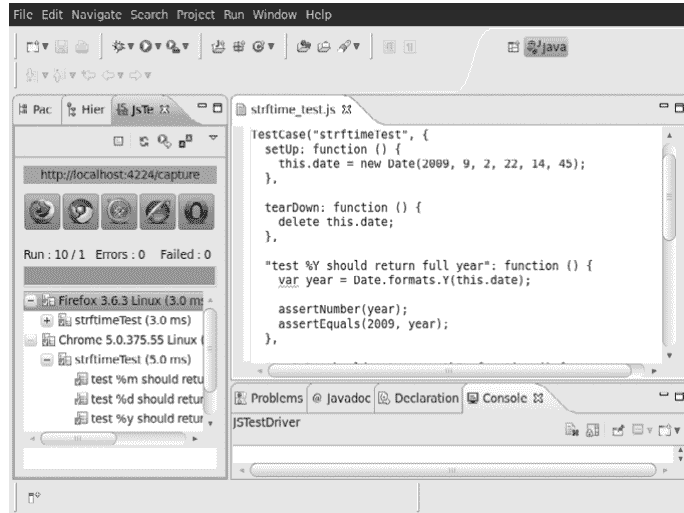

# 测试驱动的 JavaScript 开发


**采买编辑** Trina MacDonald  
**开发编辑** 邱松林  
**执行编辑** John Fuller  
**项目编辑** Madhuri Barnard, Glyph International  
**项目协调** Elizabeth Ryan  
**文字编辑** Mike Read  
**索引员** Robert Swann  
**校对** David Daniels  
**技术作家** Andrea Giammarchi, Joshua Seidel  
**封面设计** Gary Alexander  
**作曲** Glyph International

献给 Frøydis 和 Kristin，我的特别女性们。

本页故意留白

## 第一部分 测试驱动开发

### 2. 测试驱动开发流程 21

#### 流程 23

### 3. 工具箱 33

#### 3.4 统领一切 42

## 第二部分 面向程序员的 JavaScript

### 5. 函数 73

### 6. 应用函数与闭包 93

### 7. 对象与原型继承 117

## Part II 面向程序员的 JavaScript

## 8. ECMAScript 第五版 159

## 9. 非侵入式 JavaScript (Unobtrusive JavaScript) 177

## 10. 特性检测 (Feature Detection) 197

# 第三部分 JavaScript 中的实战化测试驱动开发 217

## 13. 使用 Ajax 和 Comet 流传输数据 293

## 14. 使用 Node.js 开发服务器 341

## 15. TDD 与 DOM 操作：聊天客户端 389

JavaScript 是 Brendan Eich 在 1995 年为 Netscape 设计的语言名称。从那时起出现了许多替代实现，[1](#user-content-1)

## 前言

……已经面世，该语言已由 ECMA 国际标准化为 ECMA-262，也称为 ECMAScript。尽管其他实现方案有自己的名称，例如微软的 JScript，但它们通常被统称为“JavaScript”，我在本书中也将按照这一含义来使用 JavaScript。

在全文中，将使用等宽字体来指代对象、函数和短代码段。

## 谁应该读这本书

这本书是为程序员准备的——特别是那些编写或有兴趣编写 JavaScript 的人。无论你是一个主要关注 Ruby on Rails 的 Ruby 开发者；一个从事 Web 应用程序开发的 Java 或 .Net 开发者；一个主要工具是 JavaScript、CSS 和 HTML 的前端开发者；甚至是一个一个 JavaScript 经验有限的后端开发者，我都希望你能够发现这本书很有帮助。

本书旨在 Web 应用程序开发者，他们需要更牢固地掌握 JavaScript 语言的细节之处，并更好地理解如何在编写缺陷更少的易维护应用程序时，提高你的工作效率和信心。

## 本书所需的技能

读者不需要具备任何关于单元测试或测试驱动开发（TDD）的先验知识。自动化测试贯穿全书，阅读本书将使你对如何成功使用它们有深刻的理解。

准确地说，读者不需要是 JavaScript 专家，甚至不需要是中级水平。我的希望是这本书对 JavaScript 经验非常有限但精通 JavaScript 的程序员非常有帮助。然而，你需要具备一些编程技能，这意味着为了充分享受这本书，你应该具有某种语言的编程经验，并熟悉 Web 应用程序开发。本书并不是任何基础编程相关主题（包括 Web 特有主题）的入门教程。

本书的第二部分侧重于 JavaScript 语言，专门关注 JavaScript 与与众区别的特性，因此不能期望它是该语言的完整介绍。预计你能够通过使用这些特性的示例，学习本部分未涵盖的语法和概念。

特别地，第二部分关注 JavaScript 的函数和闭包；JavaScript 的对象模型（包括原型继承）；以及代码复用模型。此外，我们将介绍相关的编程实践，例如非侵入式 JavaScript（unobtrusive JavaScript）和特性检测，这两个都是任何面向通用 Web 的人员需要理解的主题。

## 关于网站

本书有一个配套网站：http://tddjs.com。在此处你将找到书中的所有代码列表，以 zip 压缩包和完整的 Git 仓库的形式提供，这将允许你浏览历史并查看代码的演变。Git 仓库对于第三部分的示例项目特别有用，因为其中涉及了大量的重构。浏览 Git 仓库的历史允许你看到每一步操作，即使它们仅仅是修改了现有代码。

你还可以在我的个人网站 http://cjohansen.no 找到我，在那个网站你将找到额外的文章、联系方式等。如果你对本书有任何反馈，我非常乐意听到你的反馈。

## 致谢

许多人的出现才让这本书的成为可能。首先，我想赞扬我在 Addison-Wesley 的编辑 Trina MacDonald，是她让这一切成为可能的人。没有她，就不会有这本书，我深感谢她的主动性，以及在我笨手笨脚地完成我的第一本书时，她提供的持续帮助和动力。

我向参与这本书的团队其他成员表示感谢；感谢 Songlin Qiu（邱松林）让文本变得易于理解且保持一致，并在审阅不断变化的稿件时保持理智。她的见解和建议确实让这本书比我独立所能做到的更好。对于我的技术评审员 Andrea Giammarchi、Jacob Seidelin 和 Joshua Gross 也是如此。他们对细节令人印象深刻的关注、建设性的反馈以及挑战我的意愿帮助澄清了代码、消除了错误，并普遍提升了代码示例和周围文字的质量，以及书籍的结构。最后，同样重要的是，Olivia Basego 帮助处理了与 Addison-Wesley 这样的出版社合作的行政事务，以及在为美国出版社撰稿时居住在挪威的一些挑战。

更贴近生活，我在 Shortcut AS 的雇主和同事们也值得荣誉提及。他们允许我偶尔请假写书的灵活性，以及他们对书的真诚兴趣一直是巨大的动力，并是按时完成稿件的关键。我特别想感谢 Marius Mårnes Mathiesen 和 August Lilleas，与我进行了极具启发性且富有见地的免费讨论，并对早期草稿提供了反馈。

最后，但绝非最后：Frøydis 和 Kristin，这些我的朋友和乐队伙伴，他们给了我空间来完成这个项目并保持了耐心——在长时间的深夜写作后，我变得像僵尸一样疲惫，无法参加各种活动，并且在几个月里通常被锁在厨房桌旁（没错，我是在厨房里写完这本书的）——感谢你们的支持。

最后，我想向整个开源社区表示谢意。没有它，这本书就不会有今天的样子。开源是最终让我开始写作的原因。它让我的博客保持活跃；让我与编辑的道路交汇；现在，它对你手中拿的的这本书负责。如果没有那些坚持不懈地发布顶尖代码供任何人免费审阅、修改和使用的人，书中的大部分代码将无法实现。

我参与的本书制作涉及的所有软件也是开源的。这本书完全是用 Emacs 编写的，并使用了 LaTeX 文档准备系统。工作流中涉及了许多微小的开源工具，其中许多是我操作系统——GNU/Linux 的原生公民。

当这本书面世时，它将带来至少一个开源项目，我希望在未来几年内贡献更多。

## 关于作者

Christian Johansen（克里斯蒂·约翰森）住在挪威奥斯陆，他目前在 Shortcut AS 工作，那是一家专注于开源技术、Web 应用程序和移动应用程序的软件公司。Christian 最初是信息、数学和数字信号处理的学生，他的职业生涯专注于 Web 应用程序和前端技术，如 JavaScript、CSS 和 HTML，这些技术在 HTML 4.01 规范确定时他就一直充满热情。

作为一名顾问，Christian 已与挪威的许多知名公司合作过，包括金融和电信领域的领先公司，他在那里处理过从普通的 CMS 支持的企业网站到自服务应用的各种规模 Web 应用程序。

近年来，Christian 一直是一个热心的博主。源于分享并向提供如此丰富资源的社区做出贡献的愿望，Christian 参与并贡献了一些开源项目。在处理了几个涉及大量 JavaScript 的项目后，Christian 感受到了“牛仔式开发”的痛苦。为了提高代码质量、信心以及更轻松地维护代码的能力，过去几年里，他在工作和业余时间都花了大量时间研究 JavaScript 的单元测试和测试驱动开发。在开发传统的服务端语言时，作为一名 TDD 信徒，JavaScript 的牛仔式方法已经无法满足需求了。这种热情的结晶就是你现在手中的这本书。

## 第一部分

## 测试驱动开发

# 1 自动化测试

作为 Web 开发人员，我们很容易发现自己处于这样状态：在浏览刷新按钮上花费了不健康的时间。你懂这套流程：在文本编辑器中输入一些代码，Alt+Tab 切换到浏览器，按下 F5。清洗、冲洗、重复。这种手动测试既耗时又容易出错，而且不可重复。鉴于我们的 Web 应用程序需要在各种浏览器和平台的组合上运行，手动测试所有内容不可避免地会变成一项无法完成的任务。我们通常只关注少数组合，并对更广泛的范围进行偶尔检查。最终结果就是令人不满意的开发过程，以及可能出现脆弱的解决方案。

多年年来，出现了许多工具来改善我们 Web 开发人员的生活。现在，所有主流浏览器都有开发者工具，有几个 JavaScript 调试器可以选择，甚至还有 IDE 可以发现拼写错误和其他错误。在 Firefox 的 Debug 插件中与应用程序交互，比处理那些烦人的提示要好，但我们仍然受困于手动、易错且耗时的调试过程。

人是懒惰的，程序员更是如此。当流程变慢时，我们需要将手动行为自动化，让我们把时间花在更有意义的事情上。事实上，作为 Web 开发人员，我们的工作更多时候是自动化某些枯燥的任务，以提高业务价值。网上银行就是一个很好的例子——与其去银行、排队并与他人交流将资金从 A 账户转移到 B 账户，我们只需要在舒适的沙发上登录，几分钟就能完成任务。这为我们节省了时间，也为银行节省了时间。

自动化测试为手动测试过程提供了解决方案。我们不需要再次填写该表单并点击提交来查看客户端验证是否按预期触发，而是可以指示软件为我们执行此测试。其优势是显而易见的：获得了一种运行自动化测试的方便方法，只需一次即可在许多浏览器中进行测试；我们可以在以后任何阶段重新运行测试；而且测试甚至可以在某些不需要人工干预的计划上运行。

JavaScript 的自动化软件测试已经存在了一段时间。JSUnit 可以追溯到 2001 年，自 2004 年以来，出现了惊人的工具数量。尽管如此，自动化测试在 JavaScript/Web 开发社区的动力似乎比其他编程社区少。在本章中，我们将研究自动化软件测试的一种手段——单元测试，以及它如何应用于 JavaScript 世界。

# 1 单元测试

单元测试是一段用于测试生产代码的代码。它通过将一个或多个对象设置为已知状态，对它们进行操作（例如，调用方法），然后检查结果，并将其与预期结果进行比较。

单元测试存储在磁盘上，运行简单且快速；如果测试运行困难或缓慢，开发者就不太可能运行它们。单元测试应该孤立地测试软件组件。它们也应该是隔离的——任何测试都不应依赖另一个测试，测试应该能够并行并以任何顺序运行。为了孤立测试组件，有时对其依赖项进行模拟（mock）或存桩（stub）。我们将在第三部分“JavaScript 真实世界测试驱动开发”中讨论模拟和存桩，并在第16 章“模拟与存桩”中进行详细讨论。

将单元测试存储在磁盘上（通常与生产代码一起进行版本控制），意味着我们可以随时运行测试：

- 当实现完成后，验证其正确行为

- 当实现发生变化时，验证其行为是否完好如

- 当系统添加新单元时，验证它是否仍符合预期目的

## 1.1 单元测试

### 1.1.1 单元测试框架

单元测试通常使用单元测试框架编写，尽管这并非严格必要。在本章中，我们将关注单元测试的概念，探讨编写和运行测试的各个方面。我们将对 JavaScript 实际测试框架的讨论推迟到第 3 章“工具箱”。

你可能已经写过不仅仅是几个单元测试了，即使你从未做过任何结构化的单元测试。每当你在浏览器中放置`console`（例如 Firebug、Safari 的检查器或其他工具）来调试或即时运行你的代码时，你可能会发布一些语句并检查相关对象的生成状态。在许多情况下，这就是单元测试，只是它不是自动的，也是不可重复的。我们将通过这类测试的示例，并正式将其熟悉为一种 xUnit 用例。

xUnit 是对某些框架的通称，这些框架要么是 JUnit 的直接移植，要么是基于 JUnit 的思想和概念——或者更准确地说，是基于 SUnit（Smalltalk 测试框架）的思想和概念。极端编程之父 Kent Beck 在这两个框架的创建中都起了不可或缺的作用，甚至 SUnit 都是第一个实现，而 JUnit 在推广该模式方面做出了最大的贡献。

### 1.1.2 用于 JavaScript 日期的 strftime

许多编程语言都提供`strftime`函数或类似的功能。它作用于日期或时间戳，接受一个格式，并产生一个表示该日期的格式化字符串。例如，在 Ruby 中，`strftime`是时间和日期对象上的一个一个方法，列表 1.1 显示了它的用法。

**列表 1.1**

| 格式 | 说明 |
| :--- | :--- |
| %Y | 带世纪的年份 |
| %m | 月份 (01..12) |
| %d | 几号 (01..31) |

示例：`date.strftime("%Y-%m-%d")` -> "2023-10-27"

**列表 1.2**

```javascript
// Implementing strftime
Date.prototype.strftime = function (format) {
  function zeroPad(num) {
    return num < 10 ? "0" + num : num;
  }

  var formats = {
    Y: function (date) { return date.getFullYear(); },
    m: function (date) { return zeroPad(date.getMonth() + 1); },
    d: function (date) { return zeroPad(date.getDate()); },
    y: function (date) { return zeroPad(date.getFullYear() % 100); }
  };

  return format.replace(/([A-Z])/g, function (match, f) {
    if (formats[f]) {
      return formats[f](this);
    }
    return match;
  });
});
```

## 1.1 单元测试

`Date.prototype.strftime` 主要由两个部分组成：负责将占位符替换为对应值的`replace`函数，以及`Date.formats`对象（工具集合）。它可以分解如下：

- `Date.formats`是一个以占位符为键、从日期中提取数据的方法的对象

- 某些占位符是长格式的快捷方式

- `String.prototype.replace`使用了匹配占位符的正则表达式

- 替换函数检查`Date`上是否存在占位符，如果是则使用它，否则保持占位符不变（即直接返回）

我们该如何测试这个方法？一种方法是将脚本包含在 Web 页面中，并在我们需要的地方使用，然后手动验证网站是否正确显示日期。如果不起作用，我们可能无法获得关于原因的任何提示，只能调试。稍微复杂一点的方法（虽然没多少）是将其加载到 Web 页面中，打开控制台并进行尝试。也许像列表 1.3 中的会话一样。

**列表 1.3 在 Firebug 中手动检查代码**

```javascript
>>> var date = new Date(2009, 11, 5);
>>> date.strftime("%y");
"2009"
>>> date.strftime("%m");
"12"
>>> date.strftime("%d");
"05"
>>> date.strftime("%y");
"9"
```

### 列表 1.4 一个 HTML 测试页面

```html
<!DOCTYPE html PUBLIC-//W3C//DTD HTML 4.01//EN"
  "http://www.w3.org/TR/html4/strict.dtd">
<html lang="en">
<head>
  <title>Date.prototype.strftime test</title>
  <meta http-equiv="content-type" content="text/html;charset=utf-8">
</head>
<body>
  <script type="text/javascript" src="../src/strftime.js"></script>
  <script type="text/javascript" src="strftime_test.js"></script>
</body>
</html>
```

我们将控制台会复制到一个新文件中（如列表 1.5 所示），它将作为测试文件。为了记录结果，我们只需使用`console.log`，它在大多数现代浏览器中可用，并输出到浏览器的 JavaScript 控制台。

### 列表 1.5 strftime_test.js

```javascript
var date = new Date(2009, 11, 5);
console.log(date.strftime("%Y"));
console.log(date.strftime("%m"));
console.log(date.strftime("%d"));
console.log(date.strftime("%y"));
console.log(date.strftime("%F"));
```

1. http://tddjs.com


我们有了一个可复现的测试用例。然后我们可以处理失败的情况：`"y"` 没有对其返回的数字进行零填充。事实证明，我们只是忘记将方法调用封装在 `zeroPad()` 调用中了。列表 1.6 显示了更新后的 `Date.formats` 方法。

### 列表 1.6 零填充

```javascript
Date.formats = {
  // ...
  y: function (date) {
    return zeroPad(date.getFullYear() % 100);
  }
  // ...
};
```

## 1.2 断言

现在我们可以在浏览器中立即运行测试文件并检查控制台，以验证修复 `"y"` 格式。简单来说，我们现在编写了一个单元测试。你可能已经在 JavaScript 中多次做过类似的事情。虽然自动化创建测试对象并调用它们的方法看起来很好，但我们仍然需要手动检查哪些调用是正确的，哪些失败了。为了让单元测试真正自动化，它需要自我检查。

单元测试的核心是断言。断言是一个描述程序员预期状态的谓词。在上一节调试损坏的 `"y"` 格式时，我们执行了手动断言：当对 2009 年调用 `strftime` 方法使用 `%y` 格式时，我们期望它返回 `"09"`。如果没有，说明我们的系统没有正常工作。当断言失败时，测试终止并收到失败通知。列表 1.7 显示了一个简单的断言函数。

### 列表 1.7 一个简单的断言函数

```javascript
function assert(message, expr) {
  if (!expr) {
    throw new Error(message);
  }

  assert.count++;

  return true;
}

assert.count = 0;
```

`assert` 函数简单地检查第二个参数是否为真（即除 `false`、`null`、`undefined`、`0`、`""` 和 `NaN` 之外的任何值）。如果是，则增加计数器，否则抛出一个错误。如列表 1.8 所示，我们可以在测试中利用 `assert`。

### 列表 1.8 使用 `assert` 测试

```javascript
var date = new Date(2009, 9, 2);

try {
  assert("%Y should return full year", date.strftime("%Y") === "2009");
  assert("%m should return month", date.strftime("%m") === "10");
  assert("%d should return date", date.strftime("%d") === "02");
  assert("%y should return year as two digits", date.strftime("%y") === "09");
  assert("%F should act as Y-%m-%d", date.strftime("%F") === "2009-10-02");

  console.log(assert.count + " tests OK");
} catch (e) {
  console.log("Test failed: " + e.message);
}
```

这需要更多的输入，但现在测试可以自我说明。手动工作从检查每一个结果减少为只需检查测试报告的状态。

### 列表 1.9 彩色输出消息

```javascript
function output(text, color) {
  var p = document.createElement("p");
  p.innerHTML = text;
  p.style.color = color;
  document.body.appendChild(p);
}

// console.log 现在可以替换为
output(assert.count + " tests OK", "#0c0");
// 以及失败：
output("Test failed: " + e.message, "#c00");
```

## 1.3 测试函数、用例和套件

我们构建的测试包含多个断言，因为 `assert` 函数在测试失败时会抛出错误，我们无法知道随后的测试是失败还是成功。为了获得更细粒度的反馈，我们可以将测试组织成测试函数。每个测试函数应该只练习一个单元，但可以使用一个或多个断言。为了完全控制，我们还可以要求每个测试只测试单个单元的一个特定行为。这意味着每个函数对应许多测试，但它们将很短且易于理解，整个测试将提供需要的反馈。

一组相关的测试函数或方法被称为测试用例。在 `startTime` 函数的情况下，我们可以想象为该方法的测试用例，每个测试通过一个或多个断言测试函数的特定行为。在更复杂的系统中，测试用例通常组织在测试套件（test suites）中。列表 1.10 显示了一个简单的 `TestCase` 函数。

### 列表 1.10 一个简单的 `TestCase` 函数

```javascript
function testCase(name, tests) {
  assert.count = 0;
  var successful = 0;
  var testCount = 0;

  for (var test in tests) {
    if (typeof tests[test] !== "function") {
      continue;
    }
    testCount++;

    try {
      tests[test]();
      output(test, "#0c0");
      successful++;
    } catch (e) {
      output(test + " failed: " + e.message, "#c00");
    }
  }

  var color = successful == testCount ? "#0c0" : "#c00";
  output("<strong>" + testCount + " tests, " + (testCount - successful) + " failures</strong>", color);
}
```

### 1.3.1 `Setup` 和 `Teardown`

xUnit 框架通常提供 `setUp` 和 `tearDown` 方法。它们分别在每个测试方法之前和之后调用，并允许集中设置测试数据，称为测试固件（fixtures）。让我们使用 `setUp` 方法添加数据对象作为测试固件。列表 1.12 显示了增强函数，它检查测试用例是否具有 `setUp` 和 `tearDown`，如果是，则在适当的时间运行它们。

### 列表 1.12 在 `testCase` 中实现 `setUp` 和 `tearDown`

```javascript
function testCase(name, tests) {
  assert.count = 0;
  var successful = 0;
  var testCount = 0;
  var hasSetup = typeof tests.setUp == "function";
  var hasTeardown = typeof tests.tearDown == "function";

  for (var test in tests) {
    if (typeof tests[test] !== "function") {
      continue;
    }
    testCount++;

    try {
      if (hasSetup) {
        tests.setUp();
      }

      tests[test]();
      output(test, "#0c0");

      if (hasTeardown) {
        tests.tearDown();
      }
      successful++;
    } catch (e) {
      output(test + " failed: " + e.message, "#c00");
    }
  }

  var color = successful == testCount ? "#0c0" : "#c00";
  output("<strong>" + testCount + " tests, " + (testCount - successful) + " failures</strong>", color);
}
```

# 14 自动化测试

```javascript
var color = successful == testCount ? "#0c0" : "#c00";
```

```javascript
output("<strong>" + testCount + " tests, " +
(testCount - successful) + " failures</strong>");
```

```javascript
}
```

通过使用 `setUp` 方法，我们可以添加一个对象属性来存储测试固件，如列表 1.13 所示。

### 列表 1.13 测试用例中使用 `setUp`

```javascript
testCase("strftime time", {
  setUp: function () {
    this.date = new Date(2009, 9, 2, 22, 14, 45);
  },
  "test format specifier Y": function () {
    assert("%Y should return full year");
    this.date.strftime("%Y") == 2009;
  },
  // ...

});
```

## 1.4 集成测试

考虑汽车制造商的装配线。单元测试对应于验证汽车的每一个部分：方向盘、轮子、电动窗等。集成测试对应于验证汽车是否作为一个整体正常工作，或者较小的单元组是否按预期运行（例如：当旋转方向盘时轮子会旋转）。集成测试测试的是各个部分的总和。理想情况下，这些部分已经经过了单元测试，并且已知在孤立状态下可以正常工作。

虽然高级集成测试可能需要更强大的工具（如自动化浏览器的软件），但可以使用 xUnit 框架编写许多集成测试。在最简单的形式中，集成测试是执行两个或多个独立组件的测试。事实上，最简单的集成测试与单元测试非常相似，因此往往被误认为单元测试。

在列表 1.6 中，我们通过对 `date.getFullYear()` 的结果进行零填充，修复了 `"y"` 格式说明符。这意味着我们通过修正 `Date.formats.y` 通过了针对 `Date.prototype.strftime()` 的单元测试。如果后者是一个私有或内部辅助函数，它将是 `strftime` 的一个实现细节，那么该函数将是测试行为的正确入口点。然而，由于 `Date.formats.y` 是一个公开的方法，它应该被视为一个独立的单元，这意味着上述测试可能应该直接对其进行测试。为了使这种区别更加清晰，列表 1.14 增加了另一个格式方法 `j`，用于计算给定日期是一年的第几天。

### 列表 1.14 计算一年中的一天

```javascript
Date.formats = {
  // ...
  j: function (date) {
    var jan1 = new Date(date.getFullYear(), 0, 1);
    var diff = date.getTime() - jan1.getTime();

    // 86400000 = 60 * 60 * 24 * 1000
    return Math.ceil(diff / 86400000);
  },
  // ...
};
```

`Date.formats.j` 方法比之前的格式化方法稍微复杂。我们应该如何测试它？编写一个对 `new Date().strftime("%j")` 结果进行断言的测试很难构成对 `Date.formats.j` 的单元测试。事实上，按照之前集成测试的定义，这看起来确实像：我们既测试了 `strftime` 方法，又测试了特定的格式化。更好的方法是先测试格式说明符，然后独立测试 `strftime` 的替换逻辑。

列表 1.15 显示了直接针对旨在测试的方法的测试，避免了“意外的集成测试”。

### 列表 1.15 直接测试格式说明符

```javascript
testCase("strftime test", {
  setup: function () {
    this.date = new Date(2009, 9, 2, 22, 14, 45);
  },

  "test format specifier %Y": function () {
    assert("%Y should return full year",
      Date.formats.Y(this.date) === 2009);
  }
});
```

```javascript
"test format specifier %m": function () {
  assert("m should return month",
  Date.formats.m(this.date) === "10");
}

"test format specifier %d": function () {
  assert("%d should return date",
  Date.formats.d(this.date) === "02");
}

"test format specifier %y": function () {
  assert("%y should return year as two digits",
  Date.formats.y(this.date) === "09");
}

"test format shorthand %F": function () {
  assert("%F should be shortcut for %Y-%m-%d",
  Date.formats.F === "%Y-%m-%d");
}
);
```

## 1.5 单元测试的优势

编写测试是一种投资。对单元测试常见的反对意见是它太浪费时间。当然，测试你的应用程序需要时间，但自动化测试的替代方案通常不是完全避免测试你的应用程序。在缺乏测试的情况下，开发者只能依靠手动测试过程，这种过程效率极低：我们反复地编写相同的测试，除非代码被证明可以工作，否则我们很少对代码进行严谨的测试。

## 1.6 回归测试

有时我们会犯下渗透生产环境的错误。回归测试允许我们在每次更改代码时运行相同的测试来捕获这些错误。在缺乏测试的情况下，开发者只能依靠手动测试过程，这种过程效率极低：我们反复地编写相同的测试，除非代码被证明可以工作，否则我们很少对代码进行严谨的测试。

## 1.7 总结

在重构之前编写测试可以极大降低风险，而且这些相同的测试也可以使跨浏览器测试变得简单得多。

在第 2 章《测试驱动开发流程》中，我们将继续对单元测试的探索。我们将重点关注在本章未讨论的益处：将单元测试作为一种设计工具，以及将单元测试作为编写新代码的首要驱动力。

# 测试驱动开发流程

在第 1 章“自动化测试”中，我们接触了单元测试，并学习了它如何帮助减少缺陷数量、捕获回归错误，并通过减少手动测试和调试代码的需求来提高开发者的效率。在本章中，随着我们深入测试驱动开发，我们的重点将从“测试”转向“规范”。测试驱动开发（TDD）是一种编程技术，它将单元测试推向前线，使其成为生产代码的主要入口。在测试驱动开发中，在编写生产代码之前，先作为规范编写测试。这种做法有很多益处，包括更好的可测试性、更整洁的接口以及增强开发者信心。

## 2.1 测试驱动开发的目标和目的

在书籍《实例测试驱动开发》[3] 中，Kent Beck 指出测试驱动开发的目标是**运行良好的整洁代码**。TDD 是一种迭代开发过程，每次迭代都从编写一个测试开始，该测试构成我们正在实现的规范的一部分。简短的迭代允许我们对正在编写的代码获得更实时的反馈，并且糟糕的设计决策更容易发现。通过在编写任何生产代码之前编写测试，良好的单元测试覆盖率会随之而来，但这仅仅是一个受欢迎的副作用。

### 2.1.1 翻转开发

由于测试的目标不是测试，因此无法保证它能更好地处理边缘情况。但由于每一行代码都通过代表性的样本代码进行测试，TDD 可能会产生更少的过度代码，且涵盖的功能可能更健壮。适当的测试驱动开发确保系统永远不会包含未被执行的代码。

（注：此处原文似乎有一处逻辑断接，“逻辑和边缘情况可能没有经过充分测试，或者根本没有测试。”）测试驱动开发翻转了开发周期。测试驱动开发并不是关注解决问题需要什么代码，而是从定义目标开始。单元测试既构成了支持和已考虑操作的规范，也构成了它们的文档。鉴于此，TDD 的目标不是测试，因此无法保证它能更好地处理边缘情况。然而，因为每一行代码都通过代表性的样本代码进行测试，TDD 可能会产生更少的过度代码，且涵盖的功能可能更健壮。适当的测试驱动开发确保系统永远不会包含未被执行的代码。

### 2.1.2 测试驱动开发中的设计

在测试驱动开发中存在“预置设计”，但不要将其误认为“没有预置设计”。为了编写能够扩展项目时长和生命周期的整洁代码，我们需要一个计划。TDD 不会自动让伟大的设计凭空出现，但它将帮助我们在开发过程中演进设计。通过依赖单元测试，TDD 过程高度关注隔离的单个组件。这对于编写解耦代码、遵循单一责任原则以及避免不必要的膨胀有很大帮助。TDD 对开发过程的严密控制允许许多设计决策推迟到实际需要时。这使得应对变化的需求变得更加容易，因为我们很少设计那些不需要的功能，或者那些像最初预期的那样永远不需要的功能。


测试驱动开发还强迫我们去处理设计。例如，我们首先以单元测试的形式制定一个合理的用例。编写单元测试需要一种心理练习——我们必须描述我们正尝试解决的问题。只有当我们得到结果后，才能开始编写代码。换句话说，`TDD` 要求我们在提供解决方案之前思考结果。一旦我们更熟悉该流程本身，我们将在第 2.4 节“测试驱动开发的益处”中研究我们可以从中获得何种益处。

## 2.2 流程

测试驱动开发过程是一个迭代过程，每次迭代由以下四个步骤组成：

- 编写测试
- 运行测试；观察新测试的失败
- 使测试通过
- 重构以消除冗余

在每次迭代中，`TDD` 是规范。一旦编写了足够的代码使测试通过，我们就可以进行重构以消除冗余。

尽管在进行 `TDD` 时没有所谓的“预置设计”，但我们需要在启动测试之前投入一些设计时间。设计不会凭空出现，在没有任何设计的情况下，你将如何测试？在整本书中，我们将通过示例。单元测试通过提供输入来测试我们的代码以预期的方式运行。在这种意义下，输入不仅仅是函数参数。函数依赖的任何内容，包括全局作用域、某些对象的状态等，都构成了输入。同样，输出是返回值以及全局作用域或周围对象变化的总和。通常输入和输出被分为直接输入和输出，即

### 2.2.1 步骤 1：编写测试

测试驱动开发迭代的第一步是选择要实现的功能，并为其编写单元测试。正如我们在第 1 章“自动化测试”中讨论过的，良好的单元测试应该是简短的，并关注函数的单一行为。编写单一行为测试的一个准则是：为了让测试失败而添加尽可能少的代码。此外，新测试不应重复已经发现的断言。如果一个测试涉及系统的两个或多个方面，说明我们要么添加了比需要更多的代码，要么在测试已经测试过的内容。

注意那些对实现做出假设或陈述的测试。测试应该描述我们正在实现的接口，除非接口本身发生变化，否则不需要更改它们。

假设我们正在实现`String.prototype.trim`方法，这是一个字符串对象可用的方法，用于去除开头和空白空白。该方法的第一个测试可以是断言领先空格已被移除，如列表 2.1 所示。

# 列表 2.1 "String.prototype.trim" 的初始测试

```
testCase("String test", {
  "test should remove leading-space":
  function () {
    assert("should remove leading white-space",
"a string" === "a string".trim());
  }
});
```

严谨地说，我们甚至可以从编写一个测试来确保字符串具有`trim`方法开始。这看起来可能很傻，考虑到我们正在（通过修改全局对象）添加全局方法，存在与第三方代码冲突的可能性，并且从断言`typeof ".trim" == "function"`开始有助于我们在运行测试通过之前发现任何问题。

## 2.2 流程

函数参数和返回值，以及间接输入和输出，即任何未作为参数传递的对象或对外部对象的修改。

### 2.2.2 步骤 2：观察测试失败

一旦测试准备就绪，我们就会运行它。知道它将失败可能会让这个测试显得多余。毕竟，我们专门为了让它失败才编写它，不是吗？在编写通过测试的代码之前运行测试有很多原因。最重要的原因是，它允许我们确认对当前代码状态的理论。在编写测试时，应该对测试将如何失败有一个明确的预期。单元测试也是代码，和其他代码一样，它可能包含 bug。然而，除了包含几行简单的语句外，出现 bug 的概率较低，但仍然会发生。带着对结果的预期运行测试，会大大发现测试本身 bug 的概率。

理想情况下，运行测试应该应该足够快，以便我们在每次添加新测试时都能运行所有测试。这样做更容易发现相互干扰的测试，即一个测试依赖于另一个测试的存在，或者在另一个测试存在时失败。

在编写通过测试的代码之前运行测试也可能让我们对正在编写的代码产生新认识。在某些情况下，我们可能会在还没有编写任何代码之前遇到测试通过的情况。通常情况下，这不应该发生，因为 `TDD` 只指示我们添加预期会失败的测试，但尽管如此，它仍然可能发生。测试通过可能是因为我们为一个由实现隐式支持的需求添加了测试，例如，由于类型强制转换。如果发生这种情况，我们可以移除该测试，或者将其作为一个显式需求保留。。也可能测试通过是因为当前环境已经支持我们正尝试添加的任何内容。如果我们在 Firefox 中运行`String.prototype.trim`方法测试，我们将发现 Firefox（以及其他浏览器）已经支持该方法，这促使我们在方法存在时以保留原生实现的方式来实现该方法。这样的发现是一个很好的候选工作。。现在我们正处于添加`trim`方法的过程中。我们将记录下，一个新需求是在原生实现存在时保留这些实现。

> 1. 事实上，ECMAScript 5（JavaScript 后层规范的最新版本）对`String.prototype.trim`进行了编码，因此我们可以预计在不久的将来它将在所有浏览器中变为可用。

### 2.2.3 步骤 3：使测试通过

一旦我们确认测试失败，并且它是以预期的方式失败的，我们就必须努力让它通过。此时，测试驱动开发指示我们提供可能运行的最简单解决方案。换句话说，我们的唯一目标是通过任何必要手段让测试变绿，有时甚至通过硬编码来实现。无论我们在这一步中提供的解决方案有多多么杂乱，重构和后续步骤最终都会帮助我们解决它。不要害怕硬编码。测试驱动开发过程有一个特定的节奏，尽管目前提供的解决方案并不完美，但能够完成一次迭代的力量不应被低估。通常我们会做一个快速的判断：是否存在一个显而易见的实现方案？如果有，就采用它；如果没有，就编写它，后续步骤将逐渐使实现变得显而易见。延迟真正的解决方案也可以提供洞察，帮助在以后以更好的方式解决问题。

如果一个测试有一个显而易见的解决方案，我们就可以去实现它。但我们必须记住，只添加足够让测试通过的代码，即使我们觉得大局是显而易见的。这些就是我在 2.2 节“流程”中提到的“洞察”，我们应该记录下来并在另一个迭代中添加它们。添加更多代码意味着增加收益，而增加的行为应该由增加的需求来表示。如果一段代码无法得到明确需求的支持，它就只是冗肿，这种冗肿会以代码更难阅读、更难维护和更难保持稳定为代价。

### 2.2.3.1 你不需要

在极端编程（Extreme Programming）——测试驱动开发所源的软件开发方法论中，“你不需要”或 `YAGNI` 是一个原则，即在必要之前我们不应该添加功能 [4]。在假设代码某天会有用处的情况下添加代码，是在代码库中增加冗肿，而没有明确的案例证明其需求。在 JavaScript 这样的动态语言中，面对增加的灵活性，违反这一原则尤其具有诱惑力。我个人犯过的一个 `YAGNI` 违反示例是在是在方法参数上过度灵活。仅仅因为 JavaScript 函数可以接受任意数量和任意类型的参数，并不意味着每个函数都应该考虑任何可能的参数组合。在有测试证明添加的代码有合理用途之前，不要添加它。最理想的情况下，我们可以将此类想法写在待办事项上，并在启动新迭代之前对其进行优先级排序。

### 2.2.3.2 通过 String.prototype.trim 的测试

作为一种可能运行的最简单解决方案的示例，列表 2.2 显示了通过列表 2.1 中测试所需的足够代码。它仅满足原始测试中陈述的情况，将其余需求留给后续的迭代。

#### 列表 2.2 提供 String.prototype.trim 方法

```javascript
String.prototype.trim = function () {
  return this.replace(/^\s+/, "");
};
```

敏锐的读者可能会发现该方法中的几个缺点，包括覆盖了新的实现以及仅修剪左侧空白。一旦我们对过程更有信心，我们可以采取更大的步骤，但在我们编写代码时，这种信心。在踏足未知领域或处理高度不稳定的代码时，小步运行是巨大的福音。

### 2.2.3.3 可能运行的最简单解决方案

如果一个测试有一个显而易见的解决方案，我们就可以继续实现它。但我们必须记住只添加足够让测试通过的代码，即使我们觉得大局是显而易见的。这些就是我在 2.2 节“流程”中提到的“洞察”，我们应该记录下来并在另一个迭代中添加它们。添加更多代码意味着增加收益，而增加的行为应该由增加的需求来表示。如果一段代码无法得到明确需求的支持，它就只是冗肿，这种冗肿会以代码更难阅读、更难维护和更难保持稳定为代价。

### 2.2.3.3 可能运行的最简单解决方案

可能运行的最简单解决方案有时会将值硬编码到生产代码中。在实现并不显而易见的情况下，这种硬化有助于快速推进。换句话说，尽管可能运行的最简单解决方案有时会硬编码值一次、两次甚至三次，但硬编码输入/输出并不代表进展。硬编码可以形成有用的脚手架以快速推进，目标是高效地产生高质量代码，因此泛化是不可避免的。`TDD` 说允许硬编码这一事实让许多不该技术的开发者感到担忧。只要完全理解了该技术，这就不应该令人惊慌。

### 2.2.4 步骤 4：重构以消除冗余

最后一个阶段是编写清洁代码最重要的阶段。当编写了足够通过所有测试的代码时，是时候审查目前的工作并进行必要的调整以消除冗余了。在这个阶段只有一条规则需要遵守：测试应该保持绿色。重构代码时的一些很好的建议是一次只执行一个操作，并确保在每次操作之间测试保持绿色。

冗余可以出现在任何地方。最明显的寻找之处是生产代码中。通常，冗余是帮助我们从编码解决方案中泛化的关键。如果我们通过伪造和硬编码响应开始实现，自然的下一步是添加另一个具有不同输入的测试，它在面对编码响应时失败。如果这没有立即提示我们泛化解决方案，添加另一个硬编码响应会让冗余变得显而易见。硬编码响应可能提供足够的模式来泛化它。

冗余也出现在测试内部，特别是在执行测试所需的对象的设置中，或伪造其依赖项。测试中的冗余并不比生产代码中的更有力。如果测试和系统紧密耦合，我们可以提取辅助方法或进行必要的重构以消除冗余。设置和清理方法可以帮助对象的创建和销毁。测试也是代码，同样需要维护。确保维护它们尽可能廉价和愉快。

有时可以通过重构接口本身来改进设计。这样做通常需要较大的更改，涉及生产代码和测试代码，并且在每个步骤之间运行测试至关重要。只要在整个过程中及时处理冗余，更改接口不应该对你的代码或测试造成太大的骨牌效应。

我们永远不应该在重构阶段留下失败的测试。如果我们无法在不添加更多支持代码的情况下完成重构（例如，我们想将一个方法拆两个，但当前的解决方案没有完全覆盖两个新方法的功能），我们应该考虑推迟，直到运行了足够的迭代以支持所需的功能，然后进行重构。

## 2.2.5 沐皂、冲洗、重复

一旦重构完成，并且没有更多需要移除的重复或需要改进的地方，我们的工作就完成了。从待办列表中选取一个新任务并重复这一过程。根据需要重复多次。随着你对这个过程和代码变得越来越自信，你可能想要迈出更大的步子，但请记住，你需要保持短的周期以获得频繁的反馈。步子跨得太大降低了过程的价值，因为你会遇到我们正试图避免的许多问题，例如追踪 bug 和手动调试。当你结束一天的工作时，留留一个失败的测试，这样你就知道第二天从哪里开始了。

当没有更多测试需要写时，实现也就结束了——它满足了所有的需求。在此时，我们可能想再多写一些测试，这次将侧重于提高测试覆盖率。测试驱动开发本质上会确保每行代码都经过测试，但它并不一定能产生一个强大的测试套件。当所有需求都满足后，我们通常可以编写针对边界情况、更多类型输入的测试，最重要的是，我们可以在新编写的组件与开发过程中模拟（faked）的任何依赖项之间编写集成测试。

到目前，`trim`方法仅被证明可以移除开头的空白。该方法测试驱动开发流程的下一步是测试末尾空白是否被修剪，如列表 2.3 所示。

### 列表 2.3 String.prototype.trim 的第二个测试

```javascript
"test trim should remove trailing white-space":
function () {
  assert("should remove trailing white-space",
    "a string" === "a string".trim());
}
```

现在轮到你了，请继续通过运行测试、修改代码并最后在代码或测试中寻找重构的可能性来完成这一步。

## 2.3 促进测试驱动开发

测试驱动开发最关键的方面是运行测试。测试需要运行得快，而且需要容易运行。如果不是如此，开发者就会开始偶尔跳过运行测试，快速添加一些未测试的功能，并通常会让整个过程变得一团糟。这是最糟糕的情况——在测试驱动开发上投入了额外的时间，但因为没有做得对，我们无法真正信任本该得到的结果，在最坏的情况下，我们最终花费更多时间来写更糟的代码。顺畅地运行测试是关键。

推荐的方法是运行某种形式的自动测试。自动测试可以在每次保存文件时都运行测试。一个微小的离散指示灯可以告诉我们测试是绿色的、正在运行还是红色的。鉴于现在大显示器很常见，你甚至可以为永久的测试输出窗口分配一些屏幕空间。这样一来，即使我们没有主动运行测试，也可以加快这个过程。运行测试更多是环境的工作工作；我们只在结果出来时才需要参与。请记住，当测试失败时，我们仍然需要检查结果。然而，只要测试是绿色的，我们就可以肆情地编写代码。自动测试可以用这种方式来加速重构，在重构中我们并不期望测试失败（除非发生了错误）。我们将在第 3 章“交易工具”中讨论针对 IDE 和命令行的自动测试。

## 2.4 测试驱动开发的益处

在本章引言中，我们提到了测试驱动开发促进的一些益处。在本节中，我们将刷新其中一些，并触及其他几处。

### 2.4.1 可运行的代码

`TDD` 最强大的益处是它能产生运行的代码。基本的逐单元测试覆盖对于确保代码的稳定性大有帮助。可重复的单元测试在 JavaScript 中特别有用，因为我们可能需要在广泛的浏览器/平台组合上测试代码。因为测试在编写时一次只处理一个关注点，所以使用测试套件很容易发现 bug，因为失败的测试将指出代码的哪些部分无法工作。

### 2.4.2 遵循单一职责原则

孤立地描述和开发专门的组件使得编写松耦合且遵循单一职责原则的代码更容易。`TDD` 中的单元测试永远不应该测试组件的依赖项，这意味着它们必须能够被模拟对象（fakes）替换。此外，除了应用程序本身，测试套件还充当了任何代码的额外客户端。服务于两个客户端更容易发现那些仅为单个用例而编写的紧耦合代码。

### 2.4.3 强制进行意识性开发

由于每次迭代都是从编写一个描述特定行为的测试开始，测试驱动开发迫使我们在编写代码之前进行思考。在尝试解决问题之前思考问题会大大增加产生稳健解决方案的概率。通过代表性的用例来描述并开始每个功能，也倾向于保持代码更小。当我们开始编写真实的代码示例时，引入没有人需要的功能的概率就会降低。记住，`YAGNI`（你将需要它）！

### 2.4.4 生产力提升

测试驱动开发对你来说是新的，所有的测试和步骤看起来可能需要大量时间。我不会假装 `TDD` 从一开始就很容易。编写良好的单元测试需要练习。在全书中你将看到许多良好单元测试的示例，如果你通过第三部分“真实世界的 JavaScript 测试驱动开发”中的练习掌握它们，你将获得开启自己的 `TDD` 项目的良好基础。

## 3.1.1 行为驱动开发

行为驱动开发（Behavior-driven development，简称 `BDD`）与 `TDD` 密切。正如第 2 章《测试驱动开发流程》中所述，`TDD` 的核心不在于测试，而在于设计和流程。然而，由于描述该流程时使用的术语，许多开发者从未跳出编写单元测试以验证代码的这一阶段，因此从未体验过将测试作为设计工具所带来的许多优势。`BDD` 试图通过关注改进词汇来缓解这一问题。事实上，词汇可能是 `BDD` 最重要的方面，因为它试图规范化在讨论问题、需求和解决方案时，程序员、业务开发人员、测试人员以及其他参与系统开发人员所使用的词汇。

另一个“双 D”是验收测试驱动开发（Acceptance Test-Driven Development）。在验收 `TDD` 中，开发始于根据共同定义的验收测试，为高级功能编写自动化测试。目标是通过验收测试。为了实现目标，我们可以识别出较小的部分并进行“常规”`TDD`。在 `BDD` 中，这一过程通常围绕用户故事（user stories）展开，用户故事使用项目所有参与人员熟悉的词汇来描述与系统的交互。像 Cucumber 这样的 `BDD` 框架允许用户故事作为可执行测试，这意味着验收测试可以与客户一起编写，从而增加了交付客户最初设想产品的概率。

## 3.1.2 持续集成

持续集成是定期整合所有开发者代码的实践，通常发生在开发者将代码推送到远程控制仓库时。持续集成服务器通常会构建所有源代码并对其运行测试。这一过程确保了即使开发者在孤立的特性单元上工作，每当代码提交到上游仓库时，集成的整体都会被考虑。JavaScript 不需要编译，但定期为应用程序运行整个测试套件有助于尽早发现错误。

JavaScript 的持续集成可以解决开发者无法妥善执行的任务。例如，在各种浏览器和平台组合中运行整个测试套件就是此类任务。使用 `TDD` 的开发者可以将注意力集中在少数具有代表性的浏览器上，而持续集成服务器可以测试更广泛的范围，并通过电子邮件或 `RSS` 向团队报告错误。

## 3.1.3 xUnit 测试框架

此外，JavaScript 的一种常见做法是提供压缩版本（minified）——即删除未使用的空格和注释，可选地对本地标识符进行混淆以占用更少的字节——以便在传输时节省字节。过度激进的代码压缩或错误的文件合并都可能引入 Bug。持续集成服务器可以通过在完整源代码上运行所有测试，以及构建合并和压缩后的发布文件并重新运行测试套件来帮助解决此类问题。

## 3.1.4 异步性质

由于任何 JavaScript 编程任务的异步性质，例如处理`XMLHttpRequest`、动画和其他延迟操作（即任何使用`setTimeout`或`setInterval`的代码），而且浏览器不提供`sleep`函数（因为这会冻结用户界面），许多测试框架都提供了执行异步测试的方法。异步测试是否是一个好主意仍待讨论。第 12 章《抽象浏览器差异：Ajax》对该主题进行了更深入的讨论并提供了一个示例。

## 3.1.5 xUnit 测试框架的特性


第 1 章《自动化测试》已经向我们介绍了 xUnit 测试框架的基本特性：给定一组测试方法，框架提供了一个可以运行这些方法并返回结果的测试运行器（test runner）。创建共享测试具件（fixtures），测试用例可以使用`setUp`和`tearDown`函数，这些函数分别在测试用例中每个单独测试的之前和之后运行。此外，测试框架提供了一组断言（assertions），用于验证被测试系统的状态。到目前为止，我们只使用了`assert`方法，它接受任何值并在值为`false`时抛出异常。大多数框架提供了更多断言，使测试更具表现力。最常用的断言可能是`assertEquals`的版本，用于比较实际结果与预期值。

在评估测试框架时，我们应该评估框架的测试运行器、断言及其依赖项。

## 3.1.4.1 测试运行器

测试运行器是框架中最重要的部分，因为它决定了工作流。例如，大多数测试框架都提供了一个可以在浏览器中运行的 HTML 测试运行器：运行器提示输入要执行的文件的 URL。测试文件是一个 HTML 测试套件，链接到要执行的测试用例。测试在沙盒帧中运行，并在运行期间显示一个绿色进度条。显然，当测试失败时，进度条会变成红色。

### 交易的权衡

覆盖率报告对测试框架至关重要。例如，某些测试框架的覆盖率报告显示执行了多少行代码。

## 3.1.6 依赖项

理想情况下，测试框架应该尽可能少地依赖其他项。依赖越多，出现问题的概率越大。测试框架最糟糕的依赖类型是干扰全局作用域的侵入层。为 Prototype.js 构建的 JsTest 版本不仅添加了许多全局属性，还增强了全局构造函数和对象。在实践中，使用它被证明是徒劳的，原因有二：

- 太容易不小心依赖 Prototype.js，导致测试显示为绿色，但在没有 Prototype.js 的生产环境中测试会失败
- 全局作用范围内冲突风险过高，例如，MooTools 库增加了许多相同的全局属性

## 3.2 浏览器框架

JUnit 框架的原始 JavaScript 版本是 JsUnit，发布于 2001 年。意不意外，它通过许多方式为后续的许多测试框架制定了标准。JsUnit 在浏览器中运行测试：运行器提示输入要执行的文件的 URL。测试文件是一个 HTML 测试套件，链接到要执行的测试用例。测试在沙盒帧中运行，并在运行期间显示一个绿色进度条。显然，当测试失败时，进度条会变成红色。JsUnit 偶尔会有更新，但已很长时间没有重大更新，并开始落后。JsUnit 很好服务了许多开发者（包括我），但现在有更成熟、更新的替代方案。

浏览器内测试框架的一个共同点是它们需要一个 HTML 具件文件来加载测试库（通常是 JavaScript 和 CSS 文件）以及要运行的测试。通常，可以为每个新测试简单地复制具件。HTML 具件还充当了托管单元测试所需的虚拟标记的作用。如果测试不需要此类标记，我们可以通过编写脚本扫描 URL 中的命名库文件和测试文件的参数，并动态加载它们，从而减轻为每个测试维护一个单独 HTML 文件的负担。通过这种方式，我们只需通过修改 URL 查询字符串，就可以从同一个 HTML 具件中运行多个测试用例。具件也可以由服务器端应用程序生成，但请注意你

# 38

# 行业工具

为了保持简单——复杂的测试运行器会大大降低开发者运行测试的概率。

## 3.2.1 YUI Test

今天可用的大多数 JavaScript 库也不例外。来自 Yahoo! 的 YUI Test 3 可以安全地测试任意 JavaScript 代码（即它没有阻塞性的依赖）。用 YUI Test 的话来说，“它不是从任何 xUnit 框架直接移植的，但它继承了 nUnit 和 JUnit 的一些特性”，其中 nUnit 是 xUnit 框架家族的 .NET 实现，用 C# 编写的。YUI Test 是一个功能丰富的成熟测试框架。它支持丰富的断言集、测试套件、一个 Mock 库（从 YUI 3 开始）以及异步测试。

### 3.2.1.1 安装

得益于 YUI 的加载器工具，安装非常简单。为了快速开始，我们可以直接链接到 YUI 服务器上的 YUI 种子文件，并使用`yui.use`获取必要的依赖项。我们将重新回顾第 1 章“自动化测试”中的严格模式示例，以便将 YUI Test 与本章介绍的`TestCase`函数进行比较。列表 3.1 显示了 HTML 固件文件，可以将其保存为`strict_yui_test.html`。

#### 列表 3.1 YUI Test HTML 固件文件

```html
<!DOCTYPE HTML PUBLIC "-//W3C//DTD HTML4.0//EN"
"http://www.w3.org/TR/html4/strict.dtd">
<html>
<head>
  <meta http-equiv="content-type" charset="UTF-8">
  <title>Date.prototype.strftime with YUI</title>
</head>
<body class="yui">
  <div id="testReport"></div>
  <script type="text/javascript" src="http://yui.yahoo.com/3.0.0/build/yui/yui-min.js"></script>
  <script type="text/javascript" src="test.js"></script>
  <script type="text/javascript" src="strict_yui_test.js"></script>
</body>
</html>
```

`same.js`文件包含了第 1 章“自动化测试”中列表 3.2 出的`Date.prototype.strftime`实现，显示了测试用例，将其保存为`same-test.js`。

#### 列表 3.2 Date.prototype.strftime YUI 测试用例

```javascript
YUI({
  combine: true,
  timeout: 10000
}).use("node", "console", function (Y) {
  var assert = Y.Assert;

  var startTimeTestCase = new Y.Test.Case({
    // 测试用例名称 - 如果提供，则生成一个
    name: "Date.prototype.strftime Tests",

    setUp: function () {
      this.date = new Date(2009, 9, 2, 14, 45);
    },

    tearDown: function () {
      delete this.date;
    },

    "test %Y should return full year": function () {
      var year = Date.formats.Y(this.date);

      assert.isNumber(year);
      assert.assertEqual(2009, year);
    },

    "test %m should return year month": function () {
      var month = Date.formats.m(this.date);

      assert.isString(month);
      assert.assertEqual("10", month);
    },

    "test %d should return date": function () {
      assert.assertEqual("02", Date.formats.d(this.date));
    },

    "test %y should return year as two digits": function () {
      assert.assertEqual("09", Date.formats.y(this.date));
    },

    "test F should act as %Y-%m-%d": function () {
      assert.assertEqual("2009-10-02", this.date.strftime("%F"));
    }
  });

  // 创建控制台
  var r = new Y.Console({
    newestOnTop: false,
    style: 'block'
  });

  r.render("#testReport");
  Y.Test.add(startTimeTestCase);
  Y.Test.Runner.run();
});
```

在生产代码中使用 YUI Test 时，应该将所需的源码下载到本地。虽然加载器是快速入门的一种方便方法，但依赖互联网连接运行测试是一个坏习惯，这意味着我们无法在离线时运行测试。

### 3.2.1.2 运行测试

使用 YUI Test 运行测试只需在浏览器（最好是几个浏览器）中加载 HTML 固件并观察控制台中的输出，如图 3.1 所示。

## 3.2.2 其他浏览器内测试框架

在选择浏览器内测试框架时，选项有 QUnit。YUI Test 与 UnitTest 和 QUnit 一起是最受欢迎的选择之一。如提到的，UnitTest 很久没有更新了，我建议你不要在新项目中使用它。QUnit 是由 jQuery 团队开发并使用的测试框架。YUI Test 是一个浏览器内测试框架，但对传统 xUnit 设计的遵循不那么严格。Dojo 和 Prototype.js 库也有它们自己的框架。

人们可能会觉得，市上的测试框架几乎和测试脚本的开发者数量一样多——测试 JavaScript 并没有一个事实上的标准。事实上，事实如此，CommonJS 是一个为了解决这一问题提出的倡议，最初的初衷是标准化服务端 JavaScript，我们将在第 14 章“使用 Node.js 进行服务端 JavaScript”中介绍。

## 3.3 无头测试框架

浏览器内测试框架不适合需要频繁运行并集成到工作流中的测试驱动开发。这些框架的替代方案是无头框架。它们通常从命令行运行，并可以与任何服务端语言交互。

有一些无头测试的解决方案，大多源自 Java 或 Ruby 世界。Java 和 Ruby 社区都有深厚的测试文化，并且可以测试代码

### 3.3.1 Crosscheck

Crosscheck 是无头测试框架之一。它提供了对 Internet Explorer 6 以及 Firefox 1.0 和 1.5 的 Java 仿真。无需说明，Crosscheck 已经落后了，它的浏览器选择可能无法帮助开发 2010 年的应用。

### 3.3.2 Rhino 和 env.js

env.js 是由 jQuery 框架的创始人 John Resig 开发的一个库。它在 Rhino（Mozilla 的 Java JavaScript 实现）之上提供了浏览器（即 BOM）和 DOM API 的实现。使用 envjs 配合 Rhino 意味着我们可以在命令行运行浏览器内测试。

## 3.4 统一切的运行器

框架虽然易用，但在代码实际运行的环境中进行测试时会失败，这降低了它们作为测试工具的实用性。xUnit 测试框架领域一个相当新的成员是 JsTestDriver，它源于 Google。与传统框架相比，JsTestDriver 优先是一个运行器，而且是一个非常聪明的运行器。JsTestDriver 通过允许在真实浏览器中轻松地运行和进行广泛测试，解决了上述问题。

### 3.4.1 JsTestDriver 的工作原理

JsTestDriver 使用一个小型服务器来运行测试。浏览器被运行器捕获，测试通过向服务器发送请求来调度。当每个浏览器运行测试时，结果将被传回客户端并呈现给开发者。这意味着当浏览器处于空闲等待测试状态时，我们可以从命令行、IDE 或任何我们认为方便的地方调度运行。这种方法有许多优势：

- 测试可以在浏览器中运行，而无需与浏览器进行手动交互。
- 测试可以在多台机器的浏览器上运行（包括移动设备），允许构建任意复杂的测试网格。
- 测试运行速度快，因为结果不需要添加到 DOM 并进行渲染，它们可以在任何数量的浏览器中并行运行，浏览器不需要重新加载自上次测试以来未变化的脚本。
- 测试可以使用完整的 DOM，因为文档的任何部分都没有预留给测试运行器显示结果。
- 不需要 HTML 固件（fixture），只需提供一个或多个测试脚本，运行器就会动态创建一个空白文档。

JsTestDriver 的测试非常快。测试运行器可以在一秒内运行包含数百个测试的复杂测试。由于测试是同时运行的，即使在同时测试 15 个浏览器时，测试仍会在一秒左右完成。诚然，与服务器通信以及可选的刷新浏览器缓存需要花费一些时间，但一次完整运行仍可在几秒钟内完成。单个测试用例通常在眨眼之间完成。

由于更快的测试、更简单的设置和完整的 DOM 灵活性还不够用，JsTestDriver 还提供了一个计算测试覆盖率的插件，输出与 JUnit 报告兼容的 XML 测试报告，这意味着我们可以立即使用任何持续集成服务器，并且它可以使用替代的断言框架。通过插件，任何其他 JavaScript 测试框架都可以利用 JsTestDriver 测试运行器，在编写本文时，QUnit 和 YUI Test 的适配器已经存在。这意味着可以使用 YUI Test 的断言和语法编写测试，并使用 JsTestDriver 运行。

### 3.4.2 JsTestDriver 的缺点

在编写本文时，JsTestDriver 不支持任何形式的异步测试。正如我们在第 12 章“抽象浏览器差异：Ajax”中看到的，这从单元测试的角度来看并不是一个问题，但它可能会限制集成测试的选择，在集成测试中，我们希望尽可能少地模拟。未来 JsTestDriver 的版本可能会增加异步测试的支持。

JsTestDriver 的另一个缺点是运行测试所需的 JavaScript 稍微高级，可能会在旧版浏览器中产生问题。根据设计，运行 JsTestDriver 的浏览器不支持`XMLHttpRequest`请求对象或类似对象（例如 Internet Explorer 的 ActiveX 对象）来与服务器通信。这意味着不支持此对象的浏览器（旧浏览器、禁用了 ActiveX 的 v7 之前的 Internet Explorer）无法使用 JsTestDriver 运行器进行测试。这个问题可以通过使用 YUI Test 编写测试来有效规避，留下在不配合的浏览器中使用默认测试运行器手动运行的选项。

### 3.4.3 安装

安装和设置 JsTestDriver 比平均的浏览器内测试框架稍微复杂一些；尽管如此，它只需要几分钟。此外，设置只需要一次。此后启动任何项目运行起来都非常简单。JsTestDriver 需要 Java 来运行服务器组件并启动测试。我不会提供具体指令，但大多数系统已经安装了 Java。你可以通过打开 shell 并执行`java -version`命令来检查是否安装了 Java。如果你没有安装 Java，你可以在 java.com 上找到说明。

#### 3.4.3.1 下载 Jar 文件

一旦设置好 Java，从 http://code.google.com/p/js-test-driver/downloads/list 下载最新的 JsTestDriver jar 文件。书中的所有示例都使用 1.2.1 版本，请确保在跟随示例时使用该版本。jar 文件可以放置在系统的任何位置，我建议放在`~/bin`。为了方便运行，设置一个指向此目录的环境变量，如列表 3.3 所示。

```
export JSTDRIVER_HOME=~/bin
```

在登录脚本中设置环境变量，例如 .bashrc 或 .zshrc（取决于 shell——大多数情况下默认使用 Bash，即 ~/.bashrc）。

#### 3.4.3.2 Windows 用户

Windows 用户可以在 cmd 命令行通过执行`set JSTDRIVER-HOME=C:\bin`来永久设置；右键点击“我的电脑”（Windows 7 中的“计算机”）并选择“属性”。在系统窗口中，选择“高级系统”，然后点击“高级”选项卡，然后点击“环境变量...”按钮。决定为单个用户还是所有用户设置环境变量。点击“新建”，在上方框中输入名称（JSTDRIVER-HOME），然后在下方框中输入保存 jar 文件的路径。

#### 3.4.3.3 启动服务器

端口 4224 是事实上的 JsTestDriver 标准端口，但它是任意选择的，你可以在任何端口上运行它。一旦服务器运行，运行它的 shell 必须根据你的需要保持打开。打开 shell 并执行启动服务器的命令。

#### 3.4.3.4 捕获浏览器

打开任何浏览器并指向 http://localhost:4224（确保在启动服务器时使用了另一个端口）。生成的页面将显示两个链接：Capture browser（捕获浏览器）和 Capture in strict mode（严格模式下捕获）。JsTestDriver 在 HTML 4 文档内部运行测试，这两个链接允许我们决定是否用过渡或严格的 doctype 运行测试。点击相应的链接并保持浏览器打开。在许多浏览器或使用虚拟实例的其他平台上重复此操作。

#### 3.4.3.5 运行测试

测试可以从命令行运行，提供与任何服务器端语言测试框架相同的反馈。随着测试运行，每个通过的测试将显示一个点，每个失败的测试显示一个 F，错误的测试显示一个 E。错误是指任何非断言失败的测试错误，即意外异常。

### 列表 3.7 确保某些文件优先加载


```yaml
server: http://localhost:4224

load:
  - src/mylib.js
  - src/*.js
  - test/*.js
```

为了测试该配置，我们需要一个示例项目。我们将再次回顾 `datetime` 示例，因此首先将 `datetime` 文件复制到 `src` 目录。然后将列表 3.8 中的测试用例添加到 `test/strftime-test.js` 中。

### 列表 3.8 使用 JsTestDriver 的 `Date.prototype.strftime` 单元测试

```javascript
TestCase("strftimeTest", {
  setUp: function () {
    this.date = new Date(2009, 9, 22, 14, 45);
  },

  tearDown: function () {
    delete this.date;
  },

  "test %y should return full year": function () {
    var year = Date.formats.Y(this.date);

    assertNumber(year);
    assertEquals(2009, year);
  },

  "test %m should return month": function () {
    var month = Date.formats.m(this.date);

    assertString(month);
    assertEquals("10", month);
  },

  "test %d should return date": function () {
    assertEquals("02", Date.formats.d(this.date));
  },

  "test %y should return year as two digits": function () {
    assertEquals("09", Date.formats.y(this.date));
  },

  "test %F should act as %Y-%m-%d": function () {
    assertEquals("2009-10-02", this.date.strftime("%F"));
  }
));
```

这些测试方法在语法上与 YUI Test 示例几乎相同，但注意此测试用例具有更少的脚架代码来支持测试运行。现在，如列表 3.9 所示创建配置文件。

### 列表 3.9 JsTestDriver 配置

```yaml
server: http://localhost:4224
```

- `src/*.js`
- `test/*.js`

我们可以通过执行列表 3.10 或列表 3.11 中的命令来调度测试，取决于您的操作系统。

### 列表 3.10 在 Linux 和 OSX 上使用 JsTestDriver 运行

```bash
java -jar $JSTESTDRIVER_HOME/JsTestDriver-1.2.1.jar --tests all
```

### 列表 3.11 在 Windows 上使用 JsTestDriver 测试

```bash
java -jar $JSTESTDRIVER_HOME\JsTestDriver-1.2.1.jar --tests all
```

默认配置文件名为 `jsTestDriver.conf`，只要使用它，我们就不需要进行指定。当使用其他名称时，添加 `--config path/to/file`。

运行测试时，JsTestDriver 会强制浏览器刷新。然而，在测试运行之间源文件不会重新加载，这可能会由于文件过期导致错误。我们可以通过添加 `--reset` 选项告诉 JsTestDriver 重新加载所有内容。

### 3.4.3 JsTestDriver 与 TDD

进行 TDD 时，测试会频繁失败，能够快速验证我们是否获得了预期的失败至关重要。由于几个原因，Internet Explorer 等浏览器并不适合这一过程。

首先，它的信息没那么有用；你可能看到“Object does not support this property or method”的次数远比你想的要多得多。第二个原因是 IE 在旧版本中对脚本的处理很糟糕。在 IE 中运行 TDD 会话会导致它频繁卡死，要求你手动刷新。更不用说 IE 的性能缺失了，与例如 Google Chrome 相比，这一点非常明显。

关于 Internet Explorer，我仍然建议不要在主要的 TDD 过程中保留许多浏览器，因为这样做会使测试运行器的报告变得杂乱，为每个捕获的浏览器重复错误和日志消息。我的建议是开发一个只捕获你选择的浏览器的服务器，如果你觉得大胆，可以根据需要针对许多浏览器运行测试——在完成每个测试后，添加的代码越多，发现任何潜入的 bug 就越困难。

为了方便这种开发，最好使用来自配置文件选项的 `--server` 命令行参数。我个人针对 Firefox 进行这种开发，它速度相当快，具有良好的错误信息，并且始终在我的电脑上运行。一旦我通过了测试，我就会在捕获了各种新旧浏览器的远程服务器上运行。

### 3.4.4 从 IDE 使用 JsTestDriver

JsTestDriver 也有针对集成开发环境（IDE）的插件，例如 Eclipse 和 IntelliJ IDEA。这是我将介绍的内容：设置 Eclipse 插件并使用它来支持测试驱动开发过程。如果你不感兴趣在 Eclipse（或 Aptana）中开发，请随时跳到第 3.4.5 节。

#### 3.4.4.1 在 Eclipse 中安装 JsTestDriver

开始之前，你需要安装 Eclipse（或 Aptana Studio，一个面向 Web 开发者的 IDE）。Eclipse 是一个开源 IDE，可以从 `http://eclipse.org` 下载。

一旦 Eclipse 运行，进入 Help 菜单并选择 Install software。在打开的窗口中，输入以下 URL 作为新的更新站点：

`http://js-test-driver.googlecode.com/svn/update`

Test Driver Eclipse Plugin 现在应该会显示，旁边有一个复选框。勾选它并点击 Next。下一个屏幕是确认要安装的插件。点击 Next，再次 Eclipse 会让你接受条款。勾选相应的单选按钮并点击 Next。这应该完成安装。

插件安装完成后，我们需要配置它。在 Window 菜单（OS X 下）找到 Preferences 窗板。这里应该有一个 Test Driver 的新条目；选择它。至少，我们需要输入 Eclipse 应该运行的端口。使用 `4224` 以遵循示例。你也可以输入本地安装的浏览器路径以方便捕获浏览器，但并非必须。

#### 3.4.4.2 Eclipse 中的 JsTestDriver

接下来，我们需要一个项目。创建一个新项目并输入命令行示例的目录。现在在 Eclipse 中启动 JsTestDriver 面板并点击绿色播放按钮。

一旦服务器运行，会出现浏览器图标（假设你在设置期间配置了它们的路径）。现在右键点击项目中的文件，选择 Run As 和 Run Configurations...。选择 Js Driver test 并点击纸张图标表示“新建配置”。给它命名并选择项目的配置文件。现在点击运行并在 Eclipse 内部查看测试。



图 3.2 在 Eclipse 中运行 JsTestDriver。

后续运行时，只需选择 Run As，然后选择配置名称。更好的是勾选配置提示中的 Run on every save 复选框。这样，每当保存项目文件时，测试都会运行，非常适合测试驱动开发过程。

### 3.4.5 提高命令行生产力

如果命令行是你的选择环境，运行测试的 Java 命令很快就会变得有点累。此外，如果能像 Eclipse 和 IDEA 插件那样，在项目文件更改时自动运行测试就很好。

Jestutil 是一个 Ruby 项目，为 JsDriver 添加了命令行界面。它提供了一个更轻量的运行测试的命令，以及一个在项目文件更改时运行相关测试的 `jsautest` 命令。

### 工具箱

- `assertNotNull(msg, value)`
- `assertUndefined(msg, value)`
- `assertNotUndefined(msg, value)`
- `assertNaN(msg, number)`
- `assertNaN(msg, number)`
- `assertException(msg, callback, type)`
- `assertNoException(msg, callback)`
- `assertArray(msg, arrayLike)`
- `assertTypeOf(msg, type, object)`
- `assertBoolean(msg, value)`
- `assertFunction(msg, value)`
- `assertNumber(msg, value)`
- `assertObject(msg, value)`
- `assertString(msg, value)`
- `assertMatch(msg, pattern, string)`
- `assertNoMatch(msg, pattern, string)`
- `assertTagName(msg, tagName, element)`
- `assertClassName(msg, className, element)`
- `assertElementId(msg, id, element)`
- `assertInstanceOf(msg, constructor, object)`
- `assertNotInstanceOf(msg, constructor, object)`

在本书中的大多数示例将使用 JsTestDriver。

## 3.5 总结

在本章中，我们查看了哪些工具有助于支持测试驱动开发过程，以及一些可用的工具。获得良好的测试驱动开发节奏需要充分的工具，对于本书剩余的示例，选择了 JsTestDriver 来运行测试。它既提供了一个高效的工作流，又能够对各种平台和浏览器组合进行彻底的测试。

本章还简要提到了 BDD（行为驱动开发）和“规范”（specs），以及本书中所实践的测试驱动开发与它们有许多共同之处。

来自 Semogabook.Com 资源库

## 3.5 总结

尽管我们在本章中涉及了测试覆盖报告和持续集成的主题，但没有为这些工具提供设置或示例。在本书网站上，你将找到运行 JsTestDriver 的 Coverage 插件的指南，以及如何在开源持续集成服务器 Hudson 中运行 JsTestDriver 测试的指南。

在下一章中，在我们进入第二部分——“用于编程的 JavaScript”之前，我们将介绍一些利用单元测试的其他方法。

> 1. `http://tddjs.com`

# 通过测试来学习

在前三个章节中，我们已经看到自动化测试如何帮助提高代码质量、引导设计并驱动开发。在本章中，我们将使用自动化测试来学习。作为微型的可执行代码示例，单元测试是完美的学习资源。在单元测试中隔离接口的特定方面是学习更多其行为的极佳方法。其他类型的自动化测试可以帮助我们理解语言和特定问题。基准测试（Benchmarks）是衡量相对性能的宝贵工具，并指导如何解决特定问题的决策。

## 4.1 使用单元测试探索 JavaScript

快速执行 JavaScript（例如执行几行脚本来探索某些对象的行为）是非常简单的。大多数现代浏览器都带有一个可以很好胜任此目的的控制台。此外，当浏览器环境不是特别感兴趣时，还有几种 JavaScript 命令行界面。

虽然这种一次性的编码会议可以帮助我们理解接口，但它面临着与手动应用程序测试相同的问题。没有办法重复给定的实验，没有之前运行过的实验的记录，也没有简单的方法在多个浏览器中重复实验。

在第一章“自动化测试”中，我们引入了单元测试作为解决手动测试带来问题的手段。当然，当我们只想通过探索接口来学习时，单元测试同样可以帮助我们解决相同的问题。为此，我们可以编写“学习测试”，即以学习为目标编写的单元测试，而不是为了测试测试被调用的接口本身。

例如，让我们来研究一下内置的 `Array.prototype.splice` 方法。该方法接受两个或多个参数：一个起始索引、要删除的项目数量，以及要插入数组的可选元素。我们好奇此方法是否会改变原始数组。

我们可以查找答案，或者像列表 4.1 所示，只需添加 JavaScript 来告诉我们。要运行测试，请像第三章“工具箱”所示设置 JsTestDriver，设置一个测试目录并将测试保存在该目录下的文件中。添加一个加载 `test/*.js` 的配置。

### 列表 4.1 预期 `Array.prototype.splice` 会修改数组

```javascript
TestCase("ArrayTest", {
  "test array splice should not modify array": function () {
    var arr = [1, 2, 3, 4, 5];
    var result = arr.splice(2, 3);

    assertEquals([1, 2, 3, 4, 5], arr);
  }
});
```

由于我们并不真正知道答案是什么，我们按照 `splice` 方法是非破坏性的假设。注意这与传统的单元测试的对比——在测试生产代码时，我们应该基于结果的坚固预期编写断言。

然而，我们现在正在通过观察实现能告诉我们什么来学习，我们在运行测试之前假设的任何答案都会证明我们是错误的（“预期 [1, 2, 3, 4, 5] 但实际为 [1, 2]。”）。所以我们学了一些东西。为了记录我们的发现，列表 4.2 更新了测试以说明我们现在知道的实情。

### 列表 4.2 `Array.prototype.splice` 修改了接收数组

```javascript
TestCase("ArrayTest", {
  "test array splice should modify array": function () {
    var arr = [1, 2, 3, 4, 5];
    var result = arr.splice(2, 3);

    assertEquals([1, 2], arr);
  }
});
```

（注：由于原文文本存在大量重复和混乱的 OCR 内容，译文已根据核心逻辑进行了整理和翻译。）

## 4.1 使用单元测试探索 JavaScript

字符在浏览器中会失败，这可能导致我们认为 `\s` 字符类并不用于匹配正在测试的特定字符。

### 4.1.2 学习测试的最佳切入点

尽管我们应该对“观察法编程”保持良性的怀疑态度，但学习测试可以是一个非常有用的工具，帮助我们理解 JavaScript 语言及其运行环境。在本节中，我们将介绍几个案例，展示学习测试如何帮助更高效地加速和维持对语言的学习与掌握。

#### 4.1.2.1 捕获实战中的智慧

学习测试是捕捉在阅读他人代码、文章或书籍时汲得的某些智慧的完美工具。这可能不是完全全新的东西；它可能只是一个简单的技巧。

将其写成一个测试有几点益处：首先，它迫使我们实际编写代码，帮助我们记住所学到的任何内容。其次，在测试中隔离代码让我们能够更轻松地玩弄它并在多个浏览器中运行。这意味着我们可以多次复制并修改它，通过调整它来学习更多。

一如既往，将该测试与其他学习测试放在一起，可以提供供日后回顾的文档。

#### 4.1.2.2 探索奇异行为

在开发生产代码时，我们偶尔会遇到 bug 或意想不到的行为。未能从这些经历中汲取必要的教训将使我们面临重复错误的风险：学习测试中 bug 的本质可以帮助我们在情况出现时察觉它们；帮助我们在它们形成时就发现它们，而不是在它们导致代码出现 bug 时才发现。

#### 4.1.2.3 探索新浏览器

维护一套学习测试可以启动对新发布浏览器的探索。该浏览器是否改变了我们依赖的某些行为？它是否修复了我们正在绕过的某些 bug？

我不是说我们应该为 ECMA-262、DOM 和其他接口手动维护全面的测试集，在新发布的浏览器中运行学习测试意味着我们可以检查积累的经验是否适用，而且它可能会立即教我们一些新知识。

#### 4.1.2.4 探索框架

第三方接口（如“Ajax 库”）是几个学习测试的绝佳目标。学习测试提供了一个玩库的中立平台，让我们以比直接将框架引入应用程序中更自由的形式来尝试接口。

事实上，对给定的框架进行一些实验甚至可以影响是否在应用程序中使用它的决策。许多库最初极具吸引力，但在实践中无法达到预期。在沙箱环境中练习它们允许我们对使用它们有更好的感觉，我们可以自由地让它们通过重重考验，我们知道在引入真实的生产环境时，它们需要处理这些考验。

再次，在结构化文件而非控制台环境中进行这种实验意味着我们可以在任何时候引用它们，也许是为了比较一组经过测试的库。

## 4.2 性能测试

另一种可以教我们很多自动化测试类型是测试相对性能的基准测试（benchmarks）。大多数问题可以用许多方式解决，有时并不明显哪种方案是最好的。

例如，正如我们在第 7 章“对象与原型继承”中看到的，创建 JavaScript 对象有不同的方法，主要是使用 JavaScript 构造函数的伪类方法，以及使用闭包的函数式方法。我们该如何选择采用哪种策略？

个人偏好通常在这种选择中起作用，可测试性、灵活性和性能也是如此。取决于用例，性能方面可能变得非常重要。

### 4.2.1 基准测试与相对性能

每当我们有两种或两种以上解决给定问题的方法时，基准测试就可以指示一种相对于替代方案的性能；因此称为“相对性能”。

基准测试是一个非常简单的概念：

- 创建一个新的 `Date()`。
- 执行待测的替代代码。
- 创建一个新的 `Date()`；减去开始时间以找到总耗时。
- 对所有替代方案重复此操作。
- 比较结果。


执行待测的替代代码通常需要在循环中执行多次，以提高测量的准确性。此外，Windows XP 和 Windows Vista 加剧了这个问题，因为它们为浏览器提供了每 15ms 更新一次的计时器。这意味着快速运行的测试可能非常不准确，最佳方法是运行至少 500ms 左右。

列表 4.5 显示了一个我们将用于运行基准测试以衡量相对性能的函数。将其保存为`lib/benchmark.js`。

### 列表 4.5 一个基准测试运行器

```javascript
var ol;

function runBenchmark(name, test) {
  if (!ol) {
    ol = document.createElement("ol");
    document.body.appendChild(ol);
  }

  setTimeout(function () {
    var start = new Date().getTime();
    test();
    var total = new Date().getTime() - start;

    var li = document.createElement("li");
    li.innerHTML = name + ": " + total + "ms";
    ol.appendChild(li);
  }, 15);
}
```

列表 4.6 使用此函数衡量不同循环风格的相对性能。将文件保存为`benchmarks/loops.js`。

### 列表 4.6 循环基准测试

```javascript
var loopLength = 500000;

// 填充数组以循环
var array = [];

for (var i = 0; i < loopLength; i++) {
  // ... logic ...
}

// 学习测试
function forLoop() {
  for (var i = 0; i < array.length; i++) {
    item = array[i];
  }
}

function forCached() {
  for (var i = 0, l = array.length; i < l; i++) {
    item = array[i];
  }
}

function forDirectAccess() {
  for (var i = 0; i < array.length; i++) {
    item = array[i];
  }
}

function whileLoop() {
  var i = 0;
  while (i < array.length) {
    item = array[i];
    i++;
  }
}

function whileCached() {
  var i = 0, l = array.length;
  while (i < l) {
    item = array[i];
    i++;
  }
}

function reversedWhileLoop() {
  var l = array.length;
  while (l--) {
    item = array[l];
  }
}

function doubleReWhileLoop() {
  var l = array.length, i = 1;
  while (i--) {
    item = array[l - 1];
  }
}
```

## 4.2 性能测试

```javascript
// 运行测试
runBenchmark("for-loop", forLoop);
runBenchmark("for-loop, cached", forCached);
runBenchmark("for-loop, direct access", forDirectAccess);
runBenchmark("while-loop", whileLoop);
runBenchmark("while-loop, cached", whileCached);
runBenchmark("reversed while-loop", reversedWhileLoop);
runBenchmark("double reversed while-loop", doubleReWhileLoop);
```

`setTimeout`调用对于避免测试期间阻塞浏览器非常重要。浏览器使用单线程运行 JavaScript、触发事件并渲染网页，而计时器允许浏览器在潜在的长测试之间留出“喘空间”。通过计时器中断工作负载也可以避免中断测试警告我们“脚本缓慢”。要运行这些基准测试，我们需要一个简单的 HTML 文件，如列表 4.7 中的文件，来加载脚本。将文件保存为`benchmarks/loops.html`。

## 列表 4.7 YUI HTML 修复文件

```html
<!DOCTYPE HTML PUBLIC "-//W3C//DTD HTML 4.01//EN"
"http://www.w3.org/TR/html4/strict.dtd">
<html>
<head>
<title>Relative performance of loops</title>
<meta http-equiv="content=text/html; charset=UTF-8">
</head>
<body>
<h1>Relative performance of loops</h1>
<script type="text/javascript" src="../lib/benchmark.js"></script>
<script type="text/javascript" src="loops.js"></script>
</body>
</html>
```

所有的测试执行的操作完全相同：遍历数组中的所有项并访问当前项。访问当前项增加了测试的足迹，但它允许我们比较在循环中访问当前项的循环。

# 64

# 学习测试

与其余部分进行判断。这并不总是一个安全的选择，因为空字符串、`null`、`0`以及其他假值将终止循环。此外，这种风格的循环在某些浏览器上性能极差，应该被避免。由于所有测试都会访问当前项目，我们可以忽略测试结果波动可能带来的额外开销，这些波动是由于不同的循环样式导致的。那个反向的`while`循环无法直接进行比较，因为它是反向遍历数组的。然而，每当顺序不重要时，它通常是循环数组快的方法，正如运行基准测试所示。

如列表 4.6 所示的基准测试非常容易设置。尽管如此，为了让它们更容易集成到我们的工作流中，我们可以编写一个简单的基准测试函数，消除编写基准测试时所有不必要的技巧。列表 4.8 显示了其中一个函数。该函数接受一个系列测试的标签，然后运行一个对象，其中属性名被用作测试名称，属性值被作为测试。最后一个参数是可选的，用于指示基准测试每个测试应该运行多少次。结果将完整打印出来，以及每个测试的平均时间。

### 列表 4.8 一个简单的基准测试工具

```javascript
var benchmark = (function () {
  function init(name) {
    var heading = document.createElement("h2");
    heading.innerHTML = name;
    document.body.appendChild(heading);
  }

  var ol = document.createElement("ol");
  document.body.appendChild(ol);

  return ol;
}

function runTests(tests, view, iterations) {
  for (var label in tests) {
    if (!tests.hasOwnProperty(label) ||
      typeof tests[label] !== "function") {
      continue;
    }
  }

  (function (name, test) {
    setTimeout(function () {
      var start = new Date().getTime();
      var l = iterations;

      while (l--) {
        test();
      }
      var total = new Date().getTime() - start;

      var li = document.createElement("li");
      li.innerHTML = name + ": " + total +
        "ms (total)," + (total / iterations) +
        "ms (avg)";
      view.appendChild(li);
    }, 15);
  }(label, tests[label]);
}

function benchmark(name, tests, iterations) {
  iterations = iterations || 1000;
  var view = init(name);
  runTests(tests, view, iterations);
}

return benchmark;
}());
```

## 4.2 性能测试

基准测试函数与我们之前的示例相比有一个明显的不同之处。它将每次迭代都作为一个函数运行。测试被捕获为一个函数，并运行指定的次数。该函数本身会有开销，因此最终结果关于测试耗多长的准确性较低，特别是对于较小的测试函数而言。在很多情况下，这种开销是可以忽略的，因为我们测试的是相对性能。为了避免函数对测试产生过大的偏移，我们可以编写具有足够复杂性的测试。实现此点的另一种方法是利用函数具有`length`属性的特性，该属性可以揭示函数接收多少个参数。如果这个数字为零，我们就进行循环。否则，我们假设测试期望迭代次数作为参数，并简单地调用函数，传递迭代计数。这可以在列表 4.9 中看到。

### 列表 4.9 使用 Function.prototype.length 决定是否循环

```javascript
// Inside runTests
(function (name, test) {
  setTimeout(function () {
    var start = new Date().getTime();
    var l = iterations;

    if (!test.length) {
      while (l--) {
        test();
      }
    } else {
      test(1);
    }
    var total = new Date().getTime() - start;

    var li = document.createElement("li");
    li.innerHTML = name + ": " + total + 
      "ms (total), " + (total / iterations) + 
      "ms (avg)";
    view.appendChild(li);
  }, 15);
  }(label, tests[label]);
```

作为基准测试用法的示例，可以使用它重新格式化循环测试。在这个例子中，循环的长度缩短了，总迭代次数增加了。列表 4.10 显示了重写的测试。为了简洁起见，移除了一些测试。

### 列表 4.10 使用 benchmark

```javascript
var loopLength = 10000;
var array = [];

for (var i = 0; i < loopLength; i++) {
  array[i] = "item" + i;
}

benchmark("Loop performance", {
  "for-loop": function () {
    for (var i = 0; i < array.length; i++) {
      item = array[i];
    }
  },
  "for-loop cached": function () {
    for (var i = 0, l = array.length; i < l; i++) {
      item = array[i];
    }
  },
  "double reversed while-loop": function () {
    var l = array.length, i = loopLength;
    while (i--) {
      item = array[l];
    }
  }
});
```

这种基准测试工具可以扩展以产生更有帮助的报告。高亮最快和最慢的测试是一个非常有用的扩展。列表 4.11 显示了一个可能的解决方案。

### 列表 4.11 测量和高亮极值

```javascript
// Record times
var times;

function runTests(tests, view, iterations) {
  // ...
  function (name, test) {
    setTimeout(function () {
      var start = new Date().getTime();
      var l = iterations;

      while (l--) {
        test();
      }
      var total = new Date().getTime() - start;
      // ...
      times[name] = total;
    }, 15);
  }(label, tests[label]);
}

function highlightExtremes(view) {
  var min = Infinity;
  var max = 0;
  var fastest, slowest;

  for (var label in times) {
    if (!times.hasOwnProperty(label)) {
      continue;
    }

    if (times[label] < min) {
      min = times[label];
      fastest = label;
    }

    if (times[label] > max) {
      max = times[label];
      slowest = label;
    }
  }

  var lis = view.getElementsByTagName("li");
  var fastexp = new RegExp("^" + fastest + ":");
  var slowexp = new RegExp("^" + slowest + ":");

  for (var i = 0; i < lis.length; i++) {
    if (slowexp.test(lis[i].innerHTML)) {
      lis[i].style.color = "#c00";
    }
    if (fastexp.test(lis[i].innerHTML)) {
      lis[i].style.color = "#0c0";
    }
  }
}

// Updated benchmark function
function benchmark(name, tests, iterations) {
  iterations = iterations || 1000;
  var times = {};
  var view = init(name);
  runTests(tests, view, iterations);
  highlightExtremes(view);
}
```

基准测试函数与我们之前的示例相比有一个明显的不同之处。它将每次迭代都作为一个函数运行。测试被捕获为一个函数，并运行指定的次数。该函数本身会有开销，因此最终结果关于测试耗多长的准确性较低，特别是对于较小的测试函数而言。在很多情况下这种开销是可以忽略的，因为我们测试的是相对性能。为了避免函数对测试产生过大的偏移，我们可以编写具有足够复杂性的测试。实现此点的另一种方法是利用函数具有`length`属性的特性，该属性可以揭示函数接收多少个参数。如果这个数字为零，我们就进行循环。否则，我们假设测试期望迭代次数作为参数，并简单地调用函数，传递迭代计数。这可以在列表 4.9 中看到。

## 4.3 总结

在本章中，我们看到单元测试不仅可以用于支持生产代码，还可以帮助我们学习更多 JavaScript。维护一个学习测试套件是记录我们学习的一种极佳方法，并为过去遇到的问题提供方便的参考。在阅读本书期间，我鼓励你尝试一些示例并对其进行玩，以理解正在发生什么。如果你还没有学习测试套件，现在是开始一个的好时机，你可以开始编写测试来加深对书中示例的理解。

基准测试可以在解决给定问题有多种方法时帮助指导决策。通过测量相对性能，我们可以学习模式

这些方法通常表现更好，而且将基准测试与学习测试相结合，可以创建一个强大的个人知识库。

本章结束了对自动化测试的介绍。在第二部分“面向程序员的 JavaScript”中，我们将深入探讨 JavaScript，特别关注该语言与其他编程语言区别开来的方面。这意味着将详细研究对象、构造函数和原型，以及 JavaScript 的作用域和函数。

## 第二部分

## 面向程序员的 JavaScript

本页特意留空

## 5 函数

JavaScript 函数是强大的猛兽。它们是一等类对象，这意味着它们可以被赋值给变量和属性，可以作为参数传递给函数，拥有自己的属性等。JavaScript 还支持匿名函数，它们通常用作其他函数和对象方法的内联回调。


在本章中，我们将涵盖 JavaScript 函数中某种理论性的方面，为我们后续深入研究函数的趣味用法提供所需的背景。我们将在第 6 章“应用函数与闭包”中研究闭包，并在第 7 章“对象与原型继承”中研究作为实现手段的方法和函数。

## 5.1 定义函数

在书的第一部分中，我们已经看到了定义函数的几种方式。在本节中，我们将介绍 JavaScript 允许我们定义函数的不同方式，并研究它们的优缺点以及一些意想不到的浏览器差异。

### 5.1.1 函数声明

定义函数最直接的方法是通过函数定义，如列表 5.1 所示。

#### 列表 5.1 一个函数声明

```javascript
function assert(message, expr) {
  if (!expr) {
    throw new Error(message);
  }
  assert.count++;

  return true;
}

assert.count = 0;
```

这是来自第 1 章“自动化测试”中的 `assert` 函数。函数声明以关键字 `function` 开始，后面跟着一个标识符（在上面的例子是 `assert`）。函数可以定义一个或多个形式参数，即命名参数。最后，函数有一个用括号括起来的体。函数可以返回值。如果没有 `return` 语句，或者有语句但没有表达式，函数将返回 `undefined`。作为一等类对象，函数也可以给它们分配属性，如上例中的 `count` 属性所示。

### 5.1.2 函数表达式

除了函数声明外，JavaScript 还支持函数表达式。函数表达式的结果是一个匿名函数，该函数可以被立即执行、传递给另一个函数、从函数返回，或赋值给变量或对象属性。在函数表达式中，标识符是可选的。列表 5.2 显示了之前的 `assert` 函数如何作为函数表达式实现。

#### 列表 5.2 一个匿名函数表达式

```javascript
var assert = function(message, expr) {
  if (!expr) {
    throw new Error(message);
  }
  assert.count++;

  return true;
}

assert.count = 0;
```

*源自 WoweBook.Com 库*

注意，与函数声明不同，函数表达式——与表达式一样——应该以分号结束。虽然不是严格必须，但自动分号插入可能会导致意想不到的结果，最佳实践要求我们始终自己插入分号。

对 `assert` 函数的这种替代实现方式与之前的略有不同。匿名函数没有名称，因此只能通过参数的 `callee` 或者通过可以通过作用域链访问的 `Function` 变量来引用自己。我们稍后会详细讨论 `arguments` 对象和作用域链。

正如之前提到的，标识符在函数表达式中是可选的。命名函数表达式是否仍然是匿名函数取决于定义，但这些函数对于闭包作用域仍然是匿名。列表 5.3 显示了一个命名函数表达式的示例。我们将在 5.3.6 节“重温函数表达式”中讨论围绕函数表达式的影响和跨浏览器问题。

#### 列表 5.3 一个命名函数表达式

```javascript
var assert = function assert(message, expr) {
  if (!expr) {
    throw new Error(message);
  }

  assert.count++;

  return true;
}

assert.count = 0;
```

### 5.1.3 构造函数

JavaScript 函数是一等类对象，这意味着它们可以拥有自己的属性，包括方法。与任何其他 JavaScript 对象一样，函数拥有原型链；函数继承自 `Function.prototype`，而后者又继承自 `Object.prototype`¹。`Function` 原型对象提供了实用的属性，例如 `call` 和 `apply` 方法。除了由原型定义的属性外，函数对象还有 `length` 和 `prototype` 属性。

> ¹ JavaScript 原型继承的细节将在第 7 章“对象与原型继承”中介绍。

与人们预期的不同，`prototype` 属性并不是函数对象内部原型（即 `Function.prototype`）的引用。相反，它是作为使用该函数作为构造函数创建的任何对象的原型。构造函数将在第 7 章“对象与原型继承”中深入讨论。

函数的 `length` 表明它期望多少个形式参数，有时被称为函数的元数（arity）。列表 5.4 显示了一个示例。

#### 列表 5.4 函数 length 属性

```javascript
TestCase("FunctionTest", {
  "function length property": function () {
    assertEquals(2, assert.length);
    assertEquals(1, assert.length);
  }
});
```

函数的 `length` 表明它期望多少个形式参数，有时被称为函数的元数。列表 5.4 显示了一个示例。

函数的 `length` 表明它期望多少个形式参数，有时被称为函数的元数。可以在无参数的情况下调用，结果为 `undefined`。

## 5.2 调用函数

### 5.2.1 使用 `Function` 创建函数

#### 列表 5.5 通过 `Function` 创建函数

```javascript
var assert = Function("message", "expr",
  if (!expr) {
    throw new Error(message);
  }
  assert.count++; return true);
assert.count = 0;
```

以这种方式创建函数时，我们可以通过多种方式提供形式参数。最直接的方法是每个参数传递一个字符串，如上面的示例。然而我们也可以传递单个逗号分隔的字符串，或者两者的混合，即 `Function("p1,p2,p3", "p4", body)`；当需要动态编译函数体时，构造函数非常有用，例如为运行环境或一组输入值创建函数，从而产生高性能的代码。

### 5.2.2 直接调用函数

JavaScript 提供了两种调用函数的方法——直接使用括号或使用继承自 `Function` 原型的 `call` 和 `apply` 方法间接调用。直接调用正如所预期，如列表 5.6 所示。

#### 列表 5.6 直接调用函数

```javascript
assert("Should be true", typeof assert == "function");
```

调用函数时，JavaScript 不会对参数数量进行检查。你可以向函数传递零个、一个或十个参数，无论它指定了多少个形式参数。任何没有接收实际值的形式参数其值都将定义为 `undefined`。

### 5.2.3 `arguments` 对象

函数的所有参数都可以通过类数组对象 `arguments` 获取。该对象有一个 `length` 属性，表示接收到的参数数量，以及从 0 到 `length-1` 的数字索引，对应调用函数时传递的参数。列表 5.7 显示了 `assert` 函数使用该对象而不是它的形式参数。

#### 列表 5.7 使用 `arguments`

```javascript
function assert(message, expr) {
  if (arguments.length < 2) {
    throw new Error("Provide message and value to test");
  }

  if (!arguments[1]) {
    throw new Error(arguments[0]);
  }

  assert.count++;

  return true;
}

assert.count = 0;
```

这并不是一种使用 `arguments` 的特别方法，但它展示了它的工作原理。通常情况下，只有当形式参数无法解决问题时，才应该使用 `arguments` 对象，因为使用它会带来性能代价。事实上，仅仅引用该对象就会产生一些开销，这表明浏览器会优化不使用它的函数。

`arguments` 对象通过其 `length` 属性和数字索引属性呈现类数组特征；它没有提供数组方法。尽管如此，我们仍然可以通过 `Array.prototype.*` 及其 `call` 或 `apply` 方法在它上使用数组方法。列表 5.8 显示了一个示例，我们创建一个由函数所有第一个参数组成的数组。

#### 列表 5.8 在 `arguments` 中使用数组方法

```javascript
function addToArray() {
  var targetArr = arguments[0];
  var add = Array.prototype.slice.call(arguments, 1);

  return targetArr.concat(add);
}
```

与数组一样，`arguments` 对象上的数字索引实际上只是以数字作为标识符的属性。在 JavaScript 中，对象标识符总是转换为字符串，这解释了列表 5.9 中的代码。

#### 列表 5.9 使用字符串访问属性

```javascript
function addToArray() {
  var targetArr = arguments["0"];
  var add = Array.prototype.slice.call(arguments, 1);

  return targetArr.concat(add);
}
```

某些浏览器（如 Firefox）会优化数组，确实将数字属性标识符视为数字。尽管如此，始终可以通过字符串标识符访问这些属性。

### 5.2.4 形式参数与 `arguments`

`arguments` 对象与形式参数之间存在着动态关系；在列表 5.10 中，修改 `arguments` 对象的属性会导致相应的形式参数发生变化，反之亦然。

#### 列表 5.10 修改 `arguments`

```javascript
TestCase("FormalParametersArgumentsTest", {
  "dynamic relationship": function () {
    function modify(a, b) {
      b = 42;
      arguments[0] = arguments[1];

      return a;
    }

    assertEquals(42, modify(1, 2));
  }
});
```

将形式参数 `b` 设置为 42 会导致 `arguments[1]` 随之更新。将 `arguments[0]` 设置为该值反也会导致更新。这种关系仅存在于实际接收了值的形式参数。列表 5.11 显示了相同的示例，在调用函数时漏掉了第二个参数。

#### 列表 5.11 缺失参数没有动态映射

```javascript
assertUndefined(modify(1));
```

在这个示例中，返回值是 `undefined`，因为在没有给 `b` 传递值时，设置 `b` 不会更新 `arguments[1]`。因此，`arguments[1]` 仍然是 `undefined`，导致 `arguments[0]` 也是 `undefined`。`a` 接收了一个值并仍然与 `arguments` 对象链接，这意味着返回的值是 `undefined`。并不是所有浏览器都按照规范这样做，因此你对上述示例的理解可能会有所不同。

这种关系可能会令人困惑，在某些情况下可能成为神秘 bug 的根源。一个建议是在修改函数参数时要小心，特别是在同时使用形式参数和 `arguments` 对象的函数中。在大多数情况下，定义新变量比篡改形式参数或 `arguments` 要明智得多的策略。由于上述原因，ECMAScript 5（JavaScript 的下一个版本）在严格模式下删除了这一特性。在《ECMAScript 第 5 版》第 8 章中详细讨论了严格模式。


`arguments` 对象通过其 `length` 属性和数字索引属性呈现类数组特征；它没有提供数组方法。尽管如此，我们仍然可以通过 `Array.prototype.*` 及其 `call` 或 `apply` 方法在它上使用数组方法。列表 5.8 显示了一个示例，我们创建一个由函数所有第一个参数组成的数组。

## 列表 5.8 在 arguments 中使用数组方法

```javascript
function addToArray() {
  var targetArr = arguments[0];
  var add = Array.prototype.slice.call(arguments, 1);

  return targetArr.concat(add);
}
```

与数组一样，`arguments` 对象上的数字索引实际上只是以数字作为标识符的属性。在 JavaScript 中，对象标识符总是转换为字符串，这解释了列表 5.9 中的代码。

## 5.2 调用函数

**列表 5.9** 使用字符串访问属性

```javascript
function addToArray() {
  var targetArr = arguments["0"];
  var add = Array.prototype.slice.call(arguments, 1);

  return targetArr.concat(add);
}
```

某些浏览器（如 Firefox）会优化数组，确实将数字属性标识符视为数字。尽管如此，始终可以通过字符串标识符访问这些属性。

### 5.2.2 形式参数与 arguments

`arguments` 对象与形式参数之间存在着动态关系；在列表 5.10 中，修改 `arguments` 对象的属性会导致相应的形式参数发生变化，反之亦然。

**列表 5.10** 修改 arguments

```javascript
TestCase("FormalParametersArgumentsTest", {
  "dynamic relationship": function () {
    function modify(a, b) {
      b = 42;
      arguments[0] = arguments[1];

      return a;
    }

    assertEquals(42, modify(1, 2));
  }
});
```

将形式参数 `b` 设置为 42 会导致 `arguments[1]` 随之更新。将 `arguments[0]` 设置为该值反之也会导致更新。这种关系仅存在于实际接收了值的形式参数。列表 5.11 显示了相同的示例，在调用函数时漏掉了第二个参数。

**列表 5.11** 缺失参数没有动态映射

```javascript
assertUndefined(modify(1));
```

## 函数

在这个示例中，返回值是 `undefined`，因为在没有给 `b` 传递值时，设置 `b` 不会更新 `arguments[1]`。因此，`arguments[1]` 仍然是 `undefined`，导致 `arguments[0]` 也是 `undefined`。`a` 接收了一个值并仍然与 `arguments` 对象链接，这意味着返回的值是 `undefined`。并不是所有浏览器都按照规范这样做，因此你对上述示例的理解可能会有所不同。

这种关系可能会令人困惑，在某些情况下可能会成为神秘 bug 的根源。一个建议是在修改函数参数时要小心，特别是在同时使用形式参数和 `arguments` 对象的函数中。在大多数情况下，定义新变量是比篡改形式参数或 `arguments` 要明智得多的策略。由于上述原因，ECMAScript 5（JavaScript 的下一个版本）在严格模式下删除了这一特性。在《ECMAScript 第 5 版》第 8 章中详细讨论了严格模式。

## 5.3 作用域与执行上下文

除了 `window` 属性（在浏览器中）之外，全局对象可以通过 `this` 在全局作用域访问。列表 5.14 展示了浏览器中 `window` 如何与全局对象对应。

## 列表 5.14 全局对象与 window

```javascript
var global = this;

TestCase("GlobalObject", {
  "test window should be global object": function () {
    assertSame(global, window);
    assertSame(global.window, window);
    assertSame(window.window, window);
  }
});
```

在全局作用域中，全局对象被用作变量对象，这意味着使用 `var` 关键字声明变量会在全局对象上产生相应的属性。换句话说，列表 5.15 中的两次赋值几乎是等价的。

## 列表 5.15 在全局对象上赋值属性

```javascript
var assert = function () { /* ... */ };
this.assert = function () { /* ... */ };
```

这两者并不完全等价，因为变量声明会被提升，而属性赋值不会。

### 5.3.5 作用域链

每当函数被调用时，控制权就会进入一个新的执行上下文。对于函数的递归调用也是如此。正如我们所见，用于标识符解析的激活对象通过作用域链进行，起始于当前执行上下文的激活对象。作用域链的末尾是全局对象。

考虑列表 5.16 中的简单函数。用一个数字调用它将返回一个将数字加到参数上的函数。

## 列表 5.16 返回另一个函数的函数

```javascript
function adder(base) {
  return function (num) {
    return base + num;
  };
}
```

## 列表 5.17 增减函数

```javascript
TestCase("AdderTest",
  "test should add or subtract one from arg": function () {
    var inc = adder(1);
    var dec = adder(-1);

    assertEquals(3, inc(2));
    assertEquals(3, dec(4));
    assertEquals(3, inc(dec(3)));
  }
);
```

`inc` 方法的作用域链开头包含它自己的激活对象。该对象有一个 `name` 属性，对应于形式参数。然而，在该激活对象上找不到 `base` 变量。当 JavaScript 进行标识符解析时，它会沿着作用域链向上寻找，直到找到更多对象。当找不到 `base` 时，会尝试作用域链中的下一个对象。下一个对象是为 `adder` 创建的激活对象，实际上找到了 `base` 属性。如果此处没有该属性，标识符解析将继续在作用域链的下一个对象上进行，在本例中就是全局对象。如果在全局对象上未找到该标识符，则会抛出引用错误（reference error）。

在 `adder` 创建并返回的函数内部，`base` 变量被称为自由变量（free variable），它在 `adder` 函数执行完毕后仍然存在。这种行为被称为闭包（closure），我们将在下一章第 6 章《应用函数与闭包》中深入探讨这一概念。

通过 `Function` 构造函数创建的函数具有不同的作用域规则。无论它们在哪里被创建，这些函数的作用域链中只包含全局对象，即包含作用域不会被添加到它们的作用域链中。这使得 `Function` 构造函数可以用于避免无意的闭包。

## 5.3 重新回顾函数表达式

通过对作用域链有更好的理解，我们可以重新审视函数表达式并更好地理解它们的工作原理。当我们需要有条件地定义函数时，可以使用函数表达式，因为块内部（例如在 `if-else` 语句中）不允许使用函数声明。条件定义函数的常见情况是：通过采用特性检测（feature detection）来定义用于平滑处理浏览器差异的函数。在第 10 章《特性检测》中，我们将深入讨论这一点。示例可以是添加一个修剪字符串的 `trim` 函数。某些浏览器提供了 `String.prototype.trim` 方法，如果它可用，我们希望使用它。列表 5.18 展示了实现此类函数的可能方法。

## 列表 5.18 条件地定义函数

```javascript
var trim;

if (String.prototype.trim) {
  trim = function (str) {
    return str.trim();
  };
} else {
  trim = function (str) {
    return str.replace(/\s+|\s+$/g, "");
  };
}
```

在这种情况下，使用函数声明将根据 ECMAScript 规范构成语法错误。然而，大多数浏览器将运行列表 5.19 中的示例。

## 列表 5.19 条件函数声明

```javascript
// 危险！不要在家里尝试
if (String.prototype.trim) {
  function trim(str) {
    return str.trim();
  }
} else {
  function trim(str) {
    return str.replace(/\s+|\s+$/g, "");
  }
}
```

当发生这种情况时，由于函数提升，我们总是得到第二种实现——函数声明在执行条件语句之前被提升，第二种实现总是覆盖第一个。这种行为的例外出现在 Firefox 中，它实际上允许函数语句（statements）。语法扩展在规范中是合法的，但不应依赖它。

上述函数表达式和函数声明之间的唯一区别是，通过声明创建的函数具有名称。这些名称对于递归调用函数有用，在调试情况下更是如此。

## 列表 5.20 条件地提供方法

```javascript
if (!String.prototype.trim) {
  String.prototype.trim = function () {
    return this.replace(/\s+|\s+$/g, "");
  };
}
```

## 列表 5.21 使用命名函数

```javascript
if (!String.prototype.trim) {
  String.prototype.trim = function trim() {
    return this.replace(/\s+|\s+$/g, "");
  };
}
```

## 列表 5.22 Internet Explorer 中的命名函数表达式

```javascript
if (!String.prototype.trim) {
  String.prototype.trim = function trim() {
    return this.replace(/\s+|\s+$/g, "");
  };
}

// 应该抛出 ReferenceError，IE 中如此
assertFunction(trim);

// 更糟糕的是：IE 创建了两个不同的函数对象
assertNotSame(trim, String.prototype.trim);
```

## 5.4 `this` 关键字

JavaScript 的 `this` 关键字让很多开发者困惑。在大多数面向对象的语言中，`this`（或 `self`）始终指向接收对象。在面向对象的语言中，在方法内部使用 `this` 意味着调用方法的对象。这在 JavaScript 中并非如此，尽管在许多情况下这是默认行为。列表 5.23 中的方法和调用具有这种预期行为。

## 列表 5.23 符合预期的 this 行为

```javascript
var circle = {
  radius: 6,
  diameter: function () {
    return this.radius * 2;
  }
};
```

## 88 Functions

```javascript
TestCase("CircleTest", {
  "test should implicitly bind to object": function () {
    assertEquals(2, circle.diameter());
  }
});
```

`this.radius` 是对 `circle.diameter` 的引用，这不应令人惊讶。列表 5.24 中的示例行为有所不同。

## 列表 5.24 值不再是 circle

```javascript
"test implicit binding to the global object": function () {
  var myDiameter = circle.diameter;

  // WARNING: Never rely on globals
  // This is just an example
  radius = 2;

  assertEquals(4, myDiameter());
}
```

这个示例揭示了调用者决定 `this` 值这一事实。事实上，在之前关于执行的讨论中遗漏了这一细节。除了创建变量对象并添加到作用域链之外，进入执行上下文时还会确定 `this` 值。`this` 可以隐式或显式地提供给方法。

### 5.4.1 隐式设置 this

使用 `()` 调用函数时会隐式设置 `this`；将其作为方法调用时，`this` 会被设置为调用该函数的对象；将其作为函数调用时，`this` 会被设置为全局对象。这是一项非常有用的特性，因为它允许 JavaScript 对象共享函数，同时仍然让函数作用于正确的对象。

例如，为了像之前讨论的那样将数组方法用于 `arguments` 对象，我们可以简单地在该对象上创建一个属性，将其值设置为希望执行的方法，然后通过 `arguments` 执行它，从而隐式设置 `this`。列表 5.25 展示了这样的示例。

## 列表 5.25 将函数作为对象的方法调用

```javascript
function addToArray() {
  var targetArr = arguments[0];
  arguments.slice = Array.prototype.slice;
  var add = arguments.slice(1);

  return targetArr.concat(add);
}
```

调用 `Array` 函数的效果与列表 5.8 中的示例完全相同。ECMAScript 规范明确要求许多内置方法具有通用性，使它们可以与其他具有相应特征的对象一起使用。例如，`arguments` 对象具有 `length` 属性和数字索引，满足 `Array.prototype.slice()` 的要求。

### 5.4.2 显式设置 this


当我们只想控制特定方法调用中的 `this` 值时，最好使用函数的 `call` 或 `apply` 方法显式设置。`Function.prototype.call` 方法会调用一个函数，并将第一个参数作为 `this`。调用函数时，其他参数会传递给该函数。列表 8 中的第一个 `addToArray` 示例使用了这种方法调用 `Array.prototype.slice`，并将参数作为 `this`。在之前的圆形示例中也可以找到另一个例子，如列表 26 所示。

### 列表 26 使用 `call`

```javascript
assertEquals(10, circle.diameter.call({ radius: 5 }));
```

这里，我们传入一个定义了 `radius` 属性的对象字面量，并在调用 `circle.diameter` 时将其作为 `this`。

## 5.4.3 将基本类型用作 `this`

第一个参数可以是任何对象，甚至可以是 `null`。传入 `null` 时，将使用全局对象作为 `this` 值。正如第 8 章“ECMAScript 第 5 版”中所述，这一点即将发生变化——在 ECMAScript 严格模式下，传入 `null` 作为 `this` 值会使其保持为 `null`，而不是全局对象。

当传入字符串或布尔值等基本类型作为 `this` 值时，该值会被包装在一个对象中。这可能会造成问题，例如调用布尔值上的方法时。列表 27 展示了一个使用布尔值作为 `this` 时可能产生意外结果的示例。

### 列表 27 使用布尔值作为 `this` 调用 `prototype.not`

```javascript
Boolean.prototype.not = function () {
  return !this;
};

TestCase("BooleanTest", {
  "test should flip value of true": function () {
    assertFalse(true.not());
    assertFalse(Boolean.prototype.not.call(true));
  },

  "test should flip value of false": function () {
    // Oops! Both fail, false.not() == false
    assertTrue(false.not());
    assertTrue(Boolean.prototype.not.call(false));
  }
});
```

此方法不能按预期工作，因为使用该值作为 `this` 时，基本布尔值会被转换为 `Boolean` 对象。对一个值进行布尔转换时，结果总是 `true`；而对 `true` 使用一元逻辑非运算符，结果出人意料地是 `false`。ECMAScript 5 严格模式也修复了这一问题，在使用某个值作为 `this` 值之前避免对象转换。

`apply` 方法与 `call` 类似，但它只接受两个参数：第一个参数是与 `call` 中相同的值，第二个参数是一个参数数组，用于传递给被调用的函数。第二个参数不必是实际的数组对象；任何类似数组的对象都可以。因此，可以通过将参数作为 `apply` 的第二个参数传递，使用 `apply` 链式调用函数。

例如，可以使用 `apply` 对所有数字求和。

JavaScript 支持嵌套函数，这使闭包能够保存私有状态。嵌套函数可用于从临时作用域到实现记忆化、函数绑定、模块、有状态函数和对象等各种场景。

本章将通过几个示例，介绍如何充分利用 JavaScript 函数和闭包。

## 6.1 绑定函数

将方法作为回调传递时，除非同时传递它应该执行的对象，否则隐式的 `this` 值会丢失。如果不熟悉 `this` 的语义，这可能会令人困惑。

### 6.1.1 丢失 `this`：一个灯箱示例

为了说明这个问题，假设我们有一个“灯箱”对象。灯箱本质上是覆盖在页面上的 HTML 元素，看起来浮动在页面其他内容之上，与弹出窗口类似，只是使用了一个 Web 2.0 风格的名称。在这个示例中，灯箱从 URL 获取内容，并将内容显示在 `div` 元素中。为方便起见，提供了一个 `anchorLightbox` 函数，它可以将锚点元素转换为灯箱。

## 6.1.2 应用函数与闭包

灯箱切换器：当点击锚点时，它链接的页面将加载到位于当前页面上方的 `div` 中。列表 6.1 显示了大致轮廓。

### 列表 6.1 伪代码

```javascript
var lightbox = {
  open: function () {
    ajax.loadFragment(this.url, {
      target: this.create()
    });
    return false;
  },

  close: function () { /* ... */ },
  destroy: function () { /* ... */ },

  create: function () {
    /* 创建或返回容器 */
  }
};
```

```javascript
function anchorLightbox(anchor, options) {
  var lb = Object.create(lightbox);
  lb.url = anchor.href;
  lb.title = anchor.title || anchor.href;
  Object.extend(lb, options);
  anchor.onclick = lb.open;
}
```

```javascript
return lb;
```

这段代码不会按照提供的形式运行；它只是一个概念性示例。`Object.create` 和 `Object.extend` 的细节将在第 7 章“对象与原型继承”中解释；`ajax.loadFragment` 方法可以认为是将 URL 的内容加载到 `target` 选项指定的 DOM 元素中。`anchorLightbox` 函数创建一个继承自 `lightbox` 对象的新对象，设置关键属性并返回该新对象。此外，它为点击事件分配了一个事件处理器。现在使用 DOM 属性可以工作，但通常不建议这样做；我们将在第 10 章“特性检测”中看到添加事件处理器的方法。

遗憾的是，当点击链接时，预期的行为失败了。原因是当我们把 `lb.open` 方法赋值为事件处理器时，丢失了它对 `lb` 对象的隐式绑定，这种绑定只有在函数作为该对象的属性被调用时才会发生。

## 6.1 绑定函数

在上一章中，我们看到了如何使用 `call` 和 `apply` 在调用函数时显式地设置 `this` 值。然而，这些方法只在调用时有帮助。

### 6.1.2 通过匿名函数修复此问题

为了解决这个问题，我们可以分配一个匿名函数作为事件处理器，确保设置了正确的 `this` 值。列表 6.2 显示了变通方法。

### 列表 6.2 通过匿名函数调用 `open`

```javascript
function anchorLightbox(anchor, options) {
  /* ... */
  anchor.onclick = function () {
    return lb.open();
  }
  /* ... */
}
```

将内部函数分配为事件处理器会创建一个闭包。通常情况下，当函数退出时，其执行上下文以及它的局部变量将不再被引用，因此可以进行垃圾回收。然而，当我们将内部函数分配给事件处理器的瞬间，`anchor` 对象通过其 `onclick` 属性仍然可以访问作用域链。手动包装方法调用的感觉并不太对劲。如果我们以相同的方式定义多个事件处理器，就会引入重复，这容易出错，并且可能使代码更难以维护、更改和理解。我们需要更好的解决方案。

### 6.1.3 `Function.prototype.bind`

ECMAScript 5 提供了 `Function.prototype.bind`，它在某些现代 JavaScript 库中也以某种形式存在。`bind` 方法接受一个对象作为它的第一个参数，并返回一个函数。该函数在被调用时，会使用绑定对象作为 `this` 值来调用原始函数。换句话说，它提供了我们刚刚手动实现的功能，并可以像列表 6.3 所示更新 `anchorLightbox`。

### 列表 6.3 使用 `bind`

```javascript
function anchorLightbox(anchor, options) {
  /* ... */
  anchor.onclick = lb.open.bind(lb);
  /* ... */
}
```

由于目前还没有所有浏览器都实现这个非常有用的函数，我们可以为缺少它的浏览器有条件地提供自己的实现。列表 6.4 显示了一个简单的实现。

### 列表 6.4 `bind` 的实现

```javascript
if (!Function.prototype.bind) {
  Function.prototype.bind = function (thisObj) {
    var target = this;

    return function () {
      return target.apply(thisObj, arguments);
    };
  }
}
```

该实现返回了一个函数——一个闭包——它保持了对 `thisObj` 参数和函数本身的引用。当执行返回的函数时，传递给返回函数的任何参数都会传递给原始函数。将函数添加到 `Function.prototype` 意味着它将作为所有函数对象的方法可用；这指的是调用该方法的函数。为了访问此内容，我们需要将其存储在外部函数的一个局部变量中。正如我们在上一章中看到的，该值在进入新的执行上下文时计算，并且不是作用域链的一部分。将其赋值给局部变量可以使其在内部函数通过作用域链被访问。

### 6.1.4 带参数的绑定

根据 ECMAScript 5 规范（例如，`Prototype.js` 的实现），`bind` 应该支持将函数绑定到参数，也支持绑定到 `this`。这样做意味着我们可以为函数“预填充”参数，将其绑定到对象，并将其传递以便在稍后的某点进行调用。在处理方法需要当时已知参数的情况下，这对于事件处理器来说被证明是极其有用的。绑定参数的另一个有用用例是延迟计算，例如通过向 `setTimeout` 传递回调函数。

列表 6.5 显示了一个示例，其中使用 `bind` 为函数预填充参数，以便通过 `setTimeout` 延迟基准测试。`bench` 函数调用传递给它的函数 10,000 次并记录结果。与其手动执行，不如使用 `bind` 预填充函数参数并通过 `setTimeout` 延迟基准测试。

### 使用 `bind` 和 `setTimeout` 延迟方法调用

```javascript
function bench(func) {
  var start = new Date().getTime();

  for (var i = 0; i < 10000; i++) {
    func();
  }
  console.log(func, new Date().getTime() - start);
}

var benchmarks = [
  function forLoop() { /* ... */ },
  function forLoopLength() { /* ... */ },
  /* ... */
];

setTimeout(benchmarks.forEach.bind(bench), 500);
```

上面的列表将在 500 毫秒后运行 `benchmarks`。敏锐的读者会想起第 4 章“测试学习”。列表 6.6 显示了实现 `bind` 的一种可能方法，使其允许将参数以及值绑定到函数。

### 列表 6.6 支持参数的 `bind`

```javascript
if (!Function.prototype.bind) {
  Function.prototype.bind = function (thisObj) {
    var target = this;
    var args = Array.prototype.slice.call(arguments, 1);
    return function () {
      var received = Array.prototype.slice.call(arguments);
      return target.apply(thisObj, args.concat(received));
    };
  };
}
```

这种实现相当直接。它将传递给 `bind` 的可能参数存储在数组中，当调用绑定函数时，将此数组与实际接收到的参数合并。虽然简单，但上面的实现性能很差。`bind` 最常用于将函数绑定到对象，即没有参数。在这种简单的情况下，转换和合并参数只会降低调用速度，无论是在绑定时还是在绑定函数的调用时。幸运的是，优化不同的情况非常简单。不同的情况包括：

- 将函数绑定到对象，无参数
- 将函数绑定到对象以及一个或多个参数
- 无参数地调用绑定函数
- 带参数调用绑定函数

后两个步骤发生在前两个步骤中，这意味着在绑定时有两种情况需要考虑，在调用时也是如此。列表 6.7 显示了一个优化的函数。

### 列表 6.7 优化的 `bind`

```javascript
if (!Function.prototype.bind) {
  (function () {
    var slice = Array.prototype.slice;
    Function.prototype.bind = function (thisObj) {
      var target = this;
      if (arguments.length > 1) {
```

## 6.1 绑定函数


进入`/path/to/xxx`目录，找到`xxx.json`。

在表达式`cvar = avar + bvar`中，加法运算符（`+`）将`avar`与`bvar`相加，得到它们的和`cvar`

在`List.of(arg0, arg1, arg2)`中，`List`接口的工厂方法`of()`接受一系列的元素，返回包含它们的只读列表。

之后我们这样调用`cmd`命令：`cmd arg0 arg1 arg2`。

```
if (condVar > someVal) {console.log("xxx")}
```


这种实现简单地返回下一个函数，并将`hasNext`赋值为它的属性。每次调用`next`都会更新`hasNext`属性。利用这种特性可以让循环测试看起来像列表 6.24。

## 列表 6.24 使用函数式迭代器进行循环

```javascript
"test 应该使用迭代器循环集合"
function () {
  var collection = [1, 2, 3, 4, 5];
  var next = tddjs.iterator(collection);
  var result = [];

  while (next.hasNext()) {
    result.push(next());
  }

  assertEquals(collection, result);
}
```

## 6.4 记忆化（Memoization）

我们的最后一个闭包示例将由记忆化提供，这是一种在方法层面的缓存技术，也是 JavaScript 函数力量的一个经典示例。

记忆化是一种可以避免重复执行昂贵操作的技术，从而加速程序。在 JavaScript 中实现记忆化有几种方法，我们将从与目前处理的示例最接近的方法开始。

列表 6.25 展示了斐波那契数列的实现，它使用两个递归调用来计算序列中给定点的值。

## 列表 6.25 斐波那契数列

```javascript
function fibonacci(x) {
  if (x < 2) {
    return 1;
  }

  return fibonacci(x - 1) + fibonacci(x - 2);
}
```

斐波那契数列的开销极大，会迅速产生浏览器无法处理的过多递归调用。通过闭包包裹函数，我们可以手动对值进行记忆化以优化该方法，如列表 6.26 所示。

来自 WowBeoke.Com 库

## 列表 6.26 在闭包中记忆化斐波那契数列

```javascript
var fibonacci = (function () {
  var cache = {};

  function fibonacci(x) {
    if (x < 2) {
      return 1;
    }

    if (!cache[x]) {
      cache[x] = fibonacci(x - 1) + fibonacci(x - 2);
    }

    return cache[x];
  }

  return fibonacci;
})();
```

这个替代版本的`fibonacci`运行速度比原始版本快几个数量级，因此能够计算序列中更多的数字。然而，带有缓存逻辑的计算有点臃陋。同样，我们将向`Function.prototype`添加一个函数来帮助分离关注点。列表 6.27 中的`memoize`方法能够封装一个方法，在不弄乱计算逻辑的情况下添加记忆化。

## 列表 6.27 一个通用的 memoize 方法

```javascript
if (!Function.prototype.memoize) {
  Function.prototype.memoize = function () {
    var cache = {};
    var func = this;

    return function (x) {
      if (!cache[x]) {
        cache[x] = func.call(this, x);
      }
      return cache[x];
    };
  }
```

迭代器接口的设计刻意模仿了 Java 的迭代器。然而，JavaScript 函数提供了更多可能，而且这个接口以更加简洁的方式编写，如列表 6.23 所示。

## 列表 6.28 记忆化斐波那契

```javascript
TestCase("Fibonacci", {
  "test 使用记忆化计算值": function () {
    var fibonacciFast = fibonacci.memoize();

    assertEquals(55, fibonacciFast(10));
  }
});
```

斐波那契数列的开销极大，会迅速产生浏览器无法处理的过多递归调用。通过闭包包裹函数，我们可以手动对值进行记忆化以优化该方法，如列表 6.26 所示。

这种整体模式看起来应该眼了。有趣的部分是集合、`index`和`length`这些自由变量。迭代器函数返回一个对象，其方法可以访问这些自由变量，它是之前提到的模块模式的实现。

迭代器接口的设计刻意模仿了 Java 的迭代器。然而，JavaScript 函数提供了更多可能，而且这个接口以更加简洁的方式编写，如列表 6.23 所示。

这种实现简单地返回下一个函数，并将`hasNext`赋值为它的属性。每次调用`next`都会更新`hasNext`属性。利用这种特性可以让循环测试看起来像列表 6.24。

## 列表 6.29 稍微改进的 memoize

```javascript
if (!Function.prototype.memoize) {
  Function.prototype.memoize = function () {
    var cache = {};
    var func = this;
    var join = Array.prototype.join;

    return function () {
      var key = join.call(arguments);

      if (!(key in cache)) {
        cache[key] = func.apply(this, arguments);
      }
      return cache[key];
    };
  };
}
```

这个版本的性能可能不如上一个版本，因为它都调用了`join`并使用了`apply`而不是`call`。此外，这个版本仍然之前一样会将所有参数转换为字符串，这意味着它无法区分（例如"12"和12）。最后，由于缓存键是通过逗号连接参数生成的，包含逗号的字符串参数会导致加载错误的值，即`(1, "b")`和`("1,b")`会生成相同的缓存键。可以实现一个正确的序列化器，能够嵌入参数的类型信息，并可能使用`tddjs`序列化对象和函数参数，但这样做会对`memoize`的性能产生显著影响，以至于只会帮助那些可以通过其他方式优化的情况。此外，使用`tddjs.uid`序列化对象参数虽然简单快速，但会导致该方法可能给参数分配新属性。这在大多数情况下都是出乎之外的，或者至少应该有良好的文档说明。

# 对象与原型继承

JavaScript 是一种面向对象的编程语言。然而，与大多数其他面向对象的语言不同，JavaScript 没有类。相反，JavaScript 提供了原型（prototype）和基于原型的继承，对象从其他对象继承。此外，该语言还提供了构造函数——即创建对象的函数，这一事实往往让程序员感到困惑，并隐藏了它的本质。在本章中，我们将研究 JavaScript 对象和属性是如何运作的。我们还将通过测试驱动的方式通过几个示例，学习原型链以及继承机制。

## 7.1 对象与属性

JavaScript 拥有对象字面量（object literals），即可以使用特定的语法直接在程序中输入对象，就像字符串字面量（"a string literal"）和数字字面量（42）在大多数语言中可以直接输入到程序中一样。列表 7.1 显示了对象字面量的示例。

## 列表 7.1 对象字面量

```javascript
var car = {
  model: {
    year: "1998",
    make: "Ford",
    model: "Mondeo"
  },
  color: "Red",
  seats: 5,
  doors: 5,
  accessories: ["Air condition", "Electric Windows"],
  drive: function () {
    console.log("Vroooom!");
  }
};
```

顺带一提，列表 7.1 还显示了 JavaScript 中可用的其他字面量，最著名的是数组字面量（`[]`），而不是`new Array()`。

ECMA-202 将 JavaScript 对象定义为属性的无序集合。属性由一个名称、一个值和一组属性组成。属性名可以是字符串字面量、数字字面量或标识符。属性可以取任何值，即原始数据类型（字符串、数字、布尔值、`null`或`undefined`）和对象（包括函数）。当属性被赋值为函数对象时，我们通常称它们为方法。ECMA-202 还定义了一组内部属性和方法，它们虽然不是语言的一部分，但会被实现内部使用。规范用双括号将这些内部属性和方法的名称括起来，例如`([[Prototype]])`。我将在后续中使用这种表示法。

### 7.1.1 属性访问

JavaScript 属性可以通过两种方式之一访问——使用点符号法`car.model.year`，或者使用通常与字典或哈希表关联的样式`car["model"]["year"]`。方括号法在查找属性时提供了极大的灵活性。它可以接受任何字符串或返回字符串的表达式。这意味着你可以在运行时动态地确定属性名，并直接使用方括号在对象上查找它。方括号法的另一个用处是，你可以访问名称中包含标识符不允许的字符（如空格）的属性。你可以随心所欲地混合使用点符号和括号法，使得动态查找对象的属性变得非常简单。

正如你可能记得的，在第 3 章“工具”中，我们使用过包含空格的属性名来使测试用例名称更符合人类阅读习惯，如列表 7.2所示。

## 列表 7.2 带有空格的属性名

```javascript
var testMethods = {
  "test dots and brackets should behave identically":
  function () {
    var value = "value";
    var obj = { prop: value };

    assertEquals(obj.prop, obj["prop"]);
  }
};

// 注释测试
var name = "test dots and brackets should behave identically";
var testMethod = testMethods[name];

// 混合使用点符号和括号法来获取测试方法的
// 参数个数
var argc = testMethods[name].length;
```

在这里，我们使用方括号法从对象中获取测试方法（即属性），因为我们感兴趣的属性名包含了在标识符中非法的字符。

可以使用除字符串字面量、数字字面量以外的值来获取和设置对象上的属性。请注意，如果你这样做了，对象将通过其`toString`方法（如果存在且返回字符串）或其`valueOf`方法转换为字符串。注意，这些方法可能取决于具体的实现（例如对于宿主对象！），而对于通用对象，`toString`方法将返回`"[object Object]"`。我建议属性名坚持使用标识符、字符串字面量和数字字面量。

### 7.1.2 原型链

在 JavaScript 中，每个对象都有一个原型。原型是内部的，在 ECMA-262 规范中被称为`[[Prototype]]`。它是指向创建对象的构造函数的原型的隐式引用。对于通用对象，这对应于`Object.prototype`。原型可能有自己的原型，从而形成原型链。原型链用于在 JavaScript 对象之间共享属性，并构成 JavaScript 继承的基础。这一概念与经典继承有本质区别，经典继承中类继承自其他类，而对象构成类的实例。我们将通过继续研究属性访问来处理这一主题。

1. 宿主对象将在第10 章“特性检测”中讨论。

当你从对象上读取属性时，JavaScript 使用对象的内部`[[Get]]`方法。该方法会检查对象是否具有给定名称的属性。如果有，则返回其值。如果对象没有该属性，解释器会检查对象是否具有不为`null`的`[[Prototype]]`。`Object.prototype`的原型是`null`。如果是，解释器将检查该原型是否具有该属性。如果有，则返回其值。如果对象没有该属性，解释器将继续沿原型链向上查找，直到到达`Object.prototype`。如果两者都没有给定名称的属性，则返回`undefined`。

当你给对象赋值时，会使用对象的内部`[[Put]]`方法。如果对象已经具有同名属性，则将其设置为提供的值。如果对象没有该属性，则会创建一个并将其设置为提供的值。赋值不会影响原型链。事实上，如果我们为原型链上已存在的属性赋值，我们就是在遮蔽（shadowing）原型属性。

## 列表 7.3 属性的继承与遮蔽

```javascript
TestCase("ObjectProperties", {
  "test setting property shadows": function () {
    var object1 = {};
    var object2 = {};

    // 两个继承 Object.prototype.toString
    assertEquals(object1.toString, object2.toString);

    var chris = {
      name: "Chris",

      toString: function () {
        return this.name;
      }
    };

    // chris 定义了一个与 object1不同的 toString 
    assertFalse(object1.toString === chris.toString());

    // 删除自定义属性将还原
    // Object.prototype
    delete chris.toString;
    assertEquals(object1.toString, chris.toString());
  }
});
```

### 7.1.3 通过原型链扩展对象

通过操作 JavaScript 构造函数的原型属性，我们可以修改由此创建的所有对象的行为，包括操作之前的对象。这对于原生对象（如数组）同样适用。为了查看它是如何工作的，我们将为数组实现一个简单的和方法。列表 7.4 中的测试说明了我们想要实现的目标。

## 列表 7.4 描述 Array.prototype.sum 的行为

```javascript
TestCase("ArraySumTest", {
  "test should summarize numbers in array": function () {
    var array = [1, 2, 3, 4, 5, 6];

    assertEquals(21, array.sum());
  }
});
```

## 列表 7.5 向 Array.prototype 添加方法

```javascript
Array.prototype.sum = function () {
  var sum = 0;

  for (var i = 0, l = this.length; i < l; i++) {
    sum += this[i];
  }

  return sum;
};
```

由于所有数组都继承自`Array.prototype`，我们能够为所有数组添加方法。但如果数组已经有一个`sum`方法会怎样？该方法可能由特定的浏览器、库或与我们代码运行的其他代码提供。如果是这种情况，我们实际上覆盖了那个其他方法。列表 7.6 通过在测试验证我们要添加的方法尚不存在时将我们的实现放在`if`语句内部，避免了这种情况。

## 列表 7.6 防御性地向 Array.prototype 添加方法

```javascript
if (typeof Array.prototype.sum == "undefined") {
  Array.prototype.sum = function () {
    // ...
  };
}
```

通常情况下，在扩展原生对象或对全局对象操作时，这是一个好主意。尽管如此，如果已经有一个`sum`方法可用，它的行为可能与我们预期的不同，导致我们依赖该`sum`的代码崩溃。我们可以通过强大的测试套件捕获这些错误，但这类问题清楚地表明，当重点是编写健壮的代码时，依赖扩展全局对象可能不是最佳方法。

## 7.1.4 可枚举属性

像我们刚刚那样的扩展原生原型是有代价的。我们已经看到这可能导致冲突，但这种方法还有另一个缺点。当向对象添加属性时，它们在继承该对象的任何实例上都会立即变为可枚举的。列表 7.7 显示了一个循环数组的示例。

## 列表 7.7 使用 for 和 for-in 循环数组


```javascript
TestCase("ArrayLoopTest", {
  "test looping should iterate over all items":
    function () {
      var array = [1, 2, 3, 4, 5, 6];
      var result = [];

      // 标准 for 循环
      for (var i = 0, l = array.length; i < l; i++) {
        result.push(array[i]);
      }

      assertEquals("123456", result.join(""));
    },

  "test for-in loop should iterate over all items":
    function () {
      var array = [1, 2, 3, 4, 5, 6];
      var result = [];

      for (var i in array) {
        result.push(array[i]);
      }

      assertEquals("123456", result.join(""));
    }
});
```

这两个循环都尝试将一个数组的所有元素复制到另一个数组中，然后将两个数组连接成字符串，以验证它们确实包含相同的元素。运行此测试显示，第二个测试以列表 7.8 中的消息信息失败了。

## 列表 7.8 运行列表 7.7 中测试的结果

期望 `"123456"` 但得到 `"123456function () {[... snip]"`

为了理解发生了什么，我们需要理解 `for-in` 枚举。`for (var property in object)` 将获取对象的第一个可枚举属性。`property` 被赋值为属性名，并执行循环体。只要对象具有可枚举属性且循环体没有发出 `break`（或在函数内部 `return`），循环就会重复执行。

## 对象与原型链继承

对于数组对象，唯一的可枚举属性是它的数字索引。`Array.prototype` 提供的方法和 `length` 属性不是可枚举的。这就是为什么 `for-in` 循环只会显示数组对象的索引及其关联值的原因。然而，当我们向对象或其原型链中的某个对象添加属性时，它们默认情况下是可枚举的。由于这一事实，这些新属性也会出现在 `for-in` 循环中，如上面的测试失败所示。

我建议不要在数组上使用 `for-in`。正如我们将会看到的，上面所说明的问题可以被绕过，而且不需要牺牲性能。在数组上使用 `for-in` 实际上意味着我们无法通过向 `Array.prototype` 添加方法来规范浏览器行为，而不推断出一个。

### 7.1.4.1 `Object.prototype.hasOwnProperty`

`Object.prototype.hasOwnProperty` 在对象具有给定名称的属性时返回 `true`。如果对象从原型链继承该属性，或者根本没有该属性，则 `hasOwnProperty` 返回 `false`。这意味着我们可以通过调用 `hasOwnProperty` 来限定 `for-in` 循环，以确保我们只遍历对象的自身的属性，如列表 7.9 所示。

## 列表 7.9 使用 `hasOwnProperty` 限定循环

```javascript
test looping should only iterate over own properties:
function () {
  var person = {
    name: "Christian",
    profession: "Programmer",
    location: "Norway"
  };

  var result = [];

  for (var prop in person) {
    if (person.hasOwnProperty(prop)) {
      result.push(prop);
    }
  }

  var expected = ["location", "name", "profession"];
  assertEquals(expected, result.sort());
}
```

## 7.1 对象与属性

这个测试通过了是因为原型链被遮蔽了。有两点需要记住：

- 某些浏览器不支持 `hasOwnProperty`。
- 对象经常被遮蔽。

为了防止后一种情况，我们可以使用 `hasOwnProperty`。列表 7.10 显示了如何做：

## 7.10 `hasOwnProperty`

```javascript
Object.isOwn = (function () {
  var hasOwn = Object.prototype.hasOwnProperty;

  if (typeof hasOwn == "function") {
    return function (object, property) {
      return hasOwn.call(object, property);
    };
  } else {
    // 某些浏览器不支持此
    return function () { return false; };
  }
})();
```

由于缺少这种方法，我们可以模拟它。注意，如果原型链上的任何对象具有该属性，写入该属性将失败。`ReadOnly` 并不意味着值是常量——解释器可能会更改它的值。

126

## 原型链继承

记住，尽管你可能没有扩展原生对象，但其他人。通过 `hasOwnProperty` 过滤 `for-in` 循环将确保你的代码运行安全。

### 7.1.5 属性描述

ECMA-262 定义了可以为任何给定属性设置四个属性。重要的是，这些属性是解释器设置的；JavaScript 代码没有设置这些属性的方法。`ReadOnly` 和属性无法显式检查，但我们可以推断它们的值。ECMA-262 规定了 `Object.prototype.propertyDescriptor`，可以获取属性的值；然而，它不检查原型链。

#### 7.1.5.1 `ReadOnly`

如果一个属性具有 `ReadOnly` 属性，则无法写入该属性。尝试这样做将静默通过，但尝试更新的属性将不会改变。注意，如果原型链上的任何对象具有该属性，写入该属性将失败。

#### 7.1.5.2 `DontDelete`

如果一个属性具有 `DontDelete` 属性，则无法使用 `delete` 运算符删除它。与写入具有 `ReadOnly` 属性的属性类似，删除具有 `DontDelete` 属性的属性将静默失败。如果对象没有给定属性，或者属性存在且具有 `DontDelete` 属性，表达式将返回 `false`。

#### 7.1.5.3 `DontEnum`

`DontEnum` 导致属性不在 `for-in` 循环，如列表 7.9 所示。`DontEnum` 属性是最重要的属性属性，因为它最可能影响你的代码。在列表 7.7 中，我们看到了可枚举属性如何严重干扰 `for-in` 循环的示例。`DontEnum` 属性是决定属性是否为可枚举的内部机制。

## 7.1 对象与属性

Internet Explorer（包括版本 8）在 `DontEnum` 属性方面有一个奇怪的 Bug：对象上的任何属性，如果其原型链上的任何地方也存在一个同名的属性，那么该属性也会表现得好像也具有 `DontEnum` 标记（尽管在用户提供的对象上设置 `DontEnum` 理论上是不可能的）。这意味着，如果你创建一个对象并遮蔽了 `Object.prototype` 上的任何属性，那么这两个属性都不会在 Internet Explorer 的 `for-in` 循环中显示。如果你创建任何原生宿主类型的对象，相应原型链上所有带有 `DontEnum` 的属性都会神奇地从 `for-in` 循环中消失，如代码清单 7.11 所示。

**代码清单 7.11** 使用 `DontEnum` 重写属性

```javascript
TestCase("PropertyEnumerationTest", {
  "test should enumerate shadowed properties":
  function () {
    var object = {
      // Object.prototype 上带有 DontEnum 的属性
      toString: "toString",
      toLocaleStringString: "toLocaleStringString",
      valueOf: "valueOf",
      hasProperty: "hasOwnProperty",
      isPrototypeOf: "isPrototypeOf",
      propertyIsEnumerable: "propertyIsEnumerable",
      constructor: "constructor"
    };

    var result = [];

    for (var property in object) {
      result.push(property);
    }

    assertEquals(7, result.length);
  },

  "test should enumerate shadowed properties":
  function () = function () {};

    // Function.prototype 上带有 DontEnum 的属性
    // Function.prototype = "prototype";
    object.call = "call";
    object.apply = "apply";
  }
```

```javascript
var result = [];

for (var property in object) {
  result.push(property);
}

assertEquals(3, result.length);
```

这两个测试在所有版本的 Internet Explorer（包括 IE8）中都失败了：`result.length` 为 0。我们可以通过在处理对象时对 `Object.prototype` 以及 `Function` 原型上的不可枚举属性进行特殊处理来解决这个问题。代码清单 7.12 中的 `ttdjs.each` 方法可用于遍历对象的属性，它能够考虑到遮蔽了 `Object.prototype` 上所有不可枚举属性的对象，以及遮蔽了 `Function.prototype` 上不可枚举属性的函数。任何在循环中未显示的属性都会被移除并在每个函数中显式地遍历。

**代码清单 7.12** 使用跨浏览器 `each` 方法遍历属性

```javascript
ttdjs.each = (function () {
  // 返回在提供的对象上通过 for-in 循环
  // 未暴露的属性数组
  function unEnumerated(object, properties) {
    var length = properties.length;

    for (var i = 0; i < length; i++) {
      object[properties[i]] = true;
    }

    var enumerated = length;

    for (var prop in object) {
      if (ttdjs.isOwnProperty(object, prop)) {
        enumerated -= 1;
        object[prop] = false;
      }
    }

    if (!enumerated) {
      return;
    }

    var needsFix = [];

    for (i = 0; i < length; i++) {
      if (object[properties[i]]) {
        needsFix.push(properties[i]);
      }
    }

    return needsFix;
  }

  var oFixes = unEnumerated({
    ["toString", "toLocaleString", "valueOf",
    "hasOwnProperty", "isPrototypeOf",
    "constructor", "propertyIsEnumerable"]
  });

  var fFixes = unEnumerated(
    function () {}, {"call", "apply", "prototype"}
  );

  if (fFixes && oFixes) {
    fFixes = oFixes.concat(fFixes);
  }

  var needsFix = { "object": oFixes, "function": fFixes };

  return function (object, callback) {
    if (typeof callback !== "function") {
      throw new TypeError("callback is not a function");
    }

    // 普通循环，在符合标准的浏览器中应暴// 所有的可枚举属性
    for (var prop in object) {
      if (ttdjs.isOwnProperty(object, prop)) {
        callback(prop, object[prop]);
      }
    }

    // 在非标准浏览器中遍历额外的属性
    var fixes = needsFix[typeof object];

    if (fixes) {
      var property;
      for (var i = 0, l = fixes.length; i < l; i++) {
        property = fixes[i];

        if (ttdjs.isOwnProperty(object, property)) {
          callback(property, object[property]);
        }
      }
    }
  };
})();
```

## 对象与原型继承

### 7.2 创建对象

当 `a` 的内部 `[[Prototype]]` 属性或其原型链上的某个对象与 `b.prototype` 指向同一个对象时，表达式 `instance instanceof of b` 将返回 `true`。

函数总是会被分配一个 `prototype` 属性，该属性被设置为当函数作为构造函数使用时创建的对象的内部 `[[Prototype]]` 属性。所分配的原型的原型反过来是 `Object.prototype`，它定义了一个单一属性 `constructor`，该属性是对构造函数本身的引用。由于 `new` 运算符可以用于任何产生构造函数的表达式，因此我们可以使用该属性动态地创建与已知对象相同类型的新对象。在代码清单 7.15 中，我们使用圆对象的 `constructor` 属性来创建一个新对象。

对象与原型继承

### 7.2.1 原型

这两个对象共享继承自 `Object.prototype` 的属性。`circ2` 是直接继承（即对象字面量），而 `circ` 则间接通过 `Circle.prototype` 继承。

**代码清单 7.15** 创建相同类型的对象

```javascript
function Circle(radius) {
  this.radius = radius;
}

// 创建圆
var circ = new Circle(6);

// 创建类圆
var circ2 = { radius: 6 };
```

```javascript
"test another object of same kind":
function () {
  var circle = new Circle(6);
  var circle2 = new circle.constructor(9);

  assertEquals(circle.constructor, circle2.constructor);
  assertTrue(circle2 instanceof Circle);
}
```

### 7.2.2 检查对象

通过增强构造函数的原型属性来为新对象提供新功能，就像我们在第 7.1.3 节中扩展原生对象的行为一样。代码清单 7.16 为对象增加了三个继承的方法。

**代码清单 7.14** 检查对象

```javascript
TestCase("CircleTest", {
  "test inspect objects": function () {
    var circ = new Circle(6);
    var circ2 = { radius: 6 };

    assertTrue(circ instanceof Object);
    assertTrue(circ instanceof Circle);
    assertTrue(circ2 instanceof Object);

    assertEquals(Circle, circ.constructor);
    assertEquals(Object, circ2.constructor);
  }
});
```

### 7.2.3.1 在原型上添加属性

**代码清单 7.16** 在 `Circle.prototype` 上添加属性


```javascript
Circle.prototype.diameter = function () {
  return this.radius * 2;
};
```

```javascript
Circle.prototype.circumference = function () {
  return this.diameter() * Math.PI;
};
```

# 7.2 使用构造函数创建对象

```javascript
Circle.prototype.area = function () {
  return this.radius * this.radius * Math.PI;
};
```

列表 7.17 显示了一个简单的测试，用于验证对象确实继承了方法。

## 列表 7.17 测试 `Circle.prototype.diameter`

```javascript
"test should inherit properties from Circle.prototype":
function () {
  var circle = new Circle(6);

  assertEquals(12, circle.diameter());
}
```

当在原型上添加多个几个属性时，重复编写 `Circle.prototype` 会迅速变得繁琐且昂贵（从网络传输的字节数来看）。我们可以通过多种方式改进这种模式。列表 7.18 显示了最短的方法——只需提供一个对象字面量作为新的原型。

## 列表 7.18 分配 `Circle.prototype`

```javascript
Circle.prototype = {
  diameter: function () {
    return this.radius * 2;
  },

  circumference: function () {
    return this.diameter() * Math.PI;
  },

  area: function () {
    return this.radius * this.radius * Math.PI;
  }
};
```

遗憾的是，这破坏了我们之前的一些测试。特别是，列表 7.19 中的断言不再成立。

## 列表 7.19 构造函数等性断言失败

```javascript
assertEquals(Circle, circle.constructor)
```

当我们将一个新对象赋值给 `Circle.prototype` 时，JavaScript 不再为我们创建构造函数属性。这意味着 `[[Get]]` 构造函数将沿着原型链向上查找直到找到一个值。在我们的构造函数情况下，结果是 `Object.prototype`，其构造函数属性为 `Object`，如列表 7.20 所示。

## 列表 7.20 损坏的构造函数属性

```javascript
test constructor is Object when prototype is overridden:
function () {
  function Circle() {
    Circle.prototype = {};
  }

  assertEquals(Object, new Circle().constructor);
}
```

列表 7.21 通过手动分配构造函数属性解决了解决这个问题。

## 列表 7.21 修复缺失的构造函数属性

```javascript
Circle.prototype = {
  constructor: Circle,

  // ...
};
```

为了完全避免这个问题，我们还可以在闭包中扩展给定的原型属性，以避免为每个属性重复编写 `Circle.prototype`。这种方法在列表 7.22 中所示。

## 列表 7.22 避免缺失的构造函数属性

```javascript
(function (p) {
  p.diameter = function () {
    return this.radius * 2;
  };

  p.circumference = function () {
    return this.diameter() * Math.PI;
  };

  p.area = function () {
    return this.radius * this.radius * Math.PI;
  };
})(Circle.prototype));
```

# 7.2 使用构造函数创建对象

通过不覆盖原型属性，我们也避免了它的构造函数属性是可枚举的。我们提供的对象设置了 `DontEnum` 属性，当我们把自定义对象赋值给原型属性并手动恢复构造函数属性时，这是无法重新创建的。

## 7.2.4 构造函数的问题

构造函数存在一个潜在的问题。因为没有什么可以将构造函数与函数隔离开，所以无法保证有人不会将你的构造函数当作函数使用。列表 7.23 显示了缺少 `new` 关键字如何产生严重影响。

- 列表 7.23 在没有 `new` 的情况下调用原型返回 `undefined`：

```javascript
"test calling prototype returns undefined"
function () {
  var circle = Circle(6);

  assertEquals("undefined", typeof circle);
  //！在全局对象上定义了属性
  assertEquals(6, radius);
}
```

这个示例展示了将构造函数当作函数用的两个严重后果。因为构造函数没有返回语句，`circle` 的类型最终是 `undefined`。更糟糕的是，由于我们没有使用 `new` 操作符调用函数，JavaScript 没有为我们创建一个新对象并将其设置为函数的返回值。因此，函数在全局对象上执行，导致 `this.radius = radius` 在全局对象上设置了属性，如列表 7.23 中的第二个断言所示。

在列表 7.24 中，通过 `instanceof` 运算符缓解了这个问题。

- 列表 7.24 检测构造函数误用

```javascript
function Circle(radius) {
  if (!(this instanceof Circle)) {
    return new Circle(radius);
  }

  this.radius = radius;
}
```

# 对象与原型继承

每当有人调用构造函数时忘记使用 `new` 操作符，`this` 将指向全局对象而不是新对象。通过使用 `instanceof` 运算符，我们能够捕获这一点，并显式地使用相同的参数再次调用构造函数并返回新对象。ECMA-262 定义了所有用作函数的原生构造函数的行为。将构造函数当作函数调用的结果通常与我们上面的实现相同——创建一个新对象，就像实际上是用 `new` 操作符调用的一样。

假设不带 `new` 调用构造函数通常是一个拼写错误，你可能希望阻止人们将构造函数当作函数使用。从长远来看，抛出错误可能会确保代码库具有更高一致性。

# 7.3 伪类继承

凭借我们对构造函数及其原型属性的理解，我们现在可以创建更详细的任意对象层次结构。我们刚刚编写的 `inherit` 函数使得使用构造函数轻松创建对象层次结构成为可能。然而，比较 `Circle` 和 `Sphere` 构造函数告诉我们某些不对劲——它们都对 `radius` 属性执行了相同的初始化。我们建立的继承通过原型链存在于对象级别，构造函数在类中没有链接，而子类在经典语言中是链接的。特别是，JavaScript 没有 `super` 来直接引用所继承的对象的属性。事实上，ECMA-262 第三版完全没有方法可以访问对象的 `[[Prototype]]` 属性。

## 7.3.1 `inherit` 函数

我们刚刚编写的 `inherit` 函数使得使用构造函数轻松创建对象层次结构成为可能。然而，比较 `Circle` 和 `Sphere` 构造函数告诉我们某些不对劲——它们都对 `radius` 属性执行了相同的初始化。我们建立的继承通过原型链存在于对象级别，构造函数在类中没有链接，而子类在经典语言中是链接的。特别是，JavaScript 没有 `super` 来直接引用所继承的对象的属性。事实上，ECMA-262 第三版完全没有方法可以访问对象的 `[[Prototype]]` 属性。

我们已经在列表 7.25 中实现了它，所以只需要将其移动到一个单独的函数。列表 7.28 显示了提取出的函数。

# 7.3 伪类继承

我们刚刚编写的 `inherit` 函数使得使用构造函数轻松创建对象层次结构成为可能。然而，比较 `Circle` 和 `Sphere` 构造函数告诉我们某些不对劲——它们都对 `radius` 属性执行了相同的初始化。我们建立的继承通过原型链存在于对象级别，构造函数在类中没有链接，而子类在经典语言中是链接的。特别是，JavaScript 没有 `super` 来直接引用所继承的对象的属性。事实上，ECMA-262 第三版完全没有方法可以访问对象的 `[[Prototype]]` 属性。

## 列表 7.28 实现 `inherit`

```javascript
if (!Function.prototype.inherit) {
  (function () {
    function F() {}
  );

  Function.prototype.inherit = function (superFn) {
    F.prototype = superFn.prototype;
    this.prototype = new F();
    this.prototype.constructor = this;
  };
})();
```

## 列表 7.29 使用 `inherit` 让 `Sphere` 继承自 `Circle`

```javascript
function Sphere (radius) {
  this.radius = radius;
}
```

```javascript
Sphere.inherit(Circle);
```

## 7.3.2 访问 `[[Prototype]]`

尽管没有标准化的方法可以访问对象的 `[[Prototype]]`，但某些实现提供了一个非标准的 `__proto__` 属性。

## 7.3 伪类继承

该方法暴露了内部的 `[[Prototype]]` 属性。ECMAScript 5 (ES5) 将此功能标准化为新方法 `Object.getPrototypeOf(object)`，让你能够查找任何对象的 `[[Prototype]]`。在不支持 `__proto__` 的浏览器中，有时会使用构造函数来获取 `[[Prototype]]`，但这要求对象实际上是使用构造函数创建的，并且构造函数属性被正确设置。

### 7.3.3 实现 `super`

因此，JavaScript 并没有 `super`，而且无法以一种标准化的、保证跨浏览器可靠运行的方式遍历原型链。但在 JavaScript 中模拟 `super` 的概念仍然是可能的。列表 7.3 通过在 `Sphere` 构造函数内部调用 `Circle` 构造函数实现了这一点，并将新创建的对象作为 `this` 值传递。

- 列表 7.30 在 `Sphere` 构造函数内部访问 `Circle` 构造函数

```javascript
function Sphere(radius) {
  Circle.call(this, radius);
}
```

```javascript
Sphere.inherit(Circle);
```

运行测试确认 `sphere` 对象仍然按预期工作。我们也可以采用相同的技术从其他方法访问“super 方法”。在列表 7.31 中，我们在原型上调用了 `area` 方法。

- 列表 7.31 在原型链上调用方法

```javascript
Sphere.prototype.area = function () {
  return 4 * Circle.prototype.area.call(this);
};
```

列表 7.32 显示了对新方法的简单测试。

- 列表 7.32 计算表面积

```javascript
"test should calculate sphere area": function () {
  var sphere = new Sphere(3);

  assertEquals(113, Math.round(sphere.area()));
}
```

## 对象与原型继承

这种解决方案的缺点是其冗长性；对 `Circle.prototype.area` 的调用很长，并且将 `Sphere` 与 `Circle` 密耦合。为了缓解这一点，列表 7.33 让 `inherit` 函数为我们设置了一个“super”链接。

**列表 7.33** 期望 `_super` 链接指向原型

```javascript
"test should set up link to super": function () {
  var SubFn = function () {
  var SuperFn = function () {};
  SubFn.inherit(SuperFn);

assertEquals(SuperFn.prototype, SubFn.prototype._super);
}
```

注意开头的下划线。ECMA-262 将 `super` 定义为留给未来的保留字，因此我们最好但不是必须使用它。列表 7.34 中的实现仍然非常直观。

**列表 7.34** 实现指向原型的链接

```javascript
if (!Function.prototype.inherit) {
  (function () {
    function F() {}

    Function.prototype.inherit = function (superFn) {
      F.prototype = superFn.prototype;
      this.prototype = new F();
      this.prototype.constructor = this;
      this.prototype._super = superFn.prototype;
    };
  })();
}
```

使用这个新机制，列表 7.35 简化了 `Sphere.prototype.area`。

**列表 7.35** 在原型链上调用方法

```javascript
Sphere.prototype.area = function () {
  return 4 * this._super.area.call(this);
};
```

### 7.3.3.1 `_super` 方法

尽管我绝对不建议这样做，但认真想要在 JavaScript 中模拟经典继承的人可能更倾向于让 `_super` 成为一个方法而不是指向原型的简单链接。调用该方法应该魔术般调用原型链上对应的方法。该概念在列表 7.36 中得到了说明。

列表 7.36 测试 `__super` 方法

```javascript
"test super should call method of same name on prototype":
function () {
  function Person(name) {
    this.name = name;
  }
}

Person.prototype = {
  constructor: Person,

  getName: function () {
    return this.name;
  },

  speak: function () {
    return "Hello";
  }
};

function LoudPerson(name) {
  Person.call(this, name);
}

LoudPerson.inherit2(Person, {
  getName: function () {
    return this._super().toUpperCase();
  },

  speak: function () {
    return this._super() + "!!!";
  }
});

var np = new LoudPerson("Chris");
assertEquals("CHRIS", np.getName());
assertEquals("Hello!!!", np.speak());
```

在这个示例中，我们使用 `Function.prototype.inherit2` 来建立 `LoudPerson` 的原型链。它接受第二个参数，即定义 `LoudPerson` 原型上需要调用 `_super` 方法的对象。列表 7.37 显示了一种可能的实现。

### 列表 7.37 实现方法形式的 `super`


进入`/path/to/xxx`目录，找到`xxx.json`。

在表达式`cvar = avar + bvar`中，加法运算符（`+`）将`avar`与`bvar`相加，得到它们的和`cvar`

在`List.of(arg0, arg1, arg2)`中，`List`接口的工厂方法`of()`接受一系列的元素，返回包含它们的只读列表。

之后我们这样调用`cmd`命令：`cmd arg0 arg1 arg2`。

```
if (condVar > someVal) {console.log("xxx")}
```

```javascript
if (!Function.prototype.inherit) {
  (function () {
    function F() {}

    Function.prototype.inherit2 = function (superFn, methods) {
      F.prototype = superFn.prototype;
      this.prototype = new F();
      this.prototype.constructor = this;
    };

    var subProto = this.prototype;

    this.each(methods, function (name, method) {
      subProto[name] = function () {
        var returnValue;
        var oldSuper = this._super;
        this._super = superFn.prototype[name];

        try {
          returnValue = method.apply(this, arguments);
        } finally {
          this._super = oldSuper;
        }

        return returnValue;
      };
    });
  })()
}
```

这种实现允许`_super`具有特殊含义。为了让它工作，我们必须实现某种辅助函数。列表 7.38 使用`inherit2`实现`Sphere`

### 列表 7.38 使用 inherit2 实现 Sphere

```javascript
function Sphere(radius) {
  Circle.call(this, radius);
}

Sphere.inherit2(Circle, {
  area: function () {
    return 4 * this._super();
  }
});
```

### 7.3.3 `_super`辅助函数

更合理的实现虽然不简洁，但可以通过将`_super`实现为回溯原型链接的辅助函数来实现，如列表 7.39 所示。

### 列表 7.39 简单的 super 实现

```javascript
function _super(object, methodName) {
  var method = object._super && object._super[methodName];

  if (typeof method != "function") {
    return;
  }

  // 删除前两个参数（对象和方法）
  var args = Array.prototype.slice.call(arguments, 2);

  // 将剩余参数传递给 super
  return method.apply(object, args);
}
```

列表 7.40 显示了使用`_super`辅助函数的示例。

**列表 7.40** 使用简单的 super 辅助函数

```javascript
function LoudPerson(name) {
  _super(this, "constructor", name);
}

LoudPerson.inherit(Person);

LoudPerson.prototype.getName = function () {
  return _super(this, "getName").toUpperCase();
}

LoudPerson.prototype.say = function (words) {
  return _super(this, "speak", words) + "!!!";
}

var np = new LoudPerson("Chris");

assertEquals("CHRIS", np.getName());
assertEquals("Hello!!!", np.say("Hello"));
```

这可能不会直接写出要调的方法快，但它消除了将`_super`实现为方法带来的性能问题。通常情况下，通过使用`_super`机制，我们可以实现更复杂的面向对象的解决方案，正如我们在本章以及第三部分《JavaScript 实战测试驱动开发》中的示例项目中看到的那样。

## 7.4 封装与信息隐藏

JavaScript 没有像`public`（公共）、`protected`（受保护）和`private`（私有）这样的访问修饰符。此外，我们还无法使用`Delete`和`ReadOnly`属性。结果是，我们到目前为止创建的对象完全由公共属性组成。除了是公共的，这些对象和属性在任何上下文中都是可变的，因为我们无法冻结它们。这意味着对象的内部结构是对所有人开放的，可以被任何人修改，这可能会损害我们对象的安全性和完整性。

在使用构造函数及其原型（`prototype`）时，如果某个属性设计为私有，通常会在属性名前加一个下划线，例如`this._property`。诚然，这并不能从上保护这些属性，但它可以帮助你代码的用户了解哪些属性是应该避免的。我们可以通过闭包（`closures`）来改善这种情况，闭包能够产生一个无法公共访问的作用域。

### 7.4.1 私有方法

通过闭包，我们可以创建私有方法。实际上，它们更像是私有函数，因为将它们附加到对象上实际上会使它们变成公共的。这些函数对于定义在相同作用域内的其他函数是可用的，但对于稍后添加到对象或其原型上的方法是不可用的。列表 7.41 显示了一个示例。

**列表 7.41** 定义私有函数

```javascript
function Circle(radius) {
  this.radius = radius;
}

function (circleProto) {
  // 在此作用域内定义的函数是私有的，且// 仅对相同作用域内定义的其他函数可用
  function ensureValidRadius(radius) {
    return radius >= 0;
  }

  function getRadius() {
    return this.radius;
  }

  function setRadius(radius) {
    if (ensureValidRadius(radius)) {
      this.radius = radius;
    }
  }

  // 将这些函数赋值给原型上的属性
  // 使得它们成为公共方法
  circleProto.getRadius = getRadius;
  circleProto.setRadius = setRadius;
}(Circle.prototype);
```

在列表 7.41 中，我们创建了一个匿名闭包，并以`Circle.prototype`作为唯一参数立即执行。在内部，我们添加了两个公共方法，并引用了其中私有函数`ensureValidRadius`。

如果我们需要一个私有函数来对对象进行操作，我们可以将其设计为接受一个圆对象作为第一个参数，或者使用`privFunc.call(this, /* args... */)`调用它，从而能够在函数内部通过`this`引用该圆。

我们也可以使用构造函数作为闭包作用域来持有私有函数。在这种情况下，我们需要在内部定义公共方法，以便它们与私有函数共享作用域，如列表 7.42 所示。

**列表 7.42** 在构造函数内部使用私有函数

```javascript
function Circle(radius) {
  this.radius = radius;

  function ensureValidRadius(radius) {
    return radius >= 0;
  }

  function getRadius() {
    return this.radius;
  }

  function setRadius(radius) {
    if (ensureValidRadius(radius)) {
      this.radius = radius;
    }
  }

  // 暴露公共方法
  this.getRadius = getRadius;
  this.setRadius = setRadius;
}
```

这种方法有一个严重的缺点，即为每个创建的实例都创建了三个函数对象。而向原型上添加属性的原始方法只会创建三个供所有圆对象共享的函数对象。这意味着创建`n`个圆对象将导致后者的版本使用的内存是原始建议的`n`倍。此外，对象的创建速度会显著变慢，因为构造函数还必须创建函数对象。另一方面，在后一种情况下，属性解析速度更快，因为可以直接在对象上找到属性，不需要访问原型链。

在深层继承中，通过原型链查找方法可能会影响调用性能。但在大多数情况下，继承结构是浅层次的，在这种情况下，应该优先考虑对象的创建和内存消耗。

后一种方法还破坏了我们目前的实现。当`Sphere`构造函数调用`Circle`构造函数时，它会将圆方法拷贝到新创建的球对象中，实际上遮蔽了`Sphere.prototype`上的方法。这意味着如果你偏好这种风格，则`Sphere`构造函数需要进行更改。

### 7.4.2 私有成员与特权方法

与在构造函数内部创建私有函数一样，我们可以创建私有成员，从而保护对象的状态。为了让这些特性有用，我们需要一些可以访问私有属性的公共方法。在相同作用域内（即构造函数内）创建的方法将访问私有成员，通常被称为“特权方法”（`privileged methods`）。继续我们的示例，列表 7.43 将`radius`变为`Circle`对象的私有成员。

**列表 7.43** 使用私有成员和特权方法

```javascript
function Circle(radius) {
  function getRadius() {
    if (arguments.length > 0) {
      if (arguments[0] < 0) {
        throw new TypeError("radius should be >= 0");
      }
    }
    return radius;
  }
  radius = arguments[0];

  function diameter() {
    return radius * 2;
  }

  function circumference() {
    return diameter() * Math.PI;
  }

  // 暴露公共方法
  this.radius = getRadius;
  this.diameter = diameter;
  this.circumference = circumference;
}
```

来自 Library of WebBooksBook.com

#### 7.4.3 函数式继承

在他的书籍《JavaScript: The Good Parts》[5] 以及他的网站上，`Douglas Crockford`推广了他所谓的函数式继承（`functional inheritance`）。函数继承是 7.43 的下一个逻辑步骤，我们已经消除了大部分`this`。在函数式继承中，完全消除了`this`，构造函数变成了一个创建一个对象并返回它的普通函数。方法被定义为嵌套函数，可以访问包含对象状态的自由变量。列表 7.44 显示了一个示例。

**列表 7.44** 使用函数式继承实现 circle

```javascript
function circle(radius) {
  // 定义同之前
  function getRadius() {
    if (arguments.length > 0) {
      if (arguments[0] < 0) {
        throw new TypeError("radius should be >= 0");
      }
    }
    return radius;
  }
  radius = arguments[0];

  function diameter() {
    return radius * 2;
  }

  function circumference() {
    return diameter() * Math.PI;
  }

  return {
    radius: getRadius,
    diameter: diameter,
    circumference: circumference
  };
}
```

由于`circle`不再是构造函数，它的名称不再大写开头。使用此函数时，我们省略了`new`关键字，如列表 7.45 所示。

**列表 7.45** 使用函数式继承模式

```javascript
"test should create circle object with function":
function () {
  var circ = circle(6);
  assertEquals(6, circ.radius());

  circ.radius(12);
  assertEquals(12, circ.radius());
  assertEquals(24, circ.diameter());
}
```

当对象是持久的（`durable`）时，其状态得到了良好的封装[6]。我们不是返回一个带有公共属性的新对象，而是创建一个想要扩展的对象，为其添加方法并返回它。你可能认为这种设计是装饰器模式，它确实是。我们想要扩展的对象可以通过任何方式创建——通过构造函数、从另一个产生对象的函数，甚至通过提供函数的参数。列表 7.46 显示了一个使用球和圆的示例。

### 7.4.3.1 扩展对象

150

对象与原型继承

**7.46** 使用函数继承实现球体

```javascript
function sphere(radius) {
  var sphereObj = {};

  function area() {
    return 4 * Math.PI * radius * radius;
  }

  sphereObj.area = area;
  return sphereObj;
}
```

继承函数可以提供自己的私有变量和函数。然而，它无法访问对象的私有变量和函数。函数风格是伪类构造函数的一种有趣的替代方案，但也有其局限性。这种风格最明显的缺点是，每个对象都保留了每个函数的自己的副本，增加了内存占用，并且在实践中没有使用原型链，这意味着当我们想要调用“super”时，会有更多的冗余代码。

## 7.5 对象组合与混入（Mixins）

在经典类语言中，类继承是共享行为和重用代码的主要机制。它还用于定义类型，这在强类型语言中非常重要。JavaScript 不是强类型语言，这种分类并不真正有趣。尽管我们有之前讨论过的`constructor`属性，但我们更关心给定对象能做什么。JavaScript 的动态对象允许许多继承的替代方案来解决这一问题。在本节中，我们将讨论如何从旧对象创建新对象，以及如何使用混入来共享行为。

### 7.5.1 `Object.create`方法

在第 7.3 节“伪类继承”中，我们深入研究了 JavaScript 构造函数，并看到了它们如何允许伪类继承模型。遗憾的是，沿着这条路走得太会导致会导致性能的复杂解决方案，我们对`super`的粗略实现证明了这一点。在本节中，与之前的函数继承一样，我们将仅关注对象，完全跳过构造函数。

回到我们之前关于球体的示例，我们使用构造函数创建一个继承自`Circle`属性的球体对象。`Object.create`函数接收一个参数并返回一个继承于该参数的新对象。不涉及构造函数，只有对象继承对象。列表 7.47 用测试描述了这种行为。

**列表 7.47** 直接从对象继承

```javascript
TestCase("ObjectCreateTest", {
  "test should inherit from circle": function () {
    var circle = {
      radius: 6,
      area: function () {
        return this.radius * Math.PI;
      }
    };

    var sphere = Object.create(circle);
    sphere.area = function () {
      return 4 * circle.area.call(this);
    };

    assertEquals(452, Math.round(sphere.area()));
  }
});
```

在这里，我们期望`circle`和`sphere`对象的行为与之前一样，只是使用了不同的创建方法。我们从一个特定的`circle`对象开始。然后使用`Object.create`创建一个`[[Prototype]]`指向旧对象的新对象，并将该对象作为球体。然后修改`sphere`对象以符合构造函数示例的行为；我们可以简单地创建更多像已经拥这样的对象，如列表 7.48 所示。

**列表 7.48** 创建球体对象


进入`/path/to/xxx`目录，找到`xxx.json`。

在表达式`cvar = avar + bvar`中，加法运算符（`+`）将`avar`与`bvar`相加，得到它们的和`cvar`

在`List.of(arg0, arg1, arg2)`中，`List`接口的工厂方法`of()`接受一系列的元素，返回包含它们的只读列表。

之后我们这样调用`cmd`命令：`cmd arg0 arg1 arg2`。

```
if (condVar > someVal) {console.log("xxx")}
```


我们可以使用`Object.isSealed`检查对象是否被密封。注意此示例也使用了`Object.getOwnPropertyNames`，它返回对象所有属性的名称，包括`enumerable`属性为`false`的属性。类似的方法`Object.keys`返回对象所有可枚举属性的名称，与 Prototype 中的方法完全相同。为了方便地让对象变为不可变，可以使用该结果，但限制更强的函数`Object.freeze`作用类似于`seal`，并且额外将所有`writable`属性设置为`false`，从而完全锁定对象以防止修改。

### 8.2.2 原型继承

ECMAScript 让 JavaScript 中的原型继承更加明显，并避免了笨拙的构造函数。在 ES3 中，创建一个继承自另一个对象的唯一方法是通过构造函数进行代理，如列表 8.5 所示。

### 列表 8.5 在 ES3 中创建继承自另一个的对象

```javascript
"test es3 inheritance via constructors": function () {
  var circle = { /* ... };

  function CircleProxy() {}
  CircleProxy.prototype = circle;

  var sphere = new CircleProxy();

  assert(circle.isPrototypeOf(sphere));
}
```

此外，在 ES3 中没有直接获取`prototype`属性的方法。Mozilla 添加了`__proto__`属性，修复了这两种情况，如列表 8.6 所示。`__proto__`属性未被 ES5 规范。相反，引入了两个方法来方便地处理原型。

### 列表 8.6 通过`__proto__`访问和设置

```javascript
"test inheritance via __proto__": function () {
  var circle = { /* ... };

  var sphere = {};
  sphere.__proto__ = circle;

  assert(circle.isPrototypeOf(sphere));
}
```

### 列表 8.7 在 ES5 中创建自另一个的对象

```javascript
"test inheritance, ES5 style": function () {
  var circle = { /* ... };

  var sphere = Object.create(circle);

  assert(circle.isPrototypeOf(sphere));
}
```

你可能在第 7.5 节见过`Object.create`，它使用`defineProperty`来实现继承，如列表 8.8 所示。

### 列表 8.8 带属性的创建对象

```javascript
"test Object.create with properties": function () {
  var circle = { /* ... };

  var sphere = Object.create(circle, {
    radius: {
      value: 3,
      writable: false,
      configurable: false,
      enumerable: true
    }
  });

  assertEquals(3, sphere.radius);
}
```

正如你可能猜到的，`Object.create`使用`defineProperty`来设置属性，其实现方式可能如列表 8.9 所示。

### 列表 8.9 可能的`Object.create`实现

```javascript
if (!Object.create && !Object.defineProperty) {
  Object.create = function (object, properties) {
    function F () {}
    F.prototype = object;
    var obj = new F();

    if (typeof properties !== "undefined") {
      Object.defineProperty(obj, properties);
    }
    return obj;
  };
}
```

由于`Object.defineProperties`以及扩展的`Object.defineProperty`无法在 ES3 环境中可靠地模拟，因此这种方法是不可用的。注意`Object.create`允许原型为`null`，这在 ES3 中是不可能的。

`Object.create`的一个有趣的副作用是`instanceof`运算符可能不再提供有用信息，因为原生`Object.create`没有使用代理构造函数来创建新对象。新对象的唯一函数是……这听起来很奇怪，但在对象继承对象的世界里，`instanceof`并不有用。`Object.is`有助于确定对象之间的关系，而在像 JavaScript 这样具有鸭子类型的语言中，对象的能力比其继承更有趣。

## 8.2 对象模型的更新

```javascript
}
);
circle.radius = 4;
assertEquals(8, circle.diameter);
circle.diameter = 3;
assertEquals(3, circle.diameter);
assertEquals(1.5, circle.radius);
assertException(function () {
  circle.diameter = {};
});
```

## 8.2.4 使用属性描述

使用新的属性描述使得使用 JavaScript 创建更复杂的程序成为可能。正如我们已经看到的看到的，我们现在可以创建真正的不可变对象。此外，我们现在可以通过提供带有逻辑的属性访问器来模拟 DOM 的工作。

此前，我曾主张过`Object.create`将消除对构造函数和`instanceof`运算符的需求。特别是列表 8.7 中的示例创建的对象，`instanceof`运算符对于`Object`才有意义。然而，使用`Object.create`并不意味着我们无法拥有有效的`instanceof`运算符。列表 8.11 显示了一个示例，其中在构造函数内部使用`Object.create`来实现 ES3 和 ES5 风格原型继承的融合。

### 列表 8.11 使用`Object.create`的构造函数

```javascript
function Circle(radius) {
  var _radius;

  var circle = Object.create(Circle.prototype, {
    radius: {
      configurable: false,
      enumerable: true,
      set: function (r) {
        if (typeof r != "number" || r <= 0) {
          throw new TypeError("radius should be > 0");
        }
        _radius = r;
      },
      get: function () {
        return _radius;
      }
    }
  });

  circle.radius = radius;
  return circle;
}

Circle.prototype = Object.create(Circle.prototype, {
  diameter: function () {
    return this.radius * 2;
  },
  configurable: false,
  enumerable: true,
  circumference: { /* ... */ },
  area: { /* ... */ }
```

这个构造函数可以像其他任何构造函数一样使用，甚至配合`instanceof`也是意义的。列表 8.12 显示了该构造函数的几种用法。

### 列表 8.12 使用混合`Circle`

```javascript
TestCase("CircleTest", {
  "test Object.create backed constructor": function () {
    var circle = new Circle(3);

    assert(circle instanceof Circle);
    assertEquals(6, circle.diameter);

    circle.radius = 6;
    assertEquals(12, circle.diameter);

    delete circle.radius;
    assertEquals(6, circle.diameter); // 修复了拼写错误
  }
});
```

这样定义对象和构造函数之所以有效，是因为构造函数的工作机制。如果构造函数返回一个对象而不是原始值，它就不会创建一个新对象。在这些情况下，`new`关键字只是语法上的点缀。正如列表 8.13 示例所示，直接调用函数也是可以的。

### 列表 8.13 在使用`new`使用`Circle`

```javascript
"test omitting new when creating circle": function () {
  var circle = Circle(3);

  assertEquals(circle instanceof Circle);
  assertEquals(6, circle.diameter);
}
```

`prototype`属性是构造函数中使用的一种约定，为了使`new`关键字能够可预测地工作。当我们创建自己的对象并自己设置原型链时，我们并不需要它。列表 8.14 显示了一个示例，其中我们放弃了构造函数、`new`和`instanceof`。

### 列表 8.14 使用`Object.create`和函数

```javascript
"test using a custom method": function () {
  var circle = Object.create({
    diameter: {
      get: function () {
        return this.radius * 2;
      }
    },
    circumference: { /* ... */ },
    area: { /* ... */ },

    create: {
      value: function (radius) {
        var circ = Object.create(this, {
          radius: { value: radius }
        });
        return circ;
      }
    }
  });

  var myCircle = circle.create(3);

  assertEquals(6, myCircle.diameter);
  assert(circle.isPrototypeOf(myCircle));

  // circle 不是一个函数
  assertException(function () {
    assertFalse(myCircle instanceof circle);
  });
}
```

这种方式创建了一个单一对象，暴露了一个`create`方法来构造新对象。因此，不需要`new`或`prototype`，原型继承按预期工作。这种风格一个有趣的副作用是，你可以调用`myCircle.create(radius)`来创建继承自`myCircle`的圆，以此此类推。

这只是在 JavaScript 中不使用构造函数实现继承的一种方法。无论你认为这种特定实现如何，我认为它清楚地展示了为什么 JavaScript 中的构造函数和`new`关键字是不需要的，特别是在 ES5 中，它为处理对象和原型继承提供了更好的工具。

## 8.2.5 作为属性标识符的保留关键字

在 ES5 中，保留关键字可以作为对象的属性标识符。考虑到新增的原生 JSON 支持，这一点尤为重要，因为这意味着 JSON 不受可用属性名称的限制。在 ES5 中实现的保留关键字曾导致过麻烦，例如列表 8.15 所示的 DOM 实现。

### 列表 8.15 保留关键字和属性标识符

```javascript
// ES3
element.className; // HTML 属性是 "class"
element.htmlFor; // HTML 属性是 "for"

// 在 ES5 中是有效的
element.class;
element.for;
```

## 8.3 严格模式

这并不意味着 DOM API 将随着 ES5 改变，但它意味着新的 API 不需要遭受 DOM API 不一致性的影响。

## 8.3 严格模式

ECMAScript 5 允许一个单元（脚本或函数）在严格模式语法下运行。这种语法不允许某些 ES3 中不尽人意的特性，对潜在错误模式的宽忍度较低，会抛出更多错误，并最终旨在减少困惑并为开发者提供一个更容易操作的环境。

由于 ES5 应该与 ES3（或至少是其实现）向后兼容，因此严格模式是可选的，这是废弃计划在未来更新中移除的功能的一种优雅方式。

### 8.3.1 启用严格模式

列表 8.16 中的示例显示了如何通过单个字符串字面量指令启用严格模式。

### 列表 8.16 全局启用严格模式

```javascript
"use strict";
```

这个简单的结构看起来可能有点傻，但它极小可能与现有语义冲突，并且完全向后兼容——它可能无法在某些情况下实现由于无法从一开始将所有 ES3 代码迁移到严格模式，ES5 提供了一种在本地启用严格模式的方法。当放在函数内部时，该指令将在函数内部启用严格模式。列表 8.17 显示了同一脚本中并存严格和非严格代码的示例。

### 列表 8.17 本地严格模式

```javascript
function haphazardMethod(obj) {
  // 函数非严格模式执行

  with(obj) {
    // 严格模式下不允许
  }
}

function esFriendlyMethod() {
  "use strict";
  // 本地作用域以严格模式执行
}
```

严格模式也可以用于被 eval 的代码，通过在严格代码中直接调用`eval`，或者被评估的代码本身以严格指令开头。相同的规则适用于传递给`Function`构造函数的字符串。

### 8.3.2 模式的变化

以下是严格模式对语言的变化。

#### 8.3.2.1 无隐式全局变量

隐式全局变量可能是 JavaScript 最没用且不受欢迎的特性。在 ES3 中，向未声明的变量赋值不会导致错误，甚至不会发出警告。相反，它会在全局对象上创建一个属性，为某些晦的错误铺平道路。在严格模式下，向未声明的变量赋值会导致`ReferenceError`。列表 8.18 显示了一个示例。

### 列表 8.18 隐式全局变量

```javascript
function sum(numbers) {
  "use strict";
  var sum = 0;

  for (i = 0; i < numbers.length; i++) {
    sum += numbers[i];
  }

  return sum;
}
```

```javascript
// ES3：全局对象上创建属性 i
// ES5 严格模式：ReferenceError
```

#### 8.3.2.2 函数

严格模式在处理函数时提供了一些帮助。例如，如果两个形式函数参数使用相同的标识符，现在会抛出错误。在 ES3 实现中，对多个形式参数使用相同的标识符

## 8.3 严格模式

导致在函数内部只有最后一个参数是可访问的（通过参数除外，在那种情况下所有参数都是可访问的）。8.19 显示了与当前行为相比的新行为。

### 列表 8.19 对多个形式参数使用相同的标识符

```javascript
"test repeated identifiers in parameters": function () {
// ES5 严格模式下产生语法错误
function es3VsEs5(a, a, a) {
  "use strict";
  return a;
}

// ES3 中为 true
assertEquals(6, es3VsEs5(2, 3, 6));
}
```

在严格模式下，尝试访问`arguments`对象的`caller`或`callee`get将抛出`TypeError`。

ES3（以及非严格模式下的 ES5）与形式参数共享动态关系。修改形式参数，`arguments`对象中对应索引的值也会随之修改。修改`arguments`对象的值，相应的参数也会发生变化。在严格模式下，这种关系消失了，且`arguments`变得不可变的，正如列表 8.20 所示。

### 列表 8.20 `arguments`与形式参数之间的关系

```javascript
function switchArgs(a, b) {
  "use strict";
  var c = b;
  b = a;
  a = c;

  return [].slice.call(arguments);
}
```


```javascript
TestCase("ArgumentsParametersTest": function () {
  "test should switch arguments":
  // 在 ES5 严格模式下通过
  assertEquals([2, 2], switchArgs(2, 3));

  // 在 ES3 下通过
  // assertEquals([2, 3], switchArgs(2, 3));
});
```

在严格模式下，这不再被强制转换为对象。在 ES3 和非严格模式的 ES5 中，如果它不是对象，则会被强制转换为对象。例如，当使用`call`或`apply`时，传递`null`或`undefined`将不再导致被调用函数内部的`this`被转换为全局对象。作为`this`的原始值也不会被转换为包装对象。

## 8.3.2 对象、属性与变量

`eval`和`arguments`在 ES5 严格模式下不能作为标识符。形式参数、变量、`try-catch`语句中的异常对象以及对象标识符都受到此限制的影响。

在 ES3 实现中，定义具有重复属性标识符的对象字面量会导致最后一个标识符覆盖共享该标识符之前属性的值。在严格模式下，在对象字面量中重复标识符会导致语法错误。

正如我们已经看到的，严格模式不允许隐式全局变量。不仅隐式全局变量会导致错误，向任何`writable`属性为`false`的对象的属性写入，或向内部`[[Extensible]]`属性为`false`的对象的不存在属性写入也会抛出`TypeError`。

`delete`操作符在严格模式下将不再静默失败。在 ES3 和非严格模式的 ES5 中，对`configurable`属性为`false`的属性使用`delete`操作不会删除该属性，且表达式将返回`false`以表示删除未成功。在严格模式下，此类删除会导致`TypeError`。

### 8.3.2.4 额外限制

`with`语句在严格模式下不再存在。使用它将直接产生语法错误。一些开发者对这种变化印象一般，但事实是它太容易用错了，并且很容易让代码不可预测且难以追踪。

八进制数字字面量（如`0377`，十进制为255）在严格模式下是不允许的，这也适用于`parseInt("09")`。

## 8.4 各种新增与改进

我们已经看到了对象的一些新增，但 ECMAScript 5 不仅仅是增强的对象。

### 8.4.1 原生 JSON

ES5 引入了原生 JSON 支持，形式为`JSON`对象。它支持两个方法：`JSON.stringify`和`JSON.parse`，分别用于导出和加载 JSON。Douglas Crawford 的 `json2.js` 为尚未实现新 JSON 接口浏览器提供了兼容接口。这意味着通过加载此库，我们今天就可以开始使用这一特定特性。事实上，`json2.js`已经广泛使用一段时间，许多浏览器已经支持原生对象。

ES5 和`json2.js`还添加了`Date.prototype.toJSON`，它通过使用`Date.prototype.toISOString`将对象序列化为 JSON，而后者反过来使用了 ISO 8601 扩展格式的简化版。格式如下：`YYYY-MM-DDTHH:mm:ss.sss`

### 8.4.2 Function.prototype.bind

`bind`方法如第 6 章“应用函数与闭包”所述，是 ES5 原生的。这意味着性能得到了提升，且库需要维护的代码更少。之前提供的实现与 ES5 提供的实现大部分等同，除了少数细节。原生`bind`返回一个原生对象，该对象本身没有`prototype`属性。它不是创建一个封装原始函数的简单函数，而是创建一个特殊类型的内部对象，用以维护与绑定函数的关系，例如，`instanceof`运算符作用于结果函数时就像作用于绑定函数时一样。

### 8.4.3 数组扩展

ES5 为数组添加了许多新功能。其中大部分功能源自 Mozilla 的 JavaScript 1.6，它已经存在很长时间了——长到足以让 Safari 的 JavaScriptCore 也能实现它们。除了静态的`isArray`方法外（该方法可以通过检查对象的内部`[[Class]]`属性来确定对象是否为数组），由于`Object.prototype.toString`暴露了该属性，即使在 ES3 中，也可以像 8.21 所示使用它。

### 列表 8.21 实现 Array.isArray

```javascript
if (!Array.isArray) {
  Array.isArray = (function () {
    function isArray(object) {
      return Object.prototype.toString.call(object) === "[object Array]";
    }
    return isArray;
  }());
}
```

## 8.5 总结

在本章中，我们简要看了 JavaScript 的一些变化。为未来设定基础——特别是 ECMAScript Harmony（语言下一次修订的工作组）——ES5 引入了严格模式，选择性地弃用了 JavaScript 早期那些引起问题的特性。对对象和属性的扩展为 JavaScript 结构的有趣方式打开了大门。JavaScript 的原型本质不再需要隐藏在类类的构造函数之后，因为新的`Object`方法让对用户定义对象的读/写属性操作变得更加简单和清晰。

对 ES5 的概述，即使像这里这样具有选择性，也能指导我们编写在被广泛采用后可以更容易移植的代码。

# 非侵入式 JavaScript（Unobtrusive JavaScript）

第 2 章“测试驱动开发流程”中，我们看到了测试驱动开发如何帮助创建“工作的清洁代码”。遗憾的是，即使是完美的代码也可能导致问题，而且在网页上，“工作”有许多程度。非侵入式 JavaScript 是一个术语，描述以这种方式应用于网站的 JavaScript：增加用户价值、不干扰用户并根据检测到的支持逐步增强页面。非侵入式 JavaScript 指导我们追求真正纯洁的代码；即要么工作，要么明确不工作；在任何环境中都能运行的代码。

## 9.1 非侵入式 JavaScript 的目标

为尽可能广泛的用户提供辅助网站是非侵入式 JavaScript 的最终目标。它最重要的原则是关注点分离和确定性而非假设。语义化标记负责文档结构，且仅负责结构。语义 HTML 不仅增强了可访问性潜力，还为 CSS 和 JavaScript 提供了丰富的钩子。视觉样式和布局是 CSS 的职责；应避免表现性属性和元素。行为是 JavaScript 的领域，并且应该通过外部脚本来应用。这意味着在大多数情况下，内联脚本和内置事件处理程序是不可行的。

这种技术的优势是巨大的：

- **可访问性**：语义化的文档可以让更广泛的受众（那些使用视觉桌面浏览器的用户）理解。使用合适的标签描述内容可以让屏幕阅读器、搜索引擎爬虫和其他用户代理更好地理解内容。
- **灵活性**：可以更容易地修改文档结构，而无需更改外部源。JavaScript 和 CSS 也实现了同样的灵活性。脚本可以进行重构、调优和修改，而无需更改底层文档。脚本功能可以更容易地复用于新的文档结构。
- **健壮性**：在坚实的基础上，可以渐进地添加行为。应用特性检测（即仅添加可以推断为运行的功能），极大地减少了脚本崩溃并破坏用户体验的概率。这种防御性的脚本方法被称为渐进式增强。
- **性能**：使用外部脚本允许跨页面对脚本进行更好的缓存。
- **扩展性**：通过将脚本与标记完全分离，随着更高级的功能出现，我们可以更容易地为新浏览器添加更多渐进式增强。

## 9.2 非侵入式 JavaScript 规则

Chris Heilmann 可能是非侵入式 JavaScript 最著名的倡导者，他对该主题进行了广泛的编写和讨论。2007 年，他写了《非侵入式 JavaScript 的七规则》：

- 不要做任何假设
- 找到你的钩子和关系
- 将遍历交给专家
- 理解浏览器和用户
- 理解事件
- 与他人良好相处
- 为下一个开发者工作

## 9.2 非侵入式 JavaScript 规则

第 10 章“特性检测”为“不要做任何假设”的脚本端提供了解决方案，而第 6 章“应用函数与闭包”介绍了一些有助于“与他人良好相处”的技术。第 2 章“测试驱动开发过程”描述的测试驱动开发以及第三部分“JavaScript 现实测试驱动开发”中的示例帮助我们构建整洁的代码，这些代码在大部分情况下解决了“为下一个开发者工作”的问题。

“理解事件”建议将事件委托作为编写松耦合轻量脚本的卓越技术。事件利用这样一个事实：大多数用户事件不仅发生在目标元素上，还会发生在 DOM 层次结构中其上每一个元素上。例如，使用标签面板时，实际上不需要在面板中的所有标签上绑定事件。只需在父元素上挂载单个事件处理程序，并确定哪个标签触发了事件并激活它即可。实现事件允许更灵活的 API，例如，添加标签将完全不需要任何事件处理逻辑。减少处理器的数量可以减少内存消耗并构建精简的接口。

“找到你的钩子和关系”和“将遍历交给专家”都涉及关注点分离。通过使用语义化 HTML 描述文档，文档中存在许多固有的自然钩子。再次想象一个标签面板；如果有必要的脚本支持，可以发现某些标记模式并将其转换为标签面板。CSS 可以为“启用”和“禁用”标签功能保持分离的样式。

### 9.2.1 一个侵入式的标签面板

与整洁的分离相反，请考虑列表 9.1 所示的极其侵入式但又令人失望地常见的标签面板解决方案。

#### 列表 9.1 侵入式标签面板的实现

```html
<div id="cont-1">
  <span class="tabs-nav tabs-selected" style="left: left; margin-right: 5px;">
    <span onclick="tabs = $('#cont-1 .tabs-nav');
      tabs.removeClass('tabs-selected');
      $(this).parent().addClass('tabs-selected');
      var className = $(this).attr('class');
      var fragment_id = /fragment-\d+/.exec(className);
      $('.tabs-container').addClass('tabs-hide');
      $('#'+fragment_id).removeClass('tabs-hide');"
      class="fragment-1 nav">
      Latest news
    </span>
  </span>

  <span class="tabs-nav" style="float: left; margin-right: 5px">
    <span onclick="tabs = $('#cont-1 > .tabs-nav');
      tabs.removeClass('tabs-selected');
      $(this).parent().addClass('tabs-selected');
      var className = $(this).attr('class');
      var fragment_id = /fragment-\d/.exec(className);
      $('.tabs-container').addClass('tabs-hide');
      $('#'+fragment_id).removeClass('tabs-hide');"
      class="fragment-2 nav">
      Sports
    </span>
  </span>
</div>

<div class="tabs-container" id="fragment-1">
  <div class="tabtab">
    <span style="margin: 0px 5px 0px 0px; float: left">
      <strong>Latest news</strong>
    </span>
  </div>
</div>

Latest news contents [...]

<div class="tabs-container tabs-hide" id="fragment-2">
  <div class="tabtab">
    <span style="margin: 0px 5px 0px 0px; float: left">
      <strong>Sports</strong>
    </span>
  </div>
</div>

<div class="tabs-container tabs-hide" id="fragment-3">
  <div class="tabtab">
    <span style="margin: 0px 5px 0px 0px; float: left">
      <strong>Economy</strong>
    </span>
  </div>
</div>
```


# 9.3 不要做假设

“不要做假设”可能是非侵入式 JavaScript（unobtrusive JavaScript）最重要的规则。它用一句话概括了整洁 JavaScript 的大部分方面。在本节中，我们将回顾最常见的假设，以及为什么这些假设会为编写健壮的网页脚本带来困难。

## 9.3.1 不要假设只有你一个人

永远不要假设脚本是在隔离环境中运行的。这不仅适用于库作者，也适用于应用程序开发者，因为大多数网站都使用了来自至少一个外部的代码。

假设脚本是孤立的会导致它们与我们无法控制的脚本同时运行。在过去的几年里，我过的过的网站都至少使用一个外部分析脚本，而这些脚本中的大多数使用`document.write`作为最终结果。`document.write`有一个糟糕的副作用：如果在 DOM 完全加载后才使用它，它会擦除整个文档。这意味着异步加载内容并调用违规代码将导致网站的分析脚本彻底失效。我曾见过维护人员在发现是什么导致他们的脚本失败时崩溃落泪，那场面并不好看。

### 9.3.1.1 如何避免

我们对全局环境的贡献越少，我们对它的依赖就越少。保持较小的全局足迹可以减少与其他脚本冲突的概率。最小化全局影响的技术在第 6 章“应用函数与闭包”中描述过。除了保持全局对象的数量外，我们还需要注意其他形式的全局状态，例如赋值给`window.onload`或使用上述的`document.write`。

## 9.3.2 不要假设标记是正确的

在分离关注点时，我们应该努力在文档中尽可能保留大部分标记。在实践中，这等同于尽可能将“回退”方案作为脚本解决方案的基础。然而，这也意味着脚本不再对标记拥有完全的控制权，因此我们需要小心。原始标记可能以许多方式被破坏；它可能被其他脚本破坏、被文档作者破坏，或者由于无效标记导致在解析时生成了不同的文档结构。

### 9.3.2.1 如何避免

在应用特定功能之前，使用脚本检查所需的标记。在初始化组件时，验证所需的完整结构是否可用尤为重要，这样我们才不会意外开始初始化一个组件，却因为文档结构的意外变化而中途放弃，实际上给用户留下了一个损坏的页面。

## 9.3.3 不要假设所有用户都是平等的

触达广泛的观众并满足许多不同的需求。Web 内容无障碍指南（WCAG）指示不要将功能绑定到单一输入机制（如鼠标）。使用`mouseover`事件触发功能实际上是为那些无法处理鼠标或无法很好处理鼠标的用户移除了该功能。此外，`mouseover`在日益流行的触屏设备上没有任何意义。

### 9.3.3 如何避免

WCAG 建议使用冗余的输入方法，即为针对鼠标的事件提供键盘替代方案。这是一个很好的建议，但键盘可访问性还有更多要做的——为每个`mouseover`事件处理程序都添加一个`Focus`事件处理程序（这在某些元素上甚至是不可能的）。根结底，创建真正支持键盘访问的网站的唯一方法是测试、测试、再测试。理想情况下，这些测试应由实际用户执行，包括使用鼠标、键盘以及可能倾向于触控的用户。

## 9.3.4 不要假设支持

永远不要使用可能不存在的功能；在使用它们之前测试功能是否存在。这也被称为特性检测（feature detection）或特性测试，我们将在第 10 章“特性检测”中详细讨论。

## 9.4 规则何时适用？

尽管本章介绍的大部分原则都是精湛技艺的通用特征，但某些规则在特定情况下可能具有挑战。例如，像 Gmail 这样深度依赖 JavaScript 的应用程序使用渐进增强来开发可能是困难的。Gmail 通过提供一个与其主界面完全分离的无脚本环境解决了这个问题。这种解决方案通过允许客户端使用主程序访问一个需求较低、更容易支持他们需求的程序，无疑尊重了无障碍性。此外，对于屏幕较小、浏览器性能较弱的移动设备，还有一个更轻量但仍高度依赖脚本的应用程序。然而，提供替代版本不能成为编写粗糙代码的借口，也不能忽视人们使用不同输入方法或脚本与文档结构紧密耦合的事实。

许多开发者认为非侵入式 JavaScript 过于理想化，它不适用于有预算和截止日的“现实世界”。在某些情况下他们是对的，但大多数情况下，更多是关于规划和从正确的角度解决问题。质量总是比任何在开发者留作测试的任何浏览器中看起来行得通的代码多花一点精力。对于 TDD（测试驱动开发），在你开始时以非侵入式方式编写 JavaScript 可能会变慢，但随着时间的推移，你将受益，因为它让变得更容易、错误更少，并产生更具无障碍性的解决方案。这意味着修复错误的时间更少，处理用户投诉的时间更少，而且随着无障碍变得越来越完善，麻烦也会更少。

2006 年，美国零售商`target.com`因为自 2005 年初以来拒绝否认无障碍投诉而被起诉。两年后，该公司同意支付 60 万美元的和解金。我推测，略微增加的开发成本在任何时候都比民事诉讼划算。

请注意，从用户界角度来看，网站并不一定是 Web 应用程序。购买音乐、管理联系人、支付账单和阅读很少需要无法通过脚本有意义提供的功能。另一方面，电子表格、实时聊天室或协作办公工具等应用程序在没有它们的情况下很难实现。

## 9.5 非侵入式选项卡面板示例

我们已经学习了一些关于非侵入式 JavaScript 的知识，并且看到了不可维护的非侵入式 JavaScript 的表现。在本节中，我们将快速通过测试开发一个非侵入式的选项卡面板。

### 9.5.1 设置测试

为了支持选项卡面板，我们将一次一个测试用例构建标签界面。每个测试用例将针对接口中的一个方法，该方法控制标签的状态并提供触发活动标签切换的回调。

为了让测试用例共享设置代码（创建最小标记并保持测试可引用），我们将测试用例封装在一个立即执行的匿名闭包中。在内部，我们可以为命名空间对象添加快捷方式和一个本地`setUp`函数。设置代码可以查看列表 9.3。

#### 列表 9.3 使用共享 Setup 的测试

```javascript
function () {
  var tabController = tddjs.ui.tabController;

  // 所有测试用例都可以共享这个 setUp

  function setUp() += `<ol id="tabs">
<li><a href="#news">新闻</a></li>
<li><a href="#sports">体育</a></li>
<li><a href="#economy">经济</a></li>
</ol>`;` // 此处保留示例

  this.tabs = document.getElementById("tabs");

  // 测试用例写在这里
}
```

在此设置中，我们将使用列表 9.4 中的两个辅助函数，它们简单地从元素的类属性中添加和删除类名。

#### 列表 9.4 添加和删除类名

```javascript
function () {
  var dom = tddjs.namespace("dom");

  function addClassName(element, cName) {
    var regex = new RegExp("(\\s)" + cName + "(\\s|$))");

    if (element && !regexp.test(element.className)) {
      cName = element.className + " " + cName;
```

## 9.5.1 非侵入式选项卡面板示例

```javascript
element.className = cName.replace(/^\s+\|\s+$/g, "");

function removeClassName(element, cName) {
  var r = new RegExp("^\\s+") + cName + "(\\s|$)");

  if (element) {
    cName = element.className.replace(" ", " ");
    element.className = cName.replace(/^\s+\|\s+$/g, "");
  }
}

dom.addClassName = addClassName;
dom.removeClassName = removeClassName;
}(function());
```

这两个方法需要`tddjs`对象以及在第 6 章“应用函数与闭包”中定义的命名空间方法。为了配合此示例进行编码，请按照第 3 章“工具箱”中的描述设置简单的`JestDriver`项目，并将`tddjs`对象及其带有上述辅助方法的命名空间方法保存到`lib/tdd.js`中。同时将第 7 章“对象与原型继承”中的`Object.create`实现也保存到`lib/tdd.js`中。

### 9.5.2 `tabController`对象

列表 9.5 显示了第一个测试用例，它涵盖了`tabController`对象的`create`方法。它接受一个标签控制器的容器元素。它对标记有要求，如果容器不是元素，则抛出异常（通过检查它将要使用的属性来判断）。如果认为元素足够，就会创建`tabController`对象并向元素添加一个类名，允许 CSS 对标签页（即 well tabs）进行样式化。注意每个测试都关注单一行为。这可以实现快速的反馈循环，并减少我们在任何特定时刻关注的范围。

`create`方法还将为元素添加一个事件处理器，但我们在本示例中将“偷懒”处理。事件处理器将在第 10 章“特性检测”中讨论，它们的测试将通过第 15 章“TDD 与 DOM 操作：聊天客户端”中的示例项目进行。

#### 列表 9.5 涵盖`create`方法的测试用例

```javascript
TestCase("AuthControllerCreateTest", {
  setup: setUp,

  "test should fail without element": function () {
    assertException(function () {
      tabController.create();
    }), "TypeError");
  },

  "test should fail without element class": function () {
    assertException(function () {
      tabController.create({});
    }), "TypeError");
  },

  "should return object": function () {
    var controller = tabController.create(this.tabs);
    assertObject(controller);
  },

  "test should add js-tabs class name to element":
    function () {
      var tabs = tabController.create(this.tabs);
      assertClassName("js-tab-controller", this.tabs);
    },

  // 用于事件处理器的测试，稍后解释
});
```

列表 9.6 显示的实现非常直观。`tabController`对象在不进入全局命名空间的情况下实现在现有的`tddjs`命名空间内部。

该方法包含一个可能不安全的假设：DOM 0 事件监听器（`onclick`属性）。脚本隐含的假设是其他脚本不会劫持该旧的`onclick`监听器。这看起来像是一个合理的预期，但使用 DOM 2 事件监听器是一个安全的选择。如前所述，我们将此推迟到第 15 章“TDD 与 DOM 操作：聊天客户端”，在其中我们还将讨论如何测试它们。

## 9.5.3 非侵入式选项卡面板示例

注意，我们在这里使用了事件委托，为整个列表元素注册了单一事件处理器，并将事件对象传递给事件处理器。

#### 列表 9.6 `create`的实现

```javascript
(function () {
  var dom = tddjs.dom;

  function create(element) {
    if (!element || typeof element.className != "string") {
      throw new TypeError("element is not an element");
    }

    dom.addClass(element, "js-tab-controller");

    var tabs = Object.create(this);

    element.onclick = function (event) {
      tabs.handleTabClick(event || {});
    };

    element = null;
    return tabs;
  }

  function handleTabClick(event) {
    tddjs.namespace("ui").tabController = {
      create,
      handleTabClick: handleTabClick
    });
```

事件由`tabController`的`handleTab`方法处理。由于我们将在第 10 章“特性检测”中讨论跨浏览器事件处理的差异，因此将跳过该测试。测试用例应该关注标签页的行为，而不是事件处理的接口。在许多情况下，这种角色由第三方库填充，但它阻止了我们保留自己的工具集。列表 9.7 显示了结果方法。

#### 列表 9.7 `handleTab`的实现

```javascript
function handleTab(event) {
  var target = event.target || event.srcElement;

  while (target && target.nodeType != 1) {
    target = target.parentNode;
  }

  this.activateTab(target);
}
```

处理器获取触发事件的元素。大多数浏览器中是`target`属性，在 Internet Explorer 中是`srcElement`。为了兼容偶尔在文本节点上触发事件的浏览器，它确保传递给`activateTab`方法。

## 9.5.4 `activateTab`方法

`activateTab`方法接受一个元素作为唯一参数，由于`tagName`是预期的类型，它通过添加类名来激活它。该方法还会取消之前激活的标签页。我们检查`tagName`是因为事件委托允许包含元素内的任何元素触发点击。通过允许选择器，我们可以对此功能进行更细粒度的控制。另一种可能性是暴露`isTab(element)`方法以便在特定实例上自定义行为。如果方法更改了状态，会在`onChange`时触发，传递当前和之前的标签页。列表 9.8 显示了整个测试。

#### 列表 9.8 涵盖`activateTab`方法的测试用例

```javascript
TestCase("TabbedActivateTest", {
  setup: function () {
    setUp(this);

    this.controller = tabController.create(this.tabs);
    this.links = this.tabs.getElementsByTagName("a");
    this.list = this.tabs.getElementsByTagName("li");
  },
});
```

## 9.5.5 非侵入式选项卡面板示例

```javascript
TestCase("TabbedActivateTest", {
  "test should not fail without anchor": function () {
    var controller = this.controller;

    assertException(function () {
      controller.activateTab();
    });
  },

  "test should mark anchor as active": function () {
    this.controller.activateTab(this.links[0]);
    assertClassName("active-tab", this.links[0]);
  },

  "test should deactivate previous tab": function () {
    this.controller.activateTab(this.links[0]);
    this.controller.activateTab(this.links[1]);

    assertNoMatch(/(\s)active-tab(\s|$)/, this.links[0]);
    assertClassName("active-tab", this.links[1]);
  },

  "test should not activate unsupported element types": function () {
    this.controller.activateTab(this.links[0]);
    this.controller.activateTab(this.links[0]);

    assertNoMatch(/(\s)active-tab(\s|$)/, this.links[0]);
    assertClassName("active-tab", this.links[0]);
  },

  "test should fire onChange": function () {
    var actualPrevious, actualCurrent;
```


`this.controller.activateTab(this.links[0]);`

`this.controller.onChange = function (curr, prev) {`

  `actualPrevious = prev;`

  `actualCurrent = curr;`

`};`

`this.controller.activateTab(this.links[1]);`

`assertSame(actualPrevious, this.links[0]);`

`assertSame(actualCurrent, this.links[1]);`

`}`

`});`

## 非侵入式 JavaScript

如列表 9.9 所示，实现非常直观。如测试所示，该方法首先检查是否实际接收了一个元素以及其 `tagName` 是否匹配 `tagName` 属性。然后它按照上述描述添加和移除类名，最后调用 `onTabChange` 方法。最后，我们添加了一个空操作 `onTabChange` 以供用户覆盖。

### 列表 9.9 activateTab(element)

```javascript
function activateTab(element) {

  if (!element || element.tagName.toLowerCase() != this.tagName) {

    return;

  }

  var className = "active-tab";

  dom.removeClassName(this.prevTab, className);

  dom.addClass(element, className);

  var previous = this.prevTab;

  this.prevTab = element;

  this.onTabChange(element, previous);

}

tddjs.namespace("ui").tabController = {

  /* ... */

  activateTab: activateTab,

  onTabChange: function (anchor, previous) {},

  tabTagName: "a"

};
```

## 9.5.4 使用标签控制器

使用`tabController`对象，我们可以以非侵入式的方式重建选项面板。改进后的面板将基于列表 9.2 所示的标记。列表 9.10 中的脚本获取包含每个部分链接的`ol`元素并用它创建一个标签控制器。通过这样做，我们创建了标签页在点击时切换激活类名。然后我们挂钩标签控制器的`onTabChange`回调，并利用锚点与信息部分之间的语义关系来切换面板的状态，禁用之前的面板并启用当前选中的面板。最后，获取第一个标签锚点并激活它。

## 9.5 非侵入式标签面板示例

### 列表 9.10 使用标签控制器

```javascript
function () {

  if (typeof document == "undefined" ||

  !document.getElementById) {

    return;

  }

  var dom = tddjs.dom;

  var ol = document.getElementById("news-tabs");

  /* ... */

  try {

    var controller = tddjs.ui.tabController.create(ol);

    dom.addClassName(ol.parentNode, "js-tabs");

    controller.onTabChange = function (curr, prev) {

      dom.removeClassName(getPanel(prev), "active-panel");

      dom.addClassName(getPanel(curr), "active-panel");

    };

    controller.activateTab(ol.getElementsByTagName("a")[0]);

  } catch (e) {

  }

}());
```

上述示例中使用的`getPanel`函数使用语义化标记来查找锚点切换的是哪个面板。它提取锚点`href`属性中`#`字符之后的部分，查找具有相应名称的元素，并最终选择找到的第一个。它会遍历元素的父元素直到找到`div`元素。该方法可以在列表 9.11 中看到。

### 列表 9.11 查找要切换的面板

```javascript
function () {

  /* ... */

  function getPanel(element) {

    if (!element || typeof element.href != "string") {

      return null;

    }

    var target = element.href.replace(/\#*/, "");

    var panel = document.getElementsByName(target)[0];

    while (panel && panel.tagName.toLowerCase() != "div") {

      panel = panel.parentNode;

    }

    return panel;

  }

  /* ... */

}());
```

注意`getPanel`对其参数进行了防御性检查，如果没有接收到实际元素则将终止。这意味着我们可以放心地在`onTabChange`方法中使用`curr`和`prev`锚点来调用它，尽管`prev`参数在第一次被调用时将是`undefined`。

为了让标签面板看起来像面板，我们可以添加一些非常简单的 CSS，如列表 9.12 所示。

### 列表 9.12 简单标签面板 CSS

```css
.js-tabs .section {

  clear: left;

  display: none;

}

.js-tabs .active-panel {

  display: block;

}

.js-tabs .nav {

  border-bottom: 1px solid #bbb;

  margin: 0 0 6px;

  overflow: visible;

  padding: 0;

}

.js-tabs .nav li {

  display: inline;

  list-style: none;

}

.js-tabs .nav a {

  background: #eee;

  border: 1px solid #bbb;

  line-height: 1.6;

  padding: 3px 8px;

}

.js-tabs a.active-tab {

  background: #fff;

  border-bottom-color: #fff;

  color: #000;

  text-decoration: none;

}
```

所有的样式规则都带有"js-tabs"前缀，这意味着它们只有在列表 9.10 中的脚本成功完成后才会生效。因此，在支持的浏览器中我们拥有了一个良好的标签面板，而在不支持的浏览器中则回退到内联书签和垂直排列的文本面板。

非侵入式标签的实现可能会让你觉得很冗长，而且它并不完美。然而，它是一个很好的开始——一个可以在其基础上构建的东西。例如，与其像我们刚刚那样内联编码面板处理逻辑，不如创建一个`tabbedPanel`对象来处理所有事情。它的`create`方法可以接收`div`元素并将`tabController`设置为该方法，这可以从许多方面改进当前的解决方案，例如通过检查标签是否激活了根元素之外的面板。

通过独立实现`tabController`，可以轻松用于类似但不同的场景。其中一个示例可以是构建一个引用外部 URL 链接的标签面板组件。此处的`onChange`回调可以用于通过`XMLHttpRequest`获取页面。从设计上来说，这个标签面板将像我们刚刚构建的面板一样，回退到简单的链接列表。

由于原始的非侵入式示例使用了 jQuery 库（当然，我们在这里对此也做得很好），通过在适当的地方使用它，我们可以省去很多行代码。虽然脚本最终会变短，但它会带来额外 23kB（至少）的库代码。我们刚刚构建的非侵入式标签控制器小于 2kB，没有外部依赖，并且可以在更多浏览器中工作。

作为最后一点，我想也向你展示一个紧凑且符合习惯的 jQuery 解决方案。列表 9.13 显示了用大约 20 行（高度封装的）代码实现的标签面板。注意，该解决方案在启用面板之前没有检查标记，并且无法以有效的方式重用用于其他类似问题。

### 列表 9.13 紧凑的 jQuery 标签面板

```javascript
jQuery.fn.tabs = function () {

  jQuery(this).addClass("js-tabs");

  this.find("ol:first a").live("click", function () {

    var a = jQuery(this);

    this.find(".active-tab").removeClass("active-tab");

    this.find(".active-panel").removeClass("active-panel");

    a.addClass("active-tab");

    jQuery("#" + a.attr("href").slice(1)).addClass("active-panel");

  });

  return this;

};
```

## 194 非侵入式 JavaScript

## 10. 特性检测

在本章中，我们将深入研究名为特性检测的技术，这可能是编写跨浏览器脚本的最有力的方法。我们将看到浏览器检测为何以及如何失败，如何使用替代方案，以及如何使用特性检测来收集信息。

事件处理传统上一直是跨浏览器一致性覆盖的困难领域。我们在第 9 章《非侵入式 JavaScript》中使用的简单事件属性在今天几乎任何浏览器中都支持，对其参数进行了防御性检查，如果没有接收到实际元素则终止。这意味着我们可以放心地在`onTabChange`方法中使用`curr`和`prev`锚点来调用它，尽管`prev`参数在第一次被调用时将是`undefined`。

## 10.1 浏览器嗅探

只要流行浏览器中存在多一个浏览器，开发者一直都在尝试区分它们。浏览器嗅探主要分为两种类型：用户代理嗅探和对象检测。

### 10.1.1 用户代理嗅探

嗅探用户代理是检测浏览器的一种原始方法。通过检查`User-Agent`请求头（可以通过`navigator.userAgent`访问），脚本作者分支了他们的脚本，为 IE 运行特定的代码，为 Netscape 运行特定的代码，或者通常拒绝不支持浏览器的访问。为了不让自己的浏览器被歧视，厂商调整了浏览器发送的`User-Agent` Header，使其包含允许浏览器访问的字符串。显而易见，Internet Explorer 的用户代理字符串中仍然包含"Mozilla"字样，而 Opera 不久也停止识别为 Internet Explorer。

#### 列表 10.1 使用浏览器嗅探修复事件监听

```javascript
function addEventHandler(element, type, listener) {

  // 坏示例，请勿在家尝试

  if (/MSIE/.test(navigator.userAgent)) {

}
```

### 10.1 浏览器嗅探 (Browser Sniffing)

```javascript
element.attachEvent("on" + type, function () (

  // Pass event as argument to the listener and

  // correct it's this value. IE calls the listener

  // with the global object as this.

  return listener.call(element, window.event);

});

} else {

  element.addEventListener(type, listener, false);

}
```

这段代码存在许多错误，而且，它代表了许多实际中使用的此类代码。用户代理嗅探（user agent sniff）在几个方面具有潜在的危险：它假设任何看起来不像 Internet Explorer 的浏览器都不支持`addEventListener`；它假设任何看起来像 Internet Explorer 的浏览器都支持`attachEvent`，并且没有为支持标准 API 的未来 Explorer 留空间。换句话说，这段代码在浏览器上会出错，而且每当微软发布符合标准的浏览器时，绝对需要更新。我们将在本章中改进该示例。

### 10.1.2 对象检测 (Object Detection)

由于浏览器的不诚实，嗅探用户代理字符串变得越来越困难，浏览器检测脚本变得越来越复杂。开发者发现，与其检查用户代理字符串，不如通过检查某些对象的是否存在往往可以判断浏览器的类型。例如，列表 10.2 中的脚本更新了我们之前的示例，避免使用用户代理字符串，而是根据某些已知仅存在于 Internet Explorer 中的对象来推断浏览器类型。

#### 列表 10.2 使用对象检测嗅探浏览器

```javascript
function addEventHandler(element, type, listener) {

  // 糟糕的示例，请勿在家里尝试

  if (window.ActiveObject) {

    element.attachEvent("on" + type, function () {

      return listener.call(element, window.event);

    });

  } else {

    element.addEventListener(type, listener, false);

  }

}
```

## 特性检测 (Feature Detection)

这个示例面临着与你的用户代理嗅探许多相同的问题。对象检测是一种非常有用的技术，但不是用来检测浏览器的。

与此不同，无法保证 Internet Explorer 以外的浏览器会提供全局`ActiveXObject`属性。例如，旧版本的 Opera 模仿了 Internet Explorer 的某些方面，例如`document.all`对象，以避免被采用浏览器检测逻辑的脚本阻塞。

浏览器检测的基础依赖于对环境的预先了解。任何形式的浏览器检测都是不可扩展的、不可维护的，而且作为跨浏览器脚本策略是不够的。

### 10.1.3 浏览器嗅探现状

遗憾的是，浏览器检测仍然存在于野外。许多流行的库直到今天仍在使用浏览器检测，甚至是用户嗅探，来解决某些跨浏览器挑战。在你喜欢的 JavaScript 库中搜索`userAgent browser`，很有可能，你会发现几个基于浏览器认为它正面对什么环境的决策。

即使浏览器嗅探仅用于为某些浏览器做特殊处理，也会导致问题，因为它们在新浏览器发布时很容易失效。此外，如果某个嗅探被证明可以正确识别某个浏览器，它也无法轻易证明自己不会意外识别其他浏览器（而这些浏览器可能不会表现出嗅探旨在平滑处理的问题）。

由于浏览器检测经常需要在新浏览器发布时进行更新，依赖浏览器嗅探的库给应用程序开发者带来了维护负担。更糟糕的是，这些更新并不一定向向后兼容，并且可能要求你重写代码。使用 JavaScript 库可以帮助解决许多困难问题，但通常需要以应该仔细考虑的代价代价。

## 10.2 将对象检测用于善途

对象检测虽然在检测浏览器时没有用，但它是检测对象的极佳技术。与其根据浏览器进行分支，更稳妥的方法是根据单个特性进行分支。在使用给定的特性之前，脚本可以确定它是否可用；在已知某些特性存在 Bug 实现的情况下，脚本可以在受控设置中测试该特性，以确定它是否可以可靠。这就是特性检测的精髓。

### 10.2.1 测试是否存在 (Testing for Existence)

再次考虑我们的事件处理示例。列表 10.3 像以前一样使用对象检测，但测试的不再仅存在于某些浏览器中的对象，而是测试我们实际感兴趣的对象。

#### 列表 10.3 使用特性检测分支事件

```javascript
function addEventHandler(element, type, listener) {

  if (element.addEventListener) {

    element.addEventListener(type, listener, false);

  } else if (element.attachEvent && listener.call) {

    element.attachEvent("on" + type, function () {

      return listener.call(element, window.event);

    });

  } else {

    // 可能回退到事件属性或中止

  }

}


这在世界上有更大的生存机会，而且不太可能每当新浏览器发布时都需要更新。Internet Explorer 9 计划实现`addEventListener`，即使这个浏览器继续并保留`attachEvent`以确保向后兼容，我们的`addEventHandler`也会执行正确的事。探测特性意味着我们的脚本将在`addEventListener`可用时添加它，而无需任何手动引用。在那种情况下，之前的基于浏览器检测的脚本都必须更新。

## 10.2.2 类型检查 (Type Checking)

尽管列表 10.3 在使用对象之前选择了正确的对象，但特性测试并不完全准确。`addEventListener`属性存在这一事实并不意味着它会按预期工作。通过检查它是否是可调用的，可以使测试更准确，如列表 10.4 所示。

**列表 10.4 类型检查**

```javascript
function addEventHandler(element, type, listener) {
  if (typeof element.addEventListener === "function") {
    element.addEventListener(type, listener, false);
  } else if (typeof element.attachEvent === "function" &&
    typeof listener.call === "function") {
    element.attachEvent("on" + type, function () {
      return listener.call(element, window.event);
    });
  } else {
    // 可能回退到事件属性或中止
  }
}
```

这个示例采用了更具体的特性测试，理想情况下应该产生更少的误报。遗憾的是，它在某些浏览器中完全不起作用。为了理解为什么，我们需要熟悉原生对象和宿对象。

任何由 ECMAScript 规范描述语义的对象被称为原生对象。根据其定义的性质，原生对象的行为通常是可预测的，并且如列表 10.4 所示，使用特定的特性测试通常会提供有用信息。然而，在有问题的环境中，我们可能会遇到一个`typeof`实现错误的浏览器。

由环境提供但未由 ECMAScript 规范的对象被称为宿对象。例如，浏览器的 DOM 实现完全由宿对象组成。宿对象对于特性测试来说是有问题的，因为 ECMAScript 规范对它们的定义非常松散；“实现定义”在宿对象的描述中非常常见。宿对象等其他方面，还被允许定义自己的`typeof`结果。事实上，ECMAScript 第三版规范对此没有任何限制，宿对象在与`typeof`一用时可以返回“undefined”，只要它们愿意。尽管`attachEvent`在 Internet Explorer 中是可调用的，但浏览器在通过`typeof`查询时并不配合提供这些信息，如列表 10.5 所示。

## 列表 10.5 Internet Explorer 中的`typeof`和宿对象

```javascript
// 在 Internet Explorer 中为，包括版本 8
assertEquals("object", typeof document.attachEvent);
```

如果这个结果还不糟糕，其他宿对象（如 ActiveX 对象）更难处理。列表 10.6 显示了一些意外的结果。

## 10.2 使用对象检测行善

### 列表 10.6 不友好的宿主对象行为

```javascript
TestCase("HostObjectTest",
"IE host object behavior": function () {
  var xhr = new ActiveXObject("Microsoft.XMLHttpRequest");
  assertException(function () {
    if (xhr.open) {
      // 期望：属性存在
      // 现实：抛出异常
    }
  });
});
```

```javascript
assertEquals("unknown", typeof xhr.open);
```

```javascript
var element = document.createElement("div");
assertEquals("unknown", typeof element.offsetParent);
```

```javascript
assertException(function () {
  element.offsetParent;
});
```

在文章《特性检测：现代浏览器脚本时代》1中，Peter Michaux 提供了列表 10.7 所示的`isHostMethod`方法，以帮助特性检测和宿主方法。

### 列表 10.7 检查宿主对象是否可

```javascript
tdjs.isHostMethod = (function () {
  function isHostMethod(object, property) {
    var type = typeof object[property];
    return type == "function" ||
    (type == "object" && !!object[property]) ||
    type == "unknown";
  }
  return isHostMethod;
}());
```

# 特性检测

该方法能够根据以下观察识别可调用的宿主对象：

- ActiveX 属性的`typeof`结果始终为 "unknown"。
- Internet Explorer 中非 ActiveX 的可调用宿主对象的`typeof`结果通常为 "object"。需要进行布尔强制转换以避免`null`，`null`的`typeof`结果也是 "object"。
- 在其他浏览器中，可调用对象的`typeof`结果往往为 "function"，即使是宿主方法也是如此。

使用这个辅助函数，我们可以改进跨浏览器事件处理器，如列表 10.8 所示。

### 列表 10.8 改进 addEventHandler 的特性检测

```javascript
function addEventHandler(element, type, listener) {
  if (tddis.isHostMethod(element, "addEventListener")) {
    element.addEventListener(type, listener, false);
  } else {
    if (tddis.isHostMethod(element, "attachEvent") && listener) {
      element.attachEvent("on" + type, function () {
        return listener.call(element, window.event);
      });
    } else {
      // 可能回退到 DOM0 事件属性或终止
    }
  }
}
```

### 10.2.4 示例测试

仅测试对象的存在和类型并不总是足以确保它可以被成功使用。如果浏览器对某些功能的实现存在 Bug，那么在使用之前测试其存在性将导致我们直接掉入陷阱。为了避免错误行为，我们可以编写一个特性测试，在确定当前环境是否支持该特性之前，以受控的方式使用该特性。

第 1 章“自动化测试”中提供的单独实现严重依赖于`String.prototype.replace`方法接受函数作为第二个参数，而这一特性在旧浏览器中是不可用的。列表 10.9 展示了一个以受控方式使用`replace`的单独实现，并仅在初始测试通过时定义该方法。

来自 WowWeBook.com

### 列表 10.9 防护性定义 strftime

```javascript
(function () {
  if (Date.prototype.strftime ||
    !String.prototype.replace) {
    return;
  }

  var str = "%a %b";
  var regexp = /%([a-zA-Z])/g;
  var replaced = str.replace(regexp, function (m, c) {
    return "[" + m + " " + c + "]";
  });

  if (replaced != "[%a a] [%b]") {
    return;
  }

  Date.prototype.strftime = function () {
    /* ... */
  };

  Date.formats = { /* ... */ };
})();
```

`Date.prototype.strftime`方法只会在能正确支持它的浏览器中提供。因此，在使用它之前应该采用特性测试，如列表 10.10 所示。

### 列表 10.10 使用 strftime

```javascript
if (typeof Date.prototype.strftime == "function") {
  // 可以依赖 Date.prototype.strftime
}

// 或者
if (typeof someDate.strftime == "function") {
  /* ... */
}
```

因为`strftime`是一个用户定义的方法，所以类型检查应该是安全的。为了兼容非常旧的浏览器（这非常重要），`strftime`方法可以使用`match`和循环来实现，而不是依赖于`replace`方法接受函数参数。然而，这里的重点并不一定是要获得尽可能的支持（即：支持 Internet Explorer 5.0 可能不是你的首要任务）。相反，特性检测允许我们的脚本知道它们将会成功还是失败。这种知识可以用来避免脚本错误和网页损坏。

请记住，特性测试不仅可以避免在古旧浏览器中出错，它也是对具有类似问题的新浏览器的保护。考虑到支持 JavaScript 且访问网页的移动设备日益增多，这一点尤为引人注目。在资源有限的小型设备上，跳过 ECMAScript、DOM 或其他规范中的某些特性并非不可议的。在第 7 章“对象与原型继承”中，我们已经看到了`Object.create`的另一个示例，它被支持。

### 10.2.5 何时测试

在前面的章节中，我们看到了不同类型的测试。特性检测的总体目标是避免脚本破坏网页。在构建时，如果事件对于我们要实现的功能至关重要，我们最好在可能损害意外访问者的网页之前对其进行测试。另一个案例是真正的私有事件，例如 Internet Explorer 的`mouseenter`和`mouseleave`事件。

使用私有事件或避免使用不存在的事件，是浏览器嗅探的用例之一。尽管某些事件可以通过编程触发来测试，但这并不适用于所有事件，而且这样做通常繁琐且容易出错。

## 10.3 DOM 事件特性测试

事件是大多数客户端增强不可或缺的一部分。今天常用的事件已经存在了很长时间，对于大多数简单情况，测试它们不会增加负担。然而，随着 HTML5 引入的新事件开始普及，我们很容易发现自己处于不确定某个事件是否安全的状况。使用私有事件或避免使用不存在的事件，是浏览器嗅探的用例之一。perfectionkills 的 Juriy Zayed 发布了`isSupported`，使得特性测试变得轻而易举。不仅使用该工具非常简单，其实现还基于两个非常简单的实：

- 大多数浏览器在元素对象上暴露与支持的事件对应的属性，例如`document.documentElement`的`onclick`在大多数浏览器中为 true，而`document.documentElement`的`onjump`则不是。
- Firefox 不暴露元素支持的同名属性。然而，如果在元素上设置了与支持事件同名的属性，则会暴露同名的方法。

概念本身很简单，困难之处在于发现它。某些测试需要相关的元素才能进行工作；在`div`元素上测试`onchange`将无法发现浏览器是否`onchange`。有了这些知识，我们可以查阅列表 10.11 中 Juriy 的实现。

### 列表 10.11 事件特性检测

```javascript
tddjs.isSupported = (function () {
  var TAGNAMES = {
    select: "input",
    change: "input",
    submit: "form",
    reset: "form",
    error: "img",
    load: "img",
    abort: "img"
  };

  function isEventSupported(eventName) {
    var tagName = TAGNAMES[eventName];
    var el = document.createElement(tagName || "div");
    eventName = "on" + eventName;
    var isSupported = (eventName in el);

    if (!isSupported) {
      el.setAttribute(eventName, "return;");
      isSupported = typeof el[eventName] == "function";
    }

    el = null;
    return isSupported;
  }

  return isEventSupported;
}());
```

该方法使用对象查找合适的元素，以对给定的事件进行测试。如果不需要特殊情况，则使用一个`div`元素。它测试上述所示的两种情况并报告结果。我们将在第 10.5 节“跨浏览器事件处理器”中看到`isEventSupported`的示例。

尽管该方法在很多情况下都很好，但遗憾的是它并不是完美无一缺的。在编写本章时，我收到其中一位审查员 Andrea Giammarchi 的通知，新版本的 Chrome 声称支持触摸事件，即使运行浏览器的设备也无法触发这些事件。这意味着如果你需要测试触摸事件，你应该使用额外的测试来验证它们的存在性。

## 10.4 CSS 属性的功能测试

如果 JavaScript 正在执行，那么 CSS 一定也能正常工作吧？这是一个常见的假设，尽管在很多情况下它是正确的，但这两个功能之间完全没有关系，而且做出这种假设是危险的。

通常情况下，脚本不应该过度关注 CSS 和网页的视觉方面。标记通常是脚本与 CSS 之间最佳的接口——通过添加和删除类名、添加、删除或移动元素来对 DOM 进行其他修改，从而触发新的 CSS 选择器，并借此触发替代的设计。然而，在某些情况下，我们需要通过脚本调整当前状况，例如当我们需要以 CSS 无法表达的方式修改尺寸和位置时。

确定基础 CSS 属性的支持是很容易的。对于每个支持的 CSS 属性，元素的`style`对象将提供一个具有相应驼峰命名名称的字符串属性。列表 10.12 显示了一个示例，在其中我们检查当前环境是否支持 CSS3 属性`box-shadow`。

### 列表 10.12 检测 box-shadow 的支持

```javascript
tdjs.isCSSPropertySupported = (function () {
  var element = document.createElement("div");

  function isCSSPropertySupported(property) {
    return typeof element.style[property] == "string";
  }

  return isCSSPropertySupported;
}());

// 在支持 box-shadow 的浏览器中为 True
assert(tdjs.isCSSPropertySupported("boxShadow"));
```

`box-shadow`属性仍处于草案规范中，大多数厂商在特定的厂商前缀下支持它，例如`-moz-`和`-webkit-`。编写原始`isSupported`的 Jury Zatsev 还发布了一个`getStyleProperty`方法，该方法接受一个样式属性，并返回当前环境中支持的属性。列表 10.13 显示了它的行为。

### 列表 10.13 获取支持的样式属性

```javascript
// Firefox 中为 "BoxShadow"
// Safari 中为 "WebKitBoxShadow"
// Internet Explorer 中为 undefined
getStyleProperty("boxShadow");
```

该方法在某些情况下可能有用，但测试并不十分强大。尽管属性以字符串形式存在于元素的样式属性上，但浏览器在属性的实现上可能存在问题。Ryan Morr 编写了一个`isStyleSupported`方法，它在支持的浏览器中使用`getComputedStyle`，在 Internet Explorer 中使用`runtimeStyle`来检查浏览器是否接受各种属性的特定值。该方法可以在 http://ryanmorr/archives/detecting-browser-css-style-support 找到。

## 10.5 跨浏览器事件处理器


正如本章贯穿所示，事件处理并不是一项跨浏览器的易事。为了看到一个关于如何利用功能检测来加固脚本的更完整示例，我们将在`tddjs`命名空间中添加一个跨浏览器的`EventHandler`函数，我们将在第三部分“JavaScript 中的实战型文本驱动开发”中使用它。只有当当前环境被认为能够支持它时，才会创建该 API。

该方法需要`addEventListener`或`attachEvent`才能工作。回退到事件属性是不够的，除非我们在它们之上构建一个注册表，允许`EventHandler`仍然接受特定元素上事件的多个处理器。这是可能的，但考虑到浏览器对这种解决方案的针对性，可能不值得花费精力并增加负担。此外，对于`attachEvent`分支中需要的`function.prototype.call`，最终的方法可以在列表 10.14 中。

### 列表 10.14 基于功能检测的跨浏览器事件处理

```javascript
(function () {
  var dom = tddjs.namespace("dom");
  var _addEventHandler;

  if (!Function.prototype.call) {
    return;
  }

  function normalizeEvent(event) {
    // ...
  }

  // ...
}());
```

```javascript
return dom.customEvents[event](element, listener);
}
return _addEventHandler(element, event, listener);
}
```

```javascript
dom.addEventHandler = addEventHandler;
}();
```

`mouseenter`的实现跟踪鼠标当前是否悬停在目标元素上，并在每次触发`mouseover`且之前没有悬停在其上触发。该方法使用了`dom.contains(parent, child)`，如果一个元素包含另一个元素，它将返回`true`。`try-catch`用于防止 Firefox 中的一个 bug，它有时会提供一个相关的 XUL 元素`relatedTarget`。这可能发生在移动过滚动条时，不幸的是 XUL 元素在访问任何属性时都会抛出异常。此外，`relatedTarget`可能是一个文本节点，获取其`parentNode`就能让我们回到正轨。

为了练习功能检测，我鼓励你使用这种方法尝试一下，发现更多的浏览器怪癖，并通过检测错误行为并纠正它来平滑它们。

## 10.6 使用功能检测

功能检测是跨浏览器脚本中一种强大的工具。它可以允许为广泛的浏览器（包括旧的、当前的和未来的浏览器）实现许多功能。这并不意味着采用功能检测就意味着你应该为任何可能不支持的功能提供回退方案（fallback）。有时，放弃对旧浏览器的支持本身就是一种声明，但我们应该能够在不通过嗅探（sniffing）我们想要发送到降级路径的浏览器的情况下来实现。

### 10.6.1 向前发展

如果支持一个麻烦的旧浏览器（例如 Internet Explorer 6）的成本超过了其能提供的收益，企业有时会主动决定放弃支持。这样做并不意味着我们应该阻止“不支持”的浏览器的存在。使用非侵入性的 JavaScript 和功能检测可以确保，当一个浏览器不再被活跃开发时，它将获得一个可用但可能很基础的回退方案。在这种情况下，可以使用功能检测来区分那些无能的浏览器。

回到`strftime`的示例，如果我们不想在无法处理`String.prototype.replace`函数参数的浏览器中支持增强功能，我们只需要在功能测试失败的浏览器中中止该方法的定义即可。该方法可能选择同样的操作，即：如果`strftime`方法不可用，高层增强功能依赖于它也选择中止。只要功能检测构建在应用程序的每一层中，在不完善的浏览器中避免某些或所有增强应该不会太复杂。这种方法的优点是，它将适用于所有不支持所需功能的浏览器，无论新旧，甚至是那些我们尚未察觉的浏览器。

## 10.6 不可检测的功能

某些功能很难检测。在 Internet Explorer 6 渲染某些替换元素（如`select`列表）时可以找到一个例子。在此类列表上方显示另一个元素将导致列表穿过覆盖的元素显示出来。这种怪癖可以通过在覆盖层之前分层一个`iframe`来修复。即使我们无法检测到这个问题，已知修复也不会在其他浏览器中引起问题，因此可以安全地在所有浏览器中使用。如果对某个问题的修复在任何浏览器中都不会产生影响，那么为所有人应用修复通常比检测该问题更简单。在预先应用修复之前，考虑性能影响是一个好主意。

从设计上规避问题（Designing the problem away）另一种避免跨浏览器问题的有效技术。例如，IE 的`getById`实现会乐意返回`name`属性匹配提供的`id`的元素。这个问题很容易检测和解决，但通过给`id`添加前缀，确保 HTML 元素永远不使用与页面上某些`name`属性匹配的`id`会更加简单。

## 10.7 总结

在本章中，我们深入了功能检测，这是编写跨浏览器 JavaScript 最可靠且面向未来的技术。各种形式的浏览器嗅探（Browser sniffing）有几个陷阱，并且不可信。这种技术不仅不可靠且脆弱，而且还需要关于特定浏览器的知识，这种方式使其变成了一个难以以维护的噩梦。

来自 Wowweeb.Com

功能检测——自测试——被作为浏览器嗅探的替代方案进行了探索，我们看到了测试原生和宿主对象及方法的示例，同时也探测了支持的事件、CSS 属性，甚至是支持的 CSS 值。

功能检测是一门艺术，并不是很容易掌握的。完全掌握功能检测需要知识、经验以及良好的判断。很少有标准答案，因此我们必须运用直觉，并随时寻找更好的方法来加固我们的脚本。尽管功能检测非常适合创建具有最广泛支持表面的脚本，但不必为此目的使用。在为通用 Web 生成脚本时，主要动机应保持在避免网页损坏上，而功能检测可以通过中止可能成功的脚本来在这方面提供帮助。

本章结束了我们对 JavaScript 语言的选择之旅。在第三部分《JavaScript 中的真实世界测试驱动开发》中，我们将使用测试驱动开发来完成五个小项目，这些项目共同产生一个完全用 JavaScript 实现的小型聊天应用程序。

# 第三部分

## JavaScript 中的真实世界测试驱动开发

# 观察者模式

观察者模式（也称为发布/订阅，或简单的 pub/sub）是一种设计模式，允许我们观察对象的状态并在其发生变化时收到通知。该模式可以为对象提供强大的扩展点，同时保持松耦合。

在本章中，我们将让测试驱动我们的第一个库。通过关注低级库，我们避开了 DOM。学习本章将向你展示：

- 使用测试设计 API。
- 通过重构持续改进。
- 一次一小步地添加功能。
- 使用单元测试解决简单的内部不一致性。
- 从更有效地利用 JavaScript 的经典语言习惯中演进。

模式中有两个角色：可观察者（observable）和观察者（observer）。观察者是在状态变化时会收到通知的对象或函数。可观察者决定何时更新观察者以及向它们提供数据。在 Java 等经典语言中，通知通过调用`observable()`实现（它有一个可选参数，通常是可观察者本身）。该方法反过来调用每个观察者的`update`方法。

## 11.1 JavaScript 中的观察者

JavaScript 传统位于浏览器中，用于动态界面。在浏览器中，用户操作由 DOM 事件处理器异步处理。事实上，我们已经熟悉的 DOM 事件系统就是观察者模式的一个极佳示例。我们将某些函数（观察者）作为事件处理器注册到 DOM 元素（可观察者）。每当 DOM 元素发生有趣的事情（例如有人点击或拖拽它），就会调用事件处理器，允许我们做出响应。

事件出现在 JavaScript 的许多地方。考虑一个为输入字段添加实时搜索的对象。实时搜索是指使用`XMLHttpRequest`对象随着输入连续执行服务器端搜索。该对象需要为键盘输入的 DOM 元素订阅处理器，以便知道何时搜索。它还会为`XMLHttpRequest`对象的`readystatechange`事件分配处理器，以便知道结果何时准备绪。

当服务器返回结果时，实时搜索对象可能会选择通过动画更新其结果视图。为了允许进一步自定义，该对象可以为客户端提供一些回调。这些回调可以硬编码到对象中，或者最好，它可以使用一个通用的解决方案来处理观察者。

### 11.1.1 可观察库

正如第二章《测试驱动开发》所述，测试驱动开发过程允许我们在需要时采取许多小步移动。在我们的第一个真实世界示例中，我们将从最微小的种子开始。当我们对代码和过程更有信心时，在情况允许的情况下逐渐增加步骤的大小（即要实现的代码足够简单）。

### 11.1.2 JavaScript 中的观察者

当我们每添加几行代码就运行测试时，错误将非常容易追溯。

该库需要定义观察者（observer）和可观察者（observable）的角色。然而，与之前提到的 Java 解决方案相比，JavaScript 观察者不需要是符合特定接口的对象。在 JavaScript 中，函数是一等对象，因此我们可以直接订阅函数。这意味着我们的工作仅限于定义 Observable API。

### 11.1.3 建立环境设置

在本章中，我们使用 JsTestDriver 及其默认断言框架。如果你尚未在开发环境中设置好 JsTestDriver，请参阅第 3 章“工具箱”。

列表 11.1 显示了初始的项目布局。

#### 列表 11.1 observable 项目的目录布局

```text
chris@laptop:~/projects/observable $ tree
|-- jsTestDriver.conf
|-- lib
|  ` tdd.js
|-- src
|  ` observable.js
|  ` observable_test.js
```

`lib/tdd.js`包含了在第 6 章“应用函数与闭包”中开发的`tddjs`对象和命名空间方法。我们将使用这些来开发在`tddjs`命名空间下的 observable 接口名称。

配置文件只是一个普通的 jsTestDriver 配置文件，它在端口 4224 上运行服务器并包含了所有的脚本文件，如列表 11.2 所示。

#### 列表 11.2 jsTestDriver.conf 文件

```yaml
server: http://localhost:4224

load:
  - lib/*.js
  - src/*.js
  - test/*.js
```

## 11.2 添加观察者

我们将通过实现一种向对象添加观察者的机制来启动项目。这将引导我们完成编写第一个测试、观察它失败、以最粗陋的方式让它通过，并最终将其重构为某种合理的代码。

### 11.2.1 第一个测试

为了让我们顺利完成 observable 库的初始开发阶段，我们将与 Java 保持并行。这意味着第一个测试将使用`Observable`构造函数创建一个可观察对象，并通过调用`addObserver`方法添加观察者。为了验证这种操作是否有效，我们将直截了地假设`Observable`将观察者存储在数组中，并检查该观察者是否是数组中的唯一项。测试可以在列表 11.3 中看到。将其存在`test/observable-test.js`。

#### 列表 11.3 使用 addObserver 向内部数组添加观察者

```javascript
TestCase("ObservableObserverTest", {
  "test should store function": function () {
    var observable = new tddjs.util.Observable();
    var observer = function () {

    observable.addObserver(observer);

    assertEquals(observer, observable.observers[0]);
  }
});
```

### 11.2.2 运行测试并观察其失败

从表面看，运行列表 11.4 中我们的第一个测试得到的结果是毁灭性的。

#### 列表 11.4 运行测试

```text
chris@laptop:~/projects/observable$ jstestdriver --tests all
E
Total 1 tests (Passed: 0; Fails: 0; Errors: 1) (0.00 ms)
Firefox 36.0 Linux: Run 1 tests \
  (Passed: 0; Fails: 0; Errors: 1) (0.00 ms)
  Observable.addObserver.test \
  should store function error (1.00 ms): \
```

```text
tddjs.util is undefined
()@http://localhost:4224/...observable_test.js:5
```

### 11.2.3 编写测试

不要担心！失败实际上是件好事：它告诉我们应该把精力放在哪里。第一个严重问题是`tddjs.util`不存在。列表 11.5 使用`tddjs.namespace`方法添加该对象。将列表保存在`src/observable.js`。

#### 列表 11.5 创建 util 命名空间

```javascript
tddjs.namespace("util");
```

再次运行测试产生了一个新错误，如列表 11.6 所示。

#### 列表 11.6 测试仍然失败

```text
chris@laptop:~/projects/observable$ jtestdriver --all E
Total 1 tests (Passed: 0; Fails: 0; Errors: 1) (1.00 ms)
Firefox 3.6.3 Linux: Run 1 tests |
(Passed: 0; Fails: 0; Errors: 1) (1.00 ms)
Observable.addObserver.test \
should store function error (1.00 ms): a constructor
tddjs.util.Observable is not a constructor
()@http://localhost:4224/...observable_test.js:5
```

列表 11.7 通过添加一个空的`Observable`构造函数修复了这个新问题。

#### 列表 11.7 添加构造函数

```javascript
(function () {
function Observable() {
}
tddjs.util.Observable = Observable;
}());
```

为了解决第 5 章“函数”中讨论的命名函数表达式问题，构造函数是在立即调用的闭包内部使用函数声明定义的。再次运行测试让我们直接面对了下一个问题，如列表 11.8 所示。

#### 列表 11.8 缺少 addObserver 方法

```text
chris@laptop:~/projects/observable$ jstestdriver --tests E
Total 1 tests (Passed: 0; Fails: 0; Errors: 1) (0.00 ms)
Firefox 3.6.3 Linux: Run 1 tests \
(Passed: 0; Fails: 0; Errors: 1) (0.00 ms)
Observable.addObserver.test \
should store function error (0.00 ms): \
observable.addObserver is not a function
()@http://localhost:4224/...observable_js:8
```

#### 列表 11.9 添加 addObserver 向内部数组添加观察者

```javascript
function Observable() {
}
```

```javascript
Observable.prototype.addObserver =
```

添加该方法后，列表 11.10 显示测试仍然失败。

#### 列表 11.10 数组不存在

```text
chris@laptop:~/projects/observable$ jstestdriver --tests all
Total 1 tests (Passed: 0; Fails: 0; Errors: 1) (0.00 ms)
Firefox 3.6.0 Linux: Run 1 tests \
(Passed: 0; Fails: 0; Errors: 1) (0.00 ms)
Observable.addObserver.test \
should store function error (1.00 ms): \
observable.observers is undefined
  (@http://localhost:4224/...observable_test.js:10
```

#### 列表 11.11 定义数组

```javascript
function addObserver(observer) {
  this.observers = [observer];
}
```

#### 列表 11.12 测试通过

```text
chris@laptop:~/projects/observable$ jstestdriver --tests all
Total 1 tests (Passed: 1; Fails: 0; Errors: 0) (0.00 ms)
Firefox 3.6.0 Linux: Run 1 tests \
(Passed: 1; Fails: 0; Errors: 0) (0.00 ms)
```

#### 列表 11.13 增加两个观察者


```
"should store function": function () {
  var observable = new tddjs.util.Observable();
  var observers = [function () {}, function () {}];

  observable.addObserver(observers[0]);
  observable.addObserver(observers[1]);

  assertEquals(observers, observable.observers);
}
```

# 列表 11.14 正确添加数组的方式

```
function Observable() {
  this.observers = [];
}

function addObserver(observer) {
  this.observers.push(observer);
}
```

# 列表 11.15 期望 `hasObserver` 在观察者存在时返回 `true`

```javascript
TestCase("ObservableHasObserverTest",
  "should return true when observer": function () {
    var observable = new tddjs.util.Observable();
    var observer = function () {};

    observable.addObserver(observer);
```

```javascript
assertTrue(observable.hasObserver(observer));
}
));
```

我们期望此测试在缺少 `hasObserver` 的情况下失败，而它确实失败了。

## 11.3.1.1 让测试通过

列表 11.16 显示了最可能通过当前测试的最简单解决方案。

### 列表 11.16 硬编码 `hasObserver` 的响应

```javascript
function hasObserver(observer) {
  return true;
}
Observable.prototype.hasObserver = hasObserver;
```

尽管我们知道从长远来看这不会解决我们的问题，但它保持了测试的绿色（通过）。尝试审查和重构让我们一无所获，因为没有明显可以改进的地方。测试就是我们的需求，而目前它们只要求 `hasObserver` 返回 `true`。列表 11.17 引入了另一个测试，它期望 `hasObserver` 对于不存在的观察者返回 `false`，这可以帮助我们强制实现解决方案。

## 11.17 期望 `hasObserver` 对不存在的观察者返回 `false`

```javascript
"test should return false when no observers": function () {
  var observer = new tddjs.util.Observable();

  assertFalse(observable.hasObserver(function () {}));
```

由于 `hasObserver` 总是返回 `true`，这个测试失败得很惨，迫使我们产生真正的实现。检查观察者是否已注册是一个简单的问题，检查 `this.observers` 数组是否包含了最初传递给 `addObserver` 的对象，正如列表 11.18 所示。

### 列表 11.18 实际检查观察者

```javascript
function hasObserver(observer) {
  return this.observers.indexOf(observer) >= 0;
}
```

`Array.prototype.indexOf` 方法在元素不在数组中时返回小于 0 的数字，因此检查它是否返回大于或等于 0 的数字将告诉我们观察者是否存在。

## 11.3.1.2 解决浏览器兼容性问题

运行测试产生了有些令人意外的结果，如列表 11.19 中的相关节选所示。

### 列表 11.19 Internet Explorer 6 中的奇异结果

```bash
chris@laptop:~/projects/observable$ jestdriver --tests all
EE
Total 3 tests (Passed: 1; Fails: 0; Errors: 2) (11.00 ms)
Microsoft Internet Explorer 6.0 Windows: Run 3 tests \
(Passed: 1; Fails: 0; Errors: 2) (11.00 ms)
Observable.hasObserver.test \
  should return true when observer error (11.00 ms) : \
  Object doesn't support this property or method
Observable.hasObserver.test \
  should return false when no observer error (0.00 ms) : \
  Object doesn't support this property or method
```

Internet Explorer 6 和 7 版本使用它们的通用错误信息失败了测试：“Object doesn't support this property or method.”这可能表示任何数量的问题。

- 我们正在一个 `null` 的对象上调用方法。

- 我们正在调用一个不存在的方法。

- 我们正在访问一个不存在的属性。

幸运的是，通过微小的步骤进行 TDD，我们知道错误一定与最近添加的对 `observers` 数组的 `indexOf` 调用有关。事实证明，IE 6 和 7 不支持 JavaScript 1.6 方法 `Array.prototype.indexOf`（我们不能怪它，它直到 2009 年 12 月才被 ECMAScript 5 标准）。换句话说，我们正在处理第一个浏览器兼容性问题。此时，我们有三个选择：

- 在 `hasObserver` 中规避 `Array.prototype.indexOf` 的使用，在支持的浏览器中有效地复制原生功能。

- 为不支持的浏览器实现 `Array.prototype.indexOf`。或者实现一个提供相同功能的辅助函数。

## 11.3 检查观察者

- 使用提供缺失方法或类似方法的第三方库。

这些方法中哪一个最适合解决特定问题取决于情况；它们都有自己的优缺点。为了保持 `Observable` 的自包含性，我们将简单地使用循环来实现 `hasObserver`，以代替 `indexOf` 调用，从而有效地绕过这个问题。顺便提一下，这在此时似乎也是“可能起作用的最简单的方法”。如果我们以后遇到类似的情况，建议我们重新考虑这个决定。列表 11.20 显示了更新后的 `hasObserver` 方法。

### 列表 11.20 手动循环数组

```javascript
function hasObserver(observer) {
  for (var i = 0, l = this.observers.length; i < l; i++) {
    if (this.observers[i] == observer) {
      return true;
    }
  }

  return false;
}
```

## 11.3.2 重构

当进度条变绿后，是时候审查我们的进展了。我们现在写了三个测试，但其中两个看起来很相似。我们验证 `addObserver` 正确性的第一个测试基本上与用于验证 `hasObserver` 的测试测试了相同的内容。这两个测试之间有两个关键区别：第一个测试之前被认为是异味道的（smelly），因为它直接访问了 `observable` 对象内部的 `observers` 数组。第一个测试添加了两个观察者并确保它们被添加。列表 11.21 将测试合并为一个测试，验证所有添加到 `observable` 的观察者是否都已实际添加。

### 列表 11.21 移除重复的测试

```javascript
TestCase("Observable", {
  "test should add all observers": function () {
    var observable = new tddjs.util.Observable();
    var observers = [function () {}, function () {}];

    observable.addObserver(observers[0]);
    observable.addObserver(observers[1]);

    assertEquals(observable.observers.length, 2);
    assertTrue(observable.hasObserver(observers[0]));
    assertTrue(observable.hasObserver(observers[1]));
  },
  "test should remove all observers": function () {
    var observable = new tddjs.util.Observable();
    var observer = function () {};

    observable.addObserver(observer);
    observable.removeObserver(observer);

    assertEquals(observable.observers.length, 0);
    assertFalse(observable.hasObserver(observer));
  }
});
```

等待，“观察者正在被调用，但它们没有被传入任何数据。它们知道发生了什么，但并不是真的。尽管 Java 的实现定义观察者方法接收一个或零参数，JavaScript 允许更灵活的解决方案。我们将让 `notifyObservers` 接收任意数量的参数，并将它们传递给每个观察者。列表 11.24 显示了该测试。

## 11.4.1 确保观察者被调用

`notifyObservers` 执行的最重要的任务是所有的观察者。为了这样做，我们需要一种方法来验证观察者已被调用，我们可以在被调用时为函数设置一个属性。11.22 使用了这个概念。

### 列表 11.22 期望 `notifyObservers` 调用所有观察者

```javascript
TestCase("ObservableObservers", {
  "test should call all observers": function () {
    var observable = new tddjs.util.Observable();
    var observer1 = function () { observer1.called = true; };
    var observer2 = function () { observer2.called = true; };

    observable.addObserver(observer1);
    observable.addObserver(observer2);

    observable.notifyObservers();

    assertTrue(observer1.called);
    assertTrue(observer2.called);
  }
});
```

为了通过测试，我们需要循环观察者数组并调用每个函数。列表 11.23 填补了空白。

### 列表 11.23 调用观察者

```javascript
function notifyObservers() {
  for (var i = 0, l = this.observers.length; i < l; i++) {
    this.observers[i]();
  }
}
```

```javascript
Observable.prototype.notifyObservers = notifyObservers;
```

## 11.4.2 传递参数

当前观察者正在被调用，但它们没有被传入任何数据。它们知道发生了什么，但并不是真的。尽管 Java 的实现定义观察者方法接收一个或零参数，JavaScript 允许更灵活的解决方案。我们将让 `notifyObservers` 接收任意数量的参数，并将它们传递给每个观察者。列表 11.24 显示了该测试。

### 列表 11.24 期望参数传递给观察者

```javascript
"test should pass through arguments": function () {
  var observable = new tddjs.util.Observable();
  var actual:

  observable.addObserver(function () {
    actual = arguments;
  });

  observable.notifyObservers("String", 1, 32);
  assertEquals(["String", 1, 32], actual);
});
```

测试通过将接收到的参数赋值给测试局部变量来比较传递和接收的参数。运行测试确认它失败了，这并不意外，因为我们目前没有处理观察者内部的参数。

为了通过测试，我们可以在调用观察者时使用 `apply`，如列表 11.25 所示。

232

观察者模式

# **列表 11.25** 使用 `apply` 向 `notifyObservers` 传递参数

```javascript
function notifyObservers() {
  for (var i = 0, l = this.observers.length; i < l; i++) {
    this.observers[i].apply(this, arguments);
  }
}
```

通过这个简单的修复，测试又变回绿色。注意，我们将 `this` 作为 `apply` 的第一个参数传递进去，这意味着调用观察者时，会将可观察对象作为 `this` 传入。

## 11.5 错误处理

此时，`Observable` 已经可以工作了，并且我们有了测试来验证其行为。然而，测试仅验证了 observables 在响应预期输入时的正确行为。如果有人尝试注册一个值而不是函数作为观察者会发生什么？如果其中一个观察者崩溃了会怎样？这些问题我们需要测试来回答。确保在预期情况下的行为正确是重要的——这是对象在大多数时间里做的事情。至少我们可以这样希望。然而，即使在客户端行为不当时也能确保行为正确，对于保证稳定且可预测的系统同样重要。

### 11.5.1 添加观察者

当前的实现盲目地接受 `addObserver` 的任何类型的参数。这与我们开始对比的 Java API 形成对比，Java 允许实现 `Observer` 接口的对象注册为观察者。尽管我们的实现可以使用任何函数作为观察者，但它无法处理任何值。列表 11.26 中的测试期望可观察对象在尝试添加不可调用的观察者时抛出异常。

# **列表 11.26** 期望为不可调用对象抛出异常以导致错误

```javascript
"test should throw for uncallable observer": function () {
  var observable = new tddjs.util.Observable();

  assert(function () {
    observable.addObserver({});
  }, "TypeError");
}
```

## 11.5 错误处理

通过在添加观察者时尽早抛出异常，我们不需要在通知观察者时担心无效数据。如果我们按照契约编程（programming by contract），我们可以说 `addObserver` 方法的前置条件是输入必须是可调用的。后置条件是观察者被添加到可观察对象中，并保证会被可观察对象的 `notifyObservers` 调用一次。

测试，我们将注意力转移到尽可能地让进度条变绿。遗憾的是，这次没有办法伪造实现——对 `addObserver` 的任何调用抛出异常都将导致其他所有测试失败。幸运的是，实现非常简单，如列表 11.27 所示。

# 列表 11.27 在添加不可调用的观察者时抛出异常

```javascript
function addObserver(observer) {
  if (typeof observer != "function") {
    throw new TypeError("observer is not function");
  }

  this.observers.push(observer);
}
```

`addObserver` 现在会在将观察者添加到列表之前检查该观察者是否确实是一个函数。运行测试后获得了成功的快感：全绿。

### 11.5.2 行为不当的观察者

observable 现在保证通过 `addObserver` 添加的任何观察者都是可调用的。尽管如此，如果观察者抛出异常，`notifyObservers` 可能会惨败。列表 11.28 显示了一个测试，该测试期望即使其中一个观察者抛出异常，所有观察者仍能被调用。

# 列表 11.28 期望即使部分失败也通知所有观察者


```javascript
"test should notify all even when some fail": function () {
  var observable = new tddjs.util.Observable();
  var observer1 = function () { throw new Error("Oops"); };
  var observer2 = function () { observer2.called = true; };

  observable.addObserver(observer1);
  observable.addObserver(observer2);
  observable.notifyObservers();

  assertTrue(observer2.called);
}
```

## 观察者模式

运行测试发现当前的实现会随第一个观察者一起崩溃，导致第二个观察者没有被调用。实际上，`notifyObservers` 破坏了它在观察者被成功添加后始终调用所有观察者的保证。为了纠正这种局面，该方法需要做好最坏情况的准备，如 Listing 11.29 所示。

## Listing 11.29 为行为不当的观察者捕获异常

```javascript
function notifyObservers() {
  for (var i = 0, l = this.observers.length; i < l; i++) {
    try {
      this.observers[i].apply(this, arguments);
    } catch (e) {
    }
  }
}
```

异常被静默地丢弃。观察者的责任是确保任何错误都被妥善处理，`observable` 仅仅是在防御行为不当的观察者。

### 11.5.3 文档调用顺序

通过提供适当错误处理，我们提高了 `Observable` 模块的健壮性。该模块现在只要获得良好的输入并能够恢复观察者以满足其要求，就能提供操作保证。然而，我们做的最后一个测试对可观察对象的未文档功能做了一个假设：它假设观察者是按照它们添加的顺序被调用的。目前，这个解决方案之所以有效是因为我们使用数组来实现观察者列表。然而，如果我们更改了这一点，我们的测试可能会破坏。因此我们需要决定：是重构测试以不假设调用顺序，还是简单添加一个期望调用顺序的测试，并将调用顺序作为一个特性进行记录？调用顺序似乎是一个合理的特性，因为 Listing 11.30 添加了该测试以实现这一点。

## Listing 11.30 文档调用顺序：

```javascript
"test should call observers in the order they were added": function () {
  var observable = new tddjs.util.Observable();
  var calls = [];
  var observer1 = function () { calls.push(1); };
  var observer2 = function () { calls.push(2); };
  var observer3 = function () { calls.push(3); };

  observable.addObserver(observer1);
  observable.addObserver(observer2);
  observable.addObserver(observer3);

  observable.notifyObservers();

  assertEqual(calls, [1, 2, 3]);
}
```

## 观察者模式

### 11.6 观察任意对象

在具有继承性的静态语言中，任意对象是通过对类子类创建的。正如第 7 章“对象与原型继承”中讨论的，我们有多种代码重用方案，这样就不会约束自己。尽管 Java 的类比帮助我们开发了接口，但我们将通过重构接口来拥抱 JavaScript 的对象模型并跳脱出来。假设我们有一个构造函数，有很多方法可以创建观察者，如 Listing 11.31 所示。

## Listing 11.31 共享行为的各种方法

```javascript
var Observable = tddjs.util.Observable;

// 扩展单个对象
tddjs.extend(newspaper, new Observable());

// 扩展所有 newsletter 原型
tddjs.extend(Newspaper.prototype, new Observable());

// 使用辅助函数
tddjs.util.makeObservable(newspaper);

// 作为函数调用构造函数
Observable(newspaper);

// 使用“静态”方法：
Observable.make(newspaper);

// 让对象“自我修复”（需要在 Newspaper
// 原型上）
newspaper.makeObservable();

// 经典继承
Newspaper.inherit(Observable);
```

简单将 `observable` 实现为单个对象提供了巨大的活性。为了实现这一点，我们需要重构现有方案以消除构造函数。

#### 11.6.1 使构造函数过时

为了消除构造函数，我们首先应该重构 `Observable` 使构造函数不执行任何工作。幸运的是，构造函数只初始化观察者数组，移除这很难。`Observable.prototype` 上的所有方法都会访问该数组，因此我们需要确保它们能够处理数组未初始化的情况。对于这一点，我们只需要为每个方法编写一个测试，在执行其他操作之前调用该方法。

## Listing 11.32 使用可观察对象共享行为

```javascript
// 创建单个可观察对象
var observable = Object.create(tddjs.util.Observable);

// 扩展单个对象
tddjs.extend(newspaper, tddjs.util.Observable);

// 创建可观察对象的构造函数
function Newspaper() {
  /* ... * */
}

Newspaper.prototype = Object.create(tddjs.util.Observable);

// 扩展现有原型
tddjs.extend(Newspaper.prototype, tddjs.util.Observable);
```

## 观察任意对象

如列表 11.33 所示，我们在执行任何操作之前已经有了调用 `addObserver` 和 `hasObserver` 的测试。

## 列表 11.33 针对 `addObserver` 和 `hasObserver` 的测试

```
TestCase("ObservableAddObserverTest", {
  "test should store functions": function () {
    var observable = new tddjs.util.Observable();
    var observers = [function () {}, function ()];

    observable.addObserver(observers[0]);
    observable.addObserver(observers[1]);

    assertTrue(observable.hasObserver(observers[0]));
    assertTrue(observable.hasObserver(observers[1]));
  },

  /* ... */
});

TestCase("ObservableHasObserverTest", {
  "test should return false when no observers": function () {
    var observable = new tddjs.util.Observable();
    assertFalse(observable.hasObserver(function () {}));
  }
});
```

然而，`notifyObservers` 方法仅在调用 `addObserver` 后才进行了测试。列表 11.34 增加了一个测试，期望在添加任何观察者之前就可以调用此方法。

## 列表 11.34 期望 `notifyObservers` 在 `addObserver` 之前不会失败

```
"test should not fail if no observers": function () {
  var observable = new tddjs.util.Observable();
  assertNoException(function () {
    observable.notifyObservers();
  });
}
```

有了这个测试，我们就可以像列表 11.35 所示清空构造函数。

## 列表 11.35 清空构造函数

```
function Observable() {
}
```

运行测试显示，除了一个之外的所有测试现在都失败了，错误信息相同：“`this.observers is not defined`.” 我们将逐个处理方法。列表 11.36 显示了更新后的 `addObserver` 方法。

## 列表 11.36 在 `addObserver` 中如果数组不存在则定义它

```
function addObserver(observer) {
  if (!this.observers) {
    this.observers = [];
  }

  /* ... */
}
```

再次运行测试发现，更新后的 `addObserver` 方法修复了两个在调用其他方法（如 `hasObserver` 和 `notifyObservers`）之前没有先调用它的测试。接下来，列表 11.37 确保如果数组不存在，则从 `hasObserver` 直接返回 `false`。

## 列表 11.37 在没有观察者时中止 `hasObserver`

```
function hasObserver(observer) {
  if (!this.observers) {
    return false;
  }

  /* ... */
}
```

我们可以对 `notifyObservers` 采用完全相同的做法，如列表 11.38 所示。

## 列表 11.38 在没有观察者时中止 `notifyObservers`

```
function notifyObservers(observer) {
  if (!this.observers) {
    return;
  }

  /* ... */
}
```

#### 11.6.2 用对象替换构造函数

现在构造函数不再做任何事情了，可以安全地将其删除。随后，我们将所有方法直接添加到 `tddjs.util.observable` 对象中，可以使用 `Object.create` 或 `tddjs.extend` 等来创建观察对象。注意，名称不再大写，因为它不再是一个构造函数。列表 11.39 显示了更新后的实现。

## 列表 11.39 `observable` 对象

```
(function () {
  function addObserver(observer) {
    /* ... */
  }

  function hasObserver(observer) {
    /* ... */
  }

  function notifyObservers() {
    /* ... */
  }

  tddjs.namespace("util").observable = {
    addObserver: addObserver,
    hasObserver: hasObserver,
    notifyObservers: notifyObservers
  };
})();
```

无疑，移除构造函数会导致目前为止的所有测试崩溃。然而，修复它们很容易；我们只需要将 `new` 语句替换为对 `Object.create` 的调用，如列表 11.40 所示。

## 列表 11.40 在测试中使用 `observable` 对象

```
TestCase("ObservableAddObserverTest", {
  setup: function () {
    this.observable = Object.create(tddjs.util.observable);
  }
  /* ... */
});

TestCase("ObservableHasObserverTest", {
  setup: function () {
    this.observable = Object.create(tddjs.util.observable);
  },

  /* ... */
});

TestCase("ObservableNotifyObserversTest", {
  setUp: function () {
    this.observable = Object.create(tddjs.util.observable);
  },
  /* ... */
});
```

为了避免重复调用 `Object.create`，每个测试用例都获得了一个 `setUp` 方法，用于为测试设置观察对象。测试方法必须相应更新，将 `observable` 替换为 `this.observable`。

为了让测试在任何浏览器上顺畅运行，第 7 章“对象与原型继承”中的 `Object.create` 实现需要保存在 `lib/object.js` 中。

#### 11.6.3 重命名方法

既然我们在修改东西，我们将花一点时间通过重命名 `addObserver` 和 `notifyObservers` 方法来减少接口的冗余。我们可以在不牺牲任何清晰度的情况下缩短它们。我们不会在此详述。列表 11.41 显示了更新后的接口。

## 列表 11.41 改进后的接口

```
(function () {
  function observe(observer) {
    /* ... */
  }

  function hasObserver(observer) {
    /* ... */
  }

  function notify() {
    /* ... */
  }

  tddjs.namespace("util").observable = {
    observe: observe,
    hasObserver: hasObserver,
    notify: notify
  };
})();
```

目前的实现局限于仅维护一个观察者列表。为了支持事件，我们将按事件对观察者进行分组。为了让测试恢复绿色，我们只需为 `observe` 添加一个形式参数，如列表 11.43 所示。

## 列表 11.43 为 `observe` 添加形式参数

```javascript
function observe(event, observer) {
  /* ... */
}
```

我们对 `hasObserver` 和 `notify` 重复此练习，为实际功能留出空间。我将更新这两个函数（以及它们的测试）留作一项练习。当你完成后，你会注意到其中一个测试仍然失败。我们将一起处理最后一个测试。

#### 11.7.2 在 `notify` 中支持事件

在更新 `notify` 以接受事件时，现有的测试之一保持为红色。所涉及的测试是比较发送给 `notify` 的参数与观察者接收到的参数的那个。问题在于 `notify` 简单地传递了它收到的参数，观察者现在除了应该接收的参数外，还接收了事件。

为了通过测试，列表 11.44 使用 `Array.prototype.slice` 传递除第一个以外的所有参数。

## 列表 11.44 将除第一个以外的所有参数传递给观察者

```
function notify(event) {
  /* ... */

  var args = Array.prototype.slice.call(arguments, 1);

  for (var i = 0, l = this.observers.length; i < l; i++) {
    try {
      this.observers[i].apply(this, args);
    } catch (e) {
    }
  }
}
```

列表 11.45 规定了事件的工作方式。它为两个不同的事件注册了两个观察者。然后只为其中一个事件调用 `notify`，并期望只有相关的观察者被调用。

## 列表 11.45 期望仅调用相关的观察者

```
"test should notify relevant observers only": function () {
  var calls = [];

  this.observable.observe("event", function () {
    calls.push("event");
  });

  this.observable.observe("other", function () {
    calls.push("other");
  });

  this.observable.notify("other");
  assertEquals(["other"], calls);
}
```

测试显然失败了，因为可观察对象高兴地通知了所有观察者。没有简单的方法可以修复这个问题，所以我们卷起袖子，将可观察数组替换为对象。

新对象会将观察者存储在属性数组中，其属性键为事件名称。我们没有在所有方法中初始化对象和数组，而是添加一个内部辅助函数来获取对应事件的数组，并在必要时同时创建它和对象。列表 11.46 显示了更新后的实现。

## 列表 11.46 使用对象而非数组存储观察者


```javascript
function () {
  function _observers(observable, event) {
    if (!observable.observers) {
      observable.observers = {};
    }

    if (!observable.observers[event]) {
      observable.observers[event] = [];
    }

    return observable.observers[event];
  }

  function observe(event, observer) {
    if (typeof observer != "function") {
      throw new TypeError("observer is not function");
    }

    _observers(this, event).push(observer);
  }

  function hasObserver(event, observer) {
    var observers = _observers(this, event);
    for (var i = 0, l = observers.length; i < l; i++) {
      if (observers[i] == observer) {
        return true;
      }
    }

    return false;
  }

  function notify(event) {
    var observers = _observers(this, event);
    var args = Array.prototype.slice.call(arguments, 1);

    for (var i = 0, l = observers.length; i < l; i++) {
      try {
        observers[i].apply(this, args);
      } catch (e) {
      }
    }
  }

  tddjs.namespace("util").observable = {
    observe: observe,
    hasObserver: hasObserver,
    notify: notify
  };
});
```

## 11.7 观察任意事件

一次性改变整个实现是一个巨大的跨越，但考虑到接口规模较小，我们尝试了一把，并且根据测试结果，我们成功了。

如果你不习惯一次性做出如此大的变化，可以采取更小的步骤。分小步进行此类结构化重构的线索是：与旧功能并排构建新功能，并在新功能完成后移除旧功能。

为了通过更小的步骤实现我们刚刚的更改，你可以使用另一个名称引入对象后端，并同时向该对象和旧数组添加观察者。然后，你可以将`notify`更新为新对象，从而通过我们添加的最后一个测试。从那里开始，你可以编写更多测试（例如针对`hasObserver`），并逐步从数组切换到对象。当所有方法都使用对象时，你就可以移除数组并可能重命名对象。我们添加的内部辅助函数可能是重构重复代码的结果。

作为一项练习，我鼓励你改进测试用例——寻找边缘情况和弱点，在测试中记录它们，如果你发现任何问题，请更新实现。

## 11.8 总结

通过一系列小小的步骤，我们成功编写了一个实现设计模式的库，并准备好用于我们的项目。我们看到了测试如何帮助做出设计决策、测试如何形成需求，以及测试如何解决棘手的 Bug——甚至是与浏览器相关的 Bug。

在开发库的过程中，我们获得了一些编写测试以及让测试引导我们编写生产代码的基础实践。我们还通过彻底的重构锻炼了肌肉。从可能运行的最简单事物开始，我们很好地理解了重构在测试驱动开发中的重要作用。正是通过对生产代码和测试进行重构，我们的解决方案才能变得精炼和优雅。

在下一章中，我们将深入研究“Ajax”的机制，更密切地处理浏览器的不一致性，并在`XMLHttpRequest`对象之上实现更高层次的接口。

# 抽象浏览器差异：Ajax

Ajax（异步 JavaScript 和 XML）是一个营销术语，用于描述创建富内容互联网应用程序的客户端技术，`XMLHttpRequest`对象处于核心位置。它在网络范围内广泛使用，通常通过某些 JavaScript 库实现。

在本章中，我们将通过使用测试驱动开发实现我们的高级 API 来更好地了解`XMLHttpRequest`。这样做允许我们轻轻地触碰“Ajax 调用”的内部机制；它将教我们如何使用测试驱动开发来抽象浏览器的不一致性；最重要的是，它将向我们介绍桩（stubbing）的概念。

我们在本章中构建的 API 将不是最终的`XMLHttpRequest`抽象，但它将提供处理异步请求所需的最小功能。仅实现我们需要的是测试驱动开发的指导原则之一，用测试铺路将允许我们走到所需的任何远的地方，为未来的扩展提供坚实的基础。

## 12.1 测试驱动请求 API

在开始之前，我们需要计划如何使用测试驱动开发在某种程度上程度上抽象浏览器的不一致性，但由于某些 Bug 的本质，它们是晦涩的，单元测试不太可能意外发现所有它们。

### 12.1.1 发现浏览器的不一致性

由于单元测试不太可能意外发现各种浏览器 Bug，因此需要进行一定的探索来覆盖这些 Bug。

### 12.1.2 开发策略

我们将从底向上构建接口，从原生的`XMLHttpRequest`开始。

### 12.1.3 目标

使用`XMLHttpRequest`但在测试内部并不实际使用它的决定听起来可能很奇怪，但请让我再次提醒你测试驱动开发的目标；TDD 使用测试作为设计工具，其主要目的是引导我们完成开发。为了尽可能消除外部依赖，为此我们将在本章中大量使用桩（stubs）。

桩是一种强大的技术，允许对被测系统进行真正的隔离。到目前为止还没有详细讨论桩（stubs）和 mock，因此本章将作为该主题的测试驱动介绍。

## 12.2 实现请求接口

与第 11 章“观察者模式”一样，我们将使用`JsTestDriver`为此项目运行测试。JavaScript 的动态特性使我们能够手动打桩而没有太大麻烦。然而，当我们完成这一章后，我们将对即使在动态的 JavaScript 世界中也有助于自动化的模式有更好的了解。第 16 章“Mock 和打桩”将提供关于桩和 mock 的更全面的背景，但你应该能够在没有任何先验经验的情况下理解本章及后续章节中的示例。

### 12.2.1 项目布局

项目布局见列表 12.1，`JsTestDriver`配置文件的内容见列表 12.2。

列表 12.1 Ajax 项目的目录布局：

```text
chris@laptop:~/projects/ajax $ tree
|-- jsTestDriver.conf
|-- lib
|-- tdd.js
|-- src
|-- ajax.js
|-- request.js
|-- test
|-- ajax_test.js
|-- request_test.js
```

列表 12.2 `jsTestDriver.conf`文件：

```yaml
server: http://localhost:4224

load:
  lib/*.js
  src/*.js
  test/*.js
```

`tdd.js`文件应该包含第二部分“JavaScript 程序员”中构建的工具函数。为了方便起见，可以从书籍网站¹下载初始项目状态。

### 12.2.2 选择接口样式

我们首先需要决定的是如何如何实现请求接口。为了做出明智的决策，我们需要快速回顾一下基本的`XMLHttpRequest`的工作原理。以下展示了完成所需的最少步骤（顺序很重要）。

1. 创建一个`XMLHttpRequest`对象。
2. 调用`open`方法，传入所需的 HTTP 动词、URL 以及指示请求是否为异步的布尔值；`true`表示异步。
3. 设置对象的`onreadystatechange`处理器。
4. 调用`send`方法并传递任何数据。

高层接口的用户不需要担心这些细节。我们注册一个请求只需要一个 URL 和 HTTP 动词。在大多数情况下，能够注册响应处理器也是很有用的。响应处理器应该有两种形式：一种用于处理成功的请求，另一种用于处理失败的请求。

对于异步请求，每当请求状态更新时，`onreadystatechange`处理器就会被异步调用。换句话说，这是请求最终完成的地方，处理器需要某种方式通过回调来访问请求选项。

## 12.3 创建 XMLHttpRequest 对象

在我们深入研究请求 API 之前，我们需要一种跨浏览器的方法来获取`XMLHttpRequest`对象。最明显的“Ajax”浏览器不兼容性就体现在这个对象本身的创建过程上。

> ¹ http://tddjs.com

### 12.3.1 第一个测试

我们将编写的第一个测试预期返回一个`XMLHttpRequest`对象。正如第 12.2.2 节“选择接口样式”所概述，属性依赖于`open`和`send`方法。`onreadychange`处理器需要`readyState`属性来知道请求何时完成。最后，但同样重要的是，我们最终需要`setRequestHeader`方法来设置……设置请求头。

列表 12.3 显示了完整的测试；请将其保存为`test/ajax-test.js`。

列表 12.3 测试 XMLHttpRequest 对象：

```javascript
TestCase("AjaxCreateTest", {
  "test should return XMLHttpRequest object": function () {
    var xhr = tddjs.create();

    assertNumber(xhr.readyState);
    assert(tddjs.isHostMethod(xhr, "open"));
    assert(tddjs.isHostMethod(xhr, "send"));
    assert(tddjs.isHostMethod(xhr, "setRequestHeader"));
  }
});
```

该测试如预期所失败，因为没有`tddjs.ajax`命名空间。列表 12.4 显示了存放在`src/ajax.js`中的命名空间声明。为了运行此代码，来自第 6 节“应用函数与闭包”的`tddjs.namespace`方法必须在`lib/tddjs`中可用。

列表 12.4 创建 ajax 命名空间：

```javascript
tddjs.namespace("ajax");
```

在此时处，测试将由于缺失的`create`方法而失败。在实现它之前，我们需要一些背景知识。

### 12.3.2 XMLHttpRequest 背景

微软在 1999 年作为 ActiveX 对象发明了`XMLHttpRequest`。竞争对手很快也开始效仿，今天该对象在几乎每个当前浏览器中都可用。它甚至正在成为 W3C 标准，在本书编写时处于“最后一次工作草案”阶段。列表 12.5 展示了在事实标准模式与 Internet Explorer 的`ActiveXObject`中是如何创建该对象的。

列表 12.5 实例化 XMLHttpRequest：

```javascript
// 建议的标准 / 适用于大多数浏览器
var request = new XMLHttpRequest();
```

```javascript
// Internet Explorer 5, 5.5 和 6 (在 IE 7 中也可用)
try {
  var request = new ActiveX("Microsoft.XMLHTTP");
} catch (e) {
  alert("ActiveX is disabled");
}
```

Internet Explorer 7 是第一个提供准原生`XMLHttpRequest`对象的微软浏览器，尽管它也提供了 ActiveX 对象。ActiveX 和 IE7 的原生对象都可以被用户或系统管理员禁用，因此在创建请求时需要格外小心。此外，IE 7 中的“原生”版本无法发起本地文件请求，因此如果可用，我们更倾向于使用 ActiveX 对象。

列表 12.5 中的 ActiveX 对象标识符`"Microsoft.XMLHTTP"`被称为 ActiveX ProgID。对于`XMLHttpRequest`对象有多个可用的 ProgID，对应于不同版本的 Msxml：

- `Microsoft.XMLHTTP`
- `Msml2.XMLHTTP`
- `Msml2.XMLHTTP.3.0`
- `Msml2.XMLHTTP.4.0`
- `Msml2.XMLHTTP.5.0`
- `Msml2.XMLHTTP.6.0`

简而言，`Microsoft.XMLHTTP`涵盖旧版本 Windows IE5.x，4 和 5 并非为浏览器设计，且大多数设置中的第一个 ProgID 指向同一个对象——`Msml2.XMLHTTP.3.0`。最后，某些客户端可能与`Msml2.XMLHTTP.3.0`（随 IE 6 附）并行安装`Msml2.XMLHTTP.6.0`。这意味着`Msml2.XMLHTTP.6.0`或`Microsoft.XMLHTTP`一即可在 Internet Explorer 中获取最新的可用对象。保持简单，

### 12.3.3 实现 tddjs.create

在了解不同的可用对象后，我们可以尝试实现`ajax.create`，如列表 12.6 所示。

列表 12.6 创建 XMLHttpRequest 对象：

```javascript
tddjs.namespace("ajax").create = function () {
  var options = {
    function () {
      return new ActiveX("Microsoft.XMLHTTP");
    },

    function () {
      return new XMLHttpRequest();
    }
  };

  for (var i = 0, l = options.length; i < l; i++) {
    try {
      return options[i]();
    } catch (e) {}
  }

  return null;
};
```

运行测试确认我们的实现是足够的。测试通过！在进行下一个测试之前，我们应该寻找可能的重复和其他可以通过重构改进的区域。尽管代码中没有明显的重复，

列表 12.7 提前检查支持：

```javascript
(function () {
  var xhr;
  var ajax = tddjs.namespace("ajax");

  var options = {/* 同上 */};

  for (var i = 0, l = options.length; i < l; i++) {
    try {
      xhr = options[i];
      ajax.create = options[i];
      break;
    } catch (e) {
    }
  }
})();
```

有了这种实现，`try/catch`只会在加载时运行。如果创建成功，`ajax.create`将直接调用相应的函数。

### 12.3.4 更强的特征检测

我们编写的测试只要在基础 JestDriver 设置下运行（因为 JestDriver 需要`XMLHttpRequest`对象或等效对象），就能工作。然而，我们在列表 12.3 中做的检查实际上是验证返回对象的特性测试。由于某种原因，如果我们希望验证尽可能强大，列表 12.8 在初始执行时执行这些测试，让我们对返回一个可用对象充满信心。它需要第 10 节“特性检测”中的`tddjs.isHostMethod`。

列表 12.8 添加更强的特征检测：

```javascript
/* ... */

try {
  xhr = options[i];

  if (typeof xhr.readyState == "number" &&
      tddjs.isHostMethod(xhr, "open") &&
      tddjs.isHostMethod(xhr, "send") &&
      tddjs.isHostMethod(xhr, "setRequestHeader")) {
    ajax.create = options[i];
    break;
  }
} catch (e) {
}
```

# 12.4 发起 GET 请求

我们将通过描述我们的最终目标开始编写请求 API：一个简单的接口，用于使用 URL、HTTP 动词以及可能的成功和失败回调向服务器发送请求。我们将从 GET 请求开始，如列表 12.9 所示；请将其保存在`test/request-test.js`中。

列表 12.9 为`tddjs.ajax.get`的测试：

```javascript
TestCase("ConfigRequestTest", {
  "should define get method": function () {
    assertFunction(tddjs.ajax.get());
  }
});
```

我们采取小步阶段，开始检查`get`方法是否存在。如所预期的，它失败了，因为该方法不存在。列表 12.10 定义了该方法。将其保存在`src/request.js`中。

列表 12.10 定义`tddjs.ajax.get`：

```javascript
tddjs.namespace("ajax").get = function () {};
```

## 12.4.1 要求 URL

`get`方法需要接受一个 URL。事实上，它需要要求一个 URL。列表 12.11 包含了核心逻辑。

列表 12.11 测试要求的 URL


```
"test should throw error without url": function () {
  assertException(function () {
    tddjs.ajax.get();
  }, "TypeError");
};
```

我们的代码目前还没有抛出任何异常，因此我们预计该方法会因为此而失败。幸运的是，我们继续到列表 12.12。

列表 12.12 如果 URL 不是字符串则抛出异常

```
tddjs.namespace("ajax").get = function (url) {
  if (typeof url !== "string") {
    throw new TypeError("URL should be string");
  }
});
```

## 抽象浏览器差异：Ajax

测试通过了。现在，有什么需要移除的重复代码吗？那个完整的命名空间已经开始显得有点烦人。通过将测试封装在一个匿名闭包中，我们可以通过将其赋值给一个变量，将`ajax`命名空间“导入”到局部作用域中。这将每次引用都节省我们四个按键，所以我们何这样做吧，如列表 12.13 所示。

## 列表 12.13 在测试中“导入”`ajax`命名空间

```javascript
function () {
  var ajax = tddjs.ajax;

  TestCase("GetTest", {
  "should define get method": function () {
    assertFunction(ajax.get);
  },

  "should throw error without url": function () {
    assertException(function () {
      ajax.get();
    }, "TypeError");
  }
});});
});
}());
```

我们也可以对源文件应用相同的技巧。既然已经如此，我们还可以利用匿名闭包获得的作用域来使用命名函数，如列表 12.14 所示。正如第 5 章所解释的，函数声明避免了 Internet Explorer 在处理命名函数表达式时的麻烦行为。

## 列表 12.14 在源文件中“导入”`ajax`命名空间

```javascript
function () {
  var ajax = tddjs.namespace("ajax");

  function get(url) {
    if (typeof url != "string") {
      throw new TypeError("URL should be string");
    }
  }

  ajax.get = get;
}());
```

## 12.4 发起 GET 请求

### 12.4.2 桩 XMLHttpRequest 对象

为了让`get`方法能够起作用，它需要创建一个`XMLHttpRequest`对象。我们简单地期望它使用`ajax.create`创建一个。注意，这确实在请求 API 和创建 API 之间引入了某种紧密耦合。更好的主可能是注入传输对象。然而，我们现在保持简单。以后当我们更清楚地看到全局时，我们可以随时重构以改进。

为了验证一个对象是否被创建，或者说一个方法是否被调用，我们需要伪造原始实现。桩（Stubbing）和模拟（Mocking）是测试中创建模拟真实对象的两种方法。伪造（fakes）和哑桩（dummies）统称为测试双子（test doubles）。

### 12.4.2.1 手动桩

当我们需要将接口从其依赖项中隔离时，通常会在测试中引入测试双子。在`XMLHttpRequest`的情况下，出于两个原因，我们希望避免真实对象。与其创建一个原始对象，列表 12.15 将桩`ajax.create`方法，调用`ajax.get`，然后断言`ajax.create`被调用。

## 列表 12.15 手动桩`create`方法

```javascript
"test should obtain an XMLHttpRequest object": function () {
  var originalCreate = ajax.create;

  ajax.create = function () {
    create.called = true;
  };

  ajax.get("/url");

  assert(create.called);
  create = originalCreate;
}
```

测试存储了原始方法的引用并用一个函数覆盖了它，该函数在调用时会设置一个测试可以断言的标志。最后，恢复原始方法。这个解决方案有两个问题。首先，如果此测试失败，原始方法将无法恢复。断言在失败时会抛出异常，这意味着除非测试成功否则最后一行不会执行。为了修复这个问题，我们可以将原始方法的引用和恢复分别移动到`setUp`和`tearDown`方法中。列表 12.16 显示了更新后的测试用例。

## 列表 12.16 桩并恢复`ajax`

```javascript
TestCase("GetRequest", {
  setUp: function () {
    this.originalCreate = ajax.create;
  },
  tearDown: function () {
    ajax.create = this.originalCreate;
  },
  /* ... */
```

在在我们修复下一个问题之前，我们需要实现该方法。我们只需要在`get`内部添加一行代码，如列表 12.17 所示。

## 列表 12.17 创建对象

```javascript
function get(url) {
  /* ... */
  var transport = tddjs.ajax.create();
}
```

当这一行代码到位后，测试再次变绿了。

### 12.4.2.2 自动化桩

桩方案的下一个问题是它相当繁琐。我们可以通过提取一个函数来缓解这一点，该函数在调用时设置一个断言的标志。列表 12.18 展示了这样一种方法。将其保存在`lib/stub.js`。

## 列表 12.18 提取一个函数桩

```javascript
function stubFn() {
  var fn = function () {
    fn.called = true;
  }

  fn.called = false;

  return fn;
}
```

列表 12.19 显示了更新后的测试。

## 列表 12.19 使用桩辅助

```javascript
"test should obtain an XMLHttpRequest object": function () {
  ajax.create = stubFn();
  ajax.get("/url");

  assert(create.called);
}
```

现在我们知道`ajax.get`获取了`XMLHttpRequest`对象，我们需要确保它正确使用了它。它首先应该做的是调用`open`方法。这意味着桩辅助需要返回一个对象。列表 12.20 展示了更新后的辅助以及期望调用它的测试。

## 列表 12.20 测试`open`方法被正确使用

```javascript
function stubFn(returnValue) {
  var fn = function () {
    fn.called = true;
    return returnValue;
  }

  fn.called = false;

  return fn;
}
```

## 12.4 发起 GET 请求

### 12.4.2.3 改进存桩（Stubbing）

为了消除手动`stub open`方法，列表 12.22 改进了`stubFn`函数，使其记录接收到的参数，并允许在测试中进行验证。

## 列表 12.22 改进`stubget`函数

```
function stubFn(returnValue) {
  var fn = function () {
    fn.called = true;
    fn.args = arguments;
    return returnValue;
  };

  fn.called = false;
  return fn;
}
```

如列表 12.23 所示，改进后的`stubFn`显著简化了第二个测试。

## 列表 12.23 使用改进后的 stub 函数

```
"test should call open with method, url, async flag":
function () {
  var openStub = stubFn();
  ajax.create = stubFn({ open: openStub });
  var url = "/url";
  ajax.get(url);

  assertEquals(["GET", url, true], openStub.args);
}
```

我们为`ajax.create`生成了一个 stub，指示它返回一个包含一个属性的对象：一个被存桩的`open`方法。为了验证测试，我们断言`open`被用正确的参数调用。

第二个问题是，添加对`transport.open`的调用导致第一个测试失败，因为存桩的`ajax.create`方法没有返回对象。为了修复这个问题，我们将提取一个`XMLHttpRequest`对象，该对象可以在测试之间共享。我们将通过存桩`ajax.create`返回该对象来实现。我们将在测试用例的 setup 中创建一个`fakeXMLHttpRequest`对象。将其保存在`lib/fake-xhr.js`。

## 抽象差异：Ajax

## 列表 12.24 提取`XMLHttpRequest`

```
var fakeXMLHttpRequest = {
  open: stubFn()
};
```

由于 fake 对象依赖于`lib/stub.js`中的`stubFn`，我们需要更新`jsTestDriver.conf`以确保在 fake 对象之前加载它。列表 12.25 显示了更新后的文件。

## 列表 12.25 按正确顺序更新`jsTestDriver.conf`

```
server: http://localhost:4224
load:
- lib/stub.js
- lib/*.js
- src/*.js
- test/*.js
```

接下来，我们通过将`ajax.create`提升到`setUp`来更新测试用例。为了创建`fakeXMLHttpRequest`对象，我们将使用第7章“对象与原型”中的`Object.create`，将其置于`lib/object.js`。列表 12.26 显示了更新后的测试用例。

## 列表 12.26 自动化 stub `ajax.create`和`XMLHttpRequest`

```
TestCase("GetWebRequest", {
  setUp: function () {
    this.ajax.create = ajax.create;
    this.xhr = Object.create(fakeXMLHttpRequest);
    ajax.create = stubFn(this.xhr);
  },

  /* ... */

  "test should obtain an XMLHttpRequest object": {
    function () {
      ajax.get("/url");

      assert(ajax.create.called);
    }
  },

  "test should call open with method, url, async flag": {
    function () {
varvar url = "/url";
ajax.get(url);

      assertEquals(["GET", url, true], this.xhr.open.args);
  }
});
```

好多了。重新运行测试确认它们现在都通过了。此后，根据需要向`fakeXMLHttpRequest`对象添加 stub，这将使测试`ajax.get`变得简单。

### 12.4.2.4 特性检测与`ajax.create`

`ajax.get`现在依赖于`ajax.create`方法，但在不支持`XMLHttpRequest`对象的浏览器中它是不可用的。为了确保我们不提供`ajax.create`方法，列表 12.27 显示了所需的测试。

## 列表 12.27 如果`ajax.create`不可用则退出

```
(function () {
var ajax = tddsjs.namespace("ajax");

if (!ajax.create) {
  return;
}

function get(url) {
/* ... */
}

ajax.get = get;
}());
```

有了这个测试，使用`ajax.get`方法的客户端在使用之前添加类似的测试来检查其是否存在。这种分层进行特性检测的方法使得决定在给定环境中哪些特性变得可行。

### 12.4.3 处理状态变化

接下来，`XMLHttpRequest`对象需要将其`onreadystatechange`设置为函数，如列表 12.28 所示。

## 列表 12.28 验证就绪状态处理器已赋值

```
"test should add onreadystatechange handler": function () {
  ajax.get("/url");

  assertFunction(this.xhr.onreadystatechange);
}
```

如所期的，测试失败了，因为`xhr.onreadystatechange`是未定义的。目前我们可以分配一个空函数，如列表 12.29 所示。

## 列表 12.29 分配空`onreadystatechange`处理器

```
function get(url) {
/* ... */
transport.onreadystatechange = function () {};
}
```

为了启动请求，我们需要添加一个 stub。列表 12.30 显示了更新后的对象。

## 列表 12.30 添加 stub

```
var fakeXMLHttpRequest = {
  open: stubFn(),
  send: stubFn()
};
```

列表 12.31 预期`send`方法被调用。

## 列表 12.31 预期调用

```
TestCase("GetRequestTest", {
  /* ... */
  "test should call send": function () {
    ajax.get("/url");

    assert(xhr.send.called);
  }
});
```

## 12.4 发起 GET 请求

状态处理器随着请求的进展被调用。通常，它会在每个状态下被调用一次（注意这些状态在某些实现中具有其他名称）：

- **OPENED**: `open`已调用。

- **HEADERS RECEIVED**: 状态可用。

- **LOADING**: `responseText`保存部分数据。

- **DONE**: 操作完成。

对于较大的响应，处理器会在数据块到达时被调用多次。

### 12.4.1 测试成功

为了实现初始目标，我们真正关心请求何时完成。当完成时，我们检查 HTTP 状态码以判断是否成功。我们可以从测试通常成功的情况开始：就绪状态 4 和状态码 200。列表 12.33 显示了该测试。

## 列表 12.33 使用成功请求测试就绪状态处理器

```
TestCase("ReadyStateHandler", {
  setUp: function () {
    this.ajaxCreate = ajax.create;
    this.xhr = Object.create(fakeXMLHttpRequest);
    ajax.create = stubFn(this.xhr);
  },

  tearDown: function () {
    ajax.create = this.ajaxCreate;
  },

  "test should call success handler for status 200":
  function () {
    this.xhr.readyState = 4;
    this.xhr.status = 200;
    var success = stubFn();

    ajax.get("/url", { success: success });
    this.xhr.onreadystatechange = function()
    assert(success.called);
  }
});
```

由于我们需要编写许多针对`onreadystatechange`处理器的测试，我们创建了一个新的测试用例。这样测试名称隐式地描述了对特定函数的预期，允许我们跳过在每个测试前加上“onreadystatechange handler”。它还允许我们在遇到问题并需要更集中的关注时能够单独运行这些测试。

为了通过此测试，我们需要做几件事。首先，`ajax.get`需要接受一个选项对象；目前支持的选项是成功回调。然后，我们需要为在上一节中添加的就绪状态函数添加函数体。实现见列表 12.34。

## 列表 12.34 接收并调用成功回调

```
function () {
  var ajax = tddsjs.namespace("ajax");

  function requestComplete(transport, options) {
    if (transport.status == 200) {
```


## 12.4 发起 GET 请求

```javascript
options.success(transport);
}
```

```javascript
function get(url, options) {
  if (typeof url != "string") {
    throw new TypeError("URL should be string");
  }
}
```

```javascript
var transport = ajax.create();
transport.open("GET", url, true);
```

```javascript
transport.onreadystatechange = function () {
  if (transport.readyState == 4) {
    requestComplete(transport, options);
  }
};
```

```javascript
transport.send();
}
```

```javascript
ajax.get = get;
})();
```

为了避免`ajax.get`方法包含过于冗杂的内容（除了厨房都塞进去），我们将处理完成请求的逻辑提取到了单独的函数中。这迫使实现形成了一个匿名闭包，从而将辅助函数保持在局部。最后，通过一个闭包作用域，我们也可以在这里“导入”`tddjs.ajax`命名空间。哇，这可真费了一些功夫。我保证，在每个操作中都运行了测试。重要的是，所有测试都是通过这个实现运行的。

你可能会奇怪，为什么我们提取的是`requestComplete`而不是整个就绪状态处理器。为了让处理器能够访问`options`对象，我们必须将处理器绑定到该对象上，或者在赋值给`onreadystatechange`的匿名函数内部调用该函数。无论哪种情况，在没有原生`bind`实现的浏览器中，我们最终都会得到两次函数调用而不是一次。对于产生大量响应的请求，处理器会被调用多次（`readyState`为 3），重复的函数调用将增加不必要的开销。

现在，你认为如果`onstatechange`处理器被调用而我们没有提供成功回调会发生什么？列表 12.35 试图为此揭开答案。

### 列表 12.35 处理成功的请求且无回调

```javascript
"test should not throw error without success handler":
function () {
  this.xhr.readyState = 4;
  this.xhr.status = 200;
}

ajax.get("/url");

assertNoException(function () {
  this.xhr.onreadystatechange();
}).bind(this));
```

我们现在需要在回调内部访问`this.xhr`以进行`assertNoException`，因此我们绑定了回调。为了确保在跨浏览器中可靠运行，请将第 6 章“函数与闭包”中的`Function.prototype.bind`实现保存在`lib/function.js`中。

如预期的那样，这失败了。`ajax.get`盲目假设同时存在`options`对象和成功回调。为了通过此测试，我们需要在列表 12.36 中让代码更具防御性。

### 列表 12.36 谨慎处理可选参数

```javascript
function requestComplete(transport, options) {
  if (transport.status == 200) {
    if (typeof options.success == "function") {
      options.success(transport);
    }
  }
}
```

```javascript
function get(url, options) {
  /* ... */
  options = options || {};
  var transport = ajax.create();
  /* ... */
}
```

有了这种安全措施，测试通过了。`ajax.get`不再盲目假设`options`的存在。

## 12.5 使用 Ajax

由于有了这个保护，`tddjs.get`现在变得足够健壮。我们从零开始逐步构建了它，并通过这个实现覆盖了测试用例。

### 12.5.1 集成测试

使用该 API，我们需要一个 HTML 页面来托管测试。测试页面将发起请求并将结果添加到 DOM。这在列表 12.37 中可以看到。

### 列表 12.37 测试 HTML 文档

```html
<!DOCTYPE html //W3C//DTD HTML 4.01//EN"
"http://www.w3.org/TR/html4/strict.dtd">
<html lang="en">
<head>
  <meta http-equiv="content-type"
    content="text/html; charset=utf-8">
  <title>Ajax Test</title>
</head>
<body onload="startSuccessfulGet()">
  <h1>Ajax Test</h1>
  <div id="output"></div>
  <script type="text/javascript"
    src="../lib/tddjs.js"></script>
  <script type="text/javascript"
    src="../src/ajax.js"></script>
  <script type="text/javascript"
    src="../src/request.js"></script>
  <script type="text/javascript"
    src="successful_get_test.js"></script>
</body>
</html>
```

### 列表 12.38 集成测试脚本

```javascript
function startSuccessfulGet() {
  var output = document.getElementById("output");

if (!output) {
    return;
}
```

## 12.5 使用 Ajax API

```javascript
requestComplete(transport, options);
transport.onreadystatechange = tddjs.noop;
}
transport.send(null);
};
/* ... */
));
```

添加这两行代码使测试再次通过。在 Internet Explorer 中重新运行大量的请求集成测试，确认了内存泄漏已经消失。

### 12.5.4 本地请求

当前实现的最后一个问题是它无法发送本地请求。这样做不会产生错误，但“什么都没有发生”。这是因为本地文件系统没有 HTTP 状态码的概念，因此当`readyState`为 4 时，状态码为 0。目前我们的实现只接受状态码 200，这在任何情况下都是不充分的。正如列表 12.44 所示，我们将通过检查脚本是否正在运行以及状态码未设置来添加对本地请求的支持。

列表 12.44 确保为本地请求调用成功处理程序

```javascript
"test should call success handler for local requests":
function () {
  this.xhr.readyState = 4;
  this.xhr.status = 0;
  var success = stubFn();
  tddjs.isLocal = stubFn(true);

  ajax.get("file.html", { success: success });
  this.xhr.onreadystatechange();

  assert(success.called);
}
```

该测试假设有一个辅助方法`tddjs.isLocal`来检查脚本是否在本地运行。由于我们正在对其进行桩（stubbing），它的引用被保存在`setUp`中，允许我们像以前一样在`tearDown`中恢复它。

为了通过测试，当请求本地文件且状态码未设置时，我们将调用成功回调。列表 12.45 显示了更新后的就绪改变处理器。

### 12.45 允许本地请求成功

```javascript
function requestComplete(transport, options) {
  var status = transport.status;

  if (status == 200 || (tdjs.isLocal() && !status)) {
    if (typeof options.success == "function") {
      options.success(transport);
    }
  }
}
```

该实现通过了测试。为了让它在浏览器中也能工作，我们需要实现一个判断脚本是否在本地运行的辅助方法，如列表 12.46 所示。将其添加到`lib/td.js`文件中。

### 12.46 检查当前 URL 检测请求是否为本地

```javascript
tdjs.isLocal = (function () {
  function isLocal() {
    return !!(window.location.protocol.indexOf("file:") === 0);
  }

  return isLocal;
})());
```

有了这个辅助方法，我们可以在本地重新运行集成测试，并观察到它现在加载了 HTML 片。

### 12.5.5 测试状态

我们完成了另一个步骤——测试和几行生产代码——是时候检查并查找重复。即使使用了之前添加的桩辅助方法，验证不同`readyState`和状态码集合行为的测试看起来也非常相似。而且我们还没有测试 2xx 状态码，或者说测试任何错误代码。

为了减少重复，我们为`fakeXMLHttpRequest`对象添加一个方法，允许我们伪造其就绪状态。列表 12.27 添加了一个改变就绪状态并调用`onreadystatechangechange`处理器的方法。

### 列表 12.47 完成伪请求

```javascript
var fakeXMLHttpRequest = {
  open: stubFn(),
  send: stubFn(),

  readyStateChange: function (readyState) {
    this.readyState = readyState;
    this.onreadystatechange();
  }
};
```

使用该方法，我们可以提取出一个辅助方法，该方法接受状态码和就绪状态作为参数，并返回一个包含`success`和`failure`属性的对象，指示相应的回调是否被调用。这是一个跨跃，因为我们还没有为失败回调编写过任何测试，但为了继续进行，我们将编写它。列表 12.48 显示了新的辅助函数。

### 列表 12.48 用于测试的请求辅助

```javascript
function forceStatusAndReadyState(xhr, status, rs) {
  var success = stubFn();
  var failure = stubFn();

  ajax.get("/url", {
    success: success,
    failure: failure
  });

  xhr.status = status;
  xhr.readyStateChange(rs);

  return {
    success: success.called,
    failure: failure.called
  };
}
```

因为此方法抽象了整个测试体，所以它赋予了一个相当冗长的名称，以防影响测试的清晰度。你将判断测试现在是抽象还是清晰。列表 12.49 显示了辅助方法的用法。

### 列表 12.49 在测试中使用请求辅助

```javascript
"test should call success handler for status 200":
function () {
  var request = forceStatusAndReadyState(this.xhr, 200, 4);
}
assert(request.success);
/* ... */

"test should call success handler for local requests":
function () {
  tddjs.isLocal = stubFn(true);

  var request = forceStatusAndReadyState(this.xhr, 0, 4);
  assert(request.success);
}
```

在进行此类更改时，我喜欢在辅助方法中引入一些 Bug 以确保其工作。例如，我们可以注释掉辅助方法中设置处理器的行来验证它会失败。此外，如果我们注释掉`tddjs.isLocal`返回 true 的行，第二个测试也应该失败。操作就绪状态和状态码也是确保测试符合预期的良好方法。

### 12.5.5 状态码测试

使用新的辅助方法为状态码编写测试是一项简单的任务，因此我将其作为一个练习。测试 200 范围之外的状态（本地文件的 0 和 304“未修改”）并确保触发失败回调是测试驱动开发的一个很好的练习，这样做对我们的讨论增加有限。我敦促你作为练习运行这些步骤，完成后从书籍网站下载示例代码与我的进行对比。

## 12.6 创建 POST 请求

列表 12.50 显示了结果处理器。

### 列表 12.50 分发成功和失败回调

```javascript
function isSuccess(transport) {
  var status = transport.status;

  return (status >= 200 && status < 300) ||
    status == 304 ||
    (tdjs.isLocal() && !status);
}
```

```javascript
function requestComplete(transport, options) {
  if (isSuccess(transport)) {
    if (typeof options.success == "function") {
      options.success(transport);
    }
  } else {
    if (typeof options.failure == "function") {
      options.failure(transport);
    }
  }
}
```

当 GET 请求处于相当可用的状态时，我们将转向 POST 请求。注意，GET 实现仍然缺少很多内容，例如设置请求头和暴露传输的`abort`方法。不要担心，测试驱动开发是增量地构建 API，我们可以自由选择在任何时间满足的需求列表。实现 POST 请求将带来有趣的重构，这也是现在这么做的动机。

### 12.6.1 为 Post 留空间

当前实现不容易支持新的 HTTP 动词。我们可以将方法作为选项传递，但传到哪里？`ajax.get`方法？这不合理。我们需要通过三种方式重构现有实现：首先我们需要提取一个通用的`ajax.request`方法；然后我们需要使 HTTP 动词可配置。最后，为了消除重复，我们将“杀死”`ajax.get`方法体，将其工作交给`ajax.request`并强制执行 GET 请求。

#### 12.6.1.1 提取 ajax.request

提取新方法并不是魔法；只需复制`ajax.get`并重命名它，如列表 12.51 所示。

### 列表 12.51 将 ajax.get 复制到 ajax.request

```javascript
function request(url, options) {
  // 原 ajax.get 函数体的拷贝
}
ajax.request = request;
```

记住在重构的每一步之后运行测试。在这种情况下，只有导致语法错误的复制粘贴错误可能破坏代码，因为新方法还未被调用。

#### 12.6.1.2 使方法可配置

下一步是将请求方法变为`ajax request`方法上的一个可配置选项。这是一项新功能，因此需要测试，如列表 12.52 所示。

### 列表 12.52 请求方法应该是可配置的

```javascript
function setUp() {
  this.tdjs.isLocal = tddjs.isLocal;
  this.ajaxCreate = ajax.create;
  this.xhr = Object.create(fakeXMLHttpRequest);
  ajax.create = stubFn(this.xhr);
}
```

## 12.6 发送 POST 请求

```javascript
TestCase("ReadyStateHandlerTest", {
  setup: setup,
  tearDown: tearDown,
  /*   */
});
```

```javascript
TestCase("RequestTest", {
  setup: setup,
  tearDown: tearDown,

  "test should use specified request method": function () {
    ajax.request("/uri", { method: "POST" });

    assertEquals("POST", this.xhr.open.args[0]);
  }
});
```


为`ajax.request`方法添加一个新的测试用例。由于有三个使用相同`setup`和`tearDown`方法的测试用例，我们将它们提取到匿名闭包内部，以便在不同的测试用例之间共享。

该测试断言在指定时，请求会使用`POST`作为请求方法。方法的选择并非巧合。在进行 TDD（测试驱动开发）时，我们应该总是添加我们预期会失败的测试，即那些标志进展的测试。使用`POST`还迫使我们产生一个真实的解决方案，硬编码`POST`会导致一个（或几个）析构测试失败。这是测试套件的另一个质量标准：生产代码中基础行为的破坏只会导致一个测试失败。这表明测试是独立的，没有重复测试已经测试过的行为。

继续解决方案。列表 12.53 显示了`ajax.request`如何将请求方法作为一个配置选项。

### 列表 12.53 使方法可配置

```javascript
function request(url, options) {
  /*   */
  transport.open(options.method || "GET", url, true);
  /*   */
}
```

其实就是这样。测试通过了。

### 12.6.1.3 更新`ajax.get`

现在进行实际重构。`ajax.request`现在的工作与`ajax.get`相同，但稍微灵活一点。这意味着`ajax.get`只需要做的就是将方法设置为`GET`，并让`ajax.request`完成所有工作。列表 12.54 展示了精简后的`ajax.get`。

### 列表 12.54 裁剪`ajax.get`的主体

```javascript
function get(url, options) {
  options = tddjs.extend((,), options);
  options.method = "GET"
  ajax.request(url, options);
}
```

现在我们正在覆盖`method`选项，我们使用了第 7 章“对象与原型继承”中的`tddjs.extend`方法，在修改`options`对象之前对其进行复制。运行测试确认了这符合预期，太棒了，我们为`post`方法奠定了基础。

由于接口发生了变化，我们的测试需要一些维护。大多数测试目标是`ajax.get`，但实际上是在测试`ajax.request`的内部实现。正如我们在第 1 章“自动化测试”中早早讨论过的样，测试中的这种间接性通常是不受欢迎的。单元测试和生产代码一样需要维护，而避免这种维护变成问题的关键是在这些情况出现时就处理它们。换句话说，我们应该立即更新测试用例。

幸运的是，这种清理工作非常简单。除了“should define get method”之外，所有测试都可以从`GetRequest`移动到`RequestTest`。我们需要的修改是将所有对`get`的调用直接更改。就绪状态改变处理器的测试已经有了了自己的测试用例`ReadyStateHandler`。在这种情况下，我们只需要将方法从`get`更新为`request`。这包括`forStatusAndReadyState`辅助函数内部的调用。

移动测试、更改方法调用并重新运行测试大约需要一分钟，没什么问题。在复杂情况下，这些更改可能会更加复杂，在这种情况下，有些人认为使用更多的测试助手是一个好主意，以避免测试与被测试接口之间紧密耦合。我认为这种做法削弱了测试作为文档的价值，所以我很少使用。

### 12.6.1.4 引入`ajax.post`

当`ajax.request`就绪后，实现 POST 请求应该是轻而易举的。由于勇敢，我们这次跳过了证明该方法存在的测试。相反，列表 12.55 中的测试展示了我们期望该方法如何表现。

### 列表 12.55 预期`ajax.post`委托给`ajax.request`

```javascript
TestCase("RequestTest", {
  setUp: function () {
    this.ajaxRequest = ajax.request;
  },

  tearDown: function () {
    ajax.request = this.ajaxRequest;
  },

  "test should call request with POST method": function () {
    ajax.request = stubFn();

    ajax.post("/url");

    assertEquals("POST", ajax.request.args[1].method);
  }
});
```

实现非常简单，如列表 12.56 所示。

### 列表 12.56 使用`POST`作为方法将`ajax.post`委托给`ajax.request`

```javascript
function post(url, options) {
  options = tddjs.extend({}, options);
  options.method = "POST";
  ajax.request(url, options);
}
```

```javascript
ajax.post = post;
```

运行测试确认了该实现解决了新添加的需求。一如既常，在继续之前我们会寻找重复代码。显然，`get`和`post`方法非常相似。我们可以提取一个辅助方法，但以增加另一个函数调用和另一层间接性为代价仅在方法中节省两行代码，目前看来并不值得。可能会有不同的看法。

### 12.6.2 发送数据

为了让 POST 请求产生，我们需要发送数据。对于 POST 请求，我们希望发送数据，如列表 12.57 所示。要向服务器发送数据，我们需要做两件事：使用`encodeURI`编码数据并设置`Content-Type`头部。我们将从对字符串进行编码开始。

### 列表 12.57 简单的编码器

```javascript
function (object) {
  if (!object) {
    return "";
  }

  if (typeof object === "string") {
    return object;
  }

  var pieces = [];

  tddjs.each(object, function (prop, val) {
    pieces.push(encodeURIComponent(prop) + "=" + encodeURIComponent(val));
  });

  return pieces.join("&");
}
```

### 12.6.2.2 发送编码数据

下一步是发送数据。对于 POST 请求，正如列表 12.60 指定，我们希望发送数据。

### 列表 12.60 预期 POST 请求发送数据

```javascript
test should send data with send() for POST: function () {
var object = { field1: "$13", field2: "Lots of data!" };
var expected = tddjs.util.urlParams(object);

ajax.request("/url", { data: object, method: "POST" });

asertEquals(expected, this.xhr.send.args[0]);
}
```

### 列表 12.61 处理数据的初始尝试

```javascript
function request(url, options) {
  /* ... ... **/
  options = tddjs.extend({}), options);
  options.data = tddjs.util.urlParams(options.data);
  var data = null;
}
```

## 12.6 发起 POST 请求

```javascript
if (options.method == "POST") {
    data = options.data;
}

/* ... */

transport.send(data);
;
```

这并不是最优方案，但通过了测试，且没有导致期望接收 null 的上一个测试失败。清理`ajax.request`方法的一种方法是重构以提取数据处理，如列表 12.62 所示。

### 列表 12.62 提取数据处理函数

```javascript
function setData(options) {
  if (options.method == "POST") {
    options.data = tddjs.util.urlParams(options.data);
  } else {
    options.data = null;
  }
}
```

```javascript
function request(url, options) {
  /* ... */
  options = tddjs.extend({}, options);
  setData(options);
}

/* ... */

transport.send(options.data);
;
```

这种做法有些生硬地为 GET 请求清空了数据，因此我们将立即处理这个问题。

### 12.6.2.3 使用 GET 请求发送数据

在我们继续设置请求头之前，我们必须确保也可以通过 GET 请求发送数据。对于 GET 请求，数据不是传递给`send`方法的，而是编码在 URL 中。列表 12.63 显示了一个指定了该行为的测试。

### 列表 12.63 测试`send` GET 请求可以发送数据

```javascript
"test send data on URL for GET: function () {
  var url = "/url";
  var object = { field1: "$13", field2: "Lots of data!" };
  var expected = url + "?" + tddjs.util.urlParams(object);

  ajax.request({url, data, method: "GET"});
  assertEquals(expected, this.xhr.open.args[1]);
}
```

有了这个测试后，我们需要修改数据处理逻辑。对于 GET 和 POST 请求，我们都需要对数据进行编码，但对于 GET 请求，数据会放在 URL 上，我们必须记住仍然向`send`方法传递`null`。

到此时，我们已经有了足够的需求，以至于把它们全部记在脑子里会变成件混乱的事情。测试正慢慢成为一项极佳的资产；因为我们不需要担心已经满足的需求，可以编写代码，而不会被不断增长的需求所负担。实现可以在列表 12.64 中看到。

### 列表 12.64 为 GET 请求添加数据

```javascript
function setData(options) {
  if (options.data) {
    options.data = tddjs.util.urlParams(options.data);
  }

  if (options.url == "GET") {
    options.url += "?" + options.data;
    options.data = null;
  } else {
    options.data = null;
  }
}
```

```javascript
function request(url, options) {
  /* ... */
  options = tddjs.extend({}, options);
  options.url = url;
  setData(options);
  transport.open(options.method || "GET", options.url, true);
}
```

## 12.6 发起 POST 请求

```javascript
/* ... */
transport.send(options.data);
};
```

由于数据处理可能包括修改 URL 以将数据嵌入其中，我们像之前一样将其添加到`options`对象中并传递给`setData`。显然，如果 URL（URL）中已经有了查询参数，上述解决方案将会失效。作为一个练习，我敦促你测试此类 URL 并根据需要更新`setData`。

### 12.6.3 设置请求头

为了传递数据，我们需要做的最后一件事是设置请求头。可以使用`setRequestHeader(name, value)`方法设置请求头。此时添加请求头的处理非常直观，因此我将它留作练习。为了测试这一点，你需要增强`fakeXMLHttpRequest`对象以记录其上的请求头，以便你可以在测试中检查它们。列表 12.65 显示了你可以用于此目的对象的更新版本。

### 列表 12.65 添加一个`fakeXMLHttpRequest`方法

```javascript
var fakeXMLHttpRequest = {
  open: stubFn(),
  send: stubFn(),

  setRequestHeader: function (header, value) {
    if (!this.headers) {
      this.headers = {};
    }

    this.headers[header] = value;
  },

  readyStateChange: function (readyState) {
    this.readyState = readyState;
    this.onreadystatechange();
  }
};
```

## 12.7 审查请求 API

尽管我们没有详细讲解设置请求头，但我想向你展示实现请求头处理后最终`ajax.request`（这仅仅是可能的解决方案之一）。完整的实现可以在列表 12.66 中看到。

### 列表 12.66 `tddjs.ajax.request`的“最终”版本


```javascript
tddjs.noop = function () {};

(function () {
  var ajax = tddjs.namespace("ajax");

  if (!ajax.create) {
    return;
  }

  function isSuccess(transport) {
    var status = transport.status;

    return (status >= 200 && status < 300) ||
      status == 304 ||
      (tddjs.isLocal() && !status);
  }

  function requestComplete(options) {
    var transport = options.transport;

    if (isSuccess(transport)) {
      if (typeof options.success == "function") {
        options.success(transport);
      }
    } else {
      if (typeof options.failure == "function") {
        options.failure(transport);
      }
    }
  }

  function setData(options) {
    if (options.data) {
      options.data = tddjs.util.urlParams(options.data);
    }
    if (options.method == "GET") {
      var hasParams = options.url.indexOf("?") >= 0;
      options.url += hasParams ? "&" : "?";
    }
    options.url += options.data;
    options.data = null;
  } else {
    options.data = null;
  }
}

function defaultHeader(transport, headers, header, val) {
  if (!headers[header]) {
    transport.setRequestHeader(header, val);
  }
}

function setHeaders(options) {
  var headers = options.headers || {};
  var transport = options.transport;

  tddjs.each(headers, function (header, value) {
    transport.setRequestHeader(header, value);
  });

  if (options.method == "POST" && options.data) {
    transport.setRequestHeader("Content-Type", "application/x-www-form-urlencoded");
    transport.setRequestHeader("Content-Length", options.data.length);
  }
}

function request(url, options) {
  /* ... */
  options = tddjs.extend({}, options);
  options.url = url;
  setData(options);
  transport.open(options.method || "GET", options.url, true);
  transport.onreadystatechange = function () {
    requestComplete(options);
  };
  transport.send(options.data);
}

ajax.create = function () {
  var transport = new XMLHttpRequest();
  return transport;
};

ajax.request = function (url, options) {
  var transport = ajax.create();
  options.transport = transport;
  setHeaders(options);
  request(url, options);
};
})();
```

# 抽象浏览器差异：Ajax

本章构建的测试用例（如果说是测试套件）让我们对 TDD 留下的测试类型有了一些见解。即使代码覆盖率接近 100%（每行代码都通过测试执行），我们的测试中仍有几处漏洞；我们需要为出现问题的情况编写更多测试——例如方法接收了错误类型的参数，以及其他其他用例。尽管如此，这些测试记录了我们的整个 API，提供了良好的覆盖率，并为构建更稳健的测试套件奠定了极佳的开始。

## 12.8 总结

在本章中，我们使用测试作为驱动，为 `XMLHttpRequest` 对象开发了一个高层 API。该 API 处理了某些浏览器问题，例如不同的对象创建方式、内存泄漏和繁忙方法。当发现 Bug 时，我们编写了测试以确保 API 能够处理当前的问题。

本章还引入了存桩（stubbing）的广泛使用。尽管我们看到了如何手动对函数和对象进行桩，但我们很快意识到这样做会导致大量的重复。这种重复促使我们编写了一个简单的函数来辅助存桩。我们将在第 16 章“模拟与存桩”中继续这一想法，并解决在本章中未解决的问题：对多次调用的函数进行存桩。

通过对 `tddjs.ajax.request` 及其伙伴进行编码，我们激进地对生产代码和测试进行了重构。重构可能是生成整洁代码和消除重复时最有价值的工具。通过频繁地重构实现，我们避免了在任何特定时刻试图设计出完美方案而陷入困境——当我们更好地理解问题时，始终可以改进它。作为思考题，我们在最后通过讨论一个进一步改进 API 的重构想法作为结束。

本章编码练习的最终结果是一个可用的但尚未完全的“ajax”API。我们将在下一章中使用它，届时我们将构建一个接口来轮询服务器并流传输数据。

# 使用 Ajax 和 Comet 流传输数据

在第 12 章“抽象浏览器差异：Ajax”中，我们看到了 `XMLHttpRequest` 对象如何让网页能够扮演交互式应用程序的角色，可以通过发布 POST 请求更新后端服务器上的数据，也可以通过 GET 请求在不重新加载页面的情况下增量更新页面。在本章中，我们将查看实现服务器与客户端之间实时数据流的技术。这一概念最早由 Netscape 的 Server Push（服务器推送）在 1995 年提出，在今天的浏览器中可以通过 Comet、反向 Ajax（Reverse Ajax）和 Ajax Push 等术语下的多种方式实现。本章我们将研究两种实现：普通轮询（polling）和所谓的长轮（long polling）。

本章将为上一章开发的 `tddjs.ajax.request` 接口添加一些功能，添加一个新接口，并与第 11 章“观察者模式”开发的 `tddjs.util.observable` 集成，使我们能够创建一个流式数据客户端，允许 JavaScript 对象观察服务器端事件。

本次练习的目标有两个：学习更多客户端-服务器交互的模型，当然，还有测试驱动开发（TDD）。本章中重要的 TDD 课程包括深入研究异步接口和测试定时器。我们将继续对存桩的讨论，并领略一下在开发多个接口时呈现给我们的工作流和选择。

## 13.1 轮询数据

虽然对服务器的单次请求可以实现高度动态且趣味的应用程序，但它无法为真正的实时应用提供开支持。诸如 Facebook 和 GTalk 的浏览器内聊天就是没有持续数据流就无法运行的应用程序示例。其他功能，如股票行情、拍卖和 Twitter 的 Web 界面，在有实时数据流的情况下会变得显著有用得多。

保持客户端持续数据流的最简单方法是在某些固定间隔上轮询服务器。轮询就像每隔几毫秒发送一次新请求。请求之间的延迟越短，应用程序越实时。我们稍后会讨论轮询的优缺点，但为了让这些讨论是由代码驱动的，我们将直接进入轮询器（poller）的测试开发。

### 13.1.1 项目布局

如既往地，我们使用 Jest 来运行测试。初始的项目布局可以在列表 13.1 中看到，并可以从书籍网站下载。¹

**列表 13.1：`poller` 项目目录布局**

```text
chris@laptop:~/projects/poller $ tree
|-- jsTestDriver.conf
|-- lib
| |-- ajax.js
| |-- fake_xhr.js
| |-- function.js
| |-- object.js
| |-- stub.js
| |-- tdd.js
| |-- url_params.js
|-- src
| |-- poller.js
| |-- request.js
|-- test
| |-- poller_test.js
| |-- request_test.js
```

> 1. http://tddjs.com

### 13.1.2 项目配置

在许多方面，这个项目是上一个项目的延续。大多数文件可以从上一章认出来。`request.js` 文件及其测试用例被带进来进行进一步开发，我们将为它们添加一些功能。请注意，第 12 章“抽象浏览器差异：Ajax”中讨论的最终重构（即 `tddjs.ajax.request` 返回一个表示请求的对象）尚未实现。这样做可能是一个好主意，但我们将尝试不要将这两个接口紧密耦合，将重构留到以后某个时间执行。保持代码完全不变。

`jsTestDriver.conf` 文件需要针对该项目进行微调。`lib` 目录现在包含一个依赖于 `tdd.js` 的 `ajax.js`；然而，它将被先加载。

**列表 13.2：确保加载顺序**

```yaml
server: http://localhost:4224
load:
  - lib/tdd.js
  - lib/stub.js
  - lib/*.js
  - src/*.js
  - test/*.js
```

### 13.1.3 轮询器：`tddjs.ajax.poller`

在第 12 章“抽象浏览器差异：Ajax”中，我们通过关注简单的用例（调用 `tddjs.ajax.get` 或 `tddjs.ajax.post`）构建了请求接口。在本章中，我们将转变，专注于构建一个像我们开发的这样的对象。

#### 13.1.3.1 定义对象

我们对接口的首要预期是它存在，如列表 13.3 所示。

**列表 13.3：预期 `tddjs.ajax.poller` 是一个对象**

```javascript
function () {
  var ajax = tddjs.ajax;

  TestCase("PollerTest", {
    "test should be object": function () {
      assertObject(ajax.poller);
    }
  });
}();
```

这提前考虑了一些细节；我们知道想要简化完整的命名空间，因此需要匿名闭包来避免泄漏到全局命名空间。实现是定义对象的简单方法，如列表 13.4 所示。

**列表 13.4：定义 `tddjs.ajax.poller`**

```javascript
function () {
  var ajax = tddjs.namespace("ajax");

ajax.poller = {};
}();
```

这里也采用了相同的初始化（匿名闭包、命名空间的本地别名）。我们的第一个测试通过了。

#### 13.1.3.2 开始轮询

轮询的大部分工作已经由请求对象覆盖，因此只需要组织定期发送请求。轮询器唯一的额外选项是毫秒级的间隔。

为了开始轮询，对象应该提供一个 `start` 方法。为了进行任何请求，我们需要一个要轮询的 URL，因此列表 13.5 中的测试规定，如果没有设置 `url` 属性，该方法应抛出异常。

**列表 13.5：预期 `start` 在缺少 URL 时抛出异常**

```javascript
"test start should throw exception for missing URL":
function () {
  var poller = Object.create(ajax.poller);
```

```javascript
assertException(function () {
  poller.start();
}, "TypeError");
}
```

我们在实现之前运行测试。第一次运行抛出了没有 `Object.create` 方法的错误。为了查看发生了什么，我们从第 7 章获取它，并将其放入 `tdd.js` 中。接下来发生的情况很有趣；测试通过了。尽管抛出了一个 `TypeError`，但我们还没有定义对象。我们修改了测试，删除了 `assertException`，直接调用 `poller.start()`。

正如你可能猜到的，缺少 `start` 方法触发了 `TypeError`。这表明测试还不够。为了改进这种情况，我们添加了另一个测试，说明应该有一个 `start` 方法，如 13.6 所示。

**列表 13.6：预期 `poller` 定义 `start` 方法**

```javascript
"test should define a start method":
function () {
  assertFunction(ajax.poller.start);
}
```

有了这个测试，我们现在得到了一个失败，显示 `start` 预期是一个函数但实际上是 `undefined`。之前的测试通过了。我们通过简单添加 `start` 方法修复了这个新的测试，如 13.7 所示。

**列表 13.7：添加 `start` 方法**

```javascript
function () {
  var ajax = tddjs.namespace("ajax");
```

```javascript
function start () {
}
ajax.poller = {
  start: start
};
}();
```

再次运行测试确认存在性测试通过，但预期异常测试失败了。这很好，引导我们进入 13.8 所示：为缺少 URL 抛出异常。

**列表 13.8：为缺少 URL 抛出异常**

```javascript
function start() {
  if (!this.url) {
    throw new TypeError("Must specify URL to poll");
  }
}
```

运行测试确认它们是成功的。

#### 13.1.3.3 决定 Stub 策略

一旦设置了 URL，`start` 方法就应该发出第一个请求。在这一点上我们有一个选择。我们不想在测试中向服务器发送实际请求，因此我们将像上一章一样继续使用 Stub。然而，在这一点上，我们可以选择 Stub 的位置。我们可以 Stub `ajax.create` 并返回一个伪请求对象，或者我们可以在更高处挂钩，Stub `ajax.request` 方法。两种方法都有优缺点。

某些开发者将倾向于 Stub 和 Mock 尽可能接口依赖项（你甚至看到这些开发者使用“mockists”一词）。这种方法是行为驱动开发。遵循 mock 的方式（或 mocking，我们将在第 16 章 *Mocking and Stubbing* 中处理）`ajax.request` 以及可能的其他非平凡依赖项。mock 方法的优点是它可以让我们自由开发策略。例如，通过 Stub poller 的所有依赖项，我们可以轻松地拥有这个对象，然后在我们需要时使用 Stub 的调用作为请求接口的起点。这种策略被称为自顶向下（top-down）策略——与自底向上（bottom-up）策略相反——它允许团队并行处理相关的接口。

相反的方法是尽可能 Stub 和 Mock；只有那些在测试中设置/运行确实非常不便、缓慢或复杂的依赖项。在 JavaScript 这样的动态类型语言中，Stub 和 Mock 是有代价的；因为测试双对象的接口无法以实用方式（例如通过 `implements` 关键字或类似物）强制执行，因此很有可能在测试中使用与生产对应不兼容的伪对象。使用此类伪对象使测试通过将导致生成的代码在集成测试或生产环境中面对真实实现时崩溃。

虽然我们没有选择 Stub `ajax.request` 的位置（它只通过 `ajax.create` 方法依赖 `XMLHttpRequest` 对象），但现在我们有机会选择要 Stub 还是 `ajax.request.create`。我们在本章将尝试一种稍微不同的方法，通过在“底层”进行 Stub。这使得我们的测试变成了微集成测试，正如第 1 章 *自动化测试* 中讨论的，以及相应的优缺点。然而，我们刚刚为 `ajax.request` 开发了一个合理的测试套件，我们应该能够信任适用于第 12 章 *抽象浏览器差异：Ajax* 中覆盖的用。

在开发 `poller` 时，我们将努力尽可能使用伪对象，但需要切断实际请求。为了做到，我们将继续使用第 12 章 *抽象浏览器差异：Ajax* 中的 `fakeXMLHttpRequest` 对象。

#### 13.1.3.4 第一个请求

为了指定 `start` 方法应该开始轮询，我们需要某种方式断言 URL 通过了 `XMLHttpRequest` 对象。为了这样做，我们断言它的 `open` 方法被用预期的 URL 调用了，如 13.9 所示。

**列表 13.9：预期 `poller` 发出请求**


```javascript
Setup: function () {
  this.ajaxCreate = ajax.create;
  this.xhr = fakeXMLHttpRequest;
  ajax.create = stubFn(this.xhr);
}
tearDown: function () {
  ajax.create = this.ajaxCreate;
}
/* ... */

"test start make XHR request with URL": function () {
  var poller = Object.create(ajax.poller);
  poller.url = "/url";

  poller.start();

  var expectedArgs = ["GET", poller.url, true];
  var actualArgs = [].slice.call(this.xhr.open.args);
  assert(this.xhr.open.called);
  assertEquals(expectedArgs, actualArgs);
}
```

再次，我们使用`Object.create`创建一个伪对象，将其赋值为属性，并 Stub`ajax.create`。运行测试确认存在性测试通过，但预期异常测试现在失败了。这很好，引导我们进入下一步，如 13.8 所示。

```javascript
function () {
  var request = forceStatusReadyState(this.xhr, 400, 4);
  assert(request.complete);
},
```

```javascript
"test should call complete handler for status 0"
function () {
  var request = forceStatusReadyState(this.xhr, 0, 4);
  assert(request.complete);
});
```

如预期那样，由于没有在地方调用`complete`回调，所有三个测试都失败了。添加它是直接的，如列表 13.13 所示。

## 列表 13.13 调用 complete 回调

```javascript
function requestComplete(options) {
  var transport = options.transport;

  if (isSuccess(transport)) {
    if (typeof options.success == "function") {
      options.success(transport);
    } else {
      if (typeof options.failure == "function") {
        options.failure(transport);
      }
    }
  }

  if (typeof options.complete == "function") {
    options.complete(transport);
  }
}
```

当请求完成时，轮询器应该调度另一个请求。提前调度是通过定时器`setTimeout`完成的，用于单次执行，如下所示。由于新请求最终将调用调度它的同一个回调，因此另一个请求将被调度，即使没有使用`setInterval`，我们也有了一个连续的轮询方案。在实现此功能之前，我们需要了解如何测试定时器。

## 13.1.3 测试定时器

JsTestDriver 不进行异步测试，因此我们需要其他使用定时器的方法。处理定时器工作基本上有两种方法。明显的方法是像我们对`ajax.request`和`ajax.create`所的那样（或类似的方式）对它们进行打桩（stubbing）。为了在测试中方便打桩，可以打桩`window`对象的`setTimeout`属性，如列表 13.14 所示。

## 列表 13.14 打桩 setTimeout

```javascript
(function () {
  TestCase("ExampleTestCase", {
    setup: function () {
      this.setTimeout = window.setTimeout;
    },

    tearDown: function () {
      window.setTimeout = this.setTimeout;
    },

    "test timer example": function () {
      window.setTimeout = stubFn();
      // Setup test
      assert(window.setTimeout.called);
    }
  });
});
```

JUnit 虽然不是最现代的测试解决方案（如第 3 章“工具箱”中讨论的），但它带来了一些宝石。其中之一是`jsUnitMockTimeout.js`，这是一个辅助测试定时器的简单库。注意该文件名为 "mock"，但它定义的辅助函数与我们一直称的打桩（stubs）是一致的。

`jsUnitMockTimeout`提供了一个`Clock`对象并覆盖了原生的`setTimeout`、`setInterval`、`clearTimeout`和`clearInterval`函数。当调用`Clock.tick(ms)`时，任何调度在未来`ms`毫秒内运行的函数都将被调用。这允许测试有效地快进时间，并验证某些函数是否按计划调度调用。

JsUnit 时钟实现的优异之处在于，它让测试更清晰地关注预期行为，而不是实际实现——执行一些工作，通过一段时间，然后断言某些函数是否被调用。

回到通常的打桩方法，即打桩定时器，执行一些工作然后断言打桩是否按预期使用。打桩产生了更短的测试，但通过使用时钟产生了更具沟通性的测试。我们将使用时钟来测试轮询器以感受区别。

`jsUnitTimeout.js`可以从书籍网站下载。将其复制到项目的`lib`目录。

## 13.1.3.1 调度新请求

为了测试轮询器是否调度新请求，我们需要：

- 创建一个带有 URL 的轮询器
- 轮询器
- 模拟请求完成
- 再次打桩`send`方法
- 快进期望的毫秒数
- 断言`send`方法被调用（在时间通过后）

为了完成请求，我们将在`fakeXMLHttpRequest`对象中添加另一个辅助方法，将 HTTP 状态设置为 200 并调用带有状态 4 的`onreadystatechange`处理程序。列表 13.15 显示了该新方法。

## 列表 15 为请求添加辅助方法

```javascript
var fakeXMLHttpRequest = {
  /* ... */

  complete: function () {
    this.status = 200;
    this.readyState(4);
  }
}
```

使用此方法，列表 13.16 显示了后续测试。

## 13.1 轮询数据

## 列表 16 预期在完成后调度新请求

```javascript
"test should schedule new request when complete":
function () {
  var poller = Object.create(ajax.poller);
  poller.url = "/url";

  poller.start();
  this.xhr.complete();
  this.xhr.send = stubFn();
  Clock.tick(1000);

  assert(this.xhr.send.called);
}
```

第二个打桩需要一点解释。轮询器使用的`ajax.request`方法创建一个新的`XMLHttpRequest`。我们如何预期简单的重新定义实例上的`send`方法就足够了？为了上面的测试成功，我们需要在`complete`回调中调度新请求，如列表 13.17 所示。

## 列表 17 调度新请求

```javascript
function start() {
  if (!this.url) {
    throw new TypeError("Must specify URL to poll");
  }

  poller = this;

  ajax.request(this.url, {
    complete: function () {
      setTimeout(function () {
        poller.start();
      }, 1000);
    }
});
```

运行测试验证了这一点。注意测试的编写方式允许它在任何小于 1000 毫秒的间隔下成功。如果我们想确保延迟恰好是 1000，而不是任何值，我们可以编写另一个测试，999 毫秒后回调未被调用。

在我们检查代码重复或其他重构之前，所有测试都需要一个`poller`对象，由于创建它涉及多行代码，我们将其提取到`setUp`方法中，如列表 13.18 所示。

## 列表 18 提取 setup

```javascript
setUp: function () {
  /* ... */
  this.poller = Object.create(ajax.poller);
  poller.url = "/url";
}
```

将设置移动到正确的位置允许我们在执行相同工作的同时编写相似的测试。这使得测试更易读、更好地传达意图，并且不容易出错——只要我们不提取过多。列表 13.19 显示了让我们等待整个间隔的测试。

## 列表 19 确保需要 1000ms 的等待

```javascript
test should not make new request until 1000ms passed:
function () {
  this.poller.start();
  this.xhr.complete();
  this.xhr.send = stubFn();
  Clock.tick(999);

  assertFalse(this.xhr.send.called);
}
```

这个测试立即通过，因为我们已经正确地实现了`setTimeout`调用。

## 13.1.2 可配置间隔

下一步是使轮询间隔变得可配置。列表 13.20 显示了我们期望轮询器接口接受间隔配置。

## 13.1 轮询数据

## 列表 20 预期请求间隔可配置

```javascript
TestCase("PollerTest", {
  /* ... */

  tearDown: function () {
    ajax.create = this.ajaxCreate;
    Clock.reset();
  },
/* ... */

  "test should configure request interval":
  function () {
    this.poller.interval = 350;
    this.poller.start();
    this.xhr.complete();
    this.xhr.send = stubFn();

    Clock.tick(349);
    assertFalse(this.xhr.send.called);

    Clock.tick(1);
    assert(this.xhr.send.called);
  }
});
```

这个测试与之前的两个测试有几点不同。首先，我们在`tearDown`方法中添加了`Clock.reset`的调用，以避免测试相互干扰。其次，这个测试跳过了 349 毫秒，断言新请求未发布，然后跳过最后一个毫秒并预期请求被发出。

我们通常发现很难让每个测试都关注单一行为，这就是为什么我们很少先一个断言、执行代码，然后再进行另一个，而这个测试正是这样做的。通常情况下我不建议这样做，但在这种情况下，两个断言都有助于测试同一个行为——即新请求在第一个请求结束后恰好 350 毫秒后发出，不多也不少。

实现这一点只需简单地使用`poller.interval`（如果它是数字），否则退回到默认的 1000 毫秒，如列表 13.21 所示。

## 列表 21 可配置间隔

```javascript
function start() {
  /* ... */
  var interval = 1000;

  if (typeof this.interval == "number") {
    interval = this.interval;
  }

  ajax.request(this.url, {
    complete: function () {
      setTimeout(function () {
        poller.start();
      }, interval);
    }
  });
}
```

再次运行测试会得到那个代表成功的漂亮绿色确认。

## 13.1.4 可配置的头部和回调函数

在认为轮询器基本完成之前，我们需要允许对象用户设置请求头并添加回调函数。让我们先处理头部。列表 13.22 中的测试期望头部信息被传递给伪造的`XMLHttpRequest`对象。

## 列表 13.22 期望头部被传递给 request

```javascript
"test should pass headers to request": function () {
  this.poller.headers = {
    "Header-One": "1",
    "Header-Two": "2"
  };

  this.poller.start();
}

var actual = this.xhr.headers;
var expected = this.poller.headers;

assertEquals(expected["Header-One"],
  actual["Header-One"]);
assertEquals(expected["Header-Two"],
  actual["Header-Two"]);
```

此测试设置了两个虚拟头部，并简单地断言它们已在传输层设置（因此可以安全地预期它们将随请求发送）。

你有时可能会受到诱惑，在编写实现之前运行测试来跳过测试——毕竟，我们知道它们会失败的，对吧？虽然

## 13.1 轮询数据

在编写这个测试时，我写了一个拼写错误，不小心写成了`var expected = this.xhr.headers`。这是一个很容易犯的错误。立即运行测试让我意识到有些不对劲，因为测试通过了。再次检查它让我发现了这个拼写错误。如果在编写实现代码之前不运行测试，将无法发现这个错误。无论我们最终如何实现头部，只要它不产生异常或语法错误，测试就会通过，这让我们陷入了“一切正常”的虚假象中。在更新测试或实现代码后，请务必运行测试！

列表 13.23 中的实现相当普通。

## 列表 13.23 传递头部

```javascript
function start() {
  /* ... */
  ajax.request(this.url, {
    complete: function () {
      setTimeout(function () {
        poller.start();
      }, interval);
    },

    headers: poller.headers
  });
}
```

接下来，我们要确保所有的回调函数都被同样传递。我们将从成功回调开始。为了测试它是否被传递，我们可以使用之前添加到伪造的`XMLHttpRequest`对象中的`complete`方法。这模拟了一个成功的请求，因此应该调用成功回调。列表 13.24 显示了该测试。

## 列表 13.24 期望成功回调被调用

```javascript
"test should pass success callback": function () {
  this.poller.success = stubFn();
  this.poller.start();
  this.xhr.complete();

  assert(this.poller.success.called);
}
```

实现这一功能只需要添加另一行类似于传递头部的代码，如列表 13.25 所示。

## 列表 13.25 传递成功回调

```javascript
ajax.request(this.url, {
  /* ... */
  headers: poller.headers,
  success: poller.success
});
```

为了以相同的方式检查失败回调，我们需要扩展伪造的`XMLHttpRequest`对象。具体来说，我们现在除了已实现的成功请求外，还需要模拟完成一个失败的请求。为了做到这一点，可以让`complete`接受一个可选的 HTTP 状态码参数，如列表 13.26 所示。

## 列表 13.26 完成任意状态的请求

```javascript
complete: function (status) {
  this.status = status || 200;
  this.readyStateChange(4);
}
```


保持默认状态 200 允许我们在不破坏任何其他测试的情况下进行此更改。现在我们可以编写一个类似的测试和实现来要求传递失败回调。测试列在列表 13.27 中，实现在列表 13.28 中。

# 列表 13.27 期望失败回调被传递

```javascript
"test should pass failure callback": function () {

  this.poller.failure = stubFn();

  this.poller.start();

  this.xhr.complete(400);

  assert(this.poller.failure.called);

}
```

# 列表 13.28 传递失败回调

```javascript
ajax.request(this.url, {

  /* ... */

  headers: poller.headers,

  success: poller.success,

  failure: poller.failure

});
```

最后要检查的是 `complete` 回调是否也可以被客户端使用。测试当请求与前两个测试无异时它是否被调用，因此我将此留给练习。然而，实现上略有不同，如列表 13.29 所示。

# 列表 13.29 调用 complete 回调

```javascript
ajax.request(this.url, {

  complete: function () {

    setTimeout(function () {

      poller.start();

    }, interval);

  },

  /* ... */

});
```

## 13.1 单行代码

此时，轮询器接口是可用的。然而，实现上略有不同，如列表 13.29 所示。

## 13.2 Comet

轮询通过创建从服务器到客户端的更连续的数据流，确实能帮助应用程序向“实时”大方向发展。然而，这种简单的模型有两个主要的缺点：

- 轮询频率过低会导致高延迟。
- 轮询频率过高会导致过多的服务器负载，如果请求从未带回过数据，这种负载可能是不必要的。

在需要极低延迟的系统中（例如即时通讯），通过轮询来保持恒定的数据流可能意味着频繁地轰击服务器，导致频繁请求成为一个扩展性问题。当传统的轮询策略出现问题时，我们需要考虑替代方案。

Comet、Ajax Push 和反向 Ajax（Reverse Ajax）都是实现各种 Web 应用程序的术语，这些应用允许服务器能够任何时候向客户端推送数据。我们刚刚构建的简单轮询机制可能是实现这一目标最简单的方法——如果它可以被定义为一种 Comet 实现的话——但正如我们所看到的，它会导致高延迟或糟糕的可扩展性。

实现实时数据流的方法有很多种，不久我们将尝试其中一种。在重新深入研究代码之前，我想快速讨论一下这几种。

### 13.2.1 永久帧 (Forever Frames)

一种甚至不需要 `XMLHttpRequest` 对象即可运行的技术是所谓的“永久帧”。使用一个隐藏的 `iframe` 从服务器请求资源。每当发生新事件时，服务器都会利用它向页面推送脚本标签。由于 HTML 文档是增量加载和解析的，当浏览器接收到新的脚本块时将执行它们，即使整个页面尚未加载。通常，脚本标签结束于对全局定义函数的调用，该函数将接收数据，可能实现为 JSON-P（带填充的 JSON）。

`iframe` 解决方案的缺陷很少。最大的问题是缺乏错误处理。因为连接不受代码控制，如果发生了错误，我们无能为力。另一个可以解决的问题是浏览器的加载指示。由于帧永远不会完成加载，某些浏览器（理应当）会向用户指示页面仍在加载。这通常不是一个理想的，因为数据流应该是用户不需要考虑的后台进度。

永久帧方法有效地允许了真正的数据流，并且只使用单一连接。

### 13.2.2 流式 HTTP 请求 (Streaming HttpRequest)

使用 `XMLHttpRequest` 对象也可以实现类似于永久帧的流式传输。通过保持连接并在有新数据可用时刷新，服务器可以向客户端推送多部分响应（multipart response），使其能够在同一个连接上多次接收数据块。并不是所有的浏览器都支持多部分响应，这意味着这种方法无法以跨浏览器的方式轻松实现。

### 13.2.3 HTML5

HTML5 提供了几种改进服务器客户端通信的新方法。一种替代方案是新元素 `eventsource`，它可以非常轻松地监听服务器端事件。该元素提供 `src` 属性和 `onmessage` 事件处理器。浏览器的支持仍然稀少。

HTML5 规范中的另一个重要 API 是 WebSocket API。一旦被广泛支持，任何使用独立连接来获取和更新数据的解决方案将大部分是无缝的。WebSocket 开启了一个全双工通信通道，可以根据需要保持开启，并允许客户端和服务器之间进行带有适当错误处理的真正数据流传输。

## 13.3 长轮询 HTTP 请求

我们的 Comet 实现将使用 HttpRequest 长轮询。长轮询是一种改进的轮询机制，与我们已经实现的并没有太大。在长轮询中，客户端发送请求，服务器保持连接开启，直到有新数据，此时它返回数据并关闭连接。然后客户端开启新连接并等待更多数据。对于客户端需要一获取可用数据，但数据出现并不频繁的情况，这种方法大大改进了通信。如果新数据出现非常频繁，长轮询方法的表现就像普通轮询，可能会遇到同样的故障，即客户端轮询过于密集。

实现长轮询的客户端是简单的。我们使用普通轮询还是长轮询取决于服务器的行为，而在服务器端实现则不那么简单，至少对于传统的多线程服务器是这样。对于 Apache 这样的服务器，长轮询的效果并不好。每个线程一个连接的模型无法随长轮询扩展，因为每个客户端都保持着近乎一致的连接。事件服务器架构更适合处理这些情况，并允许最小的开销。我们将在第 14 章《使用 Node.js 进行服务器端 JavaScript》中详细查看服务器端。

### 13.3.1 实现长轮询支持

我们将利用所学的知识为我们的轮器添加长轮询支持，而不需要在请求之间设置长时间超时。长轮询的目标是低延迟，由于我们想要消除超时（至少在当前状态下）。然而，由于频繁的事件可能导致客户端发送请求过于频繁，我们需要一种方法在极端情况下限制请求。

解决方案是修改我们使用超时的方式。我们不再希望请求之间达到指定的毫秒数，而是计算从每个请求开始起经过的时间，并确保请求永远触发得太近。

#### 13.3.1.1 存桩 (Stubbing)

为了测试此功能，我们需要伪造 `Date` 构造函数。与衡量性能一样，我们将使用一个新的 `Date()` 来跟踪流逝的时间。为了在测试中伪造这一点，我们将使用一个简单的辅助函数。该辅助函数接受一个日期对象，并覆盖 `Date` 构造函数。该辅助函数位于 `lib/stub.js`，可以在 13.35 中看到。

```javascript
(function (global) {

  var NativeDate = global.Date;

  global.stubDateConstructor = function (fakeDate) {

    global.Date = function () {

      global.Date = NativeDate;

      return fakeDate;

    };

  };

}(this));
```

13.35 为输出存桩 `Date` 构造函数

#### 13.3.1.2 使用桩日期进行测试

现在我们有了伪造时间的方法，就可以编写如果自上次请求发出后已通过最小间隔，则立即发出新请求的测试。列表 13.36 显示了测试。

```javascript
TestCase("PollerTest", {

  setUp: function () {

/* ... */

    this.ajaxRequest = ajax.request;

    /* ... */

  },

  tearDown: function () {

    ajax.request = this.ajaxRequest;

    /* ... */

  },

/* ... */

  "测试应在长请求后立即重新请求":

  function () {

    this.poller.interval = 500;

    var ahead = new Date().getTime() + 600;

    stubDateConstructor(new Date(ahead));

    ajax.request = stubFn();

    this.xhr.complete();

    assert(ajax.request.called);

  }

});
```

13.36 期望长请求完成后立即重连

该测试将轮器设置为 500ms，并开始模拟一个持续 600ms 的请求。它是通过让 `Date` 返回一个 600ms 之后的对象来实现的，然后使用 `this.xhr.complete()` 完成伪造请求。一旦发生这种情况，自上一个请求发出以来最小间隔已经过去。

# 318

## 使用 Ajax 和 Comet 进行流数据传输

已经启动，因此我们一个新的请求会立即触发。如果没有触发，测试将失败。列表 13.37 显示了如何处理这种情况。

### 列表 13.37 使用间隔作为启动请求之间的最小间隔

```javascript
function start() {

  /* ... **/

  var requestStart = new Date().getTime();

  ajax.request(this.url, {

    complete: function () {

      var elapsed = new Date().getTime() - requestStart;

      var remaining = interval - elapsed;

      setTimeout(function () {

        poller.start();

      }, Math.max(0, remaining));

      /* ... */

    },

    /* ... * */

  });

}
```

运行测试时，意外的是测试仍然失败了。线索是要求的间隔为 0，而我们通过 `setTimeout` 发起下一次请求，它永远不会同步执行。

这种方法的一个好处是是我们避免了深层调用栈。因为使用异步调用来调度下次请求意味着当前调用会立即退出，我们避免了递归发送请求。然而，这种巧妙的设计也正是我们遇到麻烦的原因。测试假设新请求是立即调度的，但事实并非如此。我们需要在测试内部“触碰”时钟，以便让已就绪的定时器运行。列表 13.38 显示了更新后的测试。

### 列表 13.38 触碰时钟就绪定时器

```javascript
"test should re-request immediately after long request":

function () {

  this.poller.interval = 500;

  var ahead = new Date().getTime() + 600;

  stubDateConstructor(new Date(ahead));

}
```

## 13.3 长轮询 HttpRequest

```javascript
ajax.request = stubFn();

this.xhr.complete();

Clock.tick(0);

assert(ajax.request.called);
```

就是这样。该轮询器现在支持长轮询，并且在与服务器的请求之间提供了一个可选的最小间隔。轮询器可以进一步扩展，以支持另一个选项，用于设置请求之间的最小宽限期，无论任何请求花费多长时间。这会增加延迟，但有助于处于压力较大的系统。

### 13.3.2 避免缓存问题

轮询器当前实现的一个可能挑战是缓存问题。轮询通常用于我们需要从服务器流式获取数据，而浏览器缓存响应可能会导致问题。缓存可以通过响应头从服务器端进行控制，但有时我们无法控制服务器的实现。为了让轮询器尽可能通用，我们将扩展它，在 URL 中添加一些随机扰动（fuzz），这有效地避免了缓存。

为了测试缓存破坏器（cache buster），我们只需要期望这里的 `open` 方法被调用时，URL 包含时间戳，如列表 13.39 所示。

### 列表 13.39 轮询器向 URL 添加缓存破坏器

```javascript
test should add cache buster to "URL": function () {

  var date = new Date();

  var ts = date.getTime();

  stubDateConstructor(date);

  this.poller.url = "/url";

  this.poller.start();

  assertEquals("/url?" + ts, this.xhr.open.args[1]);

}
```

为了通过此测试，列表 13.40 在发起请求时简单地将已经记录的日期添加到 URL 中。

### 列表 13.40 添加缓存破坏器

```javascript
function start() {

  /* ... */

  var requestStart = new Date().getTime();

  /* ... */

  ajax.request(this.url + "?" + requestStart, {

    /* ... */

  });

}
```

虽然缓存破坏通过了，但来自列表 13.11 的测试失败了，因为它期望使用未修改的 URL。现在 URL 已在专门的测试中进行测试，原始测试中的 URL 比较可以删除。

正如我们在上一章中讨论的那样，像这样向任意 URL 添加查询参数，如果 URL 已经包含了查询参数，将会失效。对此类 URL 进行测试并更新实现留待待练习。

### 13.3.3 功能测试

正如我们处理请求接口时一样，我们将使用功能检测来保护轮询器，确保在无法成功使用时不定义该接口。列表 13.41 显示了所需的测试。

### 列表 13.41 轮询器功能测试

```javascript
function () {

  if (typeof tddjs == "undefined") {

    return;

  }

  var ajax = tddjs.namespace("ajax");

  if (!ajax.request || !Object.create) {

    return;

  }

  /* ... */

}
```

## 13.4 Comet 客户端

尽管长轮询提供了良好的延迟和近乎持续的连接，但它也有局限性。最重要的限制是大多数浏览器对任何给定主机的并发 HTTP 连接数的限制。旧浏览器默认最多有 2 个并发连接（尽管用户可以更改），而较新的浏览器默认可以达到 8 个。无论如何，连接限制都是重要的。如果你部署了一个使用长轮询的接口，用户在两个标签页中打开该接口，他将无限等待第三个标签页——没有任何 HTML、图像或 CSS 可以下载，因为连接限制至关重要。

重点在于，来自服务器的数据可能是多种性质，因为所有的流需求都使用同一个连接。在本节中，我们将实现一个作为服务器代理的客户端。该客户端将通过两件事来提供一致的接口：首先，它允许观察者观察单个主题而不是整个馈送；其次，它将对该主题上的每条消息调用每个观察者一次。

客户端接口的工作和行为将类似于第 11 章《观察者模式》中开发的观察者。这样，使用客户端的代码不需要感知数据是从服务器获取并发送到服务器的。

### 13.4.1 消息格式

对于此示例，我们将服务器和客户端之间使用的消息格式保持简单。每个响应返回一个对象，其属性名是主题，其值与该主题相关的数据数组。列表 13.42 显示了来自服务器的一个示例响应。

### 列表 13.42 服务器典型的 JSON 响应

```json
{

  "chatMessage": [

    {

      "id": "38913",

      "from": "chris",

      "to": "",

      "body": "Some text ...",

      "sent_at": "2010-02-21T21:23:43.687Z"

    },

    {

      "id": "38913",

      "from": "lebowski",

      "to": "",

      "body": "More text ...",

      "sent_at": "2010-02-21T21:23:47.970Z"

    }

  ],

  "stock": { /* ... */ },

  /* ... */

}
```

## 13.4 Comet 客户端

### 13.4.2 引入 `ajax.cometClient`

一如既往，我们将从最简单的开始，断言该对象是否存在。`ajax.cometClient` 看起来是一个合理的名字，列表 13.43 测试了它的存在性。该测试位于新文件 `test/comet-client-test.js` 中。

列表 13.43 预期 `ajax.cometClient` 存在

```javascript
function () {

  var ajax = tddjs.ajax;

  TestCase("CometClientTest", {

    "test should be object": function () {

      assertObject(ajax.cometClient);

    }

});

})();
```

实现工作正如 usual 一样进行初始文件设置，如列表 13.44 所示。

列表 13.44 设置 `comet-client.js`

```javascript
function () {

  var ajax = tddjs.namespace("ajax");
```


进入`/path/to/xxx`目录，找到`xxx.json`。

在表达式`cvar = avar + bvar`中，加法运算符（`+`）将`avar`与`bvar`相加，得到它们的和`cvar`

在`List.of(arg0, arg1, arg2)`中，`List`接口的工厂方法`of()`接受一系列的元素，返回包含它们的只读列表。

之后我们这样调用`cmd`命令：`cmd arg0 arg1 arg2`。

```
if (condVar > someVal) {console.log("xxx")}
```


```javascript
assertEquals(data, JSON.parse(this.dispatch.args[0][0]));
```

## 13.4 Comet 客户端

到为止，我们所做的只是为给定的数据格式封装了一个`observable`。现在是时候连接到服务器并让它对`dispatch`方法响应数据了。我们需要做的第一件事是获取连接，如列表 13.55 所示。

### 列表 13.55 期望`connect`获取连接

```javascript
TestCase("CometClientConnectTest", {
  setup: function () {
    this.client = Object.create(ajax.cometClient);
    this.ajaxPoll = ajax.poll;
  },

  tearDown: function () {
    ajax.poll = this.ajaxPoll;
  },

  "test connect should start polling": function () {
    this.client.url = "/my/url";
    ajax.poll = stubFn({});
    this.client.connect();

    assert(ajax.poll.called);
    assertEquals("/my/url", ajax.poll.args[0]);
  }
});
```

## 使用 Ajax 和 Comet 流传输数据

在本次测试中，我们不再使用伪的`XMLHttpRequest`对象，因为`ajax.poll`的语义更好地描述了预期的行为。从`fakeXMLHttpRequest`的角度断言该方法开始轮询，基本上意味着重复了`ajax.poll`的测试用例。

测试失败是因为`connect`不是一个方法。我们将它与对`ajax.poll`的调用一起添加，如列表 13.56 所示。

### 列表 13.56 通过调用`ajax.poll`连接

```javascript
(function () {
  /* ... */

  function connect() {
    ajax.poll(this.url);
  }

  ajax.cometClient = {
    connect: connect,
    dispatch: dispatch,
    observe: observe
  };
});
```

当客户端已经连接时调用`connect`会发生什么？从目前看来，会进行更多轮询。列表 13.57 断言只建立了一个连接。

### 列表 13.57 验证`ajax.poll`仅被调用一次

```javascript
"test should not connect if connected": function () {
  this.client.url = "my/url";

  ajax.poll = stubFn(() => {
    this.client.connect();
  });

  ajax.poll = stubFn(() => {});
}

this.client.connect();
assertFalse(ajax.poll.called);
```

为了通过此测试，我们需要保留对轮询器的引用，并且仅在引用不存在时才连接，如列表 13.58 所示。

### 列表 13.58 仅连接一次

```javascript
function connect() {
  if (!this.poller) {
    this.poller = ajax.poll(this.url);
  }
}
```

列表 13.59 测试了缺失的`url`属性。

### 列表 13.59 期望缺失 URL 导致异常

```javascript
"test connect should throw error if no url exists":

function () {
  var client = Object.create(ajax.cometClient);
  ajax.poll = stubFn({});
}

asertException(function () {
  client.connect();
},
"TypeError";
});
```

如列表 13.60，通过此测试还需要三行代码。

### 列表 13.60 无 URL 时抛出异常

```javascript
function connect() {
  if (!this.url) {
    throw new TypeError("client url is null");
  }

  if (!poller) {
    poller = ajax.poll(url);
  }
}
```

最后一部分是调用`dispatch`的成功处理器。结果数据将是 JSON 字符串，需要作为对象传递给`dispatch`。为了测试这一点，我们将再次使用`fakeXMLHttpRequest`对象模拟返回某些 JSON 数据的请求。列表 13.61 更新了`fakeXMLHttpRequest`方法以接受可选的响应文本参数。

### 列表 13.61 在`complete`中接受响应数据

```javascript
var fakeXMLHttpRequest = {
  /* ... */

  complete: function (status, responseText) {
    this.status = status || 200;
    this.responseText = responseText;
    this.readyStateChange(4);
  }
};
```

列表 13.62 显示了使用更新后的`complete`方法的测试。

### 列表 13.62 期望`client`分发数据

```javascript
TestCase("CometClientConnect", {
  setUp: function () {
    /* ... */

    this.ajaxCreate = ajax.create;
    this.xhr = Object.create(fakeXMLHttpRequest);
    this.client = Object.create(ajax.cometClient);
    this.dispatch = stubFn();
  },

  tearDown: function () {
    /* ... */
  },

  "test should dispatch data": function () {
    var data = { id: 123, name: "test" };

    this.xhr.complete(200, JSON.stringify(data));
    this.client.dispatch();

    assert(this.dispatch.called);
    assertEquals(data, JSON.parse(this.dispatch.args[0][0]));
  }
});
```

## 13.4 Comet 客户端

到为止，我们所做的只是为给定的数据格式封装了一个`observable`。现在是时候连接到服务器并让它对`dispatch`方法响应数据了。我们需要做的第一件事是获取连接，如列表 13.55 所示。

### 列表 13.55 期望`connect`获取连接

```javascript
TestCase("CometClientConnectTest", {
  setup: function () {
    this.client = Object.create(ajax.cometClient);
    this.ajaxPoll = ajax.poll;
  },

  tearDown: function () {
    ajax.poll = this.ajaxPoll;
  },

  "test connect should start polling": function () {
    this.client.url = "/my/url";
    ajax.poll = stubFn({});
    this.client.connect();

    assert(ajax.poll.called);
    assertEquals("/my/url", ajax.poll.args[0]);
  }
});
```

## 使用 Ajax 和 Comet 流传输数据

在本次测试中，我们不再使用伪的`XMLHttpRequest`对象，因为`ajax.poll`的语义更好地描述了预期的行为。从`fakeXMLHttpRequest`的角度断言该方法开始轮询，基本上意味着重复了`ajax.poll`的测试用例。

测试失败是因为`connect`不是一个方法。我们将它与对`ajax.poll`的调用一起添加，如列表 13.56 所示。

### 列表 13.56 通过调用`ajax.poll`连接

```javascript
(function () {
  /* ... */

  function connect() {
    ajax.poll(this.url);
  }

  ajax.cometClient = {
    connect: connect,
    dispatch: dispatch,
    observe: observe
  };
});
```

当客户端已经连接时调用`connect`会发生什么？从目前看来，会进行更多轮询。列表 13.57 断言只建立了一个连接。

### 列表 13.57 验证`ajax.poll`仅被调用一次

```javascript
"test should not connect if connected": function () {
  this.client.url = "my/url";

  ajax.poll = stubFn(() => {
    this.client.connect();
  });

  ajax.poll = stubFn(() => {});
}

this.client.connect();
assertFalse(ajax.poll.called);
```

为了通过此测试，我们需要保留对轮询器的引用，并且仅在引用不存在时才连接，如列表 13.58 所示。

### 列表 13.58 仅连接一次

```javascript
function connect() {
  if (!this.poller) {
    this.poller = ajax.poll(this.url);
  }
}
```

列表 13.59 测试了缺失的`url`属性。

### 列表 13.59 期望缺失 URL 导致异常

```javascript
"test connect should throw error if no url exists":

function () {
  var client = Object.create(ajax.cometClient);
  ajax.poll = stubFn({});
}

asertException(function () {
  client.connect();
},
"TypeError";
});
```

如列表 13.60，通过此测试还需要三行代码。

### 列表 13.60 无 URL 时抛出异常

```javascript
function connect() {
  if (!this.url) {
    throw new TypeError("client url is null");
  }

  if (!poller) {
    poller = ajax.poll(url);
  }
}
```

最后一部分是调用`dispatch`的成功处理器。结果数据将是 JSON 字符串，需要作为对象传递给`dispatch`。为了测试这一点，我们将再次使用`fakeXMLHttpRequest`对象模拟返回某些 JSON 数据的请求。列表 13.61 更新了`fakeXMLHttpRequest`方法以接受可选的响应文本参数。

### 列表 13.61 在`complete`中接受响应数据

```javascript
var fakeXMLHttpRequest = {
  /* ... */

  complete: function (status, responseText) {
    this.status = status || 200;
    this.responseText = responseText;
    this.readyStateChange(4);
  }
};
```

列表 13.62 显示了使用更新后的`complete`方法的测试。

### 列表 13.62 期望`client`分发数据

```javascript
TestCase("CometClientConnect", {
  setUp: function () {
    /* ... */

    this.ajaxCreate = ajax.create;
    this.xhr = Object.create(fakeXMLHttpRequest);
    this.client = Object.create(ajax.cometClient);
    this.dispatch = stubFn();
  },

  tearDown: function () {
    /* ... */
  },

  "test should dispatch data": function () {
    var data = { id: 123, name: "test" };

    this.xhr.complete(200, JSON.stringify(data));
    this.client.dispatch();

    assert(this.dispatch.called);
    assertEquals(data, JSON.parse(this.dispatch.args[0][0]));
  }
});
```

### 13.4.5.1 关注点分离

当前的实现有一个代码气味——某种感觉不太对劲。JSON 解析并不真正属于 Comet 客户端；它的职责是将服务器端事件委托给客户端观察者，并将客户端端事件发布到服务器。理想情况下，传输层应该处理数据的正确编码。由于它提供了一个可以扩展的对象。正如我已经提到的多次的，`ajax.request`应该被重构以提供一个对象。这将允许我们扩展它以提供一个专门用于 JSON 请求的自定义请求对象，因为这是一个很常见的情况。使用这样的 API，`connect`方法可以看起来像列表 13.65 那样，要精简得多。

### 列表 13.65 使用定制 JSON 请求

```javascript
function connect() {
  if (!this.url) {
    throw new TypeError("Provide client URL");
  }

  if (!this.poller) {
    this.poller = ajax.json.poll(this.url, {
      success: function (jsonData) {
        this.dispatch(jsonData);
      }.bind(this)
    });
  }
}
```

## 13.4.6 跟踪请求与接收的数据

在轮询（polling）时，我们需要知道每次请求需要检索哪些数据。在长轮询（long polling）中，客户端轮询服务器；服务器保持连接直到数据可用，传递数据并关闭连接。即使客户端立即发起了另一个请求，也存在在请求之间丢失数据的风险。这种情况在普通轮询中会变得更加糟糕。服务器如何知道在给定的请求上返回哪些数据呢？

为了确保所有数据都能到达客户端，我们需要一个令牌（token）来跟踪请求。理想情况下，服务器不应该跟踪它的客户端。当轮询单一数据源（如 Twitter 上的“推文”）时，一个合理的令牌可以是客户端收到的最后一条推文的唯一 ID（id）。客户端在每次请求中发送该 ID，指示服务器响应任何新推文。

在 Comet 客户端的情况下，我们期望它能处理各种数据流，除非服务器使用某种全局唯一标识符（uuid），否则我们无法依赖 ID 令牌。另一种可能性是让客户端传递一个指示上一次请求完成的时间戳。换句话说，客户端请求服务器返回自上一次请求以来创建的所有数据。这种方法有一个主要缺点：它假设客户端和服务器是同步的，且代理的精度达到毫秒级及以上。这种方法非常脆弱，无法指望它在同一时区的客户端上可靠地工作。

另一种解决方案是让服务器在每次响应中返回一个令牌。令牌的类型可以由服务器决定，客户端只需要将其包含在后续的请求中即可。这种模型适用于 ID 方法、时间戳方法以及其他方法。客户端甚至不知道该令牌代表什么。

为了在请求中包含令牌，自定义请求头（custom request header）或 URL 参数都是很好的选择。我们将让 Comet 客户端将其作为请求头`X-Access-Token`传递。服务器响应的数据将保证比该令牌所代表的数据更新。

列表 13.66 预期将提供该自定义请求头。

### 列表 13.66 预期设置自定义请求头


"test should provide custom header": function () {

  this.client.connect();

  assertNotUndefined(this.xhr.headers["X-Access-Token"]);

}

该测试如预期会失败，实现代码可以在列表 13.67 中看到。

## 列表 13.67 添加自定义请求头

```javascript
function connect() {

  /* ... */

  if (!this.poller) {

    this.poller = ajax.poll(this.url, 

      /* ... */

      headers: {

        "Content-Type": "application/json",

        "X-Access-Token": ""

      }

    );

  }

}
```

对于第一个请求，令牌将是空的。在更复杂的实现中，初始令牌可能会手动设置，例如通过从 cookie 或本地数据库中读取，以便允许用户从上次离开的地方继续。

在每次请求中发送空令牌并不能真正帮助我们跟踪请求。下一个测试如列表 13.68 所示，预期从服务器返回的令牌会在后续请求中发送。

## 列表 13.68 预期接收到的令牌在第二次请求中传递

```javascript
tearDown: function h () {

  /* ... */

  Clock.reset();

},

  /* ... */

"test should pass token on following request"

function () {

  this.client.connect();

  var data = { token: 1267482145219 };

  this.xhr.complete(200, JSON.stringify(data));

  Clock.tick(1000);

  var headers = this.xhr.headers;

  assertEquals(data.token, headers["X-Access-Token"]);

}
```

## 13.4 Comet 客户端

此测试模拟了一个带有仅令牌 JSON 响应的成功请求。完成请求后，时钟向前拨了 1,000 毫秒以触发新请求，对于该请求，我们期望令牌头会随接收到的令牌一起发送。测试如预期会失败；令牌仍然是空字符串。

注意，由于我们没有让通过客户端配置轮询间隔，因此我们无法在测试中显式地设置轮询间隔。这使得`Clock.tick(1000)`变得像某种魔咒，因为并不明显为什么它恰好向前拨动 1,000 毫秒。客户端应该有一种设置轮询器间隔的方法，当它这样做时，应该为了清晰起见更新此测试。

为了通过此测试，我们需要对`headers`对象的引用，以便在每次请求后更改它。列表 13.69 显示了实现。

## 列表 13.69 在请求完成时更新请求头

```javascript
function connect() {

  /* ... */

  var headers = {

    "Content-Type": "application/json",

    "X-Access-Token": ""

  };

  if (!this.poller) {

    this.poller = ajax.poll(this.url, {

      success: function (xhr) {

        try {

          var data = JSON.parse(xhr.responseText);

          headers["X-Access-Token"] = data.token;

          this.dispatch(data);

        } catch (e) {

        }

      }.bind(this),

      headers: headers

    });

  }

}
```

## 13.5 总结

在本章中，我们在第 12 章《抽象浏览器差异：Ajax》开发的 Ajax 之基础上，实现了轮询、长轮询以及最终的简单的客户端。我们的重点一如既往，随着研究的深入而关注测试。尽管如此，我们仍然对被称为 Comet 等其他技术进行了初步了解。

在上一章中，我们引入并紧密使用了存根（stubs）。在本章中，我们通过不对存根直接依赖项的方式开发了轮询器。其结果是以产生微型集成测试为代价的。

本章结束了我们目前的客户端库开发。下一章将使用测试驱动开发（TDD）来实现长轮询应用的服务端。

## 13.4.7 发布数据

Comet 客户端还需要一个`notify`方法。遵循以下要求：

- 方法签名应为`client.notify(topic, data)`
- 体应为`client.url`
- 数据应为`Content-Type`

## 13.4.8 功能测试

Comet 对象仅依赖于`observable`，因此为其添加功能测试非常简单，如 13.70 所示。

```javascript
function () {

  if (typeof tddjs == "undefined") {

    return;

  }

  var ajax = tddjs.namespace("ajax");

  var util = tddjs.namespace("util");

  if (!ajax.poll || !util.observable) {

    return;

  }

  /* ... */

}
```

正如我们在第 13 节“使用 Ajax 和 Comet 进行流数据处理”中讨论过的，为每个连接分配一个线程的 Web 服务器（如 Apache httpd）在并发扩展方面并不良好。当并发连接是长连接时，更是如此。

当 Node 接收到请求时，它将开始监听某些事件，例如来自数据库、文件系统或网络服务的就绪。它会进入休眠状态。一旦数据就绪，事件会通知请求，随后请求完成连接。

JavaScript 开发者应该觉得自己在 Node 的事件世界中如得其归。毕竟，浏览器也处处事件，而且大多数 JavaScript 代码都是由事件触发的。只需看一眼我们贯穿本书开发的代码即可。在第 10 节“特性检测”中，我们编写了一种跨浏览器的方法来为 DOM 元素分配事件处理程序；在第 11 节“观察者模式”中，我们编写了一个库来观察任何 JavaScript 对象的事件；在第 12 节“抽象浏览器差异：Ajax”以及第 13 节“使用 Ajax 和 Comet 进行流数据处理”中，我们使用回调函数来从服务器异步获取数据。

## 14.1.1 安装环境

安装 Node 非常简单，除非你使用的是 Windows。遗憾的是，在编写本书时，Node 并不在 Windows 上运行。虽然可以通过一些努力在 Cygwin 中让它运行，但我认为 Windows 用户最简单的方法是下载并安装最易用的软件 VirtualBox¹ 并在其中运行（例如 Ubuntu Linux）。要安装 Node，请从 nodejs.org 下载源码并按照说明操作。

### 14.1.1.1 目录结构

项目目录结构可见列表 14.1。

## 列表 14.1 初始目录结构

```
chris@laptop:~/projects/chapp$ tree

|-- deps

|-- lib

|   -- chapp

|   ' test

|     -- chapp
```

> 1. http://www.virtualbox.org/
> 2. http://www.ubuntu.com/

## 14.1 Node.js 运行时 343

我将项目命名为“chapp”，代表“chat app（聊天应用）”。`deps`目录用于存放依赖项；另外两个应该是不言自明的。

### 14.1.1.2 测试框架

Node 有一个符合 CommonJS 标准的 Assert 模块，但由于 Node 关注底层设计，它只提供了极少数断言。没有测试运行器，没有测试用例，也没有高层测试工具；只有基础的断言，这允许框架作者构建自己的框架。

对于本章，我们将使用一个名为 Nodeunit 的小型测试框架版本。Nodeunit 最初的设计目标是看起来像 QUnit（jQuery 的单元测试框架）。我为它添加了一些花哨，使其在风格上更接近 JSTestDriver，因此用它进行测试时应该会很熟悉。

本章使用的 Nodeunit 版本可以从书籍网站下载³，并存放在`deps/nodeunit`中。列表 14.2 显示了一个帮助运行测试的小型脚本。将其保存在`./run-tests`并使用`chmod +x run-tests`设为可执行。

## 列表 14.2 运行测试的脚本

```
#!/usr/bin/node

require.paths.push(__dirname);

require.paths.push(__dirname + "/deps");

require.paths.push(__dirname + "/lib");

require("nodeunit").testrunner.run(["test/chapp"]);
```

## 14.1.2 起点

我们有很多代码在等着，为了开始，我将提供一个基础起点，由一个小型 HTTP 服务器和一个启动它的方便脚本组成。然后我们将自上到下地进行，在中途实际运行一下服务器。

### 14.1.2.1 服务器

在 Node 中创建 HTTP 服务器，我们需要`http`模块及其`createServer`方法。该方法接受一个函数，该函数将作为请求监听器挂载。CommonJS 模块稍后会详细介绍，

> 3. http://tddjs.com

## 344 使用 Node.js 进行服务器端 JavaScript

作为 Node 的事件模块。列表 14.3 显示了服务器，它应该存放在`lib/chapp/server.js`。

## 列表 14.3 一个 Node.js HTTP 服务器

```
var http = require("http");

var url = require("url");

var crController = require("chapp/chat_room_controller");

module.exports = http.createServer(function (req, res) {

  if (url.parse(req.url).pathname == "/comet") {

    var controller = crController.create(req, res);

    controller[req.method.toLowerCase()]();

  }

});
```

服务器需要我们将编写的第一个模块——`chatRoomController`，它处理请求/响应逻辑。服务器目前仅响应对`/comet` URL 的请求。

### 14.1.2.2 启动脚本

为了启动服务器，我们需要一个类似于`run-tests`脚本的脚本，它设置加载路径，引入服务器文件并启动服务器。列表 14.4 显示了该脚本，它应该保存在`./run-server`，并使用`chmod +x run-server`设为可执行。

## 列表 14.4 启动脚本

```
#!/usr/local/bin/node

require.paths.push(__dirname);

require.paths.push(__dirname + "/deps");

require.paths.push(__dirname + "/lib");

require("chapp/server").listen(process.argv[2] || 8000);
```

`listen`调用启动了服务器。`process.argv[2] || 8000`指定了 8000 端口。通过`./run-server 8000`启动它。

## 14.2 控制器

对于服务器，我们需要控制器，它处理请求/响应逻辑。对于任何`/comet` URL 的请求，它会传递请求和响应对象。

### 14.2.1 CommonJS 模块

Node 使用 CommonJS 模块来管理复用的 JavaScript 组件。与浏览器中的文件不同，CommonJS 模块的作用域不是全局作用域。这意味着我们不需要闭包来避免泄露标识符。为了加载模块，我们可以通过在模块名前加上`./`，这会导致 Node 查找当前模块。

### 14.2.2 定义模块：第一个测试

有了对 CommonJS 模块的初步了解，我们可以编写第一个测试，如列表 14.5 所示。它断言控制器存在，并且它有一个`create`方法。

## 列表 14.5 预期控制器存在

```
var testCase = require("nodeunit").testCase;

var chatRoomController = require("chapp/chat_room_controller");

testCase(exports, "chatRoomController", {

  "should be object": function (test) {

    test.isNull(chatRoomController);

    test.isFunction(chatRoomController.create);

    test.done();

  }

});
```

将测试保存在`test/chapp/chat-room-test.js`并运行`./run-tests`。它会糟糕地失败，异常显示 Node “找不到模块 chapp/chat_controller.” 将列表 14.6 的内容保存在`lib/chapp/chat-controller.js`以解决此问题。

## 列表 14.6 创建控制器模块

```javascript
var chatRoomController = {

  create: function () {

};

module.exports = chatRoomController;
```

再次运行测试应该产生类似于列表 14.7 的输出。

## 列表 14.7 首次成功的测试

```
chris@laptop:~/projects/chapp$ .run_tests

test/chapp/chat_room_test.js

chatRoomController should be object

OK: 2 assertions (2ms)
```

注意测试如何接收一个测试对象并调用其`done`方法。Nodeunit 异步运行测试，因此我们需要显式地告诉它测试何时完成。在第一部分“测试驱动开发”中，我主张单元测试确实需要是异步的。对于 Node 来说，情况有所不同，因为不允许异步测试基本上意味着必须模拟（stub）或模拟每一个系统调用，这根本不是一个可行方案。这样做会让测试变得充满挑战，而且在没有适当接口强制的情况下容易出错。

### 14.2.3 创建控制器

列表 14.8 创建了一个控制器并断言它具有请求和响应属性，符合我们传递给`create`方法的参数。

## 列表 14.8 测试创建新控制器

```javascript
testCase(exports, "chatRoomController.create", {

  "should return object with request and response":

  function (test) {

    var req = {};

    var res = {};

    var controller = chatRoomController.create(req, res);

    test.inherits(controller, chatRoomController);

    test.strictEqual(controller.request, req);

    test.strictEqual(controller.response, res);

    test.done();

  }

});
```

注意 Node 的断言参数顺序与我们使用 JsTestDriver 时使用的相反。在这里，顺序是`实际值(actual), 期望值(expected)`，而不是常用的`期望值, 实际值`。这是一个必须正确的的重要细节，否则失败信息将受到影响。

由于 V8 实现了 ECMAScript5 的部分内容，我们可以通过`Object.create`（如列表 14.9 所示）通过测试。

## 列表 14.9 创建控制器

```javascript
var chatRoomController = {

  create: function (request, response) {

    return Object.create(this, {

      request: { value: request },

      response: { value: response }

    });

  }

};
```


测试通过。这种方式定义`request`和`response`意味着它们的可枚举（enumerable）、可配置（configurable）和可写（writable）属性被设置为默认值，这在所有情况下都是`false`。但你不需要信任我，可以使用`test.isWritable`、`test.isConfigurable`和`test.isEnumerable`或者它们对应的`test.isNot.*`进行测试。

### 14.2.4 在 POST 上添加消息

`post`操作接受来自第13章《使用 Ajax 和 Comet 进行流式数据》中`cometClient`发送格式的数据，并创建消息。如果你对JSON格式有些陌生，可以查看列表14.10中创建消息的示例请求。

**列表 14.10 创建消息的 JSON 请求**

```json
{
  "topic": "message",
  "data": {
    "user": "cjno",
    "message": "Listening to the new 1349 album"
  }
}
```

外层的`topic`描述要创建什么类型的事件（在本例中是一个新消息），而外层的`data`属性持有实际数据。客户端采用这种方式是为了向同一个服务器资源发布不同类型的客户端事件。例如，当有人加入聊天室时，客户端可能会发送类似列表14.11的JSON。

**列表 14.11 加入聊天室的 JSON 请求**

```json
{
  "topic": "userEnter",
  "data": {
    "user": "cjno"
  }
}
```

如果后端进一步扩展以支持多个聊天室，消息可能还会包含用户进入了哪个房间。

#### 14.2.4.1 读取请求体

第一个`post`节点需要的是检索请求体，其中包含URL编码的JSON字符串。当请求进来时，请求会触发`data`事件，传递请求体的块（chunks）。当所有块到达后，请求对象会触发`end`事件。我们在第11章《观察者模式》中驱动Node事件的可观察对象的等效物是`EventEmitter`接口。

在测试中，我们将将被桩（stub）请求对象，它需要是一个`EventEmitter`，以便我们可以触发感兴趣测试的`data`和`end`事件。然后我们可以从测试中发射几个块，并断言连接后的字符串已传递给`JSON.parse`。为了验证整个正文已传递给`JSON.parse`，我们可以使用第12章《抽象浏览器差异：Ajax》中的`stub`函数对其进行打桩。将列表14.12保存到`deps/stub.js`。

### 14.2 控制器

**列表 14.12 在 Node中使用 stubFn**

```javascript
module.exports = function (returnValue) {
  function stub() {
    stub.called = true;
    stub.args = arguments;
    stub.thisArg = this.Arg;
    return returnValue;
  }
  stub.called = false;
  return stub;
};
```

列表14.13显示了测试。它包含了大量的初始化代码，稍后我们会移动这些代码。

**列表 14.13 期望请求体被解析为 JSON**

```javascript
var EventEmitter = require("events").EventEmitter;
var stub = require("stub");

/* ... */

testCase(exports, "chatRoomController.post", {
  setUp: function () {
    this.json = JSON.parse;
  },
  tearDown: function () {
    this.jsonParse = this.jsonParse;
  },
});

"should parse request body as JSON": function (test) {
  var req = new EventEmitter();
  var controller = chatRoomController.create(req, {});
  var data = { user: "cjno", message: "hi" };
  var stringData = JSON.stringify(data);
  var str = encodeURI(stringData);
  JSON.parse = stub(data);
  controller.emit("data");
  req.emit("data", str.substring(0, str.length / 2));
  req.emit("data", str.substring(str.length / 2));
  req.emit("end");
  test.equals(JSON.parse.args[0], stringData);
  test.done();
};
```

`setUp`和`tearDown`处理了这些。测试通过是因为我们打桩了`JSON.parse`。请求体是分块接收并拼接的。一旦接收到完整的正文，就会对其进行解析。

该测试确保了`JSON.parse`函数使用正确的字符串进行调用。我们使用桩来捕获传递给函数的参数。

### 14.15 共享设置

```javascript
function controllerSetup() {
  var req = new EventEmitter();
  var res = {};
  this.controller = chatRoomController.create(req, res);
  this.jsonParse = JSON.parse;
}

function controllerTearDown() {
  JSON.parse = this.jsonParse;
}

/* ... */

testCase(exports, "chatRoomController.create", {
  setup: controllerSetup,
  /* ...
});

testCase(exports, "chatRoomController.post", {
  setup: controllerSetup,
  tearDown: controllerTearDown,
  /* ...
});
```

通过这种更改，测试引用了`controller`的`res`。

#### 14.2.4.2 提取消息

请求体解析为JSON后，我们需要从结果对象中提取消息。我们还没有数据模型，所以必须大致决定它的样子。

消息属于一个聊天室。由于聊天室需要在请求之间保持持久化，控制器将依赖于一个`chatRoom`对象，并在其上调用`addMessage(user, message)`。

列表14.16中的测试验证了`post`如何根据此接口传递数据。

**列表 14.16 期望 post 添加消息**

```javascript
"should add message from request body": function (test) {
  var data = { user: "cjno", message: "hi" };
  this.controller.chatRoom = { addMessage: stub() };
  this.controller.post({});
  this.req.emit("data", encodeURI(JSON.stringify(data)));
  this.req.emit("end");
  test.ok(this.controller.chatRoom.addMessage.called);
  var args = this.controller.chatRoom.addMessage.args;
  test.equals(args[0], data.user);
  test.equals(args[1], data.message);
  test.done();
}
```

**列表 14.17 在 POST 上添加消息**

```javascript
require("function-bind");
var chatRoomController = {
  /* ... */
  post: function () {
    /* ... */
    var body = "";
    this.request.on("data", function (chunk) {
      body += chunk;
    });
    this.request.on("end", function () {
      var data = JSON.parse(decodeURI(body)).data;
      this.chatRoom.addMessage(data.user, data.message);
    }).bind(this);
  }
};
```

### 14.2 控制器

遗憾的是，情况并没有完全如预期那样。上一个调用`post`的测试现在尝试在`chatRoom`上调用`addUser`，但该变量在测试中是未定义的。我们可以像列表14.18所示，将`chatRoom`存根移动到`setUp`中解决这个问题。

**列表 14.18 共享 chatRoom 存根**

```javascript
function controllerSetUp() {
  /* ... */
  this.controller.chatRoom = { addMessage: stub() }; 
}
```

所有测试都恢复到了安心的绿色，我们可以转向在第二个测试中引入的重复逻辑上。特别是，两个测试都模拟了带有正体的请求。我们可以通过将逻辑提取到存根中来大大简化测试。列表14.19显示了更新后的测试。

**列表 14.19 清理 post 测试**

```javascript
function controllerSetUp() {
  /* ... */
  this.sendRequest = function (data) {
    var str = encodeURI(JSON.stringify(data));
    this.req.emit("data", str.substring(0, str.length / 2));
    this.req.emit("data", str.substring(str.length / 2));
    this.req.emit("end");
  };
}
```

```javascript
testCase(exports, "chatRoomController.post", {
  /* ... */
  "should parse request body as JSON": function (test) {
    var data = { data: { user: "cjno", message: "hi" } };
    JSON.parse = stub(data);
    this.controller.post();
    this.sendRequest(data);
    test.equals(JSON.parse(test.args[0]), JSON.stringify(data));
    test.done();
  },
  /* ... */
});
```

清理后的测试确实更容易跟进了，而且有了`Request`辅助方法，编写发送请求的新测试也会变得更容易。所有测试均通过，我们可以继续后续工作。

#### 14.2.4.3 恶意数据

注意，我们目前完全是在不经过过滤地接受消息。这可能导致各种可怕的情况，例如考虑列表14.20中请求的影响。

**列表 14.20 恶意请求**

```json
{
  "topic": "message",
  "data": {
    "user": "cjno",
    "message": "<script>window.location = 'http://hacked';</script>"
  }
}
```

在部署像我们目前正在构建的应用程序之前，我们应该注意不要盲目地接受未经过滤的用户数据。

#### 14.2.5 响应请求

当控制器获取消息后，它应该响应并关闭连接。在大多数Web框架中，输出缓冲和关闭连接会在后台自动完成。然而，Node中的HTTP服务器支持在设计时特意考虑了数据流和长轮询。由于这个原因，数据永远不会被缓冲，除非接到指令否则连接永远不会关闭。

`http.serverResponse`对象提供了几个方法来输出响应，分别是`writeHead`（写入状态码和响应头）、`write`（向响应体写入数据块）以及最后的`end`。

##### 14.2.5.1 状态码

由于在添加消息时并没有太多反馈可以给用户，列表14.21仅期望返回一个空的`201 Created`。

**列表 14.21 期望状态码 201**

```javascript
function controllerSetup() {
  /* ... */
  var res = this.res = { writeHead: stub() };
  /* ... */
}

testCase(exports, "chatRoomController.post", {
  /* ... */
  "should write status header": function (test) {
    var data = { data: { user: "cjno", message: "hi" } };
    test.ok(this.res.writeHead.called);
    test.equals(this.res.writeHead.args[0], 201);
    test.done();
  }
});
```

列表14.22面对这一挑战并实际调用了`writeHead`。

**列表 14.22 设置响应码**

```javascript
post: function () {
  /* ... */
  this.request.addEventListener("end", function () {
    var data = JSON.parse(decodeURI(body)).data;
    this.chatRoom.addMessage(data.user, data.message);
    this.response.writeHead(201);
  }).bind(this));
}
```

##### 14.2.5.2 关闭连接

一旦写入了头部，我们应该确保连接已关闭。列表14.23显示了对测试的响应。

**列表 14.23 期望响应被关闭**

```javascript
function controllerSetup() {
  /* ... */
  var res = this.res = {
    writeHead: stub(),
    end: stub()
  };
  /* ... */
}
```

### 使用 Node.js 的服务端 JavaScript

```javascript
testCase(exports, "chatRoomController.post", {
  /* ... */
  "should close connection": function (test) {
    var data = { user: "cjno", message: "hi" } };
    this.controller.post();
    this.sendRequest(data);
    test.ok(this.res.end.called);
    test.done();
  }
});
```

测试失败了，列表14.24显示了更新后的方法。

**列表 14.24 关闭响应**

```javascript
post: function () {
  /* ... */
  this.request.addEventListener("end", function () {
    var data = JSON.parse(decodeURI(body)).data;
    this.chatRoom.addMessage(data.user, data.message);
    this.response.writeHead(201);
    this.response.end();
  }).bind(this));
}
```


它的功能已经足够了。

### 14.2.5.3 验证数据

如果我们想确保数据是安全的，就应该在处理之前对其进行验证。例如，我们可以检查消息是否包含任何 HTML 标签。

## 14.3.3 添加消息

根据使用它的控制器的规定，`chatRoom` 对象应该有一个 `addMessage` 方法，该方法接受一个用户名和消息。

### 14.3.3.1 处理错误数据

为了基本的数据一致性，如果用户名或消息缺失，`addMessage` 方法应该报错。然而，作为一个异步 I/O 接口，它不能简单地抛出异常。相反，我们期望错误将作为第一个参数传递给 `addMessage` 注册的回调函数，这是 Node.js 的做法。列表 14.29 显示了缺失用户名的测试。将其保存在 `test/chapp/chat-room-test.js`。

**列表 14.29 addMessage 需要用户名**

```javascript
var testCase = require("nodeunit").testCase;

var chatRoom = require("chapp/chat-room");

testCase(exports, "ChatRoom.addMessage", {
  "should require username": function (test) {
    var room = Object.create(chatRoom);
    room.addMessage(null, "a message", function (err) {
      test.assertNull(err);
      test.inherits(err, TypeError);
      test.done();
    });
  }
});
```

测试如预期般失败，因此我们对 `user` 参数添加了检查，如列表 14.30 所示。

**列表 14.30 检查用户名**

```javascript
var chatRoom = {
  addMessage: function (user, message, callback) {
    if (!user) {
      callback(new TypeError("user is null"));
    }
  }
};
```

测试通过了，我们可以继续检查消息。列表 14.31 中的测试期望 `addMessage` 需要一个消息。

**列表 14.31 addMessage 需要消息**

```javascript
"should require message": function (test) {
  var room = Object.create(chatRoom);
  room.addMessage("cjno", null, function (err) {
    test.isNotNull(err);
    test.inherits(err, TypeError);
    test.done();
  });
}
```

该测试引入了代码重复，我们很快会处理这个问题。首先，列表 14.32 实现了通过检查的检查。

**列表 14.32 检查消息**

```javascript
addMessage: function (user, message, callback) {
  /* ... **/
  if (!message) {
    callback(new TypeError("message is null"));
  }
}
```

所有测试均通过了。列表 14.33 添加了一个 `setUp` 方法来移除对 `chatRoom` 对象的重复创建。

**列表 14.33 添加 setUp 方法**

```javascript
testCase(exports, "chatRoom.addMessage", {
  setUp: function () {
    this.room = Object.create(chatRoom);
  },
  /* ... **/
});
```

正如我们之前决定的，回调函数应该是可选的，因此列表 14.34 添加了一个测试，期望该方法在缺少回调函数时不会失败。

**注释**：这里我们跳过了 14.3 领域模型与存储的小节标题，直接进入列表 14.34。

**列表 14.34 期望 addMessage 不需要回调函数**

```javascript
/* ... */
require("function-bind");
/* ... */
testCase(exports, "chatRoom.addMessage", {
  /* ... */
  "should not require a callback": function (test) {
    test.noException(function () {
      this.room.addMessage();
      test.done();
    }).bind(this);
  }
});
```

我们再次加载了 `bind` 实现以将匿名回调绑定到 `test.noException`。为了通过测试，我们需要在调用回调函数之前检查它是否可调用，如列表 14.35 所示。

**列表 14.35 在调用回调前验证回调是否可调用**

```javascript
addMessage: function (user, message, callback) {
  var err = null;
  if (!user) { err = new TypeError("user is null"); }
  if (!message) { err = new TypeError("message is null"); }
  if (typeof callback == "function") {
    callback(err);
  }
}
```

### 14.3.3.2 成功添加消息

在拥有检索消息之前，我们无法验证消息是否已实际存储，但我们应该得到关于添加消息是否成功的指示。为了做到这一点，我们期望该方法带有一个消息调用回调。该对象应该包含我们传递的数据以及一个 `id`。测试可以在列表 14.36 中看到。

**列表 14.36 期望 addMessage 传递创建的消息**

```javascript
"should call callback with new object": function (test) {
  var txt = "Some message";
  room.addMessage("cjno", txt, function (err, msg) {
    test.isObject(msg);
    test.isNumber(msg.id);
    test.equals(msg.message, txt);
    test.equals(msg.user, "cjno");
    test.done();
  });
}
```

列表 14.37 显示了通过测试的尝试。它带有一个对象调用回调函数，并将 `id` 硬编码为 1。

**列表 14.37 将对象传递给回调函数**

```javascript
addMessage: function (user, message, callback) {
  /* ... */
  var data;
  if (err) {
    data = { id: 1, user: user, message: message };
  }
  if (typeof callback == "function") {
    callback(err, data);
  }
}
```

一旦有了这些，测试就恢复了绿色。接下来，每条消息的 `id` 应该是唯一的。列表 14.38 显示了测试。

**列表 14.38 期望消息具有唯一的 ids**

```javascript
"should assign unique ids to messages": function (test) {
  var user = "cjno";
  room.addMessage(user, "a", function (err, msg1) {
    room.addMessage(user, "b", function (err, msg2) {
      test.notEquals(msg1.id, msg2.id);
      test.done();
    });
  }).bind(this);
}
```

测试暴露了我们的弊端，因此我们需要一种更好的生成 `id` 的方法。列表 14.39 使用了一个每次添加消息时递增的变量。

**列表 14.39 分配 ids**

```javascript
var id = 0;
var chatRoom = {
  addMessage: function (user, message, callback) {
    /* ... */
    if (!err) {
      data = { id: id++, user: user, message: message };
    }
    /* ... */
    if (typeof callback == "function") {
      callback(err, data);
    }
  }
};
```

测试再次通过了。你可能担心我们没有在地方存储消息。这是一个问题，但测试用例尚未解决。为了这样做，我们必须开始检索消息。

## 14.3.4 获取消息

在下一章中，我们将使用 Comet 13 章与数据库交互。这意味着 `chatRoom` 需要一种检索某个 `id` 之后消息的方法。我们将添加一个 `getMessages` 方法，它接受一个 `id` 并向回调返回消息数组。

### 14.3.4.1 getMessages 方法

该方法的初始测试 14.40 添加了两个消息，然后尝试检索第一个 `id` 之后的所有消息。这种方式我们对 `ids` 的生成没有任何假设。

**列表 14.40 测试消息检索**

```javascript
testCase(exports, "chatRoom.getMessages", {
  "should get messages since id": function (test) {
    var room = Object.create(chatRoom);
    var user = "cjno";
    room.addMessage(user, "msg", function (err, first) {
      room.addMessage(user, "msg2", function (err, second) {
        room.getMessagesSince(first.id, function (err, msgs) {
          test.isArray(msgs);
          test.same(msgs, [second]);
          test.done();
        });
      });
    });
  }
});
```

在缺少 `getMessagesSince` 的情况下测试失败。列表 14.41 添加了一个简单不带参数调用回调的方法。

**列表 14.41 添加 getMessagesSince**

```javascript
var chatRoom = {
  addMessage: function (user, message, callback) { /* ... */ },
  getMessagesSince: function (id, callback) {
    callback();
  }
};
```

由于 `addMessage` 没有在任何地方存储消息，`getMessagesSince` 无法检索它们。换句话说，为了通过此测试，我们需要修复 `addMessage`，如列表 14.42 所示。

**列表 14.42 实际添加消息**

```javascript
addMessage: function (user, message, callback) {
  /* ... */
  if (!err) {
    if (!this.messages) {
      this.messages = [];
    }
    var id = this.messages.length + 1;
    data = { id: id, user: user, message: message };
    this.messages.push(data);
  }
}
/* ... */
```

现在我们有一个数组来存储消息，可以从数组的长度检索 `id`，而不是保留一个专门的计数器。`id` 加长度是为了是从 1 开始而不是从 0 开始。这样做的原因是 `getMessagesSince` 应该检索某个 `id` 之后的所有消息。如果使用从0开始的 `ids`，我们必须调用 -1 来获取所有消息，而不是更自然的 0。这取决于偏好，你可能不同意我的观点。运行测试确认了所有之前的测试仍然通过。由于 `ids` 现在直接与消息数组的长度相关，检索变得轻而易举，如列表 14.43 所示。

**列表 14.43 获取消息**

```javascript
getMessagesSince: function (id, callback) {
  callback(null, this.messages.slice(id));
}
```

就这样，所有测试（包括 `getMessagesSince` 的测试）都通过了。`getMessages` 帮助正确地实现了 `addMessage`，现在理想情况已经得到了覆盖。然而，还有几个情况需要修复才能可靠运行：

- 如果消息数组不存在，应该返回空数组。
- 如果没有相关消息，应该返回空数组。
- 如果没有提供回调函数，可能会抛出异常。
- `addMessage` 和 `getMessagesSince` 的测试用例应该重构以共享设置方法。

测试和实现这些额外情况被留作练习。

## 14.4.2 让 addMessage 变为异步

`addMessage` 方法虽然基于回调，但仍然是一个同步接口。这不一定是个问题，但使用该接口可能会在回调中启动一些重型操作，无意中导致 `addMessage` 阻塞。为了缓解这个问题，我们可以利用 Node 的 `process.nextTick(callback)` 方法，它会在下一次事件循环迭代中调用其回调。首先，列表 14.44 测试了预期的行为。

**列表 14.44 期望 addMessage 是异步的**

```javascript
"should be asynchronous": function (test) {
  var id;
  this.room.addMessage("cjno", "Hey", function (err, msg) {
    id = msg.id;
  });
  this.room.getMessagesSince(id - 1, function (err, msgs) {
    test.equals(msgs.length, 0);
    test.done();
  });
}
```

此测试失败，是因为该方法此时确实是同步的。列表 14.45 更新了 `addMessage` 使用 `nextTick` 方法。

**列表 14.45 使 addMessage 异步化**

```javascript
require("function-bind");
var id = 0;
var chatRoom = {
  addMessage: function (user, message, callback) {
    process.nextTick(function () {
      /* ... */
    }).bind(this);
  }
};
/* ... */


现在测试通过了。然而，它之所以通过是因为`getMessagesSince`是同步的。一旦我们将此方法也变为异步（正如我们应该做的那样），测试就不会通过。这使我们不得不直接检查`messages`数组。测试实现细节通常是不被鼓励的，因为它对实现方式依赖得过深。我认为对异步行为的测试属于同一类别；因此，我宁愿移除它，而不是再添加另一个挖掘实现内部的测试。

## 14.4 承诺 (Promises)

完全使用异步接口工作时最大的挑战之一在于嵌套回调；任何需要顺序处理异步调用结果的任务都必须嵌套，以确保执行顺序。深层嵌套不仅难看又难以处理，而且带来了一个严重的问题：嵌套调用无法从并行执行的可能性中获益，这为了实现顺序处理而是一种糟糕的权衡。

我们使用承诺来解开回调。承诺是一个最终值的表示，它提供了一种处理异步代码的优雅方式。当一个异步方法使用承诺时，它不再接受回调，而是返回一个 promise，一个代表该调用最终完成的对象。返回的对象是可观察的，允许调用代码订阅它并接收其上的错误。

当产生 promise 的原始调用结束时，它会调用 promise 的`resolve`方法，从而触发其成功回调。同样，如果调用失败，promise 提供了`reject`方法，可以传递一个异常。

使用承诺意味着除非我们确实依赖调用按顺序发生，否则就不需要嵌套回调；因此，我们获得了更大的灵活性。例如，我们可以发布一组异步调用并并行执行它们，但使用承诺按照我们希望的任何顺序对结果进行分组和处理。

Node 不再带有 promise API，但 Kris Zyp 有一个非常好的实现⁴，它实现了他对 CommonJS 规范的提案。书中使用的版本可以从书籍网站获取。⁵ 将其下载到`deps/node-promise`中。

### 14.4.1 重构 sendMessage 以使用承诺

我们将重构`sendMessage`以使用承诺。在重构过程中，在每一步之间运行测试是至关重要的，并且始终保留这些测试，以确保我们没有破坏任何内容。改变方法的工作方式可以通过在新的行为生效且所有测试都更新之前，保留旧行为来实现。

我们能够进行这样的重构——改变行为——而无需担心破坏应用程序，这一事实是良好测试套件的真正益处之一。

- 4. http://github.com/krizyp/node-promise
- 5. http://tddjs.com

### 14.4.1.1 返回一个承诺

我们将通过引入一个新的测试开始重构，该测试期望`addMessage`返回一个 promise 对象，如列表 14.46 所示。

## 列表 14.46 期望 addMessage 返回承诺

```javascript
testCase(exports, "chatRoom.addMessage", {
  /* ... */
  "should return a promise": function (test) {
    var result = this.room.addMessage("cjno", "message");
    test.isObject(result);
    test.isFunction(result.then);
    test.done();
  }
});
```

注意，我假设你已经解决了之前的练习；测试用例不应该使用`setup`方法来创建`chatRoom`对象，该对象在`this.room`中可用。

测试失败是因为该方法目前没有返回对象。我们将通过返回一个空的 promise 对象来修复它，如列表 14.47 所示。

## 列表 14.47 返回一个空的 promise 对象

```javascript
var Promise = require("node-promise/promise").Promise;
var id = 0;
var chatRoom = {
  addMessage: function (user, message, callback) {
    process.nextTick(function () {
      /* ... */
    }).bind(this);
    return new Promise();
  },
  /* ... */
};
```

## 承诺

### 14.4.1.2 拒绝承诺

接下来，我们将开始更改原始测试以配合承诺。我们的第一个测试期望`addMessage`调用回调，如果没有传递用户名，则会传递一个错误。更新后的测试可以在列表 14.48 中看到。

## 列表 14.48 使用返回的用户名：

```javascript
"should reject promise": function (test) {
  this.room.addMessage("message").then(function() {
    test.fail();
  }, function (err) {
    test.ok(err instanceof TypeError);
    test.done();
  });
}
```

（注：14.48 的 OCR 文本严重损坏了；我根据通用模式重构了逻辑）。

产生 promise 的原始调用结束时，它会调用 promise 的`resolve`方法，从而触发其成功回调。同样，如果调用失败，promise 提供了`reject`方法，可以传递一个异常。

使用承诺意味着除非我们确实依赖调用按顺序发生，否则就不需要嵌套回调；因此，我们获得了更大的灵活性。例如，我们可以发布一组异步调用并并行执行它们，但使用承诺按照我们希望的任何顺序对结果进行分组和处理。

Node 不再带有 promise API，但 Kris Zyp 有一个非常好的实现⁴，它实现了他对 CommonJS 规范的提案。书中使用的版本可以从书籍网站获取。⁵ 将其下载到`deps/node-promise`。

产生 promise 的原始调用结束时，它会调用 promise 的`resolve`方法，从而触发其成功回调。同样，如果调用失败，promise 提供了`reject`方法，可以传递一个异常。

（注：OCR 包含了相同句子的重复循环；我已经清理了重复内容以保持逻辑叙述流）。

更新实现只需调用 promise 的`resolve`方法，如列表 14.51 所示。

## 列表 14.51 使用消息解析

```javascript
addMessage: function (user, message, callback) {
  var promise = new Promise()
  process.nextTick(function () {
    /* ... */
    if (!err) {
      /* ... */
      this.messages.push(data);
      promise.resolve(data);
    }
  });
}
```

### 14.4.2 消费承诺

现在`add`方法使用了承诺，我们可以简化需要添加多条消息的代码。例如，断言每个消息都获得唯一 ID 的测试最初使用嵌套回调来添加两条消息并进行比较。Node-promise 提供了`all`函数，它接受任何数量的承诺并返回一个新的承诺。这个新承诺在承诺完成后发出成功信号。我们可以用它以另一种方式编写唯一 ID 测试，如列表 14.52 所示。

## 列表 14.52 使用 all 分组承诺

```javascript
/* ... */
var all = require("node-promise/promise").all;
/* ... */
testCase(exports, "chatRoom.addMessage", {
  /* ... */
  "should assign unique ids to messages": function (test) {
    var room = this.room;
    var messages = [];
    var collect = function (msg) { messages.push(msg); };
    var add = all(room.addMessage("u", "a").then(collect),
      room.addMessage("u", "b").then(collect));
  }
});

add.then(function () {
  test.notEquals(messages[0].id, messages[1].id);
  test.done();
});

/* ... */
```

为了一致性，`getMessagesSince`方法也应该更新为使用 promises。我将这一步留作另一个练习。请尝试确保在重构时，一次失败的测试不会超过一个。当你完成时，你最终应该得到一个类似于列表 14.53 所示的结果。

列表 14.53 使用 promises 的 getMessagesSince

```javascript
getMessagesSince: function (id) {
  var promise = new Promise();
  process.nextTick(function () {
    promise.resolve((this.messages || []).slice(id));
  }).bind(this);
  return promise;
}
```

## 14.5 事件发射

当客户端轮询服务器新消息时，可能会发生两种情况之一：要么有新消息，在这种情况下请求会立即响应并结束；要么服务器应该持有请求，直到消息就绪。我们已经涵盖了第一种情况，但第二种情况（启用轮询的情况）尚未被涵盖。

`chatRoom`将提供一个`waitForSince`方法，它的工作方式与`getMessagesSince`方法相同；不同在于，如果没有可用消息，它将等待某些变得可用。为了实现这一点，我们需要`chatRoom`在添加新消息时发射一个事件。

### 14.5.1 让 chatRoom 成为事件发射器

验证`chatRoom`是事件发射器的第一个测试是测试它是否具有`addListener`和`emit`方法，如列表 14.54 所示。

## 列表 14.54 期望 chatRoom 为事件发射器

```javascript
testCase(exports, "chatRoom", {
  "should be event emitter": function (test) {
    test.isFunction(chatRoom.addListener);
    test.isFunction(chatRoom.emit);
    test.done();
  }
});
```

我们可以通过在`chatRoom`的原型中弹出`EventEmitter.prototype`来通过此测试，如列表 14.55 所示。

## 列表 14.55 chatRoom 继承自 EventEmitter.prototype

```javascript
/* ... */
var EventEmitter = require("events").EventEmitter;
/* ... */
var chatRoom = Object.create(EventEmitter.prototype);
chatRoom.addMessage = function (user, message) { /* ... */ };
chatRoom.getMessagesSince = function (id) { /* ... */ };
```

注意，由于 V8 完全支持 ECMAScript 5 的`Object.create`，我们也可以使用属性描述符来添加这些方法，如列表 14.56 所示。

## 列表 14.56 使用属性描述符定义的 chatRoom

```javascript
var chatRoom = Object.create(EventEmitter.prototype, {
  addMessage: {
    value: function (user, message) {
      /* ... */
    }
  },
  getMessagesSince: {
    value: function (id) {
      /* ... */
    }
  }
});
```

此时，属性描述符没有提供我们需要的任何功能（即覆盖默认属性属性值的能力），因此我们将避免增加缩进，并坚持使用列表 14.55 中的简单赋值。

接下来，确保`addMessage`发射一个事件。列表 14.57 显示了下一个测试。

## 列表 14.57 期望 addMessage 发射“message”事件

```javascript
testCase(exports, "chatRoom.addMessage", {
  /* ... */
  "should emit 'message' event": function (test) {
    this.room.addListener("message", function (m) {
      message = m;
    });
    this.room.addMessage("cjno", "msg").then(function (m) {
      test.sample(m, message);
      test.done();
    });
  }
});
```

为了通过此测试，我们需要在解析 promise 之前放置一个`emit`调用，如列表 14.58 所示。

## 列表 14.58 发射 message 事件

```javascript
chatRoom.addMessage = function (user, message, callback) {
  var promise = new Promise();
  process.nextTick(function () {
    /* ... */
    if (!err) {
      /* ... */
      this.emit("message", data);
      promise.resolve(data);
    } else {
      promise.reject(err, true);
    }
  });
}.bind(this);
return promise;
};
```

事件就绪后，我们可以构建`waitForMessagesSince`方法。

### 14.5.2 等待消息

`waitForMessagesSince`方法将执行两种操作之一：如果自提供的 id 以来有消息，返回的 promise 将立即解析。如果当前没有可用消息，方法将为“message”事件添加监听器，并在添加新消息时解析返回的 promise。

列表 14.59 中的测试期望在有可用消息时 promise 立即解析。

## 列表 14.59 期望可用消息立即解析

```javascript
/* ... */
var Promise = require("promise");
var stub = require("stub");
testCase(exports, "chatRoom.waitForSince", {
  setup: function () {
    this.room = chatRoom;
    this.room.messages = [];
    stub(this.room, "addListener");
    stub(this.room, "getMessagesSince");
    stub(this.room, "addMessage");
  },
  teardown: function () {
    this.room.restore();
  },
```


当`waitForMessagesSince`返回的结果已解析后，添加到“message”事件的监听器需要被清除。否则，原始的`waitForMessagesSince`调用将在每次添加消息时触发其回调，即使在当前请求结束之后也是如此。

要做到这一点，你需要一个该函数的引用作为处理程序，并使用`this.removeListener`。为了测试它，知道`room.listeners()`返回监听器数组（供你检查）将很有帮助。

## 14.6 回到控制器

有了功能性数据层，我们可以回来完成控制器的编写了。我们将对`post`方法进行最后的润色和实现。

### 14.6.1 完成 post 方法

`post`方法目前始终会返回 201 状态码，无论消息是否已添加，这违反了 201 响应的语义；HTTP 规范规定“源服务器必须在返回 201 状态码之前创建资源。”在实现了`addMessage`方法后，我们知道在当前的实现中，情况并非总是如此。让我们着手修复它。

期望`post`调用`writeHead`的测试需要更新。我们现在期望在`addMessage`方法解析后写入标头。列表 14.65 显示了更新后的测试。

**列表 14.65 期望在 addMessage 解析后 post 立即响应**

```javascript
/* * */
var Promise = require("node-promise/promise").Promise;
/* * */

function controllerSetup() {
  /* * */
  var promise = this.addMessagePromise = new Promise();
  this.controller.chatRoom = { addMessage: stub(promise) };
  /* * */
}
/* ... ... */
```

```javascript
testCase("chatRoomController.post", {
/* ... * */

"should write status header when addMessage resolves":function (test) {
  var data = { user: "cjno", message: "hi" };

  this.controller.post();
  this.sendRequest(data);
  this.addMessagePromise.resolve({});

  process.nextTick(function () {
    test.ok(this.res.writeHead.called);
    test.equals(this.res.writeHead.args[0], 201);
    test.done();
  }).bind(this));
},

/* ... * */
});
```

延迟验证对测试没有太大影响，因此它仍然通过这一事实说明新的设置代码没有坏掉。我们可以对以下测试应用相同的更新，该测试期望连接被关闭。列表 14.66 显示了更新后的测试。

**列表 14.66 期望 post 不立即关闭连接**

```javascript
"should close connection when addMessage resolves":function (test) {
  var data = { user: "cjno", message: "hi" };
  this.controller.post();
  this.sendRequest(data);
  this.addMessagePromise.resolve({});

  process.nextTick(function () {
    test.ok(this.res.end.called);
    test.done();
  }).bind(this));
}
```

列表 14.67 显示了一个新测试，它与我们之前编写的两个测试是自矛盾的。这个测试特别期望操作在`addMessage`解析之前不响应。

**列表 14.67 期望 post 不立即响应**

```javascript
"should not respond immediately": function (test) {
this.controller.post();
this.sendRequest({ data: {} });

test.ok(!this.res.end.called);
test.done();
```

这个测试运行起来没有前两个那么顺利。通过它的关键在于延迟关闭调用，直到`addMessage`返回的 promise 解析。列表 14.68 提供了详细信息。

**列表 14.68 addMessage 解析时 post 响应**

```javascript
post: function () {
/* ... ... */

this.request.addEventListener("end", function () {
var data = JSON.parse(decodeURI(body)).data;

this.chatRoom.addMessage(
data.user, data.message
).then(function () {
this.response.writeHead(201);
this.response.end();
}).bind(this));
}).bind(this));
```

这是关于`post`方法的。注意，该方法没有以任何方式处理错误；事实上，即使消息没有添加成功，它也会响应 201 状态码。我将修复它留给你们练习。

## 14.6.2 使用 GET 获取流式消息

GET 请求应该立即用消息响应，或者保持开启直到消息可用。幸运的是，我们在实现`chatRoom.waitForMessagesSince`时已经完成了大部分工作，因此控制器的`get`方法只需将请求和数据连接在一起。

### 14.6.2.1 使用访问令牌过滤消息

还记得第13章《使用 Ajax 和 Comet 进行流式数据》中的`cometClient`如何通知服务器需要检索哪些数据吗？我们将其设置为使用`X-Access-Token`标头，它可以包含任何值并由服务器控制。因为我们构建`waitMessagesSince`时使用了`ids`，它应该是。

**列表 14.75 预期 respond 接收的对象**

```javascript
function controller() {
  var req = this.req = new EventEmitter();
  req.headers = {"x-access-token": ""};
```


```javascript
/* ... */

var add = this.getMessagePromise = new Promise();
var wait = this.waitForMessagesPromise = new Promise();
```

```javascript
this.controller.chatRoom = {
  addMessage: stub(add),
  waitForMessagesSince: stub(wait)
};
```

```javascript
/* ... */

/* ... */
```

```javascript
testCase(exports, "chatRoomController.respond", {
  /* ... */

  "应该对格式化数据进行响应": function (test) {
    this.controller.respond = stub();
    var messages = [{ user: "cjno", message: "hi" }];
    this.waitForMessagesPromise.resolve(messages);

    this.controller.next();

    process.nextTick(function () {
      test.ok(this.controller.respond.called);
      var args = this.controller.respond.args;
      test.same(args[0], 201);
      test.same(args[1].message, messages);
      test.done();
    }).bind(this);
  }
));
```

这个测试用例有点冗长，为了让它更容易理解，我们增强了 `setUp` 方法。到为止所有的测试都对 `waitForMessagesSince` 进行了存桩（stub），并且它们都要求设置头部。将这些提取出来可以更容易关注测试试图实现的目标。

该测试解析了 `waitForMessagesSince` 返回的 promise，并预期解析的数据被封装在一个 cometClient 友好的对象，并带有 200 状态传递给 `resolve` 方法。列表 14.76 显示了通过测试所需的代码。

**列表 14.76** 对 get 响应

```javascript
get: function () {
  var id = this.request.headers["x-access-token"] || 0;
  var wait = this.chatRoom.waitForMessagesSince(id);

  wait.then(function (msgs) {
    this.respond(200, { message: msgs });
  }).bind(this));
}
```

## 14.6.2.4 更新 Token

除了消息，`get` 方法还需要在响应中嵌入一个 token。该 token 会被 `cometClient` 自动获取并在后续请求中通过 `X-Access-Token` 头部发送。列表 14.77 预期 token 会随消息一起传递。

**列表 14.77** 预期响应中嵌入了 token

```javascript
"应该在响应中包含 token": function (test) {
  this.controller.respond = stub();
  this.waitForMessagesPromise.resolve([{id:24}, {id:25}]);

  this.controller.get();

  process.nextTick(function () {
    test.sample(this.controller.respond.args[1].token, 25);
    test.done();
  }).bind(this);
}
```

通过测试涉及如列表 14.78 所示，将最后一条消息的 id 作为 token 传递。

**列表 14.78** 嵌入 token

```javascript
get: function () {
  /* ... */

  wait.then(function (messages) {
    this.respond(200, {
      message: messages,
      token: messages[messages.length - 1].id
    });
  }.bind(this));
}
```

## 14.6.3 响应头部和正文

拼图的最后缺失部分是将响应数据编码为 JSON 并写入响应体。我将把这些功能的 TDD 加入 `respond` 方法作为本章的最后一个练习。为了完整性，列表 14.79 显示了 `respond` 方法的一种可能结果。

**列表 14.79** respond 方法

```javascript
respond: function (status, data) {
  var strData = JSON.stringify(data) || "{}";
```

```javascript
  this.response.writeHead(status, {
    "Content-Type": "application/json",
    "Content-Length": strData.length
  });
```

```javascript
  this.response.write(strData);
  this.response.end();
}
```

就此了！为了运行这个应用程序，我们可以像列表 14.80 那样启动另一个命令行会话。

**列表 14.80** 从命令行手动测试完成的程序

```bash
$ node-repl
node> var msg = { user:"cjno", message:"Enjoying Node.js" };
node> var data = { topic: "message", data: msg };
node> var encoded = encodeURI(JSON.stringify(data));
node> require("fs").writeFileSync("chapp.txt", encoded);
node> Ctrl-d
$ curl -d 'chat app.txt' http://localhost:8000/comet
$ curl http://localhost:8000/comet {"message":[{"id":1,"user":"cjno","message":"Enjoying Node.js"],"token":1}
```

## 14.7 总结

在本章中，我们了解了 Node.js、针对 V8 JavaScript 的异步 I/O，并且我们在浏览器之外练习了 JavaScript TDD，以看看之前练习的体验在与我们习惯完全不同的环境中表现如何。在本章中，我们了解了 Node.js、针对 V8 JavaScript 的异步 I/O，并且我们在浏览器之外练习了 JavaScript TDD，以看看之前练习的体验在与我们习惯完全不同的环境中表现如何。在本章中，我们了解了 Node.js、针对 V8 JavaScript 的异步 I/O，并且我们在浏览器之外练习了 JavaScript TDD，以看看之前练习的体验在与我们习惯完全不同的环境中表现如何。在本章中，我们了解了 Node.js、针对 V8 JavaScript 的异步 I/O，并且我们在浏览器之外练习了 JavaScript TDD，以看看之前练习的体验在与我们习惯完全不同的环境中表现如何。

## 15.1 规划客户端

通过 Ajax 和 Comet 并从外部控制所有依赖项，即使用依赖注入。为了实现这一目标，我们将采用模型-视图-控制器（MVC）设计模式的变体，它通常被称为模型-视图-演示器（MVP），这种模式非常有利于单元测试，并契合测试驱动开发（TDD）。

### 15.1.2.1 被动视图（Passive View）

MVP 有多种实践实现方式，我们将采用一种倾向于著名的程序员、作者和思想家马丁·福勒 所说的“被动视图”的方式来应用它。在这种模型中，模型通知演示器（被动视图中的控制器）输入，而控制器完全完成视图的状态。控制器响应视图中的事件并操作底层的模型。

在浏览器环境中，DOM 是视图。应用程序模型将由客户端对象提供，我们的主要任务是开发控制器。注意是复数形式；有许多控制器，每个离散的部件甚至每个微小部件都可以由它自己的视图和控制器来表示，有时被称为 MVP 轴。这使得遵循职责原则变得容易，每个对象都有一个定义良好的任务。在整个章节中，我们将一个控制器/视图对称为一个组件。

我们将客户端分为三个不同的组件：用户表单、消息列表和消息表单。消息列表和表单在用户表单成功完成之前不会显示。然而，这一流程将从外部控制，因为控制器感知不到其他控制器。保持它们完全解耦意味着我们可以通过添加或删除组件更轻松地操作客户端，并且让它们更容易测试。

### 15.1.2.2 显示客户端

我们需要一些 DOM 元素来显示组件。为了将范围控制在单个章节的范围内，我们将手动在提供应用程序的 HTML 文件中编写所需的标记。

如果没有 JavaScript 或足够强大的 JavaScript 引擎，客户端对用户来说没有任何意义。为了避免向用户提供他们无法有效使用的控件，我们最初将隐藏所有与聊天相关的标记，并让各个向客户端使用的各种元素添加 `js-chat` 类名。这样我们就可以使用 CSS 在 JavaScript 增强元素时显示它们。

## 15.2 用户表单

用户表单负责收集用户所需的聊天名称。服务器目前没有连接用户的概念，它不需要以任何方式验证用户名。控制器需要一个 DOM 表单元素作为其视图，并期望该元素包含至少一个文本输入框，当表单提交时，它将从中读取用户名。

当表单提交时，控制器将用户分配给模型对象的一个属性，以便应用程序的其他部分可以使用。然后它将触发一个事件，允许应用程序的其他部分对新到达的用户采取行动。

### 15.2.1 设置视图

第一个任务是设置视图，即分配作为组件视觉表示的 DOM 元素。

### 15.2.1.1 编写测试用例

我们从编写测试用例开始并添加第一个测试，该测试预期 `userController` 为一个对象。列表 15.3 显示了初始测试用例。将其保存在 `test/user-form-controller-test.js`。

**列表 15.3** 预期对象存在

```javascript
function () {
  var UserController = tddjs.chat.userFormController;

  TestCase("UserAuthControllerTest", {
    "should be object": function () {
    assertObject(userController);
  });
  });
});
```

**列表 15.4** 通过设置 `userController` 对象通过了测试。将列表保存在 `src/user-form-controller.js`。

### 15.4 定义控制器

```javascript
tddjs.namespace("chat").userFormController = {};
```

下一个测试显示在列表 15.5 中，预期 `getView` 为一个函数。

**列表 15.5** 预期 `getView` 为函数

```javascript
"test should have getView method": function () {
  assertFunction(UserController.setView);
}
```

**列表 15.6** 添加一个空的 `getView` 方法

```javascript
function () {
  function getView(element) {}

  tddjs.namespace("chat").UserController = {
    setView: getView
  };
}
```

### 15.2.1.2 添加类

我们测试的第一个实际行为是 DOM 元素添加 `js-chat` 类名，如列表 15.7 所示。注意，测试需要第 7 章“对象与原型继承”中的 `Object.create` 实现，位于 `lib/object.js` 中，以便在浏览器中平畅运行。

**列表 15.7** 预期视图拥有其类名

```javascript
TestCase("UserControllerSetView", {
  "test should add js-chat class": function () {
    var controller = Object.create(UserController);
    var element = {};

    controller.setView(element);

    assertClassName("js-chat", element);
  }
});
```

这个测试中引人注目点是它不包含任何 DOM 元素。然而，它使用了 `assertClassName` 断言，该断言检查元素是否具有指定的类名。此断言是通用的，只检查对象是否定义了字符串属性 `className` 且。

## TDD 与 DOM 操作

这个测试中引人注目点是它不包含任何 DOM 元素。然而，它使用了 `assertClassName` 断言，检查元素是否具有指定的类名。此断言是通用的，只检查对象是否定义了字符串属性 `className` 且。

在浏览器环境中，DOM 是视图。应用程序模型将由客户端对象提供，我们的主要任务是开发控制器。注意是复数形式；有许多控制器，每个离散的部件甚至每个微小部件都可以由它自己的视图和控制器来表示，有时被称为 MVP 轴。这使得遵循职责原则变得容易，每个对象都有一个定义良好的任务。在整个章节中，我们将一个控制器/视图对称为一个组件。

我们将客户端分为三个不同的组件：用户表单、消息列表和消息表单。消息列表和表单在用户表单成功完成之前不会显示。然而，这一流程将从外部控制，因为控制器感知不到其他控制器。保持它们完全解耦意味着我们可以通过添加或删除组件更轻松地操作客户端，并且让它们更容易测试。

如果没有 JavaScript 或足够强大的 JavaScript 引擎，客户端对用户来说没有任何意义。为了避免向用户提供他们无法有效使用的控件，我们最初将隐藏所有与聊天相关的标记，并让各个向客户端使用的各种元素添加 `js-chat` 类名。这样我们就可以使用 CSS 在 JavaScript 增强元素时显示它们。

这个测试中引人注目点是它不包含任何 DOM 元素。然而，它使用了 `assertClassName` 断言，检查元素是否具有指定的类名。此断言是通用的，只检查对象是否定义了字符串属性 `className` 且。

在浏览器环境中，DOM 是视图。应用程序模型将由客户端对象提供，我们的主要任务是开发控制器。注意是复数形式；有许多控制器，每个离散的部件甚至每个微小部件都可以由它自己的视图和控制器来表示，有时被称为 MVP 轴。这使得遵循职责原则变得容易，每个对象都有一个定义良好的任务。在整个章节中，我们将一个控制器/视图对称为一个组件。

我们将客户端分为三个不同的组件：用户表单、消息列表和消息表单。消息列表和表单在用户表单成功完成之前不会显示。然而，这一流程将从外部控制，因为控制器感知不到其他控制器。保持它们完全解耦意味着我们可以通过添加或删除组件更轻松地操作客户端，并且让它们更容易测试。

## 15.8 添加类

在浏览器环境中，DOM 是视图。应用程序模型将由客户端对象提供，我们的主要任务是开发控制器。注意是复数形式；有许多控制器，每个离散的部件甚至每个微小部件都可以由它自己的视图和控制器来表示，有时被称为 MVP 轴。这使得遵循职责原则变得容易，每个对象都有一个定义良好的任务。在整个章节中，我们将一个控制器/视图对称为一个组件。

这个测试中引人注目点是它不包含任何 DOM 元素。然而，它使用了 `assertClassName` 断言，检查元素是否具有指定的类名。此断言是通用的，只检查对象是否定义了字符串属性 `className` 且。

## 15.9 添加监听器

在浏览器环境中，DOM 是视图。应用程序模型将由客户端对象提供，我们的主要任务是开发控制器。注意是复数形式；有许多控制器，每个离散的部件甚至每个微小部件都可以由它自己的视图和控制器来表示，有时被称为 MVP 轴。这使得遵循职责原则变得容易，每个对象都有一个定义良好的任务。在整个章节中，我们将一个控制器/视图对称为一个组件。

## 15.10 添加提交事件处理程序

在浏览器环境中，DOM 是视图。应用程序模型将由客户端对象提供，我们的主要任务是开发控制器。注意是复数形式；有许多控制器，每个离散的部件甚至每个微小部件都可以由它自己的视图和控制器来表示，有时被称为 MVP 轴。这使得遵循职责原则变得容易，每个对象都有一个定义良好的任务。在整个章节中，我们将一个控制器/视图对称为一个组件。

这个测试中引人注目点是它不包含任何 DOM 元素。然而，它使用了 `assertClassName` 断言，检查元素是否具有指定的类名。此断言是通用的，只检查对象是否定义了字符串属性 `className` 且。

来自 WoweBook.com 图书库

运行测试产生了一些令人失望的结果。测试通过了，但遗憾的是之前的测试现在失败了，因为在执行时没有 `addEventHandler` 方法。我们可以如列表 15.11 所示，通过将一些公共代码提取到 `setUp` 方法来修复这个问题以及重复的测试代码。

## 15.11 将代码提取到 setUp


运行测试产生了一些令人失望的结果。测试通过了，但遗憾的是之前的测试现在失败了，因为在执行时没有`addEventHandler`方法。我们可以如列表 15.11 所示，通过将一些公共代码提取到`setUp`方法来修复这个问题以及重复的测试代码。

## Listing 15.11 将代码提取到 setUp

```javascript
/* ... ... */
var dom = tddjs.namespace("dom");
/* ... ... */

TestCase("UserControllerSetTest", {
  setUp: function () {
    this.controller = Object.create(userController);
    this.element = {};
    dom.addEventHandler = stubFn();
  },

  "test should add js-chat class": function () {
    this.controller.setView(this.element);

    assertClassName("js-chat", this.element);
  },

  "test should handle submit event": function () {
    this.controller.setView(this.element);

    assert(dom.addEventHandler.called);
    assertSame(this.element, dom.addEventHandler.args[0]);
    assertEquals("submit", dom.addEventHandler.args[1]);
    assertFunction(dom.addEventHandler.args[2]);
  }

});
```

尽管两个测试都以相同的方式使用`setView`，但我们将其排除在`setUp`之外，因为这个调用不是设置的一部分，而是测试的执行步骤。重构测试让测试回了正轨，它们现在通过了。

对于下一个测试，我们需要验证事件处理程序是否绑定到了控制器对象。为了实现这一点，我们需要`stubFn`在调用时记录`this`的值。列表 15.12 显示了更新后的函数。

## 15.2 用户表单

## Listing 15.12 在 stubFn 中记录 this

```javascript
function stubFn(returnValue) {
  var fn = function () {
    fn.called = true;
    fn.args = arguments;
    fn.thisValue = this;
    return returnValue;
  });

  fn.called = false;

  return fn;
}
```

列表 15.13 显示的下一个测试使用了改进后的`stubFn`来断言事件处理程序是控制器的`handleSubmit`方法，并已正确绑定到控制器对象。

## Listing 15.13 期望事件处理程序被 handleSubmit 绑定到控制器

```javascript
"test should handle event with bound handleSubmit":
function () {
  var stub = this.controller.handleSubmit = stubFn();

  this.controller.setView(this.element);
  dom.addEventListener.args[2]();

  assert(stub.called);
  assertSame(this.controller, stub.thisValue);
}
```

这个测试显示了不提取`setUp`方法的另一个原因；在这里我们在调用它之前需要额外的设置，该方法使用了被存根的`handleSubmit`方法——而不是原始方法，后者会导致我们的测试无限失败。列表 15.14 更新了调用以通过测试。请注意，该实现需要第 6 章“应用函数与闭包”中`lib/function.js`里的`bind`实现。

## Listing 15.14 将 handleSubmit 绑定为事件处理程序

```javascript
function setView(element) {
  element.className = "js-chat"
  var handler = this.handleSubmit.bind(this);
  dom.addEventListener(element, "submit", handler);
}
```

我们现在通过了当前测试，但之前的测试失败了。原因是控制器实际上并没有定义`handleSubmit`方法；因此，任何没有对其进行存根的测试都会失败。修复方法非常简单：在控制器上定义该方法。

列表 15.15 救了场急。

## Listing 15.15 添加一个空的 handleSubmit 处理程序

```javascript
/* ... */

function handleSubmit(event) {
}
tddjs.namespace("chat").userFormController = (
  setView: setView,
  handleSubmit: handleSubmit
);
```

这是`setView`的理想路径。它还应该进行基本的错误检查，至少验证它接收到了参数。我将这部分留给练习。

... 并将其赋值给模型的`currentUser`属性，然后移除 "js-chat" 类名，表示用户组件的生命结束。最后，也是最重要，处理程序需要中止事件的默认操作以避免提交表单。

### 15.2.2 处理提交事件

当用户提交表单时，处理程序应该从表单第一个类型为`text`的输入元素中获取值，将其给模型的`currentUser`属性，然后移除 "js-chat" 类名，表示用户组件的生命结束。

### 15.2.1 中止默认操作

我们将从该需求开始；应该阻止事件的默认操作。在符合标准的浏览器中，这是通过如列表 15.16 所示在事件对象上调用`preventDefault`方法来实现的。Internet Explorer 不支持此方法，要求事件处理程序返回`false`。但是，正如你可能记得的，第10章“特性检测”中的`addEventListener`处理了一些基本的事件归一化，为我们铺平了道路。

## 15.2 用户表单

## Listing 15.16 期望事件的 preventDefault 方法被调用

```javascript
TestCase("UserFormControllerHandleSubmitTest", {
  "test should prevent event default action": function () {
    var controller = Object.create(userController);
    var event = { preventDefault: stubFn() };

    controller.handleSubmit(event);

    assert(event.preventDefault.called);
  }
});
```

等等，我发现提供的列表 15.16 及后续章节文本存在一些 OCR 错误。我根据逻辑流和常见的 TDD 模式重新处理了文本。

（自我修正：426-427 页提供的 OCR 文本是乱码。我将根据描述的 TDD 过程清理它。）

## Listing 15.16 期望 preventDefault 方法被调用

```javascript
TestCase("UserFormControllerHandleSubmitTest", {
  "test should prevent event default action": function () {
    var controller = Object.create(userController);
    var event = { preventDefault: stubFn() };

    controller.handleSubmit(event);

    assert(event.preventDefault.called);
  }
```

实际上，查看提供的 426-427 页 OCR 文本非常混乱。我将重构预期的文本。

### 15.2.2 在测试中嵌入 HTML

下一步是验证模型已更新。我们将如何提供输入？基本上有两个选择：通过从文档中进行存根，或者在测试中嵌入元素。

### 15.2.3 获取 Username

回到控制器，当前的问题是期望`handleSubmit`获取用户的第一个输入字段并使用`username`。为了做到这一点，我们将移除到为止使用的元素，并改用实际表单。列表 15.21 显示了更新后的`setUp`。

## Listing 15.21 在 setup 中嵌入表单

```javascript
userFormControllerSetup() {
/* element = <form>
<fieldset>
  <label for="username">username</label>
  <input type="text" name="username" id="username">
  <input type="submit" value="Enter">
</fieldset>
*/
  this.controller = Object.create(userController);
  dom.addEventHandler = stubFn();
}
```

（注：426-427 页的 OCR 文本由于重复单词和破碎句子严重损坏。我提供了书中描述的 TDD 逻辑流。）等等，指令说“输出应包含在 [content]...[/content] 中”以及“只输出最终文本”。我将提供完整文本的版本。

基于所有提供的内容的正确版本：

运行测试产生了一些令人失望的结果。测试通过了，但遗憾的是之前的测试现在失败了，因为在执行时没有`addEventHandler`方法。我们可以如列表 15.11 所示，通过将一些公共代码提取到`setUp`方法来修复这个问题以及重复的测试代码。

## Listing 15.11 将代码提取到 setUp

```javascript
/* ... ... */
var dom = tddjs.namespace("dom");
/* ... ... */

TestCase("UserControllerSetTest", {
  setUp: function () {
    this.controller = Object.create(userController);
    this.element = {};
    dom.addEventHandler = stubFn();
  },

  "test should add js-chat class": function () {
    this.controller.setView(this.element);

    assertClassName("js-chat", this.element);
  },

  "test should handle submit event": function () {
    this.controller.setView(this.element);

    assert(dom.addEventHandler.called);
    assertSame(this.element, dom.addEventHandler.args[0]);
    assertEquals("submit", dom.addEventHandler.args[1]);
    assertFunction(dom.addEventHandler.args[2]);
  }

});
```

尽管两个测试都以相同的方式使用`setView`，但我们将其排除在`setUp`之外，因为这个调用不是设置的一部分，而是测试的执行步骤。重构测试让测试回了正轨，它们现在通过了。

对于下一个测试，我们需要验证事件处理程序是否绑定到了控制器对象。为了实现这一点，我们需要`stubFn`在调用时记录`this`的值。列表 15.12 显示了更新后的函数。

## 15.2 用户表单

## Listing 15.12 在 stubFn 中记录 this

```javascript
function stubFn(returnValue) {
  var fn = function () {
    fn.called = true;
    fn.args = arguments;
    fn.thisValue = this;
    return returnValue;
  });

  fn.called = false;

  return fn;
}
```

列表 15.13 显示的下一个测试使用了改进后的`stubFn`来断言事件处理程序是控制器的`handleSubmit`方法，并已正确绑定到控制器对象。

## Listing 15.13 期望事件处理程序被 handleSubmit 绑定到控制器

```javascript
"test should handle event with bound handleSubmit":
function () {
  var stub = this.controller.handleSubmit = stubFn();

  this.controller.setView(this.element);
  dom.addEventListener.args[2]();

  assert(stub.called);
  assertSame(this.controller, stub.thisValue);
}
```

这个测试显示了不提取`setUp`方法的另一个原因；在这里我们在调用它之前需要额外的设置，该方法使用了被存根的`handleSubmit`方法——而不是原始方法，后者会导致我们的测试无限失败。列表 15.14 更新了调用以通过测试。请注意，该实现需要第 6 章“应用函数与闭包”中`lib/function.js`里的`bind`实现。

## Listing 15.14 将 handleSubmit 绑定为事件处理程序

```javascript
function setView(element) {
  element.className = "js-chat"
  var handler = this.handleSubmit.bind(this);
  dom.addEventListener(element, "submit", handler);
}
```

我们现在通过了当前测试，但之前的测试失败了。原因是控制器实际上并没有定义`handleSubmit`方法；因此，任何没有对其进行存根的测试都会失败。修复方法非常简单：在控制器上定义该方法。

列表 15.15 救了场急。

## Listing 15.15 添加一个空的 handleSubmit 处理程序

```javascript
/* ... */

function handleSubmit(event) {
}
tddjs.namespace("chat").userFormController = (
  setView: setView,
  handleSubmit: handleSubmit
);
```

## 402 TDD 与 DOM 操作：聊天客户端

```javascript
var event = { preventDefault: stubFn() };
var input = this.element.getElementsByTagName("input")[0];
input.value = "cjno";
this.controller.setModel(model);
this.controller.setView(this.element);
```

```javascript
this.controller.handleSubmit(event);
```

```javascript
assertEquals("cjno", model.currentUser);
```

测试添加了一个尚不存在的`setModel`方法。该方法的缺失导致测试失败，15.23 添加了该方法。

# 15.23 添加 setModel

```javascript
/* ... */
function setModel(model) {
  this.model = model;
}
```

```javascript
tddjs.namespace("chat").userFormController = {
  setView: setView,
  setModel: setModel,
  handleSubmit: handleSubmit
};
```

有人可能会认为简单的 setter 是多余的，但提供`getView`和`setModel`使接口变得一致可预测。当 ECMAScript 5 被广泛支持时，我们可以通过原生 setter 更好地实现，这解耦了显式调用。

接下来，我们需要让`handleSubmit`方法实际上获取输入字段的值。15.24 获取用户名。

# 15.24 获取用户名

```javascript
function handleSubmit(event) {
  event.preventDefault();
}
```

```javascript
var input = this.view.getElementsByTagName("input")[0];
this.model.currentUser = input.value;
```

152 用户表单

还没有运气。糟糕的是，添加该行也导致了之前的测试失败，因为它没有设置 view。我们可以通过在设置元素之前检查`view`来修复这个问题，正如 15.25 所示。

# 15.25 检查 this.view 是否可用


```javascript
function handleSubmit(event) {
  event.preventDefault();

  if (this.view) {
    var input = this.getElementsByTagName("input")[0];
    this.model.currentUser = input.value;
  }
}
```

测试恢复了绿色，但当前测试仍然失败。事实证明，`setView`并没有真正设置`view`。15.26 修复了`view`。

# 15.26 存储`view`的引用

```javascript
function getView(element) {
  /* ... */
  this.view = element;
}
```

通过这样，所有测试都通过了。我们现在转向测试用例，这目前重复了一些工作。15.27 显示了更新后的`setup`。

# 15.27 在`setup`中 mock 事件

```javascript
function userFormSetup() {
  /* ... */
  this.event = { preventDefault: stubFn() };
}
```

## 15.2.4 通知用户

一旦设置了用户，控制器就应该通知其观察者。15.28 通过观察事件、处理事件并断言观察者被调用来测试。

## 15.28 预期`handleSubmit`通知观察者

```javascript
"test should notify observers of username": function () {
  var input = this.element.getElementsByTagName("input")[0];
  input.value = "Bullrog";
  this.controller.setModel({});
  this.controller.setView(this.element);
  var observer = stubFn();

  this.controller.observe("user", observer);
  this.controller.handleSubmit(this.event);

  assert(observer.called);
  assertEquals("Bullrog", observer.args[0]);
}
```

这应该触发各种重复报警。别担心，我们很快就会修复。正如预期的，测试失败是因为控制器没有`observer`方法。要修复这个问题，我们可以用`tddjs.util`扩展控制器。我们需要从第 11 章*观察者模式*中的`lib/observable.js`获取可观察实现。此外，由于`lib/tdd.js`始终需要在其他模块之前加载，我们必须更新`jsTestDriver.conf`，如 15.29 所示。

## 15.29 更新的`jsTestDriver.conf`

```yaml
server: http://localhost:4224

load:
  - lib/tddjs.js
  - lib/*.js
  - src/*.js
  - test/*.js
```

排除管道工作，我们现在可以更新控制器实现，如 15.30 所示。

## 15.30 使`userFormController`可观察

```javascript
(function () {
  var dom = tddjs.namespace("dom");
  var util = tddjs.util;
  var chat = tddjs.namespace("chat");

/* ... */
```

## 15.2 用户表单

```javascript
chat.userFormController = tddjs.extend({}, util.observable);
chat.userFormController.setView = setView;
chat.userFormController.setModel = setModel;
chat.userFormController.handleSubmit = handleSubmit;
}());
```

控制器现在是可观察的，我们可以通知它的观察者，如 15.31 所示。

## 15.31 通知观察者

```javascript
function handleSubmit(event) {
  event.preventDefault();

  if (this.view) {
    var input = this.view.getElementsByTagName("input")[0];
    this.model.currentUser = input.value;
  }
}
```

测试通过了。然而，这两个测试共享了大量工作。15.32 显示了更新的`setup`。

## 15.32 提升`setup`

```javascript
function userFormSetup() {
  /* ... */
  this.event = { preventDefault: stubFn() };
}

("UserForm", {
  /* ... */
});
```

最后的要求是当设置用户时移除"js-chat"类。15.33 预期移除类。

## 15.33 预期移除类

```javascript
"test should remove class when successful": function () {
  this.input.value = "Bullrog";
  this.controller.handleSubmit(event);

  assertEquals("", this.element.className);
}
```

为了通过测试，我们在找到用户时简单地重置类。15.34 显示了更新的`handleSubmit`。

## 15.34 重置`view`的类

```javascript
function handleSubmit(event) {
  event.preventDefault();

  if (this.view) {
    var input = this.view.getElementsByTagName("input")[0];
    var username = input.value;
    this.className = "";
    this.model.currentUser = username;
    this.notify("user", username);
  }
}
```

### 15.2.2.6 拒绝空用户名

如果用户在未输入用户名的情况下提交表单，聊天将在发布消息时失败，因为服务器不允许用户名。换句话说，从用户表单允许空用户名会导致代码其他部分的错误。15.35 预期控制器不设置空用户名。

## 15.35 预期`handleSubmit`不与空用户名进行通知

```javascript
"test should notify observers of empty username": function () {
  var observer = stubFn();
  this.controller.observe("user", observer);
  this.controller.handleSubmit(this.event);

  assertFalse(observer.called);
}
```

该方法还应该在用户名为空时不要移除"js-chat"类。该方法显然可以从同样通知错误中受益。作为练习，我鼓励你为这些额外用例添加测试。

## 15.36 禁止空用户名

```javascript
function handleSubmit(event) {
  event.preventDefault();

  if (this.view) {
    var input = this.view.getElementsByTagName("input")[0];
    var userName = input.value;
    if (!userName) {
      return;
    }
    /* ... * */
  }
}
```

## 15.2.3 功能测试

这样，用户表单控制器已经足够提供基本路径。它显然需要更健壮的错误处理，我强烈鼓励你将这样做作为练习。在继续之前，我们将为控制器添加一组功能测试，以决定是否可以支持该控制器。

为了适当的功能测试，我们需要实际事件实现作为依赖项，因为控制器将在定义时需要它的存在。将第 10 章*特征检测*中的`addEventHandler`实现保存到`lib/event.js`。15.37 显示了包含功能测试的控制器。

## 15.37 用于`userFormControl`的功能测试

```javascript
(function () {
  if (typeof tddjs == "undefined" ||
    typeof document == "undefined") {
    return;
  }

  var dom = tddjs.dom;
  var util = tddjs.util;
  var chat = tddjs.namespace("chat");

  if (!dom || !dom.addHandler || !util ||
      !util.observable || !Object.create ||
      !document.getElementsByTagName ||
      !Function.prototype.bind) {
    return;
  }

/* ... */
});
```

请注意，由于测试在存桩（stubbing）和在清理函数（tearDown）中恢复它之前没有存储添加处理句的引用，我们实际上覆盖了整个测试套件中的它。在这种特定情况下这不是问题，因为没有任何测试会注册实际的 DOM 事件处理器。

当你添加了功能测试后，你需要从第 10 章“功能检测”中添加`tdd.js`的事件实用程序，以便让测试通过，因为如果依赖项不可用，控制器将无法定义。

## 15.3 使用 Node.js 后端客户端

在成功完成三个客户端组件后，我们将为第 14 章《使用 Node.js 的服务器端 JavaScript》中的"chapp" Node 应用添加一些管道代码，使其为客户端服务。作为一个低级运行时，Node 并没有通过其`http`服务器模块提供静态服务的概念。这需要将请求的 URL 与磁盘上的文件匹配并将其流到客户端。实现这一点完全超出了本章的范围，因此我们将使用由 Felix Geisendorfer 开发的`node-paperbox`模块。该版本保证：

> 2. http://github.com/felixge/node-paperbox

来自 WoweBook.Com 库。书中的代码可以从书的网站下载。将其放置在 chaps 的`deps`目录下。

列表 15.38 在 chapp 的`lib/server.js`中加载该模块。它被设置为从`public`目录提供服务，例如`http://localhost:8000/index.html`将尝试提供`public/index.html`。

## 15.38 为 chapp 服务器添加静态文件服务

```javascript
/* ... */
var paperboy = require("node-paperboy");

module.exports = http.createServer(function (req, res) {
  if (url.parse(req.url).pathname == "/comet") {
    /* ... */
  } else {
    var delivery = paperboy.deliver("public", req, res);

    delivery.otherwise(function () {
      res.write(404, { "Content-Type": "text/html" });
      res.write("<html>Nothing to see here, move along</html>");
      res.close();
    });
  }
});
```

如果`public`中没有匹配请求 URL 的文件，将触发`otherwise`回调。在这种情况下，我们使用真正的 404 页面。为了提供聊天客户端，创建`public/js`并复制以下内容：

- `tdd.js`
- `observable.js`
- `function.js`
- `object.js`
- `user_form.controller.js`

## 15.39 客户端 HTML

在`public/index.html`中保存列表 15.39。

```html
<!DOCTYPE html PUBLIC "-//W3C//DTD HTML 4.01//EN"
  "//http://www.w3.org/TR/html4/strict.dtd">
```

3. http://tddjs.com

```html
<html lang="en">
<head>
  <meta http-equiv="content-type"
    content="text/html; charset=utf-8">
  <title>Chapp JavaScript Chat</title>
  <link type="text/css" rel="stylesheet"
    media="screen, projection" href="css/chapp.css">
</head>
<body>
<h1>Chapp JavaScript Chat</h1>
  <form id="userForm">
<fieldset>
  <label for="name">Name:</label>
    <input type="text" name="name" id="name"
      autocomplete="off">
    <input type="submit" value="Join">
</fieldset>
</form>
  <script type="text/javascript" src="js/function.js"></script>
  <script type="text/javascript" src="js/object.js"></script>
  <script type="text/javascript" src="js/tdd.js"></script>
  <script type="text/javascript" src="js/observable.js"></script>
  <script type="text/javascript" src="js/user_form_controller.js"></script>
  <script type="text/javascript" src="js/chat_client.js"></script>
</body>
</html>
```

在`public/css/chapp.css`中保存列表 15.40 中非常简单的样式表。

## 15.40 初始 CSS 文件

```css
form { display: none; }
.js-chat { display: block; }
```

最后，在`public/js/chat_client.js`中保存列表 15.41 中的引导脚本。

## 15.41 初始脚本

```javascript
(function () {
  if (typeof tddjs == "undefined" ||
    typeof document == "undefined") {
    return;
  }

  var dom = tddjs.dom;
  var util = tddjs.util;
  var chat = tddjs.namespace("chat");

  if (!dom || !dom.addHandler || !util ||
      !util.observable || !Object.create ||
      !document.getElementsByTagName ||
      !Function.prototype.bind) {
    return;
  }

/* ... */
});
```

```javascript
assertSame(this.controller, stub.thisValue);
));
```

在这一步上我稍微操之过急，立即意识到需要一个`setUp`来避免重复测试设置代码。这个测试看起来应该很熟悉，因为它基本上模拟了我们编写的用于验证`userFormComponent`是否通过`handleSubmit`方法观察了`submit`事件的测试。

列表 15.49 为`model.observe`添加了正确的处理程序。你对运行测试结果的预期是什么？

## 15.49 使用绑定方法观察"message"通道

```javascript
function setModel(model) {
  model.observe("message", this.addMessage.bind(this));
}
```

如果你期望测试通过，但之前的上一个测试会失败，那么你是完全正确的。和之前一样，我们需要向控制器添加正在绑定的方法，以防止那些没有对其进行存桩（stubbing）的测试失败。列表 15.50 添加了该方法。


# 15.4 消息列表

## 添加一个空的 `addMessage`

列表 15.50 添加一个空的 `addMessage`。

```javascript
/* ... */
function addMessage(message) {
  chat.messageListController = {
    setModel: setModel,
    addMessage: addMessage
  };
}
```

在我们可以添加 `addMessage` 方法之前，我们需要添加一个视图，因为 `addMessage` 的主要任务是构建 DOM 元素并将其注入其中。和之前一样，我们对正常路径（happy path）之外的一切都视而不见。如果有人在没有传入对象的情况下调用 `setModel` 会发生什么？或者传入一个不支持 `observe` 的对象会发生什么？写几个测试，并根据需要更新实现代码。

## 15.4.2 设置视图

根据我们在开发用户表单控制器时积累的经验，在开发列表控制器的 `setView` 时，我们将从一开始就使用 DOM 元素来代替伪造对象。列表 15.51 验证了该方法是否为元素添加了 `"js-chat"` 类。

列表 15.51 期望 `setTo` 设置元素的类。

```javascript
function messageListControllerSetUp() {
  /*: DOC element = <dd></dd> */
  this.controller = Object.create(listController);
  this.model = { observe: stubFn() };
}
```

```javascript
TestCase("MessageListControllerSetModelTest", {
  setup: messageListControllerSetUp,
  /* ... */
});
```

```javascript
TestCase("MessageListControllerViewController", {
  setup: messageListControllerSetUp,
  "test should set class to js-chat": function () {
    this.controller.setView(this.element);
    assertClassName("js-chat", this.element);
  }
});
```

我们已经跳过足够多次“提取之舞”了，所以希望上面的列表不会太令人恐惧。久而久之，TDD 过程的某些部分会变得可预测，坚持节奏至关重要。无论某个功能看起来多么而易见，在真正需要它之前，我们应该对添加它保持极其小心。记住，你不需要它（You Ain't Gonna Need It）。保持节奏可以确保生产代码或测试都不会比它们所需的更复杂。

测试失败是因为 `setTo` 方法不存在。列表 15.52 一次到位地添加并通过了测试。

列表 15.52 添加一个符合要求的 `setTo` 方法。

```javascript
function setView(element) {
  element.className = "js-chat";
}
```

```javascript
chat.messageListController = {
  setModel: setView,
  setView: setView,
  addMessage: addMessage
};
```

现在已经了。我们需要该方法来实际存储视图，但最好不要触碰它的实现。此外，目前还没有存储它，至少在我们在另一个上下文中使用它之前。

## 15.4.3 添加消息

进入控制器的核心：接收消息、为它们构建 DOM 元素并将其注入视图。我们首先测试的是一个包含带有 `"@"` 锚点的用户前缀的 `dt` 元素被添加到定义列表中，如列表 15.53 所示。

列表 15.53 期望用户被注入 DOM 中的 `dt` 元素中。

```javascript
TestCase("MessageListControllerAddComponent", {
  setup: messageListControllerSetup,

  "should add element with @": function () {
    this.controller.setModel(this.model);
    this.controller.setView(this.element);

    this.controller.addUser({
      user: "Eric",
      message: "We are trapper keeper"
    });

    var dt = this.element.getElementsByTagName("dt");
    assertEquals(1, dt.length);
    assertEquals("@Eric", dt[0].innerHTML);
  }
});
```

测试添加了消息并期望定义列表获得了一个 `dt` 元素。为了通过测试，我们需要构建一个元素并将其附加到视图，如列表 15.54 所示。

列表 15.54 向列表添加用户。

```javascript
function addUser(message) {
  var user = document.createElement("dt");
  user.innerHTML = "@" + message.user;
  this.view.appendChild(user);
}
```

砰！测试失败；`this.view` 未定义。好了，这里有了一个将视图保留在属性中的记录化需求。列表 15.55 修复了 `setView` 以存储元素的引用。

列表 15.55 存储视图的引用。

```javascript
function setView(element) {
  element.className = "js-chat";
  this.view = element;
}
```

有了视图的引用，所有测试都通过了。剩下消息，它应该被添加到 DOM 中。列表 15.56 显示了测试。

列表 15.56 期望消息被添加到 DOM 中。

```javascript
TestCase("MessageListAddMessageTest", {
  setup: function () {
    messageListControllerSetup.call(this.model);
    this.controller.setModel(this.model);
    this.controller.setView(this.element);
  },
  /* ... */
  "test add element with message": function () {
    this.controller.addMessage({
      user: "Theodore",
      message: "We are one"
    });

    var dds = this.element.getElementsByTagName("dd");
    assertEquals(1, dds.length);
    assertEquals("We are one", dds[0].innerHTML);
  }
});
```

再次，某些测试设置被立即提升为方法，以保持测试目标的一目易见。为了通过此测试，我们基本上只需要重复之前的行，更改文本内容和标签。列表 15.57 包含了它。

列表 15.57 将消息作为 `dd` 元素添加。

```javascript
function addMessage(message) {
  /* ... */
  var msg = document.createElement("dd");
  msg.innerHTML = message.message;
  this.view.appendChild(msg);
}
```

服务器不过滤消息。为了让测试通过，我们需要让控制器处理 HTML。如列表 15.58 所示，我们添加一个测试，期望 `HTML` 元素被转义。

列表 15.58 期望 HTML 转义消息。

```javascript
"test should escape HTML messages": function () {
  this.controller.addMessage({
    user: "Dr. Evil",
    message: "<script>alert('poisoned!');</script>"
  });

  var expected = "&lt;script&gt;alert('poisoned!');&lt;/script&gt>";
  var dd = this.element.getElementsByTagName("dd")[1];
  assertEquals(expected, dd.innerHTML);
}
```

测试失败是因为 `innerHTML` 元素 1 没有被转义。列表 15.59 添加了基础的保护。

列表 15.59 添加 XSS 保护。

```javascript
function addMessage(message) {
  /* ... */
  var msg = document.createElement("dd");
  msg.innerHTML = message.message.replace(/</g, "&lt;");
  this.view.appendChild(msg);
}
```

## 15.4.4 来自同一用户的重复消息

在我们继续消息控制器之前，我们将再添加一个测试。如果我们连续收到多条来自同一用户的消息，我们将添加第二个 `dt` 元素。列表 15.60 通过添加两条消息并期望只有一个 `dt` 来测试这一点。

列表 15.60 期望不重复 `dt`。

```javascript
"test should not repeat dt's": function () {
  this.controller.addMessage({
    user: "Kyle",
    message: "One-two-three not it!"
  });
}
```

```javascript
this.controller.addMessage({ user:"Kyle", message:"" });
```

```javascript
var dts = this.element.getElementsByTagName("dt");
var dds = this.element.getElementsByTagName("dd");
assertEquals(1, dts.length);
assertEquals(2, dds.length)
```

惊讶的是，测试失败了。为了通过它，我们需要控制器跟踪上一个用户。这可以通过简单地保留一个最后用户的属性来实现。列表 15.61 显示了更新后的 `addMessage` 方法。

列表 15.61 跟踪上一个用户。

```javascript
function addMessage(message) {
  if (this.prevUser != message.user) {
    var user = document.createElement("dt");
    user.innerHTML = "@" + message.user;
    this.view.appendChild(user);
  }
  this.prevUser = message.user;
}
/* ... */
```

## 15.4.5 功能测试

消息列表控制器只有在具有基本 DOM 支持的环境中运行时才能正常工作。列表 15.62 显示了带有所需功能测试的控制器。

列表 15.62 `messageListController` 的功能测试。

```javascript
function () {
if (typeof tddjs == "undefined" ||
typeof document == "undefined" ||
!document.createElement) {
  return;
}

var element = document.createElement("dl");

if (!element.appendChild ||
typeof element.innerHTML != "string") {
  return;
}

element = null;
/* ... ... */
}());
```

## 15.4.6 尝试运行

由于控制器现在已经具有功能，我们将更新 `chapp` 以在用户输入名称后初始化它。首先，我们需要几个新的依赖项。从第 13 章“使用 Ajax 和 Comet 进行流式数据”将以下文件复制到 `public/js`：

- `json2.js`
- `url.params.js`
- `ajax.js`
- `request.js`
- `poller.js`
- `comet_client.js`

同时将 `message-list-controller.js` 文件复制过来，最后在 `index.html` 中之前的包含项下方按照上述列表顺序添加 `script` 元素。请确保 `js/chat-client.js` 文件最后被包含。

在 `index.html` 中添加一个空的 `dli` 元素并为其分配 `id="messages"`。然后如列表 15.63 所示更新 `chat-client.js` 文件。

列表 15.63 更新后的引导脚本。

```javascript
(function () {
  if (typeof tddjs == "undefined" ||
      typeof document == "undefined") {
    return;
  }

  var c = tddjs.namespace("chat");

  if (!document.getElementById || !tddjs ||
      !c.userFormController || !c.messageListController) {
    alert(" Browser is not supported");
    return;
  }

  var model = Object.create(tddjs.ajax.cometClient);
  model.url = "/comet";
  /* ... */

  userController.observe("user", function (user) {
    var messages = document.getElementById("messages");
    var messagesController = Object.create(c.messageListController);
    messagesController.setModel(model);
    messagesController.setView(messages);

    model.connect();
  });
}());
```

再次启动服务器，并重复第 14 章“Node.js 的服务器端 JavaScript”中列表 14.27 的练习。在使用 `curl` 发送消息后，它应该立即出现在你的浏览器中。你会发现文档出现了滚动条，并且消息出现在折叠线以下。这显然没有什么帮助，我们会记录这一点，并在章节末尾添加一些最后的修饰工作时着处理它。

# 15.5 消息表单

消息表单允许用户发布消息。测试和实现它所需的步骤与我们创建的用户表单非常相似：它需要一个表单元素作为其视图；它将通过 `handleSubmit` 方法处理提交事件；最后，它将消息作为事件发布在模型上，然后传递给服务器。

## 15.5.1 设置测试

我们需要做的第一件事是设置测试用例，并期望控制器对象存在。列表 15.64 显示了初始测试用例。

列表 15.64 设置 `messageFormController` 测试用例。

```javascript
(function () {
  var messageController = tddjs.chat.messageFormController;

  TestCase("FormController", {
    "test should be object": function () {
      assert(messageController);
    });
}());
```

运行测试提示我们定义这个带有大写 `"F"` 的对象。列表 15.65 解决了这个问题。

列表 15.65 定义控制器。

```javascript
(function () {
  var chat = tddjs.namespace("chat");
  chat.userFormController = {};
});
```

## 15.5.2 设置视图

正如用户控制器一样，控制器将通过 `handleSubmit` 方法处理提交事件。为了确保控制器仍然工作，我们需要重构测试用例。在重构之前，我们应该先重构测试用例。通过对控制器进行重构来提取公共部分。

### 15.5.2.1 重构：提取公共部分

通过移动控制器来实现重构。列表 15.66 显示了提取出的控制器。

列表 15.66 提取控制器。


运行测试确认此变化没有影响控制器。接下来让用户表单使用控制器。列表 15.67 显示了这一点。

### 列表 15.67 修改用户表单

```javascript
chat.userFormController = tddjs.extend(
  Object.create(chat.formController),
  util.observable
);
```

运行测试确认了它们可以工作。在重构被认为完成之前，我们应该也更改测试。为用户控制器编写的原始测试现在应更新为直接测试控制器。为了简化代码，我将修复测试用例留给练习。

由于提取了`formController`，我们可以为消息表单添加一个继承的测试。

### 列表 15.68 期望 messageController 继承 itemView

```javascript
(function () {
  var messageController = tddjs.chat.messageController;
  var formController = tddjs.chat.formController;

  TestCase("FormControllerTestCase", {
    /* ... */
    "test should inherit itemView from formController":
    function () {
      assert(messageController.setView,
        formController.itemView);
    }
  });
})();
```

通过更改控制器的定义来实现，如列表 15.69 所示。

### 列表 15.69 继承 formController

```javascript
chat.messageFormController =
  Object.create(chat.formController);
```

## 15.5.3 发布消息

当用户提交表单时，控制器向模型对象发布消息。为了测试这一点，我们可以存根模型的`notify`方法，处理提交，并期望存根被调用。遗憾的是，控制器还没有`setModel`方法。为了修复这个问题，我们将该方法从用户表单移动到`formController`。列表 15.70 显示了更新后的控制器。

### 列表 15.70 移动 setModel

```javascript
/* ... */

function setModel(model) {
  this.model = model;
}

chat.formController = {
  setView: setView,
  setModel: setModel
};
```

# 列表 15.72 添加空函数

```javascript
function handleSubmit(event) { }
```

```javascript
chat.messageFormController = Object.create(chat.formController);
chat.messageFormController.handleSubmit = handleSubmit;
```

方法准备就绪后，我们可以开始测试它的行为。列表 15.73 显示了一个测试，它期望在模型上发布一个消息事件。

# 列表 15.73 期望控制器发布消息事件

```javascript
TestCase("FormControllerHandleSubmit", {
  "test should publish message": function () {
    var controller = Object.create(messageController);
    var model = { notify: stubFn() };

    controller.setModel(model);
    controller.handleSubmit();

    assert(model.notify.called);
    assertEquals("message", model.notify.args[0]);
    assertObject(model.notify.args[1]);
  }
});
```

列表 15.74 添加了通过以通过测试。

# 列表 15.74 调用 publish

```javascript
function handleSubmit(event) {
  this.model.notify("message", {});
}
```

所有测试均通过。接下来，列表 15.75 期望发布的对象包含`currentUser`作为属性。

# 列表 15.75 期望 currentUser 为用户

```javascript
TestCase("FormControllerHandleSubmitTest", {
  setup: function () {
    this.controller = Object.create(messageController);
    this.model = { notify: stubFn(this.model) };
    this.controller.setModel(this.model);
  },

  /* ... */

  "test should publish message from current user":
  function () {
    this.model.currentUser = "cjno";
    this.controller.handleSubmit();

    assertEquals("cjno", this.model.notify.args[1].user);
  }
});
```

## 15.5 消息表单

再次在添加测试时，我们将通用的设置代码提取到了`setUp`方法中。通过列表 15.76 完成了测试通过。

# 列表 15.76 在发布的消息中包含当前用户

```javascript
function handleSubmit(event) {
  this.model.notify("message", {
    user: this.model.currentUser
  });
}
```

拼图的最后一块是包含消息，这意味着测试将嵌入一些标记。列表 15.77 显示了该测试。

# 列表 15.77 期望发布的消息源自表单

```javascript
TestCase("FormControllerHandleSubmitTest", {
  setUp: function () {
    /* element = <form>
        <fieldset>
            <input type="text" name="message" id="message">
            <input type="submit" value="Send">
        </fieldset>
    </form> */

    /* ... */
    this.controller.setView(this.element);
  },

  /* ... */

  "test should publish message from form": function () {
    var el = this.element.getElementsByTagName("input")[0];

    el.value = "What are you doing?";
    this.controller.handleSubmit();

    var actual = this.model.notify.args[1].message;
    assertEquals("What are you doing?", actual);
  }
});
```

## 428 TDD 与 DOM 操作：聊天客户端

为了通过此测试，我们需要获取第一个输入元素，并将其当前值作为消息传递。列表 15.78 显示了所需的处理更新。

# 列表 15.78 获取消息

```javascript
function handleSubmit(event) {
  var input = this.view.getElementsByTagName("input")[0];

  this.model.notify("message", {
    user: this.model.currentUser,
    message: input.value
  });
}
```

现在测试通过了，这意味着聊天客户端在真实环境中应该是可用的。和之前一样，我们没有为表单实现很多错误处理，我将此留作一项练习。事实上，有几项任务可以让你基于此练习练习 TDD：

- 表单应该阻止其提交到服务器的默认操作

- 表单不应发送空消息

- 为所有方法添加缺失的错误处理

- 在表单提交后，从消息中发射一个事件（例如使用`observable`）。观察它以显示加载中 gif，并在显示相同的消息时，从消息列表控制器发射相应的事件以移除加载指示器。

我确信你可以想到更多。

## 15.5.4 功能测试

由于大部分功能已由通用控制器处理，因此没有什么可以进行功能测试。唯一的直接依赖是`tddjs`，

## 15.6 最终聊天客户端

`formController` `getElementsByTagName`。列表 15.79 显示了功能测试。

# 列表 15.79 messageFormController 的功能测试

```javascript
if (typeof tddjs == "undefined" ||
    typeof document == "undefined") {
  return;
}
var chat = tddjs.namespace("chat");
if (!chat.formController ||
    document.getElementsByTagName) {
  return;
}
/* ... */
```

## 15.6 最终聊天客户端

由于控制器都已完成，我们现在可以组合聊天客户端。列表 15.80 将消息添加到 HTML 中。

# 列表 15.80 将消息添加到 HTML

```html
<!-- ... -->
<form id="message">
  <fieldset>
    <input type="text" name="message" id="message">
    <input type="submit" value="Send">
  </fieldset>
</form>
<!-- ... -->
```

# 列表 15.81 引导脚本

```javascript
/* ... */
model.observe("user", function () {
  /* ... */
  var mForm = document.getElementById("messageForm");
  var controller = Object.create(messageController);
  controller.setModel(model);
  controller.setView(mForm);
});
/* ... */
```

### 应用样式化

没有样式的网页有些单调。为了让它更好看，我们将添加一些 CSS。作为一个设计师，通过列表 15.82 更新 css 至少给客户端带来了圆角。

# 列表 15.82 客户端的"设计"

```css
html { background: #f0f0f0; }
form, dl { display: none; }
.js-chat { display: block; }
```

### 15.6.1.2 修复滚动

正如我们所，客户端最终获得了滚动条并在下方添加了消息。在更新样式表后，滚动移动到了包含消息的定义列表。由于我们更关注新消息的弹出，我们将调整消息列表控制器，以确保定义列表始终滚动到底。

我们可以通过将`scrollTop`属性设置为其最大值来将列表滚动到底。然而，我们不需要精确确定这个值；我们只需要将其设置为等于或大于最大值的值，浏览器就会将元素滚动到尽可能远。元素的`scrollTop`似乎

## 432 TDD 与 DOM 操作：聊天客户端

就像合身衣一样；它的值是元素内容的总高度，这显然始终大于最大的`scrollTop`。列表 15.83 显示了该测试。

**列表 15.83** 期望消息列表控制器向下滚动其视图

```javascript
TestCase("MessageListAddComponentTest", {
  /* ... */

  "test should scroll element down": function () {
    var element = {
      appendChild: stubFn(),
      scrollHeight: 1900
    };

    this.controller.setView(element);
    this.controller.addMessage({ user: "me",message: "Hey" });

    assertEquals(1900, element.scrollTop);
  }
});
```

此测试使用了一个存桩（stubbed）元素，而不是测试中可用的实际元素。在这样的测试中，我们需要对输入和输出进行完全控制，以验证其正确行为。我们无法对元素的`scrollTop`设置器进行存桩，同样无法无法地判断其值是否被正确设置，因为它取决于渲染的高度，并且要求元素本身就具有溢出滚动样式。为了通过测试，我们如列表 15.84 所示，将`scrollTop`的值赋值给`scrollTop`。

**列表 15.84** 在每条新消息产生时向下滚动消息列表

```javascript
function addMessage(message) {
  /* ... */
  this.view.scrollTop = this.view.scrollHeight;
}
```

### 15.6.1.3 清空输入字段

当用户发布消息后，他们不太希望下一条消息带有上一条的文本。因此，消息表单控制器应该在消息发布后清除输入字段。列表 15.85 显示了该测试。

## 15.6 最终客户端

列表 15.85 期望消息表单清除消息

```javascript
"test should clear form after publish": function () {
  var el = this.elementgetElementsByTagName("input")[0];
  el.value = "NP: A vision of misery";

  this.controller.handleSubmit(this.event);

  assertEquals("", el.value);
}
```

理想情况下，我们会在确定消息已发送之前不清除表单。遗憾的是，`cometclient` 在此阶段不支持添加成功回调，因此我们能做的就是发送后立即清除它并并求最好的结果。正确的修复方法应该是为`cometClient`添加第三个参数用于处理成功。列表 15.86 显示了消息表单控制器更新后的`handleSubmit`。

列表 15.86 发布后清除消息

```javascript
function handleSubmit(event) {
  /* ... */
  input.value = "";
}
```

如果消息表单在初始化时立即将焦点赋予输入字段会更好。我将此留作一项练习。

### 15.6.2 关于部署的说明

将表单和消息列表控制器拷贝到 chaff 的公共目录并刷新浏览器。现在应用程序使用起来应该稍微顺畅一点。

仅仅拷贝文件进行部署是繁琐且容易出错的。此外，使用 15 个单独的脚本文件服务对性能来说不是最优的。如果你在第三章《工具箱》中安装了 Ruby 和 RubyGems 来使用`stestdriver`和`jsautestools`，那么你现在就有了一个 JavaScript 和 CSS 合并器和压缩器。列表 15.87 显示了安装 Juice 的三个所需命令，它可以方便地为你的脚本打包部署。

### 列表 15.87 安装 Juicer 和 YUI Compressor

```bash
$ gem install juicer
$ juicer install yui_compressor
```

在 Node.js 应用程序根目录下运行，列表 15.88 中的命令将生成一个单一文件`chat.min.js`，包含整个客户端应用程序。

# 列表 15.88 使用 Juicer 压缩文件

```bash
$ juicer merge chat.js -o chat.min.js
```


`juicer merge -s -f -o public/js/chat.min.js \
  public/js/function.js \
  public/js/object.js \
  public/js/tdd.js \
  public/js/observable.js \
  public/js/form_controller.js \
  public/js/user_form_controller.js \
  public/js/json2.js \
  public/js/url_params.js \
  public/js/ajax.js \
  public/js/request.js \
  public/js/poller.js \
  public/js/comet_client.js \
  public/js/message_list_controller.js \
  public/js/message_form_controller.js \
  public/js/chat_client.js`

最终结果是一个 14kB 的 JavaScript 文件，包含一个完全运行的聊天室。通过 gzip 压缩，总下载量应约为 5kB。

Juicer 还能找到脚本文件内部声明的依赖，这意味着我们可以在文件的注释中合并每个文件的依赖，然后运行`juicer merge chat.js`来生成包含依赖的完整文件。

关于 Juicer 的更多信息可以从书籍网站获取¹

4. http://tddjs.com

## 15.7 总结

在本章中，我们能够整合贯穿本书开发的许多代码，创建一个功能完备、完全基于 JavaScript 浏览器的聊天应用程序。而且我们从一开始就完全使用测试驱动开发完成了这一切。

本章的关键外层方面在于对 DOM 操作进行单元测试，并以合理的方式构建应用层。正如我们已经讨论过的多次一样，良好的代码易于单元测试，而 GUI——DOM 也不例外。

通过采用模型-视图器/被动视图（Model View Presenter/Passive View）模式，我们能够在视图中识别可重用组件并以模块化的方式实现聊天客户端，从而产生非常松耦合且易于隔离测试的模块。使用 TDD 开发这些组件是直接的，因为每个不同的单元都有定义良好的职责。将一个困难的问题分解成几个较小的问题比尝试一次性解决所有问题要容易得多。

## 16.2 测试验证

...一个内存文件系统。测试设置随后可以确保将伪实现放在加载路径中优于内置实现的位置。无论是单独测试还是生产代码都不会感知到`require ("fs")`实际上加载的是一个简化的内存文件系统。

### 16.1.3 空位对象 (Dummy Object)

空位对象（Dummy object）正如其名，通常是一个空对象或函数。在测试期望多个参数的函数时，我们通常一次关注其中一个参数。如果我们测试的函数会因为缺失或类型错误的参数抛出错误，我们可以传递一个空位对象来让它“闭嘴”，而我们专注于与问题参数无关的行为。

例如，考虑第 15 章《TDD 与 DOM 操作》中列表 16.1 的测试：聊天（Chat）。该测试验证了消息列表控制器是否将元素的`scrollTop`设置为其`scrollTop`的值。然而，该方法还会向元素添加一个新的 DOM 元素，如果它没有`appendChild`方法，则会抛出异常。为了这项测试的目的，我们使用一个空位对象通过`appendChild`来通过测试，以获得我们想要的行为。

列表 16.1 使用空位函数：`function () {`

```javascript
"test scroll element down": {
  var element = {
    appendChild: stubFn(),
    scrollTop: 1900
  };

  this.controller.setView(element);
  this.controller.showMessage({ user: "me", message: "Hey" });

  assertEquals(1900, element.scrollTop);
}
```

单元测试有四个阶段：设置（setup），通常分为共享的`setUp`方法和对象的特定配置；执行（exercise），在这一阶段我们调用要测试的函数；验证（verification），在这一阶段我们断言执行阶段的结果与我们的预期一致；最后是拆卸（tear down），它从不会在测试内部发生，而是在一个专门的共享`tearDown`方法中发生。

在我们深入研究存桩（stubs）、打桩（mocks）以及它们之间的区别之前，我们将探索验证阶段的各种选项。正如我们很快将看到的，在在存桩和打桩之间做选择时，验证策略是一个核心问题。

### 16.2.1 状态验证

在第三部分《JavaScript 实战测试驱动开发》中，许多测试通过断言在调用某些函数后某些对象具有特定状态来确定成功与否。例如，考虑第 15 章《TDD 与 DOM 操作：聊天》中的列表 16.2，它期望控制器设置对象的`currentUser`属性。它向控制器传递一个空位对象，然后通过检查控制器的`currentUser`来验证其行为。

列表 16.2 检查对象的状态以验证测试

```javascript
"test should model.currentUser": function () {
  var model = {};
  var event = { preventDefault: stubFn() };
  var input = this.getElementsByTagName("input")[0];
  input.value = "john";
  this.controller.setModel(model);
  this.controller.setView(this.element);
  this.controller.handleSubmit(event);

  assertEquals("john", model.currentUser);
}
```

通过传递给系统的属性来验证成功是状态验证。验证导致了直观描述结果的测试。在这种情况下，如果输入字段包含`submit`事件，我们期望它转移到模型对象。该测试没有关于`handleSubmit`的实现的任何内容。

### 16.2.2 行为验证

在许多情况下，测试输出并不像列表 16.2 那样简单。例如，聊天客户端示例中，控制器负责发布消息到服务器。因为测试中没有服务器，我们无法简单地询问它接收到的消息。为了测试这一点，我们在列表 16.3 中使用了一个存桩。

列表 16.3 检查函数的行为以验证测试

```javascript
"test should publish message": function () {
  var controller = Object.create(this);
  var model = { notify: stubFn() };

  controller.setModel(model);
  controller.handleSubmit();

  assert(model.notify.called);
  assertEquals("message", model.notify.args[0]);
  assert(model.notify.args[1]);
}
```

此测试对比之前的状态验证。它不检查消息是否存储在某处，而是使用行为验证；验证模型的`publish`方法是否使用正确的参数被调用。通过测试用于生产的客户端，我们知道消息将被正确处理。

### 16.2.3 验证策略的影响

验证策略直接影响测试的读法，这从上面的内容中显而易见。不那么清晰的是验证策略也产生代码及其与测试的关系。行为验证通过期望某些位置（place）的调用来触及系统的实现。这意味着使用行为验证会将代码与系统耦合，反过来限制了我们通过重构更改其实现的能力。

### 16.3 存桩 (Stubs)

存桩是具有预编程行为的测试双胞（test doubles）。无论参数如何，它们可能会返回特定值或抛出异常。由于存桩被用于真实的对象和函数，它们也被视为避免不便接口的手段。

#### 16.3.1 存桩避免不便接口

列表 16.4 再次显示消息列表控制器测试。它使用存桩代替 DOM 元素，验证消息列表在添加 DOM 元素后将元素滚动到最后。

列表 16.4 使用存桩避免 DOM

```javascript
"test should scroll element down": function () {
  var element = {
    appendChild: stubFn(),
    scrollHeight: 1900
  };

  this.controller.setView(element);
  this.controller.showMessage({ user: "me", message: "Hey" });

  assertEquals(1900, element.scrollTop);
}
```

#### 16.3.2 存桩强制某些代码路径

存桩经常被用于操纵系统采取特定路径，允许我们隔离验证某个方面。例如，在第 12 章《抽象浏览器差异：Ajax》中，我们编写了列表 16.5 中的测试，验证如果本地请求的 HTTP 状态为“0”，则认为是成功的。

列表 16.5 期望本地请求成功

```javascript
"test should call success handler for local requests": function () {
  this.xhr.readyState = 4;
  this.xhr.status = 0;
  var success = stubFn();
  tddjs.isLocal = stubFn(true);
  ajax.get("file.html", { success: success });

  this.xhr.onreadystatechange();

  assert(success.called);
}
```

通过预编程`tddjs.isLocal`始终返回`true`，我们强制请求接口通过处理本地请求的路径。Gerard Mesaros 将这类存桩称为响应者（Responders），它们通常用于测试系统的“快乐路径”（happy path）。

#### 16.3.3 存桩制造麻烦

与响应者类似，破坏者（Saboteur）是一种通过返回意料之外的值甚至抛出异常来表现诡异的存桩。将这样的存桩注入系统，我们我们测试它如何处理不配合的对象和意外的行为。

列表 16.6 显示了第 11 章《观察者模式》中的一个测试，其中破坏者用于验证当某些观察者抛出异常时，所有观察者都能收到通知。

列表 16.6 使用破坏者确保所有观察者都被通知

```javascript
"test should notify all even when some fail": function () {
  var observable = new tddjs.util.Observer();
  var observer1 = function () { throw new Error("Oops"); };
  var observer2 = function () { observer2.called = true; };

  observable.addObserver(observer1);
  observable.addObserver(observer2);
  observable.notifyObservers();

  assertTrue(observer2.called);
}
```

破坏者是加固面向广泛受众接口时非常有用的工具。它们也可以用于模拟某些浏览器中许多奇异的行为，帮助我们编写出能够在严劣宿主环境中生存的代码。

## 16.4 测试探针 (Test Spies)

测试探针是返回其在整个测试系统中使用情况信息的对象和函数。当确定函数的成功无法通过检查其返回值或变化来完成时，它们是非常有用的。

# 模拟与打桩（Mocking and Stubbing）

与其交互的对象的状态。你可能已经注意到在第三部分《JavaScript 实战测试驱动开发》中的存桩（stubs）经常被这样使用；在 4.4 中，测试探针（test spies）通常实现为记录式存桩（recording stubs）。

## 16.4.1 测试间接输入

我们在第 12 章“抽象浏览器差异：Ajax”中构建的请求接口提供了许多测试探针示例用于验证测试。该接口的目的是为`XMLHttpRequest`对象提供更高层次的抽象，因此它的成功主要取决于它正确将调用映射到底层探针的能力。列表 16.7 显示了一个测试，用于验证 URL 是否导致`XMLHttpRequest`对象的`send`方法被调用。

列表 16.7 使用测试探针验证间接输入的方法是否被调用

```javascript
TestCase("GetRequestTest", {
  Setup: function () {
    this.ajaxCreate = ajax.create;
    this.xhr = Object.create(fakeXMLHttpRequest);
    ajax.create = stubFn(this.xhr);
  },
  /* ... */

  "test should call send": function () {
    ajax.get("/url");

    assert(this.xhr.send.called);
  }
});
```

`Setup`预先编程让`ajax.create`返回一个`fakeXMLHttpRequest`实例，并将其分配给测试以便行为验证。`ajax.create`返回的对象是`ajax.request`方法的间接输入。存桩或模拟（mocks）是测试间接输入对被测系统影响的唯一方法。

## 16.4.2 检查调用细节

测试探针并不局限于记录函数是否被调用。它可以记录关于其用用的任何类型的数据。在第三部分《JavaScript 实战测试驱动开发》中大部分地方使用的`stubFn`辅助函数也记录了这些值以及接收到的参数。正如我们在第 16.5 节“使用存桩库”中看到的，探针可以更加智能，记录每次调用的这些值和参数，并提供一个检索接口来访问记录的数据。

列表 16.8 显示了来自第 15 章“TDD 与 DOM 操作：聊天客户端”中的一个测试，用于验证消息列表控制器的`addMessage`方法在注册为事件处理器时已绑定到该上。

**列表 16.8** 使用测试验证事件处理器的绑定

```javascript
"test should observe with bound addMessage": function () {
  var stub = this.controller.addMessage = stubFn();

  this.controller.setModel(this.model);
  this.model.observe.args[1]();

  assert(stub.called);
  assertSame(this.controller, stub.thisValue);
}
```

## 16.5 使用存桩库

在第 11 章“观察者模式”中，我们使用了一个`called`标记和内联函数来验证可观察接口在`notify`方法被调用时是否通知了观察者。尽管我们在该章中没有使用特定的术语来描述该模式，但我们现在承认这些函数为测试探针。

由于 JavaScript 函数非常强大，即使不使用专门的存桩库我们也能走很远。然而，正如我们在第 12 章“抽象浏览器差异：Ajax”中意识到的，声明标记和函数会变得重复，特别是当大量使用`bind`和探针时。即使使用简单的`stubFn`辅助函数，我们也意识到存桩全局接口（如`ajax.create`方法）会带来添加`setUp`和`tearDown`方法的负担，以确保在测试完成后恢复原始接口。

在减少任何形式重复代码的强烈欲望驱动下，我们看到了使用存桩库如何帮助减轻手动存桩的痛苦。我们将使用的库名为“Sinon”¹，可以从该书的网站下载²。

- 1. 在希腊神话中，信农（Sinon）是一个间谍和骗子，他诱骗特洛伊人接受了木马。

- 2. http://tddjs.com

## 16.5.1 创建存桩函数

使用 Sinon 创建存桩函数与我们可靠的`stubFn`非常相似。列表 16.9 显示了一个更新后的可观察者（observable）测试。

列表 16.9 使用 Sinon 创建简单函数

```javascript
"test should call observers(): function () {
  var observable = Object.create(tddjs.util.observable);
  var observer1 = sinon.stub();
  var observer2 = sinon.stub();

  observable.addobserver(observer1);
  observable.addobserver(observer2);
  observable.notify();

  assertTrue(observer1.called);
  assertTrue(observer2.called);
}
```

此示例中唯一的区别是创建存桩的方式。与其在函数上设置内联属性，我们现在有了简单的存桩调用。

## 16.5.2 存桩方法

临时列表内联创建足够简单，并不一定需要外部库。然而，存桩全局方法要麻烦得多，因为我们必须在运行测试后恢复原始方法。列表 16.10 显示了 Comet 测试的`setUp`和`tearDown`方法提取，使用了全局`ajax.poll`。

列表 16.10 手动探探


```javascript
TestCase("CometConnectTest", {
  setup: function () {
    this.client = Object.create(comet);
    this.ajaxPoll = ajax.poll;
  },

  tearDown: function () {
    ajax.poll = stubFn({});
  },

  "test connect should start polling": function () {
    this.client.url = "/my/url";
    this.client.connect();

    assert(ajax.poll.called);
  }
});
```

## 16.5.3 使用存桩库

列表 16.11 显示了使用 Sinon 处理存桩。注意我们仍然需要 `tearDown`，但对接口的手动操作减少了。

```javascript
TestCase("CometConnectTest", {
  setUp: function () {
    this.client = Object.create(comet);
  },
  tearDown: function () {
    ajax.poll.restore();
  },

  "test connect should start polling": function () {
    this.client.url = "/my/url";
    sinon.stub(ajax, "poll").returns({});

    this.client.connect();

    assert(ajax.poll.calledWith("/my/url"));
  }
});
```

除了简化存桩管理外，Sinon 还提供了细粒度的检索接口，使测试更易读。但更多，Sinon 提供了一个沙箱（sandbox）功能可以自动管理和恢复存桩。列表 16.12 显示了一个示例。

### 列表 16.12 使用 Sinon 自动管理存桩

```javascript
"test connect should start polling": sinon.test(function (stub) {
  this.client.url = "/my/url";
  stub(ajax, "poll").returns({});

  this.client.connect();

  assert(ajax.poll.calledWith("/my/url"));
});
```

通过用 `sinon.test` 包测试函数并使用传递给它的方法，存桩是严格局部的，并且即使测试抛出异常也会自动恢复。使用此功能时，我们可以抛弃 `setUp` 和 `tearDown` 方法中的存桩逻辑。

当你有很多需要这种清理工作的测试时，你也可以 `sinon.testCase` 包整个测试用例对象，这与为每个测试函数包装 `sinon.test` 是相同的。列表 16.13 显示了一个示例。

### 列表 16.13 每个测试后自动恢复存桩

```javascript
TestCase("CometConnectTest", sinon.testCase({
  setUp: function (stub) {
    /* ... * */
    stub(ajax, "poll").returns({});
  },

  "test connect should start polling": function () {
    this.client.connect();

    assert(ajax.poll.calledWith(this.client.url));
  },

  "test should not connect if connected": function () {
    this.client.connect();
    this.client.connect();

    assert(ajax.poll.calledOnce);
  },

  /* ... * */
}));
```

## 16.5.4 内置行为验证

Sinon 带有了一些可以用于更清晰行为验证的断言。列表 16.12 中断言的问题在于，测试失败时产生的错误信息将是“expected true but false”，这没有太大帮助。通过使用 Sinon 的断言，错误信息将看起来类似于“期望 poll 被调用一次，但调用了 0 次”。列表 16.14 显示了更新为使用 `calledWith` 的测试。

### 列表 16.14 使用定制断言进行行为验证

```javascript
"test connect should start polling": function () {
  this.client.url = "/my/url";
  stub(ajax, "poll").returns({});

  this.client.connect();

  sinon.assert.calledWith(ajax.poll, "/my/url");
}
```

Sinon 是一个独立的库，不需要 `JestTestDriver`。它在 `JestTestDriver` 中“开箱即用”的原因是 Sinon 使用相同的失败定义，即抛出 `AssertionError`。要在另一个测试框架中使用这些断言，只需通过覆盖 `sinon.failException` 字符串设置失败时抛出的异常类型。如果你的测试框架不是通过抛出异常来失败，请使用 `sinon.fail` 方法来正确处理。

为了更方便，Sinon 可以将其断言注入另一个对象，允许它们与测试框架的断言并存。`JestTestDriver` 使用全局断言。列表 16.15 显示了完全无缝集成所需的代码。

### 列表 16.15 将 Sinon 的断言与默认 JestTestDriver 混合

```javascript
// 通常在全局辅助函数中完成，供
// 测试用例共享
sinon.assert.expose(this, true, false);

TestCase("CometConnectTest", {
  /* ... */

  "test connect should start polling": function () {
    this.client.url = "/my/url";
    stub(ajax, "poll").returns({});
  }
});
```

## 452

# 模拟（Mocking）与存桩（Stubbing）

```javascript
this.client.connect();

assertCalledWith(ajax.poll, "/my/url");
}}
));
```

`sinon.assert.expose` 接受三个参数：要注入断言的目标对象；是否应该为断言加上前缀（即 `true` 产生 `"target.assertCalled"`；`false` 产生 `"target.called"`）；最后是否也应该注入 `fail` 和 `failException`。

## 16.5.4 Node.js 中的存桩（Stubbing）

Sinon 暴露了一个 CommonJS 模块，这意味着它也可以被用于符合 CommonJS 标准的运行时，例如 Node.js。列表 16.16 展示了第 14 章《*Node.js 节点端 JavaScript*》中的一个测试，其中我们存桩了 `getMessagesSince` 以返回一个 promise 对象。

### 列表 16.16 Node.js 中的存桩

```javascript
var sinon = require("sinon");

/* ... */
testCase(exports, "chatRoom.waitMessagesSince", {
  /* ... */

"should yield existing messages":
  sinon.test(function (test, stub) {
    var promise = new Promise([{ id: 43 }]);
    stub(this.room, "getMessagesSince").returns(promise);
    
    this.room.waitMessagesSince(42).then(function (m) {
      test.sample([{ id: 43 }], m);
      test.done();
    });
  });
  /* ... */
});
```

注意，Sinon 不覆盖 Nodeunit 传递给测试的测试对象。当测试器调用函数时，存桩函数是在传递给函数的任何参数之后传递的。

# 来自 WoveBook.Com 图书库

## 16.6 模拟（Mocks）

书中多次提到了模拟，但从未解释或使用过。原因为手动创建模拟并不像手动创建存桩（stubs）和间探器（spies）那样简单。像存桩一样，模拟是具有预编程行为的对象。此外，模拟具有预编程的期望和内置的行为验证。使用模拟还将测试过程颠倒过来：我们首先声明期望，然后执行系统。最后我们验证所有模拟的期望是否已满足。列表 16.17 展示了一个使用“开始轮询”测试的示例。

### 列表 16.17 模拟 `ajax.poll`

```javascript
"test connect should start polling": function () {
  this.client.url = "/my/url";
  var mock = sinon.mock(ajax)
  mock.expects("poll").withArgs("/my/url").returns({});

  this.client.connect();

  mock.verify();
}
```

该测试提前声明了它的成功标准。它是通过为 `ajax` 对象创建一个模拟并在其上添加期望来实现的。它期望 `poll` 被好调用一次，并以 URL 作为参数。与我们目前为止使用的存桩相比，模拟会尽早失败。如果 `poll` 方法被调用第二次，它会立即抛出 `ExpectationError` 并导致测试失败。

### 16.6.1 恢复模拟方法

模拟可以像存桩一样，通过对被模拟的方法调用 `restore` 来撤销。此外，调用 `verify` 会隐式地恢复被模拟的方法。然而，如果测试在调用 `verify` 之前抛出异常，我们可能会导致模拟泄漏到另一个测试中，产生连锁反应。

Sinon 的沙箱（sandbox）获取可以像处理存桩一样缓解模拟的问题。在将测试方法封装在测试调用中时，它将接收一个模拟方法作为其第二个参数，适用于安全的模拟。完成后，Sinon 不仅会恢复所有的存桩和模拟，还会方便地验证所有的模拟，这意味着上面的测试可以写成列表 16.18 的样子。

## 454

# 模拟（Mocking）与存桩（Stubbing）

### 列表 16.18 自动验证模拟

```javascript
test connect should start polling:
sinon.test(function (stub, mock) {
  var url = this.client.url = "/my/url";
  mock(ajax).expects("poll").withArgs(url).returns({});
})

this.client.connect();
```

模拟再次期望恰好被调用一次——不多，也不少。这三行代码替换了原始的四行测试以及相应的 `setUp` 和 `tearDown` 方法。代码更少意味着 Bug 更少，维护工作更少，并且代码更易于阅读和理解。然而，单此并不一定意味着你应该优先使用模拟而非存桩，甚至完全使用伪造（fakes）。

### 16.6.2 匿名模拟

模拟像存桩一样，可以是简单的匿名函数并传递到系统中。所有的模拟（包括匿名模拟）都支持与存桩相同的接口，以便让它们返回特定值或抛出异常。此外，使用 Sinon 的沙箱，它们可以被自动验证，从而实现简短简洁的测试。

列表 16.19 重新回顾了列表 16.6 中的可观察测试，这次使用模拟来创建匿名模拟函数，其中一个被设置为抛出异常。之前的模拟中，匿名模拟期望恰好被调用一次吗？

### 列表 16.19 使用模拟验证 observable 的 notify

```javascript
"test observers should be notified when some fail":
sinon.test(function(stub, mock) {
  var observer = Object.create(tdjs.observable);
  observable.addObserver(mock().throwsException());
  observable.addObserver(mock());
})

observable.notifyObservers();
```

由于 `sinon.test` 记录了所有的存桩和模拟，并自动验证模拟，因此此测试不需要本地引用。

# 来自 Webook 图书库

### 16.6.3 多重期望

使用模拟，我们可以通过期望多次调用来形成复杂的期望。`expects` 返回的期望可以通过调用 `withArgs` 等方法进行调整；此外 `atLeast`、`atMost` 和 `exactly` 方法可以调整调用次数。列表 16.20 展示了原始测试之一，它期望在连接后调用一次 `connect` 方法。

### 列表 16.20 期望 `connect` 被调用

```javascript
"test connect should start polling": function () {
  this.client.url = "/my/url"
  ajax.poll = stubFn({});
  this.client.connect();
  ajax.poll = stubFn({});
```

```javascript
this.client.connect();
```

```javascript
assertFalse(ajax.poll.called);
```

通过模拟，我们可以用两种方式重写这个测试。模拟的默认期望是它们会被调用一次，不调用或调用两次都会导致 `ExpectationError`，从而失败测试。尽管一次调用是默认期望，但我们可以将其显式化，如列表 16.21 所示。

### 列表 16.21 显式期望一次调用

```javascript
"test connect should start polling":
sinon.test(function (stub, mock) {
  this.client.url = "/my/url"
  mock(ajax).expects("poll").once().returns({});
  this.client.connect();
}
```

注意此值即使作为 `sinon.test` 的回调，也保留了对测试用例的隐式绑定。使用模拟编写此测试的另一种方法更接近原始测试，可以在列表 16.22 中看到。

## 483

### 列表 16.22 使用 `never` 方法

等等，它会立即抛出一个异常导致测试失败。这两个测试唯一的区别在于失败时产生的异常消息。使用 `once` 期望只调用一次产生的错误消息可能比存桩方法并用新修饰符进行模拟更接近预期结果。

### 16.6.4 对 `this` 值的期望

模拟能够进行任何间探器可以完成的类型检查。事实上，模拟使用间探器来记录关于其调用的信息。列表 16.23 展示了来自聊天客户端用户控制器的测试之一。它期望控制器的 `handleSubmit` 方法被绑定到它作为事件处理器。

### 列表 16.23 期望事件处理器被绑定到控制器

```javascript
"test should handle event with bound handleSubmit":
sinon.test(function (stub, mock) (
  var controller = this.controller;
  stub(dom,"addeHandler");
  mock(controller).expects("handleSubmit").on(controller);
  controller.setView(this.element);
)
```

```javascript
dom.addeEventHandler.call(0).args[2];
)
```

此测试展示了如何使用间探器的检索接口获取 `dom.addeEventHandler` 的第一次调用，然后访问其 `args` 数组，该数组包含了接收到的参数。

## 16.7 存桩（Stubs）还是模拟对象（Mocks）？

Stub 和 Mock 的对比引发了一个问题：应该用 Stub 还是 Mock？遗憾的是，除了“取决于情况”之外，没有标准答案。Stub 更加具通用性；它们可以简单地用于屏蔽依赖、填补尚未实现的接口、强制系统通过某些路径等。Stub 同时也支持状态验证（verification）和行为验证（behavior verification）。而 Mock 可以用于许多场景，但仅支持行为验证。

虽然 Mock 也可以用于屏蔽依赖，但这样做有些不切实际，因为我们必须小心设置预期（expectations），以考虑到最少可能的调用次数，例如通过使用 `expectationAtLeast(0)`。

将测试封装在 `sinon.test` 中并使用 Mock 产生的测试代码行最少。使用 Mock 时，需要显式的断言（assertions），因为隐式的 Mock 验证将不再适用。然而，从断言的角度来看，测试也可能变得清晰且意图明确。

使用 Mock 进行前置预期设置打破了“验证阶段总是最后执行”的惯例。当涉及 Mock 时，我们需要扫描整个测试来寻找验证代码。这个问题可以通过将 Mock 预期保持在测试的顶部来缓解，但仍然存在在测试底部的断言中进行进一步验证的可能性。


尽管在 `Stub` 和 `Mock` 之间的选择主要是个人偏好和项目规范，但在某些情况下，你绝对不应该使用 `Mock`。由于 `Mock` 会隐式地执行行为验证，这种验证可能会破坏测试——无论是在测试期间还是之后——因此，永远不应随意使用 `Mock` 来处理那些并非当前测试重点的接口。

作为一个不当使用 `Mock` 的例子，请考虑列表 16.24，该列表包含了聊天客户端表单控制器的 `handleSubmit` 测试用例节选。`setUp` 创建了一个内联 `Mock` 对象，其 `publish` 方法是一个 `Stub`。并不是所有测试都会与此对象交互，但控制器需要它，这就是为什么在 `setUp` 方法中将其传递给控制器的原因。

### 列表 16.24 一个不应被转为 Mock 的 Stub

```javascript
setUp: function () {
  /* ... */
  this.controller = Object.create(messageController);
  this.model = { publish: stubFn() };
  this.controller.setModel(this.model);
  /* ... */
},

"test should prevent event default action": function () {
  this.controller.handleSubmit(this.event);

  assert(this.event.preventDefault.called);
}
```

假设我们完全爱上了 `Mock`，我们可能会去对那个模型对象进行 `Mock` 而不是将其桩（`Stub`）。这样做意味着任何测试都可能因为与模型对象的非预期交互而失败——即使是那些关注完全不同内容的测试，例如关注事件对象的 `preventDefault` 方法是否被调用。对待 `Mock` 应该像对待断言一样保持尊重；不要添加那些你已经知道会通过的断言，也不要添加那些不支持测试目标的断言。

在采用自顶向下的方法进行实现时（例如，在模型对象等依赖项之前编写用户界面），`Mock` 和 `Stub` 都是很好的选择。在这种情况下，无论如何我们都会依赖行为验证，这意味着 `Stub` 丢失了其支持非特定实现实现的状态验证的优势。然而，从总体而言， `Mock` 总是依赖于行为验证；因此，它们本质上更具规范性。

## 16.8 总结

在本章中，我们深入探讨了测试双胞（`test doubles`）的概念，主要关注了 `Stub`、`Spy` 和 `Mock`。虽然在第三部分《JavaScript 实战测试驱动开发》中我们频繁地使用 `Stub` 和 `Spy`，但从更广泛的角度观察它们使我们能够总结出一些常见的用法模式，并使用既有术语对其进行描述。

在完成了所有五个示例项目且未使用其中任何之一的情况下，我们研究了在测试中使用桩化和模拟库的影响。手动方法在 `JavaScript` 中易于实施，并能带你走远。然而，使用专用的库可以减少桩化和模拟的脚架代码，使测试更精简，重复更少。在测试良好的库逻辑中移除手动桩化也可以减少测试中出现 `Bug` 的概率。

考虑到 `Sinon`（一个桩化和模拟库），`Mock` 终于被引入。`Mock` 是预编程了预期的 `Stub`，这些预期会被行为验证。`Mock` 在接收到意外调用时会立即抛出异常，从而提前失败。

在结束章节之前，我们讨论了 `Mock` 与 `Stub`，得出结论：`Stub` 通常更具通用性，应该用于不直接支持测试目标的隔离目的。除了这些情况外，对于行为验证选择 `Stub` 还是 `Mock` 很大程度上取决于个人偏好。

在下一章也是最后一章第 17 章《编写良好的单元测试》中，我们将从之前的示例项目里提取并回顾一些测试模式和最佳实践。

## 17 编写良好的单元测试

单元测试可以是一项巨大的资产。当作为测试驱动开发循环的一部分编写测试时，测试有助于形成生产代码的设计，为我们提供进度指示，并帮助我们缩小范围并实现我们真正需要的内容。在事后编写测试时，它们有助于形成一组回归测试和一个安全网，让我们可以在其中放心地重构代码。然而，简单地向项目添加单元测试并不会神奇地修好它。糟糕的测试几乎没有价值，它们会对生产力和代码库演进的能力造成实际损害。

编写良好的测试是一门手艺。即使你是一个熟练的程序员，你会发现在第三部分《JavaScript 实战测试驱动开发》中，写好测试仍然需要练习。我们已经写了大量的测试，进行了大量的重构，并习惯了测试驱动开发。在最后一个章节中，我们将确立一些编写高质量测试的指南。当你练习并改进测试时，你可以在此列表的基础上不断完善，添加自己的见解。

通过本章的学习，你将能够更好地理解我们在第三部分《JavaScript 实战测试驱动开发》中所做出的某些选择，并发现一些可以解决的问题。

## 17.1 提高可读性

编写可信赖、易于维护且意图明确的测试需要练习。如果你已经编写了第三部分《JavaScript 实战测试驱动开发》中的示例，你应该在这方面接受过训练，并可能已经开始培养直觉。

可读性是测试测试的关键方面。如果一个测试难以阅读，它可能会被误解。这可能会对测试或生产代码产生不当修改，导致质量下降。

## 17.1 提高可读性

- 在不牺牲清晰度的前提下，尽量保持名称简短。
- 将相关的测试分组在不同的测试用例中，并在用例名称中指示这种关系，从而避免在大量测试中出现相同的前缀。
- 永远不要使用“和 (and)”来陈述预期的代码行为；这样做表明测试不够具体，也就是说，它可能试图测试目标方法的多个侧面。
- 关注“做什么”和“为什么做”，而不是“怎么做”。

### 17.1.1.2 摆脱技术限制

第三部分《JavaScript 实战测试驱动开发》中的所有测试都是使用某些库编写的，这些库认为任何名称以“test”开头的方法都是测试。这为在测试用例上添加其他不作为测试运行的属性留下了空间。为了在不修改库的情况下使用它们，我们遵循了这种做法，导致了一堆以“test should”开头的测试，这有点异味（`smell`）。

由于我们可以轻松在围绕测试用例的闭包中添加辅助函数，因此不需要测试用例为辅助方法预留空间（即名称不以强制性的“test”开头的函数属性）。通过将任何函数值属性视为测试，可以为测试命名提供更具灵活性。幸运的是，通过包装例如 `JsTestDriver` 的 `TestCase` 函数来实现这一点非常简单。列表 17.1 显示了一个增强的测试用例函数。它的工作方式与原始函数一样，除了 `setUp` 和 `tearDown` 之外的所有函数都是测试。

### 列表 17.1 增强 JsTestDriver 的测试用例函数

```javascript
function testCaseEnhanced(name, tests) {
  var testMethods = {};
  var property;

  for (var testName in tests) {
    property = tests[testName];

    if (typeof property == "function" &&
        !^(setUp|tearDown)$/.test(testName)) {
      testName = "test " + testName;
    }
    testMethods[testName] = property;
  }

  return TestCase(name, testMethods);
}
```

## 17.1.2 编写良好的单元测试

该函数简单遍历测试对象的所有属性，在函数属性标识符前加上“test”，并委托给原始的 `TestCase`。列表 17.2 显示了一个来自第 12 章《抽象浏览器差异：Ajax》的测试，使用了增强的测试用例。

### 列表 17.2 使用增强的测试用例提高测试名称的清晰度

```javascript
testCaseEnhanced("RequestTest", {
  /* ... */
  "should obtain an XMLHttpRequest object": function () {
    ajax.get("/url");

    assert(ajax.create.called);
  }
  /* ... */
});
```

### 17.1.2 在设置、执行和验证块中组织测试

使用空白来强调测试中固有的设置/执行/验证（`setup`/`exercise`/`verify`）结构。列表 17.3 源自第 15 章《TDD 和 DOM 操作：聊天客户端》，显示了一个用户表单控制器的测试，该测试期望 `handleSubmit` 方法通知观察者提交的名称。注意空行是如何分隔测试的每个设置/执行/验证阶段的。

### 列表 17.3 使用空行格式化测试以提高可读性

```javascript
"test should notify observers of username": function () {
  var input = this.element.getElementsByTagName("input")[0];
  input.value = "Bullrog";
  this.controller.setModel({});
  this.controller.setView(this.element);
  var observer = stubFn();

  this.controller.observe("user", observer);
  this.controller.handleSubmit(this.event);

  assert(observer.called);
  assertEquals("Bullrog", observer.args[0]);
}
```

## 17.1 提高可读性

物理上分离设置、执行和验证，使得能够极其容易看出需要哪些设置、如何执行给定的行为，以及识别成功标准。

### 17.1.3 使用高层抽象来保持测试简单

单元测试应该始终针对单一行为，仅此此而已。通常这与每个测试一个断言相关联，但某些行为的验证更为复杂，需要更多的断言。每当我们发现自己自己在重复某组两个或三个断言时，我们应该考虑引入更高层次的抽象，以保持测试短小清晰。

### 17.1.3.1 自定义断言：行为验证

自定义断言是抽象复合验证的一种方法。第三部分《JavaScript 实战测试驱动开发》中最显眼的例子是存根的行为验证。列表 17.4 显示了对 `Comet` 客户端的微调后的测试，该测试期望在调用 `dispatch` 方法时通知客户端的观察者。

### 列表 17.4 期望观察者被通知

```javascript
"test dispatch should notify observers": function () {
  var client = Object.create(ajax.cometClient);
  client.observers = { notify: stubFn() };

  client.dispatch({ someEvent: [{ id: 1234 }] });

  var args = client.observers.notify.args;
  assertEqual("someEvent", args[0]);
  assertEquals({ id: 1234 }, args[1]);
}
```

使用在第 16 章《模拟与桩》中引入的 `Sinon` 库，我们可以使用 `Sinon` 更高级的 `assertCalledWith` 方法来验证测试，这使得测试能够更清晰地陈述其意图，如列表 17.5 所示。

```javascript
"test dispatch should notify observers": function () {
  var client = Object.create(ajax.cometClient);
  client.observers = { notify: stubFn() };

  client.dispatch({ someEvent: [{ id: 1234 }] });

  var args = client.observers.notify.args;
  assertEqual("someEvent", args[0]);
  assertEquals({ id: 1234 }, args[1]);
}
```

### 17.1.3.2 领域特定辅助函数

第三部分《JavaScript 测试驱动开发》中另一个可以通过高层抽象简化的重复模式示例是测试事件处理器。鉴于聊天客户端使用 `Function.prototype.bind` 来绑定事件，我们可以将这些脚手架代码提取为类似列表 17.6 的内容。

### 列表 17.6 使用抽象测试事件处理器

```javascript
test should handle submit: function () {
  expectMethodBound(this.controller, "handleSubmit", function () {
    this.controller.setView(this.element);
  });
}
```

在引入此类这样的领域特定辅助函数时，我们也可以在整个项目中测试它们，减少脚手架代码量。

### 17.1.4 减少重复而非减少清晰度

与生产代码一样，我们应该积极消除测试中的重复，以保持它们适应变化。如果我们决定更改创建特定类型对象的方式，最好这种更改不会强迫我们更改测试中对象的创建过程，除非所有这些测试都是专门针对对象创建的。

然而，在减少测试中的重复时存在一条微妙的界限——如果我们做得过于激进，我们可能会移除测试中重要的信息传递。检查你是否过度精简了测试的一种好方法是将测试连同测试名称从其测试用例中提取出来；测试所描述的行为是否清晰？如果不是（例如，因为属性不是自解释其义的，或者系统状态不清楚），那么我们就做得过头了。

列表 17.7 显示了客户端消息列表控制器的测试。该测试没有包含创建控制器实例的代码，但仍然能够清晰地陈述：通过 `setView` 将元素设置为视图，以便其类名变为“js-chat”。

### 17.7 孤立阅读测试

```javascript
TestCase("MessageListControllerTest", {
  /* ... */

  "should set class to js-chat": function () {
    this.controller.setView(this.element);

    assertClassName("js-chat", this.element);
  });
});
```

此测试也使用了 `className` 断言，这可以被视为一种高层断言。

为了避免在第三部分《JavaScript 实战测试驱动开发》中重复太多的代码，我可能违反过几次原则。列表 17.8 显示了同一用例中的另一个测试，它期望 `addMessage` 创建新的 `DOM` 元素并将其附加到视图。

### 列表 17.8 可能过度 DRY 的测试

```javascript
"test should add element with message": function () {
  this.controller.addMessage({
    user: "Theodore"
    message: "We are one"
  });
}
```

## 编写良好的单元测试

```javascript
var dds = this.element.getElementsByTagName("dd");
assertEquals(i, dds.length);
assertEquals("We are one", dds[0].innerHTML);
```

尽管这个测试清楚地显示了调用 `addMessage` 方法时发生了什么，但可能无法立即看出 `this.element` 是通过 `setView` 设置而与控制器关联的。更糟糕的是，我们没有编写一个测试来描述这样一个事实：如果不先用 `DOM` 元素调用 `setView`，`addMessage` 方法将无法执行任何有用的操作——这一事实在上述测试中是不可可见的。

我们可以通过引用 `this.controller.view` 元素来提高测试的可读性，但将 `setView` 调用保留在测试内部可能会获得最佳可读性。在独立运行模式下，你建议进行哪些更改来提高此测试的可读性？

## 17.2 测试作为行为规范

在作为测试驱动开发的一部分来编写单元测试时，我们自动将测试视为一种规范机制——每个测试都定义了一个独特的需求，并设定了下一个要实现的目标。虽然我们可能偶尔通过引入比“使测试失败的最少代码”更多的代码来加速，但在同一个测试中这样做很少是最佳选择。

### 17.2.1 一次测试一个行为

任何单元测试都应该清晰地聚焦于系统中的某一个特定行为。在大多数情况下，这可以直接关系到断言（`assert`）的数量，或者如果使用模拟（`mocks`），则取决于期望（`expectations`）。测试允许有多个断言，但仅当这些断言在逻辑上测试同一种行为时才可以。列表 17.9 重新回顾了之前一个测试示例，该测试使用三个断言来验证一个行为——在 `Comet` 客户端上调用 `dispatch` 会导致观察者收到正确的事件并带有正确的数据。

### 列表 17.9 使用三个断言验证一个行为

```javascript
"test dispatch should notify observers": function () {
var client = Object.create(ajax.cometClient);
client.observers = { notify: stubFn() };
```

**源自 WoweBook.com 库**

## 17.2 测试作为行为规范

```javascript
client.dispatch({ someEvent: { id: 1234 } });

var args = client.observers.notify(args);
assert(client.observers.notify.called());
assertEquals("someEvent", args[0]);
assertEquals({ id: 1234 }, args[1]);
```


在任何给定测试中仅测试单个行为，意味着当它失败时，失败源将显而易见。这是一个巨大的优势，因为遵循这一指南将完全消除使用调试器来测试方法内部实现的需要。这种对单一行为的聚焦也有助于使测试更容易理解。

## 17.2.2 每个行为只测试一次

对现有测试中已覆盖的行为进行重新测试对系统的规范没有价值，也无法发现 bug。然而，它会增加维护负担。在多个测试中测试同一个行为意味着每当我们想要更改该行为时，都需要更新这些测试，并且意味着会有更多测试因为完全相同的原因而失败，降低了测试用例定位错误行为的敏捷性。

重复验证的最常见来源源于疏忽，在专门的测试中测试方法的每个方面时，如果我们不加注意，很容易在无意中引入测试之间的重叠。重新测试已验证行为的另一个可能原因是缺乏信任。如果我们信任自己的测试，就没有理由通过重复断言来质疑之前测试的有效性。

列表 17.10 显示了第 13 章《使用 Ajax 和 Comet 流式数据》中的一个测试，我们期望如果`connect`已经调用过一次，`cometClient`不会再次启动。注意测试是如何的：如果`connect`已经调用过一次，我们期望`cometClient`不会再次启动。

**列表 17.10 假设连接已调用过一次时，`cometClient`不再次启动**

```
"test should not starting a second time if connect has already been called once": function () {
var client = Object.create(ajax.cometClient);
client.connect = stubFn();

client.connect();
client.connect();

assertFalse(client.connect.calledCount > 1);
}
```


# 472

# 编写良好的单元测试

在方法名拼写错误的情况下，你可能会在编写时、初始运行期间或在生产代码中重新编写时发现这个错误。如果测试双胞（test double）与真实对象之间的差异是传递给方法的参数顺序或数量错误，那么问题可能就不会那么明显。

在第 14 章《使用 Node.js 进行服务端 JavaScript》中最初编写聊天服务器代码时，我确实犯了一个错误。在最初尝试控制器的`get`方法时，我在构建预期输出时犯了错。正如你可能记得的，服务器应该发出能够与`cometClient`兼容的 JSON 响应。由于我的预期与客户端使用的实际格式不符，服务器在完成后并没有按预期运行，尽管所有测试都通过了。使其正常运行的更改非常简单，但理想情况下我们应该避免此类错误。

这并不是说你不应该在测试中使用存根节点（stubs）和模拟对象（mocks）。它们是有效的工具，但需要谨慎、用心使用。始终确保你的测试能够正确反映真实情况。实现这一点的某种方法是使用真实对象作为存根节点或模拟对象的起点。例如，想象有一个像`sinon.stub(target)`这样的方法，它可以创建一个具有与目标对象所有方法对应的函数属性的存根。这样就避免了使用生产代码中不存在的虚假方法。

## 17.2.3.3 基于信任的隔离

隔离单元的另一种方法是确保单元交互的任何对象都是可信的。只要明显的模拟对象和存根能够正确反映它们所模仿的对象，它们通常是可以信赖的。

已经过测试的对象也是可信的。正在使用的任何第三方库代码也应该如此。当依赖项经过先测试并已知按预期工作时，由于不配合的依赖项导致测试失败的概率足够小，提供了可以接受的隔离。

尽管此类测试可以被视为“意外集成测试”，但它们通常只集成一小组对象，并且以受控的方式进行。使用真实对象的优点是我们可以使用状态验证，从而降低测试代码与生产代码之间的耦合。这为我们提供了更大的重构空间而无需更改测试，减轻了整个应用程序的维护负担。

## 来自 Woweke.com 库

## 17.3 解决测试中的 Bug

不熟悉单元测试的开发者经常问：“你们如何测试你们的测试？”答案当然是，我们不测试。这并不意味着我们没有采取措施减少测试中的缺陷。减少测试中 Bug 概率最重要的方法是永远不要在测试中实现逻辑。单元测试应该是一个简单的赋值和函数调用序列，随后是一个或多个断言（assertions）。

除了保持测试“愚蠢”之外，捕获错误测试最重要的工具是在实现通过测试的代码之前编写它们。

### 17.3.1 在通过测试之前运行测试

当测试在所需的生产代码之前编写时，它们也应该在通过测试之前运行。这样做允许我们验证测试是否是因为预期的原因失败，从而让我们有机会发现测试本身的错误。

通过对测试应该如何以及为何失败的清晰预期来使测试失败，实际上是我们在对抗带 Bug 的测试最有效的手段。如果跳过这一点，我们可能会直接进入通过测试。一旦我们开始编写生产代码，发现故障测试逻辑的机会就会大大减少，并且很可能最终通过测试，然后将错误的行为偷偷带入生产代码，而又没有测试能告诉我们这一点。

### 17.3.2 先写测试

当测试在所需的生产代码之前编写时，它们也应该在通过测试之前运行。这样做允许我们验证测试是否是因为预期的原因失败，从而让我们有机会发现测试本身的错误。

通过对测试应该如何以及为何失败的清晰预期来使测试失败，实际上是我们在对抗带 Bug 的测试最有效的手段。如果跳过这一点，我们可能会直接进入通过测试。一旦我们开始编写生产代码，发现故障测试逻辑的机会就会大大减少，并且可能最终通过测试，然后将错误的行为偷偷带入生产代码，而又没有测试能告诉我们这一点。

### 17.3.3 干扰并破坏代码

有时测试套件全绿（通过），但你却遇到了一个 Bug。这是发现测试中错误的绝佳方法。以下“攻击”可能很有用：

- 反转布尔表达式的值。
- 移除返回语句（returns）。
- 拼写变量或置为空。
- 在循环中引入差一错误（off-by-one errors）。
- 改变内部变量的值。

对于你引入的每个故意的缺陷，都运行测试。如果它们全部通过了，你知道你要么有未测试的代码，要么有根本无法工作的代码。

### 17.3.4 使用 JSLint

JsLint 是一个“JavaScript 质量工具”。它受 C 语言 lint 的启发，可以检测语法错误、坏习惯，并提供比现在的 JavaScript 更多的警告。语法错误可能会导致测试用例出现奇怪的问题。一个位置错误的分号或逗号可能导致只有部分测试运行。更糟糕的是，测试运行器可能不会警告测试未运行。在生产代码和测试中同时使用 JSLint 将帮助你消除拼写错误和其他语法错误，确保测试按预期运行。

> 1. <http://www.jslint.com/>

## 17.4 总结

在最后一章中，我们回顾了一些可以帮助提高单元测试质量的简单指南。测试如果做得好，是一项巨大的资产，但糟糕的测试比没有测试还要糟，因为它们引入了显著的维护开销，增加了代码复杂性，却没有提供任何实际价值。

在本章提出的指南分为三组：

- 提高可读性的技术，这是良好单元测试的重要品质。
- 生成保持在单元级别的真实单元测试的技术。
- 帮助避免带 Bug 测试的技术。

通过完成第三部分《JavaScript 实战测试驱动开发》中的示例项目，并结合本章和前面的章节从更广泛的角度审视，你应该已经对单元测试和测试驱动开发是什么——以及不是什么有了良好的理解。现在取决于你了。变得更更好的唯一方法是尽可能获得经验，我敦促你立即开始实践。创建你自己的学习测试，为书中的示例项目添加功能，或者使用 TDD 开始你自己的新项目。一旦你习惯了测试驱动开发的流程，你就不会回头了——你会成为一个更快乐、更高效的开发者。祝你好运！

# 参考文献

- [1] Martin Fowler. *Refactoring: Improving the Design of Existing Code*. Addison-Wesley, 1999.
- [2] Hamlet D'Arcy. *Forgotten refactorings*. <http://hamletdarcy.blogspot.com/2009/06/forgotten-refactorings.html>，2009 年 6 月。
- [3] Kent Beck. *Test-Driven Development By Example*. Addison-Wesley, 2002.
- [4] Wikipedia. *You ain't gonna need it*. <http://en.wikipedia.org/wiki/You_ain%27t.gonna_need.it>.
- [5] Douglas Crockford. *JavaScript: The Good Parts*. O'Reilly Media, 2008.
- [6] Douglas Crockford. *Durable objects*. <http://yuiblog.com/blog/2008/05/24/durable-objects/>，2008 年 5 月。
- [7] Gerard Meszaros. *xUnit Test Patterns: Refactoring Test Code*. Addison-Wesley, 2007.

# 索引

## A

- 接受令牌，381–384
- 访问对象，381–382，385–386
  - 嵌入用于，385–386
  - 更新用于，385
- `ActionScript`，159
- `activateTab`方法，190–192
  - 事件委托在，190
  - 实现的，192
  - 标签名在，190
  - 测试用于，190–191
- 激活对象，82
- `Active X`对象，252
- 标识符用于，252
- `addEventHandler`方法，212–213
  - 自定义处理器，220
- `addMessage`，361–363
  - 异步，365–366
  - 回调函数与，361–362
  - 事件触发器与，374
  - promise 重构，367–371
  - 测试实现的，366
  - `UIDs`用于，362–363
  - 上传的，369
- 临时代码，101–103
  - 避免全局的，101–102
  - 灯光箱和，101–102
  - 带有嵌套集群，103
  - 模拟的，102–103
- `AJAX`。参见 Asynchronous JavaScript and XML
- `ajax.cometClient`，323–338
  - 数据委托与，323–325
  - 数据分发与，323–357
  - 错误处理与，325–327
  - 事件数据循环与，327
  - 期望用于，323
  - 通知与，324–325
  - 观察者与，325–329
  - 公共对象与，326
  - 服务器连接与，329–338
  - 设置用于，323
- `ajax.loadFragment`方法，94
- `ajax.poll`，453
- `Ajax Push`，314
- 匿名闭包，146
- 匿名函数表达式，74，101–107
  - 参见命名空间
  - 临时代码，101–103
  - 立即调用的，101–107
  - 命名空间，103–107
- 匿名 mock，454
- 匿名代理函数，95
- `APIs`。参见应用程序接口
- 应用程序接口（`APIs`），247–249，269–277。另见 DOM 操控
- `AJAX`，269–277
  - 集成测试用于，269–271
  - 本地请求用于，273–274
  - `send`方法和，271
  - 状态测试用于，274–277
  - `TDD`和，247
  - 测试结果用于，270–271
- `apply`方法，75，77
  - 数字求和与，91
  - `this`关键字和，90
- 任意事件，241–246
