# JavaScript 应用测试实战


制造商和销售商用于区分其产品的许多标识均声称为商标。当这些标识出现在书中且 `The Pragmatic Programmers, LLC` 知晓相关商标主张时，这些标识将以首字母大写或全大写的形式打印。`The Pragmatic Starter Kit`、`The Pragmatic Programmer`、`Pragmatic Programming`、`Pragmatic Bookshelf` 以及链接 `g` 设备均为 `The Pragmatic Programmers, LLC` 的商标。

在编写本书时已采取了一切预防措施。然而，出版商对错误或遗漏，或因使用本文包含的信息（包括程序列表）而可能造成的损害不承担责任。

## 关于 Pragmatic Bookshelf

`Pragmatic Bookshelf` 是一家敏捷出版公司。我们的存在是因为我们想要改善开发者的生活。我们通过创建由程序员为程序员编写的及时、实用的书籍来实现这一点。

我们的 `Pragmatic` 课程、研讨会和其他产品可以帮助你和团队创建更好的软件并获得更多乐趣。有关更多信息以及最新的 `Pragmatic` 书籍，请访问我们的网站 [pragprog.com](http://pragprog.com)。

我们的电子书不包含任何数字权限管理（DRM），并且一直都是无 DRM 的。我们开创了测试书概念，即你可以在书籍编写期间购买并阅读，并向作者提供反馈以帮助为所有人制作出更好的书。所有购买者的免费资源包括源代码下载（如果适用）、错误表和讨论论坛，均可在 `pragprog.com` 的书籍主页上获取。我们在这里是为了让你的生活更轻松。

### 新书公告

想跟进我们的最新书籍、公告以及偶尔的特别优惠吗？只需在 [pragprog.com](https://pragprog.com) 上创建一个账户（只需一个电子邮件地址和密码）并勾选复选框接收新闻邮件。你还可以在 Twitter 上关注我们 `@pragprog`。

### 关于电子书格式

如果你直接从 [pragprog.com](https://pragprog.com) 购买，你可以以一个价格获得所有可用格式的电子书。你可以通过 Dropbox 在所有设备上（包括 iPhone/iPad、Android、笔记本电脑等）同步你的电子书。你可以获得该版本整个生命周期内的免费更新。当然，你总可以在需要时随时回来重新下载书籍。从 Amazon Kindle 商店购买的电子书受 Amazon 政策限制。Amazon 文件格式的限制可能会导致电子书在不同设备上的显示不同。更多信息请参阅我们在 [pragprog.com/frequently-asked-questions/ebooks](https://pragprog.com/frequently-asked-questions/ebooks) 的常见问题解答。更多信息请参阅我们在 `pragprog.com/frequently-asked-questions/ebooks` 上的常见问题解答。


[`pragprog.com/titles/vsjavas/errata`](https://pragprog.com/titles/vsjavas/errata)


# 引言

我对编程的热情很早就种下了种子。几年后，尽管我仍然痴迷于编码，但软件开发的经济学同样令我着迷。变化的成本以及我们响应变化的速度至关重要。我们处于一个仍在发展和成熟的行业中工作。我们拿钱写代码，如果我们做得很糟糕，就得拿钱去回去收拾那些烂摊子。这可能会变成一个恶性循环。作为专业人士，我们必须提高这一门槛——而且要高得多。

`JavaScript` 真的是黑天鹅——谁能想到它会成长为最无处不在的语言之一？它同时具备强大、高度灵活且相当危险的特性。我很喜欢 `JavaScript`——非常喜欢——因为它提供的强大和灵活性。

仅仅因为存在风险就避开强大且灵活的解决方案将让我们落后。相反，我们必须通过更好的工程实践来去拥抱它们。使用自动化测试和持续集成是良好工程实践的一部分。我们可以依靠自动化测试和短反馈循环来缓解 `JavaScript` 危险面带来的痛苦。

近年来，`JavaScript` 生态系统经历了爆发性的增长。自动化测试工具也取得了巨大的进展。得益于这些工具，以及短反馈循环、持续集成等，良好的工程规范不再是一个理论——而是每一位使用 `JavaScript` 的程序员今天就可以应用的实践。我写这本书是为了激励和启发你，并引导你前进，以便你尽自己的力量提高这一门槛，将我们的领域提升到更高的标准。感谢阅读本书。

## 本书内容了什么？

本书关注于维持严谨开发节奏所必需自动化测试及相关实践。通过本书，你将学习应用工具和技术来自动验证客户端（包括 `jQuery` 和 `Angluar`）和服务端（`Node.js` 和 `Express`）`JavaScript` 应用。

你将在书中学会有效使用以下工具：

* `Karma`
* `Mocha`
* `Chai`
* `Istanbul`
* `Sinon`
* `Protractor`

在探索这些工具的同时，你还将学习并使用许多软件设计原则，这些原则可以带来轻量级设计和可维护的代码。如果你已经在使用其他工具（例如 `Jasmine` 或 `Nodeunit`），你也可以轻松将书中介绍的测试技术应用于这些工具。

本书分为两个部分。第一部分涵盖了自动化测试的基础。在这里，你将学习如何为同步和异步函数编写测试。你还将学习当代码涉及复杂的依赖关系时如何处理自动化测试。在第二部分，你将应用在第一部分中学到的知识，通过测试驱动一个实际示例，为客户端和服务端编写自动化测试。

章节安排如下：

第一章，*自动化将让你自由*（Automation Shall Set You Free）阐述了为什么自动化验证对持续开发至关重要的原因。

第二章，*测试驱动设计*（Test-Drive Your Design）将带你通过一个小示例为服务端代码和客户端代码创建自动化测试的步骤。你将学习创建测试列表并增量地开发代码，一次实现一个测试的最少代码。

一些异步函数接收回调，而另一些可能返回 `Promise`。第三章，*测试异步性*（Test Asynchrony）介绍了异步函数带来的挑战以及测试它们的不同方法。

依赖关系在客户端和和服务端都无处不在。它们会让测试变得非常困难、脆弱、不确定且缓慢缓慢。第四章，*巧妙地处理依赖关系*（Tactfully Tackle Dependencies）演示了如何尽可能移除依赖关系。对于复杂的依赖关系，它展示了如何解耦并用测试双（test doubles）替换依赖关系以方便测试。

第五章，*测试驱动 Node.js 应用*（Test-Drive Node.js Apps）将带你测试驱动一个功能完全的服务端应用。它说明了如何从高层策略设计开始并利用测试演进设计。你将衡量代码覆盖率，以感受随着代码演进自动化测试验证了多少。

通过 `Express`，你可以轻松地编写 Web 应用。第六章，*测试驱动 Express 应用*（Test-Drive Express Apps）将教你如何通过自动化测试维持这种节奏以创建可维护的代码。你将从数据库连接的自动化测试设计开始；然后学习模型函数直到路由函数。

第七章，*与 DOM 和 jQuery 工作*（Working with the DOM and jQuery）专注于为上一章开发的应用程序客户端创建自动化测试。它展示了如何为直接操作 `DOM` 的代码以及依赖 `jQuery` 库的代码编写测试。

`AngularJS` 是声明式的、响应式的且高度流利的。除了让编写客户端代码变得简单外，该框架还提供了一套强大的工具编写自动化测试。在第八章，*使用 AngularJS*（Using AngularJS）中，你将学习通过创建另一个客户端来测试 `AngularJS` 1.x 应用的技术。

说 `AngularJS` 经历了一场改造都是保守的说法。`Angular 2` 在许多方面与 `AngularJS` 1.x 不同——组件代替控制器，管道代替过滤器，显式依赖注入，基于注解的连接——而且它是使用 `TypeScript` 而不是 `JavaScript` 编写的。在第九章，*测试驱动 Angular 2*（Test-Drive Angular 2）中，你将从零开始，测试先行，使用 `Angular 2` 和经典的 `JavaScript` 重新创建上一章的客户端。

端到端或 UI 级测试至关重要，但必须保持最小化。它应该关注并涵盖其他测试未涵盖的部分。在第十章*集成并测试端到端*（Integrate and Test End-to-End）中，你将学习关注哪些区域，哪些测试是关键的，以及哪些应该避免。该章节还展示了如何创建全自动的集成测试，从数据库层、通过模型函数、路由一直到 `UI`。

第 1 十一章，*测试驱动你的应用*（Test-Drive Your Apps）将书中其他部分的细节整合在一起。它讨论了我们如何通过示例处理自动化测试、测试分级、测试规模以及获得的收益。本书以讨论如何将这些方法应用到你自己的项目中作为结语。

## 这本书适合谁？

如果你用 `JavaScript` 编程，这本书就适合你。程序员、实战派架构师、团队负责人、技术项目经理，以及任何想要以可持续速度创建可维护的 `JavaScript` 应用的人都将从书中受益。

本书假设程序员熟悉 `JavaScript`——它没有教授任何语言特性。书的不同部分还假设熟悉创建该部分示例所用的技术。例如，第八章*使用 AngularJS* 和第十章*集成并测试端到端*的部分内容假设读者熟悉 `AngularJS` 1.x，但书的其他部分并不依赖于这一知识。


本书的每一页都为程序员提供了可以直接应用到项目中的内容，无论是单元测试、集成测试、代码覆盖率，还是仅仅是学习实践这些技巧的原因。架构师和技术负责人可以使用这本书指导他们的团队采用更好的技术实践，这些实践对开发的可持续性具有重要影响。技术项目经理可以学习测试驱动 JavaScript 应用的原因，理解测试的层级和规模，并决定团队应该如何进行自动化测试。他们还可以利用这本书来激励团队创建具有快速反馈循环的应用程序。

如果你已经熟悉了这些技术，可以使用这本书来影响并培训其他开发者。

这本书是为大量使用 JavaScript 且关注自己精手技艺的软件从业者编写的。

## 在线资源

你可以从本书所属的 Pragmatic Bookshelf 网站下载书中所有的示例源代码^([[4]](#f_0010.xhtml_FOOTNOTE-4))。你也可以通过提交勘误条目（errata）或在论坛中发布你的评论和问题来提供反馈。

如果你正在以 PDF 格式阅读，可以点击代码列表上链接来查看或下载特定示例。

书中引用的许多网络资源已收集在附录 1 中，方便你参考，​*Web Resources*​。

## 自己的工作空间

在阅读过程中，你会想要练习代码示例。这需要安装各种工具并为每个代码示例创建目录和文件。这些步骤可能会很快变得平庸且乏味。你可以通过使用本书提供的预创建工作空间来缓解大部分这种痛苦。

工作空间主要包含 `package.json` 文件，描述了编写每个编程示例所需的依赖项和工具。它还包含了所需的目录结构，以及你可以随时打开并开始编辑的文件。当你开始编写某个示例时，不需要手动反复地输入所有所需工具的安装命令。相反，一旦你切换到示例项目目录，只需运行单个 `npm install` 命令即可将你需要的所有内容下载到你的系统中。安装完成后，你就可以通过输入测试和必要的代码，方便地开始运行示例。

现在，请花一分钟从 Pragmatic Bookshelf Media 链接下载本书的工作空间^([[5]](#f_0010.xhtml_FOOTNOTE-5))。在 Windows 系统上，将文件 `tdjsa.zip` 下载到 `c:\` 目录。在其他系统中，将其下载到你的主目录。下载完成后，使用命令解压文件：

```
unzip tdjsa.zip
```

现在，你应该能看到一个名为 `tdjsa` 的目录，其中包含不同的子目录。每一章都会引导你进入相应的子目录，以便你在学习示例的过程中进行练习。

一个警告：通常情况下，从 PDF 阅读器中复制并粘贴代码到编辑器或 IDE 中的效果并不好。结果取决于源 PDF 阅读器和目标编辑器/IDE。取决于所使用的工具，复制粘贴后，你可能需要重新格式化代码，或者代码可能无法运行。情况而异。与其从 PDF 阅读器复制粘贴，不如按照 ​*Online Resources*​所述从书籍网站下载代码。

Venkat Subramaniam 2016 年 10 月

## 脚注

- [[3]](#f_0006.xhtml_FNPTR-3)
- [`en.wikipedia.org/wiki/Black_swan_theory`](https://en.wikipedia.org/wiki/Black_swan_theory)
- [[4]](#f_0009.xhtml_FNPTR-4)
- [`www.pragprog.com/titles/vsjavas`](http://www.pragprog.com/titles/vsjavas)
- [[5]](#f_0010.xhtml_FNPTR-5)
- [`media.pragprog.com/titles/vsjavas/code/tdjsa.zip`](https://media.pragprog.com/titles/vsjavas/code/tdjsa.zip)

Copyright © 2016, The Pragmatic Bookshelf.

# 第 1 章：自动化将让你获得自由

当我们创建的应用程序运行良好时，所有人受益匪浅。生产环境中的失败是昂昂的，我们应该尽力将这种情况降至最低。在今天的技术、范围和可见性下，当应用程序失败时，全世界都能注意到。通过自动化测试，我们可以快速且安全地失败，并在过程中创建出在生产环境中运行良好的韧性应用程序。

自动化测试对代码设计也有深远影响。它自然地迫使代码变得模块化、内聚且低耦合。这反过来使得代码更容易更改，并对更改成本产生积极影响。

你可能急于开始编写代码，但了解一些自动化测试的原因和可能的障碍，将为你应对本章后续的深层技术内容做好准备。让我们快速讨论自动化测试的优势和挑战，以及你如何准备并利用快速反馈循环。

## 更改的挑战

代码在其生命周期内会被修改多次。如果程序员告诉你他们的代码自最初编写以来再没有变过，那么他们是在暗示他们的项目被取消了。为了让应用程序保持相关性，它必须演进。我们进行增强、添加功能，并经常修复漏洞。每次更改都伴随着一些挑战：

* 更改应该是负担得起且具有成本效益的。
* 更改应该产生正确的效果。

让我们讨论每一个挑战。

### 更改的成本

良好的设计是灵活的、易扩展的且维护成本低的。但我们如何判断呢？我们不能等设计结果出来后再学习——那样可能太晚了。

测试驱动设计可以帮助解决这个问题。在这种方法中，我们首先创建一个初始的、全局性的设计。然后，通过小的战术步骤，并应用一些基本设计原则（参见 *Agile Software Development, Principles, Patterns, and Practices* Mar02），我们进一步完善设计。测试提供了持续反馈，以确保实现的设计符合需求。测试了良好的设计原则——高内聚、低耦合、更模块化的代码、单一抽象层——这些特征使更改变得可负担。

### 更改的效果

“它有效吗？”是我们更改代码时经常听到的恐惧的问题。“希望如此”是我们开发者通常的回答。希望我们的努力产生正确的效果并没有错，但我们可以追求更好。

软件是非线性系统——这里的一个改变可能会导致那里的问题。例如，对数据格式的一个微小错误可能会影响系统的不同部分。如果系统的不同部分在更改后开始失效，结果就是沮丧和痛苦。这也令人尴尬——我们的客户会认为我们是业余爱好者而不是专业。

当我们更改时，应该迅速知道之前有效的代码现在是否仍然有效。我们需要快速、短促的自动化反馈循环。

## 测试与验证

使用自动化反馈循环并不意味着没有手动测试。

这不是自动化代替手动的问题——我们需要两者的正确结合。让我们定义两个需要区分的术语——测试和验证。


另一方面，验证（Verification）是一种确认行为。代码执行了它应该执行的功能吗？计算正确吗？在代码或配置更改后，程序是否按预期运行？第三方库/模块的更新是否导致了应用程序崩溃？这些在很大程度上是对应用程序行为验证的关注。

手动测试非常有价值的。在最近的一个项目中，在经历了数小时的编码和自动化验证循环后，我手动运行了该应用程序。当页面在浏览器中弹出的瞬间，我就想修改好几个地方——这就是观察者效应。我们需要经常地手动运行和测试应用程序。然而，请记住其意图：是为了获取洞察，而不是为了验证。

在同一个应用程序中，我在上线前的几周更改了数据库。快速运行一遍自动化测试立即导致了验证失败。在几分钟内，我修正了错误并重新进行了验证，甚至没有启动 Web 服务器。自动化验证救了我一命。

| 同时进行测试和验证 |
| --- |
|  | 进行手动测试以获取洞察，通过自动化验证来影响设计并确保代码持续符合预期。 |

## 采用自动化验证

自动化验证（或我们粗略称为自动化测试）的努力在整个行业中差异很大；大致有三种不同的采用尝试：

*   无自动化，只有手动验证。这些很大程度上是由处于否认状态的团队完成的。他们在每次更改后都为验证应用程序而挣扎，并承受其后果。
*   自动化主要集中在用户界面（UI）层。许多团队已经意识到自动化验证的必要性，但将大部分精力集中在 UI 层。这导致了“通往地狱之路自动化——我们稍后会讨论原因。
*   在正确的层次进行自动化。这是由成熟的团队完成的，他们已经超越了意识到自动化必要性的第一步。他们已经在应用程序的不同层级投入了短短的反馈循环，并在较低层级编写了更多的测试。

极度关注 UI 层的测试自动化会导致“冰淇淋锥”反模式。([[6]](#f_0017.xhtml_FOOTNOTE-6))

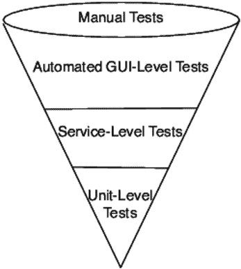

团队最终陷入这种反模式的原因之一是团队不同成员之间缺乏共识。由于渴望自动化，团队聘请了负责创建自动化测试套集的自动化工程师。遗憾的是，程序员往往没有参与其中，并且在应用程序的不同层级提供测试钩子——这在他们以前是不需要做的。结果是，自动化工程师受限于他们能够掌控的层次编写测试。这通常是 GUI 和任何面向外部的 API。

主要在 UI 层进行测试有许多缺点：^([[7]](#f_0017.xhtml_FOOTNOTE-7))

*   它非常脆弱。UI 层测试经常断裂。UI 是应用程序中最流动的部分之一。当它依赖的代码发生变化时，它也会发生变化。当客户或测试人员走过并对 UI 的外观和感受给出反馈时，它也会改变。保持测试与 UI 变化的同步是非常艰巨的，比低层级困难得多。
*   它的移动部件太多。UI 层测试通常需要像 `Selenium` 这样的工具，并要求不同的浏览器处于运行状态。维护这些依赖项的运行需要花费精力。
*   它很慢。这些测试需要整个应用程序运行：客户端、服务端、数据库，以及可能需要的任何外部服务的连接。通过全集成测试运行数千个测试通常比运行孤立测试慢得多。
*   它很难编写。我的一个客户花了六多个月时间，才为一个简单的交互编写了一个 UI 层测试。我们最终发现问题源于测试时机与产生结果的客户端 JavaScript 运行时机之间的差异。
*   它不能隔离问题区域。当 UI 层测试失败时，我们只知道有些地方出错了——无法立即判断在哪里或在哪个层级。
*   它无法防止 UI 中的逻辑。我们都知道知道将逻辑放在 UI 中是糟糕的，但我们都见过它在这一层级渗透并重复。UI 层测试对缓解这一点毫无作用。
*   它无法影响更佳的设计。UI 层测试不会阻碍所谓的“大泥球”——模块化代码的对立面。

Mike Cohn 在 *Succeeding with Agile: Software Development Using Scrum* [Coh09 中提出了测试金字塔的想法——在低层有更多的测试，在高级层有较少的端到端测试。

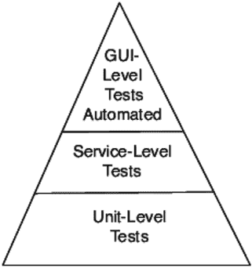

我们应该遵循测试金字塔，而不是落入冰淇淋锥反模式的陷阱。在低层编写更多测试有很多益处。低层的测试运行更快，更容易编写，并能提供更短的反馈循环。它们还会带来更好的模块化设计，结果就是当问题发生时，更容易进行隔离和识别。

我们将在本书书中遵循这一精神，在正确的层级编写测试——更多的单元测试，然后是功能测试，以及少量的端到端 UI 层测试。

| 自动化验证并非可选 |
| --- |
|  | 在没有正确层级自动化测试的情况下，开发任何非平凡的应用程序都是经济上的灾难。 |

如果正确的正确层级进行自动化如此关键，那么为什么没有更多开发者这样做呢？让我们接下来讨论一些原因。

## 为什么验证很难？

说代码应该是可测试的要比使其变得可测试要容易得多。程序员经常发现自动化测试非常困难，是因为以下一个或两个点原因：

*   代码设计糟糕。
*   程序员不知道代码是如何工作的。

这些词听起来可能很重，但并不是为了冒犯任何人。相反，我的希望是你们能理解核心原因并找到消除障碍的方法。

在遗留代码上编写自动化测试是非常困难的。遗留代码通常不模块化、缺乏内聚且高度耦合——这些都是糟糕设计的标志。尽管我们有最好的意图，事后编写测试很少奏效。

为了使代码可测试，它必须具有高内聚性和低耦合。如果代码做了很多事情——即内聚性低——它需要多得多的测试到实际上无法编写的程度。此外，如果代码直接连接到服务——即具有紧耦合——编写确定性的自动化测试是很困难的。自动化测试性是一个设计问题。


程序员在编写代码时很少遇到困难，但他们发现在编写代码之前编写测试是非常困难的。

原因之一是，编程本质上是每天连续进行的一系列微型实验——它是一个不断发现的过程。我们写一些代码，看到它失败，查阅一些资料，再次尝试，尝试几条不同的路径，通过不断的尝试和错误让代码运行起来——这很自然，这正是我们编写代码的方式。

当我们对代码还没有清晰的蓝图时，如何能先写测试呢？这听起来违背直觉，但确实有办法解决这个问题。

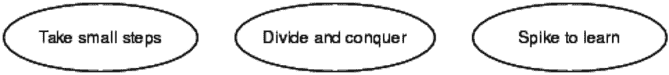

首先，迈出小步。如果一个测试看起来太难实现了，那么很有可能是我们承担的任务远超出了预期。为了使用测试驱动的编码来实现一个函数，我们必须通过一系列测试：三个、五个，或者可能是十五个测试。将每个测试想象成楼梯上的一个台阶——每一级都是小的，间距适中，并且随着我们的每一步移动带带我们向上。

其次，分而治之。如果一个函数的测试很难编写，也许我们正在设计的函数内聚性不够，或者它的耦合性超过了预期。这意味着我们可能需要将脑海中的函数拆分为更小的函数，并通过测试来驱动每一个函数的实现。

第三，通过原型性实验（Spike）来学习。如果你设计的函数与你以前做过的某些类似，那么一次写一个测试，并编写让每个测试通过的最少代码。另一方面，如果你对某个函数的实现非常陌生——它是复杂的、异步的或难以捉摸的——不要尝试立即为它写测试。相反，创建活跃的、隔离的原型实验来学习。让我们探索如何进一步进行原型性实验。

暂时搁置当前的项目，移到一个小的原型实验项目并进行大胆的实验。此时不要不在乎代码质量或测试。先让它运行起来，产生你想要的结果。一旦你让那小段代码运行起来，就鼓起勇气并自律地将其丢弃。切换回你的活跃项目，从测试开始，驱动代码的设计。你会发现，先写测试并没有看起来那么令人生畏。此外，你还会发现，演化出来的代码设计往往与你在原型性实验期间赶出来的设计完全不同。

## 总结

手动测试和自动化验证都有其价值。测试可以为我们提供很多见解。如果没有自动化验证，就无法维持开发速度。任何非平凡的应用程序都需要合适层级的自动化测试。自动化测试需要时间、精力和自，但这是一项我们应该投入的技能。在编写代码之前编写测试。如果事实证明这很困难，就从活跃的原型实验中学习。

正如你在本章看到的，自动化测试至关重要。在下一部分，我们将深入探讨客户端和服务器端代码自动化测试的一些基础技术。

## 脚注

[[6]](#f_0014.xhtml_FNPTR-6)

[`watirmelon.com/2012/01/31/`](http://watirmelon.com/2012/01/31/)

[[7]](#f_0014.xhtml_FNPTR-7)

[`martinfowler.com/bliki/TestPyramid.html`](http://martinfowler.com/bliki/TestPyramid.html)

Copyright © 2016, The Pragmatic Bookshelf.

# 第一部分：创建自动化测试

> 代码的性质和复杂性极大地影响了编写和运行自动化测试的能力。一段代码可能关注于业务逻辑或计算；另一段代码可能使用异步 API，而另一段代码可能主要依赖于外部服务的交互。由于这些关注点导致代码大不相同，它们的测试也大不相同。

> 在这一部分，你将学习编写自动化测试和衡量代码覆盖率。你还将探索为异步代码和具有复杂依赖的代码编写测试的方法。

# 第二章：测试驱动你的设计

在编码完成后编写有效的测试是非常困难的——代码通常不是那种能让测试在事后轻松就位的形式。早早开始测试会更好。

在创建代码之前编写测试自然会使代码具有可测试性。良好的测试会塑造代码，使其更加模块化、高内聚且低耦合。这反过来可以使设计变得轻量化、更容易更改且维护成本更低。此外，从测试中获得的快速反馈增强了我们的信心，即在我们更改代码时，功能将继续正常运行。

但在编写代码之前创建测试也具有挑战性。

在本章中，你将学习如何即时（just-in-time）编写测试，并利用这些测试影响代码的设计。你看到前几个测试如何引导我们关注函数的接口，而随后的测试如何引导我们进入函数的内部实现。

你将为服务器端和客户端的 JavaScript 创建测试。对于服务器端，我们将在 `Node.js` 中运行代码。客户端代码将在不同的浏览器中运行。无论代码运行在何处，我们都会为它编写自动化测试。你可以快速执行这些测试，通过代码设计的每一步获得代码正按预期运行的反馈。

除了编写测试的技术外，你还将学习使用一些工具：`Karma`、`Mocha`、`Chai` 和 `Istanbul`。在本章结束时，你将准备好通过这些工具创建更高质量的设计。

## 开始吧

在深入测试设计之前，你应该熟悉编写和运行测试。这是我们首先要做的：设置项目并运行几个测试。

我们将使用一个非常简单的华氏转摄氏的函数作为媒介来学习测试的基础。作为第一步，我们将检查系统中 `Node.js` 和 `npm` 的安装情况。然后我们将设置示例项目并安装测试所需的工具。接下来，我们将通过编写一个性测试来热身，确认一切都已安装。在此过程中，你将学习测试套件以及测试文件的组织。最后，我们将编写一个测试来验证测试代码的行为。

### 检查 npm 和 Node 安装

我们需要 `Node.js` 有两个原因。首先，我们需要它来运行服务器端代码和测试。其次，它带有了 `npm`，这已成为安装 JavaScript 模块的首选工具。我们将使用 `npm` 安装客户端和服务器测试测试工具。

如果你的系统中尚未安装最新版本的 `Node.js`^([[8]](#f_0027.xhtml_FOOTNOTE-8))，请安装它，并运行以下命令确认它在系统路径中：

```
node --version
```

同时，运行此命令确保 `npm` 在系统路径中：

```
npm --version
```


# 引言

在本节中，你将学习——或者如果你已经知道了，则进行复习——创建项目的步骤。这将有助于你以后创建自己的项目。然而，在随后的本节的示例中，我们将跳过初始化步骤，从一个预创建的项目开始，以节省一些精力。

如果你还没有下载你自己的工作空间中提到的工作空间，请现在进行下载。然后 `cd` 进入你系统中的 `tdjsa/tdd/sample` 目录。进入该目录后，输入命令

```bash
npm init
```

来创建一个项目。该命令的作用仅仅是创建一个 `package.json` 文件，该文件将包含我们所需的依赖项或工具的详细信息，以及运行这些工具的命令。

`npm init` 命令会要求你输入一些细节。除了测试命令外，所有问题都直接采用默认值：输入 `mocha`——这就是我们将使用的测试工具。

以下是运行 `npm init` 命令创建的 `package.json` 文件：

| | { |
| | "name": "sample", |
| | "version": "1.0.0", |
| | "description": "", |
| | "main": "index.js", |
| | "directories": { |
| | "test": "test" |
| | }, |
| | "scripts": { |
| | "test": "mocha" |
| | }, |
| | "author": "", |
| | "license": "ISC" |
| } |

这个文件的用处在于，一旦设置好它，安装依赖项就变得简单直接。你不需要再次手动进行设置，例如在构建机器或同事的计算机上。

我们需要两个工具，Mocha 和 Chai，来辅助自动化测试。让我们现在安装这两个工具：

```bash
npm install mocha chai --save-dev
```

此命令将工具本地安装在当前示例目录下的 `node_modules` 目录中。此外，`npm` 会更新 `package.json` 文件并添加一个 `devDependencies` 部分，以传达项目的开发依赖项。查看 `package.json` 文件以确认该命令是否创建了如下内容的 `devDependencies` 部分：

| | "devDependencies": { |
| | "chai": "³.5.0", |
| | "mocha": "².4.5" |
| } |

我们需要的工具已经准备就绪。我们将测试放在 `test` 目录中，将被测试的代码放在 `src` 目录中。通常情况下，你必须创建这些目录及其中的文件。然而，为了方便起见，这些目录已经包含在你的工作中了。这些目录中还提供了空文件，以节省你的精力——你可以跟随示例并开始编辑它们。

我们已经准备好编写第一个测试了。我们将编写测试来验证 `f2c` 函数的行为，该函数将把定的输入从华氏度转换为摄氏度。我们将一步步进行，从组织测试到实现使测试通过的代码，并将看到测试的运行，以验证代码的行为。

## 创建测试套件和金丝雀测试

在我们开始编写任何实际测试之前，我们想要确保工具已安装正确，并且我们能够编写和运行测试。如果在编写测试和代码后，因为设置问题导致测试无法运行，将是令人沮丧的。为了避免这种烦恼，我们将从金丝雀测试开始。金丝雀测试是一个能写出的最愚蠢的测试。正如它的起源——矿井里的金丝雀一样，它是一个牺牲性测试，提供了一种快速验证运行测试的环境已就绪的方法。

为了方便起见，打开已包含在 `test` 目录下的 `util_test.js` 文件并输入以下金丝雀测试代码：

```javascript
var expect = require('chai').expect;

describe('util tests', function() {
  it('should pass this canary test', function() {
    expect(true).to.eql(true);
  });
});
```

这是一个 Mocha 测试文件。Mocha 是一个识别并执行 JavaScript 文件中测试的引擎。默认情况下，Mocha 在 `test` 目录中寻找测试。

在测试文件中，对 `require` 的调用加载了 `chai` 断言库，并引入了 `expect` 断言函数的引用。该库文件将从我们示例项目目录下的 `node_modules` 目录加载。

我们的测试文件包含一个测试套件。测试套件是一个凝聚的测试集合，用于验证一个函数或一小组紧密相关的函数的行为。`describe` 是 Mocha 用于定义测试套件的关键字。`describe` 函数接受两个参数：测试套件名称和一个包含该套件中测试的函数。我们将示例测试套件命名为 `util tests`。

每个测试都是通过调用 `it` 函数定义的。这反过来有两个参数——测试名称和测试正体。

要运行测试，输入

```bash
npm test
```

这指示 `npm` 运行我们在 `package.json` 初始化期间提供的测试。让我们看看结果：

| | > mocha |
| | util tests |
| | ✓ should pass this canary test |
| | |
| | 1 passing (6ms) |

Mocha 报告金丝雀测试通过。这确认了 Mocha 和 Chai 都已安装并协同工作。

让我们把 `true` 改为 `false` 并保存测试文件。然后运行 `npm test` 并观察 Mocha 如何对失败报错。


Joe 问：保留金丝雀测试有价值吗？

金丝雀测试除了让我们开始之外没有太大价值，但保留这个测试是好的。如果你升级自动化测试工具、迁移到其他机器或更改环境设置，金丝雀测试可以帮助快速验证基础测试是否正常。

在测试中使用我们使用 `expect` 进行断言。Mocha 不包含断言库；它只承担识别和运行测试的单一职责。该断言函数来自 Chai，一个流行的断言库。

## 验证函数的行为

第一个测试为我们的设置提供了快速反馈并让我们行动起来。让我们通过编写第二个测试来继续这种势头。在这个热身练习中，我们编写测试来验证 `f2c` 函数的行为，该函数将输入从一个单位转换为另一个。在下一个测试中，让我们验证该函数如何正确地将 32 华氏度 0 摄氏度。

在测试套件文件中，我们首先需要加载 `src/util.js` 文件，该文件将包含待测试的代码。这是为了方便起见已经在你的工作空间提供的空文件。让我们更改 `test/util_test.js` 文件来加载该文件。

```javascript
var expect = require('chai').expect;
var Util = require('../src/util');
```


新添加的 `require` 调用从 `src` 目录引入了源代码文件 `util.js`。以 `..` 开头的路径相对于测试目录的。根据 JavaScript 命名规范，大写的 `Util` 表示加载的文件将返回一个类或构造函数。我们需要在测试中为该类创建一个实例。然而，随着我们继续编写更多的测试，测试套件中的多个测试可能都需要一个实例。与其在每个测试中重复该部分代码，将实例的创建收纳在 `beforeEach` 函数中是一个更好的选择。让我们在测试套件中创建该函数，紧跟在金丝测试之后。

```javascript
describe('util tests', function() {
  //...canary test not shown...
  var util;
  beforeEach(function() {
    util = new Util();
  });
});
```

如果测试套件中存在 `beforeEach` 函数，Mocha 会执行该套件中的每个测试之前自动运行它。同样地，如果我们添加一个 `afterEach` 函数来执行任何可选的清理操作，那么该函数将在套件中的每个测试执行后运行。`beforeEach` 和 `afterEach` 是“三明治”函数——它们会在套件中的每个测试周围执行。

在 `beforeEach` 函数中，我们将 `Util` 类的一个实例赋值给变量 `util`。受此影响，每个测试都将在其运行前恰好获得一个全新的 `Util` 实例。

让我们编写一个测试来验证上述 `f2c` 函数的行为——该测试将放置在 `test/util_test.js` 文件中 `beforeEach` 函数的正下方：

```javascript
it('should pass if f2c returns 0C for 32F', function() {
  var fahrenheit = 32;
  var celsius = util.f2c(fahrenheit);
  expect(celsius).to.eql(0);
});
```

与金丝测试相比，这个测试多出了几行。通常，测试遵循“安排-执行-断言（3-As）”模式。为了清晰起见，用空行将这三个部分隔开是一个良好的做法。安排（Arrange）部分设置被测代码所需的内容。执行（Act）部分运行被测代码。断言（Assert）部分最后验证代码是否符合预期。

尽管每个测试都有三个部分，但请记住保持测试非常短。如果测试运行了多行，说明测试设计以及后续代码的设计很糟糕。

| 使用 3-As 模式 |
| : --- |
|  | 除极少数简单的情况外，请结构化测试以遵循安排-执行-断言模式，每个部分都用空行清晰地分开。 |

在测试中，我们安排了 `fahrenheit` 变量的值为 32。然后我们执行了调用被测函数的操作。最后，我们断言操作的结果是预期值。

让我们运行测试并看它失败——“红、绿、重构”是 TDD 的格言。我们先写一个失败的测试；然后编写最少的代码让它通过；最后重构代码使其变得更好。

首先确保测试失败了，并确认它是因为正确的原因失败的。有时，测试在我们写完时可能就通过了，而无需任何代码更改，因为现有代码可能已经满足了预期。在这种情况下，仔细检查代码以确保它是以正确的原因通过的。

下一步，我们将创建最少的代码让此测试通过。打开 `src` 目录下的 `util.js` 源文件并输入以下代码：

```javascript
module.exports = function() {
  this.f2c = function() {
    return 0;
  };
};
```

`exports` 是 `module` 内部的实际对象，返回给加载文件的 `require` 函数的调用者。在 `util.js` 文件中我们我们了一个函数——具体来说是一个构造函数——代表一个 JavaScript 类。`f2c` 函数属于这个类，并在调用时仅返回 0。该结果足以让我们编写的测试通过。

让我们运行测试并验证被测代码 `f2c` 函数运行符合预期。快速运行 `npm test` 命令并查看它提供的反馈：

```bash
...
> mocha
util tests

✓ should pass this canary test

✓ should pass if f2c returns 0C for 32F

2 passing (7ms)
```

到目前为止两个测试都通过了。我们正在热身。让我们再验证一个。

### 验证另一个数据

如果测试套件中存在 `beforeEach` 函数，Mocha 会执行该套件中的每个测试之前自动运行它。同样地，如果我们添加一个 `afterEach` 函数来执行任何可选的清理操作，那么该函数将在套件中的每个测试执行后运行。`beforeEach` 和 `afterEach` 是“三明治”函数——它们会在套件中的每个测试周围执行。

在 `beforeEach` 函数中，我们将 `Util` 类的一个实例赋值给变量 `util`。受此影响，每个测试都将在其运行前恰好获得一个全新的 `Util` 实例。

让我们编写一个测试来验证上述 `f2c` 函数的行为——该测试将放置在 `test/util_test.js` 文件中 `beforeEach` 函数的正下方：

```javascript
it('should pass if f2c returns 0C for 32F', function() {
  var fahrenheit = 32;
  var celsius = util.f2c(fahrenheit);
  expect(celsius).to.eql(0);
});
```

### 验证另一个数据

如果测试套件中存在 `beforeEach` 函数，Mocha 会执行该套件中的每个测试之前自动运行它。同样地，如果我们添加一个 `afterEach` 函数来执行任何可选的清理操作，那么该函数将在套件中的每个测试执行后运行。`beforeEach` 和 `afterEach` 是“三明治”函数——它们会在套件中的每个测试周围执行。

在 `beforeEach` 函数中，我们将 `Util` 类的一个实例赋值给变量 `util`。受此影响，每个测试都将在其运行前恰好获得一个全新的 `Util` 实例。

让我们编写一个测试来验证 `f2c` 函数的行为——该测试将放置在 `test/util_test.js` 文件中 `beforeEach` 函数的正下方：

```javascript
it('should pass if f2c returns 0C for 32F', function() {
  var fahrenheit = 32;
  var celsius = util.f2c(fahrenheit);
  expect(celsius).to.eql(0);
});
```
（等等，输入文本有重复部分。我将根据提供的文本清理逻辑流并保持内容。）

*修正：提供的文本中间包含大量重复和格式问题。我将提供一个干净的、格式化的输入叙述版本。*

新添加的 `require` 调用从 `src` 目录引入了源代码文件 `util.js`。以 `..` 开头的路径相对于测试目录的。根据 JavaScript 命名规范，大写的 `Util` 表示加载的文件将返回一个类或构造函数。我们需要在测试中为该类创建一个实例。然而，随着我们继续编写更多的测试，测试套件中的多个测试可能都需要一个实例。与其在每个测试中重复该部分代码，将实例的创建收纳在 `beforeEach` 函数中是一个更好的选择。让我们在测试套件中创建该函数，紧跟在金丝测试之后。

```javascript
describe('util tests', function() {
  //...canary test not shown...
  var util;
  beforeEach(function() {
    util = new Util();
  });
});
```

如果测试套件中存在 `beforeEach` 函数，Mocha 会执行该套件中的每个测试之前自动运行它。同样地，如果我们添加一个 `afterEach` 函数来执行任何可选的清理操作，那么该函数将在套件中的每个测试执行后运行。`beforeEach` 和 `afterEach` 是“三明治”函数——它们会在套件中的每个测试周围执行。

在 `beforeEach` 函数中，我们将 `Util` 类的一个实例赋值给变量 `util`。受此影响，每个测试都将在其运行前恰好获得一个全新的 `Util` 实例。

让我们编写一个测试来验证上述 `f2c` 函数的行为——该测试将放置在 `test/util_test.js` 文件中 `beforeEach` 函数的正下方：

```javascript
it('should pass if f2c returns 0C for 32F', function() {
  var fahrenheit = 32;
  var celsius = util.f2c(fahrenheit);
  expect(celsius).to.eql(0);
});
```

与金丝测试相比，这个测试多出了几行。通常，测试遵循“安排-执行-断言（3-As）”模式。为了清晰起见，用空行将这三个部分隔开是一个良好的做法。安排（Arrange）部分设置被测代码所需的内容。执行（Act）部分运行被测代码。断言（Assert）部分最后验证代码是否符合预期。

尽管每个测试都有三个部分，但请记住保持测试非常短。如果测试运行了多行，说明测试设计以及后续代码的设计很糟糕。

| 使用 3-As 模式 |
| : --- |
|  | 除极少数的情况外，请结构化测试以遵循安排-执行-断言模式，每个部分都用空行清晰地分开。 |

在测试中，我们安排了 `fahrenheit` 变量的值为 32。然后我们执行了调用被测函数的操作。最后，我们断言操作的结果是预期值。

让我们运行测试并看它失败——“红、绿、重构”是 TDD 的格言。我们先写一个失败的测试；然后编写最少的代码让它通过；最后重构代码使其变得更好。

首先确保测试失败了，并确认它是因为正确的原因失败的。有时，测试在我们写完时可能就通过了，而无需任何代码更改，因为现有代码可能已经满足了预期。在这种情况下，仔细检查代码以确保它是以正确的原因通过的。

下一步，我们将创建最少的代码让此测试通过。打开 `src` 目录下的 `util.js` 源文件并输入以下代码：

```javascript
module.exports = function() {
  this.f2c = function() {
    return 0;
  };
};
```

`exports` 是 `module` 内部的实际对象，返回给加载文件的 `require` 函数的调用者。在 `util.js` 文件中我们创建了一个函数——具体来说是一个构造函数——代表一个 JavaScript 类。`f2c` 函数属于这个类，并在调用时仅返回 0。该结果足以让我们编写的测试通过。

让我们运行测试并验证被测代码 `f2c` 函数运行符合预期。快速运行 `npm test` 命令并查看它提供的反馈：

```bash
...
> mocha
util tests

✓ should pass this canary test

✓ should pass if f2c returns 0C for 32F

2 passing (7ms)
```

到目前为止两个测试都通过了。我们正在热身。让我们再验证一个。


*   在编写测试时，我们应该考虑这些指导原则：测试和测试套件都应该单一职责。如果一组函数工作得紧密，就将它们的测试保持在一个套件中。否则，请将它们的测试分开到不同的套件中。此外，我们对测试质量的关注程度应该等同于我们编写的函数和类的质量。

*   测试应该具有相关性，并验证代码的正确行为。我们编写的测试描述、表达并记录了代码的行为，但确保这些行为正确且相关的责任在于我们。为了知道什么是正确的行为，程序员将不得不从业务分析师、领域专家、测试人员、产品所有者以及团队其他成员那里获取输入和反馈。为了让测试与应用程序相关，开发者必须与团队的其他成员进行通信与协作。

我们是渐进地演进测试和代码的。让我们回过来看我们创建的整个测试文件：

[`tdd/sample/test/util_test.js`](http://media.pragprog.com/titles/vsjavas/code/tdd/sample/test/util_test.js)

```javascript
var expect = require('chai').expect;
var Util = require('../src/util');

describe('util tests', function() {
  it('should pass this canary test', function() {
    expect(true).to.be.true;
  });

  var util;
  beforeEach(function() {
    util = new Util();
  });

  it('should pass if f2c returns 0C for 32F', function() {
    var fahrenheit = 32;
    var celsius = util.f2c(fahrenheit);
    expect(celsius).to.eql(0);
  });

  it('should pass if f2c returns 10C for 50F', function() {
    var fahrenheit = 50;
    var celsius = util.f2c(fahrenheit);
    expect(celsius).to.eql(10);
  });
});
```

而且，让我们也看看让这些测试通过的代码：

[`tdd/sample/src/util.js`](http://media.pragprog.com/titles/vsjavas/code/tdd/sample/src/util.js)

```javascript
module.exports = function() {
  this.f2c = function(fahrenheit) {
    return (fahrenheit - 32) * 5 / 9;
  };
};
```

我们对如何设置项目、必要的工具、编写测试以及运行测试有了感觉。我们还看到了运行测试时的反馈（无论成功还是失败）是什么样的。让我们把注意力从编写测试转向使用测试驱动设计。

## 使用正向、负向异常测试进行设计

在编写代码之前编写测试是一项技能。起初可能看起来很难，但随着练习会变得更好。这种努力的结果是更模块化、高内聚且低耦合的设计。

通过先写测试，我们在编写代码之前，把自己置于将要使用我们代码的人的角度中。因此，从第一步开始，我们就可以从使用代码的角度来处理代码设计。在这种方法中，我们设计的每个函数都将由一系列测试来塑造。前几个测试将帮助塑造接口——即它的“外壳”。随后的测试将帮助塑造实现细节——即它的“内脏”。

让我们讨论一下在测试驱动代码设计时，应该从哪里开始，以及我们应该创建什么类型的测试。

无论你是在创建服务器端代码还是客户端代码，通常很难决定从哪里开始。打破惯性吧；一旦你动起来，编写测试就会变得容易。从一个相当简单的测试开始；不要担心让它变得完美。然而，与其专注于识别获取（get）或设置（set）状态的琐碎函数，不如从一个有趣的行为开始。思考一个函数（代码单元），它是实用的但不复杂的——让它成为你编写编写测试的第一个函数。

### 关注行为而非状态

避免编写为了获取和设置状态而编写测试的常见反模式。相反，从测试有趣且实用的行为开始。让必要的状态在过程中自然到位。

当你开始设计一个函数时，在脑海中视觉化你将编写哪些类型的测试来验证函数的行为。渐进开发代码的一种良好方法是通过一系列正向、负向和异常测试。让我们讨论一下这三种测试：

*   **正向测试（Positive tests）**：练习并验证代码在满足前提条件时执行预期操作。
*   **负向测试（Negative tests）**：验证当情况不符合预期时（即其前提条件或输入无效时），代码能够优雅地运行。
*   **异常测试（Exception tests）**：验证如果代码应该抛出异常，它是否确实抛出了异常。

我们将在书中探索这些每一种测试。在思考测试时，记住保持它们是 **FAIR**：快速（fast）、自动化（automated）、隔离（isolated）和可重复（repeatable）。

*   快速（Fast）测试意味着快速的反馈循环。如果测试很慢，你会倾向于减少运行频率。
*   自动化的（Automated）：测试的一个主要优势是验证——我们已经讨论过为什么这些应该是自动化的而不是手动的。
*   隔离的（Isolated）测试可以任何顺序运行，你也可以根据意愿运行其中几个或全部运行。任何测试都不应该要求在另一个测试之前运行——这样的测试是脆弱的，并且会变成时间的黑洞。
*   可重复的（Repeatable）：最后，测试应该是可重复的；你应该能够运行它们任意次数，而不需要手动或耗时的设置或清理操作。

当我们使用测试演进设计时，我们应该始终保持一切处于运行状态，这样我们离可用代码只有之遥。

### 使用测试演进应用程序

每个测试都应该带我们从一个可用代码增量进入下一个具有额外功能的可用代码增量。

通过练习，你很快就会找到一种舒适的测试-代码节奏——创建一个良好的测试，并编写最少代码使它以及现有测试通过。

现在你对要编写的测试类型有了了解，让我们练习驱动服务器端代码的设计。

## 设计服务器端代码

为了练习驱动设计的概念，我们将测试驱动检查给定字符串是否为回文的服务器端代码的设计。这是一个相当简单的问题，但现在保持简单有助于你轻松进入测试驱动设计，而不至于很快被拖入复杂性。一旦你熟悉了基础知识，就准备好处理后续章节中复杂的问题了。

JavaScript 在服务器端近年来变得非常重要，`Node.js` 已成为事实上的运行时环境。它不仅是一个很棒的部署平台，从测试角度来看也非常迷。让我们通过示例探索测试运行在 `Node.js` 中的 JavaScript。

我们将设计一个函数来检查给定输入是否为回文。这是一个大多数程序员立刻就能代码的简单问题，但作为练习，让我们先通过测试创建。

### 从测试列表开始

在碰键盘之前，在纸上写下你脑海中出现的一些正向、负向和异常测试的短语。当你开始编写代码时，这个测试列表会发生很大变化——在你编写代码中间时会产生新的测试，而这个列表是快速记录这些想法的完美场所。


 Joe 问：为什么要在纸上保留测试列表？

我们生活在数字时代，难道我们不应该把测试列表存在电子工具、智能手机或维基中吗……

纸张仍然提供一些关键优势。自发性。在编写代码和实现测试时，脑海中会产生边缘情况和场景。随手捕捉这些细节至关重要——没有什么比铅笔和纸在草拟想法时更快了。此外，你不需要担心切换窗口或工具而导致失去专注。划掉已过时的测试和勾选已完成的测试轻而易举。在艰苦的编码期间，看着新的测试被添加到列表中并一眼看到它们被标记为已完成，也会非常有鼓舞。

以下是针对当前问题在纸上随手记录的一些初始测试：

* mom 是一个回文
* dad 是一个回文
* dude 不是回文

这是一个很好的起点。这些是使用样本数据作为函数参数的经验性测试。我们可以随着灵感加入更多测试——一旦我们进入了测试-代码循环的节奏，测试往往会自然而涌而出。

### 切换到回文项目

对于回文练习，我们需要设置一个项目。与其运行 `npm init` 并从头开始配置序列，不如从一个预先的 `package.json` 文件开始，这样可以节省一些精精力。

将目录切换到工作区下的 `tdd/server/palindrome`。在这个项目中，我们将使用 `Mocha`、`Chai` 和 `Istanbul` 工具。

让我们来看该目录下已经存在的 `package.json` 文件：

[tdd/server/palindrome/package.json](http://media.pragprog.com/titles/vsjavas/code/tdd/server/palindrome/package.json)

```json
{
  "name": "palindrome",
  "version": "1.0.0",
  "description": "",
  "main": "index.js",
  "directories": {
    "test": "test"
  },
  "scripts": {
    "test": "istanbul cover node_modules/mocha/bin/_mocha"
  },
  "author": "",
  "license": "ISC",
  "devDependencies": {
    "chai": "³.5.0",
    "istanbul": "⁰.4.4",
    "mocha": "³.0.1"
  }
}
```

让我们使用以下命令让 `npm` 为你的本地机器安装该项目所需的包：

```
npm install
```

该命令将读取 `package.json` 文件并自动下载 `devDependencies` 部分中提到的包。它将安装 `Mocha` 和 `Chai`，这些是我们已经过的工具。此外，它还将安装 `Istanbul`，这是我们很快就会用于代码覆盖率的工具。

你可能会想为什么我们需要重新安装 `Mocha` 和 `Chai`。这些是针对当前项目的开发工具，位于项目本地的 `node_modules` 目录下。当你切换到不同的项目时，你必须安装该项目所需的工具。幸运的是，`npm init` 命令减轻了负担，如果它发现文件已安装在当前项目中，它将跳过安装。避免从一个项目复制 `node_modules` 目录到另一个项目的想法——那通常并不顺利，并可能在以后使用工具时导致错误，从而浪费时间。我们可以通过按项目安装工具来避免这些麻烦。

另外注意，对于测试命令，我们没有调用 `mocha` 而是调用 `istanbul`。作为衡量代码覆盖率的一部分，该工具将运行自动化测试。然而，我们没有让 `Istanbul` 直接运行命令 `mocha`，而是要求它运行工具 `mocha`。这是由于 `Mocha` 分叉进程的方式具有复杂性。好消息是，那些看起来复杂的命令都很好地隐藏在那个包文件中，我们只需要记住运行 `npm test` 来执行测试。

现在新项目已准备好供我们使用，作为第一步我们应该验证一切是否就位。对于此，你猜得对，我们需要写一个金丝雀测试（canary test）。项目已经包含了必要的目录结构以及空的源文件和测试文件供你使用。打开 `tdd/server/palindrome/test`目录下的 `palindrome-test.js` 文件并输入以下代码：

[tdd/server/palindrome/test/palindrome-test.js](http://media.pragprog.com/titles/vsjavas/code/tdd/server/palindrome/test/palindrome-test.js)

```javascript
var expect = require('chai').expect;
var isPalindrome = require('../src/palindrome');

describe('palindrome-test', function() {
  it('should return true', function() {
    expect(isPalindrome('mom')).to.be.true;
  });
});
```

等待，提供的文本中代码部分有一些碎片化的类表格结构。让我根据源的特定内容重新格式化逻辑，同时保持变量规则。

### 创建正性测试

第一个正性测试已经就绪，但不要急于实现代码。使用初始测试来构建函数的接口，使代码具有表达力且可读性。尝试一些选项，或者更改方法名称看看它是否可以更直观——返回值应该是不同的吗？一旦你确立了喜欢的接口，就为函数写一个最小化实现。

这是代码的第一次尝试。打开工作区中的 `src/palindrome.js` 文件并输入此代码：

```javascript
module.exports = function(word) {
  return true;
};
```

这个实现非常简单——事实上，是轻而易举的。这是好事。如果你现在保持实现最小化，你就可以关注函数的接口——它的名称、参数名称、返回类型等，而不是过早地考虑实现细节。


函数的参数命名为 `word`，但在编写这个极简实现时，我们可以问自己，输入是否可以是单词以外的内容——也许是多个单词，或者一个句子？这类问题的答案通常取决于领域和应用。我们必须与同事、其他程序员、测试人员和业务分析师讨论才能得出答案。

测试驱动开发并不是一系列枯燥的机械步骤。测试应该通过一系列问题，极大地影响代码的设计。测试应该帮助我们逐步揭示当前问题的细节，并引导我们发现满足要求的代码接口和实现。

| 让测试驱动设计 |
| --- |
|  | 测试应该在我们脑海中引发许多问题，帮助我们发现隐藏的细节，并在这个过程中梳理出代码的接口。 |

假设业务分析师确认输入可能包含多个单词。不要让这个决定被忽略；在你纸上记录的测试列表中再添加几个测试：

*   ✓ `mom is a palindrome`
*   ✓ `dad is a palindrome`
*   ✓ `dude is not a palindrome`
*   ⇒ `mom mom is a palindrome`
*   ⇒ `mom dad is not a palindrome`

我们应该将参数名从 `word` 改为 `phrase`。一旦完成该更改，运行测试并确保金丝测试（canary test）和新测试都通过。

我们现在可以继续编写下一个测试了。随着 `"mom is a palindrome"` 测试通过，你可能会想是否需要测试“dad”是否为回文。验证代码在多个值上表现正常，而不仅仅是一个值，这是一个很好的主意。从长远来看，这让我们更有信心认为代码在所有可能的值中，至少在几个选定的值上符合预期。

回到 `palindrome-test.js` 文件，再添加一个正向测试：

```javascript
it('should return true for argument dad', function() {
  expect(isPalindrome('dad')).to.be.true;
});
```

与其编写这个新测试，你可能倾向于在上一个测试中添加另一个断言（assert）——但不要这样做。当我们修改代码时，我们希望快速获得更改影响的反馈。如果我们将多个独立的断言分组在一个测试中，其中一个断言的失败将阻止后续断言的评估。这会阻碍对更改影响的可见性。只有在我们修复了失败的断言后，才会知道该测试中下一个断言的状态。这就像编译器在遇到第一个错误时就停止；修复所有隐藏错误将是一段非常漫且令人沮丧的旅程。

| 避免在一个测试中放置多个独立的断言 |
| --- |
|  | 每个测试应尽可能少断言。避免将独立的断言分组到一个测试中。 |

这并不是说一个测试永远不应该有多个断言。例如，如果一个函数的作用是更改人的姓和名，那么务必通过两个断言来确保姓和名都是正确的。在这种情况下，这两个断言是密切相关的；它们不是独立的。另一方面，断言名称更改函数对两组名称都有效并不是一个好主意，因为前两组断言与后两组是独立的。

我们添加的新测试应该能够通过的，因为我们在函数中拥有的极简（事实上实际上是微而易见的）实现仍然足够。继续运行测试以确保所有三个测试都通过。

现在让我们在 `palindrome-test.js` 文件中编写下一个测试，即我们测试列表中针对参数 `dude` 的那个。

```javascript
it('should return false for argument dude', function() {
  expect(isPalindrome('dude')).to.be.false;
});
```

这个测试断言如果传递非回文单词作为参数，函数将返回 `false`。运行测试，你会发现这个失败了——错误消息清晰地告诉我们哪个测试失败了：

```
palindrome-test
  ✓ should pass this canary test
  ✓ should return true for argument mom
  ✓ should return true for argument dad
  1) should return false for argument dude

  3 passing (6ms)
  1 failing

1) palindrome-test should return false for argument dude:
AssertionError: expected true to be false
at Context.<anonymous> (test/palindrome-test.js:20:39)

  ...coverage details not shown...
```

是时候用更现实的代码替换那个简单的实现，以让这个测试通过了。让我们修改 `palindrome.js` 文件中的 `palindrome` 函数：

```javascript
module.exports = function(phrase) {
  return phrase.split('').reverse().join('') === phrase;
};
```

在此更改后，运行测试并确保所有四个测试都通过。继续编写另外两个测试，一个接一个：

```javascript
it('should return true for argument mom', function() {
  expect(isPalindrome('mom')).to.be.true;
});
```

```javascript
it('should return false for argument dad', function() {
  expect(isPalindrome('dad')).to.be.false;
});
```

让我们看看所有测试的结果：

```
palindrome-test
  ✓ should pass this canary test
  ✓ should return true for argument mom
  ✓ should return true for argument dad
  ✓ should return false for argument dude
  ✓ should return true for argument mom
  ✓ should return false for argument dad

  6 passing (6ms)
```

我们目前为止的测试验证了在正常情况下运行良好。接下来考虑一些负面情况。

### 创建负面测试

在编写代码和测试时，我们经常会考虑到边界情况、无效输入以及各种可能出现的问题。与其立即为这些情况编写代码，我们先把这些想法记录在测试列表中。

在编写回文函数时，你可能会想如果字符串是空字符串或全是空格会怎样。让我们记录这些情况：

*   mom dad is not a palindrome
*   An empty phrase is not a palindrome
*   A phrase with two spaces only is not a palindrome

空白字符串应该被视为回文吗？这类问题的具体答案可能取决于应用程序和其他因素；无论答案如何，测试都记录了你的决策，并在整个生命范围内验证代码符合这些预期。

| 测试是文档的形式 |
| --- |
|  | 测试是文档的一种。与传统的文档或规范不同，它们是活跃的动态文档，可以在每次更改时验证代码的行为。 |

如果将来我们更改处理边界情况的方式，我们必须更改相关的测试。与这些测试带来的长期收益相比，这个代价很小。

让我们在 `palindrome-test.js` 文件中编写新测试之一——一个负面测试：

```javascript
it('should return false when argument is an empty string', function() {
  expect(isPalindrome('')).to.be.false;
});
```


```javascript
module.exports = function(phrase) {
  return phrase.length > 0 &&
    phrase.split('').reverse().join('') === phrase;
};
```

新添加的长度大于 0 的检查应该会让负向测试通过。然而，正如我们将看到的，这可能不足以满足第二个负向测试。让我们将此测试添加到 `palindrome-test.js` 文件中：

```javascript
it('should return false for argument with only two spaces', function() {
  expect(isPalindrome(' ')).to.be.false;
});
```

运行测试并注意失败。`isPalindrome` 的实现需要再次更改以满足这些新预期。让我们编辑 `palindrome.js` 文件中的函数：

```javascript
module.exports = function(phrase) {
  return phrase.trim().length > 0 &&
    phrase.split('').reverse().join('') === phrase;
};
```

现在，我们不再检查给定参数的长度，而是执行 `trim` 操作然后进行检查。这应该能帮助所有当前测试通过。

考虑输入中的其他边界情况和变化——例如，多个空格、混合大小写的字符串、标点符号……每种情况的正确行为是什么？将这些表示为测试，并修改实现以通过这些测试。

现在我们已经有了几个测试来验证代码的行为，请将目前使用 `reverse()` 函数的实现修改为你能想到的其他实现。尝试你不同的想法并运行测试，检查这些替代实现是否符合函数的预期行为。

除了考虑正向和负向测试之外，我们还必须验证代码是否按预期抛出异常。让我们下一步探索异常测试。

### 创建异常测试

JavaScript 是动态且灵活的，这意味着赋予了我们更大的力量，但也更容易出错。例如，如果没有任何参数就调用 `isPalindrome` 函数会？代码会处理这种情况吗？JavaScript 会静默地运行异常，还是直接崩溃？我们必须仔细思考此类场景并进行防御性编程，以充分利用语言的特性。

如果参数缺失，我们可以返回 `false`、抛出异常、播放悲伤的音乐……无论你决定什么，将该行为表示为测试。如果你想设计代码抛出异常，请使用异常测试来表达你的意图。

当且仅当代码以预期的方式失败时，异常测试应该通过；否则测试应该失败。对于回文问题，让我们决定在未传递参数时抛出无效参数异常。先写测试，同样在 `palindrome-test.js` 文件中：

```javascript
it('should throw an exception if argument is missing', function() {
  var call = function() { isPalindrome(); };
  expect(call).to.throw(Error, 'Invalid argument');
});
```

我们将对 `isPalindrome` 的调用封装在一个赋值给 `call` 变量的函数中。在之前的测试中，我们直接调用被测代码并验证结果。在这里我们不能这样做，因为测试会由于被测代码抛出的异常而崩溃。幸运的是，`expect` 函数不仅接收值，也可以传递函数作为参数。如果传递了值，`expect` 会检查该值是否符合指定的预期。另一方面，如果提供了函数，`expect` 会防御性地调用该函数并检查可能抛出的任何异常。如果函数抛出了后续 `throw` 子句中指定的异常，`expect` 将静默继续；否则，它会报告失败。

在测试中，我们断言被测函数正在抛出一个消息为“Invalid argument”的 `Error`——`throw` 的第一个参数是异常类型，可选的第二个参数是预期消息的字符串或正则表达式。如果你喜欢，可以使用字符串来匹配错误消息中包含的确切字符串。如果你喜欢，可以使用正则表达式来查找错误消息中的文本模式。

为了让异常测试通过，`isPalindrome` 函数必须进行更改。让我们编辑 `palindrome.js` 文件：

```javascript
module.exports = function(phrase) {
  if (phrase === undefined) {
    throw new Error('Invalid argument');
  }
  return phrase.trim().length > 0 &&
    phrase.split('').reverse().join('') === phrase;
};
```

### 测量代码覆盖率

代码覆盖率报告非常有价值。代码覆盖报告可以快速指示未被测试代码行……Istanbul 是一个创建覆盖报告的很好的 JavaScript 工具。它对代码进行插桩，并跟踪每行代码是否被调用以及调用了多少次。它提供了行覆盖率和分支覆盖率。

实际的代码覆盖率数字（如 80% 或 90%）并不重要。这些数字就像用于监测健康的胆固醇数值——糟糕的值引起关注的原因，但良好的值不会受到任何庆祝。比起数字，查看未被覆盖的行更有价值。此外，确保在应用程序演进过程中覆盖率数字绝不会下降。

我们将使用 Istanbul 来测量我们设计的 `isPalindrome` 函数的代码覆盖率。工作区中的 `package.json` 文件已经引用了运行 `npm install` 时安装的 Istanbul 包。每次运行测试时，都会生成覆盖率报告，它一直在耐心地等待我们查看。


报告的顶部来自 `Mocha`。底部显示了覆盖率详情。要查看详细的报告，请打开 `coverage/lcov-report` 目录下的 `index.html` 文件。

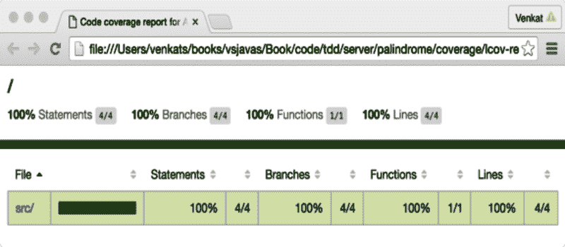

顶层视图显示我们的覆盖率良好。点击 `src` 链接并进入源文件级覆盖率，即可查看行的覆盖率报告。

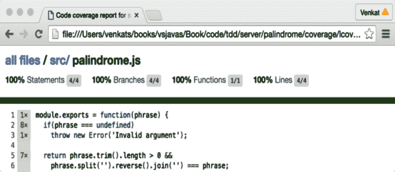

行旁边的计数显示该行被执行的次数。如果有一或多行代码没有被任何测试覆盖，则整行将高亮为红色，而不是计数显示为绿色。由于我们只有一个异常测试，带有 `throw` 子句的行显示为 1。

假设我们不是先写异常测试，而是直接偷偷插入了抛出异常的代码。那么覆盖率报告就会像下面那样揭露这一点：

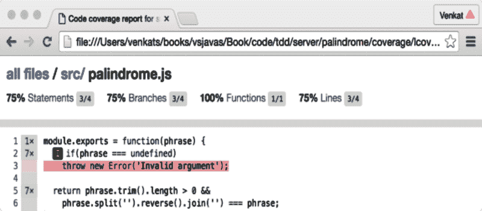

虽然我们都希望自己永远不会在没有测试的情况下溜入代码，但我们身上有一个名为“人”的显著不完美的部分。我们可以依靠代码覆盖率工具来留意那些在没有测试的情况下进入的代码。

虽然覆盖率报告很有用，但不要过度依赖它。报告中红色高亮的行明确指出了缺失的测试，但绿色并不意味着代码经过了良好的测试。例如，删除负向测试并运行覆盖率。报告仍将显示全绿，尽管覆盖率计数会降低，因为正向测试执行了代码中的两个条件，而覆盖率报告并没有显示测试的缺失。

尽管覆盖率报告并不完美，我们无法根据报告对应用程序健康状况做出任何断，但我经常使用它。在我的经验中，每当我注意到未覆盖的代码时，它也指向了低质量的代码或需要重构的设计缺陷。至于覆盖率报告没有发现缺失的测试，良好的代码审查可以弥补这一点。在我的项目中，我们不仅审查代码，还审查测试——这有助于创建更高质量的代码和测试。

我们已经为在 `Node.js` 中运行的代码编写了自动化测试，但我们仅仅触及皮毛。在书的后面部分，你将学习测试更多的服务器端代码——异步代码、带有依赖的代码以及在 `Express` 中运行的代码。

我们已经看到了如何设置工具并为服务器端代码编写测试。让我们转换一下，谈谈测试客户端代码。测试的结构和语法将与我们在服务器端看到的非常相似。然而，运行测试的环境以及帮助我们实现该点的工具将大不相同。让我们接下来探索客户端测试自动化。

## 准备客户端测试

为了自动验证客户端代码的行为，我们必须遵循几个步骤：将代码和测试加载到不同的浏览器中、执行测试、断言预期，并生成运行报告。我们已经看过的三个工具 `Mocha`、`Chai` 和 `Istanbul` 可以帮助执行测试、断言和覆盖率报告。而要自动将代码和测试加载到浏览器中——这就是 `Karma` 用用用场。

`Karma` 是一个轻量级服务器，用于管理在不同浏览器中加载和运行测试。你可以告诉 `Karma` 你想使用的浏览器以及要采用哪些测试工具，`Karma` 会处理其余工作。

`Karma` 可以在监听模式下运行，这意味着当前目录层次下的任何代码发生变化，`Karma` 都可以自动重新运行测试。这是一个非常好用的特性；在短的测试代码循环中，你不需要花额外精力运行测试。只需保存你正在编写的文件，`Karma` 就会注意到变化并重新运行测试。

我们将为 `palindrome` 函数重新创建测试，这次是在客户端浏览器上运行，而不是在 `Node.js` 内部运行。`Karma` 将负责在浏览器中加载测试和代码进行测试。在使用 `Karma` 之前，我们必须先为客户端示例设置一个项目——这是下一步。

### 切换到客户端项目

对于服务器端项目，我们只使用了三个工具。对于客户端，我们需要多得多的。我们不会手动安装每一个，而是使用另一个预创建的 `package.json` 文件。

在你的工作空间中，切换到 `tdd/client/palindrome` 并查看该目录下的 `package.json` 文件：

[tdd/client/palindrome/package.json](http://media.pragprog.com/titles/vsjavas/code/tdd/client/palindrome/package.json)

| | { |
| :--- | :--- |
| | `"name": "palindrome2", |
| | `"version": "1.0.0", |
| | `"description": "", |
| | `"main": "index.js", |
| | `"scripts": { |
| | `"test": "karma start --reporters clear-screen,dots,coverage"` |
| | }, |
| | `"author": "", |
| | `"license": "ISC", |
| | `"devDependencies": { |
| | `"chai": "⁴.17.1", |
| | `"karma-clear-screen-reporter": "¹.0.10", |
| | `"karma": "¹.6.0", |
| | `"karma-chrome-launcher": "³.0.0", |
| | `"karma-coverage": "¹.13.0", |
| | `"karma-mocha": "⁵.0.0", |
| | `"istanbul": "⁰.10.0", |
| | `"mocha": "⁸.1.0"` |
| | } |
| } |

这是一堆依赖，但我们可以使用以下命令快速安装所有它们：

```
npm install
```

### 配置 Karma

为了成功运行并完成工作，Karma 需要知道一些事情。它需要关于你喜欢的自动化测试工具的细节、测试文件的位置、在哪里查找源文件，以及你想让它运行的其他工具（如覆盖率工具）。Karma 期望你通过配置文件提供这些细节。

如果没有提供文件名，Karma 会读取名为 `karma.conf.js` 的配置文件。我们将在当前工作空间目录 `tdd/client/palindrome` 下创建此文件。与其手动创建此文件，我们可以使用以下交互式命令来创建一个包含所需细节的文件：

```
node node_modules/karma/bin/karma init
```

当你运行此命令时，它会交互式地询问你喜欢的测试框架和浏览器。对于它提出的每一个问题，请输入以下详细信息：


*   **测试框架**: 默认提供 `Jasmine`；按 Tab 键直到看到 `Mocha` 然后按回车键。
*   想使用 `Require.js`：选择默认的‘no’。
*   **要捕获的浏览器**: 选择 `Chrome` 然后按两次回车键。
*   按回车键对所有其他问题采用默认值。

在运行之前的命令并提供输入后，你将在当前目录下看到一个名为 `karma.conf.js` 的文件。编辑该文件以包含 `chai` 和源文件的位置，如下：

[tdd/client/palindrome/karma.conf.js](http://media.pragprog.com/titles/vsjavas/code/tdd/client/palindrome/karma.conf.js)

```javascript
//...
// 要使用的框架
// 可用的框架: https://npmjs.org/browse/keyword/karma-adapter
frameworks: ['mocha', 'chai'],

// 需要在浏览器中加载的文件列表/模式
files: [
  './test/**/*.js',
  './src/**/*.js'
],
//...
```

在你打开配置文件时，请查看 `browsers` 设置：

[tdd/client/palindrome/karma.conf.js](http://media.pragprog.com/titles/vsjavas/code/tdd/client/palindrome/karma.conf.js)

```javascript
//启动这些浏览器
// 可用的启动器:
// https://npmjs.org/browse/keyword/karma-launcher
browsers: ['Chrome'],
```

尽管我们只要求 Karma 运行 `Chrome`，但你也可以列出任意数量的浏览器，`Karma` 将在每一个浏览器中运行测试。确保在此列表中包含你的目标浏览器，以验证代码在每个浏览器中都能良好运行。

现在我们已经准备好编写测试并使用 `Karma` 运行它们了。

### 金丝雀测试（Canary Test）开始

我们已经使用 `Mocha` 和 `Chai` 为服务器端创建了测试。由于我们在客户端测试中使用了相同的工具，从语法上来说，客户端的测试与服务器端的测试看起来相同。主要区别在于我们如何 `require` 文件以及运行测试。让我们从金丝雀测试开始，熟悉这些步骤。

打开 `tdd/client/palindrome/test` 目录下的 `palindrome-test.js` 文件，并输入以下代码：

[tdd/client/palindrome/test/palindrome-test.js](http://media.pragprog.com/titles/vsjavas/code/tdd/client/palindrome/test/palindrome-test.js)

```javascript
describe('palindrome-test', function() {
  it('should pass this canary test', function() {
    expect(true).to.be.true;
  });
});
```

让我们让这个客户端金丝雀“歌唱”起来——运行 `npm test` 来执行 `Karma`。

只需几次击键，你就要求 `Karma` 执行了多件事：启动服务器、在内部生成一个 HTML 文件并在浏览器中启动、加载你在配置文件中提到的 JavaScript 文件、启动你在配置文件中请求的浏览器、运行测试并报告结果。列出 `Karma` 所做的事情让我快喘不过气了，但它轻而易举地完成了这些工作。紧接着，它会忠实地等待你对文件进行更改，以便在检测到更改后重新运行测试。

当你运行命令 `npm test` 时，你会看到 `Chrome` 弹出并执行测试。然后 `Karma` 会停留在那里等待你对代码或测试进行更改。如果你只想运行一次测试并在结束后自动关闭浏览器，请更改 `package.json` 文件中的测试命令，添加 `--single-run` 选项，如下：

```json
"scripts": {
  "test": "karma start --reporters clear-screen,dots,coverage --single-run"
},
```

无论你选择哪种选项来运行 `Karma`，它都会报告测试运行的结果。`dots` 报告器会在每个测试运行运行时显示一个点。当有大量测试需要运行，且你像我一样急于知道程序正在进行而非被阻塞时，这可以提供非常有用的反馈。这里是我们的金丝雀在上一条命令问题上的输出：

```text
.
Chrome 48.0.2564 (Mac OS X 10.10.5):
Executed 1 of 1 SUCCESS (0.009 secs / 0.001 secs)
```

现在金丝雀测试已经工作了，让我们继续对客户端的 `palindrome` 函数进行真实测试。

### 设计客户端代码

在浏览器中运行的 JavaScript 带来了一些额外的挑战。你可能需要检查：
*   在浏览器中运行良好
*   与用户交互正常
*   正确地处理数据

尽管我们只要求 Karma 运行 `Chrome`，但你也可以列出任意数量的浏览器，`Karma` 将在每一个浏览器中运行测试。我们已经准备好实现 `palindrome` 函数了。

打开 `tdd/client/palindrome/test/palindrome-test.js` 并添加以下测试使金丝雀测试通过：

```javascript
it('should return true for mom', function() {
  expect(palindrome('mom')).to.be.true;
});
```

打开 `tdd/client/palindrome/src/palindrome.js` 并添加代码：

```javascript
var palindrome = function(phrase) {
  return true;
};
```

通常我们使用 `<script>` 标签在 HTML 页面引入 JavaScript 文件。`Karma` 会为我们完成这一点。运行 `npm test` 并观察 `Karma` 将测试和源文件加载到浏览器中。

完成后，将你在工作区演化的 `tdd/client/palindrome/test/palindrome-test.js` 内容与这里的代码进行对比：

[tdd/client/palindrome/test/palindrome-test.js](http://media.pragprog.com/titles/vsjavas/code/tdd/client/palindrome/palindrome-test.js)

```javascript
describe('palindrome-test', function() {
  it('should pass this canary test', function() {
    expect(true).to.be.true;
  });
  it('should return true for mom', function() {
    expect(palindrome('mom')).to.be.true;
  });
});
```


```javascript
expect(isPalindrome('mom dad')).to.be.false;

it('should return false when argument is an empty string', function() {
  expect(isPalindrome('')).to.be.false;
});

it('should return false for argument with only two spaces', function() {
  expect(isPalindrome(' ')).to.be.false;
});

it('should throw an exception if argument is missing', function() {
  var call = function() { isPalindrome(); };
  expect(call).to.throw(Error, 'Invalid argument');
});
```

此外，请将你在工作区中修改的文件 `tdd/client/palindrome/src/palindrome.js` 与此列表进行对比：[tdd/client/palindrome/src/palindrome.js](http://media.pragprog.com/titles/vsjavas/code/tdd/client/palindrome/src/palindrome.js)

```javascript
var isPalindrome = function(phrase) {
  if(phrase === undefined)
    throw new Error('Invalid argument');

  return phrase.trim().length > 0 &&
  phrase.split('').reverse().join('') === phrase;
};
```

运行 `npm test` 来执行测试并观察测试是否通过：

```
.........
Chrome 48.0.2564 (Mac OS X 10.10.5):
Executed 9 of 9 SUCCESS (0.017 secs / 0.003 secs)
```

Mocha 在 Chrome 浏览器内部报告所有测试均通过。如果你是增量编写这些代码并让其运行起来的，给自己鼓个掌吧。尽管去，没人在看。

Karma 让生活变得简单，但有一点提醒。在创建文件时，务必确保 JavaScript 文件所在的目录路径中不要包含空格。例如，名为 `c:\my projects\palindrome\...` 的路径，在 `my` 和 `projects` 之间有空格，这对 Karma 是的——该工具在某些操作系统上会卡死且不会产生任何有用的错误信息。

我们为客户端编写并执行了测试。接下来，学习覆盖率报告。

## 测量客户端代码覆盖率

我们使用 `Istanbul` 来测量服务器端代码的覆盖率。同样的工具也可以用于客户端。我们在工作区中为客户端项目使用的 `package.json` 文件已经列出了必要的工具，`Istanbul` 以及必要的 `Karma` 插件。此外，测试命令已经指定在每次运行测试时生成覆盖率报告。我们所做的只是查看覆盖率报告——好吧，差不多。我们需要对 `tdd/client/palindrome` 目录下的 `karma.conf.js` 文件进行微调：[tdd/client/palindrome/karma.conf.js](http://media.pragprog.com/titles/vsjavas/code/tdd/client/palindrome/karma.conf.js)

```javascript
// 在将文件提供给浏览器之前进行预处理
// 可用的预处理器: https://npmjs.org/keyword/karma-preprocessor
preprocessors: {
  'src/*.js': ['coverage']
},

// 使用的报告，可能的值: 'dots', 'progress'
// 可用的报告: https://npmjs.org/keyword/karma-reporter
reporters: ['progress', 'coverage'],
```

我们将需要进行覆盖率统计的源文件位置添加到 `preprocessors` 属性中。我们通过更改 `reporters` 属性让 `Karma` 使用覆盖率报告。

保存对 `karma.conf.js` 文件的修改并运行 `npm test`。运行 `Karma` 时，`Istanbul` 现在会对源代码进行插桩、测量代码覆盖率并生成报告。查看生成的覆盖率目录。进入以运行测试的浏览器命名的子目录——在我们的案例中是 `Chrome`——并使用你喜欢的浏览器打开 `index.html` 文件。

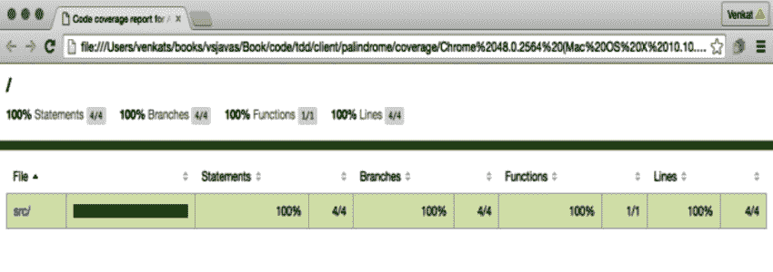

顶层视图显示我们的覆盖率良好。点击 `src` 链接并到源码级覆盖率，查看逐行覆盖率报告，就像我们对服务器端代码做的那样。


获取覆盖率报告并不费力。没有什么能阻碍你的团队在代码随测试演进时持续关注代码。

## 总结

自动化测试带给我们回归测试的优势。在编写代码的同时而不是之后编写这些测试，还有一个额外的好处——它可以帮助塑造设计。为了让一段代码被自动验证，它必须是模块化、内聚且解耦的。

在本章中，我们尝试了测试驱动设计。你学习了使用 `Mocha`、`Chai`、`Karma` 和 `Istanbul` 来编写测试、运行测试并监控覆盖率。我们使用同一套工具为服务器端和客户端代码编写了测试。测试本身并不区别——主要的区别在于我们如何引入被测试的函数。当我们开始进行特定的服务器端和客户端编码时，这种情况将会改变。

接收输入并返回响应的测试方法相当容易，但这并不是我们每天处理的唯一类型代码。现在本章已经为我们奠定了基础，我们将在下一章处理那些棘手的异步函数。

## 脚注

8 [`nodejs.org`](https://nodejs.org)
9 [`mochajs.org`](https://mochajs.org)
10 [`chaijs.com`](http://chaijs.com)
11 [`c2.com/cgi/wiki?ArrangeActAssert`](http://c2.com/cgi/wiki?ArrangeActAssert)
12 [`github.com/gotwarlost/istanbul/issues/44#issuecomment-1609330`](https://github.com/gotwarlost/istanbul/issues/44#issuecomment-1609330)

Copyright © 2016, The Pragmatic Bookshelf.

# 第 3 章：测试异步性

JavaScript 库充满了 `async` 函数。例如，为了读取文件，将文件名传递给 `fs` 库，它稍后会返回数据或错误。同样，与服务的通信涉及 `async` 函数——我们无法逃避异步性。让我们用自动化测试来拥抱异步性。

接收输入并返回响应的测试方法相当容易，但这并不是我们每天处理的唯一类型代码。现在本章已经为我们奠定了基础，我们将在下一章处理那些棘手的异步函数。

测试异步函数的测试面临着一些挑战。调用同步函数会阻塞并等待结果。然而，调用异步函数是非阻塞的，结果或错误稍后会通过 `callbacks` 或 `promises` 到达。


同步函数的调用者会阻塞，直到获取到结果或完成预期的操作。但是，对异步函数的调用是非阻塞的。此类函数的调用者通常会发送一个或多个回调函数作为额外参数并继续执行。使用回调函数的异步函数最终会在处理完成后调用一个或多个回调。正是通过这些回调函数，它们间接地向调用者传回了响应。函数性质的差异从测试的角度来说带来了一些挑战。

由于调用性质的限制，同步函数的测试会自动等待结果到达。异步函数的测试则需要引入等待，因为调用是非阻塞的。在执行中引入休眠（sleep）或延迟是不够的首先，这会让测试运行变慢；此外，无法保证异步函数会在延迟时间内响应。相反，我们需要一种可靠的机制来测试这些函数。让我们通过一个示例来探索这一点。

我们要测试的函数读取给定的文件并返回其中的行数。它目前没有测试——我们将一起为它编写测试。

首先，我们将像对待同步函数那样，为这个异步函数编写一个朴素的测试。你将从这段经历中了解到为什么异步测试需要不同的方法。然后，我们将编写一个正确的异步测试并让它通过。最后，我们还将为该异步函数编写一个否定测试。让我们开始吧。

### 朴素的测试尝试

让我们首先用测试同步函数的方法来尝试测试异步函数。这项练习将使你熟悉待测试的代码，并帮助你理解为什么需要不同的测试方法。

通过切换到工作区中的 `tdjsa/async/files` 目录进入一个新的文件项目。我们在在这个项目中使用的工具是 Mocha 和 Chai。让我们立即在当前项目目录下运行 `npm install` 命令来安装它们——这将成为我们每次进入项目目录并看到 `package.json` 文件时的常规操作。

看一眼 `src/files.js` 文件中的代码。你会看到一个函数，它接收一个文件名，并最终通过回调返回文件的行数或错误。

`async/files/src/files.js`

```javascript
var fs = require('fs');

var linesCount = function(fileName, callback, onError) {
  var processFile = function(err, data) {
    if(err) {
      onError('unable to open file ' + fileName);
    } else {
      callback(data.toString().split('\n').length);
    }
  };

  fs.readFile(fileName, processFile);
};

module.exports = linesCount;
```

让我们使用目前为止用于同步函数的方法，为这个函数编写一个测试。在工作区的当前文件项目中打开空文件 `test/files-test.js` 并输入以下代码：

```javascript
var expect = require('chai').expect;
var linesCount = require('../src/files');

describe('test server-side callback', function() {
  it('should return correct lines count for a valid file', function() {
    // 尝试得不错，但这实际上不起作用
    var callback = function(count) {
      expect(count).to.be.eql(-2319);
    };

    linesCount('src/files.js', callback);
  });
});
```

我们想要验证 `linesCount` 函数是否正确返回了给定文件的行数。但为了实现这一点，我们需要传递文件名作为参数。很难预测不同系统上存在哪些文件。但我们都知道源代码文件存在于我们的系统上，因此我们将该文件名作为 `linesCount` 函数的参数。

在 `files-test.js` 顶部，加载了包含测试代码的文件，并将文件中的函数赋值给变量 `linesCount`。测试调用了 `linesCount` 函数，向其发送源代码名称作为文件名，并注册了一个回调函数。在回调内部，测试断言接收到的参数计数为 -2319。我们知道行数不可能是负数——显然测试是失败的。如果一切顺利，这个测试应该报告失败，但让我们看看会发生什么。

让我们用命令 `npm test` 运行测试。运行时，测试通过了而不是失败，正如我们在输出中所示：

```
test server-side callback
  ✓ should return correct lines count for a valid file

  1 passing (5ms)
```

从自动化的角度来看，没有比撒谎的测试更糟糕的了。测试应该是高度确定性的，并且应该只在 reason 正确的情况下才通过。这个测试调用了 `linesCount` 函数，传递了文件名和回调，并立即退出。测试中没有任何地方告诉 Mocha 等待回调的执行。因此，测试并没有实际上等待回调最终被调用时去执行回调内部的断言。如果测试在执行路径中没有断言时能够失败那就太好了，但正如我们所看到的，事实并非如此。

我们需要告诉 Mocha 不要假设在退出测试函数时测试就已完成。我们需要工具等待回调函数的执行以及其内部断言的执行，然后才能宣布测试通过或失败。

这个示例是一个很好的提醒，即先让每个测试失败，然后用最少的代码让它通过。

### 编写异步测试

使用 Mocha 编写的测试可以包含一个参数，该参数可用于信号实际完成。当测试退出时，Mocha 会等待测试实际完成的信号。如果在接收到信号之前断言失败，或者在合理时间内没有收到信号，它将宣布测试为失败。

让我们编辑测试，使得退出测试不再意味着测试完成：

```javascript
it('should return correct lines count for a valid file', function(done) {
  var callback = function(count) {
    expect(count).to.be.eql(-2319);
  };

  linesCount('src/files.js', callback);
});
```

与之前的测试不同，这个测试接受了一个参数——你可以为它命名为任何名称，但 `done` 非常逻辑。它是向 Mocha 通知测试何时真正完成的方法。换句话说，如果存在参数，Mocha 不会在测试函数完成后就假设测试已完成。相反，它会等待通过该参数传递的完成信号。无论被测试的函数是同步还是异步，这种技术都可以用于验证回调中的结果。

现在让我们运行测试，看看它是否像应该的那样彻底崩掉：

```
test server-side callback
  1) should return correct lines count for a valid file

  0 passing (9ms)
  1 failing

  1) test server-side callback
    should return correct lines count for a valid file:

    Uncaught AssertionError: expected 15 to deeply equal -2319
      + expected - actual

      -15
+-2319

      at callback (test/files-test.js:8:27)
      at processFile (src/files.js:8:7)
      at FSReqWrap.readFileAfterClose [as oncomplete] (fs.js:404:3)
```


为了让测试通过，让我们把回调函数中的 `-2319` 改为 `15`。作为一名敏锐的读者，你可能会异议：“等一下，如果文件发生了变化，测试不就会失败吗？”是的，会，但让我们现在先关注异步问题；我们会在书的后面关注其他问题。以下是带有正确预期值的回调函数修改：

```javascript
it('should return correct lines count for a valid file', function(done) {
  var callback = function(count) {
    expect(count).to.be.eql(15);
  };
  linesCount('src/files.js', callback);
});
```

回调函数验证了传递的值，但当再次运行 `npm test` 时，Mocha 报告：

```
test server-side callback
1) should return correct lines count for a valid file
0 passing (2s)
1 failing

1) test server-side callback should return correct lines count for a valid file:
Error: timeout of 2000ms exceeded.
Ensure the done() callback is being called in this test.
```

尽管回调函数中的断言通过了，但测试在等待 2 秒（默认超时时间）后失败了。这是因为测试从未信号它已完成。为了修复这个问题，我们将在回调函数的末尾添加对 `done()` 的调用。你很快就会看到如何更改默认超时。以下是修改后的测试：

```javascript
it('should return correct lines count for a valid file', function(done) {
  var callback = function(count) {
    expect(count).to.be.eql(15);
    done();
  };
  linesCount('src/files.js', callback);
});
```

现在运行 `npm test` 看看测试通过了，但这次是因为正确的原因：

```
test server-side callback
✓ should return correct lines count for a valid file
1 passing (7ms)
```

让我们再写一个异步测试来练习，但这次我们要把它写成一个负向测试（negative test）。

### 负向异步测试

我们编写的测试只涵盖了函数的正常路径（happy path）。还需要验证函数在给定无效文件时的行为。让我们再次在 `files-test.js` 中为此编写一个测试。

```javascript
it('should report error for an invalid file', function(done) {
  var onError = function(error) {
    expect(error).to.be.eql('unable to open file flies.js');
    done();
  };
  linesCount('files.js', undefined, onError);
});
```

第二个测试向函数发送了一个无效的文件名——`flies` 而不是 `files`。测试假设这样一个由于命名错误的文件不存在。这类测试很麻烦——它们是脆弱的，如果依赖发生变化可能会失败。同样，我们稍后会解决这个问题。函数的第二个参数是 `undefined`，因为它在这次调用中不会被使用。新的第三个参数是一个验证错误的回调函数。再次，这个测试接收了 `done` 参数，回调函数通过该参数信号测试的完成。让我们运行测试，Mocha 应该报告成功：

```
test server-side callback
✓ should return correct lines count for a valid file
✓ should report error for an invalid file
2 passing (8ms)
```

### Joe 提问：3-As 模式适用于异步测试吗？

良好的测试遵循 [创建测试] 中提到的 3-As 模式。异步测试也不例外。安排（arrange）部分之后是执行（act）部分，但断言（assert）部分嵌入在回调函数中。尽管可能显而易见，但测试的执行流遵循安排、执行和断言的顺序。Mocha 依赖其测试函数的参数来判断异步函数何时完成。现在你已经知道如何测试运行在服务器端的异步函数了，让我们探索如何在客户端执行同样的操作。

### 客户端回调

与服务器端一样，客户端使用的许多库也依赖于回调。即使异步函数在浏览器中运行，验证其行为也无异。你可以将为服务器端代码学习的技术也应用于客户端代码。

我们将通过一个使用 geolocation API 获取用户当前位置的示例来练习测试客户端异步函数。该示例项目位于你工作区的 `async/geolocation` 目录下。该项目将使用 Mocha、Chai 以及 Karma 需要的与这些工具以及浏览器集成的插件。有关工具的完整列表，请查看当前项目目录下的 `package.json` 文件。此外，让我们花一点时间在当前项目目录下运行 `npm install` 命令来安装这些工具。

要测试的代码在 `src/fetch.js` 文件中。让我们快速看一下它：

```javascript
var fetchLocation = function(onSuccess, onError) {
  var returnLocation = function(position) {
    var location = {
      lat: position.coords.latitude, lon: position.coords.longitude 
    };
    onSuccess(location);
  };
  navigator.geolocation.getCurrentPosition(returnLocation, onError);
};
```

geolocation API 是异步的，因为从手机站或 GPS 卫星获取位置不是瞬时操作。如果一切顺利，`fetchLocation` 函数将获取当前位置的纬度和经度。

首先，函数仅将 `onError` 参数传递给 `getCurrentPosition` 函数。其次，它为成功场景注册了自己的回调，处理响应以获取所需值，并将其发送 `onSuccess` 回调。

该函数的正常路径测试与我们为 `linesCount` 函数编写的测试相似。然而，我们需要增加默认的 2 秒超时时间。获取位置可能需要更多时间；如果保持默认值，测试可能会响应到达之前失败。我们将超时设置为 10 秒或 10000 毫秒。让我们在当前项目的 `test/fetch-test.js` 文件中输入以下代码：

```javascript
describe('fetch location test', function() {
  it('should get lat and lon from fetchLocation', function(done) {
    var onSuccess = function(location) {
      expect(location).to.have.property('lat');
      expect(location).to.have.property('lon');
      done();
    };
    var onError = function(err) {
      throw 'not expected';
    };
    this.timeout(10000);
    fetchLocation(onSuccess, onError);
  });
});
```

在调用 `fetchLocation` 函数之前，测试设置了比默认值合理更高的超时时间。如果调用了 `onError` 回调而不是预期的 `onSuccess`，测试将报告失败。


要运行测试，我们需要启动 Karma。为了方便起见，该项目目录中已经提供了必要的 `karma.conf.js` 文件。运行 `npm test` 来执行 Karma，它会将整套工具加载到浏览器并运行测试。

Karma 将启动 `Chrome`，随后它会请求你的权限以获取当前位置。

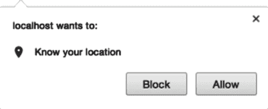

快速点击 `Allow` 按钮。Karma 将关闭浏览器并报告测试通过——希望如此——只要你在 10 秒内授予了权限并且 API 能够获取到位置。

| ​  | . |
| ​  | Chrome 48.0.2564 (Mac OS X 10.10.5): |
| ​  | Executed 1 of 1 SUCCESS (6.017 secs / 6.011 secs) |

这个测试带给了我们一些教训，有好的也有坏的。

在好的方面，它展示了如何在客户端设置和运行异步函数的测试。此外，它说明了为什么要设置以及如何设置超时。它演示了当我们在单次运行模式下运行时，Karma 如何启动并关闭像 `Chrome` 这样的交互式浏览器——这就是我们在 `package.json` 文件的 `npm test` 命令中请求的操作。

在坏的方面，这个测试以及本章之前的测试向我们展示了依赖关系为测试自动化带来的困难。`fetchLocation` 的测试实际上是手动的，因为需要人工干预来允许位置 API 获取用户的位置。此外，如果权限被拒绝或未在合理时间内授予，测试将失败。如果 API 无法获取位置，测试也会崩溃。最后，与我们目前为止运行的其他测试相比，该测试的执行速度很慢。换句话说，在不更改任何代码的情况下，一个通过的测试可能会因为许多原因最终失败——这太荒谬了。偶尔失败的自动化测试是测试设计糟糕的标志。

这些例子帮助你学习了如何为异步函数编写测试。但从现实来说，为了充分利用自动化测试，必须对代码进行不同的结构处理。你将在下一章学习如何这样做以及如何妥善处理依赖关系。

异步函数传统上使用回调，但 promises 在 JavaScript 中越来越流行。让我们接下来来看如何为它们编写测试。

## 测试你的 Promises

现在让我们探索在 `Node.js` 中运行的代码对 promises 进行测试。同样的技巧也适用于使用 promises 的客户端代码。我们将从对 promises 的简要介绍开始，然后深入测试使用 promises 的代码。

### Promises 的简要介绍

在深入测试 promises 之前，让我们回顾一下 promises 是如何工作的——我保证会很短的。

传统上，异步函数使用回调。但回调有几个缺点。在异步函数生成任何响应之前，必须注册回调。例如，当使用 `XMLHttpRequest` 实例时，在向 `onreadystatechange` 属性注册回调之前调用 `send` 函数可能会导致丢失某些事件。此外，组合回调很困难——当一个回调反过来调用其他异步函数并注册其他回调时，代码会变得极其冗长且繁琐。

Promises 没有这些问题，这也是它们日益受欢迎的原因之一。使用 promises 的函数在响应调用时会立即返回一个 `Promise` 对象。然后它们通过这个 `Promise` 对象对调用者做出响应。

与回调相比，Promises 更加清晰地表达了异步的意图。下面这张图展示了 promises 通过一系列函数调用进行传播的情况。

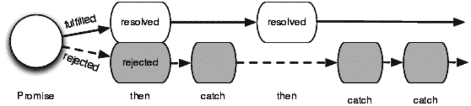

使用 promises 的代码可能会形成 `then` 和 `catch` 调用的链。链中执行顶部路径或底部路径，取决于 promise 是被解析（resolved）还是拒绝（rejected）。如果 `Promise` 被解析了，那么 `then` 函数的解析部分将转换解析值并将其作为 `Promise` 传递给链中的下一个接收者。相反，如果 `Promise` 被拒绝了，那么一系列 `catch` 函数将通过调用链转换被拒绝的原因。该链也可以选择性地包含 `then` 函数的拒绝部分。

### 针对 Promises 的异步测试类型

让我们关注测试返回 promises 的函数。尽管一个函数返回一个 `Promise`，但该函数的预定任务可能尚未完成——毕竟，它是异步的。对该函数的测试必须等待 promise 被解析或被拒绝。

像 `Mocha` 这样的工具为测试返回 promises 的函数提供了特殊的测试能力能力。`Mocha` 的异步测试有两种形式：

1. 测试可以接受一个 `done` 参数，该参数可用于指示测试完成。
2. 测试本身可以返回一个 `Promise` 来指示最终的测试完成。

第一种形式可以用于带有回调的回和带有 promises 的函数。第二种方案显显然是为带有 promises 的函数设计的。

| 函数中的 Promises 与 测试中的 Promises |
| --- |
| ​  |  | 我们专注于测试带有 promises 的函数。任何 JavaScript 测试工具都可以用于测试此类函数。然而，某些工具还提供了从测试返回 promises 的能力。 |

让我们通过一个例子来探索编写 promises 测试的不同方法，并讨论每种方法的优。

### 返回 Promise 的函数

我们将使用修改过的 `linesCount` 函数练习使用 promises 进行测试。让我们通过切换到工作区的 `async/promises` 目录进入一个新的 promises 项目。在这个项目中，我们将使用熟悉的 `Mocha` 和 `Chai` 以及一个新包 `chai-as-promised`，我们稍后会讨论它。让我们花时间运行 `npm install` 安装这些包。

返回 `Promise` 的函数已经提供在项目中。查看 `src/files.js` 文件的内容。该函数计算文件的行数，就像之前的版本做的那样，但使用 promises 代替了回调。

[async/promises/src/files.js](http://media.pragprog.com/titles/vsjavas/code/async/promises/src/files.js)

```javascript
var fs = require('fs-promise');
module.exports = function(fileName) {
  var onSuccess = function(data) {
    return Promise.resolve(data.toString().split('\n').length);
  };
  var onError = function(err) {
    return Promise.reject(new Error('unable to open file ' + fileName));
  };
  return fs.readFile(fileName)
    .then(onSuccess)
    .catch(onError);
};
```

该函数需要 `fs-promise` 模块，但不用，它已经包含在当前项目 `package.json` 文件的依赖中了。

旧 `fs` 模块函数接受回调。虽然 `fs-promise` 模块函数执行与 `fs` 模块函数的任务相同，但它们返回 `Promise` 而不是接受回调。让我们看看之前的代码中是如何使用 `fs-promise` 模块的。


让我们从底到上读取 `promises/src/files.js` 文件中的函数。在函数的末尾，我们将给定的文件名传递给 `fs-promise` 的 `readFile` 函数。该函数在调用后立即返回一个 `Promise` 对象。当 `readFile` 函数最终读取文件时，它会将文件内容发送到作为参数注册的 `then` 回调函数——即 `onSuccess` 函数。如果读取文件时出错，它将调用与 `catch` 回调注册的函数——即 `onError` 函数。`onSuccess` 函数计算文件内容的行数并返回该数据，该数据被封装在另一个 `Promise` 对象中。`onError` 函数返回错误详情（如果有的话），同样被封装在 `Promise` 中。

## 使用 done() 进行测试

我们可以使用测试带回调函数的相同技术来测试返回 promise 的函数。让我们先从对返回 `linesCount` 的函数的 promise 进行正常路径（happy path）测试开始。我们将在测试中使用 `done` 参数。

编辑当前项目中的 `test/files-test.js`，并为第一个 promise 测试输入以下代码：

[async/promises/test/files-test.js](http://media.pragprog.com/titles/vsjavas/code/async/promises/test/files-test.js)

```javascript
var expect = require('chai').expect;
var linesCount = require('../src/files');

describe('test promises', function() {
  it('should return correct lines count for a valid file', function(done) {
    var checkCount = function(count) {
      expect(count).to.be.eql(15);
      done();
    };

    linesCount('src/files.js')
      .then(checkCount);
  });
});
```

该测试创建了一个 `checkCount` 验证函数，它断言给定的计数是正确的并信号测试完成。然后，测试调用被测函数，并将 `checkCount` 注册为当 `linesCount` 返回的 promise 解决时调用的函数。

在 promises 目录从命令行提示符运行 `npm test`。当 `linesCount` 函数内部创建的 `Promise` 解决且响应到达 `checkCount` 函数时，测试将通过。如果 `Promise` 在 `linesCount` 函数内部被拒绝（rejected），则测试将失败。

由于前面讨论的原因，函数返回 promise 比返回回调更好。因此，我们可以预期使用 promise 的函数测试会比使用回调的函数测试更好。但上一个测试与带回调的函数测试相比并没有特别之处——幸运的是，它可以被改进。接下来，我们将看到如何让带 promise 的函数测试更具表现力。

## 返回 Promise 的测试

我们可以通过从测试中返回 `Promise` 来让测试更简洁、更具表现力。如果测试返回一个 `Promise`，那么 Mocha 将等待（最长持续超时时间）直到 `Promise` 解决或拒绝，然后宣布测试完成。让我们通过向 `test/files-test.js` 文件中添加另一个测试来感受一下返回 `Promise` 的测试：

[async/promises/test/files-test.js](http://media.pragprog.com/titles/vsjavas/code/async/promises/test/files-test.js)

```javascript
it('should return correct lines count - using return', function() {
  var callback = function(count) {
    expect(count).to.be.eql(15);
  };

  return linesCount('src/files.js')
    .then(callback);
});
```

这又好上了一次。没有了 `done` 参数，且验证结果的函数变得简洁了一些。我们可以返回一个 `Promise` 且 Mocha 知道如何处理，这很酷。但我们可以通过另一个库的帮助让它更简洁。

## 使用 chai-as-promised

测试不再仅仅返回被测函数返回的 `Promise` 对象，而是断言被测函数最终以预期的响应完成。为了实现这一点，我们将使用专门为测试 promise 创建的 `chai-as-promised` 库。

`chai-as-promised` 库扩展了 `Chai` 的流畅 API，增加了验证 promise 响应的函数。要使用此模块，我们首先需要在测试文件 `test/files-test.js` 中添加以下行：

[async/promises/test/files-test.js](http://media.pragprog.com/titles/vsjavas/code/async/promises/test/files-test.js)

```javascript
require('chai').use(require('chai-as-promised'));
```

`use` 函数为 `Chai` 函数增加了 `eventually` 属性。最后，我们将不再使用你目前为止看到的 `expect...to.be.eql`，而是使用 `chai-as-promised` 的语法 `expect...to.eventually.eql`。让我们添加一个新的测试来查看 `eventually` 特性的用法：

[async/promises/test/files-test.js](http://media.pragprog.com/titles/vsjavas/code/async/promises/test/files-test.js)

```javascript
it('should return correct lines count - using eventually', function() {
  return expect(linesCount('src/files.js')).to.eventually.eql(15);
});
```

`eventually` 属性让测试变得简洁且富有表现力。如果 `Promise` 解决并满足 `eventually` 的断言，测试将通过；否则，如果 `Promise` 被拒绝，测试将失败。

## 混合 eventually 和 done()

从测试中返回 `Promise` 是一种很好的方法，但并非所有测试工具都提供这种能力。如果你在使用不感知 promise 的测试工具，或者你单纯倾向于不返回 `Promise`，你可以结合 `eventually` 和 `done` 参数来测试返回 promise 的函数。为了看到它像什么样，让我们添加另一个测试：

[async/promises/test/files-test.js](http://media.pragprog.com/titles/vsjavas/code/async/promises/test/files-test.js)

```javascript
it('should return correct lines count - using return', function(done) {
  expect(linesCount('src/files.js')).to.eventually.eql(15); 
```

## 编写 Promise 反面测试

到目前为止，测试验证了 `linesCount` 返回的 promise 的解决（fulfillment）。当然，`Promise` 可能会被拒绝，我们需要测试这种情况。

如果向 `linesCount` 函数传递无效的文件名，该函数将返回一个拒绝的 `Promise`。让我们通过在一个新的测试中传递错误的文件名来验证这种行为：

[async/promises/test/files-test.js](http://media.pragprog.com/titles/vsjavas/code/async/promises/test/files-test.js)

```javascript
it('should report error for an invalid file name', function(done) {
  expect(linesCount('src/files.js')).to.be.rejected.notify(done);
});
```

`rejected` 属性等待 `Promise` 拒绝。如果 promise 而是被解决了或者没有及时拒绝，则测试将失败。如果它符合预期，`notify` 就会信号测试的完成。

就像我们之前处理 `eventually` 调用一样，我们可以返回 `Promise` 而不是使用 `notify` 来进行 `rejected` 检查。选择你最喜欢的版本。

上一个测试仅确认了 `Promise` 被拒绝，但验证失败时是否传递了正确的错误很重要。对于这一点，可以将 `rejected` 替换为 `rejectedWith`，如下一个测试所示：

[async/promises/test/files-test.js](http://media.pragprog.com/titles/vsjavas/code/async/promises/test/files-test.js)

```javascript
it('should report error for an invalid file name - using with', function(done) {
  expect(linesCount('src/flies.js'))
    .to.be.rejectedWith('unable to open file src/flies.js').notify(done);
});
```


将 Mocha 结合 `chai-as-promised` 库，对 promise 的解析（resolution）和拒绝（rejection）进行测试变得非常简洁且清晰。

让我们运行 `npm test` 并确保我们为 promise 编写的所有不同测试都能正常工作。以下是运行输出：

| ​  | test promises |
| ​  |  |
| ​  | ✓ should return correct lines count for a valid file |
| ​  |  |
| ​  | ✓ should return correct lines count - using return |
| ​  |  |
| ​  | ✓ should return correct lines count - using eventually |
| ​  |  |
| ​  | ✓ should return correct lines count - using no return |
| ​  |  |
| ​  | ✓ should report error for an invalid file name |
| ​  |  |
| ​  | ✓ should report error for an invalid file name - using with |
| ​  |  |
| ​  | 6 passing (12ms) |

测试运行得非常完美，但如果你处理的是慢函数怎么办？Mocha 的默认超时时间是 2 秒。如果一个 `Promise` 没有在该时间内完成，测试将失败。如果你想给函数留出更多时间来完成，可以像你在本章早期那样的使用 `timeout` 函数。

## 本章总结

在本章中，我们取得了进展。你学习了如何为服务器端和客户端的异步函数编写自动化验证。这些工具使得等待异步函数调用回调或通过 `Promise` 响应变得容易。遗憾的是，由于依赖关系的存在，测试很难自动化——你将在下一章中学习如何解决此类问题。

Copyright © 2016, The Pragmatic Bookshelf.

# 第 4 章：巧妙处理依赖关系

依赖几乎无处不在：当代码与远程服务通信、读取或写入文件、更新 DOM、获取用户位置……列表还在不断延伸。依赖就像税收——它们提供价值，但可能变成负担。尽量将它们降至最低。从自动化测试的角度来看，依赖是令人讨厌的。它们会使测试变得不可确定性、脆弱、缓慢且繁琐——我们在上一章中看到了这冰山一角。

良好的设计对于处理依赖至关重要。你可以使用一些巧妙的技巧和技术来解耦并替换依赖，从而使测试是自动化、确定性的且运行快速。在本章中，你将首先学习如何尽可能移除依赖。然后，在依赖是内在的情况下，你将探索如何使用测试双（如伪对象 fakes、存桩 stubs、模拟 mocks 或 探器 spies）来替换它们。

虽然测试双很有帮助，但要谨慎使用。如果不小心，很容易陷入“模拟地狱”（mocking hell）。记住这些告诫，让我们探索一些解耦技术。让我们开始为一个具有复杂依赖关系的问题编写自动化测试。

## 问题与通过探针（Spiking）来学习

首先，我们将处理一个带有显著依赖关系的小问题。我们将创建一个带有“定位”（Locate Me）按钮的 HTML 页面。当用户点击该按钮时， JavaScript 函数将调用 `geolocation` API 来获取用户位置。如果成功，程序将在 Google Maps 上显示位置。如果请求失败，将在 HTML 页面上显示错误消息。

这并不是一个困难的问题，但要为这个程序思考自动化测试可能并不容易。专注于编写测试可能会导致许多困惑的问题：从哪里开始、测试什么、我们到底要写什么代码……当路径不清晰时，请依靠探针（spiking）。

让我们创建一个快速的探针，以获得对问题可能解决方案的深入。一旦我们有了可以运行的东西，并对如何为此问题编写代码有了更好的理解，我们重新开始，测试优先。

### 切换到探针项目

要创建一个探针，我们将使用工作区中的探针项目，因此切换到 `tdjsa/tackle/spike` 目录。为了节省打字时间，利用工作区已提供的 `index.html` 文件，内容如下：

[tackle/spike/index.html](http://media.pragprog.com/titles/vsjavas/code/tackle/spike/index.html)

```html
<!DOCTYPE html>
<html>
<head>
<title>Locate Me</title>
</head>
<body>
<button onclick="locate();">Locate Me</button>
<div id="error"></div>
<script src="src/locateme.js"></script>
</body>
</html>
```

该 HTML 文件有一个按钮，注册了 `onclick` 事件来调用 `locate` 函数。它还有一个 id 为 `error` 的 `div` 元素。最后，文件引用了 `src` 目录下的 `locateme.js` 文件。

对于这次探针练习，你的任务（如果你接受的话）涉及在 `src/locateme.js` 文件中实现 `locate` 函数。该文件中提供了一个空函数供你填充。调用 `navigator.geolocation.getCurrentPosition` 函数，从 `position` 中获取纬度和经度值，为 Google Maps 创建 URL。如果请求失败，将在 HTML 页面上显示错误消息。

### 从探针中获取见解

一旦完成，你可以将创建的代码与以下代码进行比较：

```javascript
// 这是在探针期间创建的暴力破解示例
var locate = function() {
  navigator.geolocation.getCurrentPosition(function(position) {
    var latitude = position.coords.latitude;
    var longitude = position.coords.longitude;
    var url = 'http://maps.google.com/?q=' + latitude + ',' + longitude;
    window.location = url;
  }, function() {
    document.getElementById('error').innerHTML = 'unable to get your location';
  });
};
```

探针过程给了我们一些有用的见解：

*   `getCurrentPosition` 是一个异步函数。我们需要为它注册两个事件处理器——一个用于成功，一个用于失败。
*   当收到错误时，我们必须导航 DOM 获取 div 元素以设置错误详情。
*   给定一个位置，我们需要从中提取纬度和经度值，以便为谷歌地图 创建 URL。
*   设置 `location` 属性（无处不在的 `window` 对象中的隐式变量）会导致浏览器更改位置。
*   这段代码像是一团乱麻——我们需要为自动化测试创建一个模块化的设计。

记住，可测试性是一个设计问题——设计不当的代码很难测试。处理代码中依赖的第一步应该是尽可能移除它。如果函数中的依赖是内在的，那么通过传递或注入依赖项，使代码与其所依赖的内容进行松耦合。然后，与其使用真实的对象或函数，你可以可以使用测试双来替换它，并对交互进行测试。我们将利用手头的示例来学习并应用这些设计技术。

## 可视化模块化设计


我们在探刺（spiking）期间创建的 `locate` 函数负责了所有工作。这非常符合它的预期目的——深入了解当前的问题。然而，我们编写的生产环境代码不应该像探刺代码那样。承担大量功能的函数通常违反了单一责任原则，缺乏内聚性且耦合度高。这种代码通常成本很高且难以维护；而且，它的行为难以快速验证。

有许多小函数正等待着从探刺中脱颖而出，以使设计模块化并使代码可测试。让我们这些小函数可视化，每个函数都具有单一的职责和最少的依赖。

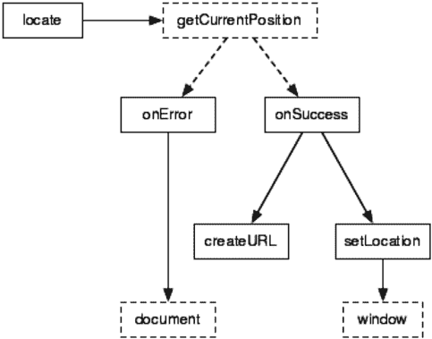

虚线框表示外部依赖，实线框表示我们为当前问题编写的代码。实线表示对函数的直接调用，虚线表示异步调用。从图表的底部查看设计，`createURL` 函数承担了根据给定的纬经度值创建 URL 的单一职责。`setLocation` 函数将给定的 URL 设置到浏览器提供的 `window` 对象中的 `location` 属性中。`onError` 函数更新 DOM 以指示错误。`onSuccess` 函数从给定的位置提取纬度和经度，并将后续操作委托给它依赖的函数。最后，`locate` 函数的唯一职责是在地理定位的 `getCurrentPosition` 函数中注册 `onSuccess` 和 `onError`。

让我们为这些中的每一个函数编写自动化测试以验证它们的行为。在完成以下系列步骤后，你将知道如何处理依赖关系。同时，我们将获得一个完全自动化测试版本的代码来实现解决当前的问题。

## 尽可能分离依赖

依赖关系在解决当前问题中起着主要作用。观察探刺代码，自动化测试的工作可能看起来很渺淡。但我们可视化的模块化设计是鼓舞的。编写自动化测试的第一步应该是识别出一个或多个没有内在依赖的函数。这些函数应该是自动化测试的起点。

观察探刺代码，URL 是直接在中间创建的，在从位置提取纬度和经度之后，在将 URL 设置到 location 之前。从测试的角度来看，除了验证 URL 是否正确创建外，我们必须检查是否适当处理了任何错误。但这种测试非常困难，因为创建 URL 的代码混合在依赖项和其他执行其他任务的代码中。但实际上，为了创建 URL，我们并不真正关心所需的值来自哪里，也不关心创建的 URL 去向哪里。如果这些值被给了我们，我们就可以轻松创建 URL 并返回它。这就是 `createURL` 函数的单一职责——与周围的依赖项分离出来。

测试一段没有依赖的代码是相对容易的。只需使用示例参数调用被测函数，并断言结果如你预期的那样。让我们带测试设计 `createURL` 函数。

| 尽可能移除依赖关系 |
| --- |
|  | 作为第一步，尝试尽可能从被测试的代码中移除依赖。提取函数并将最少的数据作为参数传递给它。 |

## 结束探刺，准备测试自动化

离开探刺项目并切换到 `locateme` 项目，该项目位于工作区的 `tdjsa/tackle/locateme` 目录下。我们希望将探刺的工作保持独立，并与使用测试驱动设计的代码分开。`locateme` 项目包含以下文件/目录：

| | index.html |
| | karma.conf.js |
| | package.json |
| | `src/` |
| | `test/` |

`index.html` 是我们在探刺项目中看到的文件的副本。`karma.conf.js` 文件已初始化，以加载运行 `Karma` 所需的所有插件。`package.json` 文件包含了你已经熟悉的依赖项：`Mocha`、`Chai`、`Karma-plugins`。然而，有四个与 Sinon 关的新包。现在假设这些包不存在；我们将在本章稍后的部分讨论它们的用途。

`src` 目录中有一个空的 `locateme.js` 文件，供你编辑。`test` 目录包含一些空测试文件，也准备好让你在示例演进过程中练习时进行编辑。

运行 `npm install` 将此项目的所有依赖项下载到你的系统中。一旦完成，让我们迈向编写我们的第一个测试。

### 测试 createURL

`createURL` 函数的唯一职责是接收纬度和经度值作为参数，并返回 Google 地图的 URL。这段代码就像一个吃饱了婴儿——你照顾它应该不会有困难。作为第一个测试，让我们发送两个有效参数，并验证返回的 URL 是良好的。

打开当前项目下的 `test/create-url-test.js` 文件，创建一个测试套件，并编写第一个测试，如下：

```javascript
describe('create-url test', function() {
  it('should return proper url given lat and lon', function() {
    var latitude = -33.857;
    var longitude = 151.215;
    var url = createURL(latitude, longitude);
    expect(url).to.equal('http://maps.google.com/q=-33.857,151.215');
  });
});
```

测试套件的名字告诉我们，关注点将仅是 `createURL` 函数。测试使用有效的纬经度调用被测函数，并验证 Google 地图乐意接受。

让我们在 `src/loceme.js` 中编写最少代码以通过此测试：

```javascript
var createURL = function(latitude, longitude) {
  return 'http://maps.google.com/q=' + latitude + ',' + longitude;
}
```

新创建的 `createURL` 函数仅返回格式化后的字符串。

运行命令 `npm test` 启动并 执行此测试。确保测试通过。让 Karma 在后台运行——它会热切地等待我们写下一个。

仅仅因为一个测试通过，我们就无法对代码产生信心。让我们写另一个正面测试。再次打开 `test/create-url-test.js` 文件，在第一个测试下方添加第二个测试：

```javascript
  it('should return proper url given another lat and lon', function() {
    var latitude = 37.826;
    var longitude = -122.423;
    var url = createURL(latitude, longitude);
    expect(url).to.equal('http://maps.google.com/q=37.826,-122.423');
  });
```

此测试仅将一组不同的值发送到被测代码并验证响应符合预期。此测试无需更改代码即可通过。让我们转向负面测试。

我们将创建 URL 的代码与其他代码相隔离的努力已经得到了回报——现在可以很容易为各种假设情况创建测试。例如，如果纬度或经度值没有提供怎么办？让我们为第一种情况编写测试，但在那之前我们应该确定适当的响应是什么。


如果没有提供纬度，我们可以抛出异常、调用另一个函数、埋怪政府、或者直接返回一个空字符串……考虑处理这种情况的各种可能性。在实际项目中，我们可以咨询领域专家、业务分析师、测试人员、同事、占命师……对于这个项目，选择一个对你来说最合理的。返回空字符串可能不是坏主意。值缺失的情况很罕见，而且真的缺失了，如果位置设置为空字符串，浏览器就不会跳转到另一个 URL。让我们为未定义的纬度值添加一个测试：

[tackle/locateme/test/create-url-test.js](http://media.pragprog.com/titles/vsjavas/code/tackle/locateme/test/create-url-test.js)

```javascript
it('should return empty string if latitude is undefined', function() {
  var latitude = undefined;
  var longitude = 188.123;
  var url = createURL(latitude, longitude);
  expect(url).to.be.eql('');
});
```

为了让这个测试通过，我们需要在 `createURL` 函数中检查纬度值，如果它是未定义的，则返回空字符串。尝试一下，然后继续下一个测试，来检查经度值：

[tackle/locateme/test/create-url-test.js](http://media.pragprog.com/titles/vsjavas/code/tackle/locateme/test/create-url-test.js)

```javascript
it('should return empty string if longitude is undefined', function() {
  var latitude = -40.234;
  var longitude = undefined;
  var url = createURL(latitude, longitude);
  expect(url).to.be.eql('');
});
```

让我们再次修改 `createURL` 函数，让这个新测试通过：

[tackle/locateme/src/locateme.js](http://media.pragprog.com/titles/vsjavas/code/tackle/locateme/src/locateme.js)

```javascript
var createURL = function(latitude, longitude) {
  if (latitude && longitude) {
    return 'http://maps.google.com?q=' + latitude + ',' + longitude;
  }
  return '';
};
```

我们通过自动化测试驱动了这段小代码的设计，并到目前为止成功将依赖控制在范围内。看一眼命令行窗口，确保 Karma 报告目前编写的所有四个测试都通过了。`createURL` 函数已经解脱了依赖的束缚，但其他函数还需要我们的帮助。是时候进入下一个函数，处理那些正准备向我们袭来的依赖了。

查看我们在可视化模块化设计 (Visualize a Modular Design) 中创建的设计图，所有待实现的函数都有依赖。让我们接下来处理这个：`setLocation` 函数的测试和设计。

## 使用测试双胞（Test Doubles）

测试双胞是替换真实依赖的对象，用于实现自动化测试。测试双胞就像是自动化测试中的电影替身演员——它们替代了原始对象，因为使用真实的对象成本高昂或不切。你将通过 `setLocation` 函数作为示例学习测试双胞的作用。

`setLocation` 函数非常简单。它接收一个 Google Maps 的 URL 并将其设置为 `window` 对象的 `location` 属性，从而指示浏览器显示带有用户当前位置的地图。它很容易编写，但可能看起来很难测试。

我们不想在浏览器中加载一个 HTML 页面，然后调用 `setLocation` 函数来查看浏览器是否跳转到给定 URL 的页面——那是手动操作，不是自动化的。我们可以写一个 UI 级别的测试，位于测试金字塔的顶端。但我们讨论过，如果可以在更低级别编写测试，那么我们就应该这样做。

这里的问题在于，我们正在设置由浏览器提供的 `window` 对象的 `location` 属性，当它被设置时，它会通过向该页面发送请求来响应。如何自动化并在更低级别测试这一点才是真正的关注所在。

事实证明我们不需要真的去测试这一点。我们的目标不是测试浏览器是否对位置设置做出响应。我们需要验证 `setLocation` 函数是否正确设置了窗口对象的 `location` 属性——没错，是“一个”窗口而不是“那个”特定的窗口。让我们进一步讨论这意味着什么。我们可以对整个位置的测试分解为：

1. 如果设置了 `location`，我们可以测试它。
2. 如果提供了 `window`，我们可以测试它。
3. 如果调用了 `setLocation`，我们可以测试它。

为了避免这个问题，我们将使用测试双胞。不同的双胞包括：伪身（fakes）、存桩（stubs）、模拟（mocks）和间谍（spies）。

正如 Martin Fowler 在博客模拟不是存桩 (Mocks Aren’t Stubs) 中讨论的那样，每种测试双胞都有非常明确的：

- **伪身（Fakes）**：这些适用于测试但不适用于生产的实现。例如，在测试期间与真实的生产信用卡服务交互是不行的——没人希望每次运行测试时都产生费用。通过在测试期间用伪身替换生产服务，你可以获得代码交互交互的快速反馈。信用卡处理服务提供两个服务：一个用于生产，一个用于测试的反馈身。
- **存桩（Stubs）**：这些不是真实的实现，但在被调用时可以轻松返回预定义的响应。这些对于验证代码在响应其（存桩）依赖的（预设）结果时的行为有用。存桩也有助于验证测试的代码是否更新了依赖的状态。为一个依赖创建一个巨大的存桩并不是好主意。相反，在每个测试中需要的地方创建小的存桩，专门为帮助该测试通过而定制。
- **模拟（Mocks）**：它们像存桩一样，可以返回预定义的值。然而，它们会跟踪交互情况，例如调用了多少次以及按什么顺序调用。模拟会报告交互情况，并帮助验证被测试代码与其依赖之间的通信。
- **间谍（Spies）**：与另外三种不同，间谍作为实际依赖的代理存在。它们在存桩或模拟特定部分时，可以与真实服务进行交互。当测试期间与真实服务的交互不是问题，但我们仍然想验证交互或模拟特定部分时，间谍非常有用。


根据你遇到的特定依赖，你将使用这些测试双备（test doubles）之一。你会使用存根（stubs）来验证状态，而使用模拟（mocks）来验证行为。换句话说，如果你感兴趣的是被测试的代码是否在其依赖项中设置了适当的状态，你就会使用存根。另一方面，如果你关注目的是验证被测试的代码是否以正确的顺序调用了依赖项上的正确方法，那么你应该使用模拟。

在本书的剩余部分中，你会看到在处理依赖时，存根、模拟以及偶尔出现的间谍程序（spies）会出来解救。现在我们已经知道了什么是测试双备以及它们如何提供帮助，让我们大显身手，为 `setLocation` 函数编写自动化测试吧。

## 注入依赖

依赖注入是一种用测试双备替换依赖的流行且常用的技术。与其让被测试的代码主动请求其依赖，不如将依赖项注入——我们行业喜欢用华丽的词汇——即在调用时作为参数传递。让我们以 `setLocation` 函数为示例来学习这种技术。

我们之前讨论过 `setLocation` 函数应该在 `window` 对象上设置 `location` 属性。如果不这样做，编写该测试将非常复杂；但如果我们传递——额的，注入——一个 `window` 对象的存根，它就变成了一个简单的测试。让我们为 `setLocation` 编写测试。

打开工作区中 `locateme` 项目中的 `test/setlocation-test.js` 文件。在该文件中，我们将添加一个名为 `setLocation test` 的新测试套件，以强调我们对 `setLocation` 函数的关注。

[tackle/locateme/test/setlocation-test.js](http://media.pragprog.com/titles/vsjavas/code/tackle/locateme/test/setlocation-test.js)

```javascript
describe('setLocation test', function() {
  it('should set the URL into location of window', function() {
    var windowStub = {};
    var url = 'http://example.com';
    setLocation(windowStub, url);
    expect(windowStub.location).to.be.eql(url);
  });
});
```

测试首先创建了一个空的 JSON 对象并将其赋值给 `windowStub` 变量。然后它调用了 `setLocation` 函数（即被测试的代码），并将存根作为第一个参数，将示例 URL 作为第二个参数。最后，它断言存根的 `location` 属性已设置为期望的值。

代表依赖项的 `windowStub` 是一个存根而不是模拟，因为测试想要知道在调用被测试函数后依赖项的状态。

现在是时候编写必要的代码让这个测试通过了。打开 `src/locateme.js` 文件，在我们之前编写的 `createURL` 函数下方实现 `setLocation` 函数：

[tackle/locateme/src/locateme.js](http://media.pragprog.com/titles/vsjavas/code/tackle/locateme/src/locateme.js)

```javascript
var setLocation = function(window, url) {
  window.location = url;
};
```

`setLocation` 函数不仅简单，而且非常“无辜”。它对围绕它编织的巨大阴谋一无所知。它真地认为它得到了“那个” `window` 对象，并忠诚地根据给定的 `url` 参数更新 `location` 属性。它并不知道，这个 `url` 是为了测试目的创建的伪地址，而 `window` 对象是一个存根而非真实的对象。擦干眼泪的眼睛吧——这一切诡计都是为了更大的目标，如果 `setLocation` 真的知道了我们的计划，它会完全理解并支持我们的努力。

这个例子很好地向我们展示了依赖外部化的用处。在生产运行时，可以将适当的函数或对象传递给目标函数使用；而在测试运行时，则可以提供一个测试双备——这就是依赖注入的实际应用。

> **为了方便测试，注入依赖**
> ![images/aside-icons/tip.png] 深根蒂固的依赖很难为了测试目的而替换。与其直接创建依赖对象或从全局引用中获取，不如考虑将所需的函数或对象作为参数传递。

## 测试交互

我们已经测试并实现了 `createURL` 和 `setLocation` 函数。在我们的模块化设计图中，还剩下三个函数需要测试和实现。让我们接下来选择 `locate` 函数，因为这将帮助我们探索在书中目前为止尚未见过的技术——交互测试（testing interactions）。

我们到为止编写的测试都是经验测试（empirical tests）。你调用一个方法并断言它返回了期望的结果——无论是同步还是异步。在处理依赖项时，通常很难预测结果。例如，如果代码依赖于一个返回芝加哥当前温度的服务，那么很难为该代码编写经验测试。对于带有依赖项的代码，交互测试更好。

针对函数的测试关注的是该函数的行为，而不是依赖项的正确性。你想知道被测试的代码是如何调用其依赖项的。你还想知道它如何处理依赖项的失败。对于这些，代码不需要访问真实的依赖。

> **在经验测试与交互测试之间选择**
> ![images/aside-icons/tip.png] 如果结果是确定的、可预测的且易于理解，请使用经验测试。如果代码具有复杂的依赖关系，导致代码不可确定、难以预测、脆弱或缓慢，请使用交互测试。

让我们看看为什么对于 `locate` 函数来说，交互测试比经验测试更好。我们的程序需要调用地理位置 API 的 `getCurrentPosition`。投入工作表明，该函数是一个需要时间的异步函数。此外，响应取决于我们运行代码的位置以及响应位置的服务的准确性。简而言之，我们无法预测从 `getCurrentPosition` 函数最终获得的结果。由于我们无法依赖结果，走经验路线毫无意义。

在追求模块化的过程中，我们认为 `locate` 函数可以调用 `getCurrentPosition` 并注册另外两个回调——`onSuccess` 和 `onError`。我们的目标不是验证 `getCurrentPosition` 最终是否返回了正确的位置——毕竟我们并不是在测试 `getCurrentPosition`。这里的重点是测试 `locate` 函数的行为。该函数的职责是调用 `getCurrentPosition` 并注册这两个回调——这就是我们需要测试的所有内容，即 `locate` 与 `getCurrentPosition` 的交互。

打开当前项目中的 `test/locate-test.js` 文件，添加一个新的测试套件和一个测试：

[tackle/locateme/test/locate-test.js](http://media.pragprog.com/titles/vsjavas/code/tackle/locateme/test/locate-test.js)

```javascript
describe('locate test', function() {
  it('should register handlers with getCurrentPosition', function(done) {
    var original = navigator.geolocation.getCurrentPosition;
    navigator.geolocation.getCurrentPosition = function(success, error) {
      expect(success).to.be.eql(onSuccess);
      expect(error).to.be.eql(onError);
      done();
    };
    locate();
    navigator.geolocation.getCurrentPosition = original;
  });
});
```


我们想要验证 `locate` 是否调用了 `getCurrentPosition`，但我们不能在测试期间让函数调用真实的地理位置函数——这会让测试变得缓慢、不可预测且不确定。我们必须用一个测试双倍（test double）——一个 stub 或 mock——来替换 `getCurrentPosition` 函数。由于我们主要感兴趣的是 `locate` 是否调用了它的依赖项，因此我们将使用 mock 而不是 stub。

在测试 `setLocation` 时我们注入了依赖项。这里也可以采用相同的方法，但没有必要。`locate` 函数从 `window.navigator.geolocation` 属性获取 `getCurrentPosition` 函数。与 `window` 的 `location` 属性不同，`navigator` 的属性相对容易被 mock。这正是我们在测试中所做的：我们创建一个原始 `getCurrentPosition` 函数的副本，然后用一个 mock 函数替换它。在测试结束时，我们将 `geolocation` 内部函数替换回原始函数。

在 mock 函数中，检查传入的前两个参数的值是否为 `onSuccess` 和 `onError` 函数的引用。这两个函数以及 `locate` 函数还不存在，但很快就会出现。断言——即对 `expect` 的调用——位于 mock 函数内部。如果 `locate` 函数从未调用过 `getCurrentPosition`，那么 mock 函数中的断言将永远不会执行。这种情况应该导致失败。调用 `done()` 正是为了此目的。如果 `locate` 调用了 `getCurrentPosition` 并传递了预期的回调函数，测试将通过。如果它没有传递正确的参数，其中一个断言将失败。如果 `locate` 没有调用 `getCurrentPosition`，则测试将超时，因为 `done` 不会被调用来信号测试完成。

现在是实现 `locate` 方法了，但它的实现也需要 `onSuccess` 和 `onError` 函数。目前我们可以为这些函数提供一个空实现。打开 `src/locateme.js` 文件，在我们之前实现的 `setLocation` 函数下方编写以下代码。

[tackle/locateme/src/locateme.js](http://media.pragprog.com/titles/vsjavas/code/tackle/locateme/src/locateme.js)

```javascript
var locate = function() {
  navigator.geolocation.getCurrentPosition(onSuccess, onError);
};
var onError = function() {}
var onSuccess = function() {}
```

`locate` 函数非常直观；它调用了 `getCurrentPosition` 函数并传递了测试预期的两个回调。我们为事件处理函数提供了临时的占位符。

我们看到，与其让 `locate` 调用真实的 `getCurrentPosition` 函数并检查其结果，我们改为测试 `locate` 与其依赖项的交互。这种方法的用处是测试是快速且可预测的。此外，我们不需要处理浏览器授予或拒绝访问地理位置权限的问题。

然而，我们所做的事情有一点令人讨厌。测试在开始时用 mock 替换了函数，并在结束时还原了这一操作。这不仅枯燥，而且非常容易出错。接下来我们将看到 Sinon（一个流行的 mock 库）是如何优雅地消除这种负担的。

## 使用 Sinon 减少噪声

为 `locate` 编写自动化测试的关键是将依赖项替换为测试双倍。在 `test/locate-test.js` 文件的测试中，我们手工制作了 mock 并手动替换和恢复了 `getCurrentPosition` 函数。这种方法很快就会变成苦差，并使测试变得冗长且易错。

一个良好的测试双倍库可以显著减轻痛苦。Sinon 就是这样的工具之一，可以与任何 JavaScript 测试工具配合使用。它简洁、流畅且强大——在后面的章节中为 Node.js、Express 和 jQuery 自动化测试时，你会看到这个工具大放异彩。让我们使用 Sinon 测试双倍代替手工的。

Joe 问：我们何时应该使用 Sinon 测试双倍而不是手工测试双倍？

在书的后部分，你将看到使用 Sinon 创建测试双倍的示例，但某些示例将直接使用手工测试双倍。以下是关于何时选择 Sinon 的指南：

*   当手动创建测试双倍变得异常困难时
*   当使用测试双倍导致设计和代码结构变得过于复杂时
*   当使用 Sinon 可以减小测试体积时

简而言之，当 Sinon 带来真实价值时使用它。对于简单的情况，不要犹豫编写自己的测试双倍。

### 设置 Sinon

Sinon 补充了 Karma、 Mocha 和 Chai，这是目前为止测试使用的工具链。Sinon 模块提供了创建不同类型测试双倍的函数。此外，`Sinon-Chai` 模块让已经流畅的 Chai 库更具表现力，用于验证对测试双倍的调用。

要使用 Sinon，我们需要四个包：`sinon`、`sinon-chai`、`karma-sinon` 和 `karma-sinon-chai`。当你执行 `npm install` 时，这些包已经安装了，因为你正在工作的项目的 `package.json` 中的 `devDependencies` 部分包含了它们。

除了安装这些包，我们还需要告诉 Karma 使用它们。再次，当前项目中的 `karma.conf.js` 文件已经配置了必要的更改。打开 `karma.conf.js` 文件，注意以下告诉 Karma 应该加载哪些插件的配置：

`frameworks: ['mocha', 'chai', 'sinon', 'sinon-chai']`

### 上手 Sinon

Sinon 让创建测试双倍变得简洁流畅。此外，如果我们选择替换任何现有函数，Sinon 沙箱（sandbox）可以简化恢复函数的过程。

虽然可以直接使用 `sinon` 对象创建测试双倍，但使用沙箱要好得多因为它能让我们确保测试保持隔离。作为使用 Sinon 的第一步，创建一个沙箱，如下所示：

```javascript
var sandbox;
beforeEach(function() {
  sandbox = sinon.sandbox.create();
});
```

立即通过 `afterEach` 函数实现恢复原始对象的函数，以消除测试双倍的任何影响：

```javascript
afterEach(function() {
  sandbox.restore();
});
```

现在我们有了 Sinon 的沙箱环境，让我们探索创建和使用间谍（spies）、存桩（stubs）和 mocks。

通过调用 spy 函数为现有函数创建一个间谍：

```javascript
var aSpy = sandbox.spy(existingFunction);
```

然后要验证函数是否被调用，使用：

```javascript
expect(aSpy.called).to.be(true);
```

这是测试代码是否真的使用了 `existingFunction` 的简单方法。但得益于 `Sinon-Chai` 模块的魔法，语法可以流畅得多：

```javascript
expect(aSpy).called;
```

要检查函数是否被带有参数调用——假设是 "magic"—将该预期表示为：

```javascript
expect(aSpy).to.have.been.calledWith('magic');
```

让我们转向 stub。为了让 stub 替换对 `util.alias('Robert')` 的调用，编写：

```javascript
var aStub = sandbox.stub(util, 'alias')
  .withArgs('Robert')
  .returns('Bob');
```

这将为该函数创建一个 stub，只有在传递了上述参数时它才会起作用，并随后向调用者返回 returns 函数的值。

最后，为同一个函数创建一个 mock，编写：

```javascript
var aMock = sandbox.mock(util)
  .expects('alias')
  .withArgs('Robert');
```

然后，为了检查被测试函数是否确实与 mock 代表的依赖项进行了交互，编写：

```javascript
aMock.verify();
```


如果交互没有发生，`verify` 调用将失败并导致测试崩溃。

我们仅仅接触了 `Sinon` 提供的冰一角——你将在本书的剩余部分看到它的用法示例。有关可用不同函数的详尽文档，请参考 `Sinon` 文档^([[15]](#f_0042.xhtml_FOOTNOTE-15)) 和 `Sinon-Chai` 文档.^([[16]](#f_0042.xhtml_FOOTNOTE-16))

### 使用 Sinon Mocks 测试交互

现在你已经学习了 `Sinon` 以及如何使用它，让我们利用 `Sinon` 来测试 `locate` 函数吧。首先，我们需要在调用测试之前创建 `Sinon` 的沙箱（sandbox）。此外，我们必须在测试完成后将任何被 mock（模拟）或 stub（桩根）的函数恢复到原始状态。这两个操作的好位置是放在 `beforeEach` 和 `afterEach` 夹明治函数中。由于多个测试套件可能都需要这些函数，我们我们不将它们放在某个特定的测试套件中，而是将它们写在任何测试套件之外的单独文件中。这样它们就可以供当前项目中的所有测试套件使用。

我们将 `Sinon` 的设置和拆卸操作放在名为 `sinon-setup.js` 的单独文件中。让我们打开 `locateme` 项目中这个预创建的空文件，并添加以下与 `Sinon` 相关的代码：

[tackle/locateme/test/sinon-setup.js](http://media.pragprog.com/titles/vsjavas/code/tackle/locateme/test/sinon-setup.js)

```javascript
var sandbox;

beforeEach(function() {
  sandbox = sinon.sandbox.create();
});

afterEach(function() {
  sandbox.restore();
});
```

`sandbox` 变量将持有 `Sinon` 沙箱对象的引用，该对象是测试中获取 stubs、mocks 和 spies 的网关。`beforeEach` 函数会在每个测试之前立即创建并准备好沙箱。`afterEach` 将撤销通过沙箱在测试中创建的任何对象——依赖项对 stubs 和 mocks 的任何影响。

让我们回顾一下在 `test/locate-test.js` 文件中为 `locate` 函数编写的测试。

[tackle/locateme/test/locate-test.js](http://media.pragprog.com/titles/vsjavas/code/tackle/locateme/test/locate-test.js)

```javascript
describe('locate test', function() {
  it('should register handlers with getCurrentPosition', function(done) {
    var original = navigator.geolocation.getCurrentPosition;

    navigator.geolocation.getCurrentPosition = function(success, error) {
      expect(success).to.be.eql(onSuccess);
      expect(error).to.be.eql(onError);
      done();
    }

    locate();
    navigator.geolocation.getCurrentPosition = original;
  });
});
```

我们可以通过 `Sinon` 让这个测试变得简洁且具有表现力。我们可以移除测试中的第一行和最后一行——不需要保存原始值并恢复；`Sinon` 会帮我们完成这些工作。我们不需要手动创建 mock 函数并断言参数符合预期，而是可以使用 `Sinon` 的 mock 函数。让我们修改之前在 `test/locate-test.js` 文件中编写的测试，修改如下：

[tackle/locateme/test/locate-test.js](http://media.pragprog.com/titles/vsjavas/code/tackle/locateme/test/locate-test.js)

```javascript
describe('locate test', function() {
  it('should register handlers with getCurrentPosition', function() {
    var getCurrentPositionMock =
      sandbox.mock(navigator.geolocation)
      .expects('getCurrentPosition')
      .withArgs(onSuccess, onError);

      locate();

      getCurrentPositionMock.verify();
  });
});
```

最终效果是，mock 函数将把 `geolocation` 的 `getCurrentPosition` 函数替换为一个函数，该函数将验证传递的参数是否为 `withArgs` 调用中提到的那些。在测试结束时，我们要求 `Sinon` 创建的 mock 验证它是否按预期被调用。

修改后的测试版本不仅简洁，而且直接揭示了它的意图。更重要的是，与之前的版本不同，我们不需要手动设置和取消 mock，因此这个版本不容易出错。

### 使用 Sinon Stubs 测试状态

我们在上一个测试中看到了 mock 的实际应用。现在让我们感受一下 stub（桩根）。回想一下，stub 用于测试状态而 mock 可以测试交互。在 `src/locateme.js` 文件中，我们写了一个空的 `onError` 函数。`onError` 只需要一个 `PositionError` 实例。由于我们没有这样的 DOM 元素，我们将将其 stub 掉。

这听起来很有趣，让我们为 `onError` 创建一个新的测试套件。这个套件将可以轻松访问我们在 `sinon-setup.js` 中创建的 `Sinon` 对象。让我们在空的 `onerror-test.js` 中输入以下测试套件代码。

[tackle/locateme/test/onerror-test.js](http://media.pragprog.com/titles/vsjavas/code/tackle/locateme/test/onerror-test.js)

```javascript
describe('onError test', function() {
  it('should set the error DOM element', function() {
    var domElement = {innerHTML: ''};
    sandbox.stub(document, 'getElementById')
      .withArgs('error')
      .returns(domElement);

    var message = "you're kidding";
    var positionError = { message: message };

    onError(positionError);

    expect(domElement.innerHTML).to.be.eql(message);
  });
});
```

`domElement` 指向一个简单的 JSON 对象，它模拟了测试代码预期的 DOM 元素。`getElementById` 函数的 stub 检查请求是否来自 id `error`，并在调用时返回 `domElement`。`positionError` 是一个轻量级 JSON 对象，代表 `onError` 函数预期的 `PositionError` 实例。在调用要验证的函数后，测试断言 `domElement` JSON 对象的状态——它确保了对象包含了传递给 `onError` 函数的错误消息。

实现 `onError` 函数非常直观。让我们打开 `src/locateme.js` 文件并修改现有的空 `onError` 函数以通过测试：


```javascript
var onError = function(error) {
  document.getElementById('error').innerHTML = error.message;
};
```

该函数从给定的参数获取 `message` 属性，并将其值设置在通过 `document` 对象的 `getElementById` 获取的错误 DOM 元素的 `innerHTML` 属性上。

到为止我们看到了 Sinon 的 mock（模拟）和 stub（存桩）。在下一个示例中，我们将探索 Sinon spy（间谍）。

### 使用 Sinon Spy 拦截调用

在测试 `locate` 时，我们 mock 了 `getCurrentPosition` 函数——这是合理的，因为在测试中调用真实的 `getCurrentPosition` 将是荒谬的，而且我们想要测试交互作用。在测试 `onError` 时，我们对 `getElementById` 进行了 stub 处理，因为我们希望该对象保持状态，并且我们热于验证该函数在其依赖项上设置了什么。有时，依赖项是无害的，被测试代码调用它是完全没问题的。然而，我们可能仍然想测试交互。虽然在这种情况下可以使用 mock，但 spy 可能是更好的选择，因为它需要的精力要少得多。让我们进一步探索，通过为最后一个待处理函数 `onSuccess` 编写测试来学习 spy。

`onSuccess` 函数将由 `getCurrentPosition` 函数调用并传入用户的的位置详情。为了完成它的职责，`onSuccess` 函数应该从给定的 `position` 中提取 `latitude` 和 `longitude` 的值，调用 `createURL` 获取 URL，并将在 `window` 对象上设置位置的任务委托给 `setLocation`。这告诉我们 `onSuccess` 的工作大部分是与其他两个函数进行交互，因此该函数的测试将是交互测试。然而，我们可以使用 spy 代替 mock 来高效地完成任务。让我们看看怎么做。

打开 `test/onsuccess-test.js` 文件并添加一个新的测试套件以及针对 `onSuccess` 的第一个测试：

```javascript
describe('onSuccess test', function() {
  it('should call createURL with latitude and longitude', function() {
    var createURLSpy = sandbox.spy(window, 'createURL');

    var position = { coords: { latitude: 40.41, longitude: -105.55 }};

    onSuccess(position);

    expect(createURLSpy).to.have.been.calledWith(40.41, -105.55);
  });
});
```

在测试中，我们首先为 `createURL` 函数创建了一个 spy。该 spy 仅仅会拦截——用“嗅探”可能是更好的思考方式——并记录传递给真实调用的参数。然而，它不会阻塞或绕过调用。真实的函数将被执行，这在测试中完全没问题。在测试结束时，我们验证了被测试代码将两个预期的参数传递给了它的依赖项，而该依赖项已被 spy 替换。

同样在测试中，我们向被测试代码传递了一个 `position` 局部变量。`position` 是一个带有 `coords` 属性的 JSON 对象，该属性反过来持有 `latitude` 和 `longitude` 的值。数据这种嵌套格式的原因是地理位置 API 发送的真实 `Position` 对象也是类似的格式：

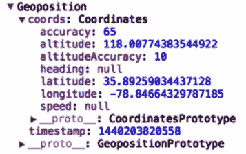

对于测试来说，我们只需要被测试代码关心的数据，因此我们为 `position` 提供了最少的数据，但保持了必要的格式。

让我们实现让此测试通过的最少代码。在 `src/locateme.js` 文件中，将 `onSuccess` 函数当前的空实现更改为如下：

```javascript
var onSuccess = function(position) {
  var latitude = position.coords.latitude;
  var longitude = position.coords.longitude;

  createURL(latitude, longitude);
}
```

该函数从给定的 `position` 参数中提取 `latitude` 和 `longitude` 的值，并将它们传递给 `createURL` 函数。这是让测试通过的最少代码。然而，函数需要获取 `createURL` 的结果并将其传递给 `setLocation` 函数。让我们为此编写测试。

`onSuccess` 函数应该接收 `createURL` 返回的任何内容并发送给 `setLocation` 函数。因此，在当前文中，`createURL` 返回什么并不重要。忽略这一点让我们省去了处理 URL 格式的麻烦。相反，我们可以简单地 stub `createURL` 函数以返回一个固定的 URL 值——在这个测试中无需与真实的 `createURL` 通信。在 `test/onsuccess-test.js` 文件中添加另一个测试：

```javascript
it('should call setLocation with URL returned by createURL', function() {
  var url = 'http://example.com';
  var setLocationSpy = sandbox.spy(window, 'setLocation');
  sandbox.stub(window, 'createURL').returns(url);

  var position = { coords: { latitude: 40.41, longitude: -105.55 }};

  onSuccess(position);

  expect(setLocationSpy).to.have.been.calledWith(url);
});
```

在测试中，我们首先为 `createURL` 函数创建了一个 spy。该 spy 仅仅会拦截——用“嗅探”可能是更好的思考方式——并记录传递给真实调用的参数。然而，它不会阻塞或绕过调用。真实的函数将被执行，这在测试中完全没问题。在测试结束时，我们验证了被测试代码将两个预期的参数传递给了它的依赖项，而该依赖项已被 spy 替换。同样在测试中，我们向被测试代码传递了一个 `position` 局部变量。`position` 是一个带有 `coords` 属性的 JSON 对象，该属性反过来持有 `latitude` 和 `longitude` 的值。数据这种嵌套格式的原因是地理位置 API 发送的真实 `Position` 对象也是类似的格式：


对于测试来说，我们只需要被测试代码关心的数据，因此我们为 `position` 提供了最少的数据，但保持了必要的格式。让我们实现让此测试通过的最少代码。在 `src/locateme.js` 文件中，将 `onSuccess` 函数当前的空实现更改为如下：

```javascript
var onSuccess = function(position) {
  var latitude = position.coords.latitude;
  var longitude = position.coords.longitude;

  createURL(latitude, longitude);
}
```

该函数从给定的 `position` 参数中提取 `latitude` 和 `longitude` 的值，并将它们传递给 `createURL` 函数。这是让测试通过的最少代码。然而，函数需要获取 `createURL` 的结果并将其传递给 `setLocation` 函数。`onSuccess` 函数应该接收 `createURL` 返回的任何内容并发送给 `setLocation` 函数。因此，在当前文中，`createURL` 返回什么并不重要。忽略这一点让我们省去了处理 URL 格式的麻烦。相反，我们可以简单地 stub `createURL` 函数以返回一个固定的 URL 值——在这个测试中无需与真实的 `createURL` 通信。在 `test/onsuccess-test.js` 文件中添加另一个测试：

```javascript
it('should call setLocation with URL returned by createURL', function() {
  var url = 'http://example.com';
  var setLocationSpy = sandbox.spy(window, 'setLocation');
  sandbox.stub(window, 'createURL').returns(url);

  var position = { coords: { latitude: 40.41, longitude: -105.55 }};

  onSuccess(position);

  expect(setLocationSpy).to.have.been.calledWith(url);
});
```

在此时，Karma 应该报告所有测试已通过：

```
.........
Chrome 49.2623 (Mac OS X 10.10.5)
Executed 9 of 9 SUCCESS (0.035 secs / 0.016 secs)
```

## 回顾与运行

我们通过自动化测试渐进地开发了很长一段。接下来，让我们花几分钟回顾一下我们完成的工作。

-   `test/create-url-test.js`: 这里我们为 `createURL` 函数编写了测试。在编写这些测试时，我们避免了处理任何依赖项。
-   `test/setlocation-test.js`: 在此文件中为 `setLocation` 编写了测试。由于它与 `window` 对象交互，我们使用带有 location 属性的轻量 JSON 对象 mock 了它。
-   `test/sinon-setup.js`: 我们创建了这个文件用于 Sinon sandbox 的设置和清理函数。
-   `test/locate-test.js`: 在这里我们编写了交互测试来验证 `locate` 调用了正确的回调函数。我们首先创建了一个 mock，然后切换到使用 Sinon mock 进行简洁流畅的测试。
-   `test/onerror-test.js`: 此文件中 `onError` 的测试帮助我们学习了使用 stub 代替 mock。我们使用 Sinon 创建了 stub。


- `test/onsuccess-test.js`: 最后，该文件中对 `onSuccess` 的测试向我们展示了何时以及为何使用 spy（间谍）而不是 mock（模拟）。

我们解决的问题相对较小，但它对 DOM 和地理位置 API 有一些复杂的依赖关系。它帮助我们探索了 mocks、stubs（存根）和 spies 的使用。在这次旅程的终点，我们不仅拥有了自动化测试，还拥有内聚、模块化且易于理解的代码。

让我们来看看我们创建的探刺代码（spike）——只需扫一眼。如果你不想再看一眼这段代码，那也是完全可以的：

[tackle/spike/src/locateme.js](http://media.pragprog.com/titles/vsjavas/code/tackle/spike/src/locateme.js)

```javascript
This is a brute-force sample created during a spiking session
var locate = function() {
  navigator.geolocation.getCurrentPosition(
    function(position) {
      var latitude = position.coords.latitude;
      var longitude = position.coords.longitude;

      var url = 'http://maps.google.com/?q=' + latitude + ',' + longitude;
      window.location = url;
    },
    function() {
      document.getElementById('error').innerHTML = 'unable to get your location';
    }
  );
};
```

不要对这段代码太苛刻；它让我们对眼下的问题有了洞察。探刺代码（spikes）长这样完全没问题。只有当生产代码变成这样——不幸的是，在很多项目中确实如此——，我们才应该真正感到悲哀。

现在，让我们针对同一个问题、使用自动化测试编写的代码：

[tackle/locateme/src/locateme.js](http://media.pragprog.com/titles/vsjavas/code/tackle/locateme/src/locateme.js)

```javascript
var createURL = function(latitude, longitude) {
  if (latitude && longitude)
    return 'http://maps.google.com?q=' + latitude + ',' + longitude;
  return '';
};

var setLocation = function(window, url) {
  window.location = url;
};

var locate = function() {
  navigator.geolocation.getCurrentPosition(onSuccess, onError);
};

var onError = function(error) {
  document.getElementById('error').innerHTML = error.message;
};

var onSuccess = function(position) {
  var latitude = position.coords.latitude;
  var longitude = position.coords.longitude;

  var url = createURL(latitude, longitude);
  setLocation(window, url);
};
```

大部分函数都是单行代码。所有函数都很短，并且专注于它们每个天生要承担的单一职责。如果你想继续欣赏我们创建的代码，请尽管花你需要的时间。

| 测试与设计，永远的好搭档 |
| --- |
|  | 自动化测试带来了良好的设计特性。良好的设计使代码变得可测试。它邀请了自动化测试。 |

自动化测试带来了模块化、高内聚、松耦合、更简洁的设计。这些设计特性反过来使得编写自动化测试成为可能。

测试通过了，但你可能怀疑代码是否真的有效。你内心的声音可能会说“信任，但要验证”，这种想法是很敏锐的。在书的后面部分，我们将探索 UI 级别的测试。现在，让我们手动运行代码，更多是为了看到我们努力的成果而不是为了验证。当前 `locateme` 项目中的 `index.html` 文件与你在探刺项目中看到的同名文件相同。为了方便起见，将其显示在这里：

[tackle/locateme/index.html](http://media.pragprog.com/titles/vsjavas/code/tackle/locateme/index.html)

```html
<!DOCTYPE html>
<html>
<head>
  <title>Locate Me</title>
</head>
<body>
  <button onclick="locate()">Locate Me</button>
  <div id="error"></div>
  <script src="src/locateme.js"></script>
</body>
</html>
```

在 `locateme` 目录，运行命令

```bash
npm start
```

来启动 Web 服务器：

```bash
> http-server -a localhost -p 8080 -c1
```

Starting up http-server, serving ./
Available on:
http://localhost:8080


在第一部分中，我们涵盖了编写自动化测试的各种技术、验证异步函数的行为以及处理依赖关系的方法。现在我们准备好将这些技术整合在一起，从头开始对整个 Node.js 应用的设计和实现进行测试驱动。

Node.js 已经成为一种流行的服务器端 JavaScript 运行时。它是一个强大的环境，编写起来也很有趣。但是，你如何判断代码在各种输入、不同的边界情况、网络故障以及某些必需文件缺失的情况下真的有效运行呢？手动运行应用程序并尝试不同的场景并不是你来这里的目的。本章将引导你一步步学习如何使用测试驱动设计，来创建一个实用的、功能完整的 Node.js 应用。

我们将创建一个报告各种股票代码（ticker symbols）价格的应用程序。我们将分两个阶段构建该应用：首先作为一个独立程序，然后扩展为提供 Web 界面。该应用程序将从文件中读取股票代码列表，从雅虎财经获取股票价格，并按顺序打印每个代码的最新价格。程序还将优雅地处理来自文件操作和网络访问的错误。

通过获得测试驱动全功能应用程序的技能，你将准备好将这些技术应用到你的日常编程项目中。

## 从战略性的——恰到好处——设计开始

在瀑布式开发的时代，我们进行大规模的前期设计，试图在开始编码之前弄清楚许多细节，但结果并不理想。今天的世界是敏捷的，但这意味着不需要设计了吗吗？遗憾的是，对于某些开发者来说，情况确实是这样，但这并没有帮助。两个极端——大规模的前期设计与极少设计——都是危险且适得其反的。

不如从战略性设计开始——这是一种高层设计，可以帮助我们评估眼前的整体问题并获得大局，同时包含恰好的细节。显出来的细节并不是一成不变的。战略性设计将让我们对复杂度有一个初步的想法，帮助我们识别需要详细设计的重要区域，并为我们开始编码设定方向。

在完成简短的战略设计步骤后，我们将转向更详细的战术性设计——这是存在于代码中的设计，涉及思考和打字。这是我们花费大部分时间和精力的阶段；随着代码的出现和演变，测试将引导我们完成设计中的细微细节。

让我们为股票应用程序创建一个战略性设计。首先，构化程序的整体逻辑或流程：读取一个文件，例如 `tickers.txt`；收集每个代码的价格；最后打印结果。在此过程中，程序应该优雅地处理错误。让我们在图中勾勒出这些细节。

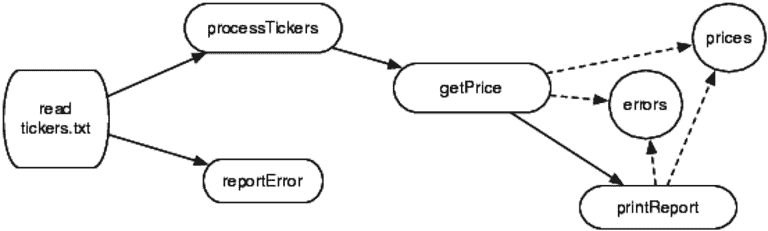

在图中，实线表示函数调用，虚线表示更新变量的操作。该程序的大部分操作都是异步的，整体流程很好地落入函数流水线或链中。`read` 函数读取 `tickers.txt` 文件并将任何错误报告给 `reportError` 函数。`reportError` 函数将打印错误详情供用户查看并退出程序。另一方面，如果读取成功，`read` 函数将把股票代码列表发送给 `processTickers` 函数。该函数遍历代码列表，并为每个代码调用 `getPrice` 函数。`getPrice` 从网络服务获取数据并将价格值存储在 `prices` 集合中。如果遇到错误，它将错误详情存储在 `errors` 集合中。该函数还会通知 `printReport` 函数，该函数会等待所有代码都处理完毕。一旦所有数据准备就绪，`printReport` 函数将打印价格和错误。

有了眼前的战略性设计，是时候考虑下一步了。它应该让我们开始编码，因为那是我们获得宝贵反馈的时候——既来自自动化测试，也来自运行应用程序。在设计的层面上，我们有五个函数。让我们为这些函数列下一些高层测试。

## 跃入战术性的——测试优先——设计

从初始设计开始，我们将进入战术性设计，即做出细致的设计决策并实现代码。我们将以战略性设计为起点，选取几个函数开始通过测试进行设计。我们将编写正向测试、负向测试和异常测试，并在过程中做出详细的设计决策。当我们从一个函数过渡到下一个函数时，你将看到程序的设计和代码一段一段地成型。

让我们从列一系列测试开始。

### 创建初始测试列表

在纸上写下脑海中想到的测试——现在不要担心对错：

*   如果文件有效，`read` 调用 `processTickers`
*   如果文件无效，`read` 调用错误处理程序
*   `processTickers` 为每个股票代码调用 `getPrice`
*   `getPrice` 调用网络服务
*   对于有效响应，`getPrice` 更新 `prices` 集合
*   对于失败响应，`getPrice` 更新 `errors` 集合
*   `getPrice` 最后调用 `printReport`
*   `printReport` 按排序打印结果

这些是脑海中想到的一些初始测试。一旦开始详细设计和实现，它们就会改变。随着我们编写代码，新的测试将会出现，我们将它们添加到此列表中。当产生新的设计想法时（这些想法是将会产生的），这些想法应该很方便地作为新测试加入列表。一旦某个测试实现完成，我们就在列表上勾掉它。

从测试列表开始，但不要在列表上花费太多时间。一旦你写下了脑海中想到的，就打破惯性并开始测试。你不必遵循列表中的顺序。选择任何你觉得舒服的测试，但最好从一个有趣且实用的开始。

### 编写第一个测试

我们将使用 `tdjsa/testnode` 目录下的 `stockfetch` 项目。切换到 `tdjsa/testnode/stockfetch` 目录并查看 `package.json` 文件以了解我们需要的模块。我们将在项目中使用 `mocha`、`chai`、`istanbul` 和 `sinon`。运行 `npm install` 为当前项目安装这些模块。

现在让我们编写第一个测试。从 `printReport` 或 `reportError` 的测试开始意义不大。`read`、`processTickers` 和 `getPrice` 函数看起来都有趣且重要。我们可以选择其中任何一个。我们将选择 `read` 函数，因为它排在第一位，可能是逻辑思考控制流的良好起点。

由于我们决定首先关注 `read` 函数，前两个测试看起来是个好主意，但我们仍然需要选择。让我们从列表中的第二个测试开始——读取不存在的文件。

在编写该测试之前，让我们写一个开始新项目时常用的传统测试。打开 `tdjsa/testnode/stockfetch/test` 目录下的空文件 `stockfetch-test.js` 并输入以下代码：

[testnode/stockfetch/test/stockfetch-test.js](http://media.pragprog.com/titles/vsjavas/code/testnode/stockfetch/test/stockfetch-test.js)

```
var expect = require('chai').expect;

describe('Stockfetch tests', function() {
  it('should pass this canary test', function() {
    expect(true).to.be.true;
  });
});
```

运行命令 `npm test` 以确保金雀测试通过并确认我们已准备好开始此项目。

现在让我们通过准备设置（setup）和清理（teardown）函数来准备测试套件。


[testnode/stockfetch/test/stockfetch-test.js](http://media.pragprog.com/titles/vsjavas/code/testnode/stockfetch/test/stockfetch-test.js)

```javascript
var expect = require('chai').expect;
var sinon = require('sinon');
var fs = require('fs');
var Stockfetch = require('../src/stockfetch');

describe('Stockfetch tests', function() {
  var stockfetch;
  var sandbox;

  beforeEach(function() {
    stockfetch = new Stockfetch();
    sandbox = sinon.sandbox.create();
  });

  afterEach(function() {
    sandbox.restore();
  });

  it('should pass this canary test', function() {
    expect(true).to.be.true;
  });
});
```

我们引入了 `Sinon` 的 `require` 以便于进行存桩（stubbing）和模拟（mocking）。此外，我们设置了 `sandbox`，并使用 `beforeEach` 和 `afterEach` 函数在每个测试后恢复或清理存桩/模拟。

现在，让我们在 `stockfetch-test.js` 文件的“Stockfetch tests”测试套件中，金雀测试的下方，为 `read` 函数编写测试：

[testnode/stockfetch/test/stockfetch-test.js](http://media.pragprog.com/titles/vsjavas/code/testnode/stockfetch/test/stockfetch-test.js)

```javascript
it('read should invoke error handler for invalid file', function(done) {
  var onError = function(err) {
    expect(err).to.be.eql('Error reading file: InvalidFile');
    done();
  };

  sandbox.stub(fs, 'readFile', function(fileName, callback) {
    callback(new Error('failed'));
  });

  stockfetch.readTickersFile('InvalidFile', onError);
});
```

在编写此测试时，我们做了一些设计决策：异步性、函数的签名以及函数的名称。在策略设计中，我们把函数命名为 `read`，但在这里我们给它一个更详细的名称：`readTickersFile`。

`readTickersFile` 的第一个测试传入了一个无效的文件名和一个回调函数，并验证了回调函数是否被调用。由于访问文件是一个异步操作，测试必须等待回调完成。我们可以通过在回调中直接调用 `done()` 来传达回调已执行。我们还确保了 `readTickersFile` 会带有正确的错误信息失败。由于读取文件是一个不稳定的操作，我们不希望依赖 `fs` 模块中真实的 `readFile` 函数。相反，我们存桩了 `readFile` 函数，向其回调函数发送一个错误，以指示接收到了无效文件。

测试已经就绪，现在是时候实现该函数了。代码将放入 `src` 目录下的 `stockfetch.js` 文件。编辑提供的空文件：

```javascript
var Stockfetch = function() {
  this.readTickersFile = function(filename, onError) {
    onError('Error reading file: ' + filename);
  };
};

module.exports = Stockfetch;
```

请记住，前几个测试应该帮助我们梳理接口，而随后的测试将引导我们完成实现。因此，现在不需要急于完成所有编码；我们只想先实现一些最基础的代码让测试通过。该程序需要一组相互相关的函数，并带有某些状态，因此我们创建了一个 `Stockfetch` 类来持有这些函数。`readTickersFile` 函数接收两个参数，但仅仅同步地调用了回调。尽管实际实现将复杂得多，但目前这对于通过测试已经足够。随着我们推进，编写的测试将填充实现的细节。

运行命令 `npm test` 让 mocha 运行测试。观察输出：

```
Stockfetch tests
  ✓ should pass this canary test
  ✓ read should invoke error handler for invalid file
(9ms)
```

Mocha 从目录加载了测试文件并执行了测试。它报告金雀测试和 `readTickersFile` 均已通过。

## 编写正向测试

现在转向正向测试。思考 `readTickersFile` 在正常路径（happy path）下的行为。给定一个有效的文件名，该函数应该读取文件内容、对其进行解析，并将 ticker 列表发送给 `processTickers`。但要考虑 SRP——单一职责原则。`readTickersFile` 应该专注于一点：读取文件。让此函数将解析的责任委托给另一个函数（例如 `parseTickers`）会更好。我们现在不想考虑解析，因此在测试列表中记录一个它的测试作为提醒。

* 以意外的格式读取文件内容
* parseTickers 接收字符串并返回列表

再次，让我们把注意力回到当前的测试上——我们将根据目前脑海中设计演进的情况来实现该测试。我们将在 `stockfetch-test.js` 文件中紧接下方编写下一个测试：

[testnode/stockfetch/test/stockfetch-test.js](http://media.pragprog.com/titles/vsjavas/code/testnode/stockfetch/test/stockfetch-test.js)

```javascript
it('read should invoke processTickers for valid file', function(done) {
  var rawData = 'GOOG\nAAPL\nORCL\nMSFT';
  var parsedData = ['GOOG', 'AAPL', 'ORCL', 'MSFT'];

  sandbox.stub(stockfetch, 'parseTickers')
    .withArgs(rawData).returns(parsedData);

  sandbox.stub(stockfetch, 'processTickers', function(data) {
    expect(data).to.be.eql(parsedData);
    done();
  });

  sandbox.stub(fs, 'readFile', function(fileName, callback) {
    callback(null, rawData);
  });

  stockfetch.readTickersFile('tickers.txt');
});
```

当前的目标是实现 `read` 函数，使其能够使用 `parseTickers` 和 `processTickers` 函数，但无需实际实现这些函数。我们将通过在测试中对这些函数进行存桩来实现目标。


在测试中，我们为 `parseTickers` 和 `processTickers` 函数创建了存根（stubs）。第一个存根仅针对预期的参数创建，该参数是我们将传递给 `readTickersFile` 函数的文件内容。如果且当存根使用预期参数被调用时，它将返回一个包含代码符号的数组作为预制数据。在第二个存根（针对 `processTickers` 函数）中，我们断言接收到的参数等于 `parseTickers` 存根返回的预制数据。在这个存根中，我们还调用 `done()` 来信号异步回调的完成。我们像上一个测试一样对 `readFile` 函数进行了存根处理，但这次向回调函数返回了预制的 `rawData`。最后，我们调用被测试的代码，即 `readTickersFile` 函数。由于我们在本次测试中处于正常路径（happy path），且不期望函数失败，因此我们不需要发送第二个参数即 `onError` 回调。

我们需要修改被测试的代码以通过此测试。让我们编写最少的代码，使得新测试和之前通过通过的负例测试都能正常运行。编辑 `stockfetch.js` 文件，如下：

```javascript
var fs = require('fs');

var Stockfetch = function() {
  this.readTickersFile = function(filename, onError) {
    var self = this;

    var processResponse = function(err, data) {
      if(err)
        onError('Error reading file: ' + filename);
      else {
        var tickers = self.parseTickers(data.toString());
        self.processTickers(tickers);
      }
    };

    fs.readFile(filename, processResponse);
  };

  this.parseTickers = function() {};
  this.processTickers = function() {};
};

module.exports = Stockfetch;
```

为了通过这个新测试，代码发生了很大变化。我们使用了 `fs` 模块的 `readFile` 函数，向它发送 `filename` 和一个内部函数作为回调。在内部函数中，如果响应为错误，我们调用 `onError` 回调。否则，我们将数据传递给尚未实现的 `parseTickers` 函数，该函数在测试中被存根化，并在 `Stockfetch` 类中实现为一个空函数。然后，我们获取该函数的结果，并将其传递给即将编写的 `processTickers` 函数。

由于我们现在的重点是设计 `readTickersFile` 函数，我们不需要担心 `parseTickers` 和 `processTickers` 函数的实现。它们在代码中显示为空函数，但测试为它们提供了必要的存根——一切正常。

我们不需要测试中提到的 `tickers.txt` 文件。存根化的 `readFile` 函数将假装读取了文件并返回预制值。运行测试并确保它们通过通过：

```
Stockfetch tests
✓ should pass this canary test
✓ read should invoke error handler for invalid file
✓ read should invoke processTickers for valid file
3 passing (13ms)
```

除了金雀测试外，还有两个测试通过了。目前测试列表中还有九个测试。让我们继续下一个。

## 继续设计

我们已经涵盖了 `readTickersFile` 函数的正常路径，但在此过程中，我们在测试列表中增加了两个测试，以处理文件可能为空或包含无效格式数据的情况。接下来我们将处理这些场景。

### readTickersFile 的负例测试

在设计的这个阶段，`readTickersFile` 函数调用 `parseTickers` 将文件内容解析为代码符号数组。如果文件为空，那么内容也将是空的。在这种情况下，这个辅助函数应该返回一个空数组——让我们在测试列表中记录一个测试，以确保在我们设计该函数时能处理好 `parseTickers` 的这种行为。这引出了问题：如果内容不是空的而是一堆空白字符呢？我们希望 `parseTickers` 在这种场景下也返回一个空数组。那么，空白字符场景不需要在 `readTickersFile` 中测试，但我们需要在 `parseTickers` 函数上为此进行测试。更新针对这些场景的测试列表：

*   …
*   `parseTickers` 接收字符串并返回代码符号列表
*   ⇒ 如果内容为空，`parseTickers` 返回空数组
*   ⇒ 如果内容仅包含空白字符，`parseTickers` 返回空数组

让我们回到 `readTickersFile`。存根化的 `readFile` 函数将假装读取了文件并返回预制值。运行测试并确保它们通过通过：

```javascript
it('should return error if file is empty', function(done) {
  var stockfetch = new Stockfetch();
  var onError = function(err) {
    expect(err).to.equal('File tickers.txt has invalid content');
    done();
  };

  sandbox.stub(stockfetch, 'parseTickers').withArgs().returns([]);
  sandbox.stub(fs, 'readFile').callsArg(function(fileName, callback) {
    callback(null, '');
  });

  stockfetch.readTickersFile('tickers.txt', onError);
});
```

存根化的 `readFile` 函数验证了 `readTickersFile` 发送了“无效内容”的消息。修改 `stockfetch.js` 中的 `readTickersFile` 函数以通过此测试。

```javascript
this.readTickersFile = function(filename, onError) {
  var self = this;

  var processResponse = function(err, data) {
    if(err)
      onError('Error reading file: ' + filename);
    else {
      var tickers = self.parseTickers(data.toString());
      if(tickers.length === 0)
        onError('File ' + filename + ' has invalid content');
      else
        self.processTickers(tickers);
    }
  };

  fs.readFile(filename, processResponse);
};
```


`parseTickers` 没有依赖项；它是一个同步函数，验证其行为非常简单。测试列表中有该函数的四个测试。请逐一个实现它们，并在编写每个测试后编写最少的代码。完成后，将你的测试与下面列出的代码进行对比：

[testnode/stockfetch/test/stockfetch-test.js](http://media.pragprog.com/titles/vsjavas/code/testnode/stockfetch/test/stockfetch-test.js)

| | it(`parseTickers should return tickers`, `function()` { |
| :--- | :--- |
| | expect(stockfetch.parseTickers("A\nB\nC")).to.be.eql(['A', 'B', 'C']); |
| | }); |
| | it(`parseTickers should return empty array for empty content`, `function()` { |
| | expect(stockfetch.parseTickers("")).to.be.eql([]); |
| | }); |
| | it(`parseTickers should return empty array for white-space`, `function()` { |
| | expect(stockfetch.parseTickers(" ")).to.be.eql([]); |
| | }); |
| | it(`parseTickers should ignore unexpected format in content`, `function()` { |
| | var rawData = "AAPL \nBla\nGOOG\n "; |
| | expect(stockfetch.parseTickers(rawData)).to.be.eql(['GOOG']); |
| | }); |

第一个测试是正向测试，而其他三个是反向测试。正向测试验证了在给定良好格式的情况下，函数会解析并返回股票代码。第二个测试确保当输入为空时，函数返回空列表；第三个测试对空格情况进行了同样的验证。最后一个测试确保了如果股票代码包含空格或空行，函数将忽略它们。如果你希望在其中一个股票代码格式错误时拒绝所有股票代码，请修改测试和代码以满足该预期。以下是 `stockfetch.js` 中满足所有这些测试的代码，它是随着每个测试逐步创建的：

```javascript
this.parseTickers = function(content) {
  var isInRightFormat = function(str) {
    return str.trim().length !== 0 && str.indexOf(' ') < 0;
  };
  return content.split('\n').filter(isInRightFormat);
};
```

这段代码替换了 `Stockfetch` 中 `parseTickers` 的空占位符。记住运行测试并确保所有测试均通过。我们进展顺利，让我们继续设计下一个函数吧。

### 设计 `processTickers` 函数

我们设计 `readTickers` 是为了用股票代码列表调用 `processTickers`。反之，后者函数应该为每个股票代码调用一次 `getPrice`。此外，为了供稍后使用，我们需要跟踪已处理的股票代码数量。调用 `processTickers` 预期返回结果。因此，为了验证函数的行为，我们只需要交互测试。让我们将这些测试添加到 `stockfetch-test.js` 文件中：

[testnode/stockfetch/test/stockfetch-test.js](http://media.pragprog.com/titles/vsjavas/code/testnode/stockfetch/test/stockfetch-test.js)

| | it(`processTickers should call getPrice for each ticker symbol`, `function()` { |
| :--- | :--- |
| | var stockfetchMock = sandbox.mock(stockfetch); |
| | stockfetchMock.expects('getPrice').withArgs('A'); |
| | stockfetchMock.expects('getPrice').withArgs('B'); |
| | stockfetchMock.expects('getPrice').withArgs('C'); |
| | stockfetch.processTickers(['A', 'B', 'C']); |
| | stockfetchMock.verify(); |
| | }); |
| | it(`processTickers should save tickers count`, `function()` { |
| | sandbox.stub(stockfetch, 'getPrice'); |
| | stockfetch.processTickers(['A', 'B', 'C']); |
| | expect(stockfetch.tickersCount).to.be.eql(3); |
| | }); |

在第一个测试中，我们 mock 了 `Stockfetch` 中尚未编写的 `getPrice` 函数，预期它将带有参数 ‘A’、‘B’ 和 ‘C’ 被调用。然后我们调用被测试的函数，并验证 `processTickers` 是否按预期与 `getPrice` 交互。第二个测试检查 `processTickers` 是否将 `tickersCount` 设置为传递的参数中的股票代码数量。

`processTickers` 将是一个简单的循环。让我们接下来在 `stockfetch.js` 文件中编写它：

```javascript
this.processTickers = function(tickers) {
  var self = this;
  self.tickersCount = tickers.length;
  tickers.forEach(function(ticker) { self.getPrice(ticker); });
};
this.tickersCount = 0;
this.getPrice = function() {}
```

除了 `parseTickers` 之外，我们还将 `tickersCount` 初始化为 0 并为 `getPrice` 创建了占位符。由于 `readTickers` 只调用 `processTickers`，我们。

### 创建探针（Spike）以获取洞察

下一个逻辑步骤是设计 `getPrice` 函数。该函数应该访问财经网站以获取股票代码的数据，解析数据并打印。它还应该处理可能发生的错误。这涉及很多，听起来包含几个部分。很难一次写好，更不用写测试了。有疑问时，创建一个隔离的探针。探针可以为实现方案提供必要的洞察、处理问题的方法以及需要测试的问题。在创建探针时，我们应该考虑三种场景：股票代码的响应、无效股票代码的响应以及连接丢失时的响应 从探针中学习；然后放弃探针并继续测试驱动的方法。一旦你创建了探针，将你的努力与这个探针进行对比：

[testnode/spike/price.js]

```javascript
// 一个快速的原型
var http = require('http');

var getPriceTrial = function(ticker) {
  http.get('http://chart.yahoo.com/table.csv?s=' + ticker, function(response) {
    if (response.statusCode === 200) {
      var data = '';
      var getChunk = function(chunk) { data += chunk; };
      response.on('data', getChunk);
      response.on('end', function() {
        console.log('received data for ' + ticker);
        console.log(data);
      });
    } else {
      console.log(ticker + ' - error getting data : ' + response.statusCode);
    }
  }).on('error', function(err) {
    console.log(ticker + ' - error getting data : ' + err.code);
  });
};

getPriceTrial('GOOG');
getPriceTrial('INVALID');
// 同时也尝试在断开网络后运行
```


探刺实验（spike）是一团“泥球”——正是它该有的样子——但它实现了它的目的，即为我们可能的实现方案提供了见解和清晰思路。探刺实验明确了许多问题：如何处理响应、如何处理无效的股票代码，以及发生网络连接错误时会发生什么。

### 设计 `getPrice` 函数

有了探刺实验获得的新见解，我们可以将测试列表中的一个测试（如被划掉所示）替换为其他几个测试：三个针对 `getPrice` 的测试以及两个针对它所需的处理程序的测试：

* `getPrice` 调用网络服务
* `getPrice` 使用有效 URL 调用 `http` 上的 `get` 方法
* `getPrice` 将响应处理程序作为参数调用 `get` 方法
* `getPrice` 为无法访问主机的情况注册失败处理程序
* 响应处理程序收集数据并更新价格集合
* 错误处理程序更新错误集合


Joe 提问：Joe 提问：我们不能走简单的捷径吗？

为什么我们只为 `getPrice` 写一个测试，而不是写这么多测试呢？毕竟，现在的测试依赖于函数的实现。如果我们决定更改实现，这些相关的测试也得跟着改变，不是吗？

这种感知中的简单捷径从长远来看并不简单。`getPrice` 依赖于外部服务。我们无法预测该服务会返回什么。此外，我们必须妥善处理无效符号和连接失败。这些细粒度的测试将迫使我们将 `getPrice` 函数与服务解耦，从而在开发过程中使代码更易测试且更健壮。当实现改变时必须修改这些测试，与我们获得“代码确实在执行正确操作”的安心感相比，这是一个很小的代价。

针对 `getPrice` 的三个测试将极大地使函数模块化。让我们编写这三个测试，以及让这些测试通过的最少代码——再次采取小步原则，一次写一个测试。

我们将从第一个测试开始——调用 `getPrice` 并断言 `http` 的 `get` 方法使用正确的 URL 调用。由于我们无法预测服务的实际响应，在测试期间，被测代码不应与真实服务通信。为了使测试具有确定性，代码应该与测试副本（test double）而不是真实的 `http get` 函数通信。在这里我们不再编写经验测试，而是编写一个交互测试。为了  出 `http` 的 `get` 函数，我们必须将依赖外部化。一种方案是将 `http` 实例作为参数传递给 `getPrice`。另一种方案是将 `http` 成为 `Stockfetch` 的属性以便 `getPrice` 访问。第一种方案会增加 `getPrice` 调用者的负担，即已经设计的 `processTicker`。让我们采用第二种方案——这里是测试，位于 `stockfetch-test.js` 中：

[testnode/stockfetch/test/stockfetch-test.js](http://media.pragprog.com/titles/vsjavas/code/testnode/stockfetch/test/stockfetch-test.js)

```javascript
it('getPrice should call get on http with valid URL', function(done) {
  var httpStub = sandbox.stub(stockfetch.http, 'get', function(url) {
    expect(url)
      .to.be.eql('http://ichart.finance.yahoo.com/table.csv?s=GOOG');
    done();
    return {on: function() {} };
  });

  stockfetch.getPrice('GOOG');
});
```

由于 `http` 现在是 `Stockfetch` 的属性，对其进行 stub 替换变得容易了。在 `http.get` 函数的 stub 中，我们验证了它是从 `getPrice` 内部使用正确的 URL 被用的。从探刺实验中我们可以得知，`get` 函数应该返回一个带有 `on` 属性的对象。因此，stub 返回一个包含占位 `on` 函数的 JSON 对象。

让我们实现 `getPrice` 以通过此测试。我们将调用 `this.http.get` 并传递相应的 URL。在写完另外几个测试后，我们再查看代码。一旦测试通过，继续编写下一个测试。

在编写下一个测试之前，先思考几件事。在 `getPrice` 的探刺实验中，特别注意作为第二个参数传递给 `http.get` 的内容。那是一个匿名函数，负责收集从网络服务块或突发到达的数据的重要工作。我们现在不想在测试和设计 `getPrice` 的过程中处理那部分逻辑——我们需要将其模块化。

让我们使用函数 `processResponse` 作为响应的处理程序。`getPrice` 函数需要在 `http.get` 中将此函数注册为处理程序。这里是验证该点的测试：

[testnode/stockfetch/test/stockfetch-test.js](http://media.pragprog.com/titles/vsjavas/code/testnode/stockfetch/test/stockfetch-test.js)

```javascript
it('getPrice should send a response handler to get', function(done) {
  var aHandler = function() {};

  sandbox.stub(stockfetch.processResponse, 'bind')
    .withArgs(stockfetch, 'GOOG')
    .returns(aHandler);

  var httpStub = sandbox.stub(stockfetch.http, 'get', function(url, handler) {
    expect(handler).to.be.eql(aHandler);
    done();
    return {on: function() {} };
  });
```

在这个测试中，我们 stub 了 `processResponse` 函数的 `bind` 方法，断言它接收了正确的对象（第一个参数）和符号（第二个参数）。如果 `bind` 的参数符合预期，我们返回一个 stub 来表示 `bind` 调用的结果。作为下一步，我们 stub `http.get` 函数并确保它是 `bind` 返回的结果。为了让此测试工作，被测代码 `getPrice` 应该将符号绑定到 `processResponse` 并将其注册为处理程序。

继续实现通过此测试的代码。我们需要注册这个功能——让我们测试这种行为：

[testnode/stockfetch/test/stockfetch-test.js](http://media.pragprog.com/titles/vsjavas/code/testnode/stockfetch/test/stockfetch-test.js)

```javascript
it('getPrice should register handler for failure to reach host', function(done) {
  var errorHandler = function() {};

  sandbox.stub(stockfetch.processHttpError, 'bind')
    .withArgs(stockfetch, 'GOOG')
    .returns(errorHandler);

  var onStub = function(event, handler) {
    expect(event).to.be.eql('error');
    expect(handler).to.be.eql(errorHandler);
    done();
  };

  sandbox.stub(stockfetch.http, 'get').returns({on: onStub});

  stockfetch.getPrice('GOOG');
});
```

在测试中，我们 stub 了错误处理器 `processHttpError` 的 `bind` 方法，并断言它会被正确的上下文对象和符号调用。这与我们之前对 `processResponse` 的 `bind` 函数执行的操作非常相似。我们创建了 `on` 函数的 stub，并反将其作为 `http.get` stub 的返回值。当被测代码调用 `http.get()` 时，stub 将介入并返回 `on` 函数。当被测代码调用该函数时，`on` 函数的 stub 将再次验证错误处理器已注册。

修改 `getPrice` 函数以通过此测试。让我们查看 `stockfetch.js` 中该函数的实现，以通过所有三个测试：

```javascript
this.http = http;

this.getPrice = function(symbol) {
  var url = 'http://ichart.finance.yahoo.com/table.csv?s=' + symbol;
};
```


```javascript
this.http.get(url, this.processResponse.bind(this, symbol))
.on('error', this.processHttpError.bind(this, symbol));
};
this.processResponse = function() {};
this.processHttpError = function() {};
```

记得在 `stockfetch.js` 文件的顶部添加

```javascript
var http = require('http');
```

以引入 `http` 模块。

花几分钟时间过一遍 `getPrice` 的每个测试用，看看它们是如何验证 `getPrice` 的行为的。这需要一些思考，所以不要被测试代码吓到——每个测试只有几行代码。一旦你理清了执行顺序，你很快就能掌握它。

将我们通过测试得出的 `getPrice` 实现方案与之前创建的原型设计（spike）进行对比。虽然这段代码没有完成原型设计所做的的所有工作——部分内容将放在其他函数中——但代码是简洁、富有表现力、模块化且高内聚的，并承担了单一的职责。此外，它将其余细节交给了尚未编写的另外两个函数。这在设计上与原型设计相比是一个重大的突破。

新出现的这种设计与原型设计相比具有一些显著优势。模块化代码的行为更容易通过自动化测试进行验证。我们为此付出了小小的代价。编写这些测试确实费精力，但这是一项随着练习而日益进步的技能。此外，一旦写好，测试就能通过快速反馈产生高额的回报。

## 模块化以便于测试

原型设计中复杂的 `getPrice` 最终在 `stockfetch.js` 中只有几行代码，但原型设计中很大一部分实现尚未完成。让我们继续进行模块化，使每段代码都保持高内聚、紧凑并专注于单一职责。

### 设计 processResponse 和 processError 函数

让我们关注在 `getPrice` 内部调用的两个新函数。现在我们对这些函数的测试思路可以比之前关注 `getPrice` 时要清晰得多。让我们为这些函数再添加几个测试：

*   ✓ `getPrice` 使用有效 URL 调用了 `http` 上的 `get` 方法
*   ✓ `getPrice` 将响应处理程序作为参数调用 `get`
*   ✓ `getPrice` 为无法访问主机的情况注册了处理程序
*   响应处理程序收集数据并更新价格集合
*   错误处理程序更新错误集合
*   `processResponse` 使用有效数据调用 `parsePrice`
*   如果响应失败，`processResponse` 调用 `processError`
*   `processHttpError` 使用错误详情调用 `processError`

让我们为 `processResponse` 函数编写第一个测试。`processResponse` 包含几个变动部分——它必须注册一个“data”事件来收集来自 HTTP 响应的数据块，以及另一个“end”事件，用以没有更多数据了。一旦接收到所有数据，`processResponse` 就必须调用 `parsePrice` 函数。以下是该行为的测试：

[testnode/stockfetch/test/stockfetch-test.js](http://media.pragprog.com/titles/vsjavas/code/testnode/stockfetch/test/stockfetch-test.js)

```javascript
it('processResponse should call parsePrice with valid data', function() {
  var dataFunction;
  var endFunction;

  var response = {
    statusCode: 200,
    on: function(event, handler) {
      if (event === 'data') dataFunction = handler;
      if (event === 'end') endFunction = handler;
    }
  };

  var parsePriceMock = sandbox.mock(stockfetch)
    .expects('parsePrice').withArgs('GOOG', 'some data');

  stockfetch.processResponse('GOOG', response);
  dataFunction('some ');
  dataFunction('data');
  endFunction();

  parsePriceMock.verify();
});
```

在测试中，我们获取了 `processResponse` 向响应对象的 `on` 事件注册的回调函数引用。然后我们使用一些示例数据调用这些函数，模拟 HTTP 响应会话的操作。最后验证 `parsePrice` 是否在 `processResponse` 内部使用适当的模拟数据被调用。

为了让这个测试通过，我们现在还不需要检查响应状态。相反，只需在响应上设置正确的事件处理程序，并在接收到 `end` 事件时调用 `parsePrice`。实现这些最少代码并运行测试以确保其通过。我们很快就会看到 `processResponse` 的代码。

现在继续进行 `processResponse` 的下一个测试——如果状态不是 200，它应该调用 `processError`。编写一个正向测试和一个负向测试，一个状态为 200，另一个设为 404：

`testnode/stockfetch/test/stockfetch-test.js`（等一下，让我调整一下结构）

在第一个测试中，我们将 `statusCode` 设置为 404，并确认 `processResponse` 继调用了 `processError`。

```javascript
it('processResponse should call processError if failed', function() {
  var response = { statusCode: 404 };
  var processErrorMock = sandbox.mock(stockfetch)
    .expects('processError').withArgs('GOOG', 404);

  stockfetch.processResponse('GOOG', response);
  processErrorMock.verify();
});
```

在第二个测试中：

```javascript
it('processResponse should not call processError', function() {
  var response = { statusCode: 200, on: function() {} };
  var processErrorMock = sandbox.mock(stockfetch)
    .expects('processError').never();

  stockfetch.processResponse('GOOG', response);
  processErrorMock.verify();
});
```

这里是让测试通过的 `processResponse` 代码：

```javascript
this.processResponse = function(symbol, response) {
  var self = this;

  if (response.statusCode === 200) {
    var data = '';
    response.on('data', function(chunk) { data += chunk; });
    response.on('end', function() { self.parsePrice(symbol, data); });
  } else {
    self.processError(symbol, response.statusCode);
  }
};

this.parsePrice = function() {};
this.processError = function() {};
```

再次对比这段代码与原型设计中的对应部分——混乱中清晰。

### 设计 processHttpError

还有一个未完成。在 `getPrice` 函数中，如果访问主机出现问题，我们调用了 `processHttpError` 函数。我们还没有实现它。该函数应该提取错误详情并发送给 `processError` 函数。让我们为它编写测试：

[testnode/stockfetch/test/stockfetch-test.js](http://media.pragprog.com/titles/vsjavas/code/testnode/stockfetch/test/stockfetch-test.js)

```javascript
it('processHttpError should call processError with error details', function() {
  var processErrorMock = sandbox.mock(stockfetch)
    .expects('processError').withArgs('GOOG', '...error code...');

  var error = { code: '...error code...' };
  stockfetch.processHttpError('GOOG', error);
  processErrorMock.verify();
});
```


该测试确保 `processHttpError` 能够从错误中提取代码并将其传递给 `processError`——再次查看一下探针任务（spike）以了解测试的预期结果。使此测试通过的代码非常：

```javascript
this.processHttpError = function(ticker, error) {
  this.processError(ticker, error.code);
};
```

我们已经走过了很长的一段路，但还有几个步骤才能完成这个程序。在继续最后几个步骤之前，请休息一下——离开代码并在休息后重新审视它，可能不仅能让你喘口气气，还能为解决问题提供全新的视角。

### 设计 `parsePrice` 和 `processError`

`parsePrice` 和 `processError` 必须更新共享数据结构并调用 `printReport` 函数。让我们为这些函数编写测试——同样，尽管这里列出了多个测试，但在移动到下一个测试之前，请一次写一个测试，并用最少的代码让每个测试通过。

为了解析数据，我们需要符合 Web 服务返回格式的示例数据。由于我们已经有了探针任务，可以运行它来获取示例并在测试中使用这些数据，如下所示：

[testnode/stockfetch/test/stockfetch-test.js](http://media.pragprog.com/titles/vsjavas/code/testnode/stockfetch/test/stockfetch-test.js)

```javascript
var data = "Date,Open,High,Low,Close,Volume,Adj Close\n2015-09-11,619.75,625.780029,617.419983,625.77002,1360900,625.77002\n2015-09-10,613.099976,624.159973,611.429993,621.349976,1900500,621.349976";

it('parsePrice should update prices', function() {
  stockfetch.parsePrice('GOOG', data);
  expect(stockfetch.prices.GOOG).to.be.eql('625.77002');
});

it('parsePrice should call printReport', function() {
  var printReportMock = sandbox.mock(stockfetch).expects('printReport');
  stockfetch.parsePrice('GOOG', data);
  printReportMock.verify();
});

it('processError should update errors', function() {
  stockfetch.processError('GOOG', '...oops...');
  expect(stockfetch.errors.GOOG).to.be.eql('...oops...');
});

it('processError should call printReport', function() {
  var printReportMock = sandbox.mock(stockfetch).expects('printReport');
  stockfetch.processError('GOOG', '...oops...');
  printReportMock.verify();
});
```

这些测试非常直观，编写让这些测试通过的代码也也很简单。让我们在 `stockfetch.js` 中实现代码：

```javascript
this.prices = {};

this.parsePrice = function(ticker, data) {
  var price = data.split('\n')[1].split(',').pop();
  this.prices[ticker] = price;
  this.printReport();
};

this.errors = {};

this.processError = function(ticker, error) {
  this.errors[ticker] = error;
  this.printReport();
};

this.printReport = function() {};
```

现在进入最后一步，设计并实现 `printReport` 函数。

## 关注点分离

测试列表中现在有一个未完成的测试，“printReport 按排序顺序打印结果”，这在策略设计结束时看起来是一个很好的测试。但观察我们目前设计的代码，这似乎像是一个巨大的跨越。我们需要将其拆分为更小的函数。打印（Print）和排序（Sort）是两个不同的关注点——良好的设计会将不同的关注点分开。此外，我们不希望 `printReport` 直接写入控制台；更好的做法是将数据发送给调用者，由他们来决定在哪里打印。让我们记录下这些新产生的测试：

* …
* `printReport` 按排序顺序打印结果
* `printReport` 在所有响应都到达后发送价格和错误
* `printReport` 在所有响应到达之前不发送
* `printReport` 根据股票代码（tickers）排序价格
* `printReport` 根据股票代码（tickers）排序错误

### 设计 `printReport`

我们将实现前两个测试，之后再看排序功能。

[testnode/stockfetch/test/stockfetch-test.js](http://media.pragprog.com/titles/vsjavas/code/testnode/stockfetch/test/stockfetch-test.js)

```javascript
it('printReport should send price, errors once all responses arrive', function() {
  stockfetch.prices = { 'GOOG': 12.34 };
  stockfetch.errors = { 'AAPL': 'error' };
  stockfetch.tickersCount = 2;
  var callbackMock = sandbox.mock(stockfetch).expects('reportCallback').withArgs(['GOOG', 12.34], ['AAPL', 'error']);
  stockfetch.printReport();
  callbackMock.verify();
});

it('printReport should not send before all responses arrive', function() {
  stockfetch.prices = { 'GOOG': 12.34 };
  stockfetch.errors = { 'AAPL': 'error'
  stockfetch.tickersCount = 3;
  var callbackMock = sandbox.mock(stockfetch).expects('reportCallback').never();
  stockfetch.printReport();
});
```

第一个测试确认了回调被调用，第二个测试确认了它没有。在继续之前，实现让这两个测试通过的代码。

### 设计 `sortData`

最后两个测试说明 `printReport` 应该执行这些操作。重新考虑，在 `printReport` 中实现这些代码会导致重复。让我们重新审这些测试：

* `printReport` 在所有响应到达之前不发送
* `printReport` 根据股票代码排序价格
* `printReport` 根据股票代码排序错误
* `printReport` 调用 `sortData`，价格一次，错误一次
* `sortData` 根据符号排序数据

是时候推出最后几个测试了：[testnode/stockfetch/test/stockfetch-test.js](http://media.pragprog.com/titles/vsjavas/code/testnode/stockfetch/test/stockfetch-test.js)

```javascript
it('sortData once for prices, once for errors', function() {
  stockfetch.prices = { 'GOOG': 12.34 };
  stockfetch.errors = { 'AAPL': 'error' };
  stockfetch.tickersCount = 2;
  var mock = sandbox.mock(stockfetch);
  mock.expects('sortData').withArgs(stockfetch.prices);
  mock.expects('sortData').withArgs(stockfetch.errors);
  stockfetch.printReport();
  mock.verify();
});

it('sortData should sort the data based on the symbols', function() {
  var dataToSort = {
    'GOOG': 1.2,
    'AAPL': 2.1
  };
  var result = stockfetch.sortData(dataToSort);
  expect(result).to.be.eql([['AAPL', 2.1], ['GOOG', 1.2]]);
});
```

在上述两个短小的测试中，我们首先验证了 `printReport` 调用了两次 `sortData`，其次验证了 `sortData` 按照预期工作。实现不需要花费太多精力；让我们下一个处理它。

```javascript
this.printReport = function() {
  if (this.tickersCount === Object.keys(this.prices).length + Object.keys(this.errors).length) {
    this.reportCallback(this.sortData(this.prices), this.sortData(this.errors));
  }
};
```


```javascript
this.sortData = function(dataToSort) {
  var toArray = function(key) {
    return [key, dataToSort[key]];
  };
  return Object.keys(dataToSort).sort().map(toArray);
};

this.reportCallback = function() {};
```

测试列表中的所有测试现在已完成。我们从 `readTickersFile` 函数开始，逐步梳理了直到 `printReport` 函数所需的所有函数。测试通过了，但在运行程序并在控制台中看到结果之前，我们无法调用 `done`。

## 集成与运行

我们需要最后一个函数来将所有函数整合在一起，为此，我们需要几项集成测试。让我们从集成测试开始；你也可以将这些测试写入 `stockfetch-test.js` 文件中：

```javascript
it('getPriceForTickers should report error for invalid file', function(done) {
  var onError = function(error) {
    expect(error).to.be.eql('Error reading file: InvalidFile');
    done();
  };
  var display = function() {};

  stockfetch.getPriceForTickers('InvalidFile', display, onError);
});

it('getPriceForTickers should respond well for a valid file', function(done) {
  var onError = sandbox.mock().never();

  var display = function(prices, errors) {
    expect(prices.length).to.be.eql(4);
    expect(errors.length).to.be.eql(1);
    onError.verify();
    done();
  };
  this.timeout(10000);

  stockfetch.getPriceForTickers('mixedTickers.txt', display, onError);
});
```

第二个测试读取名为 `mixedTickers.txt` 的文件。由于这是一项集成测试，我们需要这个文件——这次我们没有模拟（mock）文件访问选项。你可以直接使用工作区提供的文件，其内容如下：

```
GOOG
AAPL
INVALID
ORCL
MSFT
```

新测试执行了一个集成函数 `getPriceForTickers`，它接受三个参数：文件名、一个显示价格和错误的回调函数，最后是一个接收错误的回调函数。第一个测试确保集成函数将错误处理程序连接到代码的其他部分。第二个测试确保它正确地连接了显示回调函数。将以下短集成函数添加到 `stockfetch.js` 文件中的 `StockFetch` 类中：

```javascript
this.getPriceForTickers = function(fileName, displayFn, errorFn) {
  this.reportCallback = displayFn;
  this.readTickersFile(fileName, errorFn);
};
```

非常简单。运行测试并确保所有测试均通过：

```
Stockfetch tests
✓ should pass canary test
✓ read should invoke error handler for invalid file
✓ read should invoke processTickers for valid file
✓ read should return error if file is empty
✓ parseTickers should return tickers
✓ parseTickers should return empty array for empty content
✓ parseTickers should return empty array for white-space
✓ parseTickers should ignore format in content
✓ processTickers should call getPrice for each ticker
✓ processTickers should save tickers count
✓ getPrice should call get with valid URL
✓ getPrice should send a response to get
✓ getPrice should register handler for failure to reach host
✓ processResponse should call parsePrice with valid data
✓ processResponse should call processError if response failed
✓ processResponse should call processError only if response failed
✓ processHttp should call processError with details
✓ parsePrice should update prices
✓ parsePrice should call printReport
✓ processError should update errors
✓ processError should call printReport
✓ printReport should send price, errors all responses arrive
✓ printReport should not send before all responses
✓ printReport should call sortData once for prices, once for errors
✓ sortData should sort the data based on symbols
✓ getPriceForTickers should report error for invalid file
✓ getPriceForTickers should respond well for a valid file (181ms)
27 passing (1s)
```

这是一段不旅程。看到所有测试通过太棒了，但我们也想看到程序运行并打印结果。让我们编写一个驱动程序来运行代码。打开工作区当前项目中的 `src/stockfetch-driver.js` 文件并输入以下代码：

```javascript
var Stockfetch = require('./stockfetch');

var onError = function(error) {
  console.log(error);
};

var display = function(prices, errors) {
  var print = function(data) {
    console.log(data[0] + '\t' + data[1]);
  };

  console.log('Prices for ticker symbols:');
  prices.forEach(print);

  console.log('Ticker symbols with error:');
  errors.forEach(print);
};

new Stockfetch().getPriceForTickers('mixedTickers.txt', display, onError);
```

这段代码与我们之前编写的集成测试没有太大区别，我们将输出记录到控制台，而不是通过程序方式断言响应。运行驱动程序请使用以下命令：

`node src/stockfetch-driver.js`

查看输出——当然，取决于当前市场和网络连接，运行时的数据会有不同：

```
Prices for ticker symbols:
AAPL 105.260002
GOOG 758.880005
MSFT 55.48
ORCL 36.52999
Ticker symbols with error:
INVALID 404
```

## 查看覆盖率与设计

总共有二十项测试影响了代码的设计。由于我们先编写了测试，每一行代码的行为都经过一个或多个测试的验证。我们将通过查看代码覆盖率来证实这一点，然后讨论设计是如何演变的。

### 测量代码覆盖率

每当我们运行 `npm test` 时，由于 Istanbul 的静一直在测量覆盖率。如果你想知道创建覆盖报告的精确命令，请查看 `package.json` 文件中 `scripts` 下的 `test` 命令。你会在那里找到此命令：

`istanbul cover node_modules/mocha/bin/_mocha`

查看运行 `npm test` 时产生的覆盖报告：

```
Stockfetch tests
...
27 passing (1s)

============================= Coverage summary =============================
Statements : 100% ( 59/59 )
Branches : 100% ( 10/10 )
Functions : 100% ( 19/19 )
Lines : 100% ( 55/55 )
============================================================================
```

如果你想查看行覆盖率报告，请在浏览器中打开 `coverage/lcov-report/index.html` 文件。


相比于 `stockfetch-test.js` 中的 307 行代码，`stockfetch.js` 的源代码只有 96 行。这意味着 3:1 的测试/代码比例——非常典型。例如，在我所在机构生产环境的一个电子商务系统中，该比例为 3.9:1。

| 测试/代码比例 |
| --- |
|  | 驱动测试的应用通常每每行代码对应三到五行测试代码。 |

排除集成测试外，所有测试的运行速度都非常快，具有确定性，并且不需要网络连接即可提供快速反馈，确保代码行为符合预期。虽然这两个集成测试依赖于网络连接，但它们在编写方式上也是确定性的。接下来，我们将讨论通过测试驱动工作产生的设计。

## 代码中的设计

测试和代码是增进式演化的，从短代码片段中很难看出整体设计。下载测试文件的电子版^([17) 和源代码^([18)。花几分钟研究两者。

我们从策略性设计开始——参见 *从策略开始——恰够的设计* 中的图表。该设计为我们提供了初始方向，而测试将这一初始想法塑造为一个具有若干良好特性的实用设计。每个函数都是模块且简洁的，只做一件事。在此过程中，我们应用了许多设计原则——单一责任原则 (SRP)、不要重复 (DRY)、高内聚、低耦合、模块化、关注点分离、依赖注入……让我们可视化最终产生的设计。

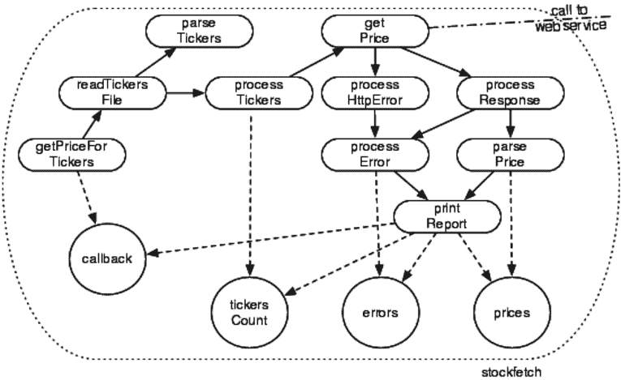

将战术设计图与策略设计图进行对比。虽然战术设计图包含更多细节和模块函数，但你可以看到我们在策略设计中识别的原始函数——`readTickersFile`、`processTickers`、`getPrice`、`printReport` 的增强形式。这些方法的接口在战术设计期间发生了显著演变。设计过程中还出现了新的辅助函数，主要是为了使代码具有内聚性、模块化，最重要的是可测试性。

这确实比简单拼凑代码要花费多得多。然而，我们知道拼凑代码的后果：它会导致代码不可维护。当我们投入时间创建高质量代码时，当代码发生变化以添加功能或修复错误时，它会产生更好的回报。我们不需要手动运行每段代码来确保事情符合预期。快速反馈等于更大的信心和灵活性。

## 提供 HTTP 访问

我们创建的代码作为独立程序运行在 `Node.js` 上。为此程序提供 HTTP 访问也相当简单。让我们创建一个原始的网络访问——一个单一路由 `/`，它接收 `GET` 请求并带有格式为 `?s=SYM1,SYM2` 的查询。以下是一段短代码，用于从 HTTP 请求中获取查询字符串，并将大部分工作委托给我们之前设计的 `Stockfetch`。在工作区当前项目的 `src/stockfetch-service.js` 文件中创建此代码：

```
var http = require('http');
var querystring = require('querystring');
var StockFetch = require('./stockfetch');

var handler = function(req, res) {
  var symbolsString = querystring.parse(req.url.split('?')[1]).s || '';

  if(symbolsString !== '') {
    var stockfetch = new StockFetch();
    var tickers = symbolsString.split(',');

    stockfetch.reportCallback = function(prices, errors) {
      res.end(JSON.stringify({prices: prices, errors: errors}));
    };

    stockfetch.processTickers(tickers);
  } else {
    res.end('invalid query, use format ?s=SYM1,SYM2');
  }
};

http.createServer(handler).listen(3001);
```

要运行此服务，在命令行提示符输入以下内容：

```
node src/stockfetch-service.js
```

然后将浏览器指向 URL `http://localhost:3001?s=GOOG,JUNK,AAPL` 查看响应。

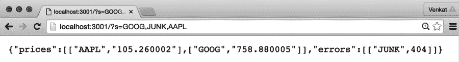

输出显示了有效股票代码的价格以及无效代码的错误消息。但等一下——Stockfetch 经过了彻底的自动化测试，但这段小代码呢？

要编写自动化测试，你必须以不同的方式设计 `stockfetch-service.js` 文件中的代码。首先，将 `handler` 函数移动到单独的文件中以便对其进行隔离和测试。测试将验证该函数如何处理各种查询字符串，例如空查询字符串或没有符号的字符串等。为了测试这些，我们需要存桩（stub）`req` 和 `res`。然后测试可以验证函数与 `Stockfetch` 的交互是否正确——我们需要将 `Stockfetch` 作为参数传递，以便于存桩。最后，我们可以测试服务文件是否通过 `http.createServer` 函数正确地注册了 `handler` 函数。这将测试到这段代码，但现实中，一个典型的 Web 应用会使用不同的 HTTP 方法（如 `GET`、`POST` 和 `DELETE`）以及多个路由（如 `/`、`/stocks` 等）。我们如何有系统地测试所有这些内容呢？


Express 做了很多工作，这很棒，但可能并不总是清楚如何为 Express 编写的代码自动化测试。这是因为，当请求到达时，Express 会调用相应的路由函数，并在函数完成后将响应推给客户端。我们编写处理请求的代码并不是直接从应用程序代码调用的。相反，它们是在请求到达时由 Express 调用的。对于这类代码，我们希望编写运行快速且易于重复的自动化测试。

此外，路由函数经常会调用与数据库交互的模型函数。当发生这种情况时，我们希望验证模型函数是否正确执行了逻辑并正确与数据库交互。

在本章中，你将学习如何设置和测试 MongoDB 的数据库连接。然后你将学习设计模型函数，使其能够与数据库交互，在测试期间可以轻松地进行模拟（stub）。一旦你掌握了模型的自动化测试，你就可以学习验证路由函数的行为。掌握了这些技术后，你很快就能实现完全自动化和验证你自己的 Express 应用程序。

# 可测试性设计

有了像 Express 这样让生活变得简单的框架，我们可以在几分钟内让应用程序运行起来。但它们似乎让编码变得如此简单，以至于如何编写测试可能并不清晰。正如我们之前讨论过的，可测试性是一个设计问题。通过仔细地组织代码，我们可以对 Express 应用程序进行完全自动化测试。让我们来看一个例子。

| 维护成本是开发成本的一部分 |
| --- |
|  像 Express 这样的框架减少了创建代码的时间成本。自动化验证在更改代码时具有同样的优势。为了降低整体开发成本，我们希望同时减少编码成本和维护成本。 |

我们将测试一个 TO-DO Express 应用程序。它特意设计得很小，以便我们可以专注于学习测试自动化。该程序将维护一个持久的任务名称列表以及预期的完成日期。应用程序将对 `/tasks` URL 路由响应，使用以下 HTTP 方法之一：

*   `GET`：返回数据库中所有任务的列表
*   `GET`：给定一个 id，返回该 id 的任务
*   `POST`：向数据库添加任务
*   `DELETE`：从数据库中删除给定 id 的任务

让我们先创建一个高层设计。

## 创建策略设计

我们需要一个文件 `tasks.js` 来注册路由，以及一个模型文件 `task.js`，包含与数据库交互的函数。我们将使用 MongoDB 进行持久化，其中有一个名为 `tasks` 的集合，将包含以下格式的任务：

`{’name’: string, ’month’: number, ’day’: number, ’year': number}`

只有模型会依赖数据库；路由不应该感知持久化层。这是一个好主意，但我们必须更进一步。最好避免模型与数据库的紧密耦合。这是因为，如果模型直接依赖数据库连接，那么模型函数的自动化测试将非常困难。为了避免这个问题，我们需要依赖注入（dependency injection）来将模型与实际数据库连接解耦。这样，应用程序可以注入生产数据库的连接，而测试可以注入测试数据库的连接。这样设计听起来很复杂，但幸运的是，代码实现起来非常简单。

图 显示了策略设计的整体视图。

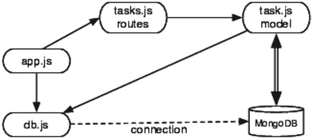

当应用程序启动时，`app.js` 中的代码将调用 `db.js` 文件中的 `connect()` 函数以创建到生产数据库的连接。在测试期间，由于我们不会调用 `app.js` 文件，测试将在必要时调用 `db.js` 文件来创建到测试数据库的连接——我们将在到达战术设计时进一步讨论这一点。简而言之，适当数据库的连接是在应用程序启动或测试运行开始时设置的。

当 URL `/tasks` 的 Web 请求到达时，Express 将调用 `tasks.js` 中注册的相应回调函数。根据操作的不同，路由函数将调用 `task.js` 中必要的模型函数。模型将从 `db.js` 获取预设的数据库连接以与数据库交互。

让我们进入战术设计。

## 使用测试创建战术设计

我们有三个文件或函数组需要设计：`db.js` 中的数据库连接函数`task.js` 中的模型函数以及 `tasks.js` 中的路由函数。`app.js` 大多是 Express 生成的代码，需要一些细微更改。让我们从初始测试列表开始——包括正例、负例和异常测试。在纸上写下脑海中想到的测试。这里是一些：

*   `db`: `get` 初始时对连接返回 null
*   `db`: `close` 将连接设置为 null
*   `db`: `close` 将关闭现有连接
*   `db`: `connect`, 给定有效的数据库名称，设置连接
*   `db`: `connect`, 当未给出数据库名称时，返回错误
*   `task`: `all` 从 `tasks` 集合返回任务数组
*   `task`: `get` 根据给定 id 返回任务
*   `task`: `get` 对于无效 id 返回 `{}`
*   `task`: `add` 向 `tasks` 集合添加任务
*   `task`: `add` 输入无效时返回错误
*   `task`: `delete` 根据给定 id 删除任务
*   `task`: `delete` 如果未找到 id 则返回错误
*   `tasks`: ……我们稍后会处理这些

我们现在有了一些测试。接下来让我们进入战术设计和实现。

# 设置 Express 应用并运行测试测试

在编写任何测试之前，我们需要准备 Express 应用程序并安装必要的模块，包括 MongoDB。工作区中提供了一个预创建的项目目录——它是使用 `express-generator` 创建的。让我们进入 `tdjsa/testexpress/todo` 目录并查看 `package.json` 文件。开发依赖包括 Mocha、Chai、Sinon、Istanbul——我们预期的测试模块。

由于我们将使用 MongoDB，我们需要 MongoDB 模块——这在 `package.json` 文件的 dependencies 部分已指定。为了安装项目的依赖，让我们运行 `npm install`。

此外，我们需要实际数据库。如果你还没有，请在你的系统中下载并安装 MongoDB。对于本示例，我们将使用 `tdjsa/testexpress/todo` 下的 `db` 目录来存储数据库——工作区已提供该空目录。一旦安装 完成，使用以下命令启动 MongoDB 守护进程：

```
mongod --dbpath db
```

保持 mongod ——你可以将该命令行窗口移开。如果你的系统已经作为后台进程运行了守护进程，可以使用它代替这些步骤。

在 todo 目录下，已经提供了一个 test/server 目录——这是存放测试的地方。我们将通过在 test/server 目录下的名为 `db-test.js` 的文件中编写测试测试来开始该项目的自动化测试：

[testexpress/todo/test/server/db-test.js](http://media.pragprog.com/titles/vsjavas/code/testexpress/todo/test/server/db-test.js)

```javascript
var expect = require('chai').expect;

describe('db tests', function() {
  it('should pass this canary test', function() {
    expect(true).to.be.true;
  });
});
```


让我们再次查看一下工作区当前项目中的 `package.json` 文件，但这次重点关注 `test` 命令。它写着 `mocha --watch --recursive test/server`。`--watch` 选项要求 `Mocha` 在看到文件更改时重新运行测试。`--recursive` 选项会遍历所有的子目录，在本例中为 `server` 目录——目前 `server` 的子目录中还没有任何测试，但很快就会有了。

让我们运行 `npm test` 并确保金丝测试（canary test）通过。我们已经准备好为数据库相关的函数编写测试了。

## 设计数据库连接

`app.js` 文件将在应用程序启动时调用 `connect` 函数来设置数据库连接。代码的其他部分可能会调用 `get` 函数来获取连接。`close` 函数将帮助关闭数据库连接。在正常执行期间，应用程序可能不需要 `close` 函数——连接在启动时创建，并在整个执行过程中保持开启。然而，我们仍然设计这个函数，因为在测试期间需要它确保连接池中的连接被正确关闭。让我们设计这些函数并先进行测试，从 `get` 函数开始。在测试列表中，第一个测试说 `get` 函数默认将返回 `null`。让我们在 `db-test.js` 文件中紧接金丝测试之后编写测试来验证这一点：

[testexpress/todo/test/server/db-test.js](http://media.pragprog.com/titles/vsjavas/code/testexpress/todo/test/server/db-test.js)

```markdown
| | it('get should return null connection by default', function() { |
| | expect(db.get()).to.be.null; |
| | }); |
```

测试调用了 `db` 上的 `get` 函数。为了实现这一点，我们需要在 `db-test.js` 顶部引入 `db.js` 文件：

[testexpress/todo/test/server/db-test.js](http://media.pragprog.com/titles/vsjavas/code/testexpress/todo/test/server/db-test.js)

```markdown
| | var db = require('../../db'); |
```

接下来我们将在 `todo` 目录下的 `db.js` 文件中实现通过测试所需的的最少代码：

[testexpress/todo/db.js](http://media.pragprog.com/titles/vsjavas/code/testexpress/todo/db.js)

```markdown
| | module.exports = { |
| | connection: null, |
| | |
| | get: function() { return this.connection; }, |
| | }; |
```

一旦保存文件，`Mocha` 应该报告两个测试通过。

接下来让我们设计 `close` 函数。测试列表中有两个针对该函数的测试。我们从第一个测试开始——打开 `db-test.js` 文件并输入以下内容：

[testexpress/todo/test/server/db-test.js](http://media.pragprog.com/titles/vsjavas/code/testexpress/todo/test/server/db-test.js)

```markdown
| | it('close should set connection to null', function() { |
| | db.close(); |
| | expect(db.connection).to.be.null; |
| | }); |
```

该测试验证了调用 `close` 后连接被设置为 `null`。为了让这个测试通过，我们必须在 `db.js` 文件中创建一个名为 `close` 的函数，位于 `get` 函数下方：

[testexpress/todo/db.js](http://media.pragprog.com/titles/vsjavas/code/testexpress/todo/db.js)

```markdown
| | close: function() { |
| | this.connection = null; |
| | }, |
```

现在来写第二个测试：

[testexpress/todo/test/server/db-test.js](http://media.pragprog.com/titles/vsjavas/code/testexpress/todo/test/server/db-test.js)

```markdown
| | it('close should close existing connection', function(done) { |
| | db.connection = { close: function() { done(); } }; |
| | db.close(); |
| | expect(db.connection).to.be.null; |
| | }); |
```

第二个测试进一步验证了 `close` 实际上关闭了连接，而不仅仅将其设置为 `null`。为了避免依赖真实连接，我们在此测试中对连接的存根（stub）了 `close` 函数。

让我们修改 `db.js` 中的 `close` 函数以让两个测试通过：

[testexpress/todo/db.js](http://media.pragprog.com/titles/vsjavas/code/testexpress/todo/db.js)

```markdown
| | close: function() { |
| | if(this.connection) { |
| | this.connection.close(); |
| | this.connection = null; |
| | }, |
```

`db.js` 中使两个测试通过的 `close` 函数如下：
```javascript
close: function() {
  if (this.connection) {
    this.connection.close();
  }
  this.connection = null;
}
```


[testexpress/todo/db.js](http://media.pragprog.com/titles/vsjavas/code/testexpress/todo/db.js)

```javascript
function connect(dbname, callback) {
  var self = this;
  var cacheConnection = function(err, db) {
    self.connection= db;
    callback(err);
  };
  try {
    MongoClient.connect(dbname, cacheConnection);
  } catch(ex) {
    callback(ex);
  }
}
```

我们在 `db.js` 文件中设计了用于创建数据库连接的函数。`connect` 函数将被 `app.js` 文件调用以打开连接，而 `get` 函数将由模型函数调用以访问数据库。`close` 函数将由数据库相关的测试在测试结束后关闭连接——该函数是专门为了方便自动化测试而编写的。现在，让我们开始设计模型的函数。

## 从底层开始考虑可测试性设计

>  刻意考虑到自动化验证进行设计。结构化代码以使测试符合 FAIR 原则——快速、自动化、隔离和可重复。

## 设计模型

模型相关的函数是唯一会与数据库交互的函数。我们需要四个函数：一个用于从数据库获取所有任务的 `all` 函数，一个根据 `id` 获取任务的 `get` 函数，一个插入任务的 `add` 函数以及一个删除任务的 `delete` 函数。我们在测试列表中了一些与这些函数相关的测试。在编写这些测试之前，我们必须在新的 `task-test.js` 文件中设置数据库的连接。

由于模型函数会更新数据库，如果我们不小心，在运行测试时将会遇到重复执行的问题。假设我们在一个空数据库上执行了 `add` 任务。现在，我们可以验证持久化记录的数量为 1。如果我们再次运行该测试，测试将失败，因为计数不再是 1 了。同样，重复运行一个删除持久化任务的测试也会失败，因为数据在第一次运行时已被删除。为了解决这个问题，我们将使用**测试固件（test fixtures）——`beforeEach` 和 `afterEach` 方法是为每个测试设置和清理这些数据的绝佳位置。此外，我们不需要为每个测试重复创建连接；相反，我们可以在 `before` 函数中初始化连接，该函数会在套件中的第一个测试之前运行一次。

### 采取务实的方法

>  从纯主义的角度来看，模型在测试期间不与数据库通信。在本书中我们采取务实的方法——我们更关注编写确定且运行快速的测试。如果通过引入依赖可以实现该目标，那就没问题。相反，如果依赖阻止了我们实现该目标，只有在这种情况下我们才会对其进行隔离。

### 设置连接和测试固件

在查看第一个模型测试之前，让我们准备好设置代码。

在 `testexpress/todo` 目录下提供了一个名为 `models` 的空目录，其中有一个名为 `task.js` 的空文件。此外，在 `test/server/models` 目录下提供了一个名为 `task-test.js` 的空测试文件。

让我们编辑 `task-test.js` 文件以添加设置函数：

[testexpress/todo/test/server/models/task-test.js](http://media.pragprog.com/titles/vsjavas/code/testexpress/todo/test/server/models/task-test.js)

```javascript
var expect = require('chai').expect;
var db = require('../../../../db');
var ObjectId = require('mongodb').ObjectId;
var task = require('../../../models/task');
describe('task model tests', function() {
  var sampleTask;
  var sampleTasks;
  before(function(done) {
    db.connect('mongodb://localhost/todotest', done);
  });
  after(function() {
    db.close();
  });
});
```

`before` 函数在任何测试运行之前创建数据库连接。`after` 函数在最后一个测试结束时负责关闭连接。这在带有 watch 选项运行 Mocha 时非常有用——它只在需要时保持数据库连接打开。

除了之前的设置函数外，我们还需要几个函数。让我们在 `task-test.js` 中 `after` 函数正下方创建这些函数，并了解它们的作用：

[testexpress/todo/test/server/models/task-test.js](http://media.pragprog.com/titles/vsjavas/code/testexpress/todo/test/server/models/task-test.js)

```javascript
var id = function(idValue) {
  return new ObjectId(idValue);
};
beforeEach(function(done) {
  sampleTask = {name: 'a new task', month: 12, day: 10, year: 2016};
  sampleTasks = [
    {id: id('123412341240'), name: 'task1', month: 10, day: 5, year: 2016},
    {id: id('123412341241'), name: 'task2', month: 11, day: 2, year: 2016}, 
    {id: id('123412341242'), name: 'task3', month: 12, day: 8, year: 2016}
  ];
  db.get().collection('tasks').insert(sampleTasks, done);
});
afterEach(function(done) {
  db.get().collection('tasks').drop(done);
});
```

`id` 函数位于 `after` 函数下方，是一个用于创建正确类型的辅助函数。在 `beforeEach` 中我们创建了一些任务作为测试固件。`afterEach` 函数在每个测试结束后都会清空集合。这两个函数共同工作，确保每个测试都获得全新的环境。`beforeEach` 函数还用单个任务初始化了 `sampleTask`。这对于测试 `add` 函数有用，我们将设计 `all` 和 `get` 函数。

### 设计 all 函数

在 `task-test.js` 设置完成后，让我们为 `all` 函数编写测试：

```javascript
it('all should return all the tasks', function() {
  var callback = function(err, tasks) {
    expect(tasks).to.eql(sampleTasks);
    done();
  };
  task.all(callback);
});
```

测试将 `callback` 传递给 `task.all` 函数，并在 `callback` 中验证获取了集合中的所有任务。现在，让我们在 `task.js` 文件中实现 `all` 函数以通过测试：

[testexpress/todo/models/task.js](http://media.pragprog.com/titles/vsjavas/code/testexpress/todo/models/task.js)

```javascript
var db = require('../db');
var ObjectId = require('mongodb').ObjectId;
var collectionName = 'tasks';

module.exports = {
  all: function(callback) {
    db.get().collection(collectionName).find().toArray(callback);
  },
};
```

该函数通过 `MongoClient` 的数据库连接发出异步调用。它获取 tasks 集合，使用 `find` 函数执行查询，并请求返回数组。一旦 MongoDB 完成查询，它将调用 `callback`。`all` 函数将其收到的 `callback` 函数作为参数传递给 `toArray` 函数，因此 `MongoClient` 实际上直接将响应返回给 `all` 函数的调用者。


让我们浏览一下 Mocha——在监听模式下运行——以确保所有测试（包括 `db-test.js` 中的测试）均通过。`db-test.js` 位于 `test/server` 目录，而 `task-test.js` 文件位于 `test/server/models` 目录，但由于 `--recursive` 选项，Mocha 将运行它们。

如果你能为 `all` 函数考虑到负用测试，请编写这些测试，然后对 `all` 函数进行必要的修改。完成后，我们接下来将设计 `get` 函数。

### 设计 get 函数

与返回 `tasks` 集合中所有值的 `all` 函数不同，`get` 函数将只返回具有与 `id` 匹配的条任务。如果没有找到任何匹配项，它将返回 `null`。请记住，由于 `MongoClient` 函数是异步的，因此模型函数也是异步的。

这里是 `get` 函数的第一个测试：

[testexpress/todo/test/server/models/task-test.js](http://media.pragprog.com/titles/vsjavas/code/testexpress/todo/test/server/models/task-test.js)

```javascript
it('get should return task with given id', function(done) {
  var callback = function(err, task) {
    expect(task.name).to.be.eql('task1');
    expect(task.month).to.be.eql(10);
    done();
  };
  task.get('123412341240', callback);
});
```

该测试发送了一个有效的 `id`，并验证返回的值是否等于测试固件中的预设任务之一。以下是 `get` 函数的代码，以使其通过测试：

[testexpress/todo/models/task.js](http://media.pragprog.com/titles/vsjavas/code/testexpress/todo/models/task.js)

```javascript
get: function(taskId, callback) {
  db.get().collection(collectionName)
    .find({'_id': new ObjectId(taskId)}).limit(1).next(callback);
},
```

这是一个完成任务的短函数。虽然 `all` 函数使用了不带参数的 `find` 函数，但这个函数使用了带有预期对象 `id` 详细信息的函数。然后它使用 `limit` 函数将值限制为单个值。

现在让我们编写第二个测试：

[testexpress/todo/test/server/models/task-test.js](http://media.pragprog.com/titles/vsjavas/code/testexpress/todo/test/server/models/task-test.js)

```javascript
it('get should return null for non-existing task', function(done) {
  var callback = function(err, task) {
    expect(task).to.be.null;
    done();
  };
  task.get(2319, callback);
});
```

第二个测试发送了一个任意的 `id`——一个在任何预设数据中都不存在的值——并验证结果为 `null`。让我们快速确认此测试是否与所有当前测试一起通过。

让我们继续进行 `add` 函数的测试。

## 处理 add 函数

与之前的函数不同，`add` 函数将依赖用户输入的数据。当涉及用户输入时，我们需要更多的错误检查。`add` 函数应该接收一个任务，如果有效，则将其添加到数据库。否则，它应该返回一个错误。由于任务有多个参数，可能会出现多个问题。我们需要检查每个参数是否有效，但这里有一个陷阱。

在可能的情况下，在客户端执行检查会更好。这样速度更快，而且与服务器的往返次数更少。然而，在服务器端仍然需要检查；数据可能会被发送到服务器，从而绕过客户端检查。但重复代码行为等同于犯罪性的过失。我们需要在双方之间共享验证代码，以遵循良好的设计。

| 保持数据验证代码 DRY |
| :--- |
|  避免在客户端和服务器端之间重复任何验证代码。重复会增加维护代码和修复错误的成本。 |

以下是我们将如何处理验证的设计。如果某个检查只能在服务器端执行，我们将直接在 `add` 函数中执行它。如果某个检查可以在任何一方执行，那么我们将在 `validateTask` 函数中执行，该函数将由双方通用并共享。在完成模型函数的测试后，我们将关注 `validateTask` 函数。现在，我们只需要验证 `add` 是否正确地调用了 `validateTask`。

现在我们对如何设计 `add` 函数有了相当的想法。我们将从一个正向测试开始，然后通过几个负向测试，最后是针对新任务验证的测试。

### 从正向测试开始

让我们设计 `add` 函数。我们首先看正向测试：

[testexpress/todo/test/server/models/task-test.js](http://media.pragprog.com/titles/vsjavas/code/testexpress/todo/test/server/models/task-test.js)

```javascript
it('add should return null for valid task', function(done) {
  var callback = function(err) {
    expect(err).to.be.null;
    task.all(function(err, tasks) {
      expect(tasks[3].name).to.bel('a task');
      done();
    });
  };
  task.add(sample);```

我们需要```测试中验证两件事：首先，`add` 函数没有返回任何错误，其次，数据确实已添加。为了这一点，我们在传递给 `add` 函数的回调函数中验证 `err` 为 `null`。然后调用 `all` 函数来检查任务是否存在。

让我们编写通过此测试的最少代码。将以下内容添加到 `task.js`:

[testexpress/todo/models/task.js](http://media.pragprog.com/titles/vsjavas/code/testexpress/todo/models/task.js)

```javascript
add: function(newTask, callback) {
  db.get().collection(collectionName).insertOne(newTask, callback);
},
```

在 `add` 函数中，我们获取数据库连接并调用 `insertOne` 函数，传递 `newTask` 和 `callback`。`insertOne` 函数会将任务插入数据库并调用 `callback` 告诉我们一切顺利。一旦 `task.js` 保存，确保 Mocha 报告通过。

### 编写负向测试

现在让我们关注 `add` 函数的一系列负向测试。首先，我们将检查重复的任务不能添加到数据库。这是一个适用于服务器的测试，因为客户端的数据可能在随时过时。

[testexpress/todo/test/server/models/task-test.js](http://media.pragprog.com/titles/vsjavas/code/testexpress/todo/test/server/models/task-test.js)

```javascript
var expectError = function(message, done) {
  return function(err) {
    expect(err.message).to.be.eql(message);
    done();
  };
};

it('add should return Error if task already exists', function(done) {
  sampleTask = sampleTasks[0];
  delete sampleTask._id;
  task.add(sampleTask, expectError('duplicate task', done));
});
```

`expectError` 是一个辅助函数，用于检查是否接收了正确的错误消息并信号测试的完成。该测试尝试向数据库添加已的任务并验证请求优雅失败。让我们修改 `add` 函数以通过此测试：

[testexpress/todo/models/task.js](http://media.pragprog.com/titles/vsjavas/code/testexpress/todo/models/task.js)

```javascript
add: function(newTask, callback) {
  var found = function(err, task) {
    if (task) {
      callback(new Error('duplicate task'));
    } else {
      db.get().collection(collectionName).insertOne(newTask, callback);
    }
  };
},
```


```javascript
db.get().collection(collectionName).find(newTask).limit(1).next(found);
```

`add` 函数已经演进，以应对新测试的挑战。它调用连接上的 `find` 函数来首先检查给定的任务是否存在。新的内部函数 `found` 充 `find` 函数的回调函数。如果找到了任务，该内部函数将调用给定的回调函数并返回“duplicate task（重复任务）”错误。如果未找到，它它将执行预期的插入操作。

这解决了重复任务的问题，但可能还会发生其他错误。接下来让我们处理任务验证。

### 验证新任务

任务的名称可能会缺失，或者其中一个日期参数可能会出错。这些字段的验证应该在客户端和服务器端同时进行。该任务应该委托给 `validateTask` 函数处理。让我们写几个测试来检查 `add` 是否正确使用了 `validateTask` 函数。我们将从第一个测试开始。

如果 `add` 函数直接依赖于 `validateTask` 函数，那么很难用存根（stub）或模拟对象（mock）来替换 `validateTask` 函数。我们将应用依赖注入来解决这个问题。持有模型函数的任务可以有一个 `validate` 属性，它只需引用 `validateTask` 函数。很容易用测试双胞（test double）替换这个引用。我们很快就会看到做法。

首先，让我们创建一个测试来验证 `validate` 属性引用了 `validateTask` 函数：

[testexpress/todo/test/server/models/task-test.js](http://media.pragprog.com/titles/vsjavas/code/testexpress/todo/test/server/models/task-test.js)

```javascript
it('task.validate should refer to validateTask', function() {
  expect(task.validate).to.be.eql(validateTask);
});
```

此外，记得为包含 `validateTask` 函数的文件添加 `require`：

[testexpress/todo/test/server/models/task-test.js](http://media.pragprog.com/titles/vsjavas/code/testexpress/todo/test/server/models/task-test.js)

```javascript
var validateTask = require('../../../public/javascripts/common/validate-task');
```

为了通过上一个测试，我们将在 `task.js` 的任务中添加 `validate` 属性：

[testexpress/todo/models/task.js](http://media.pragprog.com/titles/vsjavas/code/testexpress/todo/models/task.js)

```javascript
validate: validateTask,
```

我们需要 `validateTask` 函数。然而，我们还没有准备好实现它——我们需要为它编写测试，但我们现在正处于测试任务相关模型函数的中间。目前，让我们更改 `task.js` 以引入包含 `validateTask` 函数的文件：

[testexpress/todo/models/task.js](http://media.pragprog.com/titles/vsjavas/code/testexpress/todo/models/task.js)

```javascript
var validateTask = require('../public/javascripts/common/validate-task');
```

此外，在 `todo/public/javascripts/common/validate-task.js` 文件中我们将放置以下临时代码：

[testexpress/todo/public/javascripts/common/validate-task.js](http://media.pragprog.com/titles/vsjavas/code/testexpress/todo/public/javascripts/common/validate-task.js)

```javascript
var validateTask = function(task) {
  return true;
}

(typeof module !== 'undefined') && (module.exports = validateTask);
```

该文件将在服务器端和客户端共享。客户端不使用 `require` 来访问其他文件中的函数。相反，它通过 `window` 对象获取它们。对 `module` 和 `exports` 是否存在的检查将使这段代码在双方都能正常可用。你可以使用任何喜欢的其他技术在双方之间共享代码。

`validateTask` 的当前实现是一个占位符，稍后在我们编写测试时，它将演变为验证任务。

现在，让我们回到 `add` 函数的测试上——以验证在给定新任务时 `add` 是否调用了 `validate`。

[testexpress/todo/test/server/models/task-test.js](http://media.pragprog.com/titles/vsjavas/code/testexpress/todo/test/server/models/task-test.js)

```javascript
it('add should call validate', function(done) {
  validateCalled = false;

  task.validate = function(task) {
    expect(task).to.be.eql(sampleTask);
    validateCalled = true;
    return validateTask(task);
  };

  task.add(sampleTask, done);
  expect(validateCalled).to.be.true;
});
```

该测试为 `validate` 属性创建了一个探针（spy）。它通过设置 `validateCalled` 标志来断言 `validateTask` 被调用。`add` 调用了 `validate`。最后，它用 `validateTask` 函数替换了 `validate` 属性。

[testexpress/todo/models/task.js](http://media.pragprog.com/titles/vsjavas/code/testexpress/todo/models/task.js)

```javascript
if (this.validate(newTask)) {
  db.get().collection(collectionName).find(newTask).limit(1).next(found);
} else {
  callback;
}
```

这处理了任务有效的情况，但我们还需要测试 `validateTask` 返回 `false` 的情况。

[testexpress/todo/test/server/models/task-test.js](http://media.pragprog.com/titles/vsjavas/code/testexpress/todo/test/server/models/task-test.js)

```javascript
it('add should handle failure', function(done) {
  var onError = function(err) {
    expect(err.message).to.eql('unable to add task');
    done();
  };
  task.validate = function() {
    return false;
  };

  task.add(sampleTask, onError);
});
```

测试模拟了 `validate` 属性并返回 `false` 以假定任务无效。然后测试断言在 `add` 函数的回调中收到了正确的错误消息。我们需要在 `add` 函数中编写 `else` 部分来通过此测试：

[testexpress/todo/models/task.js](http://media.pragprog.com/titles/vsjavas/code/testexpress/todo/models/task.js)

```javascript
if (this.validate(newTask)) {
  db.get().collection(collectionName).find(newTask).limit(1).next(found);
} else {
  callback("unable to add task");
}
```

为新任务设计代码比之前的操作所需的工作投入更多。让我们看看代码。

### 检查生成的函数

我们通过几个测试创建了 `add` 函数。让我们退后一步，看看使用这些测试创建的完整 `add` 函数：

[testexpress/todo/models/task.js](http://media.pragprog.com/titles/vsjavas/code/testexpress/todo/models/task.js)

```javascript
add: function(newTask, callback) {
  var found = function(err, task) {
    if (task) {
      callback('duplicate task');
    } else {
      db.get().collection(collectionName).insertOne(newTask, callback);
    }
  };

  if (this.validate(newTask)) {
    db.get().collection(collectionName).find(newTask).limit(1).next(found);
  } else {
    callback("unable to add task");
  }
},
```

`add` 函数执行了大量工作，我们写的测试完全验证了它的行为。这引导我们进入最后一个模型函数的设计——delete。


# 处理删除

`delete` 函数应该接收一个任务 ID 并删除该 ID 的任务。为它添加一个正向测试和几个反向测试。从正向测试开始：

[testexpress/todo/test/server/models/task-test.js](http://media.pragprog.com/titles/vsjavas/code/testexpress/todo/test/server/models/task-test.js)

```javascript
it('delete should send null after deleting existing task', function(done) {
  var callback = function(err) {
    expect(err).to.be.null;
    task.all(function(err, tasks) {
      expect(tasks.length).to.be.eql(2);
      done();
    });
  };
  task.delete('123412341242', callback);
});
```

正向测试验证了 `delete` 函数删除了现有的数据并通过回调函数返回了 `null`。在回调函数中，对 `all` 函数调用的响应将确认数据库中的任务数量比设置期间创建的少了一个。以下是 `task.js` 文件中通过测试所需的最少代码：

[testexpress/todo/models/task.js](http://media.pragprog.com/titles/vsjavas/code/testexpress/todo/models/task.js)

```javascript
delete: function(taskId, callback) {
  var handleDelete = function(err, result) {
    callback(null);
  };

  db.get().collection(collectionName)
    .deleteOne({'_id': new ObjectId(taskId)}, handleDelete);
},
```

`delete` 函数使用连接对象调用 `deleteOne` 函数，并传递给定的 ID 和一个内部函数的引用。当 `deleteOne` 调用内部函数时，它会反过来调用给定的回调函数，传递 `null` 以表示成功。

这已经处理了“快乐路径”（happy path）。让我们写一个反向测试，来处理要删除的任务 ID 无效的情况：

[testexpress/todo/test/server/models/task-test.js](http://media.pragprog.com/titles/vsjavas/code/testexpress/todo/test/server/models/task-test.js)

```javascript
it('delete should return Error if task not found', function(done) {
  task.delete('123412341234123412342319',
    expectError('unable to delete task with id: 123412341234123412342319',
    done));
});
```

该测试通过了一个不存在的 ID 值，并断言错误消息指示无法删除给定 ID 的任务。让我们修改 `delete` 函数使此测试通过：

[testexpress/todo/models/task.js](http://media.pragprog.com/titles/vsjavas/code/testexpress/todo/models/task.js)

```javascript
delete: function(taskId, callback) {
  var handleDelete = function(err, result) {
    if(result.deletedCount != 1)
      callback(new Error("unable to delete task with id: " + taskId));
    else
      callback(null);
  };

  db.get().collection(collectionName)
    .deleteOne({'_id': new ObjectId(taskId)}, handleDelete);
},
```

在 `handleDelete` 内部函数中，如果 `deleteOne` 返回的删除计数不等于 1，则通过给定的 `callback` 向调用者发回错误消息。让我们再写一个反向测试，检查在未提供 ID 时代码是否表现良好：

[testexpress/todo/test/server/models/task-test.js](http://media.pragprog.com/titles/vsjavas/code/testexpress/todo/test/server/models/task-test.js)

```javascript
it('delete should return Error if task id not given', function(done) {
  task.delete(undefined,
    expectError('unable to delete task with id: undefined',
    done));
});
```

`delete` 函数处理了这种情况。`delete` 函数依赖于 `validate` 函数。

# 验证设计

`validate` 函数应该检查提供的任务。我们需要为 `validate` 编写测试。

## 创建测试套件

从必要的代码开始：

[testexpress/todo/test/server/models/task-test.js](http://media.pragprog.com/titles/vsjavas/code/testexpress/todo/test/server/models/task-test.js)

```javascript
var expect = require('chai').expect;
var validateTask = require('../../../public/javascripts/validate');

describe('validate', function() {
  var sampleTask;
  var expectFailProperty = function(property, value) {
    sampleTask[property] = value;
    expect(validateTask(sampleTask)).to.be.false;
  };

  beforeEach(function() {
    sampleTask = {day: 10, year: 2016};
  });
```

## 编写正向测试

为 `validate` 编写第一个测试：

[testexpress/todo/test/server/models/task-test.js](http://media.pragprog.com/titles/vsjavas/code/testexpress/todo/test/server/models/task-test.js)

```javascript
it('should return true for valid task', function() {
  expect(validateTask(sampleTask)).to.be.true;
});
```

## 编写反向测试

我们将编写的反向测试将验证在缺少参数时 `validateTask` 是否返回 `false`。

[testexpress/todo/test/server/models/task-test.js](http://media.pragprog.com/titles/vsjavas/code/testexpress/todo/test/server/models/task-test.js)

```javascript
it('should return false for undefined task', function() {
  expect(validateTask()).to.be.false;
});
```

为了让这个测试通过，我们需要对 `validate` 函数进行细小的修改：

[testexpress/todo/public/javascripts/common/validate-task.js](http://media.pragprog.com/titles/vsjavas/code/testexpress/todo/public/javascripts/common/validate-task.js)

```javascript
var validateTask = function(task) {
  if(task)
    return true;
  return false;
}
```

`validateTask` 函数还应该检查 `null` 参数是否有效——接下来让我们测试这个：

[testexpress/todo/test/server/models/task-test.js](http://media.pragprog.com/titles/vsjavas/code/testexpress/todo/test/server/models/task-test.js)

```javascript
it('should return false for null task', function() {
  expect(validateTask(null)).to.be.false;
});
```


## 任务验证
此测试无需更改任何代码即可通过。接下来，我们将验证如果任务的 `name` 属性为未定义，`validateTask` 是否返回 `false`。

[testexpress/todo/test/server/common/validate-task-test.js](http://media.pragprog.com/titles/vsjavas/code/testexpress/todo/test/server/common/validate-task-test.js)

```javascript
it('should return false for undefined name', function() {
  expectFailForProperty('name');
});
```

为了让此测试通过，我们需要对 `validateTask` 函数进行再次修改：

[testexpress/todo/public/javascripts/common/validate-task.js](http://media.pragprog.com/titles/vsjavas/code/testexpress/todo/public/javascripts/common/validate-task.js)

```javascript
var validateTask = function(task) {
  if(task && task.name)
    return true;
  return false;
}
```

这是一个很小的改动——我们在 `if` 条件中添加了 `task.name`。接下来，我们将验证当 `name` 属性为 `null` 时函数的行为。

[testexpress/todo/test/server/common/validate-task-test.js](http://media.pragprog.com/titles/vsjavas/code/testexpress/todo/test/server/common/validate-task-test.js)

```javascript
it('should return false for null name', function() {
  expectFailForProperty('name', null);
});
```

此测试不需要更改任何代码，我们添加的条件也足够通过此测试。我们已经验证了当 `name` 属性为 `undefined` 或 `null` 时函数的行为。但我们应该决定当该属性的值为空字符串时该怎么办。让我们倾向于认为在名称为空时任务是无效的。以下是针对该需求的测试：

[testexpress/todo/test/server/common/validate-task-test.js](http://media.pragprog.com/titles/vsjavas/code/testexpress/todo/test/server/common/validate-task-test.js)

```javascript
it('should return false for empty name', function() {
  expectFailForProperty('name', '');
});
```

令人惊讶的是，一旦我们保存文件，Mocha 就会报告所有测试（包括此测试）均已通过。我们编写的实现涵盖了这种情况，因此不需要更多代码来处理 `name` 属性。让我们关注一下 `month` 属性。

### 保持测试的 DRY
`month` 属性不应为 `undefined`、`null` 或任意文本——它应该是一个数字。同样的规则也适用于 `day` 和 `year` 属性。我们不希望为这三个属性编写重复测试。我们将创建一个验证 `month` 存在的测试，并以这种方式使其供另外两个属性复用。

[testexpress/todo/test/server/common/validate-task-test.js](http://media.pragprog.com/titles/vsjavas/code/testexpress/todo/test/server/common/validate-task-test.js)

```javascript
['month'].forEach(function(property) {
  it('should return false for undefined ' + property, function() {
    expectFailForProperty(property);
  });

  it('should return false for null ' + property, function() {
    expectFailForProperty(property, null);
  });

  it('should return false for non number ' + property, function() {
    expectFailForProperty(property, 'text');
  });
});
```

我们编写了三个测试，但我们将测试嵌入到了对一个包含单个元素“month”的数组的 `forEach` 迭代中。这种形式将为数组中的每个值创建一个一组三个测试——目前我们只有一个值，但很快就会再添加两个。

这些测试将要求 `validateTask` 函数再次更改：

[testexpress/todo/public/javascripts/common/validate-task.js](http://media.pragprog.com/titles/vsjavas/code/testexpress/todo/public/javascripts/common/validate-task.js)

```javascript
var validateTask = function(task) {
  if(task && task.name &&
    task.month && !isNaN(task.month))
    return true;
  return false;
}
```

现在 `validateTask` 函数检查了 `month` 属性是否存在，并且它是否是一个数字。让我们更改存储“month”的数组以包含另外两个属性，如下：

[testexpress/todo/test/server/common/validate-task-test.js](http://media.pragprog.com/titles/vsjavas/code/testexpress/todo/test/server/common/validate-task-test.js)

```javascript
['month', 'day', 'year'].forEach(function(property) {
```

让我们最后一次更改 `validateTask` 函数，让所有测试通过：

[testexpress/todo/public/javascripts/common/validate-task.js](http://media.pragprog.com/titles/vsjavas/code/testexpress/todo/public/javascripts/common/validate-task.js)

```javascript
var validateTask = function(task) {
  if(task && task.name &&
    task.month && !isNaN(task.month))
    return true;
  return false;
}
```

`validateTask` 是一个同步函数，其实现非常直观。代码通过了所有测试。现在是设计路由的时间。

## 设计路由
路由函数是与 Express 注册的回调。它针对 URI 和 HTTP 方法注册。回调函数接受三个参数：`req`、`res` 和 `next`。与我们通常从应用程序调用的模型函数不同，Express 会调用它们。作为响应，处理程序通常渲染数据。这可能让我们感到困惑——我们如何测试一个从未从应用程序调用的函数呢？

嗯，我们的测试可以模拟 Express——JavaScript 使得使用 JSON 对象变得非常容易。

> 测试路由时依赖测试双
> 在测试路由时，通过依赖测试双，我们可以避免启动服务器或数据库。

### 复习路由
在编写路由函数的第一个测试之前，让我们复习一下路由文件的内容。从熟悉的领域开始——查看由 Express 生成器在 `routes` 目录下的 `index.js` 文件。

[testexpress/todo/routes/index.js](http://media.pragprog.com/titles/vsjavas/code/testexpress/todo/routes/index.js)

```javascript
var express = require('express');
var router = express.Router();

/* GET 首页 */
router.get('/', function(req, res, next) {
  res.render('index', { title: 'Express' });
});

module.exports = router;
```

让我们学习文件的内容，以理解每一行的影响。

首先，它引入了对 `express` 模块的引用。然后调用 `express` 对象上的 `Router` 函数来获取路由器实例。该实例是在文件结束时从模块返回的。该文件创建一个回调，即匿名函数作为 `router.get` 调用的第二个参数。本质上，该文件将回调注册为针对 / 后缀 GET 请求的路由处理器。我们将为任务路由创建的 `tasks.js` 文件将非常相似。


- 对于每个方法（如 `GET`、`POST` 和 `DELETE`），通过传递两个参数（路径后缀和回调函数）来注册回调处理器。
- 每个注册的回调处理器可以可选地从 `req` 对象中读取某些参数，与模型函数交互，并在 `res` 对象上执行一些调用。它们还可能调用 `next` 上的函数。

现在我们已经复习了路由文件的内容，让我们思考如何测试这些文件中代码的行为。

路由函数的测试应该关注以下两个点：

1. 验证是否注册了预期的 HTTP 方法（如 `GET`）的处理器。
2. 验证已注册的处理器是否正确地与请求、响应和模型函数进行交互。

为了验证注册情况，我们可以模拟（mock）路由器实例上的如 `get` 等函数，并验证路由文件中的代码与这些函数的交互。

为了验证处理器的行为，我们可以存根（stub）或模拟（mock）`req`、`res` 以及可选的 `next` 实例。这样，存根（stubs）可以返回固定数据，而模拟（mocks）可以确认代码与其依赖项（如 HTTP 响应）的正确交互。

通过这些方法，我们可以完全验证是否已为 HTTP 方法注册了必要的回调函数，并且处理器正在执行必要的操作。这并不难；让我们尝试一下。

对于手头的程序，我们需要注册以下路径和方法：

- `/—GET`：用于获取所有任务
- `/:id—GET`：用于根据给定 id 获取任务
- `/—POST`：用于创建新任务
- `/:id—DELETE`：根据删除给定 id 的任务

让我们开始测试。

### 从路由器的存根（Stubs）开始

路由函数的测试将放在 `testexpress/todo/test/server/routes` 目录下的 `tasks-test.js` 文件中。路由函数将放在 `testexpress/todo/routes` 目录下的 `tasks.js` 文件中。为了方便起见，这两个文件在工作区中已作为空文件提供。

第一步，让我们使用 `require` 函数调用将必要的文件引入测试文件 `tasks-test.js` 中：

[testexpress/todo/test/server/routes/tasks-test.js](http://media.pragprog.com/titles/vsjavas/code/testexpress/todo/test/server/routes/tasks-test.js)

```javascript
var expect = require('chai').expect;
var sinon = require('sinon');
var task = require('../models/task');
var express = require('express');
```

这段代码段最重要的部分在于“不存在”的内容——目前还没有对 `routes/tasks.js` 文件进行 `require`。现在先不要 `require` 它——让我们推迟到我们有机会存根 `express.Router` 函数之后。`beforeEach` 函数是创建存根（stubs）的完美位置；这样 `afterEach` 函数就可以恢复并让一切回到到初始状态，以便进行下一次测试。

[testexpress/todo/test/server/routes/tasks-test.js](http://media.pragprog.com/titles/vsjavas/code/testexpress/todo/test/server/routes/tasks-test.js)

```javascript
describe('tasks routes tests', function() {
  var sandbox;
  var router;

  beforeEach(function() {
    sandbox = sinon.sandbox.create();

    sandbox.stub(express, 'Router').returns({
      get: sandbox.spy(),
      post: sandbox.spy(),
      delete: sandbox.spy()
    });

    router = require('../routes/tasks');
  });

  afterEach(function() {
    sandbox.restore();
  });
});
```

`beforeEach` 函数将 `express` 的 `Router` 函数替换为一个存根，该存根返回一个包含三个属性（`get`、`post` 和 `delete`）的 JSON 对象。这三个属性每一个都引用了一个间探函数（spy function）——这是一种空函数，在调用时只需记录参数。只有在 `Router` 函数被存根后，才会执行 `require` 调用引入 `routes/tasks.js` 文件。然而，当该文件执行 `require(express)` 时，`routes/tasks.js` 中的代码将使用存根而不是原始的 `Router` 函数。这是因为测试已经引入了该文件并存根了 `Router`。这操作很巧妙，对吧？

### 测试路径 / 的 GET 方法

`/` 路径应该处理 HTTP `GET` 请求。让我们写一个测试来验证该路由的注册情况。这个测试将直接放在 `tasks-test.js` 文件的 `afterEach` 函数下方。

[testexpress/todo/test/server/routes/tasks-test.js](http://media.pragprog.com/titles/vsjavas/code/testexpress/todo/test/server/routes/tasks-test.js)

```javascript
it('should register /', function() {
  expect(router.get.calledWith('/')).to.be.true;
});
```

为路径后缀注册方法只是故事的一半。当 Express 接收到对 `/` 路径的 HTTP `GET` 请求并调用回调处理器时，我们希望处理器从数据库中获取所有任务并返回一个 JSON 对象数组。这引出了我们在测试处理器时需要处理的两个问题。

首先，为了测试处理器，我们需要获取它。但处理器将作为第二个参数传递给 `get` 函数——目前在被测试的代码中它是未定义的（undefined）。从表面上看，从测试中很难触及处理器。幸幸，充替 `get` 函数的间探（spy）可以提供帮助。

其次，处理器将与 `model/task.js` 中的模型函数交互——这将把我们拖入配置数据库的泥潭。噢，不要再来那种麻烦了。我们不需要这样做；可以在测试中存根模型的方法，这样就可以在没有实际的情况下测试回调处理器。

让我们这些这些应用于 GET / 处理器的测试：

[testexpress/todo/test/server/routes/tasks-test.js](http://media.pragprog.com/titles/vsjavas/code/testexpress/todo/test/server/routes/tasks-test.js)

```javascript
var stubResSend = function(expected, done) {
  return { send: function(data) {
    expect(data).to.be.eql(expected);
    done();
  }};
};

it("get / handler should call model's all & return result", function(done) {
  var sampleTasks = [{name: 't1', month: 12, day: 1, year: 2016}];
  // ... 实现细节
});
```


```javascript
sandbox.stub(task, 'all', function(callback) {
  callback(null, sampleTasks);
});

var req = {};
var res = stubResSend(sampleTasks, done);

var registeredCallback = router.get.firstCall.args[1];
registeredCallback(req, res);
```

在测试之前，我们创建了一个辅助函数，它为 `res` 的 `send` 方法返回一个存根（stub）。该存根会验证接收到的数据是否与预期值相等，并通过调用 `done()` 来完成测试。

测试首先为 `task.all` 函数创建了一个存根，并返回一个预定义的任务数组。回想模型设计，所有的 `get` 操作都会从数据库中获取任务列表。为了方便测试，该存根规避了对数据库的调用。

在测试验证路由处理程序（routes handler）的行为之前，它需要获取该处理程序的引用。在路由文件中，我们感兴趣的处理器程序将作为 `get` 函数的第二个参数被注册。获取这个第二个参数并不——我们只需要让 `router.get` 函数的探针（spy）提供传递给该调用的第二个参数即可。这是通过使用 `firstCall` 获取 `get` 函数第一次调用的细节实现的——目前只有一个调用，但稍后会有更多。一旦获取了第一次调用的细节，就可以从 `args` 属性中获取第二个参数。最后，为了完成测试，将获取到的路由处理程序连同 `req` 的 JSON 存根和 `res` 对象的存根一起调用。

通过几行代码设置存根，我们完全避免了数据库调用，深入路由处理程序内部，并验证了它的执行完全符合我们的意愿。现在，让我们实现之前未定义的回调处理程序：

[testexpress/todo/routes/tasks.js](http://media.pragprog.com/titles/vsjavas/code/testexpress/todo/routes/tasks.js)

```javascript
router.get('/', function(req, res, next) {
  task.all(function(err, tasks) {
    res.send(tasks);
  });
});
```

我们需要的只是对 `task.all` 函数进行调用，并在其回调中，我们将接收到的 `tasks` 数组重定向到 `res` 对象的 `send` 函数。实际上，路由处理程序渲染了一个包含任务数组的 JSON 响应。如果响应是 HTML 而不是 JSON，那么我们就会像之前看到的 `index.js` 文件中的代码那样调用 `render` 而不是 `send`。这处理了 GET 方法的 `/` 路径。接下来让我们处理另一个 GET 方法，但这次是针对 `/:id` 路径。

### 测试路径 /id 的 GET 方法

虽然 GET 方法的后缀 `/` 会返回所有任务，但对像 `/42` 这样的路径后缀的 GET 请求应该只返回具有该 id 的单个任务。模型函数 `get` 能够从数据库中返回该数据。相应的路由回调处理程序需要从网络请求中接收 `id`，调用模型 `task.get`，检查错误并返回适当的响应。让我们思考一下这个路由函数的测试。

作为第一个测试，让我们断言 `get` 被调用时使用的路径为 `/:id`——这是一个简短且简单的测试：

[testexpress/todo/test/server/routes/tasks-test.js](http://media.pragprog.com/titles/vsjavas/code/testexpress/todo/test/server/routes/tasks-test.js)

```javascript
it('should register URI /:id for get', function() {
  expect(router.get.calledWith('/::id', sandbox.match.any)).to.be.true;
});
```

该测试对我们即将编写的实现并没有太大要求。它主要是为了引出方法的初始声明。在 `routes/tasks.js` 文件中，我们已经有了一个针对 `/` 路径的 `get` 方法调用。现在，我们将添加另一个 `get` 调用，这次是针对 `/:id` 路径：

```javascript
router.get('/:id', function(req, res, next) {});
```

在对 `tasks.js` 文件进行此更改后，确保所有测试通过通过，包括新的这个测试。

下一个测试应该帮助我们将必要的实现放入我们通过 `get` 函数注册的空回调函数中。为此，我们将从 `get` 函数中获取回调引用，调用它，并断言它履行了其责任。

[testexpress/todo/test/server/routes/tasks-test.js](http://media.pragprog.com/titles/vsjavas/code/testexpress/todo/test/server/tasks-test.js)

```javascript
it('get /:validid should call model's get & return a task', function(done) {
  var sampleTask = {name: 't1', month: 12, day: 1, year: 2016};

  sandbox.stub(task, 'get', function(id, callback) {
    expect(id).to.be.eql(req.params.id);
    callback(null, sampleTask);
  });

  var req = {params: {id: 1}};
  var res = stubResSend(sampleTask, done);

  var registeredCallback = router.get.secondCall.args[1];
  registeredCallback(req, res);
});
```

早期的测试使用 `firstCall.args[1]` 获取回调处理程序，但最新的测试使用了 `secondCall.args[1]`。这是因为 `routes/tasks.js` 会调用两次 `router.get`，但路径不同的不同。这两个调用都会被探针接收，我们决定感兴趣的是哪一个调用。

代码中的注册顺序很重要，测试将会失败。我们实现 `get` 调用：

```javascript
router.get('/:id', function(req, res, next) {
  task.get(req.params.id, function(err, task) {
    res.send(task);
  });
});
```

注册到 `get` 的处理程序现在调用模型 `task.get` 函数。当函数返回任务时，它会被发送到响应对象。我们处理空 情况：

[testexpress/todo/test/server/routes/tasks-test.js](http://media.pragprog.com/titles/vsjavas/code/testexpress/todo/test/server/tasks-test.js)

```javascript
it('get /invalidid handler should call model's get & return {}', function(done) {
  var sampleTask = {};

  sandbox.stub(task, 'get', function(id, callback) {
    expect(id).to.be.eql(req.params.id);
    callback(null, null);
  });

  var req = {params: {id: 2319}};
  var res = stubResSend(sampleTask, done);

  var registeredCallback = router.get.secondCall.args[1];
  registeredCallback(req, res);
});
```

让我们更改 `get` 函数的回调，使我们目前为止编写的三个测试全部通过：

[testexpress/todo/routes/tasks.js](http://media.pragprog.com/titles/vsjavas/code/testexpress/todo/routes/tasks.js)

```javascript
router.get('/:id', function(req, res, next) {
  task.get(req.params.id, function(err, task) {
    if (task) {
      res.send(task);
    } else {
      res.send({});
    }
  });
});
```


让我们快速查看一下 Mocha 测试运行情况，确保所有测试都已通过。现在是时候为路径后缀为 `/` 的 `POST` 方法设计处理程序了。

### 处理路径 / 的 POST 方法

路径后缀 `/` 除了接收 GET 请求外，还可能接收 HTTP POST 请求。POST 方法用于添加新任务。我们首先需要测试路径是否已注册。然后，我们需要验证处理程序调用了 `model.task.add` 并且在一切顺利的情况下返回成功。我们还应该验证，如果添加操作失败，函数是否能优雅地返回任何错误。这就是针对 POST 路由的三个测试。让我们从第一个开始：

[testexpress/todo/test/server/routes/tasks-test.js](http://media.pragprog.com/titles/vsjavas/code/testexpress/todo/test/server/routes/tasks-test.js)

```javascript
it('should register URI / for post', function() {
  expect(router.post.calledWith('/', sandbox.match.any)).to.be.true;
});
```

就像对 get 的 `:id` 路径路由的测试一样，这个测试仅仅验证了是否为 post 方法注册了路径 `/`。post 方法注册所需的实现方式与 get 的注册非常相似。花几分钟在 `tasks.js` 中实现代码以使最新的测试通过。完成后，让我们继续进行下一个测试——验证注册用于处理 `/` 路由 post 方法的处理程序的行为：

[testexpress/todo/test/server/routes/tasks-test.js](http://media.pragprog.com/titles/vsjavas/code/testexpress/todo/test/server/routes/tasks-test.js)

```javascript
it("post / handler should call model's add & return success message", function(done) {
  var sampleTask = {name: 't1', month: 12, day: 1, year: 2016};

  sandbox.stub(task, 'add', function(newTask, callback) {
    expect(newTask).to.be.eql(sampleTask);
    callback(null);
  });

  var req = { body: sampleTask };
  var res = stubResSend('task added', done);

  var registeredCallback = router.post.firstCall.args[1];
  registeredCallback(req, res);
});
```

此测试获取了注册的回调函数，并验证它调用了任务模型的 `add` 函数。这个测试会将实现引入注册用于 post 的处理程序中——尝试一下吧，然后进入 post 方法的最后一个测试。

[testexpress/todo/test/server/routes/tasks-test.js](http://media.pragprog.com/titles/vsjavas/code/testexpress/todo/test/server/routes/tasks-test.js)

```javascript
it("post / handler should return error message on failure", function(done) {
  var sampleTask = {month: 12, day: 1, year: 2016};

  sandbox.stub(task, 'add', function(newTask, callback) {
    expect(newTask).to.be.eql(sampleTask);
    callback(new Error('unable to add task'));
  });

  var req = { body: sampleTask };
  var res = stubResSend('unable to add task', done);

  var registeredCallback = router.post.firstCall.args[1];
  registeredCallback(req, res);
});
```

此测试验证了添加无效任务时处理程序的行为——它期望处理程序带上错误消息优雅地失败。

让我们来看看 `/` 路由 post 方法的实现，它将满足所有三个测试：

[testexpress/todo/routes/tasks.js](http://media.pragprog.com/titles/vsjavas/code/testexpress/todo/routes/tasks.js)

```javascript
router.post('/', function(req, res, next) {
  task.add(req.body, function(err) {
    if(err)
      res.send(err.message);
    else
      res.send('task added');
  });
});
```

如果 `task.add` 返回错误，则将错误消息作为响应。如果一切顺利，则返回消息。这就完成了 POST 方法的处理。实现 DELETE 的路由处理应该是容易的。

### 为 :id 完成 DELETE 方法

针对路径后缀 `:id` 的 DELETE 方法测试与 POST 方法的测试非常相似——我们需要验证路径注册，检查删除操作是否成功，然后检查删除操作失败的可能性。让我们写第一个测试：

[testexpress/todo/test/server/routes/tasks-test.js](http://media.pragprog.com/titles/vsjavas/code/testexpress/todo/test/server/routes/tasks-test.js)

```javascript
it('should register URI :id for delete', function() {
  expect(router.delete.calledWith('/:id', sandbox.match.any)).to.be.true;
});
```

此测试验证了是否注册了用于 DELETE 方法的处理程序。花一分钟在 `tasks.js` 中实现代码使此测试通过；然后继续下一个测试——该函数将是处理 POST 方法的代码。

下一个测试针对处理程序，用于验证它调用了模型的 `delete` 函数并通过 `res` 对象返回结果：

[testexpress/todo/test/server/routes/tasks-test.js](http://media.pragprog.com/titles/vsjavas/code/testexpress/todo/test/server/tasks-test.js)

```javascript
it("delete :id handler should call model's delete & return success", function(done) {
  sandbox.stub(task, 'delete', function(id, callback) {
    expect(id).to.be.eql(req.params.id);
    callback(null);
  });

  var req = {params: {id: 1}};
  var res = stubResSend('task deleted', done);

  var registeredCallback = router.delete.firstCall.args[1];
  registeredCallback(req, res);
});
```

一旦通过在 `tasks.js` 中添加代码使此测试通过，我们就可以进入 DELETE 方法的最后一个测试：

[testexpress/todo/test/server/routes/tasks-test.js](http://media.pragprog.com/titles/vsjavas/code/testexpress/todo/test/server/tasks-test.js)

```javascript
it("delete :id handler should return error message on failure", function(done) {
  sandbox.stub(task, 'delete', function(id, callback) {
    expect(id).to.be.eql(req.params.id);
    callback(new Error('unable to delete task with id: 2319'));
  });

  var req = {params: {id: 2319}};
  var res = stubResSend('unable to delete task with id: 2319', done);

  var registeredCallback = router.delete.firstCall.args[1];
  registeredCallback(req, res);
});
```

最后一个测试验证了对不存在的任务删除删除是否被正确处理。实现方式与 POST 方法的处理器非常相似，除了使用的模型函数和成功消息。让我们来看看 `tasks.js` 中的 DELETE 方法处理代码，它足以满足所有三个 DELETE 测试：

[testexpress/todo/routes/tasks.js](http://media.pragprog.com/titles/vsjavas/code/testexpress/todo/routes/tasks.js)

```javascript
router.delete('/:id', function(req, res, next) {
  task.delete(req.params.id, function(err) {
    if(err)
      res.send(err.message);
    else
      res.send('task deleted');
  });
});
```

花几分钟确保所有测试都已通过，我们就完成了。这是一段非常精彩的经历，但我们的代码已经完全自动化并经过测试。你可能对代码覆盖率感兴趣；我们将接下来查看它。


我们没有在没有先编写失败测试的情况下编写过任何代码。因此，覆盖率不应该有任何意外。让我们花几分钟查看本书网站上在线资源中的代码。我们编写了以下测试：

* `code/testexpress/todo/test/server/db-test.js`
* `code/testexpress/todo/test/server/models/task-test.js`
* `code/testexpress/todo/test/server/common/validate-task-test.js`
* `code/testexpress/todo/test/server/routes/tasks-test.js`

在这些测试的帮助下，我们设计了以下文件中函数：

* `code/testexpress/todo/db.js`
* `code/testexpress/todo/models/task.js`
* `code/testexpress/todo/public/javascripts/common/validate-task.js`
* `code/testexpress/todo/routes/tasks.js`

让我们使用 `Istanbul` 来测量代码覆盖率，它已经安装在该项目中。到目前为止，我们一直在观察运行 `npm test` 命令产生的测试运行结果——该命令在监听模式下运行 `Mocha`。要运行覆盖率，我们需要要求 `Istanbul` 对代码进行插桩然后运行测试。为了节省你的输入时间，必要的命令已经在 `package.json` 中提供——它在 `scripts` 部分，命令名为 `cover` 的项下。让我们来看这个命令：

| | `cover`: |
| :- | `istanbul cover node_modules/mocha/bin/_mocha -- --recursive test/server` |

该命令调用 `istanbul` 并传递了命令行参数 `cover` 和 `_mocha`。双双横杠 `--` 指定了随后的选项是给 `Mocha` 的而不是给 `Istanbul` 的。

要运行此脚本，让我们在命令行提示符输入以下命令：

```
npm run-script cover
```

此命令将运行测试并生成覆盖率报告。以下是命令的输出：

| | validate task tests |
| | ✓ should return true for valid task |
| | ✓ should return false for undefined task |
| | ✓ should return false for null task |
| | ✓ should return false for undefined name |
| | ✓ should return false for null name |
| | ✓ should return false for empty name |
| | ✓ should return false for undefined month |
| | ✓ should return false for null month |
| | ✓ should return false for non number month |
| | ✓ should return false for undefined day |
| | ✓ should return false for null day |
| | ✓ should return false for non number day |
| | ✓ should return false for undefined year |
| | ✓ should return false for null year |
| | ✓ should return false for non number year |
| | |
| | db tests |
| | ✓ should pass this canary test |
| | ✓ get should return null connection by default |
| | ✓ close should set connection to null |
| | ✓ close should close existing connection |
| | ✓ connect should set connection given valid database name |
| | ✓ connect should reject invalid schema |
| | ✓ connect should reject invalid name |
| | |
| | task model tests |
| | ✓ all should return all the tasks |
| | ✓ get should return task with given id |
| | ✓ get should return null for non-existing task |
| | ✓ add should return null for valid task |
| | ✓ add should return Error if task already exists |
| | ✓ task.validate should refer to validateTask |
| | ✓ add should call validate |
| | ✓ add should handle validation failure |
| | ✓ delete should send null after deleting existing task |
| | ✓ delete should return Error if task not found |
| | ✓ delete should return Error if task id not given |
| | |
| | tasks routes tests |
| | ✓ should register URI / for get |
| | ✓ get / handler should call model's all & return result |
| | ✓ should register URI /:id for get |
| | ✓ get /:validid handler should call model's get & return a task |
| | ✓ get /:invalidid handler should call model's get & return {} |
| | ✓ should register URI / for post |
| | ✓ post / handler should call model's add & return success message |
| | ✓ post / handler should return error message on failure |
| | ✓ should register URI /:id for delete |
| | ✓ delete /:validid handler should call model's delete & return success |
| | ✓ delete /:invalidid handler should return error message |
| | |
| | 44 passing (355ms) |
| | |
| | |
| | ================= Coverage summary = ================= |
| | Statements: 100% (59) |
| | Branches: 100% (26) |
| | Functions: 100% (19) |
| | Lines: 100% (59) |
| | ================================================ |

输出显示了所有测试结果。如果你想查看逐行覆盖率，请打开 `coverage/index.html`。

## 试运行一下

我们需要为在 `db.js` 中设计的路由、`task.js` 中的模型以及 `tasks.js` 中的路由设置前缀。

哦，还有一件事——我们需要告诉 Express 在启动时连接数据库。为了这一点，让我们在 `app.js` 文件中添加以下内容，位于之前的两行之后：

```javascript
var db = require('./db');

db.connect('mongodb://localhost/todo', function(err) {
  if (err) {
    console.log("unable to connect to the database");
    throw err;
  }
});
```

我们调用 `connect` 方法并发送一个名为 `mongodb://localhost/todo` 的数据库。这是生产/开发数据库，而不是我们在测试期间使用的测试数据库。如果发生错误，我们在控制台上报告失败并抛出异常，以关闭应用程序。

这样做，在 `app.js` 中紧接下方添加：

```javascript
var tasks = require('./tasks');

app.use('/tasks', tasks);
```

第一行从 `tasks.js` 获取路由器对象——即我们设计用于注册路径的文件。第二行将前缀设置为 `/tasks`。

现在，让鼓点响起来；确保你之前使用以下命令启动的进程仍在运行：

```bash
mongod --dbpath db
```

毕竟我们的应用程序需要数据库。现在，继续让鼓点响起来……在命令行提示符中，从 todo 目录运行命令

```bash
npm start
```


Express 应该报告节点 `./bin/www` 正在运行并静默等待。让我们向服务发送一个请求并查看输出。噢，糟糕了——我们没有创建任何 HTML 页面来与程序交互。除了创建 HTML 页面之外，我们还需要编写一些客户端代码来发送 HTTP 请求。但在创建任何客户端代码之前，我们必须先编写测试。这怎么回事呢？我们现在的重点是服务器端，不想现在被拖入客户端的细节。

幸运的是，为了看到应用程序的运行，我们可以一些可以发送各种动词/方法 HTTP 请求的第三方程序。

我们将使用两个不同的工具来测试服务器端：一个是基于命令行的，另一个是基于浏览器的。你可以根据喜好使用其中一个或两者。

### 使用 Curl

对于命令行类型，`Curl` 是一个棒的工具。它在 Unix 类系统上可用，也可以通过 Cygwin 在 Windows 上使用。这就是我们将使用的工具。在命令行中输入以下命令并查看程序的运行情况：

```
curl -w "\n" -X GET http://localhost:3000/tasks
curl -w "\n" -X POST -H "Content-Type: application/json" \
-d '{"name": "Practice TDD", "month": 8, "day": 10, "year": 2016}' \
http://localhost:3000/tasks
curl -w "\n" -X GET http://localhost:3000/tasks
[{"_id":"568da96758102f0914bc93a6", "name":"Practice TDD","month":8,"day":10,"year":2016}]
curl -w "\n" -X DELETE http://localhost:3000/tasks/568da96758102f0914bc93a6
```

在我们查看如何使用浏览器进行相同操作之后，我们将讨论。

### 使用 Chrome 扩展

根据你使用的浏览器，可以使用浏览器 REST 客户端扩展，允许你创建和发送自定义 HTTP 请求并观察网站的响应。我们将使用 Advanced REST client Chrome 扩展来手动测试应用程序的服务器端。如果你已经在 Chrome 浏览器中安装了它，请从 Chrome 商店下载。

让我们打开 Chrome ARC 应用程序。在 URL 文本框中输入 URL `http://localhost:3000/tasks`，确保方法部分选中了 `GET` 单选按钮，并点击 `Send` 按钮。底部的响应应该显示任务列表为 `[]`，它是空的。

接下来，将方法的单选按钮更改为 `POST`，在文本框中保持相同的 URL，将“Headers”更改为 `Content-Type: application/json`，并在 Payload 文本区域输入 `{"name": "Practice TDD", "month": 8, "day": 10, "year": 2016}`。最后，点击 `Send` 按钮应该显示任务已添加的消息，如图所示：

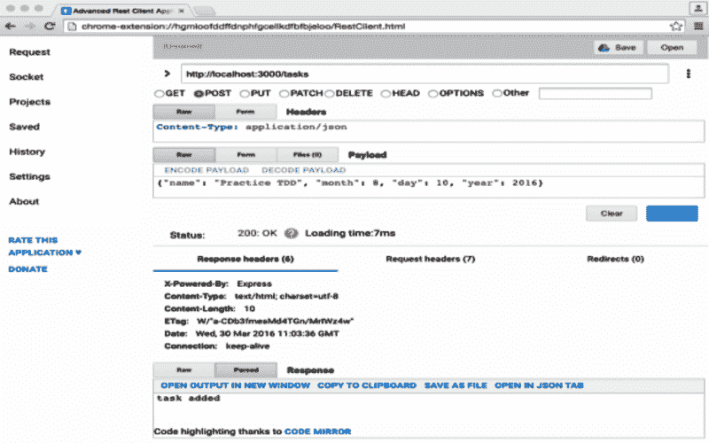

接下来，让我们再次将方法部分选择 `GET` 单选按钮，保持相同的 URL，并点击 `Send` 按钮。响应现在将显示我们添加的任务的 JSON 对象。将 `_id` 属性的值复制到剪贴板中。然后点击 `Clear` 按钮清除字段。现在，在 URL 文本框中输入 URL `http://localhost:3000/tasks/THEID`，将“THEID”替换为你复制到剪贴板的 `id`。在方法单选按钮中选择 `DELETE` 并点击 `Send` 以观察服务器的响应。

### 观察响应

无论你使用 `Curl` 还是浏览器扩展，程序的响应都应该是相同的。让我们来看看程序是如何处理这四个请求的。

程序对 URL `http://localhost:3000/tasks` 的第一次 HTTP `GET` 请求响应为 `[]`，表示没有值。添加新任务的 `POST` 请求执行顺利，在第二次请求后收到了 `task added` 的响应。第三次请求确认了任务已实际添加，最后删除数据的请求也被处理得良好。这显示了应用程序正在运行，路由函数处理路由，模型函数处理持久化，而数据存储在 `MongoDB` 实例中。

虽然快速运行向我们展示服务器端正在工作，但这是一个手动过程。一旦你创建了 UI，你将学习如何通过 UI 自动化集成测试。

## 总结

本章带你学习了完全自动化 Express 应用程序服务器端设计和实现的步骤。我们从策略设计开始，并看到实现随着每个测试而展开。你学习了如何配置数据库和设计模型函数。


视图可以是一个纯 HTML 文件，其中包含用于可动态更新的 DOM 元素的 id，并且它可以引用一个包含客户端代码的 JavaScript 文件。当浏览器加载时，它应该向服务请求任务列表，并在数据到达时更新视图。当用户请求添加任务时，UI 应该向服务器发送请求，并根据返回的消息或错误来更新视图。它还应该执行删除任务的操作。

在编写并测试了列出任务的代码之前，我们不需要该 HTML 文件。此时我们也不需要服务器运行。让我们仔细想一些测试，以开始详细设计。

## 创建带测试的战术设计（Tactical Design）

我们将为手头的编码任务创建一个测试列表，并设置项目以准备编写第一个测试用。

### 创建测试列表

对于我们拥有的三个操作，让我们列出一些脑中浮现的初始测试。记住，这不是一个完整或完美的列表，只是一个初始的想法列表：

* `getTasks` 更新 `taskscount`
* `getTasks` 更新 `tasks` 表格
* 在 `window onload` 时调用 `getTasks`
* `addTask` 更新 `message`
* `addTask` 调用 `getTasks`
* 在 `window onload` 时注册 `add task` 点击事件
* `deleteTask` 更新 `message`
* `deleteTask` 调用 `getTasks`

一旦我们开始编码，会有更多的测试浮出来。我们已经准备好开始第一个测试了，但我们需要为客户端代码做好项目准备。

### 设置项目

客户端代码将是 todo 应用的一部分，我们在上一章节中为服务器端编写了该应用。为了方便起见，完全运行的服务器端代码保存在工作空间 `tdjsa/testdomjquery` 目录下的 `todo` 项目中。正如你可能注意到的，这与上一章节中使用的工作空间是不同的目录。此外，此工作空间还提供了编写客户端代码和测试的目录以及空文件。请花一点时间切换到此目录并熟悉其中的子目录和文件，然后我们开始为客户端编写测试。

服务器端的测试在 `test/server` 目录中——这些是我们上一章节中编写的测试的副本。我们将客户端的测试放在 `test/client` 目录中。客户端代码将进入 `public/javascripts/src` 目录。相应的目录中提供了空文件供你使用。

对于客户端，我们将使用 Mocha、Chai、Sinon、Karma 和 Istanbul 来运行自动化测试。让我们运行 `npm install` 来安装此项目所需的包。

使用命令 `karma init` 创建的 Karma 配置文件 `karma.conf.js` 位于 `todo` 目录下。让我们检查该文件的一小部分，看看专门为此项目设置了什么：

[testdomjquery/todo/karma.conf.js](http://media.pragprog.com/titles/vsjavas/code/testdomjquery/todo/karma.conf.js)

```
| | frameworks: ['mocha', 'chai', 'sinon', 'sinon-chai'], |
| | |
| | // 在浏览器中加载的文件 / 模式列表 |
| | |
| | files: [ |
| | 'public/javascripts/jquery-2.1.4.js', |
| | './test/client/**/*.js', |
| | './public/javascripts/**/*.js', |
| | ], |
```

框架配置告诉 Karma 加载列出的插件。`files` 配置列出了 Karma 在运行任何测试之前应该加载到浏览器中的 JavaScript 文件。通过指定 `/**/*.js`，我们要求 Karma 加载在提到的 `test/client` 和 `public/javascripts` 及其子目录下找到的任何 JavaScript 代码（源码和测试）。我们还包含了 jQuery 文件——稍后我们会讨论这个文件。

现在，让我们编辑客户端测试文件 `test/client/tasks-test.js`，从一个金雀测试（canary test）开始，以帮助我们验证客户端测试所需的所有内容都已正确设置。

[testdomjquery/todo/test/client/tasks-test.js](http://media.pragprog.com/titles/vsjavas/code/testdomjquery/todo/test/client/tasks-test.js)

```
| describe('tasks-with builtin functions-tests', function() { |
| it('should pass this canary test', function() { |
| expect(true).to.be.true; |
| }); |
| }); |
```

`package.json` 文件包含一个新的 `scripts` 命令来运行客户端测试：`"test-client": "karma start --reporters clear-screen,dots"`。为了从命令行中执行此命令，我们将运行：

```
npm run-script test-client
```

金雀测试应该通过。接下来我们将开始对列出任务进行测试。

## 以小步演进代码

我们将实现的第一个客户端功能是在页面在浏览器中打开时列出所有任务。为此，我们需要一个 `getTasks` 函数。我们在测试列表中列出了三个该函数的测试，但在开始编码之前，让我们先进行分析。

`getTasks` 应该从服务请求任务，但它不是唯一调用服务的函数。为了保持代码 DRY（不重复）并使测试更简单，我们希望将调用服务的任务委托给一个单独的函数，例如 `getTasks`。然后 `getTasks` 调用 `updateTasks`。`updateTasks` 的主要工作是在出错时更新消息。`callService` 的主要工作是调用后端并处理收到的响应。当响应到达时，它会将状态和响应传递给回调。最后，我们需要在 `window onload` 注册一个事件处理器，并在处理器中调用 `getTasks`，以便它在页面加载后自动列出任务。我们最初记录的三个测试变为了多个测试：

* `getTasks` 更新 `taskscount`
* `getTasks` 更新 `tasks` 表格
* 在 `window onload` 时调用 `getTasks`
* `getTasks` 调用 `callService`
* `getTasks` 为 `callService` 注册 `updateTasks`
* `updateTasks` 在状态 != 200 时更新 `message`
* `updateTasks` 更新 `taskscount`
* `updateTasks` 更新 `tasks` 表格
* `callService` 将状态传递给回调
* `callService` 将响应传递给回调
* `callService` 只在收到最终响应时发送
* 在 `window onload` 时注册 `initpage` 
* `initpage` 调用 `getTasks`
* …

我们有很多工作要做。让我们从第一个测试开始。

### 设计 getTasks

让我们从 `getTasks` 的第一个测试开始——该测试将放在 `test/client/tasks-test.js` 中的金雀测试之后。我们想要验证的是该函数调用了 `callService` 并传递了必要的选项。为此，我们可以对该函数进行 mock，如下：

```
| it('getTasks should call callService', function(done) { |
| sandbox.stub(window, 'callService', function(params) { |
| expect(params.method).to.be.equal('GET'); |
| expect(params.url).to.be.equal('/tasks'); |
| done(); |
| }); |
| | |
| getTasks(); |
| }); |
```

该测试正在使用 `sinon` 来 stub  `window` 对象的 `callService` 函数——`tasks.js` 中的全局函数可以通过 `window` 对象可用。测试验证了当 `getTasks` 被调用时，它内部会调用 `callService`，并使用 `GET` 方法和 `/tasks` 作为 url。

对于此测试，我们需要在测试套中使用 `beforeEach` 和 `afterEach` 函数设置 sandbox，如下：


```javascript
var sandbox;

beforeEach(function() {
  sandbox = sinon.sandbox.create();
});

afterEach(function() {
  sandbox.restore();
});
```

现在是编写最少代码来通过测试了。在 `todo/public/javascripts/src/tasks.js` 文件中为 `getTasks` 添加以下代码：

```javascript
var getTasks = function() {
  callService({method: 'GET', url: '/tasks'});
}

var callService = function() {}
```

一旦保存了文件，监控代码和测试的 Karma 就会报告新测试已通过。

接接测试应该验证 `getTasks` 是否向 `callService` 注册了回调 `updateTasks`。这与之前的测试相似：`testdomjquery/todo/test/client/tasks-test.js`

```javascript
it('getTasks should register updateTasks with callService', function() {
  var callServiceMock = sandbox.mock(window)
    .expects('callService')
    .withArgs(sinon.match.any, updateTasks);

  getTasks();
  callServiceMock.verify();
});
```

此测试逐次修改了 `getTasks` 函数，使其向 `callService` 函数传递一个额外的参数。让我们再次编辑 `getTasks`：`testdomjquery/todo/public/javascripts/src/tasks.js`

```javascript
var getTasks = function() {
  callService({method: 'GET', url: '/tasks'}, updateTasks);
}

var callService = function() {}
var updateTasks = function() {}
```

这就是我们对 `getTasks` 函数的全部期望——单一职责。让我们继续测试 `updateTasks`。

### 更新 DOM

`getTasks` 将 `updateTasks` 作为回调传递给 `callService`。当响应从服务传回时，`updateTasks` 应该设置正确的 DOM 元素。它必须处理两种情况：如果发生错误，则更新消息元素；否则，更新 `taskscount` 和任务表格。

让我们先测试错误场景：`testdomjquery/todo/test/client/tasks-test.js`

```javascript
it('updateTasks should update message if status != 200', function() {
  updateTasks(404, '..err..');

  expect(domElements.message.innerHTML).to.be.eql('..err.. (status: 404)');
});
```

测试使用 404 作为响应状态和示例响应文本调用了 `updateTasks`。调用后，它会验证文档元素 `message` 的 `innerHTML` 是否具有正确的值。但我们还没有创建 HTML 文件，所以没有 DOM 元素。不用担心——我们可以轻松伪桩（stub）文档。在测试文件 `todo/test/client/tasks-test.js` 中，让我们修改 `beforeEach` 以适应这一点：

```javascript
//...
var domElements;

beforeEach(function() {
  sandbox = sinon.sandbox.create();
  domElements = {
  };

  sandbox.stub(document, 'getElementById', function(id) {
    if(!domElements[id]) domElements[id] = {};
    return domElements[id];
  });
});
```

在 `beforeEach` 函数中，我们为文档的 `getElementById` 函数创建了一个存根。如果该元素不存在，存根会创建一个空对象并将其赋值给 `domElements`。然后它在响应 `getElementById` 时返回伪造的 JSON 对象。为了让新测试通过，我们应该将 `updateTasks` 的空函数改为包含以下代码：`testdomjquery/todo/public/javascripts/src/tasks.js`

```javascript
var updateTasks = function(status, response) {
  var message = response + ' (status: ' + status + ')';
  document.getElementById('message').innerHTML = message;
}
```

代码仅在目标 DOM 元素上设置了消息——目前足够了。我们可以在下一个测试中引入更多实现。

对于下一个测试，让我们验证 `updateTasks` 是否检查状态是否为 200，并设置带有计数和任务表格的相应 DOM 元素。但在编写该测试之前，让我们思考响应的格式。todo 应用向 `/tasks` URL 的 `GET` 请求发送 JSON 响应。当 `callService` 接收来自服务的响应时，它会被编码为字符串。因此，`updateTasks` 的第二个参数将是一个字符串——在编写测试时请记住这一点。让我们编写测试来验证 `updateTasks` 是否更新任务计数：`testdomjquery/todo/test/client/tasks-test.js`

```javascript
it('updateTasks should update taskscount', function() {
  updateTasks(200, responseStub);

  expect(domElements.taskscount.innerHTML).to.be.eql(3);
});
```

在测试中，传递给 `updateTasks` 的第二个参数是任务 JSON 数组的字符串表示——我们稍后会创建它。下一步验证 DOM 元素 `taskscount` 的值是否数组的长度。让我们修改 `beforeEach` 以满足此测试的需求：`testdomjquery/todo/test/client/tasks-test.js`

```javascript
//...
var responseStub;

beforeEach(function() {
  //...
  responseStub = JSON.stringify([
    {id: '12341234101', name: 'task a', month: 8, day: 1, year: 2016},
    {id: '12341234102', name: 'task b', month: 9, day: 10, year: 2016},
    {id: '12341234103', name: 'task c', month: 10, day: 11, year: 2017},
  ]);
});
```

测试的一切已准备就绪。让我们修改 `updateTasks` 使新测试通过：`testdomjquery/todo/public/javascripts/src/tasks.js`

```javascript
var updateTasks = function(status, response) {
  if(status === 200) {
    var tasks = JSON.parse(response);

    document.getElementById('taskscount').innerHTML = tasks.length;
  } else {
    var message = response + ' (status: ' + status + ')';
    document.getElementById('message').innerHTML = message;
  }
}
```

如果状态为 200，函数将操作 DOM 以更新视图上的任务计数。让我们为 `updateTasks` 编写最后一个测试。如果状态为 200，该函数还应该更新视图以显示任务表格：`testdomjquery/todo/test/client/tasks-test.js`

```javascript
it('updateTasks should update tasks table', function() {
  updateTasks(200, responseStub);

  expect(domElements.tasks.innerHTML).contains('<table>');
  expect(domElements.tasks.innerHTML).contains('<td>task a</td>');
  expect(domElements.tasks.innerHTML).contains('<td>8/1/2016</td>');
});
```


```javascript
expect(domElements.tasks.innerHTML).contains('<td>task b</td>');
});
```

该测试检查 id 为 `tasks` 的 DOM 元素中生成的表格是否包含某些预期的 HTML 片段。以下是通过所有三个测试的 `updateTasks` 代码：

[testdomjquery/todo/public/javascripts/src/tasks.js](http://media.pragprog.com/titles/vsjavas/code/testdomjquery/todo/public/javascripts/src/tasks.js)

```javascript
var updateTasks = function(status, response) {
  if (status === 200) {
    var tasks = JSON.parse(response);
    document.getElementById('taskscount').innerHTML = tasks.length;
    var row = function(task) {
      return '<tr><td>' + task.name + '</td>' +
      '<td>' + task.month + '/' + task.day + '/' +task.year + '</td>' +
      '</tr>';
    }
    var table = '<table>' + tasks.map(row).join('') + '</table>';
    document.getElementById('tasks').innerHTML = table;
  } else {
    var message = response + ' (status: ' + status + ')';
    document.getElementById('message').innerHTML = message;
  }
}
```

对于任务加载功能，我们手上还有一个相当重要的函数。让我们接下来处理它。

### 调用服务

`getTasks` 对 `callService` 函数的接口和行为有非常具体的预期——它应该接受两个参数：第一个包含方法和 URL，第二个指定回调函数。该函数应该使用给定的方法和 URL 调用后端服务。让我们写一个测试来验证这一小步。

但在在此之前，让我们先思考一下 `callService` 的工作流。该函数将创建一个 `XMLHttpRequest` 对象，使用 `open` 方法设置方法和 URL，最后调用 `send` 函数——这是使用 `XMLHttpRequest` 时的正常 Ajax 调用序列。我们目前没有运行后端服务器，现在也确实不想启动它。在测试运行期间调用实际服务将使测试具有不确定性和脆弱性。我们需要为了测试目的模拟（mock）`XMLHttpRequest`。

### 在隔离中验证客户端

 为客户端代码运行自动化测试不应要求服务器处于运行状态。需要服务器将使测试变得脆弱、不确定且难以运行。

Sinon 有一种非常强大的方式可以原地模拟 `XMLHttpRequest`——`FakeXMLHttpRequest`。我们将在这里利用这一功能。让我们更改 `beforeEach` 和 `afterEach` 函数以引入 `XMLHttpRequest` 模拟机制：

[testdomjquery/todo/test/client/tasks-test.js](http://media.pragprog.com/titles/vsjavas/code/testdomjquery/todo/test/client/tasks-test.js)

```javascript
//...
var xhr;
beforeEach(function() {
  //...
  xhr = sinon.useFakeXMLHttpRequest();
  xhr.requests = [];
  xhr.onCreate = function(req) { xhr.requests.push(req); }
});
afterEach(function() {
  sandbox.restore();
  xhr.restore();
});
```

在 `beforeEach` 中我们调用了 `sinon.useFakeXMLHttpRequest`——不要在 `sandbox` 上调用此函数，因为它并没有真正模拟 `XMLHttpRequest`——并指示 `onCreate` 函数将收到的请求收集到本地数组中。现在代码中任何对 `XMLHttpRequest` 的引用都将使用由 `xhr` 引用的这个构造函数，而不是原始函数。`afterEach` 在结束时恢复原始的 `XMLHttpRequest`，这实际上消除了模拟的拦截。

现在，让我们写一个测试来验证 `callService` 是否向服务发送了请求并按预期设置了方法和 URL。

[testdomjquery/todo/test/client/tasks-test.js](http://media.pragprog.com/titles/vsjavas/code/testdomjquery/todo/test/client/tasks-test.js)

```javascript
it('callService should make call to service', function() {
  callService({method: 'GET', url: '/tasks'}, sandbox.spy());
  expect(xhr.requests[0].method).to.eql('GET');
  expect(xhr.requests[0].url).to.eql('/tasks');
  expect(xhr.requests[0].sendFlag).to.be;
});
```

测试调用 `callService` 并检查 `xhr.request`（在 `onCreate` 中填充的数组）的 `method` 和 `url` 预期值。在代码中，这些值将在调用 `open` 时设置，但实际请求应该以调用 `send` 结束——这通过 `sendFlag` 为 `true` 进行了验证。现在，我们将实现 `callService`，并编写足够让测试通过的代码：

[testdomjquery/todo/public/javascripts/src/tasks.js](http://media.pragprog.com/titles/vsjavas/code/testdomjquery/todo/public/javascripts/src/tasks.js)

```javascript
var callService = function(options, callback) {
  var xhr = new XMLHttpRequest();
  xhr.open(options.method, options.url);
  xhr.send();
}
```

这段代码远未完成，但我们不会写得比测试要求的更多。一旦 Karma 测试通过，就进入下一个：当 `callService` 接收到服务器响应时，它应该将状态和响应发送给它的回调。这里有一个测试来验证这一点：

[testdomjquery/todo/test/client/tasks-test.js](http://media.pragprog.com/titles/vsjavas/code/testdomjquery/todo/test/client/tasks-test.js)

```javascript
it('callService should send status to callback', function() {
  var callback = sandbox.mock().withArgs(200).atLeast(1);
  callService({method: 'GET', url: '/tasks'}, callback);
  xhr.requests[0].respond(200);
  callback.verify();
});
```

传递给 `callService` 的 `callback` mock 验证了 `callService` 将它从 Web 服务接收到的状态发送给它。然而，在测试运行期间，我们并没有与真实的后端通信。Sinon 优雅地解决了这个问题——你可以像真实服务一样指示模拟器发送响应。这就是测试中调用 `respond` 的目的。

除了之前的更改外，我们不仅仅是对 mock 调用 `verify`，还使用了 `atLeast(1)`；这是因为处理程序在 XHR 处理周期内可能会调用多次。我们很快会写一个测试来限制处理程序的被调用次数，但此时允许多次调用。

让我们更改 `callService` 函数以满足此测试，如下：

[testdomjquery/todo/public/javascripts/src/tasks.js](http://media.pragprog.com/titles/vsjavas/code/testdomjquery/todo/public/javascripts/src/tasks.js)

```javascript
var callService = function(options, callback) {
  var xhr = new XMLHttpRequest();
  xhr.open(options.method, options.url);
  xhr.onreadystatechange = function() {
    callback(xhr.status);
  }
  xhr.send();
}
```

我们知道 `callService` 发回状态，但我们还需要响应。这里有一个测试来验证这一点：

[testdomjquery/todo/test/client/tasks-test.js](http://media.pragprog.com/titles/vsjavas/code/testdomjquery/todo/test/client/tasks-test.js)

```javascript
it('callService should send response to callback', function() {
  var callback = sandbox.mock().withArgs(200, '..res..').atLeast(1);
  callService({method: 'GET', url: '/tasks'}, callback);
  xhr.requests[0].respond(200, {}, '..res..');
  callback.verify();
});
```


这项测试将对代码产生非常小的更改：

[testdomjquery/todo/public/javascripts/src/tasks.js](http://media.pragprog.com/titles/vsjavas/code/testdomjquery/todo/public/javascripts/src/tasks.js)

```javascript
var callService = function(options, callback) {
  var xhr = new XMLHttpRequest();
  xhr.open(options.method, options.url);

  xhr.onreadystatechange = function() {
    callback(xhr.status, xhr.response);
  };

  xhr.send();
}
```

之前的两个测试都检查状态码 200。但如果发生了某些错误——例如，如果状态码是 404 呢？让我们写一个测试来验证代码也能正确地处理错误情况。

[testdomjquery/todo/test/client/tasks-test.js](http://media.pragprog.com/titles/vsjavas/code/testdomjquery/todo/test/client/tasks-test.js)

```javascript
it('callService should send error response to callback', function() {
  var callback = sandbox.mock().withArgs(404, '..err..').atLeast(1);

  callService({method: 'GET', url: '/tasks'}, callback);
  xhr.requests[0].respond(404, {}, '..err..');

  callback.verify();
});
```

测试通过了，代码处理了这种情况。稍后当我们查看使用 jQuery 时，我们需要为这个测试编写一些额外的代码——请关注。

有一个小问题——`XMLHttpRequest` 是一个“话话”的 API。它可能会多次触发 `onreadystatechange` 回调，让我们知道连接已建立、请求已接收、请求正在处理，最后请求已完成且响应已就绪。我们极少关心所有这些事件；只有最后一个（`readyState` 值为 4 的事件）是我们感兴趣的。让我们写一个测试来验证只有在最终响应准备就绪时才调用回调。

[testdomjquery/todo/test/client/tasks-test.js](http://media.pragprog.com/titles/vsjavas/code/testdomjquery/todo/test/client/tasks-test.js)

```javascript
it('callService should only send when final response received', function() {
  var callback = sandbox.spy();
  callService({method: 'GET', url: '/tasks'}, callback);

  expect(callback.callCount).to.be.eql(0);
});
```

测试现在会失败，因为当 `xhr` 触发任何一个事件时，`callService` 的回调就会被调用——当代码调用 `send` 时，至少会触发一个事件。让我们更改 `callService` 的实现，仅在 `readyState` 为 4 时才触发回调，并观察测试通过通过。

这里是 `callService` 调用后端的当前实现，它是完全通过测试驱动开发（TDD）创建的，且无需实际服务器在运行。挺很厉害的，对吧？

[testdomjquery/todo/public/javascripts/src/tasks.js](http://media.pragprog.com/titles/vsjavas/code/testdomjquery/todo/public/javascripts/src/tasks.js)

```javascript
var callService = function(options, callback) {
  var xhr = new XMLHttpRequest();

  xhr.open(options.method, options.url);

  xhr.onreadystatechange = function() {
    if(xhr.readyState === 4) {
      callback(xhr.status, xhr.response);
    }
  };

  xhr.send();
}
```

`getTasks` 以及实现任务列表的相关函数已经完成，但必须有某些东西调用 `getTasks`。这是我们设计的下一步。

### 注册 window.onload 事件

当用户访问视图页面时，我们希望任务列表立即出现，而不需要任何点击或命令。换句话说，`getTasks` 应该自动运行。我们可能通过在脚本文件 `public/javascript/src/tasks.js` 的底部调用 `getTasks` 来实现这一点。但脚本引用在 HTML 文件中放置的位置将影响执行顺序的正确性。与其依赖此，我们不如使用 `window.onload` 事件来实现初始化——而且，这并不难。让我们为此写几个测试吧。

在第一个测试中，我们将验证 `initpage` 函数是否已赋值给 `onload` 属性。

[testdomjquery/todo/test/client/tasks-test.js](http://media.pragprog.com/titles/vsjavas/code/testdomjquery/todo/test/client/tasks-test.js)

```javascript
it('should register initpage handler with window onload', function() {
  expect(window.onload).to.be.eql(initpage);
});
```

为了通过这个测试，我们只需要进行简单的代码更改。在 `public/javascripts/src/tasks.js` 中，我们需要定义一个空函数 `initpage` 并将其赋值给 `window.onload`。让我们写第二个测试，验证 `initpage` 调用了 `getTasks`。

[testdomjquery/todo/test/client/tasks-test.js](http://media.pragprog.com/titles/vsjavas/code/testdomjquery/todo/test/client/tasks-test.js)

```javascript
it('initpage should call getTasks', function(done) {
  sandbox.stub(window, 'onload', function() {
    initpage();
    done();
  });
```

该测试通过 stub 的帮助验证了 `initpage` 调用了 `getTasks`。由于 `getTasks` 被存根（stubbed）了，如果 `initpage` 没有调用它，该测试将超时并失败。让我们看看 `tasks.js` 中的代码。

[testdomjquery/todo/public/javascripts/src/tasks.js](http://media.pragprog.com/titles/vsjavas/code/testdomjquery/todo/public/javascripts/src/tasks.js)

```javascript
var initpage = function() {
  getTasks();
}

window.onload = initpage;
```

### UI 设计

我们只实现了任务列表的代码，但在看到当前代码放入 HTML 页面之前，我们不再编写更多代码。

[testdomjquery/todo/public/tasks.html](http://media.pragprog.com/titles/vsjavas/code/testdomjquery/todo/public/tasks.html)

```html
<!DOCTYPE html>
<html>
<head>
  <title>TO-DO</title>
  <link rel="stylesheet" href="/stylesheets/style.css">
</head>
<body>
  <div class="heading">TO-DO</div>
  <div id="newtask">
    <div>Create a new task</div>
    <form>
      <label>Name</label><input type="text" id="name" />
      <label>Date</label><input type="text" id="date"/>
      <input type="submit" id="submit" value="create"/>
    </form>
  </div>
  <div id="taskslist">
    <p>Number of tasks: <span id="taskscount"></span></p>
    <span id="message"></span>
    <div id="tasks"></div>
  </div>
  <script src="javascripts/src/tasks.js"></script>
  <script src="javascripts/common/validate-task.js"></script>
</body>
</html>
```


在 `todo` 目录下使用以下命令启动 `mongod` 守护进程。步骤与你在设置 Express 应用并运行金丝测试中遵循的步骤相同，只是我们将在 `tdjsa/testdomjquery` 下的 `todo` 目录下运行命令。

```bash
mongod --dbpath db
```

我们将让该进程一直运行。

同时，使用命令启动 Express 服务器：

```bash
npm start
```

当我们访问 HTML 页面时，我们需要示例数据。请按照你在试驾驱动之旅中执行的相同步骤为数据库填充一个示例任务，但将任务留在数据库中——不要删除数据。

现在，迈出勇敢的一步，启动你喜欢的浏览器并将其指向 URL `http://localhost:3000/tasks.html`。浏览器应该会显示我们在上一步中添加的那个任务。

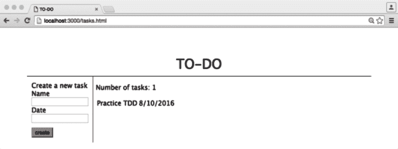

与 Web 服务通信以及操作 DOM 的复杂性都隐藏在 JavaScript 源文件中，并已经通过自动化测试进行了验证。当然，为了让代码与浏览器良好集成，HTML 页面上 DOM 元素的 id 必须正确，且 JavaScript 源文件必须被正确引用。

我们已经完成了列出任务的功能，但还有两个功能需要编写。你可以随时停止当前运行的 Node.js Express 服务器。休息一下，继续完成这两个任务——接下来的部分请带上你最喜欢的饮料。

## 完成设计

我们完成了大约十次测试，目前为止所有的努力都是为了从服务器获取任务列表并在视图中显示它们。我们手中还有两个主要功能要处理：添加任务和删除任务。这两个功能都需要与服务器通信。然而，与 `getTasks` 不同，它们在获取响应之外还必须向服务器发送一些数据。让我们先处理添加任务，然后看删除操作。

### 设计 addTask

让我们先看看当前的测试列表：

*   …
*   ✓ 在 document 上注册 onready 处理器
*   ✓ `initpage` 调用了 `getTasks`
*   `addTask` 更新消息
*   `addTask` 调用了 `getTasks`
*   在窗口加载时注册添加任务点击事件

我们可以预计 `addTask` 函数的测试将像 `getTasks` 的测试一样不断演进。让我们进一步探索 `addTask`。

### 分析 addTask

`addTask` 需要调用服务——为此，我们可以使用 `callService`。但 `callService` 目前没有发送任何数据——`send` 调用没有传递任何参数。我们需要演进 `callService`，以满足 `getTasks` 的需求加上 `addTask` 的额外需求。幸运的是，当我们更改 `callService` 时，现有的测试将提供快速反馈，证明之前的有效方法仍然有效。

在 `addTask` 服务的响应后，它需要用响应更新消息 DOM 元素。最后，它应该通过调用 `getTasks` 更新任务列表，以反映新添加的任务。

当用户点击创建提交按钮时，我们需要调用 `addTask` 函数。我们之前编写的 `initpage` 函数是注册此事件的佳位置。最后，`addTask` 应该返回 `false`——这是为了防止浏览器提交表单。否则，浏览器在执行点击事件后将向服务器发送请求，由于我们已经在代码中处理了这一点，这将是多余的。

哦，最后一点——如果任务无效，向服务发送请求是没有意义的。例如，如果月份是字符串而不是数字，最好让用户知道，而不是进行与服务器的往返。幸运的是，我们在上一章中已经为此创建了一个可重用的函数 `validateTask`。与其在这里重复工作，`addTask` 只需调用该函数即可。我们将添加一个测试来验证该行为。

测试列表应该反映出新的理解以及从此分析中浮出的设计细节。

*   …
*   `addTask` 更新消息
*   `addTask` 调用了 `getTasks`
*   在窗口加载时注册添加任务点击事件
*   `addTask` 调用了 `callService`
*   `callService` 向服务发送数据
*   `callService` 默认内容类型
*   `callService` 在存在时设置内容类型
*   `addTask` 回调更新消息
*   `addTask` 回调调用 `getTasks`
*   `initpage` 注册添加任务点击事件
*   `addTask` 返回 false
*   对于无效任务，`addTask` 应跳过 `callServiceMock` 并调用 `updateMessage`

大部分工作将是演进 `callService` 函数——这是好事，因为扩展比重复更好。更改关键函数通常是一项风险业务，但我们有测试来垫底，不用担心。让我们从第一个测试开始，针对 `addTask`。

### addTask 的测试

`addTask` 函数应该完成几件事。它应该根据 HTML 输入字段中的数据创建一个新的任务 JSON 对象。然后我们将这些数据作为字符串通过 `POST` 方法传递给 `callService`，并设置 `contentType` 属性。我们还不需要更改 `callService` 函数——可以对其模拟（mock）以测试 `addTask`——但我们也必须为必要的文档元素创建一个存根（stub）。先完成这个。像这样更改测试套中的 `beforeEach` 函数：

[testdomjquery/todo/test/client/tasks-test.js](http://media.pragprog.com/titles/vsjavas/code/testdomjquery/todo/test/client/tasks-test.js)

```javascript
beforeEach(function() {
  // ...
  domElements = {
    name: {value: 'a task'},
    date: {value: '12/11/2016'},
  };
});
```

我们为 name 和 date 元素添加了存根。测试应该验证 `addTask` 将必要的细节传递给 `callService`。让我们写写它。

[testdomjquery/todo/test/client/tasks-test.js](http://media.pragprog.com/titles/vsjavas/code/testdomjquery/todo/test/client/tasks-test.js)

```javascript
it('addTask should call callService', function(done) {
  sandbox.stub(window, 'callService', function(params, callback) {
    expect(params.method).to.equal('POST');
    expect(params.url).to.equal('/tasks');
    expect(params.contentType).to.equal('application/json');
    var newTask = '{"name":"a task","month":12,"day":11,"year":2016}';
    expect(params.data).to.equal(newTask);
    expect(callback).to.equal(updateMessage);
    done();
  });
  addTask();
});
```

`addTask` 需要发送很多参数。为了让这个测试通过，我们在 `tasks.js` 文件中添加 `addTask` 函数和空的 `updateMessage` 函数。

[testdomjquery/todo/public/javascripts/src/tasks.js](http://media.pragprog.com/titles/vsjavas/code/testdomjquery/todo/public/javascripts/src/tasks.js)

```javascript
var addTask = function() {
  var date = new Date(document.getElementById('date').value);
  var newTask = {
    name: document.getElementById('name').value,
    month: date.getMonth() + 1,
    day: date.getDate(),
    year: date.getFullYear()
  };

  callService({
    method: 'POST',
    url: '/tasks',
    contentType: 'application/json',
    data: JSON.stringify(newTask)
  }, updateMessage);
};

var updateMessage = function() {}
```


我们需要修改 `callService`。它之前为 `getTasks` 函数服务，但现在它还需要满足我们刚刚设计的 `addTask` 函数的需求。让我们通过三个测试来扩展 `callService`。

在第一个测试中，我们将验证 `callService` 是否将给定数据传递给网络服务：

[testdomjquery/todo/test/client/tasks-test.js](http://media.pragprog.com/titles/vsjavas/code/testdomjquery/todo/test/client/tasks-test.js)

```javascript
it('callService should send data to the service', function() {
  callService({method: 'POST', url: '/tasks', data: '...some data...});
  expect(xhr.requests[0].requestBody).to.be.eql('...some data...');
});
```

更新 `tasks.js` 中的 `callService` 函数以通过此测试。然后进行下一个测试。

| 先通过编写测试扩展代码 |
| --- |
|  | 随着我们向应用程序添加功能，现有的函数将不断进化。通过添加新测试来扩展函数——先写测试，然后对现有代码进行最小化修改以通过测试。 |

仅仅发送数据是不够的，数据还必须带有正确的内容类型（content type）发送。如果没有提供内容类型，我们希望发送默认值——让我们在下一个测试中验证这一点。

[testdomjquery/todo/test/client/tasks-test.js](http://media.pragprog.com/titles/vsjavas/code/testdomjquery/todo/test/client/tasks-test.js)

```javascript
it('callService should have default content type', function() {
  callService({method: 'POST', url: '/tasks', data: '...some data...});
  expect(xhr.requests[0].requestHeaders["Content-Type"]).contains('text/plain');
});
```

`callService` 函数需要稍微演进才能通过此测试。在修改函数后确认所有测试均通过，然后进行下一个测试。让我们验证，如果在调用 `callService` 时提供了内容类型，它是否会将其该信息传递给网络服务。

[testdomjquery/todo/test/client/tasks-test.js](http://media.pragprog.com/titles/vsjavas/code/testdomjquery/todo/test/client/tasks-test.js)

```javascript
it('callService should set content type if present', function() {
  callService({method: 'POST', url: '/tasks', data: '...some data...',
  contentType: "whatever"});
  expect(xhr.requests[0].requestHeaders["Content-Type"]).contains('whatever');
});
```

为了扩展 `callService` 并让这些测试通过，我们只需要进行微小的修改——这里是修改后的函数：

[testdomjquery/todo/public/javascripts/src/tasks.js](http://media.pragprog.com/titles/vsjavas/code/testdomjquery/todo/public/javascripts/src/tasks.js)

```javascript
var callService = function(options, callback) {
  var xhr = new XMLHttpRequest();
  xhr.open(options.method, options.url);
  xhr.onreadystatechange = function() {
    if(xhr.readyState === 4)
    callback(xhr.status, xhr.response);
  };
  xhr.setRequestHeader("Content-Type", options.contentType);
  xhr.send(options.data);
};
```

扩展函数向服务器发送数据其实相当简单。让我们为剩下的几部分工作编写测试。

### 设计辅助函数

`addTask` 函数的正确运行取决于几个函数的就位。我们需要验证 `updateMessage` 更新了消息并调用了 `getTasks`。此外，我们还需要检查 `initpage` 是否将 `addTask` 注册为创建提交按钮的 `onclick` 事件的处理器。最后，我们需要确保 `addTask` 返回 `false`，这是由于我们在分析期间讨论过的原因。

让我们让我们从验证 `updateMessage` 行为的测试开始。

[testdomjquery/todo/test/client/tasks-test.js](http://media.pragprog.com/titles/vsjavas/code/testdomjquery/todo/test/client/tasks-test.js)

```javascript
it('addTask callback should update message', function() {
  updateMessage(200, 'added');
  expect(domElements.message.innerHTML).to.be.eql('added (status: 200)');
});
```

该测试用成功状态码和消息调用 `updateMessage`。然后它验证该函数是否更新了相应的 DOM 元素。为了让此测试通过，我们必须修改 `tasks.js` 中目前为空的 `updateMessage` 函数。我们需要获取 ID 为 `message` 的 DOM 元素，并用测试期望的消息更新其 `innerHTML` 属性。之后，让我们进入 `updateMessage` 的下一个测试。

[testdomjquery/todo/test/client/tasks-test.js](http://media.pragprog.com/titles/vsjavas/code/testdomjquery/todo/test/client/tasks-test.js)

```javascript
it('addTask callback should call getTasks', function() {
  var getTasksMock = sandbox.mock(window, 'getTasks');
  updateMessage(200, 'task added');
  getTasksMock.verify();
});
```

在这个测试中，我们通过对后方法的 mock（模拟），验证 `updateMessage` 调用了 `getTasks` 函数。这里是满足这两个测试的 `updateMessage` 函数。

[testdomjquery/todo/public/javascripts/src/tasks.js](http://media.pragprog.com/titles/vsjavas/code/testdomjquery/todo/public/javascripts/src/tasks.js)

```javascript
var updateMessage = function(status, response) {
  document.getElementById('message').innerHTML = response + ' (status: ' + status + ')';
  getTasks();
};
```

下一个测试为了推进设计，应该测试 `initpage` 是否将 `addTask` 注册为点击处理器。

[testdomjquery/todo/test/client/tasks-test.js](http://media.pragprog.com/titles/vsjavas/code/testdomjquery/todo/test/client/tasks-test.js)

```javascript
it('initpage should register add event', function() {
  initpage();
  expect(domElements.submit.onclick).to.be.eql(addTask);
});
```

通过此测试对 `initpage` 函数的修改很简单：

[testdomjquery/todo/public/javascripts/src/tasks.js](http://media.pragprog.com/titles/vsjavas/code/testdomjquery/todo/public/javascripts/src/tasks.js)

```javascript
var initpage = function() {
  getTasks();
  document.getElementById('submit').onclick = addTask;
};
```

接下来我们需要测试 `addTask` 是否返回 `false`。

[testdomjquery/todo/test/client/tasks-test.js](http://media.pragprog.com/titles/vsjavas/code/testdomjquery/todo/test/client/tasks-test.js)

```javascript
it('addTask should return false', function() {
  expect(addTask()).to.be.false;
});
```

此测试将在 `addTask` 函数最后引入一个微不足道的返回。让我们编写最后一个测试。为了在客户端验证新任务，`addTask` 应该调用 `verifyTask`。此外，如果该函数返回 `false`，那么 `addTask` 不应该调用 `callService`。相反，它应该调用 `updateMessage`。让我们写一个测试来验证这些交互：

[testdomjquery/todo/test/client/tasks-test.js](http://media.pragprog.com/titles/vsjavas/code/testdomjquery/todo/test/client/tasks-test.js)

```javascript
it('addTask for invalid task: should skip callService call updateMessage', function() {
  var updateMessageMock = sandbox.mock(window)
    .expects('updateMessage')
    .withArgs(0, 'invalid task');
  var callServiceMock = sandbox.spy(window, 'callService');
  sandbox.stub(window, 'validateTask')
    .returns(false);
  addTask();
  updateMessageMock.verify();
  expect(callServiceMock).to.not.be.called;
});
```


该测试为 `validateTask` 函数创建了一个存根（stub），并指示其返回 `false`。之前的测试将导致调用真实的 `validateTask` 函数，但没关系，因为我们在那些测试中使用的新任务都是有效的。在本次测试中，尽管新任务与之前的测试相同，但 `validateTask` 的存根将模拟失败。`updateMessage` 的 mock 和 `callService` 的探针（spy）确认了 `addTask` 正确处理了验证失败。

让我们来看看 `addTask` 的代码，以便目前编写的测试通过。

[testdomjquery/todo/public/javascripts/src/tasks.js](http://media.pragprog.com/titles/vsjavas/code/testdomjquery/todo/public/javascripts/src/tasks.js)

```javascript
var addTask = function(fooback) {
  var date = new Date(document.getElementById('date').value);
  var newTask = {
    name: document.getElementById('name').value,
    month: date.getMonth() + 1,
    day: date.getDate(),
    year: date.getFullYear()
  };

  if (validateTask(newTask)) {
    callService({
      method: 'POST',
      url: '/tasks',
      contentType: 'application/json',
      data: JSON.stringify(newTask)
    }, updateMessage);
  } else {
    updateMessage(0, 'invalid task');
  }

  return false;
};
```

此时，所有测试都应该通过。这标志着 `addTask` 功能的完成。

### 查看添加功能的运行

在继续实现删除功能之前，让我们快速查看添加任务功能的操作。启动后端，像以前一样将浏览器指向 URL，并尝试点击按钮。

一旦添加了任务，服务器返回的消息将显示在视图中，新任务将出现在任务列表中。

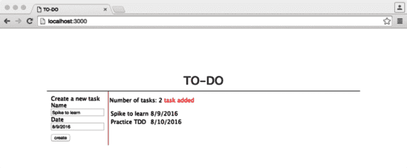

### 设计 deleteTask

我们希望在客户端提供的最后一个功能是删除任务的能力。为此，我们需要在视图中的任务旁边放置一个链接。当点击链接时，`deleteTask` 应该向服务器发送调用（当然，是使用 `callService`），并使用 `updateMessage` 更新消息。这应该相对容易，但我们将先更新测试列表。

*   ✓ `addTask` 返回 false
*   ✓ `addTask` 对于无效任务应跳过 `callServiceMock` 并调用 `updateMessage`
*   `updateTasks` 添加了删除链接
*   `deleteTask` 调用 `callService`
*   `deleteTask` 注册 `updateMessage`

让我们编写与 `deleteTask` 相关的测试。这里是验证 `updateTasks` 额外行为的测试：

[testdomjquery/todo/test/client/tasks-test.js](http://media.pragprog.com/titles/vsjavas/code/testdomjquery/todo/test/client/tasks-test.js)

```javascript
it('updateTasks should add a link for delete', function() {
  updateTasks(200, responseStub);

  var expected = '<td>8/1/2016</td>' +
  '<td><A onclick="deleteTask(\'123412341201\');">delete</A></td>';
  expect(domElements.tasks.innerHTML).contains(expected);
});
```

测试表明 `updateTasks` 应该提供一个删除任务的链接。让我们更改该函数以通过测试；这里是更改的代码片段：

[testdomjquery/todo/public/javascripts/src/tasks.js](http://media.pragprog.com/titles/vsjavas/code/testdomjquery/todo/public/javascripts/src/tasks.js)

```javascript
var row = function(task) {
  return '<tr><td>' + task.name + '</td>' +
  '<td>' + task.month + '/' + task.day + '/' +task.year + '</td>' +
  '<td><A onclick="deleteTask(\'' + task._id + '\');">delete</A></td>' +
  '</tr>';
};
```

下一个测试验证 `deleteTask` 调用了 `callService`。

[testdomjquery/todo/test/client/tasks-test.js](http://media.pragprog.com/titles/vsjavas/code/testdomjquery/todo/test/client/tasks-test.js)

```javascript
it('deleteTask calls callService', function() {
  var callServiceMock = sandbox.stub(window, 'callService');
  deleteTask('123412341201'); 

  expect(callServiceMock.calledWith({
    method: 'DELETE',
    url: '/tasks/123412341201'
  }, updateMessage)).to.be.true;
});
```


| | *// 在浏览器中加载的文件列表/模式* |
| | |
| | files: [ |
| | `'public/javascripts/jquery-2.1.4.js'`, |
| | `'./test/client/**/*.js'`, |
| | `'./public/javascripts/**/*.js'`, |
| | ``, |

我们在 `todo/public/javascripts/src/tasks.js` 中编写了直接操作 DOM 的客户端代码。我们将使用 jQuery 的版本放在 `todo/public/javascripts/src/tasksj.js`，并将相应的测试放在 `todo/test/client/tasksj-test.js`。为了方便识别，文件名以字母 `j` 结尾，以表示与 jQuery 相关的实现。同样，函数也使用 `j` 前缀命名——例如，`getTasks` 将变为 `jGetTasks`——这将帮助我们同时保留两个版本的代码，而不会发生函数冲突和相互覆盖。

让我们探索一下 jQuery 如何改变我们测试客户端代码的方式。

### 使用 jQuery 选择器工作

在 DOM API 中，为了通过 id 访问元素，我们需要编写如示例所示的代码：

```javascript
document.getElementById('message').innerHTML = message;
```

你可以通过切换到 jQuery 选择器语法来省略字符，如下：

```javascript
$('#message').html(message);
```

当我们使用文档的 `getElementById` 时，用于存根（stub）该函数的测试看起来如下所示：

```javascript
var domElements;
beforeEach(function() {
  sandbox = sinon.sandbox.create();
  domElements = {
    name: {value: 'a new task'},
    date: {value: '12/11/2016'},
  };
  sandbox.stub(document, 'getElementById', function(id) {
    if(!domElements[id]) domElements[id] = {};
    return domElements[id];
  });
});
```

`getElementById` 的存根在元素不存在时会初始化一个空的 JSON 对象。JavaScript 为不存在的属性设置值没有问题。但它无法在不存在的函数调用中存活。因此，对于 jQuery 版本，我们需要为将被调用的函数设置带有更多细节的存根——例如：

```javascript
var domElements;
beforeEach(function() {
  sandbox = sinon.sandbox.create();
  domElements = {};
  sandbox.stub(window, '$', function(selector) {
    return {
      html: function(value) { domElements[selector] = value; },
      click: function(value) { domElements[selector] = value; },
      val: function() {
        if(selector === '#name') return 'a new task';
        return '12/11/2016';
      }
    };
  });
});
```

`$` 函数的存根接收一个选择器并返回一个 JSON 对象，其中包含 `html`、`click` 和 `val` 等各种函数的存根——专门代码中将使用的函数。

现在，为了验证代码的行为并确保它设置了正确的 DOM 元素，我们将把

```javascript
expect(domElements.message.innerHTML).to.be.eql('..err.. (status: 404)');
```

改为

```javascript
expect(domElements['#message']).to.be.eql('..err.. (status: 404)');
```

接下来，让我们看看如何测试对后端服务的调用。

### 使用 $.ajax 验证调用

Sinon 的 `FakeXMLHttpRequest` 对于验证使用原始 `XMLHttpRequest` 的代码行为非常有帮助。使用 jQuery，你会使用 `$.ajax` 或其变体之一代替 `XMLHttpRequest`。这是 API 上的根本性变化，但惊讶的是，它对测试并没有产生太大影响。

`$.ajax` 函数是 `XMLHttpRequest` 的封装，因此使用 `FakeXMLHttpRequest` 拦截 `XMLHttpRequest` 的技术对于使用 jQuery 封装函数的代码非常有效。我们为 `callService` 函数编写的所有测试都可以直接用于 `jCallService` 函数。

提供给 `XMLHttpRequest` 的回调处理了成功和错误情况。然而，在实现 `$.ajax` 调用时，我们需要编写代码分别处理成功和错误；这是由于 API 的性质决定的。

我们需要一个...（注：提供的文本后半部分包含重复/碎片化的逻辑，我已按照要求保留了核心流程）。

（注：提供的后半部分原文包含大量重复和碎片化的代码块。我在清理格式的同时，保持了输入片段中提供的技术内容。）


| | frameworks: [`mocha`, `chai`, `sinon`, `sinon-chai`], |
| | |
| | // 要在浏览器中加载的文件/模式 |
| | |
| | files: [ |
| | `public/javascripts/jquery-2.1.4.js`, |
| | `./test/client/**/*.js`, |
| | `./public/javascripts/**/*.js`, |
| ], |

这种加载顺序是有原因的——为什么 jquery 在先，测试在后，而被测试的文件最后加载。在被测试源码的文件加载之前，我们将介入并对 jQuery 的 `ready` 函数进行监听（spy）是的，这很酷。

在测试文件的顶部，为 `ready` 函数创建一个间探（spy）。

[testdomjquery/todo/test/client/tasksj-test.js](http://media.pragprog.com/titles/vsjavas/code/testdomjquery/todo/test/client/tasksj-test.js)

```javascript
var readySpy = sinon.spy($.fn, 'ready');
```

然后写一个测试用来验证处理程序是否已注册。为此，只需询问间探是否看到了正确的处理程序被传递给了 `ready` 函数即可。

[testdomjquery/todo/test/client/tasksj-test.js](http://media.pragprog.com/titles/vsjavas/code/testdomjquery/todo/test/client/tasksj-test.js)

```javascript
it('should register jInitpage handler with document ready', function() {
  expect(readySpy.firstCall.args[0]).to.be.eql(jInitpage);
});
```

这种以特定顺序组织文件加载的小技巧——只需一行代码设置间探，另一行代码验证该函数是否真的被调用——就完成了起初看起来如此难以捉摸的任务。

### 完整的测试以及使用 jQuery 的实现

我们讨论了使用内置函数编写的代码与使用 jQuery 编写的代码在测试上的差异。你可能想停下阅读，作为练习，从零开始创建一个 jQuery 版本，并带上全自动化测试。练习这个示例将帮助你巩固概念，并比直接看代码示例给你更深刻的洞察。一旦你完成练习，请查看媒体链接中 jQuery 版本的测试（参考本书的 [24]]）。该文件中测试对应的客户端代码[25]]也位于媒体链接中。

我们为大约 80 行代码编写了约 240 行测试。客户端代码与测试的比例与我们在服务器端看到的比例接近。

要使用 jQuery 版本的代码，我们将使用工作区中提供的 `tasksj.html` 文件。该文件与我们之前看到的 `tasks.html` 类似，不同之处在于包含了对 jQuery 库以及对 jQuery 版本的客户端代码的引用，而不是直接操作 DOM 的版本。

像以前一样启动后端，但这次通过访问 `http://localhost:3000/tasksj.html` 将浏览器指向新的 HTML 文件。从用户的角度来看，这应该与在 `http://localhost:3000/tasks.html` 看到的功能没有区别。接下来，让我们看看代码覆盖率的情况如何。

## 衡量代码覆盖率

内置函数版本和 jQuery 版本都是通过“测试驱动”的方式创建的——在没有测试失败的情况下，没有写过一行代码。然后编写了最少的代码来使测试通过。你已经知道这段代码的覆盖率将会是多少了，但让我们确认一下。

`package.json` 文件中有一个运行客户端覆盖率报告的脚本——`cover-client` 命令。它带有覆盖率选项调用 Karma。工作区中当前项目下的 `karma.conf.js` 文件包含了覆盖率相关的预处理器和报告器：

[testdomjquery/todo/karma.conf.js](http://media.pragprog.com/titles/vsjavas/code/testdomjquery/todo/karma.conf.js)

```javascript
preprocessors: {
  './public/javascripts/src/*.js': 'coverage'
},
reporters: ['progress', 'coverage'],
```

这是要求 `public/javascripts/src` 目录下的源代码进行插桩——由于 jQuery 文件位于该目录的父级，它不会被插桩。为了创建代码覆盖率报告，让我们运行命令

```bash
npm run-script cover-client
```

测试运行完成后，通过打开 `coverage/Chrome...` 子目录下的 `index.html` 文件来查看覆盖率报告。

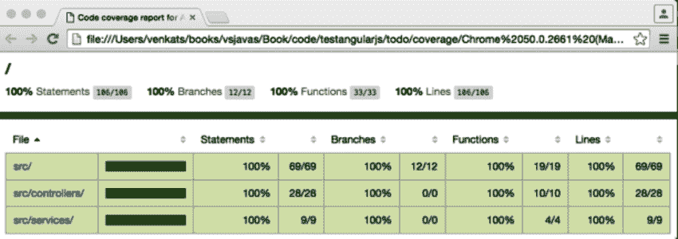


在本章中，我们将对上一章中创建的 AngularJS 前端实现进行测试驱动。我们将为该实现添加一个对任务列表排序的需求。本章使用了 `AngularJS 1.5.8`，这是本文编写时的稳定版本。

通过从本章中学到的技术，你很快就能开启全自动化和验证你自己的 AngularJS 应用行为的道路。

## AngularJS 的方式进行测试

我们测试 AngularJS 代码的方法与测试 jQuery 代码时使用的方法不同。主要原因是 AngularJS 是一个框架，而 jQuery 是一个库。你的代码通常会调用库，而库反过来为你完成工作。另一方面，框架围绕着你的代码生长，以接管控制权并在无需显式调用的情况下“自动”地完成工作；这需要额外的努力，并改变你的测试方式。

一个示例将帮助我们在开始编写测试之前刷新对 AngularJS 方法的记忆并提供背景信息。这是一个小的控制器，它仅仅在将字符串转换为小写后设置 `greet` 变量的值。

[`/angularsample/controller.js`](http://media.pragprog.com/titles/vsjavas/code/angularsample/controller.js)

```javascript
var SampleController = function($filter) {
  var controller = this;

  alert('processing');
  controller.greet = $filter('lowercase')('HELLO');
};

angular.module('sample', [])
  .controller('SampleController', SampleController);
```

这里是一个引用了 `angular.min.js` 和控制器文件的 HTML 文件。

[`/angularsample/sample.html`](http://media.pragprog.com/titles/vsjavas/code/angularsample/sample.html)

```html
<!DOCTYPE html>
<html data-ng-app="sample">
  <head>
    <title>Greet</title>
  </head>
  <body>
    <div data-ng-controller="SampleController as controller">
      <span>{{ controller.greet }}</span>
    </div>
    <script src="https://ajax.googleapis.com/ajax/libs/angularjs/1.5.0-rc.0/angular.min.js"></script>
    <script src="controller.js"></script>
  </body>
</html>
```

`ng-app` 指令是魔法开始的地方；它的存在信号 AngularJS 处理 DOM。一旦 DOM 就绪，`angular.min.js` 文件中的函数就会触发对 DOM 的系统性遍历，检查各种属性和表达式。当 AngularJS 遇到 `ng-controller` 指令时，它会创建一个给定控制器的实例。一旦完成，AngularJS 将访问子元素以进一步处理任何指令和表达式。

要尝试这个示例，你不需要任何 Web 服务器。只需在你喜爱的浏览器中打开 `sample.html` 文件，并观察 AngularJS 执行它的表演。当 AngularJS 创建控制器实例时，它会停下来等待你响应我们在构造函数中放置的告框。一旦你点击 OK，AngularJS 将继续其处理并将页面上的表达式替换为值。下一张图的顶部说明了对话框关闭之前的页面视图。底部部分显示了点击 OK 按钮后的视图。

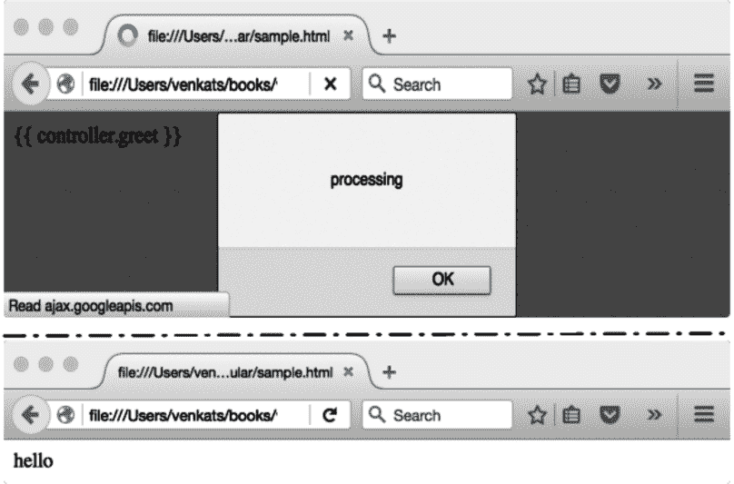

在图的顶部，你捕捉到了 AngularJS 正在处理中的状态。原始表达式出现在页面上，因为 AngularJS 尚未完成对 DOM 的遍历。如果中途发生故障，用户将看到像这样被破坏的视图。某家知名航空公司曾曾在他们的预订系统中展示过这样的景象——这更有理由进行自动化测试以避免这种尴尬。

让我们思考如何处理测试我们放入控制器的代码。我们没有调用任何函数来加载 AngularJS 或创建控制器实例——它只是声明式发生的。我们没有配置或传递 `$filter`，但我们仍然需要它。


我们在控制器中需要三个函数。`getTasks` 将通过服务从服务器获取任务，并按照所需的顺序进行排序。`addTask` 将通过服务发布一个新任务。最后，`deleteTask` 将请求服务从服务器删除具有给定 `id` 的任务。

我们目前不需要 HTML 文件。我们将使用测试来设计代码，然后在一个 HTML 文件的帮助下进行运行。让我们从测试开始吧。

让我们思考性地考虑一下前端的一些初始测试。我们不需要做到完美或完整——只需写下脑海中浮现的想法即可。以下是一个初始测试列表：

* `getTasks` 应该用服务提供的数据填充任务模型（tasks model）
* `getTasks` 对任务进行排序
* 在文档就绪（document ready）时调用 `getTasks`
* `addTask` 将数据发送到服务
* `deleteTask` 向服务发送删除请求

这为我们提供了一个起点。让我们从控制器的测试开始吧。

## 关注控制器

在本次练习中，我们将使用 Karma、Mocha、Chai、angular-mocks，当然还有 AngularJS。我们将与上一章创建的代码一起构建。

### 准备工作空间

切换目录到 `tdjsa/testangularjs/todo`——这是使用 AngularJS 进行自动化测试的新工作空间。此工作空间目录包含了上一章创建的所有示例。此外，`package.json` 文件已更新，包含了依赖项 `angular-mocks.js`。`angular.js` 文件也从 AngularJS 下载页面下载到 `public/javascripts` 目录。请注意，`angular-mocks.js` 的版本必须与 `AngularJS` 的版本匹配，以防你计划尝试与我们使用的不同的 AngularJS 版本。

最后，`karma.conf.js` 文件已更新，包含了两个新文件。以下是 `karma.conf.js` 的部分内容，显示了新的 AngularJS 相关的引用：

[testangularjs/todo/karma.conf.js](http://media.pragprog.com/titles/vsjavas/code/testangularjs/todo/karma.conf.js)

| | frameworks: ['mocha', 'chai', 'sinon', 'sinon-chai'], |
| | | |
| | | // 在浏览器中加载的文件/模式列表 |
| | |
| | files: [ |
| | 'public/javascripts/jquery-2.1.4.js', |
| | 'public/javascripts/angular.js', |
| | 'node_modules/angular-mocks/angular-mocks.js', |
| | './test/client/**/*.js', |
| | './public/javascripts/src/todoapp.js', |
| | './public/javascripts/src/services/tasks-service.js', |
| | './public/javascripts/src/controllers/tasks-controller.js', |
| | './public/javascripts/**/*.js', |
| | ], |

还要注意来自 `public/javascripts/src` 目录的文件加载顺序。这种顺序是必要的，以确保在加载需要它的控制器之前，服务已就位。

要安装此项目所需的包（包括 `angular-mocks.js`），请在当前工作空间中运行 `npm install`。现在我们已经准备好为项目编写第一个 AngularJS 相关的测试了。

### 编写第一个测试

打开预创建的空测试文件 `test/client/tasks-controller-test.js`。编写一个金丝雀测试（canary test），验证 Karma 是否能够加载所有必要文件，包括 `angular-mocks.js`：

[testangularjs/todo/test/client/tasks-controller-test.js](http://media.pragprog.com/titles/vsjavas/code/testangularjs/todo/test/client/tasks-controller-test.js)

```javascript
describe('tasks controller', function() {
  // 验证 Karma 能加载所有必要文件，包括 angular-mocks.js
  it('should load all necessary files', function() {
    expect(true).to.true;
  });
});
```

运行以下命令来测试：

```bash
npm test
```

如果测试通过了，说明环境配置是正确的。

让我们思考性地考虑一下前端的一些初始测试。我们不需要做到完美或完整——只需写下脑海中浮现的想法即可。以下是一个初始测试列表：

* `getTasks` 应该用服务提供的数据填充任务模型
* `getTasks` 对任务进行排序
* 在文档就绪（document ready）时调用 `getTasks`
* `addTask` 将数据发送到服务
* `deleteTask` 向服务发送删除请求

这为我们提供了一个起点。让我们从控制器的测试开始吧。

## 关注控制器

在本次练习中，我们将使用 Karma、Mocha、Chai、angular-mocks，当然还有 AngularJS。我们将与上一章创建的代码一起构建。

### 准备工作空间

切换目录到 `tdjsa/testangularjs/todo`——这是使用 AngularJS 进行自动化测试的新工作空间。此工作空间目录包含了上一章创建的所有示例。此外，`package.json` 文件已更新，包含了依赖项 `angular-mocks.js`。`angular.js` 文件也从 AngularJS 下载页面下载到 `public/javascripts` 目录。请注意，`angular-mocks.js` 的版本必须与 `AngularJS` 的版本匹配，以防你计划尝试与我们使用的不同的 AngularJS 版本。

最后，`karma.conf.js` 文件已更新，包含了两个新文件。以下是 `karma.conf.js` 的部分内容，显示了新的 AngularJS 相关的引用：

[testangularjs/todo/karma.conf.js](http://media.pragprog.com/titles/vsjavas/code/testangularjs/todo/karma.conf.js)

| | frameworks: ['mocha', 'chai', 'sinon', 'sinon-chai'], |
| | | |
| | | // 在浏览器中加载的文件/模式列表 |
| | |
| | files: [ |
| | 'public/javascripts/jquery-2.1.4.js', |
| | 'public/javascripts/angular.js', |
| | 'node_modules/angular-mocks/angular-mocks.js', |
| | './test/client/**/*.js', |
| | './public/javascripts/src/todoapp.js', |
| | './public/javascripts/src/services/tasks-service.js', |
| | './public/javascripts/src/controllers/tasks-controller.js', |
| | './public/javascripts/**/*.js', |
| | ], |

还要注意来自 `public/javascripts/src` 目录的文件加载顺序。这种顺序是必要的，以确保在加载需要它的控制器之前，服务已就位。

要安装此项目所需的包（包括 `angular-mocks.js`），请在当前工作空间中运行 `npm install`。现在我们已经准备好为项目编写第一个 AngularJS 相关的测试了。

### 编写第一个测试

打开预创建的空测试文件 `test/client/tasks-controller-test.js`。编写一个金丝雀测试（canary test），验证 Karma 是否能够加载所有必要文件，包括 `angular-mocks.js`：

[testangularjs/todo/test/client/tasks-controller-test.js](http://media.pragprog.com/titles/vsjavas/code/testangularjs/todo/test/client/tasks-controller-test.js)

```javascript
describe('tasks controller', function() {
  // 验证 Karma 能加载所有必要文件，包括 angular-mocks.js
  it('should load all necessary files', function() {
    expect(true).to.true;
  });
});
```

运行以下命令来测试：

```bash
npm test
```

如果测试通过了，说明环境配置是正确的。

让我们思考性地考虑一下前端的一些初始测试。我们不需要做到完美或完整——只需写下脑海中浮现的想法即可。以下是一个初始测试列表：

* `getTasks` 应该用服务提供的数据填充任务模型
* `getTasks` 对任务进行排序
* 在文档就绪（document ready）时调用 `getTasks`
* `addTask` 将数据发送到服务
* `deleteTask` 向服务发送删除请求

这为我们提供了一个起点。让我们从控制器的测试开始吧。

## 关注控制器

在本次练习中，我们将使用 Karma、Mocha、Chai、angular-mocks，当然还有 AngularJS。我们将与上一章创建的代码一起构建。

### 准备工作空间

切换目录到 `tdjsa/testangularjs/todo`——这是使用 AngularJS 进行自动化测试的新工作空间。此工作空间目录包含了上一章创建的所有示例。此外，`package.json` 文件已更新，包含了依赖项 `angular-mocks.js`。`angular.js` 文件也从 AngularJS 下载页面下载到 `public/javascripts` 目录。请注意，`angular-mocks.js` 的版本必须与 `AngularJS` 的版本匹配，以防你计划尝试与我们使用的不同的 AngularJS 版本。

最后，`karma.conf.js` 文件已更新，包含了两个新文件。以下是 `karma.conf.js` 的部分内容，显示了新的 AngularJS 相关的引用：

[testangularjs/todo/karma.conf.js](http://media.pragprog.com/titles/vsjavas/code/testangularjs/todo/karma.conf.js)

| | frameworks: ['mocha', 'chai', 'sinon', 'sinon-chai'], |
| | | |
| | | // 在浏览器中加载的文件/模式列表 |
| | |
| | files: [ |
| | 'public/javascripts/jquery-2.1.4.js', |
| | 'public/javascripts/angular.js', |
| | 'node_modules/angular-mocks/angular-mocks.js', |
| | './test/client/**/*.js', |
| | './public/javascripts/src/todoapp.js', |
| | './public/javascripts/src/services/tasks-service.js', |
| | './public/javascripts/src/controllers/tasks-controller.js', |
| | './public/javascripts/**/*.js', |
| | ], |

还要注意来自 `public/javascripts/src` 目录的文件加载顺序。这种顺序是必要的，以确保在加载需要它的控制器之前，服务已就位。

要安装此项目所需的包（包括 `angular-mocks.js`），请在当前工作空间中运行 `npm install`。现在我们已经准备好为项目编写第一个 AngularJS 相关的测试了。

### 编写第一个测试

打开预创建的空测试文件 `test/client/tasks-controller-test.js`。编写一个金丝雀测试（canary test），验证 Karma 是否能够加载所有必要文件，包括 `angular-mocks.js`：

[testangularjs/todo/test/client/tasks-controller-test.js](http://media.pragprog.com/titles/vsjavas/code/testangularjs/todo/test/client/tasks-controller-test.js)

```javascript
describe('tasks controller', function() {
  // 验证 Karma 能加载所有必要文件，包括 angular-mocks.js
  it('should load all necessary files', function() {
    expect(true).to.true;
  });
});
```

运行以下命令来测试：

```bash
npm test
```

如果测试通过了，说明环境配置是正确的。

让我们思考性：考虑一下前端的一些初始测试。我们不需要做到完美或完整——只需写下脑海中浮现的想法即可。以下是一个初始测试列表：

* `getTasks` 应该用服务提供的数据填充任务模型
* `getTasks` 对任务进行排序
* 在文档就绪（document ready）时调用 `getTasks`
* `addTask` 将数据发送到服务
* `deleteTask` 向服务发送删除请求

这为我们提供了一个起点。让我们从控制器的测试开始吧。

## 关注控制器

在本次练习中，我们将使用 Karma、Mocha、Chai、angular-mocks，当然还有 AngularJS。我们将与上一章创建的代码一起构建。

### 准备工作空间

切换目录到 `tdjsa/testangularjs/todo`——这是使用 AngularJS 进行自动化测试的新工作空间。此工作空间目录包含了上一章创建的所有示例。此外，`package.json` 文件已更新，包含了依赖项 `angular-mocks.js`。`angular.js` 文件也从 AngularJS 下载页面下载到 `public/javascripts` 目录。请注意，`angular-mocks.js` 的版本必须与 `AngularJS` 的版本匹配，以防你计划尝试与我们使用的不同的 AngularJS 版本。

最后，`karma.conf.js` 文件已更新，包含了两个新文件。以下是 `karma.conf.js` 的部分内容，显示了新的 AngularJS 相关的引用：

[testangularjs/todo/karma.conf.js](http://media.pragprog.com/titles/vsjavas/code/testangularjs/todo/karma.conf.js)

| | frameworks: ['mocha', 'chai', 'sinon', 'sinon-chai'], |
| | | |
| | | // 在浏览器中加载的文件/模式列表 |
| | |
| | files: [ |
| | 'public/javascripts/jquery-2.1.4.js', |
| | 'public/javascripts/angular.js', |
| | 'node_modules/angular-mocks/angular-mocks.js', |
| | './test/client/**/*.js', |
| | './public/javascripts/src/todoapp.js', |
| | './public/javascripts/src/services/tasks-service.js', |
| | './public/javascripts/src/controllers/tasks-controller.js', |
| | './public/javascripts/**/*.js', |
| | ], |

还要注意来自 `public/javascripts/src` 目录的文件加载顺序。这种顺序是必要的，以确保在加载需要它的控制器之前，服务已就位。

要安装此项目所需的包（包括 `angular-mocks.js`），请在当前工作空间中运行 `npm install`。现在我们已经准备好为项目编写第一个 AngularJS 相关的测试了。

### 编写第一个测试

打开预创建的空测试文件 `test/client/tasks-controller-test.js`。编写一个金丝雀测试（canary test），验证 Karma 是否能够加载所有必要文件，包括 `angular-mocks.js`：

[testangularjs/todo/test/client/tasks-controller-test.js](http://media.pragprog.com/titles/vsjavas/code/testangularjs/todo/test/client/tasks-controller-test.js)

```javascript
describe('tasks controller', function() {
  // 验证 Karma 能加载所有必要文件，包括 angular-mocks.js
  it('should load all necessary files', function() {
    expect(true).to.true;
  });
});
```

运行以下命令来测试：

```bash
npm test
```

如果测试通过了，说明环境配置是正确的。


[testangularjs/todo/public/javascripts/src/todoapp.js](http://media.pragprog.com/titles/vsjavas/code/testangularjs/todo/public/javascripts/src/todoapp.js)

| `angular.module('todoapp', []);` |

该文件仅包含一行，定义了此 AngularJS 应用将使用的模块。其他文件将引用此模块。请记住，在 `karma.conf.js` 文件中，该文件是最先加载的。

将以下代码添加到 `public/javascripts/src/controllers/tasks-controller.js` 文件中：

```javascript
var TasksController = function() {
  var controller = this;

  controller.tasks = [];
};

angular.module('todoapp')
  .controller('TasksController', [TasksController]);
```

文件的底部是定义控制器的标准 AngularJS 样板代码。代码中的模块和控制器的名称与我们在测试文件中为它们指定的名称相对应。在控制器构造函数内部，我们将 `tasks` 初始化为空数组。这些代码已经足够通过测试。当前运行在监听模式（watch mode）的 Karma 可能会报错。如果是这样，请重新运行测试，以便 AngularJS 加载我们刚刚创建的模块。一旦测试通过，继续进行测试列表中的下一个测试。

[testangularjs/todo/test/client/tasks-controller-test.js](http://media.pragprog.com/titles/vsjavas/code/testangularjs/todo/test/client/tasks-controller-test.js)

```javascript
it('message should be empty on create', function() {
  expect(controller.message).to.be.eql('');
});
```

这与之前的测试非常相似，但我们只需要一行代码即可使其通过。在控制器中添加以下行代码：

```javascript
controller.message = '';
```

这一行代码将紧跟在 `tasks` 模型初始化之后。这很简单。下一个测试将需要做一些工作来处理依赖关系。让我们卷起袖子迎接这个挑战。

Joe 问：$scope 在哪里？

你可能在好奇我们目前为止的代码中 `$scope` 变量在哪里，或者为什么不存在。大多数 AngularJS 教程都误用了这个同名的变量。该变量提供了一个隐式作用域，并消除了在 HTML 页面中显式命名控制器的需要。的是，它污染了设计——代码缺乏清晰度，且容易引入错误。

定义一个控制器对象并使用显式名称使用，以获得更清晰的设计。通过这种方法，变量和状态的作用域非常清晰。在控制器上设计和调用函数也更加清晰，更不用说测试的便利了。

## 设计服务交互

与后端交互的细节——`GET`、`POST` 和 `DELETE` 请求——将存放在单独的服务对象中。控制器的 `getTasks` 函数不需要担心这些。它只需要调用服务，并传递一个用于成功的调和一个用于错误情况的回调。这些回调将负责相应地更新控制器中的模型。

从设计的角度来看，这种方法使代码模块化，并保持了代码中关注点的分离。从测试的角度来看，我们不希望控制器与真实服务交互，原因有两个：第一，我们还没有编写该服务；第二，与真实服务交互会让测试变得脆弱且可能变慢。由于这些原因，我们将在测试中对控制器的 `getTasks` 函数的服务进行模拟（mock）。

我们将设计 `getTasks` 函数调用服务的 `get` 函数并传递两个回调。我们只需要验证这两个回调是由 `getTasks` 函数传递给 `get` 函数的。起初我们考虑为 `getTasks` 编写两个独立的测试，但可以用一个测试涵盖这两个细节。以下是测试，位于 `tasks-controller-test.js` 中：

[testangularjs/todo/test/client/tasks-controller-test.js](http://media.pragprog.com/titles/vsjavas/code/testangularjs/todo/test/client/tasks-controller-test.js)

```javascript
it('getTasks should interact with the service', function(done) {
  controller.updateTasks = function() {};
  controller.updateError = function() {};

  tasksServiceMock.get = function(success, error) {
    expect(success).to.be.eql(controller.updateTasks);
    expect(error).to.be.eql(controller.updateError);
    done();
  };

  controller.getTasks();
});
```

这是一个简单的交互测试。它验证了控制器的 `getTasks` 使用正确的回调调用了服务。在运行此测试之前，我们需要采取几个步骤。首先，我们需要创建服务。其次，我们必须将服务连接到控制器。最后，我们必须实现 `getTasks` 函数。让我们修改 `tasks-controller-test.js` 中的设置代码：

```javascript
var controller;
var tasksServiceMock;

module('todoapp')
  inject(function($controller) {
    tasksServiceMock = {};

    controller = $controller('TasksController', {
      TasksService: tasksServiceMock
    });
  });
```

我们引入了一个新变量 `tasksServiceMock` 并将其初始化为空对象。然后，在 `beforeEach` 调用中，我们修改了对工厂函数的调用。我们现在将 mock 对象作为 `TasksService` 传递给工厂函数。让我们了解这将如何提供帮助。

当 AngularJS 启动时，它会连接各种组件（控制器、服务等）之间的依赖关系。由于我们处于测试模式，我们需要稍微协助一下。在设置部分，在 `beforeEach` 内部，我们告诉 AngularJS 将 mock 服务连接为控制器将使用的服务。

```javascript
angular.module('todoapp')
  .controller('TasksController', ['TasksService', TasksController]);
```

我们告诉 AngularJS 在创建控制器期间将 `TasksService` 注入。我们还需要更改控制器的构造函数，使其现在接受该服务：

```javascript
var TasksController = function(tasksService) {
```

最后一步实现 `getTasks` 函数。

```javascript
controller.getTasks = function() {
  tasksService.get(controller.updateTasks, controller.updateError);
};
```

一旦保存了文件，Karma 应该报告所有测试通过。

退后一步查看 `tasks-controller.js` 的当前内容：

```javascript
var TasksController = function(tasksService) {
  var controller = this;

  controller.tasks = [];

  controller.message = '';

  controller.getTasks = function() {
    tasksService.get(controller.updateTasks, controller.updateError);
  };
};

angular.module('todoapp')
  .controller('TasksController', ['TasksService', TasksController]);
```

`getTasks` 函数具有高内聚性；它只关注发送请求和注册正确的回调。作为一名良好的公民，它将其他职责委托给和服务那两个回调。让我们处理这些回调。我们首先为并并设计 `updateTasks` 函数编写测试：


[testangularjs/todo/test/client/tasks-controller-test.js](http://media.pragprog.com/titles/vsjavas/code/testangularjs/todo/test/client/tasks-controller-test.js)

```javascript
it('updateTasks should update tasks', function() {
  var tasksStub = [{sample: 1}];
  controller.updateTasks(tasksStub);
  expect(controller.tasks).to.be.eql(tasksStub);
});
```

`updateTasks` 的工作非常简单，至少目前是这样。它应该接收任务列表并将其设置为模型中的。测试发送了一个任务列表的存根（stub），并期望 `updateTasks` 将其设置为模型中的。让我们实现 `updateTasks` 以让测试通过。编辑 `tasks-controller.js` 将此函数添加到到控制器中：

```javascript
controller.updateTasks = function(tasks) {
  controller.tasks = tasks;
};
```

让我们编写一个测试来验证 `updateError` 函数的行为。该函数应该接收一个错误消息和状态码，并更新控制器中的消息模型。这里是测试用例：

[testangularjs/todo/test/client/tasks-controller-test.js](http://media.pragprog.com/titles/vsjavas/code/testangularjs/todo/test/client/tasks-controller-test.js)

```javascript
it('updateError should update message', function() {
  controller.updateError('Not Found', 404);
  expect(controller.message).to.be.eql('Not Found (status: 404)');
});
```

在 `tasks-controller.js` 文件的控制器内部实现 `updateError` 函数，让测试通过：

[testangularjs/todo/public/javascripts/src/controllers/tasks-controller.js](http://media.pragprog.com/titles/vsjavas/code/testangularjs/todo/public/javascripts/src/controllers/tasks-controller.js)

```javascript
controller.updateError = function(error, status) {
  controller.message = error + ' (status: ' + status + ')';
};
```

这部分很简短又简单。让我们来看看测试列表。

* …
* ✓ updateTasks updates tasks
* ✓ updateError updates message
* getTasks sorts tasks
* Call getTasks on document ready
* …

我们已经完成了与服务通信并更新相应模型所需的函数。列表上的下一项要求对数据进行排序。

## 分离关注点，减少 Mock

我们希望任务列表按照年、月、日和名称升序排列。这需要一个排序操作，但应该放在哪里呢？我们需要对此此做出仔细的决定——保持模块化和单一职责原则。

### 寻找合适的位置

AngularJS 让在 HTML 页面中直接排序数据变得非常简单。这里有一个放入我们将设计的 HTML 页面可能的解决方案：

```html
<tr ng-repeat="task in controller.tasks | orderBy: year">
```

这看起来很老练，还是很糟糕？乍看之下很老练——简洁、优雅。但这样排序逻辑就会位于 HTML 页面中。我们希望根据特定的优先级进行排序，并且可能以后想更改标准。如果排序代码在 HTML 文件中，我们无法通过控制器的测试来测试它。我们将不得不依赖 UI 级别的测试，那将不好玩。它会既缓慢又脆弱。

#### 避免增加测试难度的特性

避免使用让测试变得困难的库或框架。寻找有利于自动化验证的替代方法。控制器是排序的更好地方。此外，在此层级测试排序的行为更简单也更快。

在控制器中，`getTasks` 负责从后端获取数据。我们可以更改 `getTasks` 以对接收到的列表进行排序，但这会导致一些问题。首先，`getTasks` 具有内聚性并专注于单一职责。其次，在这个函数上增加更多职责将需要更多的测试。对 `getTasks` 的测试将需要 mock（打桩），但最好尽量减少 mock 的使用，仅在不可避免时使用它们。所有这些问题都告诉我们，我们需要将排序的关注点从 `getTasks` 中分离出来。

`getTasks` 很好地委托了响应处理；排序的好地方可能在 `updateTasks` 内部。让我们再次考虑测试工作。如果 `updateTasks` 承担了该责任，那么每个验证排序操作的测试都必须传递一个列表，然后验证 `controller.tasks` 是否被设置为正确的数据。这比编写验证 `getTasks` 排序的测试要没那么糟糕，但通过进一步分离关注点，我们可以做得更好。

我们可以创建一个单独的函数 `sortTasks`，它接收任务列表并返回一个排序后的列表。由于排序必须基于各种优先级，我们必须对 `sortTasks` 编写几个测试，但这应该是直观的。最后，我们只需要一个测试来确保 `sortTasks` 函数在正确的位置被调用。

### 结合经验测试和交互测试

让我们把刚刚产生的想法添加到测试列表中。

* …
* getTasks sorts tasks
* sortTasks sorts based on year
* sortTasks sorts on year, then month
* sortTasks sorts on year, month, then day
* sortTasks sorts on year, month, day, then name
* updateTasks calls sortTasks

除了最后一个，所有其他与排序相关的测试都是经验测试（empirical tests）。然而，最后一个是交互测试（interaction test）。排序的方法有很多，但在 `updateTasks` 层级，我们并不关心这些细节。`sortTasks` 可以被单独测试和设计。我们在 `updateTasks` 层级关心的是它在正确的位置调用了 `sortTasks`。让我们逐一个编写这些测试。

首先，验证 `sortTasks` 函数按年升序排序的任务：

[testangularjs/todo/test/client/tasks-controller-test.js](http://media.pragprog.com/titles/vsjavas/code/testangularjs/todo/test/client/tasks-controller-test.js)

```javascript
it('sortTasks should sort on year', function() {
  var task1 = {name: 'task a', month: 1, day: 10, year: 2017};
  var task2 = {name: 'task b', month: 1, day: 10, year: 2016};
  var sorted = controller.sortTasks([task1, task2]);
  expect(sorted).to.be.eql([task2, task1]);
});
```

为了排序任务，我们可以利用 AngularJS 的函数库。在视图中提到的 `orderBy` 函数可以通过注入 `$filter` 来编程执行。为了使用它，`tasks-controller.js` 中的控制器构造函数需要再次更改，如下：

```javascript
var TasksController = function(tasksService, $filter) {
```

此外，我们还需要修改 `tasks-controller.js` 底部的控制器配置以注入 `$filter` 依赖：

```javascript
angular.module('todoapp')
  .controller('TasksController', ['TasksService', '$filter', TasksController]);
```

现在，我们已经准备好在控制器中实现 `sortTasks` 函数：

```javascript
controller.sortTasks = function(tasks) {
  var orderBy = $filter('orderBy');
  return orderBy(tasks, 'year');
};
```

该函数从注入的 `$filter` 获取 `orderBy` 函数的引用，并要求它将给定的任务转换为排序后的列表。

保存文件并确保测试通过。

接下来，让我们验证 `sortTasks` 函数在年份相同时是否按月排序：


```javascript
it('sortTasks should sort on year, then month', function() {
  var task1 = { name: 'task a', month: 2, day: 10, year: 2017};
  var task2 = { name: 'task c', month: 1, day: 10, year: 2016};
  var task3 = { name: 'task b', month: 1, day: 10, year: 2017};

  var sorted = controller.sortTasks([task1, task2, task3]);
  expect(sorted).to.be.eql([task2, task3, task1]);
});
```

我们需要对 `sortTasks` 函数进行一个微小的修改以通过该测试：

```javascript
return orderBy(tasks, ['year', 'month']);
```

我们将 `orderBy` 的第二个参数从 `year` 改为了包含两个属性（`year` 和 `month`）的数组。

接下来，测试来验证排序使用了 `day` 属性：

[testangularjs/todo/test/client/tasks-controller-test.js](http://media.pragprog.com/titles/vsjavas/code/testangularjs/todo/test/client/tasks-controller-test.js)

```javascript
it('sortTasks should sort on year, month, then day', function() {
  var task1 = { name: 'task a', month: 1, day: 20, year: 2017};
  var task2 = { name: 'task c', month: 1, day: 14, year: 2017};
  var task3 = { name: 'task b', month: 1, day: 9, year: 2017};

  var sorted = controller.sortTasks([task1, task2, task3]);
  expect(sorted).to.be.eql([task3, task2, task1]);
});
```

我们需要再次更改 `sortTasks` 函数以通过此测试。`sortTasks` 的最后一个测试将验证：当所有其他属性都相等时，排序将基于名称（name）：

[testangularjs/todo/test/client/tasks-controller-test.js](http://media.pragprog.com/titles/vsjavas/code/testangularjs/todo/test/client/tasks-controller-test.js)

```javascript
it('sortTasks should sort on year, month, day, then name', function() {
  var task1 = { name: 'task a', month: 1, day: 14, year: 2017};
  var task2 = { name: 'task c', month: 1, day: 14, year: 2017};
  var task3 = { name: 'task b', month: 1, day: 14, year: 2017};

  var sorted = controller.sortTasks([task1, task2, task3]);
  expect(sorted).to.be.eql([task1, task3, task2]);
});
```

这里是 `sortTasks` 函数的最终实现，以通过所有测试：

[testangularjs/todo/public/javascripts/src/controllers/tasks-controller.js](http://media.pragprog.com/titles/vsjavas/code/testangularjs/todo/public/javascripts/src/controllers/tasks-controller.js)

```javascript
controller.sortTasks = function(tasks) {
  var orderBy = $filter('orderBy');
  return orderBy(tasks, ['year', 'month', 'day', 'name']);
};
```

属性 `year`、`month`、`day` 和 `name` 按照优先级从高到低传递给 `orderBy` 函数。

我们有一个用于排序任务的函数，但还需要一个测试以及对代码的微小修改，以便用排序顺序更新模型。我们决定执行排序的好位置是在 `updateTasks` 函数中。我们已经实现了这个函数，所以让我们添加另一个测试来验证它调用了 `sortTasks` 函数。这是一个交互测试——我们不需要真实的 `sortTasks` 函数，因此我们会在 `updateTasks` 的测试中对其进行模拟（mock）。

[testangularjs/todo/test/client/tasks-controller-test.js](http://media.pragprog.com/titles/vsjavas/code/testangularjs/todo/test/client/tasks-controller-test.js)

```javascript
it('updateTasks should call sortTasks', function() {
  var taskStub = [];
  controller.sortTasks = function(tasks) {
    taskStub = tasks;
  };
  updateTasks([]);
  expect(taskStub).to.be.empty;
});
```


保存此更改后，Karma 将报告所有列出任务的测试均通过。控制器还剩下两个功能：添加任务和删除任务。让我们接下来来处理这些功能。

## 继续设计

初始的测试列表识别了一个添加任务的测试和一个删除任务的测试。

*   `addTask` 将数据发送到服务层
*   `deleteTask` 向服务发送删除请求

现在，让我们关注 `addTask` 函数。

### 设计 addTask

当我们分析 `getTasks` 函数时，该函数的单个测试转换为了测试列表中的多个测试。我们可以预期 `addTask` 函数也会产生类似的结果。让我们来分析 `addTask` 函数。

首先，我们需要新任务的数据。控制器中的一个新模型 `newTask` 可以存储这些数据。我们需要初始化这个模型，使其具有一个 `name` 属性和一个 `date` 属性。此外，我们还需要一个函数来将 `newTask` 转换为服务器预期的 JSON 格式。

`addTask` 应该调用服务，注册一个回调函数——我们称之为 `updateMessage`——来处理响应，并注册 `updateError` 来处理任何错误。`updateMessage` 可以显示收到的消息。此外，在响应到达后，任务列表必须刷新以反映更改。为了这一点，`updateMessage` 可以复用我们已经有的 `getTasks` 函数。

此外，如果用户输入的任务无效，我们应该禁用创建按钮。然而，我们已经有一个函数 `validateTask` 来验证任务。禁用按钮的函数可以简单地复用该函数。

让我们把这些想法记录在测试列表中：

*   `addTask` 将数据发送到服务层
*   验证创建时 `newTask` 的名称和日期（date）为空
*   将没有数据的 `newTask` 转换为 JSON 格式
*   将带有数据的 `newTask` 转换为 JSON 格式
*   `addTask` 调用服务
*   `updateMessage` 应该更新消息并调用 `getTasks`
*   `disableAddTask` 充分利用了 `validateTask`

该功能的测试将与列出任务的测试非常相似，只有几处微小的区别。

从列表中的第一个测试开始。将测试添加到 `tasks-controller-test.js` 文件：

[testangularjs/todo/test/client/tasks-controller-test.js](http://media.pragprog.com/titles/vsjavas/code/testangularjs/todo/test/client/tasks-controller-test.js)

```javascript
it('newTask should have empty `name` and `date` on create', function() {
  expect(controller.newTask.name).to.be.eql('');
  expect(controller.newTask.date).to.be.eql('');
});
```

该测试仅仅验证了控制器中名为 `newTask` 的模型是否已正确初始化。虽然这看起来很不足道，但这个测试清楚地表达并记录了正确初始化 `newTask` 的需求。如果这个模型没有被正确初始化，依赖它的函数将会失败。通过拥有这个测试，我们最大限地减少了在控制器函数中处理 `newTask` 初始化不当所需的额外测试和代码。为了让此测试通过，在控制器中添加以下行：

[testangularjs/todo/public/javascripts/src/controllers/tasks-controller.js](http://media.pragprog.com/titles/vsjavas/code/testangularjs/todo/public/javascripts/src/controllers/tasks-controller.js)

```javascript
controller.newTask = {name: '', date: ''};
```

在将新任务发送到服务器之前，我们必须将数据转换为服务器预期的 JSON 格式。我们将采取小步来创建用于此转换的函数。这是第一个测试：

[testangularjs/todo/test/client/tasks-controller-test.js](http://media.pragprog.com/titles/vsjavas/code/testangularjs/todo/test/client/tasks-controller-test.js)

```javascript
it('should convert newTask with no data to JSON format', function() {
  var newTask = controller.convertNewTaskToJSON();
  expect(newTask.name).to.be.eql('');
  expect(newTask.month).to.be.eql(''); // 注意：基于日期/月份逻辑的上下文
});
```

该测试调用了一个尚未实现的 `convertNewTaskToJSON` 函数。该函数将模型转换为所需的格式。由于我们还没有设置 `newTask`，因此此测试验证了函数能够处理转换。移动到下一个测试：

[testangularjs/todo/test/client/tasks-controller-test.js](http://media.pragprog.com/titles/vsjavas/code/testangularjs/todo/test/client/tasks-controller-test.js)

```javascript
it('should convert newTask with data to JSON format', function() {
  var newTask = {name: 'task a', date: '6/10/2016'};
  var newTaskJSON = {name: 'task a', month: 6, day: 10, year: 2016};
  expect(controller.convertNewTaskToJSON()).to.eql(newTaskJSON);
});
```

此测试将一个示例任务设置到控制器并验证 `convertNewTaskToJSON` 返回适当的响应。以下是使测试通过的实现代码：

[testangularjs/todo/public/javascripts/src/controllers/tasks-controller.js](http://media.pragprog.com/titles/vsjavas/code/testangularjs/todo/public/javascripts/src/controllers/tasks-controller.js)

```javascript
controller.convertNewTaskToJSON = function() {
  var dateParts = controller.newTask.date.split('/');
  return {
    name: controller.newTask.name,
    month: parseInt(dateParts[0]),
    day: parseInt(dateParts[1]),
    year: parseInt(dateParts[2])
  };
};
```

在之前的测试中设计的 `convertNewTaskToJSON` 函数将被复用到处理 `newTask` 的几个函数。接下来，我们需要验证 `addTask` 调用服务时并传递了正确转换的任务和回调处理器。

[testangularjs/todo/test/client/tasks-controller-test.js](http://media.pragprog.com/titles/vsjavas/code/testangularjs/todo/test/client/tasks-controller-test.js)

```javascript
it('addTask should call the service', function(done) {
  controller.updateMessage = function() {};
  controller.updateError = function() {};
  var convertedTask = controller.convertNewTaskToJSON(controller.newTask);
  tasksServiceMock.add = function(task, success, error) {
    expect(task).to.be.eql(convertedTask);
    expect(success).to.be.eql(controller.updateMessage);
    expect(error).to.be.eql(controller.updateError);
    done();
  };
  controller.addTask();
});
```

满足此测试的 `addTask` 实现非常简单：

[testangularjs/todo/public/javascripts/src/controllers/tasks-controller.js](http://media.pragprog.com/titles/vsjavas/code/testangularjs/todo/public/javascripts/src/controllers/tasks-controller.js)

```javascript
controller.addTask = function() {
  tasksService.add(
    controller.convertNewTaskToJSON(controller.newTask),
    controller.updateMessage,
    controller.updateError
  );
};
```

这一步的完成引导我们进入下一步：设计供 `addTask` 使用的 `updateMessage`。`updateMessage` 需要执行两个任务：它应该用给的消息更新模型消息，并调用 `getTasks` 以新新的任务刷新任务列表。让我们写一个测试来验证这种行为。由于 `getTasks` 与尚未实现的服务通信，我们不能让 `updateMessage` 调用真实的 `getTasks`——至少现在不行。我们将在 `updateMessage` 的测试中存根 `getTasks`：


[testangularjs/todo/test/client/tasks-controller-test.js](http://media.pragprog.com/titles/vsjavas/code/testangularjs/todo/test/client/tasks-controller-test.js)

```javascript
it('updateMessage should update message and call getTasks', function(done) {
  controller.getTasks = function() { done(); };
  controller.updateMessage('good');
  expect(controller.message).to.be.eql('good');
});
```

`updateTasks` 的测试是交互测试和经验测试的混合体。它验证了函数与 `getTasks` 的交互，同时也验证了函数是否更新了模型。

以下是为了使测试通过的 `updateTasks` 实现代码：

[testangularjs/todo/public/javascripts/src/controllers/tasks-controller.js](http://media.pragprog.com/titles/vsjavas/code/testangularjs/todo/public/javascripts/src/controllers/tasks-controller.js)

```javascript
controller.updateMessage = function(message) {
  controller.message = message;
  controller.getTasks();
};
```

“添加新任务”功能还有一个最后一个任务。如果任务无效，`create` 按钮应该被禁用。为此，我们需要设计一个 `disableAddTask` 函数，该函数利用之前设计的 `validateTask` 函数。让我们写一个测试来验证这一行为：

[testangularjs/todo/test/client/tasks-controller-test.js](http://media.pragprog.com/titles/vsjavas/code/testangularjs/todo/test/client/tasks-controller-test.js)

```javascript
it('disableAddTask should make good use of validateTask', function() {
  var newTask = {name: 'task a', date: '6/10/2016'};
  var originalValidateTask = window.validateTask;
  window.validateTask = function(task) {
    expect(task.name).to.be.eql(newTask.name);
    expect(task.month + '/' + task.day + '/' + task.year).to.eql(newTask.date);
    return true;
  };
  controller.newTask = newTask;
  var resultOfDisableAddTask = controller.disableAddTask();
  window.validateTask = originalValidateTask;
  expect(resultOfDisableAddTask).to.be.eql(false);
});
```

该测试临时用一个模拟函数替换了原始的 `validateTask` 函数。该模拟函数验证了 `disableAddTask` 使用正确的参数调用了 `validateTask`，并返回一个预设的 true 响应。测试最后验证了 `disableAddTask` 函数返回了 `false`，这与 `validateTask` 的响应相反，因为在本次测试中假设任务是有效的。

在控制器中实现 `disableAddTask` 函数：

[testangularjs/todo/public/javascripts/src/controllers/tasks-controller.js](http://media.pragprog.com/titles/vsjavas/code/testangularjs/todo/public/javascripts/src/controllers/tasks-controller.js)

```javascript
controller.disableAddTask = function() {
  return !validateTask(controller.convertNewTaskToJSON());
};
```

添加任务所需的代码到此结束。控制器的最后一组测试应该侧重于最后一个功能——删除任务。

### 设计 deleteTask

在生活中摧毁任何东西都是容易的；删除任务也不应该是例外。执行此操作所需的大多数函数已经就绪。让我们编写测试来验证 `deleteTask` 的行为，然后实现它。

测试代码如下：

[testangularjs/todo/test/client/tasks-controller-test.js](http://media.pragprog.com/titles/vsjavas/code/testangularjs/todo/test/client/tasks-controller-test.js)

```javascript
it('deleteTask should delete and register updateMessage', function(done) {
  controller.updateMessage = function() {};
  controller.updateError = function() {};
  var sampleTaskId = '1234123412341234';
  tasksMock.delete = function(taskId, success, error) {
    expect(taskId).to.be.eql(sampleTaskId);
    expect(success).to.be.eql(controller.updateMessage);
    expect(error).to.be.eql(controller.updateError);
    done();
  };
  controller.deleteTask(sampleTaskId);
});
```

我们只需要确认 `deleteTask` 函数调用了服务并请求删除该任务。测试验证了正确的回调函数已传递给服务。`deleteTask` 的实现应该也没有挑战，且不需要额外的依赖。让我们实现这个短函数使测试通过。

[testangularjs/todo/public/javascripts/src/controllers/tasks-controller.js](http://media.pragprog.com/titles/vsjavas/code/testangularjs/todo/public/javascripts/src/controllers/tasks-controller.js)

```javascript
controller.deleteTask = function(taskId) {
  tasksService.delete(taskId, controller.updateMessage, controller.updateError);
};
```

控制器现在状态良好。让我们来看看我们测试驱动工作的结果。以下是完整代码：

[testangularjs/todo/public/javascripts/src/controllers/tasks-controller.js](http://media.pragprog.com/titles/vsjavas/code/testangularjs/todo/public/javascripts/src/controllers/tasks-controller.js)

```javascript
var TasksController = function(tasksService, $filter, $document) {
  var controller = this;
  controller.tasks = [];
  controller.message = '';
  controller.newTask = {name: '', date: ''};
  controller.getTasks = function() {
    tasksService.get(controller.updateTasks, controller.updateError);
  };
  controller.updateTasks = function(tasks) {
    controller.tasks = controller.sortTasks(tasks);
  };
  controller.updateError = function(error, status) {
    controller.message = error + ' (status: ' + status + ')';
  };
  controller.sortTasks = function(tasks) {
    var orderBy = $filter('orderBy');
    return orderBy(tasks, ['year', 'month', 'day', 'name']);
  };
  $document.ready(controller.getTasks);
  controller.convertNewTaskToJSON = function() {
    var dateParts = controller.newTask.date.split('/');
    return {
      name: controller.newTask.name,
      month: parseInt(dateParts[0]),
      day: parseInt(dateParts[1]),
      year: parseInt(dateParts[2])
    };
  };
  controller.addTask = function() {
    tasksService.add(
      controller.convertNewTaskToJSON(controller.newTask),
      controller.updateMessage,
      controller.updateError
    );
  };
  controller.updateMessage = function(message) {
    controller.message = message;
    controller.getTasks();
  };
  controller.disableAddTask = function() {
    return !validateTask(controller.convertNewTaskToJSON());
  };
  controller.deleteTask = function(taskId) {
    tasksService.delete(taskId, controller.updateMessage, controller.updateError);
  };
};

angular.module('todoapp')
  .controller('TasksController', ['TasksService', '$filter', '$document'], TasksController);
```


该服务位于控制器（controller）和后端服务器之间。控制器的功能取决于服务的三个函数：`get`、`add` 和 `delete`。让我们逐个设计这些函数。在设计服务时，我们必须考虑到控制器的需求和服务器的预期。让我们从 `get` 函数开始。

### 设计 get 函数

`get` 应该接收两个回调作为参数，并向服务器的 `/tasks` 端点发送 `GET` 请求。如果服务器成功响应，该函数应该调用传递给它的第一个回调；否则，它应该调用第二个回调。

我们现在还没有运行后端。这是没有必要的；依赖真实的后端会导致测试变得脆弱且不可确定。幸运的是，`angular-mocks` 可以通过注入一个 `httpBackend` 模拟对象来模拟 Ajax 调用。

### 模拟后端

我们首先为测试该服务设置一个新的测试套件。打开 `test/client/tasks-service-test.js` 文件并添加以下设置代码：

`testangularjs/todo/test/client/tasks-service-test.js` (http://media.pragprog.com/titles/vsjavas/code/testangularjs/todo/test/client/tasks-service-test.js)

```javascript
describe('tasks service tests', function() {
  var service;
  var httpBackend;
  var notCalled = function() { throw 'not expected'; };

  var newTaskJSON = {name: 'task a', month: 6, day: 10, year: 2016};

  beforeEach(module('todoapp'));

  beforeEach(inject(function(TasksService, $httpBackend) {
    service = TasksService;
    httpBackend = $httpBackend;
  }));
});
```

在新的测试套件中，我们首先创建了一个 `notCalled` 函数，它如果被调用就会抛出异常。用它来代替测试序列中不预期调用的回调参数。然后，我们创建了一个示例 `newTaskJSON`，将作为测试中的示例任务对象。

传递给 `inject` 的函数有两个参数：`TasksService` 和 `$httpBackend`。依赖注入器（dependency injector）对参数名称非常智能。它会识别 `TasksService` 是服务的名称，因为我们很快就会该名称注册为服务。像 `$controller` 和 `$httpBackend` 这样的名称是神圣的；依赖注入器通过此知道注入控制器工厂或 HTTP 模拟对象。一些开发者喜欢在变量名中添加下划线，例如 `_$httpBackend`，这样他们就可以使用像 `$httpBackend` 这样的局部变量——注入器看到下划线装饰会将其去除。由于我们使用 `httpBackend` 而不是 `$httpBackend` 作为局部变量，因此不需要下划线。

我们将通过 `$httpBackend` 参数注入的模拟对象存储在 `httpBackend` 变量中。我们还在 `service` 变量中保存了服务对象的引用。现在让我们开始编写服务的第一个测试。

#### 编写 get 的第一个测试

在服务的 `get` 函数的第一个测试中，我们将为 HTTP `GET` 请求准备模拟对象，告诉它返回 200 状态码和响应示例数据。我们还将存根（stub）`get` 将作为参数接收的回调函数。这是测试代码：

`testangularjs/todo/test/client/tasks-service-test.js` (http://media.pragprog.com/titles/vsjavas/code/testangularjs/todo/test/client/tasks-service-test.js)

```javascript
it('get should call service, register success function', function(done) {
  httpBackend.expectGET('tasks')
    .respond(200, '...some data...');

  var success = function(data, status) {
    expect(status).to.be.eql(200);
    expect(data).to.be.eql('...some data...');
    done();
  };

  service.get(success, notCalled);
  httpBackend.flush();
});
```

`httpBackend` 是一个模拟对象，`expectGET` 调用告诉模拟对象对 URL 接受什么。`respond` 调用告诉模拟对象向调用者返回什么。`flush` 在模拟对象上模拟 Ajax 用的异步性。在 `get` 函数内部，当响应在 HTTP 调用后从后端到达时，它应该将结果传递给注册为第一个参数的回调。然而，只有当 `get` 在 HTTP 请求中正确注册了该回调时，这种情况才会正确发生——我们很快将在代码看到这一点。第一个参数的存根成功函数验证了 HTTP 请求返回的响应是否被调用者接收。

（注：原文此处存在大量重复段落，已根据指令要求去重处理，保留核心逻辑翻译）


此测试验证了正确的错误详情是否从 HTTP 请求传递到作为第二个参数提供的错误处理程序中。由于这是一个负向测试，通过第一个参数注册的回调不应该被调用。该测试通过将 `notCalled` 函数作为第一个参数，将其设置为了一个预期。

让我们对 `get` 函数进行一些微小的修改，以使测试通过：

[testangularjs/todo/public/javascripts/src/services/tasks-service.js](http://media.pragprog.com/titles/vsjavas/code/testangularjs/todo/public/javascripts/src/services/tasks-service.js)

```javascript
service.get = function(success, error) {
  $http.get('tasks')
    .success(success)
    .error(error);
};
```

这基本上完成了 `get` 函数的设计。我们已经能够对其进行测试，并确保回调已正确注册以与后端交互，而无需实际运行后端服务。这展示了 `angular-mocks` 的威力和优势——非常酷。

### 设计 add 函数

让我们为下一个服务函数 `add` 编写第一个测试：

[testangularjs/todo/test/client/tasks-service-test.js](http://media.pragprog.com/titles/vsjavas/code/testangularjs/todo/test/client/tasks-service-test.js)

```javascript
it('add should call service, register success function', function(done) {
  httpBackend.expectPOST('tasks', newTaskJSON)
    .respond(200, 'added');

  var success = function(data) {
    expect(data).to.be.eql('added');
    done();
  };

  service.add(newTaskJSON, success, notCalled);
  httpBackend.flush();
});
```

与发送 GET 请求的 `get` 函数不同，`add` 函数应该发送 POST 请求。此外，要添加的任务应该随发送到服务器的请求一起。为了验证这一点，我们通过 `expectPOST` 调用安排了 `$httpBackend` 模拟，它将同时验证 URI 和要传递的数据。测试的其他部分与我们为 `get` 编写的测试相似。

在 `public/javascripts/src/services/tasks-services.js` 中为服务类实现 `add` 函数的最小代码，然后进行负向测试。

[testangularjs/todo/test/client/tasks-service-test.js](http://media.pragprog.com/titles/vsjavas/code/testangularjs/todo/test/client/tasks-service-test.js)

```javascript
it('add should call service, register error function', function(done) {
  httpBackend.expectPOST('tasks', newTaskJSON)
    .respond(500, 'server error');

  var error = function(error, status) {
    expect(error).to.be.eql('server error');
    expect(status).to.be.eql(500);
    done();
  };

  service.add(newTaskJSON, notCalled, error);
  httpBackend.flush();
});
```

此测试模拟了后端服务的失败，并验证了错误详情是否通过作为最后一个参数的回调接收。对 `add` 函数进行必要的更改以使测试通过。

以下是通过两个测试的 `add` 函数代码：

[testangularjs/todo/public/javascripts/src/services/tasks-service.js](http://media.pragprog.com/titles/vsjavas/code/testangularjs/todo/public/javascripts/src/services/tasks-service.js)

```javascript
service.add = function(task, success, error) {
  $http.post('tasks', task)
    .success(success)
    .error(error);
};
```

`add` 函数向 tasks URI 发送 POST 请求，并将接收到的任务转发到后端服务。

### 设计 delete 函数

现在让我们关注最后一个服务函数的设计：`delete`。以下是 `delete` 的正向测试：

[testangularjs/todo/test/client/tasks-service-test.js](http://media.pragprog.com/titles/vsjavas/code/testangularjs/todo/test/client/tasks-service-test.js)

```javascript
it('delete should call service, register success function', function(done) {
  httpBackend.expectDELETE('tasks', newTaskJSON)
    .respond(200, 'added');

  var success = function(data) {
    expect(data).to.be.eql('added');
    done();
  };

  service.delete(newTaskJSON, success, notCalled);
  httpBackend.flush();
```

此测试使用 `expectDELETE` 代替 `expectPOST`，并且要删除的任务是作为一部分传递的。实现 delete 的最小代码。然后考虑负向测试：

[testangularjs/todo/test/client/tasks-service-test.js](http://media.pragprog.com/titles/vsjavas/code/testangularjs/todo/test/client/tasks-service-test.js)

```javascript
it('delete should call service, register error function', function(done) {
  httpBackend.expectDELETE('tasks', newTaskJSON)
    .respond(500, 'server error');

  var error = function(error, status) {
    expect(error).to.be.eql('server error');
    expect(status).to.be.eql(500);
    done();
  };

  service.delete(newTaskJSON, notCalled, error);
  httpBackend.flush();
});
```

与 `get` 和 `add` 函数一样，此测试验证了错误是否被正确处理。以下是通过测试的 `delete` 代码：

[testangularjs/todo/public/javascripts/src/services/tasks-service.js](http://media.pragprog.com/titles/vsjavas/code/testangularjs/todo/public/javascripts/src/services/tasks-service.js)

```javascript
service.delete = function(taskId, success, error) {
  $http.delete('tasks', taskId)
    .success(success)
    .error(error);
};
```

### 代码覆盖率

观察测试与其编写的代码，我们在之前讨论的测试代码比例在这里依然——我们拥有 3:1 的比例。`package.json` 已经包含了生成覆盖率的脚本。只需运行：

`npm run-client`

通过打开 `coverage` 目录下的 `index.html` 文件查看生成的报告。点击报告中的链接查看行覆盖率。如果任何代码没有编写测试，它们将显示为红色。

### 构建 UI

控制器和服务代码已经准备就绪，但我们需要一个视图 HTML 文件。让我们创建一个 `public/tasksa.html`，它将与我们创建的 AngularJS 控制器集成。[testangularjs/todo/public/tasksa.html](http://media.pragprog.com/titles/vsjavas/code/testangularjs/todo/public/tasksa.html)

```html
<!DOCTYPE html>
<html data-ng-app="todoapp">
  <head>
    <title>TO-DO</title>
    <link rel="stylesheet" href="/stylesheets/style.css">
  </head>
  <body data-ng-controller="TasksController as controller">
    <div class="heading">TO-DO</div>
    <div id="newtask">
      <div>Create a new task</div>
      <label>Name</label>
      <input type="text" data-ng-model="controller.newTask.name"/>
      <label>Date</label>
      <input type="text" data-ng-model="controller.newTask.date"/>
      <input type="submit" id="submit" data-ng-click="controller.addTask();">
    </div>
  </body>
</html>
```


```html
<div data-ng-disabled="controller.disableAddTask();">
  <input value="create"/>
</div>
<div id="taskslist">
  <p>Number of tasks: <span>{{ controller.tasks.length }}</span></p>
  <span id="message">{{ controller.message }}</span>
  <table>
    <tr data-ng-repeat="task in controller.tasks">
      <td>{{ task.name }}</td>
      <td>{{ task.month }}/{{ task.day }}/{{ task.year }}</td>
      <td>
        <A data-ng-click="controller.deleteTask(task._id);">delete</A>
      </td>
    </tr>
  </table>
</div>
<script src="javascripts/angular.js"></script>
<script src="javascripts/src/todoapp.js"></script>
<script src="javascripts/src/controllers/tasks-controller.js"></script>
<script src="javascripts/src/services/tasks-service.js"></script>
<script src="javascripts/common/validate-task.js"></script>
```

该 HTML 文件引用了 `angular.js` 以及我们创建的与 AngularJS 相关 JavaScript 代码。它包含了必要的 `ng` 指令，将 UI 部分与模型以及控制器中的函数连接起来。你可以从书籍的媒体链接下载引用的样式表。

要查看 UI 的运行情况，首先启动 `mongodb` 守护进程和 `Express` 服务器——具体步骤请参阅短途体验 UI。在此后，将你的浏览器指向 URL `http://localhost:3000/tasksa.html`。观察控制器和服务端（它们的行为已通过自动化测试完全验证）如何再次“活”起来，但这次是在测试环境之外。

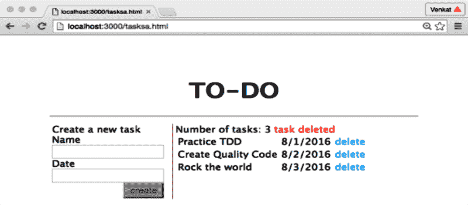

视图显示了按所需排序排列的任务列表。此外，当新任务详情不完整或无效时，创建按钮将被禁用。

## 结语

AngularJS 的设计从初就考虑了可测试性。AngularJS 和 `angular-mocks` 相互作用，便于对使用 AngularJS 编写的客户端代码进行测试。测试套件可以为控制器所需的依赖注入测试副本（test doubles）。此外，通过巧妙地模拟后端，使用自动化脚本完全验证了客户端 JavaScript 的行为。我们不需要为了代码而启动服务器或创建任何 HTML 页面。

AngularJS 团队从活跃使用 AngularJS 1.x 中学习了许多。作为完全重写，Angular 2 与 AngularJS 1.x 有巨大不同。在目前使用 AngularJS 1.x 的项目中，你可以使用本章介绍的技术。然而，对于你计划使用 Angular 2 的新项目，你需要完全不同的方法。我们将在下一章中探索这种方法。

# 第 9 章：测试驱动 Angular 2

Angular 2——从现在起我们称为 Angular——是 AngularJS 框架的完全重写。这次彻底改新基于对大量使用 AngularJS 1.x 的反馈和学习。Angular 使用 TypeScript 编写。它的创建初衷是考虑了速度和性能的提升。本章使用了 Angular 候选版本 4。

创建 Angular 应用与创建 AngularJS 1.x 非常不同。因此，测试 Angular 应用也不同。Angular 应用是使用 `components`（组件）、`services`（服务）和 `pipes`（管道）构建的，所有这些都是通过注解配置的。此外，与 1.x 相比，Angular 中组件和服务的依赖注入更加显式。这使得 Angular 代码的自动化测试变得更简单、更容易。

Angular 应用可以使用 `TypeScript`、`Dart` 或 `JavaScript` 开发。本书专注于测试驱动 JavaScript，因此我们不会重点关注 `TypeScript` 或 `Dart`。若要使用 JavaScript 进行开发，你可以使用 `ECMAScript 5`——那个老经典版本——或 `ECMAScript 2015`。目前常用的浏览器都支持 `ECMAScript 5`。若要使用 `ECMAScript 2015`，你必须花费大量时间对功能进行填充（polyfill）。

由于由于我们热衷于学习测试驱动应用，我们将在本章通过通过 `ECMAScript 5` 来保持低干扰。这有助于帮助我们专注于学习自动化，而我们不会被拖入使用 `ECMAScript 2015` 所需的无数工具中。如果你决定从 `ECMAScript 5` 迁移到 `ECMAScript 2015`，将是相对容易的，因为你已经知道如何在 `ECMAScript 5` 中编写测试和代码了。

在本章中，你将学习如何通过为 TO-DO 应用创建一个 Angular 版本的客户端来测试驱动 Angular 应用。但首先，由于在不清楚如何实现时无法测试驱动，我们将从一个简短的探针（spike）开始，并在 Angular 中创建一个完全运行的程序。然后，我们将这些知识应用于为之前章节创建的 TO-DO 应用测试 Angular 前端。

## 学习 Angular 的探针

你的最终目标是学习测试驱动应用，以便在 Angular 项目中从自动化验证中受益。你将使用 TO-DO 应用作为媒介，但首先你需要熟悉编写 Angular 代码。为了实现这一点，让我们创建一个包含任何 Angular 应用都会具备部分的探针。

我们将创建的探针将从服务器获取语言列表并按排序顺序显示。我们希望将注意力放在 Angular 上，不想在创建此探针时拖入任何服务端代码。考虑到这一点，我们将语言列表放在一个文本文件中，并使用 Angular 代码通过 `Ajax` 调用获取它。让我们开始吧。

### 管道、服务与组件

Angular 巧妙地将我们需要处理的各种关注点分离到不同的类中。让我们花一点时间熟悉应用的主要部分。

*   `Pipes`（管道）：它们是转换函数。接收数据或数据集合并返回转换后的结果。例如，给定一个句子，我们可能希望将任何脏词替换为星号，但保留好词。
*   `Service`（服务）：这些是与后端服务通信的类。它们发起 `HTTP` 调用并知道如何从服务中提取数据。它们还优雅地处理与服务通信时的任何错误。
*   `Components`（组件）：这些是服务获取的数据与数据视图之间的胶水。它们与服务协作获取或发送数据，并与管道协作转换数据。它们还告诉我们以及如何渲染数据。

我们将在探针中创建这些类型的 Angular 类。让我们准备项目以便编写代码。

### 设置项目

在你的工作区中，切换到 `tdjsa/angularspike` 目录。查看 `package.json` 文件。它包含了 Angular 以及其他模块所需的依赖项。`start` 脚本启动一个可以轻松提供文件的轻量级 HTTP 服务器。使用该服务器消除了创建任何服务端代码来提供文件的需求。运行 `npm install` 将依赖项下载并安装到你的系统中。


编辑 `languages` 文件并添加几种你选择的语言，如下：

[angularspike/languages](http://media.pragprog.com/titles/vsjavas/code/angularspike/languages)

| | JavaScript |
| :--- | :--- |
| | TypeScript |
| | Haskell |
| | Java |
| | C# |
| | F# |
| | Clojure |
| | Scala |
| | Ruby |
| | Elixir |

当我们访问 `index.html` 页面时，应用程序应该显示从 `languages` 文件提供的语言名称，但要按排序顺序。为此，我们需要一个管道（pipe）、一个服务（service）、一个组件（component）以及几个 HTML 文件。让我们按照这个顺序开始创建它们。

### 创建管道 (Pipe)

我们希望语言名称按排序顺序出现。在 AngularJS 1.x 中，我们可以使用 `orderBy` 过滤器来实现这一目的。Angular 并没有任何内置的排序函数。此外，在 Angular 中，过滤器已经被管道（pipes）所取代。

管道遵循 Unix 管道转换的理念。例如，在 Unix 命令序列 `ls | grep js | wc -l` 中，一个命令的标准输出流向下一个命令的标准输入。在示例中，`ls` 的输出流向 `grep` 的输入。`grep` 的输出反过来又流向 `wc` 命令的输入。Angular 管道也是类似的。例如，`name | uppercase | lowercase` 将把 `name` 变量中的值转换为大写，然后将该结果进一步转换为小写。这个示例的转换序列并不非常有用，但它说明了这一点。在这个示例中，`uppercase` 和 `lowercase` 是管道——事实上，它们是 Angular 中少少数几个内置管道之一。

目前 Angular 中只有几个内置管道；以后框架的作者和第三方可能会提供更多。为了在 Angular 中创建我们自己的管道，我们必须用 `Pipe` 属性来装饰一个类，并提供一个名称和一个 `transform` 函数。当数据流过涉及该管道的管道序列时，管道的 `transform` 函数会被自动调用。

我们已经准备好创建第一个 Angular 客户端代码了。我们将遵循 Angular 的文件命名规范，文件名将根据其包含的内容包含 `pipe`、`component` 或 `service` 等字样。

让我们使用经典的 JavaScript 语法创建一个管道来对名称集合进行排序。编辑当前工作区的空文件 `src/app/langs/sort.pipe.js` 并输入以下代码：

[angularspike/src/app/langs/sort.pipe.js](http://media.pragprog.com/titles/vsjavas/code/angularspike/src/app/langs/sort.pipe.js)

```javascript
(function(app) {
  app.SortPipe = ng.core
    .Pipe({ name: 'sort' })
    .Class({
      constructor: function() {},
      transform: function (languages) {
        return languages.slice().sort();
      }
    });
})(window.app || (window.app = {}));
```

让我们先读取文件的最后一行。如果变量 `window.app` 存在，我们将它作为参数调用在此文件中文件中创建的函数。如果它不存在，我们就创建 `window.app` 变量，将其初始化为空 JSON 对象，并将其作为参数传递。`window.app` 的目的是我们所有的东西——管道、服务和组件——都将作为这个 JSON 对象的成员被创建。这样我们就不会污染全局命名空间，并意外冲突或替换任何现有的类或函数。

函数内部，我们定义了管道类 `SortPipe`。Angular 的习惯是在管道名称后面加上 `Pipe` 字，服务后面加上 `Service` 字，组件后面加上 `Component` 字。我们使用构建器模式通过函数调用链在 Angular 中创建并和类类。我们首先使用 `ng.core.Pipe` 函数为类添加 `Pipe` 注解。它接收一个属性名称，在示例中，该名称被设置为值 `sort`。然后，我们使用 `ng.core.Class` 函数定义类的细节。当数据流过涉及该管道的管道序列时，`transform` 函数会被自动调用。

在这个示例中，`uppercase` 和 `lowercase` 是管道——事实上，它们是 Angular 中少少数几个内置管道之一。

### 创建服务 (Service)

与 1.x 类似，服务承担了与后端通信的责任。它需要知道访问哪个 URL、发送什么类型的请求以及如何处理响应。它还需要优雅地处理错误。我们将这些操作拆分为几个模块化的函数。

我们的服务需要一个 HTTP 对象。直接在 HTTP 对象上操作会让测试变得困难。依赖注入是 Angular 的生存之道，因此 HTTP 对象将被注入。

让我们先定义名为 `LangsService` 服务类。打开 `src/app/langs/sort.pipe.js` 并输入以下代码：

[angularspike/src/app/langs/sort.pipe.js](http://media.pragprog.com/titles/vsjavas/code/angularspike/src/app/langs/sort.pipe.js)

```javascript
(function(app) {
  app.LangsService = ng.core
    .Class({
      constructor: [ng.http, function(_http) {
        this.http = _http;
      }]
    });
})(window.app || (window.app = {}));
```

我们使用了 `ng.core.Class` 函数创建类并提供构造函数。`constructor` 属性接收一个数组，第一个值是要注入的依赖，第二个值是构造函数。在构造函数内部，我们将注入的 `_http` 对象存储在 `http` 字段中。

我们的服务需要向后端发送请求，访问 URL `/languages`，然后从响应中提取文本并提供给调用者。它还需要优雅地处理错误。我们将这些操作拆分为几个模块化的函数。

首先，让我们写一个发送 HTTP GET 请求的函数。让我们为服务类添加 `get` 函数。使用名为 `get` 的属性定义此函数。在 `src/app/langs/sort.pipe.js` 中 `constructor` 属性定义的结束逗号之后放置此内容：

[angularspike/src/app/langs/sort.pipe.js](http://media.pragprog.com/titles/vsjavas/code/angularspike/src/app/langs/sort.pipe.js)

```javascript
get: function() {
  return this.http.get('/languages')
    .map(this.extractData)
    .catch(this.returnError);
},
```

`get` 函数使用了新的 Angular 模块。该模块的 HTTP 相关函数（如 `get`、`post` 和 `delete`）返回来自 RxJS 扩展库的 `Rx.Observable`。`Observable` 就像集合，不同在于它不是一个边界列表，而是一个从服务流向订阅者的异步数据流。


`map` 函数对于将 `Observable<Response>` 转换为 `Observable<Data>` 非常有用用，其中 `Data` 是我们想要返回的任何数据。通常，它应该是我们从响应中提取的内容，可以是 JSON 数据，也可以是纯文本。我们在这里不处理这些细节，而是将该责任委托给一个独立的 `extractData` 函数。如果发生错误，`catch` 函数将不得不将错误详情转换为 `Observable` 对象。我们将将其设计为，让 `catch` 函数将该责任委托给一个 `returnError` 函数。

`get` 函数向调用者返回一个 `Rx.Observable` 实例。调用者可以订阅这个 `Observable`，并异步地接收由后端发送的数据，或者在请求失败时接收错误详情。

现在让我们来实现 `extractData` 函数；将其放置在服务中 `get` 函数下方：`angularspike/src/app/langs/langs.service.js`

```javascript
extractData:function(response) {
  if (response.status !== 200) {
    throw new Error("error getting data, status: " + response.status);
  }
  return response.text();
},
```

如果收到的响应状态码不是 200，则该函数会抛出一个异常。由于该函数是从 Observable 调用链中的 `map` 函数中调用的，RxJS 库将捕获该异常并自动将错误详情路由到订阅者的失败处理器。我们将在编写订阅 `get` 函数返回的 `Observable` 的组件时进一步讨论这一点。如果状态码为 200，则函数将使用 `text()` 函数提取并返回响应体。

接下来，让我们编写 `returnError` 函数：`angularspike/src/app/langs/langs.service.js`

```javascript
returnError:function(error) {
  return Rx.Observable.throw(
    error.message || "error, status: " + error.status);
}
```

如果 HTTP 请求出现任何问题，将调用此函数。在该函数中，我们调用了 `Observable` 的 `throw` 函数，以便错误详情能够通过 `Observable` 调用链异步地向上传播，传递给订阅者。

我们已经完成了服务类的实现。让我们回头查看该服务的完整代码：`angularspike/src/app/langs/langs.service.js`

```javascript
(function(app) {
  app.LangsService = ng.core.Class({
    constructor: [ng.http.Http, function(_http) {
      this.http = _http;
    }],
    get:function() {
      return this.http.get('/languages')
        .map(this.extractData)
        .catch(this.returnError);
    },
    extractData:function(response) {
      if (response.status !== 200)
        throw new Error("error getting data, status: " + response.status);
      return response.text();
    },
    returnError:function(error) {
      return Rx.Observable.throw(
        error.message || "error, status: " + error.status);
    }
  });
})(window.app = window.app || {});
```

我们已经准备好了管道（pipe）和服务。我们需要组件来从服务请求数据并将其绑定到视图。

### 创建组件

Angular 中的组件是一个或多个服务、管道和视图之间的胶水。在我们的示例中，组件必须从服务接收数据并将其渲染在视图上，且语言名称经过排序。Angular 期望从我们的组件获取几部分信息：

- 视图中的哪个标签应该用来自组件的内容替换？`selector` 属性将传达这一点。
- 它应该渲染哪个 HTML 页面？`templateUrl` 属性将提供这一点。Angular 还允许使用 `template` 属性代替 `templateUrl`。`template` 直接引用 HTML，而 `templateUrl` 指向包含 HTML 内容的文件。我们不会使用 `template`，因为在 JavaScript 中放置 HTML 相当相当笨拙且容易出错。
- 哪些服务应该注入到组件中，或者供组件所依赖的部件可用？`providers` 属性用于此目的。
- 组件需要哪些转换管道？正如你可能猜到的，`pipes` 属性用于此处。

让我们打开 `src/app/langs/langs.component.js` 文件，并使用我们讨论的属性创建组件：`angularspike/src/app/langs/langs.component.js`

```javascript
(function(app) {
  app.LangsComponent = ng.core.Component({
    selector: 'lang-names',
    templateUrl: 'langs.component.html',
    providers: [ng.http.HTTP_PROVIDERS, app.LangsService],
    pipes: [SortPipe]
  })
})(window.app = window.app || {});
```

组件是使用 `ng.core.Component` 函数定义的。在定义中，我们放置了讨论的四个注解属性。`selector` 指向 `lang-names`，它将 HTML 文件中的一个标签，将被此组件渲染的视图所替换。说到视图，`templateUrl` 指向由此组件渲染的文件。`providers` 属性列出了注入的依赖项。`ng.http.HTTP_PROVIDERS` 指向创建适当 HTTP 对象的提供者，该对象将被服务类用于与后端通信。`providers` 属性的第二个值是我们之前创建的服务构造函数或类。最后，`pipes` 属性引用我们为此创建的管道类。

组件类将存放它从服务获取的模型或数据，供视图显示。它还需要持有注入的服务，以便组件函数可以访问它们。为此，我们将编写组件类的构造函数。将以下代码放在 `src/app/langs/langs.component.js` 文件中 `Component` 部分的末尾：`angularspike/src/app/langs/langs.component.js`

```javascript
.Class({
  constructor: [app.LangsService, function(_langsService) {
    this.langsService = _langsService;
    this.langs = [];
    this.message = '';
  }],
});
```

`.Class` 调用紧接在 `.Component()` 函数调用之后。`constructor` 属性接收一个数组。第一个值指向将注入到构造函数的服务类或构造函数。第二个值指向构造函数。构造函数将注入的服务保存到名为 `langsService` 的字段中。此外，它初始化了两个字段——`langs` 和 `message`——分别为空数组和空字符串。这些组件字段被 Angular 视为模型。


我们在组件中已经拥有必要的字段或模型。接下来，我们需要一个函数 `getLangs`，它将从服务获取数据并设置相应的模型。如果一切顺利，我们需要更新 `langs` 模型。如果服务出现故障，我们需要更新 `message` 模型。但对于 `getLangs` 来说，这些工作太重了。我们将进行模块化。这里是 `getLangs` 函数；请将其写在 `Class({})` 声明内部，但写在 `constructor[...]` 代码之后：

[angularspike/src/app/langs/langs.component.js](http://media.pragprog.com/titles/vsjavas/code/angularspike/src/app/langs/langs.component.js)

```javascript
getLangs: function() { 
  this.langsService.get()
    .subscribe(
      this.updateLangs.bind(this),
      this.updateError.bind(this)
    );
},
```

`getLangs` 函数调用了注入到组件中的服务的 `get` 函数。记住 `get` 返回的是一个 `Observable`。正如我们在实现服务时讨论过的样，该 `Observable` 可能会向我们发送数据或错误。

在 `getLangs` 函数中，我们使用 `subscribe` 函数订阅来自 `Observable` 的响应。该函数最多接受三个参数：

*   当 `Observable` 发送一条数据时调用的函数
*   当 `Observable` 想要提供错误消息时调用的函数
*   `Observable` 可能会调用以告知我们它已完成且将不再有更多数据或错误的函数

我们只提供了前两个参数，并忽略了完成消息。如果数据到达，我们将将其传递给 `updateLangs` 函数。如果返回的是错误，则将其传递给 `updateError` 消息。

现在让我们组件中实现 `updateLangs` 函数，紧跟在 `getLangs` 函数之后：

[angularspike/src/app/langs/langs.component.js](http://media.pragprog.com/titles/vsjavas/code/angularspike/src/app/langs/langs.component.js)

```javascript
updateLangs: function(langs) {
  this.message = '';
  this.langs = langs.split('\n');
},
```

该函数清空 `message` 字段中的任何值；将给定的数据拆分为数组，每个语言名称作为一个单独的值；并将数组赋值给 `langs` 字段。

让我们继续到下一个函数。`updateError` 函数也很简单：

[angularspike/src/app/langs/langs.component.js](http://media.pragprog.com/titles/vsjavas/code/angularspike/src/app/langs/langs.component.js)

```javascript
updateError: function(error) {
  this.message = error;
  this.langs = [];
},
```

此函数清空 `langs` 字段并在 `message` 字段中设置错误详情。

我们还需要最后一步。在组件准备就绪后，我们希望 `getLangs` 函数自动执行而无需用户干预。为了执行此类操作，Angular 提供了一个特殊的 `ngOnInit` 函数。如果组件上存在此函数，它会在文档加载且 DOM 准备就绪后调用一次。这非常像传统的 `onLoad` 函数。接下来让我们实现 `ngOnInit` 函数，紧跟在 `updateError` 函数之后：

[angularspike/src/app/langs/langs.component.js](http://media.pragprog.com/titles/vsjavas/code/angularspike/src/app/langs/langs.component.js)

```javascript
ngOnInit: function() {
  this.getLangs();
}
```

在 `ngOnInit` 函数中，我们仅仅调用了 `getLangs` 函数。

我们一步一步创建了该组件。回过头来看我们创建的整个组件将有所帮助。这里是它：

[angularspike/src/app/langs/langs.component.js](http://media.pragprog.com/titles/vsjavas/code/angularspike/src/app/langs/langs.component.js)

```javascript
(function(app) {
  app.LangsComponent = ng.core.Component({
    selector: 'lang-names',
    templateUrl: 'langs.component.html',
    providers: [ng.http.HTTP_PROVIDERS, app.LangsService],
    pipes: [app.SortPipe]
  }).Class({
    constructor: [app.LangsService, function(_langsService) {
      this.langsService = _langsService;
      this.langs = [];
      this.message = '';
    }],
    getLangs: function() {
      this.langsService.get()
        .subscribe(
          this.updateLangs.bind(this),
          this.updateError.bind(this)
        );
    },
    updateLangs: function(langs) {
      this.message = '';
      this.langs = langs.split('\n');
    },
    updateError: function(error) {
      this.message = error;
      this.langs = [];
    },
    ngOnInit: function() {
      this.getLangs();
    }
  });
});
```

### 整合在一起

从代码列表中，我们可以很好地看到这两个部分——组件和 JavaScript 源码。我们快完成了。我们需要一些东西来引导组件：一个 HTML 文件。让我们处理最后几个步骤。打开 `src/main.js`：

[angularspike/src/main.js](http://media.pragprog.com/titles/vsjavas/code/angularspike/src/main.js)

```javascript
(function(app) {
  document.addEventListener('DOMContentLoaded', function() {
    ng.platformDynamic.bootstrap(app.LangsComponent);
  });
});
```

`main.js` 中的函数会在 `DOMContentLoaded` 事件触发时通过调用 `bootstrap` 函数注册我们的组件。这触发了 Angular 内部的链反应并开始监控组件字段。

我们需要组件 `templateUrl` 属性中提到的 `langs.component.html` 文件。让我们创建它。编辑当前目录下的 `langs.component.html` 文件并向其中添加以下内容：

[angularspike/langs.component.html](http://media.pragprog.com/titles/vsjavas/code/angularspike/langs.component.html)

```html
{{ message }}
<li *ngFor="let lang of langs | sort">
  {{ lang }}
</li>
```

这是一个短代码段。第一行将表达式绑定到 `message` 模型（组件中同名的字段）。在第二行中，我们使用新的 `ngFor` 指令来遍历 `langs` 数组中的值。该指令遍历数组并将数组中的值一个一个绑定到 `lang` 变量。然而，在遍历数组之前，得益于管道操作，数组将被转换为排序后的数组。`sort` 管道是在创建管道时分配给名称属性的。组件在 `pipes` 属性中引用管道类，因此模板知道排序从哪里来。

我们只有最后一步需要完成——实现起始页面 `index.html`。


[angularspike/index.html](http://media.pragprog.com/titles/vsjavas/code/angularspike/index.html)

```html
<!DOCTYPE html>
<html
<head>
  <title>Languages</title>
  <script src="node_modules/zone.js/dist/zone.js"></script>
  <script src="node_modules/reflect-metadata/Reflect.js"></script>
  <script src="node_modules/rxjs/bundles/Rx.umd.js"></script>
  <script src="node_modules/@angular/core/bundles/core.umd.js"></script>
  <script src="node_modules/@angular/common/bundles/common.umd.js"></script>
  <script src="node_modules/@angular/compiler/bundles/compiler.umd.js"></script>
  <script src="node_modules/@angular*/platform-browser/bundles/platform-browser.umd.js"></script>
  <script src="node_modules/@angular*/platform-browser-dynamic/bundles/platform-browser-dynamic.umd.js"></script>
  <script src="node_modules/@angular/http/bundles/http.umd.js"></script>
  <script src="src/app/langs/sort.pipe.js"></script>
  <script src="src/app/langs/langs.service.js"></script>
  <script src="src/app/langs/langs.component.js"></script>
  <script src="src/main.js"></script>
</head>
<body>
  <div>
    <lang-names>loading...</lang-names>
  </div>
</body>
</html>
```

前几个 `script` 标签加载了与 Angular 和 RxJS 相关的文件。最后四个 `script` 标签加载了管道、服务、组件和启动代码的源码。

这些文件的加载顺序非常重要；请在加载序列中将某个文件所需的项放在其前面。

在 `body` 标签中，我们有一个 `lang-names` 标签——这就是组件中选择器注解属性所引用的那个——它带有一个临时的“loading...”消息。当 Angular 看到组件中的模型发生变化时，它会将此标签替换为 `langs.component.html` 文件的求值内容。

我们的原型开发（spiking）已经完成。我们准备好查看代码运行了。确保所有文件已保存。在命令行提示符中，进入当前项目的工作空间，输入命令 `npm install`，然后输入命令

```bash
npm start
```

这将启动 `http-server` 服务器。现在打开你最喜欢的浏览器并指向 URL `http://localhost:8080`。`index.html` 页面将在浏览器中加载，这将激活 Angular，它将通过启动序列。一旦完成，我们看到的应该不再是“loading...”消息，而是按排序顺序列出的语言名称。让我们快速查看查看原型应用的浏览器实例：

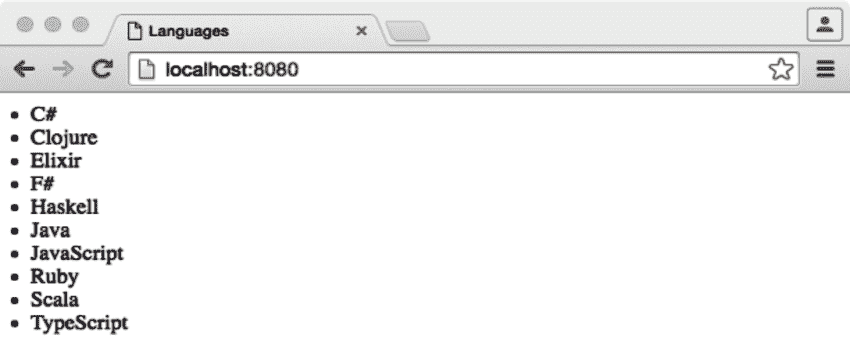

花几分钟时间审查此原型练习中创建的代码。在此过程中，我们将思考如何通过测试来驱动此类代码的创建。

管道（pipe）最容易测试。我们只需要创建该类的实例，对其调用 `transform` 函数，并验证它是否返回了预期的结果。此外，我们需要确保设置了名称注解属性。

服务（service）依赖于注入 `HTTP` 对象。由于这是一个构造函数参数，我们可以在测试期间轻松传递一个模拟对象（mock）。然后我们必须验证服务中的函数行为是否正常。为了这一点，我们必须模拟 `Observable`——虽然这听起来很复杂，但其实很简单，你很快就会发现。

最后，为了测试组件的行为，我们可以模拟它的依赖项——服务。此外，我们必须验证所有注解属性是否已按预期设置。

Angular 组织和配置不同部分的方式使得测试变得简单而容易。你一定等不及待要开始测试了。闲空谈够了——让我们不要再等了。

# 使用测试设计 Angular 应用

让我们为在第 6 章中创建的 TO-DO 应用的 Angular 版本前端（Test-Drive Express Apps）进行测试驱动。

通过查看草图，并根据我们之前为 TO-DO 应用创建不同版本前端的努力，我们对 Angular 前端需要创建的内容有了相当好的了解。让我们记录下一些想到的测试；我们可以在后续过程中对其进行完善。让我们先关注列出任务功能的组件相关测试。

### 设置项目

`testangular2/todo` 目录包含了 Test-Drive Express Apps 的副本，以及 Angular 所需的一些更改。运行 `npm install` 获取必要的包。

该项目中还提供了一个 `karma.conf.js` 文件。查看该文件的 `files` 部分，并注意其中包含了 Angular 和 RxJS 相关的文件：

[testangular2/todo/karma.conf.js](http://media.pragprog.com/titles/vsjavas/code/testangular2/todo/karma.conf.js)

| |
| :--- |
| **files:** |
| `"./node_modules/zone.js/dist/zone.js"` |
| `"./node_modules/reflect-metadata/Reflect.js"` |
| `"./node_modules/rxjs/bundles/Rx.umd.js"` |
| `"./node_modules/@angular/core/bundles/core.umd.js"` |
| `"./node_modules/@angular/common/bundles/common.umd.js"` |
| `"./node_modules/@angular/compiler/bundles/compiler.umd.js"` |
| `"./node_modules/@angular*/" + "platform-browser/bundles/platform-browser.umd.js"` |
| `"./node_modules/@angular*/" + "platform-browser-dynamic/bundles/platform-browser-dynamic.umd.js"` |
| `"./node_modules/@angular/http/bundles/http.umd.js"` |
| `"./test/client/**/*.js"` |

我们还包含了 `test/client` 目录及其子目录中的所有文件。

特别注意包含的第二个文件——Reflect.js。我们稍后会讨论它的作用。

### 创建测试列表

*   组件应该设置选择器属性


*   组件应该设置 `templateUrl` 属性
*   构造函数应该将 `tasks` 初始化为空空数组
*   构造函数应该将 `message` 初始化为空空字符串
*   `getTasks` 应该向服务注册处理器
*   `updateTasks` 应该更新 `tasks`
*   `updateError` 应该更新 `message`
*   显示的任务应该按排序排列
*   `getTasks` 应该在 `init` 时被调用

这些测试仅仅是为了设计组件。在处理完这一堆任务后，我们可以查看服务和其他细节。让我们开始组件设计吧。

## 测试驱动组件开发

组件将视图和模型（模型持有从服务获取的数据）粘合在一起。作为第一步，我们需要在组件中创建一些必要的注解属性。我们列出的前两个测试恰好引导我们到达那里。让我们从第一个测试开始。

### 验证组件属性是否已设置

为了定义组件，我们将使用 `ng.core.Component` 函数调用，并在其中设置注解属性 `selector`。如果不确定这在我们新组件中看起来像什么样，可以快速查看实验项目（spike）中的 `LangsComponent`。

编写组件很容易。我们已经在实验项目中看过那的例子了。困难的问题是，我们如何对其进行测试呢？换句话说，我们想在编写选择器属性之前编写一个失败的测试。

为此，我们必须进行一些研究并学习 Angular 如何处理注解和属性。注解和相关的属性是元数据。它们不存储在类或其实例内部，而是单独存储在一个存储这些细节的元类（meta-class）中。通过 `Reflect.js` 文件脚本标签引入的 `Reflect` 类是创建和获取元数据的网关。我们将使用它来验证组件是否设置了必要的注解属性。

`Reflect` 的 `getMetadataKeys` 函数将为类提供可用的键列表。然后我们可以使用 `getMetadata` 函数从任何键中获取特定属性。

为了更好地理解元数据，让我们再次操作一下实验项目，以探索 `app.LangsComponent` 的元数据。在实验程序运行时，打开浏览器访问 URL `http://localhost:8080`。然后，在浏览器的控制台窗口输入下图所示的命令并查看你获得的响应：

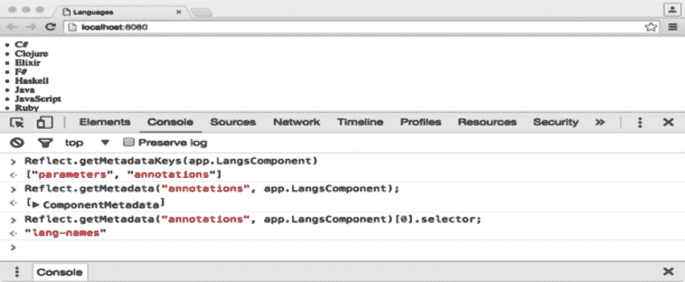

我们看到对于命令 `Reflect.getMetadataKeys(app.LangsComponent)`，我们得到了响应 `["parameters", "annotations"]`。这告诉我们有两个可用的元键。我们将在测试期间利用它们。然后，通过命令 `Reflect.getMetadata("annotations", app.LangsComponent)[0].selector`，我们能够获取属性的值 `lang-names`。这让我们很好地了解了如何测试组件中属性的存在和值。

让我们切回 `tdjsa/testangular2/todo` 工作空间。在当前项目中打开空的测试文件 `test/client/app/tasks/tasks.component-test.js`，并为组件输入以下第一个测试：

```javascript
describe('tasks component tests', function() {
  it('should set the selector attribute', function() {
    var componentAnnotations =
      Reflect.getMetadata('annotations', app.TasksComponent)[0];

    expect(componentAnnotations.selector).to.be.eql('tasks-list');
  });
});
```

该测试检查了我们很快就会编写的组件 `app.TasksComponent` 的注解元数据。我们使用 `Reflect` 的 `getMetadata` 函数来获取元数据。然后我们验证选择器属性是否已设置为所需的值。

在组件中编写必要的代码之前，我们想先看到测试失败。目前 `karma.conf.js` 文件没有包含任何源文件；它只包含了 Angular 相关文件和测试文件。要包含源文件，我们不能使用通配符 `**`——回想实验练习，Angular 相关文件必须按照特定顺序加载。让我们更改 `karma.conf.js` 文件中的文件部分，以包含组件的源文件：

```javascript
//...
'./test/client/**/*.js',
'./public/src/app/tasks/tasks.component.js',
```

现在我们准备好启动 Karma 并运行编写的客户端测试了。运行以下命令并观察 Mocha 中的测试失败：

```bash
npm run-script test-client
```

让我们实现最少的代码来使测试通过。打开 `public/src/app/tasks/tasks.component.js` 文件并输入以下代码：

```javascript
(function(app) {
  app.TasksComponent = ng.core
    .Component({
      selector: 'tasks-list',
    })
    .Class({
      constructor() {}
    });
})(app);
```

`Reflect` 和 `Class` 连同空构造函数都是必要的。没有它们，`Reflect` 会抱怨无法获取元数据。组件的选择器属性已分配了所需的值。一旦你保存文件，正在监听变化的 Karma 就会触发 Mocha，然后 Mocha 将报告测试通过。

让我们进入下一个测试。这里是验证 `templateUrl` 属性的测试：

```javascript
Reflect.getMetadata('annotations', app.TasksComponent)[0];
it('should set the templateUrl attribute', function() {
  var componentAnnotations =
    Reflect.getMetadata('annotations', app.TasksComponent)[0];

  expect(componentAnnotations.templateUrl).to.be.eql('tasks.html');
});
```

为了通过此测试，我们只需要对组件进行微小的更改；在选择器处添加 `templateUrl` 属性：

```javascript
selector: 'tasks-list',
templateUrl: 'tasks.html'
```

你现在知道如何验证组件属性了。接下来，让我们验证必要的模型（组件中的字段）是否正确初始化。

### 初始化模型

组件需要将从服务获取的任务列表存储在模型中。它还需要一个模型来存储从服务响应的任何消息。由于对服务的调用是异步的且响应可能需要时间，我们需要为这些模型显示安全的初始值。让我们写一个测试来验证 `tasks` 模型是否正确初始化——这个测试同样进入 `test/client/app/tasks/tasks.component-test.js` 文件。

```javascript
it('should initialize tasks to an empty array', function() {
  expect(tasksComponent.tasks).to.be.eql([]);
});
```

此测试正在验证组件实例的 `tasks` 字段是否已设置为所需的初始值。但我们还没有组件实例的引用。在测试套件的顶部，添加以下 `beforeEach` 设置代码：

```javascript
var tasksComponent;

beforeEach(function() {
  tasksComponent = new app.TasksComponent();
});
```


为了通过此测试，请在 `TasksComponent` 的构造函数中创建并初始化 `tasks` 字段。如下所示 `/public/src/app/tasks/tasks.component.js` 文件：

```javascript
constructor() {
  this.tasks = [];
}
```

同样，这里有一个测试用于验证消息模型是否正确初始化：

[testangular2/todo/test/client/app/tasks/tasks.component-test.js](http://media.pragprog.com/titles/vsjavas/code/testangular2/todo/test/client/app/tasks/tasks.component-test.js)

```javascript
it('should initialize message to an empty string', function() {
  expect(tasksComponent.message).to.be.eql('');
});
```

在组件类的构造函数中为 `message` 字段设置所需的的初始值：

```javascript
constructor() {
  this.tasks = [];
  this.message = '';
}
```

我们已经拥有了组件所需的属性和字段。现在是设计组件的第一个函数了。

### 设计 getTasks

组件的 `getTasks` 函数应该调用服务从后端服务器获取任务列表。当数据到达时，它必须更新 `tasks` 模型。我们可以将模型的更新委托给另一个函数。`getTasks` 函数的职责首先是调用服务。回探针实验（spiking）示例，服务将返回一个 `Rx.Observable`。然后 `getTasks` 必须需要通过 `Observable` 的 `subscribe` 函数注册适当的处理器。

我们为 `getTasks` 编写的测试将是一个交互测试。然而，我们有多个交互需要验证，而且很难看清所有的交互。让我们从创建的探针实验中寻求一些帮助。`getTasks` 函数将与 `getLangs` 函数非常。回顾一下该函数会有帮助。让我们来看看：

```javascript
getLangs() {
  this.langsService.get()
    .subscribe(
      this.updateLangs.bind(this),
      this.updateError.bind(this));
}
```

观察这段代码，我们可以在脑海中形成验证即将编写的 `getTasks` 函数行为所需的步骤。首先，我们需要对传递给 `subscribe` 函数的两个句处理器的 `bind` 函数进行存桩（stub）。我们需要模拟 `subscribe` 函数，并验证传递给它的参数是由我们存桩的 `bind` 函数返回的函数。这将花费一些精力——我们将使用 `Sinon` 来创建存桩和模拟（mocks）。

首先开始修改测试套件以添加几个新变量，更改 `beforeEach` 函数，然后添加 `afterEach` 函数。在测试套件 `test/client/app/tasks/tasks.component-test.js` 中，我们目前有如下设置代码：

```javascript
var tasksComponent;

beforeEach(function() {
  tasksComponent = new app.TasksComponent();
});
```

将其更改为如下：

```javascript
var sandbox;
var tasksComponent;
var tasksService;
var observable = { subscribe: function() {} };
var updateTasksBindStub = function() {};
var updateErrorBindStub = function() {};

beforeEach(function() {
  tasksService = {
    get: function() {},
    add: function() {},
    delete: function() {}
  };

  tasksComponent = new app.TasksComponent(tasksService);

  sandbox = sinon.sandbox.create();

  sandbox.stub(tasksComponent.updateTasks, 'bind')
    .withArgs(tasksComponent)
    .returns(updateTasksBindStub);

  sandbox.stub(tasksComponent.updateError, 'bind')
    .withArgs(tasksComponent)
    .returns(updateErrorBindStub);

  sandbox.stub(tasksService, 'get')
    .withArgs()
    .returns(observable);
});

afterEach(function() {
  sandbox.restore();
});
```

让我们回顾一下更改以理解我们所采取的所有不同步骤。让我们从字段/变量开始。

我们为 `Sinon` 沙箱、组件和服务端声明了变量。由于服务此时并不真实存在，变量 `tasksService` 将指向一个存桩。`observable` 是 `Rx.Observable` 的存桩，因此它有一个空操作（no-op）`subscribe` 函数。`updateTasksBindStub` 和 `updateErrorBindStub` 是 `bind` 函数将返回的函数的空操作存桩，正如你很快看到的。

在 `beforeEach` 函数中，我们首先为服务创建一个存桩，并将服务传递给组件的构造函数。然后我们为组件的 `updateTasks` 函数的 `bind` 函数创建一个存桩。在这个存桩中，我们验证给定的参数确实是组件的引用，然后返回我们之前创建的存桩。此外，在 `afterEach` 函数中，我们恢复了 `Sinon` 在存桩期间执行的所有更改。

我们现在准备好编写测试来验证行为了。在测试套件中添加以下测试：

[testangular2/todo/test/client/app/tasks/tasks.component-test.js](http://media.pragprog.com/titles/vsjavas/code/testangular2/todo/test/client/app/tasks/tasks.component-test.js)

```javascript
it('getTasks should register handlers with service', function() {
  var observableMock = sandbox.mock(observable)
    .expects('subscribe')
    .withArgs(updateTasksBindStub, updateErrorBindStub);

  tasksComponent.getTasks();

  observableMock.verify();
});
```

在测试中，我们为 `Observable` 存桩的 `subscribe` 函数创建一个模拟（mock）。模拟期望 `subscribe` 被正确的处理器调用——即我们为 `bind` 调用创建的存桩。然后我们调用被测函数 `getTasks`，并验证服务返回的 subscribe 函数被正确调用。

测试花费了大量的精力——这是一个缺点。然而，也有优点——我们不需要真实的服务就能验证 `getTasks` 函数的行为。

让我们实现 `getTasks` 函数以通过测试。我们还需要修改构造函数以接收服务作为参数并将其存储在局部变量中。此外，我们需要初始化函数——目前空操作实现就足够。打开组件类，更改构造函数并添加新函数，如下：

```javascript
.Class({
  constructor(_tasksService) {
    this.tasks = [];
    this.message = '';
    this.service = _tasksService;
  },
  getTasks() {
    this.service.get()
      .subscribe(this.updateTasks.bind(this),
      this.updateError.bind(this));
  },
  updateTasks() {},
  updateError() {},
});
```

保存文件并确保测试通过。

如果之前的测试让你感到有些担心，请放心，那是我们为 Angular 编写的最困难的一个测试。接下来的测试将相对简单，正如你所看到的。


实现这两个处理器几乎不需要费任何力力。让我们为 `updateTasks` 函数编写一个测试。该函数将从服务接收一个任务列表，并应该将其设置为 `tasks` 模型。

[testangular2/todo/test/client/app/tasks/tasks.component-test.js](http://media.pragprog.com/titles/vsjavas/code/testangular2/todo/test/client/app/tasks/tasks.component-test.js)

```javascript
it('updateTasks should update tasks', function() {
  var tasksStub = [{sample: 1}];
  tasksComponent.updateTasks(tasksStub);
  expect(tasksComponent.tasks).to.be.eql(tasksStub);
});
```

这个测试非常直观；它向函数传递一个任务列表或数组作为参数，并验证组件中的 `tasks` 模型已使用该值更新。我们目前在组件中为 `updateTasks` 有了一个空操作函数（no-op）。修改它以通过测试：

```javascript
updateTasks: function(tasks) { this.tasks = tasks; },
```

验证 `updateError` 的测试也不会带来挑战。它和上一个测试一样：

[testangular2/todo/test/client/app/tasks/tasks.component-test.js](http://media.pragprog.com/titles/vsjavas/code/testangular2/todo/test/client/app/tasks/tasks.component-test.js)

```javascript
it('updateError should update message', function() {
  tasksComponent.updateError('Not Found');
  expect(tasksComponent.message).to.be.eql('Not Found');
});
```

将目前现有的 `updateError` 函数空操作函数替换为以下代码：

```javascript
updateError: function(error) { this.message = error; },
```

测试列表中的下一个测试涉及到对显示的任务进行排序。这是一个大的话题，涉及多个步骤。让我们推迟它，先处理一些相对容易且快速完成的工作。之后，我们将重新审视排序所需的内容。

当文档加载且 DOM 准备就绪时，应该自动调用 `getTasks` 函数，无需任何用户干预。这样用户在页面加载后就能立即看到任务列表。为此，我们将使用 `ngOnInit` 函数，如果存在，Angular 会在适当时间自动调用它。但有一个问题。

如果我们在 `ngOnInit` 中调用 `getTasks`，该函数反过来将对服务进行 `get` 调用。我们目前还没有服务，即使有，我们也不希望在这个测试中依赖它。一种解决方案是模拟（mock）该服务——但那工作量很大。让我们多思考一下。我们想验证 `ngOnInit` 是否调用了 `getTasks`。这是一个交互测试。我们可以通过模拟 `getTasks` 函数来轻松验证这种交互。

[testangular2/todo/test/client/app/tasks/tasks.component-test.js](http://media.pragprog.com/titles/vsjavas/code/testangular2/todo/test/client/app/tasks/tasks.component-test.js)

```javascript
it('getTasks should be called on init', function() {
  var getTasksMock = sandbox.mock(tasksComponent)
    .expects('getTasks');

  tasksComponent.ngOnInit();
  getTasksMock.verify();
});
```

对组件类进行一个简单的更改就能让我们继续进行。在组件中 `updateError` 函数之后添加以下代码：

```javascript
ngOnInit: function() { this.getTasks(); }
```

对于组件来说，我们已经具备了获取和显示任务所需的一切——好了，几乎全了。我们仍然需要对任务进行排序。让我们关注这项工作。

### 排序任务列表

我们测试列表中与排序相关的测试说“显示的任务应该是排序后的”。如何以及在何处进行排序是我们需要解决的下一个问题。

让我们回顾一下我们在冲刺练习（spiking exercise）中是如何排序的。我们向组件添加了 `pipes` 注解，但我们让视图使用 HTML 文件中的声明式风格表达式 `let lang of langs | sort` 来转换。这与 AngularJS 1.x 中的 `orderBy` 具有完全相同的坏气味（bad smell）——参见寻找合适的位置。

| 如果难以测试，那就不好 |
| :--- |
|  | 无论代码看起来多么精妙流畅，如果它难以测试，就不是好的。 |

我们不会将 pipe 放在 HTML 文件中，而是在组件内部的代码中进行排序。无论代码看起来多么精妙流畅，如果它难以测试，就不是好的。我们不会将 pipe 放在 HTML 文件中，而是在组件内部的代码中进行排序。通过命名这个 pipe，意图变得清晰了。通过将其命名为 pipe，我们作为一个可重用的类可用。由于我们计划在组件中使用该 pipe，我们将把它放在 providers 中。在组件中，我们刚刚做了一个决定，排序将在 pipe 中发生。现在，我们需要验证的是 `updateTasks` 将排序的关注点委托给一个独立的对象。当我们设计 pipe 时，我们会思考管道所需的测试。

我们已经设计并实现了 `updateTasks` 函数。让我们为该函数的更改行为添加另一个测试。在编写测试之前，我们在测试套件中需要几件事。

首先，在测试套件中 `updateErrorStub` 定义之后添加以下变量声明：

```javascript
var sortPipe = { transform: function(data) { return data; } }
```

其次，在 `beforeEach` 函数中，将传递给组件构造函数的参数从

```javascript
tasksComponent = new app.TasksComponent(tasksService);
```

到

```javascript
tasksComponent = new app.TasksComponent(tasks, sortPipe);
```

我们已经为 pipe 创建了一个存根（stub）——存根中的 `transform` 函数仅返回数据。然后我们将此存根作为第二个参数传递给构造函数。编写测试所需的条件已就绪。这里是 `updateTasks` 的新测试：

[testangular2/todo/test/client/app/tasks/tasks.component-test.js](http://media.pragprog.com/titles/vsjavas/code/testangular2/todo/test/client/app/tasks/tasks.component-test.js)

```javascript
it('updateTasks should call transform on pipe', function() {
  var tasksStub = '...fake input...';
  var expectedSortedTasks = '...fake output...';

  sandbox.stub(sortPipe, 'transform')
    .withArgs(tasksStub)
    .returns(expectedSortedTasks);

  tasksComponent.updateTasks(tasksStub);
  expect(tasksComponent.tasks).to.be.eql(expectedSortedTasks);
});
```

测试为 transform 函数创建了一个虚拟输出。然后我们对 pipe 存根中的 `transform` 函数进行替换，使其在给定预期输入时返回虚拟输出的版本。最后，我们调用组件的 `updateTasks` 函数，并验证该函数返回了 `transform` 函数返回的结果。


在我们对 `updateTasks` 函数进行微小但必要的更改之前，我们必须更改组件的构造函数，以接收一个新的第二个参数。让我们现在进行这一更改：

```javascript
constructor(_tasksService, _sortPipe) {
  this.tasks = [];
  this.message = '';
  this.service = _tasksService;
  this.sortPipe = _sortPipe;
}
```

完成该更改后，我们就准备好修改 `updateTasks` 函数了：

```javascript
updateTasks(tasks) {
  this.tasks = this.sortPipe.transform(tasks);
}
```

保存文件并确保所有测试通过。查看目前组件中已有的代码，还有关于获取任务的一些未完成工作。我们需要设置依赖注入，以便 Angular 能够正确将我们的组件与服务和管道（pipe）连接起来。让我们接下来处理这个问题。

## 验证依赖注入

你已经从刺实验（spiking exercise）中学习了执行依赖注入所需的语法。我们需要两点：我们必须设置一个新的 `providers` 属性，并更改构造函数属性以指定用于注入的类/构造函数。让我们先处理第一项。

| 程序有意为 (Program Deliberately) |
| --- |
|  | 在使用框架工作时，很容易忘记为什么要编写某些模板代码。程序有意为——通过测试表达你的意图，然后编写最少代码来满足这些预期。 |

让我们在组件的测试套件中添加以下测试：

[testangular2/todo/test/client/app/tasks/tasks.component-test.js](http://media.pragprog.com/titles/vsjavas/code/testangular2/todo/test/client/app/tasks/tasks.component-test.js)

```javascript
it('should register necessary providers', function() {
  var componentAnnotations = Reflect.getMetadata('annotations', app.TasksComponent)[0];
  var expectedProviders = [ng.http.HTTP_PROVIDERS, app.TasksService, app.TasksSortPipe];
  expect(componentAnnotations.providers).to.be.eql(expectedProviders);
});
```

该测试通过使用 `Reflect` 类的 `getMetadata` 函数获取 `providers` 注解属性——就像我们之前获取选择器属性一样。然后它验证为该属性设置的值是否为预期的系列值。

为了让此测试通过，请修改组件以包含 `providers` 属性，紧跟在 `templateUrl` 属性之后如下：

```javascript
templateUrl: 'tasks.component.html',
providers: [ng.http.HTTP_PROVIDERS, app.TasksService, app.TasksSortPipe]
```

保存文件并确保测试通过。下一个测试是验证构造函数属性是否已为依赖注入进行了正确配置。

[testangular2/todo/test/client/app/tasks/tasks.component-test.js](http://media.pragprog.com/titles/vsjavas/code/testangular2/todo/test/client/app/tasks/tasks.component-test.js)

```javascript
it('TasksService should be injected into the component', function() {
  var injectedServices = Reflect.getMetadata('parameters', app.TasksComponent);
  expect(injectedServices[0]).to.be.eql([app.TasksService]);
  expect(injectedServices[1]).to.be.eql([app.TasksSortPipe]);
});
```

此测试也使用了 `Reflect` 类的 `getMetadata` 函数，但它不是获取 `annotations` 属性，而是请求参数。虽然我们放入 `Component` 的属性会进入 `annotations`，但我们放在构造函数中的属性会进入 `parameters` 属性。然后我们验证传递给构造函数属性的数组中的两个值是否符合预期。

这里有一个小陷阱。`app.TasksService` 和 `app.TasksSortPipe` 类目前是未定义的（undefined）。这没关系；稍后当我们定义这些类时，这些引用将生效并指向实际的类/构造函数，而不是未定义。

让我们修改组件的构造函数属性以注入必要的类/构造函数：

```javascript
constructor(app.TasksService, app.TasksSortPipe, function(_tasksService, _sortPipe) {
  this.tasks = [];
  this.message = '';
  this.service = _tasksService;
  this.sortPipe = _sortPipe;
})
```

保存文件并确保测试通过。虽然我们可能会继续进行组件的其他功能开发，但我们将回到服务。设计服务。让我们将注意力转向服务类的设计。

## 驱动驱动服务

服务类需要提供一个 `get` 函数。该函数将与后端通信，获取数据并向调用者返回一个 Observable。让我们列出需要的测试。在这里你可以从刺实验中学习：

*   `get` 应该向 `/tasks` 发起请求
*   `extractData` 应该返回 `json()` 的结果
*   `extractData` 应该为状态抛出异常
*   `returnError` 应该返回错误

第一个测试将是一个交互测试。HTTP 方法返回 `Observable`。由于我们不想与真实的后端通信，我们必须模拟（mock）`Observable`。打开 `test/client/app/tasks/tasks.service.js` 文件，为测试服务一个新的测试套件，并创建我们需要的变量：

[testangular2/todo/test/client/app/tasks/tasks.service-test.js](http://media.pragprog.com/titles/vsjavas/code/testangular2/todo/test/client/app/tasks/tasks.service-test.js)

```javascript
describe('tasks service', function() {
  var sandbox;
  var http;
  var observable;
  var tasksService;
});
```

在我们创建的新测试套件中创建了一些变量。我们已经知道 `sandbox` 的用途。`http` 将持有 `HTTP` 存根（stub）的引用以模拟对后端的调用。`observable` 将是 `Observable` 存根的引用，由 `HTTP` 上的方法返回。最后，`tasksService` 将是被测试服务的引用。

接下来，在测试套件的 `setup` 函数中使用这些变量。首先，创建一个轻量级存根来代替 `HTTP`，并作为构造函数参数传递给我们创建的服务实例。然后为 `Observable` 创建一个存根。我们将为以下序列安排 get 存根链：`HTTP` 的 `get` 存根如果传入的参数是正确的 URL `/tasks`，则返回 `Observable` 存根。`Observable` 的 `map` 函数存根如果提供的参数是正确的处理函数，则返回 `Observable`。同样，`Observable` 的 `catch` 函数存根如果给定的参数是传递给 `catch` 的正确处理函数，则返回 `Observable`。

让我们实现 `beforeEach` 函数，以及用于恢复 Sinon 沙箱的 `afterEach` 函数。将以下代码添加到 `test/client/app/tasks/tasks.service.js` 测试套件中我们刚刚添加的变量声明下方：

```javascript
beforeEach(function() {
  sandbox = sinon.sandbox.create();
});
```


```javascript
var http = {
  get: function() {},
};

tasksService = new app.TasksService(http);

observable = {
  map: function() {},
  catch: function() {}
};

sandbox.stub(http, 'get')
  .withArgs('/tasks')
  .returns(observable);

sandbox.stub(observable, 'map')
  .withArgs(tasksService.extractData)
  .returns(observable);

sandbox.stub(observable, 'catch')
  .withArgs(tasksService.returnError)
  .returns(observable);

afterEach(function() {
  sandbox.restore();
});
```

我们已经准备就绪为服务的 `get` 函数编写交互测试。以下是测试用代码：

[testangular2/todo/test/client/app/tasks/tasks.service-test.js](http://media.pragprog.com/titles/vsjavas/code/testangular2/todo/test/client/app/tasks/tasks.service-test.js)

```javascript
it('get should make GET request to /tasks', function() {
  expect(tasksService.get()).to.be.eql(observable);
  expect(http.get.calledWith('/tasks')).to.be.true;
  expect(observable.map.calledWith(tasksService.extractData)).to.be.true;
  expect(observable.catch.calledWith(tasksService.returnError)).to.be.true;
});
```

该测试调用了服务的 `get` 函数，并验证它是否返回了预期的 `Observable`。此外，测试验证了当调用 `get` 时，`HTTP` 的 `get` 方法确实被调用了。此外，它还验证了在 `HTTP get` 返回的 `Observable` 上`map` 和 `catch` 函数都被正确调用。最后几项检查确保了对 `map` 或 `catch` 的调用没有被跳过。

在运行此测试之前，我们必须修改 `karma.conf.js` 文件。在 `files` 部分，添加对现已为空的 `public/src/app/tasks/tasks.service.js` 文件的引用，存放在 `tasks.component.js` 文件引用的之前——记住顺序很重要。修改后的 `files` 部分将如下所示：

```javascript
files: [
  'node_modules/angular2/bundles/angular2-polyfills.js',
  'node_modules/rxjs/bundles/Rx.umd.js',
  'node_modules/angular2/bundles/angular2-all.umd.js',
  './test/client/**/*.js',
  './public/src/app/tasks/tasks.service.js',
  './public/src/app/tasks/tasks.component.js',
],
```

保存文件后重启 Karma，Mocha 将抱怨说它不知道 `app.TasksService` 是什么。我们现在准备好实现服务类的最小代码以使测试通过。打开 `public/src/app/tasks/tasks.service.js` 文件并添加以下代码：

```javascript
(function(app) {
  app.TasksService = ng.core.Class({
    constructor: function(_http) {
      this.http = _http;
    },
    get: function() {
      return this.http.get('/tasks')
        .map(this.extractData)
        .catch(this.returnError);
    },
  });
})(window.app || (window.app = {}));
```

服务只是一个类，而不是组件。我们使用 `ng.core.Class` 函数来创建该类。我们将一个函数赋值给 `constructor` 属性，并在其中将给定 `_http` 对象的引用存储在 `http` 字段中。在 `get` 函数中，我们调用了 `HTTP` 的 `get` 函数，并为 `map` 和 `catch` 函数提供了必要的函数处理器。我们现在还没有这些处理器，但没关系——它们会各就位的。

保存文件并确保所有测试（包括组件的测试和针对服务的这一个测试）都通过了。

`get` 函数依赖于两个处理器。让我们实现下一个测试：`extractData` 应该从 `json()` 返回值。

[testangular2/todo/test/client/app/tasks/tasks.service-test.js](http://media.pragprog.com/titles/vsjavas/code/testangular2/todo/test/client/app/tasks/tasks.service-test.js)

```javascript
it('extractData should return from json()', function() {
  var fakeJSON = {};
  var response = {status: 200, json: function() { return fakeJSON; } };
  expect(tasksService.extractData(response)).to.equal(fakeJSON);
});
```

该测试将一个模拟响应对象作为参数传递给 `extractData` 函数，并期望函数调用的结果是 `response` 对象 `json()` 函数的返回值。为了让此测试通过，打开服务类并在 `get` 函数下方为新的 `extractData` 函数实现最小代码：

```javascript
extractData: function(response) {
  return response.json();
},
```

这部分代码很短——该函数仅仅返回了调用 `json()` 的结果。尽管测试为 `status` 提供了一个值，但在那里并没有被它————用“编写最小代码”的话来说，我们只添加了通过测试所必需的内容。

现在让我们继续编写下一个测试，以强制函数使用 `status` 属性：

[testangular2/todo/test/client/app/tasks/tasks.service-test.js](http://media.pragprog.com/titles/vsjavas/code/testangular2/todo/test/client/app/tasks/tasks.service-test.js)

```javascript
it('extractData should throw exception for invalid status', function() {
  var response = {status: 404 };
  expect(function() {
    tasksService.extractData(response);
  }).to.throw('Request failed with status:');
});
```

此测试发送了 404 状态并期望被测试函数会报错。这是一个异常测试——如果函数抛出了正确的异常，测试就能通过。我们需要修改被测试函数以通过测试：

```javascript
extractData: function(response) {
  if(response.status !== 200) {
    throw new Error('Request failed with status ' + response.status);
  }
  return response.json();
},
```

让我们实现测试列表中的最后一个测试。这将引导 `returnError` 函数的实现。

[testangular2/todo/test/client/app/tasks/tasks.service-test.js](http://media.pragprog.com/titles/vsjavas/code/testangular2/todo/test/client/app/tasks/tasks.service-test.js)

```javascript
it('returnError should return an error Observable', function() {
  var error = {message: 'oops'};
  var observableThrowMock = sandbox.mock(Rx.Observable)
    .expects('throw')
    .withArgs(error.message);
  tasksService.returnError(error);
  observableThrowMock.verify();
});
```

该测试用错误对象调用 `returnError` 函数，并期望函数返回一个 `Observable`——不是任何 `Observable`，而是使用 `throw` 函数创建的那一个。现在让我们在服务中实现 `returnError` 函数以通过通过。

[testangular2/todo/public/src/app/tasks/tasks.service.js](http://media.pragprog.com/titles/vsjavas/code/testangular2/todo/public/src/app/tasks/tasks.service.js)

```javascript
returnError: function(error) {
  return Rx.Observable.throw(error.message);
},
```

哦，还有一件事。服务需要注入一个 `HTTP` 实例。构造函数属性需要为此发生改变，但让我们先写测试：

[testangular2/todo/test/client/app/tasks/tasks.service-test.js](http://media.pragprog.com/titles/vsjavas/code/testangular2/todo/test/client/app/tasks/tasks.service-test.js)

```javascript
it('should inject HTTP into the constructor', function() {
  var injectedServices =
```


```javascript
Reflect.getMetadata('parameters', app.TasksService);

expect(injectedServices[0]).to.be.eql([ng.http.Http]);
```

现在修改构造函数以使测试通过。除了看到构造函数的变化外，让我们来看一眼通过测试增量开发的整个服务类。

```javascript
function(app) {
  app.TasksService = ng.core.Class({
    constructor: [ng.http.Http, function(_http) {
      this.http = _http;
    }],
    get: function() {
      return this.http.get('/tasks')
        .map(this.extractData)
        .catch(this.returnError);
    },
    extractData: function(response) {
      if(response.status !== 200)
        throw new Error('Request failed with status: ' + response.status);

      return response.json();
    },
    returnError: function(error) {
      return Rx.Observable.throw(error.message);
    },
  });
})(window.app || (window.app = {}));
```

这就完成了我们返回任务列表服务的实现。我们仍然还没有用于排序任务的管道（pipe）。让我们接下来处理那部分。

## 测试驱动管道 (Pipe)

管道类及其转换函数是最容易测试的。我们的管道应该能将一个给定的列表转换为排序后的列表。让我们列出将需要的测试：

* 管道的名称应设置为 sort
* 应该根据年份排序任务
* 应该根据年份、月份排序任务
* 应该根据年份、月份、日期排序任务
* 应该根据年份、月份、日期，然后名称排序任务

首先，编辑 `karma.conf.js` 中的文件部分，以添加对当前空管道文件的引用；将其放置在服务文件引用之前，如下所示：

* `'./public/src/app/tasks/tasks-sort.pipe.js'`
* `'./public/src/app/tasks/tasks.service.js'`
* `'./public/src/app/tasks/tasks.component.js'`

保存文件后重启 Karma。然后打开文件 `test/client/app/tasks/tasks-sort.pipe-test.js` 并创建一个新的测试套件：

```javascript
describe('tasks-sort pipe test', function() {
  var sortPipe;

  beforeEach(function() {
    sortPipe = new app.TasksSortPipe();
  });
});
```

在这个测试套件中，我们将实现对管道的第一个测试，验证其 name 属性被设置为 sort：

```javascript
it('should have the pipe`s name set to sort', function() {
  var annotations =
    Reflect.getMetadata('annotations', app.TasksSortPipe)[0];

  expect(annotations.name).to.be.eql('sort');
});
```

这个测试与我们为组件编写的第一个测试非常相似。它获取注解元数据并确认 name 属性被设置为预期的值。

现在让我们在管道类中实现必要的代码——打开 `public/src/app/tasks/tasks-sort.pipe.js` 并输入以下代码：

```javascript
function(app) {
  app.TasksSortPipe = ng.core.Pipe({
    name: 'sort'
  }).Class({
    constructor: function() {},
  });
})(window.app || (window.app = {}));
```

该类已配置为一个管道，它有一个名称，并且正急于我们编写转换函数。让我们为转换函数编写第一个测试：

```javascript
it('should sort tasks based on year', function() {
  var task1 = { name: 'task a', month: 1, day: 10, year: 2017 };
  var task2 = { name: 'task b', month: 1, day: 10, year: 2016 };

  var sorted = sortPipe.transform([task1, task2]);
  expect(sorted).to.be.eql([task2, task1]);
});
```

测试发送了一个示例任务列表，并期望返回的结果按排序顺序出现。在管道中实现转换函数，根据 `year` 属性返回排序后的任务集合。该函数将紧接构造函数属性之后，如下：

```javascript
//
constructor: function() {},
transform:function(tasks) {
  var compareTasks = function(task1, task2) {
    return task1.year - task2.year;
  }

  return tasks.sort(compareTasks);
}
```

JavaScript `Array` 类的 `sort` 函数被用于转换函数的实现中。本地函数 `compareTasks` 在年份值相同时时返回 `0`。如果第一个任务的年份小于第二个任务的年份，它返回负值。否则，它返回一个正值。这正是 `Array.sort` 期望的函数。保存文件并确保测试通过。

现在让我们写一个测试来验证任务是否根据年份和月份进行了排序：

```javascript
it('should sort tasks based on year, then month', function() {
  var task1 = { name: 'task a', month: 2, day: 10, year: 2017 };
  var task2 = { name: 'task c', month: 1, day: 10, year: 2016 };
  var task3 = { name: 'task b', month: 1, day: 10, year: 2017 };

  var sorted = sortPipe.transform([task1, task2, task3]);
  expect(sorted).to.be.eql([task2, task3, task1]);
});
```

修改转换函数以使测试通过——进行最必要的更改。确认测试通过后，继续编写下一个测试以验证是否根据年份、月份和日期进行排序。

```javascript
it('should sort tasks based on year, month, then day', function() {
  var task1 = { name: 'task a', month: 1, day: 20, year: 2017 };
  var task2 = { name: 'task c', month: 1, day: 14, year: 2017 };
  var task3 = { name: 'task b', month: 1, day: 9, year: 2017 };

var sorted = sortPipe.transform([task1, task2, task3]);
  expect(sorted).to.be.eql([task3, task2, task1]);
});
```

再次，实现最少的代码使测试通过。

现在编写最后一个测试来验证是否根据名称属性进行排序：

```javascript
it('should sort tasks based on year, month, day, then name', function() {
  var task1 = { name: 'task a', month: 1, day: 14, year: 2017 };
  var task2 = { name: 'task c', month: 1, day: 14, year: 2017 };
```


```javascript
var task3 = { name: 'task b', month: 1, day: 14, year: 2017};
var sorted = sortPipe.transform([task1, task2, task3]);
expect(sorted).to.be.eql([task1, task3, task2]);
```

为了让测试通过，再次修改 `transform` 函数。这里是通过了目前为止所有测试的代码：

```javascript
transform(tasks) {
  var compareTwoTasks = function(task1, task2) {
    return task1.year - task2.year ||
    task1.month - task2.month ||
    task1.day - task2.day ||
    task1.name.localeCompare(task2.name);
  };

  return tasks.sort(compareTwoTasks);
}
```

我们计划的所有测试都已实现并通过了。然而，我们的实现中有一个点非常糟糕，这是我们那些长辈们永远不会认可的：可变性（mutability）。我们应该尽可能使用不可变性（immutability）——更少的状态更改会让代码更容易理解、更容易测试，并且最大限度地减少错误概率。

我们目前的实现正在修改输入的数组；嘘，让我们在别人发现之前修复它吧——当然，是在先写好测试之后。

以下是用于验证 `transform` 是一个“良好的公民”且不改变给定输入的测试：

[testangular2/todo/test/client/app/tasks/tasks-sort.pipe-test.js](http://media.pragprog.com/titles/vsjavas/code/testangular2/todo/test/client/app/tasks/tasks-sort.pipe-test.js)

```javascript
it('should not mutate the given input', function() {
  var task1 = { name: 'task a', month: 1, day: 14, year: 2017};
  var task2 = { name: 'task b', month: 1, day: 14, year: 2017};
  var input = [task2, task1];

  sortPipe.transform(input);
  expect(input[0]).to.be.eql(task2);
});
```

一旦你保存文件，测试将会失败，因为传入的参数已经被函数修改了。将 `transform` 函数的最后一行改为对给定数组的副本进行排序。这是实现该的一种可能方法：

```javascript
return tasks.slice().sort(compareTwoTasks);
```

让我们退一步，查看通过这一系列测试创建的整个 pipe 类：

[testangular2/todo/public/src/app/tasks/tasks-sort.pipe.js](http://media.pragprog.com/titles/vsjavas/code/testangular2/todo/public/src/app/tasks/tasks-sort.pipe.js)

```javascript
(function(app) {
  app.TasksSortPipe = ng.core
  .Pipe({
    name: 'sort'
  })
  .Class({
    constructor: function() {},
    transform: function(tasks) {
      var compareTwoTasks = function(task1, task2) {
        return task1.year - task2.year ||
        task1.month - task2.month ||
        task1.day - task2.day ||
        task1.name.localeCompare(task2.name);
      };

      return tasks.slice().sort(compareTwoTasks);
    }
  });
})(window.app || (window.app = {}));
```

啊，这样好多了。我们现在可以自豪地向他人展示代码了，并告诉他们我们的 `transform` 函数是纯的，且没有副作用；它不会修改其范围内的任何变量。

我们显示任务的功能快要写完了。我们需要在 `DOMContentLoaded` 事件中启动组件。让我们开始执行吧。

## 测试启动代码

我们将放置在 `public/src/main.js` 中的代码将在文档的 `DOMContentLoaded` 事件触发时启动 `TasksComponent`。按照我们的传统，在实现代码之前，我们会先为它写一个测试。

第一步，打开 `karma.conf.js` 文件，并添加对 `./public/src/main.js` 的引用，但要将其作为文件的最后一项添加。我们希望 `main.js` 在组件文件加载后加载。保存文件后重启 Karma。

我们需要在 `main.js` 调用 `addEventListener` 之前拦截并对其进行存根（stub out）。由于该文件是最后加载的，只要我们将存根代码放在正确的位置，就有充足的时间来处理它。

我们将在创建测试后讨论如何实现这一目标。打开 `test/client/main-test.js` 文件，并通过输入以下代码创建一个新测试：

[testangular2/todo/test/client/main-test.js](http://media.pragprog.com/titles/vsjavas/code/testangular2/todo/test/client/main-test.js)

```javascript
describe('main tests', function() {
  var handler;

  document.addEventListener = function(event, eventHandler) {
    if (event === 'DOMContentLoaded') {
      handler = eventHandler;
    }
  };

  it('registers TasksComponent with bootstrap', function(done) {
    ng.platformDynamic.bootstrap = function(component) {
      expect(component).to.eql(app.TasksComponent);
      done();
    };

    handler();
  });
```

在测试套件中直接存根 `addEventListener`。在存根中验证参数是否为预期的事件名称。如果是，我们将提供的事件处理器保存到 `handler` 变量中。然后在测试中存根 `bootstrap` 函数，并在其中验证传入的是该组件。最后，我们调用保存的 `handler` 函数。当它像预期那样调用 `bootstrap` 函数时，验证将成功，测试也将通过。

在 `public/src/main.js` 中实现必要的代码：

[testangular2/todo/public/src/main.js](http://media.pragprog.com/titles/vsjavas/code/testangular2/todo/public/src/main.js)

```javascript
(function(app) {
  document.addEventListener('DOMContentLoaded', function() {
    ng.platformDynamic.bootstrap(app.TasksComponent);
  }));
一旦你保存文件，所有测试都应该通过。所有的 JavaScript 源文件都到位了。最后我们需要的是 HTML 文件。我们将创建它们并在浏览器中运行程序。

## 开始体验

我们需要创建两个 HTML 文件：一个是被组件 `templateUrl` 属性引用的，另一个是加载 Angular 并让一切运转的。

先编辑 `public/tasks.component.html` 文件。

```html
<body>
  <div class="heading">TO-DO</div>
  <div id="taskslist">
    <p>Number of tasks: <span id="length">{{ tasks.length }}</span></p>
    <span id="message">{{ message }}</span>
    <table>
      <tr ngFor="let task of tasks">
        <td>{{ task.name }}</td>
        <td>{{ task.month }}/{{ task.day }}/{{ task.year }}</td>
      </tr>
    </table>
  </div>
</body>
```

该文件使用绑定到组件 `tasks` 模型的表达式显示任务数量。它使用新的 `ngFor` 指令遍历任务列表中的每个任务，显示名称和日期详情。

我们需要起始页 `public/index.html`，所以编辑该文件。

[testangular2/todo/public/index.html](http://media.pragprog.com/titles/vsjavas/code/testangular2/todo/public/index.html)

```html
<!DOCTYPE html>
<html>
<head>
  <title>TO-DO</title>
  <link rel="stylesheet" href="/stylesheets/style.css">
  <script src="javascripts/zone.js/dist/zone.js"></script>
  <script src="javascripts/reflect-metadata/Reflect.js"></script>
  <script src="javascripts/rxjs/bundles/Rx.umd.js"></script>
</head>
```


```html
<head>
  <script src="javascripts/@angular/core/bundles/core.umd.js"></script>
  <script src="javascripts/@angular/common/bundles/common.umd.js"></script>
  <script src="javascripts/@angular/compiler/bundles/compiler.umd.js"></script>
  <script src="javascripts/@angular*/platform-browser/bundles/platform-browser.umd.js"></script>
  <script src="javascripts/@angular*/platform-browser-dynamic/bundles/platform-browser-dynamic.umd.js"></script>
  <script src="javascripts/@angular/http/bundles/http.umd.js"></script>
  <script src="src/app/tasks/tasks-sort.pipe.js"></script>
  <script src="src/app/tasks/tasks.service.js"></script>
  <script src="src/app/tasks/tasks.component.js"></script>
  <script src="src/main.js"></script>
  <script src="javascripts/common/validate-task.js"></script>
</head>
<body
  <tasks-list>loading...</tasks-list>
</body>
</html>
```

该文件除了脚本引用外没有其他内容。它首先引入了与 Angular 和 RxJS 相关的文件。然后它加载了我们创建的客户端 JavaScript 文件。最后，`body` 包含一个名为 `tasks-list` 的元素，这与我们在组件中指定的选择器属性值匹配。

运行测试时，`karma.conf.js` 文件引用了 `node_modules` 目录下的 Angular 相关文件。我们无法从运行中的 Express 实例直接访问该目录，但运行实例需要 Angular 框架和 RxJS 库。将目录 `node_modules/@angular`、`node_modules/reflect-metadata`、`node_modules/rxjs`、`node_modules/zone.js` 拷贝到 `public/javascripts`。

我们现在准备好运行应用程序了，但我们需要示例数据。

在查看任何数据之前，我们需要启动数据库并填充示例数据。这些步骤与我们在 Take It for a Drive 中遵循的相同。启动数据库进程，运行 `npm start` 启动 Express 服务器，并使用 `Curl` 程序或 Chrome 扩展将数据填充到数据库。之后，启动浏览器指向 URL `http://localhost:3000` 并观察奇迹发生——好吧，我们是写测试驱动的代码，所以其实并没有什么魔法，但这样想感觉很好。

这是 Chrome 通过 Angular 前端显示任务列表的视图。

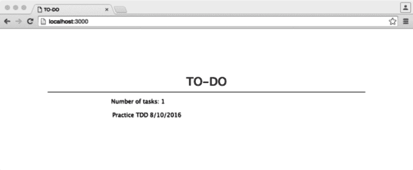

我们已经走了很远。休息一下，庆祝这一时刻，给朋友打个电话，推特你的学习收获……当你完成并休息好后，我们将回来完成前端的剩余部分。

## 完成设计

我们能够列出任务，但我们还需要通过 Angular UI 添加新任务和删除现有任务的能力。让我们来实现添加任务的功能。

### 设计添加任务功能

为了实现添加新任务的功能，我们需要在组件和服务中中编写一些新代码。管道不需要更改。我们还需要修改 `tasks.component.html` 文件。让我们先开始组件相关的工作。

### 演进组件

为了支持添加任务功能，组件应该通过以下测试：

* `newTask` 应该被正确初始化
* 组件应该正确地将无数据的 `newTask` 转换为 JSON
* 组件应该正确地将有数据的 `newTask` 转换为 JSON
* `addTask` 应该向服务注册处理器
* `updateMessage` 应该更新消息并调用 `getTasks`
* `disableAddTask` 应该使用 `validateTask`

这看起来像是一个有趣的的练习；让我们开始吧。

打开 `test/client/app/tasks/tasks.component-test.js` 文件并添加第一个与添加任务相关的测试——验证 `newTask` 模型是否被正确初始化。

[testangular2/todo/test/client/app/tasks/tasks.component-test.js](http://media.pragprog.com/titles/vsjavas/code/testangular2/todo/test/client/app/tasks/tasks.component-test.js)

```javascript
it('newTask should be initialized properly', function() {
  expect(tasksComponent.newTask.name).to.be.eql('');
  expect(tasksComponent.newTask.date).to.be.eql('');
});
```

该测试仅验证模型是否已初始化为安全的默认值。为了让这个测试通过，我们需要在构造函数中进行简单的更改。打开 `public/src/app/tasks/tasks.component.js` 并执行：

```javascript
this.newTask = {};
```

让我们继续下一个测试。当我们准备好向后端发送数据时，我们需要将新任务转换为特定格式。让我们一步一步来。写一个测试来转换无数据的 `newTask`。

[testangular2/todo/test/client/app/tasks/tasks.component-test.js](http://media.pragprog.com/titles/vsjavas/code/testangular2/todo/test/client/app/tasks/tasks.component-test.js)

```javascript
it('should properly convert newTask with no data', function() {
  var newTask = tasksComponent.convertNewTask();
  expect(newTask.name).to.be('');
  expect(newTask.month).to.be();
  expect(newTask.year).to.be();
});
```

该测试调用 `convertNewTask` 并验证它处理了新任务。在组件中实现该函数。我们将在编写下一个测试后看到代码。

[testangular2/todo/test/client/app/tasks/tasks.component-test.js](http://media.pragprog.com/titles/vsjavas/code/testangular2/todo/test/client/app/tasks/tasks.component-test.js)

```javascript
it('should properly convert newTask with data', function() {
  var newTask = { name: 'task a', date: '6/10/2016' };
  var newTaskJSON = { name: 'task a', month: 6, day: 10, year: 2016 };
  tasksComponent.newTask = newTask;
  expect(tasksComponent.convertNewTask()).to.eql(newTaskJSON);
});
```

该测试验证了当新任务中有数据时转换良好。这是满足这两个测试的 `convertNewTask` 实现。

[testangular2/todo/public/src/app/tasks/tasks.component.js](http://media.pragprog.com/titles/vsjavas/code/testangular2/todo/public/src/app/tasks/tasks.component.js)

```javascript
convertNewTask: function() {
  var dateParts = this.newTask.date.split('/');
  return {
    name: this.newTask.name,
    month: parseInt(dateParts[0]),
    day: parseInt(dateParts[1]),
    year: parseInt(dateParts[2])
  };
},
```

一旦我们有了新任务并将其转换为 JSON 格式，我们应该将其发送给服务，服务反过来与后端服务器通信。让我们写一个测试来验证 `addTask` 如何与服务的 `add` 函数正确交互——后者函数尚不存在，但我们在演进服务时会处理它。这是 `test/client/app/tasks/tasks.component-test.js` 中的新测试：

[testangular2/todo/test/client/app/tasks/tasks.component-test.js](http://media.pragprog.com/titles/vsjavas/code/testangular2/todo/test/client/app/tasks/tasks.component-test.js)

```javascript
it('addTask should register handlers with service', function() {
  var observableMock = sandbox.mock(observable)
    .expects('subscribe')
    .withArgs(updateMessageBindStub, updateErrorBindStub);
  var taskStub = {};
});
```


```javascript
tasksComponent.convertNewTaskToJSON = function() {
  return taskStub;
};

sandbox.stub(tasksService, 'add')
  .withArgs(taskStub)
  .returns(observable);

tasksComponent.addTask();

observableMock.verify();
```

让我们从底部开始阅读这个测试。它验证了在 `Observable` 的 mock 对象上执行了正确的操作。在此之前，我们调用了被测试的函数 `addTask`。当该函数执行时，它应该会调用服务上的 `add` 函数。为了验证这一点，我们在测试中对服务上的存根（stubbed）了 `add` 函数。然后，我们对 mock 对象设置了一个期望，即它将带有一个示例任务 `taskStub` 被调用，并要求它返回 `observable`（它是 `Rx.Observable` 的 mock 对象）。由于 `addTask` 应该将 `convertNewTaskToJSON` 的结果发送给服务，因此我们 mock 了 `convertNewTaskToJSON` 使其返回一个虚假的任务 `taskStub`。最后，在测试的顶部，我们 mock 了 `Observable` 并配置了它期望正确的处理器被传递到 `subscribe` 函数中。

对于这个测试，我们需要对测试套进行两处更改。首先，我们需要在测试套中定义一个变量：

```javascript
var updateMessageBindStub = function() {};
```

其次，我们需要 stub 新处理器 `updateMessage` 的 `bind` 函数，使其返回相应的虚假函数。此更改位于测试套的 `beforeEach` 函数中：

```javascript
sandbox.stub(tasksComponent.updateMessage, 'bind')
  .withArgs(tasksComponent)
  .returns(updateMessageBindStub);
```

我们已经准备好在组件中实现 `addTask` 函数了。打开 `/public/src/app/tasks/tasks.component.js` 文件，并在类中添加以下内容：

```javascript
addTask: function() {
  this.service.add(this.convertNewTaskToJSON())
    .subscribe(this.updateMessage.bind(this),
    this.updateError.bind(this));
},
updateMessage: function() {},
```

`addTask` 函数调用了服务，传递了转换后的新任务对象，接收了一个 `Observable`，并使用 `subscribe` 函数注册了处理器。对于错误情况，我们复用了现有的 `updateError` 函数。对于成功情况，我们将使用一个新的 `updateMessage` 函数。该函数目前临时被设置为一个空操作（no-op）函数，以便测试通过。

现在让我们设计 `updateMessage` 函数。该函数应该用接收到的消息更新消息模型，并调用 `getTasks` 函数来刷新任何添加的新任务。以下是验证此行为的测试：

[testangular2/todo/test/client/app/tasks/tasks.component-test.js](http://media.pragprog.com/titles/vsjavas/code/testangular2/todo/test/client/app/tasks/tasks.component-test.js)

```javascript
it('updateMessage should update message and call getTasks', function(done) {
  tasksComponent.getTasks = function() { done(); };
  tasksComponent.updateMessage('good');
  expect(tasksComponent.message).to.be.eql('good');
});
```

该测试 stub 了 `getTasks` 函数——毕竟，我们不想调用会与后端服务器通信的真实函数。随后，它带一个虚假消息调用 `updateMessage`，并验证消息模型已更新且 `getTasks` 函数已执行调用。

修改组件中的 `updateMessage` 函数以通过此测试：

```javascript
updateMessage: function(message) {
  this.message = message;
  this.getTasks();
},
```

在组件中添加任务功能我们还有一个要编写的最后一个函数了。如果任务无效，则添加按钮应该被禁用。为了这一点，我们需要一个函数将 `newTask` 模型转换为 JSON，并将其发送到我们已经存在的 `validateTask` 通用验证函数中。让我们编写测试来验证这个新函数的行为。

首先，我们将编写一个测试来验证组件的 `validateTask` 属性是否引用了通用的 `validateTask` 函数。引入此属性使测试变得更容易。以下是该测试：

[testangular2/todo/test/client/app/tasks/tasks.component-test.js](http://media.pragprog.com/titles/vsjavas/code/testangular2/todo/test/client/app/tasks/tasks.component-test.js)

```javascript
it('should set validateTask to common function', function() {
  expect(tasksComponent.validateTask).to.be.eql(validateTask);
});
```

为了让此测试通过，我们需要在组件的 `constructor` 中添加以下属性：

```javascript
this.validateTask = validateTask;
```

接下来，我们将编写一个测试来验证 `addTask` 返回了预期结果并且它使用了 `validateTask`。

[testangular2/todo/test/client/app/tasks/tasks.component-test.js](http://media.pragprog.com/titles/vsjavas/code/testangular2/todo/test/client/app/tasks/tasks.component-test.js)

```javascript
it('addTask should use validateTask', function() {
  tasksComponent.newTask = {name: 'task', date: '6/10/16'};
  var validateTaskSpy = sinon.spy(tasksComponent, 'validateTask');
  expect(tasksComponent.addTask()).to.be.false;
  expect(validateTaskSpy).to.have.been.calledWith(tasksComponent.convertNewTaskToJSON());
});
```

修改组件以实现 `addTask`：

```javascript
addTask: function() {
  return this.validateTask(this.convertNewTaskToJSON());
},
```

### 演进服务

我们在服务中需要的新 `add` 函数应该向后端服务器发送 HTTP 请求。它应该发送的数据必须是 JSON 格式。我们可以参考示例来了解函数如何通过 `HTTP` 对象与后端交互。基于此，我们可以为 `add` 函数编写测试。

打开 `test/client/app/tasks/tasks.service.js`，在 `beforeEach` 函数中现有 `get` 属性旁边为 `http` stub 添加一个新的新的 `post` 属性：

```javascript
beforeEach(function() {
  sandbox = sinon.sandbox.create();
  http = {
    get: function() {},
    post: function() {}
  };
  tasksService = new app.TasksService(http);
});
```

为了测试 `add` 函数，我们将 stub `HTTP` 的 `post` 函数，并验证它使用正确的 URL、适当的 POST 数据以及正确的内容类型设置进行调用。我们将验证 `add` 在 `post` 函数返回的 `Observable` 上注册了正确的 `map` 和 `catch` 函数处理器。以下是执行此操作的测试。

[testangular2/client/app/tasks/tasks.service-test.js](http://media.pragprog.com/titles/vsjavas/code/testangular2/todo/test/client/app/tasks/tasks.service-test.js)

```javascript
it('add should pass task to /tasks using POST', function() {
  var taskStub = {name: 'foo', month: 1, day: 1, year: 2017};
  var options = {
    headers: new ng.http.Headers({'Content-Type': 'application/json'})
  };
  sandbox.stub(http, 'post')
    .withArgs('/tasks', JSON.stringify(taskStub), options)
    .returns(observable);
  expect(tasksService.add(taskStub)).to.be.eql(observable);
});
```


```javascript
expect(observable.map.calledWith(tasksService.extractData)).to.be.true;
expect(observable.catch.calledWith(tasksService.returnError)).to.be.true;
```

为了让此测试通过，我们必须在服务中创建 `add` 函数。打开 `public/src/app/tasks/tasks.service.js` 文件并添加该函数：

```javascript
add: function(task) {
  var options = {
    headers: new ng.http.Headers({'Content-Type': 'application/json'})
  };

  return this.http.post('/tasks', JSON.stringify(task), options)
    .map(this.extractData)
    .catch(this.returnError);
},
```

该函数创建必要的内容类型头部（content type header），并调用了 HTTP 对象上的 post 函数。它还将已经定义的 `extractData` 和 `returnError` 函数分别注册到 `map` 和 `catch` 函数中。

然而，这里有一个问题。我们在编写 `get` 函数时设计了 `extractData`。当查询任务列表时，后端服务以 JSON 格式返回数据。但在响应添加请求时，后端返回的是纯文本，内容为类似“added task”的消息。我们需要修改 `extractData` 函数，以处理 JSON 响应或纯文本响应。让我们先写一个测试用：

```javascript
it('extractData should return text if not json()', function() {
  var fakeBody = 'somebody';
  var response = {status: 200, text: function() { return fakeBody; } };

  expect(tasksService.extractData(response)).to.be.eql(fakeBody);
});
```

此测试中传递给 `extractData` 函数的响应对象没有 `json()` 函数，相反，它有一个 `text()` 函数。上一个 `extractData` 的测试具有 `json()` 函数。我们将修改 `extractData` 函数，优先使用 `json()` 函数。如果失败，它可以切换到 `text()` 函数。以下是服务类中的更改：

```javascript
extractData: function(response) {
  if(response.status !== 200)
    throw new Error('Request failed with status: ' + response.status);

  try {
    return response.json();
  } catch(ex) {
    return response.text();
  }
},
```

我们已经演进了组件和服务。让我们来看看我们添加的新功能的运行效果。

### 查看添加任务功能

在通过 UI 添加新任务之前，我们需要更改 `tasks.component.html` 文件。它需要包含一些输入字段，供用户输入新任务详情。让我们如下修改 HTML 文件：

```html
<body>
  <div class="heading">TO-DO</div>

  <div id="newtask">
    <div>Create a new task</div>
    <label>Name</label>
    <input type="text" id="name" [(ngModel)]="newTask.name"/>
    <label>Date</label>
    <input type="text" id="date" [(ngModel)]="newTask.date"/>
    <input type="submit" id="submit" (click)="addTask(); [disabled]="addTask()" value="create"/>
  </div>

  <div id="taskslist">
    <p>Number of tasks: {{tasks.length}}</p>
    <span>{{message}}</span>
    <table>
      <tr ngFor="let task of tasks">
        <td>{{task.name}}</td>
        <td>{{task.month}}/{{task.year}}</td>
      </tr>
    </table>
  </div>
</body>
```

我们在现有的 `tasks.component.html` 中添加了 `newtask` div 元素。这部分包含了几个标签和输入字段，用于读取 `newTask` 的名称和日期。Angular 使用 `[(ngModel)]` 来指定 HTML 页面上的某个属性应该绑定到组件模型中的一个属性。此外，它还使用 `(click)` 将组件中的函数与 DOM 事件绑定。最后，`[disabled]` 将 HTML 输入的属性与组件上所需的函数联系起来。

我们已经准备好使用浏览器尝试程序了。启动数据库守护进程。然后运行 `npm start` 启动 Express。最后，将浏览器指向 URL `http://localhost:3000`。以下是通过 Chrome 与程序交互的示例：

![images/testangular2/addtask.png)

我们已经实现了获取任务列表和添加新任务的功能。现在可以好好休息一下了。当你回来时，我们将继续该示例，实现删除现有任务的功能。

### 设计删除任务

为了删除现有任务，我们需要再次演进组件和服务，并对 `tasks.component.html` 进行微小的更改。

让我们先从组件的更改开始。#### 再次演进组件

组件需要一个新函数 `deleteTask`，它将删除任务的请求传递给服务。新函数可以复用我们在组件中实现的响应处理器。因此，我们只需要一个测试来验证 `deleteTask` 函数的行为。

在编写该测试之前，让我们验证 `test/client/app/tasks.component-test.js` 中的服务存根（stub）是否包含 `delete` 函数：

```javascript
beforeEach(function() {
  tasksService = {
    get: function() {},
    add: function() {},
    delete: function() {}
  };
  tasksComponent = new app.TasksComponent(tasksService, sortPipe);
  //...
});
```

现在我们可以为组件添加以下测试：

```javascript
it('deleteTask should register handlers with service', function() {
  var sampleTaskId = '123412341234123';

  var observableMock = sandbox.mock(observable)
    .expects('subscribe')
    .withArgs(updateMessageBindStub, updateErrorBindStub);

  sandbox.stub(tasksService, 'delete')
    .withArgs(sampleTaskId)
    .returns(observable);

  tasksComponent.deleteTask(sampleTaskId);

  observableMock.verify();
});
```

该测试验证了 `deleteTask` 调用了 HTTP 的 `delete` 函数，并通过在返回的 `Observable` 上调用 `subscribe` 注册了正确的处理器。

在组件中实现 `deleteTask` 函数非常简单：

```javascript
deleteTask: function(taskId) {
  this.service.delete(taskId)
    .subscribe(this.updateMessage.bind(this),
      this.updateError.bind(this));
},
```

组件已经就绪，但我们需要更改服务。

### 再次演进服务


现在服务需要一个额外的函数：`delete`。在我们为该函数编写测试之前，我们需要对 HTTP 的存根（stub）进行细小的更改。打开 `test/client/app/tasks/tasks.service-test.js` 文件，并在 `beforeEach` 函数中为存根添加一个新的 `delete` 函数，如下所示：

```javascript
beforeEach(function() {
  sandbox = sinon.sandbox.create();
  http = {
    get: function() {},
    post: function() {},
    delete: function() {}
  };
  tasksService = new app.TasksService(http);
  //...
});
```

现在为服务的服务的 `delete` 函数添加测试：

[`testangular2/todo/test/client/app/tasks/tasks.service-test.js`](http://media.pragprog.com/titles/vsjavas/code/testangular2/todo/test/client/app/tasks/tasks.service-test.js)

```javascript
it('delete should pass task to /tasks using DELETE', function() {
  var taskId = '1234';

  sandbox.stub(http, 'delete')
    .withArgs('/tasks/' + taskId)
    .returns(observable);

  expect(tasksService.delete(taskId)).to.be.eql(observable);
  expect(observable.map.calledWith(tasksService.extractData)).to.be.true;
  expect(observable.catch.calledWith(tasksService.returnError)).to.be.true;
});
```

该测试非常直接；它验证了服务的 `delete` 函数使用正确的 URL 调用了 `HTTP` 的 `delete` 函数。它还验证了该函数为 `HTTP` 的 `delete` 函数返回的 `Observable` 的 `map` 和 `catch` 函数传递了必要的处理程序。

在服务中实现 `delete` 函数：

[`testangular2/todo/public/src/app/tasks/tasks.service.js`](http://media.pragprog.com/titles/vsjavas/code/testangular2/todo/public/src/app/tasks/tasks.service.js)

```javascript
delete(taskId) {
  return this.http.delete('/tasks/' + taskId)
    .map(this.extractData)
    .catch(this.returnError);
},
```

此函数与 `add` 函数非常相似，只是它在 `HTTP` 对象上调用的函数以及传递的 URL 不同。

### 查看删除任务功能

编码工作几乎完成。我们需要更改 `tasks.component.html` 文件以引入一个删除任务的链接。以下是完整的文件，已在底部添加了删除任务的链接：

[`testangular2/todo/public/tasks.component.html`](http://media.pragprog.com/titles/vsjavas/code/testangular2/todo/public/tasks.component.html)

```html
<body>
  <div class="heading">TO-DO</div>

  <div id="newtask">
    <div>Create a new task</div>
    <label>Name</label>
    <input type="text" id="name" [(ngModel)]="newTask.name"/>
    <label>Date</label>
    <input type="text" id="date" [(ngModel)]="newTask.date"/>
    <input type="submit" id="submit" (click)="addTask();" [disabled]="disableAddTask()" value="create"/>
  </div>

  <div id="taskslist">
    <p>Number of tasks: <span id="length">{{ tasks.length }}</span></p>
    <span id="message">{{ message }}</span>
    <table>
      <tr></tr>
    </table>
  </div>
</body>
```


我们必须确保端到端测试不会变得复杂且失控。通过合理的计划、设计、结构和限制使用，它可以很好地为我们服务。

在本章中，你将首先学习如何设置端到端测试工具 `Protractor`。你将快速学会如何使用 `Protractor` 为第三方网站编写并运行测试。在掌握这些基础知识之后，你将探索如何在 Web 服务器上启动 TO-DO 应用程序进行集成测试、向数据库中填充测试数据，以及通过浏览器与应用程序进行交互，而这一切都可以自动化测试完成。你还将看到 `Protractor` 专门为使用 AngularJS 的应用程序提供的测试功能。

## 了解 Protractor

`Protractor` 是许多自动化基于浏览器的交互的测试工具之一。它可以用于编写 Web 表单的数据输入、执行按钮点击并验证网站返回的详情。在这些工具中，`Selenium`是最流行的。`Protractor` 利用了 `Selenium`，运行在 `Node.js` 上，并提供了一个流式的 JavaScript API 来与 HTML 页面的不同部分进行交互。对于使用 JavaScript 的程序员来说，`Protractor` 的流畅性和便利性比直接使用 `Selenium` 提供了更好的自动化体验。

为了测试在章节中创建的 TO-DO 应用程序，我们需要设置一些东西。虽然要写的代码不多，但有很多细节需要考虑。在尝试 `Protractor` 之前试图弄清楚这些细节可能会让人无所适从且沮丧。相反，让我们先编写几个 `Protractor` 测试来访问 Google 搜索页面。由于这项服务无处不在且已经在运行，它将让你以最小的努力直接接触 `Protractor` 的功能。在学习了如何使用 `Protractor` 后，你就可以通过设置服务器、向数据库填充示例数据以及运行集成测试来承担测试 TO-DO 应用的任务。

让我们先讨论为什么 `Protractor` 是集成端到端测试的绝佳工具。然后我们将安装工具并用它运行一些测试。

### 使用 Protractor 的理由

在 UI 级测试工具中，尽管 `Selenium` 可能最流行，但 `Protractor` 具有以下优势：

* 它运行在 `Node.js` 中。这意味着你可以像到为止编写的其他测试一样编写 UI 级测试——使用 `Mocha`。
* `Protractor` 可以作为 `Selenium WebDriver` 的代理和封装器。你获得了 `Selenium` 的所有功能，加上一些扩展，但具有更流畅且具表达力的 API。与直接使用 `WebDriver` 的测试相比，使用 `Protractor` 编写的测试简洁得多。
* `Protractor` 的直接连接功能可以跳过 `Selenium` 并直接与 `Chrome` 和 `Firefox` 交互。因此，你的直接连接测试比通过 `WebDriver` 运行的更快。此外，通过此功能，你需要处理的活动部分会更少。这反过来使得测试运行不那么脆弱。
* `Protractor` 具有特殊函数让你访问不同的 AngularJS 指令。虽然非 AngularJS 应用程序可以使用并从 Protractor 中受益，但使用 AngularJS 的项目可以从该工具中获得更多。

由于 `Protractor` 运行在 `Node.js` 内部，运行测试时你拥有坚实运行时的全部力量。欣赏该工具力量的最佳方法就是使用它。让我们设置它并继续编写一些测试。

### 安装 Protractor

我们将使用 `tdjsa/usingprotractor` 下的 `usingprotractor` 工作空间进行此练习。该项目已经配置了 `Protractor` 依赖。切换到工作空间目录并运行 `npm install` 为此项目安装 `Protractor`。`Protractor` 与 `webdriver-manager` 一起安装，但你必须更新必要的浏览器驱动程序。为此，运行命令

```
npm run-script update-driver
```

这将将执行 `webdriver-manager update` 来更新驱动程序。

我们将使用 `Protractor` 的直接连接功能连接到 `Chrome`。这同样适用于 `Firefox`。然而，如果你想使用其他浏览器，`Protractor` 可以通过 `WebDriver` 与其交互。

### 使用 Protractor 测试

在练习中，为了帮助我们熟悉 `Protractor`，我们将编写测试来验证 Google 搜索页面运行正常。

我们将编写以下测试：

* 验证 `http://www.google.co.uk` 具有“I’m Feeling Lucky”（我真是幸运）按钮
* 提交文本搜索并确认结果具有预期值

`Protractor` 既可以接收各种参数的命令行参数，也可以从配置文件读取这些参数。使用配置文件更简单；这样你就不需要每次运行工具时都去折腾命令行参数。在启动 `Protractor` 时，你可以指定配置文件名。如果你没有提供，它会查找并加载名为 `protractor.conf.js` 的文件。工作空间已经包含了此文件，并为了方便你提供了所需的配置。让我们花分钟检查此文件并理解其内容：

[usingprotractor/protractor.conf.js](http://media.pragprog.com/titles/vsjavas/code/usingprotractor/protractor.conf.js)

| | exports.config = { |
| :--- | :--- |
| | directConnect: true, |
| | |
| | baseUrl: 'https://www.google.co.uk', |
| | |
| | /**/** |
| | capabilities: { |
| | 'browserName': ['firefox'] //default chrome |
| | }, |
| | |
| | framework: 'mocha', |
| | |
| | mochaOpts: { |
| | reporter: 'dot', |
| | timeout: 10000, |
| | }, |
| | |
| | specs: ['test/integration/*.js'], |
| | };

`directConnect` 参数告诉 `Protractor` 直接与浏览器交互而不通过 `WebDriver` 代理。保持此参数以在 `Chrome` 或 `Firefox` 中运行测试。要使用其他浏览器，只需注释掉此行。

`baseUrl` 参数是被测试应用程序的 URL。将此参数放在配置文件中，就不需要在测试的每个请求中提供完整路径。这减少了测试中的噪音。此外，它还便于在不同的终端运行相同的测试。后者的优势对于测试不同版本或安装非常有用。

`capabilities` 参数已注释。它是可选的，默认情况下 `Protractor` 使用 `Chrome` 浏览器。要使用其他浏览器，请包含相应的浏览器名称。除了 `capabilities`，如果你想在两个或多个浏览器中同时运行，还可以提供 `multiCapabilities` 参数。

`Protractor` 支持的默认测试工具是 `Jasmine`。然而，使用 `Mocha` 非常简单提供 `framework` 参数。要指定 `Mocha` 的运行选项，使用 `mochaOpts` 参数。

最后，该文件包含了测试的位置。你可以列出单个文件或逗号分隔的文件列表，或者像我们所样使用通配符。


```javascript
require('chai').use(require('chai-as-promised'));

describe('Google search page tests', function() {
  beforeEach(function() {
    browser.ignoreSynchronization = true;
    browser.get('/');
  });

  afterEach(function() {
    browser.ignoreSynchronization = false;
  });
});
```

Protractor 的函数需要不断评估 DOM、向服务发送请求并分析来自 Web 服务的响应。这需要一些时间，显然超过了几分之一秒的范围。在 JavaScript 中，任何耗时的函数都被设计为异步的。因此，Protractor 中的大多数函数都是异步的——这并不意外——它们返回的是 promise（承诺）。

在编写 Protractor 测试时，请利用我们在书的前面部分学到的异步测试技术。在测试文件中，一旦加载了 Chai，就会通过 `use` 函数加载来自 `chai-as-promised` 的便利函数。

在测试测试套件中，`beforeEach` 函数首先访问全局 `browser` 对象。就像浏览器提供全局 `window` 对象一样，Protractor 提供了几个全局对象：`browser`、`element`、`by` 等。这些全局对象的可用使得 Protractor 测试变得非常简洁。`beforeEach` 内部的第一行代码相当模糊，但它是告诉 Protractor 不要等待 AngularJS 完成处理的一种——在测试非 AngularJS 站点时请使用此设置。`afterEach` 是重置此标记的好地方。

`beforeEach` 函数向 URL `http://www.google.co.uk/` 发送请求——该 URL 是通过将我们之前看到的配置文件中的 `baseUrl` 参数的值与传递给 `get` 函数的参数进行拼接（前缀化）得到的。

编写第一个测试所需的所有内容都已就绪——让我们接下来关注测试本身吧。

### 编写第一个测试

当我们访问 `http://www.google.co.uk` 时，会出现熟悉的 Google 搜索页面，并有两个按钮。第一个测试将展示如何验证请求是否到达正确的页面，以及该页面是否包含预期内容。

[usingprotractor/test/integration/google-search-test.js](http://media.pragprog.com/titles/vsjavas/code/usingprotractor/test/integration/google-search-test.js)

```javascript
it('home page has the Feeling Lucky button', function() {
  var inputElement = element(by.xpath('//input[@value="I\'m Feeling Lucky"]'));

  expect(inputElement.isPresent()).to.eventually.be.true;
});
```

该测试直接寻找它要的目标。它调用 `by.xpath` 函数，并请求一个属性 `value` 为 "I’m Feeling Lucky" 的 HTML 输入元素。由于 Protractor 中的大多数函数都是异步的，`element` 函数返回一个 `Promise`。`isPresent()` 函数同样返回一个 `Promise`。测试使用 `chai-as-promised` 的 `eventually` 功能检查 `isPresent` 返回的 Promise 是否解析为预期的值 `true`。

我们对 `protractor.conf.js` 文件所做的更改以及测试文件中的设置代码整合了此测试所需的所有内容。`protractor.conf.js` 文件提到了 `baseUrl`、使用的浏览器、使用的测试工具以及测试的位置。测试向目标 URL 发送请求，并验证访问的页面是否包含预期内容。

保存测试文件并在工作区目录下使用命令 `npm test` 运行 Protractor。该命令执行 `package.json` 中的测试命令，而该命令反过来运行 `protractor` 命令。

Protractor 将读取 `protractor.conf.js` 文件，启动浏览器并调用 `Mocha`。一旦 `Mocha` 启动，它将加载指定的测试文件并运行其中的测试。最后，`Chai` 和 `chai-as-promised` 将验证应用程序（即 Google 搜索）是否符合预期。以下是运行的输出：

```
I/direct - Using ChromeDriver directly...
I/launcher - Running 1 instances of WebDriver
1 passing (893ms)
I/launcher - 0 instance(s) of WebDriver still running
I/launcher - chrome #01 passed
```

当你运行测试时，控制台将报告启动驱动程序和测试进度。同时，你可以注意到浏览器根据测试的指令在跳动。测试模拟了用户交互，但速度是机器速度而非人类速度。这既是好消息也是坏消息。与手动导航页面进行验证相比，执行速度是一个巨大的优势。缺点是交互可能太快，这可能导致某些测试间歇性失败。请密切关注这一点，并在需要时适当地通过等待请求（wait request）调整执行速度；我们很快就会遇到这种情况。

测试首先使用 `xpath` 获取元素。Protractor 提供了使用不同方法获取元素的函数，如 `by.id`、`by.tagName`、`by.xpath`、`by.linkText` 等。

### 测试发布数据

搜索页面有一个输入字段和两个提交按钮。让我们写一个测试来验证 Google 是否正常。测试应该首先获取输入字段的引用，然后向其中输入数据。将第二个测试添加到 `test/integration/google-search-test.js` 中的测试套件中：

[usingprotractor/test/integration/google-search-test.js](http://media.pragprog.com/titles/vsjavas/code/usingprotractor/test/integration/google-search-test.js)

```javascript
it('search brings back an expected result', function() {
  var inputField = element(by.id('lst-ib'));

  inputField.sendKeys('agile.com');
  inputField.sendKeys(protractor.ENTER);

  var link = element(by.xpath("//a[href='https://www.agile.com/']"));

  browser.wait(function() {
    return link.isPresent();
  });

  expect(link.isDisplayed()).to.eventually.eq(true);
});
```

该测试有一些特殊之处。让我们彻底检查它们。

第一行使用从 `id` 获取的定位器获取元素。`sendKeys` 函数模拟了用户的按键输入。函数的第一次调用输入搜索文本，第二次调用输入回车键。作为对按下回车键的响应，Google 搜索页面将执行搜索并返回结果页面。然而，这里有一个陷阱。

对于快速网络的用户来说，Google 搜索通常看起来是瞬间完成。但从逻辑上讲，从远程服务器返回响应需要零的时间。这段时间很可能大于测试执行 `sendKeys` 调用之后代码行所需的时间。我们需要考虑这种时间延迟。


在测试中，在向搜索页面发送请求后，我们使用 `xpath` 函数查找具有特定 `href` 的 `A` 标签。然后，我们要求 Protractor 使用 `wait` 函数等待元素变为就绪状态。该函数返回一个 `Promise`。该 `Promise` 在内部会等待预期的响应。一旦该 `Promise` 解析完成（resolved），Protractor 就会执行下一行代码，检查该链接是否显示。

如果页面响应时间远超超时时间，或者返回的页面没有该链接，则测试将超时并失败。

尽管测试相对很短，但它暴露了 UI 级测试的一些不尽人意的方面。首先，我们必须知道要访问哪些元素。如果用于访问元素的 `id` 或其他定位器发生了变化，相关的测试将彻底失效。其次，我们可能需要花费大量精力来获取定位器。例如，如果你在 `XPATH` 中漏掉了末尾的 `/`，将无法定位到 `A` 标签。第三，如果你忘记添加 `wait`，即使页面上包含了你正在寻找的内容，测试也会失败。

在 Google 搜索上编写 Protractor 测试在几个方面很有用。首先，它让你有机会看到测试的运行并学习如何使用 Protractor。你不需要自己启动 Web 服务器就能完成操作，这一事实让你专注于学习核心知识点。其次，测试提醒了你在哪些地方情况可能会变得失控。测试是一个很好的提醒，告诉我们为什么需要它们，但同时，你必须将这类测试减少到最少。

在尝试了示例后，你可能急于为自己的应用程序创建完整的端到端 Protractor 测试。为 TO-DO 应用编写测试将让你对如何处理此问题有一个很好的理解。在之前的章节中，我们创建了 TO-DO 应用的服务端以及不同版本的客户端。现在我们准备好为该应用程序编写集成测试了。我们将首先通过基于 `jQuery` 的视图编写集成测试，然后通过使用 `AngularJS` 构建的视图编写。

## 启动服务器并配置数据库

TO-DO 应用服务端是使用 `Express` 编写的。客户端有三个版本：一个直接操作 DOM，另一个使用 `jQuery`，第三个使用 `AngularJS`。应用程序的每个部分都已经过单独测试，现在我们准备好进行端到端测试。

在为应用编写任何集成测试之前，我们必须跨越两个障碍。

首先，为了让集成测试成功，我们需要应用程序的服务正在运行。为了运行我们在之前的章节中编写的测试，我们不需要启动服务器来执行服务端自动化测试。然而，为了亲眼观察服务器的运行，我们曾短暂地使用 `npm start` 手动运行过服务器。虽然这一步在集成测试期间是可选的，但如果在启动 Protractor 测试时服务器能自动启动，将会好得多。这将消除在运行测试前之前进行任何额外手动步骤的需要。这也将便于在持续集成服务器上运行这些测试。我们仍然需要数据库服务器运行，但可以将其作为守护进程（daemon）启动。

其次，应用程序与 `MongoDB` 数据库交互。刚初数据库中没有数据。为了验证页面显示了任务列表，我们需要一些示例数据。我们可以手动填充一些数据，但很快添加和删除任务的测试就会弄乱它们。为了保持理智，我们必须确保以下几点：

*   我们需要使用一个测试数据库来测试应用程序。这必须与开发使用的数据库分开，并且显然与生产环境使用的数据库分开。这个原因是不言而喻的——在开发过程中覆盖测试数据毫无乐趣，反之亦然。应用程序必须根据是开发运行还是测试运行平滑地选择正确的数据库。
*   我们需要一种自动化方法向测试数据库中填充示例数据，并在测试结束时清理。这将保持测试的公平性（FAIR）——参见带有正向、负向异常测试的设计。

这一切听起来很复杂，并且确实可能让人措所措。幸运的是，由于 Protractor 运行在 `Node.js` 上，我们可以非常容易在本地以自动方式启动服务器。此外，向 `MongoDB` 数据库填充示例数据并不是大事。让我们在此应用程序安装 Protractor 后快速处理这两个步骤。

### 为 TO-DO App 安装 Protractor

`tdjsa/testendtoend/todo` 工作区已经配置好供你使用的项目。它包含了之前章节中 TO-DO 应用的所有测试和代码。工作区中的 `package.json` 文件已更新了 Protractor 依赖。

切换到 `tdjsa/testendtoend/todo` 工作区目录并运行 `npm install` 命令下载并为此项目安装 Protractor。然后运行命令 `npm run-script update-driver` 来更新项目中将使用的 WebDriver。

在 `tdjsa/testendtoend/todo/test/integration` 下也为你预创建了一个空的 `protractor.conf.js` 文件以及许多空文件，方便你在跟随示例时进行编辑。让我们开始为 TO-DO 应用编写集成测试吧。

在 before Setup 设置中启动服务器

当 Protractor 启动时，更准确地说，在任何 `Mocha` 测试运行之前，我们希望启动 `Express` 服务器。这样，服务器将准备好处理来自集成测试的请求，从第一个测试开始。但任何非本质的项目都有多个测试文件。在任何测试套件内部编写启动服务器的代码是不够的。Mocha 允许全局的 `before` 和 `after`。这些可以放入任何包含在测试运行中的文件中。让我们来设置它。

TO-DO 应用的客户端和服务端测试已经存在。我们将集成测试添加到项目中。在测试目录下，两个子目录 `server` 和 `client` 存放了测试。新的第三个子目录 `integration` 将包含所有的集成或端到端测试。

编辑 `test/integration` 目录下预创建的空文件 `global-setup.js` 并输入以下几行代码：

```javascript
var http = require('http');
var app = require('../../app');

before(function() {
  var port = process.env.PORT || 3030;
  http.createServer(app).listen(port);
});
```


让我们继续检查 `setup` 函数中的下一行。这一行模拟了 Express 中 `./bin/www` 文件中的内容。手动运行 `npm start` 命令会调用 `node` 并将 `./bin/www` 作为参数。该文件仅仅是从 `app.js` 获取一个 `app` 对象，创建一个服务器，并将 `app` 函数注册为处理程序。该文件中还有几个步骤，但在测试期间我们不需要担心它们。`global-setup.js` 文件中的短代码逻辑与 `./bin/www` 文件中发生的情况保持一致，并且足够启动测试服务器了。很不错，对吧？

自动启动服务器还有一个最终的步骤。当 Express 运行时运行时，它会记录请求和响应的详细信息，这在测试控制台中可能会变得非常杂乱。让我们在测试运行期间禁用它。

修改 [testendtoend/todo/app.js](http://media.pragprog.com/titles/vsjavas/code/testendtoend/todo/app.js) 中的行：

```javascript
app.use(logger('dev'));
```

在 `app.js` 文件中将其更改为 [testendtoend/todo/app.js](http://media.pragprog.com/titles/vsjavas/code/testendtoend/todo/app.js)：

```javascript
if (app.get('env') !== 'test') {
  app.use(logger('dev'));
}
```

以便在测试运行期间抑制日志。

### 为不同环境配置数据库

默认情况下，Express 运行在“development”环境中，而 Protractor 运行在“test”环境中。我们将使用新文件 `config.json` 中的设置来更改在“development”、“test”和“production”环境中使用的数据库名称。编辑当前工作区中 `todo` 目录下名为 `conf.json` 的空文件，并输入以下代码：

[testendtoend/todo/config.json](http://media.pragprog.com/titles/vsjavas/code/testendtoend/todo/config.json)

```json
{
  "development": {
    "dburl": "mongodb://localhost/todo"
  },
  "test": {
    "dburl": "mongodb://localhost/todouitest"
  },
  "production": {
    "dburl": "..."
  }
}
```

该文件定义了三个不同环境的数据库 URL。拼图中缺失的部分是应用程序如何使用数据库 URL。数据库连接在之前的 设计数据库连接 中 `app.js` 文件中设置的。以下是文件中相关的代码：

[testendtoend/todo/app.js](http://media.pragprog.com/titles/vsjavas/code/testendtoend/todo/app.js)

```javascript
var db = require('./db');

db.connect('mongodb://localhost/todo', function(err) {
  if(err) {
    console.log("unable to connect to the database");
    throw(err);
  }
});
```

此时数据库 URL 在文件中是硬编码的——哎呀。让我们更改它，以指向不同环境的不同数据库。

[testendtoend/todo/app.js](http://media.pragprog.com/titles/vsjavas/code/testendtoend/todo/app.js)

```javascript
var config = require('./config.json');
var dburl = config[app.get('env')].dburl;

console.log("using database: " + dburl);

var db = require('./db');
db.connect(dburl, function(err) {
  if(err) {
    console.log("unable to connect to the database");
    throw(err);
  }
});
```

由于 Express 默认运行在“development”环境中，它将使用开发数据库名称。由于 Protractor 运行在“test”环境中，当它在 `global-setup.js` 的 `before` 设置中启动服务器时，将使用 `config.json` 文件中引用的测试数据库，而不是开发数据库。

### 在 beforeEach 中填充数据

良好的测试不会互相干扰。它们之间保持隔离。这样做的好处是测试可以任何顺序运行，添加或删除测试都不会影响现有的测试。如果我们不小心，数据库可能会危害这一目标。如果数据已存在，添加操作可能会遇到冲突错误。同样，如果数据不存在，删除操作可能会失败。为了保持测试的隔离，我们应该将测试数据库保留在运行测试的本地机器上。与其他开发者共享数据库进行测试无异于自找麻烦。`config.json` 文件指定了使用哪个数据库，并且指定的数据库是您系统本地的。

在每个测试运行之前，应该清空测试数据库，并创建一组新的测试数据。这样，每个测试都能获得其所依赖的世界的稳定视图，并执行其操作，而不必担心受到其他测试的影响。如果你喜欢为每个测试套件保留不同的种子数据，请将设置代码放在该套件的 `beforeEach` 函数中。如果你喜欢在多个测试套件之间共享种子数据，则将其放在任何代码之外。这种情况下的好位置是带有 `before` 函数的 `global-setup.js` 函数。

[testtoend/todo/test/integration/global-setup.js]

```javascript
before(function(done) {
  var db = require('../../db');
  var config = require('../../config.json');
  var dburl = config[app.get('env')].dburl;

  var callback = function() {
    db.collection('tasks').remove(function() {
      var tasks = [
        {name: 'Models', month: 12, year: 2016},
        {name: 'Routes', month: 12, year: 2016},
        {name: 'AngularJS', month: 12, year: 2016},
        {name: 'UI', month: 12, year: 2016}
      ];
      db.collection('tasks').insert(tasks, done);
    });
  };

  db.connect(dburl, callback);
});
```

在每个测试运行之前的设置中，该函数从 `config.json` 文件中获取数据库名称，建立连接，清理 `tasks` 集合——坦率地说这是一个测试数据库——并填充一些示例任务。一旦这些步骤完成，它就会通知 `beforeEach` 函数设置中的异步函数已完成。

我们已经完成了启动服务器并为测试准备数据的必要设置。现在我们准备好为 TODO 应用程序编写第一个测试了。

## 测试 jQuery UI

在之前的章节中我们为 TODO 应用程序创建了不同的 UI。一个版本直接操作 DOM，另一个使用了 jQuery。这两个版本的 HTML 文件几乎相同，除了它们包含的 JavaScript 文件之外。让我们关注 jQuery 版本，通过与 `tasks.html` 文件交互来编写集成测试。

### 设置 Protractor 配置文件

Protractor 需要配置文件，所以让我们准备好该文件。编辑当前工作区中预创建的空文件 `protractor.conf.js` 并输入以下代码：

[testendtoend/todo/protractor.conf.js](http://media.pragprog.com/titles/vsjavas/code/testendtoend/todo/protractor.conf.js)

```javascript
var app = require('./app');
var config = require('./config.json');

exports.config = {
  directConnect: true,
  baseUrl: 'http://localhost:' + (process.env.PORT || 3030),
  framework: 'mocha',
  mochaOpts: {
    reporter: 'dot',
    timeout: 10000,
  },
  specs: ['test/integration/*.js'],
};
```


此文件与 Google Search 页面测试使用的配置文件相似，但有两点不同。`baseurl` 指向 `localhost` 而不是 `google.co.uk`。此外，端口号从 `PORT` 环境变量获取，或者默认为 `3030`。这与我们之前在 `global-setup.js` 文件中用于启动服务器的变量相同。

### 发现必要的测试

花几分钟时间思考 TO-DO 应用程序的测试。为了充分利用端到端测试，我们希望有选择性地针对那些未被其他测试触及的集成点。没有必要冗余地验证由其他测试已处理的内容。

| 编写最少且有针对性的集成测试 |
| --- |
|  保持集成测试最少。仅编写测试来验证尚未被其他层测试覆盖的内容。 |

让我们退后一步，可视化应用程序的不同部分，并识别哪些部分已经过测试，哪些部分被遗落在之外。

图 中显示的每个框代表每一层中的代码。每个层内部的代码（隐藏在框内）都已通过该层的测试经过充分测试。剩下的层与层之间的交互。

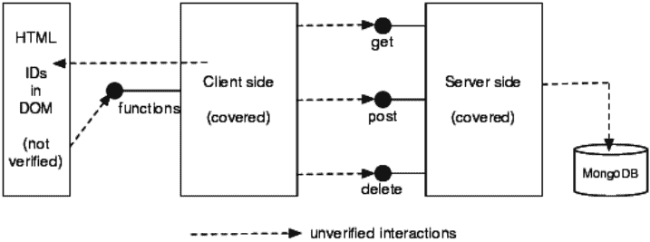

集成测试应该涵盖图中所示的应用程序中未验证的集成点。此外，测试应该确保 HTML 文件具有必要的 DOM 元素，并且这些元素具有客户端脚本所查找的正确 id。至少，以下测试应该能满足这些需求：

*   验证任务计数显示正确的值
*   验证任务已显示在页面上
*   验证添加任务功能有效
*   验证删除任务功能有效

这几个测试将验证 HTML 是否已正确连接到下面的代码，并验证下面的代码是否正确连接到它所依赖的项，一直到数据库。

让我们一个写一个测试。

### 实现集成测试

由于 Protractor API 返回的是 `Promises`，我们需要引入 `Chai` 和 `Chai as Promised` 模块。此外，由于被测试的部分不是 AngularJS——而是 jQuery——需要设置 `browser` 的 `ignoreSynchronization` 属性。一旦从浏览器请求 `/tasksj.html` 页面，第一个测试就可以验证任务计数。这里是第一个测试以及所需的设置——将此代码输入工作区中的 `testendtoend/todo/test/integration/tasksj-test.js` 文件：

[testendtoend/todo/test/integration/tasksj-test.js](http://media.pragprog.com/titles/vsjavas/code/testendtoend/todo/test/integration/tasksj-test.js)

```javascript
var expect = require('chai').expect;
require('chai').use(require('chai-as-promised'));

describe('tasks ui test', function() {
  beforeEach(function() {
    browser.ignoreSynchronization = true;
    browser.get('/tasksj.html');
  });

  afterEach(function() {
    browser.ignoreSynchronization = false;
  });

  it('should show correct task count', function() {
    expect(element(by.id('taskscount')).getText()).to.be.eventually.eql('4');
  });
});
```

通过直接查看 HTML 文件或通过浏览器中的“查看页面源代码”，我们知道任务计数将显示在 id 为 `taskscount` 的 span 元素中。测试首先获取该 id 的定位器，然后获取该 id 的 DOM 元素。在元素上调用 `getText` 会返回一个 `Promise`，它最终会被解析。这将在浏览器有机会加载页面并向服务器请求任务时发生。

保存测试并确保 `mongodb` 守护进程正在运行。如果它没有运行，执行命令：

```bash
mongod --dbpath db
```

让此守护进程运行。

我们不需要启动后端 Express 服务器——它会在我们运行测试时自动启动。要运行测试，在命令提示符上执行 `npm run-script test-integration` 来启动 Protractor 并查看测试是否通过。

```
using database: mongodb://localhost/todouitest
Using ChromeDriver directly...
[launcher] Running 1 instances of WebDriver
.
1 passing (599ms)
[launcher] 0 instance(s)
```

输出显示测试通过了。该测试确认了几个点：
1. HTML 是正确的。
2. 脚本被调用了。
3. 服务器端已集成。
4. 数据库也已集成。

对于仅仅一个测试来说，这是一个相当了不起的成就。但还有更多需要验证的内容。例如，任务也应该出现。让我们在 `testendtoend/todo/test/integration/tasksj-test.js` 中为之写一个测试：

```:
[tasksj-test.js](http://media.pragprog.com/titles/vsjavas/code/testendtoend/todo/test/integration/tasksj-test.js)

```javascript
it('should display tasks on the page', function() {
  expect(element(by.id('tasks')).getText()).to.be.eventually.contain('Test UI');
  expect(element(by.id('tasks')).getText()).to.be.eventually.contain('Test Models');
});
```

这个测试在工作量上与之前的测试没有太大区别。它检查 `tasks` 元素包含包含两个任务的内容。你可能想添加更多测试来验证日期是否显示，但在这一层级这是没必要的。那在低层测试中可以更容易验证。同样，在集成测试中，没有必要验证按年、月、日和名称排序的任务列表。那也由低层测试处理了。

到目前为止的两个测试只验证了页面加载时某些信息是否按预期显示。下一个验证添加操作的测试需要更多操作。一旦页面加载，用户可以为新任务输入数据并点击提交按钮。测试必须模拟这一过程。我们在示例中看到的 Protractor API 的 `sendKeys` 和 `click` 函数将大有用用场。让我们在下一个测试中使用这些函数。

```javascript
it('should successfully add a task', function() {
  element(by.id('name')).sendKeys('Create Quality Code');
  element(by.id('date')).sendKeys('12/15/2016');
  element(by.id('submit')).click();

  expect(element(by.id('message')).getText()).to.be.eventually.contain('task added');
  expect(element(by.id('tasks')).getText()).to.be.eventually.contain('Create Quality Code');
});
```


这个测试并不是简单的单行或双行代码。前两行将文本设置到相应的输入框中，第三行模拟了按钮的点击操作。在断言阶段，测试会验证具有 `message` id 的元素是否已更新，以及任务列表是否包含新任务。没有必要验证任务数量，因为低层级测试已经验证过这一点。该测试的成功将确认 HTML 页面和客户端脚本的连接是否正确。它还将确认客户端正在与服务器端的正确 URL 进行通信。

删除任务的最后一个测试需要点击任务表格中某个任务旁边的删除链接。由于有多个删除链接，我们应该在测试中选择其中一个。让我们选择第二个链接（索引为 1），这样就会删除第二个任务。要使用链接文本来获取定位器，我们使用 Protractor API 的 `by.linkText` 函数。然后，为了获取匹配该定位器的所有元素，我们使用 `element.all` 函数。最后，`get` 函数返回指定索引处的元素。

`testendtoend/todo/test/integration/tasksj-test.js` (http://media.pragprog.com/titles/vsjavas/code/testendtoend/todo/test/integration/tasksj-test.js)

```javascript
it('should successfully delete a task', function() {
  element.all(by.linkText('delete')).get(1).click();

  expect(element(by.id('message')).getText())
    .to.eventually.contain('task deleted');
  expect(element(by.id('tasks')).getText())
    .to.eventually.not.contain('Test Routes');
});
```

保存并确保所有四个测试均通过。这就完成了通过 jQuery 实现的应用程序所需的全部集成测试。

`tasks.html` 的内容与使用内置函数操作 DOM 的脚本绑定，它与 `taskj.html` 文件非常相似。你可以通过该文件练习编写集成测试。我们仍然需要验证 AngularJS 实现是否与 `tasksa.html` 文件良好地集成，但在在此之前，我们将努力减少集成测试中的噪声、耦合和重复。

## 让我们使用页面对象（Page Object）

集成测试本身并不十分复杂，但如果我们不小心，它们可能会变得繁琐。我们编写的集成测试中存在四个主要问题：

1. **噪声大（Noisy）**：访问元素和验证内容的代码充满了噪声。较少的噪声会使测试更易维护。
2. **重复（Duplication）**：获取元素（例如 `tasks` 或 `message`）的代码在整个测试中重复出现。较少的重复意味着错误更少，并且更容易处理页面的变化。
3. **与页面实现紧密耦合（Tight coupling on page implementation）**：假设由于某种原因，显示任务数量的 `span` 元素改为使用 `class` 而不是 `id`。所有使用该元素的测试都必须更改——这是紧密耦合和重复的直接后果。测试访问的每个 DOM 元素都存在相同的问题。
4. **与 API 密耦合（Tight coupling on the API）**：每个测试都直接依赖于 Protractor API。如果我们决定使用不同的 API，或者 Protractor 在未来的版本中更改了 API，我们就麻烦了。

随着测试数量的增加，这些问题可能会变得严重，但如果早期处理，修复非常容易。我们将使用页面对象来解决这个问题。

页面对象抽象了页面的内容。测试不再直接与浏览器对象和访问 HTML 页面部分的函数交互，而是可以使用页面对象。该对象反过来将与浏览器进行交互。这样做的好处是减少噪声、减少重复并实现松耦合。

在创建页面对象之前，让我们先感受一下使用它。

如下所示测试：

`testendtoend/todo/test/integration/tasksj-test.js` (http://media.pragprog.com/titles/vsjavas/code/testendtoend/todo/test/integration/tasksj-test.js)

```javascript
it('should successfully add a task', function() {
  element(by.id('name')).sendKeys('Create Quality Code');
  element(by.id('date')).sendKeys('12/15/2016');
  element(by.id('submit')).click();

  expect(element(by.id('message')).getText())
    .to.eventually.contain('task added');
  expect(element(by.id('tasks')).getText())
    .to.eventually.contain('Create Quality Code');
});
```

使用页面对象后，它将变为如下所示，变得简洁、易读且易于维护：

`testendtoend/todo/test/integration/tasksj-use-test.js` (http://media.pragprog.com/titles/vsjavas/code/testendtoend/todo/test/integration/tasksj-use-test.js)

```javascript
it('should successfully add a task', function() {
  page.name = 'Create Quality Code';
  page.date = '12/15/2016';
  page.submit();

  expect(page.message).contain('task added');
  expect(page.tasks).contain('Create Quality Code');
});
```

与直接使用 Protractor 的版本相比，这种方式清晰得多，杂乱也更少。既然我们已经知道了页面对象的益处，让我们创建一个。我们需要两个文件：一个页面类和一个便利函数。测试中访问的页面任何部分，无论是简单的读取、按键还是点击，都通过页面对象中的属性或函数进行抽象。让我们为 `tasksj.html` 创建页面对象。

`testendtoend/todo/test/integration/tasksj-page.js`

```javascript
var fetchById = function(id) {
  return element(by.id(id));
};

var sendKey = function(element, text) {
  element.sendKeys(text);
};

var TasksPage = function() {
  browser.get('/tasksj.html');
};

TasksPage.prototype = {
  get tasksCount() {
    return fetchById('tasksount').getText();
  },
  get tasksAsText() {
    return fetchById('tasks').getText();
  },
  get message() {
    return fetchById('message').getText();
  },

  deleteAt: function(index) {
    return element.all(by.linkText('delete')).get(index);
  },

  set name(text) {
    sendKey(fetchById('name'), text);
  },
  set date(text) {
    sendKey(fetchById('date'), text);
  },

  submit: function() {
    fetchById('submit').click();
  }
};

module.exports = TasksPage;
```

我们可以追求比使用页面对象所能实现的更高的流畅度和更少的噪声。我们还可以通过便利函数减少测试中使用 `expect...eventually` 产生的噪声。修改 `testendtoend/todo/test/integration/eventually.js` 文件如下：

`testendtoend/todo/test/integration/eventually.js`

```javascript
var expect = require('chai').expect;
```


```javascript
require('chai').use(require('chai-as-promised'));

module.exports = function(object) {
  return expect(object).to.be.eventually;
};
```

`eventually` 函数接收一个对象和一个属性，并使用 `chai-as-promised` 库返回一个 `Promise`。现在测试不需要反复调用 `expect`，而是可以使用更简洁的语法进行验证。

让我们使用页面对象（page object）和便利函数来重写 `test/integrations/tasksj-test.js` 中的测试。将该文件中修改后的测试存放在 `testendtoend/todo/test/integration/tasksj-usepage-test.js` 文件中，方便对比：

[testendtoend/todo/test/integration/tasksj-usepage-test.js](http://media.pragprog.com/titles/vsjavas/code/testendtoend/todo/test/integration/tasksj-usepage-test.js)

```javascript
var eventually = require('./eventually');
var TasksPage = require('./tasksj-page');

describe('tasks ui test', function() {
  var page;

  beforeEach(function() {
    browser.ignoreSynchronization = true;
    page = new TasksPage();
  });

  afterEach(function() {
    browser.ignoreSynchronization = false;
  });

  it('page should show correct task count', function() {
    eventually(page.tasksCount).eql('4');
  });

  it('page should display tasks', function() {
    eventually(page.tasksAsText).contain('Test Models');
    eventually(page.tasksAsText).contain('Test UI');
  });

  it('should successfully add a task', function() {
    page.name = 'Create Quality Code';
    page.date = '12/15/2016';
    page.submit();

    eventually(page.message).contain('task added');
    eventually(page.tasksAsText).contain('Create Quality Code');
  });

  it('should successfully delete a task', function() {
    page.deleteAt(1).click();

    eventually(page.message).contain('task deleted');
    eventually(page.tasksAsText).not.contain('Test Routes');
  });
});
```

其益处远超减少的行数。我们在新的修改版本中仅减少了 5 行代码。然而，每一行测试代码都变得不那么嘈，与 `Promise` API 以及页面上的部分松散耦合，并且没有访问元素的重复代码。页面对象是集成测试中无价的一部分。请善加利用它们。

到目前为止，你已经看到了如何使用 Protractor 为 Google 页面和基于 jQuery 的 UI TO-DO 应用运行测试。Protractor 为 AngularJS 应用准备了一些特殊功能，我们将接下来探索这些内容。

## 测试 AngularJS UI

Protractor 为 AngularJS 提供了特殊功能。你见过类似 `element(by.id(...))` 的调用来获取页面上的元素。由于使用 AngularJS 的页面通常使用 `ng-model` 和 `ng-repeat` 等指令，Protractor 提供了访问这些指令的便利函数。当你的测试与网页交互时，Protractor 会等待 AngularJS 完成对 DOM 元素和绑定的处理与更新。

在 TO-DO 应用中，`tasksa.html` 页面是 AngularJS 特有的，并使用了 `taskscontroller.js` 文件中的 `TasksController`。`tasksj.html` 和 `tasksa.html` 文件之间的一个主要区别是前者使用了 `ids`，而后者完全没有使用 `ids`。它使用了一些 AngularJS 模型、绑定和一个重复器（repeater）。因此，无法通过 `by.id` 函数在测试中获取元素。这正是 AngularJS 特有的 Protractor 函数派上用场的地方。

让我们探索一些用于获取不同指令定位器（locators）的便利函数：

| AngularJS 指令 | 示例 | 获取定位器的调用 |
| --- | --- | --- |
| ng-model | `ng-model='...'` | `by.model('...')` |
| bindings | `{{ controller.message }}` | `by.binding('controller.message')` |
| ng-click | `ng-click='...'` | `by.css('[ng-click="..."]')` |
| ng-repeat | `ng-repeat="task in..."` | `by.repeater('task in...')` |
| ng-repeat—a row | `ng-repeat="task in..."` | `by.repeater('task in...').row(index)` |
| ng-repeat—columns | `ng-repeat="..."` | `by.repeater('task in...').column('task.name')` |

要获取带有 `ng-model` 的元素，请使用 `by.model` 函数。要访问持有表达式的元素，请使用 `by.binding` 函数。获取带有 `ng-click` 的元素比较复杂。为此，可以通过提供完整的 `ng-click` 属性及其值，使用 `by.css` 函数进行访问。`by.repeater` 配合 `row` 和 `column` 函数可以获取展开的 `ng-repeat` 元素的单个子行，或者重复器内部使用的特定表达式。

在编写验证通过 `tasksa.html` 文件交互的测试之前，让我们先写一个抽象 HTML 的页面对象。该页面对象的目的与之前创建的页面对象相同，只不过它是针对 `tasksa.html` 定制的，并使用了面向 AngularJS 的 Protractor API。

```javascript
var fetchModel = function(model) {
  return element(by.model(model));
};

var fetchBinding = function(binding) {
  return element(by.binding(binding));
};

var fetchByClick = function(clickFunction) {
  return element(by.css('[ng-click="' + clickFunction + '"]'));
};

var sendKey = function(element, text) {
  element.sendKeys(text);
};

var TasksAPage = function() {
  browser.get('/tasksa.html');
};

TasksAPage.prototype = {
  get tasksCount() {
    return fetchBinding('controller.tasks.length').getText();
  },
  get tasksAsText() {
    return element.all(by.repeater('task in controller.'))
      .column('task.name')).getText();
  },
  get message() {
    return fetchBinding('controller.message').getText();
  },
  deleteAt: function(index) {
    return element(by.repeater('task in controller.'))
      .row(index))
      .element(by.tagName('A'));
  },
  set name(text) {
    sendKey(fetchModel('controller.newTask.name'), text);
  },
  set date(text) {
    sendKey(fetchModel('controller.newTask.date'), text);
  },
  submit: function() {
    fetchByClick('controller.addTask()').click();
  },
  get submitDisabled() {
    return fetchByClick('controller.addTask()').getAttribute('disabled');
  }
};

module.exports = TasksAPage;
```

辅助函数使用了我们之前讨论过的函数来根据 `ng-model`、`ng-click` 或绑定获取元素。其余代码是与页面直接交互。


 AngularJS 版本 HTML 页面 `tasksa.html` 的测试与 `tasksj.html` 页面的测试并没有很大区别。两个对应的页面对象（page objects）受到的影响最大——这证明了页面对象的好处。这里是 `tasksa-test.js` 文件。它是从 `tasksj-usepage-test.js` 拷贝而来的，只修改了三个地方。我们将在代码列表后讨论这些更改。

[testendtoend/todo/test/integration/tasksa-test.js](http://media.pragprog.com/titles/vsjavas/code/testendtoend/todo/test/integration/tasksa-test.js)

```javascript
var eventually = require('./eventually');
var TasksPage = require('./tasksa-page');

describe('tasks ui test', function() {
  var page;

  beforeEach(function() {
    page = new TasksPage();
  });

  it('page should show correct task count', function() {
    eventually(page.tasksCount).eql('4');
  });

  it('page should display tasks', function() {
    eventually(page.tasksAsText).contain('Test Models');
    eventually(page.tasksAsText).contain('Test UI');
  });

  it('should successfully add a task', function() {
    page.name = 'Create Quality Code';
    page.date = '12/15/2016';
    page.submit();

    eventually(page.message).contain('task added');
    eventually(page.tasksAsText).contain('Create Quality Code');
  });

  it('should successfully delete a task', function() {
    page.deleteAt(1).click();

    eventually(page.message).contain('task deleted');
    eventually(page.tasksAsText).not.contain('Test Routes');
  });
});
```

第一个更改是，该测试文件不再引入 `tasksj.page.js`，而是引入了新的 `tasksa-page.js` 文件。其次，由于该测试套件是针对 AngularJS 页面的，因此它在 `beforeEach` 中没有 `ignoreSynchronization` 设置。同样的原因，也没有 `afterEach` 函数。就是这些——测试套件中的其余代码——那四个测试——在从 `tasksj-usepage-test.js` 文件拷贝过来后保持不变。现在，保存文件并运行 Protractor。它应该报告总共运行了 12 个测试，四个来自 `tasksj-test.js`，四个来自 `tasksj-usepage-test.js`，四个来自新创建的 `tasksa-test.js`。

除了使用 AngularJS 之外，`tasksa.html` 文件与 `taskj.html` 还有另一个不同：如果新任务名称或日期输入字段为空，它将禁用提交按钮。客户端代码中存在 `disableAddTask` 函数，但它与 HTML 文件的集成尚未测试。让我们在 `tasksa-test.js` 中编写一个测试，以验证在页面加载时按钮是被禁用的。

[testendtoend/todo/test/integration/tasksa-test.js](http://media.pragprog.com/titles/vsjavas/code/testendtoend/todo/test/integration/tasksa-test.js)

```javascript
  it('should disable submit button on page load', function() {
    eventually(page.submitDisabled).eql('true');
  });
```

此测试套件中使用的页面对象已经有一个名为 `submitDisabled` 的属性。该属性获取具有相应 `ng-click` 属性的元素，然后获取该元素的 `disabled` 属性。测试仅验证该属性的值是否为 `true`，以指示加载时按钮是禁用的。

一旦输入了新任务的值，按钮应该被启用，以便用户执行提交操作。让我们编写最后一个测试，以验证此行为在集成代码中是有效的。

[testendtoend/todo/test/integration/tasksa-test.js](http://media.pragprog.com/titles/vsjavas/code/testendtoend/todo/test/integration/tasksa-test.js)

```javascript
  it('should enable submit button on entry', function() {
    page.name = 'Create Quality Code';
    page.date = '12/15/2016';

    eventually(page.submitDisabled).not.eql('true');
  });
```

## 测试 2 UI

现在你已经知道如何测试 AngularJS 了，让我们探索如何使用 Protractor 测试 Angular。切换到 `angular2/todo` 工作空间——这是你创建它的目录。该项目中的 `app.js` 和 `config.json` 文件与我们在第 9 章使用的相同。此外，`package.json` 的脚本部分也已更新以运行 Protractor。

该项目中的 `protractor.conf.js` 文件是相同文件的副本，但有一个不同。Angular 需要在配置中添加以下行：

`useAllAngularRoots: true`

需要此新设置是因为 Angular 现在使用新的接口来访问被测试的应用程序。此配置紧跟在 `baseUrl` 下方如下所示：

[angular2/todo/protractor.conf.js](http://media.pragprog.com/titles/vsjavas/code/angular2/todo/protractor.conf.js)

```javascript
var app = require('./app');
var config = require('./config.json');

exports.config = {
  directConnect: true,
  baseUrl: 'http://localhost:' + (process.env.PORT || 3030),
  useAllAngularRoots: true,
  framework: 'mocha',
  mochaOpts: {
    reporter: 'dot',
    timeout: 10000,
  },
  specs: ['test/integration/*.js'],
};
```

文件 `test/integration/eventually.js` 和 `test/integration/global-setup.js` 是我们在 AngularJS 1.x 集成测试项目中创建的文件的完全副本。


简而言，除了 `protractor.conf.js` 和 `test/integration/tasksa-page.js` 之外，AngularJS 1.x 的集成测试与 Angular 版本的集成测试之间的文件都是相同的。我们已经看到了 `protractor.conf.js` 文件的一行变化。最大的变化在于 `test/integration/tasksa-page.js` 文件，如下：

[testangular2/todo/test/integration/tasksa-page.js](http://media.pragprog.com/titles/vsjavas/code/testangular2/todo/test/integration/tasksa-page.js)

```javascript
var fetchModelById = function(modelId) {
  return element(by.id(modelId));
};

var fetchBindingById = function(bindingID) {
  return element(by.id(bindingID));
};

var fetchClickById = function(clickId) {
  return element(by.id(clickId));
};

var sendKey = function(element, text) {
  text.split('').forEach(function(ch) {
    element.sendKeys(ch);
  });
};

var TasksAPage = function() {
  browser.get('/');
};

TasksAPage.prototype = {
  get tasksCount() {
    return fetchBindingById('length').getText();
  },

  get tasksAsText() {
    return element(by.css('table')).getText();
  },

  get message() { return fetchBindingById('message').getText(); },

  deleteAt: function(index) {
    return element.all(by.css('table tr')).get(index)
    .element(by.tagName('A'));
  },

  set name(text) { sendKey(fetchModelById('name'), text); },

  set date(text) {
    var textSplit = text.split('/');
    var dateElement = fetchModelById('date');
    sendKey(dateElement, textSplit[0]);
    sendKey(dateElement, '/' + textSplit[1]);
    sendKey(dateElement, '/' + textSplit[2]);
  },

  submit: function() {
    fetchClickById('submit').click();
  },

  get submitDisabled() {
    return fetchClickById('submit').getAttribute('disabled');
  }
};

module.exports = TasksAPage;
```

我们没有依赖任何特定的 Angular 特有功能来获取元素，而是根据情况使用 `by.id` 或 `by.css` 函数来获取必要的元素。由于在 Angular 版本中我们使用 `index.html` 作为起始页，此版本的 `TasksAPage` 构造函数将 URL 设置为 `/` 而不是 `tasks.html`。该页面类与用于 AngularJS 1.x 版本集成测试的类之间的唯一区别在于我们设置日期输入字段的方式。此版本的 `sendKey` 无法正确处理日期值中的 `/`。作为解决方案，`set date(text)` 函数分别输入日期的每个部分。

要对你的 Angular 版本 UI 进行集成测试，请先运行 `npm install`。然后运行

```bash
npm run-script update-driver
```

更新 WebDriver。然后记住通过运行命令启动数据库守护进程：

```bash
mongod --dbpath db
```

最后，运行

```bash
npm run-script test-integration
```

启动 Protractor。以下是 Angular 版本集成测试运行的输出：

```text
> protractor
using database: mongodb://localhost/todouitest
[11:57:53] I/direct - Using ChromeDriver directly...
[11:57:53] I/launcher - Running 1 instances of WebDriver

......

6 passing (4s)

[11:57:58] I/launcher - 0 instance(s) of WebDriver still running
[11:57:58] I/launcher - chrome #01 passed
```

输出显示在 Angular 版本 UI 上运行的六个集成测试均已通过。

## 总结

端到端测试是自动化测试的关键部分。我们需要使用集成测试来获得信心。我们学习了如何使用 Protractor 来验证应用程序。在下一章中，我们将重新回顾各个层次并进行总结。


巧合的是，这些每一个原因也都让自动化测试变得非常困难。例如，验证函数行为的测试数量随着函数的长度和复杂性呈指数级增长。超过某个较小的界限后，为设计不佳的函数编写自动化测试是不现实的。

当我们着手编写测试驱动代码时，代码会被迫向更好的设计方向发展。代码变得更加模块化、高内聚、低耦合且极简。此外，代码重复的情况也大大减少，因为重复的代码会导致重复的测试。

第 2 部分中的示例证明了自动化测试如何影响代码设计。让我们重新回顾一下得出的设计。由于三个版本的客户端代码执行的功能几乎相同，但使用了三个不同的库，因此在本次讨论中我们只考虑 AngularJS 版本。

图表显示了 TO-DO 应用程序的整体设计。


端客户端的代码都是高度模块化的。每个函数都具有高内聚低耦合的特性，并承担单一职责。此外，客户端和服务器之间的任何通用逻辑都被设计成了一个双方共享的可重用函数。这保持了代码的 DRY（不要重复原则）。

在服务器端，图中底部显示的两个与数据库相关的函数管理与数据库的连接。四个模型函数是唯一直接与持久化数据交互的函数。每个模型函数都专注于一个与任务相关的操作。此外，`add` 函数将任务验证委托给一个独立的、重用函数 `validateTask`，该函数设计在 `shared/common` 库中。路由器函数每个都关注从请求对象中获取数据、调用相应的模型函数，并通过响应对象将结果推回客户端。`get`、`post` 和 `delete` 路由正在被积极使用。`get('/:id')` 目前没有从前端调用。然而，它可以方便地返回单个任务。如果需要，前端可以使用它来一次显示一个任务。

在客户端，服务层（service）和控制器（controller）是高度模块化的。一组函数与服务器交互，而另一组函数则操作 AngularJS 模型。当模型发生变化时，AngularJS 负责更新 DOM 并触发必要的动作。

`validateTask` 函数同时运行在 `Node.js` 和浏览器中。它首先在客户端验证任务。相同的函数也存在于服务器端。这是必要的，以防数据直接发送到服务器而绕过浏览器。尽管该函数在运行时存在于两端，但这并不是重复。相反，代码严格遵守了 DRY 原则。这是因为在执行期间，在两端运行的是完全完全相同的源代码。

我们得到的更好设计提供了许多益处：

*   首先，代码并不臃肿。易于从这些高内聚且模块化的函数组合出其他函数。
*   每个函数只有几行长。最长的函数少于 20 行，而大多数函数少于六行代码。这意味着开发者可以维护代码，而无需承受巨大的焦虑和努力去理解它。这直接转化为生产率的提高，无论是在更改现有功能还是添加新功能时，因为更改影响的代码量最少。此外，我们还可以从更高的代码重用和更少的代码重复中获益。
*   由于代码是低耦合的，任何更改的部分都可以使用自动化测试进行快速验证，而无需启动整个应用程序——服务器、浏览器和数据库。这不仅快速，而且让我们对更改的顺利进行更有信心。
*   测试覆盖率达到了 100% 的最高可能值，这是因为没有在先让测试失败的情况下编写任何代码。这里的关键收益不是覆盖率数字，而是对每行代码都经过测试的信心。

我们得到的更好设计提供了许多益处：

*   首先，代码并不臃肿。易于从这些高内聚且模块化的函数组合出其他函数。
*   每个函数只有几行长。最长的函数少于 20 行，而大多数函数少于六行代码。这意味着开发者可以维护代码，而无需承受巨大的焦虑和努力去理解它。这直接转化为生产率的提高，无论是在更改现有功能还是添加新功能时，因为更改影响的代码量最少。此外，我们还可以从更高的代码重用和更少的代码重复中获益。
*   由于代码是低耦合的，任何更改的部分都可以使用自动化测试进行快速验证，而无需启动整个应用程序——服务器、浏览器和数据库。这不仅快速，而且让我们对更改的顺利进行更有信心。
*   测试覆盖率达到了 100% 的最高可能值，这是因为没有在先让测试失败的情况下编写任何代码。这里的关键收益不是覆盖率数字，而是对每行代码都经过测试的信心。

我们得到的更好设计提供了许多益处：

*   首先，代码并不臃肿。易于从这些高内聚且模块化的函数组合出其他函数。
*   每个函数只有几行长。最长的函数少于 20 行，而大多数函数少于六行代码。这意味着开发者可以维护代码，而无需承受巨大的焦虑和努力去理解它。这直接转化为生产率的提高，无论是在更改现有功能还是添加新功能时，因为更改影响的代码量最少。此外，我们还可以从更高的代码重用和更少的代码重复中获益。
*   由于代码是低耦合的，任何更改的部分都可以使用自动化测试进行快速验证，而无需启动整个应用程序——服务器、浏览器和数据库。这不仅快速，而且让我们对更改的顺利进行更有信心。
*   测试覆盖率达到了 100% 的最高可能值，这是因为没有在先让测试失败的情况下编写任何代码。这里的关键收益不是覆盖率数字，而是对每行代码都经过测试的信心。

我们得到的更好设计提供了许多益处：

*   首先，代码并不臃肿。易于从这些高内聚且模块化的函数组合出其他函数。
*   每个函数只有几行长。最长的函数少于 20 行，而大多数函数少于六行代码。这意味着开发者可以维护代码，而无需承受巨大的焦虑和努力去理解它。这直接转化为生产率的提高，无论是在更改现有功能还是添加新功能时，因为更改影响的代码量最少。此外，我们还可以从更高的代码重用和更少的代码重复中获益。
*   由于代码是低耦合的，任何更改的部分都可以使用自动化测试进行快速验证，而无需启动整个应用程序——服务器、浏览器和数据库。这不仅快速，而且让我们对更改的顺利进行更有信心。
*   测试覆盖率达到了 100% 的最高可能值，这是因为没有在先让测试失败的情况下编写任何代码。这里的关键收益不是覆盖率数字，而是对每行代码都经过测试的信心。

我们得到的更好设计提供了许多益处：

*   首先，代码并不臃肿。易于从这些高内聚且模块化的函数组合出其他函数。
*   每个函数只有几行长。最长的函数少于 20 行，而大多数函数少于六行代码。这意味着开发者可以维护代码，而无需承受巨大的焦虑和努力去理解它。这直接转化为生产率的提高，无论是在更改现有功能还是添加新功能时，因为更改影响的代码量最少。此外，我们还可以从更高的代码重用和更少的代码重复中获益。
*   由于代码是低耦合的，任何更改的部分都可以使用自动化测试进行快速验证，而无需启动整个应用程序——服务器、浏览器和数据库。这不仅快速，而且让我们对更改的顺利进行更有信心。
*   测试覆盖率达到了 100% 的最高可能值，这是因为没有在先让测试失败的情况下编写任何代码。这里的关键收益不是覆盖率数字，而是对每行代码都经过测试的信心。

我们得到的更好设计提供了许多益处：

*   首先，代码并不臃肿。易于从这些高内聚且模块化的函数组合出其他函数。
*   每个函数只有几行长。最长的函数少于 20 行，而大多数函数少于六行代码。这意味着开发者可以维护代码，而无需承受巨大的焦虑和努力去理解它。这直接转化为生产率的提高，无论是在更改现有功能还是添加新功能时，因为更改影响的代码量最少。此外，我们还可以从更高的代码重用和更少的代码重复中获益。
*   由于代码是低耦合的，任何更改的部分都可以使用自动化测试进行快速验证，而无需启动整个应用程序——服务器、浏览器和数据库。这不仅快速，而且让我们对更改的顺利进行更有信心。
*   测试覆盖率达到了 100% 的最高可能值，这是因为没有在先让测试失败的情况下编写任何代码。这里的关键收益不是覆盖率数字，而是对每行代码都经过测试的信心。

我们得到的更好设计提供了许多益处：

*   首先，代码并不臃肿。易于从这些高内聚且模块化的函数组合出其他函数。
*   每个函数只有几行长。最长的函数少于 20 行，而大多数函数少于六行代码。这意味着开发者可以维护代码，而无需承受巨大的焦虑和努力去理解它。这直接转化为生产率的提高，无论是在更改现有功能还是添加新功能时，因为更改影响的代码量最少。此外，我们还可以从更高的代码重用和更少的代码重复中获益。
*   由于代码是低耦合的，任何更改的部分都可以使用自动化测试进行快速验证，而无需启动整个应用程序——服务器、浏览器和数据库。这不仅快速，而且让我们对更改的顺利进行更有信心。
*   测试覆盖率达到了 100% 的最高可能值，这是因为没有在先让测试失败的情况下编写任何代码。这里的关键收益不是覆盖率数字，而是对每行代码都经过测试的信心。

我们得到的更好设计提供了许多益处：

*   首先，代码并不臃肿。易于从这些高内聚且模块化的函数组合出其他函数。
*   每个函数只有几行长。最长的函数少于 20 行，而大多数函数少于六行代码。这意味着开发者可以维护代码，而无需承受巨大的焦虑和努力去理解它。这直接转化为生产率的提高，无论是在更改现有功能还是添加新功能时，因为更改影响的代码量最少。此外，我们还可以从更高的代码重用和更少的代码重复中获益。
*   由于代码是低耦合的，任何更改的部分都可以使用自动化测试进行快速验证，而无需启动整个应用程序——服务器、浏览器和数据库。这不仅快速，而且让我们对更改的顺利进行更有信心。
*   测试覆盖率达到了 100% 的最高可能值，这是因为没有在先让测试失败的情况下编写任何代码。这里的关键收益不是覆盖率数字，而是对每行代码都经过测试的信心。

我们得到的更好设计提供了许多益处：

*   首先，代码并不臃肿。易于从这些高内聚且模块化的函数组合出其他函数。
*   每个函数只有几行长。最长的函数少于 20 行，而大多数函数少于六行代码。这意味着开发者可以维护代码，而无需承受巨大的焦虑和努力去理解它。这直接转化为生产率的提高，无论是在更改现有功能还是添加新功能时，因为更改影响的代码量最少。此外，我们还可以从更高的代码重用和更少的代码重复中获益。
*   由于代码是低耦合的，任何更改的部分都可以使用自动化测试进行快速验证，而无需启动整个应用程序——服务器、浏览器和数据库。这不仅快速，而且让我们对更改的顺利进行更有信心。
*   测试覆盖率达到了 100% 的最高可能值，这是因为没有在先让测试失败的情况下编写任何代码。这里的关键收益不是覆盖率数字，而是对每行代码都经过测试的信心。

我们得到的更好设计提供了许多益处：

*   首先，代码并不臃肿。易于从这些高内聚且模块化的函数组合出其他函数。
*   每个函数只有几行长。最长的函数少于 20 行，而大多数函数少于六行代码。这意味着开发者可以维护代码，而无需承受巨大的焦虑和努力去理解它。这直接转化为生产率的提高，无论是在更改现有功能还是添加新功能时，因为更改影响的代码量最少。此外，我们还可以从更高的代码重用和更少的代码重复中获益。
*   由于代码是低耦合的，任何更改的部分都可以使用自动化测试进行快速验证，而无需启动整个应用程序——服务器、浏览器和数据库。这不仅快速，而且让我们对更改的顺利进行更有信心。
*   测试覆盖率达到了 100% 的最高可能值，这是因为没有在先让测试失败的情况下编写任何代码。这里的关键收益不是覆盖率数字，而是对每行代码都经过测试的信心。

我们得到的更好设计提供了许多益处：

*   首先，代码并不臃肿。易于从这些高内聚且模块化的函数组合出其他函数。
*   每个函数只有几行长。最长的函数少于 20 行，而大多数函数少于六行代码。这意味着开发者可以维护代码，而无需承受巨大的焦虑和努力去理解它。这直接转化为生产率的提高，无论是在更改现有功能还是添加新功能时，因为更改影响的代码量最少。此外，我们还可以从更高的代码重用和更少的代码重复中获益。
*   由于代码是低耦合的，任何更改的部分都可以使用自动化测试进行快速验证，而无需启动整个应用程序——服务器、浏览器和数据库。这不仅快速，而且让我们对更改的顺利进行更有信心。
*   测试覆盖率达到了 100% 的最高可能值，这是因为没有在先让测试失败的情况下编写任何代码。这里的关键收益不是覆盖率数字，而是对每行代码都经过测试的信心。

我们得到的更好设计提供了许多益处：

*   首先，代码并不臃肿。易于从这些高内聚且模块化的函数组合出其他函数。
*   每个函数只有几行长。最长的函数少于 20 行，而大多数函数少于六行代码。这意味着开发者可以维护代码，而无需承受巨大的焦虑和努力去理解它。这直接转化为生产率的提高，无论是在更改现有功能还是添加新功能时，因为更改影响的代码量最少。此外，我们还可以从更高的代码重用和更少的代码重复中获益。
*   由于代码是低耦合的，任何更改的部分都可以使用自动化测试进行快速验证，而无需启动整个应用程序——服务器、浏览器和数据库。这不仅快速，而且让我们对更改的顺利进行更有信心。
*   测试覆盖率达到了 100% 的最高可能值，这是因为没有在先让测试失败的情况下编写任何代码。这里的关键收益不是覆盖率数字，而是对每行代码都经过测试的信心。

我们得到的更好设计提供了许多益处：

*   首先，代码并不臃肿。易于从这些高内聚且模块化的函数组合出其他函数。
*   每个函数只有几行长。最长的函数少于 20 行，而大多数函数少于六行代码。这意味着开发者可以维护代码，而无需承受巨大的焦虑和努力去理解它。这直接转化为生产率的提高，无论是在更改现有功能还是添加新功能时，因为更改影响的代码量最少。此外，我们还可以从更高的代码重用和更少的代码重复中获益。
*   由于代码是低耦合的，任何更改的部分都可以使用自动化测试进行快速验证，而无需启动整个应用程序——服务器、浏览器和数据库。这不仅快速，而且让我们对更改的顺利进行更有信心。
*   测试覆盖率达到了 100% 的最高可能值，这是因为没有在先让测试失败的情况下编写任何代码。这里的关键收益不是覆盖率数字，而是对每行代码都经过测试的信心。

我们得到的更好设计提供了许多益处：

*   首先，代码并不臃肿。易于从这些高内聚且模块化的函数组合出其他函数。
*   每个函数只有几行长。最长的函数少于 20 行，而大多数函数少于六行代码。这意味着开发者可以维护代码，而无需承受巨大的焦虑和努力去理解它。这直接转化为生产率的提高，无论是在更改现有功能还是添加新功能时，因为更改影响的代码量最少。此外，我们还可以从更高的代码重用和更少的代码重复中获益。
*   由于代码是低耦合的，任何更改的部分都可以使用自动化测试进行快速验证，而无需启动整个应用程序——服务器、浏览器和数据库。这不仅快速，而且让我们对更改的顺利进行更有信心。
*   测试覆盖率达到了 100% 的最高可能值，这是因为没有在先让测试失败的情况下编写任何代码。这里的关键收益不是覆盖率数字，而是对每行代码都经过测试的信心。

我们得到的更好设计提供了许多益处：

*   首先，代码并不臃肿。易于从这些高内聚且模块化的函数组合出其他函数。
*   每个函数只有几行长。最长的函数少于 20 行，而大多数函数少于六行代码。这意味着开发者可以维护代码，而无需承受巨大的焦虑和努力去理解它。这直接转化为生产率的提高，无论是在更改现有功能还是添加新功能时，因为更改影响的代码量最少。此外，我们还可以从更高的代码重用和更少的代码重复中获益。
*   由于代码是低耦合的，任何更改的部分都可以使用自动化测试进行快速验证，而无需启动整个应用程序——服务器、浏览器和数据库。这不仅快速，而且让我们对更改的顺利进行更有信心。
*   测试覆盖率达到了 100% 的最高可能值，这是因为没有在先让测试失败的情况下编写任何代码。这里的关键收益不是覆盖率数字，而是对每行代码都经过测试的信心。

我们得到的更好设计提供了许多益处：

*   首先，代码并不臃肿。易于从这些高内聚且模块化的函数组合出其他函数。
*   每个函数只有几行长。最长的函数少于 20 行，而大多数函数少于六行代码。这意味着开发者可以维护代码，而无需承受巨大的焦虑和努力去理解它。这直接转化为生产率的提高，无论是在更改现有功能还是添加新功能时，因为更改影响的代码量最少。此外，我们还可以从更高的代码重用和更少的代码重复中获益。

我们得到的益处：

*   首先，代码并不臃肿。易于从这些高内聚且模块化的函数组合出其他函数。
*   每个函数只有几行长。最长的函数少于 20 行，而大多数函数少于六行代码。这意味着开发者可以维护代码，而无需承受巨大的焦虑和努力去理解它。这直接转化为生产率的提高，无论是在更改现有功能还是添加新功能时，因为更改影响的代码量最少。此外，我们还可以从更高的代码重用和更少的代码重复中获益。
*   由于代码是低耦合的，任何更改的部分都可以使用自动化测试进行快速验证，而无需启动整个应用程序——服务器、浏览器和数据库。这不仅快速，而且让我们对更改的顺利进行更有信心。
*   测试覆盖率达到了 100% 的最高可能值，这是因为没有在先让测试失败的情况下编写任何代码。这里的关键收益不是覆盖率数字，而是对每行代码都经过测试的信心。

## 翻译后的完整内容：

[content]

巧合的是，这些每一个原因也都让自动化测试变得非常困难。例如，验证函数行为的测试数量随着函数的长度和复杂性呈指数级增长。超过某个较小的界限后，为设计不佳的函数编写自动化测试是不现实的。

当我们着手编写测试驱动代码时，代码会被迫向更好的设计方向发展。代码变得更加模块化、高内聚、低耦合且极简。此外，代码重复的情况也大大减少，因为重复的代码会导致重复的测试。

第 2 部分中的示例证明了自动化测试如何影响代码设计。让我们重新回顾一下得出的设计。由于三个版本的客户端代码执行的功能几乎相同，但使用了三个不同的库，因此在本次讨论中我们只考虑 AngularJS 版本。

图表显示了 TO-DO 应用程序的整体设计。


端端和客户端的代码都是高度模块化的。每个函数都具有高内聚低耦合的特性，并承担单一职责。此外，客户端和服务器之间的任何通用逻辑都被设计成了一个双方共享的可重用函数。这保持了代码的 DRY（不要重复原则）。

在服务器端，图中底部显示的两个与数据库相关的函数管理与数据库的连接。四个模型函数是唯一直接与持久化数据交互的函数。每个模型函数都专注于一个与任务相关的操作。此外，`add` 函数将任务验证委托给一个独立的、重用函数 `validateTask`，该函数设计在 `shared/common` 库中。路由器函数每个都关注从请求对象中获取数据、调用相应的模型函数，并通过响应对象将结果推回客户端。`get`、`post` 和 `delete` 路由正在被积极使用。`get('/:id')` 目前没有从前端调用。然而，它可以方便地返回单个任务。如果需要，前端可以使用它一次显示一个任务。

在客户端，服务层（service）和控制器（controller）是高度模块化的。一组函数与服务器交互，而另一组函数则操作 AngularJS 模型。当模型发生变化时，AngularJS 负责更新 DOM 并触发必要的动作。

`validateTask` 函数同时运行在 `Node.js` 和浏览器中。它首先在客户端验证任务。相同的函数也存在于服务器端。这是必要的，以防数据直接发送到服务器而绕过浏览器。尽管该函数在运行时存在于两端，但这并不是重复。相反，代码严格遵守了 DRY 原则。这是因为在执行期间，在两端运行的是完全完全相同的源代码。

我们得到的更好设计提供了许多益处：

*   首先，代码并不臃肿。易于从这些高内聚且模块化的函数组合出其他函数。
*   每个函数只有几行长。最长的函数少于 20 行，而大多数函数少于六行代码。这意味着开发者可以维护代码，而无需承受巨大的焦虑和努力去理解它。这直接转化为生产率的提高，无论是在更改现有功能还是添加新功能时，因为更改影响的代码量最少。此外，我们还可以从更高的代码重用和更少的代码重复中获益。
*   由于代码是低耦合的，任何更改的部分都可以使用自动化测试进行快速验证，而无需启动整个应用程序——服务器、浏览器和数据库。这不仅快速，而且让我们对更改的顺利进行更有信心。
*   测试覆盖率达到了 100% 的最高可能值，这是因为没有在先让测试失败的情况下编写任何代码。这里的关键收益不是覆盖率数字，而是对每行代码都经过测试的信心。


我们想要设计并验证应用程序是否允许重复任务。我们可能会倾向于在 HTML UI 层级编写此测试：用与现有任务相同的细节填写表单，模拟点击创建按钮，并验证响应。但这并不是该测试的最低层级。此外，在这个层级，此测试需要服务器启动并运行，需要用样本数据初始化数据库，并且还需要一个浏览器。让我们退后一步问一个问题：检查唯一性的代码应该在哪里实现？最符合逻辑的地方是在模型（model）中——验证任务必须唯一是 `Task` 模型的关注点或责任，而不是使用 `Task` 对象的控制器或视图。那么，这也是该测试的最低层级了。

另一方面，为了验证客户端代码是否正确连接到 DOM 元素，我们必须在 UI 层级编写测试。UI 的顶层层级就是该测试可能的最低层级。同时，在 UI 层级编写测试来检查客户端排序是否正常并不是一个好主意。对于这一点，可能的最低层级应该是客户端代码级，而不是 HTML 页面层级。

| 为测试选择正确的层次 |
| --- |
|  | 测试应该在尽可能低的层级编写，但不能更低。 |

回答关于层级问题的一个好方法是另一个问题：代码应该放在哪里？验证某段代码的测试应该与该代码处于同一层级。

有时第二个问题的答案并不明确。例如，我们清楚地知道检查任务唯一性的代码应该放在哪里。另一方面，任务验证在服务器端和客户端都会进行。很容易陷入在在客户端代码层级编写用于验证任务的测试中。然而，这将违反 DRY 原则（不要重复自己）。这种意识的结果引导我们在通用库层级编写验证测试。此外，我们还同时在模型层级和客户端代码层级编写了交互性测试，以验证适当的函数调用了 `validateTask` 函数。累计起来，与验证任务相关的测试聚集在三个地方。

在编写测试时，经常提出的“我们在做什么、为什么要这样做、合适的地方在哪里，以及编写这段代码时应该考虑哪些原则”等问题会引导我们找到正确的测试层级，并产生更佳的设计。

## 测试驱动：程序员指南

组织中的许多人可以激励团队进行测试驱动开发。但除了程序员之外，没有哪个群体有更大的能力来影响这一努力的结果。让我们讨论一下测试驱动代码如何为程序员提供更好的杠杆，以创建可维护的代码。

在开始处理某个功能或一组功能时，从仅仅足够的策略设计开始，以便从高层次接触问题和解决方案的方向。然后将其精炼到选定的区域以开始编码工作。写下一个测试列表，并优先实现最实用的函数。在过程的每一步，在编写使测试通过的最少代码之前，先编写测试。

虽然在编写代码之前先写测试初看起来看起来非常奇怪，但这是我们每个人都可以学习并变得越来越出色的技能。有时，一个概念非常模糊且难以拆分为清晰的步骤，很难先开始编写测试。你不必与这种局面斗争。相反，创建一个快速的冲刺（rapid spike）。然后根据冲刺中获得的见解，向前创建生产代码，并先进行测试。

通常，测试某段代码的困难是设计不佳的信号。低内聚和高耦合会导致编写和执行自动化测试变得困难。尽可能地从代码中剔除依赖项。如果依赖是内在的，使用依赖注入来促进松耦合，而不是紧耦合。

有时你可能会被某个问题难住，无法想出如何测试驱动某段代码。不要让那些困惑或挫败的时刻令你退缩。记住谚语“越困难越坚持”。采用“小鸭子法”（Rubber Ducking）：大声说出问题通常有助于找到解决方案。有一次，在为执行复杂解析的代码编写自动化测试时卡住了，我找了一个同事寻求帮助。在等待帮助期间，仅仅是组织语言来描述当前问题的努力就帮助我找到了解决方案。如果你想不出解决方案，找一个同事、同行、团队负责人或技术架构师，或者只需显示器上的那只橡鸭，开始描述问题。你很快就能开始编写测试。

测试人员和业务分析师为产品开发带来了独特的视角和巨大的价值。回顾*测试与验证*中的讨论。测试人员和业务分析师绝不应该花时间手动验证应用程序的行为。相反，他们应该协作编写自动化功能和验收测试，由程序员帮助集成。当测试人员传达他们想要测试的内容时，程序员需要确定集成每个这些测试的合适层级。

当测试人员、业务分析师和程序员协作时，他们创建的测试就变成了可执行的文档或示例说明规范。由于测试是以纯文本形式描述的，测试名称的集合形成了一种通用语言（ubiquitous language），团队中的任何人——程序员、测试人员、业务分析师、架构师、领域专家、UI 专家——都可以它来讨论规范细节并创建测试。

| 让测试人员编写但不执行功能测试 |
| --- |
|  | 程序员编写功能测试或手动运行验证测试是一场灾难。让测试人员编写功能测试，程序员帮助其集成以自动化运行。

## 测试驱动：团队负责人/架构师指南

由于设计和架构严重影响可测试性，团队负责人和架构师在团队编写自动化测试的能力方面起着至关重要的作用。此外，开发者向这个群体寻求指导和对各种技术实践的建议。


架构和设计决策涉及多个关键标准：可扩展性、可靠性、扩展性、安全性、性能等。在创建和评审架构与设计时，**可测试性**应该是首要考虑的事项之一。例如，如果你正在创建一个服务，请架构并设计一个虚假服务（fake service），以便对依赖该服务的组件进行易测试。同样，如果你的应用程序严重依赖第三方服务，请查询这些服务是否提供了伪存（fakes）。如果没有提供，请考虑通过适配器（adapter）来路由调用。这样，适配器就可以被轻松伪造，以便对依赖该外部服务的部分进行易测试。

团队通常遵循持续战术代码审查的实践。这些团队不是让整个团队聚在一个房间里进行评审，而是鼓励程序员每天审查彼此的代码。团队负责人和架构师通过定期审查以及在出现问题时提供指导，在此过程中支持团队。鼓励你的团队在审查代码的同时，也审查测试用例。在评审期间，团队可以检查测试的质量、一致性、复杂性和清晰度。他们还可以确保测试处于正确的层次，并留意遗漏测试。例如，他们可以查看是否缺少了某些边缘情况的测试，或者是否需要包含某些负面或异常测试。

鼓励团队将各种假设和约束、功能性和非功能性需求表达为测试用例。这些测试将成为系统中所作的各种架构和设计决策的文档和验证器。例如，发票付款的收据应仅对相关方可见这一需求，应该通过一系列测试来表达和验证。同样，订单处理模块在与库存服务通信时应优雅地处理网络失败这一需求也应该通过测试进行验证。简而言之，利用测试来表达、记录和验证架构与设计决策。

程序员、负责人、架构师以及参与项目的其他人员经常会对系统如何处理特定场景产生怀疑。一个简单但经常被忽视的例子是：“刚刚注销的用户通过点击后退按钮还能查看发票收据吗？”该问题的解决方案可能是某个控制器中一行简短的代码，或者一个前置过滤器（before filter）。然而，要问的问题是，是否有测试来验证这种行为。与其争论或要求解释某些处理方式，不如为它编写一个测试。测试将毫无疑问地确认应用程序是否按预期工作，从而从根源上避免不必要的争论和推测。换句话之，有疑问时请要求测试。

## 测试驱动：经理指南

团队通常向他们的经理寻求支持和指导。除了提供支持外，致力于质量和技术卓越的经理可以对团队的成功产生更大的影响。让我们讨论一下经理可以做什么来激励并促进他们的团队通过自动化测试取得成功。

### 推广可持续的敏捷开发实践

大多数组织现在已经采纳或正在接受敏捷开发。让我们回顾一下《敏捷宣言》背后的几个原则：

*   欢迎需求的变化，即使在开发后期也不例外。
*   提供团队成功所需的环境和支持。
*   过程应该促进可持续发展。
*   持续关注技术卓越和良好的设计可以增强敏捷性。

| 敏捷要求可持续的节奏 |
|--- |
|  |

这并不是为了速度，而是对可持续节奏的呼。。经理和组织领导者有能力创建可维护的软件。当他们关注短期利益时，会导致长期的损失。这就是所谓的“小小失大”。

### 优雅地处理遗留应用程序

在本书中，我们很大程度上关注如何让事情变得简单。编写测试是非常困难的。当程序员试图在短时间内编写大量测试时，质量就会受到影响。有几种处理方法：

*   团队应该认真地对他们编写的任何新代码进行测试驱动。由于新代码是增量产生的，他们可以花时间重构这部分代码。这样他们就可以开始编写测试。
*   他们可以在修复 Bug 之前或修复 Bug 之后编写测试。当代码的上下文在脑海中新鲜时，更容易编写更有意义的测试。
*   如果部分代码被认为是高度业务关键或频繁变更，那么对于应用程序的该部分，请安排时间让调查编写自动化测试的工作量。在编写自动化测试之前，他们可能需要对代码进行重构或调整。他们必须评估这些测试的收益与在没有现有测试的情况下修改代码的风险。

在处理遗留应用程序时，鼓励团队建立脚本，如果测试覆盖率低于当前水平则导致构建失败。一个深受高维护成本困扰的客户发现他们的一个遗留应用程序覆盖率仅为 26%。他们设置为如果覆盖率低于上次构建的值，构建就会失败。在六个月内，他们的覆盖率远高于那个最小值。

### 终结新的遗留应用程序

今天的新项目可能会变成明天的遗留系统。与其让项目失控运行，经理和组织领导者可以采取若干措施，营造一种有利于创建可维护软件的环境。


-   **可见化地发布测试指标和覆盖率。** 当办公室休息室的电视或显示器循环播放持续集成仪表板时，它传达了团队对编写测试和维护高覆盖率的严谨态度。对于测试数量较少或覆盖率较低的项目，显示随时间的趋势可以表明团队正在改进，并激励他们更加努力工作。如果数据看起来不佳，且错误或维护问题不断增加，它在任何人进入办公室的每一刻都能起到提醒作用。随着屏幕切换项目，团队可以快速看到运行较好的项目，并向他们寻求建议或指导。

-   **留意相互矛盾的信息。** 团队经常抱怨说，他们被要求编写自动化测试，但没有获得实施所需的时间、培训或资源。我们知道，如果一个团队对某技术是全新的，他们需要时间来熟悉并能够高效工作。同样，如果一个团队对自动化测试是全新的，他们也需要时间来提高生产力。我们不指望一个没有驾驶经验的人仅仅因为给了钥匙就能开车。同样，一个没有测试自动化经验的人不能仅仅因为获得了测试工具的访问权限就去驱动测试。他们需要花时间学习并提高技能。评估团队目前的技能水平，并制定计划让他们从现状变为能够高效工作。为了从团队中获得预期的结果，请投入时间和精力让他们学习并构建必要的测试驱动技能。

-   **为团队所需的辅导。** 公司经常聘请敏捷教练（agile coaches）来帮助团队转型采用敏捷开发。成功的团队还会聘请技术教练（technical coaches），帮助他们的程序员和测试人员正确地采用可持续的技术实践。了解你的团队是否能从技术教练的导师指导中获益。另一种有帮助的方法是指定一名“倡导者”（champion）或“自动化验证军师”（automated verification czar）。此人拥有充足的技术知识，可以帮助评估和采纳自动化测试。

-   **修改“完成的定义”（Definition of Done），**使其不仅关于交付代码，还关于交付带有有用自动化测试的价值功能。当开发者被要求交付功能的同时被“期望”创建自动化测试时，这些期望往往会被抛诸一边。将自动化测试整合到“完成的定义”中，以改变团队的思考和运作方式。他们将重新思考如何估算以及在每个 sprint 或迭代中承诺交付多少内容。换句话之，当自动化验证很重要时，将其包含在“完成的定义”中。这将有助于强调只有当自动化测试通过并经过评审后，代码才被视为完成。

# 尽情摇！

你已经读到了这本书的最后。请让这一时刻成为你努力通过持续运行的自动化测试来创建高质量、可维护代码的起点。

以下代码段表达了我对坚持、努力和纪律所能取得结果的感触：

```javascript
expect(success).to.eventually.be.true;
```

感谢阅读，并感谢你在这一精彩领域为提高标准所做的贡献。


## 脚注

- [[30]](#f_0104.xhtml_FNPTR-30)
- [`www.agilemanifesto.org`](http://www.agilemanifesto.org)
- [[31]](#f_0106.xhtml_FNPTR-30)
- [`c2.com/cgi/wiki?RubberDucking`](http://c2.com/cgi/wiki?RubberDucking)
- [[32]](#f_0108.xhtml_FNPTR-32)
- [`www.agilemanifesto.org/principles.html`](http://www.agilemanifesto.org/principles.html)

Copyright © 2016, The Pragmatic Bookshelf.

# 附录 1 网络资源

- **3-As 模式**：[`c2.com/cgi/wiki?ArrangeActAssert`](http://c2.com/cgi/wiki?ArrangeActAssert) 对`Arrange-Act-Assert`安排-执行-断言）或 `3-As`模式的简短描述。
- **敏捷开发宣言**：[`www.agilemanifesto.org`](http://www.agilemanifesto.org) 《敏捷宣言》网站，它倡导了轻量级开发的一些核心价值观和实践。
- **Angular**：[`angularjs.org`](https://angularjs.org) `Angular`框架的网站。
- **书籍资源**：[`pragprog.com/titles/vsjavas`](http://pragprog.com/titles/vsjavas) 本书的官方网站，包含源代码链接和讨论论坛。
- **Chai**：[`chaijs.com`](http://chaijs.com) `Chai`网站，一个流畅且表达力强的断言库。
- **Express**：[`expressjs.com`](http://expressjs.com) `Express`网站，一个用于 `Node.js`的轻量级框架。
- **Express Generator**：[`expressjs.com/en/starter/generator.html`](http://expressjs.com/en/starter/generator.html) 用于生成`Express`项目初始文件的便利工具。
- **冰淋蛋模式**：[`watirmelon.com/2012/01/31/`](http://watirmelon.com/2012/01/31/) 讨论该反模式的博客。
- **带有 Mocha 的 Istanbul**：[`github.com/warlost/issues/44#issuecomment-160933`](https://github.com/warlost/issues/44#issuecomment-160933) 使用`Istanbul`配合`Mocha`。
- **jQuery**：[`jquery.com/download`](https://jquery.com/download) `jQuery`下载页面。
- **Mocha**：[`moajs.org`](https://moajs.org) `Mocha`网站，一个测试框架。
- **Mocks 与 Stubs**：[`martinfowler.com/articles/mocksStubs.html`](http://martinfowler.com/articles/mocksStubs.html) Martin Fowler 撰写的博客，讨论了`mock`（模拟）和`stub`（桩）之间的区别以及何时使用后者。
- **MongoDB**：[`www.mongodb.org/downloads`](https://www.mongodb.org/downloads) `MongoDB`下载页面。
- **Node.js**：[`nodejs.org`](https://nodejs.org) `Node.js`官方站点。
- **npm**：[`github.com/npm/npm`](https://github.com/npm/npm) 关于`npm`包管理器的站点。
- **敏捷宣言的原则**：[`www.agilemanifesto.org/principles.html`](http://www.agilemanifesto.org/principles.html) 《敏捷宣言》所依据的原则。
- **Protractor API**：[`angular.github.io/protractor/api`](https://angular.github.io/protractor/api) 介绍了`WebDriver API`及其包装器函数。
- **Reflect 类**：[`www.ecma-international.org/ecma-262/6.0#sec-reflection`](http://www.ecma-international.org/ecma-262/6.0#sec-reflection) 提供元数据访问以及访问参数的`类`。


点击封面获取更多信息


