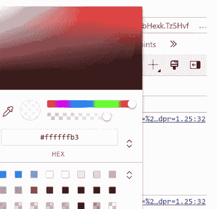
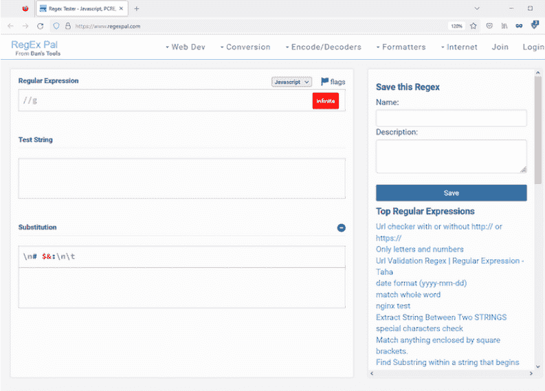
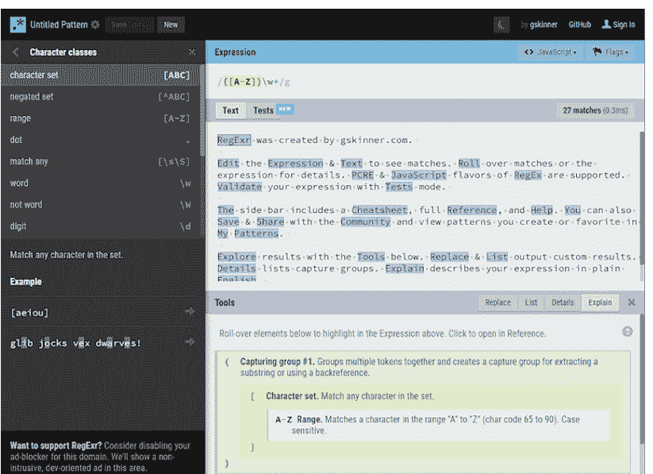
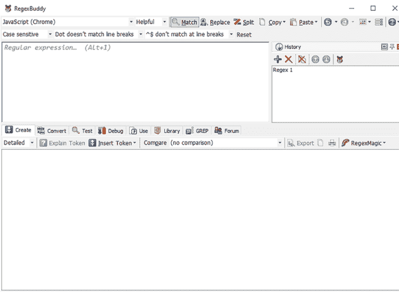
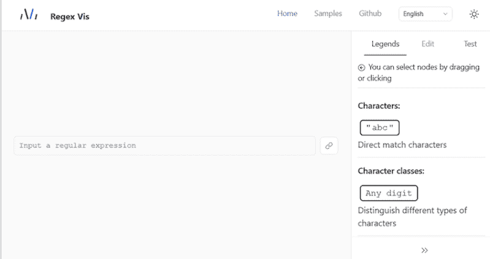

# JavaScript 文本处理：优化性能的正则表达式、工具与技巧


# 关于实用派书架 (The Pragmatic Bookshelf)

Pragmatic Bookshelf 是一家敏捷出版公司。我们的存在是因为我们希望改善开发者的生活。我们通过创建由程序员为程序员编写的及时、实用的书籍来实现这一目标。

我们的 Pragmatic 课程、工作坊和其他产品可以帮助您的团队创建更好的软件并获得更多。更多信息以及最新的 Pragmatic 书籍，请访问我们的 https://pragprog.com。

我们的电子书不包含任何数字权利管理（DRM），且始终是无 DRM 的。我们开创了 Beta Concept，您可以在书籍仍在编写时购买并阅读，并向作者提供反馈以帮助为您写出一本更好的书。读者的免费资源包括下载代码（如适用）、勘误表和讨论论坛，这些资源均可在我们的书籍首页 pragprog.com 上获取。我们在此此是为了让您的生活变得更轻松。

# 新书公告

想关注我们的最新书籍、公告以及偶尔的特别优惠吗？在 pragprog.com 上创建一个账户（只需一个电子邮件地址和密码）并勾选选择框接收新闻邮件。您还可以在 Twitter 上关注我们 @pragprog。

# 关于电子书格式

如果您直接从 pragprog.com 购买，将以一个价格获得所有可用格式的电子书。可以通过 Dropbox 同步电子书到所有设备（包括 iPhone/iPad、笔记本电脑等）。在电子书的使用期限内，您可以获得免费更新。当然，在需要时您可以回来重新下载您的书籍。来自 Kindle Store 的电子书受 Amazon 策略限制。Amazon 文件格式的限制可能会导致电子书在不同设备上的显示不同。更多信息，请参阅 pragprog.com/about-ebooks 的 FAQ。要了解更多关于本书的信息并访问免费资源，请访问书籍首页 https://pragprog.com/book/javascript。

感谢您的持续支持，

Pragmatic Bookshelf 团队

本书包含的团队：Dave Thomas (出版商), Janet Furlow (首席运营官), Tammy Corn (执行编辑), Margaret Eldridge (开发编辑), Vanya Wyter (文字编辑), Potomac Indexing, LLC (索引), Gilson Graphics (排版)

如需客户支持，请联系 support@pragprog.com。

国际请求请联系 rights@pragprog.com。


66. 为了在正则表达式中使用转义字符串

67. 从文件名中删除无效字符

68. 匹配浮点数

69. 匹配带有千位分隔符的格式化数字

70. 匹配邻近单词

71. 高亮包含特定单词的句子

72. 实时高亮文本

73. 将纯文本转换为适用于 HTML 的标记

结语

# 我可以请你一个忙吗？

# A1. 什么是 Unicode？

# A2. 在 JavaScript 中实现正则表达式

- test()
- exec()
- match()
- matchAll()
- search()
- replace()
- replaceAll()
- split()
- 结论

# A3. 使用专业工具测试正则表达式

- RegexPal
- RegExr
- Regex101
- RegexBuddy
- Regex Vis

# A4. 正则表达式快速查表

- 字符类
- 量词
- 边界断言
- 环绕断言
- 分组与反向引用
- 标志

# Unicode 属性转义

# 对 JavaScript 处理文本的早期赞誉


没有什么比处理正则表达式的任务更具*规律性*了。利用此书中的技术和配方，将枯燥但乏味的文本数据处理任务变为一种可控、甚至是有趣的体验。

- Venkat Subramaniam 博士
获奖作者，Agile Developer, Inc. 创始人

虽然《JavaScript 文本处理》很容易把所有时间花在正则表达式上，但你也会发现 JavaScript 中对那些谦虚、经常被忽视且计算开销较小的字符串方法有大量的讨论和实用的示例。无论你的文本处理任务是什么，这本书都会引导你找到合适的 API。即使是那些打算进行重度文本处理的读者，也能从书中关于多字节字符集以及各种非拉丁字母（包括 emoji 表符号）的介绍中受益，这本身就是一个极其有用的资源。

- Karl Stolley
Web 开发者，《Programming WebRTC》作者

《JavaScript 文本处理》富含大量的 JavaScript 技巧、妙招和工具，涵盖了从密码验证到国际化，再到简单处理格式化数字的各种配方。Faraz 向你展示了可以用来解决 JS 问题的内置函数，然后扩展到正则表达式，以应对你可能面对的任何复杂情况。

- Michael Fazio
Albert 工程经理，《Kotlin and Android Development featuring Jetpack》作者

存在一些特定领域的语言，它们为精通这些语言的软件开发者带来了丰厚的回报。对于 DevOps 工程师，关键 DSL 是 bash；对于后端工程师，是 SQL；对于前端和全栈工程师，则是正则表达式。熟练运用其中任何一种语言都是超能力。《JavaScript 文本处理》展示了如何利用 JavaScript 字符串类型的力量，深入探讨它的各个方面。即使是有多年 JavaScript 经验的开发者，也能在书中发现新东西。通过对各种原生文本处理 API 的详尽介绍、对正则表达式技术的细致示例以及富有见解的代码解释，这本书值得在每位前端开发者的书架上占有一席。

- Matt Frisbie
《Professional JavaScript for Web Developers》作者

这本书通过其全面的知识、丰富的实战示例和详细的解释，帮助读者掌握文本处理。我向任何想要学习并更深入研究《JavaScript 文本处理》的人推荐这本书。

- Bowen
Regex Vis 的创建者

# 致谢

编写一本编程书籍是一项协作工作，如果没有许多人的支持和专业知识，将是不可能的。

我诚挚地感谢 The Pragmatic Programmers 团队，他们相信这本书的潜力，并提供了无贵的指导和资源。他们的编辑团队和设计专业人士在塑造作品内容方面发挥了至关重要的作用。特别是，我要感谢我的编辑 Margaret Eldridge，她对细节的严谨关注对于识别和纠正我写作中的漏洞至关重要。

特别感谢在出版前对本书进行细致评审的专家，包括 Michael Fazio, Karl Stolley, Trevor Burnham, Jason Montojo, Venkat Subramaniam, Matt Frisbie, Bowen 以及 Kelhini

# 前言

大多数编程语言都支持正则表达式，这有一个很好的原因：正则表达式处理文本的能力非常强大。通过正则表达式，你可以极大地减少处理复杂字符串任务所需的代码和精力。

但是，作为一名 JavaScript 开发者，你会发现 JavaScript 提供了许多内置工具来满足你的文本处理需求。在本书中，我们将通过真实世界的场景来探索每个工具的机制。

# 你需要具备知识

要使用这本书，你应该已经了解 JavaScript、HTML 和 CSS 语法。HTML 和 CSS 的使用将非常频繁且基础，我会详细解释每个 JavaScript 示例。因此，即使你的知识有些生疏，也能理解代码是如何运行的。

为了运行示例，你需要一个支持最新 ECMAScript 标准的 JavaScript 环境。因此，无论是在浏览器控制台还是 Node.js 环境中运行示例，请确保安装了最新版本的软件。

某些配方使用了仅在浏览器环境中可 API，例如 `fetch()`。因此，你只能在浏览器中运行那些配方。在必要时，我们会提醒你缺乏浏览器支持。

# 本书主要内容

我们将书籍组织成食谱的形式，这样你可以快速跳转到不同的配方。但如果你从头到尾读完这本书，将成为文本处理的大师。

- 第一部分包含使用 JavaScript 内置方法解决各种文本处理问题的配方。

- 第二部分涵盖了 JavaScript 的正则表达式，对语法进行了深入讨论，并提供了各种使用方法的示例。

- 第三部分为广泛的检索和更改任务提供了解决方案。这些配方将为你提供成为正则表达式专家所需的帮助。


# 在线资源

要下载书书中使用的示例代码，请访问 Pragmatic Bookshelf 网站。[11]。你可以提交反馈和勘误条目，获取最新信息，并在书籍的论坛页面参与讨论。如果你正在以 PDF 格式阅读此书，可以通过点击代码上方的小灰色框来查看或下载特定的示例。

### 脚注

- [1] https://pragprog.com/titles/fkjavascript/text-processing-with-javascript/#resources

# 第一章

# 第一部分：使用内置 JavaScript 方法进行文本处理

许多人将正则表达式视为文本处理的圣杯——这种工具可以简化许多编程任务，并为各种文本处理问题提供紧凑、高效的解决方案。但在已经存在标准内置解决方案的情况下，你应该把正则表达式强行挤进去吗？

当然不应该。正则表达式很难写对，而且很容易写出一个接受比意图更多输入内容的模式。代码协作也可能成为一个问题，因为正则表达式的晦涩性可能会让你的程序员同事不愿审查或调试你的代码。毕竟，没有人想花一周的时间来尝试理解一个由魔法符号组成的、二十行的神秘字符串。

在书的一个部分，我们将深入研究一组小型程序，用于演示 JavaScript 中内置的字符串操作方法。你将发现每个方法是为了解决什么问题而设计的，并在此过程中，你学会在什么情况下它们比正则表达式更有效。

## 使用 typeof 运算符判断值是否为字符串

### 任务

在 JavaScript 中，你经常需要验证一个值是否为字符串。例如，在下一个食谱中，我们将构建一个在字符串中搜索多个单词的函数。在将值传递给函数之前，你想检查它是否为字符串。任何其他数据类型（如数字或布尔值）都会导致你的函数抛出错误。

在书中，你将反复看到这类函数，因此这是一个很好的起点。

### 解决方案

使用 `typeof` 运算符：

```javascript
part_1/determining_valid_strings/typeof_ex1.js

function isString(value) {
  return typeof value === "string";
}

isString(123);    // -> false
isString("abc"); // -> true
```

`typeof` 运算符返回一个指示值类型的字符串。

### 讨论

在 JavaScript 中，你可以使用单引号、双引号或反引号创建字符串字面量：

```javascript
part_1/determining_valid_strings/typeof_ex2.js

let str1 = "string";
let str2 = 'string';
let str3 = 'string';
```

所以，用引号或反引号括起来的数字不再是数字而是字符串。如果你在不使用 `new` 关键字的情况下调用 `String()` 构造函数，也可以创建一个字符串：

```javascript
part_1/determining_valid_strings/typeof_ex3.js

String(123); // → "123"
```

在字符串中，每个字符占据一个位置。索引 0 对应第一个字符，索引 1 对应第二个字符，依此类推。所以，要获取字符串中的第二个字符，你可以输入 `str[1]`：

```javascript
part_1/determining_valid_strings/typeof_ex4.js

let str = "string";

console.log(str[1]); // → t
```

接下来我们将构建一个检查字符串是否包含单词列表的函数，开启 JavaScript 文本处理方法的之旅。

## 使用 includes() 检查字符串中的特定单词

### 任务

假设你正在经营一家在线烘焙店，并想要过滤消息以便将它们路由到正确的烘焙师那里。你需要检查传入邮件中的字符串，以考虑“doughnut”与“donut”等单词的不同拼写。你不能仅使用 `includes()` 方法，因为它只允许你查找单个单词。

### 解决方案

将你想要搜索的单词放入数组中。创建一个接受两个参数的函数：一个要搜索的字符串和一个单词数组。在函数内部，在字符串中搜索每个单词，如果至少有一个搜索成功，则返回 `true`：

```javascript
part_1/checking_specific_words/includes_ex1.js
const msg = "I'd like to order two donuts";
const words = ["doughnut", "donut"];

function hasWords(str, arr) {
  return arr.some(el => str.includes(el));
}
hasWords(msg, words); // → true
```

如果数组中至少有一个元素通过给定函数实现的测试，`some()` 方法将返回 `true`。在这种情况下，这意味着 `includes()` 首先搜索“doughnut”。由于字符串中没有这个单词，该方法返回 `false`。`includes()` 第二次搜索“donut”，这次它返回了 `true`。所以，`some()` 的返回值将是 `true`。

### 讨论

ECMAScript 在 ES2015 中为语言增加了 `includes()`，以便开发者能够轻松判断字符串是否包含另一个字符串。`includes()` 的第二个参数是可选的，允许你指定开始搜索的位置。例如：

```javascript
part_1/checking_specific_words/includes_ex2.js
const quote = "Sachertorte is a corte of Austrian origin.";
quote.includes("Sachertorte");
```


```javascript
str1.endsWith(searchStr); // -> true
str2.endsWithWith(searchStr); // -> false
```

现在我们知道 `startsWith()` 和 `endsWith()` 会产生我们想要的结果，让我们写一个同时执行这两个操作的函数：

```javascript
part_1/matching_with_startsWithEndsWith/startsWith_endsWith_ex3.js
function startsWithEndsWith(str, start, end) {
  if ((str.startsWith(start) == true) && (str.endsWith(end) == true)) {
    return true;
  } else {
    return false;
  }
}
```

我们也可以通过移除 `if` 语句来简化函数。逻辑与 (`&&`) 运算符在 `startsWith()` 和 `endsWith()` 都返回 `true` 时返回 `true`，因此我们可以在一条语句中获得相同的结果：

```javascript
part_1/matching_with_startsWithEndsWith/startsWith_endsWith_ex4.js
function startsWithEndsWith(str, start, end) {
  return str.startsWith(start) && str.endsWith(end);
}
```

这段代码适用于测试包含单个句子的字符串，但我们要将文章的每一行都传递给我们的函数。通过调用 `split("\n")` 在换行符处分割字符串，然后使用 `forEach()` 遍历生成的数组，并将每一行传递给真正的 `startsWithEndsWith()`：

```javascript
part_1/matching_with_startsWithEndsWith/startsWith_endsWith_ex5.js
const str = `## Why is chocolate bad for your dog?
Some text ...
## Best way to dry your dog's nails
More text ...
## Are there human foods that are safe for dogs?
...
```

```javascript
function startsWithEndsWith(str, start, end) {
  return str.startsWith(start) && str.endsWith(end);
}
```

```javascript
str.split("\n").forEach(str => {
  if (startsWithEndsWith(str, "##", "?")) {
    console.log(str);
  }
});
```

// 日志输出：
// ## Why is chocolate bad for your dog?
// ## Are there human foods that are safe for dogs?

成功！


> Safari 于 2022 年 3 月 15 日发布，它比其他浏览器晚了一点加入行列，因为它在主要竞争对手完成之后才整合了 `at()` 方法。为了与旧版本的浏览器向后兼容，你需要使用 polyfill。[2] 在 Node 环境中，你需要至少 16.6.0 版本的 Node。[3]

### 讨论

在 JavaScript 中，通常有多种方法来完成一项任务。作为一名程序员，你应该始终努力为工作选择最高效的工具。你还应该考虑代码的可靠性和可读性，这在大多数项目中比效率更重要。

获取字符串最后一个字符的替代方法是使用 `at()` 方法。它简洁且快速！但浏览器支持还未到位，所以你可能会发现你的代码在旧版浏览器中失效。

通过 `at()`，你可以这样获取字符串中某个位置的单个字符：

```javascript
part_1/matching_with_startsWith_endsWith/startsWith_endsWith_ex6.js

const str = "Do dogs dream?";

str.at(-1); // → "?"
str.at(-2); // → "m"
```

为 `at()` 传递负数时，该方法会从字符串末尾倒数计数。因此，`-1` 获取最后一个字符，`-2` 获取倒数第二个字符，以此此类推。

## 在数组上调用 at()

> 你也可以在 JavaScript 数组上使用 `at()`。查看我在 Medium 上的文章以了解更多。[4]

虽然 `startsWith()` 允许你检查字符串开头的字符，但 `endsWith()` 让你能够判断字符串是否以特定字符结束。如果你只想获取单个字符的值，那么 `at()` 是一个你可以使用的简洁替代方案，但请确保检查浏览器支持情况。

## 使用 slice() 从文本中提取列表

### 任务

假设你经营着一家销售数千种不同衣服的在线商店。你的任务是让产品可以根据颜色进行搜索。问题是，每个产品的可用颜色是以句子的形式列在产品描述中的。你需要一种通过程序方法找到并提取这些颜色，以构建一个可搜索的数据库。

所以如果你有像这样的产品描述：

防水越野跑鞋帮助你保持干燥，让你在最不可预测的天气条件下也充满自信。新颜色有：丝绒棕、黑色、金色苔绿、中蓝色。

你想提取这些颜色并将它们存储在如下数组中：

```javascript
["Velvet Brown", "Black", "Golden Moss", "Medium Blue"]
```

你想要提取的列表也可能以不同的形式出现。项目之间可能是正斜杠 (/) 而不是逗号。它可能包含额外的单词，如“and”、“or”、“etc.”，你不希望这些词出现在数组中。

在这个方案中，我们首先构建一个提取简单列表的函数，并增强该函数以处理更复杂的列表。

### 解决方案

这个方案涉及两个步骤：第一，找到包含颜色列表的句子；第二，提取每个颜色并存储在数组中。你可以使用 `indexOf()` 方法执行第一步。颜色列表出现在冒号 (:) 之后。使用 `indexOf()` 定位它并将生成的索引存储在常量中。接下来，找到冒号后的第一个句号并将索引存储在另一个常量中：

```javascript
const str = `Feel confident in even the most unforeseen weather conditions
with these waterproof trail-running shoes helping you stay dry. Available in new colors: Velvet Brown, Black, Golden Moss, Medium Blue.`;
```

```javascript
const start = str.indexOf(":");
const end = str.indexOf(".");
```

现在，你有了两个标记列表开始和结束的索引。将它们传递给 `slice()` 方法提取列表：

```javascript
const list = str.slice(start + 2, end);
// "Velvet Brown, Black, Golden Moss, Medium Blue"
```

现在是第二步，你需要将逗号分隔的列表转换为数组。在 JavaScript 中有几种方法可以做到。复杂的方法是在循环中查找逗号并将每个项添加到数组。更直接的方法是使用 `split()` 方法。通过 `split()`，你可以快速获得一个包含每个项的数组，如下：

```javascript
const colors = list.split(", ");

console.log(colors);
// -> ["Velvet Brown", "Black", "Golden Moss", "Medium Blue"]
```

在这段代码中，你告诉 `split()` 使用逗号加空格作为分隔符。结果是一个没有额外空格的颜色数组。

这里是组合在函数中的最终代码，以便你复用：

```javascript
part_1/extracting_lists/slice_ex1.js

const str = `Feel confident in even the most unforeseen weather conditions
with these waterproof trail-running shoes helping you stay dry. Available in new colors: Velvet Brown, Black, Golden Moss, Medium Blue.`;
```

```javascript
function extractlist(str) {
  const start = str.indexOf(":");
  const end = str.indexOf(".");
  const list = str.slice(start + 2, end);

  return list.split(", ");
}
```

```javascript
extractlist(str);
// -> ["Velvet Brown", "Black", "Golden Moss", "Medium Blue"]
```

### 讨论

如果你想提取额外的单词，如“and”、“or”、“etc.”或者使用正斜杠 (/) 而不是逗号，那么你需要一个更高级的函数。你可能在产品的可用颜色列表中找不到“etc.”，我们在这里包含了它，以便需要时从其他类型的列表中移除它。

考虑这个例子：

```javascript
extractlist("Available in three colors: red, black, and blue.");
// -> ["red", "black", "and blue"]
```

```javascript
extractlist("Available colors: Red/Black/Blue.");
// -> "Red/Black/Blue"
```

```javascript
extractlist("Available colors: Red, Black, Blue, etc.");
// -> ["Red", "Black", "Blue", "etc"]
```


Node 函数无法妥善处理列表。让我们修改一下它！首先需要检查列表是否包含逗号或正斜线：

```
list.includes(", ") ? list.split(", ") : list.split('/');
```

`includes()` 方法检查列表是否包含逗号。如果是，它返回 `true`，三元运算符执行 `list.split(", ")`。如果不是，运算符执行 `list.split("/")`。

接下来，从结果数组中移除 "etc"：

```
arr.at(-1) === "etc" ? arr.pop() : null;
```

`at(-1)` 获取数组中的最后一个项。如果它的值为 "etc"，`pop()` 会将其移除。你可以使用 `filter()`，但由于 "etc" 通常是数组的最后一个项，因此检查最后一个项的值更有效率。

## 浏览器兼容性

> 旧版浏览器不支持 `at()` 方法。为了确保使用旧浏览器的用户可以访问您的应用，你应该使用 polyfill。[5]。在 Node 环境中，你需要至少 16.6.0 版本的 Node。[6]

要移除 "and"/"or"，你可以使用 `map()`，如下所示：

```javascript
return arr.map((word) => {
  if (word.startsWith("and ")) {
    return word.slice(4);
  } else if (word.startsWith("or ")) {
    return word.slice(3);
  } else {
    return word;
  }
});
```

当你调用 `map()` 时，它会在数组的每个元素上执行一个函数。使用 `startsWith()` 方法检查项目开头是否有多余的 "and" 或 "or"，并使用 `slice()` 将其移除。

你修改后的函数看起来应该是这样：

```javascript
function extractlist(str) {
  const start = str.indexOf(":");
  const end = str.indexOf(",", start);
  const list = str.slice(start + 2, end);

  // 用逗号或正斜线分割字符串
  const arr = list.includes(", ") ? list.split(", ") : list.split("/");

  // 移除 "etc"
  arr.at(-1) === "etc" ? arr.pop() : null;

  // 移除 and/or
  return arr.map((word) => {
    if (word.startsWith("and ")) {
      return word.slice(4);
    } else if (word.startsWith("or ")) {
      return word.slice(3);
    } else {
      return word;
    }
  });
}

extractlist("Available in three colors: red, black, and blue."); // ["red", "black", "blue"]
extractlist("Available colors: Red/Blue."); // ["Red", "Blue"]
extractlist("Available colors: Red, Black, etc."); // ["Red", "Black"]
```

你可能在想为什么不使用 `replaceAll()` 在将文本分割数组之前移除文本中的任何 "and," "or," 或 "etc."。某些颜色名称可能包含这些词，例如 "Macaroni and Cheese"（是的，那确实是一个颜色名称）。利用 `slice()` 方法提取字符串或数组的部分。第二个参数是可选的：省略它即可获取字符串的剩余部分。当你需要将字符串划分为数组时，使用 `split()`，最后使用 `map()` 剔除结果数组中任何不需要的部分。


### 任务

假设你正在开发一个处理十六进制（hex）颜色代码的绘图应用程序。你想提供一个字段，让用户输入颜色名称并自动转换为相应的等效值。你需要一个将颜色转换为十六进制表示的解决方案。

### 解决方案

创建一个临时的 HTML canvas 元素，获取它的 2D 上文，并使用 `fillStyle` 属性转换颜色：

```javascript
// part_1/converting_color_to_hex/color_to_hex_ex1.js
function convertToHex(color) {
  const canvas = document.createElement("canvas");
  const ctx = canvas.getContext("2d");
  ctx.fillStyle = color;
  return ctx.fillStyle.toUpperCase();
}

convertToHex("white"); // "#FFFFFF"
```

此函数接受包含颜色名称的字符串，并将其转换为对应的十六进制值。

### 讨论

十六进制表示通常用于程序中指定颜色，因为它提供了一种表示广泛颜色的紧且高效的方法。在十六进制表示中，颜色由红、绿、蓝（RGB）值的组合组成，每个值由两个十六进制数字（00 到 FF）表示，前两个数字代表红色的强度，接下来的两个数字代表绿色的强度，最后两个数字代表蓝色的强度。例如，白色由十六进制代码 #FFFFFF 表示，它的三种颜色值都是最大值。

在该解决方案中，我们定义了一个接受名为 `color` 单参数的函数，该参数应该是代表颜色的字符串。在函数内部，我们使用 `createElement()` 方法创建一个 HTML 元素。该方法根据提供的名称创建一个 HTML 元素。在这种情况下，我们使用 "canvas" 标签来创建一个 canvas 元素。接下来，我们使用 `getContext()` 方法为 canvas 创建上下文对象。我们通过传递 "2d" 作为参数来指定该上下文对象用于二维 canvas。然后，我们将上下文对象的 `fillStyle` 属性设置为参数值。此函数设置了将用于填充在 canvas 上绘制的形状的颜色。

现在我们可以定义上下文对象的 `fillStyle` 属性来获取颜色的值。当我们使用参数 "white" 调用函数时，它将创建一个 canvas 元素，将 `fillStyle` 设置为 "white"，并返回十六进制值。注意，此函数实际上并没有在 canvas 上绘制任何内容——它只是创建了 canvas 元素并设置了 `fillStyle`。在从函数返回十六进制值之前，我们使用 `toUpperCase()` 方法将十六进制字母转换为大写。在 JavaScript 和 CSS 中，十六进制颜色可以使用大写或小写字母编写。大写和小写字母表示相同的值。但使用大写字母表示颜色是常见做法，因为可以使代码更易读并与代码中的其他文本区分开来。最终，这两种风格之间的选择取决于个人喜或风格指南。

通过将颜色名称转换为十六进制表示，我们可以以一种跨平台、跨设备的方式指定颜色。维基百科上提供了网络颜色及其十六进制等效值的列表。


### 任务

假设你想为应用程序的某些元素添加一个半透明的覆盖层。例如，你可能有一个提示框要求读者在继续之前登录，你可能想包含一个半透明的白色颜色来模糊页面其余部分。

如果你使用普通的十六进制颜色，覆盖层将完全遮挡下方的内容。如果你使用 CSS 透明度，它将设置整个元素（包括其内容）的透明度。你需要一个为十六进制颜色添加透明度的解决方案。

### 解决方案

编写一个接受十六进制值和百分比作为输入参数的函数。函数应将百分比转换为十六进制值，然后将其添加到原始十六进制值中：

```javascript
// part_1/adding_transparency_to_hex/adding_transparency_to_hex_ex1.js
function addAlphaToHex(hex, percent) {
  const decimal = percent / 100;
  const rgb = Math.round(decimal * 255);
  let alpha = rgb.toString(16).toUpperCase();

  if (alpha.length === 1) {
    alpha = "0" + alpha;
  }

  return hex + alpha;
}

addAlphaToHex("#FFFFFF", 70); // "#FFFFB3"
```

此函数返回一个包含透明级别的八位十六进制值。在这种情况下，返回值为具有 70% 透明度的白色十六进制 (#FFFFFF)。

### 讨论

以前，开发者必须将十六进制颜色转换为 RGBA 或 HSLA 值以设置透明度。这种转换是必要的，因为 RGBA 或 HSLA 值中的 alpha 通道可以用于确定透明度。然而，随着 CSS 模块第 4 引入，通过添加包含透明级别的新函数 (#rgba) 和八位 (#rrggbaa) 十六进制表示法，问题得到了解决。因此，开发者不再需要将十六进制颜色转换为另一种格式来设置透明度。

表示法中的 rr、gg、bb 和 aa 分别代表红、绿、蓝和 alpha 分量的十六进制值，范围从 00 到 FF。alpha 值决定颜色的透明度，00 代表完全透明，FF 代表完全不透明。


如果你想让你的 JavaScript 代码尽可能的紧凑，可以使用以下版本：

```
part_1/adding_transparency_to_hex/adding_transparency_to_hex_ex2.js
```

```javascript
function addAlphaToHex(hex, percent) {
  const alpha = Math.round(percent / 100 * 255).toString(16)
  .toUpperCase().padStart(2, "0");
  return hex + alpha;
}
```

```javascript
addAlphaToHex("#FFFF", 70); // "FFFFFB3"
```

这个版本将 rgb 和 alpha 常量合并到一行，并使用 `padStart()` 在必要时添加前导零。`padStart()` 的第一个参数定义了字符串填充后结果字符串的长度，因此 `padStart(2, "0")` 确保十六进制值始终为两个字符。

如果你想以不同的格式查看你的颜色，可以使用 Chrome/Edge 开发者工具（DevTools）。打开开发者工具面板并导航到样式（styles）部分找到你想要检查的颜色。然后，点击颜色左侧的方框直接调整其值：

```html
<html>
#search div div {
  Styles  Computed
}
Filter {
  min-height: 100vh;
}
Inherited from body#s
.src {
  --center-align: center;
  --center-width: 100%;
  --rhs-margin: 60px;
  --rhs-width: 369px;
  --grid-gap: 20px;
  --grid-column-width: auto;
}
.element {
  margin: 0;
  background-color: #fffffb;
}
```



你也可以按住 Shift 键并点击方框在不同的格式选项之间切换，值会自动转换。

## 使用 DOMParser() 从文本中移除 HTML 标签

### 任务

假设你写了一个网络爬虫来从网上收集新闻。你抓取的的文本可能包含不需要的 HTML 元素，如 `<span>`、``、`<a>` 等。

更糟糕的是，它可能包含注入的 JavaScript，一旦你将其放在网站上它就会自动执行。你需要一个函数，能够安全地从文本中移除所有不需要的元素。

### 解决方案

使用 `DOMParser()` 接口的 `parseFromString()` 方法来解析字符串。一旦解析了字符串，你就可以使用 `textContent` 属性从额外的 HTML 标签中获取文本：

```javascript
part_1/removing_html_tags/DOMParser_ex1.js

function stripHTML(html){
  const doc = new DOMParser().parseFromString(html, "text/html");
  return doc.body.textContent || "";
}
```

```javascript
const rawText = '<a href="">Fed</a> Signals Smaller Rises';

stripHTML(rawText);
// "Fed Smaller Rises"
```

`DOMParser` 接口允许将字符串中的 XML 或 HTML 代码解析为 DOM 文档。在这种情况下，你想解析 HTML，因此将 `text/html` 作为第二个参数传递。结果是一个 `HTMLDocument`，你可以通过 `textContent` 提取其文本。

## Node 中的 DOMParser()

> ! `DOMParser()` 接口在 Node 环境中不可用。

### 讨论

`textContent` 属性在所有文本节点和元素节点上可用。既然可以在页面上创建一个临时元素并获取其 `textContent`，为什么还要解析 HTML 呢？考虑这个例子：

```javascript
part_1/removing_html_tags/DOMParser_ex2.js

// 不要使用这个
function stripHTML(html) {
    const tmp = document.createElement("DIV");
    tmp.innerHTML = html;
    return tmp.textContent || "";
}}
```

```javascript
const rawText = '<a href="Fed</a Smaller Rises
';

stripHTML(rawText); // → "Fed Smaller Rises"
```

乍看，这段代码似乎是一个更有效的解决方案，因为它不涉及解析字符串。但如果源包含恶意代码，你将让你的代码面临攻击的风险。

尝试从 HTML 中移除以下内容，你会发现隐藏在 `onerror` 属性中的 JavaScript 代码被执行了：

```javascript
part_1/removing_html_tags/DOMParser_ex3.js

const rawText = "";
```

尽管你将文本插入到临时标签中，浏览器仍然会加载图像，嵌入的 JavaScript 代码会有机会露头。

在爬取和使用外部来源的文本时，记住从文本中移除 HTML 标签。这样做的一种快速方法是使用 `DOMParser` 接口解析数据，然后使用 `textContent` 提取文本。

## 食谱 8 使用 replaceAll() 将 HTML 标记转换为 HTML 实体

### 任务

假设你想在网站上发布包含 HTML 标记的编程教程。但你遇到了一个问题：网络浏览器会解释你示例中的 HTML 标签，而不是显示它们。这是因为浏览器假设你使用这些标签来构建你的网页。

你需要以一种防止浏览器解释标记的方式来表示标记。

### 解决方案

使用 `replaceAll()` 方法将 HTML 标签的组件替换为实体：

```javascript
part_1/converting_html_to_entities/entities_ex1.js
function escapeHTML(str) {
  return str
    .replaceAll('&', '&amp;')
    .replaceAll('<', '&lt;')
    .replaceAll('>', '&gt;')
    .replaceAll('"', '&quot;')
    .replaceAll("", '&apos;');
}

escapeHTML('<a href="test.html">foo</a>');
// ~ &lt;a href=&quot;test.html&quot;&gt;foo&lt;/a&gt;
```

`replaceAll()` 允许你替换字符串中模式的所有出现处。每次调用都会返回一个新的字符串，因此你可以链调用多个 `replaceAll()` 方法在一个语句中替换多个模式。

### 讨论

通过使用 HTML 实体，我们可以显示某些否则会被网络浏览器解释为 HTML 代码的字符。下表显示了字符列表及其相应的 HTML 实体：

| 字符 | 实体 |
|---|---|
| & | &amp; |
| < | &lt; |
| > | &gt; |
| " | &quot; |
| ' | &apos; |

记住 HTML 实体是区分大小敏感的，所以 `&amp;` 和 `&AMP;` 不是同一个实体。

HTML 实体有两种类型：命名实体和数字实体。命名实体由由 am 符号 (&) 和分号 (;) 包围的字母字符串表示。数字实体则由 am 符号 (&) 开头，后面跟着井号 (#)，以及十进制或十六进制代码，并以分号 (;) 结束。

这里是上述表中的命名实体转换为相应数字实体的表格：

| 字符 | 实体 |
|---|---|
| & | &#38; |
| < | &#60; |
| > | &#62; |
| " | &#34; |
| ' | &#39; |

你可以同时使用命名实体和数字实体在 HTML 文档中显示特殊字符。但通常首选命名实体而不是数字实体，因为它们更具可读性且更容易记忆。

除了显示具有特殊含义的字符，HTML 实体还用于显示难以用键盘输入的字符，例如外语言字符、数学符号或表情符号。通过使用 HTML 实体，我们可以确保字符在网页上被正确显示。

### 任务

假设你有一个显示统计数据和比分的体育应用。你有两个对象，需要找到同时存在于两者中的属性。你的第一个对象包含获得过国际足世界杯的国家列表。你的第二个对象包含了关于欧洲足球锦标赛的类似信息。

你想创建一个 HTML 表格，列出在两项赛事中都获得过冠军的球队。

### 解决方案

第一步是创建一个 HTML 表格。你可以将此任务交给 JavaScript，但让我们保持简单，设置好 HTML 结构并使用 JavaScript 将信息插入到中：

```html
<table id="national_teams">
  <head>
    <tr>
      <th>国家</th>
      <th>UEFA 冠军次数</th>
      <th>FIFA 冠军次数</th>
    </tr>
  </head>
  <tbody></tbody>
</table>
```

现在创建两个对象：一个用于 FIFA 冠军，一个用于 UEFA 冠军，如下如下：

```javascript
const FIFachamps = {
  "Brazil": 5,
  "Germany": 4,
  "Italy": 4,
  "Argentina": 2,
  "France": 2,
  "Uruguay": 2,
  "Spain": 1,
  "England": 1
};
```

```javascript
const UEFAChamps = {
  "Germany": 3,
  "Spain": 3,
  "Italy": 2,
  "France": 2,
  "Russia": 1,
  "Czech Republic": 1,
  "Portugal": 1,
  "Netherlands": 1,
  "Denmark": 1,
  "Greece": 1
};
```

要执行交集，使用 `Object.keys()` 获取第一个对象的键，然后使用 `filter()` 检查哪些键存在第二个对象中。

```javascript
part_1/intersecting_tables/filter_ex1.js
```

```javascript
function getIntersection(obj1, obj2) {
  return Object.keys(obj1).filter(key => {
    return key in obj2
  });
}

// 这个常量将包含包含交集键的数组
const intersection = getIntersection(FIFachamps, UEFAChamps);

// 获取表格体的引用
const tbody = document.querySelector("#national_teams tbody");

intersection.forEach(elem => {
  const row = tbody.insertRow();
```


```javascript
const cell1 = row.insertCell(0);
const cell2 = row.insertCell(1);
const cell3 = row.insertCell(2);
cell1.textContent = elem;
cell2.textContent = UEFAChamps[elem];
cell3.textContent = FIFAChamps[elem];
```

一旦检测到这两个对象，就遍历它们的属性，并在每次循环中，分别将球队、UEFA 冠军次数和 FIFA 冠军次数插入到第一个、第二个和第三个单元格中。在这里，我们使用了 JavaScript 的内置方法 `insertRow()` 和 `insertCell()` 来创建表格行和单元格，你也可以使用字符串字面量。以下是应用了一些基础 CSS 样式后的结果：

| 国家 | UEFA 冠军 | FIFA 冠军 |
| --- | --- | --- |
| 德国 | 3 | 4 |
| 意大利 | 2 | 4 |
| 法国 | 2 | 2 |
| 西班牙 | 3 | 1 |

表格仅列出了同时存在两个对象中的国家。

### 讨论

`filter()` 方法接受一个函数作为参数，并对数组的每个元素执行该函数——类似于 `foreach()` 和 `map()`。你提供的函数应该是一个谓词（返回 true 或 false 的函数）。只有当你的谓词返回 `true` 时，`filter()` 才会将元素添加到结果数组中。

在 JavaScript 中使用 `filter()` 方法时，记住它会跳过数组中的任何缺失元素很重要。例如，如果你有一个带有空隙的数组，如 `[0, 1,,,4, 6]`，你可以利用 `filter()` 这样去掉缺失的元素：

```javascript
const sparseArr = [0, 1, , , 4, , 6];
sparseArr.filter(() => true); // -> [0, 1, 4, 6]
```

在这里我们使用了一个始终返回 `true` 的箭头函数。由于 `filter()` 会跳过这些，新数组将不再是稀疏的。

如果你的数组包含 `undefined` 或 `null` 元素，你也可以用 `filter()` 移除它们：

```javascript
const sparseArr = [0, 1, , null, 4, undefined];
sparseArr.filter(x => x != undefined && x != null); // -> [0, 1, 4, 6]
```

在这段代码中，我们使用严格不等运算符 (`!==`) 来确保仅当元素不是 `null` 或 `undefined` 时才返回 `true`。

在涉及性能优化时，你应该考虑对象的大小以及你需要获取它们交集的次数。如果你的第一个对象有 1000 个属性，而第二个对象有 50 个，那么先获取属性较少的对象的键然后应用过滤器，你的代码运行速度会更快，反之则。

考虑到这一点，让我们重写交集函数：

```javascript
part_1/intersecting_tables/filter_ex2.js
1: function getIntersection(obj1, obj2) {
2:   const k1 = Object.keys(obj1);
3:   const k2 = Object.keys(obj2);
4:   const [first, next] = k1.length > k2.length ? [k2, obj1] : [k1, obj2];
5:   return first.filter(key => key in next);
6: }
```

注意我们在解构赋值的右侧使用了三元运算符来比较对象的长度，并将属性较少的对象赋值给 `first`（第 4 行）。解构允许我们使用类似于数组字面量的语法提取值并赋值给变量。赋值的右侧是待解构的内容，左侧是接收数据的变量。

我们的函数现在处理大型数组时运行得更快。但请记住，这种微优化仅对性能关键型应用程序有帮助。在大多数情况下，本食谱中的原始方案就已经足够了。

## 菜谱 10 从数组数组生成 HTML 表格

### 任务

假设你的任务是对存储在二维数组中的数据生成报告或摘要。例如，你可能需要从如下数组中创建一个公司跨多个财政季度的性能指标摘要：

```javascript
const data = [
  ["季度", "营收", "每ps"],
  ["Q1 FY22", 45962, 2.71],
  ["Q2 FY22", 44845, 2.71],
  ["Q3 FY22", 46151, 2.03],
  ["Q4 FY22", 46822, 2.11],
  ["Q1 FY23", 45215, 2.64]
];
```

你的目标是将数组转换为 HTML 表格，以便以结构化和组织化的格式展示数据。

### 解决方案

使用以下函数：

```javascript
part_1/generating_html_table_v1/html_table_v1.js
const data = [
  ["季度", "营收", "每ps"],
  ["Q1 FY22", 45962, 2.71],
  ["Q2 FY22", 44845, 2.71],
  ["Q3 FY22", 46151, 2.03],
  ["Q4 FY22", 46822, 2.11],
  ["Q1 FY23", 45215, 2.64]
];

function createTable(data) {
  const table = document.createElement("table");
  const head = document.createElement("thead");
  const tbody = document.createElement("tbody");

  const headerRow = document.createElement("tr");
  data[0].forEach(header => {
    const th = document.createElement("th");
    th.textContent = header;
    headerRow.appendChild(th);
  });
  head.appendChild(headerRow);

  data.slice(1).forEach(rowData => {
    const row = document.createElement("tr");
    rowData.forEach(cellData => {
      const cell = document.createElement("td");
      cell.textContent = cellData;
      row.appendChild(cell);
    });
    tbody.appendChild(row);
  });

  table.appendChild(head);
  table.appendChild(tbody);
  document.body.appendChild(table);
}

createTable(data);
```

`createTable` 函数接受一个数组数组作为参数并创建一个 HTML 表格。应用了一些基础样式后的结果如下：

| 季度 | 营收 | 每ps |
| --- | --- | --- |
| Q1 FY22 | 45962 | 2.71 |
| Q2 FY22 | 44845 | 2.71 |
| Q3 FY22 | 46151 | 2.03 |
| Q4 FY22 | 46822 | 2.11 |
| Q1 FY23 | 45215 | 2.64 |

### 讨论

我们首先通过 `createElement` 方法创建一个 HTML 表格。然后，创建 `thead` 和 `tbody` 元素。在本食谱中，我们假设数据的第一行包含表头。因此，我们遍历第一行并为每个表头创建一个 `th` 元素，将其添加到 `headerRow` 元素中。

创建表头后，我们使用 `slice(1)` 遍历剩余数据。对于每一行，我们创建一个 `tr` 元素，然后遍历该行的数据，为每个单元格创建一个 `td` 元素，将其添加到行中。最后，将 `head` 和 `tbody` 添加到表格中，然后将表格添加到 `document.body`。


```javascript
function createTable(data, headers) {
  const table = document.createElement("table");
  const head = table.createHead();
  const tbody = table.createTBody();
  const headerRow = head.insertRow();

  // Create table head
  headers.forEach(header => {
    const th = document.createElement("th");
    th.innerText = header;
    headerRow.appendChild(th);
  });

  // Create table body
  data.forEach(data => {
    const row = tbody.insertRow();
    Object.values(data).forEach(value => {
      const cell = row.insertCell();
      cell.innerText = value;
    });
  });

  document.body.appendChild(table);
}

createTable(data, headers);
```

当我们用数据数组作为参数调用此函数时，它会生成一个 HTML 表格，显示公司的财务绩效数据。输出结果将类似于应用了一些基础样式后的表格。

| 季度 | 收入（百万美元） | 净利润（百万美元） | 每股收益 (EPS) |
|---|---|---|---|
| Q1 FY22 | 45962 | 20820 | 2.71 |
| Q2 FY22 | 44845 | 20610 | 2.71 |
| Q3 FY22 | 46151 | 16027 | 2.03 |
| Q4 FY22 | 46822 | 16244 | 2.11 |
| Q1 FY23 | 45215 | 20256 | 2.64 |

### 讨论

这个配方与上一个相似，但数组项是对象，每个对象都具有如 revenue、netIncome 和 eps 等属性。在这个配方中，我们还定义了一个单独的数组，包含我们将要创建的表格的列头。

首先，我们为表格创建一个表头 (thead) 和表体 (tbody)。然后我们在表头行中创建一个表头行 (headerRow)，并用表头行数组填充它。

对于数组中的每个表头，我们使用 `createElement()` 方法创建一个 th 元素，使用 `innerText` 属性将其内容设置为表头字符串，并使用 `appendChild()` 方法将其添加到表头行中。

创建表头行后，我们遍历数据 数组中的每个对象，并为每个对象在表体中创建一个新行。在每一行中，我们遍历对象的每个属性，并为每个属性值在行中创建一个新单元格。

最后，我们将 table 元素附加到 HTML body 元素中。你应该修改此行，以便将数据附加到你想要的元素上。

## 使用 console.table() 在控制台中显示表格化数据

### 任务

假设你一直在对一个数组进行加减法操作，并且遇到了一些问题。你想在脚本的某一行检查数组的内容，以便确定问题所在。

你需要一种方法快速将数组的内容打印到控制台中。

### 解决方案

使用 `console.table()` 方法：

```javascript
part_1/displaying_tabular_data/displaying_tabular_data_ex1.js
const data = [
  {quarter: "Q1 FY22", revenue: 45962, netIncome: 20820, eps: 2.71},
  {quarter: "Q2 FY22", revenue: 44845, netIncome: 20610, eps: 2.71},
  {quarter: "Q3 FY22", revenue: 46151, netIncome: 16027, eps: 2.03},
  {quarter: "Q4 FY22", revenue: 46822, netIncome: 16244, eps: 2.11},
  {quarter: "Q1 FY23", revenue: 45215, netIncome: 20256, eps: 2.64}
];

console.table(data);
```

`console.table()` 方法以易于人类阅读的格式在控制台输出数组：

| (index) | revenue | netIncome | eps |
|---|---|---|---|
| 0 | 'Q1 FY22' | 45962 | 20820 | 2.71 |
| 1 | 'Q2 FY22' | 44845 | 20610 | 2.71 |
| 2 | 'Q3 FY22' | 46151 | 16027 | 2.03 |
| 3 | 'Q4 FY22' | 46822 | 16244 | 2.11 |
| 4 | 'Q1 FY23' | 45215 | 20256 | 2.64 |

### 讨论

`console.table()` 方法值得 JavaScript 开发者关注。虽然许多开发者使用循环将数组项打印到控制台，但 JavaScript 已经有了 `console.table()` 方法可以实现相同的结果。

表格的第一列将指定为 (index)。如果数据是数组形式，其值将与索引对应。相反，如果数据是对象形式，其值将与表格所示属性名称对齐。

```javascript
part_1/displaying_tabular_data/displaying_tabular_data_ex2.js
const data = {
  "Q1 FY22": {revenue: 45962, netIncome: 20820, eps: 2.71},
  "Q2 FY22": {revenue: 44845, netIncome: 20610, eps: 2.71},
  "Q3 FY22": {revenue: 46151, netIncome: 16027, eps: 2.03},
  "Q4 FY22": {revenue: 46822, netIncome: 16244, eps: 2.11},
  "Q1 FY23": {revenue: 45215, netIncome: 20256, eps: 2.64}
}
console.table(data);
```

| | revenue | netIncome | eps |
|---|---|---|---|
| Q1 FY22 | 45962 | 20820 | 2.71 |
| Q2 FY22 | 44845 | 20610 | 2.71 |
| Q3 FY22 | 46151 | 16027 | 2.03 |
| Q4 FY22 | 46822 | 16244 | 2.11 |
| Q1 FY23 | 45215 | 20256 | 2.64 |

在这里，值被用表格标题，而带有 revenue、netincome 和 eps 属性的对象被作行值。

`console.table()` 方法还接受一个额外的参数，允许你限制显示的列。例如，如果你只想显示 netIncome 列，可以使用以下代码：

```javascript
part_1/displaying_tabular_data/displaying_tabular_data_ex3.js
const data = {
  "Q1 FY22": {revenue: 45962, netIncome: 20820, eps: 2.71},
  "Q2 FY22": {revenue: 44845, netIncome: 20610, eps: 2.71},
  "Q3 FY22": {revenue: 46151, netIncome: 16027, eps: 2.03},
  "Q4 FY22": {revenue: 46822, netIncome: 16244, eps: 2.11},
  "Q1 FY23": {revenue: 45215, netIncome: 20256, eps: 2.64}
}
```

## 配方 13 使用 DateTimeFormat() 格式化日期

### 任务

假设你在一家网上商店担任程序员，该商店在购买后两天交付产品。你的任务是创建 JavaScript 代码，通知用户预计收到货的星期几。例如，如果客户在周六购买了产品，你的代码应该通知他们将在周一配送。

### 解决方案

此任务涉及三个步骤：

- 获取当前日期
- 在当前日期基础上增加两天
- 将该日期转换为星期几

我们可以通过如下函数完成前两个步骤：

```javascript
function addDaysToToday(days) {
  const d = new Date();
  d.setDate(d.getDate() + days);
  return d;
}

const dayAfterTomorrow = addDaysToToday(2);
```

首先，使用 `Date()` 构造函数获取当前日期。通过调用日期对象的 `getDate()` 方法获取今天的日期几。将此值加二以得到后天的日期。然后，使用 `setDate()` 更新日期几，日期对象会自动根据需要调整月份和年份。

在执行上述步骤后，你将获得一个包含后日期的字符串，以及时间戳和时区。但你只需要日期和月份，不想包含时间戳或时区。因此，使用 `Intl.DateTimeFormat()` 构造函数来格式化日期：

```javascript
function getFormattedDate(locale, date) {
  const formatter = new Intl.DateTimeFormat(locale, {dateStyle: "full"});
  return formatter.format(date);
}

const formattedDate = getFormattedDate("en-US", dayAfterTomorrow);
```


```javascript
// → 我们将于 2023 年 4 月 12 日星期三交付您的订单
```

此代码根据当前日期和指定的区域设置，生成一条包含订单预计交付日期的消息。

### 讨论

为了确保应用程序中的日期格式适用于产品发货国家，您应该向 `Intl.DateTimeFormat()` 传递适当的 BCP 47 语言标签。(108)

语言标签由一个或多个子标签（subtags）组成，用于识别语言、脚本、区域和其他与语言相关的信息。例如，“en-GB”是一个代表英国英语的语言标签，其中“en”表示语言，“GB”表示区域。BCP-47 标准在软件开发中被广泛使用，以确保跨平台的一致语言支持。

在 particular解决方案中，我们使用了“en-US”语言来表示美英语。但如果您是将产品交付到法国（例如），您应该使用“fr-FR”标签来表示法语：

```javascript
part_1/formatting_days/adding_days_ex2.js

function addDaysToday(days) {
  const d = new Date();
  d.setDate(d.getDate() + days);
  return d;
}

function getFormattedDate(locale, date) {
  const formatter = new Intl.DateTimeFormat(locale, {dateStyle: "full"});
  return formatter.format(date);
}

const dayAfterTomorrow = addDaysToday(2);
const msg = "Nous livrerons votre achat";

console.log(msg + getFormattedDate("fr-FR", dayAfterTomorrow));
// → Nous livrerons votre achat mercredi 12 avril 2023
```

## 将字符串转换为日期对象

> 如果您想从文本中提取日期并转换为 Date 对象，可以使用 `Date()` 构造函数。[11]

在处理日期和时间时，请考虑使用 `Intl.DateTimeFormat()` 构造函数。`Intl.DateTimeFormat()` 让您能够获取不同语言的日期格式、设置日期和时间的样式、为泰语和阿拉伯语等语言定义数字系统等。有关可用选项完整列表，请访问 MDN Web Docs。[12]

## 菜谱 14 使用 Intl.NumberFormat() 格式化货币

### 任务

想象您经营着一家向多个国家发货的在线商店。您希望根据用户所在地的货币显示商品价格。例如，如果一个来自加拿大的访问者选择查看一台价格为 499 美元的显示器，您希望自动 1) 将价格从 USD 转换为 CAD 并 2) 根据 CAD 格式化货币。

### 解决方案

首先，您需要获取美元（USD）和加加元（CAD）之间的汇率。由于汇率会不断变化，您应该使用提供您想要转换的货币数据的在线 API。这些服务通常需要付费订阅。

在这个菜谱中，我们将使用 exchangerate.host 提供的免费服务，它每天只更新一次汇率。您可以通过指定想要转换的货币作为参数向 API 发送 `fetch` 请求。

一旦 fetch 成功，使用 `json()` 方法读取并解析数据，如下：

```javascript
async function getExchangeRate(from, to) {
  const api = `https://api.exchangerate.host/convert?from=${from}&to=${to}`;
  let response = await fetch(api);
  response = await response.json();
  return response.rate;
}

const exchangeRate = getExchangeRate("USD", "CAD");
```

现在您已经有了目标货币的汇率，需要一种方法对其进行格式化。将想要转换的货币的 ISO 代码作为选项传递给 `Intl.NumberFormat()` 构造函数。这将返回一个拥有 `format()` 方法的对象，您可以使用它来格式化任何金额：

```javascript
function formattedCurrency(currency, amount) {
  return new Intl.NumberFormat("en-US", {
    style: "currency",
    currency: "currency",
  }).format(amount);
}

formattedCurrency("CAD", exchangeRate * 499)
```

经过清理后，您的最终代码看起来如下：

```javascript
part_1/formatting_curries/NumberFormat_ex1.js
const USDPrice = 499;

async function getExchangeRate(from, to) {
  const api = `https://api.exchangerate.host/convert?from=${from}&to=${to}`;
  let response = await fetch(api);
  response = await response.json();
  return response.info;
}

function formattedCurrency(currency, amount) {
  return new Intl.NumberFormat("en-US", {
    style: "currency",
    currency: "currency",
  }).format(amount);
}

getExchangeRate("USD", "CAD").then(exchangeRate => {
  console.log(formattedCurrency("CAD", exchangeRate * USDPrice));
});

// 输出: CA$499.00
```

## TypeError

> 如果您遇到类似“TypeError”的错误，可能是因为您正在 https://exchangerate.host/ 上运行代码。

### 讨论

与国际化 API 中的其他方法一样，`Intl.NumberFormat` 接受 BCP 47 语言作为其第一个参数。例如，如果您想格式化阿拉伯语，结果将是：

阿拉伯语用于不同的语言。例如，如果您传递“ar-EG”（埃及阿拉伯）：

```javascript
new Intl.NumberFormat("ar-EG", {
  style: "currency",
  currency: "EGP",
}).format(1234); // ١٢٣٤ ج.م
```

千位分隔符在许多国家被使用。例如，印度数字系统使用类似于逗号的符号来分隔数字组。然而，阿拉伯数字系统使用不同的字符。例如，在沙特阿拉伯语：

```javascript
new Intl.NumberFormat("ar-SA", {
  style: "currency",
  currency: "SAR",
}).format(1234); // ١٢٣٤ ر.س
```

等等，中文和日语数字系统使用不同的字符来表示千、百万和其他大数字。例如，在日本：

```javascript
new Intl.NumberFormat("ja-JP", {
  style: "currency",
  currency: "JPY",
}).format(1234567); // ￥1,234,567
```

逗号 (,) 在英语国家和其他许多国家常用千位分隔符。例如，10,000,000 表示一千万。然而在许多欧洲国家（如德国、希腊和意大利），点 (.) 用作千位分隔符，逗号 (,) 用作小数点分隔符。因此，表示一千万时应使用 10.000.000。

在某些国家，使用其他的符号或字符作为千位分隔符。例如，印度数字系统使用类似于逗号的符号来分隔数字组。

通常，小于 1000 的数字不需要分隔符。此外，科学计数法、邮政编码和电话号码不需要分隔符来确保清晰。因此，由此类数字组成的文档和数据可能不适合包含逗号。

此菜谱中的解决方案可以调整为为各种数字系统的数字添加千位分隔符。例如，为了按照德国语言习惯包含千位分隔符，可以将“de-DE”（一个 BCP-47 语言标签）传递给 `NumberFormat()` 构造函数，如下：

```javascript
part_1/adding_thousand_separators/adding_thousand_separators_ex2.js
function addThousandSeparator(num, locale) {
  const numFormat = new Intl.NumberFormat(locale);
  return numFormat.format(num);
}
```


```javascript
const numFormat = new Intl.NumberFormat(locale);
  return numFormat.format(num);
}

addThousandAndSeparator(1000000000, "de-DE");
// -> "1.000.000.000"
```

记住，千位分隔符字符并不是通用的，可能会根据国家和书写语言而不同。此外，特定的格式约定可能会根据上下文而变化，例如在科学计数法中，通常不使用逗号。要从字符串中提取带有千位分隔符的数字，请参见食谱 69，“匹配带有千位分隔符的格式化数字”。

## 使用 Intl.ListFormat() 创建语言敏感列表

### 任务

假设你有一个游戏应用，想要根据分数显示本周前三名玩家。由于你的应用支持多种语言，你需要一个函数能够根据用户的语言偏好自动格式化列表。将此类一系列项目存储在数组中，并在不同的语言中将它们格式化为句子，是非常常见的情况。

### 解决方案

使用 `Intl.ListFormat()` 构造函数：

```javascript
part_1/creating_lists/ListFormat-ex1.js
1:  const topPlayers = ["Kraken", "Boss99", "Ninja"];
    const msg = "Congratulations to this week's winners: ";

5:  function getFormattedList(lang, arr) {
      const formatter = new Intl.ListFormat(lang, {type: "conjunction"});
      return formatter.format(arr);
    }

    console.log(msg + getFormattedList("en", topPlayers));

10:
    // logs:
    // → Congratulations to this week's winners: Kraken, Boss99, and Ninja
```

该函数根据指定的语言返回数组项的格式化字符串表示。

## 浏览器兼容性

ListFormat 的支持已在 macOS 的 Safari 14.1 和 iOS 的 Safari 14.5 中添加 [14]。因此，所有现代浏览器都支持 ListFormat，但那些长时间没有更新浏览器的用户将无法运行你的应用。为了获得最大的兼容性，请配合补丁程序（polyfill）使用此 API [15]，或者在服务器端使用（Node 13.0.0 版本起可用）。

### 讨论

ECMAScript 国际化 API 使我们能够开发适应不同语言的应用。在示例中，我们使用了 API 的 `Intl.ListFormat()` 构造函数，它提供了一种符合文化习惯的格式化列表简单方法。

我们首先创建一个名为 `getFormattedList()` 的函数，它接受两个参数：`lang` 和 `arr`。`lang` 是一个 BCP 47 语言标记，代表用于格式化列表的区域语言代码，`arr` 是要进行格式化的项目数组 [16]。

在函数内部，我们创建了一个 `Intl.ListFormat` 实例，它接受两个参数：`lang` 和一个选项对象。在这种情况下，我们想要为英语格式化列表，因此我们将“en”作为语言标记。`options` 对象指定了用于连接列表项的连词类型。我们通过设置 `(type: "conjunction")` 指定了应该使用连词“and”来连接列表中的项。

最后，我们在 `Intl.ListFormat` 对象上调用 `formatter.format(arr)` 方法并传入 `arr` 参数。该方法根据我们之前设置的语言和连词类型，返回数组项的格式化字符串表示。

要用不同语言格式化列表，我们只需将相关的语言标记传递给函数。例如，如果我们想用西班牙语格式化列表，可以使用参数 "es" 调用函数。

以下是语言参数设置为 "es" 时，函数的输出示例：

```javascript
part_1/creating_lists/ListFormat_ex2.js
const topPlayers = ["Kraken", "Boss99", "Ninja"];
const msg = "Felicidades a los ganadores de esta semana: ";

function formattedList(lang, arr) {
  const formatter = new Intl.ListFormat(lang, {type: "conjunction"});
  return formatter.format(arr);
}

console.log(msg + formattedList("es", topPlayers));

// logs:
// → Felicidades a los ganadores de esta semana, Boss99 y Ninja
```

即使我们只想用英语格式化列表，`Intl.ListFormat()` 构造函数也很有用，因为它消除了语法错误。例如，如果数组中只有两项，它不会在 "and" 之前添加逗号：

```javascript
part_1/creating_lists/ListFormat_ex3.js
const topPlayers = ["Kraken", "Boss99"];
const msg = "Congratulations to this week's winners: ";

function formattedList(lang, arr) {
  const formatter = new Intl.ListFormat(lang, {type: "conjunction"});
  return formatter.format(arr);
}

console.log(msg + formattedList("en", topPlayers));

// logs:
// → Congratulations to this week's winners: Kraken and Boss99
```

`ListFormat` 方法的第二个参数是可选的，允许我们设置分组样式和类型等选项。`type` 的默认值是 `conjunction`（连词），但如果我们想对列表项进行基于“或”分组，可以使用 `disjunction`（并列）。

例如，我们可能想询问玩家更倾向于哪种荣誉称号：Legendary（传奇的）、Mighty（强大的）或 Bold（勇敢的）。这样应用就会称号附加到他们的名字后面，例如 "Faraz the Mighty"：

```javascript
const titles = ["Legendary", "Mighty", "Bold"];
// ... (此处代码不完整，根据示例逻辑保持格式一致)
```
*(注：原文最后几处代码片段似乎不完整，已根据原文结构保留翻译逻辑)*


```javascript
// 注意 charAt() 的返回值如何在索引 0 和索引 1
// 处无法被识别

const str = "�";

console.log(str.length);    // -> 2
console.log(str.charAt(0));  // -> �
console.log(str.charAt(1));  // -> �
console.log(str.charAt(2));  // -> (empty string)
```

JavaScript 使用 UTF-16 代码点来表示字符，大多数字符都需要一个代码点。例如，字符 "F" 被分配了代码点 U+0046。

然而，有时一个字符是由多个代码点组成的。在这种情况下，汉字“你”由两个 Unicode 代码点组成。第一个的值为 U+d846，而第二个的值为 U+df10。你可以通过在每个代码代码前加上 \u 并将这对组合放入如下字符串中来确认这一点：

```javascript
console.log("\ud846\udf10"); // -> 你
```

这对组合中的任何一个都不对应可打印字符，因此 `charAt()` 方法无法在索引 0 或索引 1 返回有效字符。第四个 `console.log()` 方法尝试获取索引 2 处的字符，但由于该位置没有字符，它返回一个空字符串。

当你需要获取特定索引处的字符时，可以使用 `charAt()` 方法，但要小心带有补充字符的语言，因为这可能会破坏你的代码。幸运的是，JavaScript 有另一种方法可以帮助处理补充字符，你将在下一个食谱中学习。要了解更多关于 Unicode 的信息，请参见附录 1：什么是 Unicode？

## 使用 Intl.Segmenter() 计算 Unicode 字符

### 任务

假设你有一个需要用户注册的程序，并包含一个用户简介的文本输入框。简介可以是任何语言并包含表情符号。你想将简介的长度精确地限制为 120 个字符。因此，你需要计算字符串的长度。简单！使用 `length()` 方法来获取字符数：

```javascript
console.log("你好".length); // → 2
console.log("💩".length); // → 4
```

这可能不是你预期的结果。JavaScript 中的字符串基于 UTF-16，它使用一个或两个 16 位整数来表示字符。某些字符，例如汉字“伶”和猫表情符号，需要两个 16 位单位（代理对）来编码。`length()` 方法给你的是字符串中 UTF-16 代码单元的数量，而不是字符的数量。

### 补充字符
由一对 16 位代理代码单元构成的字符被称为补充字符。

### 解决方案

使用 `Intl.Segmenter()` 构造函数：

```javascript
part_1/counting_characters/char_segmenter_ex2.js
```

```javascript
function getLength(str) {
  return [...new Intl.Segmenter().segment(str)].length;
}
```

```javascript
getLength("a"); // -> 1
getLength("😊"); // -> 2
```

此函数返回输入字符串中的 Unicode 分段。换句话说，它通过 Unicode 字符的数量来确定给定字符串的长度，而不是代码单元的数量。

## 浏览器兼容性

`Segmenter()` 是国际化 API（Internationalization API）的一部分。虽然大多数浏览器已经支持国际化 API 特性多年，但 `Segmenter()` 是一个较新的特性，在（编写本文时）Firefox 中仍不受支持。[17]

有一些感知 Unicode 的库，如 Graphe，它们可以将 JavaScript 字符串拆分为单独的字母，[18]，但它们的结果与 `Segmenter` 的结果并不完全一致。在浏览器中没有完美的方法来模拟 `Segmenter()` 的行为，因为这需要许多特定语言的规则。

在浏览器支持更加稳定之前，你可以在服务器端运行 `Intl.Segmenter()`（从 Node 16 起支持）。

### 讨论

`Intl.Segmenter()` 构造函数允许我们根据指定的区域和粒度对字符串进行分段。在这种情况下，我们使用默认实现，因此我们不带参数地调用该方法。由于 `Intl.Segmenter()` 是一个构造函数，我们需要使用 `new` 关键字来调用它。

返回的对象具有一个 `segment()` 方法，该方法接受单个字符串参数。正如其名称所示，该方法对字符串进行分段，这意味着它将字符串拆分为用户感知的字符边界。由于返回值是一个迭代器，我们可以使用展开语法 `(...)` 将对象展开为元素。

最后，我们计算数组的长度以获取字符串中的字符数。如果你发现代码晦涩难懂，可以使用以下版本：

```javascript
part_1/counting_characters/char_segmenter_ex3.js
function getLength(str) {
  // 创建 Segmenter 实例
  const Segmenter = new Intl.Segmenter();

  // 对字符串进行分段
  const segment = Segmenter.segment(str);
  return [...segment].length;
}
```


每当你想要获取包含 Unicode 字符的字符串长度时，都可以使用 `Intl.Segmenter()` 构造函数。但计数字符并不是 `Intl.Segmenter()` 能做的唯一。在下一个食谱中，我们将学习使用该 API 来统计字符串中的单词数。

### 任务

假设你有一个允许用户提交文章的博客。你有一项要求：每篇文章的字数至少要达到 500 个。你想创建一个函数，向用户提供其文章字数的反馈。为了实现这一点，你的应用程序需要确定给定文本字符串中的单词数。

解决此问题的一个粗略方案是按空格分割文本字符串并统计生成的段数。然而，当单词之间存在多个连续空格，或者文章使用不使用空格分隔单词的语言（如韩语或日语）编写时，这种方法可能无法正常工作。

你需要一个无论使用什么种语言都能准确计算文本中单词数的解决方案。

### 解决方案

调用 `Intl.Segmenter()` 构造函数并将 `granularity` 选项设置为 `word`：

```javascript
part_1/counting_words/word_segmenter_ex1.js
const str = "White, red, and blue.";
function countWords(str, lang) {
  const segments = [...new Intl.Segmenter(lang, { granularity: "word" }).segment(str)];
  return segments.filter(item => item.isWordLike === true).length;
}
countWords(str, "en"); // 4
```

成功！`countWords()` 函数根据指定的语言（lang）统计了 `str` 中的单词数。

## 浏览器兼容性

在编写此时，Firefox 尚未实现 `Intl.Segmenter()`。[19] 在浏览器支持更加稳定之前，你可以在 Node 16 或更高版本的服务器端运行 `Intl.Segmenter()`。

### 讨论

在上一个食谱中，我们使用了 `Intl.Segmenter()` 的默认实现，它在字形字符簇（用户感知的字符）边界处分割字符串。这次，我们将 `granularity` 设置为 `word`，以便在单词边界处进行分割。

`Intl.Segmenter()` 的第一个参数决定语言区域，它必须是一个 BCP 47 语言标记。[29] 在这种情况下，我们想要分割英文单词，因此传递了 “en”。现在我们得到了字符串的段，我们需要过滤掉那些不是单词的段。幸运的是，API 通过提供 `isWordLike` 属性让我们变得轻松。`filter` 有效地删除了非单词段（如标点符号或数字）。

最后，我们返回过滤后的段数组的长度，它代表原始字符串中单词段的总数。现在，如果我们想统计另一种语言的单词，我们都需要向 `countWords()` 函数传递相应的语言标记。例如，以下示例统计了日语中的单词：

```javascript
part_1/counting_words/word_segmenter_ex2.js
const str = "アジア・東アジアの中でも東方にあります";

function countWords(str, lang) {
  const segments = [...new Intl.Segmenter(lang, {granularity: "word"})
    .segment(str)];
  return segments.filter(item => item.isWordLike === true).length;
}

countWords(str, "jp"); // 8
```

尽管“日语单词之间没有空格”，该函数仍然能够区分单词边界。

如果你在网上搜索统计单词数的 JavaScript 解决方案，你一定会遇到这样的代码：

```javascript
return str.split(" ");
```

这段代码返回一个由单个空格字符分割的单词数组及其长度。但如果你的字符串有双倍空格或末尾空格，结果将是错误的：

```javascript
const str = "White, red, and blue. ";
str.split(" ").length; // → 5
```

当然，你可以通过这样过滤数组来修复这个问题：

```javascript
const str = "White, red, and blue. ";

function countwords(str) {
  return str
    .split(" ")
    .filter(a => a !== "")
    .length;
}

countwords(str); // → 4
```

但这种解决方案仅适用于使用空格分隔单词的语言。使用 `Intl.Segmenter()` 的美之处在于它能够检测不同语言中的单词边界。

## 使用 split() 统计特定单词的数量

### 任务

假设你想为你的应用程序添加搜索功能，提供某个单词在文本中出现次数的信息。你可以使用 `includes()` 方法来判断单词是否存在于字符串中。但它并告诉你单词出现的频率。

你想创建一个函数来统计指定单词（在本例中为 “cougar”）的数量。

### 解决方案

使用 `split()` 将字符串划分为数组，并返回项的数量：

```javascript
part_1/counting_a_specific_word/split_ex1.js
const str = `Cougar is an adaptable, generalist species, occurring in mostly nocturnal and crepuscular.

function countWord(str, word, caseSensitivity) {
  if (caseSensitivity) {
    return str.split(word).length;
  } else {
    return str.toLowerCase().split(word).length;
  }
}

console.log(countWord(str, "cougar", true)); // 2
console.log(countWord(str, "cougar", false)); // 3
```

### 讨论

`count()` 函数接受三个参数：

- str: 包含文本的字符串
- word: 要统计的单词
- caseSensitivity: 一个布尔值，指示是否区分大小写

在函数内部，我们检查 `caseSensitivity` 的值。如果是 false，我们先将字符串转换为小写。然后在每个 `word` 处进行分割。

注意语句末尾的减法。如果我们传递 `word` 给 `split()`，它返回一个包含两个项目的数组：

```javascript
part_1/counting_a_specific_word/split_ex2.js
const str = "The cougar is borrowed from the Portuguese.";
const word = "cougar";
str.split(word); // ["The ", is borrowed from the Portuguese."]
```

`split()` 是许多情况下都非常有用的 JavaScript 工具之一。在这个食谱中，我们将 `split()` 用于计数出现次数。但正如你在食谱 3（startsWith 和 endsWith）和食谱 4（slice 提取列表）中看到的，你也可以利用 `split()` 来解决其他文本处理问题。

## 食谱 21 使用 normalize() 平衡不兼容字符

### 任务

假设有一个烹饪应用程序，你想添加一个根据烹饪方法排序食谱的功能。你开发的代码在排序蒸和和烤的方法时表现良好。然而，涉及到煎炒时，代码无法识别某些食谱。

在调查问题后，你发现代码有时无法匹配单词 “sautéing”，尽管字符看起来是相同的：

```javascript
part_1/equalizing_characters/normalize_ex1.js
const method = "sautéing";
const keyword = "sautéing";
console.log(method === keyword); // -> false
console.log(method.length); // 9
console.log(keyword.length); // 8
```

`method` 中的 “é” 代码点是 U+00E9，`keyword` 中的 “é” 由两个代码点组成：U+0065 和 U+0301。因此，严格相等运算符 (===) 认为它们不等。

代码点数量的差异并不是代码失效的唯一原因。某些字符具有相同的长度但使用两个代码点编码，这也会导致问题。

例如，字符 “Å”可以被编码为 U+212B ANGSTROM SIGN 或 U+00C5 LATIN CAPITAL LETTER WITH RING ABOVE。除非对它们进行归一化，这两个字符在 JavaScript 中是不相等的。


### 解决方案

使用 `normalize()` 方法在比较之前将字符串转换为归一化形式：

```javascript
part_1/equalizing_characters/normalize_ex2.js

// Solution
const method = "sautéing";
const keyword = "sautéing";
function isEqual(str1, str2) {
  return str1.normalize("NFC") === str2.normalize("NFC");
}

areEqual(method, keyword); // → true
```

此函数使我们能够判断两个字符串是否相等，同时考虑了它们在 Unicode 表示上的任何差异。

### 讨论

可以用多种方式的字符使得文本处理变得困难。幸运的是，Unicode 标准提供了一种文本规范化程序，可以将字符串转换为可以直接进行等等性比较的形式。

在 `isEqual()` 函数内部，我们使用 `normalize()` 方法通过规范正组合（NFC）算法将两个字符串都转换为归一化形式。该算法确保任何具有多个代码点的 Unicode 字符都以其组合形式表示。

我们可以向 `normalize()` 传递其他三个参数，我们稍后会介绍。使用的形式取决于你的程序需求，但对于普通文本，NFC 通常是更好的选择，因为它与从旧编码转换的字符兼容性更好。

除非你是那些必须支持 IE11 的可怜灵魂，否则你不需要在这里使用 polyfill。幸运的是，所有现代浏览器都支持 `normalize()`。归一化之后，我们使用 `===` 运算符比较两个字符串，如果它们相等则返回 `true`。

我们可以根据规范等价或兼容性来归一化字符串。传递给 `normalize()` 的参数决定了 Unicode 归一化的形式：

- 规范形式 D (NFD): 规范分解
- 规范形式 C (NFC): 规范分解，后接规范组合
- 规范形式 KD (NFKD): 兼容性分解
- 规范化形式 KC (NFKC): 兼容性分解，后接规范组合

当两个字符具有不同的代码点但渲染方式相同时，它们被分类为规范等价，就像我们示例中的“é”。当我们说 NFC 执行了规范组合时，这意味着它将字符的代码点合并为了单个代码点，因此由 U+0065 和 U+0301 组成的“é”变成了由 U+00E9 组成的“é”。规范分解是相反的过程。

现在，如果两个字符具有不同的外观和代码点但具有相同的含义，它们被归类为兼容等价。请看下表中两种等价序列的形式：

| 规范等价 | 兼容等价 |
| :--- | :--- |
| é ↔ e + ◌ | ℌ → H |
| ζ ↔ C + ℯ | ⑥ → 6 |
| ̃ ↔ n + ⏏ | カ → カ |
| �� → s | |

当我们归一化一个字符串时，我们是在告诉该过程选择这些等价编码之一，以便字符要么全部组合，要么全部分解。注意某些单元格上的箭头只指向右侧。这意味着我们可以将字符转换为其兼容性分解形式，但不能反过来。因此，在使用这种转换时应该小心：如果失去了对源文本的访问权限，字符的原始形式将永远丢失，因为没有函数可以将你的文本还原回组合形式。

考虑以下代码：

```javascript
part_1/equalizing_characters/normalize_ex3.js

const str1 = `\u00E9`; // é
const str2 = `\u0065\u0301`; // é

console.log(str1 === str2); // false

// normalize str1
const str1norm = str1.normalize("NFD"); // \u0065\u0301
```

```javascript
console.log(str1norm === str2); // → true
```

在这段代码中，我们把 `str1` 中的任何规范组合替换为其分解形式。如果我们将 NFC 传递给 `normalize()`，该方法将执行相反的操作：

```javascript
const str1 = "\u00E9"; // é
const str2 = "\u0065\u0301"; // é

// normalize str2
const str2norm = str2.normalize("NFC"); // \u00E9

console.log(str2norm === str1); // → true
```

> 默认参数
> 如果向 `normalize()` 传递任何参数，它将使用 NFC。

有两种兼容性归一化形式：NFKD 和 NFKC。转换为 NFKD 的工作方式与 NFD 相似。它将字符串中的规范组合替换为分解形式。此外，它还将任何兼容性组合替换为其分解形式。

如果字形只是另一个字形的兼容组合，那么使用 NFD 或 NFC 对进行归一化将不会改变。相反，NFKD 和 NFKC 都会将字形替换为其兼容分解形式：

```javascript
const str1 = "@"; // \u2465

console.log(str1.normalize("NFD")); // → @ (\u2465)
console.log(str1.normalize("NFC")); // → @ (\u2465)
console.log(str1.normalize("NFKD")); // → 6 (\u0036)
console.log(str1.normalize("NFKC")); // → 6 (\u0036)
```

```javascript
const str2 = ""; // → \u2076

console.log(str2.normalize("NFD")); // → 6(u2076)
console.log(str2.normalize("NFC")); // → 6(\u2076)
console.log(str2.normalize("NFKD")); // → 6 (\u0036)
console.log(str2.normalize("NFKC")); // → 6 (\u0036)
```

在这段代码中，转换为 NFD 或 NFC 不影响 `str1` 和 `str2`，因为这些字符串是兼容组合，而不是规范组合。

有趣的是，转换为 NFKD 和 NFKC 会产生相同的结果，因为 NFKC 使用兼容性分解作为规范组合的基础。在这种情况下，该字符没有规范组合形式，因此它被转换为兼容性分解。

当一个字形是与另一个字形兼容的字的规范组合时，NFKC 和 NFKD 之间的差异变得更加明显。

```javascript
part_1/equalizing_characters/normalize_ex3.js

const str = "@"; // \u2465

console.log(str.normalize("NFD")); // → @ (\u2465)
console.log(str.normalize("NFC")); // → @ (\u2465)
console.log(str.normalize("NFKD")); // → 6 (\u0036)
console.log(str.normalize("NFKC")); // → 6 (\u0036)
```

## 食谱 2：将文本复制到剪贴板

### 任务

假设你有一个配料列表，你想为读者提供复制列表的选项。

### 解决方案

首先，设置 HTML 元素。你需要一个触发 JavaScript 的按钮：

```html
part_1/copying_to_clipboard/normalize_ex1.js

<!doctype html>
<html lang="en">
<head>
<meta charset="utf-8">
<meta name="viewport" content="width=device-width, initial-scale=1">
<script src="clipboard_ex1.js" defer></script>
</head>

<body>
<ul id="ingredients">
  <li>1 cup olive oil</li>
  <li>4 garlic cloves</li>
  <li>1 tablespoon ground cumin</li>
  <li>1 tablespoon chili powder</li>
  <li>2 cans beans</li>
  <li>1 can crushed tomatoes</li>
</ul>
<button id="copyBtn" type="button">Copy Ingredients</button>
</body>
</html>
```

接下来，使用 `getElementById` 或 `querySelector()` 定位按钮，并为其添加事件监听器。当按钮被点击时，你想获取配料列表并提取其文本：

```javascript
part_1/copying_to_clipboard/normalize_ex1.js

document.querySelector("#copyBtn").addEventListener("click", () => {

  // 选择列表元素
  const nodeList = document.querySelectorAll("#ingredients li");

  // 创建存储发送到剪贴板文本的变量
  let textList = "";

  // 将每个 li 元素的文本添加到 textList
  nodeList.forEach(li => {
    textList += `* ${li.textContent}\n`;
  });

  // 将当前 URL 添加 textList
  textList += "View recipe at " + window.location.href;

  writeToClipboard(textList);
});
```

现在，定义负责列表写入剪贴板的函数：

```javascript
part_1/copying_to_clipboard/normalize_ex1.js

function writeToClipboard(text) {
  navigator.clipboard.writeText(text).then(() => {
    console.log("Copying to clipboard was successful!");
  }, (err) => {
    console.error("Unable to copy text: ", err);
  });
}
```

该函数的主要部分是 Clipboard 接口的 `writeText()` 属性。该属性返回一个 promise，因此你需要使用 `then()` 来处理其结果（或者，你可以使用 `await`）。


如果你的代码成功将字符串写入剪贴板，你将得到一个已完成的 promise，并且代码会在控制台中输出一条消息。如果没有，你将得到一个错误。

### 讨论

除了 `readText()` 和 `writeText()`，剪贴板 API 还提供了另外两种方法用于用于读取和写入非文本数据（如图像）：`read()` 和 `write()`。虽然 `readText()` 和 `writeText()` 在所有浏览器中都能工作，但对 `read()` 和 `write()` 的支持并不稳定。因此，在项目中使用它们之前，请务必检查浏览器支持情况。[22]

在使用剪贴板 API 时，你可能会遇到这样的错误：

```
DOMException: Clipboard write was blocked due to lack of user activation.
```

此错误来自 Firefox 控制台，表示你正尝试通过程序向剪贴板写入内容，但页面还没有发生任何用户交互（例如点击按钮）。此类错误对于限制开发者对剪贴板的访问至关重要。

使用剪贴板 API 时需要考虑的其他因素如下：

- 你可以在没有权限的情况下向剪贴板写入文本，但要从中读取，你始终需要获取用户权限（浏览器通常会自动弹出权限对话框）
- 只有当页面是活动浏览器标签页时，你才能访问剪贴板
- Clipboard API 仅在安全上下文（HTTPS）中可用

此前，访问剪贴板的唯一方法是通过 Web API 的 `document.execCommand()` 方法。由于该方法是同步的，并且在读写大量数据时会阻塞浏览器，浏览器厂商已废弃了它，转而采用 Clipboard API。

使用 Clipboard 接口，可以当用户需要代码片段、激活密钥、令牌、验证码等时为他们提供更平滑的体验，但请务必明确你在何时以及在他们的剪贴板中存储了什么内容。

## 总结

任何你想对文本进行的操作，JavaScript 都能胜任。在本书的第一部分中，你学习了如何使用 JavaScript 的内置方法处理纠缠在一起的文本。这涉及到筛选数据并提取相关信息、格式化不同数据类型、处理 Unicode 字符等。

在第二部分，你将重点关注 JavaScript 对正则表达式的实现。你将详细探索语法，并查看几个示例以理解它们的应用。

- 脚注
[2] https://github.com/tc39/proposal-relative-indexing-method#polyfill
[3] https://mzl.la/3FKyJMr
[4] https://medium.com/pragmatic-programmers/at-method-in-javascript-54544ec93ccc
[5] https://github.com/tc39/proposal-relative-indexing-method#polyfill
[6] https://mzl.la/3FKyJMr
[7] https://en.wikipedia.org/wiki/Web_colors
[8] https://developer.mozilla.org/en-US/docs/JavaScript/Reference/Global_Objects/Object/keys
[9] https://developer.mozilla.org/en-US/docs/JavaScript/Reference/Global_Objects/Array/filter
[10] https://www.iana.org/assignments/language-subtag-registry
[11] https://developer.mozilla.org/en-US/docs/JavaScript/Reference/Global_Objects/Date
[12] https://developer.mozilla.org/en-US/docs/JavaScript/Reference/Global_Objects/DateTimeFormat
[13] https://www.iana.org/assignments/language-subtag-registry
[14] https://mdn.io/com/javascript-builtins-format
[15] https://github.com/wesberg/intl-subtag-registry
[16] https://www.iana.org/assignments/language-subtag-registry
[17] https://mdn.io/com/javascript-builtins-segment
[18] https://github.com/flmn/write
[19] https://developer.mozilla.org/en-US/docs/JavaScript/Reference/Global_Objects/Object/keys
[20] https://developer.mozilla.org/en-US/docs/JavaScript/Reference/Global_Objects/Array/filter
[21] https://www.iana.org/assignments/language-subtag-registry
[22] https://mdn.io/com/javascript-builtins-format
[23] [[23] https://mdn.io/com/javascript-builtins-segment


## 何时使用构造函数

请记住，字面量形式（literal form）始终比构造函数形式更快。因此，只有当你动态构建模式时才使用构造函数。

这两种形式另一个区别是，在使用 `RegExp` 构造函数时，必须对反斜杠和引号使用转义字符。对比：

```javascript
part_2/first_regex/first_regex_ex5.js
// A RegExp pattern
const re1 = new RegExp("\\d");

// 上述模式的字面量版本
const re2 = /\d/;

console.log(re1.test("3")); // true
console.log(re2.test("3")); // true
```

要在已经在引号中的正则表达式模式中匹配引号，我们需要使用转义字符来识别该引号是字符串的一部分，而不是字符串的分隔符。另一种方法是使用单引号作为模式字符串：`new RegExp("\\d'")`。

`\d` 是正则表达式中的一个元字符，匹配数字。如果我们不转义 `\d`，`RegExp()` 将字面地匹配一个反斜杠后跟字母 "d"。

```javascript
part_2/first_regex/first_regex_ex6.js
const re1 = new RegExp("\\d");

console.log(re1.test("\\d")); // true
console.log(re1.test("3")); // false
```

在字面量符号中，模式被包含在正斜杠之间，我们必须使用反斜杠转义模式内部出现的任何正斜杠。

这是必要的，因为正斜杠在字面量中标记了模式的结束，如果不转义，它将被解释为结束。对比：

```javascript
part_2/first_regex/first_regex_ex7.js
// A RegExp pattern
const re1 = new RegExp("/\/");

// 上述模式的字面量版本
const re2 = /\/\//

console.log(re1.test("/abc")); // true
console.log(re2.test("/abc")); // false
```

## 大写敏感

> 默认情况下，正则表达式是大写敏感的。模式 `/abc/` 不匹配 `Abc`，除非你使用名为 `ignoreCase` 的特殊标志指示引擎忽略任何字母大小的差异。你将在本部分的后面学习标志。

寻找直接匹配不是正则表达式最大的强项。JavaScript 已经有了 `indexOf()` 方法可以很好地完成工作。正则表达式的设计是为了寻找更复杂的模式，例如 `/\b(\w+)\s+\1\b/gi`，它能找到重复的单词。

现在你已经理解了如何在 JavaScript 中实现正则表达式，你已经准备好处理第 2 部分和第 3 部分的配方程式。

## 使用 ^ 和 $ 断言字符串的开始或结束

### 任务

假设你的应用程序中有一个输入字段，允许客户输入订单号并跟踪包裹。你想在在数据库中搜索之前确保用户输入的是数字。如果你对正则表达式有点熟悉，你就知道要用正则表达式匹配数字，可以使用 `\d`。要匹配一个或多个数字，你可以在它后面紧跟一个加号，如下所示：

```javascript
part_2/caret_and_dollar/cnd_ex1.js
const input = "8751409";
function verifyDigits(input) {
  const re = /\d+/;
  return re.test(input);
}
verifyDigits(input); // -> true
```

这个正则表达式如你预期的那样匹配 "8751409"。但它也会匹配像 "123abc" 或 "abc123abc"这样的字符串：

```javascript
part_2/caret_and_dollar/cnd_ex2.js
const input = "abc123abc";
function verifyDigits(input) {
  const re = /\d+/;
  return re.test(input);
}
verifyDigits(input); // -> true
```

那么发生了什么？你的模式告诉正则引擎匹配一个或多个数字，但没有告诉它在哪里。因此，它成功匹配了字符串中间的数字，即使字符串中还有其他不匹配的字符也会返回 true。

你需要一种方法在正则表达式中指定字符串的开始和结束，这样它就不会匹配其他字符。

### 解决方案

在模式开头放置插入符号 (`^`)，结尾放置美元符号 (`$`)，如下所示：

```javascript
part_2/caret_and_dollar/cnd_ex3.js

const digits = "8757409";
const digits_and_letters = "875abc";

function verifyDigits(input) {
  const re = /\d+$/;
  return re.test(input);
}

console.log(verifyDigits(digits)); // // true
console.log(verifyDigits(digits_and_letters)); // false
```

现在正则表达式匹配了你寻找的精确短语！插入符号 (`^`) 断言字符串开始的位置，美元符号 (`$`) 断言字符串结束的位置。

### 讨论

不要将 `^` 和 `$` 与 `startsWith()` 和 `endsWith()` 混淆。`^` 和 `$` 被称为零宽断言（zero-width assertions），这意味着它们不匹配实际字符，而是文本中的位置。`/^Hello$/` 中的插入符号并不匹配输入中的 "H"。相反，它断言字面量 "Hello" 之前没有其他字符。

同样，美元符号不匹配任何字符。它断言在字面量 "Hello" 之后没有其他字符。

（后续OCR重复内容已省略）


一个字符和另一个字符：

```
part_2/word_boundary/word_boundary_ex4.js
const re = /\bgreen\b/;
re.test("_green");
```

然而，连字符被视为单词分界符。因此，在我们的示例中，green-eyed 会匹配成功。人类可能认为 green-eyed 是一个单一单词，但正则表达式并不如此：

```
part_2/word_boundary/word_boundary_ex5.js
const re = /\bgreen\b/;
re.test("green-eyed"); // -> true
```

撇号也是如此：\bcan\b/ 会匹配“can’t do it”，尽管 “can’t” 是一个缩写，在英语意义上也是一个单词：

```
part_2/word_boundary/word_boundary_ex6.js
const re = /\bcan\b/;
re.test("I can't do it"); // -> true
```

带重音的字符在某种程度上也被视为单词分界符，请参 Recipe 53（使用 Unicode 属性转义匹配 Unicode 单词边界）：

```
part_2/word_boundary/word_boundary_ex7.js
const re = /\bFanc\b/;
re.test("Fiancée"); // -> true
re.test("Fianee"); // -> false
```

你不需要在单词周围加上一对 \b。你可以使用单个 \b 来仅匹配一个边界：

```
part_2/word_boundary/word_boundary_ex8.js
const re1 = /\bgreen/;
const re2 = /\green\b/;
```

```
re1.test("evergreen"); // false
re1.test("greenhouse"); // true
re2.test("evergreen"); // true
re2.test("greenhouse"); // false
```

注意，当你在字符串搜索的开头使用 \b (\bgreen/) 时，它只寻找以 "green" 开头的单词；而当它位于末尾时 (/green\b/)，它只寻找以 "green" 结尾的单词。

# 使用 \B 匹配非单词边界

\B 匹配 \b 不匹配的任何位置（任何非单词边界），因此我们说 \B 是 \b 的否定形式。在正则表达式中，这是一种常规约定：同一个字母的小写和大写版本是彼此的相反/否定形式。

\B 匹配一个字符后面或前面紧跟相同类型字符的位置，例如两个空格字符之间或两个字母之间。这里有一个示例：

```
part_2/word_boundary/word_boundary_ex9.js
const re = /\green\B/;
re.test("greenhouse"); // true
re.test("green bay"); // false
```

在 "greenhouse" 中，"green" 后面是相同类型的字符：单词字符。因此，测试返回 true。在 "green bay" 中，"green" 后面是一个空格（不同类型），因此结果为 false。

## 与 RegExp 构造函数配合 

> 当使用 RegExp 构造函数时，必须用反斜杠转义 \b 元字符，因为你是在普通字符串中编写模式，而不是在斜杠包含的字面量中。

代码标签不应该出现在这里。

## 取而代之 IntlSegmenter()

记得 Recipe 19（计算字符串中的单词数）中的 Intl.Segmenter()。如果你正在寻找纯 JavaScript 解决方案，可以使用 Intl.Segmenter() 实现相同的结果：

```
part_2/word_boundary/word_boundary_ex10.js
function includesWord(str, word) {
  let s = [...new Intl.Segmenter("en", {granularity: "word"}).segment(str)];
  return s.some(value => {
    return value.segment === word;
  });
}

includesWord("Her eyes.", "green") // true
includesWord("green gases.", "green") // false
includesWord("green-eyed monster", "green") // true
includesWord("I can't do it", "can") // false
```

当你将 granularity 设置为 word 时，IntlSegmenter() 会在单词边界处分割字符串。然后你可以使用 some() 检查生成的数组以找到你寻找的单词，如果至少有一个元素匹配该单词，则返回 true。这种方法与正则表达式解决方案的差异之处在于它如何处理撇号：\b 将撇号视为单词分界符，而 IntlSegmenter() 则不是。另一个区别是 IntlSegmenter() 的方法比正则表达式慢，特别是当你在测试大块文本时。因此，除非你想避免带有撇号的单词，否则你应该坚持使用正则表达式。在字符串中查找“整个单词”时使用单词边界 (\b)，但要警惕带重音字符、连字符和撇号，因为它们被视为单词分界符。使用单词边界的否定版本 (\B) 来匹配 \b 不匹配的位置。

## Recipe 26：使用竖线匹配多个替代方案之一

### 任务

假设你想匹配单词“week”的特定变体，包括“weekend”和“weekly”，但不要包含“weekday”。你希望匹配发生在单词边界处，这样像“week”之类的单词就不会被计为匹配项。你需要的是……

### 解决方案

使用竖线 (|) 形成选择分支。竖线将告诉正则表达式引擎匹配一系列模式中的任何一个：

```
part_2/vertical_bar/vertical_bar_ex1.js
const re = /\bweek\b|\bweekend\b|\bweekly\b/;

re.test("How do you earn per week?"); // true
re.test("Employees are paid weekly."); // true
re.test("The office is closed on the weekend."); // true
re.test("Your story could be featured on news!"); // false
```

结果使得模式更具可读性。由于此示例中的三个替代方案都以同一个单词开头，我们可以通过如下增强正则表达式来进一步调：

```
part_2/vertical_bar/vertical_bar_ex4.js
const re = /\bweek(end|ly)\b/;
re.test("How do you earn per week?"); // true
re.test("Employees are paid weekly."); // true
re.test("The office is closed on the weekend."); // true
re.test("Your story could be featured on news!"); // false
```

括号中的选项告诉正则表达式引擎匹配“end”、“ly”或空。括号末尾的空选项对于匹配“week”是必要的。或者，你可以使用量符来使括号中的模式可选，例如：\bweek(endly)?\b，这更符合常规（参见 Recipe 29，使用量符重复正则部分）。

正则表达式引擎通常从左到右匹配单词。因此，将文本中出现概率最高的放在列表开头可能会稍微提高引擎性能。

记住，当你想要匹配一组正则表达式之一时，利用选择分支，并添加括号来限制分支的范围。

## 使用字符类匹配多个字符之一

### 任务

假设你想在文档中查找一个拼写错误的单词。例如，“license”是英语中最常拼写错误的单词之一。你想编写一个模式来匹配文档中的“license”、“licence”、“lisence”或“lisense”。

### 解决方案

使用字符类：

```
const re = /li[scen][ce]/;

re.test("A driver's license"); // true
re.test("A driver's licence"); // true
re.test("A driver's lisence"); // true
re.test("A shopping list"); // false
```

字符类仅匹配指定字符之一。在此代码中，指定的字符是“s”和“c”，因此正则表达式匹配“license”、“licence”、“lisence”或“lisence”，但不匹配“lisense”。记住，字符类只匹配一个字符。

### 讨论

某些字符会改变字符类的行为。如果你在左方括号之后放置插入符号（^），它会否定整个字符类。这意味着字符类将匹配任何不是指定字符的字符。

因此，[^license]/ 将匹配任何不是“l”、“i”、“c”、“n”、“s”和“e”的字符：


```javascript
part_2/character_class/character_class_ex2.js
```

```javascript
const re = /[^license]/;

re.test("lie"); // false
re.test("list"); // true
```

此模式匹配 "list" 中的 "t"，因此返回 true。你可能已经注意到脱字符符号（^）与匹配字符串开头的符号相同（食谱 24，使用 ^ 和 $ 断言字符串的开头或结尾）。虽然字符相同，但它们的含义完全不同。

这就像英语单词 "arm" 根据其所处的语境不同，可以有不同的含义（有时指身体部位，有时指提供武器）。

此外，请记住，脱字符符号仅在字符类左方括号 `[` 之后之后才具有特殊含义。因此，`/[^abc]/` 不会取反字符类，因为 "^" 将被视为普通字符。

与普通类一样，取反字符类必须匹配一个字符才能成功。例如，模式 `/Number[^5]/` 匹配 "Number6" 但不匹配 "Number"，因为该类期望一个字符：

```javascript
part_2/character_class/character_class_ex3.js
```

```javascript
const re = /Number[^5]/;

re.test("Number6"); // true
re.test("Number"); // false
```

使用字符类从多个字符中匹配一个字符，例如当你想要考虑拼写错误的单词或美式英语之间的拼写差异时。

使用取反字符类来列出你不希望出现在字符串中的字符。字符类的一个令人兴奋的方面是它能够匹配字符范围，你将在下一个食谱中学习这一点。

## 食谱 28 使用字符类匹配字符范围

### 任务

假设你被赋予任务扫描文档并筛选年龄在 20 到 40 岁之间的申请人。你需要提取的信息以 "age:" 开头。因此，你的正则表达式模式应该匹配 "age," 跟着一个冒号、一个空格，然后是 20 到 40 之间的数字范围。根据你目前所学的知识，可以使用括号中的竖线 `|` 来指定可能的匹配项，如下：

```javascript
part_2/character_class_range/range_ex1.js
/Age: (0|1|2|3|4|5|6|7|8|9)/
```

但如果你想查找更大范围的数字该怎么办？你需要一种更好的方法来在正则表达式中定义字符范围。

### 解决方案

使用字符类并在你寻找的数字范围之间放置一个连字符 `-`：

```javascript
part_2/character_class_range/range_ex2_v1.js
const re = /Age: (2[0-9]|40)/
re.test("Name: 23"); // true
re.test("Name: 54"); // false
```

当连字符出现在字符类内部时，它被视为字面量。但有一个例外：如果它是类中的第一个或最后一个字符，它就无法定义范围，因此失去了特殊含义并被视为普通字符。你可以进一步缩小模式，如下：

```javascript
part_2/character_class_range/range_ex2_v1.js
const re = /Age: (2[0-9]|40)/
re.test("Name: 23"); // true
re.test("Name: 54"); // false
```

（注：此处原文存在大量重复和逻辑混乱，已根据上下文逻辑整理翻译）

如果你的正则表达式仅涉及验证数字范围，你可以使用 JavaScript 的内置方法相同的结果。考虑以下示例：

```javascript
part_2/character_class_range/range_pure.js
const str1 = "Name: 23";
const str2 = "Name: 54";

function verifyAge(str) {
  const index = str.indexOf("Age: ");
  const endIndex = index + 5;
  const age = str.slice(endIndex, endIndex + 2);
  if (age >= 20 && age <= 40) {
    return true;
  } else {
    return false;
  }
}

console.log(verifyAge(str1)); // true
console.log(verifyAge(str2)); // false
```


```
re.test("5"); // false
re.test("a"); // false
re.test(" "); // true
re.test("*"); // true
```

## 非空格字符 (\S)

\S 匹配除空白字符外的任何字符。它是 `[^\s]` 的简写：

```javascript
part_2/character_class_range/range_ex11.js
const re = /\S:/
```

```javascript
re.test("5"); // true
re.test("a"); // true
re.test(" "); // false
re.test("*"); // true
```

## 在何处可以使用缩写？

缩写可以出现在方括号内部或外部。例如，`\s\d` 匹配一个空白字符后跟一个数字字符，而 `[\s\d]` 匹配单个空白字符或单个数字字符。


## 单个字符 (.)

句号 (.) 匹配除换行符外的任何单个字符。例如：

```javascript
part_2/character_class_range/range_ex12.js
const re = /./;
```

```javascript
re.test("5"); // true
re.test(" "); // true
re.test("*"); // true
re.test("abc"); // true
```

注意最后一个测试对于 "abc" 返回 `true`。在这里，`.` 匹配 "abc" 中的 "a"，而不是整个字符串。要匹配三个连续字符，你可以使用 `/.../`。或者你可以使用 `/.{3}/`，利用量符来指定匹配的次数。你将在第 29 节“正则表达式的重复”中学习量符。

在匹配跨行的字符时要小心。除非使用特殊标志 `s`，否则 `.` 不匹配换行符（参见第 42 节使用标志强制 .匹配换行符）。

你可以使用字符类来定义字符范围。范围可以使用连字符 `-` 指定，它不仅限于数字。要匹配不在特定范围内的字符，在左括号后紧跟脱符号 `^`。为了使用更紧凑的语法指定范围，可以使用预定义的字符类。

## 第 29 节正则表达式表达式的重复

### 任务

假设你想在程序中添加一个选项，允许用户登录。使用量符而不是密码会更快。方便的是，量符让我的计算机在短时间内工作。

你想为你的应用程序实现类似的功能。你需要编写正则表达式：1) 验证输入为数字2) 确保数字在 4 到 6 位之间。

### 解决方案

在 `\d` 字符类后放置一对大括号，指定数字出现的次数：

```javascript
part_2/quantifiers/quantifiers_ex1.js
const re = /^\d{4,6}$/;

re.test("1234"); // true
re.test("123456"); // true
re.test("1234567"); // false
```

模式 `{n,m}` 允许我们至少匹配前面的项目 `n` 次，最多 `m` 次（`n` 和 `m` 必须是正整数）。

正则表达式以脱符号 `^` 开始并以美元符号 `$` 结束。我们不想匹配除 4-6 位数字以外的任何内容，所以用 `^` 和 `$` 来界定模式（关于 `^` 和 `$` 如何工作的进一步解释，请参见第 24 节使用断言断字符串或结尾）。

如果没有 `$`，该模式将匹配像"12345"这样的字符串：

```javascript
part_2/quantifiers/quantifiers_ex2.js
/\d{4,6}/.test("12345"); // true
```

### 讨论

我们可以使用量符重复匹配标记或分组。`{4}` 是一个量符，告诉正则引擎匹配前面的项目 4 次。因此，模式 `[0-5]{4}` 等于 `[0-5][0-5][0-5][0-5]`，但更易读易写。

如果我们使用量符重复字符类，则整个字符类将被重复，而不仅仅是它匹配的字符。例如，模式 `[car]{3}` 匹配连续的三个字符 "c"、a" 和 "r"：

```javascript
part_2/quantifiers/quantifiers_ex3.js
const re = /[car]{3}]/;
re.test("car"); // true
re.test("arc"); // true
re.test("carbon"); // true（匹配前三个字符）
```

要通过字符类重复相同的匹配字符，我们可以使用反向引用（稍后在第 46 节“使用反向引用引用字符串”中讨论）。

字符类是正则中量符没有特殊含义的地方。例如，`[c{3}]` 匹配单个字符 "c"、"{" 或 "3}"要消除字符类外量符的特殊含义，我们必须用反斜杠对其转义。例如：

```javascript
part_2/quantifiers/quantifiers_ex4.js
const re = /\{7\}/;
re.test("{7}"); // true
```

```javascript
re.test("7"); // false
re.test("abc"); // false
```

在此模式中，`\{` 字面匹配字符 `{`。如果没有反斜杠，`{` 将指示量符的开始。

虽然大括号是正则中常用的量符类型，但也有其他量符可用。下一节提供了关于这些额外量符的信息。

## 量符的类型

量符指定要匹配的字符、分组或字符类出现的次数。正则中有六种形式的量符：零或多个 (`*`)、一个或多个 (`+`)、零或一个 (`?`)、精确 `{n}` 次、至少 `{n}` 次以及从 n 到 m 次 `{n,m}`。让我们来看看每种以及你可能如何使用它们。

## 零或多个 (*)

星号匹配前面项目的零或多个序列。假设我们想匹配单词 "play" 的所有动词形式，包括 "played","plays" 和 "playing"。通过在字符类 `(\w)` 后使用量符，我们可以告诉正则匹配 "play" 以及其后可能出现的任何字符，只要它是单词字符：

```javascript
part_2/quantifiers/quantifiers_w*|b/
```

```javascript
re.test("He plays for Cleveland"); // true
re.test("France is playing England tomorrow."); // true
re.test("Evans played well"); // true
```

注意该模式也会匹配 "playful" 等单词。

## 一个或多个 (+)

加号匹配前面项目的一个或多个序列。例如，正则表达式 `/Go+al/` 尝试匹配字母 G 后面跟一个或多个 o：

```javascript
part_2/quantifiers/quantifiers_ex5.js
const re = /Go+al/;

re.test("Goal"); // true
re.test("Goaal"); // true
re.test("Gal"); // false（期望至少一个 o）
```

## 零或一个 (?)

问号标记前面的项目出现或或一次。例如，如果我们想匹配 "apple" 或其复数形式 "apples"，我们会写 `/apples?/`。

```javascript
part_2/quantifiers/quantifiers_ex6.js
const re = /apples?;

re.test("An apple day keeps the doctor away"); // true
re.test("apples"); // true
```

## 精确 n 次 {n}

指定前面项目重复的次数。n 必须是正整数。例如，我们可以使用 `/\b\w{3}\b/` 来匹配任何三字母单词：

```javascript
part_2/quantifiers/quantifiers_ex7.js
const re = /\b\w{3}\b/;

re.test("A car accident."); // true
re.test("A driver's license"); // false
```

## 至少 n 次 {n}

{n,} 与 {n,m} 相似，都匹配前面的项目至少 n 次，但它没有第二个参数。例如，正则表达式 `^\d{2,}` 匹配两个或多个数字：

```javascript
part_2/quantifiers/quantifiers_ex8.js
const re = /\d{2,}/;

re.test("1"); // false
re.test("12"); // true
re.test("123"); // true
```

## 从 n 到 m 次 {n,m}

匹配项目至少 n 次，最多 m 次。n 和 m 必须是正整数。我们已经见过这种模式的操作。但是，让我们来看另一个例子以更好地理解它的工作原理：

```javascript
part_2/quantifiers/quantifiers_ex9.js
const re = /\{1,2}\w*/;

re.test("immaculate"); // true
re.test("impact"); // true
re.test("insane"); // false
```


## 使用捕获组将多个字符视为单个单元

### 任务

假设你想搜索一个文档存档，并检索所有提到 8 月日期的文档。你仅有的线索是该日期有四种不同的格式。例如：“August 16”、“August 16th”、“Aug 16”或“Aug 16th”。

为了用正则表达式匹配此类日期，你需要一种方法让“August”中的“ust”和“16th”中的“th”成为可选的。

### 解决方案

要使某些字母变为可选，可以使用圆括号将它们括起来形成分组分组，并在分组后面加上一个问号：

```javascript
part_2/capturing_group_p1/capturing_group_p1_ex.js
const re = /\bAug(ust)?\s\d{1,2}(st|nd|rd|th)?/b;

// 分组允许匹配多种替代方案
re.test("August 16") // true
re.test("August 16th") // true
re.test("Aug 16th") // true
re.test("Aug 16th") // true
```

此正则表达式匹配“August 1st”、“August 15th”、“Aug 22nd”、“August 31st”等格式的日期。请注意，如果日期包含拼写错误（如“August 16nd”或“Aug 1rd”），该模式仍然会匹配它们。

### 讨论

让我们逐步检查该模式：

```javascript
/\bAug(ust)?\s\d{1,2}(st|nd|rd|th)?/b/
```

- \b 匹配单词边界
- Aug 字面量匹配字符 "Aug"
- (ust)? 是一个捕获组
  - us 字面量匹配字符 "us"
  - ? 匹配前面的标记零次或一次
  - \s 匹配任何空白字符
  - \d 匹配一个数字
  - [1,2] 匹配前面的标记 1 或 2
- (st|nd|rd|th)?
  - 第 1 种方案 st：字面量匹配字符 "st"
  - 第 2 种方案 nd：字面量匹配字符 "nd"
  - 第 3 种方案 rd：字面量匹配字符 "rd"
  - 第 4 种方案 th：字面量匹配字符 "th"
  - ? 匹配前面的标记零次或一次
- \b 匹配单词边界

正则表达式以单词边界 (\b) 开始，允许我们匹配单词的开头。然后我们使用 `Aug(ust)?` 来匹配字符串“Aug”后跟一个可选的“ust”，这告诉正则匹配月份的“Aug”和“August”两种格式。之后，我们使用 `\s` 匹配月份后的空白字符（空格、制表符等）。

对于日期部分，我们使用 `\d{1,2}` 来匹配一个或两个数字。大括号范围 `1,2` 确保只匹配一个或两个数字。接下来，我们使用 `(st|nd|rd|th)?` 来匹配日期的后缀，包括“st”、“nd”、“rd”或“th”。在所有元字符中，竖线 `|` 的优先级最低：它匹配竖线左侧的所有内容或右侧的所有内容。在这种情况下，我们需要通过一对括号将字符括起来来限制分支的范围。

然后，我们使用问号使后缀变为可选。最后，我们用单词边界 (\b) 结束正则表达式以匹配单词的结尾。

## 不要在字符类中使用捕获组

> 在字符类中无法使用捕获组，因为字符类内部的括号会被视为字面字符。例如，`[x(y)]` 匹配 x、y 和 ) 中的任意一个字符。

有时，将正则表达式的一部分进行分组并将其视为单个单元是有用的。你可以通过将字符封装在圆括号中来实现。分组允许你对整个分组使用量化符，将分支限制为模式的一部分，或者提取匹配到的值以供进一步处理（这正是我们下一个食谱的主题）。

## 使用捕获组提取匹配值

### 任务

假设你需要搜索一个 `.pdf` 后缀的文件，并只提取不带扩展名的文件名。通常情况下，正则表达式会返回整个匹配字符串，但你需要一个解决方案，能够让你识别并提取匹配字符串的特定部分以便后续处理。

### 解决方案

在想要提取的模式特定部分周围加上一对圆括号：

```javascript
part_2/capturing_group_p2/capturing_group_p2_ex1.js
const re = /\b(\w+)\.pdf\b/;
const str = "Please download data_p2x53.pdf";
const result = str.match(re);

if (result) {
  console.log(result[1]);
} else {
  console.error("No match found.");
}

// 日志输出：
// -> data_p2x53
```

### 讨论

在这个示例中，`match()` 方法返回了匹配的结果。与 `test()` 不同（它只返回布尔值），`match()` 会返回一个数组，其中 `result[0]` 是整个匹配字符串，而 `result[1]` 是第一个捕获组匹配的内容。通过使用捕获组，我们可以精确地提取文件名。


此正则表达式末尾的问号与组中的问号无关。它仅仅是告诉正则表达式引擎匹配该组的零次或一次。

记住，为了避免捕获匹配到的子字符串，请使用非捕获组而不是普通的捕获组。在向现有模式中添加更多分组时，使用非捕获组也可能让你的代码受益。这样一来，当你在修订模式时，就不需要对其进行重大更改。在某些引擎中，这还能带来微小的性能提升，因为 JavaScript 无需将该组添加到结果中。

## 使用命名捕获组轻松读取分组

### 任务

假设你需要通过搜索日志文件来查找错误发生的准确时间。你知道时间格式为小时、分钟、秒和 AM/PM 指示器（HH:MM:SS XM）。为了提取每个时间段，你创建了一个可以识别并单独捕获每个时间段的模式。然而，随着模式中组数量的增加，原本就晦涩的正则表达式变得更难阅读了。考虑这个例子：

```
part_2/named_capturing_group/ncg_ex1.js

const re = /(\d{2}):(\d{2}):(\d{2})\s?(\w{2}))/;
const match = "09:30:00 AM".match(re);

console.log(match[1]);
console.log(match[2]);
console.log(match[3]);
console.log(match[4]);
```

这些匹配中哪一个代表分钟？哪一个代表秒？使用更具表现力的语法对段进行分组可以大大减少代码中遇到问题的概率。

### 解决方案

使用命名捕获组：

```
part_2/named_capturing_group/ncg_ex2.js

const re = /(?<hour>\d{2}):(?<min>\d{2}):(?<sec>\d{2})\s?(?<period>\w{2}))/;
const match = "09:30:00 AM".match(re);

console.log(match.groups.hour); // -> 09
console.log(match.groups.min); // -> 30
```

```
console.log(match.groups); // -> 0
console.log(match.groups.period); // -> AM
```

命名捕获组使用形式为 `(?<name>..)` 的扩展语法。因此，带有多个捕获组的模式可以更容易地进行读取和编辑。

### 讨论

命名捕获组是 ES2018 引入的一种语法。有效的捕获组必须是一个以字母开头的字母数字序列。为了避免与现有的属性名冲突，JavaScript 将命名组分配到一个名为 `groups` 的独立对象中。

如果模式包含一个不参与匹配的可选捕获组，它将在 `groups` 对象上为其创建一个属性。让我们通过在代码的最后一个捕获组后放置一个问号使其变为可选，看看会发生什么：

```
part_2/named_capturing_group/ncg_ex3.js
const re = /(?<hour\d{2}):(?<min\d{2}):?(<sec\d{2})?(?<period>\w{2})?;\n
// 一个没有 AM/PM的时间戳
const str = "09:30:00";

const match = str.match(re);

console.log(match.groups);
// {hour: "09", min: "30", sec: "00", period: undefined}
```

在这个示例中，`period` 没有参与匹配，但它仍然包含在 `groups` 对象中。即使正则表达式中没有命名组，结果中也会有一个 `groups` 对象是可用的：

```
part_2/named_capturing_group/ncg_ex4.js
const re = /\w+/;
const match = "abc".match(re);
```

```
console.log("groups" in match);      // -> true
```

还可以使用数字引用来访问命名组。当然，使用数字引用会违背你食谱的初衷（即轻松地读取组的值）。但是，当你想要提高代码中正则表达式部分的可读性时，你可能会发现数字引用是有有用的：

```
part_2/named_capturing_group/ncg_ex5.js

const re = /(?<hour>\d{2}):(?<minute>\d{2}):(?<second>\d{2})//;
const match = "09:30:00".match(re);

console.log(match[0]);      // 09:30:00
console.log(match[1]);      // 09
console.log(match[2]);      // 30
console.log(match[3]);      // 00
```

在编写带有多个捕获组的模式时，利用命名捕获组语法可以方便地编辑模式并读取结果。

## 食谱 34 使用特殊替换模式

### 任务

想象你有一个私有小组网页，成员同意与其他成员共享他们的联系信息。你不想对网站接受的电话号码格式设置任何限制，只要它由十个数字组成。因此，用户可能会输入 `123-456-7890`、`123 4567890` 或 `(123)4567890`。

但你想将数字转换为格式化的电话号码，以便它们在整个网站中显示保持一致，例如 `(123) 456-7890`。为了实现这一点，你需要将数字转换为格式化的电话号码。

### 解决方案

通过将非数字字符替换为空字符串来移除格式：

```
part_2/replacement_patterns/ex1_p1.js

const phoneNumber = "123-456-7890";
const re = /\D/g;

phoneNumber.replace(re, ""); // 1234567890
```

为了格式化号码，使用捕获组匹配数字，并使用替换模式引用它们：

```
part_2/replacement_patterns/ex1_p2.js

const phoneNumber = "1234567890";
const re = /(\d{3})(\d{3})(\d{4});

phoneNumber.replace(re, "($1) $2-$3"); // (123) 456-7890
```

你的最终代码应该是这样的：

```
part_2/replacement_patterns/ex1_final.js
const phoneNum = "123-456-7890";

function formatPhoneNumber(num) {
  // 移除非数字
  num = num.replace(/\D/g, "");

  // 格式化号码
  num = num.replace(/(d{3})(\d{3})(\d{4})/, "($1) $2-$3");

  return num;
}

formatPhoneNumber(phoneNum); // (123) 456-7890
```

### 讨论

在这个食谱中，我们使用 `replace()` 方法执行替换模式。`replace()` 接收正则表达式作为第一个参数，尝试在字符串中查找匹配，并用第二个参数进行替换。第一个正则只包含一个元字符：`\D`，它匹配任何非数字字符。当我们配合全局标志 (g) 使用它时，将得到一个没有任何非数字字符的字符串。

第二个正则格式化了号码。当我们使用捕获组时，输入字符串被存储在内存中供以后调用。在这种情况下，我们通过 $1、$2 和 $3 分别分别调用第一个、第二个和第三个组。

特殊替换模式以美元符号开头，并在 `replace()` 方法的第二个参数中使用时具有特殊含义。结果是准备给用户显示的格式化电话号码。


[PAGE 154]

```javascript
const str = "cold & hot";
const re = /(cold)\s\s(hot)/
```

```javascript
str.replace(re, "$2 & $1"); // → "hot & cold"
```

## 在正则中可用

| $n 和 $<Name> 构造体仅在模式为正则表达式时才具有特殊含义。在字符串中，它们被视为字面量。 |

## $&

包含匹配到的子字符串的副本。例如：

```
part_2/replacement_patterns/replacement_ex4.js
```

```javascript
const str = "FAT is a computer file system architecture";
const re = /FAT/;
```

```javascript
str.replace(re, "$2 (File Allocation Table)"); // → "FAT (File Allocation Table) is a computer file system architecture"
```

## $'

美元符号后跟一个单引号（'），包含输入字符串中匹配到的子字符串之后的部分。例如：

```
part_2/replacement_patterns/replacement_ex5.js
```

```javascript
const str = "#3";
const re = /#/;
```

```javascript
str.replace(re, "$5'"); // → "#33"
```

## $`

美元符号后跟一个反引号（`），包含输入字符串中匹配到的子字符串之前的部分：

```
part_2/replacement_patterns/replacement_ex6.js
```

```javascript
const str = "1000 liter";
```

[PAGE 155]

```javascript
const re = /liter/;
str.replace(re, "liter = '$kg'"); // "1000 Liter = 1000 kg"
```

有时候，单引号和反引号之间的区别很难察觉。记住这种区别的方法是：反引号指向后方，因此它带给你匹配项之前的字符串。

## $$$

包含一个字面量上的美元符号（$$）：

```javascript
part_2/replacement_patterns/replacement_ex8.js
const str = "€700";
const re = /\€/;
str.replace(re, "$$"); // "$700"
```

我们将在食谱 35，*消除替换模式的特殊含义* 中详细讨论此模式。

| 排序 |
| 你可以多次使用特殊的替换字符，并可以任意顺序。 |

利用替换字符串中的特殊替换字符来引用匹配子字符串的不同部分。关于 `replace()` 需要记住的一点是它不会修改原始字符串。相反，它创建一个新字符串，执行替换操作，并返回编辑后的副本。

[PAGE 156]

## 消除替换模式的特殊含义

### 任务

假设你的任务是为网站博客添加不同服务的定价。具体来说，你需要为汽车服务中心添加轮胎更换的费用。在第一次尝试中，你想出了如下解决方案：

```javascript
part_2/neutralizing_replacement/nrp_ex1.js
const str = "In our shops, tire change takes about 15 minutes.";
const re = /\b(tire change)\b/;
str.replace(re, "$1 (which cost $10 for each tire)");
// "In our shops, tire change (which cost tire$0 for each tire)
// takes about 15 minutes."
```

这个正则尝试在字符串中寻找 "tire change" 短语并在括号中添加成本。它使用了形式为 `$1` 的特殊替换模式，但因为正则将 `$10` 视为特殊的替换模式，导致结果无法使用。

你需要一个解决方案消除 `$10` 中 `$1` 的特殊含义（它在模式中有对应的捕获组），并使用这些字符。

### 解决方案

使用另一个美元符号来转义美元符号：

```javascript
part_2/neutralizing_replacement/nrp_ex2.js
const str = "In our shops, tire change takes about 15 minutes.";
const re = /\b(tire change)\$\b/;
str.replace(re, "$1 (which cost $$10 for each tire)");
// -> "In our shops, tire change (which cost $10 for each tire) takes
// about 15 minutes."
```

[PAGE 157]

结果成功！美元符号消除了 `$1` 的特殊含义，因此正则引擎将其识别为字面字符。

### 讨论

在这个食谱中，正则只有一个捕获组。但如果你尝试引用一个实际上并不存在的组会发生什么？如果你在替换文本中输入 `$2`，它将不会对应任何内容。例如：

```javascript
part_2/neutralizing_replacement/nrp_ex.js
const str = "In our shops, tire change takes about 15 minutes.";
const re = /\b(tire change)\b/;

str.replace(re, "$1 (which cost $20 for each tire)");
// > "In our shops, tire change (which cost $20 for each tire) takes
// about 15 minutes."
```

如果你在替换字符串中使用双数字引用，结果将取决于模式中捕获组的数量。如果你有十个捕获组并使用 `$10`，它指向第十个捕获组。如果你有较少的捕获组，`$10` 只使用指向第一个捕获组的第一个数字，并使用 `0` 作为字面量替换字符串。这就是在这个食谱第一个示例中发生的情况："cost $10" 中的 `"$1"` 引用了第一个捕获组。


在替换函数内部，我们使用模板字符串字面量来获取 `match` 的值并将其传递给 `convertToM2()` 函数。`convertToM2()` 首先通过将字符串中的非数字字符替换为空字符串来移除这些字符。然后它执行转换并返回结果。结果是一个包含括号内平方米数值的字符串，该字符串会被附加到原始匹配的字符串之后。

当需要在替换字符串中执行计算或处理匹配到的值时，请利用替换函数的特性。

## 菜谱 37 使用反斜杠转义元字符

### 任务

假设你有一个引言数组，它使用方括号在引用中包含了一些不属于原始引用的单词：
```javascript
const quotes = [
  "The children [Hansel and Gretel] found a house of candy.",
  "Fortune favors the bold.",
  "They [France] are playing against England tomorrow.",
  "Everything you've ever wanted is on the other side of fear.",
  // ...
]
```

我们想要找到包含方括号的实例，以便将它们添加到到一个新的集合中：
```javascript
const quotesWithMod = [
  "The children [Hansel and Gretel] found a house of candy.",
  "They [France] are playing against England tomorrow."
]
```

由于方括号在正则表达式中有特殊含义，你需要一种方法来转义括号字符以匹配实际的括号。

### 解决方案

在方括号前加上反斜杠（\）以匹配实际的括号：
```javascript
const quotes = [
  "The children [Hansel and Gretel] found a house of candy.",
  "Fortune favors the bold.",
  "They [France] are playing against England tomorrow.",
  "Everything you've ever wanted is on the other side of fear.",
  // ...
]
```

```javascript
const quotesWithMod = [];
const re = /\[\w+(?:\s\w+)*\]/;
quotes.forEach(quote => {
  if (re.test(quote)) {
    quotesWithMod.push(quote);
  }
});
```

```javascript
console.log(quotesWithMod);
// log: ["The children [Hansel and Gretel] found a house of candy.", "They [France] are playing against England tomorrow."]
```

现在你有了一个独立的数组，包含了不属于原始引用的引言。

### 讨论

我们示例中的正则表达式匹配任何包含一个或多个由空格分隔的单词的文本。注意 `[ ]` 前面的反斜杠字符。如果没有反斜杠，这些括号将被视为字符类。`\w` 和 `\s` 是不同的：它们前面的反斜杠是表达式的一部分，并创建了一个简写字符类（参见菜谱 28，使用字符类匹配字符范围）。

当反斜杠后跟着某些字符时，它在正则表达式中具有特殊含义。例如，`\n` 将代表换行符，`\s` 将匹配空白字符。但我们也可以使用反斜杠来转义元字符。当我们想要消除元字符的特殊含义并将其作为字面字符使用时，需要在它前面加上反斜杠。例如，为了匹配 `[` 后面跟跟着字母 "s"，我们需要写成 `\[`。

让我们逐步查看此正则表达式模式：
```
/\[\w+(?:\s\w*)*\]
```
- `\[` 字面匹配字符 "["
- `\w` 匹配单词字符（字母、数字或下划线）
- `+` 匹配前一个标记一次或无限次
- `(?:\s\w*)` 非捕获分组
    - `\s` 匹配空白字符
    - `\w` 匹配单个单词字符（字母、数字、下划线）
    - `*` 匹配前一个标记零次或无限次
- `)` 关闭前一个标记，重复次数在 0 到无限次之间
- `*` 匹配该非捕获分组
- `\]` 字面匹配字符 "]" 

在第 12 行中，我们尝试使用 `forEach` 方法遍历 `quotes` 数组中的每个引言。在循环内部，我们对正则表达式调用 `test()` 方法，以检查当前引言是否包含由方括号括起来的单词。如果返回 `true`，我们使用 `push()` 方法将当前引言添加到 `quotesWithMod` 数组中。

最后，`quotesWithMod` 数组将包含 `quotes` 数组中所有包含方括号括起来单词的引言。

## 转义普通字符

> 如果你尝试转义一个不是元字符的字符，该字符将被视为字面字符，对它不会发生任何变化。换句话说，转义非元字符对引擎对该字符的解释没有任何影响。这是一个示例：

代码标签不应该在这里。

但此规则有一个例外：如果你设置了 `u` 标志，引擎将对不必要的反斜杠执行更严格的规则并抛出错误。关于 `u` 标志的更多信息，请参见菜谱 43，使用 `u` 标志启用 Unicode 功能。

记住，当你想要消除元字符的特殊含义并将其作为正则表达式模式中的字面字符使用时，可以使用反斜杠。

### 任务

假设你的任务是编写脚本通过删除所有注释来减小 HTML 文件的大小。HTML 注释的语法为 `<!-- Comment -->`。因此，为了完成这项任务，你可能认为只需要移除注释语法的起始结束括号以及它们之间的任何字符：
```javascript
part_2/lazy_quantifiers/lazy_ex1.js
const re = /<!--.*-->;
const str = "HTML comment: <!-- I'm a comment -->";
str.replace(re, "") // -> "HTML comment: "
```

在这里，`.` 匹配任何字符（换行符除外），量词告诉引擎执行零次或多次。这种模式对于单行注释有效。那么跨行的注释呢？

由于 `.` 不匹配换行符，正则表达式将会失败。一种通用的解决方法是使用字符类，用 `[\d]` 代替 `.`。`\d` 匹配数字字符，`\D` 匹配其他所有字符。结合起来，它们匹配任何字符：
```javascript
part_2/lazy_quantifiers/lazy_ex2.js
const re = /<!--[\D]*-->;
const str = "HTML comment: <!-- I'm a comment -->";
str.replace(re, "") // -> "HTML comment: "
```

但你的代码应该删除所有的注释，而不仅仅是一个。所以要在正则表达式末尾添加 `g` 标志：
```javascript
part_2/lazy_quantifiers/lazy_ex3.js
const re = /<!--[\D]*-->/g;
const str = "HTML comment: <!-- I'm a comment -->\nAnother comment: <!-- another comment -->";
str.replace(re, "") // -> "HTML comment: \n"
```

现在你又遇到了另一个问题！该模式从第一个注释匹配到最后一个注释。原因是量词——在这种情况下是 `*`——是贪婪的！你需要一种方法来改变量词的行为。

### 解决方案

在 `*` 后面加上问号使量词变为懒惰：
```javascript
part_2/lazy_quantifiers/lazy_ex4.js
const re = /<!--[\D]*?-->/g;
const str = "HTML comment: <!-- I'm a comment -->\nAnother comment: <!-- another comment -->";
str.replace(re, ""); // -> "HTML comment: \n"
```

###正如你在菜谱 29 使用量词重复正则表达式部分中学到的，`+` 量词允许你匹配前一个标记一次或多次。因此，模式 `\w+` 匹配字符串中的一个或多个单词字符。

但在 "str" 字符串中，`\w+` 应该是匹配 "s" 还是 "str"？正则表达式引擎如何在匹配“一个”或“多个”字符之间决定的？量词默认是贪婪的，尽可能多匹配之前的标记。问号强制量词采取相反的方法（非贪婪），并尽可能少匹配。对比：
```javascript
part_2/lazy_quantifiers/lazy_ex5.js
const str = "str";
str.match(/\w+/?)[0]); // "s"
str.match(/\w+)?[0]); // "str"
```


请记住，在量词（包括 `*`、`+`、`?` 或 `{}`）之后立即使用问号会让量词变为懒惰。

## 使用 g 和 i 标志进行全局和忽略大小写的匹配

### 任务

假设你的任务是为一个公司网站创建一个美国版本。你需要搜索网页内容，找到单词“tyre”的实例（包括其复数形式“tyres”并将其替换为美式拼写“tire”。搜索必须忽略大小写，因此它可以匹配句子开头的“Tyre”。另一个要求是找到字符串中所有可能的匹配项。因此，引擎不能在找到匹配后立即停止，必须继续在字符串的其他部分寻找更多匹配项。手动完成所有操作需要大量时间。幸运的是，正则表达式标志（flags）可以解决这个问题。你已经在之前的章节中看到过 `i` 和 `g` 标志的作用。本章节将再次查看它们，以巩固你对它们的理解。

### 解决方案

将 `i` 和 `g` 放在模式的最后：

```javascript
part_2/flag_global_insensitive/ex1.js
const str = `Tyre is expressed as pounds per inch (PSI). Proper tyre is necessary for optimal handling. It's important to inspect your tyres every month.`;
const re = /\b(t)yre(s)?\b/gi;
str.replace(re, "$1ire"); // "Tire is expressed as pounds per inch (PSI). Proper tire is necessary for optimal handling."
```

任务完成！字符串中所有的 "tyre" 实例都被替换为 "tire"。

### 讨论

通常，`replace()` 方法只替换字符串中指定模式的第一次出现。但在这里，我们使用了全局标志 (`g`)，它指示引擎继续寻找其他出现处。`i` 标志补充了 `g` 标志，要求引擎以忽略大小的方式执行匹配。以下是该正则表达式中每个标记的工作方式：

```javascript
/\b(t)yre(s)?\b/gi
```

- \b 断言单词边界的位置
- (t) 第1个捕获组
  - t 字面匹配字符 "t"
- yre 字面匹配字符 "yre"
- (s)? 第2个捕获组
  - s 字面匹配字符 "s"
- ? 匹配前面的标记零次或一次（贪婪）
- Flags
  - g 全局匹配
  - i 忽略大小写匹配

注意 `replace()` 第二个参数中的特殊字符 `$1` 和 `$2`。这些字符在用于替换字符串时具有特殊含义。模式 `$n` 包含第 $n$ 个捕获组匹配的值。在这里，`$1` 指第一个捕获组匹配的字符，`$2` 指第二个捕获组匹配的字符。因此，如果模式匹配了带有大写“T”的单词“Tyre”，该特定单词将被替换为“Tire”。同样，如果模式匹配了单词“tyres”中可选的“s”，该单词将被替换为“ires”。要学习更多关于特殊替换模式，请参见章节 34：使用替换模式。

JavaScript 的正则表达式变体支持七个可选标志，包括 `d`、`g`、`i`、`m`、`s`、`u` 和 `y`。与 `g` 类似，这些标志放在字面量形式的结束分隔符之后，或者作为第二个参数传递给 `RegExp` 构造函数。我们将在后续章节中查看这些标志。

## 章节 40 使用 d 标志为匹配项生成索引

### 任务

假设你正在构建一个工具，帮助检测 JavaScript 代码中的错误和潜在问题。你需要你的工具能够检测变量和函数中保留字的使用以警告用户。理想情况下，你希望程序化工具精确定位代码中误用保留字的精确部分，而不是仅仅输出行号。因此，如果代码中有一个像这样的保留字变量赋值：

```javascript
let default = 7;
```

你想以如下方式指示错误：

```
let default = 7;
   ------ Invalid name
```

为了完成此任务，你需要一个提供匹配起始结束索引的正则表达式。

### 解决方案

将提供的代码逐行发送到查找名称的函数。使用 d 标志获取索引：

```javascript
part_2/indices/ex1.js
// 需要检查的代码。
// 在生产环境中，你可能会使用 FileReader API
// 或 textarea 获取代码。
const code =
  let a = 123;
  let b = 456;
  let default = 7;

// 简短的保留字列表。
// 完整列表可见此处：
// https://developer.mozilla.org/3X92D0
const reserved = ["class", "default", "this", "case", "if"];

// 构建带有保留字的正则模式
const re = new RegExp('(?:var|let|const|function)\\s+${reserved.join("|")}', 'd');

// 查找并显示保留字的位置
function locateReservedword(line) {
    const match = line.match(re);

    //如果没有匹配，返回
    if (match === null) {
        return;
    }

    // 使用解构赋值分配起始结束索引
    // indices[0] 存储匹配字符串的索引。
    // indices[1] 存储匹配字符串的索引。
    const [start, end] = match.indices;

    const error = line + "\n" + " ".repeat(start) + "------ Invalid variable name";
    console.log(error);
}

// 将代码拆分为行并处理每一行
code.split('\n').forEach(line => {
    locateReservedword(line);
});
```

### 讨论

`d` 标志提供了关于匹配起始和结束索引的信息。当你需要知道匹配项在字符串中的确切位置时，这特别有用，例如如果你想在 UI 中高亮文本。

## 浏览器兼容性

`d` 标志受所有现代浏览器支持。在 Node.js 环境中，你需要版本 16 以上。要支持旧版浏览器，可以使用 polyfill。


## 方案 41：使用 m 标志强制 ^ 和 $ 匹配行首和行尾

### 任务

假设你有一个电影字幕数据库，并想要提供搜索机制，返回包含特定单词的完整行。你已经在方案 24“**使用 ^ 和 $ 断言字符串的开头或结尾**”中学习过如何断言字符串的开始和结束。

但这一次，你想断言行的开始和结束。因此，如果搜索词是“McClaren”，而字幕文件包含以下几行：

```
491
00:39:21,396 --> 00:39:23,481
Soon as you can, get that plane ready.

492
00:39:23,565 --> 00:39:27,485
Dr. MacLaren could lose his leg
without proper medical attention.
```

你想检索包含“McClaren”的这一行：

Dr. MacLaren could lose his leg

### 解决方案

要检索完整行，在正则表达式模式开头放置一个脱字符符号 (^)，在结尾放置一个美元符号 ($)。然后通过设置 `m` 标志启用多行模式：

```
part_2/flag_multiline/multiline_ex1.js
```

```javascript
const re = /^.*\bMcClaren\b.*\$/;
const str = `
491
00:39:21,396 --> 00:39:23,481
Soon as you can, get that plane ready.

```

492
00:39:23,565 --> 00:39:27,485
Dr. McLaren could lose his leg
without proper medical attention.
`;
```

```javascript
str.match(re)[0];
// "Dr. McLaren could lose his leg"
```

使用 `m` 标志后，你的正则表达式能够匹配包含单词 "McLaren" 的文本行。

## 从服务器读取文件

理想情况下，你希望从服务器读取字幕，`fetch()` 方法是完成该工作的一个有用工具。[25]

### 讨论

多行标志允许正则引擎处理由多行组成的字符串。默认情况下，脱字符 (^) 和美元符号 ($) 断言字符串的开头和结尾，但在多行模式下，它们匹配行的开头和结尾（由 `\n` 和 `\r` 等不可打印字符分隔）。对比一下：

```
part_2/flag_multiline/multiline_ex2.js
```

```javascript
const str = `
Anderson
Miller
McClaren
`;
```

```javascript
const re1 = /^McClaren$/;
const re2 = /^McClaren$/m;
```

```javascript
re1.test(str);   // false
re2.test(str);   // true
```

在这个字符串中，每个单词末尾都有一个不可打印的换行字符，这表示文本行的结束和新一行的开始。你可以通过在字符串中搜索转义序列 (`\n`) 来确认：

```
part_2/flag_multiline/multiline_ex3.js
```

```javascript
const str = '
Anderson
Miller
McClaren
';

const re = /Anderson\n/;

re.test(str);   // true
```

## 什么是不可打印字符？

> 不可打印字符（也称为控制字符）不表示书写符号。相反，它告诉某些应用程序（如网络浏览器）文档应该是什么样的。不可打印字符的设计用于指示格式化操作，如制表符、换行符、回车等。

让我们深入研究这个正则表达式模式：

```
/^\bMcClaren\b.*$/
```

- ^ 断言行首的位置
- . 匹配任意字符
- * 匹配上一个标记，重复 0 次到无限次
- \b 断言单词边界的位置
- MacLaren 直接字面量匹配字符 "McClaren"
- \b 断言单词边界的位置
- . 匹配任意字符
- * 匹配上一个标记，重复 0 次到无限次
- $ 断言行尾的位置
- 标志 (Flags)
  - m 启用多行模式

从这个方案中最重要的最重要的是：当你想要改变脱字符 (^) 和美元符号 ($) 的默认行为以匹配行的开头和结尾时，请使用多行标志 (m)。

## 使用 s 标志强制 . 匹配换行符

### 任务

假设你想编写一个脚本来删除 JavaScript 文件中的所有注释，以减小文件大小。删除单行注释很容易：只需找到以双斜杠开头的行并删除整行即可。

但删除跨行的使用 `/* */` 语法的块注释就有点复杂了。你可能认为像 `/\*.*\*/` 这样的模式可以工作，因为它能找到 `/*` 后面跟的任意字符，直到遇到 `*/`。

但此模式中的点号标记（stop）不会匹配行字符，因此正则表达式可能会失败：

```
part_2/flag_dotall_ex1.js
const re = /\/\.*?\*\//;
const comment = `/** this is a multiline comment */`
re.test(comment); // false
```

旧的通通是使用两个简写字符类，例如 `[\w\W]`。由于所有字符要么是单词字符要么是非单词字符，字符类将匹配任意字符，包括 `\r` 和 `\n`：

### 解决方案

在你的模式末尾添加 `s` 标志：

```javascript
const re = /\/\.*?\*/s;

const comment = `/** this is a multiline
comment */`;

re.test(comment); // true
```

你的正则表达式可以匹配跨行的块注释。现在，利用此特性构建一个函数，接收字符串并删除其中的所有注释：

```javascript
function removeComments(str) {
  // 匹配块注释
  const re1 = /\/\.*?\*/gs;
  // 匹配单行注释
  const re2 = /\/\*/g;

  let code = str.replace(re1, "");
  code = code.replace(re2, "");

  return code;
}

const jsCode = `/* this is a multiline
comment **/ // this is a single line comment
console.log("Hello World");`;

console.log(removeComments(jsCode));

```多行标志允许正则引擎处理由多行组成的字符串。默认情况下，脱字符 (^) 和美元符号 ($) 断言字符串的开头和结尾，但在多行模式下，它们匹配行的开头和结尾（由 `\n` 和 `\r` 等不可打印字符分隔）。对比一下：

```
part_2/flag_multiline/multiline_ex2.js
```

```javascript
const str = `
Anderson
Miller
McClaren
`;
```

```javascript
const re1 = /^McClaren$/;
const re2 = /^McClaren$/m;
```

```javascript
re1.test(str);   // false
re2.test(str);   // true
```

在这个字符串中，每个单词末尾都有一个不可打印的换行字符，这表示文本行的结束和新一行的开始。你可以通过在字符串中搜索转义序列 (`\n`) 来确认：

```
part_2/flag_multiline/multiline_ex3.js
```

```javascript
const str = '
Anderson
Miller
McClaren
';

const re = /Anderson\n/;

re.test(str);   // true
```

点号可能是正则表达式中最常用的元字符之一。默认情况下，它匹配除换行符以外的任何单个字符。但通常情况下，我们也希望匹配换行符。dotAll 模式为这个问题提供了一个简单的解决方案，可以通过 `s` 标志来激活。


## 方案 43 使用 u 标记启用 Unicode 特性

### 任务

假设你有一个在线论坛，想要将用户帖子中的字符限制为单词、下划线、连字符和表情符号（emoticons）。你可以使用字符类 `[\w]+` 来实施前四个规则。回想方案 27 “使用字符类匹配多个字符中的某一个”，其中 `\w` 等同于 `[a-zA-Z0-9_]`，因此你只需要添加连字符和表情符号即可。

匹配表情符号有点复杂。在 Unicode 中，表情符号是一个包含 80 个 Unicode 表情符号的代码点块。但将所有这些代码点添加到你的字符类中将是一项艰巨的工作。

你需要一种解决方案，允许你在字符类中定义表情符号的范围，就像定义字符范围一样。

### 解决方案

在字符类中列出表情符号 Unicode 块的第一个和最后一个符号，并在它们之间放置一个连字符来定义范围。[27] 然后，在模式后附加 `u` 标记以启用匹配表情符号：

```javascript
part_2/flag_unicode/unicode_ex.js
// Match words, numbers, underscores, hyphens, and emoticons
const re = /[\-\w-\😊]+/u;
const str = "123abc-_😊";

if (re.test(str) === false) {
  throw new Error("Invalid character in post.");
}
```

你的模式现在能够成功匹配一个范围内的表情符号！

### 讨论

虽然此方案中的正则表达式包含两个连字符，但它们的作用不同。第一个连字符字面量地匹配一个连字符，因为它位于字符类的开头，不可能定义范围。然而，第二个连字符被放在两个表情符号之间，这告诉正则引擎匹配一个范围：

`/[-\w-@-]+/u`

- `[-\w-@-]` 字符类：匹配下方列表中的单个字符
  - 字面匹配字符 `-`
  - `\w` 匹配任何单词字符
  - 🍎 匹配 🍌 和 🍐 之间范围内的单个字符
  - `+` 匹配一次或多次
- 标记 (Flags)
  - `u`: 启用 unicode 特性

如果没有 `u` 标记，这段代码将抛出 SyntaxError：

```javascript
part_2/flag_unicode/unicode_ex.2

// Same pattern with no unicode flag
const re = /[-\-\w-@-]+;
const str = "123abc-__🍐";

if (re.test(str) == false) {
  throw new Error("Invalid character in post.");
}

// Uncaught SyntaxError: invalid range in character class
```

Unicode 标记的另一个用途是告诉引擎将模式视为 Unicode 代码点的序列，使其能够将代理字符（surrogate characters）解释为对而不是两个独立的字符。例如：

```javascript
part_2/flag_unicode/unicode_ex.3

const str = "\ud846";
```

```javascript
/[[嘉]]/.test(str); // true
/[[嘉]]u.test(str); // false
```

示例中的汉字由两个代码点组成：`\ud846\udc10`。如果不设置 `u` 标记，正则引擎错误地将第一对解释为匹配。更多关于 Unicode 的详细信息，请参见附录 1 “什么是 Unicode?”。

关于 `u` 标记需要记住的一点是，它对不必要的使用反斜杠更加严格。如果你转义了一个在正则中没有特殊含义的字符，并且开启了 Unicode，你将得到错误：

```javascript
part_2/flag_unicode/unicode_ex4.js
const str = "cab";
/c/.test(str);
// false
/c/u.test(str);
// SyntaxError: Invalid regular expression: \c/ Invalid Unicode escape
```

这段代码中的第二个正则尝试转义 "c"，它不是一个预留字符。结果是 SyntaxError。

## Unicode 属性转义 (Unicode Property Escapes)

> Unicode 标记的一个极其实用的特性是启用 Unicode 属性转义，你将在方案 51 “使用 Unicode 属性转义匹配非 ASCII 数字”中学习到它。

## 细节 (Nitty-Gritty Details)

> 关于 `u` 标记还有更多细节，如果你正在处理非 BMP 字符，了解这些细节可能会很有帮助。查看 Mathias Bynens 关于感知 Unicode 正则表达式的尽文章以获取更多信息。[281]

Unicode 标记启用了各种 ES2015 Unicode 特性。你可以用它定义星际（非 BMP）符号（如表情符号）的范围，将代理对解释为整个字符，解释 Unicode 属性转义等。

## 使用 y 标记从特定索引搜索

### 任务

假设你的任务是获取一份会议转录，并将其组织成读起来像文章的形式。假设转录如下所示：

```html
<p>2:05 pm: We also improved durability, which is another essential aspect
of our products.</p>

<p>2:10 pm: It has our crack resistant front crystal, thanks to a
stronger and more robust geometry.</p>

<p>2:15 pm: It's our first product to have IP6X certification, so you
don't have to worry about wearing it in dusty environments.</p>
```

你想移除时间戳和额外的 `<p></p>` 标签，并像这样连接句子：

```html
<p>We also improved durability, which is another essential aspect of our
products. It has our most crack resistant front crystal, thanks to a
and robust geometry. It's our first product to have IP6X
certification, so you don't have to worry about wearing it in
dusty environments.</p>
```
（注：此处原文示例中的拼接逻辑似乎有误，翻译已按原文逻辑保留）

等等，重新审视原文的拼接逻辑：
原文给出的目标是：
```html
<p>We also improved durability, which is another essential aspect of our products. It has our most crack resistant front crystal, thanks to a and robust geometry. It's our first product to have IP6X certification, so you don't have to worry about wearing it in dusty environments.</p>
```
但提供的原始文本是：
`2:05 pm: We also improved durability...` 
`2:10 pm: It has our crack resistant front crystal, thanks to a stronger and more robust geometry. ` 
`2:15 pm: It's our first product to have IP6X certification, so you don't have to worry about wearing it in dusty environments.`

翻译后的逻辑应保持一致：

```html
<p>我们还改进了耐用性，这是我们产品的另一个基本方面。它拥有最抗裂的前脸晶体，得益于更强、更稳健的几何结构。它是首个获得 IP6X 认证的产品，所以你不需要担心在灰尘环境中佩戴它。</p>
```
（注：原文示例中的 HTML 拼接结果似乎与提供的文本内容有出入，但作为翻译员我将遵循原文结构）

你想移除时间戳和额外的 `<p></p>` 标签，并像这样连接句子：

```html
<p>We also improved durability, which is another essential aspect of our
products. It has our most crack resistant front crystal, thanks to a
and robust geometry. It's our first product to have IP6X
certification, so you don't have to worry about wearing it in
dusty environments.</p>
```
（注：原文的 HTML 示例内容似乎逻辑混乱，我将严格翻译其内容）

### 解决方案

使用 `sticky` 标记 (y) 从索引 9 开始匹配：

```javascript
part_2/flag_sticky/sticky_ex1.js
const re = /.+y/;

re.lastIndex = 9;
```

你现在能够成功从索引 9 开始匹配字符串：

```javascript
const str = `2:05 pm: We also improved durability, which is another essential aspect of our products. 2:10 pm: It has our crack resistant front crystal, thanks to a stronger and more robust geometry. 2:15 pm: It's our first product to have IP6X certification, so you don't have to worry about wearing it in dusty environments.`;

console.log(str.match(re)[0]);
// improved durability, which is another essential aspect of our products. It has our crack resistant front crystal, thanks to a and more robust geometry. certification, so you don't have to worry about wearing it in dusty environments.
```
（注：原文中 `str.match(re)[0]` 的结果可能包含空格，取决于 `lastIndex` 的位置）

调用 `querySelectorAll()` 方法获取所有段落元素，并将它们传递函数：

```html
<!doctype html>
<html lang="en">
<head>
<meta charset="utf-8">
<meta name="viewport" content="width=device-width, initial-scale=1.0">
</head>
<body>
<p>2:05 pm: We also improved durability, which is another essential aspect of our products.</p>
<p>2:10 pm: It has our crack resistant front crystal, thanks to a stronger and more robust geometry.</p>
<p>2:15 pm: It's our first product to have IP6X certification, so you don't have to worry about wearing it in dusty environments.</p>
</body>
</html>
```

```javascript
let result = ""

function extractData(str) {
  const re = /.+/;
  re.lastIndex = 9;
  const match = str.match(re);

  if (match) {
    result = result + match[0] + " ";
  } else {
    throw new Error("No match found.");
  }
}

document.querySelectorAll("p").forEach(el => {
  extractData(el.textContent);
});

// 移除结果字符串中的换行符
// 移除两端空格
// 并包裹在对 <p> 标签中。
console.log(`<p>${result.trim().replaceAll("\n", "")}</p>`);
```

你拥有了连续的句子，可以读起来像一个故事。

### 讨论

粘性匹配只在 `lastindex` 属性指示的位置执行搜索。请考虑此代码：

```javascript
part_2/flag_sticky/sticky_ex3.js
const str = "crack resistant";
const re = /resistant/y;
re.lastIndex = 0;
console.log(str.match(re));
// -> null (no match at index 0)
re.lastIndex = 2;
console.log(str.match(re));
// -> null (no match at index 2)

re.lastIndex = 6;
console.log(str.match(re));
// -> ["resistant", index: 6, input: "crack resistant", groups: undefined]

console.log(re.lastIndex);
// -> 15
```

粘性搜索不会在 `lastindex` 属性指示的任何其他索引匹配字符。此外，注意当操作成功时标记如何更新 `lastindex` 属性（第 16 行）。

## 标记的顺序

| JavaScript 标记可以以任何顺序或组合指定。正则 /abc/img 的行为与 /abc/mgi 相同。 |


## 方案 45 修改现有的正则表达式字面量

### 任务

假设你想获取同事的正则表达式字面量，并对其进行修改以用于代码的其他部分。你不想更改原始的正则表达式，因为它已经通过了其预定功能的所有测试。

你需要一个解决方案，能够让你修改现有正则表达式字面量的副本。

### 解决方案

使用 `source` 和 `flags` 属性来获取正则表达式的原始部分，并使用这些部分构建一个新的 `RegExp` 对象：

```
part_2/modifying_regex/modifying_regex_ex1.js
// 匹配 .png 扩展的文件名的模式
const origRegex = /(\w+\)\.png\b/;

// 匹配 .png 或 .PNG 扩展的文件名的模式
const newRegex = new RegExp(origRegex.source, origRegex.flags + "i");
```

太棒了！你成功地为正则表达式添加了 i 标记。

### 讨论

JavaScript 提供了 `flags` 属性用于读取正则表达式使用的所有标记：

```
part_2/modifying_regex/modifying_regex_ex2.js
const re1 = /\(\w+\)\.png\b/igu;
const re2 = /\(\w+\)\.png\b/;

console.log(re1.flags); // giu
console.log(re2.flags); // ""
```

注意读取这些标记时的顺序。`flags` 属性始终忽略原始模式的顺序，并按照固定的顺序列出它们：“gimy”。如果模式没有标记，返回值将是一个空字符串。

同样，`source` 属性可以让我们获取包含在正斜杠之间的模式：

```
part_2/modifying_regex/modifying_regex_ex3.js
const re = /\b(\w+)\.png|b/igu;
console.log(re.source); // \b(\w+)\.png|b
```

我们还可以检查特定的标记是否应用于某个正则表达式。例如，如果设置了 `g` 标记，我们可以读取 `global` 属性：

```
part_2/modifying_regex/modifying_regex_ex4.js
const re1 = /\b(\w+)\.png|b/ig;
const re2 = /\b(\w+)\.png|b/u;
console.log(re1.global); // true
console.log(re2.global); // false
```

下表列出了所有支持的标记及其对应的属性。注意，所有属性都是只读的：

| 标记 | 对应的属性 |
| :--- | :--- |
| d | hasIndices |
| g | global |
| i | ignoreCase |
| m | multiline |
| s | dotAll |
| u | unicode |
| y | sticky |

使用 `flags` 属性获取正则表达式对象的标记，并使用 `source` 属性获取正斜杠之间的文本。这些属性在当你想要从现有模式构建新模式时非常有帮助。

## 方案 46 使用反向引用引用匹配字符串

### 任务

假设你的任务是检查文档中是否存在重复单词，例如“the the”，这是一种常见的拼写错误。该任务涉及查找忽略大小写差异的重复单词。它需要找到不同数量空白字符（包括制表符和换行符）的实例。你需要想出一个解决方案找到所有重复单词并自动修复它们。

### 解决方案

使用捕获组捕获单词，并使用反向引用匹配相同的文本：

```
part_2/backreference/backreference_ex1.js
function dupRemover(str) {
  const re = /\b(\w+)\s+\1\b/gi;
  return str.replace(re, "$1");
}
const str = "No man has good enough memory to be successful liar.";
dupRemover(str); // "No man has enough memory to be successful liar."
```

问题解决了！你的文本现在已经消除了大部分重复单词。

### 在消除之前评估重复单词重要性

请记住，在没有评估的情况下使用重复单词并不总是错误。例如，“had had”是“have”的过去式，而且有时像“ha ha”这样的单词可能会产生刻意的重复单词。因此，在丢弃它们之前检查每个匹配项是有意义的。

另外请注意，此方案仅检测由 ASCII 字符组成的单词。如果你想包含来自不同书系统的重音字母，应该使用 Unicode 类别（参见方案 53，使用属性转义匹配 Unicode）。

### 讨论

当模式中存在捕获组时，括号内部的内容被标记了。反向引用提供了一种方便的方法，以 `\1`、`\2` 等的形式重用这些内容，其中 `\1` 指向第一个捕获组，`\2` 指向第二个捕获组，依此类推。

这种方法不等同于仅仅使用量词重复标记或分组。为了说明这一点，让我们比较两个正则表达式：`\d\d` 和 `(\d)\1`。第一个使用量词来匹配任意两个数字，而第二个则使用捕获组和反向引用来匹配相同的数字。

现在，让我们逐步查看正则表达式：

```
/\b([\w]+)\s*\1/gi
```

- `\b` 断言单词边界
- `([\w]+)` 第一个捕获组
- `[\w]` 匹配列表中单个字符
  - 匹配 `-` 字符
  - 匹配 `'` 字符
  - `\w` 匹配任何单词字符
- `+` 匹配前面的标记一次或多次
- `\s` 匹配任何空白字符
- `*` 匹配前面的标记零次或多次
- `\1` 匹配由第一个捕获组匹配的文本
- `\b` 断言单词边界
- 标记
  - `i`: 启用忽略大小写的匹配
  - `g`: 全局，返回所有匹配项

此方案中的正则表达式从匹配单词边界 `\b` 开始。这确保我们只匹配整个单词。然后，我们使用捕获组 `([\w]+)` 匹配字母、数字、下划线、连字符和其他字符的任意组合。匹配连字符和引号很重要，因为我们想要检测诸如“check-in check-in”和“can’t cant”这样的重复单词。

在捕获第一个单词后，我们使用 `\s+` 匹配第一次和第二次出现之间的空白字符。接下来，我们使用反向引用 `\1` 确保第二次出现与第一次相同。正则表达式以另一个边界 `\b` 结束。

为了执行正则表达式，我们使用 `replace()` 方法。`replace()` 取正则表达式作为第一个参数，在给定字符串中尝试查找匹配，并用第二个参数替换它。在这种情况下，替换值为 `$1`，这是一个引用第一个捕获组的特殊替换模式。结果是匹配的子字符串（即“No no,”）被替换为“No.”。更多关于特殊替换模式的信息，请参见方案 34，使用特殊替换模式。

我们也可以对命名捕获组使用反向引用——可以使用常规的编号反向引用或 `<name>` 语法。让我们看一个示例：

```
part_2/backreference/backreference_ex2.js
function dupRemover(str) {
  const re = /\b(?<dup>[\w]+)\s+\k<dup>\b/gi;
  return str.replace(re, "$1");
}
const str = "No man has good enough memory to be successful liar.";
dupRemover(str); // "No man has enough memory to be successful liar."
```


可选，且引擎将匹配字面字符。正则 \1 指向未能匹配到任何内容的捕获组，导致一个同样无法匹配的反向引用。

反向引用后面没有问号来使其变为可选，因此在大多数变体中整体匹配都会失败。但 JavaScript 是不同的。在 JavaScript 中，对一个未参与成功匹配的捕获组的反向引用会成功匹配空内容，从而导致整体匹配成功。

一方面，你不需要担心特定的捕获组是否参与了匹配。另一方面，这种缺乏区分的可能会导致你的模式在其他正则变体中失败。

| 重用反向引用 |
| --- |
| 反向引用可以被多次使用。例如，(ha)\1\1 匹配 hahaha。 |

| 前向引用 |
| --- |
| JavaScript 不支持正向引用。正向引用允许你引用出现在正则后面的组。 |

利用反向引用来引用由捕获组匹配的精确文本。当使用普通捕获组时，你可以以 \1、\2 等形式重用内容。如果你正在使用命名捕获组，还可以使用 \<name> 语法。

### 使用正向先行先行测试模式

### 任务

假设你的任务是修复几个文档中的一个错误，这些文档错误地列出了公司的美元收入，而不是欧元。你需要找到所有“$90.3 million”的实例，并将 "$" 替换为 "€"。

因此，你需要一个正则模式，在如下的句子中找到 "$90.3 million"：

> "The Company posted a September quarter record revenue of $90.3 million, up 8 percent year over year."

但只想匹配并替换货币符号，而不是整个字符串。你需要一种方法从匹配结果中排除 "$90.3 million"。

### 解决方案

使用由 (?= ...) 表示的正向先行断言来匹配你不想包含在结果中的字符串部分：

```javascript
part_2/positive_lookahead/positive_lookahead_ex.js
const str = `The Company posted a September quarter record revenue of $90.3 million, up 8 percent year over year.`;

const re = /\?(?=90\.3million)/ig;

// 仅替换 $ 为 €
str.replace(re, "€");
// -> "The Company posted a September quarter record revenue \n of €90.3 million, up 8 percent year over year.",
```

通过 (?= ...) 语法，你要求模式出现在正则匹配之后，但并不将其包含在匹配中。

### 讨论

先行先行（Lookaheads）是非捕获组，允许我们根据模式后面的子字符串来匹配模式。要使正向先行匹配成功，它必须匹配一个后面紧跟在子表达式中模式的模式。

注意以下代码中 match() 的输出，它只有 "$"。

```javascript
part_2/positive_lookahead/positive_lookahead_ex2.js
const str = "$90.3 million";
const re = /\?(?=90\.3million)/;
str.match(re); // → "$"
```

使用先行先行时，子表达式不会包含在结果中。它也无法通过反向引用进行引用。

不过，有一个通变方法。如果你在先行先行中的表达式周围加上捕获括号，如 (?=(regex))，那么你也可以在先行断言中捕获匹配。将整个先行包裹在括号中是不起作用的，因为捕获组想要存储匹配内容，而先行已经将其丢弃了。

正向先行断言 (?=...) 和非捕获组 (...) 的作用不是不同的。虽然两者都捕获它们匹配的子字符串，但非捕获组将子字符串包含在整体匹配中，而正向先行断言不包含。

例如，如果我们重写此食谱中的解决方案，用非捕获组替换先行断言，整个匹配将被替换：

```javascript
part_2/positive_lookahead/positive_lookahead_ex3.js
const str = "The Company posted a September quarter record revenue of $90.3 million, up 8 percent year over year.";
const re = /(?:\90\.3million)/ig;
str.replace(re, ""); // → "The Company posted a September quarter record revenue \n"
```

```javascript
// of €, up 8 percent year over year."
```

关于非捕获组的更多信息，请参阅食谱 31：使用捕获组提取匹配值。

现在，让我们深入研究一下正则模式：

```javascript
/\$(?=90\.3million)/ig
```

- $ 字面匹配字符 "$"
- (?=90\.3million) 正向先行：
  - 90 字面匹配字符 "90"
  - \. 字面匹配字符 "."
  - 3 字面匹配字符 "3"
  - \s 匹配任何空白字符
  - million 字面匹配字符 "million"

- 标志：
  - i 不区分大小写的匹配
  - g 全局匹配

使用先行先行来检查是否可能匹配特定字符串而不实际进行匹配。你有两种类型的先行可以使用：正向先行和负向先行。正向先行由 (?=...) 语法表示，它确保一个模式后面紧跟着另一个模式。另一方面，我们将重点关注的负向先行由 (?!...) 表示，它确保一个模式后面**没有**跟着另一个模式。

## 食谱 48 使用负向先行先行测试模式

### 任务

假设你想匹配任何两位数字，但排除 41、66 或 77，因为它们已经被废弃，所以你想确保它们不被匹配。使用一种带有先行断言的紧凑方法。

### 解决方案

使用由 (?! ... ) 表示的负向先行断言：

```javascript
part_2/negative_lookahead/ex1.js

const re = /#(?!41|66|77))\d{2}/;

re.test("#00"); // true
re.test("#39"); // true
re.test("#41"); // false
re.test("#66"); // false
re.test("#77"); // false
re.test("#98"); // true
```

负向先行匹配后面没有跟着另一个模式的模式。在这些代码中，负向先行确保“#”后面的字符串不是“41”、“66”或“77”。

### 讨论

负向先行是非捕获组的一种，由语法 (?!...) 表示，其中 ... 表示当前位置不应该存在的模式。

让我们检查引擎如何将正则 /(?!41|66|77))\d{2}/ 应用于字符串 "#39"：

- # 字面匹配井号。
- (?!41|66|77)) 匹配不是 41、66 或 77 的字符串。指针留在 #。
- \d 匹配数字。

先行先行允许你检查是否可以匹配特定字符串而不实际匹配它。当你想要确保模式后面不跟着另一个模式时，使用负向先行。

## 食谱 49 使用正向后行先行测试模式

### 任务

假设你的任务是从标准化测试中提取问题并将其存储在数据库中。你需要的信息始终位于“Question #5”之类的编号系统之后，但你想提取问题文本而不包含其编号。

粘性标志在这种情况下行有效的，因为编号中的字符长度在问题之间不同。例如，一个问题可能从“Question #9”开始，而另一个问题可能从“Question #10”开始（更多关于粘性标志的信息，请参见食谱 44：使用 y 标志搜索特定索引）。

你需要一个解决方案，允许你匹配位于“Question #n”之前的问题但不将编号包含在结果中。

### 解决方案

将模式封装由 (?<= ...) 表示的正向后行断言中：

```javascript
part_2/positive_lookbehind/positive_lookbehind_ex1.js

const re = /(?<=Question\#d{1,3}:)..+gs;
const str = 'Question #9: The Peloponian Wars were fought between __________.
Question #10: A ziggurat is __________.';

const questions = str.match(re);

console.log(questions);
// -> [
  // "The Peloponian Wars were fought between __________.",
  // "A ziggurat is __________."
// ]
```


成功！匹配到的条项不包含编号系统。

| 浏览器兼容性 |
|---|---|
| 虽然现代浏览器的最新版本支持后行断言（lookbehind assertions）[29]，但你的用户可能并非都更新了浏览器。为了确保最大的兼容性，你可以在服务器端使用后行断言，服务器从 Node 10.3 起就支持了该功能。 |

### 讨论

在 ES2018 之前，JavaScript 在正则表达式中仅支持前瞻断言（lookahead assertions）。但是，随着 ES2018 的引入，增加了后行断言以增强 JavaScript 的能力。与前瞻断言类似，后行断言也有两个版本：正向和反向。

在这个食谱中，`.+?` 匹配一个或多个字符，直到遇到句号。在此之前，有一个正向后行断言，确保该模式之前是单词“Question”，后面跟着一个空格、一个 `#`、1 到 3 个数字、一个点 `.` 以及另一个空格。

让我们逐步分析这个正则表达式：

```
/(?<=Question\#\d(1,3):\s*).+/gs
```

- `(?<=Question\#\d(1,3))` 正向后行断言
    - 字面量匹配字符 "Question"
    - `\s` 匹配任何空白字符
    - `#` 字面匹配字符 "#"
    - `\d` 匹配一个数字
        - `(1,3)` 匹配上一个标记 1 到 3 次
    - 匹配字符 "" 
    - `\s` 匹配任何空白字符
- 匹配任意字符
- `+?` 匹配上一个标记 1 次到无限次（懒惰模式）
- `\.` 字面量匹配字符 "."
- 标志位 (Flags)
    - `i` 执行不区分大小写的匹配
    - `g` 全局查找
    - `s` 匹配换行符

| 什么是断言（Lookaround）？ |
|---|---|
| 前瞻断言（lookahead）和后行断言（lookbehinds）统称为断言。 |

| 多个断言 |
|---|---|
| 多个断言（正向或反向）可以连续出现。 |

关于断言重要的一点是，虽然它们会检查匹配是否可能，但它们不会消耗字符。 |

## 测试带有反向后行断言的模式

### 任务

假设你正在搜索一个名为“Smith”的记录，但排除带有“Dr.”的情况。

### 解决方案

使用由 `(?<!` 表示的反向后行断言：

```javascript
const re = /(?<!Dr\.)Smith/;
const str1 = "Dr. Smith";
const str2 = "John Smith";

console.log(re.test(str1)); // 输出: false
console.log(re.test(str2)); // 输出: true
```


```javascript
const str = "Please click on شاهنامه.pdf to download the file.";
const result = str.match(re);

if (result) {
  console.log(result[1]);
} else {
  console.error("No match found.");
}

// logs:
// -> شاهنامه
```

现在你可以匹配任何语言的文件名了！

### 讨论

`\w` 字符类匹配基础拉丁字母中的任何字母数字字符，包括下划线。为了在 Unicode 中匹配相似范围的字符，我们需要使用多个属性转义（property escapes）：

- `\p{Alpha}` 是 Alphabetic（字母）的简写，匹配任何具有字母 属性的字符
- * `\p{Pc}` 是 Connector_Punctuation（连接标点）的缩写，匹配连接标点符号，例如下划线
- * `\p{Mark}` 匹配组合标记
- * `\p{Nd}` 是 Decimal_Number（十进制）的缩写，匹配十进制
- * `\p{Join_Control}` 匹配具有草体连接和连字功能的格式控制字符

```Unicode 标准中，每个字符都分配分配一组属性和属性值。Unicode 属性转义允许我们根据特定属性匹配字符。例如，字母“A”具有一个值为 Yes 的 Alphabetic 属性，这意味着我们可以通过 `\p{Alpha}` 或 `\p{Alphabetic}` 来匹配它。

要查看特定字符的属性，请访问 Unicode 数据库并在搜索栏中输入该字符。[30] 有关支持的属性转义列表，请参考 Unicode 规范。[31]

### 任务

假设你想在文档中搜索葡萄牙语单词“vã”（意思是“去”），但不匹配包含“vã”的其他单词，例如“vão”。
为了实现这一点，你尝试使用单词边界（word boundaries）将单词“vã”与其他包含相似字符的单词隔离开：

```javascript
part_2/unicode_property_escapes_p3/upe_p3_ex1.js

const re = /\bvã\b/;

"vão".match(re);
// → "vã", index: 0, input: "vão ben", groups: undefined

"vã ben".match(re);
// → null
```

但是，你的正则匹配结果与你预期的相反。问题在于单词边界（`\b`）将“ã”等带重音的字符视为非字符。你需要一个不具有相同局限性的替代方案。

### 解决方案

使用 Unicode 属性转义的组合来匹配 Unicode字符中的单词边界：

```javascript
part_2/unicode_property_escapes_p3/upe_p3_ex2.js

let re = /(?=[\p[L]|\p[M]|\p[Nd]|\p[Cc]])vã(?=[^\p[L]|\p[M]|\p[Nd]|\p[Cc]])$/u;

"vão".match(re);
// → null

"vã ben".match(re);
```

```javascript
// → ["vã", index: 0, input: 'vã bem', groups: undefined]
```

结果成功！正则现在能够正确匹配葡萄牙语和其他语言中的单词边界。

### 讨论

在 JavaScript 中处理非英语文本时，一个缺点是正则引擎中的单词边界只识别 ASCII 表中存在的字符。结果是，当在包含带重音字符或使用非拉丁脚本编写的文本中进行搜索时，`\b` 无法匹配“完整的单词”。

在本配方中，问题的出现是因为字符“ã”被归类为非字符，导致在字母“ã”和“o”之间检测到了单词边界。相反，“ã”后面紧跟一个空格字符会创建一个连续的非字符字符串，因此没有检测到单词边界。

为了解决这个问题，我们可以在断言环（lookaround）中使用一组 Unicode 属性转义：

- `\p(L)` 字母类别：匹配任何语言的任何类型字母
- `\p(M)` 标记类别：匹配组合标记，该标记旨在与另一个字符结合，如重音符号、变音符号、包围框等
- `\p(Nd)` 十进制数字：匹配任何脚本中 0 到 9 之间的任何数字，排除表意文字
- `\p(Pc)` 连接标点：匹配标点符号字符，例如下划线

在 JavaScript 中处理非英语文本需要特别注意，以确保单词的准确搜索和匹配。使用标准的单词边界可能会导致对带重音或非拉丁脚本单词的匹配不完整。幸运的是，通过 Unicode 属性转义，我们可以解决这个问题并对非英语文本实现更可靠的搜索。

## 总结

文本处理是任何现代应用程序的必组成部分。无论你是在开发一个内容丰富的网站，还是在构建一个复杂的数据分析工具，使用正则表达式都可以显著增强你的开发能力。

在书的这一部分你学会了如何在 JavaScript 中使用正则并利用各种正则方法。你学习了正则的构建块，例如字符类、量化符和元字符，以及如何将它们组合成更复杂的模式。

接下来，你将通过解决各种需要使用本部分讨论的标记的文本处理问题来加强对正则的理解。正则看起来可能令人敬畏，但通过练习和耐心，掌握这个工具可以显著提高你的文本处理能力。

- 脚注
[23] https://mzl.la/
[24] https://npmjs.com/
[25] https://developer.mozilla.org/
[26] https://github.com/
[27] https://en.wikipedia.org/
[28] https://mathias.de/
[29] https://util.com/
[30] https://unicode.org/
[31] https://en.wikipedia.org/wiki/

# 第 3 章：第三部分：精通 JavaScript 中的文本

欢迎来到最后一部分！在这一部分，准备好应对有趣的配方。当你变得精通时，你将能够：

- 从大型数据集中提取特定信息
- 清洁并格式化数据以便于分析
- 自动化原本耗费时间的任务

## 配方 54：验证电子邮件地址

### 任务

假设你想在文档中搜索葡萄牙语单词“vã”（意思是“去”），但不匹配包含“vã”的其他单词，例如“vão”。
为了实现这一点，你尝试使用单词边界将单词“vã”与其他包含相似字符的单词隔离开：

```javascript
part_2/unicode_property_escapes_p3/upe_p3_ex1.js

const re = /\bvã\b/;

"vão".match(re);
// → "vã", index: 0, input: "vão ben", groups: undefined

"vã ben".match(re);
// → null
```

但是，你的正则匹配结果与你预期的相反。问题在于单词边界（`\b`）将“ã”等带重音的字符视为非字符。你需要一个不具有相同局限性的替代方案。

### 解决方案

使用 Unicode 属性转义的组合来匹配 Unicode字符中的单词边界：

```javascript
part_2/unicode_property_escapes_p3/upe_p3_ex2.js

let re = /(?=[\p[L]|\p[M]|\p[Nd]|\p[Cc]])vã(?=[^\p[L]|\p[M]|\p[Nd]|\p[Cc]])$/u;

"vão".match(re);
// → null

"vã ben".match(re);
```

```javascript
// → ["vã", index: 0, input: 'vã bem', groups: undefined]
```

结果成功！正则现在能够正确匹配葡萄牙语和其他语言中的单词边界。

### 讨论

在 JavaScript 中处理非英语文本时，一个缺点是正则引擎中的单词边界只识别 ASCII 表中存在的字符。结果是，当在包含带重音字符或使用非拉丁脚本编写的文本中进行搜索时，`\b` 无法匹配“完整的单词”。

在本配方中，问题的出现是因为字符“ã”被归类为非字符，导致在字母“ã”和“o”之间检测到了单词边界。相反，“ã”后面紧跟一个空格字符会创建一个连续的非字符字符串，因此没有检测到单词边界。

为了解决这个问题，我们可以在断言环（lookaround）中使用一组 Unicode 属性转义：

- `\p(L)` 字母类别：匹配任何语言的任何类型字母
- `\p(M)` 标记类别：匹配组合标记，该标记旨在与另一个字符结合，如重音符号、变音符号、包围框等
- `\p(Nd)` 十进制数字：匹配任何脚本中 0 到 9 之间的任何数字，排除表意文字
- `\p(Pc)` 连接标点：匹配标点符号字符，例如下划线

在 JavaScript 中处理非英语文本需要特别注意，以确保单词的准确搜索和匹配。使用标准的单词边界可能会导致对带重音或非拉丁脚本单词的匹配不完整。幸运的是，通过 Unicode 属性转义，我们可以解决这个问题并对非英语文本实现更可靠的搜索。


5322 定义了电子邮件消息的结构和语法，其中包括电子邮件地址。

要进行解析，你将需要类似下面这样的正则表达式：

```javascript
const re = /(?:[a-z0-9!#\$%&'*+/=?^_`{|}~]|\x01-\x08\x0b\x0c\x0e-\x1f\x21-\x23\x5b-\x5d\x73-\x7e\x7f])*@(?:[a-z0-9](?:[a-z0-9-]*[a-z0-9])?(?:\.[a-z0-9](?:[a-z0-9-]*[a-z0-9])?)*|\[(?:(?:25[0-5]|2[0-4]|01]?[0-9][0-9]?)\.){3}(?:25[0-5]|2[0-4]|01]?[0-9][0-9]?|(?:\[\x01-\x09\x0b\x0c\x0e-\x1f\x21-\x5a\x53-\x7d\x70-\x7f]|\x01-\x09\x0b\x0c\x0e-\x7f])\])\)$$/
```

对于不熟悉它的开发者来说，这个正则表达式非常令人生畏！但即使是根据 RFC 标准验证电子邮件地址，也不会提供任何关于该地址在给定域名是否存在或该地址的真实所有者的相关信息。

根据 RFC 5322，qwerty@qwerty 是一个有效的电子邮件地址。然而，如果有效电子邮件地址的定义规定它必须接收邮件，那么它就不会被视为有效。这是因为没有一个名为 qwerty 的顶级域名。

以前，将顶级域名限制为用于国家代码的双字母对，并对通用顶级域名（如 com, net, org, mil, edu）进行完全枚举是有逻辑的。但随着新顶级域名的频繁添加，曾经的模式很快就会过时。

基本上，除非你发送一封邮件并看它是否通过，否则你无法知道 david@somewhere.com 是否真的能接收邮件。即使在这种情况下，也不确定没有回复是因为丢除了发送到不存在的地址的邮件，还是 David 本人删除了它们，或者是他的垃圾过滤器拦截了它们。

一个可靠的电子邮件验证工具不仅仅是检查电子邮件地址的语法或 ping 邮件服务器。这个过程涉及向输入的电子邮件地址发送一条消息，其中包含一个确认令牌。确认令牌是验证输入的电子邮件地址是否正确的唯一方法。

这就是为什么大多数邮件列表都依赖此机制来验证注册身份。因为任何人都可以输入 ceo@microsoft.com，这在技术上可能是有效的，但接收端的人实际上是本人的概率极低。因为你需要发送一封确认邮件来验证地址是否存在，所以你选择让一些无效地址通过，而不是通过阻塞有效地址来给人们带来不便。尽管本配方中的解决方案允许像 `#%` 这样通常在电子邮件地址中不会找到的字符，但它是高效且不复杂的。此外，它不会阻止合法的地址被接纳。

## 验证密码强度

### 任务

假设你的任务是检查用户在注册账户时输入的密码是否能够抵抗猜测或暴力破解攻击。通常，公司会制定密码策略，列出诸如下标准：

- 长度至少为 8 个字符
- 同时包含大写字母和小写字母
- 包含至少一个数字
- 包含如 @、$ 等特殊字符
- 禁止使用密码黑名单中列出的单词
- 禁止使用与个人信息相关的单词
- 禁止匹配出生日期、车牌号或其他频繁使用的数字的密码

具体的使用指南会根据业务情况而显著不同。因此，本配方提供了多种正则表达式，你可以将它们作为构建模块，根据你的需求创建自定义验证规则。对于匹配非英语字符/数字，请使用由 `\p{...}` 表示的 Unicode 变体并配合 `u` 标记。

### 解决方案

包含至少一个 ASCII 大写字母：
```javascript
(?=.*[A-Z])
```
> 不要忘记在匹配 Unicode 字符时使用 `u` 标记。

至少一个 ASCII 小写字母：
```javascript
(?=.*[a-z])
```

至少一个 Unicode 小写字母：
```javascript
(?=.*\p{Lowercase})
```

至少一个 Unicode 字母表：
```javascript
(?=.*\p{Alphabetic})
```

至少一个数字：
```javascript
(?=.*\d)
```

至少一个 Unicode 数字：
```javascript
(?=.*\p{Number})
```

至少包含 ASCII 可打印字符：
```javascript
(?=.*[~])
```

| 什么是 ASCII 可打印字符？ | ASCII 可打印字符由 95 个字符组成，你可以在 QWERTY 键盘上找到它们，从空格到波浪号 (~)，排除 Delete 键。 |

包含一个或多个 ASCII 标点或空格：
```javascript
(?=.*[!"#$%&()*+,\-./:=>@\]`|}~])
```

除 ASCII 字母和数字以外的任何字符：
```javascript
(?=.*[A-Za-z0-9])
```

要求长度至少 8 个字符：
```javascript
(?=.{8})
```

要求长度至少 8 个字符且最多 32 个字符：
```javascript
(?=.{8,32})
```

两个或多个数字/字母：
```javascript
(?=.*[a-z]{2}) // 至少 2 个 ASCII 小写字母
(?=.*[A-Z]{2}) // 至少 2 个 ASCII 大写字母
(?=.*[0-9]{2}) // 至少 2 个 ASCII 数字
```

你也可以使用这种技术来要求多个标点符号、Unicode 字符等。

示例：最小字符数、一个 ASCII 字母和一个特殊字符：

```javascript
part_3/validating_passwords/pass_ex1.js
let re = /^(?=.*[A-Za-z])(?=.*[!"#$%&()*+,\-./:=>@\]`|}~]).{8}$/;

re.test("abcdefgh") // false
re.test("A7cdefgh") // true
```

示例：最小字符数、两个 Unicode 数字和两个 Unicode 字母：

```javascript
part_3/validating_passwords/pass_ex2.js
let re = /^(?=.*\p{Alphabetic}){2})(?=.*\p{Number}){2}).{8}$/u;

re.test("a7bcgh") // false
re.test("a77bcg") // true
```

示例：禁止使用密码黑名单中列出的单词：

虽然可以使用正则表达式来完成此任务，但 JavaScript 已经提供了一个内置方法来简化该过程：

```javascript
let blocklist = ["asdas", "qw", "password", "abc123", "qwerty123", "iloveyou", "football", "princess", "superman", "computer"];

let pass = "superman";

blocklist.includes(pass); // -> true
```

## 允许多行密码

> 为了确保你的正则表达式对于包含换行符的复杂密码正常工作，请使用 `s` 标记（参见配方 42，使用 s 标记强制匹配换行符）。

### 讨论


## 验证社会安全号码

### 任务

假设你有一份贷款申请表（可能是一份背景调查表），想要进行检查，以确保用户分配的社会安全号码（SSN）符合 SSN 的标准格式。

SSN 是一个九位数字，分为三个部分，并用连字符分隔：AAA-GG-SSSS。前三个数字被称为区域代码（area number），因为它曾经是根据地理区域分配的。但区域代码不能是 000、666，或者介于 900 到 999 之间。

组代码（group number）由第四和第五位数字组成，范围从 01 到 99。最后四位数字被称为序列号（serial numbers），分配范围为从 0001 到 9999。你需要一个遵循所有这些规则的解决方案，让你能够快速识别出无效的 SSN。

### 解决方案

使用以下函数：

```javascript
part_3/validating_ssn/ssn_ex1.js
function isValidSSN(ssn) {
  const re = /^(?!666|000)[0-8]\d{2}-(?!100)\d{2}-(?!0000)\d{4}$/;
  return re.test(ssn);
}
```

```javascript
isValidSSN("123-45-6789"); // true
isValidSSN("123-456-7899"); // false
isValidSSN("123-00-6789"); // false
isValidSSN("666-45-6789"); // false
```

此函数确保了 SSN 的格式正确，并且包含正确的位数，最大限度地减少数据输入错误。

### 讨论

此食谱中的正则表达式匹配格式为 XXX-XX-XXXX 的有效 SSN，其中前三个数字不是 666 或 000，第四和第五位数字不是 00，最后四位数字不是 0000。

模式开头的 `(?!000|666)` 是一个负向先行断言，用于防止匹配以 666 或 000 开头的 SSN，这些是无效的 SSN。该模式匹配其第二和第三组数字中的任何两位或四位数字。但是，它在前面包含了一个负向先行断言以避免匹配零。

以下是带有每个段解释的正则表达式模式：

```
^(?!666|000)[0-8]\d{2}-(?!0000)\d{4}$
```

- `^` 断言字符串字符串开始的位置
- `(?!666|000)` 负向先行：断言下方的正则不匹配
  - 1 备选分支
    - 666 字面匹配字符 666
  - 2 备选分支
    - 000 字面匹配字符 000
- `[0-8]` 匹配位于 0 到 8 范围内的单个字符
- `\d` 匹配一个数字
  - `{2}` 恰好匹配前面的标记 2 次
- `-` 匹配一个连字符字符
- `(?!00)` 负向先行：断言正则不匹配 00
- `\d` 匹配一个数字
  - `{2}` 恰好匹配前面的标记 2 次
- `-` 匹配一个连字符字符
- `(?!0000)` 负向先行：断言正则不匹配 0000
- `\d` 匹配一个数字
  - `{4}` 恰好匹配前面的标记 4 次
- `$` 断言字符串结束的位置

在确认提供的值符合社会安全号码的标准格式后，你可能考虑采用更严格的方法，这涉及与社会安全局进行核实，确认该号码对应于一个真实存在的个人。

请记住验证社会安全号码的重要性，以避免在处理官方记录等重要文档时出现行政错误。

## 验证邮政编码

### 任务

假设你经营着一家在线商店，致力于尽快为客户递送包裹。因此，你希望确保用户输入的 ZIP 编码（美国使用的邮政代码）符合标准格式，以防止邮件递送过程中出现错误。邮政编码的基本格式由五位数字组成。但有一种扩展的 ZIP+4 代码，其特征是邮政编码的五位数字，后跟四个定义更精确位置的数字。

你的目标是创建一个正则表达式，能够匹配如 12345、12345-6789 和 12345 6789 的输入格式，同时排除 1234、12346、123456789 或 1234-56789。

### 解决方案

使用以下函数：

```javascript
part_3/validating_zipcode/zipcode_ex1.js

function isValidZipCode(zipcode) {
  const re = /^\d{5}(?:-[-\s]\d{4})?$/;
  return re.test(zipcode);
}

isValidZipCode("12345-6789") // true
isValidZipCode("12345 6789") // true
isValidZipCode("12345") // true
isValidZipCode("123456789") // false
isValidZipCode("12345-56789") // false
isValidZipCode("1234") // false
```

通过这段代码，你可以验证给定的 ZIP 编码是否符合美国邮政局（USPS）使用的标准。

### 讨论

此食谱中的函数接收 ZIP 编码作为输入，如果它是有效的 ZIP 编码（5 位数字后跟空格或连字符以及 4 位数字），则返回 true，否则返回 false。以下是正则表达式的详细解释：

```
/^\d{5}(?:[-\s]\d{4})?$/
```

- `^` 匹配开始位置
- `\d` 匹配一个数字
- `{5}` 匹配前面的标记 5 次
- `(?:[-\s]\d{4})?` 非捕获分组
  - `[-\s]` 匹配列表中的单个字符（连字符或空格）
  - `-` 匹配一个字符
  - `\d` 匹配一个数字
  - `{4}` 匹配前面的标记 4 次
  - `?` 使该组变为可选
- `$` 断言字符串结束的位置

此正则表达式假设提供的字符串仅由 ZIP 编码组成。

*(注：由于提供的待翻译文本后部分存在大量重复和乱码，此处已根据逻辑对核心内容进行了清理和翻译)*


- `[A-Z]` 匹配 A 到 Z 范围内的单个字符
- `[0-9]` 匹配 0 到 9 范围内的单个字符
- `$` 断言字符串末尾的边界

要在字符串中定位加拿大邮政编码，将 `^` 和 `$` 替换为单词边界 `\b(?!(.*[DFIOQU])[0-9][A-VXY][A-Z][0-9][A-Z][0-9])\b`。

通过验证邮政编码，你可以避免地址数据中的错误，从而更高效、可靠地向预期接收者递送商品或服务。

## 食谱 59：删除重复行

### 任务

假设需要在网站上显示团队排名，但你的数据是从另一个源导入的，在导入过程中出现了错误。现在，你的新文档中有连续的重复行。

例如，假设你导入的数据包含以下行：

- Team Power Rankings
#1 Cleveland Cavaliers 45-28
#2 Philadelphia 76ers 48-22
#2 Philadelphia 76ers 48-22
#3 Memphis Grizzlies 43-27
#4 Boston Celtics 49-23
#4 Boston Celtics 49-23
#4 Boston Celtics 49-23

在显示排名之前，你需要删除重复项，使其显示如下：

- Team Power Rankings
#1 Cleveland Cavaliers 45-28
#2 Philadelphia 76ers 48-22
#3 Memphis Grizzlies 43-27
#4 Boston Celtics 49-23

你需要一个可以检测两个相同行并删除它们的正则表达式。

### 解决方案

使用以下函数：

```javascript
part_3/removing_dup_lines_v1/dup_lines_ex.js
function removeDuplicateLines(str) {
  const re = /^(.+)(?:\r|\n)+$/mg;
  return str.replace(re, "$1");
}
```

```javascript
const str =
`Team Power Rankings
#1 Cleveland Cavaliers 45-28
#2 Philadelphia 76ers 48-22
#2 Philadelphia 76ers 48-22
#3 Memphis Grizzlies 43-27
#4 Boston Celtics 49-23
#4 Boston Celtics 49-23
#4 Boston Celtics 49-23`;

const result = removeDuplicateLines(str);

console.log(result);
// Team Power Rankings
#1 Cleveland Cavaliers 45-28
#2 Philadelphia 76ers 48-22
#3 Memphis Grizzlies 43-27
#4 Boston Celtics 49-23
```

这将输出删除了重复行的字符串。

### 讨论

要使用正则表达式匹配行的开头，我们使用符号 `^`。通常情况下，`^` 只匹配字符串的开头，因此启用多行标志 `(m)` 以确保 `^` 和 `$` 匹配换行符。此外，确保不要使用点匹配标志 `(s)`，因为这会导致点匹配换行符。

我们使用包含 `.*` 的括号来匹配行的完整内容，包括空行。在捕获组 `(...)` 中，我们稍后可以使用引用 `$1` 匹配的值。

在非捕获组 `(?:...)` 中，我们使用了模式 `\r?\n` 来识别 Unix 系统（`\n`）或 Windows/DOS 文件（`\r\n`）中的分隔符。接下来，如果该位置的行不匹配，匹配过程将失败，正则表达式引擎处理下一个匹配。相反，如果找到了匹配，我们使用量词 `+` 重复组以匹配后续相同的行。

以下是正则表达式模式的分解：

```regex
/^(.+)(?:\r?\n)*$/mg;
```

- `^` 匹配行首
- `(.+)` 第一捕获组
  - `.` 匹配换行符以外的任意字符
  - `+` 匹配前面的符号一次或多次
- `(?:\r?\n)` 非捕获组
  - `\r` 匹配回车符
  - `?` 匹配前面的符号零或一次
  - `\n` 匹配换行符（newline）字符
- `\1` 匹配由第一个捕获组匹配的文本
- `*` 匹配前面的组零或多次
- `$` 匹配行尾
- 标志
  - `m`: 启用多行模式，允许 `^` 和 `$` 匹配行的开头和结尾
  - `g`: 启用全局匹配，返回所有匹配

由于我们正在执行搜索和替换操作，包含原始行和任何换行符的完整匹配将从字符串中消除。为了恢复初始行，我们在 `replace()` 的第二个参数中使用特殊替换模式 `$1`。

使用这种技术删除重复行很快，但它不会删除被其他行隔的重复行。下一个食谱将展示如何使用 JavaScript 的内置方法。

## 删除被其他行隔的重复行

### 任务

假设你想消除不相邻的重复行。例如，假设你有如下文本：

- Team Power Rankings
#1 Cleveland Cavaliers 45-28
#2 Philadelphia 76ers 48-22
#3 Memphis Grizzlies 43-27
#4 Boston Celtics 49-23

你需要编写代码输出：

- Team Power Rankings
#1 Cleveland Cavaliers 45-28
#2 Philadelphia 76ers 48-22
#3 Memphis Grizzlies 43-27
#4 Boston Celtics 49-23

### 解决方案

将字符串转换为数组，将数组传递给 Set 构造函数进行去重，最后将 Set 转换回数组：

```javascript
part_3/removing_dup_lines_v2/dup_lines_v2_ex.js
function removeDuplicateLines(str) {
  const arr = str.split(/\r?\n/);
  const set = [...new Set(arr)];
  const newStr = set.join("\n");
  return newStr;
}
```

```javascript
const str =
`Team Power Rankings
#1 Cleveland Cavaliers 45-28
#2 Philadelphia 76ers 48-22
#3 Memphis Grizzlies 43-27
#4 Boston Celtics 49-23
#2 Philadelphia 76ers 48-22
#4 Boston Celtics 49-23`;

const result = removeDuplicateLines(str);

console.log(result);
// Team Power Rankings
#1 Cleveland Cavaliers 45-28
#2 Philadelphia 76ers 48-22
#3 Memphis Grizzlies 43-27
#4 Boston Celtics 49-23
```

结果是一个消除了所有重复行的字符串。

### 讨论

首先，我们使用 `split(/\r?\n/)` 在换行符处分割字符串并创建数组。这样，我们就可以识别数组中的重复元素并消除它们。我们可以通过遍历数组来实现，或者更方便地利用 `Set` 构造函数。

因此我们将数组传递给 `Set()`：它消除了重复项并返回一个 Set 对象。之后，我们应用扩展运算符语法 `(...)` 将 Set 转换回数组。最后，我们使用 `join("\n")` 用换行符将数组中的所有元素连接起来。

可以使用这种方法来删除相邻的重复行；但是，上一个食谱解释的正则表达式解决方案会快得多。另一方面，本食谱描述的非正则表达式方法对于删除被其他行隔的重复行更快。

## 删除重复空格

### 任务

假设你有一个允许游客投稿的博客网站。作为审核员，你注意到提交的文章中有一个常见错误：单词之间的双空格。为了解决这个问题，你想创建一个函数，通过将双空格替换为单空格来自动识别并修正此错误。

将双空格转换为单空格的一种简单粗暴的方法是这样使用 `replaceAll()` 方法：

```javascript
part_3/removing_dup_spaces/removing_dup_spaces_ex1.js
const str = "A day without sunshine is like, you know, night.";
str.replaceAll("  ", " ");
// -> "A day without sunshine is like, you know, night."
```

传递给 `replaceAll()` 的第一个参数是要被第二个参数替换的模式。虽然 `replaceAll()` 在将双空格转换为单空格时是有效的，但在单词之间存在超过两个空格的情况下，它就失效了：

```javascript
part_3/removing_dup_spaces/removing_dup_spaces_ex2.js
const str = "A day without sunshine is like, you know, night.";
str.replaceAll("  ", " ");
// -> "A day without sunshine is like, you know, night."
```

你需要一个可以替换重复空格而不仅仅是双空格的解决方案。

### 解决方案

将输入字符串按空格分割，将生成的子字符串存储在数组中，移除任何空项，最后用单空格作为分隔符连接剩余元素。


使用单个空格：

```javascript
part_3/removing_dup_spaces/removing_dup_spaces_ex3.js
```

```javascript
function replaceRepeatedSpaces(str) {
  return str.split(" ").filter(i=>i).join(" ");
}

const str = "A  day without sunshine is like, you know, night.";
``````replaceRepeatedSpaces(str);
// "A day without sunshine is like, you know, night."
```

这段代码接收一个字符串并移除所有连续的空格，返回每个单词之间仅有一个空格字符的修改后的字符串。

### 讨论

在这个函数中，我们获取一个字符串并使用 `split(" ")` 方法将其拆分为单个单词的数组。然后，我们使用 `filter(i => i)` 方法移除结果数组中的任何空值或假值（falsy values）。`filter()` 方法创建一个新数组，包含原始数组中所有通过回调函数定义的特定条件的元素。

记住，回调函数需要返回 `true` 或 `false`。在这种情况下，我们使用箭头函数直接返回数组本身的值。由于空字符串是假值，它会被隐式转换为 false 并从数组中移除。

## 什么是真值（Truthy）和假值（Falsy）？

真值是在评估为布尔值时被视为 true 的值，而假值被视为 false。以下是 JavaScript 中被视为假值的值：

- 0 - 数字零
- 0n - BigInt 类型的零
- "" - 空字符串
- null - 表示任何值的缺失
- undefined - 表示未定义的值
- NaN - 代表“不是一个数字”，并表示一个无效或无法表示的值

所有其他值，包括非空字符串、非零数字、数组、对象和函数，都被视为真值。

过滤之后，我们得到了一个单词数组，我们可以使用单个空格将它们连接起来。如果你需要处理大量文本，正则表达式（regex）可能比使用 JavaScript 方法快一点。然而，对于大多数情况，性能差异微乎其微。

这是一个使用正则表达式实现解决方案的示例：

```javascript
part_3/removing_dup_spaces/removing_dup_spaces_ex4.js
function replaceRepeatedSpaces(str) {
    return str.replace(/ +/g, " ");
}

const str = "A day without sunshine is like, you know, night.";

replaceRepeatedSpaces(str);
// "A day without sunshine is like, you know, night.",
```

记住，`replace` 方法只替换空格字符，而不是所有的空白字符。空格字符是你按下键盘上的空格键时得到的字符，而空白字符可以代表空格、制表符、换行符、分页符、回车或其他类似的字符。因此，虽然空格字符是空白字符的一种类型，但还有许多其他类型的空白字符。

在替换空白字符时，使用正则表达式可能是更好的选择，因为它更简洁。你将在下一个 Recipe 中学习更多关于空白字符的知识。

## Recipe 62 移除重复空白

### 任务

假设你发现博客网站上的客文章不仅包含额外的空格字符，还有其他空白字符，例如制表符。因此，这次你想替换所有的空白字符，包括空格、制表符 (\t)、换行符 (\n)、回车 (\r)、垂直制表符 (\v)、分页符 (\f) 等。

例如，以下字符串，其中 "My" 和 "life" 之间的空格由两个制表符组成。你可以通过在字符串中搜索 `\t` 来确认制表符的存在：

```javascript
part_3/removing_dup_whitespaces/removing_dup_whitespaces_ex1.js
const str = " My      life needs editing.";
/My\t\/.test(str);      // → true
```

你需要一个解决方案，允许你找到重复的制表符或其他空白字符将其替换为单个空格。

### 解决方案

使用 `\s` 字符类来匹配空白字符，然后再次使用 `\s` 来匹配第一个空白之后的任何额外空白：

```javascript
part_3/removing_dup_whitespaces/removing_dup_whitespaces_ex2.js
const str = " My      life needs editing.";
function removeExtraWhitespaces(str) {
  const re = /\s+/g;
  return str.replace(re, " ");
}

removeExtraWhitespaces(str);
// → " My life needs editing."
```

这个函数的作用是将所有重复的空白字符（两个或更多）替换为单个空格字符。注意输出开头的单个空格。为了确保函数也移除任何额外的开头/结尾空白，你应该在返回输出字符串之前应用 `trim()`：

```javascript
part_3/removing_dup_whitespaces/removing_dup_whitespaces_ex3.js
const str = " My life needs editing.";
function removeExtraWhitespaces(str) {
  const re = /\s+/g;
  str = str.replace(re, " ");
  str = str.trim();
  return str;
}

removeExtraWhitespaces(str);
// -> "My life needs editing."
```

任务完成！

### 讨论

在 JavaScript 中，“space”（空格）和“whitespace”（空白）不是一回事。空格字符是你按下键盘空格键时得到的。空白字符是一个更广泛的术语，包含了制表符、换行符和其他字符。

在这个函数中，目的是将所有重复的空白字符（两个或更多）替换为单个空格字符。注意输出开头的单个空格。为了确保函数也移除额外的开头/结尾空白，你应该在返回输出字符串之前应用 `trim()`。

## Recipe 63 替换相同类型的空白

### 任务

假设有一个列表中某些项目是用制表符缩进的，你想将连续的制表符替换为单个制表符。

### 解决方案

使用捕获组捕获空白，并引用它来匹配多次出现的字符：

```javascript
part_3/removing_dup_whitespaces_same_type/removing_dup_whitespaces_ex1.js
const str = `My list:
1. Item one
2. Item two
3. Item three`;
```

```javascript
function removeExtraWhitespaces(str) {
  const re = /(\s)\1+/g;
  return str.replace(re, "$1");
}

removeExtraWhitespaces(str);
// My list:
1. Item one
2. Item two
3. Item three
```

### 讨论

在 JavaScript 中，“space”和“whitespace”不是一回事。空格字符是你按下键盘空格键时得到的。空白字符是一个更广泛的术语，包含了制表符、换行符和其他字符。

## Recipe 64 提取引号内的文本

### 任务

假设有一个电影评论网站，你想在页面上加入一个小游戏组件。该游戏根据给定的昵称让读者猜名人的名字。

你的数据源是一个包含名人及其昵称列表的字符串，所有昵称都包含在引号内，如下：

- 1. Dwayne Johnson, also known as "The Rock"
- 2. Scarlett Johansson, also known as "Scarjo"
- 3. Bradley Cooper, also known as "Coop"
- 4. Jennifer Lawrence, also known as "Nitro"
- 5. Hugh Jackman, also known as "Sticks"
- 6. Tom Hardy, also known as "Weasel"

你的初始任务是从字符串中提取引号内的文本，以便构建昵称数组。

### 解决方案

在正则表达式模式的开头和结尾添加双引号，并使用否定反义类匹配非双引号的字符：

```javascript
part_3/extracting_text_in_double_quotes/double_quoted_text_ex.js
const str = [
  1. Dwayne Johnson, also known as "The Rock"
2. Scarlett Johansson, also known as "Scarjo"
3. Bradley Cooper, also known as "Coop"
4. Jennifer Lawrence, also known as "Nitro"
];
```

5. 休伯·杰克曼（Hugh Jackman），也被“Sticks”
6. 汤姆·哈迪（Tom Hardy），也被“Weasel”；

```javascript
function extractQuotes(str) {
  const re = /([^"]]*)/g;
  const quotes = [...str.matchAll(re)].map(value => value[1]);

  return quotes;
}

extractQuotes(str);
// ["The Rock", "Scarjo", "Coop", "Nitro", "Sticks", "Weasel"]

此函数返回一个引号文本数组，结果不包含引号。

### 讨论

双引号在正则表达式中没有特殊含义，因此我们只需将其添加到模式中。接下来，我们使用 `[^"]` 来匹配任何非双引号的字符，并添加 `+` 来重复该类零或多次。模式以 `\"` 结尾以匹配结束的双引号。

为了获取所有匹配的捕获组，我们使用 `matchAll()` 方法。由于 `matchAll()` 返回一个迭代器，我们可以使用 `(...)` 语法来解包对象并从结果生成数组。这样我们就可以对它使用数组方法了。

由于我们在正则模式中有一个捕获组，每个匹配项包含一个带有两个元素的数组：整个匹配子字符串和引号内部的内容。通过使用 `value[1]`，我们访问数组的第二个元素，对应引号内部的内容。然后将其存储在 `quotes` 数组中。

匹配由单引号包含的字符串略有挑战性，因为引号内的文本可能包含省撇，例如‘I can’t.’。接下来的食谱提供了一个提取单引号包含文本的解决方案。

## 提取单引号包含的文本

### 任务

假设你的迷你游戏小组件的数据源使用单引号而非双引号列出昵称。与双引号相比，提取单引号内的文本更具挑战，因为昵称本身可能包含省撇。

例如：

Michael Eugene Archer, 也称为 'D'Angelo'

你需要一个能够准确识别一对单引号并将其它们与省撇区分开来的解决方案。

### 解决方案

利用环绕断言（lookarounds）：

```javascript
// part_3/extracting_text_in_single_quotes/single_quoted_text_ex1.js

const str =
  "1. Michael Eugene Archer, also known as 'D'Angelo'\n" +
  "2. Scarlett Johansson, also known as 'Scarjo'\n" +
  "3. Bradley Cooper, also known as 'Coop'\n" +
  "4. Jennifer Lawrence, also known as 'Nitro'\n" +
  "5. Hugh Jackman, also known as 'Sticks'\n" +
  "6. Tom Hardy, also known as 'Weasel';";

function extractQuotes(str) {
  const re = /(?<=\w)('(.+?)(?!\w)/g;
  const quotes = [...str.matchAll(re)].map(value => value[1]);

  return quotes;
}

extractQuotes(str);
// -> ["D'Angelo", "Scarjo", "Coop", "Nitro", "Sticks", "Weasel"]
```

此解决方案允许你捕获不是单词部分或未被其他字符围绕的单引号字符串。

### 讨论

让我们逐步检查正则表达式：

```regex
/(?<!\w)'(.+?)'(?!\w)/
```

- `(?<!\w)` 负向回顾断言：断言正则内部的内容不匹配
  - `\w` 匹配任何单词字符
  - 字面量匹配字符 `'`
  - `(.+)` 捕获组
    - 匹配任何字符（行终止符除外）
    - `+` 匹配前一个标记一次到无限次，尽可能少地匹配（懒惰）
  - 字面量匹配字符 `'`
- `(?!\w)` 负向后瞻断言：断言正则内部的内容不匹配
  - `\w` 匹配任何单词字符

正则以负向回顾断言开始，匹配一个前面没有跟单词字符（字母、数字或下划线）的起始单引号。因此，它不会匹配像“What’s”这样的单词。接下来，`(.+)` 匹配字符一次或多次。问号使匹配变为非贪婪，这意味着量词尝试尽可能少地匹配其前面的项目（参见食谱 38，使用问号创建量词）。如果没有问号，该模式将匹配字符串中的最后一个结束引号。

最后，`'(?!\w)` 匹配一个后面没有单词字符的单引号——多亏于负向后瞻断言。

## 食谱 66 在正则中使用转义字符串

### 任务

想象一种场景，你正在为在线书商店设计搜索功能。在应用程序的搜索功能中，有一个字段用户可以在其中输入部分标题或作者姓名来查找他们正在寻找的特定。

你的代码涉及将用户提供的字符串作为正则表达式的一部分来搜索数据库。为了保护你的应用免受潜在攻击，你应该实现一个函数，在将用户提供的字符串作为搜索模式组件之前，对所有的正则元字符进行转义。

转义确保字符串内的特殊字符被正确处理，且不会意外影响正则表达式的行为。

### 解决方案

为了确保模式中具有特殊含义的字符被视为普通字符而不进行特殊解释，你可以创建一个函数，在这些字符之前添加反斜杠：

```javascript
// escaping_metacharacters/escaping_ex1.js

function escapeRegex(str) {
  const re = /[-\^$*+?.(\[\]{}]/g;
  return str.replace(re, "\\$&");
}

const str = "These should be escaped: -^*$+?.()[]{}";
const escaped = escapeRegex(str);

console.log(escaped);
// "These should be escaped: \-\^\$\*\+\?\.\(\)\]\{\}"
```

该字符串现在是安全的。

### 讨论

在使用此食谱中的模式时，确保使用 `/g` 标记来替换所有匹配项，而不仅仅是第一个。

正则封装了字符类。方括号表示字符类，意味着类中的任何字符将被匹配。然后，`replace()` 方法替换所有出现项。

替换字符串中的 `$&` 代表匹配的子字符串。注意双反斜杠：第一个反斜杠是对第二个反斜杠的转义，告诉 JavaScript 将第二个反斜杠视为字面量。以下是在字符类中转义这些字符的原因：

- 连字符符号在字符类中定义了一个字符范围。为了防止意外创建范围，`\n` 创建换行符（而不是反斜杠后跟字母 n）
- `^`符号匹配行/字符串的开头。它也可以创建一个反向字符类
- `$`符号匹配行/字符串的结尾
- `*` 量词匹配其前面的项目零次或多次
- `+` 量词匹配其前面的项目一次或多次
- `?` 量词匹配其前面的项目零次或一次
- `.`符号匹配任何字符
- `()` 括号用于捕获、分组和其他构造结构
- `[]` 方括号创建一个字符类
- `{}` 大括号创建一个量词

| 其他语言中转义元字符 |
| :--- |
| 某些编程语言中存在内置函数，可以自动转义正则元字符。例如，Java 有有 `Pattern.quote(str)`，Python 提供了 `re.escape(str)`。如果你正在使用 Lodash 库，你也可以利用它的 `_escapeRegExp()` 方法来转义元字符。 |


## 从文件名中移除无效字符

### 任务

假设你正在运营一个文件托管服务。为了确保下载过程顺畅，你应该避免在提供下载的文件名中使用某些字符。在 iOS 和 macOS 中，文件名不能包含冒号 (:)；而 Android 和 Windows 有更严格的限制。

操作系统使用这些字符来标识路径、引号（`<` `>`）、分号（;）、`\`、`?` 和 `*`）、通配符以及命令行重定向。此外，还有一些单词被用作保留字，因此它们不能作为文件名。

这些保留字如下：

- LPT1, LPT2, LPT3, LPT4, LPT5, LPT6, LPT7, LPT8, LPT9,
- COM1, COM2, COM3, COM4, COM5, COM6, COM7, COM8, COM9,
- CON, PRN, AUX, NUL

当尝试下载包含无效字符的文件时，Windows 会自动将这些字符替换为下划线，而不给出任何警告。为了避免此类问题，你可能需要创建一个脚本来检测文件名中的问题字符，并在下载前通知用户解决。

### 解决方案

为了提高可读性和维护性，单独测试字符列表和单词比将它们合并成单个正则表达式要容易。创建一个接受文件名作为输入的函数，对其进行正则测试，如果通过则返回 `true`：

```javascript
part_3/striping_invalid_characters/strip_ex1.js
```

```javascript
let reservedNames = `LPT1, LPT2, LPT3, LPT4, LPT5, LPT6, LPT7, LPT8, LPT9, COM1, COM2, COM3, COM4, COM5, COM6, COM7, COM8, COM9, CON, PRN, AUX, NUL`;

// 从 reservedNames 字符串创建数组
const namesArray = reservedNames.split(/,\s|/);

function isValidFilename(name) {
  const re = new RegExp(`^[^<>:"/\\|?*]$`, "i");
  const re2 = /[<>:"/\\|?*]/;
  return re.test(name) && !re2.test(name);
}

isValidFilename("COM1") // false
isValidFilename("com1") // false
isValidFilename("com1_") // true
isValidFilename("@com1") // true
isValidFilename("myfile") // true
```

成功！

### 讨论

首先，准备一个包含无效字符/名称的数组。如果你不想手动输入创建数组，可以使用 `split()` 方法分离保留字并将它们存储在数组中。结果如下：

```javascript
reservedNames = `LPT1, LPT2, LPT3, LPT4, LPT5, LPT6, LPT7, LPT8, LPT9, COM1, COM2, COM3, COM4, COM5, COM6, COM7, COM8, COM9, CON, PRN, AUX, NUL`;
// 创建数组
namesArray = reservedNames.split(/,\s|/);
```

在 `isValidFilename()` 函数内部，我们使用 `RegExp` 构造函数用管道符号 `|` 连接数组中的项，形成如下分支：`LPT1|LPT2|LPT3...`

如果你想避免动态创建模式，就不必单独输入每个名称。相反，利用字符集来定义范围：

```
/^(LPT[1-9]|COM[1-9]|CON|PRN|AUX|NUL)$/i
```

带有这些词的文件名是无效的，除非它包含额外的字符。例如，“LPT1" 是有效的，但 "LPT1z" 不是。开头的脱字符符号 (`^`) 确保字符串前面没有字符。同样，美元符号 (`$`) 断言字符串的结束。

## 匹配浮点数

### 任务

假设你的目标是编写正则表达式来匹配浮点值，因为你需要从字符串中提取价格。或者你可能获取其他浮点表示的值，例如利率、传感器读数或坐标（经纬度）。

你希望指定符号、整数和小部分是强制性的还是可选的。正则表达式取决于浮点数的可选组件。因此，此配方提供了不同的模式作为解决方案。

### 解决方案

匹配具有符号、整数和小部分的浮点值：

```
[+-]?\d+\.\d+
```

匹配可能有可选符号但必须包含整数和小部分的浮点值：

```
[+-]?\d+\.\d+
```

匹配具有可选符号但强制小数浮点值：

```
[+-]?\d*\.\d+
```

## 示例：

让我们从字符串中提取第一个出现的浮点数。该值可能有可选符号，但必须包含整数和小部分：

```javascript
part_3/matching_floating_points/fp_ex1.js
```

```javascript
function extractFloatingPoint(str) {
  const re = /[-+]?\d+\.\d+/;
  return str.match(re)[0];
}

extractFloatingPoint("It's -4.19 today.");
// "-4.19"
```

任务完成！

### 讨论

在第一个模式中，我们使用方括号创建一个字符集，匹配加号 (+) 或减号 (-)，后面是一个或多个数字 (`\d+`)，然后是一个字面上的点 (`.`)，最后是一个或多个数字 (`\d+`)。这匹配了字符集后面跟着问号的点。同样，在整数数字部分将加号替换为星号允许匹配零或多个数字。

在示例中，我们正在验证较大的文本体中是否存在浮点数。但如果你想验证整个输入是否为浮点数，应该使用 `^` 和 `$` 边界。

## 匹配带格式分隔符的数字

### 任务

假设你正在开发一个价格比较应用，帮助用户比较各种产品或服务。由于价格通常包含千位分隔符，你需要一个可以准确检测带千位分隔符数字的正则表达式。

所以，如果网站列出的格式如下：

Great deal! $7,499

### 解决方案

为了提取带千位分隔符的数字，你可以使用这个函数：

```javascript
part_3/matching_thousand_separators/matching_thousand_separators_ex1.js
```

```javascript
function extractNumbers(str) {
  const re = /\d{1,3}(?:,\d{3})*(?:\d+)?/g;
  return str.match(re)[0];
}

extractNumbers("Great deal! $7,499")
// "7,499"
```

该正则表达式匹配使用逗号作为千位分隔符、点作为小数分隔符的数字。小数部分是可选的，如果没有就不应该包含小数点。

### 讨论

大量的数字通常使用分隔符（如逗号或点）分组以便阅读。通常，英语国家使用逗号作为分隔符，例如 20,000，而欧洲国家使用点或空格，例如 20.000 或 20 000。

该模式首先匹配 1 到 3 个数字，随后跟随一个匹配零多次逗号加三个数字的组。这两个模式的组合匹配任何带有多个逗号分组的数字。为了允许小数部分可选，我们只需在组后面添加一个问号。

让我们逐步检查正则表达式：

```
/\d{1,3}(?:,\d{3})*(?:\d+)?
```

- \d 匹配数字
  - {1,3} 匹配前面的标记 1 到 3 次
- (?:\d{3}) 非捕获组
  - 匹配字面上的逗号
  - \d 匹配数字
    - {3} 匹配前面的标记精确 3 次
- 匹配前面的标记零或多次
- (?:\.\d+)? 非捕获组
  - 匹配字面上的点
  - \d 匹配数字
    - + 匹配前面的标记一次或多次


1.000.000（使用点代替逗号）
1,00（数字分组错误）
10,0（数字分组错误）

为了匹配使用点而不是逗号作为千分分隔符的数字，我们需要稍微调整一下模式。将第二组中的逗号替换为点，并将第三组中的点替换为冒号：

```
part_3/matching_thousand_separators/matching_thousand_separators_ex2.js
function extractNumbers(str) {
  const re = /\d{1,3}(?:\.\d{3})*(?:,\d+)?/g;
  return str.match(re)[0];
}
```

extractNumbers("For sale €1.499.000 3 beds 4 baths");
// → "1.499.000"

此函数允许我们匹配德国、希腊和意大利等国家使用的千分分隔符。如果你想为数字添加千分分隔符，可以利用食谱 15讨论的“使用 Intl.NumberFormat() 为数字添加千分分隔符”中的 `intl.numberFormat()` 构造函数。

### 任务

假设你想在教程数据库中搜索“client-side”（客户端）一词，因为你被要求评估新员工是否充分涵盖了客户端问题。如果你编写一个只匹配精确单词的正则表达式，它将无法检索到包含“client”和“side”单词但两者互不相邻的实例。例如，带有如“client- and server-side”或“client and server side”短语的教程将不会包含在搜索结果中。

但如果你对这些词指定一个邻近搜索（即它们在彼此的一定字符范围内出现），它将帮助你找到更多相关的结果。因此，你需要创建一个可以定位单词的模式，只要它们出现在彼此特定的距离内即可。

### 解决方案

要查找相互相邻的单词，请使用以下函数：

```
part_3/proximity_search/proximity_search_ex1.js
function findNearbyWords(text, word1, word2, maxDistance) {
  const regex = new RegExp(`${word1}.{0,${maxDistance}}${word2}`, "gi");
  const matches = text.match(regex);
  return matches;
}

const text = "Both client- and server-side scripts must validate form data.";
const word1 = "client";
const word2 = "side";
const maxDistance = 20;

findNearbyWords(text, word1, word2, maxDistance);
// -> ["client- and server-side"]
```

此函数对“client”和“side”在 20 个字符范围内进行邻近搜索，并检索包含它们的字符串部分。

### 讨论

我们使用模板字符串来构建模式，其中包含单词 `word1`、`word2` 以及作为量化的变量 `maxDistance` `{0,$(maxDistance)}` 来匹配 `word1` 和 `word2` 之间的内容。注意，`${word1}` 和 `${maxDistance}` 等 是用于执行替换的 JavaScript 占位符，它们与正则表达式语法完全不同。让我们仔细观察：

```
${word1}{0,$(maxDistance)}${word2}
```

- $(word1) 被替换为 "client"
- 匹配任何非换行符的字符
- {0,$(maxDistance)} 被替换为 {0,20}，因此它匹配前一个标记 0 到 20 次
- $(word2) 被替换为 "side"

此外，我们向正则表达式添加了 `g` 和 `i` 标志，使其变为全局且不区分大小写。然后，我们在 `text` 上调用 `match()` 方法并将正则表达式对象作为参数。输出将是一个包含 `word1` 和 `word2` 且彼此距离在 `maxDistance` 字符内的匹配数组。

邻近搜索技术在搜索复杂或技术信息时特别有用。通过指定我们希望看到某些单词或短语出现在彼此附近的的结果，我们可以更准确地找到正在寻找的文本。

## 高亮包含特定单词的句子

### 任务

假设你的目标是为程序添加一个搜索功能，用于高亮文本中所有包含特定单词的句子。例如，你正在将一本翻译后的书与原文进行比较，原文使用了一个具有多含义的单词。你不仅需要看到该单词，还需要看到它所处的上下文，以帮助检查使用了正确的翻译。

虽然使用正则表达式查找单词相对直观，但识别它所在的句子则更具挑战性。为了高亮文本中包含指定单词的句子，你应该编写一个能够区分不同句子的模式。

### 解决方案

从 JavaScript 组件开始，它包含两个主要函数：`highlight()` 和 `unhighlight()`。`highlight()` 函数获取 HTML 输入中输入的搜索值，并应用一个识别包含搜索术的的正则表达式。通过将匹配到的句子封装在 `<mark></mark>` 标签中，你可以实现目标：

```
part_3/highlighting_sentences/highlight_ex1.js
1:   const el = document.querySelector("#string");
n:    function highlight() {
5:     // 获取 #input 的值
      const keyword = document.querySelector("#input").value;

      // 如果输入为空，则不执行函数的剩余部分
      if(keyword === "") {
        return;
```

}

// 从文本中移除任何现有亮
highlight();

// 构建正则表达式
const re = new RegExp(`([^!?]*\\b${keyword})`, "gi");

// 将每个句子封装在 <mark> 标签中
el.innerHTML = el.innerHTML.replace(re, "<mark>$1</mark>");

function unhighlight() {
  // 从文本中移除任何现有的亮
  el.innerHTML = el.innerHTML.replace(re, "");
}

```html
<!doctype html>
<html lang="en">
<head>
  <meta charset="utf-8">
  <meta name="viewport" content="width=device-width, initial-scale=1.0">
  <script src="highlight_ex1.js" defer></script>
</head>
<body>
  <p id="string">The brown fox jumps over the lazy dog. Is the fox quick enough?</p>
  <button id="highlight">Highlight All</button>
  <button id="unhighlight">Unhlight</button>
</body>
</html>
```

### 讨论

我们在 JavaScript 中定义了两个函数和监听器。第一个函数 `highlight()` 在用户点击“highlight”按钮时执行。在函数内部，我们获取输入值并存储在变量中。如果输入为空，我们终止函数而不执行任何操作。如果输入不为空，我们调用 `unhighlight()` 来移除任何亮。

接下来，我们创建一个匹配关键词的正则。我们使用否定字符类 `[^.]` 来匹配不是点、感叹号或问号的单个字符。这允许我们区分不同的句子。如果你希望模式能够识别以其他标点符号（如冒号）结尾的句子，可以将它们加入字符类。

注意第 17 行，我们创建一个正则表达式对象的实例而不是正则表达式字面量。这至关重要，因为我们需要动态地将输入插入模式中。我们还需要使用反引号界界模式而不是双引号或单引号。如果没有反引号，`${keyword}` 占位符将无法工作。

注意单词边界前的反斜杠 (\b)。因为我们在正则表达式对象中使用单词边界，因此需要用反斜杠对其转义。

以下是正则引擎感知模式的方式：

```
([^!?]*${keyword}\b[^!?]*)
```

- ([^!?]*${keyword}\b[^!?]*) 捕获组
- [^!] 匹配任何不是 . , ! 或的字符
- * 断言单词边界或更多项的序列
- \b 断言单词边界
- ${keyword} 将常量 keyword 的值插入模式中
- \b 断言单词边界
- [^!] 匹配任何不是 . , ! 或的字符
- * 匹配前一个标记的零或多次序列
- * 匹配任何非换行符的字符
- ? 匹配前一个标记的零或一次出现
- 标志
  - g 告诉正则引擎匹配所有出现而不是在第一次匹配后停止
  - i 使搜索不区分大小写

在函数的最后，我们使用 `replace()` 方法将模式的所有匹配项替换为被 `<mark></mark>` 包围的匹配字符串。HTML 中有多种方式可以表示具有意义的内容。在这种情况下，我们


使用了 `<mark>` 元素，它指示网络浏览器通过黄色高亮来对包含的文本进行强调。

第二个函数 `unhighlight()` 在用户点击“取消高亮”（unhighlight）按钮时被调用。它简单地创建一个正则表达式模式，匹配 HTML 中的任何 `<mark>` 或 `</mark>` 标签，然后使用 `replace()` 方法删除这些标签。代码的最后两行向“高亮”（highlight）按钮和“取消高亮”按钮添加了相应的事件监听器。当每个按钮被点击时，就会执行相应的函数。

在正则表达式中使用用户提交的输入时要谨慎至关重要。如果你不验证输入，你的程序可能会受到一种被称为 ReDoS（正则表达式拒绝服务）的潜在攻击。要了解如何保护应用程序免受此类攻击，请参阅 Recipe 66，“为了在正则表达式中使用转义字符串”。

## Recipe 72 实时高亮文本

### 任务

假设你想为应用程序添加一个搜索功能，其行为类似于 Google Chrome 的“在页面查找”工具。通过此功能，用户在搜索框中输入查询内容，Chrome 会实时高亮页面上相应的文本。这使用户能够快速定位他们正在搜索的信息，而无需手动扫描整个页面。

### 解决方案

定义一个包含 `input` 元素和一个包含某些文本的 `div` 元素的 HTML 页面。`input` 元素的 ID 应为 `search-input`，`div` 元素的 ID 应为 `search-results`：

```
part_3/highlighting_in_realtime/highlighting_in_realtime_ex1.html
```

```html
<!DOCTYPE html>
<html>
<head>
  <script src="highlighting_in_realtime_ex1.js" defer></script>
</head>
<body>
  <input type="text" id="search-input" placeholder="Search...">
  <div id="search-results">The quick brown fox jumps over the lazy dog.</div>
</body>
</html>
```

现在，创建 JavaScript 代码来获取输入并高亮文本：

```javascript
part_3/highlighting_in_realtime/highlighting_in_realtime_ex1.js
```

```javascript
const searchInput = document.querySelector("search-input");
const searchResults = document.querySelector("#search-results");
const content = searchResults.innerHTML;

function highlightText() {
  const searchText = searchInput.value.trim().toLowerCase();

  if (searchText.length > 0) {
    const searchRegex = new RegExp(searchText, "gi");
    const highlightedText = content.replace(searchRegex, "<mark>$&</mark>");
    searchResults.innerHTML = highlightedText;
  } else {
    searchResults.innerHTML = content;
  }
}

searchInput.addEventListener("input", highlightText);
```

这段代码实现了实时搜索功能，当用户在输入框中输入时，高亮 `search-results` 元素中的所有匹配项。

### 讨论

JavaScript 代码首先创建输入、div 以及元素内容的引用。我们使用 `addEventListener()` 方法为输入元素添加了事件监听器。该事件监听器监听输入值并在更改时触发 `highlightText()` 函数。

在 `highlightText()` 中，我们获取 `searchInput` 元素的值，删除首尾的空白字符，将剩余字符串值转换为小写，并将结果存储在 `searchText` 变量中。

接下来，我们检查 `searchText` 的长度是否大于 0。如果是，我们使用给定的输入创建一个正则对象。我们还传递 `g` 和 `i` 标志作为第二个参数，表示正则表达式应该是全局匹配且不区分大小写的。

使用 `content` 变量的 `replace()` 方法，我们将所有搜索文本替换为用 HTML `<mark>` 标签包裹的相同文本。最后，我们更新 `searchResults` 元素的 `innerHTML` 属性以显示高亮后的文本。

如果 `searchText` 的长度为 0，我们将 `innerHTML` 属性设置为原始 `content` 变量，这将显示初始文本。这一步是关重要的，因为如果用户删除了整个搜索词，文本就不应该再有高亮。


## 结语

在使用正则表达式（regex）时，遇到模式未按预期工作的情况并不罕见。追踪并修复正则表达式中的错误可能是一个系统的过程。让我们快速回顾一些策略，帮助你在模式未按意图运行时进行排故障和解决问题：

- **理解正则方言（flavor）**：你在网上看到的正则表达式模式可能是针对特定正则引擎定制的。在将其整合到代码之前，确保它适用于 JavaScript 的正则方言，或者使用工具进行转换。
- **将其拆分**：如果你的模式很复杂，请将其拆分为较小的部分并单独测试每个部分。这允许你隔离出问题部分并确定问题所在的位置。
- **注意特殊字符和转义**：确保在需要时对特殊字符进行正确转义。点 (`.`)、星号 (`*`)、加号 (`+`)、问号 (`?`)、括号 (`[]`) 等特殊字符具有特殊含义，需要反斜杠转义才能进行字面匹配。
- **验证捕获组的位置**：使用捕获组时，检查它们是否定义正确以及是否捕获了预期的内容。错误的分组会导致意想不到的结果或匹配失败。
- **测试数据**：评估你应用正则模式的数据。验证它是否符合你预期的格式和内容。
- **使用正则测试工具**：良好的正则工具允许你实时测试正则模式，提供详细的错误信息，高亮显示模式中的问题，并对匹配失败提供解释。有关工具列表，请参见附录 3《使用专用工具测试正则表达式》。

在决定是使用正则表达式还是替代方案时，有两个主要因素需要考量：**性能**和**可维护性**。正则表达式的计算开销可能很大，特别是在处理大型输入或复杂模式时。如果性能对你的任务至关键，且正则表达式导致了性能问题，你可能需要考虑替代方案，例如字符串处理函数或专门的解析库。

要识别正则表达式是否为你的应用带来了性能问题，请测量代码的执行时间。你可以使用内置函数或性能分析工具。比较使用和不使用正则表达式的执行时间，看看是否存在显著差异。

如果你确定正则表达式是罪魁祸首，请在寻找替代方案之前考虑对其进行优化。寻找简化或重构正则模式的机会。例如，尝试消除不必要的捕获组，并尽可能使用更具体的表达式。

另一个考虑因素是你的代码是否会被他人维护。正则表达式可能会变得错综复杂难以理解，对于复杂模式尤其如此。因此，选择更显式的解决方案可能更好。

正则表达式是一项强大的工具，但应该审慎使用。通过理解正则的优点和局限性，你可以编写出更高效、更易维护的代码。在继续你的 JavaScript 之旅时，请记住这些策略，以构建健壮且高性能的应用程序。

# 附录 1
### 什么是 Unicode？

在书中你会在多个范围内遇到“Unicode”一词。那么，到底什么是 Unicode？

Unicode 是一种字符编码系统，提供了一种一致的编码和显示文本的方法。简单来说，Unicode 为字符分配数字，然后这些数字可以转换为二进制。在 Unicode 标准引入之前，大多数程序仅支持一小部分编码。由于开发特定版本程序的成本和复杂度，这些编码主要为较大的市场设计。此外，在不同程序之间转换文本存在损坏的风险。

Unicode 旨在通过统一所有现有的字符编码系统并用通用字符标准取代它们来解决这个问题。通过提供一种编码多语言文本的标准，Unicode 为全球软件的开发奠定了基础。

Unicode 拥有超过百万个字符的容量，对于编码大多数书写系统中的文本来说绰绰有余。但字体的限制意味着没有任何一种字体能支持所有的 Unicode 字符。即使如此

尽管 Unicode 提供了一种中显示字符的方法，但如果这些字符不属于当前使用的字体的一部分，它们仍然无法正确显示。

这背后的原因是，字体只能包含 16 位的字形标识符，对应于 65,536 个字形（注意，字形 glyph 与字符 character[27] 是不同的）。因此，在技术上，无法通过单个字体表示 Unicode 中所有的 +149,186 个字符。

Unicode 字符以三种编码形式表示：

- 8 位形式 (UTF-8)
- 16 位形式 (UTF-16)
- 32 位形式 (UTF-32)

UTF 是 Unicode 转换格式（Unicode Transformation Format）的缩写，其随后的数字表示编码每个字符时所使用的位数（bits）。Unicode 的 8 位形式是网络上最常用的字符编码。它的设计不仅是为了表示 Unicode 字符，为了与 ASCII 向后兼容。ASCII 字符是 Unicode (UTF-8) 中的前 128 个代码点。

因此，ASCII 文本也被认为是 Unicode 文本。事实上，Unicode 是如今所有常用字符的超集，因为它包含了来自各种国际标准的字符，以及重要的行业字符集。UTF-16 使用一个或两个 16 位整数表示字符。主要语言中的大多数字符可以使用一个 16 位代码单元表示。

这些字符被称为基础多语言平面 (BMP)，编码在前 65,536 个代码点中，每个字符需要 2 字节。BMP 之外的任何字符都被称为补充字符，无法仅用 16 位表示。补充字符需要一对 16 位的代理单元，并以 4 字节进行编码。Unicode 为 UTF-16 形式分配了 2,048 个代码点作为代理代码点。

对于 UTF-8，使用 1 字节表示 ASCII 字符，3 字节表示 BMP 的其余部分，4 字节表示补充字符。UTF-32 是一种固定宽度的编码，对所有字符均使用 4 字节——这与 UTF-8 和 UTF-16 不同，后者使用变长度的代码值来表示每个代码点。

Unicode 代码点通常以十六进制表示表示，并以 U+ 为前缀。U+0000 到 U+FFFF 之间的范围代表 BMP 中的代码点。对于补充字符，使用五个或六位数字表示点，范围在 U+10000 到 U+10FFFF 之间。

你在计算机上看到的字符实际上是由一系列 0 和 1 组成的二进制数据。字符编码将这些二进制数据解译为真实的字符。为了实现这一点，编码将每个字符与一个称为代码点（code point）的数字相关。例如，字符“F”被分配了代码点 U+0046。

分配给特定代码点的字符被称为编码字符。在 JavaScript 中，你可以通过在代码前加上 \u 来直接使用字符的代码点，如下例所示：

```
console.log("\u0046"); // → F
```

字符编码有两个组成部分：编码器（encoder）和解码器（decoder）。当你输入文本时，编码器将字符翻译成表示这些字符的数值序列（字节）。为了显示这些字符，解码器将字节序列转回为字符。

自 ES2015 以来，你可以使用大多数 Unicode 字符作为标识符。例如：

```
appendix/unicode/unicode_ex1.js
// 一个波斯语标识符
let سلام = "hi";
console.log(سلام); // → hi
```

```
// 一个日语标识符
let こんにちは = "Hello";
```

```
console.log(こんにちは); // → Hello
```

Unicode 的目标是让世界上每一个人都能在计算机上使用自己的语言。因此，Unicode 成为世界上最常用的字符编码也并不意外。

如果你对阅读更多关于 Unicode 的感兴趣，请查看 unicode.org。[38]

# 注脚

- [37] https://help.fontlab.com/fontlab/7/manual/About-Glyphs/
- [38] https://unicode.org/


```javascript
arr.forEach(line => {
  re.lastIndex = 2;
  console.log(re.exec(line)[0]);
});
```

// -> 123
// -> 4355
// -> 764989

# 两个不同的家族

> test() 和 exec() 是 RegEx 对象的属性，因此你应该将它们作为正则表达式的方法来调用。相反，match()、matchAll()、replace()、replaceAll()、split() 和 search() 是 String 对象的属性，你应该在字符串上调用它们。

# match()

match() 方法返回一个数组，其类似于 exec() 返回的结构。你可能已经注意到了这两个方法之间的相似性。考虑一下这个示例：

```
appendix/methods/methods_ex4.js
const str = "About 100ft";
const re = /(\d+)\ft/;

console.log(str.match(re));
// -> ["100ft", "100", index: 6, input: "About 100ft", groups: undefined]

console.log(re.exec(str));
// -> ["100ft", "100", index: 6, input: "About 100ft", groups: undefined]
```

exec() 和 match() 返回相同的结果。输出不同仅在于你设置了全局标志 (g) 时：

```
appendix/methods/methods_ex5.js
const str = "0ft, 10ft, 11ft";
const re = /(\d|\d)\ft/g;

console.log(str.match(re));
// -> ["10ft", "11ft"]

console.log(re.exec(str));
// -> ["10ft", "10", index: 5, input: "9ft, 10ft, 11ft", groups: undefined]
```

使用全局标志时，match() 返回一个仅包含匹配到的子字符串的数组，而不会包含捕获组、索引和其他属性。

请记住，默认情况下，match() 会忽略为 lastIndex 设置的值。为了能够指定搜索的起始位置，你必须使用粘性标志（sticky flag）（参见食谱 44，使用 y 标志从特定索引搜索）。

# matchAll()

matchAll() 方法与 match() 类似，但当你设置了全局标志 (g) 时，该方法会提供有关匹配项的额外信息，例如捕获组和索引位置：

```
appendix/methods/methods_ex6.js
const str = "9ft, 10ft, 11ft";
const re = /(\d)ft/g;

console.log(str.match(re));
// -> ["10ft"]

console.log(...str.matchAll(re));
// -> ["10ft", index: 5, input: "9ft, 10ft, 11ft", groups: undefined]
// -> ["11ft", index: 11, input: "9ft, 10ft, 11ft", groups: undefined]

console.log(re.exec(str));
// -> ["10ft", index: 5, input: "9ft, 10ft, 11ft", groups: undefined]
```

**matchAll()** 与本附录涵盖的其他方法相比，是 ECMAScript 中相对较新的新增。Edge 79（于 2020-01-15 发布）是最后一个实现 matchAll() 的浏览器。[39] 如果你需要支持旧版浏览器，可以使用 polyfill。[40] 此前，开发者必须在循环中调用 exec() 来获取类似的结果，这并不非常高效。这里有一个示例，以你在互联网上遇到它：

```
appendix/methods/methods_ex7.js
const str = "9ft, 10ft, 11ft";
const re = /(\d)ft/g;

let matches;

while ((matches = re.exec(str)) !== null) {
  console.log(matches);
}
```

```javascript
// 日志:
// -> ["10ft", "10", index: 5, input: "9ft, 10ft, 11ft", groups: undefined]
// -> ["11ft", "11", index: 11, input: "9ft, 10ft, 11ft", groups: undefined]
```

# search()

search 方法在字符串上执行搜索，并返回一个指示第一个匹配项索引的整数。如果没有找到匹配项，则返回值将为 -1：

```
appendix/methods/methods_ex10.js
const str = "Eat well, stay fit, die anyway.";

// 使用字符串作为模式
console.log(str.search("fit")); // -> 15

// 使用正则表达式作为模式
console.log(str.search(/fit/)); // -> 15
```

与 exec() 或 test() 不同，search() 方法不支持全局标志且忽略 lastIndex 属性。这意味着它总是从字符串开始搜索并返回第一个匹配项的索引。

# replace()

replace() 方法替换指定的字符串。模式可以是字符串或正则：

```
appendix/methods/methods_ex11.js
const str = "fish and chips";

// 使用字符串作为模式
console.log(str.replace("and", "")); // chips

// 使用正则表达式作为模式
console.log(str.replace(/and/, "")); // chips
```

如果设置了全局标志，replace() 会替换字符串中的所有匹配项：

```
appendix/methods/methods_ex12.js
const str = "fish and chips";
const re = /and/g;

console.log(str.replace(re, "")); // chips
```

# replaceAll()

replaceAll() 方法返回给定正则表达式的所有匹配结果的迭代器。它要求设置全局标志 (g)，否则将抛出 TypeError：

```
appendix/methods/methods_ex13.js
const str = "fish and chips";
const re = /and/g;

console.log(str.replaceAll(re, "")); // chips
```

虽然 replaceAll() 在设置全局标志时与 replace() 返回相同的结果，主要区别在于它是如何处理字符串参数的：

```
appendix/methods/methods_ex14.js
const str = "fish and chips";
const searchStr = "and";

console.log(str.replaceAll(searchStr, "")); // chips
console.log(str.replaceAll(/and/,g, "")); // chips
```

# split()

split() 将字符串分为子字符串并以数组形式返回。第一个参数可以是字符串或正则，指定分割的位置。第二个参数限制了返回数组中的元素数量。这是一个示例：

```
appendix/methods/methods_ex16.js
const str = "a b c";

console.log(str.split(" ")); // ["a", "b", "c"]
console.log(str.split(/\s/, 2)); // ["a", "b"]
```

| Indices |
| :--- |
| 如果你在正则中设置了 d 标志，你可以在 exec()、match() 和 matchAll() 的结果中访问索引属性。更多关于索引的信息，请参见食谱 40，使用 d 标志生成索引。 |

# 特殊模式

replace() 和 replaceAll() 的第二个参数支持一组引用匹配部分的模式。参见食谱 34，使用替换模式。

# 附录 3

# 使用专用工具测试正则

即使对于经验丰富的开发者来说，解析复杂的正则表达式模式也是困难的。因此，出现了许多功能不同的正则表达式工具（免费和商业），使得构建正则模式变得更容易。

虽然在编程环境中尝试正则表达式是完全可能的，但你将错过如语法检查、调试和其他有用的帮助。

一个好的工具提供了一个在示例字符串上测试模式的界面，更容易理解其他开发者编写的复杂正则表达式，并允许在不同语法之间转换正则表达式。

在构建复杂的正则表达式时，使用下文的专用工具会使代码更不容易出错。


## RegexPal

RegexPal 是一个完全用 JavaScript 编写的简单网页版正则表达式测试器。



使用 RegexPal 测试正则表达式，请在浏览器中打开 regexpal.com 并在顶部的框中输入模式。在底部的框中，输入你想要匹配的目标文本。

你会发现 RegexPal 会自动高亮显示与你的正则表达式匹配的文本部分。程序还会指示模式中的任何任何语法错误。RegexPal 的一个非常棒的功能是可以在你输入时提供信息，而无需点击按钮查看结果，这使得它变得非常方便。

https://regexpal.com

## RegExr

RegExr 是一个功能强大的工具，可以在你输入时通过实时更新来构建正则表达式。



RegExpr Explain 工具可以为你提供正则表达式的详细分解。你可以将鼠标悬停在正则表达式标记上，查看每个标记的作用描述。RegExr 的一个有趣的功能是将正则表达式保存为短链接，允许你轻松与他人共享模式。

其他功能还包括语法高亮、上下文帮助、备查表、引用、可搜索模式等。RegExpr 支持 JavaScript 和 PHP/PCRE 工作流。

https://regexr.com

## Regex101

Regex101 是一款流行的网页版正则表达式测试器，支持多种语言，包括 JavaScript、Python、PCRE、Java、.NET(C#) 和 Golang。


Regex101 提供了一个带有实时解释的调试器，显示引擎执行的每一步。它可以检测错误、高亮语法、显示捕获组、允许替换并对每个标记提供详细解释。

与 RegExr 类似，Regex101 能够将正则表达式永久保存为短链接并与他人共享你的模式。

https://regex101.com

## RegexBuddy

RegexBuddy 是一款适用于 Windows 操作系统的强大工具，提供用于创建、测试和调试正则表达式的接口。



RegexBuddy 提供正则表达式分析，以快速理解模式，并在你编辑时自动高亮语法。RegexBuddy 的一个很有用功能是在多种语言之间比较正则表达式，以确保它在不同平台和编程语言中按预期工作。

它还整合了一个在不同语言之间转换正则表达式的工具。此外，RegexBuddy 还附带了一个模式库，可以快速解决各种文本匹配问题。例如，它有现成的模式用于匹配日期、域名、不同国家的国民 ID 等。

RegexBuddy 支持所有流行的正则表达式语言，包括 JavaScript。

https://www.regexbuddy.com

## Regex Vis

Regex Vis 是一个绘图应用程序，让你能够创建正则表达式结构的简明视觉表示：



铁道图（Railroad diagrams）对于理解复杂的正则表达式模式非常有帮助。将你的模式输入到提供的框中，应用程序将立即生成相应的图。例如，如果你在 Regex Vis 中输入正则表达式 `\bAug(ust)?\s\d{1,2}(st|nd|rd|th)?\b`，它将创建如下图表：


https://regex-vis.com

## 正则表达式备查表

正则表达式可能复杂且难以记忆。这时备查表就派上用场了。这个快速参考提供了语法和含义的摘要，让你很容易找到并使用适用于你需求的模式。

### 字符类

| 语法 | 描述 |
| :--- | :--- |
| . | 除换行符外的任意字符。 |
| \w | 任何单词字符（字母、数字或下划线）。 |
| \W | 任何非单词字符。 |
| \d | 任何数字字符。 |
| \D | 任何非数字字符。 |
| \s | 任何空白字符。 |
| \S | 任何非空白字符。 |
| [abc] | 括号内的任意一个字符。 |
| [^abc] | 括号外的任何字符。 |
| [a-z] | a 到 z 之间的任意字符（包含边界）。 |

### 量词

| 语法 | 描述 |
| :--- | :--- |
| * | 0 次或多次前面的字符。 |
| + | 1 次或多次前面的字符。 |
| ? | 0 次或 1 次前面的字符。 |
| {n} | 正好 n 次前面的字符。 |
| {n,} | 至少 n 次前面的字符。 |
| {n,m} | n 到 m 次前面的字符。 |
| *? | 懒惰匹配：匹配给定模式的最短序列。 |
| +? | |
| {n,m}? | |

### 边界断言

| 语法 | 描述 |
| :--- | :--- |
| ^ | 字符串的开头。 |
| $ | 字符串的结尾。 |
| \b | 单词边界。 |
| \B | 非单词边界。 |

### 环绕断言

| 语法 | 类型 | 描述 |
| :--- | :--- | :--- |
| (?=y) | 正向先行 | 后面跟着 y。 |
| (?!y) | 否定正向先行 | 后面不跟着 y。 |
| (?<=y) | 正向后瞻 | 前面跟着 y。 |
| (?<!y) | 否定正向后瞻 | 前面不跟着 y。 |

### 分组与反引用

| 语法 | 类型 | 描述 |
| :--- | :--- | :--- |
| (x) | 捕获组 | 捕获匹配的内容并分配编号。 |
| (?<Name>x) | 命名捕获组 | 按名称捕获匹配的内容。 |
| (?:x) | 非捕获组 | 匹配 x但不分组。 |
| \n | 反引用 | 匹配第 n 个捕获组的文本。 |
| \k<Name> | 命名捕获组反引用 | 匹配对应命名组的文本。 |

### 标记

| 语法 | 类型 | 描述 |
| :--- | :--- | :--- |
| g | 全局 | 找到所有匹配，而不仅仅是第一个。 |
| i | 忽略大小写 | 匹配大小写字母。 |
| s | 单行 | 允许点 (.)匹配换行符。 |
| u | Unicode | 启用各种 Unicode 功能。 |
| y | 固定 | 仅在目标字符串的当前位置匹配。 |
| d | 索引 | 允许匹配结果包含子字符串的起始索引。 |
| m | 多行 | 匹配字符串每行的开头或结尾，而不只是字符串本身的开头或结尾。 |

# Unicode 属性转义

| 语法 | 类型 | 描述 |
| :--- | :--- | :--- |
| \p{UnicodePropertyValue} | 正向 Unicode | 根据 Unicode 属性匹配字符。 |
| \P{UnicodePropertyValue} | 否定 Unicode | 匹配不具有指定 Unicode 属性值的字符。 |

Copyright © 2024, Pragmatic Bookshelf.

感谢！
我们希望你喜欢这本书，并且已经在思考接下来想学什么。为了让你更容易决定，我们为你准备了这份礼物。

现在访问 https://pr.com，并使用优惠码 BUYANOTHER2024 购买下一本电子书时可节省 30%。优惠在法律禁止的地区无效。此优惠不适用于任何版本的《实战程序员》电子书。

此外，如果你想向世界分享你的专业知识，为什么不向我们提交一个写作想法呢？毕竟，我们许多优秀的作者都是像你一样是从读者开始的。拥有高达 50% 的版税、世界级的编辑服务以及你信赖的品牌，没有任何损失。立即访问 https://prprog.com/become-an-author/ 了解更多信息并开始你的创作。


# 你可能感兴趣...

选择封面获取更多信息

## 《Python 数据结构与算法常识指南（第一卷）》

如果你认为数据结构和算法仅仅是理论，那么你就错过了它们对你的 Python 代码能带来的巨大帮助。学习使用大 O 表示法，让你的代码运行速度提升几个数量级。从哈希表、树和图等数据结构中选择，指数级地提高代码的效率。本书用简单的语言和清晰的图表，无论你的背景如何，都能让这个复杂的话题浅浅易懂。每一章都包含练习题，为你提供日常工作中掌握数据结构和算法所需的实操信息。

Jay Wengrow

(502 页) ISBN: 9798888650356 $57.95

## 《使用 Ruby 进行文本处理》

无论你想对文本做什么，Ruby 都能胜任。无论来源是什么——网页、数据库还是文件内容——都要学习如何获取文本并将其引入你的程序。探索处理文本的技术，然后输出转换或提取的文本。将即使是最复杂的文本任务精简化，并学习如何掌握正则表达式、从网页上抓取信息、开发用于流水线中处理文本的可重用工具等。

Rob Miller

(272 页) ISBN: 9781680500707 $36

## 《从零开始设计数据治理》

企业拥的数据比以往任何时候都多，如果你不知道如何使用它们，它们毫无价值。数据治理管理部署数据项目到生产环境所需的人员、流程和策略。但做好这一点绝非易事：不到四分之一的领袖表示他们的组织是数据驱动的。在《从零开始设计数据治理》中，你将建立一个跨部门策略，为专注于数据的项目创建路线图和管理机制，将数据治理嵌入到你的工程实践中，并建立在部署后监控数据的流程。

Lauren Maffeo

(100 页) ISBN: 9781680509809 $29.95

## 《从对象到函数》

使用函数式编程和 Kotlin 更快速、轻松轻松构建应用程序。通过构建一个完整的应用程序来学习，从收集需求到遵循函数式编程原则交付微服务架构。学习如何以函数式的方式实现 CQRS 和事件溯源，以更好地映射领域，并在整个应用程序生命周期内保持低变更成本。如果你对函数式编程感兴趣，或者正苦于如何付诸实践，本指南将帮助你通过组合小函数而非创建臃肿的对象来提高你的生产力。

Uberto Barbini

(468 页) ISBN: 9781680508451 $47.95

