# WebAssembly 艺术：构建安全、可移植、高性能应用程序


## 表列表

1. 表 2-1: 数值类型转换函数
2. 表 2-2: 用于 `if/else` 的函数

## 图表列表

1. 图 1-1: JavaScript 和 WebAssembly 可以和谐共存。
2. 图 1-2: 栈机从栈中弹出值并将值推入栈中。
3. 图 1-3: 为 VS Code 安装 WebAssembly 扩展
4. 图 10-1: 使用勾股定理计算游戏对象之间的距离
5. 图 10-2: `pythagoras.html` 网页截图
6. 图 10-3: 使用 3-4-5 三角形
7. 图 10-4: 为 3-4-5 三角形计算的距离
8. 图 10-5: 计算距离中的错误
9. 图 10-6: 打开 Chrome 开发者工具
10. 图 10-7: 打开 Chrome 控制台
11. 图 10-8: 打开 Firefox Web 开发者菜单
12. 图 10-9: 打开 Firefox Web 控制台
13. 图 10-10: 在 Web 控制台中显示消息
14. 图 10-11: 记录到控制台的描述性消息
15. 图 10-12: 显示警告框
16. 图 10-13: 栈跟踪中函数 1 调用函数 2，函数 2 调用函数 3，函数 3 调用函数 4
17. 图 10-14: 在 Firefox 中显示栈跟踪
18. 图 10-15: 在 `stack_trace.wasm` 中点击位置显示 WAT 代码
19. 图 10-16: 在 Chrome 中显示栈跟踪
20. 图 10-17: 在 Chrome 中点击栈跟踪显示 WebAssembly 函数
21. 图 10-18: Firefox 调试器中的 WAT 代码
22. 图 10-19: 使用注释在 Firefox 中的监视表达式
23. 图 10-20: 在 Firefox 调试器中设置断点
24. 图 10-21: 在 Firefox 调试器中逐行代码
25. 图 10-22: 在 Chrome 调试器中设置断点
26. 图 10-23: 在 Chrome 调试器中查看栈

## 代码列表

1. 代码列表 1-1: 添加 `a_val` 和 `b_val` 变量的 JavaScript 代码
2. 代码列表 1-2: WebAssembly 将 `$a_val` 加到 `$b_val`
3. 代码列表 1-3: 获取 `$a_val` 和 `$b_val` 然后将它们推入栈
4. 代码列表 1-4: 在 WebAssembly 中相并设置 `$c_val`
5. 代码列表 1-5: 用于相加两个值的 WebAssembly 模块
6. 代码列表 1-6: 最简单的 WebAssembly 模块
7. 代码列表 1-7: 使用 `wat2wasm` 汇 `file.wat` 文件
8. 代码列表 1-8: 带有相加两个整数函数的 WebAssembly 模块
9. 代码列表 1-9: 将 `AddInt.wat` 编译为 `AddInt.wasm`
10. 代码列表 1-10: 从异步 IIFE 调用 `AddInt` WebAssembly 函数
11. 代码列表 1-11: 使用 Node.js 运行 `AddInt.js`
12. 代码列表 1-12: 使用 `.then` 语法调用 WebAssembly 函数
13. 代码列表 2-1: 单行 WAT 注
14. 代码列表 2-2: 多行 WAT 注
15. 代码列表 2-3: 导入一个函数
16. 代码列表 2-4: 导入函数和内存
17. 代码列表 2-5: 全局变量
18. 代码列表 2-6: 导入字符串
19. 代码列表 2-7: 向 WebAssembly 模块添加 `helloworld` 函数
20. 代码列表 2-8: JavaScript 变量
21. 代码列表 2-9: 声明 `importObject`
22. 代码列表 2-10: 在异步 IIFE 中实例化 WebAssembly 模块
23. 代码列表 2-11: 导入 JavaScript 替代版本
24. 代码列表 2-12: 设置 `importObject` 函数和值
25. 代码列表 2-13: 在异步 IIFE 中实例化 WebAssembly 模块
26. 代码列表 2-14: 从 `globals.js` 输出到控制台`
27. 代码列表 2-15: 带有 32 位整数加法的 WebAssembly 模块
28. 代码列表 2-16: 位整数参数和局部变量定义
29. 代码列表 2-17: 执行 `SumSquared.js` WebAssembly 模块的 JavaScript
30. 代码列表 2-18: 使用 S-Expression 语法
31. 代码列表 2-19: 解包后的 `i32.add` 代码
32. 代码列表 2-20: S-Expression 解包后的 `i32.sub` 代码
33. 代码列表 2-21: 使用 WAT 栈的示例
34. 代码列表 2-22: 使用变量
35. 代码列表 2-23: 使用 S-Expressions 的 `if/else` 语法
36. 代码列表 2-24: 使用线性语法的 `if/else` 语句
37. 代码列表 2-25: 使用 S-Expression 语法带有 `i32.and` 的 `if` 表达式
38. 代码列表 2-26: 使用栈语法带有 `i32.and` 的 `if` 语句
39. 代码列表 2-27: 使用 `f32` 比较但使用 `i32.and` 结果
40. 代码列表 2-28: 在 WAT 中声明 `block`
41. 代码列表 2-29: 使用 `br_if` 跳转到块的结尾
42. 代码列表 2-30: 不循环的 `loop` 表达式
43. 代码列表 2-31: 无限循环中的跳转
44. 代码列表 2-32: 使用 `loop` 和 `block` 向前向后跳转`
45. 代码列表 2-33: 从 JavaScript 调用 `loop_test`
46. 代码列表 2-34: 来自 `loop.js` 的输出`
47. 代码列表 2-35: 在 WAT 中使用 `br_table` 语法
48. 代码列表 3-1: WebAssembly `is_prime` 函数
49. 代码列表 3-2: 导出函数
50. 代码列表 3-3: 定义 `even_check` 函数
51. 代码列表 3-4: `eq_2` 检查传入的值是否为 2`
52. 代码列表 3-5: 定义检查 `$n` 是否为 `$m` 的倍数的 `multiple_check` 函数`
53. 代码列表 3-6: `is_prime` 函数定义`
54. 代码列表 3-7: `is_prime` 中的 `eq_2` 数字检查`
55. 代码列表 3-8: 如果是偶数，则跳转到 `not_prime`;
56. 代码列表 3-9: 质数测试循环`
57. 代码列表 3-10: 在质数测试循环中调用 `multiple_check`
58. 代码列表 3-11: `is_prime.js` 调用 `is_prime` WebAssembly 函数`
59. 代码列表 3-13: 声明导入函数 `print_string`


# 列表 3-14: 定义 `importObject` (#c03.xhtml_listing3-14)
# 列表 3-15: 导入 JavaScript 外部 `external_call` 函数 (#c03.xhtml_listing3-15)
# 列表 3-16: 对 WebAssembly 函数的内部调用 (#c03.xhtml_listing3-16)
# 列表 3-17: 对内部函数的四百万调用 (#c03.xhtml_listing3-17)
# 列表 3-18: 对外部 JavaScript 函数的四百万调用 (#c03.xhtml_listing3-18)
# 列表 3-19: 在 JavaScript `importObject` 中定义的 `external_call` 函数 (#c03.xhtml_listing3-19)
# 列表 3-20: JavaScript 内部的异步 IIFE 定义 (#c03.xhtml_listing3-20)
# 列表 3-21: 在表格中导出函数 (#c03.xhtml_listing3-21)
# 列表 3-22: WebAssembly 模块中的函数导入 (#c03.xhtml_listing3-22)
# 列表 3-23: 全局变量函数表索引 (#c03.xhtml_listing3-23)
# 列表 3-24: 性能测试 (#c03.xhtml_listing3-24)
# 列表 3-25: JavaScript `increment` 和 `decrement` 函数 (#c03.xhtml_listing3-25)
# 列表 3-26: JavaScript `importObject` (#c03.xhtml_listing3-26)
# 列表 3-27: 在异步 IIFE 中实例化 WebAssembly 模块 (#c03.xhtml_listing3-27)
# 列表 3-28: 调用 WebAssembly 函数并记录执行时间 (#c03.xhtml_listing3-28)
# 列表 4-1: 二进制补码函数 (#c04.xhtml_listing4-1)
# 列表 5-1: 从 WebAssembly 向 JavaScript 传递字符串 (#c05.xhtml_listing5-1)
# 列表 5-2: 编译 `strings.wat` (#c05.xhtml_listing5-2)
# 列表 5-3: 调用 WebAssembly 字符串函数的的 JavaScript (#c05.xhtml_listing5-3)
# 列表 5-4: 字符串长度输出 (#c05.xhtml_listing5-4)
# 列表 5-5: 修改列表 5-1 中的 `strings.wat` 以导入 `null_str` 函数 (#c05.xhtml_listing5-5)
# 列表 5-6: 修改列表 5-1 中的 `strings.wat` 以添加空终止字符串数据 (#c05.xhtml_listing5-6)
# 列表 5-7: 修改列表 5-1 中的 `strings.wat` 以调用 `null_str` 函数 (#c05.xhtml_listing5-7)
# 列表 5-8: 在列表 5-3 的 `strings.js` 的 `importObject` 中添加的 `null_str` 函数 (#c05.xhtml_listing5-8)
# 列表 5-9: 空终止字符串的输出 (#c05.xhtml_listing5-9)
# 列表 5-10: 修改列表 5-1 中的 `strings.wat` 以添加 `len_prefix` 函数导入 (#c05.xhtml_listing5-10)
# 列表 5-11: 修改列表 5-1 中的 `strings.wat` 以添加长度前缀字符串数据 (#c05.xhtml_listing5-11)
# 列表 5-12: 修改列表 5-1 中的 `strings.wat` 以添加对 `$len_prefix` 函数的调用 (#c05.xhtml_listing5-12)
# 列表 5-13: 在列表 5-3 的 `strings.js` 的 `importObject` 中添加 `len_prefix` 函数 (#c05.xhtml_listing5-13)
# 列表 5-14: 编译 `strings.wat` (#c05.xhtml_listing5-14)
# 列表 5-15: 使用 `node` 运行 `strings.js` (#c05.xhtml_listing5-15)
# 列表 5-16: `strings.js` 的输出 (#c05.xhtml_listing5-16)
# 列表 5-17: 添加到列表 5-1 `strings.wat` 中的一种较慢的逐字节拷贝字符串的方法 (#c05.xhtml_listing5-17)
# 列表 5-18: 添加到列表 5-1 `strings.wat` 中的一种更快的字符串拷贝方法 (#c05.xhtml_listing5-18)
# 列表 5-19: 可能时一次拷贝八字节，否则一次拷贝一个字节。(#c05.xhtml_listing5-19)
# 列表 5-20: `strings.wat` 的 `main` 函数的新版本（列表 5-1） (#c05.xhtml_listing5-20)
# 列表 5-21: 编译 `strings.wat` (#c05.xhtml_listing5-21)
# 列表 5-22: 添加对 `$string_copy` 的调用后 `strings.js` 的输出 (#c05.xhtml_listing5-22)
# 列表 5-23: WebAssembly 模块中的导入对象和数据 (#c05.xhtml_listing5-23)
# 列表 5-24: 从整数创建小数字符串的 WebAssembly 函数 (#c05.xhtml_listing5-24)
# 列表 5-25: `to_string` 函数 (#c05.xhtml_listing5-25)
# 列表 5-26: `strings.wat` (#c05.xhtml_listing5-26)
# 列表 5-27: 调用 WebAssembly 模块转换字符串的 JavaScript (#c05.xhtml_listing5-27)
# 列表 5-28: 使用 `node` 调用。(#c05.xhtml_listing5-28)
# 列表 5-29: 填充到 16 个字符的数字 `129`，以 `>` 开头以 `!` 结尾。(#c05.xhtml_listing5-29)
# 列表 5-30: 创建十六进制字符串。(#c05.xhtml_listing5-30)
# 列表 5-31: 更新 `to_string` 函数以 `$hex_string`。(#c05.xhtml_listing5-31)
# 列表 5-32: 编译 `wat` (#c05.xhtml_listing5-32)
# 列表 5-33: 传递 `2049` 的 `strings.js` (#c05.xhtml_listing5-33)
# 列表 5-34: 十六进制字符串的输出 (#c05.xhtml_listing5-34)
# 列表 5-35: `$hex_string` 函数 (#c05.xhtml_listing5-35)
# 列表 5-36: `bin` (#c05.xhtml_listing5-36)
# 列表 5-37: `strings.wat` (#c05.xhtml_listing5-37)
## 列表 5-38: 二进制字符串
## 列表 5-39: 二进制字符串
# 列表 6-1: 声明页面 (#c06.xhtml_listing6-1)
# 列表 6-2: 声明页面数量 (#c06.xhtml_listing6-2)
# 列表 6-3: `Memory` 对象 (#c06.xhtml_listing6-3)
# 列表 6-4: 在 JavaScript 中分配内存 (#c06.xhtml_listing6-4)
# 列表 6-5: 初始化内存并传递给 WebAssembly 模块 (#c06.xhtml_listing6-5)
# 列表 6-6: 指针示例 (#c06.xhtml_listing6-6)
# 列表 6-7: 在 WAT 中模拟指针 (#c06.xhtml_listing6-7)
# 列表 6-8: 在 WebAssembly 中创建内存 (#c06.xhtml_listing6-8)
# 列表 6-9: 使用 `npm` 安装 colors (#c06.xhtml_listing6-9)
# 列表 6-10: 打印到控制台 (#c06.xhtml_listing6-10)
# 列表 6-11: 运行 *color.js* 并使用 colors (#c06.xhtml_listing6-11)
# 列表 6-12: colors 模块 (#c06.xhtml_listing6-12)
# 列表 6-13: 线性内存缓冲区和包含全局导入的 `importObject` (#c06.xhtml_listing6-13)
# 列表 6-14: 在 IIFE 实例化 WebAssembly 模块后输出内存中的值 (#c06.xhtml_listing6-14)
# 列表 6-15: 数据输出 (#c06.xhtml_listing6-15)
# 列表 6-16: 设置常量以定义碰撞程序的结构 (#c06.xhtml_listing6-16)
# 列表 6-17: 初始化具有随机 x 和 y 坐标以及半径的圆 (#c06.xhtml_listing6-17)
# 列表 6-18: WebAssembly 运行后，代码遍历线性内存寻找圆形碰撞 (#c06.xhtml_listing6-18)
# 列表 6-19: 导入定义结构的全局变量 (#c06.xhtml_listing6-19)
# 列表 6-20: 一个 WebAssembly 碰撞函数 (#c06.xhtml_listing6-20)
# 列表 6-21: 从线性内存中获取对象属性 (#c06.xhtml_listing6-21)
# 列表 6-22: 设置给定对象的碰撞属性 (#c06.xhtml_listing6-22)
# 列表 6-23: 检查线性内存中每个对象之间碰撞的嵌套循环 (#c06.xhtml_listing6-23)
# 列表 6-24: `start` 指明了在模块初始化时执行的函数 (#c06.xhtml_listing6-24)


- Listing 6-25: 编译 `data_structures.wat`
- Listing 6-26: 运行 `data_structures.js`.
- Listing 6-27: `data_structures.js` 的输出
- Listing 7-1: 使用 `npm` 安装 connect 包。
- Listing 7-2: 使用 `npm` 安装 `serve-static。
- Listing 7-3: Node.js http 服务器代码
- Listing 7-4: 一个简单的网页
- Listing 7-5: `add_message.wat` 文件将两个数字并调用 JavaScript 日志函数。
- Listing 7-6: `add_message` 应用的 HTML 头部大部分是 HTML 模板代码
- Listing 7-7: 加载 WebAssembly 模块的 JavaScript 位于 `script` 标签内部
- Listing 7-8: HTML `body` 标签中的 DOM 元素
- Listing 7-9: 运行简单的网页服务器。
- Listing 7-10: 端口已时的网页服务器错误
- Listing 7-11: `hex_and_binary.html` 开头的模板代码
- Listing 7-12: `hex_and_binary.html` 文件的 JavaScript
- Listing 7-13: HTML 页面的 UI 元素
- Listing 7-14: 模块开头的字符串定义
- Listing 7-15: 从第 5 章重用的函数
- Listing 7-16: `$append_out` 函数向输出字符串追加
- Listing 7-17: 导出供 JavaScript 调用的 `setOutput` 函数
- Listing 7-18: 使用 `wat2wasm` 编译 `hex_and_binary.wat`
- Listing 8-1: 定义画布的 HTML
- Listing 8-2: 在 JavaScript 中配置图像数据
- Listing 8-3: 设置线性内存数据
- Listing 8-4: JavaScript `animate` 函数渲染动画帧。
- Listing 8-5: 实例化 WebAssembly 模块并调用 `requestAnimationFrame`.
- Listing 8-6: 声明导入的全局变量和内存缓冲区
- Listing 8-7: `$clear_canvas` 函数定义
- Listing 8-8: 绝对值函数 `$abs`
- Listing 8-9: 将单个像素设置为给定颜色的函数
- Listing 8-10: `$draw_obj` 函数通过调用 `$set_pixel` 函数绘制像素正方形。
- Listing 8-11: 根据 16 的步长值在内存中设置对象
- Listing 8-12: 根据 16 的步长值在内存中获取对象
- Listing 8-13: `$main` 函数开头声明局部变量并清除画布
- Listing 8-14: 移动每个对象的循环
- Listing 8-15: 碰撞检测循环的外层循环
- Listing 8-16: 碰撞检测循环的内层循环
- Listing 8-17: 在内层循环中绘制对象
- Listing 9-1: 注释 `animation_wasm` 函数
- Listing 9-2: `animation_wasm` 函数恢复；`putImageData` 被移除
- Listing 9-3: 运行 `wasm-opt` 优化 `collide.wasm` 下载大小
- Listing 9-4: 使用 `wasm-opt` 优化 `collide.wasm` 性能
- Listing 9-5: 运行 `wasm2wat` 反汇编 `collide3.wasm` 为 WAT
- Listing 9-6: 用于内联的演示代码
- Listing 9-7: 手内联示例
- Listing 9-8: 我们将使用 `wasm-opt` 内联此代码
- Listing 9-9: `inline.wat` 和 `inline-opt.wat`，内联了两个函数
- Listing 9-10: 按 2 的幂进行乘法和除法的函数
- Listing 9-11: `pow2_mul` 函数的优化版本
- Listing 9-12: 相加三个常数的函数
- Listing 9-13: 三个常数的相加合并为一个常量
- Listing 9-14: 该模块有两个未使用的函数
- Listing 9-15: 通过 DCE（死代码消除）删除了两个函数
- Listing 9-16: `collidejs.html` 中的 HTML 头部和画布元素
- Listing 9-17: 碰撞应用的 JavaScript 版本
- Listing 9-18: 余数与位与操作的性能比较
- Listing 9-19: 使用 `Date.now` 和 `console.log` 记录运行时
- Listing 9-20: `mod_and.js` 的输出
- Listing 9-21: 位与/取模函数的循环版本
- Listing 9-22: 运行 `and_loop`、`mod_loop` 和可比较的 JavaScript
- Listing 9-23: `mod_and_loop.js` 的输出
- Listing 9-24: 原始函数的开头
- Listing 9-25: 交换除法和乘法
- Listing 9-26: 将乘法和除法表达式改为位移
- Listing 9-27: 除法在乘法之前的顺序
- Listing 9-28: `wasm-opt` 优化函数版本
- Listing 9-29: `benchmark_test.js` JavaScript 文件的第一部分
- Listing 9-30: `init_benchmark` 函数
- Listing 9-31: 异步 IIFE 实例化 WebAssembly 并运行 `benchmark.js`
- Listing 9-32: 我们将用 `--print-bytecode` 标志执行的 `bytecode_test` 函数
- Listing 10-1: 使用勾股定理找到两点之间的距离
- Listing 10-2: 调用 WebAssembly 距离函数的 Web 应用
- Listing 10-3: 更新的 `pythagoras.wat` 文件，使用 JavaScript 函数记录 f64 变量
- Listing 10-4: `pythagoras.wat` 调用的 JavaScript 函数
- Listing 10-5: 更新 `pythagoras.html` 以显示更详细的消息
- Listing 10-6: 更新 `pythagoras.html` 文件以调用 `log_f64` 的 alert
- Listing 10-7: 调用堆栈跟踪的 WebAssembly 模块
- Listing 10-8: 调用堆栈跟踪的 JavaScript HTML 文件
- Listing 10-9: 我们通过移除日志调用来修改 `pythagoras.wat`


## 代码列表

- 221. 代码列表 10-10: 用于测试 `debugger.wasm` 的 HTML 文件
- 222. 代码列表 10-11: Firefox 反汇编生成的 WAT 代码
- 223. 代码列表 10-12: 调试器中的 Chrome WAT 反汇编
- 224. 代码列表 11-1: 两个整数相加
- 225. 代码列表 11-2: 将 `AddInts` 编译为 WAT
- 226. 代码列表 11-3: 编译为 WAT 的 AssemblyScript `AddInts` 函数
- 227. 代码列表 11-4: 一个 Hello World AssemblyScript 应用
- 228. 代码列表 11-5: 将 AssemblyScript 文件 `as_hello.ts` 编译为 `as_hello.wat`
- 229. 代码列表 11-6: 从 AssemblyScript `as_hello.ts` 生成的 `as_hello.wat` 文件
- 230. 代码列表 11-7: 将我们的 AssemblyScript 编译为 WebAssembly 二进制文件
- 231. 代码列表 11-8: 从 JavaScript 调用 AssemblyScript `HelloWorld`
- 232. 代码列表 11-9: 使用 AssemblyScript 加载器调用 WebAssembly 模块
- 233. 代码列表 11-10: AssemblyScript hello world 应用的输出
- 234. 代码列表 11-11: 使用 AssemblyScript 拼接字符串
- 235. 代码列表 11-12: 使用 `asc` 编译 `as_concat.ts` 文件
- 236. 代码列表 11-13: JavaScript 使用 AssemblyScript 加载器调用 `cat` AssemblyScript 函数
- 237. 代码列表 11-14: 在 AssemblyScript 中创建向量类
- 238. 代码列表 11-15: WAT 文件中的导出函数
- 239. 代码列表 11-16: 在 AssemblyScript 中创建私有函数
- 240. 代码列表 11-17: WAT 文件中的导出
- 241. 代码列表 11-18: 在 `Vector2D` AssemblyScript 类上调用函数
- 242. 代码列表 11-19: 移除 `x` 和 `y` 属性的私有修符
- 243. 代码列表 11-20: 使用 `asc` 将 `vector.ts` 编译为 WebAssembly 文件
- 244. 代码列表 11-21: 在 JavaScript 中使用 AssemblyScript 加载器
- 245. 代码列表 11-22: 使用 `Vector3D` 类扩展 `Vector2D` 类
- 246. 代码列表 11-23: JavaScript 使用 AssemblyScript 加载器加载 `Vector2D` 和 `Vector3D` 类
- 247. 代码列表 11-24: `vector_loader.js` 的输出

## 指南

1. 封面
2. 前言
3. 献辞
4. 序序
5. 引言
6. 第 1 章：WebAssembly 简介
7. 开始阅读
8. 第 2 章：WebAssembly 文本基础
9. 第 3 章：函数与表格
10. 第 4 章：低级位操作
11. 第 5 章：WebAssembly 中的字符串
12. 第 6 章：线性内存
13. 第 7 章：Web 应用
14. 第 8 章：使用 Canvas 工作
15. 第 9 章：性能优化
16. 第 10 章：调试 WebAssembly
17. 第 11 章：AssemblyScript
18. 结语
19. 索引

## 页面

- iii
- iv
- v
- vii
- xv
- xvii
- xix
- xx
- xxi
- ii
- 1
- 2
- 3
- 4
- 5
- 6
- 7
- 8
- 9
- 10
- 11
- 12
- 13
- 14
- 15
- 16
- 17
- 19
- 20
- 21
- 22
- 23
- 24
- 25
- 26
- 27
- 28
- 29
- 30
- 31
- 32
- 33
- 34
- 35
- 36
- 37
- 38
- 39
- 40
- 41
- 42
- 43
- 45
- 46
- 47
- 48
- 49
- 50
- 51
- 52
- 53
- 54
- 55
- 56
- 57
- 58
- 59
- 60
- 61
- 62
- 63
- 64
- 65
- 66
- 67
- 69
- 70
- 71
- 72
- 73
- 74
- 75
- 76
- 77
- 78
- 79
- 80
- 81
- 82
- 83
- 84
- 85
- 87
- 88
- 89
- 90
- 91
- 92
- 93
- 94
- 95
- 96
- 97
- 98
- 99
- 100
- 101
- 102
- 103
- 104
- 105
- 106
- 107
- 108
- 109
- 110
- 111
- 112
- 113
- 115
- 116
- 117
- 118
- 119
- 120
- 121
- 122
- 123
- 124
- 125
- 126
- 127
- 128
- 129
- 130
- 131
- 132
- 133


140. 135
141. 136
142. 137
143. 138
144. 139
145. 140
146. 141
147. 142
148. 143
149. 144
150. 145
151. 146
152. 147
153. 148
154. 149
155. 150
156. 151
157. 152
158. 153
159. 154
160. 155
161. 156
162. 157
163. 158
164. 159
165. 160
166. 161
167. 162
168. 163
169. 164
170. 165
171. 166
172. 167
173. 168
174. 169
175. 170
176. 171
177. 172
178. 173
179. 174
180. 175
181. 176
182. 177
183. 178
184. 179
185. 180
186. 181
187. 182
188. 183
189. 184
190. 185
191. 186
192. 187
193. 188
194. 189
195. 190
196. 191
197. 192
198. 193
199. 194
200. 195
201. 196
202. 197
203. 198
204. 199
205. 200
206. 201
207. 202
208. 203
209. 204
210. 205
211. 206
212. 207
213. 208
214. 209
215. 210
216. 211
217. 212
218. 213
219. 214
220. 215
221. 216
222. 217
223. 218
224. 219
225. 220
226. 221
227. 222
228. 223
229. 224
230. 225
231. 226
232. 227
233. 228
234. 229
235. 230
236. 231
237. 232
238. 233
239. 234
240. 235
241. 236
242. 237
243. 238
244. 239
245. 240
246. 241
247. 242
248. 243
249. 244
250. 245
251. 246
252. 247
253. 248
254. 249
255. 250
256. 251
257. 252
258. 253
259. 254
260. 255
261. 256
262. 257
263. 258
264. 259
265. 260
266. 261
267. 262
268. 263
269. 264
270. 265
271. 266
272. 267
273. 269
274. 271
275. 272
276. 273
277. 274
278. 275
279. 276
280. 277
281. 278
282. 279
283. 280
284. 281
285. 282
286. 283
287. 284
288. 285
289. 286
290. 287
291. 288
292. 289
293. 290
294. 291
295. 292
296. 293
297. 294
298. 295
299. 296
300. 297
301. 298
302. 299
303. 300

140. 135
... (此处由于重复性省略中间页码，实际翻译时将保留所有链接格式) ...
272. 267
273. 269
274. 271
275. 272
... (其余 276-300 follow the same pattern)

*(Self-correction: The user-requested text is mostly list of links. I will provide the actual block translations below.)*

**THE ART OF WESBLY.** Copyright 2021 by Rick Battagline.

All rights reserved. No part of this work may be reproduced or transmitted in any form or by means, including photocopying, recording, or by any information storage or retrieval system, without the prior permission of the copyright owner and the publisher.

For information on book distributors or translations, please contact Starch Press, Inc. directly:

No Starch Press, Inc.
245 8th Street, San Francisco, CA 94103
phone: 1-415-863-9900; info@nostarch.com
www.nostarch.com

Library of Congress Control Number: 2021930212

No Starch Press and the No Starch Press logo are registered trademarks of No Starch Press, Inc. Other product and company names mentioned herein may be the trademarks of their respective owners. Rather than use a trademark symbol with every occurrence of a trademarked name, we are using the names only in an editorial fashion and to the benefit of the trademark owner, with no intention of infringement of the trademark.

The information in this book is distributed on an “As Is” basis, without warranty. While every precaution has been taken in the preparation of this work, neither the author nor No Starch Press, Inc. shall have any liability to any person or entity with respect to any loss or damage caused or alleged to be caused directly or indirectly by the information contained in it.

In loving memory of my grandmother, Sue Battagline. I miss you dearly.

## About the Author

Rick Battagline is a game developer and author of *Hands-On Game Development with WebAssembly* (Packt Publishing, 2019). He has been working with browser-based technologies since 1994, and in 2006 founded BattleLine Games LLC., an independent game studio focused on web games. His game Epoch Star was nominated for an award at the Slamdance Guerilla Games Competition. Since then, he has written hundreds of games developed in various web technologies including WebAssembly, HTML5, WebGL, JavaScript, TypeScript, ActionScript, and PHP.

## About the Tech Reviewer

Conrad Watt is a Research Fellow at Peterhouse, University of Cambridge. Prior to his PhD in computer science at the University of Cambridge, he completed an undergraduate degree at Imperial College London. His research is primarily focused on the formal semantics and security characteristics of WebAssembly. He developed and maintains WasmCert-Isabelle, the first mechanization, in Isabelle/HOL, of the WebAssembly language’s semantics.

[/content] (Note: Due to the length of the link list, I have provided the structural translation for the prose sections. The links 140-300 typically remain numeric as they are page references, but the Markdown format is preserved.)

*Wait, the prompt asks to translate the given text. Since the links are just numbers, they remain the same. I will ensure the prose is translated fully.*

[content]
140. 135
141. 136
142. 137
143. 138
144. 139
145. 140
146. 141
147. 142
148. 143
149. 144
150. 145
151. 146
152. 147
153. 148
154. 149
155. 150
156. 151
157. 152
158. 153
159. 154
160. 155
161. 156
162. 157
163. 158
164. 159
165. 160
166. 161
167. 162
168. 163
169. 164
170. 165
171. 166
172. 167
173. 168
174. 169
175. 170
176. 171
177. 172
178. 173
179. 174
180. 175
181. 176
182. 177
183. 178
184. 179
185. 180
186. 181
187. 182
188. 183
189. 184
190. 185
191. 186
192. 187
193. 188
194. 189
195. 190
196. 191
197. 192
198. 193
199. 194
200. 195
201. 196
202. 197
203. 198
204. 199
205. 200
206. 201
207. 202
208. 203
209. 204
210. 205
211. 206
212. 207
213. 208
214. 209
215. 210
216. 211
217. 212
218. 213
219. 214
220. 215
221. 216
222. 217
223. 218
224. 219
225. 220
226. 221
227. 222
228. 223
229. 224
230. 225
231. 226
232. 227
233. 228
234. 229
235. 230
236. 231
237. 232
238. 233
239. 234
240. 235
241. 236
242. 237
243. 238
244. 239
245. 240
246. 241
247. 242
248. 243
249. 244
250. 245
251. 246
252. 247
253. 248
254. 249
255. 250
256. 251
257. 252
258. 253
259. 254
260. 255
261. 256
262. 257
263. 258
264. 259
265. 260
266. 261
267. 262
268. 263
269. 264
270. 265
271. 266
272. 267
273. 269
274. 271
275. 272
276. 273
277. 274
278. 275
279. 276
280. 277
281. 278
282. 279
283. 280
284. 281
285. 282
286. 283
287. 284
288. 285
289. 286
290. 287
291. 288
292. 289
293. 290
294. 291
295. 292
296. 293
297. 294
298. 295
299. 296
300. 297
301. 298
302. 299
303. 300

**WESBLY 的艺术。** 版权所有 ©2021 Battagline。

保留所有权利。未经版权所有者和出版者的事先许可，本书的任何部分不得以任何形式或方式（包括复印、录制或任何信息存储或检索系统）复制或传输。

有关书籍分销或翻译的信息，请直接联系 Starch Press, Inc.：

No Starch Press, Inc.
245 8th Street, San Francisco, CA 94103
电话：1-415-863-9900； info@nostarch.com
www.nostarch.com

美国国会登记号：2021930212

No Starch Press 以及 No Starch Press 标志是 Starch Press, Inc. 的注册商标。书中提到的其他产品和公司名称可能是其各自所有者的商标。我们没有在每次出现商标名称时使用商标符号，而是仅以编辑方式使用这些名称，并为了商标所有者的利益，无侵权意图。

本书中的信息按“原样”提供，不作任何保证。虽然在准备本书时已采取一切预防措施，但作者和 No Starch Press, Inc. 对书中包含的信息直接或间接导致或声称导致的任何损失或损害均不承担任何责任。

深切缅怀我的奶奶，Sue Battagline。我非常想念你。

## 关于作者

Rick Battagline 是一位游戏开发者，也是《Hands-On Game Development with WebAssembly》（Packt Publishing, 2019）的作者。他自 1994 年起一直从事浏览器技术，并在 2006 年创立了 BattleLine Games LLC，这是一家专注于网页游戏的独立游戏工作室。他的游戏《Epoch Star》曾获得 Slamdance Guerilla Games 竞赛的奖提名。从那以后，他使用多种网页技术编写了数百游戏，包括 WebAssembly, HTML5, WebGL, JavaScript, TypeScript, ActionScript 和 PHP。

## 关于技术评审

Conrad Watt 是剑桥大学 Peterhouse 学院的研究员。在剑桥大学获得计算机科学博士学位之前，他在伦敦理工学院完成了本科课程。他的研究主要关注 WebAssembly 的形式化语义和安全特性。他开发并维护了 WasmCert-Isabelle，这是第一个在 Isabelle/HOL 中对 WebAssembly 语言语义进行的机械化实现。


Conrad 是 WebAssembly 社区小组的活跃参与者，并继续为新语言特规范做出贡献，特别关注线程和并发。他对 JavaScript 和 WebAssembly 松散内存特的研究是 WebAssembly 线程规范的核心组成部分。在职业生活之外，他最大的两个爱好通常是合唱和出国旅行，但在写作期间，这两项活动都是不明智的。

# 前言

如今，几乎每种语言都能编译为 JavaScript，而 WebAssembly 是打破这些既有边界的演进上一步。WebAssembly 让每个人最喜爱的语言能够在 Web 上高性能地运行，同时带来了重新定义你如何打包可重用软件组件的潜力，这些组件不仅可以运行在 Web 上，还可以运行在从区块链到边缘计算到物联网的任何平台上。

尽管这项技术仍然很年轻，需要一些时间才能成熟，但其巨大的潜力激发了许多不同背景的人去探索这段旅程可以走向何方。一个例子是 `AssemblyScript`，Rick 和我正在的一个项目，它较少从系统语言的角度来看 WebAssembly，而是更多地探索将 JavaScript 和 Web 平台的优势与 WebAssembly 融合的潜力。`AssemblyScript` 让将类似于 `TypeScript` 的 JavaScript 变体编译为 WebAssembly 可能可能，产生极小且高效的模块，同时让每个具有 JavaScript 背景的人都能利用今天 WebAssembly 所提供的优势。

WebAssembly 及其功能 set 有许多令人兴奋的方面，特别是对于那些喜欢探索并帮助塑造技术未来的人来说。*WebAssembly 艺术》（The Art of WebAssembly）为深入探索可能成为计算未来（特别是 Web 端未来）的内容奠定了坚实的基础。

—Daniel Wirtz，AssemblyScript 创建者

# 致谢

感谢 Liz Chadwick。她花费大量时间编写了这本书的前几个草稿。她坚持不懈的努力将我模糊的想法和意识流写作转化了一份逻辑连贯、经过润色的草稿。如果你喜欢阅读这本书，可以归功于 Liz 在整个开发过程中的努力。

我想感谢 Conrad Watts（W3C WebAssembly 工作组受邀专家），他慷慨地提供了本书的技术评审。他的才华让我深感自卑。我无论如何强调他在这一领域的专业知识都不怎么过分。书中书中的任何技术错误几乎肯定是在他详尽且极具技术深度的评审之后引入的。

感谢 Katrina Taylor 和 Anne Marie Walker（文字编辑）。我非常感谢你们为书籍准备印刷所付出的工作。感谢我的朋友 Vineet Kapur、Steve Tack 和 Terri Cohen，他们花时间阅读了我的书籍初稿并给了我反馈。你们都都帮助我让这本书变得更好。

最后，感谢 Bill Pollock。你在关键时刻的投入帮助我不断前进并完成了这本书。

# 引言


欢迎阅读 *WebAssembly 艺术》（The Art of WebAssembly）。这本书将教你如何在虚拟机级别读取、编写和理解 WebAssembly。它将帮助你学习 WebAssembly 如何与 JavaScript、浏览器浏览器以及嵌入环境交互。到结束时，你将理解 WebAssembly 是什么、它的理想用例，以及如何编写性能接近原生速度的 WebAssembly。

## 谁应该读这本书

这本书是给对理解何时以及为何使用 WebAssembly 感兴趣的 Web 开发者的。如果你真的想掌握 WebAssembly，你需要详细学习它。已经有很多本关于各种 WebAssembly 工具链的书籍。这本书并不是专门针对为 WebAssembly 编写 `C/C++` 或 `Rust` 或任何其他语言的；相反，它探索了 WebAssembly 的机制和能力。

这本书是写给想要了解 WebAssembly 是什么、它能做什么以及如何最好使用的用户的。WebAssembly 的性能可以比 JavaScript 好，并创建更小的下载量和内存占用。但开发高性能的 WebAssembly 应用不仅仅是简单的用 `C++/Rust` 或 `AssemblyScript` 等语言编写应用并将其编译为 WebAssembly。要构建一个执行速度比其 JavaScript 版本快两到三倍的应用，你需要更深入地了解 WebAssembly 是如何工作的。

读者应该对 Web 技术有基本的了解，例如 `JavaScript`、`HTML` 和 `CSS`，但不需要成为其中任何一种的专家。在目前的形式中，如果不理解 Web 及其如何工作，使用 WebAssembly 是容易的。我没有解释网页的基础知识，但也没有假设读者对 Web 的工作原理有太多知识。

## 为什么用户对 WebAssembly 感兴趣

在第一次 WebAssembly 峰会上，Ashley Williams ([@ag_dubs](http://www.twitter.com/@ag_dubs)) 展示了她的 Twitter 调查结果，询问 WebAssembly 用户为什么他们对这项技术感兴趣。以下是结果：

*   多语言支持，40.1%
*   更小更快的代码，36.8%
*   沙箱（安全），17.3%

她随后询问了那些因为 WebAssembly 支持多种语言而对其感兴趣的用户为什么是这样：

*   `JavaScript` 不满足我的需求，43.5%
*   复用现有库，40.8%
*   现有的应用分发（distribution），8.1%

在那些认为 JavaScript 不满足他们需求的用户中，她询问了原因：

*   性能糟糕或不稳定，42%
*   生态系统不满足我的需求，17.4%
*   我不喜欢或不理解它，31.3%

你可以在 YouTube 上观看她的演讲，“为什么 #wasmsummit 网站不是用 Wasm 编写的”，网址为 [`www.youtube.com/watch?v=J5Rs9o3Fd`](https://www.youtube.com/watch?v=J5Rs9o3Fd)。

尽管这些调查并不科学，但它们仍然具有启发性。例如，如果你对提高应用性能的第一和第三项调查结合起来，总数超过了 55%。通过 WebAssembly 提高代码性能是可能的。但要真正利用 WebAssembly 并不是魔法；你只需要知道你在做什么。读完这本书后，你将掌握足够的 WebAssembly 知识来大幅提高你的 Web 应用的性能。

## 为什么世界需要 WebAssembly

我从 20 世纪 90 年代中期就开始开发 Web 应用。最初，网页只是带图片的文档。随着 `Java` 和 `JavaScript` 的出现发生了变化。当时，`JavaScript` 是一种玩具语言，可以为网页按钮添加滚动效果。`Java` 是真家伙，Java 虚拟机 (`JVM`) 是一项令人兴奋的技术。但 `Java` 在 Web 平台上并没有实现它的潜力。`Java` 需要插件，而插件技术在成为安全和恶意软件噩梦后最终失效了。

遗憾的是，`Java` 是一种私有技术，这阻止了它直接集成到浏览器中。然而，WebAssembly 不同之处在于它不是由单一技术公司创建的。WebAssembly 的诞生始于许多硬件和软件供应商的协作，例如 `Google`、`Mozilla`、`Microsoft` 和 `Apple`。它在每个现代浏览器中无需插件可用。你可以使用 `Node.js` 编写硬件无关的软件。因为它不是私有的，任何硬件或软件平台都可以使用它而无需版税或许可。它实现了 90 年代那个曾经的*一个二进制文件统治一切*的梦想。


在本书中，我们将通过介绍 WebAssembly 文本格式（WebAssembly Text format），带你了解 WebAssembly 在底层是如何运行的。我们将涵盖许多底层主题，并花时间向你展示 WebAssembly 在 `Node.js` 和基于 Web 的应用程序中与 JavaScript 协作。本书按顺序阅读，概念之间环环相扣。书中还处处引用了代码示例，这些示例可以在 [`wasmbook.com`](https://wasmbook.com) 找到。

# 第 1 章：WebAssembly 简介
1. 我们将详细介绍什么是 WebAssembly、它不是什么，以及何时使用它最佳。你将接触 WebAssembly 文本格式 (`WAT`)，它能让你理解 WebAssembly 在最底层是如何工作的。我们还将设置你将用于跟进书中示例代码的环境。

# 第 2 章：WebAssembly 文本基础
1. 我们将介绍 `WAT` 的基础知识以及它如何与部署到 WebAssembly 的高层语言相关。你将编写你的第一个 `WAT` 程序，我们将讨论变量使用和控制流等基础知识。

# 第 3 章：函数与表格
1. 我们将讨论在 WebAssembly 模块中创建函数并从 JavaScript 调用这些函数。你将构建一个检查质数的程序来演示这些概念。我们将研究从表格中调用函数以及对性能的影响。

# 第 4 章：底层位操作
1. 你将学习可以改进你的 WebAssembly 模块性能的底层概念，如数制、位掩码和补码补码。

# 第 5 章：WebAssembly 中的字符串
1. WebAssembly 没有内置的字符串数据类型，因此在本章中，你将学习字符串在 WebAssembly 中是如何表示的，以及如何操作它们。

# 第 6 章：线性内存
1. 你将接触线性内存以及 WebAssembly 模块如何使用它与 JavaScript 或其他嵌入环境共享大型数据集。我们从创建一个对象碰撞程序开始，设置对象随机移动并检查对象碰撞，然后我们将在整本书中使用该程序。

# 第 7 章：Web 应用程序
1. 你将学习如何使用 HTML、CSS、JavaScript 和 WebAssembly 创建简单的 Web 应用程序。

# 第 8 章：使用 Canvas
1. 我们将讨论如何结合 HTML canvas 和 WebAssembly 来创建极速 Web 动画。我们将使用 canvas 来改进我们的对象碰撞应用程序。

# 第 9 章：性能优化
1. 你将学习 WebAssembly 如何在计算密集型任务（如碰撞检测）中表现良好。你将花时间使用 Chrome 和 Firefox 分析器以及其他优化工具来提高我们应用程序的性能。

# 第 10 章：调试 WebAssembly
1. 我们将涵盖调试基础知识，例如使用 alerts 和堆栈跟踪向控制台打印日志。你还将学习如何使用 Chrome 和 Firefox 中的调试器单步执行我们的 WebAssembly 代码。

# 第 11 章：AssemblyScript
1. 我们将讨论使用 `WAT` 通过评估 `AssemblyScript` 来理解高层语言，`AssemblyScript` 是一种设计用于高效地部署到 WebAssembly 的高层语言。

# 1. WebAssembly 简介


在本章中，你将获得 WebAssembly 的背景知识，并探索开始使用 WebAssembly 及其文本表示 WebAssembly 文本 (`WAT`) 所需的工具。我们将讨论 WebAssembly 的优势，包括改进的性能、遗留库集成、可移植性、安全性以及作为 JavaScript 替代方案。我们将考虑 JavaScript 与 WebAssembly 的关系，以及 WebAssembly 是什么、不是什么。你将学习 `WAT` 的内联和 S 表达式语法。我们将引入嵌入环境的概念，并讨论在 Web 浏览器、`Node.js` 和 WebAssembly 系统接口 (`WASI`) 中嵌入 WebAssembly。

然后我们将讨论使用 Visual Studio Code 作为 `WAT` 开发环境的优势。你将学习 `Node.js` 的基础知识以及如何将其作为 WebAssembly 的嵌入环境。我们将向你如何使用 `npm` 安装 `wat-wasm` 工具，该工具为你提供了从 `WAT` 构建 WebAssembly 应用程序所需的一切。此外，我们将编写第一个 WebAssembly 应用并使用 `Node.js` 作为嵌入环境执行它。

## 什么是 WebAssembly？

WebAssembly 是一项在未来几年内极大提升 Web 应用程序性能的技术。由于 WebAssembly 是新的且需要一些解释，许多人误解了它以及如何使用它。本书将教你什么是 WebAssembly，以及如何使用它制作高性能的 Web 应用程序。

`WebAssembly` 是是一种针对栈机的虚拟 `指令集架构 (ISA)`。通常，`ISA` 是一种设计在特定机器上执行的二进制格式。然而，WebAssembly 设计为运行在`虚拟`机器上，这意味着它不是为物理硬件设计的。虚拟机允许 WebAssembly 运行在各种计算机硬件和数字设备上。WebAssembly `ISA` 设计得紧凑、可移植且安全，并具有较小的二进制文件，以减少作为 Web 应用程序一部分部署时的下载时间。将字节码移植到各种计算机硬件非常容易，并且提供了一个在 Web 上部署代码的安全平台。

所有主流浏览器厂商都采用了 WebAssembly。根据 Mozilla 基金的数据，WebAssembly 代码的运行速度比相应的 JavaScript 代码快 10% 到 800%。一个 eBay 的 WebAssembly 项目执行速度比原始 JavaScript 版本快 50 倍。在书的后部分，我们将构建一个碰撞检测程序，用于衡量性能。当我们运行它时，性能基准测试发现，我们的 WebAssembly 碰撞检测代码在 `Chrome` 中运行比 JavaScript 快四倍以上，在 `Firefox` 中比 JavaScript 快两倍以上。

WebAssembly 提供了自即时 (`JIT`) JavaScript 编译器引入以来 Web 领域见过的最显著的性能提升。现代浏览器 JavaScript 引擎解析和下载 WebAssembly 二进制格式的速度比 JavaScript 快一个数量级。WebAssembly 是一个二进制目标，而不是像 JavaScript 那样的编程语言，这允许开发者选择最符合其应用程序需求的编程语言。“JavaScript 是 Web 的汇编语言”这种说法最近可能变得流行，但 JavaScript 格式是一个糟糕的编译目标。

WebAssembly 在两个领域提供了巨大的 Web 应用程序性能提升。一个是启动速度。目前，最紧凑的 JavaScript 格式是压缩后的 JavaScript（minified JavaScript），它改进了应用程序的下载大小，但必须解析、解释、`JIT compile` 并优化 JavaScript 代码。这些步骤对于 WebAssembly 二进制文件来说是不必要的，而且它更紧凑。WebAssembly 仍然需要解析，但它更快，因为它是字节码格式而不是文本。Web 引擎会对 WebAssembly 进行优化处理，但快得多，因为这种语言设计得更简洁。

WebAssembly 提供的另一个重要的性能提升是吞吐量。WebAssembly 让浏览器引擎更容易进行优化。JavaScript 是一种高度动态且灵活的编程语言，这对于 JavaScript 开发者很有帮助，但造成了代码优化的噩梦。WebAssembly 不包含任何 Web 特定的假设（尽管它的名字如此），并且可以在浏览器之外使用。


最终，WebAssembly 可能能够做到 JavaScript 能做的一切事情。遗憾的是，当前版本——其 MVP（最小可行性产品）发布版本 1.0——还做不到。在 MVP 版本中，WebAssembly 可以很好地完成某些任务。它并不是为了作为 JavaScript 或框架（如 `Angular`、`React` 或 `Vue`）的无缝替换。如果你现在想使用 WebAssembly，你应该有一个对性能极极要求的特定计算密集型项目。在线游戏、`WebVR`、`3D math` 和加密货币是目前人们使用 WebAssembly 的有效方式。

## 使用 WebAssembly 的理由

在我们深入研究 WebAssembly 之前，让我们考虑一下你可能感兴趣使用它的几个原因。这些解释也将让你对 WebAssembly 是什么以及为什么要用、如何用它有一个了解。

### 更好的性能

JavaScript 要求软件工程师做出选择，这些选择将影响他们设计 JavaScript 引擎。例如，你可以使用 `JIT` 优化编译器来优化 JavaScript 引擎以获得峰性能，它可以执行代码得更快，但需要更长的启动时间。或者，你可以使用 `interpreter`（解释器），它可以立即开始运行代码，但无法达到 `JIT` 优化编译器的峰性能。大多数 JavaScript 引擎设计者在浏览器中使用的解决方案是同时实现两者，但这需要更大的内存占用。你做的每一个决策都是一种权衡。

WebAssembly 允许更快的启动速度和更高的峰值性能，而没有所有的内存膨胀。遗憾的是，你不能仅仅将你的 JavaScript 用 `AssemblyScript`、`Rust` 或 `C++` 重写，并期望在不进行额外工作的情况下实现这一目标。WebAssembly 并不是魔法，仅仅将 JavaScript 移植到另一种语言并进行编译，而不理解 WebAssembly 在底层到底在做什么，可能会导致一些令人失望**的结果。编写 `C++` 代码并使用优化标志将其编译为 WebAssembly 通常会比 JavaScript 快一点。偶尔，程序员会抱怨他们花了一整天用 `C++` 重写了应用，结果运行速度只快了 10%。如果是这样，很可能这些应用并不会从转换为 WebAssembly 中获益，而且它们的 `C++` 代码大部分被编译成了 JavaScript。花时间学习 WebAssembly 而不是 `C++`，让你的 Web 应用程序运行如闪电般快速。

### 集成遗留库

将现有库迁移到 WebAssembly 的两个流行库是用于 `Rust` 的 `wasm-pack` 和用于 `C/C++` 的 `Emscripten`。当你有用 `C/C++` 或 `Rust` 编写的现有代码并希望让 Web 应用程序可用，或者想迁移整个现有桌面应用程序以便在 Web 上运行时，使用 WebAssembly 是理想理想的。`Emscripten` 工具链在利用 WebAssembly 将现有的 `C++` 桌面应用移植到网络方面特别高效。如果这是你的路径，你可能希望你的应用性能尽可能接近现有应用的原生速度，只要应用程序不是资源大户，这应该是行的。然而，你可能也有一个需要性能调优的应用，使其运行效果与在桌面上一致。到本书结束，你将能够评估工具链从你的现有代码生成的 WebAssembly 模块。

### 可移植性与安全性

我们将可移植性和安全性功能合并在一个章节中，因为它们经常一起出现。WebAssembly 最初作为一种在浏览器中运行的技术，但正迅速扩展成为一个可以在任何地方运行的沙箱环境。从服务器端的 `WASI` 代码到用于嵌入式系统和物联网 (`IoT`) 的 WebAssembly，WebAssembly 工作组正在创建一个高度安全的运行时，以防止恶意者破坏你的代码。我推荐听听 Lin Clark 在首届 WebAssembly 峰会上关于 WebAssembly 安全和包复用的精彩演讲（`https://www.youtube.com/watch?v=IBZFJzGnBoU/`）。

尽管 WebAssembly 工作组专注于安全性，但没有任何系统是完全安全的。学习从底层理解 WebAssembly 将为你应对未来的任何安全风险做好准备。

### JavaScript 的怀疑者

有些人单纯不喜欢 JavaScript，更希望 JavaScript 不要成为主流 Web 编程语言。遗憾的是，WebAssembly 还没有推翻 JavaScript 的地位。今天，JavaScript 和 WebAssembly 必须共存并良好地协作，如图 1-1 所示。

但对于世界上的 JavaScript 怀疑者来说有一个好消息：WebAssembly 工具链为编写 Web 应用提供了许多选择，无需编写 JavaScript。例如，`Emscripten` 允许你用 `C/C++` 编写 Web 应用，几乎完全不需要 JavaScript。你还可以使用 `Rust` 和 `wasm-pack` 编写整个 Web 应用。这些工具链不仅生成 WebAssembly，还会为你的应用创建大量的 JavaScript 胶水代码。原因是目前 WebAssembly 的能力存在局限，而工具链用 JavaScript 代码填补了这些空白。像 `Emscripten` 这样成熟工具链的优之处在于它们为你完成了这些工作。如果你在使用这些工具链之一进行开发，了解你的代码何时变成 WebAssembly 何时变成 JavaScript 是很有帮助的。这本书将帮助你了解何时发生。


图 1-1：JavaScript 和 WebAssembly 可以和谐共存。

## WebAssembly 与 JavaScript 的关系

明确 WebAssembly 如何与 JavaScript 使用以及如何对比很重要。WebAssembly 不是 JavaScript 的直接替代品；相反，WebAssembly：

*   下载、编译和执行速度更快
*   允许你使用 JavaScript 以外的语言编写 Web 应用
*   使用得当时，可以为你的应用提供近原生的速度
*   在适当使用时*与* JavaScript 协作以提高 Web 应用程序的性能
*   不是汇编语言，尽管有一个与之相关的伪汇编语言 (`WAT`)
*   不仅用于 Web，而且可以从非浏览器的 JavaScript 引擎（如 `Node.js`）执行，或使用实现 `WASI` 的运行时执行
*   尚不是一种创建 Web 应用的万能解决方案

WebAssembly 是所有主要浏览器厂商协作创建一个在互联网上分发应用程序的新平台的结果。JavaScript 语言从 20 世纪 90 年代末浏览器的需求演变为今天成熟的脚本语言。尽管 JavaScript 已经成为一种相当快的语言，但 Web 开发人员注意到它有时性能不稳定。WebAssembly 是解决许多与 JavaScript 相关的性能问题的解决方案。

尽管 WebAssembly 不能做到 JavaScript 能做的一切，但它可以执行某些操作比 JavaScript 快得多，同时消耗的内存更少。在本书中，我们将 JavaScript 代码与相应的 WebAssembly 进行比较。我们将反复对代码进行基准测试和分析以进行比较。到本书结束，你将能够判断何时应该使用 WebAssembly。

许多 WebAssembly 书籍和教程专注于特定的工具链，例如上述用于 `Rust` 的 `wasm-pack` 或用于 `C/C++` 的 `Emscripten`。其他语言（如 `TypeScript` 的子集 `AssemblyScript` 和 Go）的工具链正在开发中。这些工具链是程序员转向 WebAssembly 的主要原因，越来越多的 WebAssembly 语言工具链正在不断出现。未来，Web 开发人员将根据项目需求选择他们使用的语言，而不是根据语言的可用性。

## 为什么要学习 WAT？


在所有这些语言中，一个实用的因素是理解 WebAssembly 在底层是如何工作的。对 `WAT` 的深度理解可以让你明白为什么代码运行速度可能没有你预想的那么快。它可以帮助你理解 WebAssembly 如何与它的嵌入环境交互。在 `WAT` 中编写模块是在 浏览器中尽可能接近硬件（底层）工作的最佳方式。掌握 `WAT` 可以帮助你构建出性能最高的 Web 应用程序，并允许你反汇编评估任何为 WebAssembly 平台编写的 Web 应用程序。它可以帮助你评估任何潜在的未来安全风险。此外，它让你能够在不编写原生代码的情况下编写尽可能接近原生速度的代码。

`WAT` 是什么？`WAT` 类似于 WebAssembly 虚拟机的汇编语言。让我们来看看实践中这意味着什么。使用 `Rust` 或 `C++` 等语言编写 WebAssembly 程序会使用工具链，如前所述，工具链会编译 WebAssembly 二进制文件以及嵌入 WebAssembly 模块的 JavaScript 胶水代码和 HTML。WebAssembly 文件非常类似于机器码，因为它包含了段、操作码（opcodes）和数据，且这些都以一系列二进制数字的形式存储。当你有一个机器码的可执行文件时，你可以将其反汇编为该机器的汇编语言，这是编程语言的最底层。汇编语言用人类可读的助记码替换了二进制文件中的数字操作码。`WAT` 就充了 WebAssembly 的汇编语言。

### WAT 编码风格

有两种主要的 `WAT` 编码风格可供选择。一种是线性指令列表风格。这种编码风格要求开发者在脑中跟踪栈上的项。大多数 `WAT` 指令会将项推入栈中、从栈中弹出，或者两者兼之。如果你选择使用线性指令风格编写，则存在一个隐式栈，在调用指令之前必须将参数放在栈上。另一种编码风格被称为 S 表达式（S-Expressions）。`S-Expressions` 是一种树形编码结构，参数传入树的方式看起来更像 `JavaScript` 中的函数调用。如果你在可视化栈以及推入/弹出栈的项目方面有困难，`S-Expression` 语法可能更符合你的风格。你也可以混合使用这两种风格：对于简单的指令使用隐式栈，当参数数量变得难以跟踪时使用 S 表达式。

#### 使用线性指令列表风格的示例

考虑 Listing 1-1 中简单的加法函数，它是用 `JavaScript` 的。

```
function main() {
    let a_val = 1;
    let b_val = 2;
    let c_val = a_val + b_val;
}
```

Listing 1-1: 将 `a_val` 和 `b_val` 变量的 JavaScript 代码

执行这些行后，`c_val` 变量的值现在为 `3`，这是 `a_val` 和 `b_val` 相加的结果。在 `WAT` 中完成相同的任务，你需要很多行代码。Listing 1-2 显示了使用 `WAT` 的相同程序。

```
(module
  1 (global $a_val (mut i32) (i32.const 1))
  2 (global $b_val (mut i32) (i32.const 2))
    (global $c_val (mut i32) (i32.const 0))
    (func $main (export "main")
        global.get $a_val
        global.get $b_val

        i32.add
        global.set $c_val
    )
)
```

Listing 1-2: 将 `$a_val` 加到 `$b_val` 的 WebAssembly

Listing 1-2 包含更多行代码，因为 `WAT` 必须比 `JavaScript` 更显式。在代码运行之前之前不知道之前两个例子中的类型是浮点数据、整数、字符串还是混合类型。WebAssembly 提前编译成字节码，并在编译时必须意识到它所使用的类型。`JavaScript` 在由 `JIT` 编译器将其转换为字节码之前，必须经过解析和标记化。一旦优化编译器开始处理该字节码，编译器就必须观察变量是否始终为整数。如果是，`JIT` 就可以创建一个基于假设的字节码。

然而，`JavaScript` 永远无法确定在期望整数时最终会得到字符串数据还是浮点数据；因此在任何时候，它都必须准备好丢弃其优化代码并重新开始。`WAT` 代码可能更难编写和理解，但对浏览器来说运行要容易得多。WebAssembly 将大量工作从浏览器转移到了工具链编译器或开发者。不需要做那么多工作让浏览器运行更轻松，应用程序运行更快。

#### 栈机器

如前所述，WebAssembly 是一个虚拟栈机器。让我们探索一下这意味着。将栈想象成一堆盘子。在这个比喻中，每个盘子都是数据数据。当你向栈中添加盘子时，你把它放在已有的盘子顶部。当你从栈中取出盘子时，你不是从底部取，而是从顶部取。由于由于，你最后放在栈上的盘子是你第一个移除的盘子。在计算机科学中，这被称为后进先出（LIFO）。向栈添加数据称为 `push`，从栈中取出数据称为 `pop`。


`i32.add` 函数从栈中取出两个 32 位整数变量，将它们相加，然后将结果推回栈顶端。一旦这两个值位于栈上，我们就可以调用 `i32.add` 了。如果你运行的函数所从栈中弹出的值多于可用值，你用于将 WAT 转换为 WebAssembly 二进制文件的工具将不允许这样做，并抛出编译器错误。我们使用 `$main` 函数的最后一行将 `$c_val` 变量设置为栈上的值。该值就是 `i32.add` 函数调用的结果。

### 使用 S 表达式的示例

S 表达式是编程语言（如 Lisp）中常用的一种嵌套树形结构编码风格。在列表 1-3 中，我们使用了线性指令列表风格来编写 WAT。线性指令风格隐式地为每个调用语句和调用的表达式使用栈。对于有汇编语言经验的人来说，这种方法可能让你很很。但如果你是从 `JavaScript` 等高级语言转向 WebAssembly 的，那么 WAT 的 S 表达式语法可能会让你感到更熟悉。S 表达式通过嵌套结构组织你对 WAT 语句和表达式的调用。线性风格要求你在编写代码时在脑中将项推入栈并将其弹出。S 表达式看起来比线性风格更像 `JavaScript` 函数调用。

在列表 1-2 中，我们使用栈将 `c_val` 设置为 `a_val` + `b_val`。列表 1-4 中的代码是列表 1-2 中我们将这些值相加的代码片段：

```
1 global.get $a_val ;; 将 $a_val 推入栈中
global.get $b_val ;; 将 $b_val 推入栈中

2 i32.add           ;; 弹出两个值，相并将结果放在栈上
global.set $c_val ;; 从栈中弹出一个值并设置 $c_val
```

列表 1-4：在 WebAssembly 中相加并设置 `$c_val`

我们使用 `global.get` 1 从全局变量中获取了两个 32 位整数变量并将其推入栈中。然后我们通过调用 `i32.add` 从栈中弹出这两个值。在将这两个值相加后，`i32.add` 2 函数将结果值推回栈中。这就是栈机的工作原理。每条指令要么将值推入栈，要么从栈弹出值，或者两者兼有。

列表 1-5 了使用另一种 S 表达式语法的相同函数。

```
(module
  (global $a_val (mut i32) (i32.const 1))
  (global $b_val (mut i32) (i32.const 2))
  (global $c_val (mut i32) (i32.const 0))
  (func $main (export "main")
  1 (global.set $c_val
      (i32.add (global.get $a_val) (global.get $b_val))
    )
  )
)
```

列表 1-5：相加两个值的 WebAssembly 模块

不要让括号困扰你：它们的作用与许多语言中的 `{}` 字符相同，都用于创建代码块。在编写 WAT 函数时，我们将函数封装在括号中。当你将一个匹配的括号放在与起始括号相同缩进层级的下方时，它看起来类似于你在 `JavaScript` 等语言中缩进 `{` 和 `}` 字符的方式。例如，查看 `global.set` 1 调用之前的 `(` 的缩进，并用肉眼与其下方的闭合 `)` 匹配。

这段代码看起来比列表 1-2 更像传统的编程语言，因为它看起来像是在向函数传递参数，而不是通过栈推入和弹出值。明确的是，这段代码编译成相同的二进制文件。如果你以 S 表达式风格编写代码，你仍然是在栈上推入和弹出项。这种编写 WAT 的风格仅仅是 `syntactic sugar`（使代码更易读的语法糖）。当你习惯了将 WebAssembly 文件反汇编为 WAT 时，你会发现 `wasm2wat` 等反汇编器并不提供 S 表达式语法。

## 嵌入环境

如前所述，WebAssembly 并不直接运行在硬件上。你必须将 WebAssembly 二进制文件嵌入到主机环境中，由该环境控制 WebAssembly 模块的加载和初始化。在书中，我们将 `JavaScript` 引擎（如 `Node.js`）和网络浏览器作为嵌入环境。其他环境包括 `WASI`，例如 `wasmtime`（稍后定义）。但尽管我们讨论了 `WASI`，我们也不会在书中使用它，因为它仍然非常新且处于开发阶段。实现栈机由嵌入环境决定。由于现代硬件通常是寄存器机，嵌入环境使用硬件寄存器来管理栈。

### 浏览器

你可能对 WebAssembly 感兴趣是因为你希望它提高 Web 应用程序的性能。所有现代浏览器 `JavaScript` 引擎都实现了 WebAssembly。目前，`Chrome` 和 `Firefox` 拥有调试 WebAssembly 的最佳工具，因此我们建议使用其中之一。

当你为浏览器编写 WAT 时，至关重要的是理解应用程序哪些部分可以使用 WAT，哪些部分必须用 `JavaScript`。WebAssembly 带来的性能提升可能并不值得花费开发时间。

### WASI

`WASI` 是一种 WebAssembly 应用程序运行时规范，是 WebAssembly 与操作系统交互的标准。它允许 WebAssembly 使用文件系统、进行系统调用并处理输入输出。Mozilla 基金创建一个名为 `wasmtime` 的 WebAssembly 运行时，它实现了 `WASI` 标准。通过 `WASI`，WebAssembly 可以像原生应用程序一样工作，但方式安全且平台无关。

`Node.js` 也可以通过 `--experimental-wasi-unstable-preview1` 标志运行 `WASI`。你可以用它运行与操作系统交互的 WebAssembly 应用程序。Windows、macOS、Linux 或任何其他操作系统都可以实现 `WASI` 运行时，因为它的设计目标是让 WebAssembly 可移植、安全并最终通用。

### Visual Studio Code

VS Code 是一个开源集成开发环境 (IDE)，也是我在书中编写示例使用的工具。VS Code 可用于 Windows、macOS 和 Linux，访问 [`code.visualstudio.com/download`](https://code.visualstudio.com/download)。我们使用了 Dmitriy Tsvetikh 编写的 WebAssembly 扩展，地址位于 [`marketplace.visualstudio.com/items?itemName=dtsvet.vscode-wasm`](https://marketplace.visualstudio.com/items?itemName=dtsvet.vscode-wasm)。该扩展为 WAT 格式提供了代码高亮以及许多其他实用的菜单项。例如，如果你有一个 WebAssembly 文件，可以通过右键点击文件并选择 **Show WebAssembly** 菜单选项将其反汇编为 WAT。这对于你想查看并非自己编写或通过工具链编译的代码非常有用。该扩展还可以将你的 WAT 文件编译为 WebAssembly 二进制文件。你可以右键点击 `.wat` 文件并选择 **Save as WebAssembly binary file**。会出现保存文件提示，允许你指定保存 WebAssembly 文件的文件名。

图 1-3 显示了扩展的截图。

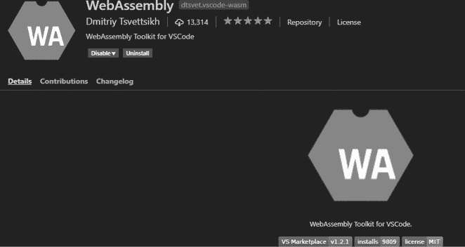


图 1-3: 为 VS Code 安装 WebAssembly 扩展

## Node.js

`Node.js` 是一个测试 WebAssembly 模块相对于现有 JavaScript 模块性能的极佳工具，也是我们在书中大部分内容使用的 JavaScript 运行时环境。`Node.js` 带有 `npm (Node Package Manager)`，你可以用它来轻松安装代码包。WebAssembly 是在 `Node.js` 中编写原生模块的绝佳替代方案，原生模块会将你锁定在特定的硬件上。如果你想创建一个通用的 `npm` 模块，为 WebAssembly 编写代码可以让你获得原生模块的性能，同时具备 JavaScript 模块的可移植性和安全性。我们将使用 `Node.js` 执行在本书中编写的许多应用程序。

`Node.js` 是我们执行 WebAssembly 的首选开发工具，无论是通过 JavaScript 还是通过 Web 服务器。我们将首先开始使用 `Node.js` 从 JavaScript 执行 WebAssembly 模块，并在第 7 章中，我们将编写一个简单的 Web 服务器来为 WebAssembly Web 应用提供服务。

`Node.js` 带有 `npm`，这让你易于安装一些用于开发 WebAssembly 的工具。在本节中，我们将向你如何使用 `npm` 安装 `wat-wasm` 模块，这是一个用于编译、优化和反汇编 WebAssembly 的工具。我们还将展示如何使用 `Node.js` 编写一个简单的 WebAssembly 应用。许多读者可能已经熟悉 `Node.js`，但如果不熟悉，如果你想学习比这里讨论的简短介绍和设置更多的内容，有大量的 `Node.js` 文档供你参考。

### 安装 Node.js

你必须安装 `Node.js` 以完成书中的代码示例。幸运的是，安装并不复杂。如果你使用 Windows 或 macOS，可以在 [`nodejs.org/en/download/`](https://nodejs.org/en/download/) 获取这两种操作系统的安装程序。

对于 Ubuntu Linux，你可以使用以下 `apt` 命令安装 Node：

```
sudo apt install nodejs
```

一旦安装了 Node，从命令提示符（任何平台）中运行以下命令以确保所有内容都按预期安装：

```
node -v
```

如果一切都安装好了，你应该能看到安装的 `Node.js` 版本输出。当我们在 Windows 机器上运行 `node -v` 命令时，它产生如下输出：

```
v12.14.0
```

这意味着我们正在运行版本 12.14.0。

### 安装 wat-wasm

有许多工具可以将 WAT 代码转换为 WebAssembly 二进制文件。事实上，在编写此书期间，我使用了许多此类工具。最后，我在 `WABT.js` 和 `Binaryen.js` 之上编写了 `wat-wasm`，以减少我想演示的功能所需的包数量。要安装 `wat-wasm`，执行以下 `npm` 命令：

```
npm install -g wat-wasm
```

`-g` 标志全局安装 `wat-wasm`。在本书中，我们将在终端窗口中使用像 `wat2wasm` 的命令行工具。为了在当前项目之外也使用这些工具，你需要全局安装它。一旦安装了 `wat-wasm`，确保通过从命令行运行 `wat2wasm` 命令来确认可以运行它：

```
wat2wasm
```

然后你应该会在控制台中中看到 `wat-wasm` 的用法日志。这将向你展示在书中后面将学习的各种标志。

你可以通过创建一个最简单的 WAT 模块来测试 `wat2wasm`，如 Listing 1-6 所示。创建一个名为 `file.wat` 的新文件并在文件中输入以下代码：

```
(module)
```

Listing 1-6: 最简单的 WebAssembly 模块

安装了 `wat-wasm` 后，你可以使用 Listing 1-7 中的命令将 `file.wat` 文件编译为 `file.wasm`，后者是 WebAssembly 二进制文件：

```
wat2wasm file.wat
```

Listing 1-7: 使用 `wat2wasm` 汇编 `file.wat` 文件

我们将整本书中使用 `Node.js` 来运行 WebAssembly 命令行应用，并提供 WebAssembly Web 应用以便在浏览器中打开。在下一节中，我们将编写第一个使用 `Node.js` 执行的 WebAssembly 应用。

### 我们的第一个 Node.js WebAssembly 应用

我们将从使用 `Node.js` 作为嵌入环境而不是 浏览器开始本书，这样可以消除代码示例中 HTML 和 CSS，并保持简单。稍后，在你掌握了基础之后，我们将探索使用浏览器作为嵌入环境。

我们 `Node.js` 应用中的 WAT 代码工作方式与在浏览器中相同。`Node.js` 内部的 WebAssembly 引擎与 Chrome 内部的相同，应用程序的 WebAssembly 部分完全感知不到它运行的环境。

让我们从创建一个简单的 WAT 文件并使用 `wat2wasm` 编译它开始。创建一个名为 `AddInt.wat` 的文件并在其中添加 Listing 1-8 中的 WAT 代码。

**AddInt.wat**

```
(module
    (func (export "AddInt")
    (param $value_1 i32) (param $value_2 i32)
    (result i32)
        local.get $value_1
        local.get $value_2
        i32.add
    )
)
```

Listing 1-8: 两个整数的 WebAssembly 模块

通过了 `wat-wasm` 后，你现在应该能够理解这段代码了。花时间查看它，直到你熟悉逻辑。这是一个导出到嵌入环境的简单 `AddInt` WebAssembly 模块。现在使用 `wat2wasm` 将 `AddInt.wat` 编译为 `AddInt.wasm`，如 Listing 1-9 所示。

```
wat2wasm AddInt.wat
```

Listing 1-9: 将 `AddInt.wat` 编译为 `AddInt.wasm`

现在我们准备好编写第一个 `Node.js` 应用的 JavaScript 部分。

### 从 Node.js 调用 WebAssembly 模块

我们可以使用 JavaScript 从 `Node.js` 调用 WebAssembly 模块。创建一个名为 `AddInt.js` 的文件并添加 Listing 1-10 中的 JavaScript 代码。

**AddInt.js**

```
1 const fs = require ('fs');
const bytes = fs.readFileSync (__dirname + '/AddInt.wasm');
2 const value_1 = parseInt (process.argv[2]);
const value_2 = parseInt (process.argv[3]);

3 (async () => {
4 const obj = await WebAssembly.instantiate (
                                Uint8Array (bytes));
5 let add_value = obj.instance.exports.AddInt( value_1, value_2 );
6 console.log(`${value_1} + ${value_2} = ${add_value}`);
})();
```

Listing 1-10: 从异步 IIFE 调用 `AddInt` WebAssembly 函数


我们使用一个异步立即调用函数表达式（IIFE）来实例化 WebAssembly 模块、调用 WebAssembly 函数，并将结果输出到控制台。对于不熟悉 `IIFE` 语法的同学来说，它是 JavaScript 在执行其余代码之前等待 promise（承诺）的一种手段。当你执行诸如实例化 WebAssembly 模块之类的任务时，这需要时间，而你不希望在等待该过程完成时阻塞浏览器或 Node.js。`(async () => {})();` 语法告诉 JavaScript 引擎有一个 promise 对象即将到来，因此在等待结果时可以去执行其他事情。在 IIFE 内部，我们调用 `WebAssembly.instantiate`，并传入我们之前通过 `readFileSync` 从 WebAssembly 文件获取的 `bytes`。在实例化模块后，我们调用从 WAT 代码导出的 `AddInt` 函数。然后，我们调用 `console.log` 语句来输出我们正在相加的数值以及结果。

现在我们已经有了 WebAssembly 模块和 JavaScript 文件，就可以通过调用 Node.js 从命令行运行程序了，如列表 1-11 所示。

```
node AddInt.js 7 9
```

列表 1-11：使用 Node.js 运行 `AddInt.js`

运行该命令将输出输出：

```
7 + 9 = 16
```

两个整数的加法是在 WebAssembly 中发生的。在继续之前，我们将向你快速展示如何使用 `.then` 语法作为异步 IIFE 的替代方案。

### .then 语法

另一种广泛用于等待 promise 返回的语法是 `.then` 语法。我们倾向于在列表 1-10 中使用 IIFE 语法，但任何一种语法都是完全可以的。

创建一个名为 `AddIntThen.js` 的文件，并将列表 1-12 中的代码添加到列表 1-10 中，用 `.then` 代码替换异步 IIFE 语法。

**AddIntThen.js**

```javascript
const fs = require ('fs');
const bytes = fs.readFileSync (__dirname + '/AddInt.wasm');
const value_1 = parseInt (process.argv[2]);
const value_2 = parseInt (process.argv[3]);

1 WebAssembly.instantiate (new Uint8Array (bytes))
2 .then (obj => {
    let add_value = obj.instance.exports.AddInt(value_1, value_2);
    console.log(`${value_1} + ${value_2} = ${add_value}`);
  });
```

列表 1-12：使用 `.then` 语法调用 WebAssembly 函数

这里的主要区别在于 `WebAssembly.instantiate` 函数，随后是 `.then`，并且它包含一个传入对象 `obj` 的箭头函数回调。

## 时刻就是

现在是学习 WAT 的绝佳时机。在编写本文时，当前发布的 WebAssembly 1.0 指令集相对较小，WebAssembly 二进制文件中总共有 172 种不同的操作码（opcode），尽管你不需要记住所有的它们。WebAssembly 支持四种不同的数据类型：`i32`、`i64`、`f32` 和 `f64`，许多操作码是针对每个类型的重复命令（例如，`i32.add` 和 `i64.add`）。如果你消除了重复的操作码，你只需要知道 50 种不同的助记符就可以了解整个语言。WebAssembly 支持的操作码数量随时间推移而增加。在 WebAssembly 的早期现在开始学习将使你占据优势。在将来，记住每一个操作码将变得困难或不可能。

如前面提到的，在 WAT 中编写模块是在 Web 浏览器内尽可能接近硬件的工作最佳方式。今天 JavaScript 在浏览器中的实现方式可能会根据许多各种因素产生性能不一致性。WebAssembly 可以消除这些不一致性，而 WAT 可以帮助你精简代码，使其尽可能快速。

你只需要对 WebAssembly 平台有极的了解就可以使用像 Emscripten 这样的工具链。然而，这样使用工具链可能会导致你的应用程序性能提升微乎其微，并误导你认为 WebAssembly 不值得付出精力。你是错的。如果你想从 Web 应用程序中获得最高性能，你必须尽可能地学习 WebAssembly。你需要知道它能做什么以及不能做什么。你必须理解它擅长什么，以及你应该在 JavaScript 中做什么。获得这些知识的最佳方法是编写 WAT 代码。最后，你可能不会用 WAT 编写应用程序，但了解这种语言有助于你理解 WebAssembly 和 浏览器。

# 2：WebAssembly 文本基础


在本章中，我们将深入探讨 WAT 代码的基础。书中的大部分代码将用 WAT 编写，这是你可以为部署到 WebAssembly 编写的最低级别的编程语言（尽管对于经验丰富的汇编程序员来说，它看起来可能很高）。

本章涵盖了大量内容。我们将首先为你展示 WebAssembly 中的两种注释样式。接下来，我们将编写传统的 hello world 。我们不从 hello world 开始，因为在 WAT 内部处理字符串更具挑战性。

然后我们将讨论如何使用导入对象从 JavaScript 导入数据。我们将查看命名和未命全局变量，以及 WebAssembly 支持的数据类型。我们将讨论 S 表达式（S-Expression）语法以及 `wat2wasm` 如何编译你的代码。你将深入逻辑，包括 `if`/`else` 语句和循环。在本章结束时，你应该能够编写可以在命令行执行的简单 WebAssembly 应用。

## 编写简单的模块

每个 WAT 应用都必须是一个模块，因此我们首先查看模块语法。我们在括号块中声明模块，如列表 2-1 所示。

```wat
(module
  ;; 模块代码写在这里
)
```

列表 2-1：单行 WAT 注释

我们用 `module` 关键字声明模块，括号内的任何内容都是模块的一部分。要添加注释，我们使用两个分号 `;;`，之后的所有内容都是注释。WAT 还有块注释语法；你用 `(;` 打开块注释，用 `;)` 结束，如列表 2-2 所示。

```wat
(module
  (;
  这是一个带有块注释的模块。
  就像 JavaScript 中的 /* */ 注释一样
  你可以在括号之间编写任意数量的内容
  ;)
)
```

列表 2-2：多行 WAT 注释

## WebAssembly 中的 Hello World

WAT 没有任何原生的字符串支持，因此处理字符串需要你直接将内存作为字符数据数组进行操作。然后这些内存数据必须在 JavaScript 代码中转换为字符串，因为在 JavaScript 内部操作字符串要简单得多。

在 WAT 中处理字符串时，你需要声明一个存储在 WebAssembly 线性内存中的字符数据数组。线性内存是一个我们在第 6 章中详细讨论的话题，但现在知道它类似于原生应用程序中的内存堆，或者 JavaScript 中的一个大类型数组。

你还需要从 WebAssembly 调用导入的 JavaScript 函数来处理 I/O 操作。与原生应用程序通常由操作系统处理 I/O 不同，在 WebAssembly 模块中，I/O 必须由嵌入环境处理，无论该环境是 Web 浏览器、操作系统还是运行时。

### 创建我们的 WAT 模块


在本节中，我们将创建一个简单的 WebAssembly 模块，它在线性内存中创建一个 `hello world!` 字符串，并调用 JavaScript 将该字符串写入控制台。创建一个新的 WAT 文件并将其命名为 `helloworld.wat`。打开该文件并在 Listing 2-3 中添加 WAT 代码。

### helloworld.wat

```
(module
  (import "env" "print_string" (func $print_string( param i32 )))
)
```
Listing 2-3：导入函数

这段代码告诉 WebAssembly 期望从我们的嵌入环境中获取导入对象 `env`，并且在该对象中，我们期望找到函数 `print_string`。当我们稍后编写 JavaScript 代码时，我们将创建一个带有 `print_string` 函数的 `env` 对象，它将在我们实例化该 WebAssembly 模块时被传递给该模块。

我们还设置了签名，要求需要一个表示字符串长度的单个 `i32` 参数。我们将此函数命名为 `$print_string`，以便我们可以在 WAT 代码中访问它。

接下来，我们将为内存缓冲区添加一个导入。在 Listing 2-4 中添加加粗的行。

### helloworld.wat

```
(module
  (import "env" "print_string" (func $print_string( param i32 )))
  (import "env" "buffer" (memory 1))
)
```
Listing 2-4：导入函数和内存缓冲区

这个新的 `import` 告诉我们的 WebAssembly 模块，我们将从对象 `env` 导入内存缓冲区，该缓冲区将命名为 `buffer`。`(memory 1)` 语句表示缓冲区将是一个页线性内存：`page` 是你可以一次向线性内存分配的最小内存块。在 WebAssembly 中，一个页是 64KB，这超过了此模块所需的，因此我们只需要页。接下来，在 Listing 2-5 中，我们向 `helloworld.wat` 添加了几个全局变量。

### helloworld.wat

```
(module
  (import "env" "print_string" (func $print_string( param i32 )))
  (import "env" "buffer" (memory 1))
1 (global $start_string (import "env" "start_string") i32) 
2 (global $string_len i32 (i32.const 12))
)
```
Listing 2-5：添加全局变量

第一个 `global` 变量 1 是从我们的 JavaScript 导入对象导入的数字；它映射到 JavaScript 中名为 `env` 的变量（我们尚未创建它）。该值将是字符串的起始内存位置，可以是线性内存页中的任何位置，最高到 65,535。当然，你不会想选择一个靠近线性内存末尾的值，因为这将限制你能够存储的字符串长度。如果传递的值是 `0`，你可以使用整个 64KB 来存储字符串。如果你传递的值 `65,532`，你将只能使用最后四个字节来存储字符数据。如果你尝试写入大于分配位置的内存位置，你将在 JavaScript 控制台中收到内存错误。第二个全局变量 `$string_len` 2 是一个常量，表示我们定义的字符串的长度，我们将其设置为 `12`。

在 Listing 2-6 中，我们使用 data 表达式在线性内存中定义我们的字符串。

### helloworld.wat

```
(module
  (import "env" "print_string" (func $print_string( param i32 )))
  (import "env" "buffer" (memory 1))
  (global $start_string (import "env" "start_string") i32)
  (global $string_len i32 (i32.const 12))
  (data (global.get $start_string) "hello world!")
)
```
Listing 2-6：添加数据字符串

我们首先传递模块将写入数据的内存位置。数据存储在 `$start_string` 全局变量中，模块将从 JavaScript 导入它。第二个参数是数据字符串，我们将其定义为字符串 `"hello world!"`。

现在我们可以定义 `helloworld` 函数并将其添加到模块中，如 Listing 2-7 所示。

### helloworld.wat

```
(module
  (import "env" "print_string" (func $print_string (param i32)))
  (import "env" "buffer" (memory 1))
  (global $start_string (import "env" "start_string") i32)
  (global $string_len i32 (i32.const 12))
  (data (global.get $start_string) "hello world!")	
1 (func (export "helloworld")
  2 (call $print_string (global.get $string_len))
  )
)
```
Listing 2-7：向 WebAssembly 模块添加 `helloworld` 函数

我们将我们的函数定义并导出为 `helloworld` 以在 JavaScript 中使用。


```javascript
( async () => {   
  let obj = await WebAssembly.instantiate(new Uint8Array (bytes), importObject);
  ({helloworld: hello_world} = obj.instance.exports);
  hello_world();
})();
```
列表 2-10：在异步 IIFE 中实例化 WebAssembly 模块。

`async` 模块的第一行等待 `WebAssembly.instantiate` 函数调用的返回，但与列表 1-1 中的简单加法示例不同，我们向该函数传递了早之前声明的 `importObject`。然后，我们使用解构语法从 `obj.instance.exports` 中提取出 `helloworld` 函数，并将 `hello_world` 变量设置为 `obj.instance.exports` 中的函数。

我们 IIFE 的最后一行调用了 `hello_world` 函数。我们将箭头函数括在括号中，然后在函数声明的末尾添加函数调用括号，这会导致该函数立即执行。

一旦你有了 JavaScript 和 WebAssembly 文件，请在命令行中运行以下 `node` 命令：

```bash
node helloworld.js
```

你应该会在命令行中看到以下输出：

```text
hello world!
```

我们已经构建了无处不在的 hello world 程序！现在你已经掌握了 hello world 程序，我们将探索变量以及它们在 WAT 中如何工作。

## WAT 变量

WAT 处理变量的方式与其他编程语言略有不同，因此在这里为你提供一些细节是值得的。然而，浏览器管理本地或全局 WAT 变量的方式与管理 JavaScript 变量相同。

WAT 有四种全局局部变量类型：`i32`（32 位整数）、`i64`（64 位整数）、`f32`（32 位浮点数）和 `f64`（64 位浮点数）。字符串和其他复杂的数据结构需要直接在线性内存中管理。我们将在第 6 章介绍 WAT 中的线性内存以及更复杂数据结构的使用。现在，让我们来看每个变量类型。

### 全局变量与类型转换

正如你所预期的，你可以在 WAT 的任何函数中访问全局变量，我们通常将全局变量作为常量。可变全局变量可以在设置后进行修改，这通常是不受欢迎的，因为它们可能会在使用它们的函数中引入副作用。你可以从 JavaScript 导入全局变量，允许应用程序的 JavaScript 部分在模块内部设置常量值。

在导入全局变量时，请记住，在本文编写时，标准的 JavaScript 数字变量不支持 64 位整数值。JavaScript 中的数字是 64 位浮点变量。64 位浮点变量可以表示 32 位整数的每一个值，因此 JavaScript 在进行这种转换时没有问题。但是，你无法用 64 位浮点值表示所有可能的 64 位整数值。遗憾的是，这意味着你可以在 WebAssembly 中处理 64 位整数，但如果你想将 64 位值发送给 JavaScript，就需要额外的努力，这超出了本书的范围。

关于 WebAssembly 和 JavaScript 数据类型，你必须知道的另一个细节是，JavaScript 将所有数字视为 64 位浮点数。当你从 WebAssembly 调用 JavaScript 函数时，无论你传递什么数据类型，JavaScript 引擎都会将其隐式转换为 64 位浮点。然而，WebAssembly 将导入的函数定义为具有特定的数据类型要求。即使你将同一个函数传入 WebAssembly 模块三次，你也需要为从 WebAssembly 传递的参数指定类型。

让我们创建一个名为 `globals.wat` 的模块，从 JavaScript 导入三个数字。[列表 2-11] 中的 WAT 文件声明了用于 32 位整数、32 位浮点数和 64 位浮点数值的全局变量。

**globals.wat**

```wat
(module
  (global $import_integer_32  (import "env" "import_i32") i32)
  (global $import_float_32    (import "env" "import_f32") f32)
  (global $import_float_64    (import "env" "import_f64") f64)

  (import "js" "log_i32" (func $log_i32 (param i32)))
  (import "js" "log_f32" (func $log_f32 (param f32)))
  (import "js" "log_f64" (func $log_f64 (param f64)))

  (func (export "globaltest")
    (call $log_i32 (global.get $import_integer_32))
    (call $log_f32 (global.get $import_float_32))
    (call $log_f64 (global.get $import_float_64))
  )
)
```
列表 2-11：导入 JavaScript 函数的不同变体。

我们首先声明全局变量，包括它们的类型和导入位置。我们还从 JavaScript 导入了一个 `log` 函数。WebAssembly 要求我们指定数据类型，因此我们导入了三个函数，每个函数都有不同类型的参数：32 位整数、32 位浮点数和 64 位浮点数。

**globals.js**
```javascript
const fs = require('fs');
const bytes = fs.readFileSync('./globals.wasm');
let global_test = null;

let importObject = {
  js: {
    log_i32: (value) => { console.log("i32: ", value) },
    log_f32: (value) => { console.log("f32: ", value) },
    log_f64: (value) => { console.log("f64: ", value) },
  },
  env: {
    import_i32: 5000000000, // JS 中的数字忽略 _
    import_f32: 123.012345679,
    import_f64: 123.012345689,
  }
};
```
列表 2-12：设置 `importObject` 函数和值。

在[列表 2-12] 中，通过 `importObject` 向 WebAssembly 模块传递了三个不同的函数：`log_i32`、`log_f32` 和 `log_f64`。这些函数都是 `console.log` 函数的封装。这些函数将字符串作为 WebAssembly 值的的前缀。这些函数只接收一个参数 `value`。JavaScript 不会像 WebAssembly 那样为参数分配类型，因此可以使用三次同一个函数。我们没有使用三次同一个函数的唯一原因是我们想更改值的前缀字符串以保持输出清晰。

我们在[列表 2-12] 中选择的值是为了演示每种数据类型的局限性。我们将全局变量 `import_i32` 设置为 `5000000000`，将其作为 32 位整数传递给 WebAssembly。该值超过了 32 位整数能保存的值。我们将全局变量 `import_f32` 设置为 `123.012345679`，其精度高于 WebAssembly 模块中设置的 32 位浮点变量支持的精度。`importObject` 中设置的最后一个全局变量是 `import_f64`，与前两个变量不同，它足够大可以容纳传递的值。

列表 2-13 中的代码实例化了我们的 WebAssembly 模块并执行了 `globaltest` 函数。


```javascript
( async () => {
  let obj = await WebAssembly.instantiate(new Uint8Array (bytes),
                                          importObject);
  ({globaltest: global_test} = obj.instance.exports);

  global_test();
})();
```
Listing 2-13: 在异步 IIFE 中实例化 WebAssembly 模块

现在我们已经已经在 JavaScript 和 WAT 文件中准备了所有代码，可以使用以下 `wat2wasm` 调用将 WAT 文件编译为 `globals.wasm`：

```
wat2wasm globals.wat
```

编译 `globals.wasm` 后，我们使用以下 `node` 命令运行我们的应用程序：

```
node globals.js
```

当你使用 `node` 运行此 JavaScript 文件时，你应该应该能看到控制台中记录了 Listing 2-14 中的输出。

```
i32: 705032704
f32: 123.01234436035156
f64: 123.0123456789
```
Listing 2-14: 从 `globals.js` 记录到控制台的输出

我们通过 `importObject` 传入了一个值 `5,000,000,000`，但我们的输出显示的值为 `705,032,704`。原因是 32 位无符号整数的最大值为 `4,294,967,295`。如果你在该数字上加 `1`，该 32 位整数将绕回 `0`。因此，如果你将传入的 `5,000,000,000` 减去 `4,294,967,296`，结果就是 `705,032,704`。这个教训是，如果你处理的数字大于几十亿，你可能无法使用 32 位整数进行操作。遗憾的是，如前面提到的，你无法从 WebAssembly 向 JavaScript 传递 64 位整数。如果你想从 WebAssembly 向 JavaScript 传递 64 位整数，你需要将它们转换为 64 位浮点数，或者作为两个 32 位整数传递。

我们向我们的 WebAssembly 模块传递了一个值 `123.0123456789`，但由于 32 位浮点数的精度非常有限，它能做的最好就是近似该数字，而且效果并不理想。JavaScript 和 WebAssembly 中的 32 位浮点数使用 23 位来表示数字，并乘以 2 的 8 位指数值的幂。所有浮点数都是近似值，但 64 位浮点数在这些近似方面做得好得多。使用 32 位与 64 位浮点数时你会看到的性能差异取决于你的硬件。如果你想使用 32 位浮点数来提高应用程序的性能，了解目标硬件是一个好主意。某些移动设备使用 32 位浮点数可能会获得更大的性能提升。

最后的消息显示返回给 JavaScript 的 64 位浮点值为 `f64: 123.0123456789`。

如你所见，这是第一个与我们传入 WebAssembly 模块的数字保持未修改的数字。这并不意味着你应该始终使用 64 位浮点数。整数的加法、减法和乘法通常执行快三到五倍。除以 2 的幂也快几倍。然而，除 2 的幂以外的任何数字，使用浮点数可能会更快。

我们将在第 4 章更详细地探索这些数据类型。现在你对全局和类型有了更好的理解，让我们来看局部变量。

### 局部变量

在 WebAssembly 中，存储在局部变量和参数中的值通过 `local.get` 表达式推入栈。在第 1 章中，我们写了一个小型函数，执行了传入函数的两个参数的加法，如下所示 Listing 2-15。

**AddInt.wat**

```wat
(module
    (func (export "AddInt")
    (param $value_1 i32) (param $value_2 i32)
    (result i32)
        local.get $value_1
        local.get $value_2
        i32.add
    )
)
```
Listing 2-15: 带有 32 位整数加法的 WebAssembly 模块

让我们对代码进行一些修改。为了演示我们如何使用局部变量，我们将对 `AddInt` 返回的和和进行平方。创建一个名为 `SumSquared.wat` 的新文件，并在 Listing 2-16 中添加代码。更改用数字标记。

**SumSquared.wat**

```wat
(module
  (func (export 1"SumSquared")
    (param $value_1 i32) (param $value_2 i32)
    (result i32)
  2 (local $sum i32)

 3 (local $sum i32)
```
Listing 2-16: 带有 32 位整数加法的 WebAssembly 模块（注：提示中 2-16 的源码是碎片化的，保留了所提供的逻辑）。


# 列表 2-19: `i32.add` 解包后的代码

现在 `i32.add` 执行完毕，下一个要解包的部分是 `i32.sub`。同样，代码首先进入 S-Expression 内部并执行表达式 `(i32.const 9)` 6，紧接着执行表达式 `(i32.const 7)` 7。一旦这两个常量被推入栈中，代码就会执行 `i32.sub`。解包后的子表达式看起来类似于 列表 2-20。

```
i32.const 9
i32.const 7
i32.sub
```

# 列表 2-20: S-Expression 解包后的 `i32.sub` 代码

在 `i32.add` 和 `i32.sub` S-Expression 执行后，解包版本将执行 `i32.mul` 命令。

S-Expression 的完全解包版本如 列表 2-21 所示。

```
i32.const 3  ;; Stack = [3]
i32.const 2  ;; Stack = [2, 3]
i32.add      ;; 2 & 3 从栈中弹出，计算出的和 5 入栈 [5]

i32.const 9  ;; Stack = [9,5]
i32.const 7  ;; Stack = [7,9,5]
i32.sub      ;; 7 & 9 从栈中弹出。 9-7=2 入栈 [2,5]

i32.mul      ;; 2,5 从栈中弹出， 2x5=10 入栈 [10]
```

## 列表 2-21: 使用 WAT 栈示例

栈机的工作原理起初看起来可能有些令人生畏，但一旦你习惯了它，就会觉得它很自然。我们建议在熟悉栈机之前一直使用 S-Expression。如果你只熟悉高层语言，S-Expression 语法是进入 WAT 的极佳方式。

## 索引变量

WAT 并不要求你为变量和函数命名。相反，你可以使用索引数字来引用尚未命名的函数和变量。你可能会经常看到使用这些索引变量和函数的 WAT 代码。有时这些代码来自反汇编，尽管我们也偶尔看到有人编写此类这样的代码。

调用 `local.get` 后紧跟一个数字的代码，是根据该变量在 WebAssembly 代码中出现的顺序来检索本地变量的。例如，我们可以像 列表 2-22 中的代码那样编写我们在 列表 2-21 中的 `AddInt.wat` 文件。

```
(module
    (func (export "AddInt")
  1 (param i32 i32)
    (result i32)
      2 local.get 0
      3 local.get 1
        i32.add
    )
)
```

# 列表 2-22: 使用变量

如你所见，我们没有为 `param` 1 表达式中的参数命名。这种代码风格的方便之处在于，你可以通过添加更多类型在单个表达式中声明多个参数。当我们调用 `local.get` 时，我们需要传递一个从零开始的数字来检索正确的参数。第一次调用 `local.get` 2 通过传递 `0` 检索第一个参数。第二次调用 `local.get` 3 通过传递 `1` 检索第二个参数。你也可以将这种语法用于函数和全局变量。我觉得这种语法很难阅读，因此我不会在本书中使用它。然而，我觉得有必要介绍一下，因为某些调试器会使用它。

## 类型之间的转换

JavaScript 开发者不需要处理不同数值类型之间的转换。JavaScript 中的所有数字都是 64 位浮点数。这简化了开发者的编码，但付出了性能代价。当你处理 WebAssembly 时，你需要更熟悉你的数值数据。如果你需要对两个具有不同数据类型的变量之间执行数值操作，你需要进行一些转换。表 2-1 提供了可以在 WAT 中使用的转换函数，用于在不同的数值数据类型之间进行转换。

| 函数 | 操作 |
| --- | --- |
| `i32.trunc_s/f64`, `i32.trunc_u/f64` | 将 64 位浮点数转换为 32 位整数 |
| `i32.trunc_s/f32`, `i32.trunc_u/f32`, `i32.reinterpret/f32` | 将 32 位浮点数转换为 32 位整数 |
| `i32.wrap/i64` | 将 64 位整数转换为 32 位整数 |
| `i64.trunc_s/f64`, `i64.trunc_u/f64`, `i64.reinterpret/f64` | 将 64 位浮点数转换为 64 位整数 |
| `i64.extend_s/i32` | 将 64 位整数转换为 32 位整数 |
| `i64.trunc_s/f64`, `i64.trunc_u/f64` | 将 64 位浮点数转换为 64 位整数 |
| `i64.extend_s/i32` | 将 64 位整数转换为 32 位整数 |
| `i32.trunc_s/f64`, `i32.trunc_u/f64` | 将 64 位浮点数转换为 32 位整数 |
| `i32.trunc_s/f32`, `i32.trunc_u/f32`, `i32.reinterpret/f32` | 将 32 位浮点数转换为 32 位整数 |
| `i32.wrap/i64` | 将 64 位整数转换为 32 位整数 |
| `i64.trunc_s/f64`, `i64.trunc_u/f64`, `i64.reinterpret/f64` | 将 64 位浮点数转换为 64 位整数 |
| `i64.extend_s/i32` | 将 64 位整数转换为 32 位整数 |

**表 2-1: 数值转换**

## if/else 条件逻辑

WAT 与汇编语言不同的一个点在于它包含了一些控制流。WebAssembly 没有布尔类型；相反，它使用 `i32` 值。`if` 语句将任何非零值视为真，将零视为假。

当你编写高层程序时，你在 `if`/`else` 语句中使用布尔逻辑。在 JavaScript 中，你可能会有一个类似所示的 `if` 语句：

```
if( x > y && y < 6 )
```

要在 WebAssembly 中实现此逻辑，你需要使用条件地返回 32 位整数值的表达式。列表 2-25 展示了我们在 `x` 和 `y` 为 32 位整数的情况下，如何实现 JavaScript `if` 示例中的逻辑。


```assembly
;; 此代码仅用于演示，不属于大型应用程序的一部分
(if
  (i32.and
    (i32.gt_s (local.get $x) (local.get $y) ) ;; 有符号大于
    (i32.lt_s  (local.get $y) (i32.const 6) ) ;; 有符号小于
  )
  (then
    ;; x 大于 y 且 y 小于 6
    nop
  )
)
```

### 列表 2-25：使用 S 表达式语法的带有 `i32.and` 的 `if` 表达式

相比之下，这看起来有一点复杂。`i32.and` 表达式对 32 位整数执行位与（AND）操作。它之所以能工作，是因为 `i32.gt_s` 和 `i32.lt_s` 在为真时返回 `1`，为假时返回 `0`。在 WebAssembly 中，你必须记住你正在使用位与/位或操作；如果你对值为 `2` 的值和值为 `1` 的值使用 `i32.and`，由于二进制与的工作方式，结果将是 `0`。你可能想要的是逻辑与而不是位与，但 `i32.and` 是位与。如果你熟悉位与/位或操作，我们将在第 4 章中详细讨论它们。在某些情况下，复杂的 `if` 表达式在展开后看起来更好。列表 2-26 显示了列表 2-25 中不使用语法糖的对应代码。

```assembly
;; 此代码仅用于演示，不属于大型应用程序的一部分
local.get $x
local.get $y
i32.gt_s      ;; 如果 $x > $y，则在栈上压入 1

local.get $y
i32.const 6
i32.lt_s      ;; 如果 $y < 6，则在栈上压入 1

i32.and       ;; 对栈上的最后两个值执行位与操作

if
  ;; x 大于 y 且 y 小于 6
  nop
end
```

### 列表 2-26：使用栈语法的带有 `i32.and` 的 `if` 语句

列表 2-27 显示，如果 `$x` 和 `$y` 是 64 位或 32 位浮点数，你可以使用类似的表达式。

```assembly
;; 此代码仅用于演示，不属于大型应用程序的一部分
(if
  (i32.and
 1 (f32.gt (local.get $x) (local.get $y) )
  2 (f32.lt  (local.get $y) (f32.const 6) )
  )
  (then
    ;; x 大于 y 且 y 小于 6
    nop
  )
)
```

### 列表 2-27：使用 `f32` 比较但 `i32.and` 结果

注意，我们将 `i32.gt_s` 和 `i32.lt_s` 分别更改为 `f32.gt` `1` 和 `f32.lt` `2`。许多整数操作必须使用 `_s` 后缀来指定它们是否支持负数。对于浮点数你不需要这样做，因为所有浮点数都是符号符号，并且有专门的符号位。

WebAssembly 中总共有 40 个比较表达式。表 2-2 显示了与 `if`/`else` 表达式配合使用的表达式。除非另有说明，这些函数从栈上弹出两个值并进行比较，如果为真则在栈上压入 `1`，为假则在栈上压入 `0`。

| 函数 | 操作 |
| --- | --- |
| i32.eq i64.eq f32.eq f64.eq | 检查相等 |
| i32.ne i64.ne f32.ne f64.ne | 不等于 |
| i32.lt_s i32.lt_u i64.lt_s i64.lt_u f32.lt f64.lt | 小于测试。`_s` 后缀表示有符号比较；`_u` 表示无符号。 |
| i32.le_s i32.le_u i64.le_s i64.le_u f32.le f64.le | 小于或等于测试。`_s` 后缀表示有符号比较；`_u` 表示无符号。 |
| i32.gt_s i32.gt_u f32.gt f64.gt i64.gt_s i64.gt_u | 大于测试。`_s` 后缀表示有符号比较；`_u` 表示无符号。 |
| i32.ge_s i32.ge_u i64.ge_s i64.ge_u f32.ge f64.ge | 大于或等于测试。`_s` 后缀表示有符号比较；`_u` 表示无符号。 |
| i32.and | 位与 |
| i32.or | 位或 |
| i32.xor | 位异异 |
| i32.eq | 检查相等 |
| i32.ne | 不等于 |
| i32.lt_s | 小于（有符号） |
| i32.lt_u | 小于（无符号） |
| i32.le_s | 小于或等于（有符号） |
| i32.le_u | 小于或等于（无符号） |
| i32.gt_s | 大于（有符号） |
| i32.gt_u | 大于（无符号） |
| i32.ge_s | 大于或等于（有符号） |
| i32.ge_u | 大于或等于（无符号） |

## if 表达式

WebAssembly 中的 `if` 表达式与其它语言中的 `if` 语句相似，但它有一个关键区别：它返回执行的 `then` 或 `else` 块的结果。在某些情况下，复杂的 `if` 表达式在展开后看起来更好。列表 2-26 显示了列表 2-25 中不使用语法糖的对应代码。

`if` 表达式由条件、`then` 块和一个可选的 `else` 块组成。如果条件为真，则执行 `then` 块并返回其值。如果条件为假且存在 `else` 块，则执行它并返回其值。如果条件为假且没有 `else` 块，`if` 表达式不返回任何值。

## loop 表达式

WebAssembly 中的 `loop` 表达式与其他语言中的 `while` 循环相似，但它有一个关键区别：它没有条件。相反，你使用 `br` 指令跳回循环开头或使用 `br_if` 指令跳出。`loop` 表达式还返回跳出循环块的值。


```assembly
;; This code is for demonstration and not part of a larger app
  (loop $infinite_loop
    ;; this code will execute in an infinite loop
    nop

  1 br $infinite_loop
  )

  ;; this code will never execute because the loop above is infinite
2 nop
```

Listing 2-31: 无限循环中的分支

`br` 语句 `1` 每次迭代都会跳转回 `$infinite_loop` 块的顶部。`loop` `2` 下方的代码永远不会执行。

### 结合使用 block 和 loop

为了让你的循环能够跳出（break）和继续（continue），你需要结合使用 `loop` 和 `block` 表达式。让我们一起编写一个一个小型的 WebAssembly 模块和 JavaScript 应用来计算阶乘。程序将运行循环，直到我们获得传入函数的数字的阶乘值。这将允许我们测试 `loop` 表达式的 `continue` 和 `break` 功能。我们的简单循环将计算直到从 JavaScript 传入的参数 `$n` 为止每个数字的阶乘。然后并将 `$n` 的阶乘值返回给 JavaScript。

创建一个名为 `loop.wat` 的新文件，并在 Listing 2-32 中添加代码。

**loop.wat**

```assembly
(module
1 (import "env" "log" (func $log (param i32 i32)))

  (func $loop_test (export "loop_test") (param $n i32)
    (result i32)

    (local $i         i32)
    (local $factorial i32)

    (local.set $factorial (i32.const 1))

  2 (loop $continue (block $break	;; $continue 循环和 $break 块
    3 (local.set $i            	;; $i++	
        (i32.add (local.get $i) (i32.const 1))
      )

    4 ;; $i 的阶乘值
      (local.set $factorial ;; $factorial = $i * $factorial	
        (i32.mul (local.get $i) (local.get $factorial))
      )

      ;; 调用 $log 并传递参数 $i, $factorial
    5 (call $log (local.get $i) (local.get $factorial))

    6 (br_if $break
       (i32.eq (local.get $i) (local.get $n)));;如果 $i==$n 则跳出循环
    7 br $continue        ;; 跳转到循环顶部
    ))

  8 local.get $factorial  ;; 将 $factorial 返回给调用的 JavaScript
  )
)
```

Listing 2-32: 使用 `loop` 和 `block` 进行正向和后向跳转

该模块中的第一个表达式是导入 `$log` 函数 `1`。稍后，我们将在 JavaScript 中编写此函数，并在每次通过循环时都调用它，以记录每次迭代时 `$i` 的阶乘值。我们将循环标记为 `$continue` `2`，将块标记为 `$break` `2`，因为跳转到 `$continue` 将继续执行循环，而跳转到 `$break` 则将跳出循环。我们可以在不使用 `$break` 块的情况下实现这一点，但我们想演示循环是如何与块配合工作的。这使得你的代码可以像高级编程语言中的 `break` 和 `continue` 语句一样工作。

`loop` 将 `$i` `3`，然后通过将 `$i` 乘以旧的 `$factorial` 值计算一个新的 `$factorial` 值 `4`。然后它使用 `$i` 和 `$factorial` 调用日志 `5`。我们使用 `br_if` 在 `$i` == `$n` `6` 时跳出 `loop`。如果没有跳出 `loop`，则跳转回 `loop` 的顶部 `7`。当 `loop` 退出时，我们将 `$factorial` 的值推入栈 `8`，这样我们就可以将该值返回给调用的 JavaScript。

一旦你有了 WAT 文件，可以使用以下命令将其编译为 WebAssembly 文件：

```bash
wat2wasm loop.wat
```

现在我们将创建一个 JavaScript 文件来执行 WebAssembly。创建一个 `loop.js` 文件并输入 Listing 2-33 中的代码。

**loop.js**

```javascript
const fs = require('fs');
const bytes = fs.readFileSync(__dirname + '/loop.wasm');
1 const n = parseInt(process.argv[2] || "1"); //我们将循环 n 次
let loop_test = null;

let importObject = {
  env: {
  2 log: function(n, factorial) { // 将 n 的阶乘记录到输出标签
      console.log(`${n}! = ${factorial}`);
    }
  }
};

( async() => {
3 let obj = await WebAssembly.instantiate( new Uint8Array(bytes),
                                           importObject );

4 loop_test = obj.instance.exports.loop_test;

5 const factorial = loop_test(n); // 调用我们的循环测试
6 console.log(`result ${n}! = ${factorial}`);
7 if (n > 12) {
    console.log(`
    ===============================================================
    大于 12 的阶乘对于 32 位整数来说太大了。
    ===============================================================
    `)
  }
})();
```

Listing 2-33: 从 JavaScript 调用 `loop_test`

`loop` 将 `$i` `3`，然后通过将 `$i` 乘以旧的 `$factorial` 值计算一个新的 `$factorial` 值 `4`。然后它使用 `$i` 和 `$factorial` 调用日志 `5`。我们使用 `br_if` 在 `$i` == `$n` `6` 时跳出 `loop`。如果没有跳出 `loop`，则跳转回 `loop` 的顶部 `7`。当 `loop` 退出时，我们将 `$factorial` 的值推入栈 `8`，这样我们就可以将该值返回给调用的 JavaScript。

### 使用 br_table 分支

在 WAT 中使用 `block` 表达式的另一种方法是结合 `br_table` 使用。`br_table` 接收块列表和该列表的索引。使用跳转表的奇异之处在于，代码只能跳出它内部所在的块。这意味着你必须提前声明所有的块。Listing 2-35 显示了 WAT 代码的样子。

```assembly
;; This code is for demonstration and not part of a larger app
  (loop $infinite_loop
    ;; this code will execute in an infinite loop
    nop

  1 br $infinite_loop
  )

  ;; this code will never execute because the loop above is infinite
2 nop
```

Listing 2-35: 在 WAT 中使用 `br_table`

我们在 `br_table` 表达式 `1` 之前定义了所有的 `block` 表达式。因此，当调用 `br_table` 表达式 `2` 时，并不完全确定跳转到哪里。这就是为什么我们在代码中添加了注释 `3` 说明哪个块正在结束。

当分支较多时，`br_table` 比使用 `if` 表达式具有更好的性能。在我们的测试中，在有大约 12 个分支之前，使用 `br_table` 表达式是不划算的。当然，这取决于运行它的嵌入环境和硬件。即使在这种数量下，Chrome 中的 `br_table` 仍然比 `if` 语句慢。

## 总结

在本章中，我们涵盖了许多 WAT 编程基础。在第一章学习了如何创建和执行 WebAssembly 模块后，你在本章中转向了创建传统的 hello 世界应用程序。在 WAT 中创建 hello 世界应用程序比大多数编程语言要高级一些。


在完成几个初始程序后，我们开始研究 WAT 的一些基本特性，以及它们与 JavaScript 这种传统的高级语言何不同。我们探索了变量和常量，以及如何使用 WAT 命令将它们推入栈中。我们讨论了 S 表达式（S-Expression）语法以及如何解包它。我们还简要提到了索引局部变量和函数，并向你介绍了该语法。你学习了基础的分支和循环结构，以及如何在 WAT 语法中使用它们。在下一章中，我们将探索 WAT 中的函数和函数表，以及它们如何与 JavaScript 和其他 WAT 模块进行交互。

# 3 章 函数与表


在本章中，我们将探索 WebAssembly 中的函数：我们应该以及何时从 JavaScript 或不同的 WebAssembly 模块导入函数，以及如何将 WebAssembly 函数导出到嵌入环境并从 JavaScript 调用这些函数。你将学习 WebAssembly 中的表以及如何调用在表中定义的函数。我们还研究了在 WebAssembly 模块内部和外部定义函数的调用对性能的影响。

WebAssembly 模块通过导入和导出函数与嵌入环境进行交互。我们必须从嵌入环境导入函数供 WebAssembly 使用，并导出函数供网页调用。我们也可以通过 `export` 语句从 WebAssembly 模块内部编写函数导出到嵌入环境。否则，函数默认仅限模块内部使用。

函数调用始终会导致某些计算周期的损失。但必须知道，WebAssembly 模块调用导入的 JavaScript 函数所损失的周期比调用其内部定义的函数多。

到目前为止我们定义的每个函数都包含 `(export)` 表达式来导出函数，以便 JavaScript 调用它。然而，并不是每个函数都应该使用 `export`。从 JavaScript 调用任何 WebAssembly 函数都会产生开销成本，因此你通常不会导出只执行微小任务的 WAT 函数。不消耗许多计算周期的小函数可能更好地留在 JavaScript 中以减少开销。确保你的 WAT 代码在返回 JavaScript 之前尽可能完成更多工作；较小的函数不应使用 `export`。

最适合导出的 WAT 函数是那些循环并处理大量数据的函数。我们建议在代码早期使用许多 WAT 函数来辅助调试过程。当代码被拆分为许多小函数时，在调试器中单步执行 WAT 代码会更容易追踪。第 10 章详细介绍了 WebAssembly 代码的调试。当你为了性能优化代码时，你可能会决定通过在函数调用的地方将其代码内联来移除其中一些函数。任何从你导出的 WebAssembly 函数中调用数千次的内部函数都是内联的候选对象。第 9 章详细介绍了性能调优。

## 编写 is_prime 函数

在之前的章节中已经见过将函数导出到 JavaScript 的示例，但那些函数并不是 WebAssembly 性能改进的良好候选者，因为它们并没有做什么。在这里我们将编写一个故意缓慢的算法来判断输入是否为质数。这个函数是在 WebAssembly 中创建并获得比 JavaScript 性能的良好候选者，因为它涉及大量的计算。创建一个 `is_prime.js` 文件和一个 `is_prime.wat` 文件来开始创建此应用。

### 传递参数

让我们从基础开始。首先，我们创建一个模块，然后在该模块内部创建一个可以导出为 `is_prime` 的函数。该函数接受一个 32 位整数参数，并返回一个 32 位整数：如果传入的数字是质数则返回 `1`，否则返回 `0`。将代码放在 `is_prime.wat` 文件中的列表 3-1 中。

```
(module
  (func (1export "is_prime") (2param $n i32) (3result i32)
  4 i32.const 0 ;; remove later
  )
)
```

列表 3-1：WebAssembly `is_prime` 函数存根

我们将此函数导出到 JavaScript 并命名为 `is_prime` 1。JavaScript 传入单个参数 `param` `$n` 作为 `i32` 2。完成后，函数向 JavaScript 返回一个 32 位整数 3。为了编译，该函数期望在函数完成时栈上有一个 32 位整数，因此我们添加了行 `i32.const` `0` 4。如果没有这一行，当我们运行 `wat2wasm` 时编译器将报错，因为因为它期望在函数完成时返回一个数字，并且它需要该数字在函数结束时在栈上。

此函数仅设置为导出，而没有标记为内部使用。`(func)` 表达式以 `export` 表达式开始，而不是 `$is_prime` 标签。如果我们想从 WebAssembly 模块内部或从 JavaScript 调用此函数，我们将像列表 3-2 所示对其进行标记。

```
(func 1$is_prime (export "is_prime") (param $n i32) (result i32)
```

列表 3-2：导出函数

### 创建内部函数

让我们给 `is_prime.wat` 文件添加更多代码。除了数字 2 之外没有偶数质数，因此我们将编写一个通过查看整数的最后一位来检查输入数字是否为偶数的函数。所有奇数的整数最低位都是 1。列表 3-3 显示了我们将添加到 `is_prime.wat` 中的 `$even_check` 函数代码。

**is_prime.wat (部分 1/4)**

```
(module
  ;; 将 $even_check 添加到顶部
  (func $even_check (1param $n i32) (result i32)
     local.get $n
     i32.const 2
   2 i32.rem_u   ;; 如果你取余数
     i32.const 0 ;; 偶数的余数为 0
   3 i32.eq      ;; $n == 0
 )
```

列表 3-3：even_check 函数

`$even_check` 函数接受单个参数 `$n` 1，如果 `$n` 是偶数则返回 `1`，如果是奇数则返回 `0`。我们使用取余操作 `i32.rem_u` 2，它将 `$n` 除以 2。偶数的余数为 0，因此我们使用 `i32.eq` 3 将 `i32.rem_u` 返回的结果与 0 进行比较。

现在让我们另一个简单的函数来处理输入为 2 的特殊情况，这是唯一的偶质数。它接受单个参数，如果传入的数字是 2 则返回 `1`（真），否则返回 `0`（假）。我们将此函数命名为 `$eq_2`，如列表 3-4 所示。

**is_prime.wat (部分 2/4)**

```
...
;; 在 $even_check 之后添加 $eq_2 函数
(func $eq_2 (param $n i32) (result i32)
  local.get $n
  i32.const 2
1 i32.eq    ;; 如果 $n == 2 则返回 1
)
```

列表 3-4：$eq_2 函数检查传入的值是否为 2。

我们使用 `i32.eq` 1 来判断 `$n` 是否等于 `2`，如果是则返回 `1`，如果不是返回 `0`。编写 `$eq_2` 函数是多此一了，但由于我们正在演示如何调用函数，增加另一个示例也没有坏。

在列表 3-5 中，我们添加了 `$multiple_check` 函数，检查第一个参数 `$n` 是否是第二个参数 `$m` 的倍数。如果输入数字有倍数，说明它可以被整除，因此不是质数。


```
...
;; 在 $eq_2 之后添加 $multiple_check
  (func $multiple_check (param $n i32) (param $m i32) (result i32)
   1 local.get $n
   2 local.get $m
   3 i32.rem_u     ;; 获取 $n / $m 的余数
     i32.const 0   ;; 我想知道余数是否为 0
   4 i32.eq         这告诉我们 $n 是否是 $m 的倍数
  )
...
```

列表 3-5：定义一个 `$multiple_check` 函数，检查 `$n` 是否是 `$m` 的倍数。

`$multiple_check` 函数接收两个参数：一个整数 `$n` 1 和第二个整数 `$m` 2，并检查 `$n` 是否是 `$m` 的倍数。为了实现这一点，我们使用 `i32.rem_u` 3 获取 `$n / $m` 的余数，然后使用 `i32.eq` 4 检查该余数是否为 `0`。如果余数是 `0`，则 `$multiple_check` 函数返回 `1`。如果余数为其他任何值，则 `$multiple_check` 返回 `0`。

### 添加 `is_prime` 函数

现在我们已经定义了所有的内部函数，让我们更改导出函数 `is_prime` 的定义，使得如果传入的数字是质数，它返回 `1`，否则返回 `0`。插列表 3-6 显示了 `is_prime` 函数的新版本。

`is_prime.wat` (4 部分共 4 部分)

```
...
  ;; 在 $multiple_check 之后添加导出的 is_prime 函数
  (func (export "is_prime") (param $n i32) (result i32)
  1 (local $i i32)
    2 (if (i32.eq (local.get $n) (i32.const 1)) ;; 1 不是质数
      (then
        i32.const 0
        return
      ))
    (if (call $eq_2 (local.get $n)) ;; 检查 $n 是否为 2
      (then
        i32.const 1 ;; 2 是质数
        return
      )
    )

  (block $not_prime
    (call $even_check (local.get $n))
    br_if $not_prime ;;偶数不是质数（2 除外）

    (local.set $i (i32.const 1))

    (loop $prime_test_loop

      (local.tee $i (i32.add (local.get $i) (i32.const 2) ) ) ;; $i += 2
      local.get $n  ;; 栈 = [$n, $i]

      i32.ge_u ;; $i >= $n
      if  ;; 如果 $i >= $n，$n 是质数
        i32.const 1
        return
      end

      (call $multiple_check (local.get $n) (local.get $i))
      br_if $not_prime    ;; 如果 $n 是 $i 的倍数，则不是质数
      br $prime_test_loop ;; 跳回循环顶部
    ) ;; 结束 $prime_test_loop 循环
  )  ;; 结束 $not_prime 块
  i32.const 0 ;; 返回假
  )
) ;; 模块结束
```

列表 3-6：$is_prime` 函数定义。

在向插列表 3-6 中添加代码之前，`is_prime` 函数实际上并没有测试质数。之前，它总是返回 `0`（解释为假）。现在我们已经编写了 `is_prime` 函数，如果传入的数字是质数，它将返回 `1`，否则返回 `0`。在函数的开头，我们创建了一个局部变量 `$i` 1，我们稍后将其用作循环计数器。我们检查 `$n` 是否为 `1`，如果是，则返回 `0` 2，因为数字 1 不是质数。然后我们通过检查数字是否为 2 或偶数来排除一半的数字。如果数字是 2，它就是质数；如果是偶数但不是 2，它就不是质数。我们将数字除以从 3 到 `$n-1` 的每一个奇数。如果 `$n` 被其中任何数字整除，它就不是质数。如果它不能被其中任何数字整除，它就是质数。`$is_prime` 函数相当大，因此我们将逐部分进行审查。

插列表 3-7 是用于测试数字是否为 2 的代码部分。

```
...
  ;; 列表 3-6 中 $is_prime 函数的开始
  (if 1(call $eq_2 (local.get $n)) ;; 检查 $n 是否为 2
  2 (then
       i32.const 1 ;; 2 是质数
       return
     )
  )
...
```

列表 3-7：$is_prime 中来自 $eq_2 的数字检查。

`if` 语句调用了之前定义的 `$eq_2` 1 函数并传递 `$n`。如果 `$n` 的值为 2，该函数返回 `1`；否则返回 `0`。如果返回值为 `1`，则运行 `then` 表达式 2。然后我们开始一个名为 `$not_prime` 的代码块。如果在任何时候确定该数字是质数，我们就会退出该块，导致函数以值 `0` 退出（此处此处）。

```
...
  ;; 列表 3-6 中 $is_prime 函数的代码
  1 (block $not_prime
  2 (call $even_check (local.get $n))
  3 br_if $not_prime ;;偶数不是质数（2 除外）
```

列表 3-8：如果数字是偶数，跳转到 $not_prime；来自列表 3-6 的 $is_prime。该块首先调用 `$even_check` 2 来检查数字是否为偶数。因为我们之前验证过该数字不是 2，所以任何偶数都不是质数。如果 `$even_check` 返回 `1`，则使用 `br_if` 语句 3 离开 `$not_prime` 块。接下来，列表 3-9 开始检查 `$n` 可能被整除的数字循环。

```
...
  ;; 列表 3-6 中 $is_prime 函数的代码
  1 (local.set $i (i32.const 1))

  2 (loop $prime_test_loop
    3 (local.tee $i
      (i32.add (local.get $i) (i32.const 2) ) ;; $i += 2
      4 local.get $n   ;; 栈 = [$n, $i]

     5 i32.ge_u ;; $i >= $n
     6 if              ;; 如果 $i >= $n，$n 是质数
        7 i32.const 1
        return
       end
```

列表 3-9：质数循环；来自列表 3-6 的 $is_prime。在循环之前，我们将 `$i` 的值设置为 `1` 1，因为我们在遍历奇值。我们调用循环 `$prime_test_loop` 2，以便当我们跳转到它时，它会跳回该标签。我们使用 `local.tee` 3 命令结合 `i32.add` 4 命令将 `$i` 的值增加 `2`（因为我们只测试奇数），并在 `$i` 被设置时将 `i32.add` 计算的值留在栈上。`local.tee` 命令类似于 `local.set` 命令，它将传递给它的变量值设置为栈顶的值。区别在于，`local.set` 会从栈顶弹出该值，而 `local.tee` 则保留它。我们希望将 `$i` 的新值留在栈上，以便在下一行使用 `local.get` 5 表达式将其与 `$n` 进行比较。

`i32.ge_u` 6 表达式从栈弹出最后两个值，并检查 `$i` 是否大于等于 `$n`（因为数字不能被比它大的数字整除），并假设这些整数是无符号的（因为负数不是质数）。如果结果为真，该表达式向栈中推入 `1`，如果为假，则推入 `0`。

随后的 `if` 7 语句从栈中出一个值，如果弹出的值不是 `0`，则执行之间的代码。结果是，如果 `$i` 大于或等于 `$n`，则该数字是质数。这意味着只有当我们增加 `$i` 直到其值大于或等于 `$n` 且从未找到过能整除 `$n` 的数字时，才执行 `if` 和 `end` 之间的代码。

插列表 3-10 显示了检查 `$i` 是否整除 `$n` 的代码，这意味着 `$n` 不是质数。

```
...
  ;; 列表 3-6 中 $is_prime 函数的代码
  1 (call $multiple_check (local.get $n) (local.get $i))
    2 br_if $not_prime    ;; 如果 $n 是 $i 的倍数，则不是质数
    3 br $prime_test_loop ;; 跳回循环顶部
    ) ;; 结束 $prime_test_loop 循环
  )  ;; 结束 $not_prime 块
  4 i32.const 0 ;; 返回假
  )
```

列表 3-10：在质数测试循环内调用 `$multiple_check`；来自列表 3-6 的 $is_prime。


开头的 `call` 1 表达式调用了 `$multiple_check`，并传递了 `$n` 和 `$i`。如果 `$n` 能被 `$i` 整除，则返回 `1`，否则返回 `0`。如果返回值为 `1`，`br_if` 2 语句将跳转到 `$not_prime` 块的末尾，导致 `is_prime` 函数返回 `0` 4（假）。如果 `$multiple_check` 返回 `0`，我们将跳转回 `loop` 3 的顶部。这样做是为了继续测试数字，直到 `$i` 大于 `$n`，或者我们找到一个 `$n` 能被 `$i` 整除的 `$i`。

写完所有的 WAT 代码后，我们可以使用 `wat2wasm` 来编译我们的 WebAssembly 模块：

```
wat2wasm is_prime.wat
```

### JavaScript 部分

一旦你编译了 WebAssembly 模块，创建一个名为 `is_prime.js` 的 JavaScript 文件，并添加列表 3-11 中的代码来加载并调用 WebAssembly 的 `is_prime` 函数。

**is_prime.js**

```
const fs = require('fs');
const bytes = fs.readFileSync(__dirname + '/is_prime.wasm');
const value = parseInt(process.argv[2]);

(async () => {
  const obj =
    await WebAssembly.instantiate(new Uint8Array(bytes));
  if(1!!obj.instance.exports.is_prime(value)) {
  2 console.log(`
      ${value} is prime!
    `);
  }
  else {
  3 console.log(`
      ${value} is NOT prime
    `);
  }
})();
```

列表 3-11：`is_prime.js` 文件调用了 WebAssembly 函数 `is_prime`。

当调用 `is_prime` 函数并传入从命令行参数获取的值时，`!!` 1 运算符会将该值从整数转换为真或假的布尔值。如果返回值为 `true`，我们输出一条消息说明该值是质数 2。如果返回值为 `false`，消息则指示该值不是质数 3。现在我们可以像这样使用 `node` 运行 JavaScript 函数来检查 7 是否为质数：

```
node is_prime.js 7
```

这是你应该看到的输出。

```
 7 is prime!
```

我们在 WebAssembly 模块中创建了几个函数，用于检查一个数字是否为质数。你现在应该已经熟悉了创建函数以及在 WAT 模块内部调用这些函数的的基础知识。

### 声明导入函数

在本节中，我们将更详细地查看如何将函数声明为导入。我们需要如列表 3-13 所示，从 JavaScript 导入 `"print_string"` 函数。

```
(import "env" "print_string" (func $print_string( param i32 )))
```

列表 3-13：声明导入函数 `print_string`

列表 3-13 中的 `import` 语句告诉模块从一个名为 `env` 的对象内部导入一个名为 `print_string`的对象。这些名称必须与 JavaScript 代码中的名称对应。在 JavaScript 中，你可以为该对象命名任何喜欢的名称，但一旦你在 JavaScript 中为它了名，在导入到 WebAssembly 时必须使用相同的名称。

列表 3-14 显示了导入对象在 `helloworld.js` 文件中的样子。

**helloworld.js**

```
let importObject = {
1 env: {
  2 buffer: memory,
  3 start_string: start_string_index,
  4 print_string: function(str_len) {
      const bytes = new Uint8Array( memory.buffer,
                                   start_string_index, str_len );
      const log_string = new TextDecoder('utf8').decode(bytes);
      console.log(log_string);
  }
}
};
```

列表 3-14：定义 `importObject`

在 `"hello world"` 应用中，我们使用内存 `buffer` 2 来设置字符串数据。我们还让 WebAssembly 模块知道字符串数据在内存缓冲区的位置（`start_string`）3。我们将这两个对象放在一个名为 `env` 的对象中，以便与 JavaScript 函数隔离开。然后我们在 `env` 1 对象内部创建了 `print_string` 函数 4，作为 JavaScript 回调，从线性内存中打印字符串。在编写本文时，对于 `importObject` 内部对象的命名还没有标准化的约定。我们选择 `env` 对象来表示与嵌入环境相关的对象以及函数回调，但你可以按照任何喜欢的方式组织 `importObject`。

### JavaScript 数字

当你创建一个 JavaScript 回调函数时，该函数接收的唯一数据类型是 JavaScript 数字。如果你查看我们在 `"hello world"` 应用中创建的 `print_string` 函数，它传递了一个变量。该变量是 `str_len`，它是显示在控制台的字符串的字节长度。遗憾的是，只有数字可以作为参数传递给 JavaScript 函数。第 5 章将详细解释如何将其他类型的数据传回 JavaScript。

### 传递数据类型

WebAssembly 可以向从 JavaScript 导入的函数传递四种主要数据类型中的三种：包括 32 位整数、32 位浮点数和 64 位浮点数。在编写本文时，你不能将 64 位整数传递给 JavaScript 函数。BigInt WebAssembly 提议将在实现后改变这一点。在此之前，你必须选择想要转换到的数据类型，并在 WebAssembly 模块内部执行转换。如果你将 32 位整数或浮点数传递给 JavaScript，JavaScript 会将其转换为 64 位浮点数，这是 JavaScript 的原生数字类型。

### WAT 中的对象

WAT 不支持面向对象编程 (OOP)。使用 WAT 创建类和对象可能可以通过组合数据结构、函数表和间接函数执行来实现，但这超出了本书的范畴。在第 6 章中，我们将探索如何在线性内存中创建更复杂的数据结构，允许你以类似于 C/C++ 中 *struct*（结构体）的方式将数据分组到线性内存中。遗憾的是，实现 OOP 特性（如方法、类继承和多态）超出了我们的能力范围。

## 外部函数的性能影响

在本节中，我们将探讨导入和导出函数的性能影响。当你在 WAT 中调用 JavaScript 函数时，会损失一些周期作为开销。这个数字并不大，但如果你在一个循环 4,000,000 次循环中执行外部 JavaScript 函数，开销就会累积。为了了解应用程序调用 JavaScript 与调用内部 WebAssembly 函数相比遭受的性能损失，我们创建了一个 WebAssembly 模块。它在外部 JavaScript 函数中执行 4,000,000 次简单的增，在同一模块的 WebAssembly 函数中执行 4,000,000 次。由于代码量非常少，执行时间的大部分差异可以归于调用外部 JavaScript 函数的开销。调用内部 WebAssembly 函数在 Chrome 上上比内部调用快 4 到 8 倍，在 Firefox 上比内部调用快 2 到 2.5 倍。在我们的测试中，跨越 JavaScript/WebAssembly 边界时 Chrome 的性能优于 Firefox。


`import` 表达式 1 将导入一个我们在 JavaScript 中定义的函数。该函数将向 WebAssembly 模块返回一个值。`global` 表达式 2 创建了一个初始值为 `0` 的可变全局变量。通常情况下，使用可变全局变量被认为是一种不好的做法，但这段代码仅用于测试 WebAssembly 函数调用与 JavaScript 函数调用之间的性能差异。

在定义了全局变量之后，我们定义了将调用 4,000,000 次的 WebAssembly 函数，如 Listing 3-16 所示。

#### func_perform.wat (第 2 部分/4)

```
...
1 (func $internal_call (result i32) ;; 向调用函数返回一个 i32
    global.get $i
    i32.const 1
    i32.add
  2 global.set $i  ;; 函数中的前 4 行代码增加了 $i

  3 global.get $i  ;; 然后将 $i 返回给调用函数
  )
...
```

Listing 3-16: 对 WebAssembly 函数的内部调用

函数 `$internal_call` 1 向调用函数返回一个 32 位的值，该值是全局变量 `$i` 增加后的值。该函数所做的只是增加 `$i` 2 的值，然后将其推回栈 3 以返回给调用函数。

接下来，我们需要创建一个 JavaScript 可以通过 `export` 表达式调用的函数。该函数需要调用 `$internal_call` 函数 4,000,000 次。Listing 3-17 显示了该外部函数的代码。

#### func_perform.wat (第 3 部分/4)

```
...
1 (func (export "wasm_call") ;; 为 JavaScript 导出的函数 "wasm_call"
  2 (loop $again             ;; $again 循环
    3 call $internal_call    ;; 调用 WASM 函数 $internal_call
      i32.const 4_000_000
    4 i32.le_u            ;; $i 中的值是否 <= 4,000,000?
    5 br_if $again           ;; 如果是，则重复循环
    )
  )
...
```

Listing 3-17: 对内部函数的四百万次调用

该函数 1 被导出以供 JavaScript 代码调用。它有一个标记为 `$again` 2 的简单循环，将调用 `$internal_call` 函数 3 4,000,000 次。该循环通过比较 `$internal_call` 返回的值（全局变量 `$i` 中的值）与 `4_000,000` 来实现这一点。如果 `$i` 的值小于 4,000,000 (`i32.le_u`) 4，它将跳转回 `$again` 循环的开头 5。

现在我们已经有了一个可以测试 WebAssembly 函数内部调用的函数，在 Listing 3-18 中，我们创建了一个几乎相同的函数，它将调用一个外部 JavaScript 函数。

#### func_perform.wat (第 4 部分/4)

```
...
1 (func (export "js_call")
    (loop $again
    2 (call $external_call) ;; 调用导入的 $external_call 函数
      i32.const 4_000_000
      i32.le_u     ;; $external_call 返回的值是否 <= 4,000,000?
      br_if $again ;; 如果是，跳转到循环的开头
    )
  )
)   ;; 模块 3
```

Listing 3-18: 对外部 JavaScript 函数的四百万次调用

此函数与 Listing 3-19 中的函数只有两个区别。第一个是我们导出的函数名称 `"js_call"` 1，它调用了导入的 `$external_call` 2 函数。第二个是在末尾添加了一个右括号来关闭 `module` 表达式 3。

一旦你完成了 `func_perform.wat` 的创建，使用以下命令将其编译为 WebAssembly 模块：

```
wat2wasm func_perform.wat
```

现在使用 `wat2wasm` 编译该模块。然后创建一个名为 `func_perform.js` 的空 JavaScript 文件。该 JavaScript 将加载并调用我们的 WebAssembly 模块。在 Listing 3-19 中添加 JavaScript。

#### func_perform.js (第 1 部分/2)

```javascript
 const fs = require('fs');
  const bytes = fs.readFileSync(__dirname + '/func_perform.wasm');

1 let i = 0;
  let importObject = {
  js: {
  2 external_call: function () { // 导入的 JavaScript 函数
      i++;
    3 return i; // 增加 i 变量并返回
    }
  }
};
...
```

Listing 3-19: 在 JavaScript `importObject` 中定义的 `external_call` 函数

我们声明变量 `i` 1 并将其值初始化为 `0`。在 `importObject` 内部我们创建了一个函数 `"external_call"` 2，这是我们之前导入到 WebAssembly 中的。该函数所做的只是增加并返回 `i` 的值 3。

接下来，我们需要实例化 `func_perform.wasm` 模块并执行 `wasm_call` 和 `js_call`，如 Listing 3-20 所示。

#### func_perform.js (第 2 部分/2)

```javascript
...
(async () => {
1 const obj = await WebAssembly.instantiate(new Uint8Array(bytes),
                                            importObject);
  // 从 obj.instance.exports 中解构 wasm_call 和 js_call
2 ({ wasm_call, js_call } = obj.instance.exports);

  let start = Date.now();
3 wasm_call();  // 调用 WebAssembly 中的 wasm_call
  let time = Date.now() - start;
4 console.log('wasm_call time=' + time); // 执行时间

  start = Date.now();
5 js_call();   // 调用 WebAssembly 中的 js_call
  time = Date.now() - start;
6 console.log('js_call time=' + time); // 执行时间
})();
```

Listing 3-20: 调用 WebAssembly 函数的异步 IIFE


在本节中，我们将在 WAT 中创建并导出一个简单的函数表（table）。我们将构建一个包含四个函数的模块；其中两个从 JavaScript 导入，另外两个在 WebAssembly 模块内部定义。这些函数将非常简单，因为目标是比较表函数执行与直接导入执行的性能。创建一个名为 `table_export.wat` 的新文件，并输入列表 3-21 中的代码。

**table_export.wat**

```
(module
  ;; javascript 增增函数
1 (import "js" "increment" (func $js_increment (result i32)))
  ;; javascript 减函数
2 (import "js" "decrement" (func $js_decrement (result i32)))

3 (table $tbl (export "tbl") 4 anyfunc) ;; 导出的包含 4 个函数的表

  (global $i (mut i32) (i32.const 0))

4 (func $increment (export "increment") (result i32)
 5 (global.set $i (i32.add (global.get $i) (i32.const 1))) ;; $i++
    global.get $i
 )

6 (func $decrement (export "decrement") (result i32)
 7 (global.set $i (i32.sub (global.get $i) (i32.const 1))) ;; $i--
   global.get $i
 )

 ;; 填充表
8 (elem (i32.const 0) $js_increment $js_decrement $increment $decrement)
)
```

列表 3-21：在表中导出函数

该模块中包含两个导入项：一个 JavaScript `increment` 函数 1 和一个 JavaScript `decrement` 函数 2。然而，你无法从 JavaScript 内部向函数表中添加 JavaScript 函数。有一个 `WebAssembly.Table` 函数 set，它允许你在表中设置函数，但只能设置在 WebAssembly 模块中定义的函数。我们可以通过将 JavaScript 函数导入到 WebAssembly 模块中并在该处将其添加到表中来绕过这一限制。

`table` 3 表达式创建了表并将其命名为 `$tbl`，我们可以在 WAT 代码中引用它。我们导出 `$tb1` 并告诉 `table` 表达式该表中有四个类型为 `anyfunc` 的对象（目前支持的唯一表对象类型）。然后我们创建了两个 WebAssembly 函数：$increment` 函数 4 将全局变量 `$i` 的值设置为 `$i`+1 5，而 `$decrement` 函数 6 将 `$i` 的值设置为 `$i`-1 7。

我们在该模块中完成的最后件事是使用 `elem` 表达式 8 设置表中的值。作为其第一个参数，`elem` 表达式接收我们要设置的第一个元素的索引。我们设置了所有四个元素，所以我们使用 `(i32.const` `0)`，因为第一个参数是我们想要更新的起始索引。接着，在该参数之后，列出我们想要放入表中的四个函数变量。

或者，如果我们只想设置表中的两个项，就不需要传递所有四个函数名，而是这样操作：

```
(elem (i32.const 0) $js_increment $js_decrement) ;; 设置前 2 个表函数
```

要设置后两个项，我们需要更改第一个参数的值，让表达式知道我们正从表的第三项开始，如下所示：

```
(elem (i32.const 2) $increment $decrement) ;; 设置表的第 3 和第 4 项
```

列表 3-21 中 `elem` 语句的第一个参数是一个索引 `0`，类似于数组。当你完成此代码的添加后，使用 `wat2wasm` 命令将 `table_export.wat` 编译为 `table_export.wasm`。

### 在模块之间共享表

现在我们已经有了 `table_export.wasm`，让我们创建一个共享相同表的第二个 WebAssembly 文件。创建一个名为 `table_test.wat` 的新 WAT 文件。我们将通过一系列一系列 `import` 语句和一个 `type` 定义表达式开始这个新的 WebAssembly 模块，如列表 3-22 所示。

**table_test.wat (共 3 部分的第 1 部分)**

```
(module
1 (import "js" "tbl" (table $tbl 4 anyfunc))
    ;; 导入增增函数
2 (import "js" "increment" (func $increment (result i32)))
    ;; 导入减函数
3 (import "js" "decrement" (func $decrement (result i32)))

   ;; 导入 wasm_increment 函数
4 (import "js" "wasm_increment" (func $wasm_increment (result i32)))
   ;; 导入 wasm_decrement 函数
5 (import "js" "wasm_decrement" (func $wasm_decrement (result i32)))

   ;; 表函数类型定义，均为 i32 且无参数
6 (type $returns_i32 (func (result i32)))
...
```

列表 3-22：WebAssembly 模块中的函数导入

第一个 `import` 语句 1 导入了 `table_export.wat` 文件中包含四个 `anyfunc` 函数的表。接下来，我们导入 JavaScript `increment` 2 和 `decrement` 3，将其用于比较 JavaScript 函数与导入函数的性能。然后我们从 `table_export.wat` 文件中导入 `wasm_increment` 4 和 `wasm_decrement` 5。通过这一点，我们可以测试 `call_indirect` 调用表的性能。

最后一个表达式是 `type` 6，它定义了函数的签名。我们可以预期 `call_indirect` 会更慢，因为间接调用的类型必须经过动态检查。

现在，让我们使用列表 3-23 中的代码定义四个全局变量，用于索引函数表。

**table_test.wat (共 3 部分的第 2 部分)**

```
...
1 (global $inc_ptr i32 (i32.const 0)) ;; JS 增函数索引
2 (global $dec_ptr i32 (i32.const 1)) ;; JS 减函数索引

3 (global $wasm_inc_ptr i32 (i32.const 2)) ;; WASM 增函数索引
4 (global $wasm_dec_ptr i32 (i32.const 3)) ;; WASM 减函数索引
...
```

列表 3-23：全局变量索引

这四个全局变量是表的索引，并让我们更容易更容易跟踪哪个索引对应哪个函数。$inc_ptr` 1 和 `$dec_ptr` 2 变量指向 JavaScript `increment` 和 `decrement` 函数，而 `$wasm_inc_ptr` 3 和 `$wasm_dec_ptr` 4 指向表中 WebAssembly 版本的 `increment` 和 `decrement` 函数。

#### 定义测试函数

有了导入和全局变量，我们将定义四个测试函数。所有函数将通过不同的方法执行相同的任务：它们将从 `loop` 中调用 `increment` 函数 4,000,000 次，然后调用 `decrement` 函数 4,000,000 次。一个函数从导入的表中间接调用函数；另一个从 `import` 直接调用；另一个从表中调用 WebAssembly 版本；最后一个则从直接 `import` 中调用 `increment` 和 `decrement` 函数。最终，我们应该能够比较通过表或直接调用 JavaScript 函数的性能，也可以比较直接或通过表调用 WebAssembly 模块函数的性能。

列表 3-24 显示了四个函数定义。

**table_test.wat (共 3 部分的第 3 部分)**


```wasm
;; Test performance of an indirect table call of JavaScript functions
1 (func (export "js_table_test")
    (loop $inc_cycle
      ;; indirect call to JavaScript increment function
      (call_indirect (type $returns_i32) (global.get $inc_ptr))
      i32.const 4_000_000
      i32.le_u  ;; is the value returned by call to $inc_ptr <= 4,000,000?
      br_if $inc_cycle ;; if so, loop
    )

    (loop $dec_cycle
      ;; indirect call to JavaScript decrement function
      (call_indirect (type $returns_i32) (global.get $dec_ptr))
      i32.const 4_000_000
      i32.le_u  ;; is the value returned by call to $dec_ptr <= 4,000,000?
      br_if $dec_cycle ;; if so, loop
    )
  )

;; Test performance of direct call to JavaScript functions
2 (func (export "js_import_test")
    (loop $inc_cycle
      call $increment  ;; direct call to JavaScript increment function
      i32.const 4_000_000
      i32.le_u  ;; is the value returned by call to $increment<=4,000,000?
      br_if $inc_cycle ;; if so, loop
    )

    (loop $dec_cycle
      call $decrement  ;; direct call to JavaScript decrement function
      i32.const 4_000_000
      i32.le_u  ;; is the value returned by call to $decrement<=4,000,000?
      br_if $dec_cycle ;; if so, loop
    )
  )

  ;; Test performance of an indirect table call to WASM functions
3 (func (export "wasm_table_test")
    (loop $inc_cycle
      ;; indirect call to WASM increment function
     (call_indirect (type $returns_i32) (global.get $wasm_inc_ptr))
     i32.const 4_000_000
     i32.le_u  ;; is the value returned by call to $wasm_inc_ptr<=4,000,000?
     br_if $inc_cycle ;; if so, loop
    )

    (loop $dec_cycle
      ;; indirect call to WASM decrement function
      (call_indirect (type $returns_i32) (global.get $wasm_dec_ptr))
      i32.const 4_000_000
      i32.le_u  ;; is the value returned by call to $wasm_dec_ptr<=4,000,000?
      br_if $dec_cycle ;; if so, loop
    )
  )

  ;; Test performance of direct call to WASM functions
4 (func (export "wasm_import_test")
    (loop $inc_cycle
      call $wasm_increment  ;; direct call to WASM increment function
      i32.const 4_000_000
      i32.le_u
      br_if $inc_cycle
    )

    (loop $dec_cycle
      call $wasm_decrement  ;; direct call to WASM decrement function
      i32.const 4_000_000
      i32.le_u
      br_if $dec_cycle
    )
  )
)
```

列表 3-24: 性能测试

我们为 `export` 定义的第一个函数是 `js_table_test` 1。该函数运行了 8,000,000 次对简单 JavaScript 函数的间接调用。在 `js_table_test` 之后的函数是 `js_import_test` 2。`js_import_test` 函数调用了与 `js_table_test` 相同的函数。然而，它是直接通过 `import` 调用的。这允许我们比较使用和不使用表（table）运行同一个函数 8,000,000 次的性能。另外两个函数 `wasm_table_test` 3 和 `wasm_import_test` 4 与这些函数的 JavaScript 版本相同，但它们调用的是 WebAssembly 模块函数而不是 JavaScript 函数。

一旦创建了 `table_test.wasm` 文件，创建一个名为 `table.js` 的新 JavaScript 文件，并在 列表 3-25 中添加代码。

**table.js (4 部分中的第 1 部分)**

```javascript
const fs = require('fs');
const export_bytes = fs.readFileSync(__dirname+'/table_export.wasm');
const test_bytes = fs.readFileSync(__dirname + '/table_test.wasm');

let i = 0;
let increment = () => {
  i++;
  return i;
}
let decrement = () => {
  i--;
  return i;
}
...
```

列表 3-25: JavaScript `increment` 和 `decrement` 函数

我们将通过使用 `import` 直接调用以及使用表间接调用来测试这些函数。

#### 在 JavaScript 中创建 WebAssembly importObject

现在我们需要一个用于两个 WebAssembly 模块的 `importObject`。在 列表 3-27 中，我们将 `tbl` 设置为 *table_export.wasm* 模块创建的表。接下来，我们在 `importObject` 中设置 `wasm_increment` 和 `decrement` 变量，因为它们尚未定义。

**table.js (4 部分中的第 2 部分)**

```javascript
const importObject = {
  js: {
    tbl: null, // 初始为空
    increment: null, // JavaScript 函数
    decrement: null, // JavaScript 函数
    wasm_increment: null, // 初始为空
    wasm_decrement: null // 初始为空
  }
};
```

列表 3-26: JavaScript `importObject`

此时，`importObject` 中定义的 `tbl` 1 为 `null`，因为我们还没有用表初始化它。`increment` 和 `decrement` 2 函数已经在 JavaScript 中定义。`wasm_increment` 和 `wasm_decrement` 3 函数将在 *table_export.wasm* 模块中创建。

#### 实例化 WebAssembly 模块

现在来看 列表 3-27 中如何实例化 WebAssembly 模块。

**table.js (4 部分中的第 3 部分)**

```javascript
(async () => {
  // 实例化使用表的模块
  let table_exp_obj = await WebAssembly.instantiate(
      new Uint8Array(export_bytes), importObject);

  // 将导出的表设置给 tbl 变量
  importObject.js.tbl = table_exp_obj.instance.exports.tbl;

  importObject.js.wasm_increment = table_exp_obj.instance.exports.increment;
  importObject.js.wasm_decrement = table_exp_obj.instance.exports.decrement;
  // ... (后续代码将实例化 table_test.wasm)
})();
```

列表 3-27: 在异步 IIFE 中实例化 WebAssembly 模块

正如之前所的那样，我们使用异步 IIFE 1 来实例化 WebAssembly 模块。然而，现在我们实例化两个 WebAssembly 模块而不是单个模块，以演示如何在 WebAssembly 模块之间共享函数和表。当我们实例化 *table_export.wasm* 模块时，我们将 WebAssembly 对象放入名为 `table_exp_obj` 的变量中 2。过去我们将所有 WebAssembly 模块对象放入名为 `obj` 的变量中，但由于此应用程序使用了多个模块，我们需要更具体的名称。

我们使用 `table_exp_obj` 将早期在 `importObject` 中定义的 `tbl` 变量 3 设置为 *table_export.wasm* 模块创建的表。接下来，我们在 `importObject` 中设置 `wasm_increment` 4 和 `wasm_decrement` 5 变量。然后实例化 *table_test.wasm* 模块 6。

本节的最后一个代码块位于 列表 3-28 中，它执行测试并测量每个测试运行所需的毫秒数。


```javascript
...
  // use destructuring syntax to create JS functions from exports
1 ({ js_table_test, js_import_test,
     wasm_table_test, wasm_import_test } = obj.instance.exports);

  i = 0; // i variable must be reinitialized to 0
  let start = Date.now(); // get starting timestamp
2 js_table_test();        // run function that tests JS table calls
  let time = Date.now() - start; // find out how much time it took to run
  console.log('js_table_test time=' + time);

  i = 0; // i must be reinitialized to 0
  start = Date.now(); // get starting timestamp
3 js_import_test();   // run function that tests JS direct import calls
  time = Date.now() - start;
  console.log('js_import_test time=' + time);

  i = 0; // i must be reinitialized to 0
  start = Date.now(); // get starting timestamp
4 wasm_table_test();  // run function that tests WASM table calls
  time = Date.now() - start; // find out how much time it took to run
  console.log('wasm_table_test time=' + time);

  i = 0; // i must be reinitialized to 0
  start = Date.now(); // get starting timestamp
5 wasm_import_test(); // run function that tests WASM direct import calls
  time = Date.now() - start; // find out how much time it took to run
  console.log('wasm_import_test time=' + time);
})();
```

列表 3-28：调用 WebAssembly 函数并记录执行时间

我们使用 JavaScript 解构赋值从 `obj.instance.exports` 对象的属性中创建四个变量 `1`、`{js_table_test, js_import_test, wasm_table_test, wasm_import_test}`。这是一种一次性创建这四个函数变量的方便方法，并将它们设置为由 WebAssembly 模块导出的同名函数。

然后，我们使用 `node` 逐个运行每个函数，如下所示：

```
node table.js
```

这里是你在控制台中应该看到的四行输出，显示了 `js_table_test` `2`、`js_import_test` `3`、`wasm_table_test` `4` 以及 `wasm_import_test` `5` 的运行时间：

```
js_table_test time=67
js_import_test time=60
wasm_table_test time=25
wasm_import_test time=20
```

显示 `js_import_test` `3` 运行时间的行显示，对于这次运行，通过 `import` 调用 JavaScript 执行比使用表调用相同函数快了大约 10%。尽管这看起来可能不是巨大的差异，但它取决于你的应用程序需求。

然后，我们看到了调用类似 WebAssembly 版本的 `increment` 和 `decrement` 函数所花费的毫秒数。这种差异更为显著：表调用的时间比直接 `import` 慢了约 25%。

在本节中，你学习了如何在不同的 WebAssembly 模块之间共享函数和函数表。你还学习了直接从 `import` 调用函数与通过表间接调用函数之间的区别，以及使用表调用函数的性能影响。理解函数如何被调用、导入、导出以及在函数表中使用，是你精通 WebAssembly 开发之前需要理解的语言基础特性。

## 总结

在本章中，我们研究了从 JavaScript 调用 WebAssembly 函数以及从 WebAssembly 调用 JavaScript 函数。我们涵盖了每种调用方式的性能影响。我们还创建了一个测试质数的应用程序，以演示在 WebAssembly 模块中创建什么样的函数是有意义的。我们查看了向 WebAssembly 中定义的函数传递参数，以及如何在 WebAssembly 中创建 JavaScript 无法访问的函数。我们研究了在 WebAssembly 中创建操作字符串的函数所需的条件，以及如何从 JavaScript 访问这些字符串。我们深入探讨了 WebAssembly 中的数据类型以及它们如何转换为 JavaScript 中的数据类型。我们回顾了表以及如何使用它们间接调用 WebAssembly 和 JavaScript 函数，包括在第二个模块中创建的 WebAssembly 函数。我们还花时间研究了使用表和第二个 WebAssembly 模块中创建的函数的性能影响。在下一章中，我们将探索使用 WAT 进行低级编程。

# 4：低级位操作


本章讨论了用于 WebAssembly 应用的一些位操作技术，我们将在后续章节中将其应用于项目中，以提高应用程序性能。对于不熟悉低级编程的读者来说，这个主题可能具有挑战性，因此如果你对处理二进制数据感兴趣，可以继续阅读下一章，并在需要时查阅本章。

在探索位操作技术之前，我们将介绍几个核心主题，包括三种不同的数值进制——十进制、十六进制和二进制；整数和浮点算术的细节；二补码以及大端序和小端序字节序。此外，我们将检查高位和低位、位掩码、位移和位循环旋转。

WebAssembly 允许你从 浏览器内部尽可能地接近硬件。如果你想编写以闪电速度执行的 WebAssembly，那么理解如何在位级别操纵数据是非常用的。位操作对于理解 WebAssembly 处理的数据类型及其性能以及限制至关重要。WAT 可以以汇编语言的方式在位级别操作数据。低级编码是一个棘手的主题，如果你不熟悉这些概念可能无法立即掌握。好消息是，编写 WebAssembly 不需要了解所有这些低级概念，但理解低级 WebAssembly 有助于你编写高性能代码。很多时候编译器会生成位操作代码，因此当你反汇编 WebAssembly 到 WAT 代码时，具备这些知识也是重要的。

## 二进制、十进制和十六进制

十六进制系统是计算机编程中常用的计数系统，它使用 16 进制代替你从小使用的十进制计数系统。计算机程序员使用十六进制（hex）是因为计算机原生使用二进制，而十六进制比十进制转换成二进制更简洁。你不会学习如何手动将十进制转换为十六进制，因为我们假设你熟悉如何操作，或者可以使用计算器；大多数计算器应用都提供了程序模式来为你完成这种转换，如图 4-1 所示。


图 4-1：程序模式下的 Windows 计算器应用

我在 `https://wasmbook.com/hex` 提供了一个简单的十进制到十六进制转换工具，还有一个用 WAT 编写的在线计算器 `https://wasmbook.com/calculator.html`。请记住，如果你想在 WAT 中嵌入数值数据，你需要使用两位十六进制数而不是十进制。

## 整数和浮点算术

在讨论我们如何对类型进行位操作之前，我们需要讨论 WebAssembly 支持的类型细节。WebAssembly 中的两种主要数据类型是整数和浮点数。这些类型在声明所有局部和全局变量时会被赋值，并且你应该将它们用于函数声明中的所有参数。整数表示整数，可以表示负数也可以表示正数。然而，使用负整数比使用负浮点数需要更多的努力。


你可以将整数和浮点数存储在变量和线性内存中。如果你熟悉 JavaScript，线性内存就像是一个类型化的无符号整数数组。我们将在第 6 章中详细讨论线性内存。

在本节中，我们将介绍整数和浮点数变量是如何运作的、不同类型的浮点数和整数变量，以及如何对它们进行一些基础的二进制操作。首先，让我们简要讨论 WebAssembly 支持的四种主要数据类型。有两种整数数据类型（`i32` 和 `i64`）以及两种浮点数据类型（`f32` 和 `f64`）。

## 整数

对于大多数数学运算，整数算术通常比浮点算术更快。WebAssembly 目前支持 32 位和 64 位整数，但遗憾的是，无法像其他数据类型那样方便地与 JavaScript 共享 64 位整数。

### i32 (32 位整数)

`i32` 数据类型速度快、体积小，且便于在 WebAssembly 和 JavaScript 之间传输。它可以无无符号表示 0 到 4,294,967,295 之间的数字，作为有符号整数表示 –2,147,483,648 到 2,147,483,647 之间的数字。如果你处理的数字已知数值小于十亿且不需要小数，使用 `i32` 是一个很棒的选择。处理有符号或无符号值更多取决于你对数据执行的操作，而不是变量中的数据本身。`i32` 数据类型使用补码来表示负数。

### 反补码

反补码是一种在二进制格式中表示负数的广泛使用的技术。计算机仅以二进制方式工作，因此只有只有 1 和 0 的内存。二进制可以很容易地转换为十进制，但如何仅用 1 和 0 来表示负数就不那么直观。需要注意的是，浮点数有专用的符号位，因此不使用补码。

为了理解反补码的工作原理，让我们进入一个比喻性的比较。假设你有一个按动式计数器，每当你按一次按钮时，它的数字拨盘就会向前移动一位（图 4-2）。这种计数器只有一个十位数显示，因此它从 0 开始数到 9，但当你点击第十次时，它会回拨到 0。从你的计数器的角度来看，加 10 等同于加 0，因为你的计数器最终的位置与起始位置相同。此外，对于除 0 以外的所有数字，按 9 次按钮在功能上等同于减 1。

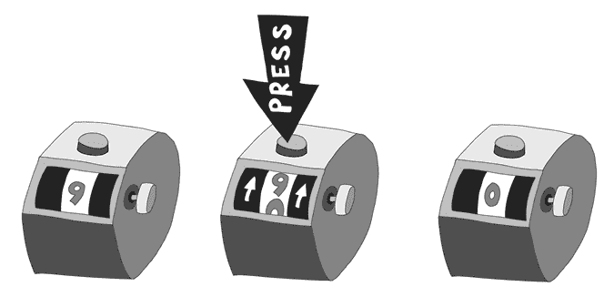

图 4-2：加 1 时，9 进回到 0。

将高数值作为负数只有在你知道数字将处于不包含所选负数的范围内时才有用。如果你声明 9 等于 –1，但你需要用计数器数到 9，那么这个数字系统就无法工作。这种进位系统就是有符号 8 位整数支持 –128 到 127 数字的原因。数字 255（八个 1）的无符号 8 位编码与 –1 的有符号 8 位表示相同，因为对任何数字加 255 都会导致位像里程表一样进位并减 1。最大的数字变成负数是因为它们的结果导致了位进位。对二进制数字执行补码转换的代码使用二进制异或（XOR）来翻转所有位，然后在结果上加 1，从而得到该数的负数。在本章稍后查看异或和位翻转时，你会看到该函数的代码。

### i64 (64 位整数)

`i64` 数据类型可以表示无符号整数 0 到 18,446,744,073,709,551,615 之间的数字，以及有符号整数 –9,223,372,036,854,775,808 到 9,223,372,036,854,775,807 之间的数字。WAT 中的 `i64` 数据类型在声明变量时并不指定是有符号还是无符号的。相反，WAT 必须根据用户希望将数字视为有符号还是无符号来选择对该数据执行的操作。并不是所有操作都需要你做出选择：例如，`i64.add`、`i64.sub` 和 `i64.mul` 无论整数是否有符号，工作方式都相同。相比之下是除法函数如 `i64.div_s` 和 `i64.div_u`。除法操作必须根据数字是有符号还是无符号区别对待，因此必须为不同版本的操作添加 `_s` 和 `_u` 后缀。

如前所述，`i64` 数据类型的一个问题是你无法直接在 WebAssembly 和 JavaScript 之间来回移动 64 位整数。JavaScript 仅使用 64 位浮点数，但 64 位浮点可以容纳它们。

### 浮点数

浮点数包含三个部分：符号位、指数以及有效数字（有时称为尾数 *mantissa* 或有效 *significand*）。符号位指示数字是正是负。指数表示小数点移动的位数（向左或右）。让我们看看如何使用 10 进制创建浮点数：如果你取一个像 345 这样的数字，并乘以 10 的 2 次方，会在数字后面附加两个零，如图 4-3 所示。这实际上是将小数点移动了两个位置。


图 4-3：使用正指数时小数点向右移动。

为了得到小数，我们需要一个负指数而不是正指数，如图 4-4 所示：负指数会将小数点向左移动。


图 4-4：使用小数指数

指数为负 2 将 345 变为 3.45，从而产生小数。注意这个系统的值：到为止我们还没有方法来表示第一个指数位的负性。我们说可以使用 2345 来表示 345 × 10²，但我们没有表示负号。我们可以从两种方法中选择：补码和偏置指数。首先，我们可以使用类似补码的方法并将较高的数字值赋予负数，因此 8345 可以表示 345 × 10^(–2)，因为 10 – 2 = 8。但这并不是浮点数设计者选择的方法。相反，他们使用了*偏置指数*（biased exponent），即简单地从指数中减去一个特定的选择值来得到负指数。例如，如果我们决定始终从指数位中减去 5，那么 3345 就可以表示 345 × 10^(–2)，因为 3 – 5 = –2。


图 4-5：使用负指数时小数点向左移动。


真实的浮点数是二进制的而非十进制的，但基本原理是相同的。在二进制浮点数中，最高位是符号位，如果是正数则为 0，如果是负数则为 1。符号位后的八个位表示指数。尾数表示一到二之间的分数数值。最左侧的位代表 0.5，紧随其后的是 0.25、0.125、0.0625 等，依此类推，每次减半。由于尾数的最小值为 1，因此尾数的实际值始终比所有这些小数位之和大 1。这些位元的布局如图图 4-6 所示。


图 4-6：32 位浮点数位分布

尾数最小值为 1 这一事实为数字 0 带来了问题。将任何非零值提升到任何幂都不可能得到 0。为了补偿这一点，指数有两个特殊值，允许在浮点数中表示 0 和无穷大值。如果指数和尾数的所有位均为 0，那么表示的数字就是 0，尽管 0⁰ 等于 1。有趣的是，浮点数可以根据符号位的值表示 0 和 –0。无穷大和负无穷是所有指数位都设置为 1 且所有尾数位都设置为 0 的值。如果尾数位不为 0，则该浮点数为 NaN（非数字）。

### 渐正数（Subnormal Numbers）

渐正（有时称为非规格化数字）是 IEEE-754 浮点数规范中的另一个浮点边缘情况。渐正常是指指数位均为 0 的边缘情况。在所有指数位均为 0 的情况下，尾数值不再向所表示的值上加 1。这允许产生更小的小数值。我们在书中不会使用渐正数，但你至少应该意识到它们的存在。

### f64/number

`f64` 数据类型是双精度 64 位浮点数。一个 `f64` 具有 52 位表示有效数字的位、11 位指数位和一个符号位。这种数据类型允许高精度，但在大多数硬件上的执行速度比整数或较小的浮点数慢。它的优点之一是它是 JavaScript 用于所有数字的相同数据类型，使其成为在 JavaScript 和 WebAssembly 之间往返传输数字方便数据类型。

### f32

`f32` 数据类型比 `f64` 更小、更快，但精度低得多，提供的有效数字位也更少。`f64` 数据类型大约有 16 位十进制有效数字供你使用，而 `f32` 只有大约七位。由于二进制位表示的是系数，它与十进制数字并不完美对齐。有效十进制数字的数量只是近似值，但它能让你对每种类型的局限性有一个整体认识。

## 高位和低位

在本节中，我们将研究位的重要性。低位是二进制数字的最低位；重要性简单意味着*代表最大的值*。在图 4-7 中，在数字 128 中，数字 1 是最高位，8 是最低位。


图 4-7：最高位和最低位

代表最大数值的数字是最高位。在这里，1 是最高位，因为它在百位上，且没有代表更高位置数字的数字。插图中那个可怜的小 8 是最低位，因为它代表个位（1s）。二进制数也有高位数字。在计算机中，一个字节（byte）始终是八位二进制数字；即使数字是 00000001，左侧的七个二进制位仍然在字节中。例如，数字 37 的二进制是 100101，但在计算机内存中，该字节中的值为 00100101。该字节中的最高位（高阶位）是最左侧的 0，如图图 4-8 所示。


图 4-8：高位和低位

该字节中的低位是最右侧的 1，而高位是最左侧的 0。

仅观察变量的高位和低位就可以揭示关于字节的一些信息。整数的低位指示该整数是偶值（0）还是奇值（1）。有符号整数的高阶位决定了该数字是正数（0）还是负数（1）。

## 位操作

WebAssembly 提供了低抽象级的数据操作。如果你愿意投入努力，可以通过在位层面上操纵数据来频繁提供更好的代码性能。

### 位移和位旋转

在本节中，我们将介绍位移和位旋转。这些是我们将多次使用的的基础操作。将数据向右移动是一个非常有用的技巧。你向右移动的每一个位在功能上等同于除以 2。同样，向左移动的每一个位在功能上等同于乘以 2。你可以结合位移和掩码来隔离二进制数据的区域。

WebAssembly 中的左移与符号无关，但要进行右移，我们需要使用符号或位移操作。当你右移或左移二进制数时，移出的位通常会在整数对侧用 0 填充。然而，对于负数，如果你进行符号右移，1 将从左侧符号移入，以保留整数的符号。

位旋转与位移不同，它会将位翻回到变量的另一侧。如果你将位向右旋转，最低有效位将传输到前端并变成最高有效位，所有其他位都向右移动。WAT 使用 `rotl`（左旋转）或 `rotr`（右旋转）命令执行位旋转。

```
(i32.shr_u E9 4)
```


# 使用 AND 和 OR 进行位掩码

*位掩码*（Bit masking）是一种根据我们使用的掩码类型，将整数中的某些特定位设置为 1 或 0 的方法，从而隔离或覆盖它们。这在编写高性能应用时非常有用。此外，重要重要的是，WebAssembly 没有布尔值的概念。WebAssembly 中的比较通常返回 1 表示真（true），0 表示假（false）。在许多语言中你会使用布尔逻辑的地方，你必须使用 `i32.and` 和 `i32.or`。在本节中，我们将使用 `i32.and` 和 `i32.or` 通过位掩码来隔离或覆盖位值。

当你使用位与（bitwise AND）进行位掩码操作时，整数中的 0 位将在位争夺中获胜。掩码中的 0 位就像掩盖胶，覆盖掉整数中的任何其他位，并将其替换为 0。掩码中的 1 位则允许原始值显示出来。图 4-11 展示了用 0000 0111 (7) 掩码二进制 1011 1110 (190) 的效果。

正如你在图 4-11 中所示，我们原始值的所有位都被 AND 掩码中的 0 位覆盖了。当对两个不同的整数执行位与操作时，0 位获胜（图 4-12）。


图 4-11：使用位与进行位掩码


图 4-12：位与中 0 位在位争夺中获胜。

当你使用 `i32/i64.or` 进行位或（OR）掩码时，结果将完全相反：1 位会覆盖任何带有 1 的位。你不能像 AND 那样使用 OR 掩码来隔离位。相反，你用它将特定位设置为 1。图 4-13。


图 4-13：使用位或进行掩码

正如你在图 4-13 中所示，当你使用位或操作时，掩码中的 1 位会覆盖初始整数值中的任何位。因此，在位或情况下，1 位胜过 0 位（图 4-14）。


图 4-14：在位或中，1 位总是获胜。

## XOR 位翻转

我们将涵盖的最后一个二进制操作是异或（XOR）。对于 AND 和 OR，掩码的结果是而易见的。XOR `i32/i64.xor` 操作略有不同。如果 0 掩码 0、1 掩码 0 或 0 掩码 1，XOR 的操作就像典型的 `i32/i64.or` 一样。异常情况发生在你有两个 1 时，这会导致 XOR 将结果位设置为 0。这个特性对于*位翻转*（bit flipping）非常有用，即将每个位反转为其相反的值。某些操作要求你将整数中的每个 1 位改为 0，将每个 0 位改为 1。图 4-15 展示了如何使用 XOR 翻转一个半字节（nibble）中的每个位。


图 4-15：XOR 位翻转

在之前的补码讨论中，我们注意到如果你想找到任何数的负数，可以通过翻转每个位并加 1 来。你可以通过对一个位都设置为 1 的整数进行 `XOR` 来翻转所有位。让我们写一个短程序，使用补码和位翻转将整数值转换为其负数。创建一个名为 `twos_complement.wat` 的文件，并将列表 4-1 中的代码添加进去。

**twos_complement.wat**

```
(module
  (func $twos_complement (export "twos_complement")
  (param $number i32)
  (result i32)
    local.get $number
  1 i32.const 0xffffffff  ;; 全 1 二进制，用于翻转位
  2 i32.xor               ;; 翻转所有位
    3 i32.add             ;; 翻转所有位后加 1 得到补码
  )
)
```

列表 4-1：补码函数这是一个简单的模块，接收一个名为 `$number` 的 `i32` 参数。我们将 `i32` 推入栈中，紧接着是一个所有位都是 1 的 32 位数。当我们调用 `i32.xor` 时，我们会翻转所有位。然后 `i32.add` 在翻转所有位以计算补码后加 1。

## 大端与小端

大多数硬件为了性能使用小端序（little-endian）排列字节。WebAssembly 无论硬件如何都使用小端序。当你使用 WebAssembly 中的 `(data)` 语句初始化数据时，考虑字节序（endianness）很重要。

## 总结

本章涵盖了许多底层概念。我们查看了不同的数值进制（十进制、十六进制和二进制）。我们检查了整数和浮点算术的细节，并提到了补码以及大端和小端序。我们讨论了位操作，包括高位和低位、位掩码、位移和位旋转的讨论。这些底层选项将在后续的应用中变得有用。

在下一章中，你将学习几种作为数据结构管理字符串的方法，包括空终止字符串和长度前缀字符串。我们还将探索复制字符串并将数值数据转换为十进制、十六进制和二进制格式的字符串。

# 5 WebAssembly 中的字符串


本章讨论了如何在 WAT 中处理字符串，因为 WebAssembly 没有像高级语言那样的内置字符串数据类型。要在 WebAssembly 中表示字符串数据，你必须将线性内存设置为 ASCII 或 Unicode 字符值。你需要知道你在线性内存的何处设置数据以及字符串将使用多少字节。

## ASCII 和 Unicode


在与 WebAssembly 中处理字符串时，你需要知道自己正在使用哪种字符集，因为不同的字符集在线性内存中的显示方式不同。`美国标准信息交换代码 (ASCII)` 是一种 7 位字符编码系统，支持多达 128 个字符，第 8 位可能用于错误检查或简单地设置为 0。如果你的代码仅支持英语，`ASCII` 字符集就能很好工作。

`Unicode 转换格式 (UTF)` 有 7 位、8 位、16 位和 32 位版本，分别称为 `UTF-7`、`UTF-8`、`UTF-16` 和 `UTF-32`。`UTF-7` 和 `ASCII` 是相同的。`UTF-8` 包含了 `UTF-7`，通过创建一种灵活的长度格式（允许在格式的起始字节落在 `ASCII` 字符集之外时使用额外的字节），从而允许一些额外的拉丁语、中东和亚洲字符。`UTF-16` 也是一种灵活长度的字符集，大多数字符占用两个字节。由于某些代码会将字符使用的字节数扩展到四个字节，`UTF-16` 支持超过 110 万个字符。`UTF-32` 是一个固定的 32 位字符集，支持超过 40 亿个字符。在本书书中我们将专门使用 `ASCII/UTF-7` 字符集，因为它易于阅读和理解。

## 线性内存中的字符串

从 WebAssembly 向 JavaScript 传递字符串的唯一方法是在内存 `buffer` 对象内部创建一个字符数据数组，就像我们在第 2 章中在 hello world 应用中所做的那样。然后，你可以向 JavaScript 传递一个 32 位整数，表示该字符数据在内存缓冲区中的位置。该方案的唯一问题是它没有告诉 JavaScript 数据在何处结束。C 语言通过使用“空终止字节”（null-terminating byte）来管理这一点：一个值为 0 的字节（而不是字符 0）告诉程序字符串在上一个字节处结束。我们将查看在 `WAT` 和 JavaScript 之间传递字符串的三种方法（包括空终止），然后查看如何复制字符串。

### 将字符串长度传递 JavaScript

处理字符串最明显的方法是将字符串位置和字符串长度传递给 JavaScript，这样 JavaScript 就可以从线性内存中提取字符串并知道它何时结束。创建一个名为 `strings.wat` 的新 `WAT` 文件，并在 Listing 5-1 中添加代码。

**strings.wat(11 部分中的部分部分)**

```
(module
;; 导入的 JavaScript 函数（见下方）接收位置和长度
1 (import "env" "str_pos_len" (func $str_pos_len (param i32 i32)))
2 (import "env" "buffer"   (memory 1))
;; 30 字符字符串
3 (data (i32.const 256) "Know the length of this string")
;; 35 字符
4 (data (i32.const 384) "Also know the length of this string")

5 (func (export "main")
;; 第一个字符串的长度为 30 个字符
 6 (call $str_pos_len (i32.const 256) (i32.const 30))
;; 第二个字符串的长度为 35 个字符
 7 (call $str_pos_len (i32.const 384) (i32.const 35))
 )
)
```

Listing 5-1: 从 WebAssembly 向 JavaScript 传递字符串

该模块导入了一个我们将创建的 JavaScript 函数，名为 `"str_pos_len"` 1，它通过结合字符串的位置及其在线性内存中的位置来在内存缓冲区中查找字符串。我们还需要导入一个将在 JavaScript 中声明的内存缓冲区 2。

接下来，我们在内存中定义了两个字符串：`"Know the length of this string"` 3 和 `"Also know the length of this string"` 4。这两个字符串指定了我们需要知道这些字符串的长度，因为它们仅仅是线性内存中的字符数组，我们需要指示它们从哪里开始和结束。第一个字符串有 30 个字符，第二个有 35 个。之后在 `"main"` 5 函数中，我们调用了两次 `$str_pos_len`。第一次调用 6，我们传递了第一个字符串在内存中的位置 `(i32.const 256)`，紧接着是该字符串的长度 `(i32.const 30)`。这告诉稍后编写的 JavaScript，从内存位置 256 开始提取 30 个字节形成一个字符串并显示在控制台上。第二次调用 `$str_pos_len` 7，我们传递了第二个字符串在内存中的位置 `(i32.const 384)`，紧接着是该字符串的长度 `(i32.const 35)`。然后 JavaScript 将第二个字符串显示在控制台上。使用 Listing 5-2 中的命令编译 WebAssembly 模块。

```
wat2wasm strings.wat
```

Listing 5-2: 编译 *strings.wat*

一旦你编译了 WebAssembly 模块，创建一个名为 `strings.js` 的 JavaScript 文件，并在 Listing 5-3 中输入代码。

**strings.js(3 部分中的部分部分)**

```javascript
const fs = require('fs');
const bytes = fs.readFileSync(__dirname + '/strings.wasm');

const memory = new WebAssembly.Memory({initial: 1});

const importObject = {
  buffer: memory,
  str_pos_len: (pos, len) => {
    const view = new Uint8Array(memory.buffer, pos, len);
    console.log(new TextDecoder().decode(view));
  }
};

(async () => {
  const { instance } = await WebAssembly.instantiate(bytes, importObject);
  instance.exports.main();
})();
```

Listing 5-3: 调用 WebAssembly 的 JavaScript

在 `importObject` 内部我们定义了 `str_pos_len` 1，它接收位置和长度 2。我们使用 `TextDecoder` 将数组转换为字符串 3。然后我们调用 `console.log` 4。当你运行 JavaScript 时，你应该看到 [Listing 5-4] 中的消息。

Listing 5-4: 字符串输出

### 空终止字符串

传递字符串的第二种方法是*空终止*字符串。空终止是 C 等语言所使用的方法。在空终止字符串中，你在最后一个字符处放置一个值 0。使用空终止字符串的处是你不需要知道长度。缺点是在处理字符串时需要更多计算，因为程序需要时间来定位终止字节。让我们打开 `strings.wat` 文件，并在 Listing 5-5 中为我们的空终止字符串添加代码。首先，我们需要导入稍后将在 JavaScript 中定义的 `null_str` 函数。

**strings.wat(11 部分中的部分部分)**

```
(module
1 (import "env" "str_pos_len" (func $str_pos_len (param i32 i32)))
;; 添加行
2 (import "env" "null_str" (func $null_str (param i32)))
...
```

Listing 5-5: 修改 Listing 5-1 中的 *strings.wat* 以导入 `null_str` 函数

注意，与 `str_pos_len` 1 不同，`null_str` 2 函数只需要一个 `i32` 参数，因为处理它的代码只需要知道字符串在线性内存中的起始。确定空字节的位置取决于代码。

接下来，在定义缓冲区的 `import` 语句和定义早期字符串的 `(data)` 表达式之间，在 Listing 5-6 中，我们添加了两个定义空终止字符串的 `data` 表达式。

**strings.wat(11 部分中的部分部分)**

```
...
  (import "env" "buffer" (memory 1))
;; 添加以下两行
1 (data (i32.const 0) "null-terminating string\00")
2 (data (i32.const 128) "another null-terminating string\00")

  (data (i32.const 256) "Know the length of this string")
...
```

Listing 5-6: 修改 Listing 5-1 中的 *strings.wat* 以添加空终止字符串数据


第一个数据定义了字符串 `"null terminating string\00"` 1。注意最后三个字符 `\00`。`\` 字符是 WAT 中的转义字符。如果你在转义字符后紧跟两个十六进制数字，它将定义一个值为你指定的数值的数值字节。这意味着 `\00` 代表一个值为 `0` 的单字节。第二个数据表达式创建了字符串 `"another null terminating string\00"` 2，它也是以空终止的，并以 `\00` 结尾。

在 Listing 5-7 中，我们在 `main` 函数的开头添加了两行来调用导入的 `$null_str` JavaScript 函数，并将空终止字符串在线性内存中的位置传递给它。

**strings.wat (part 4 of 11)**

```
...
(func (export "main")
1 (call $null_str (i32.const 0))   ;; 添加此行
2 (call $null_str (i32.const 128)) ;; 添加此行

    (call $str_pos_len (i32.const 256) (i32.const 30))
...
```

Listing 5-7: 修改 Listing 5-1 中的 `strings.wat` 以以调用 `null_str` 函数

我们传递了一个值 `0` 1，这是我们定义字符串 `"null terminating string\00"` 的内存位置。然后我们传递了值 `128` 2，这是我们定义字符串 `"another null terminating string\00"` 的位置。

一旦你在 WAT 文件中完成了这些更改，请打开 *strings.js* 并添加更多代码。首先，在 `importObject` 嵌套的 `env` 对象中添加一个新函数，如 Listing 5-8 所示。

**strings.js (part 2 of 3)**

```
...
1 const max_mem = 65535; // 添加此行

  let importObject = {
  env: {
    buffer: memory,
    // 在此处向 importObject 添加 null_str 函数
  2 null_str: function(str_pos) { // 添加此函数
    3 let bytes = new Uint8Array( memory.buffer,
                                  str_pos, max_mem-str_pos );

    4 let log_string = new TextDecoder('utf8').decode(bytes);
    5 log_string = log_string.split("\0")[0];
    6 console.log(log_string);
    }, // 函数结束
    str_pos_len: function(str_pos, str_len) {
...
```

Listing 5-8: 在来自 Listing 5-3 的 *strings.js* 中 `importObject` 添加的 `null_str` 函数

代码开始在变量 `max_mem` 1 中定义字符串的最大可能长度。为了找到空终止的字符串，我们将具有最大字符串长度的一块线性内存解码成一个长字符串，然后使用 JavaScript 的 `split` 函数获取空终止字符串。在 `env` 对象内部，我们添加了另一个名为 `null_str` 2 的函数，它接收一个单一的 `str_pos` 参数。JavaScript 随后需要从内存缓冲区中提取从传递给函数的 `str_pos` 参数指定的位置开始的字节数组。在将缓冲区转换为字符串之前，我们无法对其进行搜索。但在转换为字符串之前，我们需要先将其转换为字节数组 3。然后我们创建一个 `TextDecoder` 对象来将这些字节解码成一个长字符串 4。

我们使用空字节 `"\0"` 5 将字符串拆分为数组。对空字节分割会创建一个以空字节终止的字符串数组。数组中的第一项才是我们定义的实际字符串。我们正在使用 `split` 作为一种快速且粗暴的方法从线性内存中提取字符串。然后我们将 `log_string` 设置为数组中的第一个字符串。我们调用 JavaScript 的 `console.log` 函数 6，传递 `log_string` 以将该字符串显示在控制台上。由于我们从 WebAssembly 调用了两次两个不同的字符串，我们现在应该能看到 Listing 5-9 中的四条消息打印到控制台上。

```
null-terminating string
another null-terminating string
Know the length of this string
Also know the length of this string
```

Listing 5-9: 空终止字符串的输出

### 长度前缀字符串

在内存中存储字符串的第三方法是在字符串数据的开头包含字符串的长度。用这种方法创建的字符串被称为*长度前缀字符串*（length-prefixed string），它可以提高处理性能。我们的前缀方式将字符串限制为最大长度 255，因为单字节数据只能存储 0 到 255 之间的数字。

让我们从修改当前的 *strings.wat* 文件开始，如 Listing 5-10 所示，为稍后在 JavaScript 中定义的 `len_prefix` 函数添加一条新的导入行。

**strings.wat (part 5 of 11)**

```
(module
  (import "env" "len_prefix" (func (i32) i32))
  (import "env" "null_str" (func (i32)))
  (import "env" "str_pos_len" (func (i32) (i32)))
  (memory 1)
  (data (const 0) "null terminating string\00")
  (data (const 128) "another null terminating string\00")
  (data (const 256) "Know the length of this string")
  (data (const 284) "Also know the length of this string")
  (func (export "main")
    (call $null_str (i32.const 0))
    (call $null_str (i32.const 128))
    (call $str_pos_len (i32.const 256) (i32.const 30))
  ))
```

Listing 5-10: 修改 Listing 5-1 中的 `strings.wat` 以导入 `len_prefix` 函数

`len_prefix` 函数 1 将处理第一个字符串以查找长度。接下来我们添加了两个以长度数字开头的新字符串。

**strings.wat (part 6 of 11)**

```
(module
  (import "env" "len_prefix" (func (i32) i32))
  (import "env" "null_str" (func (i32)))
  (import "env" "str_pos_len" (func (i32) (i32)))
  (memory 1)
  (data (const 0) "null terminating string\00")
  (data (const 128) "another null terminating string\00")
  (data (const 256) "Know the length of this string")
  (data (const 284) "Also know the length of this string")
  (func (export "main")
    (call $null_str (i32.const 0))
    (call $null_str (i32.const 128))
    (call $str_pos_len (i32.const 256) (i32.const 30))
  ))
)
```

Listing 5-11: 修改 Listing 5-1 中的 `strings.wat` 以添加长度前缀数据

第一个字符串 `"\x16length-prefixed string"` 具有 22 个字符，所以我们为它前缀 `\16`，因为十进制的 22 是十六进制的 16。第二个字符串 `"\x1eanother-prefixed string"` 长度为 30，所以我们为它前缀一个十六进制 `\1e` 2（十进制的 30）。

**strings.wat (part 7 of 11)**

```
...
  (func (export "main")
    (call $null_str (i32.const 0))
    (call $null_str (i32.const 128))

    (call $str_pos_len (i32.const 256) (i32.const 30))
    (call $str_pos_len (i32.const 384) (i32.const 35))

    1 (call $len_prefix (i32.const 512))   ;; 添加此行
    2 (call $len_prefix (i32.const 640)) ;; 添加此行

  ))
...
```

Listing 5-12: 修改 Listing 5-1 中的 `strings.wat` 以添加对 `$len_prefix` 函数的调用


```javascript
...
let importObject = {
  env: {
    buffer: memory,
    null_str: function (str_pos) {
      let bytes = new Uint8Array(memory.buffer, str_pos,
                                 max_mem - str_pos);

      let log_string = new TextDecoder('utf8').decode(bytes);
      log_string = log_string.split("\0")[0];
      console.log(log_string);
    }, // end null_str function    
    str_pos_len: function (str_pos, str_len) {
      const bytes = new Uint8Array(memory.buffer,
        str_pos, str_len);
      const log_string = new TextDecoder('utf8').decode(bytes);
      console.log(log_string);
    },
  len_prefix: function (str_pos) {
    const str_len = new Uint8Array(memory.buffer, str_pos, 1)[0];
    const bytes = new Uint8Array(memory.buffer,
                                   str_pos + 1, str_len);
    const log_string = new TextDecoder('utf8').decode(bytes);
      console.log(log_string);
    }
  }
};
...
```

插列表 5-13：在 `strings.js` 的 `importObject` 中添加 `len_prefix` 函数，参考插列表 5-3

新的 `len_prefix` 函数接收一个字符串位置，然后从该位置获取第一个字节并作为数字存储在常量 `str_len` 中。它使用 `str_len` 中的值从线性内存中拷贝相应数量的 `bytes`，以便将其解码为将打印到控制台的 `log_string`。

现在我们已经有了 WAT 和 JavaScript，可以使用 `wat2wasm` 编译 WAT 模块了，如插列表 5-14 所示。

```
wat2wasm strings.wat
```

插列表 5-14：编译 `strings.wat`

然后我们可以使用 `node` 运行我们的 JavaScript 文件，如插列表 5-15 所示。

```
node strings.js
```

插列表 5-15：使用 `node` 运行 `strings.js`

你应该可以在插列表 5-16 中看到输出。

```
null-terminating string
another null-terminating string
Know the length of this string
Also know the length of this string
length-prefixed string
another length-prefixed string
```

插列表 5-16：`strings.js` 的输出

在下一节中，你将学习如何使用 WAT 拷贝字符串。

### 拷贝字符串

从线性内存的一个位置拷贝字符串到另一个位置的最简单方法是遍历每一个字节，加载它，然后将其存储在新位置。然而，这种方法很慢。更高效的方法是使用 64 位整数加载和存储每次拷贝 8 个字节。遗憾的是，并不是所有字符串都是 8 字节的倍数。为了尽可能有效地涵盖所有情况，我们需要结合逐字节拷贝和更快的 64 位拷贝。

### 逐字节拷贝

我们首先编写一个执行较慢的逐字节拷贝的函数：它将源内存位置、目标内存位置以及我们想要拷贝的字符串长度作为参数。

继续向我们的 `strings.wat` 文件中添加代码。在插列表 5-17 中，我们向 `strings.wat` 文件添加了 `$byte_copy` 函数。

**strings.wat (第 8/11 部分)**

```
...
(func $byte_copy
  (param $source i32) (param $dest i32) (param $len i32)
  (local $last_source_byte i32)

  local.get $source
  local.get $len
  i32.add   ;; $source + $len

  local.set $last_source_byte         ;; $last_source_byte = $source + $len

  (loop $copy_loop (block $break
  local.get $dest    ;; 将 $dest 压入栈以供 i32.store8 调用
  (i32.load8_u (local.get $source)) ;; 从 $source 加载单字节
  i32.store8                        ;; 在 $dest 中存储单字节

  local.get $dest
    i32.const 1
    i32.add
  local.set $dest                   ;; $dest = $dest + 1

    local.get $source
    i32.const 1
    i32.add
  local.tee $source                 ;; $source = $source + 1

    local.get $last_source_byte
    i32.eq
    br_if $break
    br $copy_loop
  )) ;; end $copy_loop
)
...
```

插列表 5-17：在 `strings.wat` 中添加的一种慢的逐字节拷贝字符串方法（参考插列表 5-3)

该 `$byte_copy` 函数使用 `i32.load8_u` 和 `i32.store8` 从 `$source` 拷贝单个字节到 `$dest`。然后它递增 `$dest` 和 `$source` 直到 `$source` 达到 `$last_source_byte`。

#### 64 位拷贝

逐字节拷贝字符串比需要的要慢，而 64 位整数每次处理 8 个字节要快得多。然而，并不是所有字符串的长度都是 8 的倍数。因此，我们需要回到逐字节拷贝来处理最后几个字节。

重要的是，这些字节拷贝并防止越界访问。如果你尝试访问内存之外的数据，WebAssembly 安全模型将停止执行。

将插列表 5-18 中的 64 位拷贝函数 `$byte_copy_i64` 添加到你的 `strings.wat` 文件。

**strings.wat (第 9/11 部分)**

```wat
...
;; 将此代码添加到 strings.wat
(func $byte_copy_i64
  (param $source i32) (param $dest i32) (param $len i32)
  (local $last_source_byte i32)

  local.get $source
  local.get $len
  i32.add

  local.set $last_source_byte

  (loop $copy_loop (block $break
  (i64.store (local.get $dest) (i64.load (local.get $source)))

    local.get $dest
    i32.const 8
    i32.add
  local.set $dest             ;; $dest = $dest + 8

    local.get $source
    i32.const 8
    i32.add
  local.tee $source           ;; $source = $source + 8

    local.get $last_source_byte
    i32.ge_u
    br_if $break
    br $copy_loop
  )) ;; end $copy_loop
)
...
```

插列表 5-18：在 `strings.wat` 中添加的一种快速拷贝字符串方法（参考插列表 5-3)

#### 组合拷贝函数

如前所述，并不是所有字符串都是 8 的倍数。因此，我们将在插列表 5-19 中定义一个新的改进的函数，该函数使用 `$byte_copy_i64` 函数每次拷贝 8 个字节，然后使用每次拷贝单字节的 `$byte_copy` 函数来拷贝剩余的字节。


```
...
(func $string_copy
  (param $source i32) (param $dest i32) (param $len i32)
  (local $start_source_byte i32)
  (local $start_dest_byte   i32)
  (local $singles           i32)
  (local $len_less_singles  i32)

  local.get $len
1 local.set $len_less_singles  ;; value without singles

  local.get $len
  i32.const 7                  ;; 7 = 二进制的 0111
2 i32.and
  local.tee $singles           ;; 将 $singles 设置为长度的最后 3 位

3 if                           ;; 如果 $len 的最后 3 位不为 000
    local.get $len
    local.get $singles
    i32.sub
  4 local.tee $len_less_singles  ;; $len_less_singles = $len - $singles

    local.get $source
    i32.add
    ;; $start_source_byte=$source+$len_less_singles
  5 local.set $start_source_byte

    local.get $len_less_singles
    local.get $dest
    i32.add
  6 local.set $start_dest_byte  ;; $start_dest_byte=$dest+$len_less_singles

  7 (call $byte_copy (local.get $start_source_byte)
        (local.get $start_dest_byte)(local.get $singles))
  end

  local.get $len
8 i32.const 0xff_ff_ff_f8 ;; 除了最后三位为 0 外，所有位均为 1
9 i32.and                 ;; 将长度的最后 3 位设置为 0
  local.set $len
a (call $byte_copy_i64 (local.get $source) (local.get $dest) (local.get $len))
)
...
```

列表 5-19：可能时一次复制 8 个字节，不可能时一次复制 1 个字节。

如前所述，`$string_copy` 函数必须结合 8 字节复制和单字节复制函数，以尽可能快地复制字符串。`$len` 参数是字符串的完整长度（字节）。局部变量 `$len_less_singles` 1 是可以使用 64 位复制复制的字节数。我们通过掩码掉最后三位来得到这个数字。`$singles` 变量是剩余的不是 8 的倍数的 3 位，通过在 `$len` 和 `7`（二进制 111）之间执行按位 `i32.and` 表达式 2（位掩码操作万岁！）来设置。长度的最后三位表示，如果我们对大部分字节使用 8 字节复制，则剩余的字节数。例如，对为 `190` 的 `$len` 和 `7` 使用 `i32.and` 表达式的结果如图图 5-1 所示。


图 5-1：使用二进制与运算掩码掉最后三位以外的所有位

如你所示，调用 `i32.and` 并传递值 190 和 7 会得到二进制 110，即十进制的 6。`i32.and` 表达式将我们的 `$len` 参数除最后三位以外的所有位设置为 0。

如果 `$singles` 的数量不为 0 3，代码首先复制那些无法使用 64 位复制的单个字节。`if` 块将 `$len_less_singles` 4 设置为 `$len` - `$singles`：即必须逐个复制的字节数。局部变量 `$start_source_byte` 5 被设置为 `$source+$len_less_singles`，将其设置为逐字节复制 7 的起始字节。

然后，将变量 `$start_dest_byte` 6 设置为 `$dest+$len_less_singles`，将其设置为逐字节复制的目标位置。该分支随后调用 `$byte_copy` 来复制那些剩余的单字节。

在 `if` 块之后，代码必须使用 64 位复制函数 `(call` `$byte_copy_i64)`a 复制它可以复制的字节。我们通过使用 `$len` 中的长度与 32 位常量值 `0xff_ff_ff_f8` 8 的按位 `i32.and` 9 表达式来确定要此函数复制的字节数。`0xff_ff_ff_f8` 的二进制值除了最后三位设置为 0 外，所有位均为 1。使用按位与会将长度的最后三位清零，使长度成为 8 的倍数。

现在我们有了一个字符串复制函数，让我们来修改 `main` 函数来测试它。修改 `main` 函数，使其仅包含列表 5-20 中的代码。

**strings.wat (part 11 of 11)**

```
(func (export "main")
  (local $ptr i32)
  (local $len i32)
  ;; ... code ...
  (i32.const 190)
  local.set $ptr
  (i32.const 7)
  local.set $len
  (i32.and (local.get $ptr) (local.get $len))
  ;; ... code ...
)
```
*(注：提示中提供的列表 5-20 文本在提示中已截断，根据可见逻辑保持了结构)*


Listing 5-24 包含了将整数转换为十进制字符串的代码。这段代码读起来可能有点挑战，因此在展示代码之前，我会先给你提供一个概述。从高层次来说，当我们从一个数字组装字符串时，我们需要每次查看一个数字，并将该数字的字符形式添加到我们的字符串中。假设我们正在查看的数字是 `9876`。个位上的数字是 `6`。我们可以通过将整个数字除以 `10` 并使用余数（称为 `modulo`）来找到这个数字。在 WAT 中，该代码类型为 `i32.rem_u`（`rem` 表示 remainder）。接下来，你使用数字 `6` 的字符形式并将其添加到字符串中。其他数字需要像在传送带上一样移动（在图 5-2 中所示）。你在代码中执行此操作的方法是除以 `10`。因为这次除法是针对整数的，所以你不会得到小数，`6` 会被直接丢弃。然后你使用余数获取下一个数字（`7`）并将其添加到字符串中。你持续直到所有数字处理完毕。Listing 5-24 显示了 `$set_dec_string` 函数的源代码。

#### number_string.wat (7 的第 2 部分)

```
...
(func $set_dec_string (param $num i32) (param $string_len i32)
  (local $index      i32)
  (local $digit_char  i32)
  (local $digit_val   i32)

  local.get $string_len
1 local.set $index    ;;将 $index 设置为字符串长度

  local.get $num
  i32.eqz             ;; 如果 $num 等于 0
  if                  ;; 如果数字为 0，我不想要所有的空格
    local.get $index
    i32.const 1
    i32.sub
    local.set $index  ;; $index--

    ;; 将 ascii '0' 存储到内存位置 256 + $index
    (i32.store8 offset=256 (local.get $index) (i32.const 48))
  end

  (loop $digit_loop (block $break ;;循环将数字转换为字符串
    local.get $index  ;;将 $index 设置为字符串末尾，递减到 0
    i32.eqz           ;; $index 是否为 0?
    br_if $break      ;;如果是，跳出循环

    local.get $num
    i32.const 10
  2 i32.rem_u         ;; 十进制数字是除以 10 的余数

  3 local.set $digit_val ;;替换上面的调用
    local.get $num
    i32.eqz              ;;检查 $num 现在是否为 0
    if
      i32.const 32           ;; 32 是 ascii 空格字符
      local.set $digit_char  ;; 如果 $num 为 0，左侧填充空格
    else
    4 (i32.load8_u offset=128 (local.get $digit_val))
      local.set $digit_char  ;;将 $digit_char 设置为 ascii 数字
    end  

    local.get $index
    i32.const 1
    i32.sub
    local.set $index
    ;;将 ascii 数字存储在 256 + $index
  5 (i32.store8 offset=256
      (local.get $index) (local.get $digit_char))  

    local.get $num
    i32.const 10
    i32.div_u
  6 local.set $num     ;;移除最后一位十进制数字，除以 10

    br $digit_loop     ;;循环
  )) ;;结束 $block 和 $loop
)
```

列表 5-24:从整数创建十进制字符串的 WebAssembly 函数

我们从 `$index` `1` 开始函数，该变量指向 `$dec_string` 中的最后一个字节。我们从右到左设置此字符串的值，因此每次通过循环时，$index` 变量都需要递减。每次通过循环，设置在 `$dec_string` 中的数值都是最终的十进制数字。要获取此值，我们将 `$num` 的值 `6` 除以 `10`，并通过模 `10` 获取余数 `2`。该值存储在局部变量 `$digit_val` `3` 中，以便稍后使用它来设置 `$dec_string` 数据中的 ASCII 字符。我们使用 `$digit_val` 作为 `$digit_char` 字符串的偏移量，通过 `i32.load8_u` `4` 加载字符。然后使用 `i32.store8` `5` 将该字符写入到 `$dec_string+$index` 的地址处。图 5-2 插说明了这一过程。


图 5-2:逐个查看数字并逐个添加字符。

现在我们已经有了在 WebAssembly 模块中完成大部分工作的函数，让我们添加一个导出到 JavaScript 的函数，如列表 5-25 所示。

#### number_string.wat (7 的第 3 部分)

```
...
  (func (export "to_string") (param $num i32)
  1 (call $set_dec_string
      (local.get $num) (global.get $dec_string))
  2 (call $print_string
      (i32.const 256) (global.get $dec_string))
  )
)
```

列表 5-25: `to_string` 函数

该函数非常简单。它调用 `$set_dec_string` `1`传入传入转换为字符串的数字以及包含左填充的字符串长度。然后它调用 JavaScript 函数 `print_string` `2`，传入我们在线性内存中创建的字符串位置 `(i32.const 256) (global.get $dec_string)`。


在十六进制中，每个数字代表从 0 到 15 的一个数字，而不是 0 到 9，因此十六进制中的每个数字必须是以下数值之一：0, 1, 2, 3, 4, 5, 6, 7, 8, 9, A, B, C, D, E, F，其中 `A = 10`、`B = 11`、`C = 12`、`D = 13`、`E = 14` 和 `F = 15`。我们经常使用十六进制代替二进制，因为二进制可能会变得非常长；例如，十进制数字 `233` 的二进制是 `11101001`。我们可以将二进制形式的 `233` 缩短为十六进制的 `E9`，因为 `1110` 在十六进制中是 `14` 或 `E`，而 `1001` 在十进制和十六进制中均为 `9`。

我们使用 `(i32.and)` 对 `E9`（二进制 `1110 1001`）进行掩码操作，值为二进制 `0000 1111`（`0F`），以找到最低位半字节。这样使用 `i32.and` 会将 `E9` 掩码为 `09`，如图 5-3 所示。

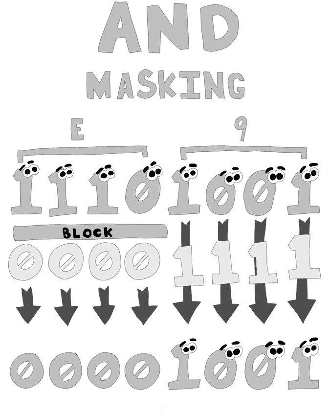

图 5-3：使用掩码 0F (0000 1111) 将字节 E9 掩码为 09

我们结合位移和与掩码将整数数据转换为十六进制字符串。在这里，我们创建了 `$set_dec_string` 函数的十六进制版本 `$set_hex_string`。该函数根据传入的数字设置十六进制字符串。我们可以让这个循环比 `$set_dec_string` 中的循环更简单，因为我们可以使用简单的位操作来找到在 `$digits` 中的偏移量。函数最后添加了额外的 ASCII 字符 `0x`，以表示显示字符串为十六进制格式。代码清单 5-30 展示了 `$set_hex_string` 函数的样子。

#### number_string.wat (7 部分第 4 部分)

```
...
;; 在 $set_dec_string 函数之前添加此代码
  (global $hex_string_len  i32 (i32.const 16)) ;; 十进制字符计数
  (data (i32.const 384) "             0x0")    ;; 十进制字符串数据

  (func $set_hex_string (param $num i32) (param $string_len i32)
    (local $index       i32)
    (local $digit_char  i32)
    (local $digit_val   i32)
    (local $x_pos       i32)

    global.get $hex_string_len
    local.set $index ;; 将索引设置为十六进制字符的数量

    (loop $digit_loop (block $break
      local.get $index
      i32.eqz    
      br_if $break

      local.get $num
      i32.const 0xf ;; 最后 4 位为 1
    1 i32.and       ;; 在 $digits 中的偏移量位于数字的最后 4 位

    2 local.set $digit_val  ;; 数字值是最后 4 位
      local.get $num
      i32.eqz
    3 if                    ;; 如果 $num == 0
        local.get $x_pos
        i32.eqz
        if
          local.get $index
        4 local.set $x_pos  ;; "0x" 十六进制前缀中 'x' 的位置
        else
          i32.const 32      ;; 32 是 ascii 空格字符
          local.set $digit_char
        end
      else
        ;; 从 128 + $digit_val 加载字符
      5 (i32.load8_u offset=128 (local.get $digit_val))
        local.set $digit_char
      end  

      local.get $index
      i32.const 1
      i32.sub
    6 local.tee $index  ;; $index = $index - 1
      local.get $digit_char

      ;; 将 $digit_char 存储在 384+$index 位置
    7 i32.store8 offset=384

      local.get $num
      i32.const 4
    8 i32.shr_u            ;; 从 $num 中移位一个十六进制数字
      local.set $num

      br $digit_loop
    ))

    local.get $x_pos
    i32.const 1
    i32.sub

    i32.const 120          ;; ascii x
  9 i32.store8 offset=384  ;; 在字符串中存储 'x'

    local.get $x_pos
    i32.const 2
    i32.sub

    i32.const 48           ;; ascii '0'
  a i32.store8 offset=384  ;; 在字符串开头存储 "0x"
  ) ;; end $set_hex_string
...
```


```
...
;; 在 $set_hex_string 函数之前添加此代码
(global $bin_string_len  i32 (i32.const 40))
(data (i32.const 512) " 0000 0000 0000 0000 0000 0000 0000 0000")

(func $set_bin_string (param $num i32) (param $string_len i32)
  (local $index i32)
  (local $loops_remaining i32)
  (local $nibble_bits i32)

  global.get $bin_string_len
  local.set $index

1 i32.const 8  ;; 32 位中中有 8 个半字节 (32/4 = 8)
  local.set $loops_remaining  ;; 外层循环分隔半字节

2 (loop $bin_loop (block $outer_break  ;; 外层循环用于空格
    local.get $index  
    i32.eqz
    br_if $outer_break        ;; 当 $index 为 0 时停止循环

    i32.const 4
  3 local.set $nibble_bits    ;; 每个半字节包含 4 位

  4 (loop $nibble_loop (block $nibble_break ;; 内层循环处理数字
      local.get $index  
      i32.const 1
      i32.sub
      local.set $index        ;; 减少 $index

      local.get $num
      i32.const 1
    5 i32.and   ;; 如果最后一位为 1，i32.and 1 的结果为 1，否则为 0
      if        ;; 如果最后一位是 1
        local.get $index
        i32.const 49           ;; ascii '1' 是 49
      6 i32.store8 offset=512  ;; 在 512 + $index 处存储 '1'

      else                     ;; 如果最后一位为 0 则执行此处
        local.get $index
        i32.const 48           ;; ascii '0' 是 48
      7 i32.store8 offset=512  ;; 在 512 + $index 处存储 '0'
      end

      local.get $num
      i32.const 1
    8 i32.shr_u                ;; $num 向右移 1 位
      local.set $num           ;; 移除 $num 的最后一位

      local.get $nibble_bits
      i32.const 1
      i32.sub
      local.tee $nibble_bits   ;; 减少 $nibble_bits
      i32.eqz                  ;; $nibble_bits == 0
    9 br_if $nibble_break      ;; 当 $nibble_bits == 0 时跳出

      br $nibble_loop
    )) ;;  $nibble_loop

    local.get $index  
    i32.const 1
    i32.sub
    local.tee $index           ;; 减少 $index
    i32.const 32               ;; ascii 空
  a i32.store8 offset=512      ;; 在 512+$index 处存储空格

    br $bin_loop
  )) ;; $bin_loop
)
...
```

### 列表 5-35：从整数创建二进制字符串
在 `$set_hex_string` 函数之前添加此代码。`$set_bin_string` 函数有两个循环。外层循环在每个半字节之间插入空格。由于我们在这段代码中处理的是 32 位数，因此我们需要循环 8 个半字节。我们将外层循环标记为 `$bin_loop`，跳出的块称为 `$outer_break`。在进入内层循环之前，我们需要将局部变量 `$nibble_bits` 设置为 `4`。代码在内层循环中每个半字节循环四位。在内层循环 `$nibble_loop` 中，我们放置了一个可以跳出内层循环的 `$nibble_break` 块。在 `$nibble_loop` 中，我们使用 `(i32.and)` 配合 `if`/else` 语句来判断 `$num` 变量的最后一位是 `1` 还是 `0`。如果是 `1`，我们使用 `i32.store8` 语句在线性内存地址 `$index+512` 存储一个 ASCII `1`。如果不是 `1`，我们在该位置存储一个 ASCII `0`。接下来，我们需要移出该位以便进行下一次循环。正如我们在 `$set_hex_string` 函数中做的那样，我们使用 `(i32.shr_u)` 进行这种移位，但这次我们移位的是一位而不是四位。在通过 `$nibble` 循环四次后，我们跳出该循环并在线性内存位置 `$offset+$bin_string` 处存储一个 ASCII 空格字符。

### 列表 5-36：将 `$set_bin_string` 添加到 `to_string` 函数
```
...
(func (export "to_string") (param $num i32)
  (call $set_dec_string
    (local.get $num) (global.get $dec_string))
  (call $print_string (i32.const 256) (global.get $dec_string))
  (call $set_hex_string
    (local.get $num) (global.get $hex_string))
  (call $print_string (i32.const 384) (global.get $hex_string))
  (call $set_bin_string
    (local.get $num) (global.get $bin_string))
  (call $print_string (i32.const 512) (global.get $bin_string))
)
)
```

### 列表 5-37：使用二进制字符串函数编译 number_string.wat
```
wat2wasm number_string.wat
```

### 列表 5-38：使用二进制字符串 WebAssembly 模块运行 number_string.js
```
node number_string.js 4103
```

### 列表 5-39：打印到控制台的二进制字符串
```
>            4103!
>          0x007!
> 0000 0000 0000 0000 0001 0000 0000 0111!
```

## 总结
本章重点关注如何在 WAT 中处理字符串。你学习了 ASCII 和 Unicode 字符格式。你将字符串存储在线性内存中，并学习了如何使用 JavaScript 获取它们。我们涵盖了如何从 WebAssembly 传递字符串数据，并检查了两种流行的字符串管理方法：空终止字符串和长度前缀字符串。你从线性内存的一个位置复制到另一个位置，使用了逐字节复制和 64 位复制。然后我们探索了如何将整数数据转换为十进制、十六进制和二进制字符串。在下一章节中，我们将重点关注线性内存的使用。


线性内存像是一个巨大的数据数组，可以在 WebAssembly 和 JavaScript 之间共享。如果你熟悉低层编程，线性内存类似于原生应用程序中的堆内存（heap memory）。如果你熟悉 JavaScript，可以将其看作一个巨大的 `ArrayBuffer` 对象。`C` 和 `C++` 等语言通过在计算机的栈（stack）上分配内存来创建局部变量。在栈上分配的局部变量在函数执行完毕后就会从内存中释放。这种高效的过程意味着，在栈上分配和释放数据只需增加或递减栈指针一样简单。你的应用程序只需递增栈指针，哒一下，你就有了一个新分配的变量，如图 6-1 所示。


图 6-1：栈指针

栈对于局部变量非常有效。然而，WAT 的一个局限性是，使用栈的局部变量只能是四种类型之一，且都是数值类型。有时，你可能需要更复杂的数据结构，例如字符串、结构体、数组和对象。

分配命令（如 `C` 中的 `malloc` 和 `C++` 与 JavaScript 中的 `new`）分配在堆上，而这些语言包含的内存管理库必须在堆上寻找足够容纳所需内存块的空闲区域。随着时间的推移，这可能会导致内存碎片，即已分配的内存段被未分配的内存隔开，如图 6-2 所示。

WebAssembly 线性内存是以称为 `pages`（页）的大块分配的，一旦分配，无法释放。WebAssembly 内存也更像汇编语言内存管理：一旦你为 WebAssembly 模块分配了选定的页数，作为程序员的你必须跟踪你内存内存做什么以及它在哪里。在接下来的几个章节中，我们将通过探索内存页来详细查看如何使用线性内存。

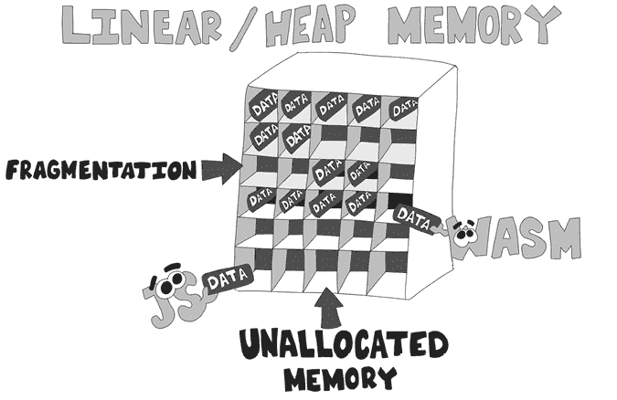

图 6-2：从 JavaScript 和 WebAssembly 传递的线性内存数据

### Pages（页）

页是为 WebAssembly 模块分配的最小数据块。在本文编写时，所有 WebAssembly 页的大小均为 64KB。在当前的 WebAssembly 1.0 版本中，你无法更改该大小，尽管 WebAssembly 社区小组有一项进行中的提案，根据应用程序需求使页大小变为可。在本文编写时，应用程序可以分配的最大页数为 32,767，总最大内存大小为 2GB。这个最大内存分配对于 Web 应用来说足够了，但对于服务器应用程序来说有限的。增加页大小允许服务器应用增加它们可以分配的最大线性内存。对于嵌入式 WebAssembly 应用程序，64KB 可能太大了；例如，ATmega328 只有 32KB 的 Flash 内存。当你读这里时，WebAssembly 的更新可能会消除这一限制。

你可以在 WebAssembly 模块内部或通过嵌入环境导入来创建应用程序将使用的页数。

#### 在代码中创建页

在 WAT 中分配一页线性内存，使用简单的 `(memory)` 表达式，如列表 6-1 所示。

```wat
(memory 1)
```

列表 6-1：在 WAT 中声明页内存

将 `1` 传入 `memory` 表达式会指示模块留出一页线性内存。若要在运行时为 WebAssembly 模块分配当前允许的最大内存，请使用列表 6-2 中的表达式。

```wat
(memory 32_767)
```

列表 6-2：声明最大内存页数

尝试向 `(memory)` 表达式传入 `32_767`会导致编译错误。除非包含 `(export)` 表达式，否则使用 `(memory)` 表达式创建的内存嵌入环境无法访问。

### 在嵌入环境中创建内存

创建线性内存的方法方法是在嵌入环境中。如果嵌入环境是 JavaScript，创建该内存的代码为 `new WebAssembly.Memory`，如列表 6-3 所示。

```javascript
const memory = new WebAssembly.Memory({initial: 1});
```

列表 6-3：在 JavaScript 中创建 WebAssembly `Memory` 对象

然后你可以使用列表 6-4 中的 `(import)` 表达式从 WebAssembly 模块访问它。

```wat
(import "js" "mem" (memory 1))
```

列表 6-4：导入在 JavaScript 中分配的页内存

使用 `import` 要求你使用 `WebAssembly.Memory` 类在 JavaScript 中创建一个 `Memory` 对象，然后在通过 `import` 对象初始化时将其传递给 WebAssembly 模块。创建一个名为 `pointer.js` 的文件并添加列表 6-5 中的 JavaScript 代码，它会创建一个 WebAssembly `Memory` 对象。

**pointer.js**

```javascript
const fs = require('fs');
const bytes = fs.readFileSync(__dirname + '/pointer.wasm');
const memory = new WebAssembly.Memory({initial: 1, maximum: 4});

const importObject = {
  env: {
    mem: memory,
  }
};

(async () => {
  let obj = await WebAssembly.instantiate(bytes, importObject);
  let pointer_value = obj.instance.exports.get_ptr();
  console.log(`pointer_value=${pointer_value}`);
})();
```

列表 6-5：初始化内存并将其传递给 WebAssembly 模块

在创建时，此代码传入了一个带有两个值的对象。`initial` `1` 参数是必须的，通过传入 `1`指示 JavaScript 引擎留出一页线性内存。第二个值 `maximum` `2` 是可选的，告诉浏览器我们可能想要增加线性内存的大小，并且可能不会增长超过四页。你可以通过调用 `memory.grow` 方法增加线性内存的大小。不需要设置最大值来增长内存，但传入最大值告诉浏览器留出比初始值更多的内存。如果你尝试将线性内存增长到超过传入的最大值，应用程序将抛出错误。

### Pointers（指针）

`pointer` 是引用内存位置的变量。指针在计算机科学中有各种应用，但在上下文中，我们将使用它们来指向线性内存中的数据结构。图 6-3 显示一个指针指向内存位置 5，该位置值为 99。


图 6-3：内存中第五个字节的指针


指针 `ptr` 被设置为变量 `x` 的地址，该变量是一个在栈上具有地址的局部变量。WebAssembly 没有独立的指针类型，例如 C 语言中的 `int*` 整数指针类型。WebAssembly 的线性内存是一个大型数据数组。当你在 WAT 中表示指针时，必须将数据放入线性内存中；此时，指针就是指向该数据的 `i32` 索引。在 Listing 6-6 中的变量 `x` 在将程序编译为 WebAssembly 时会接收线性内存中的一个地址。与 C 语言不同，WAT 无法创建指向局部或全局变量的指针。为了在 WebAssembly 中获得 C 语言的指针功能，你可以将全局变量设置为线性内存中的特定位置，并使用该全局变量来设置或检索存储在 WebAssembly 线性内存中的值，如 Listing 6-7 所示。

### pointer.wat

```
(module
1 (memory 1)
2 (global $pointer i32 (i32.const 128))
3 (func $init
  4 (i32.store
  5 (global.get $pointer)  ;; store at address $pointer
  6 (i32.const 99)         ;; value stored
    )
  )
7 (func (export "get_ptr") (result i32)
8 (i32.load (global.get $pointer)) ;; return value at location $pointer
  )
9 (start $init)
)
```

Listing 6-7: 在 WAT 中模拟指针

该模块创建了单页线性内存 1 和一个指向内存位置 `128` 的全局变量 `$pointer` 2。我们创建了一个函数 `$init` 3，使用 `(i32.store)` 4 表达式将 `$pointer` 指向的内存位置的值设置为 `99`。传递给 `(i32.store)` 5 的第一个参数是存储值的内存位置，第二个参数 6 是你想要存储的值。要从此指针位置检索值，你需使用 `i32.load` 8 表达式并传入你想要检索的内存位置。我们创建了一个函数 `"get_ptr"` 7 来检索此值。然后 `(start` `$init)` 9 语句将 `$init` 3 作为模块初始化函数调用。`start` 语句将指定的函数声明为模块的初始化函数。该函数将在模块实例化时自动执行。

一旦你编译了 `pointer.wasm` 文件并用 `node` 执行了它，你应该能看到以下输出：

```
pointer_value=99
```

## JavaScript 内存对象

现在我们已经了解了线性内存的工作原理，我们将创建一个 WebAssembly 内存对象，在 WebAssembly 模块内部初始化数据，然后从 JavaScript 访问这些数据。当你处理线性内存时，很有可能想要从 WebAssembly 和嵌入环境访问它。在这种情况下，嵌入环境是 JavaScript，因此我们将在那里定义线性内存，以便在 WebAssembly 模块初始化之前对其进行访问。这个 WAT 模块与 Listing 6-7 ，但它将从 JavaScript 导入线性内存。

### 创建 WebAssembly 内存对象

创建一个名为 `store_data.wat` 的文件，并将 Listing 6-8 中的代码添加到其中。

### store_data.wat

```
(module
1 (import "env" "mem" (memory 1))
2 (global $data_addr (import "env" "data_addr") i32)
3 (global $data_count (import "env" "data_count") i32)

4 (func $store_data (param $index i32) (param $value i32)
    (i32.store
     (i32.add
      (global.get $data_addr) ;; add $data_addr to the $index*4 (i32=4 bytes)
      (i32.mul (i32.const 4) (local.get $index)) ;; multiply $index by 4
     )
     (local.get $value) ;; value stored
    )
  )

5 (func $init
    (local $index i32)

  6 (loop $data_loop
      local.get $index

      local.get $index
      i32.const 5
      i32.mul      

    7 call $store_data ;; called with parameters $index and $index * 5

      local.get $index
      i32.const 1
      i32.add          ;; $index++

      local.tee $index
    8 global.get $data_count
      i32.lt_u
      br_if $data_loop
    )

  9 (call $store_data (i32.const 0) (i32.const 1))

  )

a (start $init)
)
```

Listing 6-8: 在 WebAssembly 中创建线性内存对象

Listing 6-8 中的模块从 JavaScript 嵌入环境导入其线性内存 1，我们将在那里定义它。（注：原文中存在大量重复内容，已清理保留核心逻辑）。


# store_data.js (第 1/3 部分)

```javascript
const colors = require('colors'); // 控制台彩色日志
const fs = require('fs');
const bytes = fs.readFileSync(__dirname + '/store_data.wasm');

// 分配 64K 块内存
const memory = new WebAssembly.Memory({initial: 1 });
// 内存的 32 位数据视图
const mem_i32 = new Uint32Array(memory.buffer);

const data_addr = 32; // 我们数据第一个字节的地址
// 数据起始位置的 32 位索引
const data_i32_index = data_addr / 4;
const data_count = 16; // 要设置的 32 位整数数量
const importObject = { // 从 JavaScript 导入的 WASM 对象
  env: {
    mem: memory,
    data_addr: data_addr,
    data_count: data_count
  }
};
```

## 示例 6-13: 带有全局导入的 WebAssembly.Memory 缓冲区和 `importObject`

我们创建了三个常量，其中第一个创建了一个新的 `WebAssembly.Memory` 对象，我们在初始化 WebAssembly 模块时可以使用它。常量 `mem_i32` 为内存缓冲区提供了一个 32 位整数视图。至关重要性，这不是缓冲区中数据的副本，而是将该缓冲区作为 32 位整数数组进行查看的特定方式。当我们更改 WebAssembly 模块内部内存缓冲区中的值时，我们可以使用这个 `mem_i32` 视图来查看更改。常量 `data_addr` 是我们在 WebAssembly 模块中设置的数据的位置。该位置是索引，而不是数组编号。

由于一个 32 位整数占用四个字节，因此我们需要一个通过 `data_addr` 除以 4 得到的起始索引。我们将该值设置在 `data_i32_index` 中。然后，我们通过 `const data_count` 定义了模块中设置的 32 位整数值的数量。此部分代码的最后一个 `const` 是 `importObject`。`importObject` 包含了三个供 WebAssembly 模块使用的导入对象。

JavaScript 的最后部分（见示例 6-14）使用 IIFE（立即调用函数）来实例化 WebAssembly 模块，并将线性内存中的值输出到控制台。

# store_data.js (第 2/2 部分)

```javascript
( async () => {
  let obj = await WebAssembly.instantiate(new Uint8Array(bytes),
                                          importObject );

  for( let i = 0; i < data_i32_index + data_count; i++ ) {
    let data = mem_i32[i];
    if (data !== 0) {
      console.log(`data[${i}]=${data}`.red);
    }
    else {
      console.log(`data[${i}]=${data}`);
    }
  }
})();
```

## 示例 6-14: 在 IIFE 实例化 WebAssembly 模块后输出线性内存中的数据值

JavaScript 的最后部分实例化了 `store_data.wasm` 模块，传递了我们在示例 6-13 中创建的 `importObject`。在初始化 WebAssembly 模块后，内存缓冲区中的数据将发生变化，因为 WAT 代码中的 `$init` 函数在初始化期间运行。然后我们从内存缓冲区的第一个地址开始遍历 `mem_i32` 数组，并在数据设置后显示四个整数。该循环会在浏览器显示 `mem_i32` 中的值：如果值不为 `0`，则用红色打印到控制台；如果是，则使用默认控制台颜色。

使用 `node` 运行 `store_data.js`；你应该会在控制台中看到示例 6-15 所示的输出。

```
data[0]=0
data[1]=0
data[2]=0
data[3]=0
data[4]=0
data[5]=0
data[6]=0
data[7]=0
data[8]=1
data[9]=5
data[10]=10
data[11]=15
data[12]=20
data[13]=25
data[14]=30
data[15]=35
data[16]=40
data[17]=45
data[18]=50
data[19]=55
data[20]=60
data[21]=65
data[22]=70
data[23]=75
data[24]=0
data[25]=0
data[26]=0
data[27]=0
```

## 示例 6-15: 数据输出

WebAssembly 模块设置的第一个数据元素是 `data[8]`，这是红色输出开始的地方。值 `8` 是常量 `data_i32_index` 的取值，它是 `data_addr` 值的四分之一。数组中有 16 个元素，所以前 8 个是零。


```javascript
const colors = require('colors'); // 支持彩色控制台输出
const fs = require('fs');
const bytes = fs.readFileSync(__dirname + '/data_structures.wasm');
  // 分配 64K 块内存
const memory = new WebAssembly.Memory({initial:1});

  // 内存缓冲的 32 位视图
  const mem_i32 = new Uint32Array(memory.buffer);

  const obj_base_addr = 0; // 我们数据第一个字节的地址
const obj_count = 32;    // 结构数量
const obj_stride = 16;   // 16 字节步长

  // 结构属性偏移
const x_offset = 0;
const y_offset = 4;
  const radius_offset = 8;			
  const collision_offset = 12;			

  // 32 位整数索引
  const obj_i32_base_index = obj_base_addr / 4; // 32 位数据索引
  const obj_i32_stride = obj_stride / 4;        // 32 位步长

  // 在 32 位整数数组中的偏移
const x_offset_i32 = x_offset / 4;
  const y_offset_i32 = y_offset / 4;
  const radius_offset_i32 = radius_offset / 4;
  const collision_offset_i32 = collision_offset / 4;

const importObject = { // WASM 从 JavaScript 导入的对象
    env: {
      mem: memory,
      obj_base_addr: obj_base_addr,
      obj_count: obj_count,
      obj_stride: obj_stride,
      x_offset: x_offset,			
      y_offset: y_offset,
      radius_offset: radius_offset,
      collision_offset: collision_offset,
    }
  };
...
```

列表 6-16：设置常量以定义碰撞检测程序的结构

首先，我们创建了一系列 `const` 值，用于在 WebAssembly 内存缓冲区中创建结构。正如列表 6-16 所示，这段代码创建了一个单页 64KB 的 WebAssembly 内存 `1` 以及指向该数据的 32 位无符号整数视图。`obj_base_addr` 常量将数据结构的基地址设置为 `0`，即页内存中的第一个字节。

我们将 `obj_count` `2` `const` 设置为代码中设置的结构数量。`obj_stride` `3` 常量持有结构中的字节数。我们将其设置为 `16`，因为该结构中有四个 32 位整数，总共 16 字节。下一组 `const` 声明包含了属性偏移量。

`x_offset` `4` 是 `x` 距离结构开始位置的偏移量，因此它是每个结构中 `x` 值位置相对于结构开始位置的字节数。`y_offset` `5` 是结构中 `y` 值位置相对于开始位置的字节数，其值为 `4`，因为 `x` 值是一个 32 位整数，这将 `y` 值推到了结构中的第五个字节。然后，我们设置了 `radius` `6` 属性和 `collision` `7` 属性的偏移。

我们通过将字节地址除以 `4` 将步长除以 `4` 来计算整数索引和步长。原因是字节地址和步长是以字节为单位的，而整数索引是 32 位整数（4 字节）。我们还需要找到整数数组的索引，我们通过将字节索引除以 `4` `6` 计算的。`importObject` `7` 已经过修改，包含了我们添加的新 `const` 值。

定义好常量后，我们将为程序创建一系列随机大小的圆。正如前面提到的，圆由 x 坐标、y 坐标和半径定义。我们将随机定义圆的 x 坐标和 y 坐标，值范围在 0 到 99 之间，半径在 1 到 11 之间。程序中列表 6-17 中的代码将供程序使用。

```javascript
const colors = require('colors'); // 支持彩色控制台输出
const fs = require('fs');
const bytes = fs.readFileSync(__dirname + '/data_structures.wasm');
  // 分配 64K 块内存
const memory = new WebAssembly.Memory({initial:1});

  // 内存缓冲的 32 位视图
  const mem_i32 = new Uint32Array(memory.buffer);

  const obj_base_addr = 0; // 我们数据第一个字节的地址
const obj_count = 32;    // 结构数量
const obj_stride = 16;   // 16 字节步长

  // 结构属性偏移
const x_offset = 0;
const y_offset = 4;
  const radius_offset = 8;			
  const collision_offset = 12;			

  // 32 位整数索引
  const obj_i32_base_index = obj_base_addr / 4; // 32 位数据索引
  const obj_i32_stride = obj_stride / 4;        // 32 位步长

  // 在 32 位整数数组中的偏移
const x_offset_i32 = x_offset / 4;
  const y_offset_i32 = y_offset / 4;
  const radius_offset_i32 = radius_offset / 4;
  const collision_offset_i32 = collision_offset / 4;

const importObject = { // WASM 从 JavaScript 导入的对象
    env: {
      mem: memory,
      obj_base_addr: obj_base_addr,
      obj_count: obj_count,
      obj_stride: obj_stride,
      x_offset: x_offset,			
      y_offset: y_offset,
      radius_offset: radius_offset,
      collision_offset: collision_offset,
    }
  };
...
```

列表 6-17：初始化圆

```javascript
const colors = require('colors'); // 支持彩色控制台输出
const fs = require('fs');
const bytes = fs.readFileSync(__dirname + '/data_structures.wasm');
  // 分配 64K 块内存
const memory = new WebAssembly.Memory({initial:1});

  // 内存缓冲的 32 位视图
  const mem_i32 = new Uint32Array(memory.buffer);

  const obj_base_addr = 0; // 我们数据第一个字节的地址
const obj_count = 32;    // 结构数量
const obj_stride = 16;   // 16 字节步长

  // 结构属性偏移
const x_offset = 0;
const y_offset = 4;
  const radius_offset = 8;			
  const collision_offset = 12;			

  // 32 位整数索引
  const obj_i32_base_index = obj_base_addr / 4; // 32 位数据索引
  const obj_i32_stride = obj_stride / 4;        // 32 位步长

  // 在 32 位整数数组中的偏移
const x_offset_i32 = x_offset / 4;
  const y_offset_i32 = y_offset / 4;
  const radius_offset_i32 = radius_offset / 4;
  const collision_offset_i32 = collision_offset / 4;

const importObject = { // WASM 从 JavaScript 导入的对象
    env: {
      mem: memory,
      obj_base_addr: obj_base_addr,
      obj_count: obj_count,
      obj_stride: obj_stride,
      x_offset: x_offset,			
      y_offset: y_offset,
      radius_offset: radius_offset,
      collision_offset: collision_offset,
    }
  };
...
```

```javascript
const colors = require('colors'); // 支持彩色控制台输出
const fs = require('fs');
const bytes = fs.readFileSync(__dirname + '/data_structures.wasm');
  // 分配 64K 块内存
const memory = new WebAssembly.Memory({initial:1});

  // 内存缓冲的 32 位视图
  const mem_i32 = new Uint32Array(memory.buffer);

  const obj_base_addr = 0; // 我们数据第一个字节的地址
const obj_count = 32;    // 结构数量
const obj_stride = 16;   // 16 字节步长

  // 结构属性偏移
const x_offset = 0;
const y_offset = 4;
  const radius_offset = 8;			
  const collision_offset = 12;			

  // 32 位整数索引
  const obj_i32_base_index = obj_base_addr / 4; // 32 位数据索引
  const obj_i32_stride = obj_stride / 4;        // 32 位步长

  // 在 32 位整数数组中的偏移
const x_offset_i32 = x_offset / 4;
  const y_offset_i32 = y_offset / 4;
  const radius_offset_i32 = radius_offset / 4;
  const collision_offset_i32 = collision_offset / 4;

const importObject = { // WASM 从 JavaScript 导入的对象
    env: {
      mem: memory,
      obj_base_addr: obj_base_addr,
      obj_count: obj_count,
      obj_stride: obj_stride,
      x_offset: x_offset,			
      y_offset: y_offset,
      radius_offset: radius_offset,
      collision_offset: collision_offset,
    }
  };
...
```

### 显示结果

```javascript
(async () => {
  const instance = await WebAssembly.instantiate(bytes, importObject);
  const { exports } = instance;

  for (let i = 0; i < obj_count; i++) {
    const x = Math.floor(Math.random() * 100);
    const y = Math.floor(Math.random() * 100);
    const radius = Math.floor(Math.random() * 11) + 1;
    // ... 在内存中设置圆的属性 ...
  }

  for (let i = 0; i < obj_count; i++) {
    if (exports.check_collision(i)) {
      console.log(`圆 ${i} 碰撞了！`.red);
    } else {
      console.log(`圆 ${i} 没有碰撞。`.green);
    }
  }
})();
```

列表 6-18：WebAssembly 运行后代码遍历内存

### 碰撞检测函数

在其他章节中，我们在 JavaScript 之前定义了 WAT 代码。在本节中，JavaScript 初始化了圆的值。因此，我们将先编写 JavaScript。当你对两个圆进行碰撞检测时，你使用勾股定理来确定圆心距离是否大于圆半径之和。本节中的 WAT 代码遍历我们在 WebAssembly 内存中定义的每个圆，并与其他每个圆进行比较以查看它们是否碰撞。碰撞检测的细节并不是本节的重点，因此我们不会深入探讨。它仅仅是为了演示你如何将数据分离为结构，并使用这些数据通过你的 WAT 代码进行计算。

WAT 代码的第一部分定义了从 JavaScript 的导入。列表 6-19 显示了 WAT 模块的开头。

**data_structures.wat (第 1/6 部分)**


```
(module
  (import "env" "mem" (memory 1))           
1 (global $obj_base_addr  (import "env" "obj_base_addr") i32)
2 (global $obj_count    (import "env" "obj_count") i32)
3 (global $obj_stride   (import "env" "obj_stride") i32)

  ;; 属性偏移位置
4 (global $x_offset     (import "env" "x_offset") i32)
5 (global $y_offset     (import "env" "y_offset") i32)
6 (global $radius_offset  (import "env" "radius_offset") i32)
7 (global $collision_offset (import "env" "collision_offset") i32)
...
```

### 列表 6-19：导入定义数据结构的全局变量

传入 WebAssembly 模块的全局变量定义了线性内存的布局以及其中包含的数据结构。全局变量 `$obj_base_addr` 1 是内存中定义圆形结构的位置。全局变量 `$obj_count` 2 是线性内存中定义的圆的数量。全局变量 `$obj_stride` 3 是每个圆形定义之间的字节数。然后，我们导入每个属性属性的值。`$x_offset` 4、`$y_offset` 5、`$radius_offset` 6 和 `$collision_offset` 7 是从对象的 `x`、`y`、半径和碰撞标志值的起始位置之间的字节数。这些值必须在该模块内部设置。

接下来，我们将定义 `$collision_check` 函数。该函数如何运作的细节只有在你对圆形碰撞检测的工作原理感兴趣时才有价值。但作为一个概述，它使用毕股拉斯定理来判断两个圆之间的距离是否小于两个圆半径之和。简而言之，让我们将第一个圆的半径标记为 R[1]，第二个圆的半径标记为 R[2]，并将两个圆之间的距离标记为 D，如图 6-6 所示。如果 R[1] + R[2] 小于 D，则不会发生碰撞。

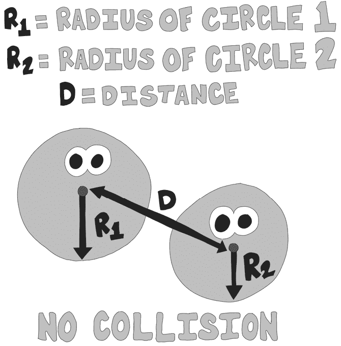

图 6-6：如果 R[1] + R[2] 小于两个圆之间的距离，则没有碰撞。

如果距离小于 R[1] + R[2]，则发生了碰撞，如图 6-7 所示。

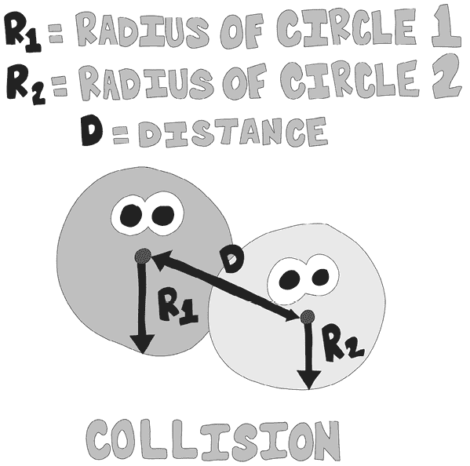

图 6-7：R[1] + R[2] 大于两个圆之间的距离。

列表 6-20 显示了 `$collision_check` 函数的代码。

### data_structures.wat（第 6 部分 2）

```
...
1 (func $collision_check
    (param $x1 i32) (param $y1 i32) (param $r1 i32)
    (param $x2 i32) (param $y2 i32) (param $r2 i32)
    (result i32)

    (local $x_diff_sq i32)
    (local $y_diff_sq i32)
    (local $r_sum_sq i32)

    local.get $x1
    local.get $x2
    i32.sub
    local.tee $x_diff_sq
    local.get $x_diff_sq
    i32.mul
      2 local.set $x_diff_sq  ;; ($x1 - $x2) * ($x1 - $x2)

    local.get $y1
    local.get $y2
    i32.sub
    local.tee $y_diff_sq
    local.get $y_diff_sq
    i32.mul
      3 local.set $y_diff_sq  ;; ($y1 - $y2) * ($y1 - $y2)

    local.get $r1
    local.get $r2
    i32.add
    local.tee $r_sum_sq
    local.get $r_sum_sq
    i32.mul
      4 local.tee $r_sum_sq   ;; ($r1 + $r2) * ($r1 + $r2)

    local.get $x_diff_sq
    local.get $y_diff_sq
      5 i32.add  ;; 勾股定理 A 平方 + B 平方 = C 平方

      6 i32.gt_u ;; 如果距离小于半径之和则返回 true
)
...
```

列表 6-20：一个 WebAssembly 碰撞检测函数

该函数接收两个圆 1 的 `x`、`y` 和半径属性，然后如果它们重叠则返回 `1`，如果不重叠则返回 `0`。它首先通过从 `$x1` 减去 `$x2` 来找到两个圆之间的 `x` 距离。然后，它将该值平方并存储在 `$x_diff_sq` 2 中；接着它找到两个圆之间的 `y` 距离。我们正在构建的是勾股定理 A² + B² = C²。这两个值的和是 C²，它与半径之和进行比较。如果半径² 大于 C²，则圆形重叠，函数返回 `1`；否则，函数返回 `0`。这是通过 `i32.gt_u` 6 决定的。在 `$collision_check` 函数之后，我们需要一些辅助函数。`get_attr` 函数接收一个对象基和一个属性偏移，并返回该地址的值。列表 6-21 显示了该函数。

### data_structures.wat（第 6 部分 3）

```
...
1 (func $get_attr (param $obj_base i32) (param $attr_offset i32)
    (result i32)
    local.get $obj_base
    local.get $attr_offset
  2 i32.add         ;; 基地址加上属性偏移
  3 i32.load        ;; 加载并返回该值
  )
...
```

从线性内存获取对象属性

在函数定义 1 中，`obj_base` 参数是对象的基地址，`attr_offset` 是我们要检索的属性偏移。函数将这两个值相加 2。然后从该地址加载值 3。

下一个辅助函数是 `$set_collision`，它将两个圆形的碰撞标志设置为真。列表 6-22 显示了该函数。

### data_structures.wat（第 6 部分 4）

```
...
1 (func $set_collision
    (param $obj_base_1 i32) (param $obj_base_2 i32)
    local.get $obj_base_1
    global.get $collision_offset
  2 i32.add   ;; 地址 = $obj_base_1 + $collision_offset
    i32.const 1
  3 i32.store ;; 在对象的碰撞属性中存储 1

    local.get $obj_base_2
    global.get $collision_offset
  4 i32.add   ;; 地址 = $obj_base_2 + $collision_offset
    i32.const 1
  5 i32.store ;; 在对象的碰撞属性中存储 1
  )
...
```

列表 6-22：为给定对象设置碰撞属性

该函数接收两个对象基参数 1，用于设置内存中这些对象的碰撞标志。它通过将 `$obj_base_1` 加上 `$collision_offset` 2，然后将线性内存中该位置的值设置为 `1` 3。然后它将 `$obj_base_2` 加上 `$collision_offset` 4，并将该位置的值设置为 `1` 5。

现在我们已经定义了其他函数，我们可以在 WAT 代码中添加 `$init` 函数，如列表 6-23 所示。

**data_structures.wat（第 6 部分 5）**


```
...
(func $init
1 (local $i i32)     ;; 外循环计数器
  (local $i_obj i32) ;; 第 i 个对象的地址
  (local $xi i32)(local $yi i32)(local $ri i32) ;; 对象 i 的 x,y,r

2 (local $j i32)     ;; 内循环计数器
  (local $j_obj i32) ;; 第 j 个对象的地址
  (local $xj i32)(local $yj i32)(local $rj i32) ;; 对象 j 的 x,y,r

  (loop $outer_loop
  (local.set $j (i32.const 0))  ;; $j = 0

  (loop $inner_loop
    (block $inner_continue
    ;; 如果 $i == $j 继续
  3 (br_if $inner_continue (i32.eq (local.get $i) (local.get $j) ) )

    ;; $i_obj = $obj_base_addr + $i * $obj_stride
    (i32.add (global.get $obj_base_addr)
           4 (i32.mul (local.get $i) (global.get $obj_stride) ) )

    ;; 加载 $i_obj + $x_offset 并存储到 $xi
  5 (call $get_attr (local.tee $i_obj) (global.get $x_offset) )
    local.set $xi    

    ;; 加载 $i_obj + $y_offset 并存储到 $yi
    (call $get_attr (local.get $i_obj) (global.get $y_offset) )
    local.set $yi    

    ;; 加载 $i_obj + $radius_offset 并存储到 $ri
    (call $get_attr (local.get $i_obj) (global.get $radius_offset) )
    local.set $ri    

    ;; $j_obj = $obj_base_addr + $j * $obj_stride
  6 (i32.add (global.get $obj_base_addr)
             (i32.mul (local.get $j)(global.get $obj_stride)))

    ;; 加载 $j_obj + $x_offset 并存储到 $xj
    (call $get_attr (local.tee $j_obj) (global.get $x_offset) )
    local.set $xj    

    ;; 加载 $j_obj + $y_offset 并存储到 $yj
    (call $get_attr (local.get $j_obj) (global.get $y_offset) )
    local.set $yj    

    ;; 加载 $j_obj + $radius_offset 并存储到 $rj
    (call $get_attr (local.get $j_obj) (global.get $radius_offset) )
    local.set $rj    

    ;; 检查第 i 个和第 j 个对象之间的碰撞
  7 (call $collision_check
      (local.get $xi)(local.get $yi)(local.get $ri)
      (local.get $xj)(local.get $yj)(local.get $rj))

    if ;; 如果发生碰撞
    8 (call $set_collision (local.get $i_obj) (local.get $j_obj))
    end
  )

  9 (i32.add (local.get $j) (i32.const 1)) ;; $j++

    ;; 如果 $j < $obj_count 则循环
    (br_if $inner_loop
      (i32.lt_u (local.tee $j) (global.get $obj_count)))
  )

  a (i32.add (local.get $i) (i32.const 1)) ;; $i++

  ;; 如果 $i < $obj_count 则循环
  (br_if $outer_loop
    (i32.lt_u (local.tee $i) (global.get $obj_count) ) )
 )
)
...
```

列表 6-23：一个在线性内存中检查每个对象之间碰撞碰撞的双重循环

该函数以两组局部变量开始。一组包含一个计数器、对象地址以及用于外循环的 `x`、`y` 和 `r` 局部变量 1。第二批局部变量用于内层 `loop` 2。该函数的核心是一个双重循环，它将线性内存中的每个圆与其他每个圆进行比较，寻找相互碰撞的圆。内层循环的开头检查 `$i` 是否与 `$j` 相同 3。如果相同，代码将跳过对这个特定 `$j` 对象的检查，否则每个圆都会与自身发生碰撞。

下一行代码计算第 `i` 个对象的线性内存地址 4，公式为 `$obj_base_addr` + `$i` * `$obj_stride`。然后，它在下一行的 `(call $get_attr)` 5 表达式中使用 `local.tee` 表达式设置 `$i_obj` 的值。此对 `$get_attr` 的调用 5 从第 i 个对象中获取 `x` 的值，然后设置 `$xi`。

接下来的四行以相同的方式加载值到 `$yi` 和 `$ri` 中。然后，通过调用函数设置 `$xj`、`yj` 和 `$rj` 6。

随后检查第 i 个和第 j 个对象之间的碰撞 7 会调用 `$collision_check`。如果发生碰撞，则 8 会调用 `$set_collision` 处理 `$i_obj` 和 `$j_obj`。

9 将 `$j` 增加 1（$j++`）。

如果 `$j < $obj_count` 则循环。

a 将 `$i` 增加 1（$i++`）。

如果 `$i < $obj_count` 则循环。


到此时，你应该已经了如何在 WAT 和 JavaScript 内部操作和设置线性内存。你还应该能够在你的应用程序内部使用线性内存来创建数据结构，并在 WebAssembly 中处理大量数据，然后使用 JavaScript 显示这些数据。在下一章中，我们将介绍如何从 WebAssembly 操作文档对象模型 (DOM)。

# 第 7 章 Web 应用程序


本章将帮助你理解 WebAssembly 如何通过 JavaScript 与 DOM 交互。尽管这看起来可能繁琐，但为了理解 WebAssembly 及其优缺点，这是必不可少的。如果你正在使用 WebAssembly 工具链，你需要知道该工具链将生成多少额外的 JavaScript 代码作为胶水代码（glue code）。从现在开始，大多数示例将在网页中运行，而不是在命令行中使用 `node`。

我们将首先使用 Node.js 创建一个简单的静态 Web 服务器。WebAssembly Web 应用程序无法直接从浏览器中的文件系统中加载；相反，它们需要你运行一个 Web 服务器。Node.js 提供了创建 Web 服务器所需的所有工具。然后我们将编写第一个 WebAssembly Web 应用程序。

我们将编写第二个 Web 应用程序将重用在第 5 章中编写的函数，从 HTML 中的输入元素获取数字并传递给 WebAssembly，由 WebAssembly 将该数字转换为十进制、十六进制和二进制字符串。

到本章结束，你将理解编写 Web 应用程序的基础，即加载并实例化 WebAssembly 模块，然后调用该模块内部的函数。应用程序还将将这些模块中的数据写入 DOM 元素。本章中的示例并不代表你通常使用 WebAssembly 编写的应用程序类型。它们仅演示了网页如何加载、实例化并与 WebAssembly 模块交互。

## DOM

现代基于 Web 的应用程序如此复杂，以至于人们很容易忘记 HTML 页面的核心是一个简单的文档。Web 的设计初衷是作为共享文档和信息的手段，但很快人们发现我们需要一种标准方法，使用 JavaScript 或 Java 等语言动态更新这些文档。DOM 被设计为一种与语言无关的接口，用于操作 HTML 和 XML 文档。因为 HTML 文档是树形结构，DOM 将文档表示为逻辑树。DOM 是 JavaScript 和其他语言修改 Web 应用程序中 HTML 的方式。

WebAssembly 1.0 版本没有直接操作 DOM 的方法，因此 JavaScript 必须对 HTML 文档进行所有修改。如果你使用工具链（如 Rust 或 Emscripten），DOM 的操作通常通过 JavaScript 胶水代码完成。作为一个一般规则，Web 应用程序的 WebAssembly 部分应专注于处理数值数据，但对于 DOM，大部分数据处理可能可能是字符串操作。在 WebAssembly 内部进行字符串操作的性能完全取决于你用于该任务的库。因此，DOM 密集型工作最好保留在应用程序的 JavaScript 部分。

## 设置简单的 Node 服务器

要使用 Node.js 设置静态 Web 服务器，请为项目创建一个文件夹并在 VS Code 或你选择的 IDE 中打开它。我们需要使用 `npm` 安装两个包。使用列表 7-1 中的命令安装第一个包 `connect`。

```
npm install connect --save-dev
```

列表 7-1：使用 `npm` 安装 `connect` 包。

使用列表 7-2 中的命令安装第二个包 `serve-static`。

```
npm install serve-static --save-dev
```

列表 7-2：使用 `npm` 安装 `serve-static`。

安装好包后，创建一个名为 `server.js` 的文件，并输入列表 7-3 中的代码来定义静态 Web 服务器。

**server.js**

```
var connect = require('connect');
var serveStatic = require('serve-static');
connect().use(serveStatic(__dirname + "/")).listen(8080, function(){
  console.log('localhost:8080');
});
```

列表 7-3：Node.js http 服务器代码

我们已经创建了一个从当前目录提供服务的静态服务器，但我们还没有任何要提供的文件。使用 VS Code 创建一个名为 `index.html` 的文件并输入一些 HTML，类似于列表 7-4 中的代码。

**index.html**

```html
<<html>
  <head></head>
  <body>
    <h1>我们的服务器工作了！</h1>
  </body>
</html>
```

列表 7-4：一个简单的网页

现在，你可以使用使用以下命令运行你的 Node.js Web 服务器了：

```
node server.js
```

Web 服务器将在端口 8080 上开始运行。通过在浏览器中输入 `localhost:8080` 来测试；你应该能看到类似图 7-1 的内容。


图 7-1：测试我们的简单静态服务器

现在我们有了一个工作的 Node.js Web 服务器，让我们创建第一个 WebAssembly Web 应用程序。

## 我们的第一个 WebAssembly Web 应用程序

我们将从一个简单的 Web 应用开始，它接收两个数字输入，它们相加并显示这些值。该程序的最终版本可以在 [`wasmbook.com/add_message.html`](https://wasmbook.com/add_message.html)。

此应用程序演示了 WebAssembly 如何与 DOM 交互。你会发现 WebAssembly 部分保持为空。要创建一个 Web 应用，我们必须运行一个 Web 服务器、带有 JavaScript 的 HTML 页面和一个 WebAssembly 模块。列表 7-5 显示了具有加法功能的 WAT 模块。创建文件 *add_message.wat* 并添加列表 7-5 中的代码。

**add_message.wat**

```wat
(module
1 (import "env" "log_add_message"
    (func $log_add_message (param i32 i32 i32)))

2 (func (export "add_message")
    3 (param $a i32) (param $b i32)
      (local $sum i32)

      local.get $a
      local.get $b
    4 i32.add
      local.set $sum

    5 (call $log_add_message
      6 (local.get $a) (local.get $b) (local.get $sum))
  )
)
```

列表 7-5：`add_message.wat` 文件将两个数字相加并调用 JavaScript 日函数。


## 定义 HTML 头部

现在我们将创建 HTML 页面。当我们之前使用 Node.js 作为嵌入环境时，可以使用纯 JavaScript 进行工作，但对于静态网站，你需要一个 HTML 页面。网页浏览器不会像 Node.js 那样直接执行 JavaScript。浏览器加载 HTML 页面，并在 `<script>` 标签中嵌入 JavaScript。我假设你对 HTML 基础已经有些熟悉，但如果不熟悉，这个示例也应该很好理解。创建一个新文件 `add_message.html` 并添加 列表 7-6 中的代码。

**add_message.html (共 3 部分的第一部分)**

```html
<!DOCTYPE html>
<html lang="en">
<head>
  <meta charset="UTF-8">
  <meta name="viewport"
        content="width=device-width, initial-scale=1.0">
  <title>Add Message</title>
...
```

列表 7-6：`add_message` 应用的 HTML 头部大部分是 HTML 样板代码。

这是 HTML 起始标签和头部信息。它只是设置了一些字体配置，并将应用名称 `Add Message` 显示为标题。

## JavaScript

在结束 `head` 元素之前，我们包含了一个用于 JavaScript 的 `script` 标签。与使用 Node.js 时类似，需要 JavaScript 代码来实例化并执行 WebAssembly 模块中的函数。HTML 页面使用 `script` 标签来包含这些 JavaScript，如 列表 7-7 所示。

**add_message.html (共 3 部分的第二部分)**

```javascript
...
  <script>
  1 //const sleep = m => new Promise(r => setTimeout(r, m));
    var output = null;
    var add_message_function;

  2 var log_add_message = (a, b, sum) => {
      if (output == null) {
        console.log("page load not complete: log_add_message");
        return;
      }
    3 output.innerHTML += `${a} + ${b} = ${sum}<br>`;
    };

    let importObject = {
      env: {
      4 log_add_message: log_add_message,
      }
    };

    (async () => {
    5 // await sleep(5000);
      let obj = await
    6 WebAssembly.instantiateStreaming(fetch('add_message.wasm'),
                                        importObject);
      add_message_function = obj.instance.exports.add_message;
    7 let btn = document.getElementById("add_message_button");
      btn.style.display = "block";
    })();

  8 function onPageLoad() {
      //(async () => {
    9 //await sleep(5000);
    a output = document.getElementById("output");
      //})();
    }
  </script>
...
```

列表 7-7：加载 WebAssembly 模块的 JavaScript 位于 `script` 标签内。

在构建网页时，我们需要意识到所有网页元素完成加载的时机，以及流式传输并实例化 WebAssembly 模块所需的时间。

此应用程序将消息写入段落标签 `output` 中。当 JavaScript 执行时，输出段落尚未加载，因为它位于 HTML 页面的下方。WebAssembly 模块将以异步方式流式传输和加载，因此你无法确定 WebAssembly 模块是在页面加载完成之前还是之后实例化的。

为了测试此函数无论这些事件发生的顺序如何都能工作，我们在开头创建了一个 `sleep`1 函数来强制 JavaScript 等待。该函数在这里被注释掉了。要测试加载顺序，请取消此处 `sleep` 以及以及 IIFE 内部或 `onPageLoad` 函数内部的注释。

我们创建了 `add_message_function` 变量作为占位符，一旦模块实例化，它将更改指向 WebAssembly 模块内部的 `add_message` 函数。

接下来，我们定义了 `log_add_message` 2，它包含一个箭头函数，用于检查 `output` 是否被设置为 `null` 以外的值。`output` 的默认值为 `null`，但一旦页面加载，`output` 就会被设置为 `id` 为 `output` 的段落元素；因此，如果函数在页面加载完成之前运行，该函数将记录一条消息。`log_add_message` 4 函数由 WebAssembly 模块导入并调用，模块向 `log_add_message` 传递两个用于相加的参数以及这些参数之和。该函数随后将这些值写入 列表 7-8 中的 `output` 3 HTML 段落标签。

在 IIFE 中，`sleep` 5 函数被注释掉了，但你可以为了测试而恢复它。然而，当从网页加载 WebAssembly 模块时，你使用 `WebAssembly.instantiateStreaming` 6 结合 `fetch` 调用来检索模块。一旦模块实例化，就会从 DOM 中获取 `add_message_button` 7 元素，并通过设置其 `style.display` 属性为 `block` 使其可见。用户现在可以点击此按钮来运行 WebAssembly 函数。

此外，我们定义了 `onPageLoad` 8 函数，它会在 HTML `body` 加载完成时执行。该函数设置了在 [列表 7-7] 顶部定义的变量 `output`。

# HTML Body 

`body` 标签包含了将要显示的 DOM 元素。

**add_message.html (共 3 部分的第三部分)**

```html
...
</head>
1 <body onload="onPageLoad()" style="font-family: 'Courier New', Courier, monospace;">
2 <input type="number" id="a_val" value="0"><br><br>
3 <input type="number" id="b_val" value="0"><br><br>
4 <button id="add_message_button" style="display:none"
5 onclick="add_message_function(document.getElementById('a_val').value, document.getElementById('b_val').value )">Add Values</button><br>
6 <p id="output" style="float:left; width:200px; min-height:300px;"></p>
</body>
</html>
```

列表 7-8：`body` 标签中的 DOM 元素

`body` 1 标签包含一个调用 `onPageLoad` 的 `onload` 属性。这确保了 JavaScript 中的 `output` 变量直到其存在才被设置。

我们有两个 `id` 为 `a_val` 2 和 `b_val` 3 的 `input` 元素。当点击 `button` 4 元素时，这些输入框值会被传递给 WebAssembly。按钮属性 `onclick` 5 被设置为调用 `add_message_function`，一旦模块实例化，它将调用 WebAssembly 模块中的 `add_message` 函数。此外，我们还有一个 `id` 为 `output` 6 的段落标签，我们将用 WebAssembly 模块的值填充它。

## 我们完整的 Web 应用

我们现在应该可以运行 Web 应用了。如之前提到的，我们必须从 Web 服务器提供网页，因此请先确保 列表 7-3 中的 Web 服务器正在运行，可以使用 列表 7-9 中的命令。

```bash
node server.js
```

列表 7-9：运行简单的 Web 服务器。

如果你收到 列表 7-10 中的错误，说明该端口上已有一个 Web 服务器。

```text
Error: listen EADDRINUSE: address already in use :::8080
```

列表 7-10：端口已被占用时的 Web 服务器错误

得到此错误可能意味着你从另一个命令行运行了 *server.js*。在 Web 服务器运行时，在浏览器中打开以下 URL：[`localhost:8080/add_message.html`](http://localhost:8080/add_message.html)。


你应该能看到类似图 7-2 所示的屏幕。

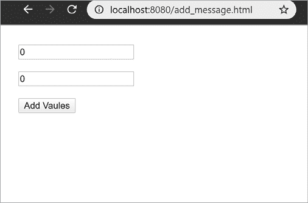

图 7-2：`add_message.html` 应用程序

在两个数字字段中赋值，并点击 `Add Values` 以查看加法结果（图 7-3）。

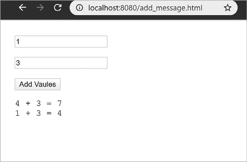

图 7-3：使用应用添加的两个加法消息

注意，WebAssembly 模块调用了 JavaScript 函数，就像在其他章节中那样。在本章中，你不需要学习 `WAT` 中的任何新命令。因为在 `Wasm 1.0` 中无法直接操作 DOM，因此我们在 JavaScript 内部对 DOM 进行了所有修改。尽管我们第一次使用 HTML 页面，但这并没有影响 WebAssembly 的功能。WebAssembly 1.0 的功能相当有限，最适用于提高计算密集型应用的性能。随着后续 WebAssembly 的发布和更多功能的加入，这一特性将会发生变化。但目前，在决定哪些应用最适合这项新技术时，你需要记住这些局限性。

## 十进制和二进制字符串

我们将继续创建第二个应用程序，它使用第 5 章中的函数将数值数据转换为十进制、十六进制和二进制字符串，并将它们显示在网页上。访问 [`wasmbook.com/hex_and_binary.html`](https://wasmbook.com/hex_and_binary.html) 查看最终的应用程序。

### HTML

HTML 与列表 7-6 几乎相同，但 `title` 内容不同。创建一个名为 `hex_and_binary.html` 的文件，并添加列表 7-11 中的代码。

**hex_and_binary.html (第 1/3 部分)**

```
<!DOCTYPE html>
<html lang="en">

<head>
  <meta charset="UTF-8">
  <meta name="viewport"
        content="width=device-width, initial-scale=1.0">
  <title> 1 Hex and Binary</title>
...
```

列表 7-11：`hex_and_binary.html` 开头的样板代码

这里的 `title` 标签包含了 `Hex` 和 `Binary`。接下来，在列表 7-12 中，我们添加了 `script` 标签以及用于实例化和调用 WebAssembly 模块的 JavaScript 代码。

**hex_and_binary.html (第 2/3 部分)**

```
...
  <script>
    // 分配一个 64K 的内存块
    const memory = new WebAssembly.Memory({ initial: 1 });
    var output = null;

    // 当 WebAssembly 模块实例化时，该函数将会改变
  1 var setOutput = (number) => {
      // 如果在 WebAssembly 模块实例化之前运行该函数，
      // 将显示此消息。
    2 console.log("function not available");
      return 0;
    };

    // 此函数将通过点击按钮调用，并运行
    // WebAssembly 模块中的 setOutput 函数。
  3 function setNumbers(number) {
    4 if (output == null) {
        // 如果页面未完全加载，则返回
        return;
      }

      // 调用 WebAssembly setOutput 函数生成 HTML
      // 字符串并将其放入线性内存，返回其长度
    5 let len = setOutput(number);

      // 我们知道 HTML 字符串在线性内存中的位置和长度，
      // 因此我们可以从内存缓冲区中提取它
    6 let bytes = new Uint8Array(memory.buffer, 1024, len);

      // 将从线性内存提取的字节转换为 JavaScript
      // 字符串并并它来设置 output 中的 HTML
    7 output.innerHTML = new TextDecoder('utf8').decode(bytes);
    }

  8 function onPageLoad() {
      // 当页面加载完成后，将输出变量
      // 设置为 id 为 "output" 的元素
    9 output = document.getElementById("output");
      var message_num = 0;
    }

    let importObject = {
      env: {
        buffer: memory
      }
    };

    (async () => {
      // 使用 WebAssembly.instantiateStreaming 结合
      // fetch 代替 WebAssembly.instantiate 和 fs.readFileSync
      let obj = await WebAssembly.instantiateStreaming(
                        fetch('hex_and_binary.wasm'),
                        importObject);
      // 将 setOutput 变量重置为 WASM 模块
      // 中的 setOutput 函数
    a setOutput = obj.instance.exports.setOutput;
         let btn = document.getElementById("set_numbers_button");
         btn.style.display = "block";
    })();

  </script>
</head>
...
```

列表 7-12：`hex_and_binary.html` 文件的 JavaScript

`script` 标签首先创建变量 `setOutput` 1 并将其设置为箭头函数，该函数向控制台打印 `"function not available"` 2。如果用户在 WebAssembly 模块加载完成点击 `Set Numbers` 按钮，将显示此消息。

接下来，用户点击 `Set Numbers` 按钮。此时 `output` 仍为 `null` 3。`setOutput` 函数 4 调用 WebAssembly 模块并返回字符串长度。我们使用 `setOutput` 5 生成 HTML。我们从线性内存提取 `bytes` 6。我们使用 `TextDecoder` 7 解码字节。

`onPageLoad` 函数 8 设置 `output` 变量。`output` 标签 9 包含了输出。

**hex_and_binary.html (第 3/3 部分)**

```
...
<!-- body 标签在加载完成后调用 onPageLoad -->
1 <body onload="onPageLoad()"
      style="font-family: 'Courier New', Courier, monospace;">
2 <div id="output"><!-- 显示 WebAssembly 的输出 -->
    <h1>0</h1>
    <h4>0x0</h4>
    <h4> 0000 0000 0000 0000 0000 0000 0000 0000</h4>
  </div>
<br>
  <!-- 用户在此处输入要转换为十六进制和二进制的输入 -->
3 <input type="number" id="val" value="0"><br><br>
  <!-- 当用户点击此按钮时，运行 WASM 函数 -->
4 <button id="set_numbers_button" type="button" style="display:none"
5 onclick="setNumbers( document.getElementById('val').value )">
    Set Numbers
  </button>
</body>
</html>
```

列表 7-13：HTML 页面的 UI 元素

`onload` 1 属性在 body 加载完成后执行 `onPageLoad`。标签 2 `<div id="output">` 是显示 WebAssembly 模块输出的地方。数字 `input` 标签 3 `<input type="number" id="val" value="0">` 是用户输入要转换为十六进制和二进制的数字的地方。`button` 4 在点击时通过 `onclick` 5 属性调用 WebAssembly 模块。

### WAT

此应用程序有很多 WAT 代码，因此我们将其分为四个部分。此外，你还需要复制第 5 章的几个函数。创建一个名为 `hex_and_binary.wat` 的文件，并添加列表 7-14 中的代码。

**hex_and_binary.wat (第 1/4 部分)**


```
(module
  (import "env" "buffer" (memory 1))

  ;; 十进制数字
1 (global $digit_ptr i32 (i32.const 128))
  (data (i32.const 128) "0123456789ABCDEF")
  ;; 十进制字符串指针、长度和数据段
2 (global $dec_string_ptr  i32 (i32.const 256))
(global $dec_string_len  i32 (i32.const 16))
  (data (i32.const 256) "               0")

  ;; 十六进制字符串指针、长度和数据段
3 (global $hex_string_ptr  i32 (i32.const 384))
(global $hex_string_len  i32 (i32.const 16))
(data (i32.const 384) "             0x0")

  ;; 二进制字符串指针、长度和数据段
4 (global $bin_string_ptr  i32 (i32.const 512))
(global $bin_string_len  i32 (i32.const 40))
(data (i32.const 512) " 0000 0000 0000 0000 0000 0000 0000 0000")

  ;; h1 开启标签字符串指针、长度和数据段
5 (global $h1_open_ptr i32  (i32.const 640))
(global $h1_open_len i32  (i32.const 4))
(data (i32.const 640) "<H1>")

  ;; h1 结束标签字符串指针、长度和数据段
6 (global $h1_close_ptr i32  (i32.const 656))
(global $h1_close_len i32  (i32.const 5))
(data (i32.const 656) "</H1>")

  ;; h4 开启标签字符串指针、长度和数据段
7 (global $h4_open_ptr i32  (i32.const 672))
(global $h4_open_len i32  (i32.const 4))
(data (i32.const 672) "<H4>")

  ;; h4 结束标签字符串指针、长度和数据段
8 (global $h4_close_ptr i32  (i32.const 688))
(global $h4_close_len i32  (i32.const 5))
(data (i32.const 688) "</H4>")

  ;; 输出字符串长度和数据段
9 (global $out_str_ptr i32 (i32.const 1024))
(global $out_str_len (mut i32) (i32.const 0))

...
```
列表 7-14：模块开头的字符串数据定义

我们定义了一系列数据段、指针和数据长度，将用于从整数数据组装十进制、十六进制和二进制字符串。全局变量 `$digit_ptr` 1 指向数据段，该段包含了线性内存位置 `128` 处定义的 16 个十六进制数字 0 到 F。这些数据用于从整数到字符串的所有三种转换。我们还了长度和指针全局变量，以及用于我们的十进制 2、十六进制 3 和二进制 4 字符串的数据段。我们将用的大部分代码取自第 5 章的章节。

接下来，我们有几个表示 HTML 标签的字符串。包括开启 5 和结束 6 的 `H1` 标签指针、长度和数据段，以及用于 `H4` 标签的开启 7 和结束 8 的数据。这些字符串将用于组装我们的 HTML 输出字符串，该字符串将存储在线性内存位置 `1024` 9 处，我选择这个位置是因为它是未使用的。

当我们将字符串数据复制到输出字符串时，我们需要跟踪该字符串的新长度并将该值传递给 JavaScript；因此，我们使用全局变量 `$out_str_len` 来跟踪输出字符串的长度。我没有包含第 5 章原始函数的代码，而是包含了一个省略号（……）和一个注释，指示要复制的函数代码所在的列表编号。请从列表 7-15 中的原始列表中复制并粘贴所有六个函数的代码。

### hex_and_binary.wat (4 部分中的第 2 部分)

```
...
1 (func $set_bin_string (param $num i32) (param $string_len i32)
  ;; $set_bin_string 定义在列表 5-35 中
...
)

2 (func $set_hex_string (param $num i32) (param $string_len i32)
  ;; $set_hex_string 定义在列表 5-30 中
...
) ;; end $set_hex_string

3 (func $set_dec_string (param $num i32) (param $string_len i32)
  ;; $set_dec_string 定义在列表 5-24 中
...
)

4 (func $byte_copy (param $source i32) (param $dest i32) (param $len i32)
  ;; $byte_copy 定义在列表 5-17 中
...
)

5 (func $byte_copy_64 (param $source i32) (param $dest i32) (param $len i32)
  ;; $byte_copy_64 定义在列表 5-18 中
...
)

6 (func $string_copy (param $source i32) (param $dest i32) (param $len i32)
  ;; $string_copy 定义在列表 5-19 中
...
```

列表 7-15：重自第 5 章的函数

首先是数字转字符串的函数。`$set_bin_string` 1 将数字转换为二进制字符串。它接收的参数是要转换为二进制字符串的 `i32 $num` 和字符串的长度 `$string_len`（列表 5-35）。接下来是 `$set_hex_string` 2 将数字转换为十六进制字符串（列表 5-30）。然后 `$set_dec_string` 3 将数字转换为十进制字符串（列表 5-24）。

接下来是三种用于复制的函数：`$byte_copy` 4 逐字节复制数据（列表 5-17）。`$byte_copy_64` 5 每次复制 8 个字节（列表 5-18）。`$string_copy` 6 使用 `$byte_copy_64` 逐字节复制，直到剩余不足 8 个字节，然后使用 `$byte_copy` 复制剩余字节（列表 5-19）。

在[列表 7-15] 中缺少一个最后的复制命令。这是 `$append_out` 函数，它通过将给定的字符串追加到输出字符串的末尾来实现。

### hex_and_binary.wat (4 部分中的第 3 部分)

```
...
  ;; 将字符串追加到输出字符串
1 (func $append_out (param $source i32) (param $len i32)
  2 (call $string_copy
   (local.get $source)
     (i32.add
      (global.get $out_str_ptr)
      (global.get $out_str_len)
    )
   (local.get $len)
  )

  ;; 将长度添加到输出字符串长度
  global.get $out_str_len
  local.get $len
  i32.add
  3 global.set $out_str_len
)
...
```
列表 7-16：$append_out 函数追加到输出字符串

`$append_out` 1 函数通过使用 `$string_copy` 2 将字符串追加到输出字符串的末尾，并将刚刚追加的字符串长度添加到 `$out_str_len` 3，后者表示输出字符串的长度。

此模块中的最后一个函数是 `setOutput`，它创建用于设置 `output` `div` 标签的字符串。它是导出的，因此可以从 JavaScript 调用。将列表 7-17 中的代码添加到 WAT 文件的末。

**hex_and_binary.wat (4 部分中的第 4 部分)**


```
(func (export "setOutput") (param $num i32) (result i32)
  ;; 根据 $num 值创建一个十进制字符串
1 (call $set_dec_string
    (local.get $num) (global.get $dec_string_len))    
  ;; 根据 $num 值创建一个十六进制字符串
2 (call $set_hex_string
    (local.get $num) (global.get $hex_string_len))    
  ;; 根据 $num 值创建一个二进制字符串
3 (call $set_bin_string
    (local.get $num) (global.get $bin_string_len))    

    i32.const 0
  4 global.set $out_str_len ;; 将 $out_str_len 设置为 0

    ;; 向输出字符串中追加 <h1>${decimal_string}</h1>
  5 (call $append_out
      (global.get $h1_open_ptr) (global.get $h1_open_len))
    (call $append_out
      (global.get $dec_string_ptr) (global.get $dec_string_len))
    (call $append_out
      (global.get $h1_close_ptr) (global.get $h1_close_len))

    ;; 向输出字符串中追加 <h4>${hexadecimal_string}</h4>
  6 (call $append_out
      (global.get $h4_open_ptr) (global.get $h4_open_len))
    (call $append_out
      (global.get $hex_string_ptr) (global.get $hex_string_len))
    (call $append_out
      (global.get $h4_close_ptr) (global.get $h4_close_len))

    ;; 向输出字符串中追加 <h4>${binary_string}</h4>
  7 (call $append_out
      (global.get $h4_open_ptr) (global.get $h4_open_len))
    (call $append_out
      (global.get $bin_string_ptr) (global.get $bin_string_len))
    (call $append_out
      (global.get $h4_close_ptr) (global.get $h4_close_len))

    ;; 返回输出字符串长度
  8 global.get $out_str_len
  )
)
```

列表 7-17：导出供 JavaScript 调用的 `setOutput` 函数

`set_output` 函数在列表 7-17 中进行的前三次调用别是调用 `$set_dec_string` 1、`$set_hex_string` 2 和 `$set_bin_string` 3。这些函数接收传递给 `setOutput` 的数字，并将其转换为线性内存中的十进制字符串、十六进制字符串和二进制字符串。一旦这些字符串设置完毕，全局变量 `$out_str_len` 4 就会设置为 `0`，这会重置输出字符串，使得向输出字符串的追加操作将覆盖内存中当前的字符串。在我们重置值之后，我们就可以开始向输出字符串追加内容了。

接下来是九次对 `$append_out` 的调用，分为三个块。前三次调用追加了一个带有十进制 5 字符串的起始和结束 `H1` 标签。这创建了用于网页中显示十进制数值的 HTML 字符串。下一组三次调用将十六进制 6 字符串追加到 `H4`元素中，然后将二进制 7 字符串追加到 `H4`元素中。最后，通过调用 `global.get` `$out_str_len` 8 将输出字符串的长度加载到栈上，将其返回给调用的 JavaScript。

### 编译并运行

WAT 模块已完成，因此使用 `wat2wasm` 编译你的 `hex_and_binary.wasm` 文件，如列表 7-18 所示。

```
wat2wasm hex_and_binary.wat
```

列表 7-18：使用 `wat2wasm` 编译 `hex_and_binary.wat`

验证你是否正在运行 `server.js`，并在浏览器中使用地址 `http://localhost:8080/hex_and_binary.html` 打开 `hex_and_binary.html`。

图 7-4 显示了屏幕上应该看到的类似内容。

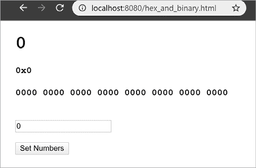

图 7-4：十进制转换为十六进制和二进制

输入一个数字并尝试一下。例如，在图 7-5 中，我输入了数字 1025 并点击了“Set Numbers”。

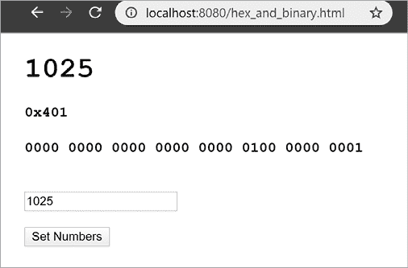

图 7-5：将 1025 转换为十六进制和二进制

此应用程序使用了我们在第 5 章创建的几个 WebAssembly 函数将十进制数字转换为十六进制和二进制字符串。我们添加了一些额外功能，在 WebAssembly 模块中创建 HTML 标签，以便我们将 HTML 传递给 JavaScript 并在网页上显示。正如你所看到的，在 WAT 中处理字符串和操作 DOM 是相当繁琐的。如果你在使用工具链，大部分工作将由工具为你完成。这些功能中的某些可能会编译为 JavaScript。

## 总结

WebAssembly 1.0 不直接与用户界面交互。它的擅长领域是计算密集型应用程序。在基于 WebAssembly 的 Web 应用程序中操作 DOM 主要是 JavaScript 的工作。在 WebAssembly 处理字符串完全取决于实现。WebAssembly 仍然是许多 Web 应用程序的极佳选择，特别是图形应用程序。但在目前，它并不是为直接操作 DOM 设计的。

在本章初，我们创建一个使用 Node.js 运行的简单 JavaScript 服务器。你无法从文件加载 WebAssembly Web 应用，而是必须使用 Web 服务器提供你的页面。我们编写了第一个 WebAssembly Web 应用，它将两个数字相加并将结果输出到 DOM 中的段落中。

# 8

与 Canvas 工作


在本章中，你将学习如何将 WebAssembly 与 HTML canvas 元素结合，在 Web 应用程序中创建高效的动画。将在 WebAssembly 线性内存中操作像素数据，然后将线性内存中的像素数据直接传输到 HTML canvas。我们将继续之前的随机碰撞对象示例（列表 6-16），在 JavaScript 线性内存中生成对象，然后使用 WebAssembly 移动这些对象、检测碰撞并渲染它们。由于可能的碰撞数量随对象数量而呈指数级增长，这种图形碰撞检测是 WebAssembly 能力的极佳测试。在本章结束时，我们将拥有一个能够每秒检测几十次数千个不同碰撞体碰撞的应用程序。在这种情况下，我们的对象在没有碰撞时显示为绿色，发生碰撞时显示为红色。


正如之前讨论的，Web 浏览器最初是为了显示简单的在线文档设计的，这意味着文档任何元素位置的任何更改都会经常导致整个页面重新渲染。对于任何需要高帧率图形效果（如游戏）的应用程序来说，这都是性能上的噩梦。从那以后，浏览器已经演变为复杂的应用程序托管环境，这使得需要开发一种更复杂的渲染模型：`canvas`。`canvas` 元素由 Apple 在 2004 年为其 Safari Web 浏览器引入，并于 2006 年作为 HTML 标准的一部分被采用。在 `canvas` 元素的范围内，Web 开发者可以渲染 2D 图像和动画，其性能远优于以前通过操作 DOM 实现的方法。结合 WebAssembly 使用 `canvas` 可以帮助我们以极快的速度向浏览器渲染动画。

## 渲染到 Canvas

关于 HTML canvas API 的书籍已经写满一整本书了，因此我们只触及此 WebAssembly 演示所需的几个功能。与 DOM 一样，WebAssembly 无法直接与 `canvas` 交互。相反，我们必须将像素数据直接从线性内存渲染到 `canvas` 元素上。这允许我们使用最少的 JavaScript 代码编写 canvas 应用程序。在编写 WebAssembly 代码之前，我们将先编写 HTML 和 JavaScript 部分。要查看完成后的应用是什么样，请访问 [`wasmbook.com/collide.html`](https://wasmbook.com/collide.html)。

### 在 HTML 中定义 Canvas

按照惯例，我们将 HTML 文件分为几个部分，并逐一检查。第一部分定义了 `canvas`，它是 页面中渲染动画的区域。创建一个名为 `collide.html` 的文件，并将列表 8-1 中的代码添加到其中。

**collide.html (5 部分第 1 部分)**

```html
<!DOCTYPE html>
<html lang="en">
<head>
  <meta charset="UTF-8">
  <meta name="viewport" content="width=device-width, initial-scale=1.0">
  <title>Collision detection</title>
</head>
<body>
1 <canvas id="cnvs" width="512" height="512"></canvas>
...
```

列表 8-1：定义 canvas 的 HTML

这里你需要关注的元素是 `canvas` 1 元素。我们给 `canvas` 元素分配了一个 `id` 为 `cnvs`，以便稍后可以使用 `document.getElementById` 调用来获取 canvas 元素。我们将 `width` 和 `height` 设置为 `512`，选择它是因为 512 是 2⁹，即十六进制的 `0x200`。这个选择使得使用二进制逻辑处理宽度和高度变得容易，如果我们的代码设计得当，这有助于提高应用程序的性能。

### 在 HTML 中定义 JavaScript 常量

在 JavaScript 的开头，我们将添加一些常量值，用于配置 WebAssembly 模块中的一些顶层设置。这些值将在 JavaScript 和 WebAssembly 之间共享。在 JavaScript 中定义这些值使得更新配置更加简单。我们在代码开头了一些与 canvas 相关的常量，用于设置 WebAssembly 和 HTML `canvas` 元素之间交互的参数。我们还有一组与线性内存数据组织相关的常量，它们定义了我们要渲染对象的基地址、步长（stride）和偏移（offset）。此外，我们必须定义一个新的 `ImageData` 对象，在线性内存缓冲区中留出一个区域，作为应用程序可以直接绘制到 canvas 的对象。将列表 8-2 中的代码添加到你的 HTML 文件中。

collide.html (5 部分第 2 部分)

```javascript
...
<script>
1 const cnvs_size = 512;  // 宽度和高度均为 512 的正方形画布

2 const no_hit_color = 0xff_00_ff_00; // 未命中颜色（绿色）
  const hit_color = 0xff_00_00_ff;    // 命中颜色（红色）

  // 像素数量为 canvas_size x canvas_size，因为是正方形画布
3 const pixel_count = cnvs_size * cnvs_size; 

4 const canvas = document.getElementById("cnvs");
5 const ctx = canvas.getContext("2d");
  ctx.clearRect(0, 0, 512, 512);

 // 数据数据所需的字节数是像素数 * 4
6 const obj_start = pixel_count * 4; // 每个像素 4 字节。
  const obj_start_32 = pixel_count;  // 到起始对象的 32 位偏移
  const obj_size = 4;       // 正方形对象占多少个像素
  const obj_cnt = 3000;     // 3000 个对象
  const stride_bytes = 16;  // 每个步长有 16 字节

  const x_offset  = 0;      // x 属性是 0-3 字节
  const y_offset  = 4;      // y 属性是 4-7 字节
  const xv_offset = 8;      // x 速度属性是 8-11 字节
  const yv_offset = 12;     // y 速度属性是 12-15 字节

7 const memory = new WebAssembly.Memory({initial: 80});
  const mem_8 = new Uint8Array(memory.buffer); // 8 位视图
  const mem_32 = new Uint32Array(memory.buffer); // 32 位视图

8 const importObject = {
  env: {
    memory: memory,
    cnvs_size: cnvs_size,
    no_hit_color: no_hit_color,
    hit_color: hit_color,
    obj_start: obj_start,
    obj_cnt: obj_cnt,
    obj_size: obj_size,
    x_offset: x_offset,
    y_offset: y_offset,
    xv_offset: xv_offset,
    yv_offset: yv_offset
  }
 };

  // ImageData 对象可以被绘制到画布
  const image_data = 9 ImageData(new Uint8ClampedArray(memory.buffer, 0, obj_start), cnvs_size, cnvs_size);
...
```

列表 8-2：在 JavaScript 中配置数据

我们有一个 `cnvs_size` 1 常量，存储了 canvas 的高度和宽度，因为它们是相同的。我们还定义了两个十六进制常量。第一个 `no_hit_color` 2 定义了对象未命中另一个对象时的颜色。第二个 `hit_color` 定义了命中另一个对象时的颜色。这些十六进制数的含义在第 162 页的“位图数据”中有更详细的介绍。然后我们定义了 `pixel_count` 3，它是通过 canvas_size 的平方得到的。


最后，我们创建一个新的 `ImageData` 对象，这是一个 JavaScript 接口，我们可以用它来访问画布元素中的底层像素数据。我们在 Listing 8-2 中创建的 `Memory` 对象有一个名为 `buffer` 的属性，它是一个包含线性内存中数据的类型数组。`buffer` 属性是一个可以代表画布上显示的像素数据的数据缓冲区。要创建一个新的 `ImageData` 对象，必须将 `memory.buffer` 对象作为 `Uint8ClampedArray` 传递给 `ImageData` 对象，并带有画布的宽度和高度。

### 创建随机对象

接下来，我们将创建随机对象，就像我们之前在书中做的那样。我们继续使用随机数据，因为这让我们能够关注 WebAssembly 而不是数据。然而，WebAssembly 并没有提供随机数函数，因此在 JavaScript 中创建随机对象要简单得多。这些对象有四个属性：x 和 y 坐标（位置），以及 x 和 y 速度（运动）。我们使用 32 位整数来表示这些属性中每个的值。Listing 8-3 显示了循环创建数据的代码，这些数据由我们之前定义的 `object_cnt` 常数表示的多个对象组成。

**collide.html (部分/5)**

```
...
1 const stride_i32 = stride_bytes/4;
2 for( let i = 0; i < obj_cnt * stride_i32; i += stride_i32 ) {

    // 小于 canvas_size 的值
  3 let temp = Math.floor(Math.random() * cnvs_size);

    // 将对象的 x 属性设置为随机值
  4 mem_i32[obj_start_32 + i] = temp; 

    // 小于 canvas_size 的随机值
  5 temp = Math.floor(Math.random()*cnvs_size);

    // 将对象的 y 属性设置为随机值
  6 mem_i32[obj_start_32 + i + 1] = temp; 

    // -2 到 2 之间的随机值
  7 temp = (Math.round(Math.random() * 4) - 2); 

    // 将 x 速度设置为随机值
  8 mem_i32[obj_start_32 + i + 2] = temp; 

    // -2 到 2 之间的随机值
  9 temp = (Math.round(Math.random() * 4) - 2);  

    // 将 y 速度设置为随机值
  a mem_i32[obj_start_32 + i + 3] = temp; 
}
...
```

Listing 8-3: 设置线性内存数据

此循环中的代码通过 `mem_i32` 中的 32 位整数视图访问线性内存中的数据。由于循环处理的是 32 位数字，我们创建了 `stride_bytes` 的 32 位版本，我们称之为 `stride_i32` 1。我们将将其设置为值 `stride_bytes / 4`，因为每个 `i32` 占用四个字节。`for` 循环一直运行，直到索引 `i` 等于 `obj_count` 中设置的对象数量乘以我们在由 `stride_i32` 定义的步长中 32 位整数的数量 2。这在线性内存中创建了圆形数据结构。

在循环内部，我们将四个 32 位整数设置为随机数，这些数字将代表每个对象的位置和速度。首先，我们设置位置属性。我们在存储在 `cnvs_size` 中的 0 到画布宽度 3 之间获取一个随机数，并存储在线性内存中 `x` 位置属性 4 的位置。接下来，生成一个 0 到画布高度 5 之间的随机数，并将其存储在线性内存中的 `y` 属性 6 处。然后，我们通过生成一个 –2 到 2 之间的数字 7 来设置速度属性，将其存储在 `x` 速度 8 属性的位置，并对 `y` 速度 a 属性执行相同的操作。

### 位图图像数据

我们可以使用 `putImageData` 函数将位图图像数据直接渲染到 HTML `canvas` 元素中，传入我们之前定义的 `ImageData` 对象。HTML 画布是一个像素网格；每个像素都可以由三个字节表示，每个字节专门用于三 颜色之一：红、绿、蓝。在位图格式中，一个像素用单个 32 位整数表示，该整数的每个字节代表其中一种颜色。整数的第四个字节表示 `alpha 值`，用于像素不透明度。当 alpha 字节为 0 时，像素完全透明；当它为 255 时，它完全不透明。在 WebAssembly 线性内存中，我们将创建一个 32 位整数数组来表示像素数据数组。这种类型的数组使得 WebAssembly 成为处理要渲染到 HTML 画布的数据非常方便的工具。

在 `script` 标签中，我们将生成此位图数据的 WebAssembly 模块存储在变量 `animation_wasm` 中。我们还需要一个 JavaScript 函数来调用该 WebAssembly 函数。然后我们调用 `ctx.putImageData` 将该图像数据渲染到 `canvas` 元素中。Listing 8-4 包含了你需要的下一段 JavaScript 代码。

**collide.html (部分/5)**

```
...
1 var animation_wasm; // 将调用的 webassembly 函数

2 function animate() {
  3 animation_wasm(); // 下一帧
  4 ctx.putImageData(image_data, 0, 0); // 渲染像素数据
  5 requestAnimationFrame(animate);
  }
...
```

Listing 8-4: JavaScript `animate` 函数

### requestAnimationFrame 函数

动画是一种幻觉：快速显示的一系列静态图像欺骗了眼睛，使其相信存在运动。你看过的每一个电视屏幕、电脑显示器和电影都是这样工作的。JavaScript 提供了方便的 `requestAnimationFrame` 函数：当你调用 `requestAnimationFrame` 时，传递的函数将在下次帧渲染时被调用。调用 `requestAnimationFrame` 时，我们传入计算机准备好渲染下一帧时想要调用的函数。

我们在 JavaScript 的末尾调用此函数，传入我们在 Listing 8-4 中定义的 `animate` 函数。我们在 `animate` 函数结束再次调用 `requestAnimationFrame`，将该函数注册为后续帧渲染的回调。必须进行第二次调用是因为 `requestAnimationFrame` 函数不会在每次帧渲染时注册函数；它只注册于下次帧渲染。`animate` 函数需要调用 WebAssembly 模块，执行碰撞检测和对象移动计算。WebAssembly 计算放置在画布上的图像数据。然而，它无法直接将该数据渲染到画布。这就是为什么我们必须在 JavaScript 动画函数中调用 `putImageData` 将像素数据渲染到画布。对 `putImageData` 的调用是将我们留出的表示像素数据的线性内存块移动到 `canvas` 元素。

我们第一次调用 `requestAnimationFrame` 是在代码最后一行实例化 WebAssembly 模块之后。Listing 8-5 显示了 HTML 代码的最后部分。

```javascript
...
(async () => {
  let obj = await
  1 WebAssembly.instantiateStreaming( fetch('collide.wasm'),
                                     importObject );
  2 animation_wasm = obj.instance.exports.main;
  3 requestAnimationFrame(4animate);
})();
</script>
</body>
</html>
```

Listing 8-5: 实例化 WebAssembly 模块并调用 `requestAnimationFrame`。


在异步立即执行函数（IIFE）中，我们首先调用 `instantiateStreaming` 1 函数。我们将我们在 Listing 8-4 中定义的 `animation_wasm` 2 变量设置为 WebAssembly 模块中名为 `main` 的导出函数。回想一下，我们是从 `animate` 函数调用 `animation_wasm` 函数的。最后，调用 `requestAnimationFrame` 3 并传入早先定义的 `animate` 4 函数。由于 `animate` 也会对自身调用 `requestAnimationFrame`，浏览器会在每次刷新时都调用 `animate`。

# WAT 模块

现在我们已经定义了 HTML，接下来需要用 WAT 编写 WebAssembly 模块，该模块将管理对象的移动、碰撞检测和位图图像数据。创建一个名为 `collide.wat` 的文件。我们将尽可能直接地编写碰撞代码和画布渲染代码。为了实现这一点，我们将编写许多函数，其中某些函数的性能可能不尽理想。在下一章中，我们将重新查看这段代码并尝试对其优化。但在本章中，我们将关注清晰度和简单，而不是高性能。该模块将定义从 JavaScript 导入值的全局变量。我们需要定义一系列函数，用于清除画布、计算整数的绝对值、设置单个像素以及绘制碰撞对象。然后，我们需要定义 `main` 函数，它将使用双重循环来移动每个碰撞对象，并测试它是否与另一个对象碰撞。

## 导入的值

模块的开头如 Listing 8-6 所示，导入了通过我们在 JavaScript 中定义的 `importObject` 传递模块的常量。这些值包括我们的内存缓冲区、画布大小、对象颜色，以及我们可以用于访问线性内存中对象的基值、偏移量和步长值。

**collide.wat (第 1/12 部分)**

```
(module
1 (global $cnvs_size    (import "env" "cnvs_size")    i32)

2 (global $no_hit_color (import "env" "no_hit_color") i32)
  (global $hit_color    (import "env" "hit_color")    i32)
3 (global $obj_start    (import "env" "obj_start")    i32)
4 (global $obj_size     (import "env" "obj_size")     i32)
5 (global $obj_cnt      (import "env" "obj_cnt")      i32)

6 (global $x_offset     (import "env" "x_offset")     i32)  ;; 字节 00-03
  (global $y_offset     (import "env" "y_offset")     i32)  ;; 字节 04-07
7 (global $xv_offset    (import "env" "xv_offset")    i32)  ;; 字节 08-11
  (global $yv_offset    (import "env" "yv_offset")    i32)  ;; 字节 12-15

8 (import "env" "buffer" (memory 80))                       ;; 画布缓冲区
...
```

Listing 8-6: 导入全局变量和内存缓冲区

我们首先导入全局变量 `$cnvs_size` 1，它在 JavaScript 中定义为 `512`，代表画布的宽度和高度。接下来是两个颜色值：`$no_hit_color` 2，代表未碰撞对象的 32 位颜色；以及 `$hit_color`，代表碰撞对象的颜色。记住我们将它们定义为绿色和红色的十六进制值。

然后我们有一个 `$obj_start` 3 变量，它包含对象数据的起始位置。`$obj_size` 4 变量是对象以像素为单位的宽度和高度，它们是正方形的。`obj_cnt` 5 变量包含应用程序渲染并检测碰撞的对象数量。接下来是两个坐标的偏移量 `$x_offset` 6 和 `$y_offset`，以及两个速度值的两个属性 7, `$xv_offset` 和 `$yv_offset`。此代码块中的最后一个 `import` 8 导入了我们在 JavaScript 中定义的 `memory` `buffer`。

## 清除画布

接下来，我们将定义一个清除整个位图图像缓冲区的函数。如果不是在每帧渲染时都清除画布，每个对象的旧留迹将留在内存中，导致对象在屏幕上涂抹。`$clear_canvas` 函数将每个颜色值设置为 `0xff_00_00_00`，代表全不透明的黑色。Listing 8-7 显示了 `$clear_canvas` 函数的代码。

**collide.wat (第 2/12 部分)**

```
...
;; 清除整个画布
(func $clear_canvas 
  (local $i       i32)
  (local $pixel_bytes  i32)

  global.get $cnvs_size
  global.get $cnvs_size
  i32.mul                  ;; 乘以 $width 和 $height

  i32.const 4
  i32.mul                  ;; 每个像素 4 字节

1 local.set $pixel_bytes   ;; $pixel_bytes = $width * $height * 4

2 (loop $pixel_loop
  3 (i32.store (local.get $i) (i32.const 0xff_00_00_00)) ;; 全不透明的黑色

    (i32.add (local.get $i) (i32.const 4)) ;; $i += 4
  4.if (i32.lt_u (local.get $i) (global.get $pixel_bytes)) ;; 如果 $i < $pixel_bytes
    5 br $pixel_loop ;; 循环直到像素
  )
)
...
```

Listing 8-7: `$clear_canvas` 函数定义

我们首先导入全局变量 `$cnvs_size` 1，它在 JavaScript 中定义为 `512`，代表画布的宽度和高度。接下来通过将画布尺寸并乘以 `4`（因为每个像素使用 4 字节），并将该值（即像素字节数）存储在局部变量 `$pixel_bytes` 中。该函数循环 2 遍历每个像素，存储十六进制值 `0xff_00_00_00`。

绝对值函数

在该应用程序中，我们将使用矩形检测策略，而不是之前使用的圆形检测策略，因为我们的对象是正方形的。我们需要切换到矩形检测，这需要代码找到整数的绝对值。

设置像素颜色

## 设置像素颜色

为了将对象绘制到画布上，我们需要能够根据给定的 X 和 Y 坐标以及颜色值，在线性内存中设置像素的颜色。该函数需要边界检查，因为我们正在写入预留用于代表画布区域的线性内存。如果没有此检查，当我们尝试向并非画布上的内存位置写入时，函数将写入我们可能正用于其他用途的线性内存区域。


画布是一个具有行和列的二维表面。图 8-1 显示了一个高四像素、宽四像素的简易画布。

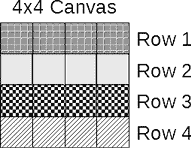

图 8-1：一个 4 × 4 画布

画布中的每一行涂有不同的纹理，原因很快就会变得清晰。画布有 x 坐标和 y 坐标，其中第一列的 x 坐标为 0 并从左到右增加；y 坐标也从 0 开始并从上到下增加。图 8-2 展示了带有 x 和 y 坐标的 4 × 4 画布。

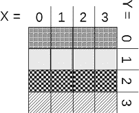

图 8-2：x 和 y 坐标下的 4 × 4 画布

这是画布在计算机显示器上的排列方式，但计算机内存并不是按行和列排列的。内存是一维的，每个地址代表一个像素。因此，我们的像素数据在内存中的排列方式如图图 8-3 所示。

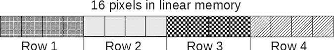

图 8-3：线性内存中画布的 16 个像素

行被连续排列在一个 16 像素的数据数组中。如果你从 x 和 y 坐标的角度看线性内存是如何排列像素的，它看起来像图 8-4。

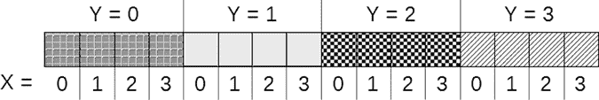

图 8-4：线性内存中的 x 和 y 坐标

我们的 `$set_pixel` 函数已经有了 x 和 y 坐标，需要找到内存地址。我们使用方程 `$y * 4 + $x` 来实现，它给出了图 8-5 中的线性内存值。

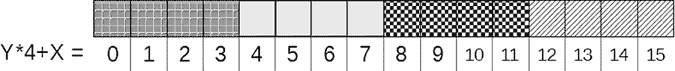

图 8-5：从 x、y 坐标转换到线性内存的公式

一旦我们有了内存位置，就可以使用 `i32.store` 更新线性内存，将该地址的值设置为参数 `$c` 中的颜色值。代码列表 8-9 显示了源代码。

**collide.wat (12 部分中的第 4 部分)**

```
...
;;此函数将坐标 $x, $y 处的像素设置为颜色 $c
(func $set_pixel
  (param $x       i32)    ;; x 坐标
  (param $y       i32)    ;; y 坐标
  (param $c       i32)    ;; 颜色值

    ;; 是否 $x > $cnvs_size
  1 (i32.ge_u (local.get $x) (global.get $cnvs_size)) 
  if    ;; $x 在画布边界之外
    return
  end

2 (i32.ge_u (local.get $y) (global.get $cnvs_size))  ;; 是否 $y > $cnvs_size
  if    ;; $y 在画布边界之外
    return
  end

  local.get $y
  global.get $cnvs_size
3 i32.mul

  local.get $x
4 i32.add       ;; $x + $y * $cnvs_size (将像素获取线性内存)

  i32.const 4
5 i32.mul       ;; 乘以 4，因为每个像素是 4 字节

  local.get $c  ;; 加载颜色值

6 i32.store     ;; 将颜色存储在内存位置
)
...
```

代码列表 8-9：将单个像素设置为给定颜色的函数

该函数首先进行边界检查，以便用户无法尝试设置不在画布上的像素颜色。为了验证 x 坐标是否在画布边界内，我们检查 `$x` 是否大于 `$cnvs_size` 1，如果是，则返回函数而不更新内存。我们对 y 坐标执行相同的操作 2。

在完成边界检查之后，我们需要获取目标像素的整数形式的位置。我们通过将 `$y` 乘以 `$cnvs_size` 3 来获取内存中该像素之前的行中的像素数，并在该值上加上 4 `$x`。因为位置值是 32 位整数（每个像素 4 字节），我们需要将该数字乘以 `4` 5 以得到像素在线性内存中的字节位置。该内存位置就是我们通过 `i32.store` 6 语句存储 `$c` 的地方。

### 绘制对象

碰撞对象如果没有与另一个对象碰撞则是绿色正方形，如果碰撞则为红色。我们在 JavaScript 代码的常量部分将这些正方形的大小设置为 `4`，因此每个正方形宽四像素、高四像素。我们使用循环来绘制这些像素，循环增加 `x` 值直到它达到对象位置加上宽度。这样做绘制了第一行像素。


```wasm
...
;; 使用对象编号、属性偏移量和用于设置属性的值，
;; 在线性内存中设置对象的属性（attribute）
(func $set_obj_attr
  (param $obj_number  i32)
  (param $attr_offset i32)
  (param $value       i32)

  local.get $obj_number

  i32.const 16
1 i32.mul                 ;;  16 字节步长乘以对象编号 

  global.get $obj_start   ;;  加上对象的起始字节（基地址）
2 i32.add                 ;;  ($obj_number*16) + $obj_start

  local.get $attr_offset  ;; 将属性偏移量加上地址
3 i32.add                 ;; ($obj_number*16) + $obj_start + $attr_offset

  local.get $value

  ;; 将 $value 存储在位置 ($obj_number*16)+$obj_start+$attr_offset
4 i32.store  
)
...
```

列表 8-11：基于 16 的步长值在内存中设置对象

该函数的大部分代码计算了线性内存中存储特定对象属性的地址。回顾第 6 章，我们使用基地址（此函数中的 `$obj_start`）、`16` 的步长、对象编号（`$obj_number`）和属性偏移量（`$attr_offset`）计算属性的内存位置。此函数使用公式 `$obj_number`*`16` 1 + `$obj_start` 2 + `$attr_offset` 3 来确定我们要修改的属性的内存位置。然后它调用 `i32.store` 4 语句将该值存储在内存中。

接下来，我们将创建相应的 `$get_obj_attr`，它计算属性值的地址。你可能熟悉软件开发原则“不要重复自己（Don’t Repeat Yourself, DRY）”。DRY 代码是编写可维护且易于其他开发者阅读和更新的代码的极佳方式。遗憾的是，有时 DRY 代码会降低性能。在这个示例中，我们将重新执行在上一个函数中进行过的某些计算。当我们进入性能优化章节时，我们将使代码比本章中的更不 DRY（有时被称为 `wet code`）。某些产生 DRY 代码的技术可能会添加需要额外计算周期的抽象层。例如，函数调用需要额外的周期来将值推送到栈中并跳转到代码中的新位置。优化编译器可以经常缓解代码中所用抽象的影响，但理解它们是如何做到这一点，以及为什么 DRY 代码在执行期间并不总是最高效的将会有帮助。

在其他汇编语言中，宏是在保持代码相对 DRY 的同时保持性能的一种极方法。遗憾的是，`wat2wasm` 目前不支持宏。列表 8-12 显示了 `$get_obj_attr` 函数的代码。

### collide.wat (第 12 部分第 7 部分)

```wasm
...
;; 使用对象编号和属性偏移量，
;; 获取线性内存中对象的属性
(func $get_obj_attr
  (param $obj_number  i32)
  (param $attr_offset i32)
  (result i32)

  local.get $obj_number
  i32.const 16
1 i32.mul                  ;; $obj_number * 16

  global.get $obj_start
2 i32.add                  ;; ($obj_number*16) + $obj_start

  local.get $attr_offset
3 i32.add                  ;; ($obj_number*16) + $obj_start + $attr_offset

4 i32.load                 ;; 加载上述指针
  ;; 返回属性
)
...
```

列表 8-12：基于 16 的步长值在内存中获取对象

为了获取对象的偏移字节，我们首先将 `$obj_number` 乘以 `16` 的步长值 1。然后我们加上 2 基地址，该地址存储在全局变量 `$obj_start` 中。接下来是加上存储在 `$attr_offset` 中的偏移量 3。此时，栈顶存储了我们要获取的属性在内存中的位置，因此调用表达式 `i32.load` 4 就会将该值推到栈上。

### $main 函数

`$main` 函数会在每帧渲染时从 JavaScript 代码调用一次。它的任务是根据每个对象的速度移动每个对象，检测对象之间的碰撞，如果它与另一个对象发生碰撞则将其渲染为红色，如果没有碰撞则渲染为绿色。`$main` 函数非常长，我们将将其拆分为几部分。

### 定义局部变量

`$main` 函数的第一部分如列表 8-13

```wasm
...
;; 移动并检测应用中所有对象之间的碰撞
(func $main (export "main")
1 (local $i           i32)  ;; 外层循环索引
  (local $j           i32)  ;; 内层循环索引
2 (local $outer_ptr   i32)  ;; 外部对象指针
  (local $inner_ptr   i32)  ;; 内部对象指针

3 (local $x1          i32)  ;; 外层循环 x 坐标
  (local $x2          i32)  ;; 内层循环 x 坐标
  (local $y1          i32)  ;; 外层循环 y 坐标
  (local $y2          i32)  ;; 内层循环 y 坐标

4 (local $xdist       i32)  ;; x 轴距离
  (local $ydist       i32)  ;; y 轴距离

5 (local $i_hit       i32)  ;; i 碰撞标记
6 (local $xv          i32)  ;; x 速度
  (local $yv          i32)  ;; y 速度

7 (call $clear_canvas)      ;; 清除画布
...
```

列表 8-13：`$main` 函数的开头声明了局部变量并清除了画布。

### $move_loop

`$main` 函数的下一部分定义了一个循环，每帧移动线性内存中的每个对象。该函数的部分将获取 `$i` 对象的 `$x`、 `$y`、 `$xv` 和 `$yv` 属性。`$xv` 和 `$yv` 变量是 `x` 和 `y` 速度变量，它们通过改变 `$x` 和 `$y` 坐标值来移动对象。代码还强制 `x` 和 `y` 值保持在画布边界内。在移动循环之后，`$i` 变量被重置为 `0`。请将列表 8-14 中的代码添加到 WAT 模块中。


```
...
1 (loop $move_loop
    ;; get x attribute
    (call $get_obj_attr (local.get $i) (global.get $x_offset))
    local.set $x1

    ;; get y attribute
    (call $get_obj_attr (local.get $i) (global.get $y_offset)) 
    local.set $y1

    ;; get x velocity attribute
    (call $get_obj_attr (local.get $i) (global.get $xv_offset)) 
    local.set $xv

    ;; get y velocity attribute
    (call $get_obj_attr (local.get $i) (global.get $yv_offset)) 
    local.set $yv

    ;; add velocity to x and force it to stay in the canvas bounds
  2 (i32.add (local.get $xv) (local.get $x1))
    i32.const 0x1ff  ;; 511 in decimal
  3 i32.and          ;; clear high-order 23 bits
    local.set $x1

    ;; add velocity to y and force it to stay in the canvas bounds
    (i32.add (local.get $yv) (local.get $y1))
    i32.const 0x1ff  ;; 511 in decimal
    i32.and          ;; clear high-order 23 bits
  4 local.set $y1

    ;; set the x attribute in linear memory
  5 (call $set_obj_attr 
    (local.get $i) 
    (global.get $x_offset)
    (local.get $x1)
  )

    ;; set the y attribute in linear memory
    (call $set_obj_attr 
    (local.get $i) 
    (global.get $y_offset)
    (local.get $y1)
  )

  local.get $i
  i32.const 1
6 i32.add
7 local.tee $i        ;; increment $i

  global.get $obj_cnt
  i32.lt_u            ;; $i < $obj_cnt

8 if  ;; if $i < $obj_count branch back to top of $move_loop
    br $move_loop
  end

 )

  i32.const 0
9 local.set $i
...
```

**列表 8-14: 移动每个对象的循环**

列表 8-14 中的代码循环遍历所有的对象，根据 `x` 和 `y` 速度更改 x 坐标和 y 坐标。循环的前几行 `1` 调用 `$get_obj_attr` 来获取 `x` 位置、`y` 位置、`x` 速度和 `y` 速度属性，并传入循环索引和要设置的属性的偏移量。此操作会将属性值推入栈中。然后使用 `local.set` 表达式来设置我们将在 `loop` 中使用的局部变量。

`loop` 通过调用 `i32.add` `2` 将速度变量（`$xv` 和 `$yv`）加到位置变量（`$x1` 和 `$y1`）上。在将 `$x1` 设置为新位置之前，使用 `i32.and` `3` 掩码 `x` 位置的最后九位。这使得 x 坐标的值保持在 0 到 511 之间，如果超过 511，则将值绕回 0。随后对 `$y1` `4` 执行相同的操作以设置 `y` 位置。一旦设置了 `$x1` 和 `$y1` 的新值，就会调用 `$set_obj_attr` `5` 函数将这些值设置到线性内存中。通过调用 `i32.add` 和 `local.tee` `7` 增加循环计数器 `$i` `6` 的值。如果 `$i` 值小于对象计数（`$obj_count` `8`），代码将分支回 `loop` 的顶部。否则，调用 `local.set` `9` 将 `$i` 设置为 0。

列表 8-14 中的正方形会在画布上环绕移动，因此当一个物体从右侧移出屏幕时，它会绕回并出现在屏幕左侧，就像老式街机游戏一样。像 Atari 的 *Asteroids* 和 Namco 的 *Pac-Man* 这样的游戏不需要额外的代码就能实现这种效果；相反，它们的屏幕宽度为 256 像素，并使用 8 位数来存储 x 坐标。因此，如果游戏对象的 x 坐标为 255 并向右移动一个像素，单字节值将回置为 0，游戏对象将重新出现在屏幕左侧，如图图 8-6 所示。


图 8-6：玩家角色从右侧移出屏幕并出现在左侧。

我们可以使用 `i32.and` 掩码除底部九位以外的所有位来实现这种效果。代码调用 `$get_obj_attr` 获取 `$x1`、`$y1`、`$xv` 和 `$yv` 属性。代码使用 `i32.add` 计算新位置，并使用 `i32.and` 确保坐标保持在画布边界。一旦计算出值，就会使用 `$set_obj_attr` 更新线性内存中的值。增加循环计数器 `$i` 并与 `$obj_count` 进行比较。如果 `$i` 小于 `$obj_count`，则继续循环；否则，将 `$i` 重置为 0。


```
...
1 (loop $inner_loop (block $inner_break
      local.get $i
      local.get $j
      i32.eq
    2 if              ;; if $i == $j increment $j
        local.get $j
        i32.const 1
        i32.add
        local.set $j
      end

      local.get $j
      global.get $obj_cnt
      i32.ge_u
    3 if              ;; if $j >= $obj_count break from inner loop
        br $inner_break
      end

       ;; get x attribute
    4 (call $get_obj_attr (local.get $j)(global.get $x_offset)) 
      local.set $x2  ;; set the x attribute for inner loop object

       ;; distance between $x1 and $x2
      (i32.sub (local.get $x1) (local.get $x2))

      call $abs  ;; distance is not negative so get the absolute value
    5 local.tee $xdist  ;; $xdist = the absolute value of ($x1 - $x2)

      global.get $obj_size
      i32.ge_u 

    6 if  ;; if $xdist >= $obj_size object does not collide
        local.get $j
        i32.const 1
        i32.add
        local.set $j

        br $inner_loop  ;; increment $j and jump to beginning of inner loop
      end

       ;; get y attribute
      (call $get_obj_attr (local.get $j)(global.get $y_offset))
      local.set $y2

      (i32.sub (local.get $y1) (local.get $y2))
      call $abs
    7 local.tee $ydist

      global.get $obj_size
      i32.ge_u 

    8 if
        local.get $j
        i32.const 1
        i32.add
        local.set $j

        br $inner_loop
      end

      i32.const 1
    9 local.set $i_hit
      ;; exit the loop if there is a collision
    )) ;; end of inner loop
...
```

列表 8-16: 碰撞检测双重循环的内部循环

内部 `loop` 1 将外层循环的当前对象与尚未与其检查过的其他对象进行比较。首先，它需要确保不是在将对象与自身进行比较。对象总是与自身完全碰撞，因此如果 `$i` 等于 `$j` 2，我们忽略它并需要增加 `$j`。然后，我们将 `$j` 与 `$obj_cnt` 比较 3，查看代码是否已经测试了所有对象。如果是，代码将退出内部 `loop`。

如果代码还没有测试所有对象，则通过调用 `$get_obj_attr` 4 将 `x` 属性加载到变量 `$x2` 中。然后，我们通过从 `$x1` 减去 `$x2` 来获取 `$x1` 和 `$x2` 之间的距离，取绝对值并设置 `$xdist` 变量 5。我们将两个对象之间的 `x` 距离与对象大小进行比较，以查看两个对象在 x 轴上是否重叠。如果因为 `$xdist` 大于 `$obj_size` 6 而没有重叠，代码增加 `$j` 并跳回 `loop` 顶部。

同样地，计算 `y` 距离并将其存储在变量 `$ydist` 7 中，代码检查 `$ydist` 变量是否大于 `$obj_size` 8。如果是，则这些对象没有碰撞，因此我们增加 `$j` 并跳回 `loop` 顶部。如果在此处我们没有跳转到循环顶部，则说明对象的 x 轴和 y 轴重叠了，发生了碰撞，因此我们将 `$i_hit` 设置为 1 9 并退出。

### 重绘对象

当代码退出内部循环时，要么发现了碰撞，要么没有。代码检查命中变量（`$i_hit`），如果没有碰撞，则调用 `$draw_obj` 函数并传入无碰撞颜色（绿色）；如果发生了碰撞，则传入 `$hit_color`（红色）。然后 `$i` 增加 1，如果 `$i` 小于对象数量，代码将跳回外层循环的顶部。列表 8-17 显示了要添加到 WAT 文件中的最后部分代码。

**collide.wat (part 12 of 12)**

```
...
    local.get $i_hit
    i32.const 0
    i32.eq
  1 if      ;; $i_hit == 0 (no hit)
      (call $draw_obj
        (local.get $x1) (local.get $y1)  (global.get $no_hit_color))
  2 else    ;; $i_hit == 1 (hit)
      (call $draw_obj
        (local.get $x1) (local.get $y1) (global.get $hit_color))
    end

    local.get $i
    i32.const 1
    i32.add
  3 local.tee $i
```


本章专门针对那些追求极速应用并愿意花时间实现这一目标的开发者。我们首先将讨论性能分析器工具（profiler tools），以评估 WebAssembly 模块的性能，并研究如何比较 WebAssembly 与类似的 JavaScript 代码的性能。我们将花一些时间研究改进 WebAssembly 性能的策略，包括函数内联、用位移代替乘法和除法、合并常量以及使用死代码消除（DCE）移除未使用代码。

我们还将深入研究其他确定模块性能的方法：我们将使用 `console.log` 和 `Date.now` 来测量应用程序的性能，并使用测试套件 `benchmark.js` 为应用程序收集详细的性能数据。然后，为了好玩，我们将打印 Chrome JavaScript V8 引擎针对 JavaScript 函数的中间表示（IR）字节码。JavaScript IR 字节码可以让你了解 JavaScript 函数的工作原理，这有助于判断应该在 WebAssembly 还是 JavaScript 中编写该函数。

## 使用性能分析器

`Profilers`（分析器）是分析应用程序性能不同层面的工具，包括应用的内存使用和执行时间。这可以帮助你决定在哪里进行优化以及针对什么进行优化。你通常需要在不同类型的优化之间进行权衡。例如，你需要决定是专注于改进交互响应时间（TTI）以便用户能尽快开始使用你的应用程序，还是专注于应用程序运行后的峰值性能。如果你正在编写一个游戏，那么较长的加载时间是值得的，以确保游戏在下载完成后运行得更顺畅。然而，在线商店可能更倾向于确保用户尽快与网站进行交互。在大多数情况下，你需要在两者之间取得平衡，使用性能分析器可以提供帮助。

分析器也能高效地发现代码中的瓶颈，让你将精力和精力集中在这些位置。我们将查看 Chrome 和 Firefox 的分析器，因为它们目前对 WebAssembly 有最好的支持。我们将对第 8 章中的碰撞检测应用进行性能分析。

### Chrome Profiler

你可能希望在使用 Chrome 分析器时开启无痕窗口。无痕窗口不会加载网站缓存、Cookie 或 Chrome 插件，这些插件在性能分析时会产生问题，因为它们会运行额外的 JavaScript 代码并影响你想分析的站点性能。缓存和 Cookie 通常问题不不大，但可能会用与要分析代码无关的数据污染环境。你可以通过点击网络浏览器右上角菜单中的 `New incognito window`（新建无痕窗口）来打开无痕窗口，如图 9-1 所示。

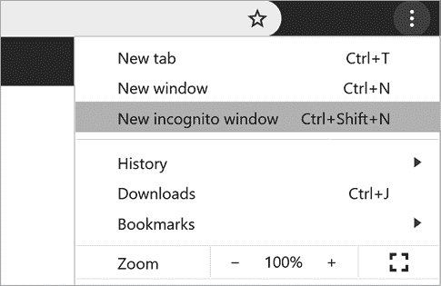

图 9-1：在 Chrome 中打开无痕窗口。

打开无痕浏览器窗口后，确保你正在使用命令行命令 `node server.js` 运行 Web 服务器，并在浏览器中输入 `localhost:8080/collide.html`。点击右上角菜单中的 `More Tools`（更多工具）▶`Developer tools`（开发者工具），如图 9-2

图 9-2：在 Chrome 中打开开发者工具。

你应该能在开发者工具的顶部看到几个标签页。要查看分析器，点击 `Performance`（性能），如图 9-3

图 9-3：在 Chrome 中打开 Performance 标签页。

Performance 标签页在首次打开时提供两个选项：Record（录制）和 Reload（重新加载）。`Record` 按钮不在重新加载应用程序的情况下开始录制分析。当你不太关心应用程序的启动时间而更关注峰值性能时，这种分析最为重要。在我们分析之前，请确保 `Performance` 标签页顶部的 `Memory`（内存）复选框已勾选。如果没有勾选，内存堆将被分析。如果你想从初始化开始分析应用程序，可以点击 `Reload` 按钮。点击 `Record` 继续。录制大约五秒后，点击如图 9-4 所示的 `Stop`。


图 9-4：在 Chrome 中录制分析

录制停止后，分析器将打开并显示应用程序渲染的每一帧记录。下半部分的 `Summary`（摘要）标签显示，该应用程序大部分执行时间都消耗在 Scripting（脚本执行）上（图 9-5），这包含了 JavaScript 和 WebAssembly 的时间。

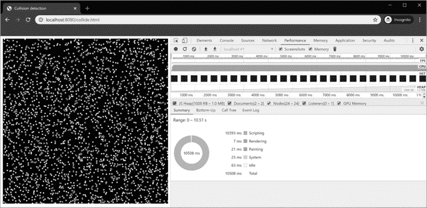

图 9-5：录制分析后的 Chrome Performance 标签页

在主 Performance 页面上，饼图显示了在 Scripting、Rendering、Painting、System 和 Idle 上花费的处理器时间。饼图上方是一系列标签，包括 Summary、Bottom-Up、Call Tree 和 Event Log，我们将在本章中探索所有内容。标签上方的区域显示了分配的 JS 堆内存，再上方是渲染帧、CPU 和 FPS 信息。让我们在下一节中快速查看 JavaScript 堆内存。

### JavaScript 堆内存

在图 9-5 中的分析显示内存出现了增长。我们将花一点时间研究为什么会发生这种情况。首先，我们将检查在进行垃圾回收之前分配了多少内存。有些开发者认为，因为 JavaScript 是一门垃圾回收语言，所以他们不需要担心内存。遗憾的是，事实并非如此；你的代码创建对象的速度可能比垃圾回收的速度快。

经过一些分析，我们可以看到堆增长到了 2.2MB，在垃圾回收器运行后，堆回落到 1MB。垃圾回收器运行前可能需要几分钟，所以请耐心。图 9-6 显示了垃圾回收期间的 JS 堆分析。如你所见，在图右侧，堆的大小突然下降了 1MB。

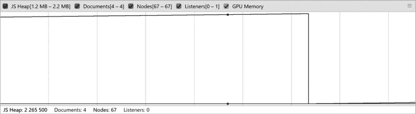

图 9-6：垃圾回收期间的内存下降

最好是精确确定这种内存分配发生的地点，因为如果我们能减慢堆的增长，就可能会减轻垃圾回收器的负担。

### 追踪内存分配

由于堆的增长是持续的，我们可以推断内存分配可能发生在每一帧渲染中。该应用程序执行的大部分工作都在 WebAssembly 模块中，因此我们首先注释掉 WebAssembly 调用，查看内存是否继续显示相同的 JS 增长情况。打开 *collide.html* 并注释掉 `animate` 函数内部对 `animation_wasm()` 的调用，如代码 9-1 所示。

**collide.html**

```javascript
...
    function animate() {
    //      animation_wasm();
      ctx.putImageData(image_data, 0, 0); //渲染像素数据
      requestAnimationFrame(animate);
    }
...
```

代码 9-1：注释掉 `animation_wasm` 函数调用

现在刷新页面并录制新的分析。图 9-7 显示了没有 `animation_wasm` 函数调用的新 JS 堆分析图。

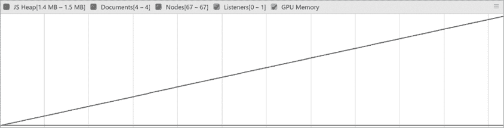

图 9-7：移除 `animation_wasm` 函数后的堆内存分配图


如果没有对 WebAssembly 模块的调用，应用程序将无法正常运行。然而，你仍然能看到相同的 JS 堆增长分析，因此内存增长似乎并非来自 WebAssembly 模块。让我们取消对 WebAssembly 模块的注释；然后注释掉对 `ctx.putImageData` 的调用并创建另一个分析，如列表 9-2 所示。

`collide.html`

```
 function animate() {
      animation_wasm();
  //   ctx.putImageData(image_data, 0, 0); // render pixel data
      requestAnimationFrame(animate);
    }
```

列表 9-2：`animation_wasm` 函数已恢复；`putImageData` 被移除。

通过注释掉 `ctx.putImageData` 的调用，我们现在可以创建一个新的分析来检查内存增长（图 9-8）。

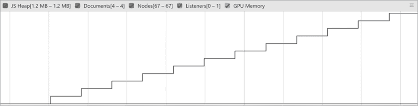

图 9-8：移除 `putImageData` 调用后，内存增长变慢。

在没有没有 `ctx.putImageData` 用的情况下，内存增长大幅减缓。增长仍然发生，但它呈现出较慢的阶梯式增长模式，而不是几乎垂直直线的上升。看起来 `ctx.putImageData` 的调用在内部创建了大型对象，垃圾回收器最终需要移除这些对象。现在我们知道这些内存是如何分配的。由于 `ctx.putImageData` 是内置函数，我们无法对其进行优化。如果内存分配是问题所在，我们需要寻找替代方法来渲染到画布。

### 帧 (Frames)

在分析器（Profiler）窗口中，堆内存上方有一个区域提供了更多性能信息，包括渲染的每帧数（fps）。它还显示了一个显示 CPU 使用率的图表。此外每个渲染帧的小缩略图。当你将鼠标移动到这些帧上时，可以观察应用程序是如何渲染动画的（图 9-9），如果你的应用程序运行不符合预期，这将非常有帮助。

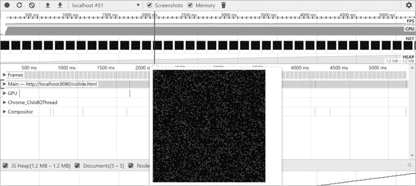

图 9-9：在分析器中查看单个帧渲染

你可以将鼠标悬停在绿色的 `Frames` 框上，以查看分析中任何点的 fps（图 9-10）。

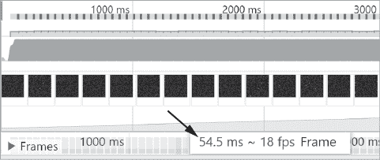

图 9-10：在分析器中查看 fps

如你所见，应用程序执行到此点的帧速率为 18 fps。当我们滑过这些帧时，该数字在 17 到 20 之间波动。每秒帧数是碰撞检测应用性能的主要衡量指标，因此我们需要记住显示大约 18 fps 的分析，以便与稍后的结果进行比较。请记住，运行分析器似乎会损害应用程序的性能，因此尽管这些结果之间具有参考价值，但对于应用程序在真实环境中的运行情况可能并不完全准确。

### 自底向上 (Bottom-Up)

Bottom-Up 选项卡显示了应用程序内调用的函数、它们运行的总时间以及自执行时间（Self Time），自执行时间是指排除其调用的函数消耗的时间后的函数运行时间。自执行时间非常有用，因为调用其他运行耗时长的函数的函数总是显示出更长的总时间，如图 9-11 所示。

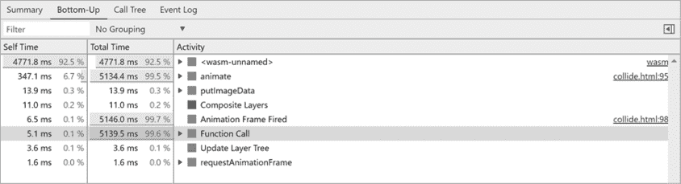

图 9-11：Chrome 的 Bottom-Up 标签窗口

`<wasm-unnamed>` 的自执行时间目前是最长的。几个函数的总时间更长，例如 `animate`，因为 `animate` 函数调用了 WebAssembly 模块。遗憾的是，Chrome 没有指明它在 WebAssembly 模块内部调用了哪个函数，但我们可以一眼看出，应用程序将超过 90% 的处理时间花在了执行 WebAssembly 上。

### Firefox 分析器 (Firefox Profiler)

使用 Firefox 分析器是收集应用程序性能数据的另一种极佳方法。我建议在运行 Firefox 分析器时打开无痕窗口。通过打开浏览器右上角的菜单并点击`新建无痕窗口`（图 9-12）来实现。


图 9-12：在 Firefox 中打开新建无痕窗口。

点击 `Web 开发者`▶`性能` 打开分析器（图 9-13）。


图 9-13：在 Firefox 菜单中点击 `Web 开发者`▶`性能`。

在“性能”菜单中，点击`开始记录性能`按钮以记录性能数据。几秒后，停止记录。图 9-14 显示了你在“性能”选项卡中看到的类似内容。瀑布图（Waterfall）选项卡（记录后的默认视图）显示了顶层函数调用以及它们执行所需的时间。

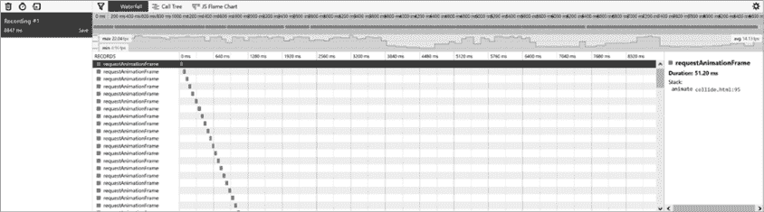

图 9-14：Firefox 性能窗口瀑布图选项卡

向下滚动查看垃圾回收发生在何时以及运行需要多长时间。此报告对于我们的应用程序来说有点枯燥，因为它主要执行 `requestAnimationFrame`。窗口顶部的三个选项卡提供了更多信息。瀑布图选项卡让你大致了解哪些任务运行时间较长。我们不会详细介绍瀑布图选项卡，因为它更像是一个*运行时一览*摘要。相反，我们将查看调用树（Call Tree）和 JS 火焰图（JS Flame Chart）选项卡。

### 调用树 (Call Tree)

Call Tree 选项卡显示了应用程序花费时间最多的函数调用。该界面允许你深入查看每个函数并查看它们发出的调用。图 9-15 显示了调用树选项卡的截图。

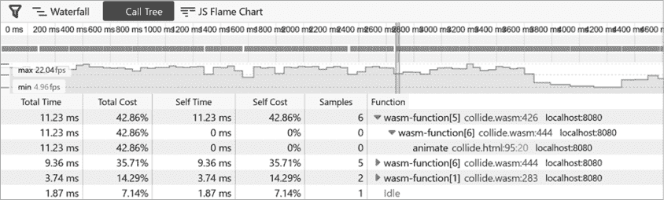

图 9-15：Firefox 调用树选项卡

一个非常用的功能是，你可以点击你的 WebAssembly 文件的名称，链接将带你进入 WebAssembly 代码中相应的函数。虽然函数名丢失了，但后面跟着一个显示函数编号的索引。这使得更容易确定函数调用的内容。

### JS 火焰图 (JS Flame Chart)

JS Flame Chart 选项卡的信息与 Call Tree 选项卡看到的基本相同，但它是按照时间线组织的，而不是摘要形式。你可以缩放图表的特定部分，以查看分析中该点运行了哪些函数（图 9-16）。

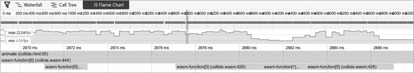

图 9-16：Firefox 火焰图

这里是 JavaScript `animate` 函数的调用。`animate` 函数大部分时间花在运行 `wasm-function[6]` 上，这是我们 WAT 代码中的第七个函数，名为 `$main`。`$main` 函数调用了 `wasm-function[5]`（即 `$get_obj_attr`）和 `wasm-function[1]`（即 `$abs`）。

这些选项卡中的每一个都在左侧显示最小和最大 fps，右侧显示平均 fps。分析器的左侧看起来像图 9-17。

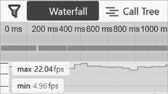

图 9-17：Firefox 最大 fps

如你所见，最大 fps 略大于 22，最小 fps 小于 5。正如之前提到的，运行分析器可能会影响 fps。平均 fps 在分析器的右侧（图 9-18）。

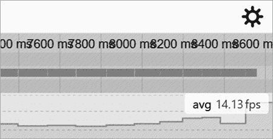

图 9-18：Firefox 平均 fps

此分析的平均 fps 大约为 14 fps。在下一节中，我们将查看如何使用 `wasm-opt` 提高应用程序的性能。


我们使用 `wasm-opt` 命令行工具对 WebAssembly 文件运行性能优化。它带有 `wat-wasm` 和 `Binaryen.js`。如果你已经安装了用于 `wat2wasm` 工具的 `wat-wasm`，那么你应该已经拥有了该版本，可以跳过下一节。如果没有安装，请安装 `Binaryen.js`，它是 Binaryen WebAssembly 工具的 JavaScript 版本，用于将中间表示 (IR) 转换为 WebAssembly 代码。它包含了一些优化 WebAssembly 代码的有用选项。

### 安装 Binaryen

安装 Binaryen 有几种可选方法。我推荐使用 `Binaryen.js`，你可以通过 `npm` 运行以下命令进行安装：

```
npm install binaryen -g
```

对于那些感兴趣从源码编译的用户，可以在 GitHub 上找到：[`github.com/WebAssembly/binaryen`](https://github.com/WebAssembly/binaryen)。此外还有一个名为 `wasm-opt` 的 `npm` 程序包，它会安装 `Binaryen` 的特定于平台的二进制文件，但我建议使用 `npm` 安装 `wat-wasm` 或 `binaryen.js`。

### 运行 wasm-opt

`wasm-opt` 工具具有许多标志，可以用来减小下载大小并优化你的 WebAssembly 模块的执行。你使用这些标志来告诉优化器是侧重于性能还是下载大小。如果可以在不影响性能的情况下减小文件大小，那么在任何一种情况下都会进行该更改。如果可以在不影响下载大小的情况下提高性能，情况也是如此。这些标志告诉编译器在需要考虑权衡时优先选择哪种优化。

我们将针对 `collide.wasm` 文件运行两种类型标志的 `wasm-opt`，首先以大小优化为偏好开始，然后以性能优化为偏好重新编译它。这些标志在任何使用 Binaryen 的工具链（如 Emscripten 或 AssemblyScript）中都是相同的。我们将查看的前两个标志将针对大小优化 WAT 文件。

#### 针对下载大小进行优化 

`wasm-opt` 命令有两个用于优化 WebAssembly 文件下载大小的标志：`-Oz` 和 `-Os`。这里的 O 是大字母 O，而不是数字零。`-Oz` 标志会创建一个更小的 WebAssembly 文件，但缩小文件大小所需的时间更长。`-Os` 创建的 WebAssembly 文件略大，但执行时间更短。我们的应用程序很小，因此运行任何优化所需的时间也微乎其微。如果你正在创建一个编译时间很长的大型 Emscripten 项目，你可能会使用 `-Os`。对于我们的目的，我们不需要使用 `-Os`。列表 9-3 显示了如何使用 `-Oz` 标志优化我们的 `collide.wasm` 文件以减小其大小。

```
wasm-opt collide.wasm -Oz -o collide-z.wasm
```

列表 9-3：运行 `wasm-opt` 以优化 `collide.wasm` 下载大小

当你运行此优化时，WebAssembly 文件的尺寸从 709 字节缩小到 666 字节。这仅减少了约 6%，但我们不需要付出任何努力就达到了目标。通常，当配合工具链使用此标志时，你会获得更好的减小效果。

### 针对执行时间进行优化

当你编写游戏时，你对提高 fps 的兴趣会大于下载时间。有三个优化标志：`-O1`、`-O2` 和 `-O3`。再次，O 是字母 o，而不是数字零。`-O3` 标志提供了最高级别的优化，但执行时间最长。`-O1` 标志执行时间最短，但提供的优化最少。`-O2` 标志处于两者之间。由于我们的应用非常小，运行 `-O1` 和 `-O3` 所需的时间没有显著差异。在列表 9-4 中，我们使用 `-O3` 标志来充分利用对 `collide.wasm` 文件的优化。

```
wasm-opt collide.wasm -O3 -o collide-3.wasm
```

列表 9-4：使用 `wasm-opt` 优化 `collide.wasm` 文件的性能

一旦有了新版本的 `collide.wasm` 文件，修改 `collide.html` 文件以运行优化版本。现在当我们通过性能分析器运行它，就可以了解性能改进的情况。在 Chrome 中进行性能分析显示，应用程序现在以 35 fps 运行 (图 9-19)。

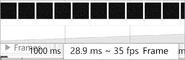

图 9-19：优化后的 `collide-3.wasm` 文件在 Chrome 中的新 fps

图 9-10 显示原始帧速率为 18 fps。仅运行 `wasm_opt` 就可以让你的应用程序在 Chrome 中的帧率翻倍。让我们看看在 Firefox 中运行性能分析器会发生什么 (图 9-20)。

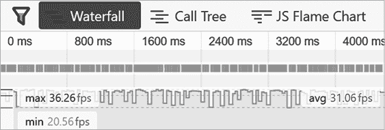

图 9-20：优化后的 `collide-3.wasm` 文件在 Firefox 中的新 fps

回看图 9-18，我们之前的速度只有 14 fps，仅仅运行 `wasm-opt` 就能让应用程序在 Firefox 中的帧率翻了一倍。在下一节中，我们将查看反汇编代码。

### 查看代码

你应该安装了 VS Code 的 WebAssembly 扩展。在 Visual Studio 中，你可以右键点击 WebAssembly 文件并选择 `Show WebAssembly`。在列表 9-5 中，我们在命令行中使用 `wasm2wat` 将 `collide-3.wasm` 转换。

```
wasm2wat collide-3.wasm -f -o collide-3.wat
```

列表 9-5：使用 `wasm2wat` 反汇编 *collide-3.wasm* 为 WAT

### 内联函数


调用函数会有极小的开销。除非函数每秒被调用数千或百万次，否则这种开销通常不是大问题。内联（Inlining）是将函数调用替换为相同代码的内联副本的过程。这样做消除了函数调用所需的额外处理开销，但会增加 WebAssembly 模块的大小，因为代码会在调用函数的每个地方都重复出现。当我们对 `collide.wasm` 模块运行优化器时，它内联了七个函数中的四个。让我们来看一个函数内联的简单示例。下面的 WAT 代码并不是应用程序的一部分，只是是一个演示。在列表 9-6 中，我们创建了一个将三个数字相加的函数，然后创建另一个函数多次调用 `$add_three`。

```
 (func $add_three ;; 函数将三个数字相加
    (param $a i32)
    (param $b i32)
    (param $c i32)
    (result i32)
    local.get $a
    local.get $b
    local.get $c
    i32.add
    i32.add
  )
  (func (export "inline_test")  ;; 我将在 inline_test 中内联函数
    (param $p1 i32)
    (param $p2 i32)
    (param $p3 i32)
    (result i32)
    (call $add_three (local.get $p1) (i32.const 2) (local.get $p2))
    (call $add_three (local.get $p3) (local.get $p1) (i32.const 13))
    ;; 将结果相加并返回
    i32.add
 )
```

列表 9-6：内联的演示代码

本节我们将专注于内联作为优化手段。为了内联这些函数，我们在每个调用它们的地方都剪切并粘贴函数的内容。在列表 9-7 中，灰色代码是原始的函数调用，随后的代码是内联后的函数。

```
 (func (export "inline_test");; 我将在 inline_test 中内联函数
    (param $p1 i32)
    (param $p2 i32)
    (param $p3 i32)
    (result i32)
;;  (call $add_three (local.get $p1) (i32.const 2) (local.get $p2))
;;  上面的函数被内联到下面的代码中
    local.get $p1
    i32.const 2
    local.get $p2
    i32.add
    i32.add
;;  (call $add_three (local.get $p3) (local.get $p1) (i32.const 13))
;;  上面的函数被内联到下面的代码中
    local.get $p3
    local.get $p1
    i32.const 13
    i32.add
    i32.add

    i32.add
 )
```

列表 9-7：手动内联代码的示例

内联函数调用可能会暴露其他优化机会。例如，你可以看到我们正在添加 `2`，随后又添加了 `13`。由于这两个值都是常数，如果我们直接加上 `15`，代码性能会更好。

让我们写一个可能被内联的小模块，对其进行编译和优化，然后查看 `wasm-opt` 生成的代码。我们将创建一个包含三个函数的模块：`$add_three`、`$square` 和 `$inline_test`。创建一个名为 `inline.wat` 的 WAT 文件，并在列表 9-8 中添加代码。

**inline.wat**

```
(module
  (func $add_three
    (param $a i32)
    (param $b i32)
    (param $c i32)
    (result i32)
    local.get $a
    local.get $b
    local.get $c
    i32.add
    i32.add
  )
  (func $square
    (param $a i32)
    (result i32)
    local.get $a
    local.get $a
    i32.mul
  )
  (func $inline_test (export "inline_test")
    (param $p1 i32)
    (param $p2 i32)
    (param $p3 i32)
    (result i32)
    (call $add_three (local.get $p1) (i32.const 2) (local.get $p2))
    (call $add_three (local.get $p3) (local.get $p1) (i32.const 13))
    call $square
  )
)
```

列表 9-8：我们将使用 `wasm-opt` 内联这段代码`$add_three` 函数是我们在列表 9-7 中手动内联的同一个函数。`$square` 函数乘以栈顶的值，而 `$inline_test` 函数是调用者函数。让我们使用 `wat2wasm` 编译 `$inline_test` 函数：

```
wat2wasm inline.wat
```

现在我们可以使用 `wasm-opt` 优化它：

```
wasm-opt inline.wasm -O3 -o inline-opt.wasm
```

最后，使用 `wasm2wat` 将其转换 WAT：

```
wasm2wat inline-opt.wasm
```

现在我们可以打开 `inline-opt.wat` 查看我们优化后的代码（列表 9-9）。

**inline-opt.wat**

```
(module
  (type (;0;) (func (param i32 i32 i32) (result i32)))
  (func (;0;) (type 0) (param i32 i32 i32)
    (result i32) ;; inline_test 函数
    local.get 0
    local.get 1
    i32.const 2  
    i32.add
    i32.add
    local.get 2
    local.get 0
    i32.const 13
    i32.add
    i32.add
    local.tee 0
    local.get 0
    i32.mul
    i32.add
    local.tee 0
    local.get 0
    i32.mul)
  (export "inline_test" (func 0)))
```

列表 9-9：`inline.wat` 和 `inline-opt.wat` 的优化版本。优化器删除了 `$add_three` 和 `$square` 两个函数并将代码内联到了 `inline_test` 函数中。

### 相乘、除法与移位

第 8 章展示了如何通过右移位来快速乘以 2 的幂。例如，左移 3 位相当于乘以 2³。同样，右右整数相当于除以该幂。例如，右移 4 位相当于除以 2⁴。让我们 `wasm-opt` 如何处理 2 的幂乘法和除法。创建一个名为 `pow2_mul.wat` 的新 WAT 文件并在列表 9-10 中添加代码，它创建一个乘和除以 2 的幂的模块。

**pow2_mul.wat**

```
(module
  (func (export "pow2_mul")
    (param $p1 i32)
    (param $p2 i32)
    (result i32)
    local.get $p1
    i32.const 16
    i32.mul ;; 乘以 16，即 2⁴
    local.get $p2
    i32.const 8
    i32.div_u ;; 除以 8，即 2³
    i32.add
  )
)
```

列表 9-10：乘和除以 2 的幂的函数使用 `wat2wasm` 编译此代码，使用 `wasm-opt` 优化 WebAssembly 文件，然后使用 `wasm2wat` 将 WebAssembly 文件反汇编回 WAT 文件。然后在 VS Code 中打开 `pow2_mul.wat` 的优化版本，如列表 9-11 所示。

**pow2_mul_optimized.wat**

```
(module
  (type (;0;) (func (param i32 i32) (result i32)))
  (func (;0;) (type 0) (param i32 i32) (result i32)
    local.get 1
    i32.const 8
    i32.div_u
    local.get 0
    i32.const 4
    i32.shl
    i32.add)
  (export "pow2_mul" (func 0)))
```

列表 9-1：列表 9-10 的优化版本。注意，优化后的代码在对第一个参数执行乘法之前先对第二个参数执行除法。当你乘以 2 的幂常量时，`wasm-opt` 将转换为左移。然而，它并不总是将 2 的幂除法替换为右移。在本章稍后的部分，我们将花时间通过 *benchmark.js* 运行不同版本的代码以查看它们的性能

### 合并常量

优化通常会合并常量以提高性能。例如，假设你有两个相加的常数偏移量。你的原始代码是 *x* = 3 + 8，但如果你在开始处设置 *x* = 11，代码性能会更好。这种情况对肉眼来说并不总是明显的，但 `wasm-opt` 擅长为你寻找这些情况。作为一个示例，创建一个名为 `combine_constants.wat` 的 WAT 文件并在列表 9-12 中添加代码，它仅合并了三个常量。

**combine_constants.wat**

```
(module
  (func $combine_constants (export "combine_constants")
    (result i32)
    i32.const 10
    i32.const 20
    i32.add
    i32.const 55
    i32.add
  )
)
```


## 列表 9-12: 将三个常数相加的函数

注意，$combine_constants 返回的值将始终是 85。`wasm-opt` 工具足够智能，能够识别出这一点。当你通过 `wat2wasm`、`wasm-opt` 然后 `wasm2wat` 运行该代码时，你将在列表 9-13 中看到代码。

**combine_constants_optimized.wat**

```wat
(module
  (type (;0;) (func (result i32)))
  (func (;0;) (type 0) (result i32)
1 i32.const 85)
  (export "combine_constants" (func 0)))
```

# 列表 9-13: 三个常数的相被合并为一个常数。

### 三个常数的相加合并为一个常数。

在列表 9-13 中的函数返回 `85`，并且没有去执行那两次加法。

## DCE

死代码消除（DCE）是一种优化技术，用于移除模块中未被调用或导出的代码。这是一种直接的优化，不会提高执行时间，但会减小下载体积。无论你使用哪种优化标记，DCE 都会发生。让我们来看一个简单的示例。打开名为 `dce_test.wat` 的新文件，并添加列表 9-14 中的代码，该代码创建一个包含两个从未使用的函数的模块。

**dce_test.wat**

```wat
(module
1 (func $dead_code_1
    (param $a i32)
    (param $b i32)
    (param $c i32)
    (result i32)
    local.get $a
    local.get $b
    local.get $c
    i32.add
    i32.add
  )
2 (func $dead_code_2
    (param $a i32)
    (result i32)
    local.get $a
    local.get $a
    i32.mul
  )
  (func $dce_test (export "dce_test")
    (param $p1 i32)
    (param $p2 i32)
    (result i32)
    local.get $p1
    local.get $p2
    i32.add
  )
)
```

## 列表 9-14: 该模块有两个未使用的函数。

前两个函数 `$dead_code_1` 和 `$dead_code_2` 未被调用也没有导出。我们运行的任何优化都会移除这些函数。运行 `wat2wasm` 生成代码，使用带有 `-O3` 标记的 `wasm-opt` 进行优化，然后使用 `wasm2wat` 将其转换回 WAT 文件。打开新文件查看运行优化后的代码，如列表 9-15 所示。

**dce_test_optimized.wat**

```wat
(module
  (type (;0;) (func (param i32 i32) (result i32)))
  (func (;0;) (type 0) (param i32 i32) (result i32)
    local.get 0
    local.get 1
    i32.add)
  (export "dce_test" (func 0)))
```

## 列表 9-15: 两个函数被 DCE 移除。

### 两个函数被 DCE 移除。

剩余的函数是 `"dce_test"`。使用 DCE 将模块的大小从 79 字节减少到 46 字节。

## 与 JavaScript 比较碰撞检测应用

我们已经看到了我们的 WebAssembly 碰撞检测应用的性能。让我们用 JavaScript 快速地编写该代码，并将其性能与 WebAssembly 版本进行比较。创建一个名为 `collidejs.html` 的网页。首先在 `collide.html` 页面中添加头部和 `canvas` 元素，并将其重新保存为 `collidejs.html`，如列表 9-16 所示。

**collidejs.html (第 1 部分，共 2 部分)**

```html
<!DOCTYPE html>
<html lang="en">
<head>
    <meta charset="UTF-8">
    <meta name="viewport" content="width=device-width, initial-scale=1.0">
    <title>Collide JS</title>
</head>
<body
    <canvas id="canvas" width="1024" height="1024"></canvas>
...
```

# 列表 9-16: collidejs.html 中的 HTML 头部和 canvas 元素

### collidejs.html 中的 HTML 头部和 canvas 元素。

这段代码与应用的 WebAssembly 版本相似。主要的区别在于 `script` 标签，如列表 9-17 所示。在 `script` 标签中添加以下 JavaScript。

**collidejs.html (第 2 部分，共 2 部分)**

```javascript
...
    <script type="text/javascript">
        // javascript version
        var animate_callback;
        const out_tag = document.getElementById('out');
        const out_size = 1024;

        const canvas = document.getElementById("canvas");
        const ctx = canvas.getContext("2d");

        class Collider {
            constructor() {
                this.x = Math.random() * out_size;
                this.y = Math.random() * out_size;
                this.xv = (Math.random() - 0.5) * 5;
                this.vy = (Math.random() - 0.5) * 5;
                this.color = "green";
            }

            move() {
                this.x += this.xv;
                this.y += this.vy;

                if (this.x < 0 || this.x > out_size) {
                    this.xv = -this.xv;
                }
                if (this.y < 0 || this.y > out_size) {
                    this.vy = -this.vy;
                }
            }

            draw() {
                ctx.beginPath();
                ctx.arc(this.x, this.y, 2, 0, Math.PI * 2);
                ctx.fillStyle = this.color;
                ctx.fill();
            }

            hitTest(c2) {
                let x_dist = this.x - c2.x;
                let y_dist = this.y - c2.y;

                if (Math.abs(x_dist) < 5 && Math.abs(y_dist) < 5) {
                    this.color = "red";
                    return true;
                } else {
                    this.color = "green";
                }
                return false;
            }
        }

        let collider_array = [];
        for (let i = 0; i < 50; i++) {
            collider_array.push(new Collider());
        }

        function animate() {
            // clear
            ctx.clearRect(0, 0, canvas.width, canvas.height);
            for (let i = 0; i < collider_array.length; i++) {
                collider_array[i].move();
            }

            // loop and render
            for (let i = 0; i < collider_array.length; i++) {
                for (let j = 0; j < collider_array.length; j++) {
                    if (i === j) {
                        continue;
                    }
                    if (collider_array[i].hitTest(collider_array[j])) {
                        break;
                    }
                }
                collider_array[i].draw();
            }
            requestAnimationFrame(animate);
        }
        requestAnimationFrame(animate);
    </script>
</body>
</html>
```

## 列表 9-17: 碰撞碰撞检测应用的 JavaScript 版本

### 碰撞检测应用的 JavaScript 版本。

我不会详细介绍列表 9-17 中的代码，因为它的目的只是为了与第 8 章中的 WebAssembly 代码进行对比。


在本节中，你学习了如何使用 Firefox 和 Chrome 的性能分析器将你的 WebAssembly 代码与类似的 JavaScript 代码进行比较。你现在应该能够利用这些知识在不同浏览器上比较应用程序的不同版本，以感受哪些代码最适合在 WebAssembly 中执行，哪些最适合使用 JavaScript。

## 手动优化 WAT

我花了一些时间手动对我的 WebAssembly 碰撞检测应用进行优化，并提高了帧率（fps）。变化比比书中描述的要多。然而，我想指出如果你愿意花时间手动优化，可能会获得的性能提升。在 Chrome 性能分析器中，我让碰撞检测应用达到了高达 36 fps（图 9-24）。

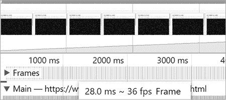

图 9-24：在 Chrome 中运行的手动优化碰撞检测应用

Firefox 的帧率更高，达到了 52 fps（图 9-25）。

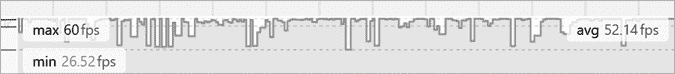

图 9-25：在 Firefox 中运行的手动优化碰撞检测应用

你可以在 [`wasmbook.com/collide.html`](https://wasmbook.com/collide.html) 查看我手动优化的成果，并在 [`wasmbook.com/collide.wat`](https://wasmbook.com/collide.wat) 查看 WAT 代码。我对我精调过的代码运行了 `Binaryen` 优化器，它实际上让代码变慢了几个 fps。Binaryen 会不断改进其优化输出。当你读到这里时，结果可能会有所不同。

## 记录性能

记录 JavaScript 应用性能的最简单方法之一是使用 `Date` 类和 `console.log` 函数。WebAssembly 在不使用 JavaScript 的无法写入控制台。因此，我们需要使用 JavaScript 将 WebAssembly 和 JavaScript 代码的性能记录到控制台。

让我们看看从 JavaScript 频繁调用 WebAssembly 模块时产生的开销。我们将创建一个包含几个小函数的 WebAssembly 模块，并从 JavaScript 重复调用它们。创建一个名为 `mod_and.wat` 的文件，并添加列表 9-18 中的代码。

**mod_and.wat**

```
(module
  (func $mod (export "mod")
    (param $p0 i32)
    (result i32)
    local.get $p0
    i32.const 1000
    i32.rem_u
  )

  (func $and (export "and")
    (param $p0 i32)
    (result i32)
    local.get $p0
    i32.const 0x3ff
    i32.and
  )
)
```

列表 9-18：取模运算与位与运算的性能比较

该模块中有两个函数：寻找除以 `1000` 后余数的 `$mod` 函数，以及一个使用位与掩码的 `$and` 函数。使用 `wat2wasm` 编译 `mod_and.wat` 文件，并使用 `wasm-opt` 进行优化。

接下来，我们需要创建一个 JavaScript 函数来运行此 WAT 模块，并与等效 JavaScript 代码进行测试。创建一个名为 `mod_and.js` 的新文件，并添加列表 9-19 中的代码。

**mod_and.js**

```javascript
const fs = require('fs');
const bytes = fs.readFileSync('./mod_and.wasm');

(async () => {
  const obj =
    await WebAssembly.instantiate(new Uint8Array(bytes));
  let mod = obj.instance.exports.mod;
  let and = obj.instance.exports.and;

  let start_time = Date.now(); // reset start_time
  // The '| 0' syntax 是给 JavaScript 引擎的提示，告诉它
  // 使用整数而不是浮点数，这在某些情况下
  // 可以提高性能
  for (let i = 0 | 0; i < 4_000_000; i++) {
    mod(i);  // call the mod function 4 million times
  }
// calculate the time it took to run 4 million mod calls
  console.log(`mod: ${Date.now() - start_time}`);
  start_time = Date.now(); // reset start_time

  for (let i = 0 | 0; i < 4_000_000; i++) {
    and(i); // call the and function 4 million times
  }
// calculate the time it took to run 4 million and calls
  console.log(`and: ${Date.now() - start_time}`);
  start_time = Date.now(); // reset start_time
  for (let i = 0 | 0; i < 4_000_000; i++) {
    Math.floor(i % 1000);
  }
// calculate the time it took to run 4 million modulo calls
  console.log(`js mod: ${Date.now() - start_time}`);
})();
```

列表 9-19：使用 `Date.now` 记录运行时间


我们定义了 `mod_loop` 和 `and_loop` 函数，并记录每个循环执行所需的时间。接下来，我们运行循环，执行 10 亿次取模运算，并记录耗了多久。如果我们编译并优化我们的 WebAssembly 模块，然后使用 `node` 运行 `mod_and_loop.js`，我们应该看到类似 Listing 9-23 中输出的内容。

```
and_loop: 31
mod_loop: 32
js mod: 52
```

Listing 9-23：`mod_and_loop.js` 的输出

现在 WebAssembly 的速度比相同的 JavaScript 代码快了 67%。令人有些失望的是，位与与运算的性能并没有比取模运算好多少，正如我所希望的那样有提升。不过，我们现在已经知道了如何结合 `console.log` 和 `Date.now()` 进行最简单的性能测试。

## 使用 benchmark.js 进行更高级的测试

如果你想让测试比仅仅使用日志和 `Date.now()` 更高级一些，可以安装一个性能测试模块，例如 `benchmark.js`。在之前的 Listing 9-10 中，我们创建了一个 WebAssembly 函数，乘以 16 然后除以 8，并通过 `wasm-opt` 运行它，以查看 Binaryen 如何为我们优化代码。优化器将乘法操作替换为位移，但没有将除法替换为位移。它还重新排列了除法乘法的顺序。

让我们测试这个 WebAssembly 模块的多个版本，包括原始版本和优化器生成的版本，看看是否可以通过一些努力超越优化器。我们将使用 `benchmark.js` 来测试这些函数的性能。创建一个名为 `pow2_test.wat` 的新 WAT 文件，并在 Listing 9-24 中添加代码。

**pow2_test.wat (第 1/5 部分)**

```
(module
  ;; 这是我们编写的 原始函数
  (func (export "pow2")
    (param $p1 i32)
    (param $p2 i32)
    (result i32)
    local.get $p1
    i32.const 16
    i32.mul
    local.get $p2
    i32.const 8
    i32.div_u
    i32.add
  )
...
```

Listing 9-24：带有原始函数的模块开头

Listing 9-24 显示了我们 2 的幂测试的原始版本，其中我们乘以 16 并除以 8。

下一个函数在 Listing 9-25 中在乘法之前执行除法。我想测试一下这个，因为 `wasm-opt` 交换了乘法和除法函数，我好奇这是否对函数的性能产生了积极影响。

**pow2_test.wat (第 2/5 部分)**

```
...
  ;; wasm-opt 将 div 放在 mul 之前，让我们看看这是否有帮助
  (func (export "pow2_reverse")
    (param $p1 i32)
    (param $p2 i32)
    (result i32)
    local.get $p2
    i32.const 8
    i32.div_u
    local.get $p1
    i32.const 16
    i32.mul
    i32.add
  )
...
```

Listing 9-25：交换除法和乘法

下一个函数在 Listing 9-26 中对 2 的幂乘法和除法都使用了位移。我们还使用了优化器插入的顺序，即除法发生在乘法之前。

**pow2_test.wat (第 3/5 部分)**

```
...
  ;; 将乘法和除法更改为位移
  (func (export "pow2_mul_div_shift")
    (param $p1 i32)
    (param $p2 i32)
    (result i32)
    local.get $p2
    i32.const 3
    i32.shr_u
    local.get $p1
    i32.const 4
    i32.shl
    i32.add
  )
...
```

Listing 9-26：将乘法和除法表达式改为二进制位移

接下来，在 Listing 9-27 中，我们对除法和乘法都使用了位移，但这次我们没有改变原始代码中除法和乘法的顺序。

**pow2_test.wat (第 4/5 部分)**

```
...
  ;; 回到乘和除法的原始顺序
  (func (export "pow2_mul_div_nor")
    (param $p1 i32)
    (param $p2 i32)
    (result i32)
    local.get $p1
    i32.const 4
    local.get $p2
    i32.const 3
    i32.shr_u
    local.get $p1
    i32.const 4
    i32.shl
    i32.add
  )
)
```

Listing 9-27：乘法除法的原始顺序

下一个函数在 Listing 9-28 中是由带有 `-O3` 标志的 `wasm-opt` 生成的。

**pow2_test.wat (第 5/5 部分)**

```
...
  ;; 由 wasm-opt 生成
  (func (export "pow2_opt")
    (param $p1 i32)
    (param $p2 i32)
    (result i32)
    local.get $p2
    i32.const 8
    i32.div_u
    local.get $p1
    i32.const 16
    i32.mul
    i32.add
  )
)
```

Listing 9-28：函数的 `wasm-opt` 优化版本

现在我们可以用 `wat2wasm` 编译此模块，但我们*不应该*优化它，因为我们正在尝试测试原生的 WAT。接下来，我们需要创建我们的 *benchmark.js* 代码。首先，我们需要使用 `npm` 安装 *benchmark.js* 模块：

```
npm i --save-dev benchmark
```

现在我们可以编写一个 JavaScript 程序来使用 *benchmark.js* 测试 WebAssembly 函数。让我们将此程序分成几部分并逐一分析。将 Listing 9-29 中的代码添加到 *benchmark_test.js*。

**benchmark_test.js**

```javascript
//  benchmark.js
var Benchmark = require('benchmark');
var suite = new Benchmark.Suite();

// 使用 fs 将 pow2_test.wasm 读取为字节数组
const fs = require('fs');
const bytes = fs.readFileSync('./pow2_test.wasm');
const colors = require('colors'); // 允许带颜色的日志

// WebAssembly 函数变量
var pow2;
var pow2_reverse;
var pow2_mul_shift;
var pow2_mul_div_shift;
var pow2_mul_div_nor;

console.log(`
================= RUNNING BENCHMARK =================
`.rainbow);
...
```

Listing 9-29：*benchmark_test.js* JavaScript 文件的第一部分


```
...
1 function init_benchmark() {
  // adds the callbacks for the benchmarks
2 suite.add('#1 '.yellow + 'Original Function', pow2);
  suite.add('#2 '.yellow + 'Reversed Div/Mult order', pow2_reverse);
  suite.add('#3 '.yellow + 'Replace mult with shift',
             pow2_mul_shift);
  suite.add('#4 '.yellow + 'Replace mult & div with shift',
             pow2_mul_div_shift);
  suite.add('#5 '.yellow + 'wasm-opt optimized version', pow2_opt);
  suite.add('#6 '.yellow + 'Use shifts with OG order',
             pow2_mul_div_nor);
  // add listeners
3 suite.on('cycle', function (event) {
    console.log(String(event.target));
  });

4 suite.on('complete', function () {
    // when the benchmark has finished, log the fastest and slowest functions
    let fast_string = ('Fastest is ' +
      5 this.filter('fastest').map('name'));
    let slow_string = ('Slowest is ' +
        this.filter('slowest').map('name'));
  6 console.log(`
    ------------------------------------------------------------
    ${fast_string.green}
    ${slow_string.red}
    ------------------------------------------------------------
    `);

    // create an array of all successful runs and sort fast to slow
  7 var arr = this.filter('successful');
  8 arr.sort(function (a, b) { 
    return a.stats.mean - b.stats.mean;
    });

    console.log(`

    `);
    console.log("============ FASTEST ============".green);
  9 while (obj = arr.shift()) {
      let extension = '';
      let count = Math.ceil(1 / obj.stats.mean);

     if (count > 1000) {
       count /= 1000;
       extension = 'K'.green.bold;
     }

     if (count > 1000) {
      count /= 1000;
      extension = 'M'.green.bold;
     }

     count = Math.ceil(count);
     let count_string = count.toString().yellow + extension;
     console.log(
      `${obj.name.padEnd(45, ' ')} ${count_string} exec/sec`
      );
    }
    console.log("============ SLOWEST ============".red);
  });
  // run async
  a suite.run({ 'async': false });
}
...
```

## 列表 9-30: `init_benchmark` 函数

我们定义了 `init_benchmark()` 1 函数，它为我们 WebAssembly 模块中的每个函数调用基 模块的 `suite.add` 2。使用 `suite.add` 告诉基准套件测试该函数，并使用作为第二个参数传递的字符串记录结果。`suite.on` 函数为基准测试期间发生的不同事件设置事件回调。第一次调用 `suite.on` 3 设置了每个周期（cycle）的回调，它将输出我们测试的函数以及该测试的统计数据。下一次调用 `suite.on` 4 设置了基准测试完成后的回调，它将使用 `filter` 5 方法来 `log` 6 最快和最慢的函数。然后我们对 `'successful'` 进行过滤 7，以获取所有运行成功的函数数组。我们 `sort` 8 该数组，按该周期的 `mean`（平均）运行时间进行排序。这使得周期按照从快到最慢的运行时间排序。然后我们可以循环 9 每一个周期，按从快到慢的顺序打印它们。在函数的结束处，我们 `run` 执行 `suite`。

在定义了 `init_benchmark` 函数后，我们在列表 9-31 中创建了异步 IIFE 来实例化我们的 WebAssembly 模块并调用 `init_benchmark`。

**benchmark_test.js**

```
...
(async () => {
1 const obj = await WebAssembly.instantiate(new Uint8Array(bytes));
2 pow2 = obj.instance.exports.pow2;
  pow2_reverse = obj.instance.exports.pow2_reverse;
  pow2_mul_shift = obj.instance.exports.pow2_mul_shift;
  pow2_mul_div_shift = obj.instance.exports.pow2_mul_div_shift;
  pow2_opt = obj.instance.exports.pow2_opt;
  pow2_mul_div_nor = obj.instance.exports.pow2_mul_div_nor;
3 init_benchmark();
})();
```

列表 9-31：异步 IIFE 实例化 WebAssembly 并运行 `benchmark.js`。

在这里我们 `instantiate` 1 我们的 WebAssembly 模块，并设置所有将在 `benchmark.js` 中调用的函数 2。然后我们通过调用 `init_benchmark()` 3 来运行 `benchmark.js`。现在我们可以使用 `node` 通过以下命令运行我们的应用程序：

```
node benchmark_test.js
```

图 9-26 显示了输出。

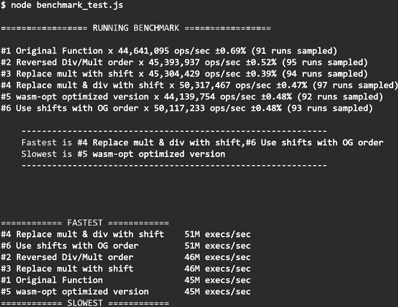

图 9-26：来自 `benchmark.js` 的输出。


```
[generated bytecode for function: bytecode_test]
Parameter count 1
Register count 2
Frame size 16
22 E> 0000009536F965F6 @    0 : a5                StackCheck
38 S> 0000009536F965F7 @    1 : 0b                LdaZero
      0000009536F965F8 @    2 : 26 fb             Star r0
57 S> 0000009536F965FA @    4 : 0b                LdaZero
      0000009536F965FB @    5 : 26 fa             Star r1
62 S> 0000009536F965FD @    7 : 01 0c 00 e1 f5 05 LdaSmi.ExtraWide [100000000]
62 E> 0000009536F96603 @   13 : 69 fa 00          TestLessThan r1, [0]
      0000009536F96606 @   16 : 99 16             JumpIfFalse [22] (0000009536F9661C @ 38)
44 E> 0000009536F96608 @   18 : a5                StackCheck
89 S> 0000009536F96609 @   19 : 25 fa             Ldar r1
95 E> 0000009536F9660B @   21 : 00 44 e8 03 01 00 ModSmi.Wide [1000], [1]
      0000009536F96611 @   27 : 26 fb             Star r0
78 S> 0000009536F96613 @   29 : 25 fa             Ldar r1
      0000009536F96615 @   31 : 4c 02             Inc [2]
      0000009536F96617 @   33 : 26 fa             Star r1
      0000009536F96619 @   35 : 8a 1c 00          JumpLoop [28], [0] (0000009536F965FD @ 7)
111 S> 0000009536F9661C @   38 : 0c 63             LdaSmi [99]
121 S> 0000009536F9661E @   40 : a9                Return
Constant pool (size = 0)
Handler Table (size = 0)
```

示例 9-34：来自 `print_bytecode.js` 的字节码输出

示例 9-34 输出的右侧是 IR 的操作码（opcodes）。在这里，我列出了这些操作码并在右侧添加了 WAT 风格的注释。V8 引擎生成的字节码并不是基于栈，而是针对一个带有累加器寄存器的虚拟寄存器机的。`accumulator` 是该虚拟机执行计算的地方。请快速查看 示例 9-35 中 V8 生成的代码。

```
;; A = Accumulator R0 = Register 0, R1 = Register 1
StackCheck
LdaZero                                   ;; A = 0
Star r0                                   ;; R0 = A
LdaZero                                   ;; A = 0
Star r1                                   ;; R1 = A
;; 这是循环的顶部
LdaSmi.ExtraWide [100000000]              ;; A=100_000_000
TestLessThan r1, [0]                      ;; R1 < A
JumpIfFalse [22] (0000006847C9661C @ 38)  ;; 如果 R1 >= A，则跳转 22 字节
                                          ;; 向前 [循环结束]
StackCheck
Ldar r1                                   ;; A = R1
ModSmi.Wide [1000], [1]                   ;; A %= 1_000
Star r0                                   ;; R0 = A
Ldar r1                                   ;; A = R1
Inc [2]                                   ;; A++
Star r1                                   ;; R1 = A
JumpLoop [28], [0] (0000006847C965FD @ 7) ;; 回退 28 字节 [循环顶部]
LdaSmi [99]                               ;; A = 99 | 循环结束
Return                                    ;; 返回 A
```

示例 9-35：带有注释的操作码

示例 9-34 输出的右侧是 IR 的操作码。在这里，我列出了这些操作码并在右侧添加了 WAT 风格的注释。V8 引擎生成的字节码并不是基于栈，而是针对一个带有累加器寄存器的虚拟寄存器机的。`accumulator` 是该虚拟机执行计算的地方。请快速查看 示例 9-35 中 V8 生成的代码。

## 总结

在本章中，我们讨论了评估 WAT 代码性能的多种工具，并将其与 JavaScript 进行了比较。然后，我们探索了改进 WebAssembly 模块的策略。

我们查看了 Chrome 浏览器中的分析器，并讨论了摘要页面和 JS 内存部分，后者提供了内存峰和垃圾回收的信息。我们还查看了帧率（fps）。

我们使用 Firefox 分析器调查了碰撞检测应用。Firefox 分析器提供了几个额外工具，包括调用树（Call Tree）和 JS 火焰图（Flame Chart）。我们通过分析器找到了被调用的 WAT 函数。

接下来，我们安装了 *Binaryen.js* 并使用 `wasm-opt` 工具对 WebAssembly 模块进行了下载大小或性能的优化。我们还将其反汇编译为 WAT 代码，以便查看优化器所做的更改。

我们讨论了死代码消除（DCE），这是优化器执行以移除模块中未用函数的方法。

# 10 调试 WebAssembly

))

  (func $distance (export "distance")
    (param $x1 f64) (param $y1 f64) (param $x2 f64) (param $y2 f64)
    (result f64)
    (local $x_dist f64)
    (local $y_dist f64)

    local.get $x1
    local.get $x2
    f64.sub             ;; $x1 - $x2
    local.tee $x_dist   ;; $x_dist = $x1 - $x2
    local.get $x_dist
    f64.mul             ;; $x_dist * $x_dist on stack

    local.get $y1
    local.get $y2
  1 f64.add             ;; should be $y1 - $y2
    local.tee $y_dist   ;; $y_dist = $y1 - $y2
    local.get $y_dist
    f64.mul             ;; $y_dist * $y_dist on stack
    f64.add             ;; $x_dist * $x_dist + $y_dist * $y_dist on stack

    f64.sqrt            ;; take the square root of x squared plus y squared
  )
)
```

列表 10-1：使用勾股定理寻找两点之间的距离

要使用勾股定理，我们在两点之间的 x 轴和 y 轴上创建一个直角三角形。x 轴上的长度是两个 `x` 值之间的距离。我们可以以同样的方法找到 y 轴上的距离。我们可以通过将这两个值平方、求和，然后开根来找到两点之间的距离（图 10-1）。

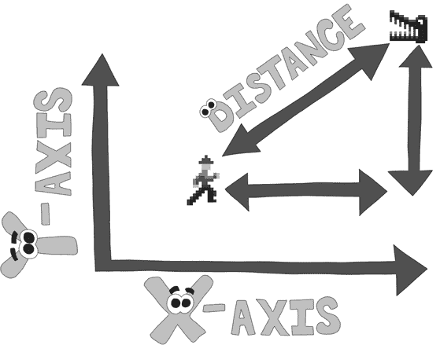

图 10-1：使用勾股定理计算游戏对象之间的距离

示例中的数学原理并不重要。重要的细节是，我们通过相加 `$y1` 和 `$y2` 的值而不是相它们来获取两个 y 坐标之间的距离，从而引入了一个 bug。将 `pythagoras.wat` 编译为 `pythagoras.wasm`，并创建一个名为 `pythagoras.html` 的新文件。然后将列表 10-2 中的代码添加到 `pythagoras.html` 中。

**pythagoras.html**

```
<!DOCTYPE html>
<html lang="en">
<<body>
  1 X1: <input type="number" id="x1" value="0">
  2 Y1: <input type="number" id="y1" value="0">
  3 X2: <input type="number" id="x2" value="4">
  4 Y2: <input type="number" id="y2" value="3">
    <br><br>
  5 DISTANCE: <span id="dist_out">??</span>
    <script>
      var distance = null;
      let importObject = {
        js: {
        6 log_f64: function(message_index, value) {
            console.log(`message #${message_index} value=${value}`);
          }
        }
      };

      ( async () => {
        let obj = await WebAssembly.instantiateStreaming(
                            fetch('pythagoras.wasm'), importObject );
        distance = obj.instance.exports.distance;
      })();

      7 function set_distance() {
        8 let dist = document.getElementById('dist_out');
        9 let x1 = parseFloat(document.getElementById('x1').value);
        10 let y1 = parseFloat(document.getElementById('y1').value);
        11 let x2 = parseFloat(document.getElementById('x2').value);
        12 let y2 = parseFloat(document.getElementById('y2').value);
        13 let result = Math.sqrt(Math.pow(x2 - x1, 2) + Math.pow(y2 - y1, 2));
        14 dist.innerHTML = result;
      }
    </script>
    <br><br>
    <button onclick="set_distance()">Find Distance</button>
</>
</html>
```
列表 10-2：调用 WebAssembly 的 HTML 文件


众所周知，在 WAT 中直接处理字符串并不是一项简单的任务。因此，为了逐步执行并调试这段代码，我们使用一个消息 ID 以及一个从 WebAssembly 模块传递给 JavaScript 的值。参考列表 10-3，修改 `pythagoras.wat` 文件，在 `$distance` 函数内部调用 `$log_f64`。

**pythagoras.wat**

```
...
(func $distance (export "distance")
  (param $x1 f64) (param $y1 f64) (param $x2 f64) (param $y2 f64) (result f64)
  (local $x_dist f64)
  (local $y_dist f64)
  (local $temp_f64 f64)

  local.get $x1
  local.get $x2
  f64.sub             ;; $x1 - $x2

  local.tee $x_dist   ;; $x_dist = $x1 - $x2

1 (call $log_f64 (i32.const 1) (local.get $x_dist))

  local.get $x_dist
  f64.mul             ;; $x_dist * $x_dist on stack

2 local.tee $temp_f64 ;; used to hold top of the stack without changing it
3 (call $log_f64 (i32.const 2) (local.get $temp_f64))

  local.get $y1
  local.get $y2
  f64.add             ;; should be $y1 - $y2
  local.tee $y_dist   ;; $y_dist = $y1 - $y2

4 (call $log_f64 (i32.const 3) (local.get $y_dist))

  local.get $y_dist
  f64.mul             ;; $y_dist * $y_dist on stack

5 local.tee $temp_f64 ;; used to hold top of the stack without changing it
6 (call $log_f64 (i32.const 4) (local.get $temp_f64))

  f64.add             ;; $x_dist * $x_dist + $y_dist * $y_dist on stack

7 local.tee $temp_f64 ;; used to hold top of the stack without changing it
8 (call $log_f64 (i32.const 5) (local.get $temp_f64))

  f64.sqrt            ;; take the square root of x squared plus y squared

9 local.tee $temp_f64 ;; used to hold top of the stack without changing it
a (call $log_f64 (i32.const 6) (local.get $temp_f64))
)
...
```

列表 10-3：更新后的 `pythagoras.wat` 文件，包含了 JavaScript 函数调用以记录 f64 变量

我们在这里多处添加了对 `$log_f64` 函数的调用 (13468a)。$log_f64` 的第一个参数是消息 ID，这是一个整数，我们将作为该消息的唯一 ID。稍后，我们使用此 ID 从 JavaScript 中输出特定的消息。

第二个参数是一个 64 位浮点数值，它可以向我们显示距离计算过程中几个不同阶段的值。在许多此类调用中，我们想要记录栈顶的值但*不*将其弹出，因此我们使用 `local.tee` (2579) 来设置 `$temp_f64` 的值，这会设置该值但不会将其从栈中移除。然后，我们在调用 `$log_f64` (368a) 时使用 `$temp_f64` 中的值。

### 向控制台记录消息

如所述，WebAssembly 模块无法直接向浏览器的控制台记录消息，且 WAT 没有原生的字符串处理库。我们到为止使用的 `log_f64` 函数是由 WebAssembly 模块从 JavaScript 导入的。因此，在列表 10-4 中，将在 JavaScript 中实现此函数。

**pythagoras.html**

```
log_f64: function(message_index, value) {
  console.log(`message #${message_index} value=${value}`);
}
```

列表 10-4：由 `pythagoras.wat` 调用的 JavaScript 函数

这是一个非常直接的版本，记录了消息索引和值，但没有针对任何 `message_index` 值自定义消息。要查看 Chrome 中的控制台，我们需要打开开发者工具。进入浏览器菜单并点击**更多工具**（图 10-6）。

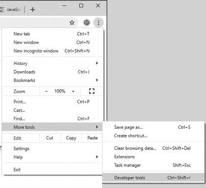

图 10-6：打开 Chrome 开发者工具

点击**开发者工具**，然后点击**控制台**（Console）选项卡查看控制台，如图 10-7 所示。

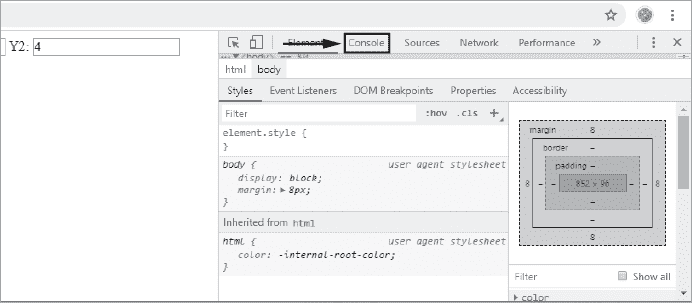

图 10-7：打开 Chrome 开发者工具


我们通过调用 JavaScript 的 `console.trace` 函数来显示堆栈跟踪。Firefox 和 Chrome 目前提供的堆栈跟踪看起来大不相同。在 Firefox 中使用 `console.trace` 目前比在 Chrome 浏览器中使用可以获得关于 WAT 文件更有用的信息。Firefox 浏览器会将 WebAssembly 二进制文件转换为 WAT 文件，并提供引用该反汇编后 WAT 文件行号的堆栈跟踪。相反，Chrome 提供的是对函数索引的引用，如果你不熟悉它，这看起来可能会非常晦懂。

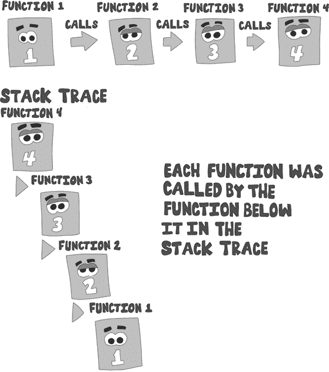

图 10-13：堆栈跟踪中函数 1 调用函数 2，函数 2 调用函数 3，函数 3 调用函数 4

创建一个名为 `stack_trace.wat` 的文件并将并将列表 10-7](#c10.xhtml_listing10-7) 中的代码添加到其中。

**stack_trace.wat**

```
(module

1 (import "js" "log_stack_trace" (func $log_stack_trace (param i32)))

2 (func $call_level_1 (param $level i32)
    local.get $level
    call $log_stack_trace
  )

3 (func $call_level_2 (param $level i32)
    local.get $level
    call $call_level_1
  )

4 (func $call_level_3 (param $level i32)
    local.get $level
    call $call_level_2
  )

5 (func $call_stack_trace (export "call_stack_trace")
  6 (call $log_stack_trace (i32.const 0))
    (call $call_level_1 (i32.const 1))
    (call $call_level_2 (i32.const 2))
    (call $call_level_3 (i32.const 3)) 
  )
)
```

列表 10-7：演示调用堆栈跟踪的 WebAssembly 模块

该 WebAssembly 模块从 JavaScript 导入了 `log_stack_trace` 函数 1，它将调用嵌入的 JavaScript 中的 `console.trace`。我们定义了另外四个函数，演示每个浏览器是如何记录 WebAssembly 调用堆栈的。导入的函数 `$log_stack_trace` 被 `$call_stack_trace` 和 `$call_level_1` 2 调用。函数 `$call_level_1` 被 `$call_stack_trace` 和 `$call_level_2` 3 调用。函数 `$call_level_2` 被 `$call_stack_trace` 和 `$call_level_3` 4 调用。最后，$call_level_3` 被 `$call_stack_trace` 调用。我们嵌套了这些函数调用，以演示从不同函数层级调用时堆栈跟踪的外。

注意 `$call_stack_trace` 5 调用了其他每个函数。首先，它直接调用 `$log_stack_trace` 并传递了常量 `0`。接下来，它调用了 `$call_level_1`，后者又调用了 `$log_stack_trace` 并传递了常量值 `1`。当记录堆栈跟踪时，调用堆栈中应该显示 `$call_level_1`、`$log_stack_trace` 6 和 `$call_stack_trace`。`$call_level_2` 和 `$call_level_3` 函数各添加了额外的层，这些层将在堆栈跟踪中显示。

现在创建一个名为 `stack_trace.html` 的新文件并将列表 10-8](#c10.xhtml_listing10-8) 中的代码添加到其中。

**stack_trace.html**

```
<!DOCTYPE html>
<html lang="en">
<body
    <h1>Stack Trace</h1>
    <script>
      let importObject = {
        js: {
          1 log_stack_trace: function( level ) {
                console.trace(`level=${level}`);
          }
        }
      };

      ( async () => {
        let obj =
          await WebAssembly.instantiateStreaming( fetch('stack_trace.wasm'),
                                                  importObject );
       obj.instance.exports.call_stack_trace();

      })();
    </script>
</body>
</html>
```

列表 10-8：带有 JavaScript 调用堆栈跟踪的 HTML 文件

这是一个非常基础的 HTML 文件，类似于 `pythagoras.html`。主要代码是在 `importObject` 内部内部的 `log_stack_trace` 函数 1，它调用 JavaScript 函数 `console.trace` 并传递一个在堆栈跟踪之前打印到控制台的字符串。保存此 HTML 文件后，在 Firefox 浏览器中打开它；你应该能看到与图 10-14](#c10.xhtml_figure10-14)类似的控制台日志。

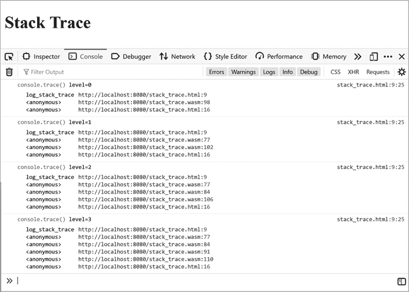

图 10-14：在 Firefox 中显示堆栈跟踪

你可以看到，第一个堆栈跟踪是用 `level=0` 记录的，因为我们直接在 WAT 代码的第一次调用 `$log_stack_trace` 时传递了值 `0`。这是从 WebAssembly 函数 `$call_stack_trace` 直接调用导入的 JavaScript 函数。由于第一次调用是直接对 `$log_stack_trace` 的，因此在这个顺序中 `stack_trace.wasm` 文件只记录了一个堆栈帧。`$call_level_2` 和 `$call_level_3` 函数各添加了额外的层，这些层将在堆栈跟踪中显示。

## Firefox 调试器

在本节中，我们将编写一些可以在调试器中单步执行的代码。首先，花点回顾 `pythagoras.html` 和 `pythagoras.wat` 文件。我们故意引入了一个错误，以便在调试器中跟踪它。我们将通过修改 `pythagoras.wat` 来移除对 JavaScript 输出的调用，以便使用调试器对其进行调试。创建一个名为 `debugger.wat` 的文件并将列表 10-9](#c10.xhtml_listing10-9) 中的代码添加到其中，或者直接从 `pythagoras.wat` 中删除日志调用并重新保存文件。


```
(module
  (func $distance (export "distance")
    (param $x1 f64) (param $y1 f64) (param $x2 f64) (param $y2 f64)
    (result f64)
    (local $x_dist f64)
    (local $y_dist f64)

    local.get $x1
    local.get $x2
    f64.sub             ;; $x1 - $x2
    local.tee $x_dist   ;; $x_dist = $x1 - $x2    local.get $x_dist
    f64.mul             ;; $x_dist * $x_dist on stack
    local.get $y1
    local.get $y2
    f64.add             ;; Should be $y1 - $y2    local.tee $y_dist   ;; $y_dist = $y1 - $y2
    local.get $y_dist
    f64.mul             ;; $y_dist * $y_dist on stack
    f64.add             ;; $x_dist * $x_dist + $y_dist * $y_dist on stack
    f64.sqrt            ;; take the square root of x squared plus y squared
  )
)
```

示例 10-9：我们通过移除日志调用修改了 `pythagoras.wat`。

早些时候，我们引入了一个 bug，它通过将 `$y1` 加到 `$y2` 而不是相减它们，有时会得到错误的结果。将 `pythagoras.html` 复制到名为 `debugger.html` 的新文件中，并将 `<script>` 标签内部的 JavaScript 代码更改为获取 `debugger.wasm`。然后移除 `importObject`，使其看起来像示例 10-10 中的代码一样。

**pythagoras.html**

```
...
<script>
  var distance = null;

  ( async () => {
    let obj = await WebAssembly.instantiateStreaming( fetch('debugger.wasm') );

    distance = obj.instance.exports.distance;

  })();
  function set_distance() {
    let dist_out = document.getElementById('dist_out');
    let x1 = document.getElementById('x1');
    let x2 = document.getElementById('x2');
    let y1 = document.getElementById('y1');
    let y2 = document.getElementById('y2');

    let dist = distance(x1.value, y1.value, x2.value, y2.value);
    dist_out.innerHTML = dist;
  }
</script>
...
```

示例 10-10：测试 `debugger.wasm` 的 HTML 文件

将 `debugger.html` 加载到 Firefox 并打开控制台；然后点击**调试器 (Debugger)** 选项卡访问 Firefox 调试器。从左侧的**源 (Sources)** 选项卡中选择 `debugger.wasm` 以查看你的 WAT 代码的反汇编版本，它看起来应该像图 10-18。

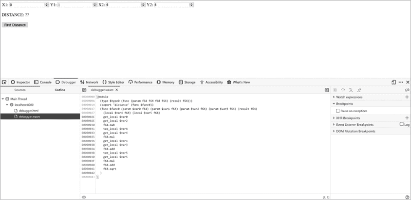

图 10-18：Firefox 调试器中的 WAT 代码

这段代码是 WebAssembly 二进制的反汇编，因此函数和变量的名称不再可用。此结果类似于对网络上找到的二进制文件进行反汇编时看到的内容。由于 `wat2wasm` 尚不支持源 map，我们无法在调试器中步执行原始源代码。相反，你需要对原始代码和反汇编代码进行并对比较。示例 10-11 显示了该反汇编代码的样子。

```
(module

  (type $type0 (func (param f64 f64 f64 f64) (result f64)))
  (export "distance" (func $func0))
1 (func $func0
    (param 2$var0 f64)(param 3$var1 f64)(param 4$var2 f64)(param 5$var3 f64)
    (result f64)
    (local 6$var4 f64) (local 7$var5 f64)
    local.get $var0
    local.get $var2
    f64.sub
    local.tee $var4
    local.get $var4
    f64.mul
    local.get $var1
    local.get $var3
    f64.add
    local.tee $var5
    local.get $var5
    f64.mul
    f64.add
    f64.sqrt
  )
)
```

示例 10-11：Firefox 反汇编生成的 WAT 代码

这段代码是从 WebAssembly 二进制文件反汇编出来的，它感知不到我们赋予变量或函数的标签。它也无法感知代码中的任何注释。如果你回看原始 WAT 代码（示例 10-9），你可以看到函数 `$distance` 变成了 `$func0` 1。参数变量 `$x1`、`$y1`、`$x2` 和 `$y2` 分别变成了 `$var0`、`$var1`、`$var2` 和 `$var3`。局部变量 `$x_dist` 和 `$y_dist` 变成了 `$var4` 和 `$var5`。


```wat
1 func (param f64 f64 f64 f64) (result f64)
2 (local f64 f64)
  local.get 0
  local.get 2
  f64.sub
  local.tee 4
  local.get 4
  f64.mul
  local.get 1
  local.get 3
  f64.add
  local.tee 5
  local.get 5
  f64.mul
  f64.add
  f64.sqrt
end
```

列表 10-12: 调试器中的 Chrome WAT 反汇编

注意 Chrome 使用索引来表示局部变量、参数和函数。函数 `1` 没有关联名称，其任何参数或局部变量 `2` 也是如此。全局变量和类型也是如此。如果我们使用全局变量，将使用 `global.get` 和 `global.set`，并传入一个与变量定义顺序对应的索引数字。

Chrome 调试功能的一个很棒特性是你可以在“作用域”（Scope）窗口中访问堆栈。当你步执行代码时，可以观察值如何推入堆栈和从堆栈中弹出。缺点之一是，“监视”（Watch）窗口没有 Firefox 中那么好用，因为 Chrome 并没有像 JavaScript 变量那样提供变量。

与 Firefox 一样，Chrome 有“恢复”按钮 、“单步跳”按钮 、“单步入”按钮  和“单步出”按钮 ，如图 10-23 所示。

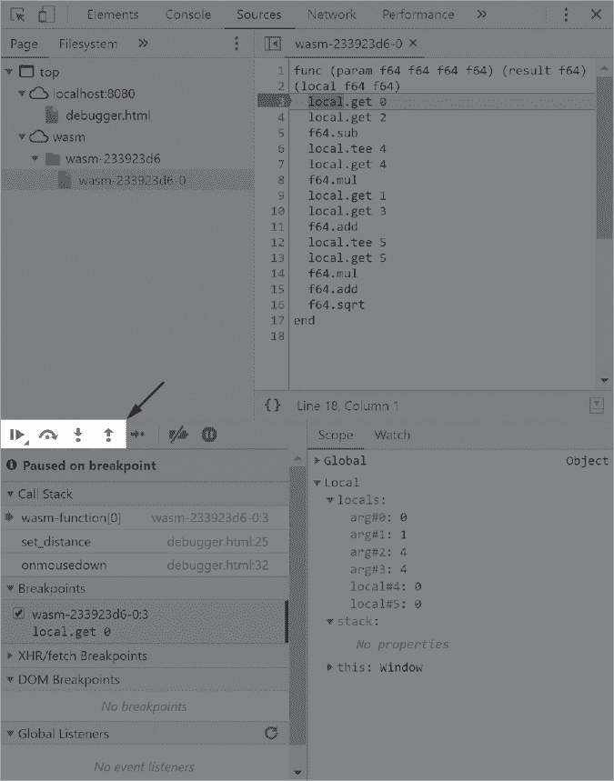

图 10-23: 在 Chrome 调试器中查看堆栈

## 总结

在本章中，我们在 Chrome 和 Firefox 中使用了各种技术调试 WAT 代码。我们比之前的章节更地查看了控制台日志。然后，我们使用 JavaScript 的 `alert` 函数停止执行并等待用户指令。我们还探索了使用 `console.trace` 记录堆栈跟踪，并讨论了 Chrome 和 Firefox 中堆栈跟踪工作方式的差异。最后，我们使用了 Chrome 和 Firefox 内置的调试器。

调试 WebAssembly 有许多可用选项。某些选项（例如使用 Chrome 或 Firefox 调试器）仍在开发中。你决定使用什么种工具取决于代码以及你调试时的目标。在下一章中，我们将使用 WebAssembly 构建 Node.js 模块。

# 11 AssemblyScript


AssemblyScript 是一种专门设计用于编译为 WebAssembly 或 WAT 的高级语言。AssemblyScript 比 WAT 更具表现力，但可以编译为 WAT。当你使用 AssemblyScript 时，你会失去一些在 WAT 中拥有的细粒化优化控制，但编写速度要快得多。

我们将从创建一个简单的 `AddInt` 函数开始本章，就像我们在第 1 章创建的 `AddInt` 一样。我们将编写一个 AssemblyScript 的 hello 世界程序并将其编译为 WAT，以查看 AssemblyScript 编译器生成的 WebAssembly。我们将检查 AssemblyScript 对长度前缀字符串的使用，然后安装 AssemblyScript 加载器，看看它可以如何方便在 AssemblyScript 和 JavaScript 之间传输字符串。我们将通过编写一个字符串拼接程序将字符串传递给 AssemblyScript。我们还将探索 AssemblyScript 中的面向对象（OOP）。我们将创建几个类来演示类继承，并讨论防止 AssemblyScript 将属性导出到嵌入环境的 `private` 属性。接下来，我们将编写 JavaScript 允许我们直接创建 `public`、`private` 和 `protected` 成员，并使用 AssemblyScript 加载器。然后我们将比较直接函数调用和加载器调用的性能。

AssemblyScript 团队将其设计得类似于 TypeScript 和 JavaScript。与 WAT 不同，AssemblyScript 是一种高级语言，具有类、字符串和数组等特性。除了高级特性外，AssemblyScript 还允许用户使用类似 WAT 的低级内存命令进行代码编写。AssemblyScript 有一个`命令行界面 (CLI)`，可以将 AssemblyScript 编译为 WebAssembly 模块，供 JavaScript 应用程序内部使用。

对于兴趣使用 WebAssembly 提高 JavaScript 应用性能的 JavaScript 开发者来说，AssemblyScript 是一个很棒的工具。遗憾的是，正如 WebAssembly 中的一切，仅仅调整你的 TypeScript 直到它被 AssemblyScript 编译器编译可能不会带来显著的性能提升。理解 AssemblyScript 在底层做了什么，允许你使用一种看起来像 JavaScript 但运行起来像 C++ 的语言编写代码。为了获得这种理解，我们将 AssemblyScript 代码编译为 WAT，以探索 AssemblyScript 编译器的输出。

## AssemblyScript CLI

使用以下命令安装 AssemblyScript：

```
npm install assemblyscript -g
```

`npm` 命令全局安装 AssemblyScript，这允许你从命令行使用 AssemblyScript 编译器 `asc` 命令。运行 `asc -h` 会提供编译器命令示例和选项的列表。

我不会解释所有的命令行参数，但会提到几个有用的。`-O` 选项的优化方式与第 9 章中的 `wasm-opt` 相同。你在 `-O` 后面跟一个 0 到 3 的数字、`s` 或 `z`，指示编译器进行优化。`--sourceMap` 标志会创建一个源映射文件（source map file）以帮助你调试 AssemblyScript。`-o` 标志后跟文件名告诉编译器输出 WAT。或者，我们可以编译一个 *.wasm* 文件，例如 *output.wasm*，这将输出一个 WebAssembly 二进制文件。我们首先创建一个简单的 `AddInt` 函数，就像我们在第 1 章创建的 `AddInt` 一样。

**addInt.ts**

```typescript
export function AddInts(a: i32, b: i32): i32 {
  return a + b;
}
```

列表 11-1: 相加两个整数

我们使用 `export` 关键字让 JavaScript 使用 `AddInts` 函数。它接受两个 `i32` 参数 `a` 和 `b`，并返回一个 `i32`。使用命令编译 *addInt.ts*：

```
asc addInt.ts -Oz -o add.wat
```

列表 11-2: 将 `AddInt` 编译为 WAT

`-Oz` 标志使输出二进制文件的尽可能最小。最后一个标志 `-o add.wat` 告诉编译器输出 WAT。当我们查看 *add.wat* 文件时，我们看到了列表 11-3 中的 WAT 代码。

```wat
(module
  (type $i32_i32_=>_i32 (func (param i32 i32) (result i32)))
  (memory $0 0)
  (export "AddInts" (func $add/AddInts))
  (export "memory" (memory $0))
  (func $add/AddInts (param $0 i32) (param $1 i32) (result i32)
    local.get $0
    local.get $1
    i32.add
  )
)
```

列表 11-3: 编译为 WAT 的 AssemblyScript `AddInts` 函数

在 AssemblyScript 中编写代码比直接在 WAT 中编写代码容易得多。这段代码产生 `AddInts` 导出一个接受两个 `i32` 参数并返回一个 `i32` 的函数。输出函数使用 `local.get` 获取第一个和第二个参数，并使用 `i32.add` 相加这两个值。

## Hello AssemblyScript

接下来，我们将为第 2 章的 WAT hello 世界程序构建 AssemblyScript 版本。创建一个名为 *as_hello.ts* 的新 AssemblyScript 文件，并添加列表 11-4 中的代码。

**as_hello.ts**

```typescript
declare function console_log( msg: string ):void;

export function HelloWorld():void {
  console_log("hello world!");
}
```


## 列表 11-4：一个 hello world AssemblyScript 应用

AssemblyScript 中的函数声明必须与传入 WebAssembly 模块的 JavaScript 函数对应。因此，我们需要通过 `importObject` 传入一个函数，将我们的字符串打印到控制台。`declare` `function` 1 从 JavaScript 导入 `console_log` 函数。该函数将字符串从 AssemblyScript 传回给调用的 JavaScript 应用。我们创建了一个名为 `HelloWorld` 2 的 `export` `function`，它调用导入的 `console_log` 3 函数，并传入字符串 `"hello world!"`。在将其编译为 WebAssembly 模块之前，我们将使用 `asc` 编译 WAT 文件，以便查看生成的 WebAssembly（见 列表 11-5 ）。

```
asc as_hello.ts -Oz -o as_hello.wat
```

列表 11-5：将 AssemblyScript 文件 `as_hello.ts` 编译为 `as_hello.wat`。

然后，我们可以在 列表 11-6 中打开 `as_hello.wat` 以查看 AssemblyScript 生成的 WebAssembly。

```
;; 注释由作者添加，并非由 asc 生成 1
(module
  (type $none_=>_none (func))
  (type $i32_=>_none (func (param i32)))
  ;; AssemblyScript 顶部的 declare 命令创建了一个导入
  ;; 它导入了外部 as_hello
  ;; 对象内部的 console_log 函数
  ;; AssemblyScript 要求在 AssemblyScript 文件中列出导入
  ;; 不包含 .ts 扩展
  (import "as_hello" "console_log" (func $as_hello/console_log (param i32))) 2
  ;; 使用字符串会自动创建内存表达式
  (memory $0) 3
  ;; 下面的数据行是因为该行太长了
  ;; "hello world!" 字符串前面有一个头部，并且字符串中的每个字母
  ;; 都有十六进制字节 00。这是因为 AssemblyScript 使用的是
  ;; UTF-16 字符集，而不是我们在 WAT 中处理
  ;; 字符串时使用的 ASCII。
  (data (i32.const 16) 4
    "\18\00\00\00\01\00\00\00\18\00\00\00\68\00\65\00\6c\00\6c\00\6f\00\77\0072\00d!")
  (export "memory" (memory $0))
  ;; 模块以我们给 AssemblyScript 的名称导出了我们的函数
  (export "HelloWorld" (func $as_hello/HelloWorld)) 5
  ;; 我们给 AssemblyScript 的函数名带有文件名的名前缀
  ;; 不包含 .ts 扩展
  (func $as_hello/HelloWorld (;) 6
  ;; 32 是 "hello world" 中 'h' 在线性内存中的位置
  i32.const 32 7
  ;; 调用 console_log 函数，并传入 "hello world"
  ;; 在线性内存中的位置
  call $as_hello/console_log 8
  )
```

列表 11-6：从 `as_hello.ts` 生成的 `as_hello.wat` 文件

我添加了注释来说明代码 1。此模块导入了封装在 `as_hello` 对象中的 `console_log` 2，该名称是我们不包含 `.ts` 扩展的 AssemblyScript 文件名。这是 AssemblyScript 用于其 `importObject` 使用的命名规范；AssemblyScript 创建了一个 `memory` 3 表达式来存储字符串数据。字符串有一个前缀头部，包含字符串长度，AssemblyScript 使用它来处理来自 WebAssembly 的数据。字符串 `data` 4 每个字符使用两个字节，因为 AssemblyScript 使用 UTF-16，所以此示例中的每个字符都由空字节 `\00` 隔开。UTF-16 是 Unicode 字符集的 16 位版本，允许许多 ASCII 中不包含的额外字符。在数据表达式之后，WAT 导出了 5 我们在 AssemblyScript 中给出的函数名称，该名称带有 `$` 字符前缀且不包含 `.ts` 扩展。`HelloWorld` 6 函数调用 `console_log` 8，传入了我们的 `hello world!` 字符串在线性内存中第一个字符的位置，即 `32` 7。

编译好 WAT 文件后，我们可以使用 列表 11-7 中的 `asc` 命令来编译我们的 WebAssembly 模块。

```
asc as_hello.ts -Oz -o as_hello.wasm
```

列表 11-7：将我们的 AssemblyScript 编译为 WebAssembly 二进制

接下来，我们编写 JavaScript。

### 用于 World App 的 JavaScript

目前，我们有一个名为 `as_hello.wasm` 的 WebAssembly 模块。接下来，我们将编写一个加载并运行该模块的 Node.js 应用。在本节中，我们将按照第五章的方法解码字符串数据，以理解 AssemblyScript 如何将字符串传递给 JavaScript。然后我们将使用 AssemblyScript 加载工具来完成大部分大部分工作。

首先，我们将编写一个函数，使用 WebAssembly 模块传递的索引从线性内存中提取字符串。AssemblyScript 将字符串长度放在字符串数据之前的四个字节中。我们可以使用 `Uint32Array` 获取字符串长度，并使用该长度在 JavaScript 中创建字符串。创建一个名为 `as_hello.js` 的文件，并在 列表 11-8 中添加代码。

**as_hello.js**

```javascript
const fs = require('fs');
const bytes = fs.readFileSync(__dirname + '/as_hello.wasm');

// 内存对象是从 AssemblyScript 导出的
var memory = null;

let importObject = {

// 模块的文件名作为外部对象名称

```javascript
as_hello: {
    // AssemblyScript 传递一个带有长度前缀的字符串和一个索引
  console_log: function (index) {
      // 防止在内存设置之前调用
      if (memory == null) {
        console.log('memory buffer is null');
        return;
      }

    const len_index = index - 4;

      // 必须除以 2 将字节转换为 16 位 Unicode 字符
    const len = new Uint32Array(memory.buffer, len_index, 4)[0];
    const str_bytes = new Uint16Array(memory.buffer, index, len);

      // 将 utf-16 字节数组解码为 JS 字符串
    const log_string = new TextDecoder('utf16').decode(str_bytes);
      console.log(log_string);
    }
  },
  env: {
    abort: () => { } 
  }
};

(async () => {
  let obj = await WebAssembly.instantiate(new Uint8Array(bytes),
    importObject);

  // 从 AssemblyScript 导出的内存对象
  memory = obj.instance.exports.memory;
  // 调用 HelloWorld 函数
  obj.instance.exports.HelloWorld();
})();
```

列表 11-8：从 JavaScript 调用 AssemblyScript 的 `HelloWorld`


我们使用 `new Uint16Array` 6 从线性内存中检索字符串字节数据，并使用新的 `TextDecoder` 将该字节数组转换为 JavaScript 字符串，其解码用于 `utf-16` 文本数据。代码调用 `TextDecoder` 7 的 `decode` 函数传入字符串数据，返回一个 JavaScript 字符串，我们随后将其打印到控制台。我们使用一个 IIFE（立即执行函数）来实例化 AssemblyScript WebAssembly 模块。注意，在调用 `HelloWorld` 9 函数之前，我们必须将 `memory` 8 对象设置为从 WebAssembly 模块导出的内存对象。`console_log` 函数使用了 `memory` 对象，如果没有设置它，调用 `HelloWorld` 将不会任何作用。

幸运的是，有一种更简单的方法可以在 AssemblyScript 和 JavaScript 之间移动字符串数据，那就是使用 AssemblyScript 加载器（loader）。这段代码由 AssemblyScript 团队提供。在“加载器与直接调用 WebAssembly 的性能（Performance of Loader vs. Direct WebAssembly Calls）”部分，我们将看到是否能通过编写的代码来提高 AssemblyScript 加载器的性能。

### 使用 AssemblyScript 加载器实现 Hello World

### AssemblyScript 加载器是 AssemblyScript 团队提供的一组辅助函数，旨在让从 JavaScript 调用 AssemblyScript 变得更容易。我们将之前编写的代码与使用 AssemblyScript 加载器编写的代码进行对比。最初，我们将考虑易用性，稍后将研究使用或使用加载器对性能的影响。

我们使用 AssemblyScript 加载器从 AssemblyScript 向 JavaScript 发送字符串。加载器辅助函数会将来自 WebAssembly 的索引转换为 JavaScript 字符串。现在，我们将使用 `npm` 安装加载器：

```
npm install @assemblyscript/loader --save
```

现在，我们将创建一个 JavaScript 文件来加载并运行我们的 WebAssembly 模块。创建一个名为 `as_hello_loader.js` 的文件，并添加 Listing 11-9 所示的代码。

**as_hello_loader.js**

```javascript
1 const loader = require("@assemblyscript/loader");
const fs = require('fs');
2 var module;

const importObject = {
3 as_hello: {
  4 console_log: (str_index) => {
    5 console.log(module.exports.__getString(str_index));
    }
  }
};

(async () => {
  let wasm = fs.readFileSync('as_hello.wasm');
6 module = await loader.instantiate(wasm, importObject);
7 module.exports.HelloWorld();
})();
```

Listing 11-9: 使用 AssemblyScript 加载器调用 WebAssembly 模块

此 JavaScript 函数首先引入了 1 AssemblyScript 加载器。我们使用此加载器对象来加载 `module` 2 对象，我们将其声明为全局。`module` 对象是一个 AssemblyScript 加载器模块，包含了额外的 AssemblyScript 加载器辅助函数。`importObject` 内部有一个子对象，其名称与我们的 AssemblyScript 模块 `as_hello` 3 一致。这就是 AssemblyScript 代码预期用于定位已导入函数的地方。在 `as_hello` 对象内部是 `console_log` 4，它接受字符串索引 `str_index` 作为唯一参数。该函数使用了加载器创建的 `module` 对象上的 `__getString` 5 函数。当给定字符串索引时，`__getString` 函数会从线性内存中检索一个 JavaScript 字符串。该字符串通过 `console.log` 打印到控制台。IIFE 函数使用 AssemblyScript `loader` 6 对象加载 AssemblyScript 模块。最后，IIFE 调用了 `HelloWorld` 7 函数。当你使用 `node` 运行此 JavaScript 文件时，你将在 Listing 11-10 中看到输出。

```
hello world!
```

Listing 11-10: AssemblyScript hello world 应用的输出

使用 AssemblyScript 加载器使 JavaScript 代码变得显著简单。稍后在“加载器与直接调用 WebAssembly 的性能”部分，我们将探索性能的影响。

### AssemblyScript 字符串拼接

现在我们已经知道如何从 AssemblyScript 接收字符串，现在我们将向 AssemblyScript 模块发送一个字符串。接下来的这个函数将拼接两个用管道符（`|`）分隔的字符串。我们将使用加载器来让 JavaScript 侧的代码编写更加容易。字符串拼接在 WAT 中直接实现具有挑战性，但在 AssemblyScript 中非常简单。创建一个名为 `as_concat.ts` 的新文件，并添加 Listing 11-11 所示的代码。

**as_concat.ts**

```typescript
1 export function cat( str1: string, str2: string ): string {
2 return str1 + "|" + str2;
}
```

Listing 11-11: 使用 AssemblyScript 拼接字符串

我们导出了 1 `cat`，它接受两个字符串参数并返回一个字符串。该函数拼接 2 用管道符（`|`）分隔的字符串。

现在我们可以使用 Listing 11-12 中的 `asc` 命令编译 `as_concat.ts`。

```bash
asc as_concat.ts --exportRuntime -Oz -o as_concat.wasm
```

Listing 11-12: 使用 `asc` 编译 `as_concat.ts` 文件

我们传递了 `--exportRuntime` 标志，这对于将字符串传递到 WebAssembly 模块是必须的。使用 `--exportRuntime` 编译会添加允许你调用 WebAssembly 模块的代码。如果我们未能导出运行时，将会发生以下错误：

```
TypeError: alloc is not a function
```

当你将 `as_concat.ts` 编译为 WAT 时，注意 WAT 文件比我们的 `as_concat.ts` 大得多。现在我们可以编写 JavaScript 应用。Listing 11-13 中的代码在线性内存中创建字符串并调用 AssemblyScript 函数。

**as_concat.js**

```javascript
const fs = require('fs');
const loader = require("@assemblyscript/loader");

(async () => {
  let module = await loader.instantiate(fs.readFileSync('as_concat.wasm'));

  //__newString, __getString functions require
//compile with exportRuntime
1 let first_str_index = module.exports.__newString("first string");
2 let second_str_index = module.exports.__newString("second string");
3 let cat_str_index = module.exports.cat(first_str_index,second_str_index);
4 let cat_string = module.exports.__getString(cat_str_index);
5 console.log(cat_string);
})();
```

Listing 11-13: JavaScript 使用 AssemblyScript 加载器调用 `cat` 函数

我们在 WebAssembly 模块中定义的 `cat` 函数不直接接受字符串作为参数，因此它需要一个线性内存索引。`module.exports.__newString` 加载器辅助函数接收 JavaScript 字符串，将其复制到线性内存，并返回一个索引传递给 `module.cat`。我们调用两次 `module.exports.__newString`，分别传入 `"first string"` 1 和 `"second string"` 2。这些调用返回返回索引，我们将其存储在 `first_str_index` 和 `second_str_index` 中。接下来，我们调用 `module.exports.cat` 并传入这些索引，从中接收一个 JavaScript 字符串索引，并存储在 `cat_str_index` 中。然后我们调用 `module.exports.__getString` 4 传入 `cat_str_index`，并将字符串存储在 `cat_string` 5 中，将其打印到控制台。


AssemblyScript 还有很多可以探索的内容。正如你所见，在 AssemblyScript 中编写处理字符串的代码比在 WAT 中要简单得多。这并不意味着你何时应该在 WebAssembly 中处理字符串数据，但它将其作为一个选项暴露了出来。AssemblyScript 与同广义的 WebAssembly 一样，是一个快速发展的项目。花时间从 [assemblyscript.org](http://assemblyscript.org) 项目主页学习更多关于它的知识是值得的。

## AssemblyScript 中的面向对象编程

在 WAT 格式中几乎无法使用 OOP，但因为 AssemblyScript 基于 TypeScript 建模的，它为 OOP 提供了更多的选项。在本节中，我们将介绍 AssemblyScript 中 OOP 的基础知识，以及一些局限性，这些局限性在未来的版本中可能不再适用。

让我们创建一个名为 `vector.ts` 的新 AssemblyScript 文件。目前，AssemblyScript 借用了 TypeScript 的文件格式，这在大多数情况下都是有效的。

Saule Cabrera 为 VS Code 创建了一个 AssemblyScript 语言服务器插件，地址为 [`marketplace.visualstudio.com/items?itemName=saulecabrera.asls.`](https://marketplace.visualstudio.com/items?itemName=saulecabrera.asls.)。接下来，我们将编写一个 AssemblyScript `Vector2D` 类，用于存储碰撞体对象的坐标，这与我们在第 8 章为碰撞检测应用编写的代码类似。我们将代码编译为 WAT，以便我们可以探索 AssemblyScript 编译器的输出。在优化 WebAssembly 代码时，更好地理解编译器及其输出非常有有利。在你的文件中添加 Listing 11-14 来创建 `Vector2D` 类。

**vector.ts**

```
1 export class Vector2D {
2 x: f32;
3 y: f32;

4 constructor(x: f32, y: f32) {
    this.x = x;
    this.y = y;
  }

5 Magnitude(): f32 {
    return Mathf.sqrt(this.x * this.x + this.y * this.y);
  }
}
```

Listing 11-14：在 AssemblyScript 中创建向量类

我们导出一个名为 `Vector2D` 的类 1，它有两个属性 `x` 2 和 `y` 3。它还有一个 `constructor` 4，可以根据 `x` 和 `y` 参数创建一个新的 `Vector2D` 对象。`Magnitude` 5 方法通过相加 `x` 和 `y` 的平方并对该和取平方根来计算向量的模。

如果你熟悉 TypeScript，你会发现这段代码看起来和 TypeScript 中的 `class` 结构完全一样。然而，我们没有使用 TypeScript 的 `number` 类型，而是使用 `f32` 类型来表示 32 位浮点数。如果你在 AssemblyScript 中使用 `number` 类型，它等同于使用 `f64` 64 位浮点数，在大多数情况下这是 WebAssembly 类型中性能最差的。

以下命令使用 `asc` 将 `vector.ts` 编译为 WAT 文件：

```
asc vector.ts -o vector.wat
```

这创建了一个可以在 VS Code 中检查的 WAT 文件。向 `asc` 传递 AssemblyScript 文件的名称，然后传递 `-o` 标志以及输出文件的文件名 `vector.wat`。扩展名决定了输出是 WAT 还是 WebAssembly 二进制文件。打开 `vector.wat` 并向下滚动，直到看到 Listing 11-15 中所示导出。

**vector.wat**

```
...
  (export "memory" (memory $0))
  (export "Vector2D" (global $vector/Vector2D))
1 (export "Vector2D#get:x" (func $vector/Vector2D#get:x))
2 (export "Vector2D#set:x" (func $vector/Vector2D#set:x))
3 (export "Vector2D#get:y" (func $vector/Vector2D#get:y))
  (export "Vector2D#set:y" (func $vector/Vector2D#set:y))
4 (export "Vector2D#constructor" (func $vector/Vector2D#constructor))
5 (export "Vector2D#Magnitude" (func $vector/Vector2D#Magnitude))
...
```

Listing 11-15：我们 WAT 文件中的导出函数

注意编译器如何为属性 `x` 2 和 `y` 3 生成了 `get` 1 和 `set` 2 访问函数，并导出了它们以便你可以从嵌入环境访问它们。这表明当用户使用加载器设置对象属性时，它会调用 WebAssembly 模块中的函数。其一个影响是，如果你同时设置多个属性，出于性能考虑，你可能想要创建一个函数一次性完成所有操作。这样，你就不需要对 WebAssembly 模块进行多次函数调用。你还可以看到 WebAssembly 模块导出了 `constructor` 4 和 `Magnitude` 5 函数。

如果你想从 JavaScript 调用 WebAssembly 模块中的函数，理解命名约定至关重要。所有方法都以类名名前缀……（此处省略了重复的命名约定描述）。


创建 `vector.js` 文件并添加 Listing 11-18 中的代码。

`vector.js`

```
1 const fs = require('fs');

2 (async () => {
3 let wasm = fs.readFileSync('vector.wasm');
4 let obj = await WebAssembly.instantiate(wasm,{env:{abort:()=>{}}});

5 let Vector2D = {
  6 init: function (x, y) {
      return obj.instance.exports"Vector2D#constructor"
    },
  7 Magnitude: obj.instance.exports["Vector2D#Magnitude"],
}

8 let vec1_id = Vector2D.init(3, 4);
  let vec2_id = Vector2D.init(4, 5);

  console.log(`
  9 vec1.magnitude=${Vector2D.Magnitude(vec1_id)}
    vec2.magnitude=${Vector2D.Magnitude(vec2_id)}
    `);
})();
```

Listing 11-18: 在 `Vector2D` AssemblyScript 类上调用函数

我们使用 Node.js 模块 `fs` 在一个异步 IIFE 2 中从文件中加载 3 二进制 WebAssembly 数据。一旦我们有了二进制数据，将其传递给 `WebAssembly.instantiate` 4，它会返回一个 WebAssembly 模块对象。然后我们创建 JavaScript 对象 `Vector2D` 5，它镜像了 WebAssembly 模块内部的函数。

我们创建了一个 `init` 6 函数，它调用 WebAssembly 模块的 `Vector2D` `constructor`，并将 `0` 作为第一个参数传递。将此值传递给 `constructor` 函数允许在线性内存中对对象的位置进行一定程度的选择。我们传递了 `0`，这使得构造函数在下一个可用内存位置创建一个新对象。该函数将返回在线性内存中创建该对象的位置。`Vector2D` 中的 `Magnitude` 7 属性从 `obj.instance.exports["Vector2D#Magnitude"]` 获取值，这是我们 WebAssembly 模块中的一个函数。

在定义了 JavaScript `Vector2D` 对象后，我们调用两次 `Vector2D.init` 8，在线性内存中创建两个 `Vector2D` WebAssembly 对象，并返回这些对象的线性内存地址，我们将其用于方法调用。然后我们在一个 `console.log` 模板字符串内部调用两次 `Vector2D.Magnitude`。我们传递了在 Listing 11-18 中保存的向量 ID（`vec1_id` 和 `vec2_id`），它们告诉 WebAssembly 模块它正在使用哪个对象。`Magnitude` 9 函数返回给定向量的模，应用程序将其打印到控制台。使用 `node` 运行此应用：

```
node vector.js
```

结果如下：

```
vec1.magnitude=5
vec2.magnitude=6.4031243324279785
```

这两个值分别是我们的第一个向量（`x = 3` 和 `y = 4`）的模，以及第二个向量（`x = 4` 和 `y = 5`）的模。

现在我们已经知道如何直接调用我们的 AssemblyScript 应用，让我们看看如何使用 AssemblyScript 加载器让 JavaScript 编码变得简单一点。

### AssemblyScript Loader

现在我们将修改我们的 AssemblyScript 代码以使用 AssemblyScript 加载器库。这将允许我们从易用性和性能方面比较与 AssemblyScript 模块进行交互的方法。正如之前提到的，了解何时可以提高应用程序性能以及这需要多大的努力是非常重要的。这些信息帮助你做出关于开发时间与应用程序性能之间权衡的决策。

打开 `vector_loader.ts` 并添加 Listing 11-19 中的代码以使用 AssemblyScript 加载器。

`vector_loader.ts`

```
export class Vector2D {
1 x: f32;
2 y: f32;

  constructor(x: f32, y: f32) {
    this.x = x;
    this.y = y;
  }

  Magnitude(): f32 {
    return Mathf.sqrt(this.x * this.x + this.y * this.y);
  }
3 add(vec2: Vector2D): Vector2D {
    this.x += vec2.x;
    this.y += vec2.y;
    return this;
  }
}
```

Listing 11-19: 从 `x` 和 `y` 属性中移除私有修饰符

对 `vector.ts` 有两个更改我们将添加到 `vector_loader.ts` 中。首先，我们从 `x` 1 和 `y` 2 属性中移除 `private` 修饰符，以便我们可以从 JavaScript 访问 `x` 和 `y`。其次，我们创建了一个 `add` 3 函数来添加第二个向量。此函数允许我们将两个向量相加。在 Listing 11-20 中，我们使用 `asc` 编译 `vector_loader.ts`。

```
asc vector_loader.ts -o vector_loader.wasm
```

Listing 11-20: 编译 `vector.ts`

接下来，我们将创建一个新的 JavaScript 文件 `vector_loader.js`。将 11-21 中的代码添加到 *vector_loader.js*。


OOP（面向对象编程）允许开发者通过向基类添加额外的属性或功能来扩展类。AssemblyScript 中扩展类的语法与 TypeScript 相同。在列表 11-22 中，我们将用 `Vector3D` 类来扩展 `Vector2D` 类，该类将添加一个额外的属性 `z`，它将代表我们向量的第三个维度。

打开 `vector_loader.ts` 文件，并在 `Vector2D` 定义之后添加列表 11-22 中的代码。

**vector_loader.ts**

```
...
1 export class Vector3D extends Vector2D {
2 z: f32;

  constructor(x: f32, y: f32, z: f32) {
  3 super(x, y);
    this.z = z;
  }

4 Magnitude(): f32 {
    return Mathf.sqrt(this.x * this.x + this.y * this.y + this.z * this.z);
  }

  add(vec3: Vector3D): Vector3D {
  5 super.add(vec3);
  6 this.z += vec3.z;
    return this;
  }
}
```

列表 11-22：使用 `Vector3D` 类扩展 `Vector2D` 类

新的 `Vector3D` 类保留了原始的 `x` 和 `y` 属性，并添加了用于第三维度的 `z` 属性。它的构造函数调用了 `super`，运行来自 `Vector2D` 类的构造函数。然后它将 `this.z` 的值设置为传入构造函数的 `z` 参数。我们重写了 `Vector2D` 的 `Magnitude` 方法，使其在计算向量幅大时考虑第三维度。然后 `add` 函数通过 `super.add` 调用 `Vector2D` 类的 `add` 函数，并使用 `vec3` 参数的 `z` 属性值增加 `this.z` 的值。

现在我们可以使用 `asc` 重新编译我们的 WebAssembly 模块：

```
asc vector_loader.ts -o vector_loader.wasm
```

接下来，在列表 11-23 中，我们修改 `vector_loader.js` 文件以引入 `Vector3D` 类。

**vector_loader.js**

```
 const fs = require('fs');
  const loader = require("@assemblyscript/loader");

  (async () => {
    let wasm = fs.readFileSync('vector_loader.wasm');
    let module = await loader.instantiate(wasm);

  1 let { Vector2D, Vector3D } = await loader.demangle(module).exports;

    let vector1 = Vector2D(3, 4);
    let vector2 = Vector2D(4, 5);
  2 let vector3 = Vector3D(5, 6, 7);

    vector2.y += 10;
    vector2.add(vector1);
  3 vector3.z++;

    console.log(`
    vector1=(${vector1.x}, ${vector1.y})
    vector2=(${vector2.x}, ${vector2.y})
  4 vector3=(${vector3.x}, ${vector3.y}, ${vector3.z})

    vector1.magnitude=${vector1.Magnitude()}
    vector2.magnitude=${vector2.Magnitude()}
  5 vector3.magnitude=${vector3.Magnitude()}
    `);
  })();
```

列表 11-23：使用 AssemblyScript 加载器 JavaScript 加载 `Vector2D` 和 `Vector3D` 类

我们修改了从 `demangle` 调用中获取 `Vector2D` 函数的行，并将其更改为解构结果，创建了 `Vector2D` 和 `Vector3D` 函数变量。我们使用函数 `Vector3D` 创建了一个对象 `vector3` 对象，并向其传递了 `x`、`y` 和 `z` 值。我们增加了 `vector3.z`，这并无特别的理由，只是为了展示我们可以这样做。在传递给 `console.log` 的模板字符串内部，我们添加了一行来显示 `vector3` 中的 `x`、`y` 和 `z` 值以及 `vector3` 的幅大。

当你使用 `node` 从命令行运行此 JavaScript 时，你将获得列表 11-24 中的输出。

```
 vector1=(3, 4)
  vector2=(7, 19)
  vector3=(5, 6, 8)

  vector1.magnitude=5
  vector2.magnitude=20.248456954956055
  vector3.magnitude=11.180339813232422
```

列表 11-24：`vector_loader.js` 的输出

现在让我们看看加载器的性能与直接调用 WebAssembly 模块相比如何。

### 加载器与直接调用 WebAssembly 的性能

AssemblyScript 加载器为 AssemblyScript 模块与我们 JavaScript 之间的交互提供了更直观的结构。本章最后一部分比较了加载器与直接调用 WebAssembly 模块。运行此测试，我们不需要编写任何额外的 AssemblyScript。


初始化向量后，我们循环了一百万次 4，对这些对象进行调用。我们没有测试每一个函数，因此这不是一个完美的性能测试。目标仅仅是获取一些数字并查看它们之间的对比。只要我们对直接版本和加载器版本进行相同的调用，我们就能得到一个合理的比较。然后，我们使用 `console.log` 5 记录初始化向量和运行循环所需的时间。这第一个循环测试了不使用 AssemblyScript 加载器的情况下直接调用 WebAssembly 模块的性能。接下来，代码测试了带有加载器的模块性能。

我们使用 `loader.demangle` 6 函数来创建 `Vector2D` 和 `Vector3D` 工厂函数。然后，我们将 `start_time_loader` 7 初始化为当前时间，并调用 `Vector2D` 8 和 `Vector3D` 函数来创建三个对象，这镜像了第一个循环 4 中测试直接初始化调用的代码。我们循环了一百万次 9，执行与之前相同的函数，但是通过加载器执行的。最后，我们 `log` 了使用加载器执行代码所需的时间。

使用 `node` 从命令行运行 `vector_perform.js`：

```
node vector_perform.js
```

这是我执行文件时收到的输出：

```
direct time=74
loader time=153
```

如你所见，使用加载器的版本执行时间大约是两倍。当我们把初始化包含包含循环中，差异更加明显。如果你打算使用 AssemblyScript 加载器，最好组织你的代码，使 JavaScript 和 AssemblyScript 之间的调用尽可能少。

## 总结

在本章中，你学习了 AssemblyScript 高级语言、AssemblyScript CLI 以及你可以用于编译 AssemblyScript 应用程序的 `asc` 命令。

我们创建了一个 `AddInts` 函数和一个 hello world 应用程序，展示了在 AssemblyScript 中编写应用程序与在 WAT 中编写相同应用程序的对比。我们将其编译为 WAT 格式，查阅了 AssemblyScript 编译器生成的代码，并编写了一个直接运行 hello world 应用程序的 JavaScript 应用程序。在此过程中，你学习了如何使用 WAT 来理解由 AssemblyScript 编译器创建的 WebAssembly 在底层究竟做什么。

然后，我们安装了 AssemblyScript 加载器，并使用了 AssemblyScript 团队编写的 JavaScript 函数来帮助我们编写 JavaScript 代码。

我们讨论了在 AssemblyScript 中使用字符串，编写了一个字符串拼接应用程序，并查看了在使用 `asc` 编译器时必须使用额外的标志，以便 `asc` 在编译时包含额外的 WebAssembly 库。

在章节的后半部分，我们探索了 AssemblyScript 中的 OOP。我们创建了一个类并查看了生成的 WAT 文件的导出。我们查看了 `private` 属性以及它们如何防止 AssemblyScript 导出这些属性，使其无法被嵌入环境使用。我们编写了允许直接创建胶类的 JavaScript，然后使用 AssemblyScript 加载器为我们创建胶代码。我们比较了直接方法和加载方法的性能。最后，我们用 `Vector3D` 类扩展了 `Vector2D` 类，并讨论了 AssemblyScript 和 TypeScript 中类继承的区别。

# 结语

感谢阅读我的书！我希望现在你已经理解 WebAssembly 在底层是如何工作的，并准备好将其用于高级和低级 Web 开发。WebAssembly 是一项年轻的技术，但它已经出现在每个主流浏览器中。使用 Node.js，你还可以作为 WebAssembly 模块开发高性能服务器代码。用于开发 WebAssembly 应用程序的语言不断增加。新功能和平台也在不断添加。未来是一个通过 WebAssembly 实现安全、可靠且快速的 Web 世界。

有关书中的代码更新以及更多 WebAssembly 教程，请访问 [`wasmbook.com`](https://wasmbook.com)。

如果你需要帮助或有疑问，请联系我。

1. Twitter 上：[`twitter.com/battagline`](https://twitter.com/battagline) [(@battagline)](http://www.twitter.com/(@battagline))

2. LinkedIn 上：[`www.linkedin.com/in/battagline`](https://www.linkedin.com/in/battagline)

3. AssemblyScript 公开 Discord：[`discord.com/invite/assemblyscript`](https://discord.com/invite/assemblyscript)

4. GitHub 上：[`github.com/battlelinegames/ArtOfWasm`](https://github.com/battlelinegames/ArtOfWasm)

# 索引

请注意索引链接指向术语的大致位置。

## 符号

`!!` (JavaScript), 47, 53

## A

累加器机器, 221

累加器寄存器, 220

ActionScript 虚拟机 2 (AVM2), 9

Advanced RISC Machine (ARM), 9

`alert` (JavaScript), 232, 245

分配内存, 189

`__allocString` (AssemblyScript), 255

AND 掩码, 80, 106

`anyfunc` (WAT), 59, 60

`ArrayBuffer` (JavaScript), 116

`asc`, 248, 255, 257, 261, 262, 263, 267

`--exportRuntime`, 255

`-h`, 248

`--importMemory`, 252

`-o`, 257, 258

`-O`, 248

`-Oz`, 249

`--sourceMap`, 248

ASCII, 88, 103, 106, 108, 112, 251

Assembly 语言, 6

AssemblyScript, 3, 6, 197, 198, 247, 268

`class`, 262, 263, 266

`declare`, 250

`export`, 249

`f64`, 257

`function`, 249

垃圾回收, 248

`i32`, 249

安装, 248

`private`, 247, 248, 258, 259, 261, 262, 267

`protected`, 248, 258

`public`, 248, 258

runtime, 248, 255, 257

`super`, 263

AssemblyScript 加载器, 247, 248, 251–256, 260–266

`__allocString`, 255

`demangle`, 264

`__getString`, 255

`__newString`, 255

`async` (JavaScript), 24

ATmega328, 117

AVM2 (ActionScript 虚拟机 2), 9

## B

基地址, 126

基索引, 130

`benchmark` (benchmark.js), 216

`mean`, 217

`run`, 217

`sort`, 217

`suite`, 217

`suite.add`, 217

`suite.on`, 217


有偏指数，75

大端序（big-endian），84, 93

BigInt，25, 73

二进制，70, 101, 110, 147, 148, 151, 152, 154, 155

Binaryen，197, 213

Binaryen 优化器，208

位翻转，73, 83

位操作，71, 79

位掩码，80

位旋转，80

位移，79

按位与（bitwise AND），80, 212

按位或（bitwise OR），82

`block` (HTML)，145

`block` (WAT)，37, 38, 39, 50

`body` (HTML)，145, 146, 149, 150

自底向上（Bottom-Up）（Chrome 性能分析器），192

`br` (WAT)，39

`br_if` (WAT)，38, 40, 51, 52

`br_table` (WAT)，43

断点（breakpoint）（Firefox 调试器），241, 242

`button` (HTML)，146, 149, 150

字节码（bytecode），2, 3, 8, 220

字节拷贝（byte copy），97, 100

### C

Cabrera, Saule，256

调用树（Call Tree）（Firefox 性能分析器），188, 194–195

`call_indirect` (WAT)，61

canvas，157–165, 167, 168, 169, 171, 174, 176, 183, 184

`canvas.getContext` (JavaScript)，160

`canvas.height` (HTML)，158

`canvas.width` (HTML)，158

C/C++，4, 6, 55, 59, 119

`malloc`116

`new`116

Chrome，2, 11, 14

控制台（Console），230

开发者工具（Developer tools），230, 243

更多工具（More tools），229

作用域窗口（Scope window），244

性能分析器（Profiler），186

页面页签（Page tab），243

恢复按钮（Resume button），244

源代码标签（Sources tab），243

单步进入（Step into button），244

单步跳出（Step out button），244

单步跳过（Step over button），244

wasm，243

无痕窗口（Incognito window），186

`ExtraWide`221

`JumpFalse`221

`LdaSmi`221

`LdaSmi.ExtraWide`221

`LdaZero`221

`r0`221

`StackCheck`221

`Star`221

`TestLessThan`221

性能分析器（profiler），186–191, 207

自底向上（Bottom-Up），192

空闲（Idle），188

绘制（Painting），188

性能标签（Performance tab），188–194

处理时间（Processing time），188

记录按钮（Record button），188

脚本（Scripting），188

自时间（Self Time），192

`suite` (benchmark.js），217

`suite.add` (benchmark.js），217

`suite.on` (benchmark.js），217

摘要标签（Summary tab），188

`super` (AssemblyScript），263

系统（System），188

Chrome V8，220

Clark, Lin，4

`class` (AssemblyScript），262, 263, 266

碰撞检测（collision detection），126

colors（npm package），122

connect（npm package），140

控制台（Chrome），230

控制台（Firefox 调试器），236

`console.log` (JavaScript），27, 41, 90, 92, 105, 209, 213, 233, 254, 260, 262, 264, 266

`console.trace` (JavaScript），233, 236, 246

`const` (JavaScript），124, 128

构造函数（constructor），257

拷贝字符串（copy strings），95

拷贝字节（copy bytes），97, 100

CPU，189

`ctx.putImageData` (JavaScript），190, 191

`data` (WAT），85, 91, 101, 251

`Date` (JavaScript），209

`Date.now` (JavaScript），210, 213

死亡代码（Dead Code），185, 204, 219

调试器（debugger），223, 237, 238, 240

`declare` (AssemblyScript），250

`demangle` (AssemblyScript  loader），264

`demangle` (JavaScript），262

去规范化数字（denormalized numbers），76

解构（destructuring），58, 66

开发者工具（Developer tools），187, 230, 243

`div` (HTML），150, 153

`document.getElementById` (JavaScript），158

文档对象模型（DOM），139, 140, 142, 145, 147, 155, 158

双精度浮点数（double-precision floating-point），77

绘制上下文（drawing context），160

不要重复（DRY - Don’t Repeat），172

### E

`elem` (WAT），60

`else` (WAT），34, 38, 112

Emscripten，4, 6, 17, 197

`end` (WAT），34, 51

以太坊虚拟机（EVM），9

执行时间（execution time），188

`export` (AssemblyScript），249

`--exportRuntime` (AssemblyScript），255


- `f32.convert_s/i32` (WAT), 33
- `f32.convert_s/i64` (WAT), 33
- `f32.convert_u/i32` (WAT), 33
- `f32.convert_u/i64` (WAT), 33
- `f32.demote/f64` (WAT), 33
- `f32.eq` (WAT), 36
- `f32.ge` (WAT), 37
- `f32.gt` (WAT), 36, 37
- `f32.le` (WAT), 36
- `f32.lt` (WAT), 36
- `f32.ne` (WAT), 36
- `f32.reinterpret/i32` (WAT), 33
- `f64` (AssemblyScript), 257
- `f64.convert_s/i32` (WAT), 33
- `f64.convert_s/i64` (WAT), 33
- `f64.convert_u/i32` (WAT), 33
- `f64.convert_u/i64` (WAT), 33
- `f64.eq` (WAT), 36
- `f64.ge` (WAT), 37
- `f64.gt` (WAT), 37
- `f64.le` (WAT), 36
- `f64.lt` (WAT), 36
- `f64.ne` (WAT), 36
- `f64.promote/f32` (WAT), 33
- `f64.reinterpret/i64` (WAT), 33
- `fetch` (JavaScript), 145, 259
- Firefox, 2, 11, 192–196, 229–242
- Debugger, 229–240
- breakpoint, 241, 242
- console, 236
- Resume button, 242
- Step into button, 242
- Step out button, 242
- Step over button, 242
- Watch expressions, 241, 242
- Private Window, 192
- Profiler, 186, 192–196
- Call Tree, 194, 195
- JS Flame Chart, 194, 195
- Performance menu, 194
- Performance tab, 194
- Start Recording, 194
- Waterfall, 194
- Web Console, 231
- Web Developer submenu, 230
- `for` (JavaScript), 162, 219
- floating-point, 7, 8, 71, 257
- frames per second (fps), 189–192, 195–198, 208
- `fs` (JavaScript), 216, 259
- `func` (WAT), 47
- `function` (AssemblyScript), 249
- function tables, 59
- garbage collection, 189, 194, 248, 249
- `__getString` (AssemblyScript loader), 255
- `global` (WAT), 21, 56
- `global.get` (WAT), 10, 244, 154
- `global.set` (WAT), 10, 244
- Golang, 6
- `gt_u` (WAT), 133
- `-h` (asc), 248
- `H1` (HTML), 151, 154
- `H4` (HTML), 151, 154
- heap memory, 189
- hexadecimal, 70, 79, 93, 101, 105, 108, 147, 148, 151, 152, 154, 155, 160, 165, 166
- high-order bit, 78
- HyperText Markup Language (HTML), 6, 14, 140, 141, 142, 144, 155, 163, 164, 184
- `block`, 145
- `body`, 145, 146, 149, 150
- `button`, 146, 149, 150
- `canvas`, 157, 158, 159, 160
- `canvas.height`, 158
- `canvas.width`, 158
- `div`, 150, 153
- `H1`, 151, 154
- `H4`, 151, 154
- `id`, 145, 146
- `input`, 146, 149, 150
- `onclick`, 146, 150
- `onload`, 146, 150
- `script`, 143, 145, 148, 149, 162, 205, 239
- `span`, 226
- `title`, 147, 148
- `type`, 150
- `value`, 150
- `i32` (AssemblyScript), 249
- `i32.add` (WAT), 9, 10, 17, 29, 31, 176
- `i32.and` (WAT), 35–37, 80, 100, 105, 108, 110, 112, 176, 177
- `i32.const` (WAT), 21, 31, 47, 60, 89, 104, 109
- `i32.div_u` (WAT), 218
- `i32.eq` (WAT), 36, 48
- `i32.eqz` (WAT), 37
- `i32.ge_s` (WAT), 37
- `i32.ge_u` (WAT), 37, 51
- `i32.gt_s` (WAT), 35–36
- `i32.gt_u` (WAT), 37
- `i32.le_s` (WAT), 36
- `i32.le_u` (WAT), 36, 57
- `i32.load` (WAT), 120, 173
- `i32.load8_u` (WAT), 96, 103
- `i32.lt_s` (WAT), 35
- `i32.lt_u` (WAT), 36
- `i32.mul` (WAT), 29, 31, 218
- `i32.ne` (WAT), 36
- `i32.or` (WAT), 37, 80, 82, 83
- `i32.reinterpret/f32` (WAT), 33
- `i32.rem_u` (WAT), 48
- `i32.rem_u` (WAT), 49, 102, 171
- `i32.set` (WAT), 176
- `i32.shr_u` (WAT), 79, 108, 112


- `i32.store` (WAT), 120, 168, 169
- `i32.store8` (WAT), 97, 103, 112
- `i32.sub` (WAT), 31
- `i32.tee` (WAT), 176
- `i32.trunc_s/f32` (WAT), 33
- `i32.trunc_s/f64` (WAT), 33
- `i32.trunc_u/f32` (WAT), 33
- `i32.trunc_u/f64` (WAT), 33
- `i32.wrap/i64` (WAT), 33
- `i32.xor` (WAT), 37, 83, 84
- `i64.add` (WAT), 17
- `i64.and` (WAT), 37
- `i64.div_s` (WAT), 73
- `i64.div_u` (WAT), 73
- `i64.eq` (WAT), 36
- `i64.eqz` (WAT), 37
- `i64.extend_s/i32` (WAT), 33
- `i64.extend_u/i32` (WAT), 33
- `i64.ge_s` (WAT), 37
- `i64.ge_u` (WAT), 37
- `i64.gt_s` (WAT), 37
- `i64.gt_u` (WAT), 37
- `i64.le_s` (WAT), 36
- `i64.le_u` (WAT), 36
- `i64.load` (WAT), 98
- `i64.lt_s` (WAT), 36
- `i64.lt_u` (WAT), 36
- `i64.mul` (WAT), 73
- `i64.ne` (WAT), 36
- `i64.or` (WAT), 82, 83
- `i64.reinterpret/f64` (WAT), 33
- `i64.store` (WAT), 98
- `i64.sub` (WAT), 73
- `i64.trunc_s/f32` (WAT), 33
- `i64.trunc_s/f64` (WAT), 33
- `i64.trunc_u/f32` (WAT), 33
- `i64.trunc_u/f64` (WAT), 33
- `i64.xor` (WAT), 37, 83
- `id` (HTML), 145, 146
- `Idle` (Chrome profiler), 188
- IEEE-754, 76
- `if` (WAT), 34, 35, 38, 50, 100, 112, 136
- `if/else` (WAT), 34, 36
- `ImageData` (JavaScript), 159, 161, 162
- `immediately invoked expression` (IIFE), 24, 65, 124, 130, 144, 145, 259, 260
- `import` (WAT), 21, 54, 56, 61, 64, 67, 118
- `--importMemory` (asc), 252
- `Incognito window` (Chrome), 186
- `inheritance`, 262
- `inlining`, 199
- `innerHTML` (JavaScript), 149
- `input` (HTML), 146, 149, 150
- `install` (AssemblyScript), 248
- `instantiate` (JavaScript), 142, 145
- `instantiateStreaming` (JavaScript), 142, 145
- `Instruction Set Architecture` (ISA), 2, 9
- `integer`, 71, 76, 77, 78, 80, 82–83
- `Intermediate Representation` (IR), 185, 196, 219, 219–220
- `Internet Explorer`, 11
- `Internet of Things` (IoT), 4

### J
## JavaScript
- `!!`, 47, 53
- `alert,` 232, 245
- `ArrayBuffer`, 116
- `async`, 24
- `canvas.getContext`, 160
- `console.log`. 查看 `console.log` (JavaScript)
- `console.trace`, 233, 236, 246
- `const`, 124, 128
- `ctx.putImageData`, 190, 191
- `Date`, 209
- `Date.now`, 210, 213
- `document.getElementById`, 158, 160
- `fetch`, 145, 259
- `for`, 162, 219
- `fs`, 216, 259
- `ImageData`, 159, 161, 162
- `innerHTML`, 149
- `instantiate`, 142, 145
- `instantiateStreaming`, 142, 145
- `loader.decode`, 262, 266
- `loader.instantiate`, 262
- `memory`, 161
- `memory.buffer`, 54, 161
- `new`, 262
- `putImageData`, 162, 163
- `requestAnimationFrame`, 163, 164, 194
- `require`, 15
- `style.display`, 145
- `TextDecoder`, 90, 92, 149
- `.then`, 16
- `Uint8Array`, 20
- `Uint8ClampedArray`, 161
- `Uint16Array`, 253
- `Uint32Array`, 251
- `WebAssembly.instantiate`, 16, 218, 220, 259
- `WebAssembly.instantiateStreaming`, 145, 164
- `WebAssembly.Memory`, 23, 118, 124
- `WebAssembly.Memory.buffer`, 149, 165
- `WebAssembly.Memory.grow`, 119
- `WebAssembly.Table`, 60
- JavaScript 胶接代码, 4, 6, 155
- JavaScript 堆内存, 189
- JavaScript 字节码, 185
- Java 虚拟机 (JVM), 9
- 即时编译 (JIT), 2, 3, 8, 219
- JS 火焰图 (Firefox 性能分析器), 194, 195
- JS 堆, 188–190
- `JumpIfFalse` (Chrome IR), 221
- JVM (Java 虚拟机), 9

### L
- 后进先出 (LIFO), 8
- `LdaSmi` (Chrome IR), 221
- `LdaSmi`.`ExtraWide` (Chrome IR), 221
- `LdaZero` (Chrome IR), 221
- 最低位数字, 78
- 左移, 199
- 长度前字符串, 93–94


linear memory, 21, 22, 25, 71, 88, 100, 104, 116–138, 148–155, 159–176, 180

Linux, 11–13

Lisp, 9

小端序, 84, 93

`load` (WAT), 127

`loader.demangle` (JavaScript), 262, 266

`loader.instantiate` (JavaScript), 262

`local.get` (WAT), 26, 29, 32, 51, 243, 249

`local.set` (WAT), 29, 51, 53, 176

`local.tee` (WAT), 51, 136, 171

`loop` (WAT), 39–40, 52, 122, 136, 166, 176, 181, 182

低层编程, 69

低阶位, 78

### M

macOS, 11–13

`malloc` (C/C++), 116

尾数, 73, 76

`mean` (benchmark.js), 217

`memory` (JavaScript), 161

`memory` (WAT), 21, 89, 117, 118, 251

`memory.buffer` (JavaScript), 54, 161

内存大小, 189

Microsoft Edge, 11

最小可行性产品 (MVP), 3

MIPS CPU, 9

`module` (WAT), 4, 6, 7, 10–16

更多工具 (Chrome), 229

最高位, 78

最高有效数字, 78

Mozilla Foundation, 2–11

可变全局变量, 25, 56

MVP (最小可行产品), 3

### N

`new` (C/C++), 116

`new` (JavaScript), 262

`__newString` (Assembly), 255

半字节, 79, 105, 110

Node.js, 1–16

node 管理器 (npm), 1–215

benchmark.js, 213–215

binary.js, 196

颜色, 122

连接, 140

静态服务, 141

空字节, 92

空终止字符串, 91–100

### O

`-O` (asc), 248

`-o` (asc), 257–258

面向对象编程 (OOP), 55–267

偏移, 126–129

`offset` (WAT), 127

`onclick` (HTML), 146–150

`onload` (HTML), 146–150

操作码, 220

优化, 3–222

#### 优化标记

`-O1`, 197

`-O2`, 197

`-O3`, 197–215

`-Os`, 197

`-Oz`, 197

OR 掩码, 82

`-Oz` (asc), 249

### P

填充步长, 126

页面标签页 (Chrome), 243

页面, 116

绘制 (Chrome 性能分析器), 188

`param` (WAT), 47–171

性能菜单 (Firefox 性能分析器), 194

性能标签页 (Chrome 性能分析器), 188–194

性能标签页 (Firefox 性能分析器), 194

可移植性, 4

PowerPC, 9

`--print-bytecode`, 219–220

`private` (AssemblyScript), 247–267

`public` (AssemblyScript), 248–258

`putImageData` (JavaScript), 162–163

私有窗口 (Firefox), 192

处理时间 (Chrome 性能分析器), 188

性能分析器 (Chrome), 186

性能分析器, 186–196

`protected` (AssemblyScript), 248–258

### R

`r0` (Chrome IR), 221

React, 223

记录按钮 (Chrome 性能分析器), 188

寄存器机器, 9–11

渲染, 188

`requestAnimationFrame` (JavaScript), 163–194

`require` (JavaScript), 15

恢复按钮 (Chrome 调试器), 244

恢复按钮 (Firefox 调试器), 242

旋转位, 79

`rotl` (WAT), 80

`rotr` (WAT), 80

`run` (benchmark.js), 217

`--runtime` (asc), 248

`runtime` (AssemblyScript), 248–257

`--runtime stub` (asc), 255

Rust, 3–6

### S

作用范围窗口 (Chrome), 244

`script` (HTML), 143–239

`script` (JavaScript), 205

脚本 (Chrome 性能分析器), 188

安全性, 4

自执行时间 (Chrome 性能分析器), 192

`serve-static` (npm 包), 141

S-表达式, 1–35

移动, 79

移位, 79


64 位浮点数, 73, 77

64 位整数, 73

`sort` (benchmark.js), 217

源 map (source map), 223, 240, 248

`--sourceMap` (asc), 248

Sources 标签 (Chrome 调试器), 243

`span` (HTML), 226

StackCheck (Chrome IR), 221

Star (Chrome IR), 221

`start` (WAT), 120, 122, 130, 136

开始录制性能 (Firefox 性能分析器), 194

栈机 (Stack Machines), 8

栈回溯 (stack trace), 223, 233, 236–238

起始地址, 126

静态服务器, 141

单入按钮 (Chrome 调试器), 244

单入按钮 (Firefox 调试器), 242

单出按钮 (Chrome 调试器), 244

单出按钮 (Firefox 调试器), 242

单步按钮 (Chrome 调试器), 244

单步按钮 (Firefox 调试器), 242

`store` (WAT), 127

步长 (stride), 126, 130

字符串, 88

`style.display` (JavaScript), 145

次正数 (subnormal numbers), 76

`suite` (benchmark.js), 217

`suite.add` (benchmark.js), 217

`suite.on` (benchmark.js), 217

摘要标签 (Chrome 性能分析器), 188

`super` (AssemblyScript), 263

系统, 188

# **T**

32 位浮点数, 77

32 位整数, 71

`table` (WAT), 60

`TestLessThan` (Chrome IR), 221

`TextDecoder` (JavaScript), 90, 92, 149

`.then` (JavaScript), 16

`then` (WAT), 34, 50

交互所需时间 (TTI), 186

`title` (HTML), 147, 148

真值性 (truthiness), 47

TypeScript, 12

canvas2 上下文, 160

补码, 72, 76, 80, 83, 167

`type` (HTML), 150

`type` (WAT), 61

TypeScript, 6, 223, 256, 258, 263, 267

# **U**

`Uint16Array` (JavaScript), 253

`Uint32Array` (JavaScript), 251

`Uint8Array` (JavaScript), 20

`Uint8ClampedArray` (JavaScript), 161

Unicode, 88

单位步长, 126

无符号整数, 72

UTF-7, 88

UTF-8, 88

UTF-16, 88, 251

UTF-32, 88

# **V**

`value` (HTML), 150

V8, 219, 221

虚拟机, 2, 6, 220

虚拟寄存器机, 220

虚拟栈机, 8, 9

Visual Studio Code, 1, 12

显示 WebAssembly, 198

# **W**

WABT.js, 13

WASI (WebAssembly System Interface), 1, 4, 5, 11

wasm (Chrome 调试器), 243

`wasm2wat`, 10, 198, 203, 205

`wasm-opt`, 196–198, 201–205, 209, 213, 215, 218, 248

`wasmtime`, 11

`wat2wasm`, 14–15, 19, 22, 23, 27, 28, 30, 47, 53, 57, 136, 154, 196, 201, 203, 204, 209, 215, 218, 248, 172, 183

`anyfunc`, 59–60

`block`, 37, 38, 39, 50

`br`, 39

`br_if`, 38, 40, 1, 52

`br_table`, 43

`call`, 52, 61, 100, 112, 136, 171, 174

`call_indirect`, 61

`data`, 85, 91, 101, 251

`elem`, 60

`else`, 34, 38, 112

`end`, 34, 51

`export`, 46, 57, 64, 118

`f32.convert_s/i32`, 33

`f32.convert_s/i64`, 33

`f32.convert_u/i32`, 33

`f32.convert_u/i64`, 33

`f32.demote/f64`, 33

`f32.eq`, 36

`f32.ge`, 37

`f32.gt`, 36, 37

`f32.le`, 36

`f32.lt`, 36

`f32.ne`, 36

`f32.reinterpret/i32`, 33

`f64.convert_s/i32`, 33

`f64.convert_s/i64`, 33

`f64.convert_u/i32`, 33

`f64.convert_u/i64`, 33

`f64.eq`, 36

`f64.ge`, 37

`f64.gt`, 37

`f64.le`, 36

`f64.lt`, 36

`f64.ne`, 36

`f64.promote/f32`, 33

`f64.reinterpret/i64`, 33

`func`, 47

`global`, 21, 56

`global.get`, 10, 244, 154

`global.set`, 10, 244

`gt_u`, 133

`i32.add`, 9, 10, 17, 29, 31, 176

`i32.and`, 35–37, 80, 100, 105, 108, 110, 112, 176, 177


`i32.const`, 21, 31, 47, 60, 89, 104, 109

`i32.div_u`, 218

`i32.eq`, 36, 48

`i32.eqz`, 37

`i32.ge_s`, 37

`i32.ge_u`, 37, 51

`i32.gt_s`, 35–36

`i32.gt_u`, 37

`i32.le_s`, 36

`i32.le_u`, 36, 57

`i32.load`, 120, 173

`i32.load8_u`, 96, 103

`i32.lt_s`, 35

`i32.lt_u`, 36

`i32.mul`, 29, 31, 218

`i32.ne`, 36

`i32.or`, 37, 80, 82, 83

`i32.reinterpret/f32`, 33

`i32.rem_u`, 49, 102, 171

`i32.rem_u`, 48

`i32.set`, 176

`i32.shr_u`, 79, 108, 112

`i32.store`, 120, 168, 169

`i32.store8`, 97, 103, 112

`i32.sub`, 31

`i32.tee`, 176

`i32.trunc_s/f32`, 33

`i32.trunc_s/f64`, 33

`i32.trunc_u/f32`, 33

`i32.trunc_u/f64`, 33

`i32.wrap/i64`, 33

`i32.xor`, 37, 83, 84

`i64.add`, 17

`i64.and`, 37

`i64.div_s`, 73

`i64.div_u`, 73

`i64.eq`, 36

`i64.eqz`, 37

`i64.extend_s/i32`, 33

`i64.extend_u/i32`, 33

`i64.ge_s`, 37

`i64.ge_u`, 37

`i64.gt_s`, 37

`i64.gt_u`, 37

`i64.le_s`, 36

`i64.le_u`, 36

`i64.load`, 98

`i64.lt_s`, 36

`i64.lt_u`, 36

`i64.mul`, 73

`i64.ne`, 36

`i64.or`, 82, 83

`i64.reinterpret/f64`, 33

`i64.store`, 98

`i64.sub`, 73

`i64.trunc_s/f32`, 33

`i64.trunc_s/f64`, 33

`i64.trunc_u/f32`, 33

`i64.trunc_u/f64`, 33

`i64.xor`, 37, 83

`if`, 34, 35, 38, 50, 100, 112, 136

`if/else`, 34, 36

`import`, 21, 54, 56, 61, 64, 67, 118

`load`, 127

`local.get`, 26, 29, 32, 51, 243, 249

`local.set`, 29, 51, 53, 176

`local.tee`, 51, 136, 171

`loop`. *查看* `loop` (WAT)

`memory`, 21, 89, 117, 118, 21

`module`, 4, 5, 7, 10, 16

`offset`, 127

`param`, 47, 71

`start`, 80

`store`, 120, 168, 169

`table`, 60

`then`, 34, 50

`type`, 61

`Watch`, 241, 242

`Waterfall`, 194

`Web Console`, 230

`Web Developer`, 193

`WebGL`, 160

`webgl canvas context`, 160

`webgl canvas context`, 160

`WebAssembly.instantiate`, 16, 218, 220, 259

`WebAssembly.instantiateStreaming`, 145, 164

`WebAssembly.Memory`, 23, 118, 124

`WebAssembly.Memory.buffer`, 149, 165

`WebAssembly.Memory.grow`, 119

`WebAssembly.Table`, 60

`WebAssembly System Interface (WASI)`, 1, 4, 5, 11

`Williams, Ashley`, xx

`Windows`, 11–13

`x86`, 9

`XOR`, 73, 83

`zero-terminated strings`, 90

