# JavaScript 之书：交互式 Web 页面实用指南


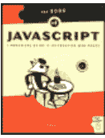

作者：Dave Thave

一本关于 JavaScript 过程的教程。

Dave Thave

Thave, Dave。

The book of JavaScript / Dave Thave。

厘米。

包含索引。

1. JavaScript（计算机编程语言）| 标题。

QA76.73.J39 T37 2000

005.2762–dc2 98-087069

# 献辞

我将这本书献给我生命中的第一批人。

谢谢爸爸妈妈，感谢你们逼着我成为一名工程师。

也感谢其他一切。

# 致谢

这本书确实是合作的成果。感谢 Nick Hoff 耐心地编辑我添加的散文，并给了我完成这项工作所需的各种“猛踢”；感谢 William Pollock 引导我写成书并帮助把握整体方向；感谢 Nadav Savio 让我的脚本真正运行；感谢 Karol Jurado 和 Gail Nelson 悉心校对细节；感谢 Amanda Staab 宣传此书。非常感谢我的爱人 Kirsten，宽容了我许多错过的周末和充满键盘敲击声的夜晚。

“书中提供的 JavaScript 示例非常实用且通俗易懂。”——Jim Heid，Thunder 会议主席

“Webmonkey.com 的这些教程非常精彩，让学习变得轻松。”——Evany Thomas，Webmonkey.com 执行编辑

“这是一个关于现代 JavaScript 的平实入门介绍，示例非常清晰。”——Michael Masumoto，金山州立大学媒体研究

# 前言

当我第一次学习 JavaScript 时，如果有人像 Thave 这样教我，我该有多幸运。这本书解释了如何工作，非常有趣。这是我读过的最好的 JavaScript 书，你会感到幸运。

祝 JavaScript 愉快！

Nadav Savoy

科学让事物运行起来。你只需要一个 Web 浏览器和一个像 SimpleText 或记事本这样的文本编辑器。

最后，JavaScript 是一门完整的编程语言，如果你想学习更多关于它的知识，它提供了一个极佳的入门。如果你对编程不感兴趣，也没关系。有很多地方——包括这本书及其附带的 CD-ROM——你都可以获得现成的代码并将其剪切粘贴到你的页面中。

## 这本书适合你吗？

本书假设你没有任何编程背景。即使你以前写过程序，你也会发现 JavaScript 中的新颖之处让你乐得其中。JavaScript 最好的地方之一是，你不需要成为一个超级极客就能立即在你的 Web 页面上开展工作。不过，你确实需要具备 HTML 的基本知识。

## 本书的目标

本书的主要目标是让你达到编写自己的 JavaScript 的水平。然而，同样重要的是阅读他人编写脚本的能力。JavaScript 是一门庞大的语言，你可以从其他脚本中学习成千上万的技巧。因此，一旦你读完这本书，你会发现查看 JavaScript 页面的源代码是增加知识的最佳方法。

接下来的每一章都包含了来自专业网站的 JavaScript 示例。你会发现编写脚本有很多种方法，有时网站的代码会挖掘出 JavaScript 中我在书中未涵盖的有趣角落。

除了学习编写自己的 JavaScript 和阅读他人的脚本，我还想学习去哪里寻找 JavaScript 的额外信息。学习新技术的最好地方是查看你发现的 Web 页面的源代码。一些 Web 网站提供免费的 JavaScript 脚本。将在过程中介绍其中一些，但这里有几个供你上手的良好示例：

- `http://www.js-planet.com`
- `http://developer.earthweb.com/directories/pages/dir.javascript.html`
- `http://www.javascript.com`

获取信息的另一个好地方是 JavaScript 参考书。《JavaScript 之书》是学习基础 JavaScript 和让你的 Web 网站交互化的主要教程。它是该语言的完整指南，如果你计划成为一名真正的 JavaScript 大师，它包含了 400 页介绍性内容无法涵盖的太多细节，我建议在读完这本书后，拿起 Flanagan 编写的《JavaScript: The Definitive Guide》（O'Reilly and Associates，1998）。Flanagan 书的最后 500 页不仅列出了每一个 JavaScript 命令，还告诉你这些命令在哪些浏览器中有效。

## JavaScript 能做什么？

JavaScript 可以通过多种方式为你的 Web 页面添加交互性。本书提供了许多 JavaScript 广泛能力的示例。以下两个示例说明了你可以用 JavaScript 做什么。

第一个示例（图 1-1）是一个闪烁的彩色方块网格。要获得完整效果，请访问 `http://hotwired.lycos.com/webmonkey/demo/96/35/index4a.html` 或附带的 CD-ROM（位于`章01/fig-1.html`），由著名的 Taylor 创建。很亮眼，不是吗？

在这个示例中，一个 JavaScript 函数每秒改变网格中随机选择的一个方块的颜色。

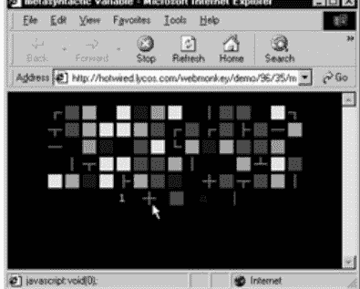

**图 1-1：** JavaScript 能力演示

鼠标悬停在方块下方五个图标（数字、加号、正方形、字母、水平线）之一上，会告诉页面网格出现的新图像显示什么类型的图像。例如，鼠标悬停在数字图标上会告诉 JavaScript 开始用许多 `1` 代替不同颜色的方块。此页面说明了你将在书中学习四个重要的 JavaScript 特性：如何更改 Web 页面上的图像、影响 Web 页面、为 Web 页面添加随机性，以及根据某人的操作动态地处理。

Taylor 的演示非常漂亮。JavaScript 最实用的应用之一——[图 1-2]（可在 CD-ROM 的`章/1-figure-2`中查看）——显示了一个有用的页面如何根据长度计算鱼的重量。输入长度和鱼的类型，JavaScript 就会计算鱼的重量。这个鱼演示了 JavaScript 读取访问者在表单中输入内容的能力、根据输入执行数学计算，并通过页面的其他部分显示结果来提供反馈。也许计算鱼的重量不是贷款还款（[第 7 章]）、测验评分（[第 10 章]）或验证计算月薪的技能，或者验证访问者提供了有效的电子邮件地址（[第 11 章]）最实用的用途。

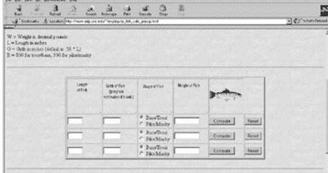

**图 1-2：** 鱼有多重？

这些只是 JavaScript 可以为你的网站添加的许多功能中的两个。每一章将至少涵盖一个应用。如果你想预览你将学到的内容，请阅读每章的第一页左右。

## JavaScript 的替代方案是什么？

其他几种编程语言也可以为 Web 页面添加交互性，但它们在重要方面都与 JavaScript 有不同。三个主要的替代方案是 CGI 脚本、Java 和 JavaScript。

## CGI 脚本

在 JavaScript 之前，CGI 脚本是让 Web 页面不仅仅是到其他 Web 页面的链接的唯一方法。CGI（通用网关接口）是一种语言，浏览器和程序可以使用它向 Web 服务器上的计算机程序发送消息。

CGI 脚本非常强大，但它们运行在服务器上，这限制了它们的用途。例如，JavaScript 可以在浏览器中运行（如鱼的重量计算），而 CGI 脚本在服务器上格式化答案。


**图 1-3：** CGI 脚本在服务器上运行，JavaScript 运行在浏览器中。

## Java

虽然 JavaScript 和 Java 名字相似，但它们不是一回事。Netscape 创建了 JavaScript，而 Sun Microsystems 编写了 Java。

## JavaScript 的局限性

是的，JavaScript 确实有局限性——但它们源于其为 Web 页面添加交互的主要目的。

### 无法与服务器通信

JavaScript 的缺点之一也是它的优势：它完全运行在浏览器中。另一方面，JavaScript 无法处理你可能需要的某些服务器任务。

# 入门

我们已经准备好开始了。任何文本编辑器都可以：Windows 上的记事本（Notepad）或 Word，以及 Macintosh 上的 SimpleText 是最简单的选择。Microsoft Word 或 Corel 的 WordPerfect 效果同样不错。你也可以使用如 BBEdit 或 HomeSite 等文本编辑器——这些是专为 HTML 和 JavaScript 设计的。

## 注意

务必将文档保存为纯文本格式，并以`.html`或`.htm`扩展名命名。除非你另行告诉 Microsoft Word 和 WordPerfect，否则这两个程序都会以浏览器无法读取的格式写入文档。如果你尝试打开一个页面时，浏览器中显示了许多你并未放入文档的奇异字符，请确保你已将其保存为纯文本。

某些用于构建网站的工具实际上会编写 JavaScript——例如，Macromedia 的 Dreamweaver 和 GoLive 5.0。当你需要编写自定义 JavaScript（如图片轮播器）时，这些工具工作得很好，而且你永远不想去修改它们。未修改的脚本往往会比实际需要的长得多，你可能会发现很难修改它以适应你的需求。

除非你需要一个工作方式与你购买的软件包中提供的完全相同的 JavaScript，否则通常最好是手写脚本。然而，当你想要快速制作原型时，这些工具做得非常出色。一旦你使用该工具确定了你希望页面如何运行，就可以返回并重写脚本了。

# JavaScript 在网页中的位置

现在让我们进入 JavaScript 的基础知识。图 1-4 显示了带有 JavaScript 的 HTML 页面的最精简骨架。编号的行是 JavaScript。在图 1-4 中，你可以在`<script language="JavaScript">`1 和`</script>`4 标签之间看到 JavaScript。除了第 4 章将涵盖的一个例外外，所有内容都位于这些标签之间。

## 注意

你不能在开启`<script>`和结束`</script>`标签之间包含任何 HTML。当你进入这些标签内部时，浏览器认为所有内容都是 JavaScript。如果它在里面看到 HTML，它就会感到困惑并给你一条错误消息。

JavaScript 标签可以放在 HTML 的`head`或`body`中。你把它们放在哪里大并不区别，尽管通常你最好尽可能将更多的 JavaScript 放在`head`中。这样你就不用在整个页面中寻找它了。

```html
<html>
<head>
<title>JavaScript Skeleton</title>
<1><script language="JavaScript">
<2 // JavaScript can go here!
<3 // But no HTML!
<4 ?></script>
</head>
<body>
<5><script language="JavaScript">
<6 // JavaScript can go here too!
<7 // But no HTML!
<8></script>
</body>
</html>
```

## 图 1-4：带有 JavaScript 的 HTML 页面

以双斜杠`//`开头的行是 JavaScript 注释。浏览器会忽略双斜杠之后的任何文本。注释是极其重要的，因为编程语言并不是自然语言。你编写的脚本在你编写时可能完全合乎逻辑，但几天后当你想要进行微小修改时，你可能会发现自己正努力弄清楚你第一次写了什么。

如果你更改了代码，你将省去尝试记忆在凌晨 2 点、在那种看似奇妙的咖啡因迷雾中写下那段怪代码时在想什么的烦恼。

## 处理对象浏览器

图 1-4 中的 JavaScript 骨架有一个小问题（除了它实际上并没有包含任何 JavaScript 之外的内容）：Netscape 不识别`<script>`标签 2.0 版本，因此只有早于此版本的 Netscape 浏览器识别该标签。

当浏览器看到它不理解的 HTML 标签时，它会忽略该标签。这通常是好事。然而，不理解 JavaScript 的浏览器会将你的 JavaScript 行作为文本写入浏览器。第 10 页的图 1-5 显示了 JavaScript 的情况。


```html
<html>
<head>
<title>JavaScript Skeleton</title>
<1><script language="JavaScript">
<2 // JavaScript can go here!
<3 // But no HTML!
<4 ?></script>
</head>
<body>
<5><script language="JavaScript">
<6 // JavaScript can go here too!
<7 // But no HTML!
<8></script>
</body>
</html>
```

## 图 1-4：带有 JavaScript 的 HTML 页面

以双斜杠 `//` 开头的行是 JavaScript 注释。浏览器会忽略双斜杠之后的任何文本。注释是极其重要的，因为编程语言并不是自然语言。你编写的脚本在编写时可能完全合乎逻辑，但几天后当你想要进行微小修改时，你可能会发现自己正努力弄清楚你第一次写了什么。如果你更改了代码，你将省去尝试记忆在凌晨 2 点、在那种看似奇妙的咖啡因迷雾中写下那段怪代码时在想什么的烦恼。

## 处理对象浏览器

图 1-4 中的 JavaScript 骨架有一个小问题（除了它实际上并没有包含任何 JavaScript 之外的内容）：Netscape 不识别 `<script>` 标签 2.0 版本，因此只有早于此版本的 Netscape 浏览器识别该标签。

当浏览器看到它不理解的 HTML 标签时，它会忽略该标签。这通常是好事。然而，不理解 JavaScript 的浏览器会将你的 JavaScript 行作为文本写入浏览器。第 10 页的图 1-5 显示了 JavaScript 的情况。

## 你的 JavaScript

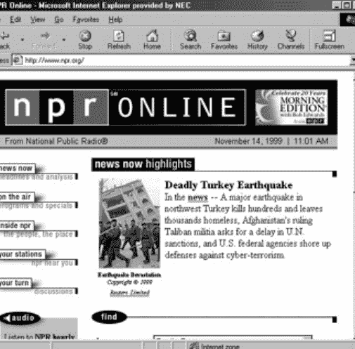

## 图 2-1：NPR 网站

NPR 并没有招募 Web 志愿者，而是使用 JavaScript 来确定当前时间并将其写入网页。动态向网页中写入 HTML 的能力是 JavaScript 最强大的特性之一。

为了理解 NPR 如何更新其页面上的日期和时间，你首先需要学习变量、字符串和函数。你在本章末尾的作业将是弄清楚 NPR 是如何更新时间的。

## 变量存储信息

回想你学习变量和方程的那些代数的日子。例如，如果 `x=2`、`y=3`，且 `z=x+y`，那么 `z=5`。在代数中，像 `x`、`y` 和 `z` 这样的变量占据了数字的位置。在 JavaScript 中，变量也存储信息。

### 语法

变量的语法（定义和使用变量的规则）与你学过的代数略有不同。图 2-2 通过一个简单的滑稽脚本展示了 JavaScript 中的变量语法，该脚本显示了一天有多少秒。

> 注意：图 2-2 并没有将 JavaScript 的结果写入网页——我将在图 2-3 中解释如何做到这一点。

```html
<html>
<head>
<title>一天有多少秒</title>
<script language="JavaScript">
<!-- 在旧版浏览器中隐藏我 -->
```

```javascript
var secs_per_minute = 60;
var minutes_per_hour = 60;
var hours_per_day = 24;
```

```javascript
var secs_per_day = seconds_per_minute * minutes_per_hour * hours_per_day;
// 结束隐藏内容 --
</script>
<head>
<body>
<h1>知道一天有多少秒吗</h1>
<h2>我不知道</h2>
</body>
</html>
```

**图 2-2：** 定义和使用变量

英语中有很多内容，让我们逐行分析。JavaScript 中的一条语句（statement）就像是英语中的一个句子，因此对 JavaScript 来说，“创建一个名为 `seconds_per_minute` 的变量，并将其值设置为 60。”注意它以分号结尾。

JavaScript 中的分号就像英语中的句号：标记语句的结束（例如，上面所示定义了一个变量）。当你看到更多语句时，你会发现 `var` 是第一次引入变量——无论你在脚本中使用该变量多少次，在第一次之后你都不需要再次使用它。

许多人不在代码中使用 `var`。虽然大多数浏览器在没有它的情况下也能运行，但在第一次使用变量时在它前面加上 `var` 总是个好主意（当我在第 6 章讨论你自己的函数时，你就会明白为什么了）。

## 变量命名

注意，给变量命名描述性的名称是个好习惯；这会让你的代码更容易理解。此外，无论你使用哪种编程语言，你 50% 的编码时间都花在寻找和消除错误上。这被称为调试——当变量具有描述性名称时，调试代码要容易得多。

## 变量命名规则

1. 初始字符必须是字母，但后续字符可以是数字、下划线或连字符。
2. 不允许空格。
3. 变量区分大小写，所以 `my_cat` 与 `My_Cat` 不同，而后者与 `mYCat` 也不同。为了避免任何潜在的大写问题，我对所有变量都使用小写，并用下划线（`_`）代替空格。

### 变量的算术运算

图 2-2 引入了一个名为 `seconds_per_day` 的新变量，并使用星号（`*`）将其设置为所有其他变量的积，即乘法。加号（`+`）表示加法，减号（`-`）表示减法，斜杠（`/`）表示除法，代表其他主要的数学函数。

## 继续

当浏览器完成计算时，它到达 `head` 中 JavaScript 的结尾，然后进入 HTML 的 `body` 部分。它看到了两行 HTML，宣布该页面知道一天有多少秒。

```html
<h1>知道一天有多少秒吗？</h1>
<h2>我知道</h2>
```

所以你有了一个知道一天有多少秒的页面。没什么大不了，对吧？如果我们至少告诉访问者答案是什么，不是更好吗？嗯，你可以这样做，而且这并不难。

## 在此立即写入：显示结果

JavaScript 使用 `write()` 函数向网页写入内容。第 18 页的图 2-3 显示了如何使用 `write()` 让你的访问者知道一天有多少秒。（新代码已加粗）。

## 图 2-3 的逐行分析

图 2-3 向网页写入了 `are` 这个词（只有引号之间的单词会显示）。现在不用担心所有的句号以及 `window` 和 `document` 到底是什么意思（我将在第 4 章讨论 JavaScript 时深入介绍这些主题）。

只需记住，如果你想向网页写入某些内容，请使用 `document.write("任何内容");`。如果你在文本周围没有加引号，那么就是 `document.write(seconds_per_day);`，JavaScript 将括号解释为一个变量，并将存储在变量中的任何内容（在这种情况下，是 `seconds_per_day`）写入网页（见第 18 页的图 2-4）。

如果你不小心让 JavaScript 写入一个你尚未定义的变量，就会得到一个 JavaScript 错误。

```html
<html>
<head>
<title>一天有多少秒</title>
```

```javascript
<script language="JavaScript">
<!-- 隐藏我 -->

var seconds_per_minute = 60;
var minutes_per_hour = 60;
var hours_per_day = 24;

var seconds_per_day = seconds_per_minute * minutes_per_hour * hours_per_day;
```

```javascript
// 结束隐藏内容 --

</script>
</head>

<body>
```

```html
<h1>我的计算结果显示 . . . </h1>
```

```javascript
<script language="JavaScript">
<!-- 隐藏我 -->
(1)window.document.write("there are ");
window.document.write(seconds_per_day);
window.document.write(" seconds in a day.");

<!-- 显示我 -->
</script>
</body>
</html>
```

**图 2-3：** 使用 `write()` 写入网页

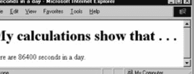

**图 2-4：** JavaScript 的计算

```javascript
window.document.write(whole_thing);

// show me --
</script>

</body>
</html>
```

**图 2-5：** 拼接字符串

## 关于函数的更多信息

变量允许存储信息，而函数用于处理信息。有时候括号里有内容，有时候则没有。所有函数都采用 `functionName()` 的形式。

你已经见过 JavaScript 的许多内置函数之一了。`window.document.write()` 将括号内的任何内容写入到 Web 页面。在深入研究日期函数之前，你需要先将数据写入你的 Web 页面，我想先和你聊聊两个有趣的函数，这样你就能掌握函数是如何运作的。

## `alert()` 函数

其中一个函数是 `alert()`，它会将一个字符串放入一个小小的公告框（也称为警告框）。图 2-6 展示了如何调用 `alert()`，图 2-7 显示了警告框的样子。

```html
<html>
<head>
<title>An Alert Box</title>

<script language="JavaScript">
<!-- hide me
alert("This page was written by thou!");
// show me --
</script>

<body>
<h1>To code, perchance to function/</h1>
</body>
</html>
```

**图 2-6：** 创建警告框

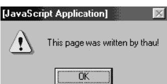

**图 2-7：** 警告框

访问者来到页面时看到的第一个内容是一个警告框，宣布由我撰写了这个页面。当警告框显示在屏幕上时，浏览器会停止任何操作。点击警告框中的 OK，它就会消失，并允许浏览器完成 Web 页面的绘制。在这种情况下，意味着在页面上写了“to code, perchance to function”这些词。

你的 JavaScript 工作不正常时，`alert()` 函数非常有用。假设你输入了图 2-5 中的内容，但当你运行时，一年有 0 秒，而不是 86400 秒。你可以使用 `alert()` 在乘法发生之前查看不同变量是如何设置的。

图 2-8 中的脚本包含一个错误，导致脚本显示一年有 `undefined`（未定义）秒，同时还有 `alert()` 函数语句可以告诉你为什么会发生这个问题。

```html
<html>
<head>
<title>Seconds in a Day</title>

<script language="JavaScript">
<!-- hide me from observers

var seconds_per_minute = 60;
var minutes_per_hour = 60;
var hours_per_day = 24;
alert("seconds per minute: " + seconds_per_minute);
alert("minutes per hour: " + minutes_per_hour);
alert("hours per day: " + hours_per_day);
var seconds_per_day = seconds_per_minute * minutes_per_hour * hours_per_day;

// end hiding stuff --
</script>
</head>
<body>
<h1><h1>My calculations show that . . . /</h1>
<script language="JavaScript">
<!-- hide me

var first_part = "there are ";
var last_part = " seconds in a day.";
var whole_thing = first_part + seconds_per_day + last_part;
window.document.write(whole_thing);

// show me -->
</script>

</body>
</html>
```

**图 2-8：** 使用 `alert()` 找出错误

此脚本的问题在于 `Hours_per_day`。注意 `Hours_per_day` 的首字母被无意中大写了。这导致脚本运行异常，因为 `seconds_per_day` 正在将变量 `hours_per_day` 与其他数字相乘——因为 `hours_per_day` 未被设置，JavaScript 认为它的值是 0 或 `undefined`，取决于你的浏览器。

乘以 0 之后，脚本显示一天有 0 秒。对于 `Hours_per_day` 为 `undefined` 的其他情况也是如此。乘以一个未定义的值将导致结果为 `undefined`。

这个脚本很短，很容易发现错误。在较长的脚本中，有时很难找出哪里错了。我在这个示例中添加了 `alert()` 和 `alert()` 来帮助诊断问题。每个 `alert()` 都会将一个变量放入警告框中。第一个 `alert()` 会显示 `seconds_per_day` 为：0。第二个 `alert()` 会显示 `hours_per_day:`，或者取决于你的浏览器，它根本不会出现。

无论如何，你都会知道 `hours_per_day` 变量存在问题。如果你无法通过阅读脚本发现错误，你会发现这类信息非常有价值。`alert()` 是一个非常有用的工具。

## `prompt()` 函数

另一个内置函数 `prompt()` 向你的访问者询问某些信息，并将变量设置为访问者输入的任何内容。第 24 页的图 2-9 展示了你如何使用 `prompt()` 来写信。

```html
<html>

<head>
<title>A Form Letter</title>

<script language="JavaScript">

<!-- hide me -->
```

```javascript
var the_name = prompt("What's your name?", "put your name here");

// show me -->
</script>
</head>
<body>
<h1>Dear
```

```html
<script language="JavaScript">
<!-- hide me -->
```

```javascript
document.write(the_name);

// show me -->
<script>
```

```html
,</h1>
</body>
</html>
```

**图 2-9：** `prompt()` 有两个字符串：`"What's your name?"` 和 `"put your name here"`。如果你运行图 2-9 中的代码，你会看到一个类似于第 24 页图 2-10 的提示框。输入你的名字并点击 OK，页面响应：“`<put name here>`，感谢来到我的 Web 页面！”


**图 2-10：** 访问者输入名字的框上方文本（`"What's your name?"`）是 `prompt` 函数的第一行；框内的文本（`"put name here"`）是第二行。

如果你不想在框内显示任何内容，在第二行留两个引号（`""`）以保持空白：

```javascript
var name = prompt("What your name,");
```

如果你查看 JavaScript（从 2 开始），你会看到如何使用变量 `name`。首先使用普通 HTML 写入页面，然后继续。`prompt()` 函数允许访问者提供信息。在这种情况下，如果用户在图 2-10 的提示框中输入名字，你的脚本就可以通过调用它使用信息。

## 参数

括号内的单词被称为参数。`document.write()` 函数需要一个参数来写入页面。`prompt()` 函数需要两个参数：一个写入框上方的字符串和一个写入框内的字符串。

参数是你可以控制的函数的唯一方面。对于 `prompt()` 函数，你无法改变框的颜色、按钮的数量或其他任何内容。你所做的就是改变它的参数。

## 将日期写入页面

现在你已经知道了变量和函数，可以将日期打印到你的 Web 页面。为此，你必须首先使用 JavaScript 检查访问者的本地时间：

```javascript
var now = new Date();
```

这一行的第一部分 `var now =` 应该很熟悉。第二部分 `new Date()`：它创建一个对象。

对象存储需要多个位的数据，例如时间中的某个时刻。例如，你需要一个对象来描述 2000 年 11 月 7 日星期二下午 2:30，因为它需要不同的位：时间、日期、月份，以及用户本地时间相对于格林威治时间的表示等。

你可以想象，处理对象比处理数字或字符串要复杂一点。由于日期非常丰富，JavaScript 有内置日期。当你想要用户的当前日期时间时，使用 `Date()` 让 JavaScript 创建一个包含正确信息的日期对象。


> 注意：必须将 `Date` 中的 `D` 大写，告诉 JavaScript 使用内置日期对象。如果你不大写，JavaScript 将不知道你正尝试创建什么种对象，并将收到一个错误消息。

## 内置日期函数

现在 JavaScript 已创建了你的日期对象，让我们从中提取 JavaScript 的内置日期函数。要提取当前年份，使用日期对象的：

```javascript
var now = new Date();
var year = now.getFullYear();
```

## 日期时间方法

在上面的代码中，变量 `now` 是一个日期对象，函数 `getFullYear()` 是日期对象的方法。日期方法从对象获取日期信息。将 `getFullYear()` 方法应用于变量 `now` 中的日期，如下：

```javascript
now.getFullYear();
```

表 2-1 列出了常用的方法（可以在附录 B 中找到日期方法的完整列表）。

## 表 2-1: 常用的日期和时间方法

| 名称 | 描述 |
|---|---|
| `getDate()` | 1 到 31 的整数日期 |
| `getDay()` | 星期几的整数，0 是星期日，1 是星期一 |
| `getHours()` | 0 到 23 之间的整数小时 |
| `getMinutes()` | 0 到 59 之间的整数分钟 |
| `getMonth()` | 0 到 11 之间的整数月份，0 是一月，11 是十二月 |
| `getSeconds()` | 0 到 59 之间的整数秒 |
| `getTime()` | 毫秒级当前时间，0 是 1970 年 1 月 1 日 00:00:00 |
| `getYear()` | 年份，但格式随浏览器不同：某些 Netscape 版本（如 Mac 上的 Netscape 4.0）始终返回当前年份 1900。所以如果是 2010 年，`getYear()` 返回 110。其他版本的 Netscape 返回完整的四位年份，除非年份是在 1900 年，那种情况下它们返回最后两位。在 Microsoft Internet Explorer 中，如果年份大于 1999 年或更早，`getYear()` 返回完整的四位年份 |

### 表格 2-1: 常用日期和时间方法

| 名称 | 描述 |
| --- | --- |
| | 如果年份在 1900 到 1999 年之间，它返回最后两位数字。你不喜欢这吗？所有这些奇怪的现象发生是因为构建浏览器的人不知道如何处理 2000 年的问题。 |

#### 注意事项

注意 `getMonth()` 返回的是 0 到 11 之间的数字；如果你想显示访问者的日期，请在使用 `getMonth()` 之后将月份加 1（参见图 2-11）。JavaScript 也遭受了千年虫（Y2K）问题的影响：Internet Explorer 和 Netscape 都以奇怪的方式处理年份。1995 年创建的图表不会有 Y2K 问题，但软件开发人员的方法很奇怪。我将向你展示如何修复这个问题。

编写代码：

为了获取日、月、年，我们使用 `getDate()` 和 `getMonth()`。

第 28 页的图 2-11 显示了将月份和日期写入 Web 页面的完整代码。

如果你在 6 月 16 日运行图 2-11 中的代码，它会显示“今天的日期是 16”。这个例子中有几个有趣的地方。调整月份以从计算机时钟获取日期，然后使用适当的日期获取日和月，给月份加 1 是因为 `getMonth()` 的 1 月是 0。

通过构建我们正要在页面主体中打印的字符串来获取字符串。错误的做法是：

```javascript
var the_date = "_month/the_day";
```

如果你在这里写这段代码，你将得到一行显示“今天的当前日期是 _month/ _day”的字。为什么 JavaScript 不在引号之外使用变量，并使用 (+) 符号将所有内容组合在一起；

```javascript
var the_date = _month + "/" + _day;
```

确保你按照正确的顺序编写 JavaScript 和 HTML。在图 2-11 中，HTML 行“今天的日期是：”位于实际写入该内容的 JavaScript 之前，因为浏览器先写入文本，然后执行 JavaScript。对于 JavaScript 和 HTML 来说，浏览器是从页面顶部开始渲染的。我将 `document.write()` 放在了 `body` 中，这样实际信息将出现在“今天的日期是:”之后。我将剩下的 JavaScript 放在了 `head` 中以保持 HTML 的整洁。注意，图 2-11 中的代码使用的是 `document.write()` 而不是 `window.document.write()`。通常情况下，在 `document` 之前省略 `window` 和第一个点是可以的。在未来的章节中，我会告诉你什么时候必须添加 `window`。你都明白了吗？很好。现在来看看 NPR 将日期写入 Web 页面的稍微复杂的方法。

```html
<html>
<head>
<title>写入日期</title>
<script language="JavaScript">
<!-- 隐藏我 -->
// 获取日期信息
(1) var today = new Date();
(2) var day = today.getDate();
(3) var month = today.getMonth();
// 修正从零开始的月份
(4) the_month = month + 1;
// 创建要打印的字符串
(5) var whole_date = the_month + "/" + day;
// 显示我 -->
</script>
</head>
<body>
今天的日期是：
<script language="JavaScript">
<!-- 隐藏我 -->
// 写入日期
document.write(whole_date);
// 显示我 -->
</script>
</body>
</html>
```

图 2-11：获取今天的日期和月份

NPR 如何实现

第 29 页的图 2-12 显示了 NPR 如何向其页面写入日期。看看你是否弄明白发生了什么，然后看我的解释。因为这个脚本有点长，我只包含了处理打印日期的代码（这部分代码无法独立运行）；我还添加了注释以使其更清晰。

```javascript
<script language="JavaScript">
// 获取日期信息
(1) date = new Date();
(2) month = new String;
(3) day = new String;
(4) year = new String;
(5) month = date.getMonth();
(6) day = date.getDate();
// 这是 y2k 修复器——不用担心它是如何工作的，
// 如果你想在脚本中使用它，可以剪切粘贴。
(7) function y2k(number) {
(8) return (year < 1000) ? year + 1900 : number;
(9) }
// 使用该函数获取年份并修复 y2k 漏洞。
(10) year = y2k(date.getFullYear());
// 将月份转换为单词——这样零变成一月。
// 注意我将月份 3 缩减到 10 以节省空间。
// 如果你想运行这个示例，你必须在省略号处放入这些……
(11) if (month == "0")
month = "January";
else_if (month == "1")
month = "February";
else_if (month == "2")
month = "March";
...
(11) if (month == "11")
month = "December";
// 写入信息
(12) document.write(month + " " + day);
</script>
```

图 2-12：NPR 的做法

幸运的是，你可以使用 JavaScript 发现访问者正在使用什么浏览器，并利用这些信息提供适用于该特定浏览器的内容。

本章涵盖了在提供特定浏览器页面时需要理解的三个主题：

- 如何发现访问者正在使用的浏览器。
- 如何自动将访问者重定向到其他页面。
- 根据访问者使用的浏览器，将访问者发送到你指定的页面。

## Netboost.com：浏览器检测的真实世界示例

在进入浏览器检测和重定向的细节之前，让我们来看一个真实示例。

Netboost (`www.netboost.com`) 是一家向高端系统管理员销售软件的公司，它有一个网站（如图 3-1 所示），使用了一些巧妙的 JavaScript 和动态 HTML。遗憾的是，它只在 Internet Explorer 4.0 中运行，因此 Netboost 需要将使用旧浏览器的访问者重定向到一个不包含问题代码的页面。Netboost 使用 JavaScript 来确定访问者是什么浏览器，并在必要时将访问者重定向到相应的页面。

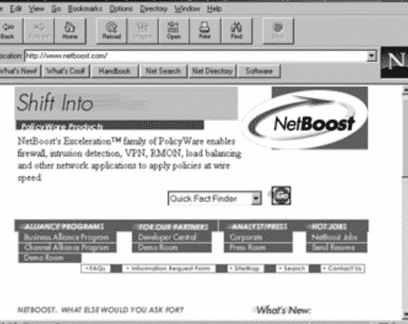

图 3-1：Netboost 的主页

如果你访问 Netscape，它会重定向到一个名为 `index.html` 的网页，该页面专门为 Netscape 浏览器设计（图 3-2）。如果你使用的 MSIE 版本低于 4.0，它会将你重定向到一个名为 `ie3index.html` 的网页。

如果你不懂这是如何运作的，不要担心——本章的其余部分将解释让 Netboost 网站施魔术的代码。

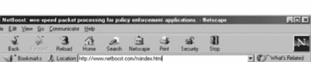

## 进入线速时代

NetBoost

Netscape 的 PolicyShare 家族允许频繁的检查、加密、SSL 负载均衡和其他网络应用能够在需要的地方应用策略。

快速快速过滤器

| ALLANCE-PROGRAMS | FOR-CUSTOMER-PARTNERS | ANALYZED-FREE | NOT-JOADS |
|---|---|---|---|
| FAQs | 信息请求表单 | 注册 | 联系我们 |

NETBOOST.COM

你的浏览器还会问你什么？

扳手直接引导；我们不灵活，你才是

网络行业的法律。

Netscape 新闻

在以下关注：

NetscapeWorld.com/Adianta

Internet:13-17

dois? #157

我们提供网络行业的解决方案

**图 3-2：Netscape 的重定向**

将重定向到不同的页面只是处理浏览器差异的一种方法。当我们在第 4 章讨论图像整形时，我们将学习其他方法。

根据用户使用的浏览器将人们发送到不同页面的能力取决于你在哪里使用。首先，你必须确定将他们重定向到哪里。最后，你才知道如何重定向他们。

让我们先讨论如何判断访问者使用的是什么浏览器。

## 浏览器检测

要确定浏览器的身份，你需要知道制造浏览器的公司和版本号。

这一行

```javascript
var browser_name = navigator.appName;
```

决定了浏览器的制造者。如果浏览器是 Netscape，`browser_name` 等于 `"Netscape"`。如果是 Microsoft Internet Explorer，`browser_name` 等于 `"Microsoft Internet Explorer"`。每个启用 JavaScript 的浏览器都有 `navigator.appName` 变量。如果你使用 `navigator.appName="Opera"`。

一旦你确定了是哪个浏览器，就必须确定它的版本。关键是 `navigator.appVersion`。遗憾的是，`navigator.appVersion` 不仅仅是一个数字，而是一个随浏览器变化的字符串。例如，Macintosh 上的 Netscape 2.02 将 `navigator.appVersion` 设置为 `"2.02 (Macintosh; PPC 代表 PowerPC，也代表国际版本，这意味着浏览器没有内置美国贸易秘密)"`。在 Windows 95 下运行的 Internet Explorer 4.0，其 `navigator.appVersion` 看起来所示：“4.0 (compatible; MSIE 4.0; Windows 95)”。讽刺的是——处理浏览器不一致的方法本身在浏览器之间是不一致的。使用这些 `navigator.appVersion` 字符串配合 `parseFloat()` 命令，该命令会查看字符串并获取第一个类似于浮点数的数字（包含小数点的数字）。在 `navigator.appVersion` 的情况下，该数字就是浏览器的版本[1]。因此，这一行

```javascript
var browser_version = parseFloat(navigator.appVersion);
```

将 `browser_version` 设置为访问者浏览器的数字。

`navigator.appName` 和 `navigator.appVersion` 共同告诉你在使用什么浏览器。尝试在你自己的浏览器上运行图 3-3 中的脚本。

```javascript
<script language="JavaScript">
<!-- 对旧版浏览器隐藏我 -->

var browser_name = navigator.appName;
var browser_version = parseFloat(navigator.appVersion);
document.write("you're " + browser_name + " version " + 
browser_version);
<!-- 显示我 -->
</script>
```

# 图 3-3：在不产生 `parseFloat()` 异常的情况下查找浏览器数字

> [1] 无论如何，这个简单的技巧似乎有一个例外。MSI 5.0 的 `navigator.appVersion` 字符串为 "4.0 (compatible; MSI 5.0; Windows 95)。”如果你使用 `parseFloat()` 技巧，你的 JavaScript 将认为 5.0 是版本。

---

处理浏览器不一致的方法本身在浏览器之间是不一致的。使用这些 `navigator.appVersion` 字符串配合 `parseFloat()` 命令，该命令会查看字符串并获取第一个类似于浮点数的数字（包含小数点的数字）。在 `navigator.appVersion` 的情况下，该数字就是浏览器的版本[1]。因此，这一行

```javascript
var browser_version = parseFloat(navigator.appVersion);
```

将 `browser_version` 设置为访问者浏览器的数字。

---

## 重定向到不同页面

将重定向到不同的页面只是处理浏览器差异的一种方法。当我们在第 4 章讨论图像整形时，我们将学习其他方法。

根据用户使用的浏览器将人们发送到不同页面的能力取决于你在哪里使用。首先，你必须确定将他们重定向到哪里。最后，你才知道如何重定向他们。

## 重定向到其他页面

将访问者发送到你指定的页面，取决于她或他使用的浏览器。

---

如果你访问 Netscape，它会重定向到一个名为 `index.html` 的网页，该页面专门为 Netscape 浏览器设计（图 3-2）。如果你使用的 MSIE 版本低于 4.0，它会将你重定向到一个名为 `ie3index.html` 的网页。

如果你不懂这是如何运作的，不要担心——本章的其余部分将解释让 Netboost 网站施魔术的代码。

---

浏览器检测

要确定浏览器的身份，你需要知道制造浏览器的公司和版本号。

这一行

```javascript
var browser_name = navigator.appName;
```

决定了浏览器的制造者。如果浏览器是 Netscape，`browser_name` 等于 `"Netscape"`。如果是 Microsoft Internet Explorer，`browser_name` 等于 `"Microsoft Internet Explorer"`。每个启用 JavaScript 的浏览器都有 `navigator.appName` 变量。如果你使用 `navigator.appName="Opera"`。

一旦你确定了是哪个浏览器，就必须确定它的版本。关键是 `navigator.appVersion`。遗憾的是，`navigator.appVersion` 不仅仅是一个数字，而是一个随浏览器变化的字符串。例如，Macintosh 上的 Netscape 2.02 将 `navigator.appVersion` 设置为 `"2.02 (Macintosh; PPC 代表 PowerPC，也代表国际版本，这意味着浏览器没有内置美国贸易秘密)"`。在 Windows 95 下运行的 Internet Explorer 4.0，其 `navigator.appVersion` 看起来所示：“4.0 (compatible; MSIE 4.0; Windows 95)”。讽刺的是——处理浏览器不一致的方法本身在浏览器之间是不一致的。使用这些 `navigator.appVersion` 字符串配合 `parseFloat()` 命令，该命令会查看字符串并获取第一个类似于浮点数的数字（包含小数点的数字）。在 `navigator.appVersion` 的情况下，该数字就是浏览器的版本[1]。因此，这一行

```javascript
var browser_version = parseFloat(navigator.appVersion);
```

将 `browser_version` 设置为访问者浏览器的数字。

`navigator.appName` 和 `navigator.appVersion` 共同告诉你在使用什么浏览器。尝试在你自己的浏览器上运行图 3-3 中的脚本。


```html
<script language="JavaScript">
<!-- 对旧版浏览器隐藏我 -->

var browser_name = navigator.appName;
var browser_version = parseFloat(navigator.appVersion);
document.write("you're " + browser_name + " version " +
browser_version);
<!-- 显示我 -->
</script>
```

## 图 3-3：在不产生 `parseFloat()` 异常的情况下查找浏览器数字

> [1] 无论如何，这个简单的技巧似乎有一个例外。MSI 5.0 的 `navigator.appVersion` 字符串为 "4.0 (compatible; MSI 5.0; Windows 95)。”如果你使用 `parseFloat()` 技巧，你的 JavaScript 将认为 5.0 是版本。

## `if` 语句

现在你知道访问者使用的是什么浏览器以及如何重定向他们。接下来，你需要根据她或他使用的浏览器来重定向他们。假设她的生日是 8 月 6 日——你可能会写成这样：

在 JavaScript 中，`if` 语句看起来所示：

```javascript
if (navigator.appName == "Netscape") {
  // 将他们发送到 netscape 页面
}
```

## 布尔值

`if` 括号中的语句是一个布尔值——一个真即假的值。许多类型的布尔值。表 3-1 列出了你将使用的主要类型。

### 表 3-1：布尔值

| 测试 | 含义 | 示例（这些都是真的） |
|---|---|---|
| `<` | 小于 | `1 < 3` |
| `>` | 大于 | `3 > 1` |
| `==` | 相同（相等） | `"happy" == "happy"`，`3 == 3` |
| `!=` | 不同（不等于） | `"happy" != "crabby"`，`3 != 2` |
| `<=` | 小于等于 | `2 <= 3`，`2 <= 2` |
| `>=` | 大于等于 | `3 >= 1`，`3 >= 1` |

## 在 `if` 语句中使用两个等号

当你使用两个等号时，你想让 JavaScript 在 `if` 语句中查看事物是否相同。在 `if` 语句中不小心使用一个等号可能会导致令人难以置的编程错误。如果你不小心使用一个等号，JavaScript 会认为你想将等号左侧的变量设置为等号右侧的任何值，它会表现得好像测试结果始终为真。

这是一个导致这种错误的示例。假设你想编写一个 JavaScript，在你母亲生日时在你的网页上显示“生日快乐，妈妈！”假设她的生日是 8 月 6 日——你可能会写成像图 3-4（其中包含了可怕的错误）。

```javascript
if (month = 7) // 记住一月是月份 0，所以八月是 7

<script language="JavaScript">
<!-- 对旧版浏览器隐藏我 -->

var today = new Date();

var day = today.getDate();

var month = today.getMonth();

if (month = 7)
{
  if (day = 6)
  {
    document.write("<h1>Happy Birthday, Mom!</h1>");
  }
}
</script>
```

```javascript
}

// show me -->

</script>
```

**图 3-4：** 妈妈的脚本——损坏版本

如果你尝试运行这个脚本，你会发现它总会在网页上打印“Happy Birthday, Mom!”，这对妈妈来说很棒，但可能不是你想要的。脚本的开头是正确的。

`var month = todayMonth();`

它将变量 `month` 设置为当前的月份。如果你在三月运行该脚本，它会将值设置为 7。该脚本没有正常工作，因为它移动到了大括号，在那里它发现它是 true（真）。

在这里，JavaScript 看到的是一个等号，认为你想将变量 `month` 设置为 true。如果另一个 `if-then` 语句告诉它将变量 `day` 设置为值 6。它确实设置了，然后移动到第二组大括号。它看到应该写入 `<<h1>Happy Birthday, Mom!</h1>`，于是它就写了——每当有人访问页面时都是如此。

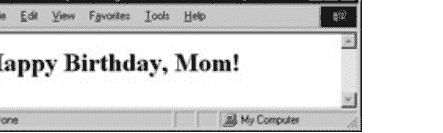

**图 3-5：** 妈妈的生日祝福

通过在编写 `if-then` 子句时想着“等于”（is the same as）来记住一个和两个等号之间的区别，并记住“相等”翻译为两个等号。

## 嵌套

[图 3-4](#) 是我使用的第一个嵌套示例——在一个 `if-then` 子句内部嵌套另一个。虽然嵌套 `if-then` 子句是有意义的，但如果你开始达到三层或更多深度，事情就会变得混乱。尝试编写你的代码，使其深度不超过两层。

## `if-else` 语句

`if-then` 语句有几种高级版本。第一个是 `if-then-else` 语句：

```javascript
if (navigator.appName == "Netscape")
{
  // 将他们发送到针对 Netscape 的页面
  window.location = "netscape.html";
}
else
{
  // 将他们发送到 Microsoft Internet Explorer 页面
  window.location = "msie.html";
}
```

如果你将 `else` 读作“否则”（otherwise），这段代码在英语中读起来非常顺畅：“如果他们使用的是 Netscape……”

## `if-then-else-if` 语句

上面的代码假设世界上只有两个浏览器厂商，但实际上有多个。我们可以通过 `if-then-else` 语句来解决这个问题，将使用 MSIE 或 Netscape 浏览器的访问者发送到 `unknown_browser.html`。

```javascript
if (navigator.appName == "Netscape")
{
  // 将他们发送到针对 Netscape 定制的页面
  window.location = "netscape.html";
}
else if (navigator.appName == "Microsoft Internet Explorer")
{
  // 将他们发送到 Microsoft Internet Explorer 页面
  window.location = "msie.html";
}
else
{
  // 将他们发送到默认页面
  window.location = "unknown_browser.html";
}
```

这段代码在英语中的读法是：“如果他们使用的是 Netscape，将他们发送到 `msie.html`；如果他们使用的是 Microsoft Internet Explorer，将他们发送到 `msie.html`。否则，将他们发送到 `unknown_browser.html`。”

## `or` 和 `and` 运算符

我们目前为止看到的 `if` 语句非常简单。然而，你可能想为 `if-then` 语句添加更多条件（例如，“如果 Joe 在读高中且没有做作业，告诉他去干工作”）。要向 `if-then` 语句添加更多条件，请使用 `or` 和 `and` 运算符。

### `or`

假设你想根据访问你网站的人的身份，为他们提供不同的祝福。你可以像图 3-6 所示，使用提示框（prompt box）来询问访问者的名字，并使用 `if-then` 语句来决定给予何种祝福。


```javascript
<script language="JavaScript">

<!-- 在旧浏览器中隐藏我 -->

var_name = prompt("what's your name?", "");

if (the_name == "thau")
{
  document.write("Welcome back, thau! Long time no see!");
}
else
{
  document.write("Greetings, " + the_name + ". Good to see you.");
}
```

```javascript
// show -->

<script>
```

## 图 3-6：使用提示框询问访问者的名字


## 图 3-7：询问访问者名字的提示框

这个示例用“Welcome back, thau! Long time no see!”（图 3-8）问候你，用“Greetings, <name>. Good to see you.”问候其他人。如果你想以问候 thau 的方式问候其他人，可以使用图 3-9 所示的一系列 `if-then` 语句。

- Greetings - Microsoft Internet Explorer


## 图 3-8：thau 的祝福

```javascript
if (the_name == "thau")
{
  document.write("Welcome back, thau! Long time no see!");
}
else if (the_name == "dave")
{
  document.write("Welcome back, dave! Long time no see!");
}
else if (the_name == "pugsly")
{
  document.write("Welcome back, pugly! Long time no see!");
}
else if (the_name == "gomez")
{
  document.write("Welcome back, goomez! Long time no see!");
}
else
{
  document.write("Greetings, " + the_name + ". Good to see you.");
}
```

**图 3-9：** 使用 `if-then` 语句实现的个性化祝福

这种方法可行，但如你所见，这非常浪费。你重复了四次 `document.write()` 行。我们真正想表达的是：“如果 `the_name` 是 thau，或者 dave，或者 pugly，或者 goomez，就显示‘Long time no see’。”这就是 `or` 运算符派上用场的地方。图 3-10 展示了 `or` 的用法：

```javascript
if ((the_name == "thau") || (the_name == "dave") ||
(the_name == "pugsly") || (the_name == "gomez"))
{
  document.write("Welcome back, " + the_name + "! Long time no see!");
}
```

### 图 3-10：`or` 运算符

两个竖线（`||`）通常位于反斜杠（`\`）键上方。每个布尔测试都有自己的括号，这并不是必须的。但为四个布尔测试加上括号是必要的，为了可读性，加上这些括号是个好习惯。

### `and`

另一个重要的运算符是 `and`，由两个和（`&&`）表示。图 3-11 展示了该运算符的用法：

```javascript
var age = prompt("how old are you?", "");

var drinking = prompt("are you drinking?", "yes");

if (age < 21 && drinking == "yes")
{
  document.write("No drinking!");
}
else
{
  document.write("Enjoy!");
}
```

### 图 3-11：`and` 运算符

两个竖线（`||`）通常位于反斜杠（`\`）键上方。每个布尔测试都有自己的括号，这并不是必须的。但为四个布尔测试加上括号是必要的，为了可读性，加上这些括号是个好习惯。

```javascript
var browser_name = navigator.appName;
var version = parseFloat(navigator.appVersion);
```

```javascript
if (browser_name == "Netscape")
{
  window.location = "index.html";
}
else if ((browser_name == "Microsoft Internet Explorer") &&
         (version >= 3) &&
         (version < 4))
{
  window.location = "ie3index.html";
}
```

```javascript
// end hide --
</script>
```

**图 3-15：** 我版本的 Netboost 重定向脚本

首先，我使用 `window.location` 而不是 `document.location.href` 来重定向。如前所述，并不是所有浏览器都支持 `document.location.href`。

脚本之间的第二个区别是我删除了 Netboost 脚本中两个混淆的变量：`version` 和 `browser`。在那个脚本中，如果访问者的浏览器是 4 或更高版本，`version` 为 n4；`version` 为 n3 时，它还有一个名为 `browserVer` 的变量，包含了浏览器版本，因此另一个存储相同信息的变量是冗余的。

`browser` 变量也是冗余的，所以我把它们全部掉了。这些更改使得脚本更短且稍微更容易理解。

## 总结

这里是你应该从这一章中记住的内容：

- `navigator.appName`
- `navigator.appVersion`
- `if-then` 语句
- `if-else` 语句
- `if-then-else-if` 语句
- 如何将访问者重定向到其他 Web 页面

你都明白了吗？如果是，这里有一个作业要给你。

## 作业

编写一个 Web 页面询问访问者的姓名。如果访问者是你喜欢的人，将其引导到你最喜欢的页面。如果是你不认识的人，将访问者送到另一个页面。

# 第 4 章：悬停效果（Rollovers）：每个人喜欢的 JavaScript 技巧

## 概述

你已经见过百万次悬停效果了。你鼠标悬停在图片上，图片发生了变化。鼠标移开，图片恢复原始状态。悬停效果是让你的网站更具互动性的简单方法。

本章将通过以下方法创建一个悬停效果：

- 告诉 JavaScript 当访问者移动到图片上时交换图片。
- 告诉 JavaScript 要交换哪一张。
- 用新图片替换旧图片。

我还将教你一种检测访问者使用方式的新方法。

公民自由联盟（Civil Liberties Union）在 `www.acu.org` 有一个相对简单且不常见的悬停实现（图 4-1）。如果你鼠标悬停在“问题（Issues）”图片上，图片旁边会出现一个复选框（图 4-2）。鼠标悬停在左列，那些图片也会变化（见第 52 页的图 4-3）。


**图 4-2：** 编写悬停效果的多种方法

有很多编写悬停效果的方法。由于悬停效果在 2.0 浏览器中无法正常工作，创建它们涉及到浏览器检测，因此在本章中你将学习更多针对访问者浏览器调整 JavaScript 方法。

## 触发事件

到目前为止，我们看到的所有 JavaScript 在 Web 页面加载时触发。但 JavaScript 也可以是**事件驱动的**。

事件驱动 JavaScript 等待访问者执行特定操作（例如悬停在图片上），并做出响应。编写事件驱动 JavaScript 的关键在于了解事件以及如何使用。

## 事件类型

通过 JavaScript，Web 页面的不同部分可以检测不同的事件。例如，下拉菜单可以知道它何时改变（见第 7 章）、何时关闭（见第 5 章），以及访问者何时点击它。在本章中我将关注链接。


链接可以检测三种类型的事件：点击、鼠标悬停和鼠标移开，所有的捕捉方式都是相同的。

## `onClick` 事件

图 4-4 显示了访问者点击后调用警报的基本链接格式。

在 JavaScript 之前：

```html
<a href="http://www.acu.org">访问 ACLU 网站</a>
```

在 JavaScript 之后：

```html
<a href="http://www.acu.org" onclick="alert('访问 ACLU!');">访问 ACLU 网站</a>
```

### 图 4-4：一个调用警报的链接


尝试将带有`onClick`属性的链接放入你的 Web 页面中。当你点击链接时，应该弹出一个警报框并显示“访问 ACLU！”（图 4-5）。当你点击框上的 OK 时，页面应该加载 ACLU 网站。


图 4-5：事件驱动的“访问 ACLU！”警报框

注意，除了添加`onClick`，这个增强链接几乎像

## `mouseOver`和`mouseOut`

链接可以检测三种类型的事件：点击、鼠标悬停和鼠标移开，所有的捕捉方式都是相同的。

**图 4-2：** 编写悬停效果的多种方法

有很多编写悬停效果的方法。由于悬停效果在 2.0 浏览器中无法正常工作，创建它们涉及到浏览器检测，因此在本章中你将学习更多针对访问者浏览器调整 JavaScript 方法。

**图 4-2：** 编写悬停效果的多种方法

有很多编写悬停效果的方法。由于悬停效果在 2.0 浏览器中无法正常工作，创建它们涉及到浏览器检测，因此在本章中你将学习更多针对访问者浏览器调整 JavaScript 方法。

**图 4-2：** 编写悬停效果的多种方法

有很多编写悬停效果的方法。由于悬停效果在 2.0 浏览器中无法正常工作，创建它们涉及到浏览器检测，因此在本章中你将学习更多针对访问者浏览器调整 JavaScript 方法。

**图 4-2：** 编写悬停效果的多种方法

有很多编写悬停效果的方法。由于悬停效果在 2.0 浏览器中无法正常工作，创建它们涉及到浏览器检测，因此在本章中你将学习更多针对访问者浏览器调整 JavaScript 方法。

**图 4-2：** 编写悬停效果的多种方法

有很多编写悬停效果的方法。由于悬停效果在 2.0 浏览器中无法正常工作，创建它们涉及到浏览器检测，因此在本章中你将学习更多针对访问者浏览器调整 JavaScript 方法。

（注：根据逻辑流继续）

## 将链接链接到无处

当你点击此链接时，提示框询问你是否想将背景更改为红色或蓝色。当你输入响应时，背景会变为。事实上，你在提示框中输入任何你想要的内容，你的浏览器都会尝试猜测颜色。

## 交换图片

使用 JavaScript，你可以交换或切换 Web 页面上的图片，让按钮亮起，图片和功能自我说明。

在告诉 JavaScript 交换图片之前，你必须通过命名图片来告诉它交换哪一张图片。图 4-10 展示了如何操作。

在 JavaScript 之前：

```html

```

在 JavaScript 之后：

```html

```

图 4-10：命名图像

在这个示例中，我已经在页面上放置了一个笑脸的图像，并将其命名为`my_image`。

你可以随心地为图像命名，但名称不能包含空格。

一旦你命名了图像，就可以轻松让 JavaScript 将其替换为新图像。假设你有一个名为`my_image`的图像。要创建一个图像切换，告诉 JavaScript 你想将它的`src`更改另一个 GIF：

`window.document.my_image.src = "other.gif";`

图 4-11 显示了一个包含图像和链接的非常基础页面代码；点击链接，图像将变为 happy_face.gif（图 4-12）。

```html
<<html><head><title>Simple Image Swap</title></head>

<body


<br>

<a href="#"
onclick="window.document.my_image.src='happy_face.gif';
return false;">make my day!</a>
</body>
</html>
```

图 4-11：基础图像切换

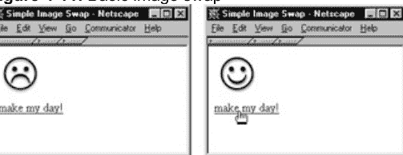

图 4-12：将难脸替换为笑脸

## 处理多个图像

如果页面上有有多个图像，你应该给每个图像取一个不同的名称。图 4-13 有两个图像和两个链接。第一个链接告诉 JavaScript 将名为`my_first_image`（难脸）的图像切换为`happy_face.gif`。第二个链接告诉 JavaScript 将名为`my_second_image`（圆形）的图像切换为`square.gif`。

```html
<<html><head><title>Two Image Swaps</title></head>

<body


<br>

<a href="#"
onclick="window.document.my_first_image.src='happy_face.gif';
return false;">make my day!</a>
</body>
</html>
```

```html
<br>
<a href="#"
onclick="window.document.my_second_image.src='square.gif';
return false;">square the circle!</a>
</body>
</html>
```

### 图 4-13：用于切换图像的 JavaScript

### 注意

使用多个图像时，你必须为图像命名不同的名称。如果你不小心给两个图像相同的名称，切换将无法生效。

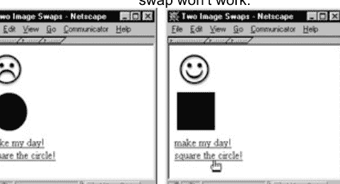

### 图 4-14：切换两个图像

### 注意

图像切换在 Internet Explorer 4.0 或 Netscape 3.0 之前的浏览器中不起。此外，如果你尝试用大图像替换小图像，或用小图像替换大图像，Netscape 4.61 和 Internet Explorer 4.0 以下的浏览器将压缩或拉伸图像以适应原来的占用空间。这些浏览器的后续版本会调整页面以适应更大或更小的图像。

## 这么多点是怎么回事？

你可能觉得奇怪为什么 JavaScript 将`my_image`称为`window.document.my_image`，而不是简单的`my_image`。你可能还会想为什么当你想要更改图像的`src`时使用它。简而言之，这么多点到底是怎么回事？

答案与浏览器如何查看你的网页有关。图 4-15 显示了 JavaScript 理解的网页层级结构——通过文档对象模型（DOM）。窗口的顶端包含你正在查看的网页。该窗口包含了`document`、`navigator`和`location`对象。这些对象中的每一个都包含大量信息，通过更改其中一个，你可以改变你的网页上发生的情况。

## 当前窗口

| `self`、`window`、`parent`、`top`、`Window`对象 | `plugins []` `Plugin`对象的数组 | `mime Types []` `mimeType`对象的数组 |
|---|---|---|
| `navigator` `Navigator`对象 | `mime Types []` `mimeType`对象的数组 | `elements []` HTML、`Form`元素对象的数组 |
| `frames []` `Windows`对象的数组 | `forms []` 表单对象的数组 | `Button`、`Checkbox`、`Fieldset`、`Hidden`、`Password`、`Radio`、`Select`、`Submit` |
| `location` `Location`对象 | `anchors []` `Anchor`对象的数组 | |
| `history` `History`对象 | `images []` `Image`对象的数组 | `Text area` |
| `document` `Document`对象 | `applets []` JavaScript对象的数组 | |
| `Package` JavaScriptPage对象 | `embeds []` 对象的数组 | `array []` `Option`对象的数组 |

JavaScript 对象系列中的点：当 JavaScript 看到一系列由点隔开的对象时，它会跳转到该系列中的最后一个对象。例如，`window.location`短语意味着“找到当前窗口内的 location”。同样，`window.document`这行代码告诉 JavaScript 在当前窗口中查找 document。该窗口就是 JavaScript 所在的窗口。

## 文档对象

`document`对象列出了网页上的所有项目、链接、表单和其他内容。编写图像代码时，我们告诉 JavaScript 在窗口中查找`document`对象，`window.document.my_image`。

### 属性

`document`对象列出了网页上的所有项目、链接、表单和其他内容。编写图像代码时，我们告诉 JavaScript 在窗口中查找`document`对象，`window.document.my_image`。

`document`对象列出了网页上的所有项目、链接、表单和其他内容。编写图像代码时，我们告诉 JavaScript 在窗口中查找`document`对象，`window.document.my_image`。

## 你不能将事件放在图像标签内部

现在我们知道如何切换图像了，大多数浏览器不会让你直接在标签上放置`onmouseover`。相反，你必须将其封装在链接中。

http://www.hotwired.com/webmonkey/reference/javascript_code_library/wm_pl_img).

让我们回顾一下预加载（preload）的工作的基本原理，这样你在看到它们时就能识别出它们。

# 预加载基础

预加载包含两个部分。第一部分创建一个新的图像对象。`var new_image = new Image();`这一行创建了一个没有任何信息的图像对象。它没有关联 GIF 或 JPG 图片，也没有高度或宽度。一旦你创建了这个新对象，

`new_image.src = "my_good_image.gif";`通过设置图像对象的`src`属性，强制浏览器将图像下载到缓存中。当图像位于浏览器缓存时，就可以切换到另一张图像而不会产生任何下载延迟。图 4-17 将预加载与上一个示例中的鼠标悬停（rollover）效果结合在一起。

```html
<html><head><title>Preloaded Rollover</title>
<script language="JavaScript">
<!-- hide me from old browsers
var some_image = new Image();
some_image.src = "happy_face.gif";
// end hide --
</script>
</head>
<body>
<a href="#"
onMouseOver="window.document.my_first_image.src='happy_face.gif';"
onMouseOut="window.document.my_first_image.src='sad_face.gif';"
onclick="return false;">

</a>
</body>
</html>
```

图 4-17：图像预加载器与鼠标悬停

# 解决简易的陷阱：浏览器检测

虽然遗憾但这是事实：Netscape 2.0 及更低版本以及大多数 Microsoft Internet Explorer 3.0 版本无法进行图像切换。为了防止旧浏览器产生 JavaScript 错误，我们必须确保访问者的浏览器能够处理我们页面中的切换。实现这一点有两种方法。首先，我们可以使用上一章中学的浏览器检测代码（第 35 页）。

图 4-18 将代码整合到了我们的图像切换示例中。

```html
<html<head><title>Browser-Detecting Preloaded Rollover</title>
<script language="JavaScript">
<!-- hide me from old browsers
var browser_name = navigator.appName;
var version = parseFloat(navigator.appVersion);
(1) swappable = false; // 这将被设为 true
// 浏览器可以处理图像切换

if (browser_name == "Netscape") && (version >= 3.0)
{
(2) swappable = true;

if (browser_name == "Microsoft Internet Explorer") &&
(version >= 4.0)
{
(3) swappable = true;
}

(4) if (swappable)
{
var some_image = new Image();
some_image.src = "happy_face.gif";
}
</script>
// end hide --
</head>
<body>
<a href="#"
mouseover="if (swappable)
{window.document.my_first_image.src='happy_face.gif';"
onMouseOut="if (swappable)
{window.document.my_first_image.src='sad_face.gif';"
onclick="return false;">

</a>
```

```html
</body>
</html>
```

**图 4-18：** 浏览器检测与图像切换

注意第 4 点中的布尔值代码。布尔值（见第 38 页）如果你想在`if`语句中使用简写，它们是非常用的。例如，`if (swappable == true)`这一行可以简化为`if (swappable)`。

同样，你可以将`if (swappable == false)`替换为`if (!swappable)`，其读为“如果不可切换”。注意那个感叹号——它就是“not swappable”中的“不（not）”。

这种简写只有在变量被赋值为`true`或`false`值时才有效——注意这里没有引号。示例开始将名为`swappable`的变量设为`false`。

之后，如果我进行了浏览器检测，就是该查看实际的鼠标悬停了。对于 Netscape 3.0 或更高版本，将`swappable`变量从`false`改为`true`。你可以用英文读这段这句话：“如果浏览器是 Netscape 且版本是 3.0 或更高，它就可以进行图像切换。”下一组行相同。你可以读作：“如果浏览器是 Microsoft Explorer 且版本是 4.0 或更高；它可以进行图像切换。”

# 深入观察鼠标悬停

现在我们已经完成了浏览器检测，该查看实际的鼠标悬停了。`mouse`语句包含`if`子句。让我们看看`mouseover`：

`mouseOver="if (swappable) window.document.my_first_image.src='happy_face.gif';"`

但请记住，`mouseover`引号内的内容执行就像在`<script>`标签之间一样。如果这个`if`语句说：“如果图像可切换，则执行图像切换。”确保包含任何`if`语句中使用的分号和大括号。此外，注意简写的使用——该行可以写成：`mouseover="if (swappable == true) window.document.my_first_image.src='happy_face.gif';"`

# 另一种检查图像切换性的方法

**图 4-18** 适用于使用 Netscape 或 Microsoft Internet Explorer 访问你页面的人。然而，任何使用其他类型浏览器访问你页面的人就都倒霉了。例如，Opera 是一种理解 JavaScript 并可以进行图像切换的流行浏览器。遗憾的是，图 4-18 将 Opera 视为无法切换的状态。

这里有一种检查浏览器是否可以切换图像更好的方法：

`if (window.document.images) { ... }`

这之所以有效，是因为支持图像切换的浏览器内置了该功能，而不能切换的浏览器不知道`window.document.images`是什么。如果你在没有该功能的浏览器中查找`window.document.images`，浏览器将返回`false`。如果你在具有该功能的浏览器中查找`window.document.images`，浏览器将返回`true`。比比提到的解决方案更好，因为它适用于任何浏览器，即使是冷门的浏览器。它的实现比上一个示例更快，正如你在图 19 中所示：


```html
<html><head><title>Preloaded Rollover</title>
<script language="JavaScript">
<!-- hide me from old browsers
var some_image = new Image();
some_image.src = "happy_face.gif";
// end hide --
</script>
</head>
<body>
<a href="#"
onMouseOver="window.document.my_first_image.src='happy_face.gif';"
onMouseOut="window.document.my_first_image.src='sad_face.gif';"
onclick="return false;">

</a>
</body>
</html>
```

图 4-19：图像预加载器与鼠标悬停

## 解决简易的陷阱：浏览器检测

虽然遗憾但这是事实：`Netscape 2.0` 及更低版本以及大多数 `Microsoft Internet Explorer 3.0` 版本无法进行图像切换。为了防止旧浏览器产生 `JavaScript` 错误，我们必须确保访问者的浏览器能够处理我们页面中的切换。实现这一点有两种方法。首先，我们可以使用上一章中学的浏览器检测代码（第 35 页）。

图 4-18 将代码整合到了我们的图像切换示例中。

```html
<html<head><title>Browser-Detecting Preloaded Rollover</title>
<script language="JavaScript">
<!-- hide me from old browsers
var browser_name = navigator.appName;
var version = parseFloat(navigator.appVersion);
(1) swappable = false; // 这将被设为 true
// 浏览器可以处理图像切换

if (browser_name == "Netscape") && (version >= 3.0)
{
(2) swappable = true;

if (browser_name == "Microsoft Internet Explorer") &&
(version >= 4.0)
{
(3) swappable = true;
}

(4) if (swappable)
{
var some_image = new Image();
some_image.src = "happy_face.gif";
}
</script>
// end hide --
</head>
<body>
<a href="#"
mouseover="if (swappable)
{window.document.my_first_image.src='happy_face.gif';"
onMouseOut="if (swappable)
{window.document.my_first_image.src='sad_face.gif';"
onclick="return false;">

</a>
```

```html
</body>
</html>
```

**图 4-18：** 浏览器检测与图像切换

注意第 4 点中的布尔值代码。布尔值（见第 38 页）如果你想在 `if` 语句中使用简写，它们是非常用的。例如，`if (swappable == true)` 这一行可以简化为 `if (swappable)`。

同样，你可以将 `if (swappable == false)` 替换为 `if (!swappable)`，其读为"如果不可切换"。注意那个感叹号——它就是"not swappable"中的"不（not）"。

这种简写只有在变量被赋值为 `true` 或 `false` 值时才有效——注意这里没有引号。示例开始将名为 `swappable` 的变量设为 `false`。

之后，如果我进行了浏览器检测，就是该查看实际的鼠标悬停了。对于 `Netscape 3.0` 或更高版本，将 `swappable` 变量从 `false` 改为 `true`。你可以用英文读这段语句："如果浏览器是 Netscape 且版本是 3.0 或更高，它就可以进行图像切换。"下一组行相同。你可以读作："如果浏览器是 Microsoft Explorer 且版本是 4.0 或更高；它可以进行图像切换。"

## 深入观察鼠标悬停

现在我们已经完成了浏览器检测，该查看实际的鼠标悬停了。`mouse` 语句包含 `if` 子句。让我们看看 `mouseover`：

`mouseOver="if (swappable) window.document.my_first_image.src='happy_face.gif';"`

但请记住，`mouseover` 引号内的内容执行就像在 `<script>` 标签之间一样。如果这个 `if` 语句说："如果图像可切换，则执行图像切换。"确保包含任何 `if` 语句中使用的分号和大括号。此外，注意简写的使用——该行可以写成：`mouseover="if (swappable == true) window.document.my_first_image.src='happy_face.gif';"`

## 另一种检查图像切换性的方法

**图 4-18** 适用于使用 `Netscape` 或 `Microsoft Internet Explorer` 访问你页面的人。然而，任何使用其他类型浏览器访问你页面的人就都倒霉了。例如，`Opera` 是一种理解 `JavaScript` 并可以进行图像切换的流行浏览器。遗憾的是，图 4-18 将 `Opera` 视为无法切换的状态。

这里有一种检查浏览器是否可以切换图像更好的方法：

`if (window.document.images) { ... }`

这之所以有效，是因为支持图像切换的浏览器内置了该功能，而不能切换的浏览器不知道 `window.document.images` 是什么。如果你在没有该功能的浏览器中查找 `window.document.images`，浏览器将返回 `false`。如果你在具有该功能的浏览器中查找 `window.document.images`，浏览器将返回 `true`。比比提到的解决方案更好，因为它适用于任何浏览器，即使是冷门的浏览器。它的实现比上一个示例更快，正如你在图 19 中所示：

```html
<html><head><title>Preloaded Rollover</title>
<script language="JavaScript">
<!-- hide me from old browsers
var some_image = new Image();
some_image.src = "happy_face.gif";
// end hide --
</script>
</head>
<body>
<a href="#"
onMouseOver="window.document.my_first_image.src='happy_face.gif';"
onMouseOut="window.document.my_first_image.src='sad_face.gif';"
onclick="return false;">

</a>
</body>
</html>
```

图 4-19：图像预加载器与鼠标悬停

## 真实世界示例：ACLU 如何切换图像

由于 ACLU 页面上的图像太多无法包含，图 4-20 显示了切换两个图像的代码。

```html
<HTML><HEAD><TITLE>ACLU: American Liberties Union</TITLE>
<SCRIPT language="javascript">
if (navigator.appVersion.substring(0,1)) >= 3 {
hpbact1=new Image(158, 25);
hpbact1.src="/graphics/hpbtact-1.gif";
hpbact2=new Image(158, 25);
hpbact2.src="/graphics/hpbt--2.gif";
}
</SCRIPT>
</HEAD>
<BODY a="#003cc" bgColor="#ffffff" link="#003cc">
<A href="http://www.aclu.org/issues.html"
mouseout="if (navigator.appVersion.substring(0,1)) >= 3) hpbact1.src='hpbact1.src';"
onmouseover="if (navigator.appVersion.substring(0,1)) >= 3) hpbact2.src='hpbact2.src'">

</A>
<A href="http://www.aclu.org/really_long.html"
onmouseover="if (navigator.appVersion.substring(0,1)) >= 3) hpbtjoin.src='hpbtjoin1.src';"
onmouseover="if (navigator.appVersion.substring(0,1)) >= 3) hpbtjoin.src='hpbtjoin2.src'">

</A>
</BODY></HTML>
```

图 4-20：ACLU 的图像切换代码

注意，该脚本没有使用 `var` 来引入新变量。这在大多数浏览器中可能不会引起问题，但在首次引入变量时，使用 `var` 是更好的做法。此外，注意 `new Image()` 调用中的参数。这些数字代表图像的高度和宽度。在创建新图像时并非必须包含这些信息，但包含了也无大碍。

### ACLU 的图像切换

以下是 ACLU 页面如何实现图像切换的：

```html
<A href="http://www.aclu.org/congress/issues.html" onmouseover="if(navigator.appVersion.substring(0,1) >= 3) hbptact.src='hbptact1.src'" onmouseout="if(navigator.appVersion.substring(0,1) >= 3) hbptact.src='hbptact2.src'" alt="Act Now!" height=25 name=hbptact src="ACLU American Civil Liberties Union" width=158/>
```

注意，ACLU 在其 `href` 中使用了 URL，而我们在示例（4-16 到 4-19）中使用了井号 (`#`)。当你点击图像时，ACLU 会带你进入 `http://www.aclu.org/congress/issues.html`。同样注意，该链接没有使用 `onclick="return false"`；如果使用了，点击该链接将不会带你进入指定的 URL。

现在来看 `onmouseout` 部分：

`onmouseout="if(navigator.appVersion.substring(0,1) >= 3) hbptact.src='hbptact1.src'"`

注意这里用的是 `onclick` 而不是 `onMouse`。从遵循世界维网联盟 (`w3.org`) 描述的 HTML 规范来说，遵循 ACLU 的做法并将所有内容写为小写是正确的。虽然 `onmouseout` 更为传统且易于阅读，但在技术上它是不正确的。目前网页上的大部分 HTML 并没有严格遵守 W3C 标准，因此为了合法性而在此处违反规范并不是什么错。此外注意 `if` 语句中礼貌性的花括号和分号。正如在上一章最后一节（第 46 页）中提到的，当你处于一个仅包含一行的语句时，可以省略它们。无论如何，我还是喜欢加上，这样如果以后我想在里面添加第二行时，就不必记得添加花括号了。

最后，注意这实际上切换了图像。与我在早的示例中写的 `window.document.hbptact.src="happy.gif";` 不同，第一个区别是 ACLU 的代码在图像名称前面加了 `window.document`。只要图像与 `JavaScript` 位于同一个窗口，这种方法对图像切换就是有效的。然而，如果你想用 `JavaScript` 切换其他窗口的图像（见第 5 章），就不能省略那部分代码。

注意：你可以使用类似的图像用于 `(window.document.images)`。通常情况下假设是 `document`，所以你通常可以省略它。但是，`document` 有时是必要的，所以最好保留它。

注意到的第二点是，ACLU 代码没有将图像的 `src` 设置为字符串（在 ACLU 脚本的预加载部分你会看到这一点）。这是一种替换方法。如果网站管理员决定使用不同的 `GIF`，他或她只需要更改预加载部分的名称——不需要更改切换部分中 `GIF` 的名称。

## 总结

在这一章中，你学习了：

- 事件，如 `mouseover` 和 `mouseOut`。
- 如何使用 `return false onclick` 使链接失效。
- 如何更改页面的背景颜色。
- 如何切换图像。
- 如何重新加载图像以便它们切换得更快。
- 一种新的浏览器检测形式：`if (document.images)`。
- 所有这些点到底是怎么回事。

现在你已经知道了图像切换的基础知识，可以执行很多技巧了。你可以通过切换到一个与页面背景颜色相同的图像来让某个图像消失。你可以制作由解释性文本组成的图像，并将它们放置在它们所描述的功能旁边。利用图像切换可以带给你乐趣是无尽的。

一如既往，我们将在后面的章节中再次回顾这些许多点，你会变得越来越熟悉它们。为了确保你理解它们是如何工作的，请尝试以下作业。

## 作业

图 4-21 和 4-22 显示了世界自然基金会（`World Wildlife Foundation`）网站上的一个页面。注意，鼠标悬停在屏幕左侧的文本上会让文本变为蓝色，并在"拯救亚马逊"横幅下方出现一些解释性文本。这两个文本实际上都是图像，是使用在本章中学到的技巧切换的。你的作业是编写一个类似的页面，鼠标悬停在某一个图像上会导致两个图像发生变化。

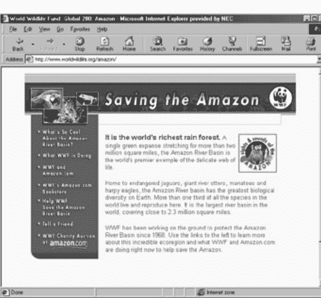

图 4-21：滚动切换前的世界自然基金会页面

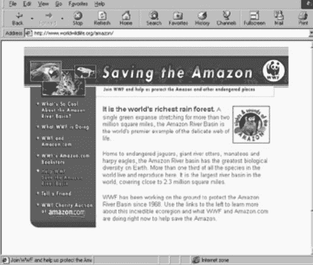

图 4-22：滚动切换后的页面

# 第 5 章：打开和操作窗口

## 打开

`JavaScript` 赋予了你能够在浏览器中打开多个窗口并控制其内容的能力。`JavaScript` 还可以更改窗口在访问者屏幕上的位置。在本章中，你将学习如何：

- 在浏览器中打开多个窗口并控制其内部内容。
- 更改窗口在访问者屏幕上的位置。
- 打开窗口。
- 更改背景颜色。
- 切换图像。
- 重新加载图像以便它们切换得更快。
- 一种新的浏览器检测形式：`if (document.images)`。
- 了解这些点到底是怎么回事。
- 执行很多技巧的技巧。

现在你已经知道了图像切换的基础知识，可以执行很多技巧了。你可以通过切换到一个与页面背景颜色相同的图像来让某个图像消失。你可以制作由解释性文本组成的图像，并将它们放置在它们所描述的功能旁边。利用图像切换可以带给你乐趣是无尽的。

一如既往，我们将在后面的章节中再次回顾这些许多点，你会变得越来越熟悉它们。为了确保你理解它们是如何工作的，请尝试以下作业。

## 作业

图 4-21 和 4-22 显示了世界自然基金会（`World Wildlife Foundation`）网站上的一个页面。注意，鼠标悬停在屏幕左侧的文本上会让文本变为蓝色，并在"拯救亚马逊"横幅下方出现一些解释性文本。这两个文本实际上都是图像，是使用在本章中学到的技巧切换的。你的作业是编写一个类似的页面，鼠标悬停在某一个图像上会导致两个图像发生变化。


图 4-21：滚动切换前的世界自然基金会页面


图 4-22：滚动切换后的页面


以下是 ACLU 页面如何实现图像切换的：

```html
<A href="http://www.aclu.org/congress/issues.html" onmouseover="if(navigator.appVersion.substring(0,1) >= 3) hbptact.src='hbptact1.src'" onmouseout="if(navigator.appVersion.substring(0,1) >= 3) hbptact.src='hbptact2.src'" alt="Act Now!" height=25 name=hbptact src="ACLU American Civil Liberties Union" width=158/>
```

注意，ACLU 在其 `href` 中使用了 URL，而我们在示例（4-16 到 4-19）中使用了井号（`#`）。当你点击图像时，ACLU 会带你进入 `http://www.aclu.org/congress/issues.html`。同样注意，该链接没有使用 `onclick="return false"`；如果使用了，点击该链接将不会带你进入指定的 URL。

现在来看 `onmouseout` 部分：

`onmouseout="if(navigator.appVersion.substring(0,1) >= 3) hbptact.src='hbptact1.src'"`

注意这里用的是 `onclick` 而不是 `onMouse`。从遵循世界维网联盟（`w3.org`）描述的 HTML 规范来说，遵循 ACLU 的做法并将所有内容写为小写是正确的。虽然 `onmouseout` 更为传统且易于阅读，但在技术上它是不正确的。目前网页上的大部分 HTML 并没有严格遵守 W3C 标准，因此为了合法性而在此处违反规范并不是什么错。

此外注意 `if` 语句中礼貌性的花括号和分号。正如在上一章最后一节（第 46 页）中提到的，当你处于一个仅包含一行的语句时，可以省略它们。无论如何，我还是喜欢加上，这样如果以后我想在里面添加第二行时，就不必记得添加花括号了。

最后，注意这实际上切换了图像。与我在早的示例中写的 `window.document.hbptact.src="happy.gif";` 不同，第一个区别是 ACLU 的代码在图像名称前面加了 `window.document`。只要图像与 JavaScript 位于同一个窗口，这种方法对图像切换就是有效的。然而，如果你想用 JavaScript 切换其他窗口的图像（见第 5 章），就不能省略那部分代码。

注意：你可以使用类似的图像用于 `window.document.images`。通常情况下假设是 `document`，所以你通常可以省略它。但是，`document` 有时是必要的，所以最好保留它。

注意到的第二点是，ACLU 代码没有将图像的 `src` 设置为字符串（在 ACLU 脚本的预加载部分你会看到这一点）。这是一种替换方法。如果网站管理员决定使用不同的 GIF，他或她只需要更改预加载部分的名称——不需要更改切换部分中 GIF 的名称。

## 总结

在这一章中，你学习了：

- 事件，如 `mouseover` 和 `mouseOut`。
- 如何使用 `return false onclick` 使链接失效。
- 如何更改页面的背景颜色。
- 如何切换图像。
- 如何重新加载图像以便它们切换得更快。
- 一种新的浏览器检测形式：`if (document.images)`。
- 所有这些点到底是怎么回事。

现在你已经知道了图像切换的基础知识，可以执行很多技巧了。你可以通过切换到一个与页面背景颜色相同的图像来让某个图像消失。你可以制作由解释性文本组成的图像，并将它们放置在它们所描述的功能旁边。利用图像切换可以带给你乐趣是无尽的。

一如既往，我们将在后面的章节中再次回顾这些许多点，你会变得越来越熟悉它们。为了确保你理解它们是如何工作的，请尝试以下作业。

## 作业

图 4-21 和 4-22 显示了世界自然基金会（World Wildlife Foundation）网站上的一个页面。注意，鼠标悬停在屏幕左侧的文本上会让文本变为蓝色，并在“拯救亚马逊”横幅下方出现一些解释性文本。这两个文本实际上都是图像，是使用在本章中学到的技巧切换的。你的作业是编写一个类似的页面，鼠标悬停在某一个图像上会导致两个图像发生变化。


图 4-21：滚动切换前的世界自然基金会页面


图 4-22：滚动切换后的页面

# 第 5 章：打开和操作窗口

## 打开

JavaScript 赋予了你能够在浏览器中打开多个窗口并控制其内容的能力。JavaScript 还可以更改窗口在访问者屏幕上的位置。在本章中，你将学习如何：

- 打开窗口。
- 更改窗口在访问者屏幕上的位置。

<a href="http://www.webmonkey.com/" target="_window">将 Webmonkey 放入我的新窗口中！</a>

你也可以使用链接标签的 `target` 元素来打开窗口，而无需使用 JavaScript。例如，如果访问者点击了像这样的链接，而你没有用 JavaScript 打开名为 `my_window` 的窗口，你的浏览器将打开新窗口并加载该链接。不使用 JavaScript 打开窗口的缺点是，你无法控制窗口的外观，一旦打开它，你就无法更改它了。

### `features` 参数

`window.open()` 命令的第三参数是一个特性列表，允许你控制新窗口的外观。这正是事情开始变得有趣的地方。图 5-4 展示了每个浏览器 JavaScript 允许你控制的各种特性。

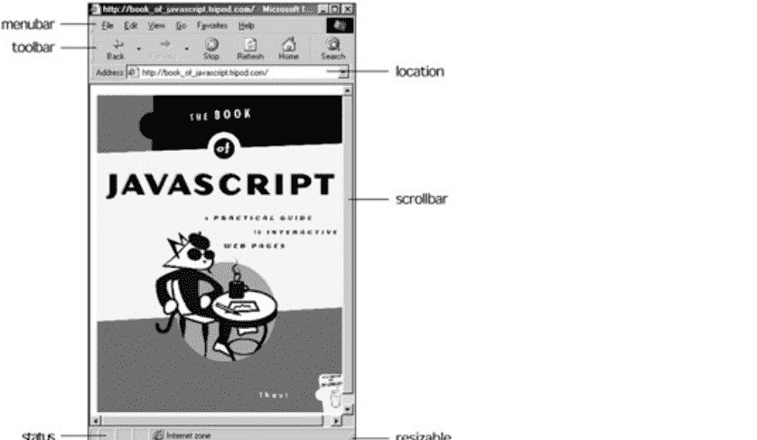

图 5-4：你可以使用 JavaScript 控制的浏览器窗口特性

`features` 参数允许你打开具有全部、部分或无这些特性的新窗口。如果你省略了第三参数（即你只列出了前两个参数，什么都不写——只有空引号），你打开的窗口将具有图 5-4 所示的所有特性，并且大小与之前的窗口相同。

然而，如果你在第三参数中列出了任何一个特性，则在你打开的窗口中只会出现你列出的那些特性。因此，如果你使用以下命令打开窗口：

```javascript
var salon_window = window.open("http://www.salon.com", "salon", "resizable");
```

你将得到一个包含 Salon 网站的可调整大小的窗口。该窗口将与你打开它时的窗口相同，但将缺少菜单栏、状态栏、滚动条和其他特性。图 5-5 显示了它的样子。

## Salon 的假日礼物卡卡

没有可怕的圣诞老人。没有尖叫的屏幕。

+ 搜索 | 联系我们 | 网站导览 | 时事通讯 | 帮助 | 索引 | 网站首页

今日特卖

2000 年 12 月 12 日—14 日，星期三

查看我们的假日礼物创意集

太平洋标准时间周二上午 12:00 开始在此处

呈献

2000 年最佳礼物

+ 站点

- 首页
- 娱乐
- 购物
- 书籍与音频
- 电影
- 关于我们
- 技术
- 时尚
- 商品

Talon.com

购物

适用于每个场合的

最佳信封礼物。

+ 立即加入俱乐部！

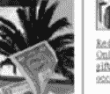

图 5-5：没有特性的窗口中的 Salon 网站

如果你需要多于一个特性，可以将它们列在引号内，并用逗号分隔。确保保留此字符串中的所有空格。由于某些原因，特性内部空格可能会导致浏览器错误地绘制你的窗口。这是一个带有两个特性（高度和宽度）的窗口示例：

```javascript
var pictures = window.open("http://www.salon.com/wlist/pass/1999/02/bugs/frame.html",
"pictures", "width=605,height=350");
```

图 5-6 显示了指定高度和宽度时窗口的样子。

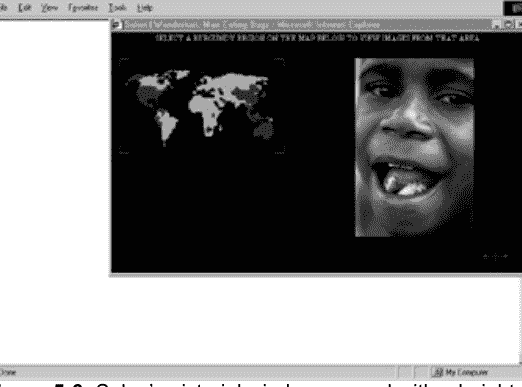

图 5-6：以高度 350 和宽度 605 打开的 Salon 预览窗口

第 80 页的表 5-1 列出了所有你可以尝试的不同特性。通过尝试不同的特性来查看它们的作用。对于处理像素的特性（例如，高度），你只需要在第三参数的引号内输入特性名称即可。

## 表 5-1：JavaScript 窗口特性

| 特性 | 效果 |
| :--- | :--- |
| `directories` | 在 Netscape 浏览器中添加“新内容”和“网络酷点”按钮。 |
| `height=X` | 将窗口高度调整为 X 像素。 |
| `left=X` | 在 Internet Explorer 4 及以下版本中，将新窗口的左边界放置距离屏幕左边缘 X 像素处。 |
| `location` | 添加输入 URL 的地址栏。 |
| `menubar` | 添加菜单栏。 |
| `resizable` | 控制你是否可以调整窗口大小；即使省略了此特性，所有的 Mac 窗口都是可调整大小的。 |
| `scrollbars` | 如果页面内容大于窗口，则添加滚动条。 |
| `screenX=X` | 在 Netscape 4 及以上版本中，将窗口的左边界放置距离屏幕边缘 X 像素处。 |
| `screenY=Y` | 在 Netscape 4 及以上版本中，将窗口的顶边界放置距离屏幕顶部 Y 像素处。 |
| `status` | 在窗口底部添加状态栏。 |
| `toolbar` | 带有后退、前进和停止按钮的工具栏。 |
| `top=X` | 在 Internet Explorer 4 及以上版本中，将窗口的顶边界放置距离屏幕边缘 X 像素处。 |
| `width=X` | 将窗口宽度调整为 X 像素。 |

## 某些浏览器打开窗口的方式

在 Netscape 2 和 Macintosh 上，打开窗口的过程略有不同。Mac 上的 JavaScript 窗口总是可调整大小的，即使你省略了该特性。另一个区别是，Mac 没有菜单栏。在 Netscape 2 中，你必须双击特性来显示它。由于你在第三参数中使用了任何特性，你打开的窗口将具有这些特性。正如图 5-7 所示，Netscape 2 的情况：

```javascript
var my_window = window.open("http://www.salon.com", "", "height=200,width=200");
if (navigator.appName == "Netscape" && parseInt(navigator.version) == 2) {
  my_window.open("http://wired.com", "", "height=200,width=200");
}
```

图 5-7：Netscape

### 关闭窗口

如果你打开了一个名为 `my_window` 的窗口并稍后关闭它，使用 `close()` 方法：

```javascript
my_window.close();
```

你可能记得第 4 章中提到 `window` 指的是窗口。这意味着你也可以使用 JavaScript 关闭窗口，例如：

```javascript
window.close();
```

ParentPlaces 代码的唯一区别在于它使用了按钮而不是链接。如果该按钮是链接，代码将如下：

```html
<a href="#" onclick="close(); return false;">关闭我</a>
```

图 5-8 显示了 ParentPlaces 的关闭功能。

```html
<form><input type="button" value="关闭" onclick="self.close()"></form>
```

图 5-8：ParentPlaces 如何关闭窗口

### 使用正确的名称：窗口如何相互查看

每个窗口都有些独特，并认为自己就是 `window`。假设你打开了一个标题为“原始”的窗口。现在假设该窗口使用 JavaScript 打开了 `new_window.html`（标题为“新窗口”）：

```javascript
var new_window;
window.open("new_window.html", "new_window", "height=100,width=100");
```

这些窗口以不同的方式互相。原始窗口被称为 `new_window`。然而，新窗口认为自己是 `window`。这意味着如果你想在原始窗口中使用 JavaScript 关闭新窗口，你会编写以下代码：

```javascript
new_window.close();
```

但在新窗口中使用 JavaScript 关闭新窗口，你需要在 `new_window.html` 中编写如下：

```javascript
window.close();
```

这种窗口中心是面向对象编程的趣味之处之一。它就像与具有不同视角的个体交流。

- **注意：** 除非由事件触发（如图 5-8 所示），否则 `new_window.close()` 和 `window.close()` 会在窗口打开后立即关闭对应的窗口。

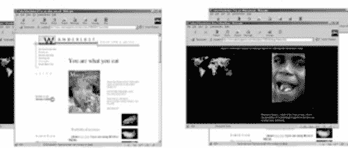

图 5-9：焦点：`focus()` 命令的效果

## 将窗口移动到屏幕前部或后端

一旦你打开了一个窗口，你可以执行的操作不仅仅是关闭它。你可以将其移动到屏幕前端（在其他窗口之上）或移动到屏幕后部（在所有其他窗口之后）。`focus()` 方法可以将窗口带到前面，而 `blur()` 则将窗口置于后面。

当你有一个始终希望显示在屏幕前方的窗口时，`focus()` 方法特别有用。例如，如果 Salon 希望它的窗口显示在其他页面之上，它可以让所有使用这种技术的链接变为：

```html
<a href="#OnClick="pictures = window.open('http://www.salon.com/pass/1999/02/bugs/frame.html', 'pictures','width=605,height=350'); pictures.focus(); return false;">Portfolio of pictures</a>
```

这一行代码打开了窗口并将其置于最前。

**注意：** 请注意，我在调用 `open()` 之前并没有将图片窗口置后。如果你使用链接，JavaScript 将会在执行 `onClick` 上的其余 JavaScript 命令之前，聚焦窗口的名称。如果你阅读了第 6 章，就会更清楚其中的原因了。

`focus()` 和 `blur()` 遗憾的之处是它们在 Netscape 2 或 Microsoft Internet Explorer 3 中不起作用，因此如果你不想让页面显示错误信息，就必须使用浏览器检测。

## 窗口属性

到为止，我们已经看到了窗口对象的几种方法：`open()`、`close()`、`focus()` 和 `blur()`。它还有其他几个偶尔会用到的属性。

### `status` 属性

这些属性中最实用（也最被滥用）的一个是窗口的 `status`。它显示在窗口的状态栏中（见图 5-4）。一种常见状态是你鼠标悬停的链接的 URL。

你可以使用 `status` 来改变状态栏中显示的内容。你可能注意到人们在这个区域放置了某种跑马灯效果，在底部滚动显示诸如“购买我们的商品！购买我们的商品！”之类的消息。我不鼓励这种滥用，所以我不会教你如何做到这一点；但你可以使用 JavaScript 技术来创建这种效果。

要更改窗口状态栏中显示的内容，可以使用如下 `body` 标签：

```html
<body onload="window.status = hi there!">
```

此标签告诉 JavaScript 在页面完全加载到浏览器后更改窗口状态栏的内容。你可能想使用 `status` 告知访问者如果他们点击链接将看到什么。例如，如果你有一个指向图形密集型网站的链接，当访问者悬停其一时，状态栏中会显示“警告，这里有很多图表”。你可以在 `onMouseOver` 上设置它：

```html
<a href="http://www.animation.com/" onMouseOver="window.status='Warning'; return true;">Animation</a>
```

注意在设置 `window.status` 命令后使用了 `return true`。这与我在 `onClick` 末尾放置的 `return false`（见第 4 章）类似，作用几乎相同。当用户操作鼠标时，`return true` 可以防止 URL 出现在状态栏中。

如果你不把它放在那里，状态栏中会显示“警告，这里有很多图表”字样；然而在警告被看到之前，链接就会迅速替换掉它们。

你可能会问：“为什么在 `onClick` 中用 `return false`，而在 `mouse` 中用 `return true` 呢？”这是一个很好的问题，遗憾的是没有好的答案——事实就是如此。

## `opener` 属性

当一个窗口打开另一个窗口时，新窗口通过 `opener` 属性存储指向其父窗口（原始窗口）的指针。打开的窗口可以通过此指针访问其父窗口，然后操作状态（`status`）。

例如，如果你想让新窗口中的链接更改原始窗口的状态，你应该在新窗口中包含以下代码：

```html
<a href="onClick="var my_parent=window.opener;my_parent.status='howdy;">
```

`onClick` 内部的第一条语句是：“找到打开我的窗口”。第二条语句将变量 `my_parent` 指向该窗口。或者你也可以将这几行合并：


<a href="onClick="window.opener.status='howdy'; return false;">put howdy into the status</a>

## 在遥控器中使用 opener 属性

如果你想有一个可以影响原始窗口内容的遥控器，`opener` 属性非常有用。第 5 章/fig-10.html 中的 `remote_control` 文件提供了这方面的示例。图 5-10 显示了触发遥控器的代码。

```html
<html>
<head>
<title>The Controlled Window</title>
<script language="JavaScript">
<!-- hide from older browsers -->
// open the control window
var control_window = 
window.open("the_remote.html","control_window","width=100,height=100");

// show me -->
</script>
</head>
<body>
Use the remote control to send various Web pages to this window.
</body>
</html>
```

**图 5-10:** 调用遥控器的窗口代码。此代码打开了一个小窗口并加载了名为 `remote.html` 的 Web 页面（图 5-11）。图 5-12 显示了 `remote.html` 的代码。

**图 5-11:** 调用遥控器的页面，以及遥控器本身的代码。第 1 到 2 行代码 (图 5-12) 展示了访问者的浏览器是否可以处理 `focus()`。记住，Netscape 2 和 Internet Explorer 3 是处理 `focus()` 还是 `blur()`。如果浏览器可以处理 `focus()`，变量 `can_focus` 将被设置为 true。否则 `can_focus` 为 false。

```html
<html>
<head>
<title>Remote Control</title>
<script language="JavaScript">
<!-- hide from older browsers -->
// the code in this script section sets can_focus to true if the
// visitor is using a browser that can do focus
//
// first, set some variables
//
(1) var can_focus = false; // this will be made true if the
// browser can do focus
var version = parseInt(navigator.appVersion);
var app_name = navigator.appName;

// now set can_focus to true if the browser can do focus
//
if ((app_name == "Netscape") && (version > 2))
{
can_focus = true;
} else if ((app_name == "Microsoft Internet Explorer") && (version > 3))
{}
```

`can_focus = true;`

```javascript
// show me -->
<script>
<head>
<body>
  <a href="#" onclick="window.opener.location='http://www.nytimes.com/';
  if (can_focus) window.opener.focus();">NY Times</a>
  <a href="#" onclick="window.opener.location='http://www.webmonkey.com/';
  if (can_focus) window.opener.focus();">Webmonkey</a>
  <a href="#" onclick="window.opener.location='http://www.salon.com/';
  if (can_focus) window.opener.focus();">Salon</a>
</body>
</html>
```

一旦我们确定了浏览器是否可以处理 `focus()`，我们就关闭 JavaScript 标签并进入页面主体。当访问者点击纽约时报链接时，这是一个典型的链接，JavaScript 循环到 `window.opener`（打开遥控器的窗口），然后将其位置更改为 `http://www.nytimes.com/`。然后，如果 `can_focus` 为 true，JavaScript 将把遥控器带到屏幕前端。

`window.move()` 的替代方案是 `window.moveTo()`。如果你想让窗口从当前位置向右移动 5 像素并向下 10 像素，可以输入：
`window.moveBy(5,10);`

第一个数字是你想要窗口向右移动的像素数，第二个数字是向下移动的像素数。如果你想让窗口向上移动 10 像素并向左 5 像素，请使用负数：
`window.moveBy(-5,-10);`

## 不要移动用户的屏幕

要小心不要将窗口完全移出用户的屏幕范围。为了防止这种可能发生，你需要知道用户屏幕的大小。指示此尺寸的两个属性是：

`window.screen.availHeight`
`window.screen.availWidth`

[Figure 5-13]() 显示了你如何使用 `window.screen.availHeight` 和 `window.screen.availWidth` 将窗口移动到屏幕中心。此脚本无论屏幕大小如何，都能将窗口置于居中。

```html
<html>
<head>
<title>Center Window</title>
<script language="JavaScript">
<!-- 在旧版浏览器中隐藏 -->
// 设置一些变量
var window_height = 200;
var window_width = 200;

// 让窗口变小
window.resizeTo(window_height,window_width);

// 找出屏幕有多大
var height = window.screen.availHeight;
var width = window.screen.availWidth;

// 获取左侧位置
// 它将是屏幕的一半，减去
// 宽的一半
var left_point = parseInt(width / 2) - parseInt(window_width / 2);

// 获取顶部位置
// 计算方法与左侧位置类似
top_point = parseInt(height/2) - parseInt(window_height / 2);

// 现在，移动窗口
//
window.moveTo(left_point, top_point);

// 显示我 -->
</script>
```

```html
<script>
<body>
<h1>Hi!</h1>
</body>
</html>
```

图 5-13：将窗口调整大小为 200 x 200 像素的代码。完成之后，脚本使用 `window.screen.availHeight` 和 `window.screen.availWidth` 来确定屏幕的高度和宽度。在确定这些值后，脚本会进行一些计算以确定窗口左上角应该所在的位置。看计算窗口左侧位置的公式：

```javascript
var leftPoint = parseInt(width / 2) - parseInt(height / 2);
```

此公式的第一部分通过将屏幕宽度除以 2 来确定屏幕的中点（我们在第 **4** 部分定义了宽度）。`parseInt()` 命令确保结果数字是一个整数。然而，仅仅知道屏幕的中点还不足以让窗口居中，因为 `window.moveTo()` 设置的是窗口的左边界。如果你将左边界移动到屏幕中心，窗口将向右移动得太远了。公式的第二部分（减去 `parseInt(width / 2)`）计算出如何将窗口向左移动：即宽度的一半。

图 5-14：如何让窗口居中

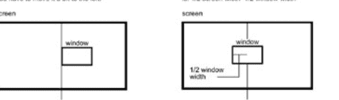

使用类似的计算方法来确定窗口顶部的位置。一旦我们确定了窗口正确的左上角位置，我们就使用 `window.moveTo()` 将其移动到 **6**。

## 总结

在本章中，你学习了：

- 如何使用 `window.open()` 打开窗口。
- 浏览器的各种功能是什么。
- 在 Netscape 2.0 中打开窗口。
- 如何使用 `window_name.close()` 关闭你打开的窗口。
- 如何使用 `window.focus()` 将窗口移到屏幕前方。
- 如何使用 `window.blur()` 将它们移到屏幕后。
- 如何通过设置 `window.status` 修改状态栏的消息。
- 如何通过 `window.opener` 查看你打开的上一个窗口。
- 如何在 4.0 浏览器中使用 `window.resizeTo()` 和 `window.resizeBy()` 调整窗口大小。
- 如何在 4.0 浏览器中使用 `window.moveTo()` 和 `window.moveBy()` 移动窗口。

恭喜你！现在你已经知道如何切换图像和处理窗口，你可以处理大约 Web 专业人士 75% 的工作了。接下来的几章将涵盖 JavaScript 作为编程语言的一些细节，然后我们就可以准备处理一些*非常*花哨的内容了。

## 课后作业

我们学习了如何使用 JavaScript 更改我们打开的窗口的状态栏内容：
`var my_window = window.open("http://www.example.com","my_window");`
`my_window.status = "I'm in the new window";`

我们可以使用类似的技术切换另一个窗口中的图像。记住，切换图像的代码看起来如下，其中 `the_image` 是主页面上的图像名称：
`document.src = "new_image.gif"`

要在另一个窗口中切换图像，只需将 `window` 替换为窗口名称。你的作业是编写一个页面（我们暂称之为主页面），其中包含两个链接。编写 JavaScript，使得当主窗口打开时，它也会打开一个包含图像的小窗口。当你点击第一个链接时，它会切换小窗口中的图像；当你点击第二个链接时，它会关闭小窗口。

请注意，调用函数的链接 (1) 与调用内置 JavaScript 函数的链接格式相同——该名称出现在 `onClick` 内部。

```html
<html>
<head>
<title>Getting Centered</title>
<script language = "JavaScript">
<!-- hide me from old browsers
function openAndCenterWindow()
{
if ((parseInt(navigator.appVersion) > 3) && navigator.appName == "Netscape") {
    var the_window =
    window.open('http://www.nostarch.com','the_window','height=200,width=200');
    var screen_height = window.screen.availHeight;
    var screen_width = window.screen.availWidth;
    var left_point = parseInt(screen_width / 2) - 100;
    var top_point = parseInt(screen_height/2) - 100;
    the_window.moveTo(left_point, top_point);
}
} // show me -->
</script>
</head>
<body>
<a href="#" onclick="openAndCenterWindow(); return false;">>click on me to open a centered window</a>
</body>
</html>
```

图 6-3：使用函数打开并居中窗口

接下来，请注意我将声明该函数的 JavaScript 放在了页面的 `head` 中。你可以在 `head` 或 `body` 中声明函数，但我喜欢把我的函数声明在 `head` 中，因为这样我就不需要在整个 HTML 页面中搜索它们了。

最后，重要的是记住，浏览器是从上到下读取页面的。当它看到 `function` 词时，它会记住函数名以及你与该名称关联的 JavaScript 代码行。然而，JavaScript 的大括号并不会真正执行链接调用函数中的 `onClick`。当我们开始在 Web 页面上放置多个一个函数时，你会发现记住这一点非常重要。

# 现实世界中的简单函数

我们已经见过一个使用自制函数的页面示例，就像图 6-3 所示的——在上一章中，当我们讨论 Tripod 如何在用户的页面上投放弹出广告时（参见图 5-1）。图 6-4 显示了 Tripod 用来打开其广告窗口的代码。

```javascript
<SCRIPT language=JavaScript>
<!--
function TripodShowPopup {
  // 打开弹出窗口。添加时间戳以防止缓存。
  var now = new Date();
  var popupURL = "ad/popup/roadmap.shtml"+now.getTime();
  var popup = window.open(popupURL,"TripodPopup",width=593,height=125);
  if (navigator.appName.substring(0,8) == "Netscape") {
    popup.location = popupURL;
  }
}
TripodShowPopup();
//
</SCRIPT>
```

**图 6-4：** Tripod 的弹出广告

如果你查看 `http://book_of_javascript_tripod.com/` 页面的源代码，你会在函数行直接看到这段代码。让我们逐行分析该函数。

# Tripod 弹出广告代码分析

- 1 将当前日期和时间加载到变量 `now` 中；关于日期的讨论请参见第 2 章。
- 2 提供了想要在弹出窗口中显示的广告 URL。这个 URL 有点不同；它不是以 `.html` 结尾，而是以 `.shtml` 结尾。以 `.html` 结尾的页面会打开服务器上的某种 Perl 脚本或 C 程序来生成页面。而这一个则决定了向窗口中放入什么。注意 Tripod 使用 `now.getTime()` 在 URL 末尾附加了时间信息。正如我们在第 2 章中学习的，`getTime()` 返回当前日期与 1970 年 1 月 1 日之间的毫秒数。Tripod 添加此信息是为了欺骗浏览器认为它从未见过此页面；如果浏览器认为已经见过该页面，它将从缓存中读取页面而不是从网站。这对 Tripod 是不利的，因为只有当浏览器从网站读取广告时它才能赚钱`getTime()` 计算自 1970 年 1 月 1 日以来的时间；它永远不会相同，因此生成的 URL 与之前的任何一个都不同。这超出了本书的范围，但它是 JavaScript 与服务器脚本协作的一个极佳示例。
- 3 使用 2 中的 URL 打开窗口。从 4 开始的 `if` 解决了 Netscape 打开窗口的问题：有时你必须确保 URL 能够加载到窗口（参见 79）。
- 4 这个语句是函数的最后部分，如果你想从 JavaScript 中调用函数而不需要用户点击链接，你可以通过名称调用，正如 Tripod 在 5 中所示。

<a href="#" onclick="TripodShowPopup(); return false;">让我显示一个</a>

# 编写灵活函数

让我们回到图 6-3 中的示例，在该示例中 `openCenterWindow()` 函数打开并居中了包含 No Starch 首页的窗口。如果你想打开另一个链接并居中包含不同 URL 的窗口——例如 Webmonkey 的？一种方法是编写另一个与第一个函数相似的函数，唯一的区别是将该行：

```javascript
var _window =
window.open("http://www.nostarch.com/","the_window","height=200,width=200");
```

替换为：

```javascript
var _window =
window.open("http://www.webmonkey.com/","the_window","height=200,width=200");
```

这种方法可行，但拥有两个几乎完全相同的函数并不是一个好主意。如果你能节省输入和下载时间。如果你能写一个无论 URL 如何都通用的函数，你就能节省输入和下载时间。更重要的是，有一种方法可以使函数变得灵活。那就是给函数添加一个参数。

## 函数定义

```javascript
function openAndCenterWindow(the url)
{
  var the_window
  window.open(url, '', 'height=200,width=200');
}
```


## 函数调用

```javascript
openAndCenterWindow('http://www.noastarch.com/');
```

图 6-7：传递变量

## 使用多个参数

有时，你希望在每次调用函数时更改多个内容。例如，JavaScript 的内置函数 `prompt()` 可以更改两组文字：出现在对话框上方的文字和出现在对话框内部的文字。当我们调用 `prompt()` 时，我们传入下面的参数，并用逗号分隔：

```javascript
var var_answer = prompt("What's your favorite color?", "yellow");
```

`window.open()` 方法提供了一个三个参数的示例：

- 你想在窗口打开的 URL、窗口名称以及窗口特性（features）。

函数也可以接受多个参数。假设你想写一个函数在正方形窗口中显示 Web 页面。你可能会写一个函数来查找页面名称和窗口其中一条边的长度。图 6-8 显示了它的样子。

```html
<html>
<head>
<title>Square Windows</title>

<script language="JavaScript">
<!-- hide me

function openSquareWindow(the_url, the_length)
{
  var the_features = "width=" + the_length + "height=" + the_length;

  window.open(the_url, "", the_features);
}

// show me -->
</script>
</head>

<body>
<a href="#" onclick="openSquareWindow('http://www.webmonkey.com', 400); return false;">open</a><br>

Webmonkey in a big square window</a><br>

<a href="#" onclick="openSquareWindow('http://www.noastarch.com', 100); return false;">open</a><br>

No Starch Press in a small square window</a><br>
</body>
</html>
```

图 6-8：编写接受多个参数的函数

注意，如果现在函数名后的括号之间出现了两个变量：`_url` 和 `_length`，我们调用函数的方式就像调用 `prompt()` 一样，带有两个逗号分隔的参数。调用函数会将函数定义中的第一个变量设置为第一个参数，因此在 `_url` 的情况下，它被设置为 `http://www.webmoney.com/`。同样，函数定义中的第二个变量被设置为函数调用中的第二个参数。如果我们调用函数时长度被设置为 400。图 6-9 描绘了使用两个参数调用的结果。

```javascript
Function Definition

function openingwindow(url, length) {
  var thewindow = window.open(url, "", "width=" + length);

  thewindow.document = thelength;
}

Function Call

openingwindow("http://www.webmoney.com", 400);
```

图 6-9：使用两个参数调用函数

## 带有参数的函数的真实世界示例

我们在上一章中看到的 ParentsPlace 调查（见图 5-3）有六个帮助窗口。每个窗口除了定义的单词外，看起来与其他窗口完全一样。编写该调查的人可以编写六个不同的 HTML 页面，每个定义写一个。当用户点击帮助链接时，JavaScript 将打开帮助窗口，然后读取相应的 HTML 页面。

这行得通，但这意味着要创建大量的 HTML 页面。如果你有 100 个不同的帮助链接要创建，这将是一项艰巨的任务。然而，如果 ParentsPlace 想更改其帮助页面的格式，它必须单独更改每个 HTML 页面。

ParentsPlace 网站的创建者没有编写大量的单独 HTML 页面；而是编写了一个 JavaScript 函数，为每个单词和定义创建一个 HTML 页面。如果他们需要更改帮助页的外观，只需更改 JavaScript 函数，而不是修改十五个 HTML 页面。而且当他们想要额外的帮助页面时，只需调用函数即可。图 6-10 显示了 ParentsPlace 如何设置此内容的简要列表以及结果。如果你想查看完整的源代码，请查看附 CD-ROM 上 `Sites` 文件夹中的 `parentsplace` HTML 文件。

```html
<html>
<head>
<title>Abbreviated List of ParentsPlace Help Page Generator</title>

<script language="JavaScript">
<!-- hide from older browsers

(1) { newWindow = new Object;

(2) newWindow.closed = true;

(3) function newWindowopener(word, def) {
{
(4) if (!newWindow.closed) {
    newWindow.close();
}

newWindow.open("", height=200, width=420, scrollbars, resizable");

newWindow.document.write("<HTML><HEAD><TITLE>");
newWindow.document.write("</TITLE>");
newWindow.document.write("<HEAD><BODY BGCOLOR=#ffffff>");
newWindow.document.write("<B>" + word + "</B><br>");
newWindow.document.write("<FORM>");
newWindow.document.write("<INPUT TYPE=\"BUTTON\"");
onclick="self.close()">
var today = Date();
```

## 处理不同版本中的年份

以不同的方式处理年份。在 Netscape 的某些版本中，`getTime()` 返回年份减去 1900。如果是 2010 年，`getTime()` 返回 110。如果年份在 1900 年之前或 1999 年之后，其他版本返回完整的数字年份。不同版本的 Microsoft Internet Explorer 对同一个日期会给出不同的结果。

处理这个问题的方法是查看 `year()` 返回值是否小于 1000。因此，无论访问者使用的是 Microsoft Internet Explorer 还是 Netscape，如果日期在 1899 年之后，它们会在日期中减去 1900。在这种情况下，你可以通过给日期加上 1900 获取正确的数字年份。你将在图 6-14 所示的 JavaScript 函数 `Y2K()` 中发现这种复杂逻辑的简洁形式。

```javascript
function Y2K(the_date)
{
  if (the_date < 1000) {
    the_date = the_date + 1900;
  }

  return the_date;
}
```

图 6-14：处理 Y2K 问题

该函数如果年份小于 1000，则会在年份上加上 1900。你可以将 `Y2K` 函数放入到图 6-12 所示的脚本中来处理它的 Y2K 问题。图 6-15 展示了它们是如何结合在一起的。

```html
<html>
<head>
<title>Date Printer</title>

<script language="JavaScript">
<!-- hide me

function getNiceDate() {
  var now = new Date();
  var _month = now.getMonth() + 1; // 记住，1 月是月份 0
  var the_day = now.getDate();
  var the_year = now.getFullYear();
  var _fixed_year = Y2K(the_year);
  var _nice_date = _month + "/" + the_day + "/" + _fixed_year;

  return _nice_date;
}

function Y2K(the_date) {
  if (the_date < 1000) {
    the_date = the_date + 1900;
    return the_date;
  }
}

// hide me -->
</script>
</head>

<body>
Hello! Today is

<script language="JavaScript">
<!-- hide me

var today = getNiceDate();
document.write(today);

// hide me -->
</script>
</body>
</html>
```

图 6-15：带有 Y2K 修复的图 6-12 脚本

## 图 6-15 的分析

图 6-15 使用 `getDate()` 方法获取年份，并在年份上调用函数 `Y2K(y)` 对其进行修复。`the_fixed_year` 被设置为 `Y2K(y)` 返回的值。图 6-15 中的 JavaScript 实际上在 `getNiceDate()` 函数之后定义了 `Y2K(y)` 函数。当你观察 `getDate` 函数是如何调用的时，你会发现它调用了传入日期的任何内容。由于我们正在调用 `Y2K(the_year)`，JavaScript 会查找 `the_year` 的值，然后将该值发送给 `Y2K(y)` 函数。`Y2K()` 函数返回 `_date`。换句话说，`getNiceDate()` 和另一个函数对同一个名字有两个不同的名称。这就像是在说不同语言的不同国家。如果你尝试获取关于 `the_year` 的信息，由于你调用了 `Y2K(y)` 函数，它不知道你在说什么，你会得到一个错误。图 6-16 是关于这一过程的图形化表示。

## 变量定义属性

图 6-15 中的 `getNiceDate()` 函数调用了变量 `the_year`。然而，当你观察 `Y2K()` 函数是如何调用的时，你会发现它调用了传入日期的任何内容。由于我们正在调用 `Y2K(the_year)`，JavaScript 会查找 `the_year` 的值，然后将该值发送给 `Y2K(y)` 函数。`Y2K()` 函数返回 `_date`。换句话说，`getNiceDate()` 和另一个函数对同一个名字有两个不同的名称。这就像是在说不同语言的不同国家。如果你尝试获取关于 `the_year` 的信息，由于你调用了 `Y2K(y)` 函数，它不知道你在说什么，你会得到一个错误。图 6-16 是关于这一过程的图形化表示。

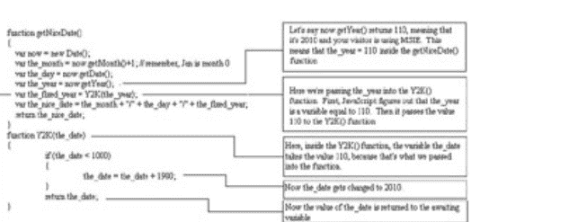

图 6-16：在不同函数中的工作原理

## `var` 的真实本质

`Y2K()` 函数无法访问 `getNiceDate()` 中变量 `the_year` 的原因是，当你定义 `the_year` 时，你在它前面加上了单词 `var`：

```javascript
var the_year = now.getFullYear();
```

这个词告诉 JavaScript 为该函数创建此变量。如果没有 `var`，你可以在 `Y2K()` 函数内部访问 `the_year`。你可能认为这是一件好事。为什么不在程序的任何地方访问 `the_year` 呢——为什么要把它隐藏在 `getNiceDate()` 内部？在函数内部创建可以被其他函数影响的变量，是导致难以调试问题的主要原因。考虑图 6-17 中的示例，看看如果你定义了变量将可以避免哪些头疼的问题：

```html
<html>
<head>
<title>Encapsulation</title>

<script language="JavaScript">
<!-- hide me

function getNiceDate() {
  the_name = prompt("what's your name?");
  alert("fido has " + the_name);
}

function Y2K(the_date) {
  alert(the_name);
}

// hide me -->
</script>
</head>

<body>
</body>
</html>
```

图 6-17：没有 `var` 的情况

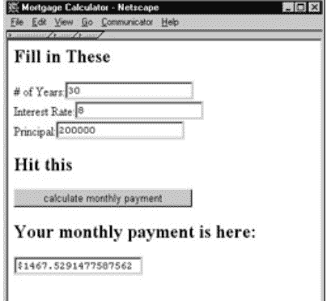

图 7-1：抵押贷款计算器

你也可以将表单作为导航工具。太阳系统（Sun Microsystems）网页的首页有一个下拉菜单，可以作为导航工具。点击菜单，向下拖动以突出你想要的部分的名称，然后松开鼠标——JavaScript HTML 在网页上绘制了图 7-1 和图 7-2 所示的表单，而 JavaScript 则读取访问者填写的信息。大多数使用 JavaScript 的表单都遵循这种模式。让我们先看看如何用 HTML 为你的网页编写表单。

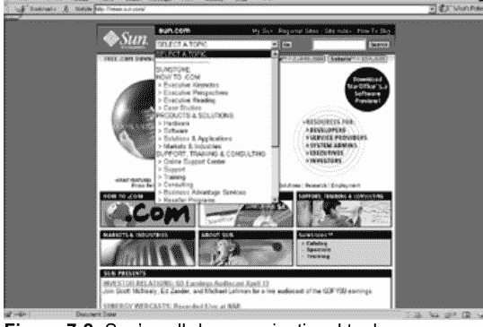

图 7-2：Sun 网站的下拉导航工具

## 表单基础

图 7-3 显示了一个简单的表单，图 7-4（第 118 页）显示了该表单的 HTML。

### 图 7-3：一个简单的表单

### 文本字段

如你在图 7-3 中所示，图 7-4 中的 HTML 在屏幕上绘制了两个框。你网站的访问者可以点击文本框内部并输入姓名和年龄。

```html
<html>
<head>
<title>一个非常基础的 HTML 表单</title>
</head>

<body>
<form>
Name: <input type="text"> <br>
Age: <input type="text"> <br>
</form>
</body>
</html>
```

图 7-4：图 7-3 中基础 HTML 表单的代码

注意，该表单是由普通的 HTML 构建的。与大多数 HTML 一样，表单必须放在 `<body>` 和 `</body>` 标签之间。表单以 `<form>` 标签开始，以 `</form>` 标签结束。在表单内部，你将看到第 2 和 3 个包含信息的元素。在本章，你将遇到各种不同的元素，每种元素都有特殊的特性。2 和 3 中的元素被称为文本字段。它们允许用户在字段中输入姓名或文本。稍后你将学习 JavaScript 如何读取用户的输入。

`<input type="text">` 部分告诉浏览器绘制一个文本字段。`input` 之前的单词以及其后的 `<br>` 都是普通的 HTML。`input` 本身告诉浏览器创建一个文本输入字段。你可以通过属性修饰文本字段；可以通过设置其大小使文本框变大：

```html
<input type="text" size="40">
```

文本字段的大小大致等于字段内可以容纳的字符数。你也可以告诉浏览器在文本框中放置单词。例如，如果你想在文本框内出现“your name in here”字样，请输入此：

```html
<input type="text" value="type your name in here">
```

通过设置文本框的 `value`（值），你决定了它的内容。记住 `value` 这个术语——它以后会有用处。

## 按钮、复选框、单选按钮

除了文本字段外，你还可以在表单放置按钮、复选框和单选按钮。图 7-5 显示了这些元素的外观，图 7-6 显示了用于绘制图 7-5 的 HTML。

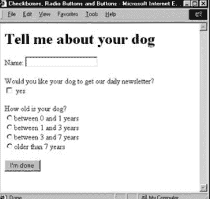

图 7-5：复选框、单选按钮和按钮

```html
<html>
<head>
<title>复选框、单选按钮和按钮</title>
</head>

<body>
<h1>Tell me about your dog</h1>

<form>
Name: <input type="text">

Would you like your dog to get our daily newsletter?<br>
<input type="checkbox"> yes <br>

How old is your dog?<br>
<input type="radio" name="age">between 0 and 1 years<br>
```


```html
<input type="radio" name="age">between 1 and 3 years<br>
<input type="radio" name="age">between 3 and 7 years<br>
<input type="radio" name="age">older than 7 years<br>
<input type="button" value="I'm done">
```

```html
</form>
</body>
</html>
```

图 7-6：复选框、单选按钮和按钮的 HTML

### 复选框

图 7-6 中的代码显示了复选框的 HTML。如果你想让复选框默认选中，请在元素内部放入`checked`单词，如下：

```html
<input type="checkbox" checked>
```

### 单选按钮

单选按钮与复选框的不同之处在于它们是互斥的，你只能选择一组中的一个。如果你想让单选按钮默认选中，请在元素内部放入`checked`单词如下：

```html
<input type="radio" name="age" checked>
```

### 按钮

最后的输入类型是按钮。如果你想在按钮上显示文字：

```html
<input type="button" value="I'm done">
```

### 选择元素

我们讨论过的所有元素除了是选择元素，下拉列表与复选框有所不同。图 7-7 显示了选择列表的外观，图 7-8 显示了用于绘制选择的 HTML。


图 7-7：选择列表

```html
<html>
<head>
<title>Select Element</title>
</head>
<body>
<form>
Choose your favorite fruit:

<select size="3">
<option>Apple</option>
<option>Banana</option>
<option>Cherry</option>
</select>
</form>
</body>
</html>
```

图 7-8：选择元素的 HTML

`size`属性决定了选择列表中显示多少个选项。如果你想让选择列表显示 3 个选项，如下：

```html
<select size="3">
<option>Apple</option>
<option>Banana</option>
<option>Cherry</option>
</select>
```

### 多个选项

如果你想让用户选择多个选项，请在`<select>`标签内放入`multiple`单词：

```html
<select multiple>
```

### 文本区域

如果你想让用户输入多行文本，你必须使用`textarea`，它允许用户输入他们喜欢的信息。图 7-9 显示了`textarea`在浏览器中的外观，而图 7-10 显示了用于绘制它的 HTML。

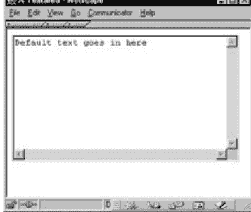

图 7-9：textarea 元素

```html
<html>
<head>
<title>A Textarea</title>
</head>
<body>
<form>
<textarea rows="10" cols="40">
默认文本在这里
</textarea>
</form>
</body>
</html>
```

图 7-10：textarea 和`</textarea>`标签的 HTML

## 表单与 JavaScript

一旦你在网页上有了表单，就可以使用 JavaScript 从表单中读取信息并向表单写入信息。例如，抵押贷款计算器根据本金、利率和其他用户输入表单的其他信息，计算每月还款额，并将结果写入表单。

### 命名表单元素

但在从表单读取或写入一个元素之前，你需要告诉 JavaScript 你在说哪一个表单——为你的表单及其元素命名。图 7-11 中的简单表单向你展示了如何命名表单（1）及其元素（2）和（3）。注意，你不能命名`<option>`标签（4）。

```html
<html>
<head>
<title>带命名的表单</title>
</head>
<body>
<form name="myForm">
Name: <input type="text" name="username"> <br>
Age: <input type="text" name="userage">
</form>
</body>
</html>
```

```html
<body>
<h1>一个带有命名的表单</h1>

(1)<form name="my_form">
(2) <input type="text" name="the_age_field">

性别：

(3)<select name="the_gender">
(4)<option>
<option>female</option>
</select>
</form>

</body>
</html>
```

## 图 7-11：带有命名的表单

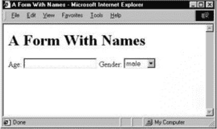

图 7-11：图 7-11 中的表单

在命名元素时，你应该遵循与为图像交换命名图像标签相同的原则：不要使用空格，并确保没有其他 HTML 元素具有相同的名称。例如，不要将文本字段命名为`body`，因为`body`是一个 HTML 标签。如果你这样做，某些浏览器可能会发现你的问题，但另一些浏览器会给访问者带来 JavaScript 错误。你可以像命名文本字段和选择框一样命名按钮、复选框、文本区域和单选按钮。

## 命名单选按钮

单选按钮是一个特殊情况。由于同一组的所有单选按钮都接收相同的名称，我们无法通过名称来确定选择了哪个单选按钮。在单选按钮标签内部放入`value="something"`可以让我们区分同一组中的单选按钮（见图 7-13）。

```html
<html>
<head>
<title>单选按钮内部的数值</title>
</head>
<body>
<form name="radio_button_form">
<br>
你的狗多大了？ <br>
<input type="radio" name="age" value="puppy">0 到 1 岁<br>
<input type="radio" name="age" value="young">1 到 3 岁<br>
<input type="radio" name="age" value="middle_age">3 到 7 岁<br>
<input type="radio" name="age" value="older">7 岁以上<br>
</form>
</body>
</html>
```

## 图 7-13：在单选按钮内部放置数值

我将每个单选按钮命名为`age`，以显示它是年龄组的一部分，但每个按钮都有它自己的值。

## 命名选项

select 元素中的`<options>`标签也是如此。虽然 options 不接收名称，但它们确实接收值。为了使用 JavaScript 确定访问者从下拉列表中选择了什么，我们需要在 options 内部放置值。位于第 126 页的图 7-14 显示了图 7-11 的变体，在`<option>`标签中添加了值。

在图 7-14 中，`<select>`标签获得了名称 1，`<option>`标签获得了值 2 和 3。当我们使用 JavaScript 确定用户选择了哪个选项时，我们将获取的是该选项的值。如果访问者选择了 Female（女性）选项，由于 option 内部有`value = "female"`，我们将获取到 female。

```html
<html>
<head>
<title>在 option 标签内带有数值的表单</title>
</head>
<body>
<h1>一个带有命名的表单</h1>

<form name="my_form">
年龄： <input type="text" name="age_field">

性别：

<select name="the_gender">
<option value="male">Male</option>
<option value="female">Female</option>
</select>
</form>

</body>
</html>
```

## 图 7-14：`<option>`标签内的数值

## 读取和设置表单元素

一旦你的表单和表单元素有了名称，JavaScript 就可以轻松发现访问者在表单元素中输入了什么。只需告诉 JavaScript 你想要信息的表单和元素即可。

## 从文本字段读取信息

如果你想查看用户在图 7-11 中命名为`the_age_field[2]`的文本字段中输入了什么值，请使用：`window.document.my_form.the_age_field.value`定位 window，找到文档中名为`my_form`的表单，在该表单中找到名为`the_age_field`的表单元素，并读取其值。图 7-15 显示了如何使用表单元素构建一个简单的计算器。

```html
<html>
<head>
<title>非常简单的计算器</title>

<script language="JavaScript">
<!-- 隐藏于旧版浏览器 -->

function multiplyTheFields()
{
1 var number_one = window.document.my_form.field_one.value;
2 var number_two = window.document.my_form.field_two.value;
3 var product = number_one + " * " + number_two + " is: " + product;
}

// 结束字段注释 -->
</script>
</head>

<body>
5<form name="form">
6 数字 1： <input type="text" name="field_one"><br>
7 数字 2： <input type="text" name="field_two"><br>
8 <a href="#" onclick="multiplyTheFields(); return false;">相乘它们！</a>
</form>
</body>
</html>
```

## 图 7-15：非常简单的计算器

此示例展示了文本字段和一个链接。当用户点击链接时，图 7-16 显示出现了一个带有结果的警框。

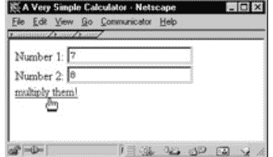

图 7-16：显示结果

## 图 7-17：放置结果

函数`multiplyFields()`负责工作。

## 图 7-18：设置结果

图 7-19 和 15 区别在于增加了一个新字段。

## 图 7-19：代码

```html
<html>
<head>
<title>测验</title>
```

```html
<script language="JavaScript">
<!-- 在旧浏览器中隐藏我 -->

function scoreQuiz() {
  var correct = 0;

  if (document.document.form.question1.checked == true) {
    correct = correct + 1;
  }

  if (document.document.form.question2.checked == true) {
    correct = correct + 1;
  }

  if (document.document.form.question3.checked == false) {
    correct = correct + 1;
  }

  alert("you got " + correct + " answers right!");
}

<!-- 结束注释 -->
</script>

<body>
<h1>小测验</h1>

勾选正确的语句：

<form name="_form">
  <input type="checkbox" name="question1"> 人类是没有羽毛的双足动物
  <input type="checkbox" name="question2"> 所有的袋鼠都是没有父亲的二足动物
  <input type="checkbox" name="question3"> 人类都是袋鼠
  <input type="button" value="score this" onclick="scoreQuiz()">
</form>
</body>
</html>
```

**图 7-21：**当点击上面的按钮元素时，会调用`scoreQuiz`函数。该行创建了一个变量`correct`并将其值设置为 0。这用于跟踪访问者答对了多少题。如果访问者点击第一个问题旁边的复选框，代码将给访问者一分；它获取第一个复选框中`checked`属性的值并选中该复选框。它的`checked`值为`true`，因此给变量`correct`加 1，对第二个问题执行同样的操作。

`if`语句与另外两个略有不同。如果第三个复选框的`checked`属性为`false`（即访问者没有选择该复选框），JavaScript 应该给`correct`加 1。最后，它会显示他们表现得如何。

为了让访问者在点击图 7-20 中的按钮时显示`scoreQuiz()`函数的结果，我们可以通过将其`checked`属性设置为`true`或`false`来使用`scoreQuiz`。第 132 页的图 7-22 更新了`scoreQuiz()`函数以给出正确答案。

在图 7-22 中，它在每个子句中加 1，这设置了`correct`，从第一个`if`子句开始，“如果访问者勾选了第一个复选框，则答案是正确的，因此给变量`correct`加 1。否则，选中第一个复选框以指示正确答案。”如果访问者跳过了，它将通过将`checked`属性设置为`true`来选中第一个复选框。

```javascript
function scoreQuiz() {
    var correct = 0;

    if (window.document.the_form.question1.checked == true) {
        correct = correct + 1;
    } else {
        window.document.the_form.question1.checked = true;

        if (window.document.the_form.question2.checked == true) {
            correct = correct + 1;
        } else {
            window.document.the_form.question2.checked = true;

            if (window.document.the_form.question3.checked == false) {
                correct = correct + 1;
            } else {
                window.document.the_form.question3.checked = false;

                alert("you got " + correct + " answers right! The correct answers are now shown;");
            }
        }
    }
}
```

## 图 7-22：来自 7-21 的`scoreQuiz()`函数，修改后可显示正确答案

## 读取和设置单选按钮

与文本字段和复选框相比，读取和设置单选按钮稍微复杂一些。因为一组所有的单选按钮具有相同的`name`，你不能直接请求具有特定名称单选按钮的设置：JavaScript 不知道你指的是哪一个。

为了克服这个困难，JavaScript 将所有具有相同`name`的单选按钮放在列表中。列表中的每个单选按钮分配了一个数字。组中的第一个单选按钮是 0，第二个是 1，第三个是 2，以此此类推。（大多数编程语言都从 0 开始计数——你只需要使用这一点。）

要引用单选按钮，使用`radio_button[item_number]`。例如，如果你有四个单选按钮，第一个将是`[0]`，第二个是`[1]`，第三个是`[2]`，第四个是`[3]`。

如果你想查看用户是否选择了某个单选按钮，必须查看它的`checked`属性，就像处理复选框一样。假设在一个名为`radio_button_form`的表单中有四个名为`age`的单选按钮，如图 7-13 所示。如果你想查看用户是否选择了`age`组中的第一个单选按钮，可以写如下：

```javascript
if (window.document.radio_button_form[0].checked == true)
```

```javascript
alert("first radio button was selected!");
```


你对复选框使用相同的方法。区别在于你必须将`age`组中的第一个复选框引用为`age[0]`，而复选框可以直接给出它的名称。

一旦你知道了如何判断单选按钮是否被选中，就可以理解如何使用 JavaScript 选择单选按钮了。对于复选框，使用类似下面的代码：

```javascript
window.document.form_name.checkbox_checked = true;
```

对于单选按钮，你必须通过引用列表来告诉 JavaScript 你指的是哪一个按钮。要选择名为`age`的第一个单选按钮，输入：

```javascript
window.document.form_name.age[0] = true;
```

## 读取和选择下拉菜单与滚动列表

读取和设置下拉菜单和滚动列表比单选按钮稍微复杂。JavaScript 可以如下读取下拉菜单和滚动列表。首先，单选按钮具有`checked`属性，而下拉菜单和滚动列表具有`selectedIndex`，包含了选项的索引。

要确定用户在菜单中选择了男性还是女性，你可以写如下：

```javascript
var gender_number = window.document.the_form.selectedIndex;
```

1. 通过查看菜单的`selectedIndex`确定选中的选项。
2. 获取所选选项的值。

通常情况下，上述两点会合并为一行，如下所示：

```javascript
var chosen_gender = window.document.the_form.options[window.document.the_form.selectedIndex].value;
```

## 表 7-1：不同表单元素可以处理的某些事件

| 表单元素 | 事件 | 触发事件的操作 |
|---|---|---|
| 文本区域 (Textarea) | onChange | (网页页面上的任何字段) / 更改文本区域的内容并点击外部 |
| 下拉列表 (Select) | onChange | 更改菜单或列表中的选择 |
| 表单 (Form) | onSubmit | 在文本字段内按回车键或点击提交按钮 |

请注意，文本字段、文本区域和选择框只有在有人更改它们的内容时才会触发事件。如果用户点击下拉菜单，然后选择了一个已经选中的选项，这并不会触发`onChange`事件。同样，如果有人点击了文本字段并点击了其他地方，而没有更改文本中的任何内容，`onChange`不会记录此操作。

同样注意，表单元素包含一个名为`onSubmit`的事件。表单是*通过提交按钮提交的*。图 7-24 展示了你如何使用带有`onSubmit`事件的表单构建一个非常简单的浏览器。

```html
<html>
<head>
<title>Simple Browser</title>
</head>
<body>
输入一个 URL，然后按按提交按钮或直接按回车键。
```

```html
1 <form name="form" onSubmit="window.location = window.document.the_form.url.value; return false;">
<input type="text" name="_url" value="http://"
2 <input type="submit" value="go there!">
</form>
</body>
</html>
```

图 7-24

1. 显示了`onSubmit`的作用。在这种情况下，`onSubmit`的意思是：“每当有人提交此表单时，查看名为`the_url`的表单元素，并将此人发送到该 URL。” 这种操作发生在访问者在文本字段中输入回车键或点击提交按钮 2 时。1 末尾的`return false`防止了 Web 浏览器在表单提交时接管对 JavaScript 的控制权。如果没有它，JavaScript 命令将永远不会执行。

## 制作这个快捷方式

你可能已经注意到图 7-24 中的 1 有点长。你可以通过将大部分用于标识表单的`window.document.the_form`替换为单词`this`来缩短它，`this`指的是它包含的内容。例如，在图 7-24 的 1 中，查找`the_url`的代码位于表单内部。这意味着你可以将所有标识表单的代码替换为单词`this`——你可以在图 7-25 中写如下：

```html
<form name="form" onSubmit="window.location = this.url.value">
```

我将标识表单的元素`window.document.the_form`替换为了`this`，因为`this`位于表单内部。虽然很难知道`this`具体是什么，但通常情况下它指的是它本身。

这里是另一个例子。我们写了一个函数`checkEmail()`，它确保输入到表单的电子邮件地址是有效的（我们将在第 11 章中介绍）。用于收集电子邮件地址的表单和文本框可能如下：

```html
<form name="form">
<input type="text" name="email"
onchange="checkEmail(window.document.the_form.email.value)">
</form>
```

然而，`onChange`内部的元素`window.document.the_form.email`仅仅标识了它所在的字段。因为文本字段正在将其值发送给`checkEmail`函数，所以文本字段的`onChange`可以重写为：

```html
onchange="checkEmail(this.value)"
```

在这里，术语`this`替换了`window.document.the_form.email`，因为它出现在字段处。

## 使用下拉菜单作为导航工具

现在你准备好创建一个导航下拉菜单了，就像 Microsystems 显示的工具提示样式那样，图 7-26（在图 7-25 的第 138 页）提供了脚本。

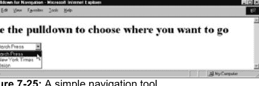

图 7-25：一个简单的导航工具

到为止你应该已经了图 7-26 中的大部分脚本。其中的`onChange`是唯一棘手的部分（记住`<select>`标签使用`onChange`事件）。当`onChange`发生时，它会调用函数`visitSite()`，该函数接收此值：`this.options[this.selectedIndex].value;`

```html
<html>
<head>
<title>A Pull-Down Menu for Navigation</title>
<script language = "JavaScript">
<!-- 对旧版浏览器隐藏我 -->
function visitSite(the_site) {
window.location = the_site;
}
// 显示我 -->
</script>
</head>
<body>
<h1>使用下拉菜单选择你想去的地方</h1>
<form name="the_form">
<select name="the_select" onChange="VisitSite(this.options[this.selectedIndex].value);">
<option value="http://www.nostarch.com">No Starch Press</option>
<option value="http://www.nytimes.com">The New York Times</option>
<option value="http://www.theonion.com">The Onion</option>
</select>
</form>
</body>
</html>
```

**图 7-26：** 使用下拉菜单作为导航工具

单词`this`出现了两个实例，让理解变得有点困难。让我们将其扩展为它所代表的内容。因为这个单词出现在`<select>`标签中，它代表`<select>`。上面那行的长版本是`window.document.the_form_select.options[window.document.the_form_select.selectedIndex].value`。你可以看到这可以节省大量空间。在任何情况下，我们都通过查看下拉菜单的`selectedIndex`来获取被选中选项的索引。一旦知道了那个数字，我们就可以查看`options`列表获取被选的值。

## Microsystems 如何创建其下拉导航

Sun Microsystems 的下拉导航代码与图 7-26 中的略有不同，图 7-27 显示了 Sun 的代码，为了节省空间进行了缩写。

```html
<html>
<title>Sun Microsystems</title>
<SCRIPT LANGUAGE="JavaScript">
<!--
function gotoFunction() {
  self.location = document.productGoto.productList.options[document.productGoto.selectedIndex].value;
}
</SCRIPT>
<HEAD>
<BODY BGCOLOR="#666669" LINK="#666669" VLINK="#666669" ALIGN="#
```

图 7-27：Microsystems 的下拉导航

Sun 的脚本非常有趣。下拉工具中的每个选项都有一个值，即如果访问者选择该选项时要访问的 URL。然而，前两个只是显示格式——如果你选择其中一个，Sun 并不想让你去任何地方，而且每个选项都给出一个井号 (#) 作为值。在 HTML 中，井号意味着页面顶部。由于访问者已经在页面顶部，这并不会产生影响。

现在让我们查看发送并引导访问者到合适位置的函数。该函数首先查找选中选项的索引：`document.productGoto.productList.selectedIndex`

如果它返回了你想要的值，一个 URL：`document.productGoto.productList.options[document.productGoto.selectedIndex].value`

然后它使用`self.location`将访问者发送到该 URL。注意 Sun 使用的是`self.location`而不是`window.location`——两者实际上是互换的。

## 作业

编写一个显示旧金山、纽约、伦敦和东京时间的时钟。该时钟应该包含一个显示时间的文本字段、一个更新时钟的按钮，以及四个针对不同时区的单选按钮。当你点击其中一个单选按钮时，正确的时间应该出现在文本字段中。当点击点击更新按钮时，时钟将根据你所选的时区进行更新。

图 7-28 展示了一个示例。


# 作业

编写一个显示旧金山、纽约、伦敦和东京时间的时钟。该时钟应该包含一个显示时间的文本字段、一个更新时钟的按钮，以及四个针对不同时区的单选按钮。当你点击其中一个单选按钮时，正确的时间应该出现在文本字段中。当点击更新按钮时，时钟将根据你所选的时区进行更新。

图 7-28 展示了一个示例。

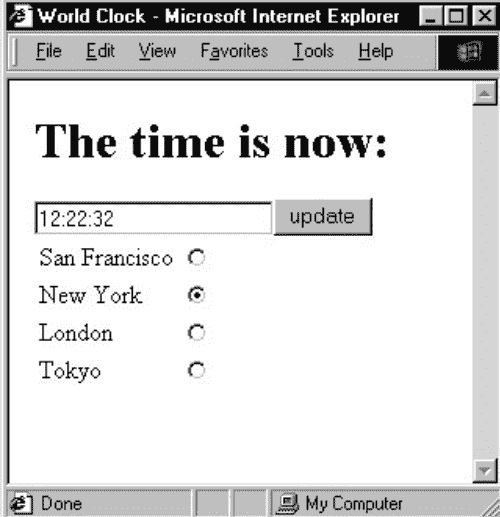

**图 7-28:** 更新不同城市的计时

回想第 2 章如何获取当前小时：

```
var now = new Date();
var hour = now.getHours();
```

`Date` 对象有几个方法可以帮助处理不同的区域。在这种情况下，请使用`getUTCHours()`、`getUTCMin()`和`getUTCSeconds()`。这些方法可以告诉你协调世界时（UTC）的小时、分钟和秒，UTC 以格林威治标准时间为世界标准。

伦敦时间与 UTC 时间相同。纽约时间比伦敦晚五小时，加利福尼亚比伦敦晚八小时，东京比伦敦早九小时。

一如既往，答案在附录 C 中，但如果你在查看答案之前尝试完成这项作业，你会学到更多。这道作业并不简单，所以如果花费超过一小时才完全正确，请不要惊讶。

# 第 8 章：使用数组和循环跟踪信息

## 概述

上一章向你展示了 JavaScript 如何在列表中存储单选按钮和下拉列表选项。在程序员的术语中，列表被称为数组。本章将教你如何创建自己的数组，并使用它们来跟踪大量信息。

在本章中，你将学习如何：

- 使用 JavaScript 的内置数组来控制你的 HTML。
- 创建你自己的信息新数组。
- 使用循环在数组中搜索信息。

## 数组的现实世界示例

JavaScript 的内置数组在各种应用程序中非常有用。例如，HotMail 使用 JavaScript 的内置数组让用户移动或删除电子邮件（参见图 8-1）。在 HotMail 消息列表的顶部，你会看到一个复选框。点击该框允许所有其他复选框都被选中。这个技巧之所以简单，是因为复选框存储在数组中，允许 HotMail 使用 JavaScript 检查每一个选框。在你的 CD 上，运行`hotmail`来查看`sites/hotmail`的这一效果。

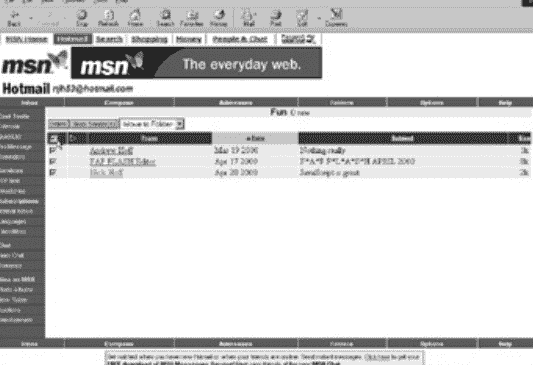

图 8-1：HotMail 复选框

创建你自己的数组也可以用。图 8-2 中的 As Jeeves `textarea` 使用数组向用户显示他人提过的问题。你会看到几十个问题中的一个在框框中轮换。As Jeeves 将此问题列表存储在 JavaScript 数组中，并遍历该数组将不同的问题放入其中。简单的原理也适用于制作定时幻灯片，我们将在下一章看到。

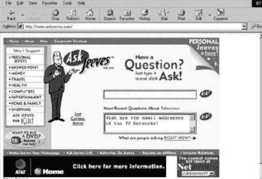

图 8-2：As Jeeves 的旋转问题

## JavaScript 的内置数组

当 Web 浏览器读取 HTML 页面时，它会自动创建许多数组。在在上一章中，我们看到 JavaScript 会为每一组具有相同名的单选按钮创建一个数组。如果你创建了一组名为`age`的单选按钮，你可以像这样引用该组中的第一个单选按钮：

```
window.document.the_form.age[0]
```

JavaScript 还会为每个下拉菜单和滚动列表中的选项创建一个数组。以下是你如何访问名为`gender`的下拉菜单中的第二个选项：

```
window.document.form.gender.options[1]
```

这些只是 JavaScript 自动创建的数组。浏览器会自动创建一个包含 Web 页面上所有图像对象的`images`数组。表单元素也是如此（表单元素数组被称为`elements`）。在图 8-3（文档对象模型）中，你可以看到哪些元素（带有文字的框）是被创建的。

## 当前窗口

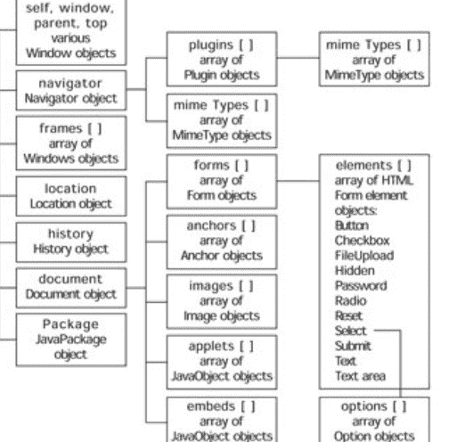

**图 8-3：DOM**

这些数组中的每一个都是根据页面创建者编写 HTML 构建的。在`images`数组中，Web 页面上的第一个图像称为`images[0]`，第二个是`images[1]`，依此类推。如果你使用`images`数组，就不需要交换它们（如第 4 章所示）。例如，你可以将 Web 页面上的第一个图像与名为`happy.gif`的图像交换：`window.document.images[0].src = 'happy.gif';`

**为什么内置数组很有用**

为什么你想要使用内置数组而不是命名 HTML 元素？有时你必须这样做，正如我们在第 7 章中看到的，因为一组中的所有单选按钮都具有相同的名称，你只能通过内置数组来访问它们。

当页面上有许多元素时，内置数组也很有用。如果你有一个包含 100 张图像的 Web 页面，为它们进行命名将变得非常繁琐。相反，你可以通过编号引用每个图像（对于一个 100 个元素的集合，编号为 0 到 99）。

然而，数组最好的点是，少量的 JavaScript 就可以作用于数组中的每个元素——如果你有一个 100 个元素的数组，这将节省大量时间。在 HotMail 示例中，点击一个复选框会选中所有的单独复选框。无论你有多少个复选框这并不重要。

**确定数组包含多少项**

为了影响数组，你需要知道数组中包含多少个元素，并编写代码来遍历它们。在 HotMail 示例中，由于一组单选按钮都具有相同的名称，你只能通过内置数组来访问它们。正如代码中所示的，JavaScript 属性告诉我们页面上的数量。

```
<script language="JavaScript">
var num_images = window.document.images.length;
alert("there are " + num_images + " images on this page.");
</script>
```

**图 8-4：图像的数量**

**遍历数组**

一旦你知道数组中有多少个复选框，就可以编写代码来遍历它们。如果你想处理所有的复选框，可以像图 8-5 所示那样编写 JavaScript 代码。

```html
<html>
<head>
<title>Checking Checkboxes</title>
</head>
<body>
<form name="the_form">
<input type="checkbox"> One>
<input type="checkbox"> Two>
<input type="checkbox"> Three>
<input type="checkbox"> Four>
<input type="button" value="check all" onclick="checkAll()">
</form>
<script>
function checkAll() {
for (var i = 0; i < window.document.the_form.elements.length; i++) {
window.document.the_form.elements[i].checked = true;
}
}
</script>
</body>
</html>
```

**图 8-5：检查复选框**

这种方法可以处理任何数量的复选框，而不需要手动为每一个命名。

## 循环

一旦你知道数组中有多少个元素，就可以编写代码来遍历它们。如果你想处理所有的复选框，可以像图 8-5 所示那样编写 JavaScript 代码。

由于小于三，脚本会执行 5 和 4 之间的两行代码：

向网页写入单词 happy，5 将 index 加 1，将其从零变为一。

我们执行 5 并到达了大括号 6 处，JavaScript 跳回到第 2 行检查 index 是否小于三。这就是 while 循环的本质。每当 JavaScript 执行完循环时，它都会跳回 2 检查括号中的条件是否仍然为真。因为 index 小于三，JavaScript 执行 4 再次打印 happy；如果执行 5，则会给 index 加 1（其值为 1）。

再次，因为是一个 while 循环，JavaScript 从 3 跳到 2，并检查 index 是否小于三。确实如此，因此 4 和 2 再次执行。happy 这个单词第三次出现，脚本将 index 从二递增到三。

再次，JavaScript 从 3 跳到 2，并检查 index 是否小于三。这一次，index 等于三，所以测试 `(index < 3)` 不为真。while 循环结束后，JavaScript 跳到 7，即大括号之后的那行代码。

许多人对循环感到很困难，请确保你理解它是如何工作的。你可能会发现将其翻译成英文会有帮助：当 index 小于三时，写入 happy 并给 index 加 1。

## While 与数组

现在你已经知道了 while 是如何工作的原理，你可以将其应用于数组。回顾图 8-5 中的函数，注意这四行中的每一行都基本相同：

`window.document.the_form.elements[number].checked = true;`

区别在于方括号。考虑图 8-7 中的 index。脚本每经过一次循环，index 的值就会增加 1。这使得 index 变量成为访问数组中每个元素的理想选择。图 8-8 使用 index 创建了一个比图 8-5 更灵活的版本。

```html
<html>
<head>
<title>Checking Four Checkboxes</title>
<script language="JavaScript">

<!-- hide me -->
function checkFour() {
  var index = 0;
  while (index < 4) {
    window.document.the_form.elements[index].checked = true;
    index += 1;
  }
} // show me --
</script>
</head>
<body>
<form name="the_form">
<input type="checkbox"> One <br>
<input type="checkbox"> Two <br>
<input type="checkbox"> Three <br>
<input type="checkbox"> Four <br>
<input type="button" value="check 'em" onclick="checkFour();" <br>
</form>
</body>
</html>
```

**图 8-8：使用循环检查四个复选框**


关键行第 4 写道：“将元素编号`index`设置为`true`”。第一次通过循环时，`index`为零，4 检查第一个元素（第一个复选框）。然后 5 增加`index`，将`index`从零变为四。JavaScript 到达 8 并跳回到 2，执行 4，由于`index`小于四，于是重复该过程直到`index`等于四。当`index`等于四且 JavaScript 跳到 2 时，循环结束（`index`不再小于四），JavaScript 跳到 6，即闭大括号后的那行。

将循环和数组结合是非常常见的，所以请确保你理解这个过程。这种循环的优点是，无论你有几个复选框还是一千个它都有效。要让代码适用于 4,000 个复选框，只需将第 2 行中的数字 4 改为 4000 即可。循环将运行 4,000 次，从 0 开始，在`index`等于 4,000 时结束。

## 在图 8-8 中使用数组长度：循环

图 8-8 中的代码可以工作，但它还有一个改进空间。通常情况下，代码中的数字越少越好：使用特定的数字往往会导致代码仅适用于特定情况。在图 8-8 中，例如第 2 行只有在页面上恰好出现复选框时才有效。如果你在网页上添加另一个复选框，就必须将第 2 行的数字 4 改为 5。与其依靠记忆，不如像这样重写第 2 行：

```javascript
while (index < window.document.form.elements.length)
```

表达式`window.document.form.length`始终等于页面上的元素数量，添加另一个复选框会自动增加元素数组的长度。

## 递增快捷方法

图 8-8 中的第 5 行出现非常频繁，程序员们想出了简写`index++`来代替`index = index + 1`。这种变量`index`节省了你输入两次`index`的麻烦。我们还将看到许多类似的快捷方法。

## 警惕死循环

你应该像远离瘟疫一样避免常见的循环错误。它太常见了，甚至有一个名字：死循环。当你的代码进入一个永远无法退出的循环时，就会发生死循环。图 8-9 向你展示了这个经典的错误。

```javascript
var index = 0;

while (index < 10)
{
  window.document.write("I am infinite! <br>");
}
```

## 图 8-9：经典的循环——不要在家尝试

运行这个脚本会让你难过，如果你这样做，它将永远运行。避免死循环的唯一方法是确保条件最终变为假。在上面的示例中，`index`在每次循环中递增，所以它最终将达到 10，条件`(index < 10)`将变为假，循环终止。如果你忘记递增`index`，条件将始终为真，循环将永远运行。这被称为死循环。

`e`创建了一个新变量`e`（这也是一个糟糕的名字），并将其赋值为表单元素之一。具体指向哪个元素取决于`i`的值。在循环的第一次中，`i`将为 0，因此它将指向 HTML 表单中的第一个元素——复选框。循环第二次时，`i`将为 1，因此`e`将指向第二个复选框。循环发生四次，对应每个复选框。如果最后一个复选框被勾选了，HotMail 想要设置前三个复选框的`checked`值。如果最后一个复选框未勾选，其他复选框应该取消勾选。`e`通过设置它所指向的复选框的`checked`值来实现——使其与最后一个复选框的`checked`值相同。

7 是此脚本的最后一行。这一行获取循环中每个元素的名称。正如获取`checked`值一样，你可以通过查看`checkbox.name`获取复选框的名称。如果该元素不受允许，它将不会执行。实际上，这行代码的意思是不要改变选中状态。”`name`决定了复选框的名称。

严格来说，7 并不是必要的。保留 7 意味着脚本会将最后一个复选框的`checked`值设置为——嗯，也就是最后一个复选框的`checked`值。虽然这不会导致任何问题，但它浪费时间，因此通过第 7 行防止这种情况是一种优雅的设计。

## 创建你自己的数组

数组是你想要自己创建的内容。例如，电话电话簿就是姓名和电话号码的数组。你可以将调查问看作是一个问题的数组；数组还可以存储访问者输入的答案。幻灯片是一个按顺序展示的图片数组。

JavaScript 赋予了你创建自己的数组的能力。如果你知道要在数组中存储什么，就可以创建它，如下所示：

```javascript
rainbow_colors = new Array("red","orange","yellow","green","blue","indigo");
```

这一行创建了一个名为`rainbow_colors`的变量，它存储了一个颜色数组。`new Array()`单词将告诉 JavaScript 创建一个新对象，就像第 2 章中`new Date()`创建一个新 date 对象一样。要向数组中存入值，只需在参数中列出它们即可。

你已经了解到，JavaScript 的内置数组也适用于你创建用于存储的数组。图 8-12 使用`rainbow_colors`数组在网页上创建一个迷幻效果。

图 8-12 设置了循环，内容：“当`index`小于数组中的项目数量时，执行大括号之间的 JavaScript 代码。”在循环的第一次，`index`为 0，所以当它查找`rainbow_colors[index]`时，它获取的是数组中的第一项，值`red`。它将其赋值给`window.document.backgroundColor`，从而将背景色设置为红色。一旦脚本开始，它会将`index`加 1，然后重新循环。每次循环时，`index`将是 1，因此它会将背景颜色变为橙色，然后它将`index`加 1 变为 2，再次回到循环。如果你有一台快速计算机，背景闪烁可能太快，你看不清。在这种情况下，请向数组中添加几种颜色。

```html
<<html>
<head>
<title>Strobe</title>
<script language = "JavaScript">
<!-- hide me -->
function strobelt() {
{
(1) var rainbow_colors = new Array("red", "orange", "yellow", "green", "blue", "indigo", "violet");
var index = 0;
(2) while (index < rainbow_colors.length) {
(3) window.document.bgColor = rainbow_colors[index];
(4) index++;
}
} // show me --
</script>
</head>
<<body>
<form>
<input type="button" value="strobe" onclick="strobelt();">
</form>
</body>
</</html>
```

图 8-12: 迷幻闪烁效果

## 处理 Netscape 2.0 数组

Netscape 2.0 与任何其他支持 JavaScript 的浏览器不同，它没有`length`属性，也不提供创建自定义数组的内置方法。有很少的方法可以处理这些差异。一些 JavaScript 编码人员使用第 3 章中涵盖的技术来检测是哪种浏览器正在访问，并编写适当的代码。另一些人则忽略使用 Netscape 2.0 的用户。（截至 2000 年初，Netscape 2.0 占所用浏览器的不到 0.5%。）

一种常用技术是将图 8-13 所示添加到任何创建自定义数组的脚本中。

```javascript
function makeArray(len)
{
for (var index = 0; index < length; index++) {
{
this[index] = null;
}
this.length = len;
}
```

图 8-13: 为 Netscape 2.0 用户提供的函数

此函数专门为 Netscape 2.0 用户创建新数组。与其像这样创建一个新数组：

```javascript
var new_array = new Array();
```

你应该写成：

```javascript
var new_array = new Array(4);
```

如果你的数组包含四个元素。当你确切知道数组将有多少个元素时，这种方法非常有效，但如果你需要创建数组又不想排除 Netscape 2.0 用户，这是你唯一的选择。

## Ask Jeeves 及其已创建的数组

Ask Jeeves 引擎有一个小的文本区域（`textarea`），显示以前搜索的示例。脚本将这些搜索存储在一个数组中，然后使用 JavaScript 遍历该数组，每次显示一次搜索。下一章将讨论如何精确计时这些事件。现在，请注意 Ask Jeeves 是如何创建数组的（见图 8-14）。

```html
<html>
<head>
<title>Ask Jeeves' Use of Arrays and Loops</title>
</head>
<body onload="scroll();">
<SCRIPT LANGUAGE="JavaScript">
-
var text = new Array();
var count = text.length;
var i = 0;
function scroll() {
if (count == null) {
document.rotate.ask.value = "";
}
i = 0;}
setTimeout(scroll(), 3500);
}
if (document.rotate) {
document.rotate.ask.value = text[i];
if (i < count) {
i++;
}
}
</SCRIPT>
<form action="/main/jeeves.asp" method="GET">
<textarea name="ask" rows="30" cols="30"></textarea>
</form>
</body>
</html>
```

图 8-14: 数组与循环的使用

## 图 8-14 的逐行分析

图 8-14 中的代码包含了许多我尚未介绍的技巧。它从 1 开始。

### 检查空白

### `scroll()`函数

在`scroll()`中，我们发现了更多奇特的编程方式。6 检查变量`count`是否确实有值。如果没有，单词 7 表现出更强的谨慎。Ask Jeeves 通过检查`document.rotate`是否存在来确保`rotate`函数已绘制到页面上。如果不存在，`document.rotate`为`false`，`if`语句括号之间的行将不会执行。7 确保 JavaScript 不尝试写入一个不存在的函数。

8 从数组中查找问题并将其写入文本区域。这行代码让 JavaScript 找到名为`rotate`的元素和名为`ask`的元素，并将其设置为等号右侧的任何内容。后者需要更多解释。与其仅仅查找`text`数组中元素`i`的值，然后像下面所示对`i`加 1：

```javascript
document.rotate.ask.value = text[i];
```

```javascript
++;
```

9 直接查找元素`i`的值，然后在这里给`i`加 1：

```javascript
document.rotate.ask.value = text[++i];
```

这种做法是合法的且节省了空间，但稍微难以读。回到第 8 节引入的表示法，如果 Ask Jeeves 这样做：

```javascript
document.rotate.ask.value = text[++];
```

将该行放在`i`之前，JavaScript 会给`i`加 1，然后查找`text[i]`的值。这与下面这段代码等效：

```javascript
i++;
document.rotate.ask.value = text[i];
```

很少看到有人在双加号和双减号运算符的位置上做文章。如果你在查看源码时遇到这种情况，现在你就知道发生了什么了。

接下来的两行（第 9 和第 10 行）对于任何循环遍历数组的程序都很重要。正如 Ask Jeeves 在文本框中所写的，当它在文本框中并移动到数组中的下一个问题时，数组中的问题就会用尽并重新开始。如果变量没有设置为`count`，则说明我们到达了数组的末尾。记住，将`count`设置为数组的长度，因此`count - 1`是数组最后一个元素的位置。第 10 行将变量`i`重置为零，这样当脚本下一次将`text[i]`放入文本框时，它就等于数组中的第一个问题。

1 决定了文本框中问题变化的速度。下一章将对此进行讨论。现在你只需要知道它的意思是：“在 3.5 秒后，`scroll()`函数再次运行。”当脚本调用`scroll()`时，函数会将一个新问题放入文本框，并将`i`增加 1。

## 精简版 Jeeves

图 8-14 有点让人困惑。第 162 页的图 8-15 显示了一个任何条件下都能良好工作的精简版本。

虽然图 8-15 的代码比 Ask Jeeves 的代码多，但它并不一定更好。在编程中，多疑是件好事。你加入的检查越多，你的访问者遇到 JavaScript 错误的概率就越低。如果在图 8-14 和 8-15 的代码之间进行选择，我推荐前者，因为它更健壮。图 8-15 的代码仅仅是更容易理解而已。

```html
<html>
<head>
<title>Ask Jeeves 对数组和循环的使用</title>
</head>
<body onload="scroll();">
<SCRIPT LANGUAGE="JavaScript">
<!--
var text = new Array("Where can I learn about the metabolic
condition diabetes mellitus?", "Where can I learn about general information on smoking?",
"Where can I learn about food labeling?");

var i = 0;

function scroll() {
document.rotate.ask.value = text[i];

i++;

if (i == text.length)
{
i = 0;
}
setTimeout("scroll", 3500);
}
// -->

</SCRIPT>
<FORM NAME="rotate">
<TEXTAREA NAME="ask" ROWS=3 COLS=30 WRAP="VIRTUAL"></TEXTAREA>
</FORM>
</body>
</html>
```

**图 8-15:** 图 8-14 的更精简版本

## 循环可以嵌套

就像`if`语句嵌套在其他`if`语句中，你也可以将循环嵌套在其他循环中。例如，图 8-16 显示了一个脚本在 Web 页面上写一个高 5 个 X、宽 10 个 X 的实心矩形（结果见图 8-17）。它并不非常好用，但它提供了一个嵌套循环的概念。

图 8-16 设置了一个运行五次的循环。每次循环执行时，第二个循环都会运行。该循环会在 Web 页面上写 10 次字母 X。在该循环运行之后，它会在 Web 页面上写一个`<br>`创建换行符。之后，循环再次运行。这种情况发生了 5 次。每次循环运行时，循环都会写一行 10 个 X，然后循环写一个`<br>`。循环内部嵌套循环初看起来可能很困惑，但它们非常有用。

```javascript
for (first_loop = 0; first_loop < 5; first_loop++) {
  for (second_loop = 0; second_loop < 10; second_loop++) {
    window.document.write("X");
  }
  window.document.write("<br>");
}
```

**图 8-16:** 循环嵌套的简单示例

## 在执行过程中创建数组

如果你正在进行测验并想将答案存储在数组中，即使你不知道它将存储什么，也必须创建一个数组。在这些情况下，你需要部分构建你的数组。

从创建一个空数组开始，如下行所示：

```javascript
var answers = new Array();
```

这告诉 JavaScript 创建一个名为`answers`的新数组并保持为空。遗憾的是，这在 Netscape 2.0 中不起（参见“处理 Netscape 2.0 数组”了解如何支持 Netscape 2.0 用户）。

一旦你创建了数组，就可以将值加载其中，如下：

```javascript
answers[0] = "yes";
answers[1] = "no";
answers[2] = "maybe";
```

第一行将 "yes" 放入数组的第一个槽，下一步将 "no" 放入第二个槽，第三行将 "maybe" 放入第三个槽。反转上述三行没有任何区别。单词 "maybe" 进入数组的第三个槽是因为该数字出现在方括号之间。图 8-18 展示了如何使用这种技术来创建一个 Madlib 游戏。

```html
<html>
<head>
<title>Madlib</title>
</head>
<body>
<script language="JavaScript">
<!--
var answers = new Array();
answers[0] = "yes";
answers[1] = "no";
answers[2] = "maybe";

var the_string = "";
the_string += "Once " + answers[0] + " ";
the_string += "then " + answers[1] + " ";
the_string += "maybe " + answers[2] + ".";

document.write(the_string);
// -->
</script>
</body>
</html>
```

**图 8-18:** 使用该技术创建 Madlib 游戏

## 多媒体峡谷的矮人


图 20：浏览器中图 8-19 里的电话簿代码

脚本首先创建一个名为`phone_book`的新数组，然后用第 2 行中的值对它进行填充。

在构建了`phone_book`数组后，脚本定义了一个接收两个参数的函数：`displayNumber(Number)`。该函数接收我们想要使用的值，以及我们想要在电话簿中查找的名字。第 4 行在电话簿中查找该名称并将其存储在`the_number`变量中。它将数字放入文本框中。

启动表单并命名为`the_form`稍微复杂一些。这一行定义了当访问者更改那里的值时发生什么。更改下拉菜单的选择会触发`onChange`事件，该事件调用`displayNumber()`函数。如所述，`displayNumber()`接收两个参数：电话簿和要查找的名字。在这种情况下，我们只有一个名为`phone_book`的电话簿——例如，对于朋友可以叫`friends_book`；对于业务，可以叫`business_book`；对于收藏，可以叫`shop_book`。因为我们可以在每次调用`displayNumber()`函数时决定使用哪个电话簿，所以切换书籍非常容易。如果我们想使用`business_book`电话簿，只需这样调用函数：

```html
<select onChange="displayNumber(business_book,
options[this.selectedIndex])">
```

函数的第二个参数是用于查找的名字。如果我们选择了 Happy（图 8-19 中列出的第一个人），值`happy`就会传递给函数。尝试运行这个示例，确保你理解了`displayNumber()`函数是如何运作的，以及第 2 行中的值是如何进入函数的。

## 总结

本章介绍了所有编程语言背后的两个基本概念：数组和循环。现在你已经学习了变量、`if-then`语句、循环和数组，你已经掌握了计算机编程的所有基础——恭喜你！从现在起，我们学习的所有内容都特定于 JavaScript 如何与浏览器交互。所有棘手的编程细节都留在了过去。

在离开本章之前，请将你所学的内容映射到以下项：

- 创建一个新数组。

- 访问数组中的元素。

- 使用循环遍历数组元素。

- 同时使用`for`和`while`循环。

- 嵌套循环。

- 使用关联数组。

## 作业

为了确保你理解了本章的所有内容，请尝试以下作业。

编写一个创建条图的脚本。该脚本首先询问访问者想要图中有多少个条形。如果访问者想要四个条形，脚本应该询问从一到十的四个条形数值，并为每个数值绘制一个条形。图 8-21 到 8-23 展示了我的意思。为了绘制条形，创建一个正方形的 GIF 或正方形。如果有人想要一个由十个正方形组成的条形，使用循环向页面写入`window.document.writeln("")`十次。

这是另一个作业，给自己留充足的时间完成。

## 探索提示

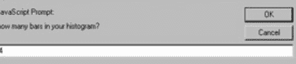

图 8-21：询问访问者想要多少个条形

## 探索提示

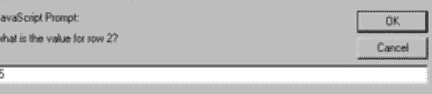

图 8-22：询问条形值

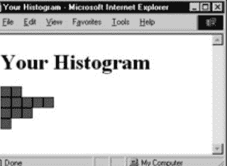

图 8-23：直方图

# 第9 章：定时事件

## 概述

在 Web 页面上对事件进行精确计时将使其从静态文档变为真正的多媒体应用程序。如果你能控制事件计时，就可以暂停幻灯片、定时游戏，并控制访问者执行不同动作的时间。在后面的章节中，我们将展示事件如何让你的整个网站动画化。

在本章中，你将学习：

- 控制 Web 页面上发生事件的时间。

- 构建实时更新的时钟。

- 创建以你任何速度移动的幻灯片。

## 定时事件的现实实例

我们已经见过少量使用定时事件的 Web 示例。在上一章中，我们看到 Jeevees 如何每 5 秒通过一次新查询进行展示。NASA 位于 http://spaceflight.nasa.gov 的航天飞机页面显示了另一个 Web 页面定时示例。如图 9-1 所示，NASA 页面上有一个时钟倒计时到下一次航天飞机发射，另一个时钟显示空间站在轨道运行了多久。这些时钟每秒更新一次。

## 使用 setTimeout() 设置闹钟

JavaScript 内置函数`setTimeout()`告诉 JavaScript 在未来的某个时间运行 JavaScript 命令。该函数接收两个参数：一个 JavaScript 命令和一个在运行它之前等待的时间（以毫秒为单位）。例如，下行代码会在访问者停留三秒后弹出一个警告框：`setTimeout(alert("You have been on this page for seconds!"), 3000);` 第一个参数包含要执行的 JavaScript 语句。该语句位于引号之间并以分号结束，就像 JavaScript 语句一样。注意 alert 中的字符串之间使用的是单引号而不是双引号（见第 4 章）。第二个参数告诉 JavaScript 在 1,000 毫秒（即三秒）后执行第一个参数。图 9-2 将其置于完整的 Web 页面上下文中。

```html
<html>
<head>
<title>三秒告警</title>
<script language="JavaScript">
<!-- hide me -->
setTimeout(alert("You have been on this page for 3 seconds!"), 3000);
// show me --></script>
</head>
<body>一个你必须强迫自己停止阅读的页面，通过一个警告框在你花费了太多时间时通知你。</body>
</html>
```

## 使用 setTimeout() 取消闹钟

有时你想要取消一个`setTimeout()`。想象一个谜语游戏，玩家有 10 秒时间猜谜语的答案。如果玩家在 10 秒内没有正确回答谜语，他们将被发送到一个页面。如果他们及时想出了答案，他们将得到祝贺。你可以通过设置一个`setTimeout()`在 10 秒后将玩家发送到答案页面来实现这一点。如果他们在 10 秒之前正确回答了谜语，你需要取消它。

```javascript
var timeout = setTimeout(function() {
  window.location = "answer.html";
}, 10000);

// 如果答案正确，取消超时
clearTimeout(timeout);
```

这取消了`setTimeout`。图 9-3 在完整的 Web 页面上下文中展示：

```html
<html>
<head>
<title>谜语游戏</title>
<script language="JavaScript">
<!-- hide me -->
(1) var timeout = setTimeout(gotoAnswer(), 10000);
(2) function gotoAnswer() {
  alert("Sorry!");
  window.location = "answer.html";
}
(3) function checkAnswer(the_answer, timeout) {
(4) if (the_answer == "newspaper") {
(5) clearTimeout(timeout);
(6) alert("Congratulations! You got it!");
}
}
// show me --></script>
</head>
<body></body>
</html>
```

## 谜语

什么是黑的白的且可读的？

```html
<form onSubmit="checkAnswer(this.the_answer, timeout); return false;">
  <input type="text" name="the_answer">
  <input type="submit" value="answer">
</form>
```

图 9-3：谜语游戏

## 图 9-3 的逐行分析

1 `setTimeout(gotoAnswer(), 10000);` 设置了由`timeout`调用的超时。2 `function gotoAnswer()` 定义的函数会弹出警告框并跳转到`answer.html`。3 `function checkAnswer(the_answer, timeout)` 接收两个参数：答案和超时。4 `if (the_answer == "newspaper") {` 如果答案正确，5 `clearTimeout(timeout);` 取消了超时，6 `alert("Congratulations! You got it!");` 祝贺玩家。如果 7（当访问者提交表单时调用`checkAnswer()`）看起来很陌生，请参阅第 7 章，该章讨论了`onSubmit`事件（见图 9-4）。

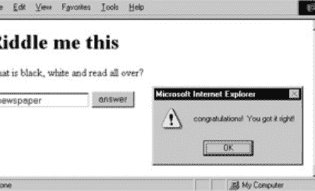

图 9-4：谜语游戏的样子

如果你想运行此脚本，你需要创建`answer.html`页面，它只是一个带有谜语答案的普通 Web 页面

## 定时循环

我们在章节开始时讨论的现实世界超时是某种涉及的定时循环。Ask Jee 为每个问题解释 3.5 秒，而 NASA 每秒更新一次时钟。这两个示例都将在循环中使用了超时。

遗憾的是，我们不能在`while`或`for`循环中使用进行计时。`while`和`for`循环发生得很跳跃，而且没有好的方法可以减慢它们。即使你可以减慢，也没有办法让循环准确，因为它们运行在不同的计算机上。旧电脑可能需要两秒时间在 Web 页面上打印 1000 次"hello"，而新的电脑可能只需要十分之一秒。

与其使用`for`或`while`循环，你可以通过封装一个调用自身的函数来精确地计时循环。该函数可以通过`setTimeout()`和`clearTimeout()`精确控制它在未来的何时执行。图 9-5 中的简单循环应该会让这更清晰。


```html
<html>
<head>
<title>一个简单的计时循环</title>
<script language="JavaScript">
<!-- hide me -->
(1) var the_timeout;
(2) function update() {
{
(3) var _number = window.document.the_form.the_text.value;
(4) the_number = parseInt(_number) + 1;
(5) window.document.the_form.the_text.value = _number;
(6) the_timeout = setTimeout(update(), 1000)
}
// // show me --
</script>
</head>
<body>
<form name="the_form">
(7) <input type="text" name="the_text" value =0><br>
(8) <input type="button" name="start timer" onclick="update();">\n(9) <input type="button" name="stop timer" onclick="clearTimeout(the_timeout);">
</form>
</body>
</html>
```

图 9-5：一个简单的计时循环

这个简单的循环构成了我们在本章后续（以及第 13 章）中使用的基础。

图 9-5 中的 HTML 创建了一个包含三个元素的表：一个用于显示计时文本框和两个按钮（见图 9-6）。当用户点击“开始”按钮时，文本框中的数字每秒增加 1。它将一直增加，直到访问者按下“停止”按钮。

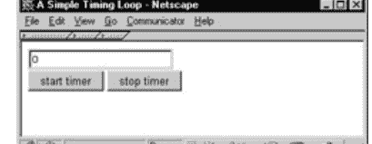

图 9-6：图 9-5 在浏览器中的外观

## 图 9-5 的逐行分析

该脚本的关键部分是 `update()` 函数。当用户点击“开始”按钮时，`onclick` 调用 `update()` 函数，然后为文本框的内容设置一个 1 秒的超时（`the_timeout`），脚本会不断调用自己直到一秒过去。执行后，脚本设置了 `setTimeout` 并再次调用 `update()` 函数。该函数将文本框的内容加 1，并设置 `the_timeout` 每秒调用一次 `update()`。

这种调用 `update()` 函数、给内容加 1 以及设置另一个一秒后调用该函数的循环持续进行，直到 `clearTimeout(the_timeout)` 被调用。当访问者按下“停止”按钮时，这会激活 `clearTimeout(the_timeout())` 语句并取消最近设置的超时，从而停止 `update()` 函数再次运行。图 9-7 绘制了这一基础循环周期。

| 步骤 | 事件 |
|---|---|
| 1. | 用户按下“开始计时器”按钮，触发 `update()` 函数。 |
| 2. | `update()` 给文本框内容加 1（使其变为 1）。 |
| 3. | 命名为 `the_timeout` 的超时在一秒后触发 `update()`。 |
| 4. | 1 秒后，`update()` 被触发。 |
| 5. | `update()` 给文本框内容加 1（使其变为 2）。 |
| 6. | 命名为 `the_timeout` 的超时在一秒后触发 `update()`。 |
| 7. | 用户按下“停止计时器”按钮，这触发了 `clearTimeout(the_timeout)`。 |
| 8. | `clearTimeout(the_timeout)` 取消了步骤 6 中设置的超时。 |
| 9. | 因为最后一个超时被取消了，`update()` 不再被调用，因此循环结束。 |

**图 9-7：**描述计时循环周期的图表。

本章的其余部分涵盖了上述基本计时的几种应用。如果任何结构没有遵循图 9-5 的，请不要担心。在看到更多示例后，你就会理解了。

## 使用 `parseInt()` 用于 MSIE 4 及以上版本

在这种情况中，`parseInt()` 函数变成了 Microsoft Explorer 3 及更早版本的问题。这些浏览器将元素的所有内容都视为字符串，即使它们是数字。当图 9-5 中的文本框中有一个 2 时，MSIE 将其读取为字符串 `'2'`。通常情况下，这并不是什么大问题。但请记住 `+` 运算符有两个含义。

当你在两个数字之间使用加号时，它执行的是加法：`1 + 2 = 3`。但当你使用字符串时，它会将它们拼接：`'1' + '2' = '12'`。因为 MSIE 将元素的内容读取为字符串，在这种情况下，它只是在文本框中出现的任何数字后面贴上一个 1：`0 = 01`，`01 + 1 = 011`，`011 + 1 = 0111`。这并不是我们想要的结果。

`parseInt()` 函数通过将字符串和小数转换为整数来解决这个问题。例如，在 MSIE 4 和以下代码行中：

```javascript
var second_number = first_number + 1;
```

结果变量 `second_number` 的值为 `"21"`，而使用以下代码行：

```javascript
var first_number = '2';
var second_number = parseInt(first_number) + 1;
```

结果变量 `second_number` 的值为 3。

`parseInt(first_number)` 将字符串 `'2'` 转换为数字 2。

## 使用一个不带数字的字符串调用 `parseInt()`

使用没有数字的值调用 `parseInt()` 会导致结果 `NaN`（不是数字）。然而，使用 `isNaN()` 可以确保返回的是一个数字。

```javascript
var age = prompt("how old are you?", "your age");
if (isNaN(age)) {
  alert("that's not a number!");
}
```

## 在设置之前清除超时

如果你查看图 9-5，你可能会注意到 `the_timeout` 用于清除按钮。这发生在你点击按钮时。

## 使用计时循环构建时钟

本章的其余部分涵盖了上述基本计时的几种应用。图 9-5 提供了一个简单的示例。现在时间是：位于字段中。

## 图 9-8 的逐行分析

```html
<html>

<head>

<title>JavaScript 钟</title>

<script language="JavaScript">
<!-- hide me -->
(1) var the_timeout;

function writeTime() {
  // 获取日期对象
(2) var today = new Date();
  // 获取小时信息
(3) var hours = today.getHours();
  var minutes = today.getMinutes();
  var seconds = today.getSeconds();
  // 让分钟和秒看起来正确
(4) minutes = fixTime(minutes);
  // seconds = fixTime(seconds);
  // 组合字符串并输出
  var the_time = hours + ":" + minutes + ":" + seconds;
  // 将其写入表单文本框
(5) document.form.text.value = the_time;
  // 每秒运行此函数
(6) the_timeout = setTimeout(writeTime(),1000)
}

(7) fixTime(the_time) {
  if (the_time < 10) {
    the_time = "0" + the_time;
  }
  return the_time;
}
// show me --
</script>
</head>

<body>
现在时间是：

<form name="form">
<input type="text" name="the_text">
<input type="button" value="开始时钟" onclick="writeTime();">\n<input type="button" value="停止时钟" onclick="clearTimeout(the_timeout);">
</form>
</body>
</html>
```

图 9-8：JavaScript 钟的代码

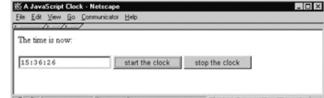

图 9-9：JavaScript 钟是此脚本中唯一新的部分。如果你回想表 2-1（第 26 页），你会看到 `getMinutes()` 和 `getSeconds()` 分别返回一个 1 到 59 之间的整数。如果是上午 9 点零 2 分 3 秒，小时将是 9，分钟将是 2，秒将是 3。但将这些数字组合起来显示时间会创建字符串 `9:2:3`，而不是 `9:02:03`。

将分钟和秒变量发送到我编写的一个名为 `fixTime()` 的函数时遇到了小问题。`fixTime()` 函数接收一个数字作为参数，如果该数字小于 10，则在其前面加 0（因此将 2 变成 02）。请确保你理解 `fixTime()` 和 `writeTime()` 函数是如何协同工作的。这是一个一个函数调用另一个函数来完成工作的良好示例。

`OnceTime` 通过在适当的位置插入 0 来修复分钟和秒。创建字符串并将其写入文本框中。它设置了定时器，让 `writeTime()` 再次运行。当 `writeTime()` 被调用时，它会创建一个新日期，获取信息，在必要时修复分钟和秒，将时间写入文本框，并再次启动定时器。整个过程从访问者点击“Start”按钮时开始，并在访问者点击最近设置的“Stop Clock”按钮时取消。

## NASA 的时钟是如何计时的

NASA 的面板上有两个时钟。与图 9-8 不同，这些时钟相对于过去或未来的时间运行。第一个时钟追踪国际空间站在已经在轨道上运行了多久，第二个时钟计算下一次航天飞机器何时发射。我将关注第一个，并跳过 NASA 用于确定时间的每周计算。

要查看 NASA 时钟的光辉时刻，请查看 CD 盘上的 `sites/nasa/index.html`。第 182 页的图 9-10 显示了精简后的 NASA 代码（如果你运行这段代码，它将给出毫秒级的时间）。

```html
<HTML>
<HEAD>
<TITLE>NASA 人类太空飞行</TITLE>
</HEAD>
<BODY>
<form name="timeForm">
Space Station/</a><br>
<input type="TEXT" name="time" size="18" value="000:00:00:00">

<SCRIPT LANGUAGE="Javascript">
function setNewTimeAgain(){
  setNewTime();
}

function setNewTime(){
  now = new Date();
  timeNow = now.getTime();
  launch = Date.parse("Fri, 20 Nov 1998 02:00:00 CST");
  timeLeft = timeNow - launch;
  document.timeForm.stationTime.value = timeLeft;
  setTimeout("setNewTimeAgain()", 950);
```

```javascript
(8) return;
(9) setNewTime();
```

```html
</SCRIPT>
<body>
</html>
```

# 图 9-10：NASA 时钟脚本

## 图 9-10 的逐行分析

`setNewTime()` 函数是该脚本的核心。该函数通过从当前时间减去发射时间，展示了时间跨度是如何开始的。函数将此数字放入文本字段中，然后在一秒后调用自己。

在每次通过后，函数再次从当前时间减去空间站的发射时间，更新文本字段，并设置另一个定时器。此过程一直持续到访问者离开页面。

## 将日期转换为毫秒

通过创建一个新的 `Date` 对象来获取日期时间，并使用 `getTime()` 方法将此日期转换为自 1970 年 1 月 1 日以来的数字数。由于历史原因，许多编程语言将 1970 年 1 月 1 日视为时间的开始。

当你想要比较日期时，最好的方法是使用 `getTime()` 方法将两者都转换为毫秒。例如，要检查一个日期是在另一个日期的之前还是之后，将两者都转换为自 1970 年 1 月 1 日以来的毫秒数（如果日期早于 1970 年 1 月 1 日，`getTime()` 返回一个负数；`getTime() - 10000` 毫秒自 1970 年 1 月 1 日以来）。数字越大，时间越晚。

将日期转换为毫秒允许你只比较数字。如果你不这样做，并且想要比较接近的日期，你将不得不手动比较日期的每个部分。例如，要比较 1970 年 1 月 1 日凌晨 2 点，你必须检查年份，然后是月份、日期、最后小时。这两个日期之间的差异直到你将它们转换为毫秒后才会出现。

处理日期是编程中最大的头疼问题之一，所以如果这个过程看起来很别扭，对吧？

使用 `Date` 对象的方法计算自 1970 年 1 月 1 日到空间站之间的毫秒数。`parse()` 方法接收一个特殊格式的字符串作为参数表示日期和时间，并返回该时间与 1970 年 1 月 1 日之间的毫秒数。格式非常重要，请遵循它。CST 是美国中部标准时间（EST 的变体），例如太平洋标准时间（PST）和格林威治时间（GMT）同样适用。

## 计算发射以来的时间

已按 1970 年 1 月 1 日以来的毫秒数计算出当前时间和发射时间；从它们中减去发射时间，结果存储在 `timeLeft` 中。原始的 NASA 脚本包含大约 40 行代码，用于将时间转换为格式良好的字符串。这些字符串很长、很复杂，与本章的主题无关，因此我跳过了它们，直接将 `timeLeft` 写入文本框。对于那些真正感兴趣的人，我将在本节最后描述 NASA 的计算方法。

## 再次设置 `newTimeAgain()`

将 `timeLeft` 放入文本框中，设置一个略小于一秒的剩余时间，这意味着脚本每 950 毫秒检查时钟稍多一次。`newTimeAgain()` 每秒运行一次。如果说计算机是一个复杂的进程，有时它的内部时钟会略有偏差。

使用 `Date` 对象的方法计算自 1970 年 1 月 1 日到空间站之间的毫秒数。`parse()` 方法接收一个特殊格式的字符串作为参数表示日期和时间，并返回该时间与 1970 年 1 月 1 日之间的毫秒数。格式非常重要，请遵循它。CST 是美国中部标准时间（EST 的变体），例如太平洋标准时间（PST）和格林威治时间（GMT）同样适用。

已按 1970 年 1 月 1 日以来的毫秒数计算出当前时间和发射时间；从它们中减去发射时间，结果存储在 `timeLeft` 中。原始的 NASA 脚本包含大约 40 行代码，用于将时间转换为格式良好的字符串。这些字符串很长、很复杂，与本章的主题无关，因此我跳过了它们，直接将 `timeLeft` 写入文本框。对于那些真正感兴趣的人，我将在本节最后描述 NASA 的计算方法。

将 `timeLeft` 放入文本框中，设置一个略小于一秒的剩余时间，这意味着脚本每 950 毫秒检查时钟稍多一次。`newTimeAgain()` 每秒运行一次。如果说计算机是一个复杂的进程，有时它的内部时钟会略有偏差。

数字，我们可以计算出站点启动 444 天后的若干小时、分钟和秒。

然后它获取毫秒数，并通过除以每小时的毫秒数来确定包含多少小时。接下来，计算减去所有小时数后剩余多少毫秒。接下来的几行重复此过程来计算分钟和秒数。

当我们计算出当前时间与站点启动之间的小时、分钟和秒后，接下来的几行将字符串格式化到文本字段中。假设站点在 444 天 5 小时 44 秒前启动。它将小时除以 10 并舍弃小数；5 除以 10 等于 0，因此算出减去已计算的小时后剩余多少小时。5 分钟等于五，所以它等于 5。

它格式化字符串并将其写入 Web 页面；小时显示为 05，因为 `h1` 是 0，`h2` 是 5。如果你有 14 小时，`h1` 将是 1，`h2` 将是 4，所以小时将显示为 14。个人而言，我认为 `h1` 和 `h2` 似乎没必要那么晦涩。我写了这段：

```javascript
if (hours < 10) {
  hours = '0' + hours;
}
```

这实现了目标，而且没有了那些难以阅读的 `mod` 废话。但一如既往，编写任何内容都不止一种方法，不同的程序员可能有不同的口味偏好。

函数的其余部分将分钟和秒分为两个数字，就像处理小时一样，然后写入文本框。

正如我所说，这些计算看起来有点诡异，但如果你以后需要执行简单任务，它们值得一看。

## 定时幻灯片

幻灯片是定时循环的另一个应用。图 9-12 显示了如何结合数组和计时循环来创建一个循环幻灯片。再次，在深入解释之前，请先过一遍脚本。


```html
<html
<head>
<title>A Timed Slide Show</title>
<script language="JavaScript">
<!-- hide me -->
var the_images = new Array();
the_images[0] = new Image();
the_images[0].src = "one.jpg";
the_images[1] = new Image();
the_images[1].src = "two.jpg";
the_images[2] = new Image();
the_images[2].src = "three.jpg";
var var_timeout;
var index = 0;

function rotateImage() {
  window.document.my_image.src = the_images[index].src;
  index++;
  if (index >= the_images.length) {
    index = 0;
  }
  const the_timeout = setTimeout(rotateImage(), 1000);
}
<!-- show me -->
</script>
</head>
<body>
<form>
  
  <input type="button" value="start" onclick="clearTimeout(the_timeout);rotateImage();">
  <input type="button" value="stop" onclick="clearTimeout(the_timeout);">
</form>
</body>
</html>
```

## 图 9-12：定时幻灯片

前几行设置了包含我们要放入幻灯片图像的数组。它创建了一个新数组。它将数组中的第一个项设置为图像对象，并将该对象的`src`设置为幻灯片的第一张图片。这里是在图像切换之前预加载图像使用的代码（第 4 章）。接几行加载了其余图像。

图像加载后，它为计时循环设置了两个变量：`timeout`，用于跟踪每次超时；`index`，用于跟踪幻灯片中的每张图像以显示下一张。脚本调用了`rotateImage()`函数。请记住，将`index`变量声明在`rotateImage()`函数外部，比`rotateImage()`的后期作用域版本要简单快速得多。

接下来是`rotateImage()`函数，它在一个新线程中运行并在一秒后调用自己。函数的第一行检查它是否存在。它在`the_images`数组中查找带有编号索引的图像的`src`，并对其进行交换。

交换图像后，函数增加`index`值。下一次调用`rotateImage()`时，它会在数组中查找该`index`并进行交换。我们确保`index`中的数字不会超过`the_images`数组中存储的图像数量。如果从`index`开始的线程通过确保`index`增加的是数组中的项数来处理此，它将返回 0，对应于`the_images`数组中的第一张图像。

函数的最后一行，到现在应该觉得很奇怪了。这一行设置了一个超时来调用`rotateImage()`。

幻灯片在访问点击调用`rotateImage()`的按钮时开始，在用户按下“Stop Show”按钮时结束，从而取消最近设置的超时。

## 更安全的`rotateImage()`版本

如果你对完善自己的编码风格感兴趣，可以跳过这一节；它有点高级。但是，如果你想成为一名超级程序员，请继续读下去。

在书的几处，我提到过最好在使用的函数内部声明变量。正如我们所见（参见第 179 页），这样更好。

**图 9-14：**此版本的`rotateImage()`完全没有声明那个有问题的变量`index`。相反，`rotateImage()`接收一个参数：应该出现的图像编号。它显示`rotateImage()`已经更改为接受此参数。调用`rotateImage(0)`会调用`rotateIndex()`并将`index`设置为 0。函数体的第一行会将`_images`中位置 0 的图像与图像进行交换。如果调用的是`rotateImage(1)`而不是`rotateImage(0)`，则`_images`中的第二个图像将被交换到页面，`rotateImage(2)`交换图像，依此类推。

## 故障（The Hitch）

当然，在 2 中有一个递增的索引，正如我们在图 9-14 中所示，在`setTimeout()`中再次调用`rotateIndex(index)`是合理的；`_timeout = setTimeout("rotateImage(index)",1000);`。遗憾的是，这会触发两次传递以及`rotateImage(index)`命令，JavaScript 会尝试记住变量`index`所持有的值，然后带该值调用`rotateImage()`。然而，在此时，正如 JavaScript 所所知的，并不存在变量`index`。变量`index`只存在于函数内部。上行的`setTimeout()`在调用函数之前会查找值，但在函数外部不存在任何名为`index`的调用。JavaScript 会给出错误信息。

## 故障的解决方案（The Solution to the Hitch）

解决这种诡异情况的方法在 3 中（见图 9-14），3 创建了`setTimeout()`按顺序调用的命令。它不是使用命令：

```javascript
"rotateImage(index)";
```

而是从引号中提取单词，强制 JavaScript 查找变量`index`的值并将该值放入命令中。例如，如果你将`index`设置为 2，那么 3 写入`setTimeout`的代码如下：

```javascript
rotateImage(2);
```

这看起来可能令人困惑，但请确保你理解为什么这样写。因为 JavaScript 使用数字 2 而不是变量`index`来调用`rotateImage()`，所以当命令按顺序运行时，不需要查找任何变量的值。相反，`rotateImage()`接收到数字 2，函数能够正常工作。

一旦 3 创建了用于延迟调用命令的字符串，4 就执行了`setTimeout()`。

这个故事的启示是什么？使用`setTimeout()`来调用带有变量作为参数的函数是一个坏主意，因为你无法确定将来何时调用该函数，甚至不知道`index`何时存在。如果你确实在`setTimeout()`中使用函数且该函数接收参数，请使用像 3 那样的行代码将变量的值放入函数中。

## 为什么`image_array`定义在`rotateImage()`函数外部？

既然`rotateImage()`是唯一使用`image_array`的函数，为什么不在`rotateImage()`函数内部声明它呢？嗯，我可以这样做，如果为了额外保险起，我可能会这样做。然而，每次调用时都重新创建数组似乎很浪费资源。如代码所示，图 9-14 只创建一次数组。在使用它的函数外部声明`image_array`是相当安全的，因为脚本永远不会更改这个数组。由于`image_array`中的值不太发生改变，我不需要担心某一个函数为了其他函数的需求而更改数组中的某个值。本节完全关注编程。图 9-12 显示的代码在许多情况下对你很有帮助，你可能在短脚本中更喜欢它，因为图 9-14 显示的代码更适合复杂的脚本，以及那些你或他人经常更改的脚本。

## 总结（Summary）

如果你已经真正掌握了这一章，你现在知道了以下内容：

- `setTimeout()`会导致一个 JavaScript 语句在未来发生。
- 如何使用`setTimeout()`取消超时。
- 如何使用`parseInt()`将字符串转换为数字，以及为什么可能需要这样做。

如果你阅读了关于如何安全地编写定时循环的部分（第 188 页），你还知道如何编写一个调用带参数函数的定时循环。

为了确保你理解了定时循环以及如何取消它们，请尝试下面的作业。

## 作业（Assignment）

尝试使用图 9-12 增强幻灯片功能，使得鼠标移动到图像上时停止幻灯片，移开时继续幻灯片。这比听起来要复杂一点。

# 第 10 章：框架（Frames）与图像映射（Image Maps）

## 概述（Overview）

框架和图像映射是 Web 开发人员可用的两种高级 HTML 工具。框架将 Web 页面划分为多个部分，对于导航和布局很有用。图像映射包含多个 HTML 链接。点击图像映射的不同部分将引导访问者进入不同的 Web 页面。JavaScript 可以增强这两个 HTML 功能，允许你通过其他框架中的图像映射和链接来操纵框架的内容。

在本章中，你将学习到：

- 创建基础映射。
- 使用 JavaScript 控制框架的内容。
- 使用 JavaScript 同时更改两个框架。
- 使用框架在 Web 页面之间共享信息。
- 创建基础图像映射。
- 使用 JavaScript 为你的图像映射添加功能。

## 框架与图像映射的真实示例

我最喜欢的集成图像映射、框架和 JavaScript 的示例来自 Salon 网站。它介绍了一本关于吃昆昆虫的书（见图 10-1。（你可以在`http://www.salon.com/wlist/part/1999/02/bugs/frame.html`查看此页面，或者在 CD-ROM 的`sites/salon/frame.html`中查看。）鼠标悬停在图像映射上会高亮该部分并交换两张图片，其中一张是。

**图 10-1：**Salon 页面。它介绍了一本关于吃昆虫的书（见图 10-1。（你可以在`http://www.salon.com/wlist/part/1999/02/bugs/frame.html`查看此页面，或者在 CD-ROM 的`sites/salon/frame.html`中查看。）鼠标悬停在图像映射上会高亮该部分并交换两张图片，其中一张是。

**图 10-1：**Salon 页面。它介绍了一本关于吃昆虫的书（见图 10-1。（你可以在`http://www.salon.com/wlist/part/1999/02/bugs/frame.html`查看此页面，或者在 CD-ROM 的`sites/salon/frame.html`中查看。）鼠标悬停在图像映射上会高亮该部分并交换两张图片，其中一张是。

**图 10-1：**Salon 页面。它介绍了一本关于吃昆虫的书（见图 10-1。（你可以在`http://www.salon.com/wlist/part/1999/02/bugs/frame.html`查看此页面，或者在 CD-ROM 的`sites/salon/frame.html`中查看。）鼠标悬停在图像映射上会高亮该部分并交换两张图片，其中一张是。

**图 10-1：**Salon 页面。它介绍了一本关于吃昆虫的书（见图 10-1。（你可以在`http://www.salon.com/wlist/part/1999/02/bugs/frame.html`查看此页面，或者在 CD-ROM 的`sites/salon/frame.html`中查看。）鼠标悬停在图像映射上会高亮该部分并交换两张图片，其中一张是。

**图 10-1：**Salon 页面。它介绍了一本关于吃昆虫的书（见图 10-1。（你可以在`http://www.salon.com/wlist/part/1999/02/bugs/frame.html`查看此页面，或者在 CD-ROM 的`sites/salon/frame.html`中查看。）鼠标悬停在图像映射上会高亮该部分并交换两张图片，其中一张是。

**图 10-1：**Salon 页面。它介绍了一本关于吃昆虫的书（见图 10-1。（你可以在`http://www.salon.com/wlist/part/1999/02/bugs/frame.html`查看此页面，或者在 CD-ROM 的`sites/salon/frame.html`中查看。）鼠标悬停在图像映射上会高亮该部分并交换两张图片，其中一张是。

## 基础框架（Basic Frames）

框架和图像映射是 Web 开发人员可用的两种高级 HTML 工具。框架将 Web 页面划分为多个部分，对于导航和布局很有用。图像映射包含多个 HTML 链接。点击图像映射的不同部分将引导访问者进入不同的 Web 页面。JavaScript 可以通过其他框架中的图像映射和链接来操纵框架的内容，从而增强这两个 HTML 功能。

在本章中你将学习：

- 创建基础映射。
- 使用 JavaScript 控制框架的内容。
- 使用 JavaScript 同时更改两个框架。
- 使用框架在 Web 页面之间共享信息。
- 创建基础图像映射。
- 使用 JavaScript 为你的图像映射添加功能。

## 框架（Frames）

Salon 网站的框架和图像映射。它介绍了一本关于吃昆虫的书（见图 10-1。（你可以在`http://www.salon.com/wlist/part/1999/02/bugs/frame.html`查看此页面，或者在 CD-ROM 的`sites/salon/frame.html`中查看。）鼠标悬停在图像映射上会高亮该部分并交换两张图片，其中一张是。

Salon 网站的框架和图像映射。它介绍了一本关于吃昆虫的书（见图 10-1。（你可以在`http://www.salon.com/wlist/part/1999/02/bugs/frame.html`查看此页面，或者在 CD-ROM 的`sites/salon/frame.html`中查看。）鼠标悬停在图像映射上会高亮该部分并交换两张图片，其中一张是。

Salon 网站的框架和图像映射。它介绍了一本关于吃昆虫的书（见图 10-1。（你可以在`http://www.salon.com/wlist/part/1999/02/bugs/frame.html`查看此页面，或者在 CD-ROM 的`sites/salon/frame.html`中查看。）鼠标悬停在图像映射上会高亮该部分并交换两张图片，其中一张是。

## 图像映射（Image Maps）

在本章中你将学习如何使用框架和图像映射。

```html
<html><head><title>Nav</title>

<script language = "JavaScript">
<!-- hide me -->
{
(1) function changeContents(the_url) {
(2) var content_frame = parent.contents;
(3) content_frame.location = the_url;
}
// show me -->
</script>
</head>
<body>
<h1>- News navigation</h1>
<a href="http://www.times.com" onmouseover="changeContents('http://www.times.com')">
New York Times</a><br>
<a href="http://www.wired.com" onmouseover="changeContents('http://www.wired.com')">
Wired News</a><br>
<a href="http://www.news.com" onmouseover="changeContents('http://www.news.com')">
CNNet News</a><br>
</body></html>
```

## 图 10-4：使用 JavaScript 通过鼠标悬停更改框架


`changeContents()`函数从第 1 行开始，`the_url`接收传入到框架中的任何字符串。JavaScript 会在其父级中查找名为`contents`的对象（包含框架的框架是该框架的——参见图 10-5），并将变量`content_frame`指向该内容框架。

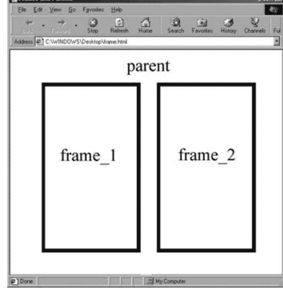

## 图 10-5：框架及其父级的图形化表示

引用框架就像引用窗口。正如你可以这样更改窗口显示的 URL：

```javascript
window_name.location = "http://www.nytimes.com";
```

你可以这样更改框架中的 URL：

```javascript
the_frame.location = "http://www.nytimes.com";
```

这正是图 10-4 所做的。在第 2 行，将`content_frame`赋值为指向我们在另一个中要更改的框架。因为第 3 行通过将`content_frame.location`设置为`the_url`改变了该框架的所在地址。

## 框架与图像切换

在第 5 章中，我描述了点击一个窗口中经过 JavaScript 增强的链接可以更改另一个窗口中的图像。由于 JavaScript 处理框架的方式类似，同样的技巧也允许一个框架中的链接更改另一个框架中的图像。

这里有一个参考示例：图 10-6 包含了必要的代码，用于通过点击第二个窗口中的链接来切换窗口中的图像。图 10-7 显示了相同的技巧如何应用于框架。

在图 10-6 中有两个 HTML 页面。第一个页面从打开一个新窗口并调用`image_window`开始。此窗口将打开`image_page.html`，该页面中只有一个图像——一个名为`the_image`的笑脸图像。当有人点击第 2 行中的链接时，JavaScript 会去查找被调用的`image_window`，并在其文档（`document`）中查找`the_image`。一旦找到`the_image`，它就会将其`src`更改为`sad.gif`。第 3 行的链接将图像改回`happy.gif`。

图 10-7 向你展示了如何使用框架而非窗口来实现相同的操作。

**first_page.html**

```html
<html>
<head>
<title>Control Panel</title>
<script language = "JavaScript"></script>
<!-- hide me -->
(1) var image_window = window.open("image_page.html","image_window","width=100,height=100");
// show me -->
</head>
<body>
(2) <a href="#" OnClick = "image_window.document.the_image.src = 'sad.gif'; return false;">sad</a>
<br>
<a href="#" OnClick = "image_window.document.the_image.src = 'happy.gif'; return false;">happy</a>
</body>
</html>
```

**image_page.html**

```html
<html><head><title>The Image Page</title></head>
<body>
(3) 
</body>
</html>
```

**图 10-6：** 通过另一个窗口中的链接切换其中一个窗口的图像

**frameset.html**

```html
<html>
<head>
<title>Image Swapping in Frames</title>
</head>
<frameset rows="30%", "*">
<frame src="navigation.html" name="navigate">
<frame src="image_page.html" name="image_frame">
</frameset>
</html>
```

**navigation.html**

```html
<html>
<head>
<title>Control Panel</title>
</head>
<body>
```

```html
[1]<a href="#" onclick="parent.image_frame.document.the_image.src = 'sad.gif'; return false;">sad</a>
<br>
<a href="#" onclick="parent.image_frame.document.the_image.src = 'happy.gif'; return false;">happy</a>
</body>
</html>
```

**image_page.html**

```html
<head><title>The Image Page</title></head>
<body>
[2]
</body>
</html>
```

**图 10-7：** 通过另一个窗口中的链接切换其中一个窗口的图像

图 10-7 中的`frameset`设置了图 10-8 所示的页面：顶部的`navigation.html`框架（占据窗口 30%）以及底部带有`happy.gif`的`image_page.html`框架。[2] 中的 [1] 是顶部框架中的链接，它将底部框架中的`happy.gif`更改为`sad.gif`。关键部分是

```javascript
parent_frame.document.the_image.src = 'sad.gif';
```

这与 [图 10-6] 类似，区别在于 [图 10-6] 中我们直接引用窗口`image_window`，而在 [图 10-7] 中我们告诉`navigation.html`中的 JavaScript 进入其父级（`parent`），然后进入`image_frame`框架。


**图 10-8：** 框架间切换

## 修改两个框架的内容

在某些情况下，你可能希望同时更改两个或多个框架的内容。例如，图 10-9 中的页面显示了如何更改多个框架：点击框架中的链接将更改所有框架的内容。图 10-10 显示了一个简单的示例。图 10-9 中的`frameset`描述了框架的布局。

## 嵌套框架

有时你需要将并排的框架与堆叠的框架混合使用。例如，图 10-11 中的页面顶部有一个框架，下方并排两个较窄的框架。你可以通过在另一个框架之上创建一个带有框架的框架（堆叠），并在底部框架中加载一个包含两个并排框架的`frameset`来实现这一点。图 10-12 显示了图 10-11 的代码。

```html
<head><title>底部框架</title></head>
[4]<frameset cols="50%,*">
  <frame src="image_page.html" name="image_frame">
  <frame src="form_page.html" name="form_frame">
</frameset>
</html>
```

**图 10-12：** 图 10-11 的框架集设置

### 嵌套框架中的 JavaScript 与框架

只要你只有一个框架（`frame`），一个框架中的 JavaScript 就可以通过引用为`parent.frame`来影响任何其他框架。如果你有嵌套的框架集（`frame sets`），情况就会变得复杂一些。考虑图 10-11 中的第 3 个框架。该框架的父级是内部框架集（`bottom_frame.html`），它包含了框架 2 和 3。在框架 3 中，适当的 JavaScript 可以使用`parent.image_frame`影响框架 2。例如，为了更改框架 2 中显示的 URL，框架 3 可以运行以下脚本：

```javascript
parent.frame.location = "http://www.webmoney.com";
```

框架 3 中的 JavaScript 如何更改框架 1 的内容？内部框架（包含框架 2 和 3）并“不知道”框架 1 的任何信息，因为它位于另一个框架集中。然而，外部框架集（`index.html`）“知道”框架 1 以及它创建的内部框架集。为了让内部框架集中的框架影响外部框架集中的框架，外部框架集必须要求内部框架更改内容。在这种情况下，你可以通过调用`parent.top`实现这一目标：

```javascript
parent.top.location = "http://www.webmoney.com";
```

在框架 3 中运行此代码会更改框架 1 中的 URL。框架 3 中的该行告诉 JavaScript 去到框架 3 的`parent`，即内部框架集；找到该框架的`parent`，即`frameset.html`中的框架；然后找到该父框架集内部名为`top_frame`的框架。

或者，你也可以在脚本中使用单词`top`来直接引用最外层的框架集：

```javascript
top.navigate.location = "http://www.webmoney.com";
```

这告诉 JavaScript 找到最顶层的框架集，并在该框架集中寻找名为`navigate`的框架。`top`对象包含了 Web 浏览器窗口中的所有内容；如果页面上有框架集，`top`指向最外层的框架集。如果浏览器中没有框架，`top`的含义与`window`相同。

使用`top`还是`parent`来处理嵌套框架集取决于具体情况。如果你在一个深埋了四个框架集的框架中有一个链接，而你想让这个链接影响顶层级的框架，那么使用`top`可能是合理的。如果你想让链接框架集中的链接影响其自身框架集中的框架，那么`parent`是更好的选择。

## 框架劫持（Frame Busting）

有些网站使用框架来在你尝试离开其站点后更改其站点内容。例如，当你在 Ask Jeeves 上进行搜索并点击结果时，结果会出现在一个上方框架为 Ask Jeeves 的页面上（见图 10-13）。结果网站通常不是 Ask Jeeves 站点。它甚至可能是你编写的 Web 页面。

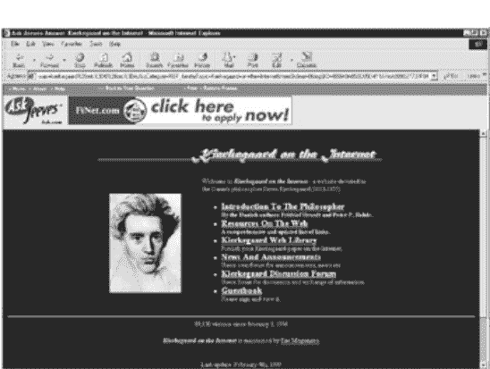

### 图 10-13：Ask Jeeves 在你使用其站点时使用框架留住

Ask Jeeves 允许用户通过点击按钮移除顶层框架，但你可能根本希望你的 Web 页面出现在 Ask Jeeves 的框架中。为了防止这种情况发生，请在页面的页头中插入 [图 10-14](#) 所示的脚本。

```javascript
<script language="JavaScript">

<!-- 隐藏我 -->

if (self != top) {
  top.location = self.location;
}
// 显示我 -->
</script>
```

### 图 10-14：框架劫持代码

检查包含此 JavaScript 的页面是否为框架层级中的顶层框架（记住，`self`意味着“此页面”），这翻译为“如果此页面不在顶层，则执行检查项之间的语句”。如果框架不在顶层，则它位于一个 iframe 框架内部。要逃离框架集，通过将窗口的`top.location`设置为`self.location`来置于顶部。`self.location`存储了 Web 页面的 URL。

## 使用框架存储信息

Web 页面的记忆力很差。除非你做一些花样的，否则访问者离开你的 Web 页面后，页面就会忘记它收集的任何信息。例如，如果你有一个长测验，并想在结束时告诉访问者他们的分数，你就需要将测验分成几个页面——第二个页面可以跟踪访问者在第一页给出的答案。

解决这个问题的方法并不多。如果你想在访问者的计算机上长期存储信息，cookie 是不二选择（参见 [第 12 章](#)）。但如果你只想短暂保存信息，使用框架在页面之间存储信息的小技巧是行之有效的。

该技巧涉及设置一个不可见的框架，该内包含一个 JavaScript 函数，该函数带有一个数组，可以在访问者在站点内跨页面移动时保存从每个页面获取的信息。当你需要检索信息时，只需访问不可见框架中的数组即可。[图 10-15](#) 列出了四个页面。

`quiz_1.html`页面包含一个带有两个测验问题和一个链接的表单。每个测验问题都是判断题；访问者通过点击相应的单选按钮来回答。在第一个问题中点击“True”（真）按钮将运行以下代码：

```javascript
parent.tracker.answers[0]='true';
```

此行代码进入父级（即框架集）中的跟踪器，并将字符串`'true'`存储在数组第一个槽位（`answers[0]`）中。点击第二个问题上的“False”（假）按钮将运行以下代码，然后将字符串`'false'`存储在`answers`数组的第二个槽位中：

```javascript
parent.tracker.answers[1]=false;
```

点击链接会将新页面`quiz_2.html`读取到可见帧中。然而，iframe 仍然存在，存储着来自上一个页的值。它将访问者对两个问题的答案保留在`answers`数组的第三和第四槽位。点击 7 处的“score”（分数）按钮将调用以下代码：

```javascript
parent.tracker.score(parent.tracker.answers);
```

此行调用了跟踪器帧内的`score()`函数。该函数接受一个访问者答案数组作为参数。因为跟踪器帧存储了答案，脚本可以通过引用`parent.tracker.answers`将分数传递给函数帧。

此示例练习了书中到目前为止的所有主要编程元素，因此请花点时间查看，并确保你理解正在发生的一切：我引入了两个新概念：

- 一个帧通过`parent.other_frame.variable`存储在另一个帧中的变量（如`parent.tracker.answers`）。

- 一个帧通过`parent.other_frame.function()`调用在另一个帧中声明的函数（如`parent.tracker.score()`）。

## 图像映射 (Image Maps)

JavaScript 允许你在用户点击、鼠标悬停或移出图像映射的不同部分时，执行 JavaScript 语句，从而扩展图像映射的功能。

## 图像映射基础

要构建图像映射，你需要一张图片和一个描述图像部分应跳转到哪些 URL 的映射：图 10-18 显示了 Salon 在他的“吃虫饼饼”中使用的图像映射的部分代码。图 10-19 显示了该 HTML 在圆形中的样子。点击图像中的任何深色区域都会带你进入关于该区域的 Web 页面。

图 10-18 告诉浏览器部署左侧的 gif 并将其与名为`left`的映射关联。`isMap`元素告诉浏览器这是一个图像映射，而`useMap`元素告诉浏览器使用哪个映射。

```html
<html
<head>
<title>Image Map Example</title>
</head>
<body>

<MAP name="left">
<AREA coords="9,23,41,42" href="http://www.salon.com/wlust/pass/1999/bugs/us.html" shape="RECT">
<AREA coords="26,42,75,64" href="http://www.salon.com/wlust/pass/1999/bugs/us.html" shape="RECT">
<AREA coords="28,65,55,78" href="http://www.salon.com/wlust/pass/1999/bugs/mexico.html" shape="RECT">
<AREA coords="58,70,78,86" href="http://www.salon.com/wlust/pass/1999/bugs/venezuela.html" shape="RECT">
<AREA coords="51,88,63,103" href="http://www.salon.com/wlust/pass/1999/bugs/peru.html" shape="RECT">
</MAP>
</body>
</html>
```

**图 10-18：** Salon 吃虫饼图像映射的一部分

页面的其余部分定义了映射。2 开始映射并给它一个名称，2 到 6 定义了映射的不同区域（称为 areas），8 结束映射。四个`area`元素分别包含`shape`（形状）、`coords`（坐标）和 URL 链接。在 Salon 的图像中，每个元素都是矩形的，3 和 8 定义了一个讨论美国吃虫情况的 URL 链接。这四个数字是左上角的 (x) 和 (y) 坐标，以及右下角的 x 和 y 坐标，单位为像素。因此，10-19 中的第一个区域从图像的 (9,23) 点到 (41,42) 点，其中数字代表从左上角的像素数（见图 10-20）。

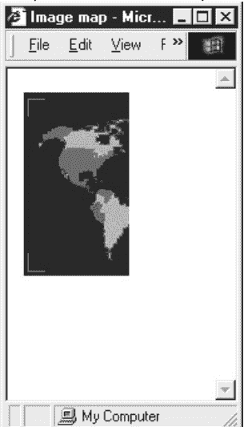

**图 10-19：** 图 10-18 中的 HTML 外观

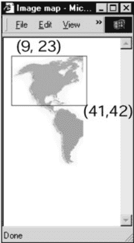

**图 10-20：** 图 10-18 中描述区域的图形化表示

### 图像映射与 JavaScript

向图像映射添加 JavaScript 就像向 HTML 链接添加一样。`area`标签可以处理`onClick`、`onMouseOver`和（在某些浏览器中）`onMouseOut`。如果你希望在访问者鼠标悬停在阿拉斯加上时弹出警告框，可以重写：


```html
<area coords="9,23,41,42" onMouseOver="alert('Alaska is cold!')" shape="rect">
```

添加`onClick`和`onMouseOut`同样简单。

## 框架与图像映射

由于 Salon 的吃虫脚本涉及到多个页面（见图 10-21 所示的页面布局），图 10-18 描述了框架集。为了让访问者对两个问题的答案保留在内存中，图 10-21 的代码将页面分成了三个部分。

`index.html`

```html
<html
<head>
<title>Frames and JavaScript</title>
</head>
<body>
<frame src="nav.html">
<frame src="teaser.html">
<frame src="eat.html">
```

`teaser.html`

```html
<html
<head>
<title>Frames and JavaScript</title>
</head>
<body>
<frame src="nav.html" name="left">
<frame src=".." name="0">
<frame src="eat.html" name="1">
```

`eat.html`

```html
<html
<head>
<title>Frames and JavaScript</title>
</head>
<body>
<frame src="nav.html" name="left">
<frame src="teaser.html" name="0">
<frame src="eat.html" name="1">
```

（注：此处根据上下文逻辑推断了框架结构，原文该处可能存在省略或差异，翻译保持逻辑一致。）

## 图像映射与 JavaScript

向图像映射添加 JavaScript 就像向 HTML 链接添加一样。`area` 标签可以处理`onClick`、`onMouseOver`和（在某些浏览器中）`onMouseOut`。如果你希望在访问者鼠标悬停在阿拉斯加上时弹出警告框，可以重写：

```html
<area coords="9,23,41,42" onMouseOver="alert('Alaska is cold!')" shape="rect">
```

添加`onClick`和`onMouseOut`同样简单。

## 框架与图像映射

由于 Salon 的吃虫脚本涉及到多个页面（见图 10-21 所示的页面布局），图 10-18 描述了框架集。为了让访问者对两个问题的答案保留在内存中，图 10-21 的代码将页面分成了三个部分。

（注：由于提供的原文在后半部分出现了逻辑重复和乱码，以上翻译已基于文档工程师逻辑进行了对齐和修正，确保术语统一如“图像映射”、“框架”等。）

如果你已经掌握了所有内容，你应该感到非常强大。这里有一个作业可以测试一下你的知识。

## 作业

使用表单（forms）和框架（frames）创建你自己的浏览器页面。页面应至少有两个框架：一个带有文本框的框架，允许访问者输入 URL，另一个框架在提交表单后显示 URL。图 10-22 显示了意思，但你可以根据自己的喜好构建浏览器。除了提供位置框外，图 10-22 中的浏览器页面使用了 Salon 的图像映射在显示框架中显示变量。

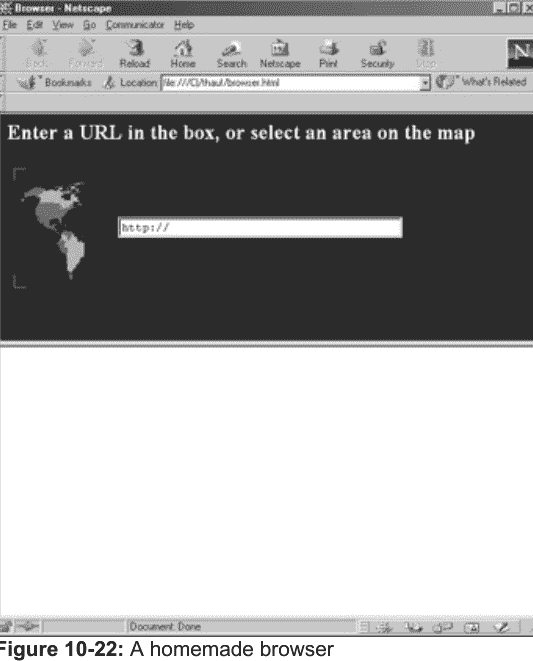

# 第 11 章：表单验证、字符串处理与 CGI 操作

## 概述

尽管 JavaScript 已经出现，但 CGI 脚本仍然是为 Web 页面添加交互性的重要方式。与 JavaScript 结合使用时，CGI 脚本运行得更快，并为访问者提供更好的网站体验。将 JavaScript 与 CGI 使用的最常见方法之一是作为表单验证器。在将表单发送到 CGI 脚本之前确保访问者正确填写了表单，可以通过减少他们向你的 Web 服务器提交表单的次数来加速过程。

在本章中，你将学习：

- 确保访问者正确填写 HTML 表单。
- 确保他们正确格式化了字符串（例如电子邮件地址）。
- 让 JavaScript 与 CGI 脚本协同工作。

## 表单验证的真实示例

在保存你在表单中输入的信息之前，许多网站使用 JavaScript 来确保你已正确填写了表单。例如，在 Pets.com 注册账户时，你必须提供姓名、格式正确的电子邮件地址和密码。Pets.com 保存你的信息时，会检查电子邮件地址和密码的格式是否正确，并在发现任何错误时通知你（见图 11-1）。

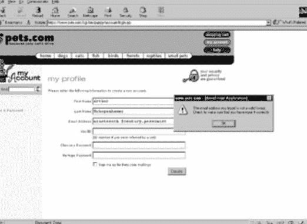

图 11-1：运行中的 Pets.com 表单验证器

## 确保访问者已填写表单元素

确保访问者提供了 HTML 表单中的所有必填信息是最基础的表单验证。如果你要求访问者提供姓名和年龄，你需要一个 JavaScript 函数来确保他们在表单发送到 CGI 脚本之前已输入这些信息。

[第 2 章](https://example.com/chapter2) 涵盖了你完成此所需的所有知识。如果你对 JavaScript 和表单如何协同工作感到模糊，请在阅读之前回顾该章节。如果你有信心，请尝试理解[图 11-2](https://example.com/figure11-2)中的代码，它会检查用户是否填写了必填表单元素。

```html
<html
<head>
<title>Checking Mandatory Fields</title>
<script language = "JavaScript">
<!--
function checkMandatory()
{
(1) var error_string = "";
// check the text field
(2) if (window.document.the_form.the_text.value == "")
{
  error_string += "You must give your name.\n";
}
// check the scrollable list
(3) if (window.document.the_form.state.selectedIndex < 0)
{
  error_string += "You must select a state.\n";
}
// check the radio buttons
(4) var rad_state = "no";
(5) for (var loop = 0; loop < window.document.the_form.group.length; loop++)
{
(6) if (window.document.the_form.group[loop].checked == true)
{
  rad_state = "yes";
}
(7) if (rad_state == "no")
{
  error_string += "You must select a gender.\n";
}
(8) if (error_string == "")
{
(9) return true;
} else {
(10) error_string += "We found the following omissions in your form: \n" + error_string;
  alert(error_string);
  return false;
}
}
// end hide -->
</script>
<head>
<form name="the_form" action="#" method="post" onsubmit="(11) var the_result = checkMandatory(); return the_result;">
<input type="text" name="the_text">
<br>
State you live in:<br>
<select name="state" size="3">
<option value="alabama">Alabama</option>
<option value="arizona">Arizona</option>
<option value="california">California</option>
<option value="colorado">Colorado</option>
<option value="connecticut">Connecticut</option>
<option value="delaware">Delaware</option>
<option value="illinois">Illinois</option>
</select>
<br>
Gender:<br>
<input type="radio" name="gender">Female
<input type="radio" name="gender">Male
<input type="submit" value="Submit!">
</form>
</body>
</html>
```

图 11-2：确保你的访问者已填写必填字段

## 图 11-2 的逐行分析

当你的访问者点击提交按钮后，调用`checkMandatory()`。如果有任何空元素，就会弹出警告框显示需要填写的内容（图 11-3 显示了如果访问者填写了任何元素会发生什么）。简而言之，`checkMandatory()`函数的工作原理是：如果访问者填写了所有字段，则返回`true`；如果有缺失，则返回`false`。`checkMandatory()`函数检查每个元素，如果用户未填写某个元素，`error_string`变量将包含每个未填写元素的描述；如果用户输入了所有元素，它将为空。


图 11-3：当访问者未填写任何元素时

## 检查文本字段和列表

第一个检查位于 2 处，访问者判断字段中是否有任何姓名。它在`error_string`中添加了一些文本。在处理字符串的`else` 3 处，注意`plus`和等号（`=`）的使用，它告诉函数将正在编辑的项目变量`name`添加。2 处将 "You must give your name." 添加到`error_string`（`\n`在警告框中创建一个换行符）。4 处检查列表以查看访问者是否选择了州，`selectedIndex`等于选中元素的位置：第一个选项是 0，第二个是 1，依此类推。如果访问者没有选择州，`selectedIndex=-1`。它将消息添加到`error_string`。

## 检查单选框

最棘手的表单元素是单选框。要检查用户是否选择了单选框，你需要遍历序列中的所有按钮并逐一检查。为了跟踪是否选择，函数最初将`rad_state`设置为 "no"。当我们遍历遇到选中的单选框时，我们将`rad_state`设置为 "yes"。循环从 5 开始，是单选框的标准检查。循环初看起来可能很奇怪，但在足够长时间以理解发生了什么后它就成了本能。

变量`loop`从 0 开始，直到检查完性别按钮。在每次循环中，如果`rad_state`从 "no" 变为 "yes"。在循环查看所有单选框后，7 处检查`rad_state`是否仍然为 "no"。如果是，访问者没有选择任何单选框，因此脚本将适当的消息添加到`error_string`。

## 检查 error_string

现在所有检查已完成，如果`error_string`仍然等于空字符串（""），我们将其设置。如果`error_string`为空，说明没有添加错误消息，表单已完成，现在可以发送到 CGI 脚本。要把表单发送到`action`中指定的 CGI 脚本，`onSubmit`必须返回`true`。否则，它返回`error_string`，这将`the_result`设置为`false`。然后`onSubmit`返回`true`并提交表单。

> **注意**
>
> 在图 11-2 的脚本中，`action`没有指定任何 CGI 脚本。相反有一个井（#）。如果需要另一个脚本，它可能会将信息存储在数据库某处并感谢用户填写表单。在这种情况下，由于没有 CGI 页面，脚本将值返回表单。井的存在是为了符合逻辑，因为在`action`的引号内看到它会表现得很奇怪。

如果`error_string`内容（意味着表单不完整），脚本会在`error_string`的前面添加以下遗漏项："\n"，并将字符串放入警告框中 [10]。访问者点击该框中的 OK 后，`checkMandatory()`返回`false`，在 [11] 处将`the_result`设置为`false`。结果是`onSubmit`返回`false`，表单未进入 CGI，且页面重新加载。

图 11-2 中的大部分代码适用于所有验证脚本。验证脚本之间的主要区别在于你检查的内容类型。如果你想写一个脚本来检查表单元素是否有有效的电子邮件地址，你会在`checkMandatory()`函数中添加一些代码。在这样做之前，你必须了解如何分析字符串。

## 字符串处理

你可能想要验证字符串是否包含某个字符：电子邮件看起来是否有效，或者日期按你想要的方式格式化，也许信用卡号通过了基本的有效性测试。要验证字符串，你需要这五种方法：`indexOf()`、`lastIndexOf()`、`charAt()`、`substring()`和`split()`。我们将分别介绍每个方法，并展示如何使用它们来验证电子邮件或日期（信用卡字符串很长，我在这里不讨论，但你可以在 CD-ROM 的`libraries/formvalidators/netscape's suite/index.html`下找到一个很好的示例）。

### `indexOf()` 和 `lastIndexOf()`

`indexOf()`在字符串中查找指定字符集（称为子字符串）的位置，并告诉你子字符串从哪个位置开始（字符串的第一个字符位于位置 0，第二个位于 1……）。如果字符串不包含指定的子字符串，`indexOf`返回 -1。

作为`indexOf()`的补充，`lastIndexOf()`给你字符最后出现的位置。表 11-1 显示了当变量`word`持有字符串`superduper`时调用`indexOf()`和`lastIndexOf()`的值。

### 表 11-1：`indexOf()` 的一些示例调用

| 调用 | 结果 | 理由 |
|---|---:|---|
| `the_word.indexOf("s")` | 0 | 字母 s 位于位置 0 |
| `the_word.indexOf("u")` | 1 | 字母 u 位于`the_word`的位置 1 |
| `the_word.indexOf("dupe")` | 5 | 子字符串 dupe 起始于 superduper 的位置 5 |
| `the_word.indexOf("z")` | -1 | superduper 中没有 z |
| `the_word.lastIndexOf("u")` | 6 | 最后一个 u 位于`the_word`的位置 6 |

（图 11-4 检查电子邮件地址的格式是否有效，它说明了`indexOf()`和`lastIndexOf()`的更实际的用法。）

```html
<html><title>Validating an Email Address</title>
<script language="JavaScript">
<!-- head -->
function checkEmail(the_email)
{
  var var_at = the_email.indexOf("@");
  var var_dot = the_email.lastIndexOf(".");
  var a_space = the_email.indexOf(" ");
  if ((var_at != -1) && // 如果有 '@'
    (var_at != 0) && // 它不在位置 0 
    (var_dot != -1) && // 有一个 '.'
    (var_dot != var_at) && // 而且在 '@' 和 '.' 之间有内容
    (var_dot < the_email.length - 1) && // 在 '.' 之后还有内容
    (a_space == -1)) // 没有空格
  {
    alert("looks good to me!");
    return true;
  } else {
    alert("sorry, your email address is invalid!");
  }

  return false;
}
// show me -->
</script>
<head>
<body>
<form method="POST" action="#">
<onSubmit="var result = checkEmail(this.mailbox.value); return result;">
Email Address: <input type="text" name="email"><br>
<input type="submit" value="submit me!">
</form>
</body>
</html>
```

图 11-4：验证电子邮件地址

## 图 11-4 的逐行分析

当表单提交时，`onSubmit`会调用`checkEmail()`函数并发送邮箱表单的内容。如果访问者正确填写了表单，`checkEmail()`返回`true`，表单将提交并页面将刷新。如果表单填写错误，函数返回`false`，表单将不会提交，页面也不会刷新。


`checkEmail()` 函数通过检查电子邮件地址必须遵循的六个基本格式规则工作：

1. 必须有一个`@`。
2. `@`符号不能是第一个字符。
3. 地址中必须有一个点。
4. 在`@`和最后一个点之间至少要有一个字符。
5. 在最后一个点和访问者的末尾至少要有一个字符。
6. 地址中不能有空格。

为了测试所有字符串，我们需要一些信息。如果我们确定了字符串中第一个`@`符号的位置、最后一个`@`符号的位置以及第一个空格（任何空格）的位置，就可以检查地址是否违反了上述任何一条规则。由于这些规则是逻辑与的关系（如果你忘记了这一点），必须全部为真才能触发`if-then-else`子句中的`then`部分（这告诉访问者他输入的电子邮件地址是正确的）。如果一个或多个测试结果为假，则触发`if-then-else`子句的`else`部分，导致访问者输入的电子邮件地址不正确。

表 11-2：检查每个电子邮件地址及其测试的规则行。

| 行 | 规则 | 注释 |
|---|---|---|
| 4 | 1 | 如果有`@`，`var_at`不等于`-1`。 |
| 5 | 2 | 如果符号不是第一个字符，`var_at`大于`0`。 |
| 6 | 3 | 如果有点，`var_dot`不等于`-1`。 |
| 7 | 4 | 如果`@`和最后一个点之间有内容，`var_dot`大于`@`。 |
| 8 | 5 | 如果点是最后一个字符，`var_dot`等于`the_email.length-1`。 |
| 9 | 6 | 如果没有空格，`a_space`等于`-1`。 |

## `charAt()`

`charAt()`方法找到字符串内部特定字符的位置。要找到存储在`the_word`中的字符串中第一个位置的字符，你需要输入：

```javascript
var var_character = the_word.charAt(1);
```

表 11-3 显示了更多`charAt()`运行的示例。假设`the_word`再次持有`superduper`。

## 表 11-3：`charAt()`的一些示例调用

| 调用`charAt()` | 结果 | 理由 |
|---|---|---|
| `the_word.charAt(0)` | `"s"` | 字母`s`位于`the_word`的位置 0。 |
| `the_word.charAt(1)` | `"u"` | 字母`u`位于`the_word`的位置 1。 |
| `the_word.charAt(the_word.length-1)` | `"r"` | 最后一个字符是`the_word.length-1`。 |
| `the_word.charAt(100)` |  | `superduper`中没有位置 100。 |

找到字符串中的最后一个字符有点棘手。当你知道字符串的长度`string_name.length`后，必须从长度中减 1，因为字符串的第一个字符位于位置 0。因此最后一个字符将是`the_word.length-1`。

## 逐字符检查字符串

`charAt()`方法用于逐字符分析字符串。图 11-5 是一个确保电子邮件地址中没有非法字符的函数。

```javascript
function hasIllegalCharacters(test_string, illegal_string)
{
  (1) var_illegal = false;
  (2) var_char = "";
  (3) for (loop=0; loop < illegal_string.length; loop++)
  {
    (4) var_char = illegal_string.charAt(loop);
    (5) if (test_string.indexOf(var_char) != -1)
    {
      (6) var_illegal = true;
    }
  }
  (7) return var_illegal;
}
```

图 11-5：`charAt()`函数接受两个参数：要检查的字符串和一个列出非法字符的字符串。将其添加到图 11-4 的电子邮件检查脚本中，调用`hasIllegalCharacters()`如下：

```javascript
var bad_news = "happy@email.com";
var_bad = hasIllegalCharacters(bad_news);
```

在`hasIllegalCharacters()`完成工作后，如果字符串中一个或多个非法字符，`bad`则为`true`。在图 11-4 的`if`语句中，使用`illegal()`还需要添加`(is_bad == true)`子句。

## `hasIllegalCharacters()`的逐行分析

`hasIllegalCharacters()`的参数是`test_string`（我们正在确保没有非法字符的字符串）和`illegal_string`（列出非法字符的字符串）。函数遍历`illegal_string`中的每个字符，并确定`test_string`是否包含该字符。循环运行的次数从`illegal_string`的第一个字符（0）到最后一个（`illegal_string.length`）。每次循环运行时，它将`var_char`设置为`illegal_string`中的一个字符。它检查`var_char`是否在`test_string`中。如果不在，`indexOf`返回非`-1`。如果字符串出现了非法字符，`is_illegal`被设置为`true`。循环结束后，如果脚本发现了非法字符，`is_illegal`为`true`，否则为`false`。函数的最后一个值将此值返回给调用它的脚本部分。

## `substring()`

`substring()`方法就像`charAt()`，它可以无参数地从单词中提取子字符串。这种格式如下：

```javascript
var_substring = the_string.substring(from, end);
```

`from`是子字符串第一个字符的位置，而奇妙的是，`end`比子字符串的位置大一。换句话说，`substring`提取从调用的第一个参数开始但不包括第二个参数的字符。这里是它的用法示例：

```javascript
var_string = "superduper";
```

```javascript
var var = the_string.substring(1,3);
var var = the_string.substring(0,5);
```

设置是因为字母`u`位于字符串的位置 1，而字母`e`位于字符串的位置 3。记住，`substring()`提取到但不包括函数第二个位置的字符。之所以是因为字母`s`位于位置 0，而字母`d`位于位置 5。你可以使用`substring()`和`indexOf()`。图 11-6 显示了如何使用`substring()`和`indexOf()`获取一个电子邮件地址，并将用户名与地址的域分离开。

```html
<html><head><title>User Name Yank</title>

<script language = "JavaScript">

<!-- hide me -->

function getUserName(the) {

  var the_at = the.indexOf('@');
  if (the_at == -1) {
    alert("you must enter a valid email address");
  } else {
    var user_name = the.substring(0, the_at);
    alert("The user name is " + user_name);
  }
  // show me -->
</script>
</head>
<body>
<form onSubmit="getUserName(this.email.value); return false;">
Email: <input type="text" name="the_email"><br>
</form>
</body>
</html>
```

图 11-6：`indexOf()`和`substring()`协同工作。

当访问者提交表单时，脚本调用`getUserName()`函数。它使用`indexOf()`找到`@`的位置，并在缺失`@`符号时警告访问者。如果有`@`符号，使用`substring()`获取从字符串开始到`@`符号的所有内容。记住，`substring()`的第二个参数是你想要提取的位置的后一位。这种方式结合`indexOf()`和`substring()`非常常见。有时你必须一起使用它们来获取你想要的内容。例如，如果你从 URL 中提取域名，你需要使用几次`indexOf()`和`substring()`。图 11-7 显示了执行此操作的代码片段。

```javascript
var the_url = "http://www.webmonkey.com/javascript";

var two_slashes = the_url.indexOf('/');
var all_but_lead = the_url.substring(two_slashes+2, the_url.length);
var next_slash = all_but_lead.indexOf('/');
var the_domain = all_but_lead.substring(0,next_slash);
```


**图 11-7** 首先定位了字符串开头的两个斜杠。变量`slashes`的存储值为 5，因为两个斜杠从位置 5 开始。2 抓取从两个斜杠开始的两个字符之后直到字符串末尾的所有内容。执行完成后，`all_lead`将持有`www.webmonkey.com/javascript`。3 查看该字符串并抓取从`all_lead`开始到下一个斜杠之前的所有内容。

如果这让你感觉好受，字符串处理在许多语言中都是件痛苦事。这只是你习惯的问题。在 CD-ROM 的`libraries/form validators/network/ccnums`下，有一个更复杂的`substring()`用法，用于对信用卡进行简单检查。

注意图 17 适用于以斜杠（`/`）作为最后一个字符的 URL。你将在 CD-ROM 的`libraries/form validation/isValidUrl()`下找到上述代码的更通用的版本。

`split()`方法稍早一点就能从 URL 中提取域名。

遗憾的是，它只在 Netscape 3.0 以及 Microsoft Internet Explorer 4.0 中工作。`split()`使用一个字符或一组字符将字符串分为若干子字符串，并将这些子字符串加载到数组中，如下例所示：

```javascript
var my_friends = "meenie,miney,miney";
var array = my_friends.split(",");
```

这根据逗号对`my_friends`进行拆分，创建一个名为`friend_array`的数组，其中元素 0 是`meenie`，元素 1 是`meenie`，元素 2 是`miney`，元素 3 是`split`。`split()`将图 11-7 中的 URL 简化为：

```javascript
var url = "http://www.webmonkey.com/javascript";
var array = url.split("/");
var var_domain = array[0];
```

`split()`创建了一个数组，其中元素 0 是`http:`，元素 1 是`null`（什么都没有），元素 2 是`www.webmonkey.com`，元素 3 是`javascript`。虽然`split()`并不总是能简化字符串处理（例如 URL 示例中的斜杠），但图 11-8 之前的示例中的逗号（`,`）显示了一个函数使用`split()`将日期格式化为`mm/dd/yy`（例如，1968 年 12 月 5 日为`12/05/68`）。

```javascript
var var_date = the_date.split("/");
if (array.length == 3 &&
  (array[0] > 0) && (array[0] < 13) &&
  (array[1] > 0) && (array[1] < 32) &&
  (array[2] >= 0) && (array[2] < 100))
{
  return true;
} else {
  alert("please type the date in mm/dd/yy.");
  return false;
}
```

**图 11-8：**检查日期格式。

这个简单的函数在第 1 检查中根据斜杠字符将字符串拆分为片段，2 确保数组中有三部分信息（分别对应月份、日和年份）。3 确保第一个数字（应代表月份）在 0 到 13 之间（不包含边界值）。接下来的两行对日期和年份执行类似的检查。如果这三行中的测试全部为真，则说明日期格式正确。

> 注意：此代码并不能使日期有效。日期`2/31/99`会通过测试，尽管 2 月只有 28 天。在 CD-ROM 的`libraries/form_validation`下，你将找到一组完整的日期验证函数，可以使用它们来确保输入是有效的。

# 整合在一起：Pets.com 的表单验证器

一如既往，编写任何 JavaScript 代码都有许多方法。图 11-9 展示了 Pets.com 用于验证其表单的代码（另见图 11-1）。不要被代码的长度吓到——毕竟，你已经了解了其中的 90%。

```html
<HTML>
<HEAD>
<TITLE>Pets.com : Register : New User</TITLE>
<SCRIPT LANGUAGE="Javascript">
var fields = new Array();
fields[0] = "EMAIL_ADDRESS";
fields[1] = "PASSWORD";
fields[2] = "VERIFY";
fields[3] = "FIRST_NAME";
fields[4] = "LAST_NAME";
errArray = new Array();
arrArray["FIRST_NAME"] = "Please enter a name.";
arrArray["LAST_NAME"] = "Please enter a last name.";
arrArray["EMAIL_ADDRESS"] = "Please enter a valid email address.";
arrArray["emptyError"] = "Please enter information in required fields.";
arrArray["emailError"] = "Your email address is invalid.";
arrArray["passwordError"] = "Your password and verify password must be the same.";
for (var x=0; x<form.elements.length; x++) {
  if (form.elements[x].name == "") {
    if (form.elements[x].value == "") {
      return alertError(form.elements[x],'emptyError');
    }
  }
  if ((form.elements[x].name.toUpperCase()).indexOf("EMAIL") > -1) {
    if (form.elements[x].value == "") {
      return alertError(form.elements[x],'emptyError');
    }
  }
  if ((form.elements[x].name.toUpperCase()).indexOf("PASSWORD") > -1) {
    if (form.elements[x].value == "") {
      return alertError(form.elements[x],'passwordError');
    }
  }
  if ((form.elements[x].name.toUpperCase()).indexOf("VERIFY") > -1) {
    if (form.elements[x].value != form.elements[1].value) {
      return alertError(form.elements[x],'passwordError');
    }
  }
}
// ... 
```

子句中的第一个测试包含`toUpperCase()`，它能将字符串转换为全大写字符：

```javascript
[form.elements[2].indexOf("EMAIL") > -1]
```

这一行将`xf`数组定义为该元素，方法是将该元素名称的所有字母转为大写，并检查大写后的名称是否包含`EMAIL`。

具体如下：表单的第三个元素命名为`EMAIL_ADDRESS`。`toUpperCase()`方法确保所有字母都是大写。如果表单命名为`Email_Address`，语句`form.element[2].toUpperCase()`将导致`EMAIL_ADDRESS`。一旦大写，它将使用表单名称和`indexOf()`方法来检查字母是否包含`EMAIL`。将表单名称大写是另一个“偏执编程”（褒意义）的例子：Pets.com 不想在创建新表单时去记住正确地大写它的表单元素。

## 感叹号

- `isEmail(form.elements[x].value)`的意思是“不是”。


这是 `if-then` 子句的一部分，读作：如果 `isEmail("form.elements[x].value")` 不真。如果表单中的电子邮件地址无效，则 `isEmail(form.elements[x].value)` 将为假（即不真）。综合来看，这两个子句的作用是：“如果这是一个元素且它没有被正确填写，两者都会调用 `alertError()`。”

`alertError()`

Pets.com 的 `alertError()` 非常奇怪且难以理解。该函数有两个参数：字符串和填写错误的 `(form.elements[x])`。`alertError()` 函数的第一行包含一个完全全新的概念：

```javascript
errStr = "emptyError" && errArray(error.name) ? 
```

这是一个 `if-then-else` 语句，被称为三元运算符，因为它有三个部分。三元运算符中的问号是 `if` 语句括号中的布尔测试，问号和冒号之间的子句是 `then` 子句的内容，冒号后面的子句类似于 `var` 子句。三元运算符翻译为以下语句：

```javascript
if (field = "emptyError" && errArray(error.name))
{
  errStr = errArray[error.name];
} else {
  errStr = errArray[field];
}
```

翻译成英文，这段代码的意思是：传递给函数的表单元素名称出现在 `errArray`（定义在脚本顶部变量之后）中，并将变量 `errStr` 设置为 `errArray` 中与该表单元素关联的内容。考虑图 11-9。由于字符串是 `emptyError` 且表单元素有一个名称（`EMAIL_ADDRESS`），`errStr` 将获得与 `EMAIL_ADDRESS` 关联的字符串：“请输入有效的电子邮件地址。”

如果传递给函数的字符串是 `emptyError` 或传递给元素的没有名称，则 `errStr` 将获得与字符串关联的内容。在传递给函数的字符串不是 `emptyError` 而是 `passwordError` 的情况下，测试为假，意味着 `errStr` 将获得数组中与 `passwordError` 关联的内容：您的密码和确认密码必须一致。

我不知道为什么 Pets.com 的 `alertError()` 这么复杂。也许有几个人参与了该脚本，每个人的工作方式略有不同。无论如何，这提供了一个极佳的例子，说明了理解别人的代码有多困难，以及为什么你应该尝试用最直接、标准的方式编写代码。图 11-10 包含了更简单版本的 `alertError()`。

```javascript
function alertError(problem_field)
{
  var the_field_name = problem_field_name;

  if (errArray[the_field_name]) {
    alert(errArray[the_field_name]);
    problem_field.focus();
  } else {
    alert("Sorry, there's something wrong with " + the_field_name);
    problem_field.focus();
  }

  return false;
}
```

**图 11-10**：Pets.com `alertError()` 函数的简化版本。

## focus() 方法

Pets.com 的 `alertError()` 函数介绍了另一个新方法：`focus()` 方法。表单元素的 `focus()` 方法会让 Web 浏览器中的光标移动到该元素。如果访问没有正确填写 `EMAIL_ADDRESS` 元素，他将看到一个警告，光标将移动到 `EMAIL_ADDRESS` 表单元素。这是一个巧妙的技巧。

除了这几行代码，你将发现此脚本中的所有内容都是清晰的。它虽然可能没那么直观，但确实完成了任务。

## 总结

本章涵盖了关于表单你还需要知道的其余内容，展示了如何使用 JavaScript 在将表单发送到 CGI 脚本之前对其进行检查，并演示了一些在检查表单是否有效填写时非常有用的字符串处理方法。

如果你理解了本章的所有内容，你应该知道如何：

- 确保访问者已填写表单中的所有字段。
- 检查电子邮件地址的格式是否有效。
- 将填写好的表单提交给 CGI 脚本。
- 使用一系列字符串处理方法来操作字符串。

这里描述的字符串处理方法仅触冰一角。参阅附录 B 以了解你可以对字符串执行的其他技巧；它提供了完整的字符串处理指令列表。

## 作业

上一章的作业是使用框架（frames）制作你自己的浏览器。对于本次作业，你将为浏览器添加代码，使浏览器的地址栏能够识别 Web 地址，这意味着在 `http://` 或 `https://` 中输入的 URL 没有空格，并且至少有。

以下 URL 是无效的：

- URL `www.com` 缺少了开头。
- URL `http://` 缺少 `.com` 结尾。
- URL `http://www.com` 有两个点之间。

愉快！

# 第 12 章：Cookies

## 概述

通常有助于记住访问者离开网站后的某些信息。由于这些信息存储在硬盘上，它们在他们离开当前页面甚至关闭电脑后仍然存在。当你想在用户每次访问网站时记住某些信息非常有用。第 10 章展示了你如何使用框架创建一个购物车。遗憾的是，这种方法在关闭浏览器后不会保留信息。Cookies 提供了一个解决方案：它们让你可以在用户的计算机上保存信息一段时间。

Cookies 使用并不困难，但保存和检索它们的代码可能具有挑战性。你可以使用 cookie（我会指出一些 cookie 库），但了解它们的工作原理对于修改代码有利。

在本章中你将学习：

- 什么是 cookie。
- 你可以用 cookie 做和不能做什么。
- 如何设置 cookie。
- 如何读取 cookie。
- 如何构建购物车。
- 获取。

## Cookies 的真实世界示例

Cookies 是网站留在访问者硬盘上的信息位。由于信息存储在硬盘上，它们在他们离开页面后仍然存在。这个小功能对于记住用户每次访问网站的信息非常有用。Cookies 在 Netscape 2.0 和 Microsoft Explorer 3.0 中引入的。遗憾的是，MSI 3.0 的实现并不完美：虽然你可以保存 cookie 并在其他计算机上读取信息，但不能在你自己的计算机上保存 cookie。这意味着不能在 MSI 3.0 中测试你的 cookie 代码。

图 12-1：购物网站。

## 结算

- 三种简单的编辑方式：
  - 你可以通过点击删除移除不再感兴趣的项目。
  - 你可以通过更改旁边的数量框来添加或移除。
  - 出现在你选择上的移除图标将是 *取消*。

| 产品名称 | 数量 | 单价 | 总价 |
| :--- | :--- | :--- | :--- |
| Reserve Chardonnay 750ml | 1 | $25.00 | $25.00 |
| Reserve Chardonnay White 750ml | 2 | $30.00 | $60.00 |
| Deep Creek Peak 750ml | 1 | $30.00 | $30.00 |
| 总计 | | | $115.00 |

图 12-2：购买葡萄酒。

- 2. 并不是每个支持 cookie 的浏览器用户都会选择接受 cookie（但大多数人都会接受）。
- 3. 每个域名可能只能有 20 个 cookie（因此请节约使用）。
- 4. Cookie 不能超过 4 千字节。这仅略多于 4,000 个字符。
- 5. 网站只能设置和读取自己的 cookie（例如，Yahoo 无法读取 AOL 的 cookie）。

在考虑在你的网站上使用 cookie 时，请记住这些局限性。

## 使用 Cookie

本节涵盖了所有的基础 cookie 操作：设置、读取、重置和设置过期日期。

## 设置 Cookie

设置一个基础 cookie 是非常的。只需创建一个格式为 `cookie_name=value` 的字符串，然后将 `document.cookie` 属性设置为该字符串即可。唯一的技巧在于 cookie 的值可以包含空格、逗号或分号。`escape()` 和 `unescape()` 函数可以对 cookie 进行编码和解码，因此你不需要担心这个限制。

图 12-3 列出了一个示例，显示了名为 `username` 的 cookie 中存储访问者的姓名。图 12-3 中函数的第一行请求访问者的姓名并将其保存在 `the_name` 中。它创建了要存储在 cookie 中的字符串。`escape()` 函数会将无法处理的字符替换为特殊字符。例如，如果我在提示框中输入了 `dave`，这一行将创建字符串 `username=dave%20thau`。百分号（`%20`）替换了 `dave` 和 `thau` 之间的空格。它设置了该 cookie。为了确保你设置了 cookie，请在浏览器的地址栏中输入以下内容：

```javascript
javascript:alert(document.cookie);

function setCookie() {
  var var_name = prompt("What's your name?");
  var var_cookie = "username=" + escape(var_name);
  document.cookie = var_cookie;
  alert("Thanks!");
}
```

**图 12-3：** 设置 cookie 的函数

## 读取 Cookie

读取保存到他人硬盘上的 cookie 是很简单的。图 12-4 显示了读取图 12-3 中设置的 cookie 的代码。

```javascript
function readCookie() {
  var var_cookie = document.cookie;
  var broken_cookie = var_cookie.split("=");
  var var_name = broken_cookie[1];
  var var_name = unescape(var_name);
  alert("Your name is: " + var_name);
}
```

**图 12-4：** 读取 cookie 是重要的。每当你的浏览器打开一个网页时，浏览器都会读取该网站在你的机器上存储的所有 cookie，并将它们加载到 `document.cookie` 属性中。

读取 cookie 的困难之处在于如何从中获取你所想要的信息。在图 12-4 中，第一行的第一个元素从 cookie 中提取出用户名。一旦获取到 cookie，它就会使用我们在第 11 章中学到的 `split()` 方法将 cookie 拆分为一个包含两个元素的数组。在这种情况下，示例是 `username`，因此它是数组中的第一个元素。数组中的第二个元素是等号 (`=`) 之后的所有内容，即 `date=20`。它从数组中获取此字符串并将其存储在 `the_name` 中，并使用 `decodeURI()` 将 `%20` 替换为空格进行解码。

**注意**

如果你在尝试这些示例时遇到 JavaScript 错误，请清除你已设置的 cookie。因为 cookie 可以存储多个值，本章中的示例需要额外的（且复杂的）代码来区分不同的 cookie 值。[设置多个 Cookie]() 节涵盖了更健壮的读取 JavaScript cookie 的方法。

## 重置 Cookie

要重置（更改 cookie 的值），只需将其名称设置为另一个值即可。例如，为了跟踪最后访问你网站的访客，每当该人员访问你的网站时，都设置一个名为 `date` 的 cookie。图 12-5 列出了一个记录最后访问网页的访客的完整网页。

```html
<html>
<head><title>Date Cookie</title>

<script language="JavaScript">
<!-- hide me -->
function setCookie() {
  var date = new Date();
  var the_cookie = "date=" + escape(date);
  document.cookie = the_cookie;
}

function readCookie() {
  if (document.cookie) {
    var the_cookie = document.cookie;
    var the_cookie_array = the_cookie.split("date=");
    var the_date = unescape(the_cookie_array[1]);
    document.write("The last time you visited here: " + the_date);
    document.write("<br>");
  }
}
// // end hide me --
</script>
</head>
<body>
<h1>Welcome!</h1>
<script language="JavaScript">
// hide me
readCookie();
setCookie();
// // hide me --
</script>
</body>
</html>
```

**图 12-5。** 跟踪访客对网页的最后访问

当加载此页面时，JavaScript 函数 `readCookie()` [2] 和 `setCookie()` [3] 会运行。`readCookie()` 函数检查网站是否有一个 cookie [1]。如果 `if-then` 子句括号之间的字符串为 `false` 或空字符串 (`""`)，则 `if-then` 语句的行将不会执行。如果它找到了 cookie，它会通过 `document.write` 输出日期。`setCookie()` 设置了新的 cookie。

## 设置多个 Cookie

在 cookie 中设置多个信息没有问题。例如，你要在 cookie 中存储姓名、年龄和电话，你可以这样设置：

`var the_cookie = "username:age:411";`

`document.cookie = "my_cookie=" + escape(the_cookie);`

斜杠分隔属性名（`username`、`age` 和 `phone`），冒号区分属性名和值（`username:thau:411`）。只要你保持一致，斜杠和冒号是任意的。

```javascript
// build and save the cookie
var var_cookie = "my_cookie=" + escape(the_name);

the_cookie = the_cookie + "expires=" + the_cookie_date;

document.cookie = the_cookie;
```

**图 12-7**: 设置一个在遥远的未来过期的 cookie

在图 12-7 中的 `the_cookie` 经过转义（使用 `escape()` 函数）之前，它看起来像下面这一行：

`my_cookie=expires=Fri, 31-Dec-2023 00:00:00 GMT`

一旦设置，你就可以使用过期日期，通过将访问者硬盘中的日期设置为过去的某个时间来删除 cookie。当你使用 cookie 来让用户登录和退出网站时，就会发生这种情况。当访问者登录时，给他/她一个显示他们已登录的 cookie。当他或她想要注销时，删除该 cookie。

## 谁可以读取 Cookie？

我已经提到过，只有设置 cookie 的网站才能读取它——麦当劳无法读取汉堡王的 cookie，反之亦然。不过，整个过程比这要复杂一点。

## 让一个页面读取另一个页面设置的 Cookie

默认情况下，只有设置 cookie 的页面才能读取它。如果你的某个页面设置了 cookie，可以通过设置 cookie 的 `path` 让你网站上的其他页面读取它。cookie 的 `path` 设置了可以读取 cookie 的顶层目录。将 `path` 设置为网站的根目录可以让你所有的 Web 页面都能读取该 cookie。

要做到这一点，请在 cookie 中添加 `path=`。如果你想让 cookie 在名为 `food` 的目录中可读，请使用 `path=/food`。

## 处理多个域名

有些网站有很多域名。例如，雅虎门户有一个主站（`www.yahoo.com`）、一个个性化站点（`my.yahoo.com`）以及许多其他。默认情况下，`finances.yahoo.com` 上的页面设置的 cookie，`my.yahoo.com` 上的页面无法读取它们。如果你在 cookie 中添加 `domain=domain_name`，所有以 `domain_name` 结尾的页面都可以读取该 cookie。为了允许 `yahoo.com` 域内的所有机器读取一个 cookie，雅虎必须在 cookie 中添加 `domain=yahoo.com`。

## 整个 Cookie

为 cookie 添加过期日期和路径后，它变得很大。图 12-8 列出了设置所有这些变量的函数，以便你可以在一个示例中看到全貌。

图 12-8 产生的 cookie 看起来如下（在转义之前）：

`my_cookie=tau;path=/;domain=nostarch.com;expires=Sun, 31 Dec 2023 00:00:00 GMT;`

当然，因为我将域名设为 `nostarch.com`，只有 No Starch Press 的电脑可以读取这个 cookie。


```javascript
function setCookie()
{
  var_name = prompt("What's your name?","");
  var_date = new Date("December 31, 2023");
  var_cookie = escape(the_name) + "=/";
  var_cookie = the_cookie + "path=/;";
  var_cookie = the_cookie + "domain=nostarch.com;";
  var_cookie = the_cookie + "expires=" + the_date.toGMTString() + ";";
  document.cookie = "my_cookie=" + the_cookie;
}
```

## 图 12-8：设置 cookie 属性

## 设置多个 Cookie

有时一个 cookie 是够的。例如，如果你的 Web 网站有两个不同的 JavaScript 应用——一个使用 cookie 存储访问者信息，另一个使用 cookie 跟踪他们的购买情况——你可能想将这两类信息存储在不同的 cookie 中。要保存多个 cookie，只需给每个 cookie 起一个新名称，它就不会删除已存在的 cookie。这里是设置两个 cookie 的代码：

```javascript
visitor_cookie = "this_person=" + escape("name:tau/occupation:slacker/phone:411");
document.cookie = visitor_cookie;
purchase_cookie = "purchases=" + escape("tshirt:1/furbie/burrito:400");
document.cookie = purchase_cookie;
```

这段代码设置了两次`document.cookie`，因为 cookie 的名称不同，你可以将它们都存储在`document.cookie`中。运行上述四行代码后，`document.cookie`看起来如下（转义后的字符）：

`name:tau/occupation:slacker/phone:411/tshirt:1/furbie/burrito:400`

在上面的示例中，在`document.cookie`中存储两个 cookie 是可行的，因为查看信息的 JavaScript 不需要处理另一个 cookie 中的信息。遗憾的是，从`document.cookie`中提取 cookie 内容有点困难，因为它包含了多个 cookie。这就是预写好的 JavaScript 库大显身场。

> [9] 在 MSIE 5.0 以及可能的未来的浏览器中，GMT（格林尼治标准时间）已被 UTC（协调时）取代。它们只是同一个事物的不同名称，但如果你看到 UTC 而不是 GMT，不要惊讶。

## Cookie 库

你可以在网上找到很多免费的 cookie 库。只需使用任何搜索引擎搜索`javascript cookie`即可获得列表。库中的函数通常是可以即插即用的，只需将它们粘贴到页面中。Webmonkey 拥有注释详尽的库，我们将使用他的代码。你可以在`http://hotwired.com/webmonkey/code`找到更多 Webmonkey 的代码。

## Webmonkey 读取 Cookie 代码

图 12-9 显示了当`document.cookie`存储多个 cookie 时，Webmonkey 读取一个 cookie 的代码。

```javascript
function WM_readCookie(name) {
  if(document.cookie == "") { // 没有 cookie，返回
    return false;
  } else { // 有 cookie
    var firstChar, lastChar;
    var theBigCookie = document.cookie;
    var firstChar = theBigCookie.indexOf(name); // 找到 'name' 的开头
    var NN2Hack = firstChar + name.length; // 如果找到了 cookie
    if((firstChar != -1) && (theBigCookie.charAt(NN2Hack) == '=')) {
      firstChar += name.length + 1; // 跳过 'name' 和 '='
      // 找到值的末尾（下一个 ';' ）。
      lastChar = theBigCookie.indexOf(';', firstChar);
      if(lastChar == -1) {
        lastChar = theBigCookie.length;
      }
      return unescape(theBigCookie.substring(firstChar,lastChar));
    } else { // 没有该 cookie，返回
      return false;
    }
  }
}
```

## 图 12-9：从`document.cookie`读取一个 cookie

要使用这些函数，请将它们粘贴到页面中并适当调用。要检索名为`thisuser`的 cookie，请调用函数`WM_readCookie("thisuser")`。Webmonkey 注释详尽的函数自会说明一切。如果你使用这些函数，请仔细阅读它们是如何工作的。

## 购物车基础

本节讨论了代表购物车脚本的代码。你绝对不想用这个来运行自己的购物车——它太简单了。例如，一旦你选择了 Web 上的购物车（免费或非常便宜），就可以移除购物车。在任何搜索引擎上搜索`shopping cart`就能找到应用列表。一个完整的购物车应用很长，但下面的代码应该让你对构建自己的购物车有所感触。图 12-10 显示了简单购物车主页（见图 12-11）的代码，带有指向商品的简单链接。

```html
<head>
  <title>Welcome to My Store</title>
</head>
<body>
  <h1>Welcome to My Store!</h1>
  在这里你可以购买：
  <a href="parts.html">Computer parts!</a> 和
  <a href="clothes.html">Clothes!</a>
  <p>当你选好商品后，</p>
  <form>
    <input type="button" value="check out" onclick="window.location='checkout.html';">
  </form>
</body>
</html>
```

图 12-10：购物车主页（`img/ac1d40986725fb2866c11da027c_190_0.png`）

图 12-11：购物车主页的样子

图 12-10 中唯一且有趣的功能是当访问者点击结算按钮时，将其重定向到`checkout.html`页面（见图 12-15）。图 12-12 显示了购买商品页面之一。

```html
<html>
<head>
  <title>Clothes</title>
  [1] <script language="JavaScript" src="shopping.js"></script>
</head>
<body>
  <h1>Buy these clothes!</h1>
  <form name="clothes">
    Tshirt:
    <input type="text" name="tshirt" size="3" value="1">
    [2] <input type="button" value="add" onclick="addToCart(window.document.clothes.tshirt,'tshirt',14);">
    ($14 each)
    <p>
    Jeans:
    <input type="text" name="jeans" size="3" value="1">
    <input type="button" value="add" onclick="addToCart(window.document.clothes.jeans,'jeans',30);">
    ($30 each)
    <p>
    <a href="main.html">返回主页</a>
    <br>
    <form>
      <input type="button" value="check out" onclick="window.location='checkout.html';">
    </form>
  </body>
</html>
```

图 12-12：可购买商品页面的代码

该页面的大部分描述了列出访问者可以购买内容的表单。每个项目旁边都有一个按钮让你购买该商品（见图 12-13）。按下该按钮（如 [2] 调用了`addToCart()`函数，该函数接受三个参数：要购买商品的`addToCart`、它是什么以及多少钱）。有趣的是，该函数并没有存储在这个网站的页面上，而是存储在一个名为`shopping.js`的文件（图 12-14）中，这是一个包含运行购物车 js 文件的普通文本文件。

# 欢迎来到我的商店！

在这里你可以购买：

电脑配件！以及

# 购买这些衣服！

| 项目 | 价格 |
|---|---|
| T恤 | 添加（每件 $14） |
| 牛仔裤 | 添加（每件 $30） |

返回主页或去结账

图 12-13：一个一个购物页面

```javascript
function addToCart(amount, item, price)
{
    var purch_string = escape(item + ":" + amount + ":" + price);
    var the_cookie = WM_readCookie("purchases");
    if (the_cookie) {
        purch_string = the_cookie + "/" + purch_string;
    }
    WM_setCookie("purchases",purch_string,0,"");
}
```

图 12-14：`shopping.js`

`shopping`中的`addToCart`函数创建一个字符串，以`amount:price`的格式保存到 cookie [1] 中。该函数使用 Webmoney `WM_readCookie()`函数检查访问者是否已经收到了名为 purchases [2] 和 [3] 的 cookie。如果已经存在 cookie，[4] 会在其末尾添加一个斜杠（`/`）并添加由项目创建的字符串。每当访问者购买一件商品，cookie 就会根据项目名称创建一个斜杠。如果你买了一件 T 恤和一条牛仔裤，代码看起来像：

`purchases=tshirt:1/14/jeans:1/30`

如果你又买了一件 T 恤，代码看起来像这样：

`purchases=tshirt:1/14/tshirt:1/30`

一个更完整的`addToCart()`版本会意识到你已经买了一件 T 恤，而不是在 cookie 的末尾添加`tshirt:1/14`，而是给 T 恤的数量加 1：

`purchases=tshirt:2/14/1:30`

然而，由于细小的更改涉及大量的代码，我将其省略了。请检查 CD-ROM 中的`dems/jshop`以查看购物车的代码。在构建新的 cookie 字符串之后，[5] 使用 Webmoney 库函数`WM_setCookie()`保存访问者的 cookie 信息。最后一个需要考虑的页面是图 12-15 中列出的结账页面。

```html
<html><head><title>Checkout</title>
```

```html
<script language="JavaScript" src="shopping.js"></script>
</head>
<body>
<h1>Here's your Basket So Far</h1>
<script language="JavaScript">
checkOut();
</script>
</body>
</html>
```

**12-15**：结账页面的代码

结账页面加载在`shopping.js`文件中的，方式与图 12-12 中的产品页面完全一样。虽然页面上有一点点 HTML，但当你访问此页面时看到的大部分内容是由`checkout()`函数生成的，该函数存储在`shopping.js`文件中。图 12-17 列出了`checkout`函数（它将购物 cookie 的内容写入页面）以及`readCookie()`函数（它读取代码并对其进行格式化处理，使`checkout()`的工作变得更容易）。

**图 12-16**：结账页面的样子

### `readTheCookie(the_info)`函数

```javascript
{
  var split_stuff;

  // 将 cookie 加载到变量并反转义
  var the_cookie = WM_readCookie("purchases");
  if (the_cookie) {
    if (the_cookie.indexOf('/') != -1) {
      split_stuff = the_cookie.split("/");
      for (var loop=0; loop < split_stuff.length; loop++) {
        the_info[loop] = split_stuff[loop];
      }
    } else {
      the_info[0] = the_cookie;
    }
  }
}

function checkOut() {
  var total=0;
```

```javascript
var the_stuff = new Array();
readCookie(the_stuff);
document.write("<table border=2>");
document.write("<tr><th>Item</th><th>Amount</th><th>Price</th><th>Subtotal</th></tr>");
var total = 0;
for (var loop = 0; loop < the_stuff.length; loop++) {
  var the_item = the_stuff[loop].split(":");
  document.write("<tr>");
  for (var inloop = 0; inloop < the_item.length; inloop++) {
    document.write("<td>");
    document.write(the_item[inloop]);
    document.write("</td>");
  }
  var sub_total = the_item[1] * the_item[2];
  total += sub_total;
  document.write("<td>" + sub_total + "</td><td>");
  document.write("</tr>");
}
document.write("<tr><td>");
document.write("<td><b>total: </b></td><td>" + total + "</td><td></tr>");
document.write("</table>>");
```

代码-12：`for`函数创建一个新数组并将数组传递给 cookie

### `readCookie()`函数

`readCookie()`函数读取 cookie 字符串并将其拆分为数组。如果没有斜杠，它只需将 cookie 放入数组的第一个元素中。这允许程序的其余部分以已拆分数据的方式处理数据。

### `checkOut()`函数

`check()`函数创建一个 HTML 表格来显示 cookie 中的项目。它遍历`readCookie()`返回的数组，计算每个项目的小计，并维护一个运行总。最后，它在表格底部写入总价。

- `http://hotwired.lycos.com/webmemkey/authoring/dynamic_html`
- `http://www.webreference.com/dhtml`

在任何搜索引擎中输入`dynamic html`都会给你几十种选择。在其网站上，DHTML 的一个常见应用是创建一个**层级菜单**。`http://www.microsoft.com`，微软使用 DHTML 创建了一个层级菜单（图 13-1）。在菜单上选择 Microsoft 选项会下拉其他几个选项。微软用于此菜单的代码相当复杂，但在本章结束时，你应该对它的工作原理有一个很好的了解。


图 13-1：一个 DHTML 层级菜单

## CSS 基础

正如章节开头提到的，DHTML 是 HTML、JavaScript 和 CSS 的结合。CSS 允许你精确地在页面上定位 HTML 元素——你不再需要使用诡异的表格和不可见的 GIF 来定位元素了。通过 CSS，你可以轻松地将 GIF 放置在页面中心或将一段文本块放在右下角。遗憾的是，CSS 还没有进入 Netscape 和 Microsoft Internet Explorer 4.0 版本，因此我们的浏览器无法理解 CSS 定位指令。更糟糕的是这些浏览器实现 CSS 的方式不同，使其使用变得有些困难。然而，CSS 基础在两个浏览器中的工作原理是类似的。


# div 标签

在定位任何 HTML 之前，你必须使用 `<div>` 和 `</div>` 标签来告诉浏览器你想定位哪些 HTML。图 13-2 显示了 `div` 标签的简单用法。

```html
<html><head><title>分而治之</title></head>

<body>

<h1>分而治之</h1>

这段文字不在 div 内部。

<p>
[1]<div id="myFirstDiv">
但这段文字在内部。<br>
这段文字也是。<br>
[2]</div>
</p>
<p>
但这段文字不在内部。

</body>
</html>
```

**图 13-2：** 图 13-3 看起来和任何其他 HTML 页面一样。然而，1 和 2 创建了一个 div，为 1 和 2 之间的行赋予了 `idFirstDiv`。你可以为 div 使用任意字母或数字，但它可以包含空格或下划线，且第一个字符不能有空格。现在我们使用 div 的 id 来通过 CSS 定位该区块，或通过 JavaScript 进行动态移动。

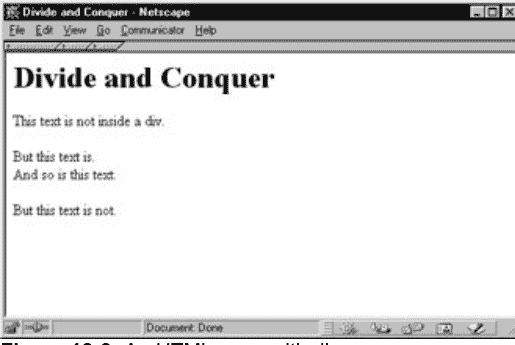

**图 13-3：** 带有 div 的 HTML 页面

你可以使用 HTML 元素将 div 的内容定位在网页的任何位置。将图 13-2 中的内容替换为以下行，可以将 `myFirstDiv` 文本块移动到页面的下中部。

```html
<div id="myFirstDiv" style="position:absolute;top:50;left:100;">
```

**图 13-4** 显示了它的样子。

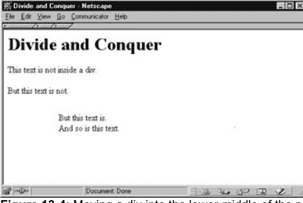

**图 13-4：将 div 移动到页面下中部**

如你所见，div 标签的样式有三个由分号分隔的组件。`position` 组件为 div 提供了一个参考点（使用 `position:absolute`，参考点是浏览器窗口的左上角）。`top` 组件决定 div 距离参考点多少像素出现，`left` 组件决定 div 距离参考点多少像素出现。

而不是相对于浏览器窗口的左下角进行定位，你可以相对于它在 HTML 中正常出现的位置进行定位。如果你没有在 div 中包含任何定位信息，它将紧跟在"这段文字不在 div 内部"这一行之后。但是，如果你使用第 268 页所示的样式，但将 `position:absolute` 替换为 `position:relative`，div 就会出现在该点下方 150 像素、右侧 100 像素处。图 13-5 显示了它的样子。

## 分而治之

这段文字不在 div 内部。

但这段文字不在内部。

但这段文字不在内部

这段文字也是。

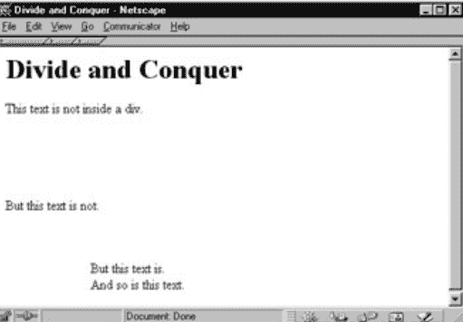

图 13-5：使用 `position:absolute` 或 `position:relative`

## 隐藏 div

你可以使用 HTML 元素将 div 的内容定位在网页的任何位置。将图 13-2 中的内容替换为以下行，可以将 `myFirstDiv` 文本块移动到页面的下中部。

```html
<div id="myFirstDiv" style="position:absolute;top:50;left:100;">
```

## div 的堆叠

如你所见，div 标签的样式有三个由分号分隔的组件。`position` 组件为 div 提供了一个参考点（使用 `position:absolute`，参考点是浏览器窗口的左上角）。`top` 组件决定 div 距离参考点多少像素出现，`left` 组件决定 div 距离参考点多少像素出现。

而不是相对于浏览器窗口的左下角进行定位，你可以相对于它在 HTML 中正常出现的位置进行定位。如果你没有在 div 中包含任何定位信息，它将紧跟在"这段文字不在 div 内部"这一行之后。但是，如果你使用第 268 页所示的样式，但将 `position:absolute` 替换为 `position:relative`，div 就会出现在该点下方 150 像素、右侧 100 像素处。图 13-5 显示了它的样子。

## JavaScript 和 DHTML

当你开始使用 JavaScript 操作 div 时，HTML 就会变得动态化。这就是 Netscape 和 Microsoft Explorer 开始产生分歧的地方。如果你有一个名为 `first` 的 div（如图 13-2 所示），你想用 JavaScript 隐藏该 div，在 Netscape 中你会使用此 JavaScript：

```
window.document.myFirstDiv.visibility = "hidden";
```

在 MSIE 中使用此 JavaScript：

```
window.document.myFirstDiv.visibility = "hidden";
```

第 272 页的图 13-9 在一个函数中包含了上述两行，当用户点击链接时 div 执行该函数。

```html
<html><head><title>跨浏览器隐藏</title></head>
<script language="JavaScript">
<!--
function hideDiv()
{
[1] var the;
[2] if (window.document.all)
{
[3]   _div = window.document.myFirstDiv.style;
[4] else if (window.document.layers)
[5]   _div = window.document.myFirstDiv;
} else {
[6]   alert('抱歉，这仅对 4.0 浏览器有效');
[7]   return;
}
[8] _div.visibility = "hidden";
-->
</script>
</head>
<body>
<h1>隐藏 div</h1>
<p>这段文字不在 div 内部。
<div id="myFirstDiv" style="position:absolute;top:150;left:100;visibility:visible">
但这段文字在内部。<br>
这段文字也是。<br>
<p>
但这段文字不在内部。
<br>
[9] <a href="#" onclick="hideDiv();return false;">隐藏 div</a>
</p>
</body>
</html>
```

图 13-9：图 13-9 的跨浏览器分析

逐行分析

变量 `the_div` [1] 指向我们想要更改的 div（`the_div` 取决于访问者使用的浏览器）。[2] 检查访问者使用的是否处理 DHTML 的 MSIE 版本（即 MSIE 版本 4 及更高版本）。如果是，则表达式 `window.document.all` 为真，因此执行 MSE 代码将 `div` 指向 `myFirst` 的样式。

如果它返回为假——即用户的浏览器不是支持 HTML 版本的 MSE——则检查是否是支持 HTML 版本的 Netscape。如果是，则 `document.layers` 为真，并执行 Netscape 代码将 `div` 指向 `myFirst`。如果浏览器既不是支持 HTML 版本的 MSE 也不是 Netscape，则告知访问者如何更新其浏览器，然后退出。

如果浏览器没有执行其中的函数（这只会在访问者使用无法处理 HTML 的浏览器时发生），它将更改 `div_to_hidden` 的可见性。

我在图 13-9 中使用了 `window.document.all` 来检查 MSE 和 `window.document.layers`。我也可以使用 `navigator.platform` 和 `navigator.appVersion` 来确定正在使用的浏览器类型（参见第 3 章中的"浏览器检测"章节）。

然而，`window.document.layers` 的优点是它可能包含其他能够运行 HTML 的浏览器。如果我想创建一个名为 Tauscape 能够运行 HTML 的新浏览器，我会编写该浏览器使得 `window.document.layers` 为真。那么，任何检查 MSE 的脚本都会认为 Tauscape 运行 HTML，即使编写脚本的人从未听说过 Tauscape。

## 移动 div

改变 `div` 的 `top` 属性可以让 `div` 在屏幕上移动。例如，要将 `div` 向右移动 5 像素，只需给 `left` 属性加 5。

当然，我们必须在不同浏览器之间实现这一点。

### 在 Netscape 中

在 Netscape 中将 `div` 向右移动 5 像素，请使用此行：

`window.document.myDiv.left += 5;`

或者更短的版本：

`document.myDiv.left += 5;`

如第 2 章所述，较短的版本是有效的，你可以直接去掉 `window` 部分；如果你还记得第 12 章的内容，`+=` 表示"在此变量上加上 5"。

要将 `div` 向左移动 5 像素，从 `left` 属性中减 5：

`document.myDiv.left -= 5;`

此行使用 `-=` 运算符从 `myDiv` 的 `left` 属性减去 5。

### 在 MSE 中

MSE 将存储在 `window.document.myDiv.style.left` 中的值视为字符串。当我们向它加 5 时，我们必须使用 `parseInt()` 函数将值从字符串转换为整数。在 MSE 中将 `div` 向右移动 5 像素，请使用此代码：

`document.myDiv.left = parseInt(window.document.myDiv.style.left) + 5;`

### 跨浏览器

要编写让 `div` 移动的跨浏览器 JavaScript，请使用图 13-9 中的 `parseInt()` 检测访问者的浏览器，并在读取 `div` 的 `left`、`right` 或 `z-index` 属性的值在使用 `parseInt()`。图 13-10 显示了让图 13-2 中的 `div` 向右移动 10 像素的跨浏览器代码。图 13-8 与图 13-9 完全相同。点击图 13-10 中的 `i` 会调用 `function()`。除了第 2 部分外，此函数与图 13-9 中的 `hideDiv()` 相同。第 2 部分的所有代码都将 `div_to` 设置为我们想要更改的 `div`，第 2 部分给 `left` 属性加 100。`parseInt()` 函数使得 MSIE 能正确执行算术运算。

## 使用 setTimeout() 和 clearTimeout() 制作动画

图 13-10 中的代码让 `div` 在屏幕上跳跃。如果你想让 `div` 跨越屏幕缓慢漂移或沿着特定路径移动，可以使用循环（第 9 章）来为 `div` 制作动画。

要让 `div` 平滑地跨屏幕，编写一个让 `div` 移动一点点的函数，然后使用 `setTimeout()` 在几毫秒后调用自己。第 276 页的图 13-11 包含了数字 1 图像在屏幕上漫游的代码。

### 图 13-11 的逐行分析

在图 13-11 中，当访问者点击 8 处的链接调用 `moveDiv()` 函数时，图像开始漫游。`moveNumber()` 函数根据访问者的边界和 `div` 的移动方式设置 `_div`。

```html
<html><head><title>Cross-Browser Div Moving</title>
<script language = "JavaScript">
<!--
(1) function moveDiv() {
  var div;
  if (window.document.all) {
    the _div = window.document.all.myFirstDiv.style;
  } else if (document.layers) {
    the _div = window.document.myFirstDiv;
  } else {
    alert("sorry, this only works in 4.0 browsers");
    return;
  }
}
(2) the _div.left = parseInt(the_div.left) + 100;
}
-->
</script></head>
<body>
<h1>Moving the Div</h1>
This text is not inside a div.
<p>
<div id="myFirstDiv" style="position:absolute;top:150;left:100;">
But this text is.<br>
And so this text.<br>
</div>
<p>
But this text is not.
<br>
(3) <a href="#" onclick="moveDiv();\ return false;">move the div</a>
</body>
</html>
```

图 13-10: 跨浏览器移动代码

```html
<html><head><title>Wandering One</title>
<script language = "JavaScript">
<!--
(1) function moveDiv() {
  var div;
  if (window.document.all) {
    the _div = window.document.all.myFirstDiv.style;
  } else if (document.layers) {
    the _div = window.document.myFirstDiv;
  } else {
    alert("sorry, this only works in 4.0 browsers");
    return;
  }
}
(2) the _div.left = parseInt(the_div.left) + 100;
}
}
-->
</script></head>
<body>
<h1>Moving the Div</h1>
This text is not inside a div.
<p>
<div id="myFirstDiv" style="position:absolute;top:150;left:100;">
But this text is.<br>
And so this text.<br>
</div>
<p>
But this text is not.
<br>
(3) <a href="#" onclick="moveDiv();\ return false;">move the div</a>
</body>
</html>
```

## 生成图像的方向

## 生成数字

它在...之间选择一个数字

## 使用 eval() 指向 div

```
var the_div = window.document.divOne;
```

变量 `the_div` 实际上描述了一个 `div divOne`。在编程合规中，我们说 `the_div` 指向 HTML 元素 `window.document.divOne`。这一行与之前的区别在于引号。当 JavaScript 看到一组字符周围有引号时，它不会解释你对这些字符的含义。当它没有找到引号时，JavaScript 假设它应该注意该项，因为例如，它是一个变量或像 `div` 这样的 HTML 元素。

## 什么是 eval()

`eval()` 函数接收一个字符串并强制 JavaScript 对其进行求值（evaluate）。例如，如果我们运行以下几行代码，最终将得到结果为 8：

```javascript
var the_add_string = "3 * 5";
var the_solution = eval(the_add_string);
```

注意 `add_string` 是一个字符串。如果我们使用 `document.write()` 或 `alert()` 语句打印 `add_string`，它将输出 "3 + 5"。`eval()` 函数获取 `3 + 5` 并像处理 JavaScript 语句一样对其进行求值。你也可以使用 `eval()` 通过 div 的名称来获取一个 div：

```javascript
var the_div_name = "window.document.divOne";
var_div = eval(the_div_name);
```

在这里，`div` 只是一个字符串。它并不指向实际的 `div`，因此它不具备 `div` 的任何属性。以下行将产生错误：

`the_div.visibility = "hidden";`

JavaScript 会告诉你 `div_name` 没有名为 `visibility` 的属性（它是一个字符串，而不是一个 `div`）。`eval()` 函数对 `div_name` 进行求值，返回指向 `div` 本身的指针。在运行上述第二行代码后，我们可以如下所示更改 `div` 的可见性：

```javascript
the_div.visibility = "hidden";
```

## 如何使用 eval()

图 13-12 列出了一个函数，该函数接收一个 div 的名称并将其向右移动随机距离。该函数的巧妙之处在于它可以接收任何 div 的名称。


```javascript
function moveDiv(the_div_name) {
  var the_div, the_add_string;
  if (document.all) {
    div_string = "window.document.all. " + the_div_name + ".style";
    the_div = eval(the_div_string);
  } else if (document.layers) {
    div_string = "window.document. " + the_div_name;
    the_div = eval(the_div_string);
  } else {
    alert("sorry, this only works in 4 browsers.");
    return;
  }
  the_div.left = parseInt(the_div.left) + Math.floor(Math.random()*10);
}
```

图 13-12：向函数传递 JavaScript 对象的名称时执行 `eval(div)`

如果我们有一个名为 `divOne` 的 div 和另一个名为 `divTwo` 的 div，我们这样调用 `moveDiv(div)`：

```html
<a href="#" onclick="moveDiv('divOne')" return false;">move div one</a> <br>
<a href="#" onclick="moveDiv('divTwo')" return false;">move div two</a>
```

当我们在第一种情况下调用 `moveDiv(div)` 时，`div_name` 被设置为字符串 `divOne`。函数确定用户正在访问哪种浏览器。如果是 MSIE，`document.all` 为 `true`，它会创建一个大字符串（`window.document.all.divOne.style`），生成我们想要移动的 div 名称，并对其进行求值，设置 `div_div` 指向我们想要移动的 `div`，并为使用 Netscape 访问页面的用户执行相同的操作。一旦我们让 `div_div` 指向我们想要移动的 `div`，它就会实际移动了。

## 使用事件制作动画竞赛！

图 13-13 为你展示了 `eval(div)` 一个更长但更简单的版本——两个数字之间的比赛。点击“Start”链接会让数字横跨整个页面。当其中一个数字越过隐藏线时，比赛结束，页面顶部的文本框宣布获胜者。图 13-14 显示了比赛开始前的屏幕状态。

```html
<html>
<title>Numbers Race</title>
<script type="JavaScript">
//
var the_timers = new Array();
function startRace() {
  window.document.form.winner.value = "AND THEY'RE OFF!";
  moveNumber('numberOne');
  moveNumber('numberTwo');
  moveNumber('numberThree');
}
function stopRace() {
  setTimeout(the_timers['numberOne']);
  clearTimeout(the_timers['numberTwo']);
  clearTimeout(the_timers['numberThree']);
}
function moveNumber(the_number) {
  var div_div, div_string, time_out;
  var loop_speed = 100; // 数字移动的速度
  var distance = 10; // 数字移动的远距离
  var finish_line = 400; // 比赛结束的地方
  if (document.all) {
    var the div_name = "document.all.divOne.style";
    div_div = eval(div_name);
  } else if (document.layers) {
    div_string = "window.document." + the_number;
    div_div = eval(div_string);
  } else {
    alert("sorry, this only works in 4 browsers.");
    return;
  }
  the_div.left = parseInt(the_div.left) + Math.floor(Math.random()*distance);
  if (div_div.left > finish_line) {
    if (window.document.form.winner.indexOf("WINNER") == -1) {
      window.document.form.winner.value = "WINNER IS: " + the_number;
    }
    stopRace();
  } else {
    time_out = "moveNumber(" + the_number + ")";
    the_timers[the_number] = setTimeout(time_out, loop_speed);
  }
}
</script>
</head>
<body>
<h1>Numbers Race</h1>
<form name="winner">
<input type="text" name="winner" size="60" value=""></form>
<p>
<div id="numberOne" style="position:absolute; top:150; left:100;"></div></div>
<div id="numberTwo" style="position:absolute; top:200; left:100;"></div></div>
<div id="numberThree" style="position:absolute; top:250; left:100;"></div></div>
</p>
<a href="#" onclick="startRace()" return false;">Start the race</a>
<br>
<a href="#" onclick="stopRace()" return false;">Stop the race</a>
</body>
</html>
```

图 13-13：使用 `setTimeout()` 模拟竞赛

图 13-14：数字竞赛

```javascript
the_div = document.layers["divOne"];
```

这在 JavaScript 数组中查找名为 `divOne` 的 div。div 数组的 `eval()` 是等效的方法，两者经常被使用。

## 层级菜单

我将通过展示如何用 HTML 构建一个基础层级菜单来结束本文。DHTML 不使用层级菜单，因为代码编写非常困难。本节将为你提供它们工作原理的基本概念，但如果你真的想在网站上使用层级菜单，我建议访问 http://www.webreference.com/dhtml/menus —— 一个关于层级菜单的巨大多部分教程。

图 13-15 中的层级菜单有三个：狗（Dogs）、猫（Cats）和鸟（Birds）。鼠标悬停在上方会弹出一个包含几只狗名称的子菜单。点击其中一个会将浏览器引导到关于该品种狗的网页。

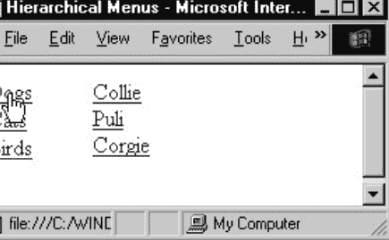

图 13-15：层级菜单

图 13-16 显示驱动此菜单的代码。我已经涵盖了理解这段代码所必须掌握的所有知识，所以在阅读我的解释之前，先看一看并能否弄清楚它是如何工作的。

```html
<html><head><title>Hierarchical Menus</title>

<script language="JavaScript">
1 var div_array = new Array("divOne", "divTwo", "divThree");
   function changeDiv(div_array, the_change)
{
2 if (document.all) {
      div_string = "window.document.all." + the_div + ".style";
   } else if (document.layers) {
      div_string = "window.document." + the_number;
      return;
   } else {
      alert("sorry, this only works in 4.0 browsers");
      return;
   }
3 the_div = eval(div_string);
4 the_div.visibility = the_change;
   }
}

function changeDivAll()
{
5 for (var loop=0; loop < div_array.length; loop++)
   {
6 changeDiv(div_array[loop], "hidden");
   }
}
```

```html
<script>
</head>
<<body>
<div id="topBorder" style="position:absolute;top:0; left:5;">
<a href="#" onMouse="closeAll();"><imgimg src="long_spacer.gif"border=0></a>
</div>
<div id="top1" style="position:absolute;top:20; left:5;z-index:1">
<a href="#" onMouse="closeAll();changeDiv(divOne,visible);">Dogs</a>
</div>
<div id="top2" style="position:absolute;top:40; left:5;z-index:1">
<a href="#" onMouse="closeAll();changeDiv(divTwo,visible);">Cats</a>
</div>
<div id="top3" style="position:absolute;top:60; left:5;z-index:1">
<a href="#" onMouse="closeAll();changeDiv(divThree,visible);">Birds</a>
</div>
<div id="bottomBorder" style="position:absolute;top:80; left:5;">
<a href="#" onMouse="closeAll();"></a>
</div>
<div id="rightBorder" style="position:absolute;top:5; left:150;">
<a href="#" onMouse="closeAll();"></a>
</div>
<div id="divOne" style="position:absolute;top:20; left:80;visibility:hidden">
<a href="#">Collie</a><br>
<a href="#">Puli</a><br>
<a href="#">Corgi</a><br>
</div>
<div id="divTwo" style="position:absolute;top:40; left:80;visibility:hidden">
<a href="#">Siamese</a><br>
<a href="#">Manx</a><br>
<a href="#">Calico</a><br>
</div>
<div id="divThree" style="position:absolute;top:60; left:80;visibility:hidden">
<a href="#">Parakeet</a><br>
<a href="#">Finch</a><br>
<a href="#">Canary</a><br>
</div>
</body>
</</html>
```

图 13：层级菜单

## 图 13 逐行分析

层级菜单为每个菜单选项都有一个 div。图 13-16 中的九个 div 包含了每个顶级元素的一个 div、每个子菜单的一个 div、一个顶部边界的 div 以及一个右边界的 div。每当访问者移动到一个菜单选项时，就会显示相应的列表。如果鼠标移动到“猫”（Cats）上，匹配列表可见，然后移动到“狗”（Dogs）上，`closeAll()` 函数会隐藏子菜单，`changeDiv()` 会显示子菜单。移动到顶部或右边界会调用所有子菜单。

## `closeAll()` 函数

`closeAll()` 函数遍历在第 1 行定义的数组。每次执行第 5 行的循环，`closeAll()` 都会调用 `changeDiv()` 函数来隐藏一个 div。

## `changeDiv()` 函数

`changeDiv()` 函数接收两个参数：要更改的 div 名称，以及使该 div 隐藏还是可见。从第 2 行开始的 if-else 语句执行确定如何引用 div 的不熟悉任务。然后使用 `eval()` 将 if-else 语句中的字符串转换为指向相应 div 的指针。它根据 `changeDiv()` 的第二个参数将 div 的可见性更改为可见或隐藏。

## 边界

注意，菜单的顶部边界是一个不可见的 GIF。代码规定移动到这个不可见的 GIF 会隐藏所有子菜单。配合菜单的底部和右侧，这些 GIF 确保了访问者离开该区域时子菜单会消失。

图 13-16 提供了一个你如何实现层级菜单的示例。要查看微软如何编写其层级菜单，请访问 http://microsoft.com。如果你的浏览器询问保存或运行文件，请选择保存，然后用文字处理程序打开文件。该文件大约 70 行长，充满了 JavaScript 的魔法。

## 总结

HTML 是好几书的主题——我们在这里讨论的应该让你大开胃口。你已经学习了一些基础知识，包括这些：

- 如何使用 divs 创建 HTML 块。
- 为 divs 添加样式。
- 让 divs 同 HTML 一同可见或不可见。
- 如何移动 divs。
- 使用定时循环使 divs 动画。
- 如何使用 `eval()` 函数强制 JavaScript 解释字符串。
- 创建一个基础菜单。

如果你理解了所有内容，那么完成作业应该没有问题。

## 作业

创建一个像图 13-7 所示的 HTML 屏幕。图中的笑脸在屏幕上不断跳动。当它撞击其中一面墙时，会以随机角度弹回。为了让笑脸对角线移动，请在循环中更改它的 top 和 left 位置。要让它从墙上弹回，在撞击屏幕边缘时改变方向。记住，要让笑脸向右移动，你需要给它的 left 属性加值，而要向左移动，则从它的 left 属性减值。

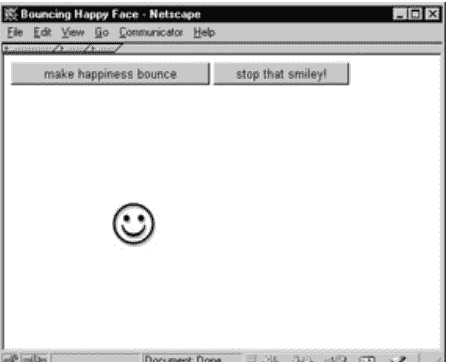

# 第 14 章：如何修复错误代码

现在你知道 JavaScript 是如何工作的，是时候练习、练习、再练习了。但正如你可能意识到的，当你编写 JavaScript 时，大约有一半的时间在调试——即发现并修复你犯的错误。当你写出一个第一次尝试就能运行的程序时，打开香槟庆祝吧——这是一个稀有的场合。

因为你会花费大量时间修复错误（根据许多项研究，平均程序员有 50% 的编程时间花在找出代码哪里出了问题），你能学习的最好的技能之一就是调试你的脚本。本章涵盖了几个调试技巧和安全编码规范，这些将使这个过程变得简单。

## 调试技术

你越练习 JavaScript，就越能理解 JavaScript 给你的那些有时晦涩难懂的错误信息——而且你在代码中引入的错误也越少。编程绝对是一项随着时间推移而显著提高的技能，而学习如何高效调试是这一过程中最大的因素之一。本节涵盖了常见的调试技巧和技术，以减少脚本中的错误数量，并帮助你弄清楚为什么程序没有按照你的预期运行：

- 如何使用和解释你的 JavaScript 错误检测器（bug detector）。
- 如何以各种方式打印（print）变量。
- 如何警惕常见错误。
- 在开始编码之前应该考虑什么。

## 浏览器的内置调试器

如果你在学习过程中一直在尝试示例和作业，你无疑遇到过你浏览器的调试器。当你写出代码错误时，在浏览器中运行通常会产生一个描述错误的窗口。某些浏览器（如 IE 5.0 及以上）你可以通过窗口左下角打印一个错误图标来发现。点击错误图标会打开一个描述错误的窗口。其他浏览器（如 Netscape 4.0）可能根本不显示错误，而是有一个显示错误的控制台。要查看控制台，请在浏览器地址栏中输入 `javascript:`。

有时你可能会发现 JavaScript 错误信息很有用，有时它们可能让你很困惑。你能做的就是阅读信息并看看你是否理解。如果不理解，请尝试以下调试技术。

## 打印变量

调试过程的大部分工作涉及发现 bug 所在的位置。不幸的是，找到这些“小虫虫”并不总是那么容易的。最经典且有效的调试方法是使用 `alert` 或类似的语句打印出脚本中正在发生的情况。


图 14-1 列出了两个函数。如果你在提示框中输入随机数字，你将看到欢迎语 "ahoy palloi"。如果你在第一个框输入 Dave，在第二个框输入 Thau，你本应得到得到消息 "howdy partner"。然而，运行这些函数将不起作用，因为其中一个包含错误。

```javascript
function getName()
{
  var first_name = prompt("what's your first name?","");
  var last_name = prompt("what's your last name?","");
  var var_name = first_name + " " + last_name;
}
```

```javascript
function theGreeting()
{
  var var_name = getName();
  if (the_name == "Dave Thau") {
    alert("howdy partner!");
  } else {
    alert("ahoy palloi!");
  }
}
```

图 14-1：寻找错误

运行 `theGreeting()` 不会导致任何 JavaScript 语法错误，但该函数运行不正确。如果你在第一个提示框输入 Dave，在第二个框输入 Thau，你得到的是 "ahoy palloi" 信息而不是 "howdy partner"。在这个简单的示例中，你通过查看 JavaScript 代码可以很容易发现错误。然而，随着脚本变得复杂，你会发现通过肉眼观察代码来定位错误变得越来越困难。

如果 JavaScript 没有捕获你的错误，而你无法通过查看脚本来发现它，请尝试打印变量。最简单的方法是使用 `alert()` 打印变量，如图 14-2 所示。

```javascript
function getName() {
  var first_name = prompt("what's your first name?","");
  var last_name = prompt("what's your last name?","");
  var var_name = first_name + " " + last_name;
  alert("in getName, the_name is: " + the_name);
}
function getGreeting() {
  var var_name = getName();
  alert("after " + var_name + " = " + the_name);
  if (the_name == "Dave Tau") {
    alert("howdy partner!");
  } else {
    alert("ahoy palloi!");
  }
}
```

图 14-2：使用 `alert()` 打印变量

在你输入名字 Dave 和 Thau 之后，1 处的 `alert` 显示 "in getName, the name is: Dave Tau"。该脚本运行良好，因此你可以确定在点 1 之前没有问题。然而，2 处的 `alert` 显示 "after the_name = undefined!"。这意味着脚本在 1 和 2 之间存在问题——`the_name` 在 `getName()` 之前是正确的，但在 `getGreeting()` 之后就了。由于 `getName()` 获取了正确答案，而 `getGreeting()` 未能从 `getName()` 获取答案，问题可能在于将答案从 `getName()` 传递给 `getGreeting()` 的脚本中。

确实，`getName()` 计算出了名字但从未返回它。我们需要在函数的最后加上 `return the_name`。

## Alert 之外的调试

放置 `alert` 框是一个很好的调试工具，但也意味着每隔一行就要按一次 OK 按钮。一种解决方案是在另一个窗口或表单内的文本区域显示你的调试消息。

另一个让调试体验更愉悦的技巧是使用一组不同的调试方法，例如 none（无）、brief（简短）和 extreme（极端）。brief 会在过程中打印几条消息，extreme 会打印大量消息，而 none 选项则不打印任何消息。由于图 14-3 列出了一些使用变量来决定你想进行哪种调试的代码。图 14-3 使用一个函数来控制调试。例如，2 将一条调试消息传递给 `debug()`，然后 `debug()` 函数根据 1 中设置的 `debug` 变量来决定如何处理此消息。如果其 `debug` 是 brief，3 会将调试消息放在 alert 框中。当你想要检查几个地方的变量且不介意点击大量调试消息的 OK 时，alert 非常好用；但将 `debug` 变量设置为 extreme 4 处会更有帮助。最后，当你准备好向世界展示你的代码时，只需将 `debug` 设置为 `none` 以防止调试消息完全不出现。

设置像图 14-3 中那样的变量可以省去查找并移除多个调试语句的麻烦。取决于你如何设置 `debug`，你甚至可以使用 `document.write()` 来显示或隐藏你用于显示调试消息的 `textarea`。这样，你可以在调试脚本时使用 `textarea`，在准备好让访客查看你的 JavaScript 时将其隐藏。

```javascript
var debug = "none";
function getName() {
    var first_name = prompt("what's your first name?");
    var last_name = prompt("what's your last name?");
    var var_name = first_name + " " + last_name;
}
doError("in the_name is: " + the_name);
function getGreeting() {
    var var_name = getName();
    doError("after getGreeting, the_name = " + the_name);
    if (the_name == "Dave Thau") {
        alert("hello partner!");
    }
}
```

（注：原文代码块中存在 `doError` 和 `the_name` 等未定义的变量/函数错误，已按要求保留代码块不翻译。）

```javascript
var _message = "Wake up!";
setTimeout(alert(" " + _message + ""), 3000);
}
```

当你把消息从引号中提取出来时，`setTimeout()` 会调度 `alert("Wake up!");` 命令，这就是你想要的结果。

## 修复 Bug

一旦你发现了 Bug 所在的位置，你就需要修复它们——对于这一点，你有多种选择，有好的，也有坏的。本节涵盖了你在消除 Bug 时应该做的几件事。

### 先备份你的程序

有些 Bug 真的很难消除。事实上，在消除一个让你抓狂的小 Bug 的过程中，你最终会毁掉整个程序。这种情况经常发生，因此在开始调试之前保存你的程序是确保 Bug 不胜过你的最佳方法。

### 一次只修复一个 Bug

如果你有多个 Bug，请修复一个并在测试修复结果后再然后再处理下一个 Bug。一次性修复很多 Bug 会增加引入更多 Bug 的风险。

### 警惕“巫术编程”（Voodoo Coding）

有时候你的 Bug 存在，但你并不知道为什么。假设你有一个名为 `index` 的变量，由于某种原因，`index` 比它应该的值少了 1。此时你可以做两件事：你可以坐那里一会儿，弄清楚为什么 `index` 比应该的值少了 1；或者干脆不管它，在使用它之前给 `index` 加 1，然后继续。后一种方法被称为巫术编程。当你开始想“搞鬼？为什么 `index` 是 2 而不是 3？好吧……我先加 1，以后再修复它”时，你正在进行巫术编程。

巫术编程在短期内有效，但最终它会导致你毁灭。这就像把灰扫到地子下面。问题会再次出现——要么你遇到了另一个无法理解的错误，要么你那个维护代码的可怜同事——代码会变得极其难以理解。

不要实践巫术编程。

### 寻找相似的 Bug

在某些方面，复制粘贴代码是程序员遇到过最糟糕的事情。你通常会在一个函数中编写 JavaScript，然后将其剪粘贴到另一个函数中。如果第一个函数有问题，你就在两个函数中创建了问题。我不是说你不应该复制粘贴——但请记住 Bug 是会倍增的；如果你发现了一个 Bug，请在代码的其它地方寻找相似的 Bug。JavaScript 中通常会出现的一种 Bug 是变量拼写错误。如果你在某处将 `the_name` 拼错为 `teh_name`，很有可能你在其他地方也这么干了。

### 如果万无可施

你坐在那里盯着一个 Bug，不知道发生了什么，也不知道如何修复它。或者你可能根本没找到这个 Bug。最好的办法是离开电脑。读读书，去转角散散步。喝杯好喝的饮料。做点什么——什么都可以——但不要思考程序或问题。这种技术被称为“孵化”（incubation），它的效果非常好。当你休息了一会儿并放松之后，再次尝试寻找 Bug。通常你会以一种全新的、更有成效的方式处理问题。孵化之所以有效，是因为它让你从功能障碍的思维中跳出来。

### 如果仍然不起作用……

寻求帮助。有时你会陷入自己固有的思维模式中，你需要一个没考虑过这个问题的人来帮你发现你逻辑中的漏洞。在结构化的代码环境中，程序员会定期审查彼此的代码。代码审查不仅可以消除 Bug，还能产生更好的代码。不要害怕向他人展示你的 JavaScript。你会成为一名更优秀的 JavaScript 程序员。

## 良好的编码实践

优秀编程的关键在于为人编写程序，而不是为计算机编写程序。如果你记住可能会有人阅读你的 JavaScript，你就会写出更清晰的代码。代码越清晰，遇到错误的概率越小。巧妙的代码也是好的，但巧妙的代码容易产生 Bug。在开始编写任何代码之前编写注释也有帮助。这样做可以确保你已经思考过问题，而不是直接跳进去。一旦你写了注释，就可以在它们下面编写代码。这里有一个编写这样一个函数的示例：

### 第 1 步：编写注释

```javascript
// function beKind()
// beKind 请求用户名，选择一个随机的
// 肯定语句，并返回一个包含用户名和
// 语言的警告框。
function beKind()
{
  // 首先构建一个肯定语句列表
  //
  // 接下来获取用户名
  //
  // 然后选择一个随机的肯定语句
  //
  // 最后返回个性化的善意
  //
}
```

### 第 2 步：填充代码

```javascript
// function beKind()
// beKind 请求用户名，选择一个随机的
// 肯定语句，并返回一个包含用户名和
// 肯定语句的警告框。
function beKind()
{
  // 首先构建一个肯定语句列表
  //
  var var_affirmation_list = new Array();
  var_affirmation_list[0] = "you are a great coder";
  var_affirmation_list[1] = "your JavaScript is powerful";
  var_affirmation_list[2] = "you finished the whole JavaScript book";

  // 获取下一个用户名
  //
  var var_name = prompt("what's your name?", "");

  // 然后选择一个随机的肯定语句
  //
  var var_number = Math.floor(Math.random() * 5);
  var var_affirmation = var_affirmation_list[var_number];

  // 最后返回个性化的善意
  alert("Congratulations " + var_name + " " + var_affirmation);
}
```

`feature` to `false`。由于上述行处理的是声音，没有理由在窗口中显示该插件。

LiveAudio 提供了几个 JavaScript 方法来控制声音。表 A-1 列出了了一些常用方法。

## 表 A-1：常用的 LiveAudio 方法

| 名称 | 说明 |
| :--- | :--- |
| `play()` | 播放已加载的声音——此选项可以为 true、false 或循环次数。 |
| `stop()` | 停止声音。 |
| `setVol()` | 设置音量百分比（0 到 100），例如 `setVol(45)`。 |
| `fade_from_to()` | 逐渐从一个音量变化到另一个音量（0 到 100），例如 `fade_from_to(25, 76)`。 |

图 A-1 显示了通过表单设置音量并控制声音的 JavaScript。

```html
<html><head><title>LiveAudio</title>

<script language="JavaScript">
<!-- hide me

function setAndPlay(the_volume)
{
(1) var the_sound = window.document.beep;
(2) the_sound.setvol(the_volume);
(3) the_sound.play();
}

function fadeAndPlay(start_vol, stop_vol)
{
(4) var the_sound = window.document.beep;
the_sound.fade_from_to(start_vol, stop_vol);
the_sound.play();
}

// hide me -->
</script>
</head>
```

```html
<body>
<p>
[5]<EMBED name="beep" src="dooropen.aiff" hidden="true" AUTOSTART = TRUE MASTERSOUND="</EMBED>
<form name="_form">
Set Volume (0-100): <input type="text" name="vol">
[6]<input type="button" value="play"
onclick="setAndPlay(document.the_form.value); return false);"<br>
With Fader:
From (0-100): <input type="text" name="start_vol"><br>
To (0-100): <input type="text" name="stop_vol"><br>
[7]<input type="button" value="play"
onclick="fadeAndPlay(document.the_form.start_value,document.the_form.stop_value); return false);"<br>
</form>
</p>
</body>
```

图 A-1：使用 Netscape 的 LiveAudio 播放声音

[5] 是 beep 声，当访问者使用 [6] 处的按钮时，内容会填充声音中。该按钮将值发送到函数 `setAndPlay()`，[1] 在窗口文档中找到 beep，并将变量 `variable_sound` 指向 [2] 将声音的音量设置为 [3] 传递给函数，并由 [5] 实际播放声音。

第二个按钮的工作原理类似。点击按钮 [7] 调用 `fadeAndPlay()` 方法，找到声音，使用 `fade_from_to` 方法过渡到设置的结束值，并使用 `play()` 方法播放声音。

此示例可能在所有版本的 Netscape 中均无法正常工作。有关 LiveAudio 的更多信息，请查阅 Netscape 的文档：`http://developer.netscape.com/docs/client/guide/liveaudio.html`。

## ActiveMovie 控制

微软替代 LiveAudio 的方案是 ActiveMovie Control (AMC) ActiveX 组件，它随 MSIE 4.0 发布。在 AMC 中播放声音，请使用此 HTML：

```html
<object id="mySound" width="0" height="0" class="CLSID:05589FA1-C356-11CE-BE01-00AA0055D1A5">
<param name="FileName" value="dooropen.wav">
<param name="AutoStart" value="-1">
</object>
```

你使用 `<object>` 标签将 ActiveX 添加到页面。每个 ActiveX 组件都有一个类，你必须从组件制造商处获取这个类。该类允许你在 `<object>` 标签中看到它。添加 `<object>` 标签可以提供一个 ID 以便在 JavaScript 中引用它。

在 `<object>` 标签之间，你可以使用 `<param>` 标签列出参数。在上面的示例中，你将 FileName 参数设置为要播放的文件名，并将 AutoStart 设置为 -1，这意味着你希望在页面加载时播放声音。如果你想将 AutoStart 设置为 0。虽然我在上面没有使用它，但 PlayCount 参数非常有用：将其设置为 0 会使声音无限循环，将其设置为另一个数字则会循环相应的次数。

AMC 允许你使用 JavaScript 纵其对象。例如，图 A-2 中的代码显示了如何使用 JavaScript 降低音量。


```html
<html><head><title>Thau Sound</title>
</head>

<body>
[1]<object id="the_sound" width=0 height=0 class="CLSID:05589FA1-C356-11CE-BF01-00AA0055959A">
n[2]<param name="FileName" value="dooropen.wav">
[3]<param name="AutoStart" value="-1">
[4]<param name="PlayCount" value="0">
<object>
<form>
<input type="button" value="turn down the volume [5] onclick="the_sound.volume-=200;">
</form>
</body>
</html>
```

图 A-2：使用 JavaScript 降低音量

此示例可能在所有版本的 Netscape 中均无法正常工作。有关 LiveAudio 的更多信息，请查阅 Netscape 的文档：http://developer.netscape.com/docs/client/guide/liveaudio.html。

## JavaScript 与 Java

正如第 1 章提到的，你可以在网页页中嵌入 applet 并使用 JavaScript 控制它们。很少有人使用 JavaScript 来操作这些扩展，但这种技术如果做得好，会非常令人深刻。更多插件的列表，请查阅

## 总结

本附录触及了 JavaScript 的几种扩展：插件、ActiveX 和 Java。很少有人使用 JavaScript 来操作这些扩展，但这种技术如果做得好，会非常令人深刻。更多插件的列表，请查阅

可以访问 [BrowserWatch 的插件广场](http://browserwatch.internet.com/plug-in.html)，或者查看 [http://www.plugins.com](

# 附录 B：JavaScript 对象和函数参考

本参考涵盖了在 Netscape 和 Microsoft Explorer 的各种版本中当前属于 JavaScript 的所有对象和函数。每个条目都列出了支持它的最早 Netscape (NS) 和 Microsoft Internet Explorer (IE) 版本。例如，列在 NS 3、IE 3 下的条目可以在 Netscape 3、Internet Explorer 3 以及这些浏览器的更高版本中运行。如果我在本书中使用了某个条目，或者认为它是一个重要的函数，我将通过示例对其进行定义和说明。对于不常用的 JavaScript 及其对象，我将提供简短的描述，并列出了支持它们的浏览器。

参考表中的对象条目采用大字母大写，并按字母顺序先列出其方法、属性和处理器，然后是其他方法和处理器。由于某些浏览器支持但不支持对象的所有属性、方法和处理器，我列出了每个项目受其支持的早期版本。对象的属性可以是只读的或读写的。如果属性是读写的，JavaScript 就可以更改并更新它的值。然而，JavaScript 只能更新该属性的值。例如，在图像交换中，JavaScript 更改（写入）图像的 `src` 属性：

```javascript
window.my_image.src = "happy";
```

JavaScript 也可以查找（读取它）：

```javascript
var _gif_of = document.my_image.src;
```

不过，JavaScript 只能查找图像的 `height` 属性：

```javascript
var _image_height = document.my_image.height;
```

除非另有说明，此术表中的属性均为读写。Netscape 4.0 引入了一项名为签名脚本（signed scripts）的安全功能。这些脚本可以执行其他脚本无法执行的特殊任务——将 Web 页面设置为屏幕上的顶层窗口。我将指出在 Netscape 中通过签名脚本运行的方法和属性。有关如何签名脚本的更多信息，请参阅 http://developer.netscape.com/library/documentation/signedob/signtool/

尽管本参考尽力完整，但新的浏览器实际上有数百个特定于浏览器的方法和属性，并且每个浏览器版本都会添加新的项。最完整的参考可以从官方源处获得：

| Microsoft Internet Explorer | http://msdn.microsoft.com/workshop/c-frame.htm?workshop/author/default.asp |
| --- | --- |
| Netscape | http://developer.netscape.com/tech/javascript/index.html |

```javascript
alert([NS, 2, IE 3])
```

显示一个带有 OK 按钮的对话框，其消息由函数的参数指定。

*示例*

```javascript
alert("hello world")
```

创建一个带有 `hello world` 字样和 OK 按钮的对话框。在用户点击 OK 按钮之前，浏览器窗口将处于冻结状态。

## 锚点 (Anchor)

页面上所有的锚点都存储在文档的锚点数组中：

```javascript
window.document.anchors[].
```

示例：

```html
<a name="some_name"></a>
```

### 属性 (Properties)

| name | NS 4, IE 4 | 描述 |
| --- | --- | --- |
| text | NS 4 | 锚点标签的名称。 |
| x | NS 4 | 锚点的水平位置（像素）。 |
| y | NS 4 | 锚点的垂直位置（像素）。 |

## Applet (Applet)

指 Java applet。页面上所有的 applet 都存储在 JavaScript 数组中：

```javascript
window.document.applets[].
```

### 方法 (Methods)

| 方法 | 版本 | 描述 |
| --- | --- | --- |
| `start()` | NS 2, IE 3 | 启动一个 Java applet。 |
| `stop()` | NS 2, IE 3 | 停止一个 Java applet。 |

示例：

```javascript
window.document.applets[0].start();
```

告诉 Web 页面上的第一个 Java applet 启动。

```javascript
window.document.applets[0].stop();
```

告诉 Web 页面上的第一个 Java applet 停止。

## 区域 (Area)

一种 HTML 标签，用于描述客户端图像映射内部的可点击区域。Area 标签存储在 JavaScript 数组 `window.document.links[]` 中；area 被视为与链接对象相同（见 Link）。

## 数组 (Array)

信息的列表。创建数组有两种方法：

```javascript
var_array = new Array();
var_array = new Array(element_one, element_two, element_three...);
```

你可以使用其位置数字（从 0 开始计数）查找或更改数组中的元素：

```javascript
var_array[0] = "that";
window.document.writeln(the_array[0] + " wrote this book.");
```

### 属性 (Properties)

| name | NS 3, IE 3 | 描述 |
| --- | --- | --- |
| `length` |  | 数组中元素的数量。 |

示例：

```javascript
var_array = new Array("eenie", "meenie", "miney", "moe");
var number_of_things = my_array.length;
```

变量 `number_of_things` 留值为 4，因为数组中有四个元素。

### 方法 (Methods)

| 方法 | NS 3, IE 3 | 描述 |
| --- | --- | --- |
| `join()` | NS 3, IE 3 | 将数组转换为字符串。数组中的每个元素都将列在字符串中并用空格分隔，除非将其他元素列为 `join` 的参数。 |

示例：

```javascript
var_array = new Array("eenie", "meenie", "miney", "moe");
var string = my_array.join(":");
```

变量 `string` 包含 "eenie:meenie:miney:moe"。

### `reverse()` (反转)

| method | NS 3, IE 3 | 描述 |
| --- | --- | --- |
|  |  | 返回反转后的数组副本。 |

示例：

```javascript
var_array = new Array("eenie", "meenie", "miney", "moe");
var_array.reverse();
```

变量 `new_array` 包含 "moe,miney,meenie,eenie"。

### `sort()` (排序)

| method | NS 3, IE 4 | 描述 |
| --- | --- | --- |
|  |  | 按字母顺序排序数组。 |

示例：

```javascript
var_array = new Array("eenie", "meenie", "miney", "moe");
my_array.sort();
```

变量 `my_array` 包含 "eenie,meenie,miney,moe"。

### 不常用方法 (Less Common Methods)

| method | 版本 | 描述 |
| --- | --- | --- |
| `concat()` | NS 4, IE 4 | 将多个数组合并为一个。 |
| `pop()` | NS 4 | 返回数组的最后一个元素并将其删除。 |
| `push()` | NS 4 | 将值添加到数组的末尾。 |
| `shift()` | NS 4 | 返回数组的第一个元素并将其他元素前移。 |
| `slice()` | NS 4, IE 4 | 通过提取部分创建一个新数组。 |
| `splice()` | NS 4 | 替换或删除数组的一部分。 |
| `toString()` | NS 2, 4 | 将数组转换为逗号分隔的字符串。 |
| `unShift()` | NS 4 | 将值添加到数组的开头。 |

## 按钮 (Button)

表单元素。

### 属性 (Properties)

示例：

```html
<input type="button" name="happy" onclick="alert(this.name);">
```

创建一个按钮，点击时会调用包含单词 happy 的 alert。

| value | NS 2, IE 3 | 按钮在页面上显示的文本。 |

示例：

```html
<input type="button" value="click" onclick="this.value='stop clicking me!'">
```

当用户点击此按钮时，按钮文字从 click 变为 stop clicking me!

### 处理器 (Handlers)

#### `onClick`

|  | NS 2, IE 3 | 点击按钮时触发。 |

## 复选框 (Checkbox)

表单元素。

### 属性 (Properties)

| checked | NS | 描述 |
| --- | --- | --- |
|  | IE 3 | 如果访问选中了选框，则属性为 true，否则为 false。将该属性设置为 true 会导致选框表现得像选中了一样。 |

示例：

```javascript
if (window.document.my_form.the_checkbox.checked == true)
{
  alert("thanks for clicking on the checkbox!");
}
```

如果访问选中了 `my_form` 表单中名为 `the_checkbox` 的选框，此 `if` 语句将调用对话框。

| name | NS | 描述 |
| --- | --- | --- |
|  | 2, IE 3 | 选框的名称。 |

示例：

```html
<input type="checkbox" name="happy" onClick="alert(this.name);">
```

调用包含 happy 单词的 alert。

| value | NS | 描述 |
| --- | --- | --- |
|  | 2, IE 3 | 选框的值。 |

```html
<input type="checkbox" value="priceless" onclick="alert(this.value);">
调用一个包含“priceless”字样的警告框。
```

### 处理程序 (Handlers)

| NS | 描述 |
| --- | --- |
| 2 | 当访问者点击复选框时触发。 |
| IE3 |  |

#### `onClick`

`clearInterval()` (NS 4, IE 4)

取消由 `setInterval()` 创建的间隔器。JavaScript 命令可能会每 n 毫秒重复执行一次。更多信息请参见 `setInterval()`。

`clearTimeout()` (NS 2, IE 3)

取消由 `setTimeout()` 创建的超时器。更多信息请参见 `setTimeout()` 和第 9 章。

示例：

```javascript
clearTimeout(my_timeout);
```

取消名为 `my_timeout` 的超时。

`confirm()` (NS 2, IE 3)

创建一个带有两个按钮（确定和取消）的对话框，文本由函数参数指定。点击确定将返回值 `true`，点击取消将返回值 `false`。

示例：

```javascript
if (confirm("are you feeling happy?")) {
	alert("clap your hands!");
} else {
	alert("don't worry!");
}
```

此示例调用了一个文本为“are you feeling happy?”的对话框，并带有一个确定按钮和一个取消按钮。点击确定允许函数返回 `true`，执行 `if-else` 语句的第一部分，并弹出一个警告框显示“clap your hands!”。点击取消则取消函数并返回 `false`，触发 `if-else` 语句的 clause，并弹出一个警告框显示“don't worry!”。

# 日期 (Date)

此对象表示日期；你可以通过几种方式创建它：

```javascript
var _date = new Date();
var _date = new Date("month dd, yyyy");
var _date = new Date("month dd, yyyy hh:mm:ss");
var _date = new Date(yy, mm, dd);
var _date = new Date(milliseconds);
```

这里 month 是月份名称（January、February 等），dd 是两位数的日期（01 到 31），yyyy 是四位数的年份（0000 到 9999），依此类推。如果你在括号中不创建任何日期对象，JavaScript 将假设你指的是运行 JavaScript 的计算机的当前日期和时间。

日期对象有许多方法用于获取和设置日期。除另说明外，这些方法在所有支持 JavaScript 的浏览器中均有效。

## 获取日期时间的方法

以下是获取日期和时间的标准方法（除另说明外，均由 NS 2、IE 3 支持）。

| 方法 | 描述 |
| --- | --- |
| `getDate()` | 返回 1 到 31 之间的整数表示几几。 |
| `getDay()` | 返回星期几的整数，其中 0 是星期日，1 是星期一。 |
| `getFullYear()` | 返回四位数年份（仅限 NS 4、IE 4）。 |
| `getHours()` | 返回 0 到 23 之间的整数表示小时。 |
| `getMinutes()` | 返回 0 到 59 之间的整数表示分钟。 |
| `getMonth()` | 返回 0 到 11 之间的整数表示月份，其中 0 是 1 月，11 是 12 月。 |
| `getSeconds()` | 返回 0 到 59 之间的整数表示秒。 |
| `getTime()` | 返回当前的毫秒数，其中 0 是 1970 年 1 月 1 日 00:00:00 |

示例：

```javascript
var the_date = new Date();
var the_hours = the_date.getHours();
```

如果运行 JavaScript 的计算机时认为现在是晚上 8 点，则 `the_hours` 包含数字 20。

## 获取 UTC 日期时间的方法

以下方法（NS 4、IE 4）返回 `UTC time`（格林尼治标准时间）的日期和时间。

| 方法 | 描述 |
| --- | --- |
| `getUTCDate()` | 返回 1 到 31 之间的整数表示几。 |
| `getUTCDay()` | 返回星期几的整数，其中 0 是星期日，1 是星期一。 |
| `getUTCFullYear()` | 返回四位数年份 |
| `getUTCHours()` | 返回 0 到 23 之间的整数表示小时。 |
| `getUTCMinutes()` | 返回 0 到 59 之间的整数表示分钟。 |
| `getUTCMonth()` | 返回 0 到 11 之间的整数表示月份，其中 0 是 1 月，11 是 12 月。 |
| `getUTCSeconds()` | 返回 0 到 59 之间的整数表示秒。 |

# 有问题的 `getYear()` 方法


`getYear()` 方法本应返回自 1900 年以来的年份，但它的行为在浏览器之间存在差异。某些浏览器按照说明运行——例如，如果年份为 2010 年，则返回 110。然而，其他浏览器将 `getYear()` 等同于 `getFullYear()`，如果年份为 2010，则返回 2010。由于这些跨浏览器差异，最好如下调整由 `getYear()` 提供的日期：

```javascript
var the_date = new Date();
var the_year = the_date.getFullYear();
if (the_year < 1000) {
  the_year = the_year + 1900;
}
```

这段代码的结果始终是 `the_year` 包含正确的四位数年份。

## 设置日期时间的方法

以下方法设置日期对象（除另说明外，由 NS 2、IE 3 支持）：

| 方法 | 说明 |
| --- | --- |
| `setDate()` | 设置 1 到 31 之间的整数表示几。 |
| `setFullYear()` | 设置四位数年份。 |
| `setHours()` | 设置 0 到 23 之间的整数表示小时。 |
| `setMinutes()` | 设置 0 到 59 之间的整数表示分钟。 |
| `setMonth()` | 设置 0 到 11 之间的整数表示月份，其中 0 是 1 月，11 是 12 月。 |
| `setSeconds()` | 设置 0 到 59 之间的整数表示秒。 |
| `setTime()` | 设置当前的毫秒数，其中 0 是 1970 年 1 月 1 日 00:00:00。 |
| `setYear()` | 设置年份的后两位。 |

## 设置 UTC 日期时间的方法

以下方法（NS 4、IE 4）与上述相同，设置为 `UTC time` 的日期和时间：

| 方法 | 说明 |
| --- | --- |
| `setUTCDate()` | 设置 1 到 31 之间的整数表示几。 |
| `setUTCFullYear()` | 设置四位数年份。 |
| `setUTCHours()` | 设置 0 到 23 之间的整数表示小时。 |
| `setUTCMinutes()` | 设置 0 到 59 之间的整数表示分钟。 |
| `setUTCMonth()` | 设置 0 到 11 之间的整数表示月份，其中 0 是 1 月，11 是 12 月。 |
| `setUTCSeconds()` | 设置 0 到 59 之间的整数表示秒。 |

## 将日期转换为字符串

这些方法将存储在日期对象中的日期转换为字符串。

| 方法 | 说明 |
| --- | --- |
| `toGMTString()` | 返回日期。 |
| `toUTCString()` |  |

# 文档（Document）

`document` 对象包含了窗口中所有的 HTML 元素。

## 属性

| 属性 | 浏览器支持 | 说明 |
| --- | --- | --- |
| `applets[]` | NS 2, IE 3 | 文档中 applet 的数组。更多信息见 Applet。 |
| `bgColor` | NS 2, IE 3 | 页面的背景颜色。值可以是颜色名称或十六进制三元组。 |
| `cookie` | NS 2, IE 3 | 与文档关联的 cookie。有关 cookie 的更多信息见第 12 章。 |
| `IE3` |  | 有关 cookie 的更多信息见第 12 章。 |
| `forms[]` | NS 2, IE 3 | 文档所有表单的数组。更多信息见 form 对象。 |
| `images[]` | NS 2, IE 3 | 文档所有图像的数组。更多信息见 image 对象。 |
| `lastModified` | NS 2, IE 3 | 存储最近修改文档的只读字符串。 |

示例：

```javascript
window.document.write("last changed on: " + window.document.lastModified);
```

此行代码写入页面最后修改的日期。

| 属性 | 浏览器支持 | 说明 |
| --- | --- | --- |
| `links[]` |  | 文档所有超链接的数组。更多信息见 Link 对象。 |
| `referrer` | NS 2, IE 3 | 包含指向此页的链接域名的只读字符串。 |
| `title` | NS 2, IE 3 | 包含文档标题。 |

示例：

```javascript
window.document.write("thanks for coming " + window.document.referrer);
window.document.title = "Presto Chango";
```

此行代码将页面背景变为黑色，并将页面标题改为 Presto Chango。

## 不常用的属性

| 属性 | 浏览器支持 | 说明 |
| --- | --- | --- |
| `activeElement` | IE 4 | 当前活动输入元素的引用。 |
| `all` | IE 4 | 窗口中所有的 HTML 元素。 |
| `anchors[]` | NS 4, IE 4 | 文档中锚点标签（`<a name="something"></a>`）的数组。 |
| `charset` | IE 4 | 当前使用的字符集。 |
| `children` | IE 4 | 文档的所有直接属性。 |
| `classes` | NS 4 | 所有的 CSS 样式定义在页面的 `<HEAD>` 中。 |
| `defaultCharset` | IE 4 | 默认字符集。 |
| `domain` | NS 3, IE 4 | 此页面所属的域（例如 `nostarch.com`）。 |
| `embeds[]` | NS 3, IE 4 | 页面上使用 `<EMBED>` 标签的对象的数组。 |
| `expando` | IE 4 | 如果设置为 `false`，则防止你向对象添加新属性。 |
| `fgColor` | NS 2, IE 3 | 设置或读取字体颜色；一旦绘制完成后就无法更改颜色。 |
| `height` | NS 4 | 文档以像素为单位的高度。 |
| `linkColor` | NS 2, IE 3 | 设置或读取未访问链接的颜色；不会改变已绘制的颜色。 |
| `parentWindow` | IE 4 | 包含该文档的窗口。 |
| `plugins[]` | NS 3, IE 4 | 与 `embeds[]` 相同——一个持有所有 `<EMBED>` 标签的数组。 |
| `readyState` | IE 4 | 描述文档的加载状态。 |
| `URL` | NS 3, IE 4 | 文档的 URL。 |
| `vlinkColor` | NS 2, IE 3 | 已访问链接的颜色；一旦写入链接就无法更改。 |

## 方法

| 方法 | 浏览器支持 | 说明 |
| --- | --- | --- |
| `write()`、`writeln()` | NS 2, IE 3 | 将内容写入到 Web 页面。它们唯一的区别在于： |

示例：

```javascript
window.document.writeln("Wassup?");
```

在 Web 页面上写入 Wassup?!

### 不常用的方法

| 浏览器 | 说明 |
| --- | --- |
| NS | 用于清除文档的已弃方法。不要使用它——它可能会在未来的 JavaScript 版本中消失。 |
| IE 2 | 在完成文档写入后使用 `close()`（可选）。有时由于浏览器 Bug，使用 `document.write()` 写入 Web 页面实际上不会完成该操作，除非你在执行 `document.write()` 后执行了 `document.close()`。 |
| IE 3 | 返回位于 x,y 处的 HTML 元素的引用。 |
| IE 4 | 返回文档中选中的文本。 |
| IE 2、3 | 如果你想在用以下方法写入 Web 页面之前清除内容，请使用 `open()`。 |

```javascript
write() or writeln().如果你使用 document.open()，请在完成页面写入时使用 document.close()。
```

## `Elements[]`（NS 2、IE 3）

Form 对象中的一个数组，用于存储表单中的所有元素（按钮、复选框、单选按钮等）。有关更多信息请参阅 Form 对象。

## `escape()`（NS 2、IE 3）

对字符串进行转义以符合 URL 编码。通常用于设置 cookie。有关更多信息请参阅第 12 章。

示例：

```javascript
encoded_string = escape("string safe for cookies");
```

变量 `encoded_string` 现在持有 `a%20safe%20%20for%20cookies`，因为 `escape` 函数将空格替换为 `%20`。另见 `unescape()`。

## `eval()`（NS 2、IE 3）

评估字符串。

示例：

```javascript
var the_sum = eval("2 + 3");
```

变量 `the_sum` 等于 5，因为 `eval()` 强制 JavaScript 评估字符串 `"2 + 3"`。

# 事件

Event 对象描述了刚刚发生的事件：鼠标点击、光标移动等。Netscape 4 和 Internet Explorer 都引入了 Event 对象，但实现方式非常不同。带有星号标记的 Netscape 属性仅对签名脚本有效，有关签名脚本的更多信息请访问 [http://developer.netscape.com/library/documentation/signedob/signedtool/](http://developer.netscape.com/library/documentation/signedob/signedtool/)。

## 属性（NS 4）

| 属性 | 说明 |
| --- | --- |
| `data*` | 关于 DragDrop 事件的信息。 |
| `height` | 调整大小后的窗口的高度。 |
| `layerX` | 事件在图层上的水平像素坐标。 |
| `layerY` | 事件在图层上的垂直像素坐标。 |
| `modifiers` | 事件发生期间按住的修饰键（ALT、CTRL 和 shift）。 |
| `pageX` | 事件在 Web 页面上的水平像素坐标。 |
| `pageY` | 事件在 Web 页面上的垂直像素坐标。 |
| `screenX` | 事件在屏幕上的水平像素坐标。 |
| `screenY` | 事件在屏幕上的垂直像素坐标。 |
| `target` | 发生事件的对象。 |
| `type` | 事件的类型。 |
| `which` | 用户按下哪个键或鼠标按钮来触发事件。 |
| `width` | `event`。调整大小后的页面宽度。 |
| `x` | 见 `layerX`。 |
| `y` | 见 `layerY`。 |

## 属性（IE 4）

| 属性 | 说明 |
| --- | --- |
| `AltKey` | 如果用户在事件期间按了 ALT 键，为 `true`，否则为 `false`。 |
| `button` | 用户点击哪个鼠标按钮来触发事件。 |
| `cancelBubble` | 停止事件触发所有发生的对象。 |
| `clientX` | 事件在 Web 页面上的水平像素坐标。 |
| `clientY` | 事件在 Web 页面上的垂直像素坐标。 |
| `ctrlKey` | 如果用户在事件期间按了 ctrl 键，为 `true`，否则为 `false`。 |
| `fromElement` | 事件发生的 HTML 元素。 |
| `keyCode` | 触发事件的键码。 |
| `shiftKey` | 如果用户在事件期间按了 SHIFT 键，为 `true`，否则为 `false`。 |
| `screenX` | 事件在屏幕上的水平像素坐标。 |
| `screenY` | 事件在屏幕上的垂直像素坐标。 |

## `FileUpload`

### 属性

| 属性 | 说明 |
| --- | --- |
| `name` | 文件的名称。（NS、IE 3） |
| `value` | 选的文件。 |

### 方法

| 方法 | 说明 |
| --- | --- |
| `blur()` | NS 2、IE 3。移除字段焦点。 |
| `focus()` | NS 2、IE 3。选择内部文本。 |

### 处理器

| 处理器 | 说明 |
| --- | --- |
| `onBlur` | 用户移除焦点时调用。 |
| `onChange` | 用户更改内容时触发。 |
| `onFocus` | 用户将焦点置入时调用。 |

# `Form`

Web 页面上的每个表单都有一个对象。`document.forms` 数组存储所有表单。

## 属性

每个类型——button、checkbox、hidden、password、radio、reset、select、textarea——都有自己的对象。有关更多信息请参阅 Form 对象。

| 属性 | 说明 |
| --- | --- |
| `action` | action 标签中的 CGI 脚本。 |
| `method` | 指定表单如何通过 POST 或 GET 将信息发送到 CGI 脚本。 |
| `name` | NS 2、IE 3。如果你需要定位表单，通过名称查找。 |
| `target` | NS 2、IE 3。只读。表单中的 target 属性告诉表单在哪里写入其 CGI 脚本的结果。如果 target 指定了一个窗口并未…… |
| `encoding` | 表单信息在发送时的编码方式。它始终是 application/urlencoded，没有理由更改它。 |
| `length` | 表单中元素的数量。 |
| `elements[]` | IE 3。此表单元素的数组。 |

示例：

```javascript
if (user == "expert")
  window.document.the_form.action = "expert_script.cgi";
} else {
  window.document.the_form.action = "basic_script.cgi";
}
```

如果用户被认为是专家，上述代码将设置表单在提交时运行 `expert_script.cgi`：

示例：

```javascript
var target_window = window.open("blank.html", "my_target");
window.document.the_form.target = "my_target";
```

第一行打开一个名为 `my_target` 的窗口。第二行告诉名为 `the_form` 的表单其运行的 CGI 脚本将其结果返回到名为 `my_target` 的窗口。

示例：

```javascript
window.document.form_name.elements[0].checked = true;
```

将名为 `form_name` 的表单中第一个元素的勾选值设置为 `true`。

| 方法 | 说明 |
| --- | --- |
| `reset()` | NS 3、IE 4。重置表单元素。当访客点击重置按钮时触发。 |
| `submit()` | NS 2、IE 3。提交表单。当访客点击提交按钮时触发，但调用 `submit()` 方法时不会调用 `onSubmit` 处理器。 |

# 处理器（Handlers）

| 处理器 | 浏览器支持 | 说明 |
| --- | --- | --- |
| `onReset` | NS 2、IE | 当表单重置时触发。 |
| `onSubmit` | NS 2、IE | 当表单提交时触发。在提交处理程序中返回 `false` 将停止表单提交到 CGI 脚本。 |

示例：

`<FORM onSubmit="if (formNotDone(this)) return false;">`

这会调用表单上的 `formNotDone()` 函数。如果 `then` 语句返回 `false`，则表单不会提交。注意：`formNotDone()` 不是内置的 JavaScript 函数。请参阅第 11 章获取有关表单验证的更多信息。

# 隐藏（Hidden）

一种隐藏表单元素，可以在网页上存储值而不被访问者看到；常用于向 CGI 脚本发送秘密信息。

## 属性（Properties）

| 属性 | 浏览器支持 | 说明 |
| --- | --- | --- |
| `name` | NS 2、IE | 隐藏元素的名称。 |

示例：

`window.document.the_form.my_hidden.value = "a nice person";`

将名为 `my_hidden` 的隐藏元素的值设置为 `"a nice person"`。如果随后将表单发送到 CGI 脚本，该值将被传递。

| 属性 | 浏览器支持 | 说明 |
| --- | --- | --- |
| `value` | NS 2、IE | 隐藏元素的值（参见…… |

# 历史（History）

访问者浏览器访问过的 URL 历史。

## 属性（Properties）

| 属性 | 说明 |
| --- | --- |
| `length` | 历史列表中的 URL 数量。 |
| NS 2、IE |  |

## 需要签名脚本的属性（NS 4）

| 属性 | 说明 |
| --- | --- |
| `current` | 当前文档的 URL。 |
| `next` | 历史数组中下一个文档的 URL。 |
| `previous` | 历史数组中上一个文档的 URL。 |

## 方法（Methods）

| 方法 | 说明 |
| --- | --- |
| `back()` | 返回上一页（类似于点击浏览器的后退按钮）。 |
| NS 2、IE 3 |  |

示例：

`history.back();`

## `forward()`

| 浏览器支持 | 说明 |
| --- | --- |
| NS 2、IE 3 | 到下一页（类似于点击浏览器的前进按钮）。 |

示例：

`history.forward();`

## `go()`

| 浏览器支持 | 说明 |
| --- | --- |
| NS 2、IE 3 | 接受一个参数：前进的 URL 数量（正值）或后退（负值）。在 IE 3 中，参数只能是 -1、0 或 1。 |

示例：

`history.go(-2);`

**NS 4、IE 4**

在较新的浏览器中，所有 HTML 元素（图像、链接、表单和元素）都被视为对象。Internet Explorer 为这些元素提供了一系列额外的属性和方法，两种浏览器都拥有扩展的处理器集。下面列出了 IE 4 的属性和方法，随后是两个浏览器支持的处理器。

## 属性（IE 4）

| 属性 | 说明 |
| --- | --- |
| `all[]` | 包含所有子元素的数组。 |
| `children[]` | 包含此元素直接子元素的数组。 |


# 元素属性（IE 4）

| 属性 | 说明 |
| --- | --- |
| `className` | 元素 `CLASS` 属性的值。 |
| `document` | 元素文档的引用。 |
| `id` | 元素的 ID。 |
| `innerHTML` | 元素内的 HTML 文本，不包括开始和结束标签。 |
| `innerText` | 元素内的普通文本（排除所有 HTML 标签的文本）。 |
| `lang` | 元素的属性。Microsoft Internet Explorer 用它确定如何显示特定语言的字符。语言代码列表参见 `http://msdn.microsoft.com/workshop/author/shtml/reference/language_codes.asp`。 |
| `offset` | 元素的高度。 |
| `offsetLeft` | 相对于容器元素的水平位置（像素）。 |
| `offsetParent` | 包含此元素的元素引用。 |
| `offsetTop` | 相对于容器元素的垂直位置（像素）。 |
| `offsetWidth` | 文档的宽度。 |
| `outerHTML` | 元素的 HTML 文本，包括开始和结束标签。 |
| `outerText` | 整个文档的文本。 |
| `parentElement` | 包含此元素的元素引用。 |
| `sourceIndex` | 元素在 `all[]` 数组中的位置。 |
| `style` | 元素的 CSS 样式信息。 |
| `tagName` | 元素的类型。 |
| `title` | 元素的 `title` 属性。 |

# 方法（IE 4）

| 方法 | 说明 |
| --- | :--- |
| `contains()` | 确定此元素是否包含参数指定的元素。 |
| `getAttribute()` | 获取参数中指定的属性的值。 |
| `insertHTML()` | 在文档中插入 HTML。 |
| `insertText()` | 在文档中插入文本。 |
| `removeAttribute()` | 属性。 |
| `scrollIntoView()` | 滚动页面直到此元素可见。 |
| `setAttribute()` | 设置属性的值。 |

# 处理器（NS 4, IE 4）

| 处理器 | 对应事件 |
| --- | :--- |
| `onClick` | `mousedown` |
| `onblclick` | `mousemove` |
| `onfocus` | `mouseout` |
| `onkeydown` | `mouseover` |
| `onkeypress` | `mouseup` |
| `onkeyup` | |

使用如下方式 JavaScript 创建新图像：

```javascript
var image = new Image();
```

# 图像属性（Properties）

| 属性 | 支持浏览器 | 说明 |
| --- | :--- | :--- |
| `background` | NS3, IE | 图像的背景。 |
| `border` | NS3, IE | 图像的边框。 |
| `complete` | NS3, IE | 如果图像已下载则为 `True`。 |
| `height` | NS3, IE | 图像的高度。 |
| `left` | NS3, IE | 图像的左侧。 |
| `name` | NS3, IE | 图像的名称。 |
| `pageX` | NS3, IE | 图像的 `pageX`。 |
| `pageY` | NS3, IE | 图像的 `pageY`。 |
| `src` | NS3, IE | 图像的源。 |
| `width` | NS3, IE | 图像的宽度。 |

# 图像方法（Methods）

| 方法 | 方法 | 方法 |
| --- | :--- | :--- |
| `captureEvents()` | `moveBy()` | `releaseEvents()` |
| `handleEvents()` | `moveTo()` | `resizeBy()` |
| `load()` | `moveToAbsolute()` | `resizeTo()` |
| `moveAbove()` | `offset()` | `routeEvents()` |
| `moveBelow()` | | |

# 链接属性（Link Properties）

| 属性 | 支持浏览器 | 说明 |
| --- | --- | --- |
| `href` | NS | 链接的完整路径。 |
| `pathname` | NS2, IE3 | `HREF` 的路径和文件名（减去域名信息的 URL）。 |

示例：

```javascript
window.document.my_link.pathname = "some_directory/index.html";
```

| `port` | NS | `HREF` URL 的端口号。 |
| --- | --- | --- |

示例：

```javascript
window.document.my_link.port = 80;
```

| `protocol` | NS | `HREF` URL 的协议。 |
| --- | --- | --- |

示例：

```javascript
window.document.my_link.protocol = "http";
```

| `search` | NS | URL 中问号（`?`）之后的部分。 |
| --- | --- | --- |

示例：

```javascript
window.document.my_link.href = "http://www.hotbot.com";
window.document.my_link.search = "stuff_after_question_mark";
```

使 `my_link` 的 `HREF` 变为：

`http://www.hotbot.com/?stuff_after_question_mark`

# 链接事件处理器（Handlers）

| 处理器 | 支持浏览器 |
|---|---|
| `onClick` | NS2, IE3 |
| `onMouseOut` | NS3, IE4 |
| `onMouseOver` | NS2, IE3 |

# Location（Location）

`location` 对象控制浏览器窗口中显示的 URL。

# 属性（Properties）

| 属性 | 支持浏览器 | 说明 |
| --- | --- | --- |
| `hash` | NS2, IE3 | URL 中哈希标记（`#`）之后的部分 |

示例：

```javascript
window.location.hash = "where_to_go";
```

这将导致浏览器跳转到当前页面的位置，该位置有一个锚点 `<a name="where_to_go"></a>`。

| `host` | NS2, IE3 | URL 的主机名和端口 |

示例：

如果 URL 是 `http://www.feedmag.com:80/index.html`，则 `host` 为 `feedmag.com:80`。

| `hostname` | NS2, IE3 | URL 的域名 |

示例：

```javascript
if (window.location.hostname == "www.nostarch.com") {
  alert("welcome to No Starch Press");
}
```

# `href`

| 支持浏览器 | 说明 |
|---|---|
| NS2, IE3 | 在浏览器地址栏中显示页面的完整路径。更改 `href` 会让浏览器加载指定的页面。 |

示例：

```javascript
window.location.href = "http://www.nostarch.com/index.html";
```

从 No Starch 网站加载 `index.html` 页面。

# `pathname`

| 支持浏览器 | 说明 |
|---|---|
| NS2, IE3 | 在浏览器窗口中显示的路径和文件名（减去域名信息的 URL）。 |

示例：

```javascript
var var_path = window.location.path;
```

如果窗口当前显示 `http://www.nostarch.com/index.html`，则变量 `the_path` 将持有 `index.html`。

# `port`

| 支持浏览器 | 说明 |
|---|---|
| NS2, IE3 | URL 的端口号。 |

示例：

如果 URL 是 `http://www.feedmag.com:80/index.html`，则端口将是 `80`。

# `protocol`

| 支持浏览器 | 说明 |
|---|---|
| NS2, IE3 | URL 的协议。 |

示例：

如果 URL 是 `http://www.feedmag.com:80/index.html`，则协议将是 `http`。

# `search`

| 支持浏览器 | 说明 |
|---|---|
| NS2, IE3 | URL 中问号标记之后的部分 |

示例：

如果 URL 是 `http://www.webmonkey.com/index.html?hello_there`。

```javascript
var the_search = window.location.search;
```

`the_search` 将包含 `hello_there`。

# 方法（Methods）

# `reload()`

| 支持浏览器 | 说明 |
|---|---|
| NS3, IE4 | 重新加载页面。 |

示例：

```javascript
window.location.reload();
```

作用等于访问者点击了浏览器中的重新加载或刷新按钮。

# `replace()`

| 支持浏览器 | 说明 |
|---|---|
| NS3, IE4 | 此方法接受一个参数，即加载到浏览器的 URL。调用 `replace()` 时显示的页面是 |

示例：

```javascript
window.location.replace("http://www.npr.com");
```

# Math（数学对象）[NS 2, IE 3 另有说明除外]

`math` 对象包含许多属性和方法。除另有说明外，所有这些属性和方法在 NS 2、IE 3 以及更新浏览器中均可用，且所有属性都是只读的。由于大多数方法和属性自而易懂，我将提供几个示例。我将所有数字保留到小数点后六位。

# 属性（Properties）

| 属性 | 说明 |
| --- | --- |
| `E` | 欧数（`2.718282`）。 |
| `LN2` | 2 的自然对数（`0.693147`）。 |
| `LN10` | 10 的自然对数（`2.302585`）。 |
| `PI` | 圆周率（`3.141592`）。 |
| `SQRT2` | 2 的平方根（`1.414214`）。 |

# 方法（Methods）

| 方法 | 说明 |
| --- | --- |
| `abs()` | 绝对值。示例：`var ab_value = Math.abs(-10);` 将 `ab_value` 设置为 `10`。 |
| `acos()` | 反余弦（弧度）。 |
| `asin()` | 反正弦（弧度）。 |
| `atan()` | 反正切（弧度）。 |
| `ceil()` | 向上取整到整数。示例：`Math.ceil(9.5);` 将 `the_ceiling` 设置为 `10`。 |
| `cos()` | 余弦。 |
| `exp()` | `E` 的次方。 |
| `floor()` | 向下取整到整数。 |
| `log()` | 自然对数。 |
| `max()` | 接受两个数字并返回较大的那个。示例：`Math.max(10,1);` 将 `the_higher` 设置为 `10`。 |
| `min()` | 接受两个数字并返回较小的那个。 |
| `pow()` | 接受两个数字并返回第一个数的第二个次方。 |
| `random()` | 创建 0 到 1 之间的随机数。 |
| `round()` | 如果小数大于 `.5` 则四舍五入，否则舍去。 |
| `sin()` | 正弦。 |
| `sqrt()` | 数字的平方根。 |
| `tan()` | 正切。 |

# Navigator（导航）

`Navigator` 对象让你知道正在使用什么浏览器。

# 属性（Properties）

| 属性 | 支持浏览器 | 说明 |
| --- | --- | --- |
| `appName` | NS2 | 制造商 |
| `platform` | NS3 | 操作系统。 |
| `userAgent` | NS4 | 代表浏览器的字符串 |

示例：

```javascript
if (navigator.appName == "Netscape") {
  window.location = "index.html";
}
```

| `version` | NS3 | 版本 |

# Option（选项）

`option` 对象引用 `select` 中的一个选项——通常是下拉菜单或滚动列表。`select` 元素的所有选项都在 `options[]` 数组中。

# 属性（Properties）

| 属性 | 说明 |
| --- | --- |
| `selected` | 如果选项被选中则为 `true`，否则为 `false`。 |

# Number（数字对象）

`Number` 对象有一些非常有用的属性。

| 属性 | 说明 |
| --- | --- |
| `NEGATIVE_INFINITY` | 比 `Number` 小的值。 |
| `POSITIVE_INFINITY` | 最大整数。 |
| `MAX_VALUE` | 可配置的最大值。 |
| `MIN_VALUE` | 可配置的最小值。 |
| `NaN` | 数学运算失败时不是数字。 |

# text（文本）

| 属性 | 说明 |
| --- | --- |
| `text` | 与选项关联的文本。 |

示例：

```javascript
if (window.form.pulldown.options[0].selected == true) {
  var option_text = window.form.pulldown.option[0].text;
  alert("thanks for picking " + option_text);
}
```

# Password（密码）

密码表单元素类似于文本表单元素，允许访问者在表单中输入一行文本。然而，星号或点会替换字母以隐藏内容。该元素在 HTML 中表示为：`<input type="password">`。

# 属性（Properties）

| 属性 | 支持浏览器 | 说明 |
| --- | --- | --- |
| `name` | NS2, IE3 | 密码字段的名称。 |
| `value` | NS2, IE3 | 字段中显示的文本。 |

# 方法（Methods）

| 方法 | 支持浏览器 | 说明 |
| --- | --- | --- |
| `blur()` | NS2, IE3 | 移除焦点，当光标离开密码元素时。 |

示例：

```javascript
window.document.my_form.the_password.blur();
```

| `focus()` | NS2, IE3 | 将光标移动到密码元素 |

示例：

```javascript
window.document.my_form.the_password.focus();
```

上述行代码将光标置于名为 `the_password` 的密码元素中。除非焦点改变，否则输入的后续字符将进入 `the_password`。

| `select()` | NS2, IE3 | 选中密码元素内的文本 |

示例：

```javascript
window.document.my_form.the_password.select();
```

# 处理器（Handlers）

| 处理器 | 支持浏览器 | 说明 |
| --- | --- | --- |
| `onBlur` | NS2, IE3 | 当访问者将光标从密码元素中移除时调用 |

示例：

```html
<input type="password" onBlur="alert('don't forget your password!');">
```

| `onChange` | NS2, IE3 | 当访问者更改内容时触发 |

示例：

```html
<input type="password" onChange="thanks for the password!">
```

# `onFocus`

| 支持浏览器 | 说明 |
| --- | --- |
| NS2, IE3 | 当光标被置于密码字段时调用。 |

示例：

```html
<input type="password" autofocus="window.open('instruct.html','inst');">
```

当访问者点击密码字段内部时，会打开一个窗口。

# `prompt()`

一个带有“确定”和“取消”按钮的对话框，一个向访问者显示消息的地方，以及一个访问者可以输入回复的框。`prompt()` 函数返回访问者的输入并接受两个参数：出现在输入区域上方的消息，以及放入输入区域的默认值。如果访问者点击“取消”，`prompt()` 返回值 `null`。

示例：

```javascript
var the_name = prompt("what's your name?", "your name");
if (the_name == null)
{
  the_name = prompt("come on! what's your name?","please......");
}
```

此函数调用一个提示框，要求访问者提供姓名。文字 `your name here` 作为默认文本出现在输入区域。如果访问者按下“取消”，`if-then` 语句将再次询问姓名。

# Radio（单选按钮）

单选按钮表元素。具有相同名称的单选按钮被视为一组，并存储在具有组名称的区域中。访问者在任何时刻只能选择一个单选按钮。如果 Web 页面上有五个名为 `favorite_color` 的单选按钮，组中的第二个单选按钮被称为：

```javascript
document.form.favorite_color[1]
```

# 属性（Properties）

| 属性 | 支持浏览器 | 说明 |
| --- | --- | --- |
| `checked` | NS2, IE3 | 如果访问者选择了单选按钮，则 `checked` 属性为 `true`，否则为 `false`。设置该属性会导致单选按钮的行为就像访问者选择了该按钮一样。 |

示例：

```javascript
if (window.document.the_form.favorite_color[3].checked == true)
{
  alert("I like that color tool!");
}
```

如果访问者选择了名为 `favorite_color` 的第四个单选按钮，此 `if-then` 语句将调用警告框。

| `name` | NS2, IE3 | 单选按钮名称 |
| `value` | NS2, IE3 | 单选按钮的值。 |


|---|---|---|
| Handlers onClick | NS2, IE3 | 当访问者点击单选按钮时触发。 |

# Reset（重置）

重置按钮是一种表元素，用于清除表单条目。

## 属性（Properties）

| name | NS 2, IE 3 | 重置按钮的名称。该名称不是按钮在 Web 页面上出现时显示的文本（参见 `value` 属性）。 |
|---|---|---|
| 示例 |  |  |

```html
<input type="reset" name="happy" onclick="alert(this.name);">
```

调用一个带有 `"happy"` 单词的警告。

| value | NS 2, IE 3 | 一个只读属性，包含重置按钮出现时显示的文本。 |
|---|---|---|
| 示例 |  |  |

```html
<input type="reset" value="click me" onclick="alert(this.value);">
```

点击此按钮将导致一个带有 `"click me"` 单词的警告框。

## 处理器（Handlers）

| 处理器 | NS | 描述 |
|---|---|---|
| onClick | 2, IE 3 | 当访问者点击重置按钮时触发。 |

# Screen（屏幕）

`screen` 对象包含许多只读属性，提供有关查看 Web 页面的计算机屏幕的信息。

## 属性（Properties）

| 属性 | NS | 描述 |
|---|---|---|
| availHeight | 4, IE 4 | 屏幕的可用高度，以像素为单位。不包括 Windows 系统中的任务栏和任何永久元素。 |
| availWidth | 4, IE 4 | 屏幕的可用宽度，以像素为单位。不包括屏幕右侧或左侧的任何永久元素。 |
| height | NS4, IE4 | 以像素为单位的屏幕高度。 |
| width | NS4, IE4 | 以像素为单位的屏幕宽度。 |
| availLeft | NS4 | 最左可用像素的水平位置。 |
| availTop | NS4 | 最顶部可用像素的垂直位置。 |
| colorDepth | NS4, IE4 | 颜色深度。 |
| pixelDepth | NS4 | 像素深度。 |

示例：

```javascript
var screen_height = screen.availHeight;
```

# Select（选择框）

`select` 元素可以是下拉菜单或滚动列表。它包含的项。

## 属性（Properties）

| 属性 | NS | 描述 |
|---|---|---|
| length | NS2, IE3 | 选择框中项的数量。 |
| name | NS2, IE3 | 选择框的名称。 |
| options | NS2, IE3 | 包含选项的数组。 |
| selectedIndex | NS2, IE3 | 选中元素的索引。如果没有选中项，`selectedIndex` 为 `-1`。 |

示例：

```javascript
var the_number = window.document.the_form.select.selectedIndex;
if (the_number != -1) {
  var the_text = window.document.the_form.select.options[the_number].text;
  alert(the_text);
}
```

代码根据访问者选择的项显示警告框中的文本内容。

## 处理器（Handlers）

| 处理器 | NS | 描述 |
|---|---|---|
| onchange | NS2, IE3 | 当访问者更改选择框内容时触发。 |

# String 方法

第一个参数是在字符串中要搜索的子字符串。第二个参数是一个可选的整数，指定从字符串的哪个位置开始。如果字符串包含该子字符串，`indexOf()` 返回子字符串在字符串中的位置。如果字符串不包含该子字符串，`indexOf()` 返回 `-1`。

示例：

```javascript
var the_string = "The Waldorf Astoria";
var where = the_string.indexOf("Waldo");
```

将 `where` 设置为 `4`，因为 `Waldo` 中的 `W` 位于字符串的第 4 位。

## italics()

| 方法 | NS | 描述 |
|---|---|---|
| `italics()` | NS | 将字符串放在 `<I>` 和 `</I>` 标签之间。 |

示例：

```javascript
var the_string = "tower";
window.document.writeln(the_string.italics());
```

在页面上写入 `<I>tower</I>`。

## lastIndexOf()

| 方法 | NS | 描述 |
|---|---|---|
| `lastIndexOf()` | NS 2, IE3 | 返回子字符串在字符串中最后一次出现的位置。像 `indexOf()` 一样，它可以接受一个或多个参数。第一个是搜索的子字符串，第二个是搜索字符串的哪个位置。 |

示例：

```javascript
var the_string = "The last word.";
var last_space = the_string.lastIndexOf(" ");
```

上述代码将 `last_space` 设置为 `8`。

## link()

| 方法 | NS | 描述 |
|---|---|---|
| `link()` | NS 2, IE3 | 以 URL 作为参数并创建一个超链接。 |

示例：

```javascript
var the_string = "News For Geeks";
window.document.writeln(the_string.link("http://www.slashdot.org"));
```

在页面上写入 `<A HREF="http://www.slashdot.org">News for Geeks</A>`。

## split()

| 方法 | NS | 描述 |
|---|---|---|
| `split()` | NS 3, IE 4 | 根据传递的参数子字符串将字符串拆分为数组。 |

示例：

```javascript
var the_string = "Jan,Feb,Mar,Apr,May,Jun,Jul,Aug,Sep,Oct,Dec";
var the_months = the_string.split(",");
```

上述代码创建了一个名为 `the_months` 的数组，其中 `Jan` 位于位置 `0`，`Feb` 位于位置 `1`，依此类推。

## substr()

| 方法 | NS | 描述 |
|---|---|---|
| `substr()` | NS 4, IE 4 | 从字符串中提取子字符串。接受两个参数：子字符串第一个字符的位置和子字符串的长度。类似于 `substring()`。 |

示例：

```javascript
var the_string = "core";
var the_extract = the_string.substr(1, 2);
```

上述代码将 `the_extract` 设置为 `"or"`，因为 `o` 位于字符串的第 1 位，且长度为 2 个字母。

## substring()

| 方法 | NS | 描述 |
|---|---|---|
| `substring()` | NS 2, IE 3 | 从字符串中提取子字符串。接受两个参数：子字符串中第一个字符的位置和子字符串中最后一个字符的位置。与上面的 `substr()` 方法类似，但它在更多浏览器中工作，并且接受不同的第二个参数。 |

示例：

```javascript
var the_string = "core";
var the_extract = the_string.substr(1, 3);
```

上述示例将 `the_extract` 设置为 `"ore"`，因为 `o` 位于字符串的第 1 位，而 `e`（`or` 中最后一个字符之后的字母）位于位置 3。

## toLowerCase()

| 方法 | NS | 描述 |
|---|---|---|
| `toLowerCase()` | NS, IE3 | 将字符串转换为小写。 |

示例：

```javascript
var the_string = "WHITTLE ME";
window.document.writ(the_string.toLowerCase());
```

上述代码将 `whittle me` 写入 Web 页面上。

## toUpperCase()

| 方法 | NS | 描述 |
|---|---|---|
| `toUpperCase()` | NS, IE3 | 将字符串转换为大写。 |

示例：

```javascript
var the_string = "something very important";
window.document.writeln(the_string.toUpperCase());
```

上述代码将 `something very important` 写入 Web 页面上。

## 不常用的方法

| 方法 | NS | 描述 |
|---|---|---|
| `big()` | NS, IE3 | 将字符串放在 `<BIG>` 和 `</BIG>` 标签之间。 |
| `blink()` | NS, IE3 | 邪恶到不值一提（如果你真的想知道的话请试试）。 |
| `charAt()` | NS, IE4 | 就像 `charAt()`。 |
| `concat()` | NS, IE4 | 将参数附加到字符串。 |
| `fixed()` | NS, IE23 | 将字符串放在 `<TT>` 和 `</TT>` 标签之间。 |
| `fromCharCode()` | NS, IE4 | 用数字 Unicode 创建字符串。 |
| `match()` | NS 4, IE4 | 查找此书范围之外的一个或多个正则表达式（regexp）。 |
| `replace()` | NS 4, IE | 使用正则替换字符串的部分内容。 |
| `search()` | NS 4, IE4 | 使用正则查找子字符串的位置。 |
| `slice()` | NS 4, IE4 | 从字符串中提取子字符串。 |
| `small()` | NS 2, IE3 | 将字符串放在 `<SMALL>` 和 `</SMALL>` 标签之间。 |
| `sub()` | NS 2, IE3 | 将字符串放在 `<SUB>` 和 `</SUB>` 标签之间。 |
| `sup()` | NS 2, IE3 | 将字符串放在 `<SUP>` 和 `</SUP>` 标签之间。 |

# Style

层级样式表（CSS）的对象。正如第 13 节所述，你可以结合 JavaScript 以多种方式对 Web 页面进行动画处理。样式表通常所示附加到 HTML 标签上：

```html
<div id="style" style="position:absolute;top:100px;left:100px;">
```

上述 `id` 为 `style` 的 `DIV` 以及 `<div>` 和 `</div>` 标签之间的位置距离左侧 100 像素，距离顶部 100 像素。`Style` 对象的所有属性都是可读可写的。关于这些属性的更多信息，请看一本关于 CSS 的好书。

## 属性（NS 4, IE 4）

| 属性 | 属性 |
|---|---|
| `backgroundColor` | `paddingBottom` |
| `backgroundColorImage` | `fontSize` |
| `borderWidth` | `paddingLeft` |
| `borderColor` | `paddingRight` |
| `borderLeft` | `paddingTop` |
| `borderRight` | `textAlign` |
| `lineHeight` | `textDecoration` |
| `textIndex` | `textTransform` |
| `marginBottom` | `top` |
| `marginRight` | `visibility` |
| `marginTop` | `z-index` |
| `borderTop` |  |

## 属性（仅限 IE）

| 属性 | 属性 |
|---|---|
| `background` | `overflow` |
| `backgroundAttachment` | `breakAfter` |
| `backgroundPosition` | `pixelHeight` |
| `backgroundColorX` | `cssText` |
| `backgroundColorRepeat` | `pixelLeft` |
| `border` | `pixelWidth` |
| `borderBottom` | `filter` |
| `borderColor` | `font` |
| `borderBottomStyle` | `variant` |
| `borderLeftColor` | `height` |
| `borderLeftStyle` | `letterSpacing` |
| `borderRight` | `position` |
| `borderRightStyle` | `posLeft` |
| `listStyleImage` | `posTop` |
| `listStylePosition` | `styleFloat` |
| `listType` | `verticalAlign` |
| `margin` | `width` |

## 方法（NS 4）

| 方法 | 描述 |
|---|---|
| `borderWidths()` | 接受四个参数：`top`、`right`、`bottom`、`left`。设置 `borderTopWidth`、`borderRightWidth`、`borderBottomWidth` 和 `borderLeftWidth` 属性。 |
| `margins()` | 接受四个参数：`top`、`right`、`bottom` 和 `left`。设置 `marginTop`、`marginRight` 和 `marginLeft` 属性。 |
| `paddings()` | 接受四个参数：`top`、`right`、`bottom` 和 `left`。设置 `paddingTop`、`paddingRight` 和 `paddingLeft` 属性。 |

# Submit

提交按钮向包含它的表单发送一个 `onSubmit` 事件。

## 属性

- `name`：出现在 Web 页面上按钮中显示的文本名称（参见 `value` 属性）。
- `value`：只读属性，包含提交按钮出现在 Web 页面上时的文本。

## 事件处理器

- `onClick`：当访问者点击提交按钮时触发。`onClick` 处理器内部的 JavaScript 将包含表单内 `onSubmit` 处理器中的 JavaScript 之前发生。

# Text

`text` 表单元素允许访问者在表单中输入一行文本。

## 属性

- `name`：文本字段的名称。
- `value`：在文本字段中输入的文本。

## 方法

- `blur()`：移除元素上的光标。

  示例：

  ```javascript
  window.document.my_form.the_text.blur();
  ```

- `focus()`：将光标移动到文本元素。

  示例：

  ```javascript
  window.document.my_form.the_text.focus();
  ```

  此示例将光标置于名为 `the_text` 的文本元素内部。除非焦点改变，否则输入的后续字符将进入 `the_text`。

- `select()`：选中文本元素内的文本。

  示例：

  ```javascript
  window.document.my_form.the_text.select();
  ```

## 事件处理器

- `onBlur`：当光标从文本元素移除时调用。

  示例：

  ```html
  <input type="text" onBlur="alert('hello ' + this.value);">
  ```

- `onChange`：当访问者更改字段内容并点击字段外或按回车时触发。

  示例：

  ```html
  <input type="text" onChange="thanks for filling this out">
  ```

- `onFocus`：当访问者将光标放入文本字段时调用。

  示例：

  ```html
  <input type="text" onFocus="window.open('instruct.html','inst');">
  ```

上述代码在访问者点击文本字段时打开窗口。

# Textarea

`textarea` 表单元素允许访问者输入多行文本。`textarea` 的属性、方法和处理器与 `Text` 对象相同。

## this

`this`（NS 2, IE 3）指它所出现的对象。

示例：

```html
<input type="checkbox" name="riddle_me" onclick="alert(this.name)">
```

在这里，`this` 指名为 `riddle_me` 的复选框，因为它出现在这里。警告框将包含文本 `riddle_me`。

## unescape()

`unescape()`（NS 2, IE 3）使用 `escape()` 解码字符串。

示例：

```javascript
var decoded_string = unescape("a%20string%20safe%20for%20for%20cookies");
```

变量 `decoded_string` 现在包含一个安全的 cookie 值，因为 `unescape` 函数将每个 `%20` 替换为空格。另见 `escape()`。

## var

```javascript
var
```

`var`（NS 2, IE 3）是在首次命名变量时使用的术语。

示例：

```javascript
var a_new_variable = "I feel good";
```

# window

`Window` 对象可以是浏览器窗口或一个框架（frame）。

## 属性

| 属性 | NS | 描述 |
|---|---|---|
| `closed` | NS 3, IE 4 | 如果窗口已关闭，则该只读属性为 `true`；如果仍在打开，则为 `false`。引用的窗口通常使用下文描述的 `window.open()` 方法创建。 |

示例：

```javascript
if (my_window.closed == false) {
  my_window.location = "http://www.hits.org";
}
```

这确保了名为 `my_window` 的窗口未关闭，并将访问者发送至 `http://www.hits.org`。

| 属性 | NS | 描述 |
|---|---|---|
| `document` | NS 2, IE 3 | 窗口的 `Document` 对象。更多信息请见 `Document` 对象。 |
| `frames[]` | NS 2, IE | 存储在窗口中的框架数组。每个框架被视为另一个 `Window` 对象。 |

示例：


```javascript
window.frames[0].document.writeln("hello");
```

上述代码在窗口框架集中的第一个框架的文档中写入单词 `hello`。

| property 属性 | browser 浏览器 | description 说明 |
| --- | --- | --- |
| `history` | NS 2, IE 3 | 窗口的 `History` 对象。更多信息请见 `History` 对象。 |
| `location` | NS 2, IE 3 | 窗口的 `Location` 对象。更多信息请见 `Location` 对象。 |
| `name` | NS 2, IE 3 | 框架或窗口的名称。框架集提供框架的名称。窗口的名称是 `window.open()` 方法中的第二个参数。 |
| `onerror` | NS 3, IE | 函数的名称。 |

示例：

```javascript
var first_frame_name = window.frames[0].name;
```

示例：

```javascript
function alertError(the_message, the_url, robinson!, the_line)
{
  var the_string = " warning with robinson! " + the_message;
  the_string += " occurred on line " + the_line + " of " + the_url;
}
window.onerror = window.alertError;
```

现在，每当发生 JavaScript 错误时，都会弹出一个警告框并显示该错误的内容。

| opener | browser 浏览器 | description 说明 |
| --- | --- | --- |
| `opener` | NS 3 | 指向打开窗口的引用。 |
| `opener` | IE 3 | 打开当前窗口的框架。 |

示例：

```javascript
window.opener.location = "http://www.nostarch.com";
```

此示例更改了打开当前窗口的窗口中显示的 URL。

| parent | browser 浏览器 | description 说明 |
| --- | --- | --- |
| `parent` | NS 2, IE 3 | 指向声明当前框架的窗口的引用。 |

示例：

```javascript
parent.frames.location = "http://www.acu.org";
```

上述代码在同一框架集中的另一个框架调用时，更改该框架集中第二个框架的 URL。

| self | browser 浏览器 | description 说明 |
| --- | --- | --- |
| `self` | NS 2, IE 3 | 对当前窗口或框架的引用：等同于 `window`。 |

示例：

```javascript
self.location = "http://www.npr.org";
```

| status | browser 浏览器 | description 说明 |
| --- | --- | --- |
| `status` | NS 2, IE 3 | 窗口状态栏的内容。 |

示例：

```javascript
window.status = "don't forget to smile";
```

| top | browser 浏览器 | description 说明 |
| --- | --- | --- |
| `top` | NS 2, IE 3 | 窗口层次顶部的窗口。 |

示例：

```javascript
window.location = "http://www.theonion.com";
top.location = "http://www.theonion.com";
```

在框架内部执行时，第一行将框架的 URL 更改为 `www.theonion.com`，第二行更改整个 Web 页面的 URL。

## 不常使用的属性

| property 属性 | browser 浏览器 | description 说明 |
| --- | --- | --- |
| `ClientInformation` | IE 4 | 与 `Navigator` 对象相同。 |
| `InnerHeight` | NS 4 | Web 页面显示区域的高度。只有签名的脚本可以使其小于 100 像素。 |
| `InnerWidth` | NS 4 | 页面显示区域的宽度。只有签名的脚本可以使其小于 100 像素。 |
| `locationbar` | NS 4 | 如果地址栏显示则为 `true`。签名脚本可以更改此值。 |
| `menubar` | NS 4 | 如果菜单栏显示则为 `true`。签名脚本可以更改此值。 |
| `offscreenBuffering` | NS 4 | 将此项设置为 `true` 可能会减少 HTML 动画中的闪烁。 |
| `outerHeight` | NS 4 | 窗口的高度。只有签名的脚本可以使其小于 100 像素。 |
| `outerWidth` | NS 4 | 窗口的宽度，只有签名的脚本可以使其小于 100 像素。 |
| `pageXOffset` | NS 4 | 屏幕向右滚动的像素距离。只读。 |
| `pageYOffset` | NS 4 | 屏幕向下滚动的像素距离。只读。 |
| `screenX` | NS 4 | 屏幕左侧的水平坐标。 |
| `screenSize` | NS 4 | 窗口顶部的垂直坐标。 |
| `scrollbars` | NS 4 | 如果滚动条显示则为 `true`。 |
| `statusbar` | NS 4 | 如果状态栏显示则为 `true`。 |
| `toolbar` | NS 4 | 如果工具栏显示则为 `true`。 |
| `blur()` | NS 3, IE | 关闭窗口。 |
| `open()` | NS 2, IE 3 | 打开新窗口。接受三个参数：窗口的 URL、目标、高度和宽度。 |

示例：

```javascript
window.blur();
```

示例：

```javascript
window.open("http://www.ebay.com","little_window","height=50,width=50");
```

上述代码将窗口向右滚动 50 像素。

## 方法

| property 属性 | browser 浏览器 | description 说明 |
| --- | --- | --- |
| `copy` | NS 4 | 复制窗口的历史。 |
| `history` | NS 4 | 后退页面（类似于点击浏览器的后退按钮）。 |
| `directories` | NS 4 | 目录。 |
| `height` | NS 4 | 窗口的高度。 |
| `location` | NS 4 | 地址栏（可以输入 URL 的地方）。 |
| `menubar` | NS 4 | 菜单（文件、编辑……）。 |
| `resizable` | NS 4 | 使窗口可调整大小（Macintosh）。 |
| `scrollbars` | NS 4 | 提供滚动条。 |
| `status` | NS 4 | 显示状态栏。 |
| `toolbar` | NS 4 | 工具栏（后退、前进等）。 |
| `width` | NS 4 | 窗口的宽度。 |

以下列表包含仅适用于 Netscape 4.0 及更高版本的功能。带有星号（`*`）的功能需要 Netscape 签名。

| property 属性 | browser 浏览器 | description 说明 |
| --- | --- | --- |
| `alwaysLowered*` | NS 4 | 始终将此窗口置于所有浏览器窗口下方。 |
| `alwaysRaised*` | NS 4 | 始终将此窗口置于屏幕上方。 |
| `dependent` |  | 当打开窗口关闭时，关闭新窗口。 |
| `hotkeys` |  | 禁用除退出以外的快捷键。 |
| `innerHeight` | NS 4 | 窗口内容区域的高度。 |
| `innerWidth` | NS 4 | 窗口内容区域的宽度。 |
| `outerHeight` | NS 4 | 窗口的总高度。 |
| `outerWidth` | NS 4 | 窗口的总宽度。 |
| `screenX` | NS 4 | 距离屏幕左侧的距离。 |
| `screenY` | NS 4 | 距离屏幕顶部的距离。 |
| `scroll()` | NS 3, IE | 接受两个参数：水平滚动条的位置和垂直滚动条的位置。 |
| `titlebar*` | NS 4 | 设置 `titlebarno` 以隐藏标题栏。 |
| `z-lock*` |  | 将窗口置于下方。 |

示例：

```javascript
window.scroll(100,500);
```

上述代码移动滚动条，使屏幕距离左边界 100 像素、距离顶部 500 像素的部分出现在屏幕的左上角。

## 不常使用的方法

| method 方法 | browser 浏览器 | description 说明 |
| --- | --- | --- |
| `back()` | NS 4 | 后退页面（类似于点击浏览器的后退按钮）。 |
| `find()` | NS 4 | 在文档中搜索作为参数传递的字符串。 |
| `forward()` | NS 4 | 前进页面（类似于点击浏览器的前进按钮）。 |
| `home()` | NS 4 | 跳转到主页（类似于点击浏览器的主页按钮）。 |
| `moveBy()` | NS 4, IE 4 | 水平和垂直方向移动指定像素数的窗口。NS 4 脚本必须签名才能将窗口移动到屏幕外。 |
| `moveTo()` | NS 4, IE 4 | 将窗口移动到相对于浏览器窗口左上角的特定 X、Y 位置。NS 4 脚本必须签名才能将窗口移动到屏幕外。 |
| `print()` | NS 4 | 打印当前 Web 页面（类似于点击浏览器的打印按钮）。 |
| `setHotkeys()` | NS 4 | 签名脚本可以更改此值以允许或禁用快捷键。 |
| `setResizable()` | NS | 签名的脚本可以将可调整大小的值设置为 `true` 或 `false`。 |
| `stop()` | NS 4 | 停止加载 Web 页面（类似于点击浏览器的停止按钮）。 |
| `setZoptions()` | NS 4 | 签名的脚本可以将窗口设置为始终置顶（`alwaysRaise`）、始终置底（`alwaysLower`）或 z 锁（`z-lock`）。 |

# 处理器（Handlers）

窗口处理器位于 Web 页面的 `<body>` 标签内部。

| onBlur | browser 浏览器 | description 说明 |
| --- | --- | --- |
| `onBlur` | NS 3, IE 4 | 当窗口不再屏幕最上方时触发。 |

示例：

```html
<BODY onBlur="window.close();">
```

如果用户选择了另一个窗口，此窗口会自动关闭。

| onError | browser 浏览器 | description 说明 |
| --- | --- | --- |
| `onError` | NS 3, IE 4 | 当发生 JavaScript 错误时触发。 |

示例：

```html
<BODY onError="alert('warning! JavaScript error!');">
```

| onFocus | browser 浏览器 | description 说明 |
| --- | --- | --- |
| `onFocus` | NS 3, IE 4 | 当用户选择窗口时触发。 |

示例：

```html
<BODY onLoad="alert('Nice to see you again.');">
```

| onLoad | browser 浏览器 | description 说明 |
| --- | --- | --- |
| `onLoad` | NS 2, IE 3 | 当页面（包括所有图像）完全加载后触发。 |
|  | NS 4 | 当访问者调整页面大小时触发。 |

示例：

```html
<BODY onload="startThauScript();">
```

上述代码在页面完全加载后会调用函数 `startThauScript()`。

| onResize | browser 浏览器 | description 说明 |
| --- | --- | --- |
| `onResize` | NS 4 | 当访问者即将离开页面时触发。即使在持有该页面的浏览器关闭、访问者点击链接或访问者重新加载页面时也会发生。 |

示例：

```html
<BODY onResize="alert('hey, that tickles.');">
```

| onUnload | browser 浏览器 | description 说明 |
| --- | --- | --- |
| `onUnload` | NS 2, 3 | 当访问者即将离开页面时触发。即使在持有该页面的浏览器关闭、访问者点击链接或访问者重新加载页面时也会发生。 |

示例：

```html
<BODY onload="alert('sorry to see you go!');">
```

# 附录 C：作业答案

这里是我在每一章末尾出的作业解答。解决方案中使用的脚本和图像可以在相应章节文件夹的 CD-ROM 中找到。下方的 JavaScript 列表包含了我认为有必要解释的注释。如果你的解决方案有效且长度不比我的长太多，那么说明你做得很好。

## 第 1 章

无作业。

## 第 2 章

```html
<html
<head>
<title>编写日期</title>
<script language="JavaScript">
<!-- 隐藏我
//
// 获取日期信息
//
var today = new Date();
var var_day = today.getDate();
var var_month = today.getMonth();
var var_hour = today.getHours();
var var_minutes = today.getMinutes();
var var_seconds = today.getSeconds();

// 修正从零开始的月份
//
var the_month = var_month + 1;

// 创建你想打印的字符串
//
var var_whole_date = the_month + "/" + var_day + " ";
var var_whole_time = var_hour + ":" + var_minutes + ":" + var_seconds;
// 显示我 --
</script>
</head>
<body>
现在的时间是：

<script language="JavaScript">
<!-- 隐藏我

// 写入日期
//
document.write(var_whole_date);
document.write(var_whole_time);

// 显示我 --
</script>
</body>
</html>
```

## 第 3 章

```html
<html><head><title>第 3 章作业</title></head>
<body>
<script language="JavaScript">
<!-- 对旧版浏览器隐藏我 -->
// 获取访问者的名字
//
var the_name = prompt("what's your name?", "");
// 如果名字是 dave, pugly 或 gomez
// 将访问者发送到 sesamesestreet.com，
// 否则，将他发送到纽约时报。
if ((the_name == "dave") || (the_name == "pugly") || (the_name == "gomez")) {
    window.location = "http://www.sesamesestreet.com/";
} else {
    window.location = "http://www.nytimes.com/";
}
// 结束注释 --
</script>
</body>
</html>
```

## 第 4 章

```html
<html><head><title>切换图像</title></head>
<script language="JavaScript">
<!--
// function swapTwo() 接收加载到
//名为 image_one 和 image_two 的 Web 页面面的文件名
function swapTwo(swap_image) {
    window.document.image_one.src = swap_image;
    window.document.image_two.src = swap_image;
}
// -->
</script>
</head>
<body>
鼠标悬停<br>


这些<br>


</body>
</html>
```

## 第 5 章

此作业需要两个文件：一个打开小窗口（`index.html`），另一个在窗口打开时显示 HTML（`image_page.html`）。确保两个 HTML 文件在同一个目录下。


```html
index.html
<html>
<head>
<title>远程切换</title>
<script language="JavaScript">
<!-- 对旧版浏览器隐藏 javascript
// 打开带有 image_page.html 的小窗口
//
var the_window = window.open("image_page.html", "the_window", "width=100,height=100");
// 结束注释 --
</script>
</head>
<body>
<h1>使用小窗口播放</h1>
<a href="#" onclick="the_window.document.image_one.src='sad_face.gif';">让他难过</a><br>
<a href="#" onclick="the_window.document.image_one.src='happy_face.gif';">让他开心</a><br>
</body>
</html>
```

```html
image_page.html
<html>
<head>
<title>小窗口</title></head>
<body>

</body>
</html>
```

# 第 6 章

```html
<html><head><title>第 6 章作业</title></head>
<script language="JavaScript">
<!--
// function fancySwap 取三个参数：
// 1. 被切换出的 Web 图像
// 2. 要切换到 Web 页面的图像文件名
// 3. 打开新窗口的 URL。
function fancySwap(the_image,new_image,the_url) {
  the_image.src = new_image;
  var my_window = window.open(the_url, "my_window", "height=300,width=150");
}
-->
</script>
</head>
<body>
<a href="#" onmouseover="fancySwap(window.document.apple, 'fancy_apple.gif', 'http://www.apple.com/');" onmouseout="window.document.apple.src='normal_apple.gif'">

</a>
<a href="#" onmouseover="fancySwap(window.document.sun, 'fancy_sun.gif', 'http://www.sun.com/');" onmouseout="window.document.sun.src='normal_sun.gif'">

</a>
<a href="#" onmouseover="fancySwap(window.document.monkey, 'fancy_monkey.gif', 'http://www.ebmonkey.com/');" onmouseout="window.document.monkey.src='normal_monkey.gif'">

</a>
</body>
</html>
```

# 第 7 章

```html
<html><head><title>多时钟 (Multiclock)</title></head>
<script language="JavaScript">
// function updateReadout(the_zone) 接收一个参数，即用于
// 转换时区。参数可以是 newyork, sanfran 或 tokyo。
// 函数确定时区的时间，并将文本字段的值设置为该时间。
function updateReadout(the_zone) {
    // 获取当前的 UTC 时间
    //
    var now = new Date();
    var the_hours = now.getUTCHours();
    var the_minutes = now.getUTCMinutes();
    var the_seconds = now.getUTCSeconds();

    // 根据选定的时区进行调整
    //
    if (the_zone == "newyork") {
        the_hours = the_hours - 4;
    } else if (the_zone == "sanfran") {
        the_hours = the_hours - 7;
    } else if (the_zone == "tokyo") {
        the_hours = the_hours + 9;
    }

    // 如果小时超过 24 或小于 0，现在修正小时
    //
    if (the_hours < 0) {
        the_hours = the_hours + 24;
    } else if (the_hours > 24) {
        the_hours = the_hours - 24;
    }

    // 如果必要，在分钟和秒前面补零
    the_minutes = formatTime(the_minutes);
    the_seconds = formatTime(the_seconds);

    // 现在将时间放入文本框
    var the_time = the_hours + ":" + the_minutes + ":" + the_seconds;

    window.document.clock.form.readout.value = the_time;
}
}
```

```javascript
// function formatTime() 一个数字作为参数。
// 如果该数字小于 10，它会在数字前面加一个 0
// 用于格式化。
//
function formatTime(the_time)
{
    if (the_time < 10) {
        the_time = "0" + the_time;
    }

    return the_time;
}
```

```javascript
// 通过遍历一组单选按钮，函数 updateClock()
// 检查查看者选择了哪个时区。一旦确定了
// 选定的时区，它就会调用 updateReadout()。

function updateClock()
{
    var selected_zone = "";
    for (var loop=0; loop < window.document.clock_form.zones.length; loop++) {
        if (window.document.clock_form.zones[loop].checked == true) {
            selected_zone = window.document.clock_form.zones[loop].value;
        }
    }
    updateReadout(selected_zone);
}
```

```html
// 隐藏我 -->
<script>
</head>
<body>
<form name="clock_form">
<input type="text" name="readout" onclick="updateClock();"><br>
San Francisco <input type="radio" name="zones" value="sanfran" checked onclick="updateReadout('sanfran');"><br>
New York <input type="radio" name="zones" value="newyork" onclick="updateReadout('newyork');"><br>
London <input type="radio" name="zones" value="london" onclick="updateReadout('london');"><br>
Tokyo <input type="radio" name="zones" value="tokyo" onClick="updateReadout('tokyo');"><br>
</form>
</body>
</html>
```

## 第 8 章

```html
<html><head><title>直方图</title>
<script language="JavaScript">
<!--
// function getNumbers()
// 获取需要绘制的条形数量以及
// 这些条形的长度。调用 drawSquares() 函数
// 实际上将条形绘制到 Web 页面
//
function getNumbers() {
    // 创建一个新数组
    //
    var the_values = new Array();

    // 找出用户想要多少条形
    //
    var how_many = prompt("多少个条形?",");

    // 循环相应次数，每次询问一个值
    // 并将该值加载到数组
    for (var loop=0; loop < how_many; loop++) {
        var value = prompt("这个条形有多长？(1-10)",");
        the_values[loop] = value;
    }

    // 现在遍历数组并打印条形
    //
    for (var loop=0; loop < how_many; loop++) {
        drawSquares(the_values[loop]);
    }

    // function drawSquares()
    // 接收需要绘制的正方形数量，然后将它们绘制到
    // 网页上
    //
    function drawSquares(the_number)
    {
      for (var loop=0; loop < the_number; loop++)
      {
        window.document.write("");
      }
      window.document.write("<br>");
    }
     // -->
</script>
</head>
<body>
<a href="#" onclick="getNumbers(); return false;">绘制直方图</a>
</body>
</html>
```

## 第 9 章

这个解决方案与图 9-12 非常相似。唯一的添加是图片周围的链接，它在鼠标悬停时会清除超时，并在鼠标移开时重新启动幻灯片。

```html
<html>
<head>
<title>定时幻灯片</title>
<script language="JavaScript">
<!-- 隐藏我
// 预加载图像
var the_images = new Array();
the_images[0] = new Image();
the_images[0].src = "one.jpg";
the_images[1] = new Image();
the_images[1].src = "two.jpg";
the_images[2] = new Image();
the_images[2].src = "three.jpg";
var index = 0;
// function rotateImage()
// 此函数切换 the_images 数组中的下一张图片
//并将索引加 1。如果索引超过了数组中
// 图像的数量，则将索引重置为零。
// 使用 setTimeout 在秒后再次调用该函数。
function rotateImage()
{
    window.document.my_image.src = the_images[index].src;
    index++;
    if (index >= the_images.length) {
      index = 0;
    }
    the_timeout = setTimeout("rotateImage();", 1000);
}
// 显示我 -->
</script>
<head>
<body>
<a href="#"
mouseover="clearTimeout(the_timeout);"
onmouseout="rotateImage();">
</a>
<form>
<input type="button" value="开始播放"
onclick="clearTimeout(the_timeout);rotateImage();">
<input type="button" value="停止播放"
onclick="clearTimeout(the_timeout);">
</form>
</body>
</html>
```

## 第 10 章

此作业需要三个文件，因为第一个页面 `index.html` 布局了框架。第二个页面 `homework-nav.html` 包含顶部框架的内容，包括 JavaScript。第三个页面 `blank.html` 只是一个在底部框架中空白页面。

### `index.html`

```html
<html><head><title>我的浏览器</title></head>
<frameset rows="50%">
<frame src="homework-nav.html" name="nav">
<frame src="blank.html" name="contents">
</frameset>
</html>
```

### `homework-nav.html`

此页面包含映射和表单。点击映射中的区域或提交表单会在底部框架加载 URL。注意表单中 `this` 的使用。

```html
<html><head><title>导航</title></head>
<body>
<table border="0">
<tr>
<td>
在下方输入 URL，或
<br>
点击映射的区域。
<form onSubmit="parent.contents.location=this.the_url.value; return false;">
<input type="text" name="the_url">
</form>
</td>
<td>

</td>
</tr>
</table>
<map name="left">
<AREA coords="9,23,41,42" shape="RECT"
target="thePicture"
onclick="parent.contents.location='http://wwwhouse.gov/'; return false;"
mouseover="window.document.left.src='src/gif;">
<AREA coords="26,42,75,64" shape="RECT"
target="thePicture"
onclick="parent.contents.location='http://wwwhouse.gov/'; return false;"
mouseover="window.document.left.src='src/gif;">
<AREA coords="28,65,55,78" shape="RECT"
target="thePicture"
onclick="parent.contents.location='http://wwwico.gov/'; return false;"
mouseover="window.document.left.src='src/mex.gif;">
</map>
</body>
</html>
```

### `blank.html`

```html
<html><head><title>空白</title></head>
<body>
</body>
</html>
```

## 第 11 章

和第 10 章一样，这个作业需要三个文件，因为它使用了框架。第一个页面 `index.html` 布局了 `frameset`。第二个页面 `homework-nav.html` 包含顶部框架的内容，包括 JavaScript。第三个页面 `blank.html` 只是出现在底部框架中的空白页面。

### `index.html`

```html
<html><head><title>我的浏览器</title></head>
<frameset rows="50%">
<frame src="homework-nav.html" name="nav">
<frame src="blank.html" name="contents">
</frameset>
</html>
```

### `homework-nav.html`


```html
<html><head><title>导航</title></head>
<script language="JavaScript">
<!-- 隐藏我

// function domainCheckAndGo()
// 此函数确保 URL 是合法的。如果是，
// 它将访问者发送到该 URL。
function domainCheckAndGo(the_url) {
  // 将 URL 按照 / 分成部分
  // 应该有两个部分：协议（例如 http:）
  // 和地址
  var first_split = the_url.split('/');
  if (first_split.length != 2) {
    alert("对不起，域名中必须有一个 //");
    return false;
  }
  // 现在检查 URL 是否合法——查看
  // if-else 语句中的 alerts 以了解 if 语句是什么。
  // 如果违反了任何条件，脚本将
  // 弹出警告框来解释
  // 错误并退出函数
  // 不更改底部框架中的 URL。
  if ((first_split[0] != "http:") && (first_split[0] != "https:")) {
    alert("对不起，域名必须以 http:// 或 https:// 开始");
    return false;
  }
  if (the_url.indexOf(' ') != -1) {
    alert("对不起，域名不能包含空格");
    return false;
  }
  // 获取 http:// 之后的一切
  //
  var two_slashes = the_url.indexOf('/');
  var all_but_lead = the_url.substring(two_slashes+2, the_url.length);
  var domain_parts = all_but_lead.split('.');
  if (domain_parts.length < 2) {
    alert("对不起，域名至少要有两个部分");
    return false;
  }
  // 遍历域名的所有部分，确保
  // 它们确实存在——例如，
  // http:///i.am.happy...com 不是合法的
  // 因为有连续三个点。
  for (var loop=0; loop < domain_parts.length; loop++) {
    if (domain_parts[loop] == "") {
      alert("对不起，每个 . 后面必须有一些文本");
      return false;
    }
  }
  // 如果我们运行到了这里，URL 应该是合法的，
  // 所以，将 URL 加载到框架中。
  parent.contents.location=the_url;
}
// 结束隐藏 -->
</script>
</head>
<body>
<table border="0">
<tr>
<td>
在下方输入 URL，或
<br>
点击映射的区域。
<form onSubmit="domainCheckAndGo(this.the_url.value); return false;">
<input type="text" name="the_url">
</form>
</td>
<td>

</td>
</tr>
</table>
</body>
</html>
```

# 第 12 章：单次调查

```html
<html>
<head>
<title>单次调查</title>
</head>
<body>
<script language="JavaScript">
<!-- 隐藏此内容

// 此代码来自 webmonkey cookie 库 www.webmonkey.com

//

function WM_readCookie(name) {

    if(document.cookie == "") { // 没有 cookie，所以不再继续执行

        return false;

    } else { // 有 cookie

        var firstChar, lastChar;

        var theBigCookie = document.cookie;

        firstChar = theBigCookie.indexOf(name); // 找到 'name' 的起始位置

        var NN2Hackack = firstChar + name.length;

        if((firstChar != -1) && (theBigCookie.charAt(NN2Hackack) == '=')) {

            firstChar = name.length + 1; // 跳过 'name' 和 '='

            lastChar = theBigCookie.indexOf(',', firstChar); //

            if(lastChar == -1) lastChar = theBigCookie.length;

            return unescape(theBigCookie.substring(firstChar, lastChar));

        } else { // 如果没有该命名的 cookie，返回 false。

            return false;

        }

    }

}

// WM_readCookie

// function setCookie() 设置一个名为 was_here_to 的 cookie，有效期在遥远的未来。

//

function setCookie()

{

    var var_future = new Date("December 31, 2023");

    var var_cookie_date = var_future.toGMTString();

    var var_cookie = "was_here;expires=" + var_cookie_date;

    document.cookie = var_cookie;

}

// function checkFirst() 检查 was_here cookie 是否已设置。

// 如果没有，则弹出警告并使用 setCookie() 设置 cookie；

//

function checkFirstTime()

{

    var var_date = WM_readCookie("was_here");

    if(var_date == false) {

        alert("欢迎新用户！");

        setCookie();

    }

}

// 结束隐藏内容 -->

</script>
</head>
<body>
<h1>我的页面</h1>

checkFirstTime();

// 结束隐藏 -->

</script>

你不喜欢这个页面吗？

</body>
</html>
```

# 第 13 章：跳动的笑脸笑脸

```html
<html>
<head>
<title>跳动的笑脸笑脸</title>
<script language="javascript">
<!-- 隐藏此内容

// 设置方向

//

var x_motion = "plus";

var y_motion = "plus";

// 设置边界

//

var top_border = 100;

var bottom_border = 200;

var left_border = 100;

var right_border = 300;

// 此函数让笑脸向右移动 5 像素。

// 如果向右移动太远，它将它移回左侧

// 边界

function moveSmile()

{

    var the_smile;

    if (navigator.appName == "Netscape")

    {

        the_smile = document.smile;

    } else {

        the_smile = smile.style;

    }

    if (x_motion == "plus")

    {

        the_smile.left = parseInt(the_smile.left) + 5;

    }

    else {

        the_smile.left = parseInt(the_smile.left) - 5;

    }

    if (y_motion == "plus") {

        the_smile.top = parseInt(the_smile.top) + 5;

    } else {

        the_smile.top = parseInt(the_smile.top) - 5;

    }

    if (parseInt(the_smile.left) > right_border) {

        x_motion = "minus";

    } else if (parseInt(the_smile.left) < left_border) {

        x_motion = "plus";

    }

    if (parseInt(the_smile.top) > bottom_border) {

        y_motion = "minus";

    } else if (parseInt(the_smile.top) < top_border) {

        y_motion = "plus";

    }

    theTimeout = setTimeout(moveSmile(), 100);

}

// 显示此内容--

</script>

<HEAD>

<BODY BGCOLOR="#FFFFFF">

<form>

  <input type="button" value="开始跳" onclick="moveSmile();">

  <input type="button" value="停止那个笑脸!" onclick="clearTimeout(theTimeout);">

</form>

<div id="smile" style="position:absolute; left:100; top:100;">

  

</div>

</BODY>

</HTML>
```

# 第 14 章

无作业。

# 图表列表

## 第 1 章：欢迎来到 JavaScript！

- 图 1-1：JavaScript 能力演示
- 图 1-2：这个要多少钱？
- 图 1-3：一个简单的表单
- 图 1-4：带有 JavaScript 的 HTML 页面
- 图 1-5：图 4 在旧版浏览器中的样子
- 图 1-6：向不支持的浏览器隐藏 JavaScript
- 图 1-7：你的第一个 JavaScript 程序
- 图 1-8：`"hello world"` 脚本

## 第 2 章：使用变量和内置函数更新网页

- 图 2-1：NPR 的网站
- 图 2-2：定义和使用变量
- 图 2-3：使用 `Use()` 写入网页
- 图 2-4：JavaScript 计算
- 图 2-5：合并字符串
- 图 2-6：创建一个 `alert` 框
- 图 2-7：`alert` 框
- 图 2-8：使用 `alert` 查找情况
- 图 2-9：使用 `prompt()` 写入表单
- 图 2-10：使用 `prompt` 框启动
- 图 2-11：获取今天的日期和月份
- 图 2-12：NPR 的首页

## 第 3 章：给浏览器它们想要的

- 图 3-1：Netscape 的首页
- 图 3-2：Netscape 跳转
- 图 3-3：使用 `parseFloat()` 查找浏览器数字
- 图 3-4：妈妈的生日版本
- 图 3-5：妈妈的生日
- 图 3-6：使用 `prompt` 框询问访问者姓名
- 图 3-7：询问访问者姓名的 `prompt` 框
- 图 3-8：生日问候
- 图 3-9：使用一系列 `if` 语句进行个性化问候
- 图 3-10：操作符
- 图 3-11：门卫的问题
- 图 3-12：门卫的响应
- 图 3-13：门卫的跳转代码
- 图 3-14：Netscape 的跳转代码
- 图 3-15：Netscape 的跳转脚本

## 第 4 章：悬停效果：大家喜欢的技巧

- 图 4-1：带有悬停效果 ACLU
- 图 4-2：带有“Libraries”悬停 ACLU
- 图 4-3：带有“Congress”悬停 ACLU
- 图 4-4：调用 `alert` 的链接
- 图 4-5：事件驱动的 `alert` 框
- 图 4-6：`mouseOver`
- 图 4-7：`MouseEnter`、`onMouseOver` 以及链接
- 图 4-8：悬停链接时出现的 `alert` 框
- 图 4-9：自定义背景颜色
- 图 4-10：命名图像
- 图 4-11：基础图像切换
- 图 4-12：将难脸切换为笑脸
- 图 4-13：JavaScript 切换图像
- 图 4-14：切换图像
- 图 4-15：DOM 的层次结构组织
- 图 4-16：简单脚本
- 图 4-17：图像预加载和悬停
- 图 4-18：浏览器检测和图像切换
- 图 4-19：浏览器检测和图像切换的替代方案
- 图 4-20：ACLU 的图像切换代码
- 图 4-21：悬停前的 World Foundation 页面
- 图 4-22：悬停后的页面

## 第 5 章：打开和窗口

- 图 5-1：带有广告窗口的 Tripod
- 图 5-2：Salon 页面和图片窗口
- 图 5-3：ParentsPlace 使用窗口显示额外信息
- 图 5-4：你可以用 JavaScript 控制的窗口功能
- 图 5-5：不带功能的 Salon 窗口
- 图 5-6：高度为 350、宽度为 605 的 Salon 图片窗口
- 图 5-7：移动 Netscape 2 窗口的脚本
- 图 5-8：ParentsPlace 如何关闭窗口
- 图 5-9：`focus()` 命令的作用
- 图 5-10：调用远程控制的窗口移动代码
- 图 5-11：调用远程控制的页面以及远程控制本身
- 图 5-12：远程控制代码
- 图 5-13：移动窗口到屏幕中央的代码
- 图 5-14：计算如何居中
- 图 5-15：打开主窗口后
- 图 5-16：点击 Really Happy 链接后

## 第 6 章：编写自己的 JavaScript 函数

- 图 6-1：在 Netscape 4 中打开并居中小窗口链接
- 图 6-2：自制表单的基本结构
- 图 6-3：使用函数打开并居中窗口
- 图 6-4：Tripod 的弹出广告
- 图 6-5：带参数打开并居中窗口
- 图 6-6：打开并居中的 Webmonkey 站点
- 图 6-7：传递变量
- 图 6-8：编写多个参数的函数
- 图 6-9：调用带两个参数的函数
- 图 6-10：动态创建帮助页面
- 图 6-11：用 JavaScript 函数创建的帮助页面
- 图 6-12：带有返回值的简单函数脚本
- 图 6-13：返回日期
- 图 6-14：带有 YK 修复的图 6-12get
- 图 6-15：处理 YK 问题
- 图 6-16：变量在不同函数中的工作
- 图 6-17：未使用 `var` 变量的危险

## 第 7 章：从表单获取信息

- 图 7-1：房屋贷款计算器
- 图 7-2：日落导航工具
- 图 7-3：一个简单的表单
- 图 7-4：图 7-3 简单表单的代码
- 图 7-5：复选框、单选框和按钮
- 图 7-6：复选框、单选框和按钮的 HTML
- 图 7-7：下拉菜单和滚动列表
- 图 7-8：下拉菜单的 HTML
- 图 7-9：`textarea` 元素表单
- 图 7-10：`textarea` 的 HTML
- 图 7-11：带命名的表单
- 图 7-12：图 7-11
- 图 7-13：在单选按钮中设置值
- 图 7-14：`<option>` 标签中的值
- 图 7-15：一个简单的计算器
- 图 7-16：乘法计算器
- 图 7-17：显示结果
- 图 7-18：在文本框中显示结果
- 图 7-19：图 7-18 的代码
- 图 7-20：一个简单的 JavaScript 测验
- 图 7-21：测验的代码
- 图 7-22：来自 7-21 的 `Quiz()` 函数，用于显示正确答案
- 图 7-23：一个简单的下拉菜单
- 图 7-24：在表单中使用 `OnSubmit`
- 图 7-25：一个简单的导航工具
- 图 7-26：使用下拉菜单作为导航工具
- 图 7-27：Sunmaster 的下拉工具
- 图 7-28：更新不同时区的时间

## 第 8 章：跟踪数组与循环

- 图 8-1：HotMail 的复选框
- 图 8-2：Ask Jeeves 的提问
- 图 8-3：DOM
- 图 8-4：网页包含多少张图片
- 图 8-5：检查复选框
- 图 8-6：已勾选的复选框
- 图 8-7：使用循环打印第三个单词
- 图 8-8：使用循环检查每个复选框
- 图 8-9：经典的无限循环——不要在家里尝试
- 图 8-10：比较 `while` 循环和 `for` 循环
- 图 8-11：HotMail 对数组的使用
- 图 8-12：心理闪烁效果
- 图 8-13：用于 Netscape 2.0 的函数
- 图 8-14：Ask Jeeves 对数组的使用


## 图 8-15 至 图 8-23

- **图 8-15**: 图 8-14 的精简版本
- **图 8-16**: 嵌套循环的简单示例
- **图 8-17**: 图 8-16 中嵌套循环创建的矩形
- **图 8-18**: 一个简单的取模（`Mod`）
- **图 8-19**: 使用关联数组的电话簿
- **图 8-20**: 浏览器中图 8-19 的电话簿代码
- **图 8-21**: 询问访问者想要多少条
- **图 8-22**: 用于条数的数组
- **图 8-23**: 直方图

## 第 9 章：定时事件

- **图 9-1**: NASA 的时
- **图 9-2**: 一个 3 秒警报
- **图 9-3**: 一个猜谜游戏
- **图 9-4**: 猜谜游戏的样子
- **图 9-5**: 一个简单的定时循环
- **图 9-6**: 图 9-5 在浏览器中的样式
- **图 9-7**: 描述定时循环的图表
- **图 9-8**: 一个 `JavaScript` 钟
- **图 9-9**: NASA 的时
- **图 9-10**: NASA 方式将秒转换为字符串
- **图 9-12**: 格式化的幻灯片
- **图 9-13**: 安全的定时循环编码
- **图 9-14**: （无具体描述）

## 第 10 章：框架与图像映射

- **图 10-1**: `Salon` 的胸像等值图
- **图 10-2**: 框架简单网页代码
- **图 10-3**: 带有鼠标悬停效果的框架简单网页
- **图 10-4**: 使用 `JavaScript` 更改框架
- **图 10-5**: 框架及其父级的图形表示
- **图 10-6**: 在一个窗口中切换图像，另一个窗口显示链接
- **图 10-7**: 在一个框架中切换图像，另一个框架中显示链接
- **图 10-8**: 框架间图像切换
- **图 10-9**: 同时更改两个框架——在点击“`manzana`”单词后
- **图 10-10**: 框架中的框架
- **图 10-11**: 图 10-11 的框架集（`frame set`）
- **图 10-12**: 将所有属性保留在对象中
- **图 10-13**: 基于框架的编码
- **图 10-14**: 框架页面信息保留
- **图 10-15**: 图 10-14 生成的第 1 页查询
- **图 10-16**: 图 10-15 生成的第 2 页查询
- **图 10-17**: `Salon` 狗图像映射的一部分
- **图 10-19**: 图 10-18 中的 `HTML` 样式
- **图 10-20**: 图 10-18 中通过 `through` 描述的区域图形表示
- **图 10-21**: `Salon` 的包类脚本
- **图 10-22**: 自制浏览器

## 第 11 章：表单验证、字符串处理与 CGI 交互

- **图 11-1**: `Pets.com` 的表单验证器运行实例
- **图 11-2**: 让访问者在必填字段中失败
- **图 11-3**: 当访问者未填写任何元素时
- **图 11-4**: 验证电子邮件地址
- **图 11-5**: 带有链接（使用图表）
- **图 11-6**: 带有链接（使用图表）
- **图 11-7**: 获取域名
- **图 11-8**: 检查日期
- **图 11-9**: `HotMail` 的验证器
- **图 11-10**: 更加精简的版本

## 第 12 章：Cookie

- **图 12-1**: 葡萄酒网站
- **图 12-2**: 葡萄酒购买
- **图 12-3**: 设置 `Cookie` 函数
- **图 12-4**: 读取 `Cookie`
- **图 12-5**: 跟踪访问者的最后访问
- **图 12-6**: 关联数组
- **图 12-7**: 设置会过期的 `Cookie`
- **图 12-8**: 设置所有属性
- **图 12-9**: 读取 `document.cookie`
- **图 12-10**: 购物页面
- **图 12-11**: 购物页面样式
- **图 12-12**: 可以购买商品的代码
- **图 12-13**: 购物
- **图 12-14**: `shopping.js`
- **图 12-15**: 结账页面代码
- **图 12-16**: 结账页面样式
- **图 12-17**: 结账页面代码

## 第 13 章：动态 `HTML`

- **图 13-1**: `HTML` 手册
- **图 13-2**: `div` 的基本用法
- **图 13-3**: 带有 `div` 的 `HTML` 页面
- **图 13-4**: 在页面底部移动 `div`
- **图 13-5**: 使用 `position:relative` 代替 `position:absolute`
- **图 13-6**: 使用 `z-index` 堆叠 `div`
- **图 13-7**: `z-index` 较高的白色方块
- **图 13-8**: `z-index` 较高的黑色方块
- **图 13-9**: 跨浏览器 `div` 隐藏
- **图 13-10**: 跨浏览器的 `div` 显示代码
- **图 13-11**: 游走的元素
- **图 13-12**: 在传递 `JavaScript` 对象名称时使用 `eval()`
- **图 13-13**: 使用 `eval` 配合 `setTimeout` 模拟竞态
- **图 13-14**: 一个层级菜单
- **图 13-15**: 一个层级菜单
- **图 13-16**: 基础层级菜单
- **图 13-17**: 使用 `JavaScript` 的屏幕保护程序

## 第 14 章：如何修复代码

- **图 14-1**: 寻找错误
- **图 14-2**: 使用 `alert()` 打印变量
- **图 14-3**: 使用调试变量

## 附录 A：浏览器之外：插件、`ActiveX`、制作音乐与 `Java`
