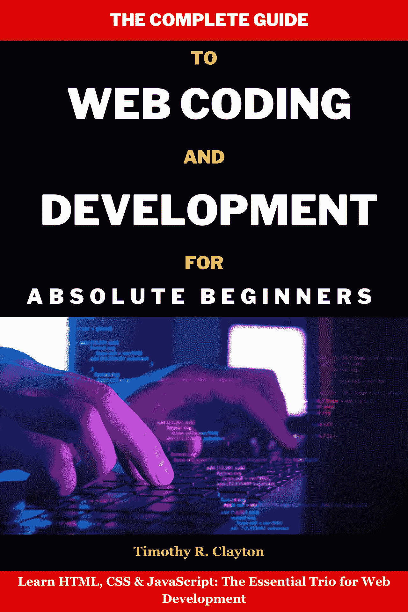

# 初学者 Web 编码与开发全指南：学习 HTML、CSS 和 JavaScript：Web 开发核心三剑客（初步精通系列第 21 册）





# 第 1 章：构建梦想网站 - 从想象到像素

## 驯服浏览器：通往 Web 世界的窗口

曾梦想过创建自己的网站吗？想象有一个空间，可以展示你的爱好、想法，甚至是你那些获爱的猫迷因包。但在深入学习代码之前，让我们认识你可靠的伙伴：网络浏览器。

把浏览器看作是你通往巨大网站世界的窗口。它是你用来访问互联网的软件，如 `Chrome`、`Firefox` 或 `Safari`。这些程序理解网站的秘密语言（`HTML`、`CSS` 和 `JavaScript`！），并将其翻译成你看到的彩色页面和交互功能。

在本章中，我们将探索网络浏览器的奇之处：

- 幕后故事：我们将窥探内部，看看浏览器如何将行行代码变成你喜爱的网站。
- 导航忍者：学习像专业人士一样冲浪，使用书签、标签页和地址栏来探索不同的网站。
- 检查元素：是否好奇过网站是如何实现酷炫效果的？我们将向你介绍浏览器的检查工具，这是理解网站如何构建的秘密武器。

### 学习行语：HTML - 你网站的蓝图

想象一下你的梦想网站——一个反映你风格和目的的活力在线空间。但在你开始添加花哨的功能和动画之前，有一个至关重要的第一步：建立基础。这就是 `HTML`（超文本标记语言）大显身场的地方。

把 `HTML` 想成你网站的蓝图。它定义了内容的结构和组织，就像建筑师的蓝图规划了建筑的墙壁、房间和功能。虽然 `HTML` 不直接控制视觉设计（那是 `CSS` 的工作！），但它确保你的网站组织良好并能被 浏览器理解，最终塑造了访问者对你创作作品的体验。

### 学习 HTML 语言

`HTML` 使用一套标签（tags）系统，这些标签是包裹在角括号（`<` 和 `>`）中的特殊关键字。这些标签告诉浏览器每个部分代表的是什么种类型的内容。以下是一些基础构建块的拆解：

- 标题：使用标题标签（`<h1>` 到 `<h6>`）为你的文本定义不同的重要级别，如标题、副标题和子标题。想象它们是报纸上的头条新闻，吸引读者的注意力。
- 段落：将你的主要内容包裹在 `<p>` 标签中，创建清晰易读的段落。
- 图像：`` 标签允许你将图像嵌入网站中，增加视觉趣味并打破文本布局。
- 列表：需要显示项目列表吗？使用有序列表（`<ol>`）进行数字序列，或使用无序列表（`<ul>`）项目符号。
- 链接：使用 `<a>` 标签将你的网站连接到其他网站。这允许访问者在页面之间导航或探索外部资源。

### 构建你网站的骨架

现在你已经知道基础标签，让我们看看它们是如何组合成你网站骨架的：

1. 基础结构：每个 `HTML` 文档都以 `<doctype>` 声明开始，随后是 `<html>` 标签。该标签作为根元素，包含了构成你网页的所有内容。在 `<html>` 标签内部，你会发现两个主要部分：
   - `<head>`：此部分包含不直接显示在网页上的信息，但对浏览器和搜索引擎至关重要。它包括页面标题、字符编码以及指向外部样式表（`CSS`）的链接。
   - `<body>`：这是你网站所有可见内容的所在地。在这里，你将使用各种 `HTML` 标签来结构化你的标题、段落、图像、列表和链接。
2. 标签嵌套：想象积木互相嵌套。`HTML` 允许你嵌套标签。例如，你可以将一个段落标签（`<p>`）放在一个标题标签（`<h1>`）内部，以创建一个带有额外细节的副标题（此处示例）。
3. 用于额外控制的属性：许多 `HTML` 标签可以在其起始标签内接受额外的属性，以提供更多信息或自定义其行为。例如，`` 标签可以有一个 `src` 属性来指定图像源文件。

### 超越基础

`HTML` 提供了丰富的标签集用于更复杂的元素，如表格、表单和多媒体内容。随着你的进步，你将学习高级技术，如创建交互元素和嵌入视频。记住，`HTML` 的美之处在于它的简单。一旦你掌握了基础，就可以开始构建精美的网站了。

小贴士：不要害怕尝试！有很多在线 HTML 编辑器和练习场，可以让你编写代码并即时看到结果。这是巩固理解并释放创造力的极佳方式。

## 像英雄一样编码：你的第一行 HTML

欢迎你，准开发者！今天标志着你进入了代码世界，我们将把你的想象变为真实的在线网站。在这个任务中，我们将编写你的第一行 HTML 代码——建立基础的构建块。

### 你的武器：文本编辑器

在深入代码之前，你需要一个文本编辑器。它是你的数字画笔，允许你编写并保存 `HTML` 代码。别担心，现在不需要花哨工具。大多数计算机都带有基础文本编辑器，如 Windows 记事本或 Mac 的文本编辑，它们非常适合我们的初始步骤。

### 任务目标：构建基础 HTML 文档

把你的网站想象成一个超级总部。每个总部都需要一个清晰的结构，对吧？让我们使用我们的第一行 HTML 代码构建基本框架：

1. 文档类型声明（doctype）：这是一个放在 `HTML` 文档最开头的特殊行。它告诉浏览器它正在处理的是什么类型的文档。将此行复制粘贴到你的文本编辑器中：

```html
<!DOCTYPE html>
```

2. HTML 标签：该标签作为整个网页的主容器。每个 `HTML` 文档都需要它。这里是代码：

```html
<html>
```

3. 等等，还有更多！再次想象你的超级总部。如果没有用于控制室（魔法发生的地方）和训练区（访问者看到结果的地方）的区域，它将是不完整的。在 `HTML` 中，我们使用两个关键元素来实现：
- 头部部分（`<head>`）：此部分包含关于网站的信息，但它不会直接显示在页面上。它就像一个包含蓝图和任务简报的控制室。在 `<head>` 部分，你将放置网站标题、字符编码以及指向外部样式表的链接（即将上线！你可以这样代码：

```html
<head>
<title>我的第一个网站</title>
</head>
```


## 4. 身体部分：这是动作发生的地方！访问者在网站上看到的所有内容，从文本、图像到链接和按钮，都位于 `<body>` 部分内部。把它想象成一个训练区域，你可以在这里展示网站的用途和内容。让我们添加起始标签：

```html
<body>
</body>
```

## 完成交易（圆满收官）：记住，HTML 的关键在于正确的结构。就像每个超级英雄故事都有开头和结尾，你的 HTML 文档也需要闭合标签来标记每个元素的结束。以下是完成代码的方法：

```html
<!DOCTYPE html>
<html>
<head>
<title>我的第一个网站</title>
</head>
<body>
</body>
</html>
```

恭喜你，超级英雄！你刚刚写了你的第一个完整的 HTML 文档！现在，请用 `.html` 扩展名保存它（例如：`myfirstwebsite.html`）。

准备好看到你的作品运行了吗？用 Chrome 或 Firefox 等网络浏览器打开你保存的文件。先不要期待现在就能看到华丽的视觉效果；目前，你只会看到一个简单的页面，标签页上显示着你选择的标题。但请记住，这只是第一个基石！随着你的进步，你将添加更多的标签和内容，让你的梦想网站变为现实。

## 额外贴士：觉得冒险吗？尝试使用 `<p>` 标签在身体部分添加一个段落。这里有一个示例：

```html
<!DOCTYPE html>
<html>
<head>
<title>我的第一个网站</title>
</head>
<body>
<p>欢迎来到我超棒网站！请关注更多内容。</p>
</body>
</html>
```

保存这段代码并刷新浏览器。你现在应该能看到页面上显示你的段落了！继续练习和实验吧——网页开发的世界等待着你的创意！

# 第 2 章：CSS - 网页设计的画笔和工具箱

## 超越文本：添加颜色、字体和格调

恭喜！你已经掌握了 HTML 的基础，为你的网站奠定了基础。但让我们面对现实吧，一个白色背景上只有纯黑字的网站并不十分吸引眼球。这就是 CSS 大派用场的地方——它是将你的网站从基础蓝图转变为视觉惊艳杰作的秘密武器。

将 CSS（层叠样式表）想象成网页设计的画笔和工具箱。它允许你控制网站的视觉外观，添加颜色、字体、布局和各种效果，让你的想象变为现实。以下是 CSS 如何帮助为你的网站注入生命：

- **点缀色彩**：想象一个没有标志性颜色的超级英雄！同样，网站需要颜色来吸引注意力并营造氛围。通过 CSS，你可以控制网页的背景颜色、文本颜色，甚至甚至是按钮和链接等单个元素的颜色。
- **绝佳字体**：正确的字体可以产生天差地别的影响。CSS 允许你从海量字体库中选择，定制文本样式以匹配你网站的主题。无论你喜欢用于正式场合的经典衬线字体，还是用于营造现代感的活泼无衬线字体，CSS 都能赋予你表达个性的能力。
- **掌控文本大小和样式**：并不是所有文本都需要同等的对待！CSS 允许你调整标题、段落和其他元素的大小。你还可以控制粗体、斜体和下划线等文本样式，在网页上创建重点和视觉层次感。
- **留间距**：适当的间距对于可读性和视觉吸引力至关重要。CSS 赋予你定义内容元素周围外边距（margin）和内边距（padding）的能力。将其想象在部分之间添加呼吸空间，让你的网站不那么拥挤，更容易导航。
- **增添格调**：准备好增加一些亮点了吗？CSS 允许你为网站元素添加边框、阴影甚至是圆角。这些微妙的设计触感可以提升整体视觉效果，让你的网站在众脱颖而出。

### 整合一切：

以下是你如何使用 CSS 为网站上的简单标题设置样式的简览：

HTML 代码（你现有的网站结构）：

```html
<h1>Welcome to My Website!</h1>
```

CSS 代码（添加在单独的样式表或 HTML 文件中）：

```css
h1 {
color: blue;
font-size: 36px;
text-shadow: 2px 2px 4px gray; /* 添加一个微妙的阴影效果 */
}
```

通过应用这段 CSS 代码，你网站的标题将变为鲜艳的蓝色，看起来更大更显眼，并获得微妙的阴影效果。这仅仅是 CSS 能实现的冰山一角！

#### 选择器的力量：

CSS 的优势之一是它定位网页上特定元素的能力。你可以使用各种选择器，如元素标签（例如 `<h1>`）、类名（使用特殊的 HTML 属性分配）和 ID（特定元素的唯一标识符）。这种有针对性的方法允许你一致地样式化单个元素或一组元素，确保整个网站设计风格具有连贯性。

### 拥抱实验：

不要害怕在 CSS 中尝试不同的颜色、字体和布局。网上有无数资源展示了设计趋势和最佳实践。随着你的探索，你将开发出属于你自己的独特风格，并创建一个真正反映你愿景的网站。

在本章的下一节中，我们将更深入地探索 CSS 的世界，探索如何创建更复杂的布局并为你的网站添加交互元素。请期待，有志的网页开发者——通往网页设计精通之路才刚刚开始！

## 从方块混乱到惊艳布局：掌握 CSS 魔法

我们探索了 CSS 为你的网站添加颜色、字体和格调的力量，将其从平淡的文本变为具有视觉吸引力的东西。但一个真正惊艳的网站不仅仅是美学——它需要良好的布局来引导用户并优化体验。在这一节中，我们将深入探索 CSS 魔法，赋予你构建美实用布局的技能。

### 盒模型：理解构建模块

将你的网站内容——文本、图像、按钮——想象成独立的盒子。在 CSS 中，这个概念被称为盒模型。网页上的每个元素都有默认盒模型，由四个关键部分组成：

- **内容 (Content)**：元素内的实际内容，如段落中的文本或图像本身。
- **内边距 (Padding)**：内容与框之间的空间。它为内容提供了呼吸空间，提高可读性。
- **边框 (Border)**：盒子的视觉轮廓，与其他元素隔离开。
- **外边距 (Margin)**：框之外的空间。它创建元素之间的间隙并定义整体布局。

通过 CSS 操作这些属性，你可以控制网站元素的大小、位置和间距，最终创建视觉良好且组织良好的布局。

### 布局技术：从简单到复杂

CSS 提供了各种布局技术来实现不同的设计目标。以下是一些基础方法的概述：

- **基础流**：默认情况下，浏览器按照它们在 HTML 代码中的顺序一个接一个排列元素。对于结构简单的布局，这是一个很好的起点。
- **浮动 (Floats)**：想象元素像内容海洋中的岛屿一样浮动。浮动允许将元素（如图像）放置在文本旁边，创建更具的布局。然而，浮动很难掌握，并在较小屏幕上导致布局问题。
- **定位 (Positioning)**：释放对元素位置的终极控制！CSS 定位允许你精确定义元素在网页上的出现位置，而不论周围的内容如何。这种技术对于创建复杂布局和在用户滚动时保持位置的固定元素非常强大。

布局的终极杯：Flexbox 和 Grid


Flexbox 和 Grid 的出现标志着 CSS 布局能力的革命。这些强大的技术提供了一种更直观、更高效的方式来构建你的网站。

- `Flexbox`: 想象一个灵活的容器，它可以均匀地分布内容或根据可用空间调整元素的大小。Flexbox 擅长创建单维布局，例如响应式导航菜单或间距均匀的内容区域。
- `Grid`: 想象一个网格系统（类似于棋盘），你可以在定义行和列来定位元素。Grid 为创建复杂的多维布局提供了惊人的灵活性，使其成为现代 Web 开发者的喜爱工具。

## 响应式设计：让你的网站在任何设备上大放异彩

用户访问网站的方式已经演变。今天，人们在桌面电脑、笔记本电脑、平板电脑和智能手机上浏览。在桌面端上看起来完美的网站，在手机屏幕上可能会显得笨拙。响应式设计是一种确保你的网站根据不同屏幕尺寸调整布局的方法，在任何设备上都能提供最佳视觉体验。

`CSS media queries` 允许你针对特定的屏幕尺寸并此调整样式。你可以定义不同的布局，或者简单修改字体大小、外边距和内边距，以确保你的网站在所有设备上保持用户友好性。

## 精通 CSS 魔法：实践与探索的之旅

学习 CSS 布局技术需要时间和实践。那里有很多在线教程和资源可以引导你。不要害怕尝试不同的方法，并探索代码示例以查看布局是如何构建的。实践得越多，你对 `CSS` 就越熟悉，很快你就能创作出令人印象深刻的美观且实用的网站布局！

## 动画与特效：让你的网站脱颖而出

到为止，你已经学会了如何使用 `HTML` 为网站建立坚实的基础，并使用 `CSS` 增加视觉魅力。但你是否访问过一个具有平滑过渡、微妙动画或吸引你注意的交互元素的网站？那就是 Web 开发中动画和特效的魔法！

### 超越静态页面：注入活力

动画和特效让你的网站活起来。它们可以是微妙且实用的，例如鼠标悬停时改变颜色的按钮；也可以更复杂，例如引人注目的动画横幅。无论哪种情况，它们都增加了一层动态和交互性，让你的网站更具吸引力和用户友好。

### 技术工具箱：

`CSS` 和 `JavaScript` 是在网站上创建动画和特效的主要工具。这里是一些流行方法的概述：

- `CSS Transitions`: 这种技术允许你随时间平滑地改变元素的属性（如 `color`、`opacity` 或 `size`）。想象一个按钮在悬停时会逐渐改变颜色，营造出更精致的用户体验。
- `CSS Animations`: 使用 `CSS animations` 更进了一步！你可以定义在特定持续时间内应用到元素上的样式序列，创建如淡入、滑动甚至更复杂的运动动画。想象一个动画 Logo 或一个会轻微弹跳吸引注意的呼唤行动按钮（call-to-action）。
- `JavaScript Animations`: 虽然 `CSS` 提供了强大的动画能力，但 `JavaScript` 提供了更大的控制力。你可以创建响应用户输入的交互式动画，例如当用户点击导航箭头时切换幻灯片的轮播器。JavaScript 还通过诸如 `Anime.js` 或 `GSAP` 等库释放了更复杂动画的潜力。

### 特效：超越基础动画

Web 开发世界提供了各种可以增强你网站交互性和用户体验的特殊特效。以下是一些例子：

- `Hover Effects`: 通过添加悬停效果让你的网站元素更具吸引力。这些效果在用户鼠标悬停在元素上时触发，包括改变颜色、显示额外信息或微妙动画。
- `Parallax Scrolling`: 通过让背景元素以不同于前景元素的速度滚动，创建一个分深度效果。这种技术可以创造出迷人的运动幻觉，并为你的网站增加维度感。
- `Microinteractions`: 微小、微妙的动画或效果对用户体验产生巨大影响。想象一个在提交表单时填充的进度条，或者点击时会播放动画的点赞按钮。这些微交互为用户提供了反馈，并增强了网站的整体感受。

## 平衡的艺术：少即是多

动画和特效可以是强大的工具，但策略性地使用它们至关重要。过多的闪烁元素会让用户措接，并分散对网站内容的注意力。记住，目标是增强用户体验，而不是创造视觉盛宴。

### 寻找灵感和学习资源：

Web 开发社区充满了创新。有无数网站展示了动画和特效的惊艳案例。探索这些资源来激发你的创意，看看其他开发者是如何突破 Web 设计边界的。

以下是一些流行的起点：

- `https://codepen.io/`: (CodePen): 一个展示创意代码片段的平台，包括动画和交互元素。
- `https://www.awwwards.com/websites/animation/?page=3`: (Awwwards): 一个专门展示获奖级 Web 设计的网站，通常包含创新的动画技术。
- `https://animate.style/`: (Animate.css): 一个流行的 CSS 库，提供预构建的动画类以便于实现。

# 第 3 章：JavaScript - 让网站活起来

## 没有个性的网站？再也不可能！

想象一个感觉平淡、静态且没有任何交互的网站。它可能拥有出色的视觉效果和内容，但如果没有火花，很难真正留住用户。这就是 `JavaScript` (`JS`) 发挥用场的地方——这种向网站注入个性、交互性和动态的编程语言。

### 超越静态页面：增加用户交互

还记得那些本质上是在线手册的早期网站吗——用户只是查看信息的被动体验？JavaScript 彻底改变了游戏规则。它允许你的网站响应用户的操作，创建一个更具吸引力更生动的交互环境。

以下是 `JS` 如何让网站活起来的一些例子：

- `Interactive Forms`: 想象一个在用户输入时就能验证输入的表单，防止错误并提高整体用户体验。`JS` 赋予你创建更用户友好、响应更快的动态表单的能力。


## 交互功能

*   **点击事件**：那些点击按钮后只会刷新页面的网站？太无趣了！`JS` 允许你为按钮点击定义自定义操作。你可以使用按钮触发动画、显示隐藏内容，甚至在在不刷新整个页面的情况下提交表单数据。
*   **图片库**：静态图片库虽然很不错，但如果有一个在鼠标悬停时切换图片，或允许用户通过箭头进行导航的轮播图，难道不是更酷吗？`JS` 让这一切成为可能，创造出更具吸引力的视觉体验。
*   **动态内容**：厌倦了每次想更新网站上的一小块内容都要编辑 HTML 文件吗？`JS` 允许你即时操作网站内容，让更新变得更加简单且高效。

## 从简单脚本到复杂应用

`JavaScript` 提供了一系列能够满足各种水平开发者的能力。以下是其潜力的细分：

*   **基础脚本**：即使是几行 `JS` 代码也能为你的网站添加交互性。想象一下，一个欢迎访问者的简单弹出消息，或者导航链接在鼠标悬停时的颜色变化。
*   **中级功能**：随着学习的深入，你可以创建更复杂的交互，如表单验证、图片轮播以及折叠面板（accordions）和标签页（tabs）等交互元素。
*   **高级应用**：对于经验丰富的开发者，`JS` 可以作为构建整个 Web 应用的基础，例如单页应用（SPA），它们感觉更像桌面软件而非传统的网站。

## 学习 JavaScript：一段发现之旅

`JavaScript` 的广大世界提供了丰富的资源来指导你的学习旅程。以下是一些起点：

*   **在线教程**：有无数网站和平台提供免费教程和交互式课程，帮助你掌握 `JavaScript` 基础，例如 `Khan Academy`（可汗学院）[`www.khanacademy.org/computing/computer-programming/programming`](https://www.google.com/url?q=https://www.khanacademy.org/computing/computer-programming/programming&sa=D&source=editors&ust=1712844939685388&usg=AOvVaw15WM2h5KIxE5ZTJSnJ0FPB)、`Codecademy` [`www.codecademy.com/catalog/language/javascript`](https://www.google.com/url?q=https://www.codecademy.com/catalog/language/javascript&sa=D&source=editors&ust=1712844939685580&usg=AOvVaw12fLOi-KZ35uh0DY7IdWtL)
*   **交互式沙场**：像 `JSFiddle` [`jsfiddle.net/`](https://www.google.com/url?q=https://jsfiddle.net/&sa=D&source=editors&ust=1712844939685758&usg=AOvVaw1hUMO8XdVXFpSjwmqAdKCD) 和 `CodePen` [`codepen.io/`](https://www.google.com/url?q=https://codepen.io/&sa=D&source=editors&ust=1712844939685849&usg=AOvVaw06PHEFH8YxYyoLbKQXJ_PF) 允许你实验代码片段并立即查看结果，提供了一种有趣且交互式的学习方式。
*   **书籍和在线社区**：通过专注于 `JavaScript` 的书籍和在线社区深入学习。利用如 Marijn Haverbeke 所的《Eloquent JavaScript》（Eloquent JavaScript）等资源，或者探索 `Stack Overflow` [`stackoverflow.com/questions`](https://www.google.com/url?q=https://stackoverflow.com/questions&sa=D&source=editors&ust=1712844939686113&usg=AOvVaw2TdlKn5LcTvXGk2RnKQ8Ge) 等论坛与其他开发者建立联系并提问。

## 拥抱框架和库的力量

无需重新发明轮子！`JavaScript` 生态提供了丰富的框架和库，可以简化常见任务并加速你的开发过程。热门选项包括：

*   **jQuery**：该库简化了 `DOM` 操作（与网站元素交互）并添加了实用的动画效果。
*   **React**：一个用于构建用户界面和复杂 Web 应用的流行框架。
*   **Angular**：另一个强大的框架，为构建现代 Web 应用提供了一套全面的工具。

## Web 开发的未来：可能的乐场

`JavaScript` 持续演进，为 Web 开发的未来提供了兴奋的可能性。探索新兴趋势如：

*   **渐进式 Web 应用 (PWAs)**：这些 Web 应用结合了两者的优点，提供了通过浏览器即可访问的类原生应用体验。
*   **WebAssembly (WASM)**：这项技术允许你将其他语言（如 `C++`）编写的代码集成到 Web 应用中，为复杂任务解锁新的性能水平。

## 旅程开始：释放交互的力量

通过引入 `JavaScript`，你将把网站从一个静态实体转变为充满活力且交互的体验。记住，学习 `JS` 是一段充满回报的旅程，解锁了 Web 开发中丰富的创意可能。所以，拥抱交互的力量，开始探索资源，准备好让你的网站焕发生机！

### 交互元素：按钮、表单和用户魔法

想象一个不仅视觉上美观，而且对你的操作有感知并做出响应的网站。这种交互性是 `JavaScript` 为此带来的魔法，而一些最常用的工具是按钮、表单以及更多。在本节中，我们将深入探讨这些基础组件。

### 按钮：不仅仅是可点击

按钮是网站交互的骨干。它们启动操作、触发事件并引导用户。但除了基本功能，`JavaScript` 赋予了你创建动态且吸引人的按钮的能力。

*   **超越点击：探索事件**：`JavaScript` 允许你定义不仅在点击时发生，还发生在鼠标悬停、鼠标按下（用户点击并按住时）、甚至鼠标离开（用户移开鼠标时）时的自定义操作。这开启了各种可能性：
    *   **悬停效果**：通过添加悬停效果让按钮更吸引视觉，改变颜色、显示额外信息或细微动画。
    *   **禁用按钮**：通过在某些条件下禁用按钮提供视觉提示（例如，在表单填写之前禁用）。
    *   **按钮状态**：展示不同的按钮状态（正常、悬停、点击）以提升用户体验并提供反馈。
    *   **动画与微交互**：用微动画增添色彩！使用 `JavaScript` 创建点击时平滑变色或悬停时轻微动画的按钮，增添精致感和友好性。
*   **可访问性是关键**：不要忘记可访问性！确保你的按钮有的标签，并为残障用户提供替代交互方式（例如键盘导航）。

### 表单：超越简单的数据收集

表单是收集用户输入的基础，但通过 `JavaScript`，它们可以不仅仅是静态的数据收集工具。

*   **验证是你的朋友**：通过 `JavaScript` 实现表单验证来确保数据准确。你可以在提交表单之前检查缺失字段、验证电子邮件格式或确保密码长度符合安全要求。这通过防止错误和挫败感提升了用户体验。
*   **实时反馈**：在用户填写表单时提供即时反馈。使用 `JavaScript` 在错误字段旁边显示错误消息或高亮未填写的必填字段。
*   **动态表单**：`JavaScript` 允许你创建根据用户输入适应的表单。想象一个根据用户之前的选择出现额外字段的表单，或者根据另一个字段的值填充下拉菜单。这些动态表单增强了用户体验并让数据收集更高效。
*   **进度条与提交效果**：让用户了解表单提交过程。实现显示上传进的进度条，或添加细微动画和反馈消息来确认表单提交成功。


JavaScript 的功能远不止按钮和表单。这里你可以创建的一些额外交互元素的概览：

* **折叠面板和标签页 (Accordions and Tabs)**：通过使用折叠面板（一次仅展开一个部分）或标签页（用户在不同内容部分之间切换），高效地组织大量内容。这些元素让用户更容易导航复杂的信息。
* **模态框和弹出窗口 (Modals and Popups)**：需要以聚焦的方式显示额外信息或收集用户输入吗？JavaScript 允许你创建出现在现有内容之上的模态窗口或弹出窗口。策略性地使用它们以避免让用户崩溃。
* **工具提示和提示 (Tooltips and Hints)**：在悬停事件期间为用户提供实用的提示和额外信息。工具提示是出现在特定元素旁的小叠加，可以增强用户体验和网站功能的可发现性。

## 记住：上下文为王

虽然交互元素可能很吸引，但策略性地使用它们至关重要。过多的闪烁按钮或不必要的窗口会让用户应接不堪，并损害核心用户体验。确保你的交互元素具有目的，为用户提供价值，并为网站的整体流程做出贡献。

## 库和框架的威力

不要重复轮子！流行的 JavaScript 库如 `jQuery` 为常见的交互元素（如折叠面板、标签页和工具提示）提供了预构建的功能。这些库可以为你节省时间和精力的，让你专注于网站的独特功能。

## 拥抱实验与学习

交互元素的世界是广大的。探索在线资源，尝试代码片段，看看哪些功能可以增强你网站的用户体验。随着你的进步，你将发现更复杂的技术来创建引入胜且交互式的网络体验。

通过掌握交互元素，你将把网站从一个静态实体转变为用户友好且动态的平台，真正与你的观众建立联系。

## JavaScript 游戏：编程也可以很有趣！

学习编程有时可能会让人感到压力。一行又一行晦涩的符号似乎与你喜欢的迷人游戏相去甚远。但如果我告诉你 `JavaScript` 这种让网站焕活的语言也可以用来创建有趣且迷人的游戏呢？系好带，因为我们将进入 JavaScript 游戏开发的精彩世界了！

### 从初学者到游戏开发者：更顺畅的旅程

JavaScript 游戏开发的优之处在于它的易用性。以下是为什么它是有抱负的游戏创造者的完美起点的原因：

* **利用现有知识**：如果你已经掌握了 `HTML` 和 `CSS` 的基础，你已经成功了一半！`JavaScript` 通常与这些语言交互以构建网站，而核心概念可以很好地转化为创建简单的游戏。
* **渐进式的学习曲线**：从小开始！从专注于循环、条件判断和用户输入等核心编程概念的基础游戏开始。随着你信心的增加，逐渐构建更复杂的机制和功能。
* **丰富的学习资源**：互联网上充满了面向有志的 JavaScript 游戏开发者的资源。有无数教程、在线社区，甚至是预构建的游戏框架来引导你的旅程。

### 创造的快乐：从基础概念到迷人的游戏玩法

让我们探索一些你可以用 `JavaScript` 创建的基本性游戏机制：

* **动画基础**：用基础动画让你的游戏元素焕发生机！使用 `JavaScript` 控制屏幕上对象的移动，模拟角色移动、敌人攻击，甚至是简单的背景滚动。
* **用户输入与交互**：让你的游戏真正具有交互性！通过键盘按下或鼠标点击捕捉用户输入，并将其转化为游戏中的动作。这允许用户控制角色、导航菜单并与游戏元素交互。
* **碰撞检测**：许多游戏的核心！使用 `JavaScript` 实现碰撞检测，确定游戏元素（如你的角色和敌人）何时接触。这允许你编写各种反应，如受到伤害、获得积分或完成关卡。
* **游戏逻辑和评分**：使用 `JavaScript` 定义你的游戏规则。这包括设置胜/负条件、跟踪分数和管理难度级别。

### 构建你的第一个游戏：灵感的起点

准备好大干一场了吗？这里有一个你可以用 `JavaScript` 构建的经典游戏概念来帮助你入门：

* **经典的吃蛇游戏**：还记得旧手机上那个让人上瘾的吃蛇游戏吗？这是初学者的完美示例！你可以使用 `JavaScript` 控制蛇在网格上的移动，收集食物并避开撞墙或自己的尾巴。从基础的移动和碰撞检测开始简单尝试，逐渐增加增加增加或奖励物品等功能。

## 超基础：探索框架和库

随着你的进步，请考虑使用构建在 `JavaScript` 之上的游戏开发框架。这些框架提供了专门为创建游戏而设计的预构建功能、库和工具，简化了开发过程。流行的选项包括：

* **Phaser**：一个强大的 2D 游戏开发框架，提供了大量用于创建基于精灵图的游戏的功能。
* **PixiJS**：另一个流行的 2D 框架，以其性能和灵活性闻名。
* **Matter.js**：一个物理引擎库，简化了向你的游戏添加真实的物理模拟。

## 学习永不止：创造者社区

JavaScript 游戏开发的世界是一个充满活力的社区。以下是为你的学习之旅提供燃料的资源：

* **在线教程**：如 `Codecademy` 或 `Khan Academy` 等网站提供专门针对游戏开发的交互式教程。
* **游戏开发社区**：加入 Reddit 的 `r/gamedev` 或专注于游戏开发的 Discord 服务器。在这里，你可以与其他开发者建立联系，分享你的项目并获得宝贵的反馈。
* **开源游戏代码**：在 `GitHub` 等平台上探索开源游戏项目。学习现有代码可以为经验开发者如何处理游戏机制和构建项目提供宝贵的见解。

## Final BOSS：接受挑战并享受其中！

学习 JavaScript 游戏开发可能充满挑战，但也非常有回报。当你克服障碍、解决问题并看到你的游戏变为现实时，你将获得宝贵的编程技能并体验创造的快乐。所以，不要害怕实验，接受挑战，最重要的是，在过程中享受乐趣！记住，伟的游戏往往始于创意的火花和学习的意愿。

# 第 4 章： 核心三剑客实战：将 HTML、CSS 和 JavaScript 结合在一起


恭喜！你已经开启了通往 Web 开发世界的惊险旅程。你已经掌握了 HTML 的基础，为你的网站构建了结构。你挥舞着 CSS 的画笔，增添色彩、样式和布局魔法。你还探索了 JavaScript 的交互潜力，为你的网站注入了活力。现在，是时候将这些强大的元素整合在一起，打造你的第一个网站了！

## 从零散碎片到整体整体：理解协作

将你的网站想象成一台运行良好的机器。HTML 提供蓝图，定义结构和内容。CSS 充当设计师的角色，应用视觉样式和布局。而 JavaScript 则扮演工程师的角色，添加交互性和功能性。这三种语言无缝地工作在一起，创造出你构思的最终产品。

## 构建你的第一个网站：分步指南

让我们逐步完成构建你第一个网站的过程：

1. **概念化与计划**：在深入编写代码之前，花些时间脑风你网站的目的和目标受众。你将展示什么类型的内容？你想提供哪些功能？绘制一个基础的网站地图或线框图（wireframe）有助于可视化整体结构和布局。
2. **用 HTML 奠定基础**：从使用文本编辑器创建一个 HTML 文档开始。记住我们之前涵盖的基础结构，包括 `DOCTYPE` 声明、`<html>`、`<head>`、`<title>` 和 `<body>` 标签。这构成了你网站的骨架。
3. **用 HTML 元素结构化内容**：这是你定义网站不同部分的地方。使用 HTML 标签如 `<h1>` 用于标题，`<p>` 用于段落，`<ul>` 用于无列表，`` 用于图像。在添加内容时，确保元素的正确嵌套，以保持清晰的层次结构。
4. **用 CSS 样式化网站**：创建一个独立的 CSS 表表（链接到你的 HTML 文件），或直接在 HTML 的 `<head>` 部分添加 CSS 样式。使用 CSS 选择器定位特定元素，并定义它们的视觉属性，如颜色、字体大小、外边距和内边距。这是你网站视觉效果生起来的地方！
5. **使用 JavaScript 引入交互（可选）**：虽然对于基础网站来说并非必不可，但可以考虑使用 JavaScript 添加一些交互。从简单的开始！也许是一个在悬停时改变颜色的按钮，或者一个验证用户输入的表单。随着你信心的增加，去探索更高级的功能。
6. **测试与完善**：没有任何网站是在第一次尝试时就是完美的！使用你的网络浏览器预览网站，并识别任何布局问题、样式不一致或功能错误。这是一个迭代过程——进行更改、再次测试并不断完善，直到你对最终产品满意为止。

## 基础之外：资源与灵感

互联网上充斥着丰富的资源来指导你构建网站：

* **免费 Web 托管平台**：尝试创建你的网站，而无需担心初始服务器成本。像 `https://www.freehostia.com/` 和 `https://www.000webhost.com/` 这样的平台为初学者提供免费托管计划。
* **网站模板**：使用预设计的网站模板抢先一步。许多网站提供免费或付费的模板，你可以用自己的内容和品牌对其进行自定义。记住，即使使用模板，理解底层的代码仍然是有益的。
* **在线教程和课程**：那里有大量专门 Web 开发的在线教程和课程。探索如可汗汗学院 `https://www.khanacademy.org/computing/computer-programming/programming`、Codecademy `https://www.codecademy.com/` 或 W3Schools `https://www.w3schools.com/` 等平台来提升你的技能并学习新技巧。

## 拥创作之旅

构建第一个网站是一个令人兴奋的里程碑。不要为最初的挑战感到沮丧——学习和创造的过程本身就充满回报。当你继续你的 Web 开发事业时，请记住：

* **实践出精精**：你代码写得越多，对 HTML、CSS 和 JavaScript 就会越熟悉。尝试不同的技术并构建小项目来巩固你的理解。
* **Web 开发社区**：那里有一个庞大的开发者社区。不要犹豫在在线论坛和社区中寻求帮助、提问并分享你的项目。
* **不断学习**：Web 开发的世界不断演变。保持好奇心，探索新技术，跟上最新趋势。总有更多可以发现和理解的东西。

## 超越基础：探索高级概念

随着你经验的积累，考虑进入更高级的 Web 开发领域：

* **响应式设计**：让你的网站适应不同的屏幕尺寸和设备（桌面电脑、平板电脑、手机），以获得最佳用户体验。在如今移动优先的世界中，这是至关重要的。
* **内容管理系统 (CMS)**：探索如 WordPress 或 Drupal 这样的平台，它们简化了网站内容的创建和管理。这些 CMS 系统提供了友好的界面，不需要深层的代码知识。
* **后端编程**：虽然 HTML、CSS 和 JavaScript 主要关注前端（用户看到的内容），但请深入研究 `PHP` 或 `Python` 等后端编程语言，以管理动态内容并与数据库交互。
* **框架和库**：利用预构建的框架和库来简化开发并访问高级功能。流行的选择包括 `Bootstrap`（CSS 框架）、`React` 或 `Angular`（JavaScript 框架）以及 `Node.js`（服务端 JavaScript 运行时环境）。

## Web 开发的未来：可能的乐场

Web 开发面临着许多迷人的前景：

* **渐进式 Web 应用 (PWAs)**：这些 Web 应用提供了通过浏览器访问的类应用体验。想象一个可以离线工作、发送推送通知且像原生移动应用一样流畅的网站。
* **单页应用 (SPA)**：这些应用程序最初加载单个 HTML 页面并使用 JavaScript 动态更新内容，创建无缝且响应的用户体验。
* **人工智能 (AI) 和机器学习 (ML)**：这些技术具有彻底改变 Web 开发的潜力，增加如聊天机器人、个性化推荐和智能内容创建等功能。

## 力量在你手中

你通过学习 HTML、CSS 和 JavaScript 所获得的技能是开启富有回报的职业道路的基础，或者仅仅是创建属于自己的独特网络角落的能力。记住，Web 开发的之旅是持续的探索。拥抱挑战，享受创造的过程，继续构建精彩的网站吧！

### 挑战：构建一个简单的个人集网站

恭喜！你已经掌握了 Web 开发的基础，并准备好将新学的技能付诸实践。让我们开始一个构建属于你自己的个人集网站的项目——一个向世界展示你的才华和项目的平台。


# 规划你的作品集乐园

在投入编码之前，请花一点时间为你网站的用途和内容制定策略。以下是一些引导性问题：

* 你的主要目标是什么？你是在寻求自由职业工作、向潜在雇主展示技能，还是仅仅为了建立自己的在线形象？
* 你的目标受众是谁？调整你的内容和设计，以与你想要联系的人产生共鸣。
* 你将包含哪些内容？突出你最相关的技能、项目和经验。考虑包含一个迷人的 `About Me`（关于我）部分、一个展示作品的清晰的 `Projects`（项目）部分，以及一个方便潜在客户或雇主联系的 `Contact`（联系方式）部分。

## 绘制蓝图：原型与设计

虽然不是强制性的，但创建一个基础原型会很有帮助。这是一个低保真模型，在视觉上表示你网站的布局和结构。它可以帮助你在投入编码之前，可视化信息流和用户体验。

## 建立基础：配置你的开发环境

* 文本编辑器：选择一个文本编辑器来编写代码。`Sublime Text`、`Atom` 和 `Visual Studio Code` 都是热门选择。这些编辑器提供了语法高亮、代码补全和其他功能，可以简化编码过程。
* Web 浏览器：你需要一个 Web 浏览器在编码时预览你的网站。热门选择包括 `Chrome`、`Firefox` 或 `Edge`。这些浏览器提供了开发者工具，用于检查元素和排查任何问题。

## 编写你的作品集网站：让你的技能付行动！

以下是编写作品集网站涉及的关键步骤分解：

1. HTML 结构：从基础 HTML 文档开始。包含 `<header>`、`<nav>`、`<main>`、`<section>` 和 `<footer>` 等部分来定义整体结构。
2. 内容创作：用引人入胜的内容填充你的网站。写关于自己的自己的文字，用描述和视觉效果展示你的项目，并包含让用户联系你的清晰行动号召。
3. 使用 CSS 样式：让你的网站在视觉上活起来！使用 `CSS` 为背景颜色、字体、外边距和内边距等元素设置样式。记住探索响应式设计原则，以确保你的网站在所有设备上看起来良好。
4. 交互性（可选）：考虑使用 `JavaScript` 添加一些交互性。这可以是简单的悬停动画、带有验证的联系表单，或者带有灯箱功能的项目图库。

## 测试与部署：将你的作品集推向世界

* 彻底测试：一旦完成网站编码，在不同的 Web 浏览器和设备上进行严格测试。确保所有功能均按预期运行，且没有布局问题或损坏链接。
* 部署选项：有几种方法可以在线部署（让你的网站上线）。你可以使用免费的 Web 托管平台如 `https://www.freehostia.com` 或 `https://www.000webhost.com` 开始，或者考虑付费托管选项以获得更多功能和自定义。

## 超越基础：添加花点和功能

以下是提升你的作品集网站的一些方法：

* 视觉效果：包含高质量的图像、视频甚至交互元素，以具有视觉吸引力的方式展示你的项目。
* 证言：添加来自过去客户或雇主的正面证言可以为你的作品集增加信力和社交证明。
* 博客集成：考虑在你的网站中集成博客，你可以在其中分享你的专业知识和行业见解，进一步确立你作为思想领袖的地位。

## 展示你的作品并建立你的品牌

你的作品集网站是你的数字门面，一个给潜在客户或雇主留下印象的平台。定期用新项目更新网站，保持内容新鲜，维护专业的在线形象。记住，这是一场旅行而非终点。随着你的成长和进化，你的作品集网站也应该如此！

所以，你准备好接受挑战并构建自己的作品集网站了吗？有了本章获得的知识，加上奉献和一点创意，你将走上展示技能并在广阔的 Web 开发世界中立足的道路。

## 网站改版：为现有站点添加交互性

你的网站是否感觉有些陈旧？静态页面可能会让用户感到被动，有时只需要一点交互性就能为你的在线形象注入新的生命力。以下是你可以如何利用 `JavaScript` 将你现有的网站转换为引人入胜的动态用户体验。

### 诊断问题：交互性在哪里大放异彩？

在投入编码之前，审视你的网站并识别交互性可以增强用户体验的区域。以下是一些常见场景：

* 被动信息传递：你是否正在以长段静态文本的形式呈现信息？考虑使用折叠面板（accordions）或标签页（tabs）来组织内容，允许用户根据需要探索特定部分。
* 用户输入有限：你的网站是否主要由单向通信组成？带有验证的表单、投票或测验等交互式元素可以收集用户输入并创建出更具吸引力的体验。
* 静态视觉效果：用动画或交互元素为你的网站增添色彩。这可以是图像上微妙的悬停效果、微妙的背景动画，甚至是用户可以导航的产品轮播图。

### 规划你的交互式改版

一旦你确定了改进区域，请策略性地规划你的交互添加内容。以下是一些关键考虑因素：

* 目标受众：记住你的目标受众。哪些功能会让他们觉得最有益且最有吸引力？
* 简单是关键：不要用过多的交互性让用户应接压力。从微妙的添加开始，专注于增强你网站的特定区域。
* 维护用户体验：确保你的交互元素不会阻碍可用性。彻底测试以确保导航流畅，并避免可能让用户沮丧的功能。

### JavaScript 救兵：工具与技术

现在，让我们探索 `JavaScript` 为你的网站添加交互性的特定方法：

* 带有验证的表单：`JavaScript` 可以确保用户在提交之前正确填写表单。实现实时错误消息、高亮显示字段并验证电子邮件地址等格式。
* 交互元素：`JavaScript` 赋予你创建折叠面板、标签页和模态框等元素的能力。这些元素增强了内容的组织和交互。
* 动画与过渡：在悬停、页面加载或点击按钮时添加微妙的动画。谨慎使用这些动画来增强而非过度用户体验。
* 图库和轮播图：超越静态图像。`JavaScript` 允许你创建动态图库和轮播图，用户可以使用箭头、缩略图甚至是移动设备上的触摸势进行导航。
* JavaScript 库和框架：利用预构建库如 `jQuery` 或框架如 `React` 来简化常见的交互功能并简化你的开发流程。

### 分步骤改版指南

以下是将交互功能整合到现有网站的基本方法：

1. 确定目标区域：选择网站上一个交互性最有益的特定部分。
2. 规划功能：决定你想添加的交互类型（例如，表单验证、图像轮播图等）。


3. 代码实现：编写必要的 `JavaScript` 代码或利用相关库来实现所需的功能。

4. 彻底测试：在不同的浏览器和设备上对交互元素进行测试，以确保一切运行都符合预期。

5. 渐进式集成：逐步部署更改，监控用户行为和反馈，以优化你的实现方案。

## 基础之外：高级技巧

随着经验的积累，你可以探索更高级的交互可能性：

* 动态内容更新：使用 `JavaScript` 在不重新加载页面的情况下更新网站内容，创造更流畅的用户体验。

* 交互式数据可视化：`JavaScript` 库可以帮助你创建图表、图形和其他交互式数据可视化工具，吸引用户并以引人入胜的方式呈现信息。

* AJAX（异步 JavaScript 和 XML）：这种技术允许你在不重新加载整个页面的情况下与服务器交换数据，从而实现实时内容更新和动态交互等功能。

## 为你的网站注入新生命：交互性的回报

通过引入交互性，你将你的网站从一个静态实体转变为动态且引人胜目的平台。这可以带来若干益处：

* 提高用户参与度：交互元素能保持用户的兴趣，并鼓励他们进一步探索你的网站。

* 提高转化率：交互式表单、行动号召（CTA）和产品轮播可以带来更高的转化率，无论是购买、注册还是其他目标用户操作。

* 增强品牌形象：一个感觉动态且响应迅速的网站会传达现代且创新的品牌形象。

## 拥实验与持续改进

* 跟踪用户行为以查看哪些能引起共鸣。分析工具可以揭示用户最参与哪些交互元素。利用这些数据优化你的方法，并优先考虑为观众提供最大价值的功能。

* 紧跟最新趋势：Web 开发领域在不断变化。探索新的 `JavaScript` 库、框架和交互技术，以保持领先地位，并持续增强你网站的用户体验。

# 第 5 章：基础之外：探索 Web 开发宇宙

## 选择你的路径：前端开发 vs. 后端开发

恭喜！你已经掌握了 `HTML`、`CSS` 和 `JavaScript` 的基础知识，这三剑客构成了 Web 开发的基石。现在，是时候深入这个广阔且令人兴奋的宇宙了。随着学习的深入，你将面临一个至关重要的决定：在前端和后端开发之间选择你的路径。本章将引导你理解每个领域的独特之处，并帮助你识别哪一个最符合你的兴趣和技能。

### 前端开发：创意的画布

前端开发者是 Web 的艺术家和设计师。他们负责用户在网站上看到并与之交互的所有内容。如果你喜欢创意、技术专长与对视觉美感的热爱的结合，那么前端开发可能是你的天职所在。

* 用户体验架构师：前端开发者将设计稿和原型转化为功能完备且视觉惊艳的用户界面 (UI)。他们确保网站不仅美观，而且直观且易用。

* 视觉语言的大师：`HTML`、`CSS` 和 `JavaScript` 是前端开发者工具箱中的主要工具。他们利用这些语言来控制布局、样式、交互和响应式设计（确保网站能够无缝适应不同的屏幕尺寸）。

* 紧跟趋势：前端开发是一个动态领域，随着新趋势和技术的出现不断演变。从精通尖端的 `CSS` 框架到关注最新的用户体验最佳实践，前端开发者都是终身学习者。

### 后端开发：引擎房

另一方面，后端开发者在幕后工作，构建驱动网站的核心功能和逻辑。如果你拥有逻辑思维，喜欢解决问题，并乐于与数据打交道，那么后端开发可能完美契合。

* 服务端专家：后端开发者使用 `Python`、`PHP` 或 `Java` 等服务器端编程语言。这些语言处理数据库交互、用户身份验证和服务器端逻辑等任务，这些决定了网站的运行方式。

* 数据处理者：后端开发者经常与数据库交互，存储和检索驱动网站动态功能的信息。他们确保数据安全、可访问并得到高效管理。

* 构建基础设施：后端开发者在选择和管理托管网站的服务器方面起着至关重要的作用。他们确保后端基础设施的可扩展性、性能和安全性。

* 美妙的互动：前端与后端的协作

虽然前端和后端开发看起来截然不同，但它们手手协作以创建一个完整的 Web 体验。将网站想象成一家餐厅：

* 前端是就餐区：它是优美的氛围、设计良好的菜单和周到的服务员——客户直接交互的所有内容。

* 后端是厨房：它是厨师团队准备美味食物、确保适当卫生和管理库存——所有确保用餐体验顺畅的不可见过程。

## 寻找你的完美匹配：评估你的技能和兴趣

这里是一些帮助你决定哪条路径最契合你的建议：

* 你热爱视觉设计和创建用户界面吗？前端开发可能是完美契合。

* 你对解决问题和处理复杂逻辑充满热情吗？考虑探索后端开发。

* 你喜欢创意与技术专长的结合吗？涵盖前端和后端技能的全栈开发可能是你的天职所在。

## 没有单一的路径：探索光谱

Web 开发的版图广阔无垠，没有单一的“正确”路径。以下是其他可以考虑的额外选项：

* 前端框架和库：探索如 `React` 或 `Angular` 等框架，它们可以简化前端开发并允许你更高效地构建复杂的用户界面。

* DevOps：这一领域弥合了开发与运维之间的鸿沟，确保 Web 应用的顺利部署和维护。

* 移动开发：学习使用 `React Native` 等框架或 `Swift` (iOS) 和 `Kotlin` (Android) 等原生语言创建移动应用。

## Web 开发的未来：可能性的乐场

Web 开发领域不断演变，地平线上正着许多令人兴奋的趋势：

* 人工智能 (AI) 和机器学习 (ML)：这些技术具有彻底改变 Web 开发的潜力，适用于个性化推荐、聊天机器人和内容创作等领域。

* 渐进式 Web 应用 (PWA)：这些 Web 应用通过浏览器提供类似应用程序的体验，模糊了网站与原生应用之间的界限。

* 物联网 (IoT) 与 Web 开发：随着越来越多的设备连接互联网，Web 开发者将在构建与这些设备交互的用户界面和功能方面发挥至关重要的作用。

## 力量在你手中：拥抱持续学习

无论你在 Web 开发中选择哪条路径，请记住，这段旅程是一生的探索。为了跟上趋势，请考虑以下建议：

* 持续学习：Web 开发领域不断变化。花时间学习新的技术、框架和最佳实践。在线课程、教程和开发者社区都是宝贵的资源。


*   **构建项目**：巩固学习成果的最佳方法是构建真实世界的项目。从从小开始，尝试不同的技术，并在作品集网站上展示你的技能。
*   **拥抱社区**：通过在线论坛、线下聚会或黑客松与其他开发者联系。在项目中进行合作，传授你的知识并吸收他人的经验。

## 扩展你的技能树：需要掌握的新语言和框架

恭喜你！通过对 `HTML`、`CSS` 和 `JavaScript` 的掌握，你已经在 Web 开发领域建立了坚实的基础。现在，是时候拓宽眼界，深入研究能够让你更上一层楼的新语言和框架了。本章节将为你提供一份路线图，帮助探索这些令人兴奋的前沿，并在你的 Web 开发之旅中释放更大的创意潜力。

### 为工作选择合适的工具：专化 vs. 通用

Web 开发领域提供了丰富的语言和框架，每种都对应特定的功能和开发风格。以下是处理这些海量选择的方法：

*   **专化 vs. 通用**：你渴望在特定领域拥有深厚的专业知识，还是倾向于拥有能够让你应对多样化项目的更广泛的技能？在做此选择时请考虑你的职业目标和兴趣。
*   **需求技能**：研究 Web 开发就业市场中的需求技能是一种战略性的方法。掌握雇主高度青睐的语言和框架可以为你带来竞争优势。
*   **项目需求**：你项目的特定需求可能会决定你选择的语言和框架。例如，构建移动端 App 可能需要学习 `Swift` 或 `Kotlin`，而复杂的电子商务平台的后端开发可能需要精通 `Python` 或 `Java` 等语言。

### 提高效率的前端框架

如果你对前端开发充满热情，可以考虑掌握那些简化流程并添加强大功能的框架：

*   **React**：一个用于构建用户界面的流行 `JavaScript` 库。它利用基于组件的架构，是创建复杂且可复用的 UI 元素的理想选择。
*   **Angular**：另一个强大的 `JavaScript` 框架，为构建单页应用（SPA）提供全功能特性集。`Angular` 提供了一种结构化的前端开发方法，适用于大型项目。
*   **Vue.js**：一个以轻量级和易于学习而闻名的渐进式 `JavaScript` 框架。`Vue.js` 提供了一种灵活的方法，允许将其无缝集成到现有项目中，或用它构建复杂的 SPA。

### 后端实力的后端语言

对于被后端开发吸引的人来说，探索这些语言可以开启无限可能：

*   **Python**：一种多功能且对初学者友好的语言，因其读性和丰富的库被广泛应用于 Web 开发。`Python` 在后端开发、数据科学和机器学习应用方面表现优异。
*   **Java**：一种行业标准的面向对象的编程语言，以其扩展性和健壮的功能而闻名。`Java` 为无数网站和应用程序提供后端系统支持。
*   **PHP**：一种专为构建网站而设计的服务器端脚本语言。它的易用性和大型社区使得 `PHP` 成为构建动态网站和 Web 应用的热门。

### 基础之外：探索专业技术

随着经验的增加，可以考虑进入这些专业领域以增强你的技能树：

*   **Node.js**：你可以通过 `Node.js`（一个 `JavaScript` 运行时环境）在浏览器之外运行 `JavaScript` 代码。这为使用 `JavaScript` 构建实时应用程序和服务器端功能开启了大门。
*   **数据库管理系统 (DBMS)**：掌握如 `MySQL` 或 `PostgreSQL` 等数据库，让你能够高效地存储、检索和管理数据——这是许多 Web 开发项目的关键技能。
*   **DevOps 工具**：探索如 `Git`（版本控制）和 `Docker`（容器化）等工具，以简化开发工作流、协作和部署过程。

### 学习资源：你的成长指南

互联网提供了丰富的资源来赋能你对新语言和框架的探索：

*   **在线课程和教程**：`Coursera`、`edX` 和 `Udemy` 等平台提供了大量的互动课程和教程，用于学习新的编程语言和框架。
*   **文档和开发者社区**：大多数语言和框架都有详尽的官方文档和活跃的在线社区，你可以在那里找到教程、提问并与其他开发者联系。
*   **开源项目**：在 `GitHub` 等平台上贡献开源项目是获得实践经验、向经验丰富的开发者学习以及构建作品集的绝佳方式。

## 拥抱持续学习之旅

Web 开发的世界不断演变。新的语言、框架和技术层出不穷。以下是保持领先的方法：

*   **做一名终身学习者**：花时间不断学习和提升自己。探索新技术，尝试不同的工具，并保持与最新趋势同步。
*   **制定个人学习计划**：为你的学习之旅规划航线。识别你想要获取的特定技能，并设定现实的目标以实现它们。
*   **实践出真知**：巩固学习成果的最佳方法是将新学到的知识付诸实践。构建个人项目、参加黑客松或贡献开源项目。
*   **教导他人**：强化自身理解的最有效方法之一就是教他人。写博客文章、创建教程或指导其他有抱的开发者。

## 力量掌握在你手中：开启一份有回报的职业

通过用新语言和框架扩展技能树，你为 Web 开发中令人兴奋的职业机会开启了大门。无论你选择专注于某个特定领域还是成为一名通用的全栈开发者，可能性都是无限的。记住，学习是一段过程，其回报与目的地同等。接受挑战，享受探索的过程，继续构建惊的 Web 应用吧！

所以，你准备好开启掌握新语言和框架之旅了吗？Web 开发的世界等待着你，充满了可能。凭借奉献、对知识的渴求和一丝坚持，你可以将自己变成一名备受青爱的开发者，应对任何随而来的 Web 开发挑战。

## 像侦探一样调试：解决网站之谜

Web 就像复杂的机器一样，有时也会故障。错误信息闪烁，功能损坏，布局错乱。但不要担心，有的开发者们！就像侦探细密地破解案件一样，你也可以拥有调试这些网站之谜的技能，让你的作品恢复往日的光。

### 案发现场：识别问题

任何调试调查的第一步都是确定问题。以下是处理这一关键阶段的方法：

*   **收集证据**：仔细分析问题。它是视觉上的故障、错误消息还是功能损坏？详细记录问题，包括特定的网页、浏览器以及任何触发问题的操作。
*   **重现现场**：你能够持续地重现该问题吗？如果是，这有助于缩小可能的原因范围。在不同的浏览器和设备上尝试相同的操作，看看问题是否仍然存在。

### 侦探的工具箱：必备调试工具


每位侦探都有他们信赖的工具，Web 开发者的调试武器库也不例外。以下是一些必备工具：

- 浏览器开发者工具：你的 Web 浏览器是你最主要的调试工具。大多数浏览器都提供了内置的开发者工具，允许你检查元素、查看错误消息并分析网络请求。
- 代码检查工具（Linters）和静态分析工具：这些工具可以扫描代码，查找潜在错误和风格不一致之处，帮助你在开发过程早期识别问题。
- 调试日志：在代码中策略性地放置 `console logs` 可以允许你在执行期间的特定点打印消息。这有助于你跟踪代码流并准确定可能出现问题的地方。

## 审讯：质问你的代码

工具在手，现在是时候深入研究代码本身了：

- 隔离嫌疑人：你能识别出导致问题的特定代码段吗？利用你对网站功能的理解和错误信息，来缩小嫌疑人范围。
- 逐步审讯：使用断点（breakpoints）等调试工具在特定行处暂停代码执行。这允许你检查变量、逐行执行代码，并识别行为何时偏离了预期。

## 案破了：修复 Bug 并记录解决方案

一旦确定了罪魁祸首，就是时候修复 Bug 了！以下是确保成功解决的方法：

- 应用修复：进行必要的代码更改以解决问题。记住，修复方案应该是清晰、简洁且经过良好测试的。
- 彻底测试：实施修复后，在不同的浏览器和设备上对你的网站进行严格测试，以确保问题已真正解决，且没有引入意外的副作用。
- 记录案件：记录你遇到的 Bug、调试过程和所采用的解决方案。这些文档对于未来的参考将具有极价值，并并帮助你日后避免类似问题。

## 超越基础：高级调试技术

随着你调试经验的增长，考虑探索这些高级技术：

- 调试 JavaScript：JavaScript 错误可能特别棘手。利用浏览器开发者工具检查 `console logs`，识别未捕获的异常，并使用源映射（source maps）等调试技术精确定位导致问题的代码行。
- 调试异步代码：异步代码在正常流程之外执行，调试起来充满挑战。利用浏览器开发者工具的网络标签等工具分析网络请求，并识别异步操作中的潜在问题。
- 版本控制系统：如 `Git` 等版本控制系统允许你跟踪随代码的变化。这对于调试非常有帮助，因为必要时你可以回到代码之前的版本。

## 迎接挑战：调试是一项需要掌握的技能

调试对于任何 Web 开发人员来说都是一项重要技能。这是一个解决问题、耐心和批判性思维的过程。记住：

- 不要气馁：调试可能会令人沮丧，但只要坚持并采用正确的方法，你可以克服任何网站之谜。
- 从错误中学习：你遇到的每一个 Bug 都是学习机会。分析 Bug 的原因并利用这些知识改进你的编码实践，防止未来发生类似问题。
- 社区在这里提供帮助：不要害怕向在线社区或论坛寻求帮助。那里有一个庞大的开发者网络，他们愿意伸出援手分享调试专业知识。

凭借在本章磨练的技能，你已经在成为卓越 Web 开发侦探的道路上了！

下一次当你的网站遇到故障时，不要恐慌。戴上你的侦探帽，配好你的调试工具，以逻辑且有方法的心态处理问题。记住，调试是一个持续的学习过程。迎接挑战，磨练你的技能，享受解开网站之谜并让你的创作重回辉煌的快感！

# 第 6 章：建立你的开发者网络：资源与灵感

### 加入 Web 开发社区：在线论坛和聚会

恭喜！你已经开启了 Web 开发之旅并正在积极构建你的技能树。本章深入探讨了丰富的 Web 开发资源世界，并探索了建立强大开发者网络的重要性。通过与其他开发者联系，你将获得宝贵的见解，发现新的学习机会，并找到激发创作火花的灵感。

Web 开发社区是一个充满活力且相互鼓励的网络。以下是利用在线论坛和聚会（Meetups）与其他开发者联系的方法：

- **在线论坛**：
    - 益处：在线论坛提供了丰富的信息以及一个提问、分享代码和从经验丰富的那里获得反馈的平台。
    - 热门论坛：`Stack Overflow`、`FreeCodeCamp Forum`、`DEV Community`
    - 成功技巧：清晰地表述你的问题，提供你面临的问题的相关背景，并尊重其他用户的时间。
- **聚会 (Meetups)**：
    - 益处：聚会提供了与当地开发者联系的机会，进行面对面的社交，参加讲座和工作坊，并开展项目合作。
    - 寻找聚会：`Meetup.com`、`Facebook Groups`（搜索你城市的 Web 开发群组）
    - 成功技巧：向他人介绍自己，积极参与讨论，不要害怕提问。

### 关注技术博客和网站

通过关注著名的技术博客和网站，保持对最新趋势和技术的关注：

- 益处：技术博客和网站提供富有见解的文章、教程、项目构想和行业新闻，让你处于 Web 开发的前沿。
- 热门资源：`Smashing Magazine`、`Web Dev Simplified`、`A List Apart`
- 成功技巧：订阅你最喜爱的博客和网站的通讯邮件，直接在收件箱中接收更新。

### 开源项目：贡献与探索

- 益处：为开源项目贡献允许你获得实践经验，向经验丰富的开发者学习并构建你的作品集。这也是与更广泛的开发者社区联系的绝佳方式。
- 寻找开源项目：`GitHub Explore`、`Open Source Guides`
- 成功技巧：从小处开始，选择符合你兴趣和技能水平的项目，并随着经验的增加逐渐增加参与度。

### 社交媒体和在线学习平台

- 益处：`Twitter` 和 `LinkedIn` 等社交媒体平台让你与全球开发者联系，而在线学习平台提供了学习新技术的结构化方法。
- 关注开发者和公司：关注 Web 开发领域有影响力的开发者和公司，跟上最新趋势和创新。
- 在线学习平台：`Coursera`、`edX`、`Udemy`
成功技巧：在社交媒体上参与讨论，参加在线课程，并与其他学习者和导师联系。

### 构建你的品牌：创建开发者作品集

- 益处：拥有开发者作品集可以向潜在雇主或客户展示你的技能和项目。它是建立品牌并脱颖而出的强大工具。
- 包含内容：包含个人信息、你的技能和经验的简要概述，以及你精选的最佳项目。
- 作品集托管平台：个人网站、`GitHub Pages`

### 导师的力量：寻找向导


## 寻找导师

*   **收益**：导师可以提供宝贵的指导、职业建议和行业洞察。他们可以帮助你应对挑战，识别需要改进的地方，并为你建立其他机会的机会。
*   **寻找导师**：通过技术社区提供的导师计划等在线平台寻找导师，或者联系你人脉网络中经验丰富的开发者。

## 拥抱协作：团队合作的力量

*   **收益**：与其他开发者协作可以培养创造力、解决问题能力和沟通能力。它让你能够从 Web 开发的不同视角和方法中学习。
*   **寻找协作机会**：寻找在线黑客松、参与开源项目，或与你当地社区的开发者结队。

## 构建你的开发者网络：一段持续的旅程

建立强大的开发者网络是一个持续的过程。以下是一些关键要点：

*   **积极参与**：积极参与在线论坛、参加聚会（meetups）并为社区做出贡献。
*   **回馈并分享知识**：随着经验的增长，通过编写博客文章、创建教程或指导他人来分享你的收获。
*   **真实地社交**：基于共同的兴趣和对 Web 开发的热爱，与其他开发者建立真实的联系。

Web 开发社区是学习、灵感和协作的宝贵资源。通过积极参与这个充满活力的生态系统，你不仅会加速自己作为开发者的成长，还能发现一个支持和同伴者的网络，这将为你的整个 Web 开发职业提供动力。所以，不要犹豫，投入其中，与其他开发者联系，从今天开始建立你的开发者网络吧！

## 超越基础：建立强大的在线影响力

在当今的数字世界中，拥有强大的在线影响力对于任何开发者来说都是至关重要的。这里是一些让你脱颖而出的建议：

*   **创建专业的社交媒体简介**：优化你在 `LinkedIn` 和 `GitHub` 等平台上的个人资料。以清晰简洁的方式展示你的技能、经验和项目。
*   **贡献开源讨论**：参与你感兴趣的热门开源项目的讨论。这展示了你的专业知识，并帮助你获得潜在雇主或合作者的关注。
*   **开办博客或技术 YouTube 频道**：通过博客文章或技术视频分享你的知识，是建立自己专家身份并吸引新联系的绝佳方式。
*   **参加在线挑战和黑客松**：参加在线编程挑战和黑客松可以让你在竞争与协作并存的环境中测试技能、学习新技术，并与其他开发者建立联系。

记住，建立强大的网络影响力需要时间和持续的努力。然而，回报是丰足的，因为它可以开启通往令人职业机会和合作的大门。

## Web 开发的未来：协作的格局

Web 开发版图因协作而繁荣。以下是开发者未来继续联系和工作的展望：

*   **远程办公的兴起**：远程办公的能力在 Web 开发中变得越来越普遍。这为与全球开发者协作开启了大门，培养了真正的全球化开发社区。
*   **开源主导地位**：开源项目在未来可能会发挥更大的作用，开发者将合作构建和维护塑造 Web 的工具和库。
*   **对软技能的重视**：虽然技术技能仍然至关重要，但随着开发者跨国界跨文化的共同工作，沟通、协作和解决问题等软技能将变得越来越重要。

建立强大的开发者网络是对你作为 Web 开发者未来的投资。通过积极参与社区、不断学习并贡献你的才华，你将为自己在这个不断演变且令人兴奋的领域取得成功奠定基础。所以，从今天开始迈出第一步，联系、连接并开始建立你的开发者网络！

## 寻找灵感：展示你的工作并从他人学习

Web 开发者的旅程不仅由技术知识驱动，还源于不断的灵感。本章深入探讨了展示你的工作以及积极从 Web 开发社区内他人创作中寻求灵感的重要性。通过分享你的项目并沉浸在同事开发者的工作中，你将培养新的想法，精炼技能，并在不断演变的 Web 开发世界发现新的可能。

### 展示你的工作：构建你的作品集及其他

创建一个作品集网站是向潜在雇主或客户展示你的 Web 开发技能的重要第一步。以下是充分利用你的作品集的方法：

*   **突出你的优秀作品**：仔细挑选能够展示你多样化技能和创造性解决问题能力的项目。
*   **关注用户体验**：确保你的作品集网站本身易于使用、视觉吸引并针对不同设备进行了优化。
*   **讲述项目背后的故事**：为每个项目提供简要说明，概述你面临的挑战和实施的解决方案。
*   **超越作品集网站**：考虑使用 `GitHub Pages` 或 `Behance` 等平台来展示你的工作并联系更广泛的观众。

### 反馈的力量：拥抱建设性批评

一旦你发布了作品，就要乐于接受反馈。以下是如何以积极的态度对待建设性批评的方法：

*   **从多元来源寻求反馈**：向经验丰富的开发者、潜在客户甚至非技术用户寻求反馈。
*   **关注学习机会**：不要把批评看作个人攻击。将其视为识别改进领域和精炼技能的机会。
*   **参与对话**：提出澄清的问题以理解反馈并讨论潜在的解决方案。

### 从他人学习：沉浸在 Web 开发社区中

Web 开发世界并不缺少灵感。以下是从以下作品中积极学习的几种方法：

*   **在线画廊和设计奖**：探索 `Awwwards`、`SiteInspire` 和 `The FWA` 等平台，发现突破设计和功能边界的获奖网站。
*   **关注设计博客和网站**：订阅 `Smashing Magazine`、`Web Design Trends` 和 `CSS-Tricks` 等博客和网站，保持与最新设计趋势和最佳实践同步。
*   **Dribbble 和 Behance**：这些平台展示了才华横溢的设计师和 Web 开发者的作品，提供了当前设计审美和创新用户界面的视角。
*   **开源项目**：参与开源项目可以从经验丰富的开发者代码库中学习，并观察真实的 Web 应用是如何构建的。

### 社交媒体和在线活动：连接与参与

*   **关注开发者和公司**：在 `Twitter` 上关注上有影响力的开发者和公司，获取创作过程的见解并了解最新的行业趋势。
*   **在线演讲和会议**：参加由 Web 开发社区或行业领袖举办的在线演讲和会议，向专家学习并从创新项目中激发。
*   **参与在线讨论**：在论坛和社交媒体小组参与讨论，分享你的想法、提出问题并从其他开发者的经验中学习。

## Web 开发之外寻找灵感：

虽然关注最新的 Web 开发趋势至关重要，但灵感也可能来自意想不到的来源：


## 艺术、音乐与文学
接触不同形式的创意表达。绘画的视觉构图、音乐的节奏或小说的叙事结构，都能为你的 Web 开发项目带来创新的灵感。

## 周围的世界
关注现实世界以及用户与技术交互的方式。识别可以通过创新的 Web 开发解决方案解决的问题。

## 建立持续学习的文化

* **保持好奇心**：不断提问、探索新技术并尝试不同的方法。
* **拥抱挑战**：将挑战视为学习和成长的机会。走出舒适区，应对挑战你边界的项目。
* **分享你的知识**：随着经验的积累，通过指导他人、撰写博客文章或为开源项目贡献力量来回馈。

## 未来 Web 开发中值得关注的趋势

Web 开发领域是一个动态的生态系统，随着新技术和功能的出现不断演进。作为一名开发者，保持在领先地位对于构建创新且面向未来的 Web 应用程序至关重要。本章将探索一些可能塑造 Web 开发未来最有前景的趋势：

### 1. WebAssembly (WASM) 的兴起

WebAssembly 通常缩写为 `WASM`，是一项革命性的技术，允许你直接在 浏览器中运行用 `C++` 或 `Rust` 等语言编写的代码。这开启了无限可能：

* **增强性能**：`WASM` 代码的运行速度比传统的 `JavaScript` 快得多，能够开发具有丰富图形和交互的复杂 Web 应用。
* **解锁新可能**：`WASM`允许 Web 开发者利用各种语言编写的强大库和框架，将原生应用的能力带到 Web。
* **更广泛的开发者群体**：通过 `WASM`，精通 `JavaScript` 以上语言的开发者可以参与 Web 开发，扩大人才池。

### 2. 渐进式 Web 应用 (PWAs) 的崛起

渐进式 Web 应用 (`PWAs`) 是在浏览器中提供类应用体验的 Web 应用。以下是 `PWAs` 受到关注的原因：

* **离线功能**：`PWAs` 可以缓存数据和功能，使用户在没有网络连接的情况下也能与应用交互。
* **推送通知**：`PWAs` 具有通过推送通知通知用户的能力，增加了用户参与度并保持其信息更新。
* **改进的用户体验**：`PWAs` 提供流畅、响应迅速且类应用的用户体验，模糊了 Web 应用与原生应用之间的界限。
* **增加可发现性**：`PWAs` 可以被搜索引擎索引，让用户更容易发现它们。

### 3. 人工智能 (AI) 与机器学习 (ML) 的集成

`AI` 和 `ML` 集成到 Web 开发正在改变用户与网站及应用程序交互的方式：

* **个性化体验**：`AI` 可以根据个人用户的偏好和行为定制内容、推荐和功能，从而提供个性化的用户体验。
* **智能搜索和聊天机器人**：AI 驱动的搜索引擎可以提供更相关的结果，而聊天机器人可以提供智能客户服务和支持。
* **增强辅助功能**：`AI` 可用于开发语音控制和文本语音等功能，提高残障用户的可用性。

### 4. 增强现实 (AR) 与虚拟现实 (VR) 的领域

随着 `AR` 和 `VR` 的兴起，物理世界与数字世界之间的边界正在模糊：

* **沉浸式 Web 体验**：可以使用 `AR` 和 `VR` 创建交互式和沉浸式的 Web 体验，以全新的方式吸引用户。
* **增强的电子商务和产品可视化**：`AR` 允许用户虚拟试穿衣服或在家里查看家具效果，从而带来更具吸引力的购物体验。
* **变革培训与教育**：`AR` 和 `VR` 可以创建交互式学习环境，促进对复杂概念的深层次理解。

### 5. 物联网 (IoT) 与连接的 Web

物联网 (`IoT`) 指嵌入了传感器和软件的物理设备网络，用于收集和交换数据。Web 开发在这个生态系统中起着至关重要的作用：

* **构建控制面板和仪表板**：Web 开发者创建用于监控和控制 `IoT` 设备的用户界面，使用户与其连接的家庭或工作场所进行交互。
* **实时数据分析与可视化**：Web 应用可分析从 `IoT` 设备收集的数据，提供宝贵的见解并实现明智决策。
* **保障连接世界的安全**：随着更多设备接入网络，Web 开发者将在确保用户数据安全和隐私方面发挥关键作用。

## 拥抱 Web 开发的未来

Web 开发前景广阔。通过关注这些新兴趋势并积极学习新技能，你可以将自己定位为能够创建创新且面向未来的 Web 应用的开发者，这些应用将塑造未来的数字世界。记住，关键在于拥抱持续学习、尝试新技术并推向 Web 边界。

# 额外章节：编程职业：将你的热情转化为职业

所以，你被代码的世界所吸引，构建网站和应用程序的快感燃起了你的热情。但你如何将这种热情转化为一份充实的编程职业呢？本额外章节将为你提供一份路线图，帮助你应对充满活力且竞争激烈的 Web 开发职业领域。

### 1. 自我发现：确定你的目标领域

Web 开发领域涵盖了广泛的专业方向。以下是识别你的目标领域的方法：

* **兴趣与技能**：考虑 Web 开发的哪些方面最让你兴奋。你是喜欢前端开发和构建用户界面，还是被后端开发的复杂性以及构建稳健的数据结构所吸引？
* **市场需求**：研究 Web 开发行业的需求技能。是否有特定的技术或框架流行度激增？
* **个人学习风格**：你倾向于在结构化的学习环境中成长，还是更偏于自主学习？探索与你的学习风格和职业目标匹配的在线课程、代码训练营或大学课程。

### 2. 构建技能体系：教育及其他

正式教育可以提供坚实的基础，但在不断变化的 Web 开发世界中，持续学习至关重要。以下是一些值得考虑的学习路径：

* **在线课程和教程**：许多在线平台提供各种 Web 开发主题的全面课程和教程。
* **代码训练营 (Bootcamps)**：训练营提供密集培训计划，旨在让你在较时间内获得入级 Web 开发工作所需的技能。
* **大学学位**：计算机科学或相关学位可以提供编程和软件开发基础的全面教育。
* **自学**：互联网是自学学习的海量资源。探索在线文档、教程并参与编程挑战。

### 3. 构建你的作品集：展示你的技能

一个强大的作品集网站是你向潜在雇主展示编程实能力的机会。以下是让你的作品集脱颖出的方法：

* **突出多样化项目**：包含能够展示你处理不同技术和应对各种开发挑战的项目。


* 关注用户体验：确保你的作品集网站本身是用户友好的、具有视觉吸引力的，并针对不同的设备经过了优化。
* 解释你的流程：为每个项目提供简要说明，概述你面临的挑战以及你实施的解决方案。
* 开源贡献：考虑为开源项目贡献，以获得实战经验并展示你的协作能力。

## 4. 建立人脉网络：与社区联系

Web 开发社区是一个充满活力的生态系统，可以提供无价的支持和职业机会。以下是一些建立联系的方式：

* 在线论坛和线下聚会：参与在线论坛并参加本地聚会，与其他开发者建立联系，分享你的作品，并从他们的经验中学习。
* 社交媒体和在线活动：在 Twitter 和 LinkedIn 等社交媒体平台上关注有影响力的开发者和公司。参加在线讲座和会议，以关注行业趋势并与潜在雇主建立联系。
* 贡献开源项目：向开源项目贡献可以让你向更广泛的受众展示你的技能，并与经验开发者进行合作。

## 5. 求职：凸显你的价值

一旦你磨练了技能并建立了强大的作品集，就是时候开始寻找工作了。以下是一些关键策略：

* 定制化简历和求职信：为每一份特定的职位申请撰写吸引人的简历和求职信，突出与该职位最相关的技能和经验。
* 准备技术面试：练习你的解决问题能力，并准备好回答与 Web 开发概念和技术相关的问题。
* 展示你的作品集：在面试期间，利用你的作品集作为跳板，展示你在应对开发挑战时的技术能力和思维过程。
* 人脉终有回报：利用你在 Web 开发社区中的人脉来寻找潜在的工作机会或进行信息性面试。

## 行程仍在继续：终身学习是关键

成功的编程生涯之路是一个不断学习和适应的旅程。为了长期成功，需要培养以下习惯：

* 紧跟趋势：不断学习新技术和框架，确保你的技能树在不断演变的 Web 开发领域中保持相关性。
* 接受新挑战：走出舒适区，承担具有挑战性的项目，以扩展你的技能范围并保持工作的趣味性。
* 为社区做贡献：随着经验的增加，通过指导他人、撰写博客文章或贡献开源项目来回馈社区。

编程可以是一份非常有回报的职业，通过奉献、热情和持续学习，你可以将对代码的热爱转化为充实的职业旅程。记住，Web 开发社区繁荣取决于协作和知识共享。通过积极参与这个充满活力的生态系统，你不仅将推动自己的发展，还将为塑造 Web 未来的集体创新做出贡献。所以，继续编码，继续学习，不断突破可能性的边界。令人兴奋的 Web 开发世界等待着你！
