# CSS3 精选集：将你的网站推向新高度，第四版

在美国打印并装订

## 关于 Rachel Andrew

`Rachel Andrew` 是一位前端和后端 Web 开发人员，曾编写过许多书籍，包括《CSS 选集》的前三个版本。她在公司 `edgeofseat.com`（`http://www.edgeofseat.com/`）的工作为她的写作提供了灵感，确保内容立足于各种大小项目的真实世界。

## 关于 Louis Lazaris

`Louis Lazaris` 是一位位于加拿大多伦多的自由职业 Web 设计师和前端开发人员，自2000年来一直从事 Web 设计行业。从表格布局和单像素 `GIF` 主导行业的时代起，`Louis` 就一直致力于网站工作。在过去的五年里，他开始拥抱 Web 标准，并努力推广最佳实践，帮助开发者及其客户实现项目的实际目标。`Louis` 经常为多个 Web 设计博客撰稿，包括自己的网站 `Impressive Webs`（`http://www.impressive.com/`）。

## 关于 SitePoint

`SitePoint` 专门为 Web 专业人士出版有趣、实用且易于理解的内容。访问 `http://www.sitepoint.com/` 访问我们的博客、书籍、时事通讯和社区论坛。

献给 Bethany。

## 第1章 开始学习 CSS

- 如何用 CSS 定义样式？
- CSS 语法
- 旧浏览器怎么办？
- 浏览器如何决定应用哪些样式？
- 使用 CSS 框架会让学习 CSS 变得更容易吗？
- 不错的选择

## 第2章 文本样式及其他基础

- 如何设置我的文本显示特定的字体？
- 我应该使用像素、点、em 还是其他单位标识符来设置字体大小？
- 如何移除我链接的下划线？
- 如何创建一个在鼠标悬停时会改变颜色的链接？
- 如何在页面上显示两种不同风格的链接？
- 如何让列表中的第一项与其它项具有不同的样式？
- 如何为标题添加背景颜色？
- 如何为带有下划线的标题设置样式？
- 如何移除 `h1` 元素与后续段落之间的巨大间隙？
- 如何高亮页面上的文本？
- 如何更改文本的行高（行间距）？
- 如何让文本两端对齐？
- 如何对文本进行缩进？
- 如何让文本居中？
- 如何使用 CSS 将文本转换为全大写？
- 如何创建首字母大字效果？
- 如何为文本添加阴影？
- 如何更改或移除列表项目中的项目符号？
- 如何使用图像作为列表项目符号？
- 如何移除列表的缩进左侧边距？
- 如何水平显示列表？
- 如何移除页面边距？
- 如何从所有元素中移除浏览器的默认内边距和外边距？
- 如何使用大多数用户计算机未安装的字体？
- 样式工作

## 第 3 章 图像及其他设计元素

- 如何为图像添加边框？
- 如何使用 CSS 移除导航图像周围的蓝色边框？
- 如何使用 CSS 为页面设置背景？
- 如何控制背景图像的重复方式？
- 如何定位我的背景图像？
- 如何在页面滚动时固定背景图像位置？
- 我可以在任何元素上设置背景图像吗？
- 如何创建渐变背景？
- 我可以创建一个随浏览器窗口缩放的背景图像吗？
- 如何为一个元素添加多个背景图像？
- 如何让元素透明以便使背景显示出来？
- 如何为元素添加投影阴影？
- 如何在元素上创建圆角？
- 我可以在不使用图像编辑软件的情况下旋转图像吗？
- 在使用颜色时，在无障碍方面需要注意什么？
- 在图片中？

## 第 4 章 导航

- 如何将结构化列表样式化为菜单？
- 如何使用 CSS 在不使用图像的情况下创建悬停效果？
- 如何在不使用 JavaScript 的情况下导航？
- 如何使用列表和 CSS 创建子导航系统？
- 如何使用链接和 CSS 创建水平菜单？
- 如何使用 CSS 创建标签页导航？
- 我的导航是包含的，我如何指示哪个是选中的？
- 如何在导航栏中添加额外信息？
- 如何在视觉上指示哪些链接是外部的？
- 如何在不使用 JavaScript 的情况下在导航中创建悬停效果？
- 如何为站点地图设置样式？


- 如何使用 CSS 创建下拉菜单？............................................................................................................... 165

# 第 5 章 表格数据 ................................................................................................ 175

- 如何使用 CSS 布局表格数据？..................................................................................................... 176
- 如何让我的表格数据符合无障碍性？....................................................................................................... 177
- 如何为表格添加边框？......................................................................................................... 180
- 使用 CSS 添加边框后，如何防止单元格之间出现空格？............................................................................................................................... 185
- 如何以吸引且实用的方式显示表格数据？............................................................................................................................... 186
- 如何为表格行设置交替颜色？.................................................................................................. 191
- 当鼠标悬停在行上时如何更改其背景颜色？............................................................................................................................... 195
- 如何为表格列设置交替颜色？.................................................................................................. 197
- 如何使用 CSS 显示日历？..................................................................................................... 200
- 如何创建价格表？...................................................................................................... 213
- 顶置表格 ..................................................................................................................................... 222

# 第 6 章 表单与用户界面 ................................................................................ 223

- 如何使用 CSS 布局表单？................................................................................................. 224
- 我可以使用 CSS 更改元素的外观形式吗？....................................................................................... 230
- 当用户标签入或点击字段时，如何高亮它？......................................................................... 233
- HTML5 表单规范中包含哪些额外的元素和属性？............................................................................................................................... 235
- 我可以根据有效性为输入元素设置样式吗？........................................................................................... 242
- 如何对相关字段进行分组？.............................................................................................. 248
- 如何创建一个读起来像句子且包含内联字段的表单？................................................................................................................................................ . . . . . . . . . . . 259
- 在创建表单时，在无障碍方面需要注意什么？................................................................................................................................................ . . . . . . . . . . . . . 264
- 你拥有表单 ................................................................................................................................................. . . . . . . . . . . . . . 266

# 第 7 章 跨浏览器技术 ................................................................ 267

- 我应该在哪些浏览器中测试我的网站？......................................................................................................... 268
- 我可以可以直接忽略旧浏览器吗？.................................................................................................................................. 269
- 如何在旧浏览器中添加对 CSS3 选择器的支持？................................................................................................... 274
- 我可以添加 CSS 或 JavaScript 并让它们仅提供给旧版本的 IE 吗？............................................................................................... 279
- 如何在不支持 `border-radius` 的浏览器中实现圆角？............................................................................................................... 280
- 我该如何处理 IE6 和 IE7 中最常见的问题？............................................................................................................... 284
- 我如何为旧浏览器中不支持的 HTML5 语义元素设置样式？............................................................................................................... 287
- 当我只有一个操作系统可以使用时，如何在许多浏览器中进行测试？............................................................................................................... 289
- 我可以在 Windows 上安装多个版本的 Internet Explorer 吗？..................................................................................... 292
- 我应该如何进行移动浏览器上进行测试？..................................................................................... 293
- 如果我遇到了无法修复的 CSS 问题，该怎么办？............................................................................................... 294
- 验证器对我的特定厂商扩展有意见，我该如何验证 CSS3？............................................................................................................... 298
- 考虑到所有用户 ................................................................................................................................... 299

# 第 8 章 CSS 布局基础 ................................................................................ 301

- 我该如何决定何时使用类（`class`），何时使用 ID？..................................................................................... 301
- CSS 中的块级元素和内联元素是什么？我可以改变它们的显示方式吗？............................................................................................................... 302
- CSS 中的外边距（`margins`）和内边距（`padding`）是如何工作的？.................................................................................... 306
- 如何让文字环绕图像显示？.................................................................................. 314
- 在我浮动了一个元素后，如何如何让下一个项目停止浮动？...................................................................................... 318
- 我如何使用 CSS 设置项目在页面上的位置？.................................................................................. 320
- 我如何在页面上居中布局？.............................................................................. 326
- 我如何创建一个缩略图库？....................................................................................... 327
- 定位：绝对定位 .......................................................................................................... 335

# 第 9 章 用于布局的 CSS ................................................................................... 337

- 如何创建一个双列布局？.................................................................................. 338
- 如何创建一个带有页脚的双列布局？.................................................................. 347
- 如何创建一个三列布局？.................................................................................. 357
- 如何创建一个具有全宽头部和页脚的固定宽度布局？............................................................................................................... 360
- 如何创建一个在移动设备上运行良好的的设计？............................................... 366
- 如何创建一个打印样式表？..................................................................................... 377
- 当我的网站包含大量图像时，如何使用响应式设计技术？............................................................................................................... 382
- 旧浏览器和响应式设计如何？....................................................... 401
- CSS 布局的未来是什么？..................................................................................... 406
- 终身的设计 ................................................................... 408

# 前言

当 SitePoint 请求我编写这本书的第四版时，我起初认为它将采用与其他版本相同的格式——添加新技术，移除过时的内容，并将解决方案更新为更现代的方法。然而，当我开始研究目录时，我意识到 CSS 的世界发生了如此巨大的变化，以到需要完全的重写。

这本书并不是关于前沿或实验性的 CSS，而是展示我每天都在使用的技巧、窍门和解决方案。我们将彻底调查 CSS3 的世界，其中许多功能已被主流浏览器支持，并查看如何让这些新技术在旧浏览器中发挥作用。

我们还将逐步介绍 CSS 用于布局的方法。我们用于布局的工具在过去两年里没有太大变化，但我们需要设计网站的设备类型已经发生了变化。我们的网站在智能手机到桌面屏幕的各种硬件上被查看。响应式设计旨在解决设计一个为所有人提供极佳体验的单一网站的挑战。

本合集包含了极少的理论；相反，我专注于提供能够让你开始某项技术或解决问题的解决方案。每章中的章节也可以作为你自己实验和创新的起点。每个章节都以特定问题或疑问的形式呈现，并辅以详细解释，帮助你理解解决方案。

# 谁应该阅读这本书

这本书面向需要使用 CSS 的人员：那些见过酷炫 CSS 设计，但没有时间钻读大量理论来创建网站的设计师和开发者。每个问题都通过一个工作的解决方案来解决，该解决方案可以直接实施，也可以作为创新的跳板。

## 第 6 章：表单与用户界面

无论你是设计师还是开发者，都可能需要花费大量时间为数据输入创建表单。CSS 在这领域提供了惊人的支持；本章将展示我们如何利用这些设计优势，构建出无障碍障碍且易于使用的表单。我们还将查看一些多样化的 HTML5 工具，它们正不断简化表单的配置。

## 第 7 章：跨浏览器技术


我们如何让 CSS 技术在旧版浏览器或智能手机等替代设备上正常工作？这些问题构成了本章的主题。我们还将学习如何排查 CSS 错误——以及去哪里寻求帮助——并查看在旧浏览器中集成 CSS3 选择器和 HTML5 元素的方法。

## 第 8 章：CSS 定位基础

在网页上正确地放置元素可能是相当复杂的，但在本章中，我们将学习掌握定位的艺术。使用浮动（floats）、巧妙添加外边距（margins）和内边距（padding）、实现文本换行以及创建缩略图库——这些都是你 CSS 工具库中的绝佳策略。

## 第 9 章：用于布局的 CSS

在本章中，我们将探索一系列 CSS 布局技术，这些技术可以组合并扩展，以创建多种页面布局，包括不同的列配置和适用于打印的样式表。我们还将深入新兴的响应式设计领域，研究既包含大量文本又包含图像的布局，使其能够在各种尺寸的设备上进行高效且流畅的渲染。

## 在哪里找到帮助

### 书籍网站

该网站位于`http://www.sitepoint.com/books/cssant4/`，支持本书的网站将为你提供以下功能。

### 代码存档（Code Archive）

在你阅读这本书的过程中，你会注意到许多代码列表上方标有文件名。这些文件名指向代码存档中的文件，代码存档是一个可下载的 ZIP 文件，包含了书中展示的所有完成示例。只需点击书籍网站上的`Code Archive`链接即可下载。

### SitePoint 交流平台

如果你想与其他设计师就本书进行交流，你应该加入 SitePoint 的在线社区²。特别是 CSS & Layout 论坛³，提供了书中解决方案之外的丰富信息，许多丰富的 Web 开发者和设计师经常活跃于此。这是一个学习新 Web 技巧、快速解答问题以及享受闲时光的好方法。

### SitePoint 电子邮件通讯报（Newsletters）

除了这类书籍外，SitePoint 还发布了系列免费的电子邮件通讯报，如`SiteMobile`、`PHPMaster`、`CloudSpring`、`RubySource`、`DesignFestival`和`BuildMobile`。在这些简报中，你将读到关于 Web 开发各个方面的最新新闻、产品发布、趋势、技巧和技术。可以在`http://www.sitepoint.com/newsletter/`订阅一个或多个简报。

### SitePoint 播客

加入 SitePoint 播客团队，获取 Web 开发者和设计师的新闻、采访、观点和新鲜思维。他们讨论最新的 Web 行业话题，邀请嘉宾演讲，并采访行业内的一些顶尖人才。你可以收听最新及之前的播客⁴或通过 iTunes 订阅。

¹ `http://www.sitepoint.com/books/cssant4/errata.php`

² `http://www.sitepoint.com/forums/`

³ `http://www.sitepoint.com/launch/cssforum/`

⁴ `http://www.sitepoint.com/podcast/`

## 你的反馈

如果你无法通过论坛找到答案，或者出于其他原因想与我们联系，最好的书写方式是`books@sitepoint.com`。我们有一套邮件支持系统来跟踪你的查询，以及友好的支持人员可以回答你的问题。欢迎提出任何改进建议。

## 致谢

首先，我要感谢 SitePoint 团队让这本书成为可能。尽管在 CSS 领域不断有新的突破，但我特别要感谢 Drew，他在我工作时给予了理解。

感谢那些分享想法和创意的人，是你们让这本书变得更好。最后，感谢我的女儿 Bethany，在我疲惫时让我发笑。

## 本书使用的规范

你会注意到我们在书中使用了某些排版样式来表示不同类型的信息。注意以下内容：

### 标记示例

任何 HTML 或 CSS 标记将使用等宽字体显示，如下：

```html
<h1>完美的夏日</h1>
<p>这是一个在公园散步的好日子。鸟儿在鸣叫，孩子们在学校。</p>
```

如果标记是代码存档的一部分，文件名将出现在列表顶部，如下：

```css
example.css
.footer {
  background-color: #CCC;
  border-top: 1px solid #333;
}
```

如果只显示文件的部分，将通过单词`excerpt`表示：

```css
example.css (excerpt)
border-top: 1px solid #333;
```

如果向现有示例中插入额外代码，新代码将加粗显示：

```javascript
function animate() {
  new_variable = "Hello";
}
```

此外，当需要现有代码作为上下文而不是重复所有代码时，将显示`...`：

```javascript
function animate() {
  return new_variable;
}
```

某些代码行旨在单行输入，但由于页面限制，我们对其进行了换行。➤ 表示仅为了格式而存在的换行，应当忽略：

```javascript
URL.open("http://www.sitepoint.com/blogs/2007/05/28/user-style-sheets-come-of-age/");
```

## 如何用 CSS 定义样式？

CSS 的基本目的是允许设计人员定义样式声明——格式化细节，如字体、元素大小和颜色），然后使用选择器将样式应用到 HTML 页面的选定部分：选择器是指向应用样式的元素或元素组的引用。

让我们来看一个基础示例看看它是如何实现的。考虑以下 HTML 文档：

```html
<!DOCTYPE html>
<html lang="en">
<head>
<meta charset="utf-8" />
<title>A Simple Page</title>
</head>
<body>
<h1>First Title</h1>
<p>A paragraph of interesting content.</p>
<h2>Second Title</h2>
<p>A paragraph of interesting content.</p>
<h2>Third title</h2>
<p>A paragraph of interesting content.</p>
</body>
</html>
```

该文档包含三个粗体的标题，它们是使用`h1`和`h2`标签创建的。如果没有 CSS，这些标题将使用浏览器的内部样式表进行渲染；`h1`标题将以较大的字体显示，`h2`标题将比`h1`小，但比段落文字大。使用这些默认样式的文档是可读的，尽管有些单调。我们可以使用一些简单的 CSS 来更改这些元素的外：

```html
<!DOCTYPE html>
<html lang="en">
<head>
<meta charset="utf-8" />
<title>A Simple Page</title>
<style>
h1, h2 {
  font-family: "Times New Roman", Times, serif;
  color: #3366cc;
}
</style>
</head>
<body>
<h1>First Title</h1>
<p>A paragraph of interesting content.</p>
<h2>Second Title</h2>
<p>A paragraph of interesting content.</p>
<h2>Third title</h2>
<p>A paragraph of interesting content.</p>
</body>
</html>
```

所有的魔法都位于文档`head`中的`style`标签之间，在那里我们指定了页面上所有的`h1`和`h2`元素应应用浅蓝色的无衬线字体。关于语法，我将详细解释。通过更改页面顶部的样式定义，没有必要在标记本身中添加内容；它将影响所有三个标题以及以后可能出现的任何其他标题。在本书中，示例将以使用样式语法的 HTML5 文档呈现，因为这是我的偏好。然而，所有这些示例在 XHTML 中都可以工作。

## 内联样式

向你的网页中添加 CSS 样式最简单的方法是使用内联样式。内联样式通过 HTML 元素的`style`属性应用到该元素，如下：

```html
<p style="font-family: Times New Roman, Times, serif; color: #3366cc;">Amazing</p>
```

内联样式没有选择器；样式声明直接应用于元素上。在上面的示例中，这个元素是`p`标签。内联样式有一个主要的缺点：无法复用。例如，如果我们想将上面的样式应用到另一个元素，我们必须在那个元素的`style`属性中重新输入。此外，由于内联样式位于页面的标记内部，这使得代码难以阅读和维护。

## 嵌入样式

为网页应用 CSS 样式的另一种方法是使用`style`元素，正如我们在看到的第一个示例中那样。使用这种方法，你可以通过将放在起始和结束的`style`标签之间来声明任意数量的 CSS 样式，如下：

```html
<style>
  CSS styles go here...
</style>
```

`style`标签放置在`head`元素内部，虽然这样很好很简单，但它有一个主要的缺点：如果你想在整个站点中使用一组特定的样式，你需要在每个页面顶部的`style`元素中重复这些样式定义。更合理的替代方案是将这些定义放在一个纯文本文件中，然后将你的文档链接到该文件。这个外部文件被称为外部样式表。

## 外部样式表

外部样式表文件（通常以`.css`文件名命名），它包含 CSS 样式，将它们与任何网页分开。多个页面可以链接到同一个`.css`文件，你对文件中样式定义的任何更改都将影响所有链接到它的页面。这实现了之前提到的创建全站样式定义的目标。

要将文档链接到外部样式表（例如`styles.css`），我们只需要在文档的`head`元素中放置一个`link`元素即可：

```html
<link rel="stylesheet" href="styles.css" />
```

## 开始使用 CSS

记得我们最初的示例吗，其中三个标题共享同一个样式规则？让我们将该规则保存到名为`styles.css`的外部样式表中，并像这样将其链接到网页：

```html
<!DOCTYPE html>
<html lang="en">
<head>
  <meta charset="utf-8" />
  <title>A Simple Page</title>
  <link rel="stylesheet" href="styles.css" />
</head>
<body>
<h1>First Title</h1>
<p>A paragraph of interesting content.</p>
<h2>Second Title</h2>
<p>A paragraph of interesting content.</p>
<h2>Third title</h2>
<p>A paragraph of interesting content.</p>
</body>
</html>
```

`rel`属性的值必须是`stylesheet`。`rel`属性指示样式表文件的位置和名称。

> 不是你的类型
>
> 你会看到样式表的链接写为：`<link rel="stylesheet" type="text/css" href="styles.css" />`。我们在这里省略了`type`属性，因为我们正在使用 HTML5，浏览器对它没有要求。

链接的`styles.css`文件包含以下样式定义：

```css
h1, h2 {
  font-family: "Times New Roman", Times, serif;
  color: #3366cc;
}
```

就像图像文件一样，你可以在任何需要的页面中复用这个`styles.css`文件。它将避免你重复输入样式，并确保你的标题在整个站点上显示一致。

## CSS 语法

样式表是样式定义的集合。每个 CSS 样式定义（或规则）都有两个主要部分：

- 一个或多个选择器列表，用逗号分隔，定义了应用样式的元素或元素。
- 声明块（declaration block），用大括号`{}`分隔，指定了规则实际的作用。

声明块包含一个或多个声明，每个声明用分号（`;`）分隔。一个声明由属性名和一个值组成，用冒号（`:`）分隔。你可以在图 1.1 中看到所有这些元素。

| 属性 | 值 |
| :--- | :--- |
| `h1, h2`选择器 | `{ font-family: sans-serif; color: #3366cc; }`声明块 |

> 图 1.1。CSS 规则的组件：选择器列表和声明块

书中的解决方案主要关注不同的属性以及它们可以采取的值。图 1.1 说明了样式规则可以写成单行。一些 CSS 作者倾向于缩进他们的规则以提高可读性，而另一些人则将规则写在一行以节省空间。以下显示了同一种规则的写法：

```css
h1, h2 {
  font-family: "Times New Roman", Times, serif;
  color: #3366cc;
}

h1, h2 {font-family: "Times New Roman", Times, serif; color: #3366cc; }
```

### 类选择器（Class Selectors）

为元素分配样式固然很好，但如果你想为位于不同位置相同元素分配不同的样式，该怎么办？这就是 CSS 类（classes）用用场。

考虑以下样式，它将文档中所有的`h2`标题设置为蓝色：

```css
h2 {
color: #0000ff;
}
```

这很棒，但如果你的页面上有一个蓝色背景的侧边栏会发生什么？如果侧边栏中的文字也显示为蓝色，它将变得不可见。你需要为侧边栏文字定义一个类，然后为该类分配 CSS 样式。

首先，修改你的 HTML 为标题添加一个类：

```html
<h2 class="sidebar">这段文字将是白色的，正如下方的 CSS 样式定义所示。</h2>
```

现在为这个类编写样式：

```css
h2 {
color: #0000ff;
}

.sidebar {
color: #ffff;
}
```

这第二条规则使用`.sidebar`类选择器，表示该样式应该应用于任何类值为`.sidebar`的元素。开头的点（`.`）表示我们正在命名一个类而不是一个 HTML 元素。

你可以根据需要为文档中的任意数量的元素添加类。

### ID 选择器（ID Selectors）

与类选择器不同，ID 选择器用于选择某一个特定的元素，而不是一组元素。要使用 ID 选择器，你首先要在要样式的元素上添加一个`id`属性。重要的一点是，ID 在 HTML 文档中必须唯一的：

```html
<p id="tagline">此段落通过 "tagline" 唯一标识</p>
```

要通过其 ID 选择器引用此元素，我们要在 ID 前面加一个哈号（`#`）。例如，以下规则将使之前的段落变为白色：

```css
#tagline {
color: #ffffff;
}
```

### 组合器（Combinators）

我们将查看的下一组选择器是组合器（combinators）。组合器是指在两个选择器之间添加的字符，用于创建一个能够更精确地定位文档某个部分的选择器。

#### 后代选择器（Descendant Selectors）

后代选择器匹配是指定元素的后代的元素。该选择器使用的组合器是空白字符。

你的网站上可能有一个显示为蓝色的`h2`元素；但在网站的侧边栏内有一些`h2`元素，你希望它们显示为白色，以便在深色背景上显示。正如我们之前看到的，你可以为这些标题添加一个类，但使用 CSS 针对它们会更整洁。这就是使用后代选择器的时候。

这里是新的选择器：

```css
.sidebar h2 {
color: #ffffff;
}
```

## CSS3 合集（The CSS3 Anthology）

这里是更新后的 HTML：

```html
<div class="sidebar">
<h2>白色的标题</h2>
<h2>另一个白色的标题</h2>
</div>
```

如你所见，后代选择器由一组选择器列表（由空格分隔）组成，从外到内匹配页面元素（或元素组）。在这种情况下，我们的页面包含一个类为`sidebar`的`div`元素，后代选择器`.sidebar h2`指的是该`div`内部所有的`h2`元素。

通过使用后代选择器，无需访问 HTML 中的所有元素；相反，使用页面的主要结构区域——在需要时通过类或 ID 识别——并对其中的元素进行样式。

#### 子选择器（Child Selectors）

与后代选择器（匹配所有父元素后代的元素，包括不是直接后代的元素）不同，子选择器匹配所有是指定元素的直接子元素。该选择器使用的组合器是大于号（`>`）。

考虑以下标记：

```html
<div class="sidebar">
<p>这个段落是白色的，因为它是侧边栏的直接子元素。</p>
<p>这个段落是蓝色的，因为它是侧边栏的后代而非直接子元素。</p>
<div class="tagline">
<p>这个段落是白色的，因为它是侧边栏的直接子元素。</p>
</div>
```

#### 邻接选择器（Adjacent Selectors）

邻接选择器仅当元素相邻另一个元素时匹配。该选择器的组合器是加号（`+`）。

因此，如果我们有如下 HTML：

```html
<h2>这是一个标题</h2>

<p>这个段落是白色的。</p>

<p>这个段落是黑色的。</p>
```

然后使用选择器：

```css
h2 + p {
color: #ffffff;
}

p + p {
color: #000000;
}
```

## 伪类选择器（Pseudo-class selectors）


伪类选择器以冒号（`:`）开头，通常添加到元素之后。伪类选择器实际上被称为动态伪类，因为它们只有在用户与元素交互时才起作用；我们稍后讨论原因。

## 链接（Links）

我们在链接上经常遇到伪类选择器。链接有多种状态：未访问或已访问、悬停或点击。我们可以使用 CSS：

```
a:link {
  color: #0000ff;
}

a:visited {
  color: #ff00ff;
}

a:hover {
  color: #00ccff;
}

a:active {
  color: #ff0000;
}
```

第一个定义为未访问链接设置颜色。如果他们访问过链接，则使用第二个规则。如果他们悬停在链接上，使用`:hover`定义。当点击或激活激活链接时，使用`:active`定义。

## 第一子元素（First Child）

第一子元素伪类选择器当元素是父元素的第一个子元素时匹配。正如所有这些选择器一样，有示例时更容易理解。

你的文档中有一组段落。它们包含在一个类为`article`的`div`元素内部。我们可以使用 CSS 和后代选择器来处理这些段落，将它们放大并加粗：

```
.article p {
  font-size: 1.5em;
  font-weight: bold;
}
```

如果你想让第一个段以较大的字体和加粗显示——作为文章的引言——你可以使用`first-child`：

```
.article p:first-child {
  font-size: 1.5em;
  font-weight: bold;
}
```

此 CSS 只有当段落是类为`article`的元素内部的第一个`p`元素时才会被浏览器应用。因此，第一子元素伪类选择器用于添加很好的效果，如让某些文本的第一段落——或标题的第一个实例——稍不同。

## 最后子元素（Last Child）

正如我们可以使用`first-child`来处理容器内元素的第一个实例一样，我们可以使用`last-child`来处理最后一个实例。以下 CSS 将为列表中的每个项目添加下边框：

```css
.navigation li {
  border-bottom: 1px solid #999999;
}
```

为了防止在最后一项上显示边界，你可以使用以下 CSS：

```css
.navigation li {
  border-bottom: 1px solid #999999;
}

.navigation li:last-child {
  border-bottom: none;
}
```

## Nth Child

`nth-child`伪类选择器允许你根据元素在文档树中的位置选择多个元素。观察其效果最简单的方法是使用常见的表格行作为示例，使其更易阅读。

以下 CSS 声明仅当表格单元格位于奇数行时，才会为其设置背景颜色：

```css
tr:nth-child(odd) td {
  background-color: #f0e9c5;
}
```

除了`odd`（奇数）和`even`（偶数）关键字，你还可以使用倍数表达式：

```css
tr:nth-child(2n+1) td {
  background-color: #f0e9c5;
}
```

我们将在本书的后续部分深入研究`nth-child`，我将解释如何使用这些倍数来定位数据表格的不同部分。

## Only Child

`only-child`伪类选择器在元素是其父元素的唯一子时会选择该元素。例如，如果我的标记语言中有以下两个列表——第一个有三个列表项，第二个只有一个：

```
<ul>
  <li>Item one</li>
  <li>Item two</li>
  <li>Item three</li>
</ul>
```

下面的 CSS 声明将只会匹配第二个列表中的列表，因为它匹配`li`只有一个子元素的情况（即`li`是父元素`ul`的唯一子）：

```css
li:only-child {
  list-style-type: none;
}
```

## 伪元素选择器（Pseudo-element Selectors）

伪元素的操作方式就像你在页面上添加了新的 HTML 标记，然后对该标记进行样式化。在 CSS3 规范中，伪元素用双冒号`::`表示，例如`p::first-letter`。

然而，对于 CSS2 中存在的伪元素（如`:first-letter`、`:first-line`、`:before`和`::after`），浏览器厂商被保持对过去使用的单冒号语法选择器的支持。如果你正在使用上述选择器，在编写时单冒号具有更好的浏览器支持，因此我建议使用它。例外是`::selection`，它是在 CSS3 规范中添加的。

## 首字母（First Letter）

`first-letter`伪元素选择器的作用就像你为父元素内部内容的第一个字母包裹了一个`span`，然后对其进行样式化。例如，如果我们在标记语言中使用`span`包裹，可能会是这样：

```html
<div class="wrapper">
  <p><span class="firstletter">T</span>his is some text within a div
  with a class of wrapper.</p>
</div>
```

在 CSS 中：

```css
.wrapper .firstletter {
  font-size: 200%;
  font-weight: bold;
}
```

或者我们可以从标记中移除`span`，并以相同的方式使用`first-letter`伪元素选择器定位首字母：

```css
.wrapper:first-letter {
  font-size: 200%;
  font-weight: bold;
}
```

## 第一行（First Line）

与`first-letter`选择容器内的第一个字母一样，`first-line`选择第一行：

```css
.wrapper:first-line {
  font-size: 200%;
  font-weight: bold;
}
```

`first-line`选择器比实际上将第一行文本包裹在`span`中并进行样式化要灵活得多。当内容包裹在`span`中时，无法确定第一行的长度是否会变化（例如由于用户的文本大小、示例或内容管理系统添加的文本发生了变化）。`first-line`伪类选择器始终会按照浏览器中显示的格式格式化第一行文本。

## Before

`:before`伪元素与`content`属性一起使用，用于指定生成内容的渲染位置。这些是从 CSS 在文档中渲染的生成内容。这对于许多原因非常有用，我们将在本书的后续部分讨论。现在，这是一个简单示例的 HTML：

```html
<div class="article">
  <p>Hello World!</p>
</div>
```

以及 CSS：

```css
.article:before {
  content: "Start here";
}
```

在浏览器中查看时，这会在开启`div`元素内部渲染“Start here”单词——即第一个`p`之前。

## After

`:after`伪元素的工作方式与`before`相同，但是在父元素的末尾渲染内容；在上述 HTML 示例中，就在闭合`div`之前：

```css
.article:after {
  content: "End here";
}
```

给定与之前的`before`示例相同的标记，之前的会将“End here”渲染在闭合`div`之前，闭合`p`标签之后。

## 属性选择器（Attribute Selectors）

属性选择器允许你根据属性定位元素。作为 HTML 元素属性的示例，我们可以查看创建链接的元素。其在`href`和`title`上的属性：

```html
<a href="http://google.com" title="Google">Google</a>
```

给定与之前的`before`示例相同的标记，之前的会将“End here”渲染在闭合`div`之前，闭合`p`标签之后。

```html
<input type="text" name="name" id="f" />
```

以及 CSS：

```css
form[type="text"] {
  background-color: #ffffff;
  color: #333333;
}
```

## 浏览器如何决定应用哪些样式？

浏览器是如何理解我们的意图的？当多个规则可以应用于同一个元素时，浏览器会使用“级联”（cascade）来决定应用哪些样式属性。

在处理 CSS 时，理解级联至关重要，因为许多 CSS 开发问题都是由于样式在无意中应用到元素上导致的。在本章中我们已经展示了一些示例，其中我们写了一个针对段落元素的通用样式规则，然后写了一个针对一个或多个特定段落的特定规则。这两条样式规则都针对段落，但在匹配的段落的情况下，特定规则会覆盖通用规则。

浏览器在做决定时使用四个因素：权重（weight）、来源（origin）、特殊性（specificity）和源顺序（source order）。

特定样式声明的权重取决于是否使用了`!important`关键字。当该关键字出现在属性值之后，除非在极特殊的情况下，否则该值无法被另一个样式规则中的相同属性所覆盖。在你的样式表中使用`!important`对代码的可维护性有巨大的负面影响，而且通常并不需要它。由于这些原因，应该避免使用它，我们会在书中这样做。如果你想了解更多，可以在 SitePoint CSS Reference中阅读相关。

有三种可能的来源：浏览器（browser）、作者（author）和用户（user）。在书中，我们关注的是作者样式表；即由网页创建者——你！编写的样式表。我们提到浏览器内部样式表，它为所有元素提供默认样式，但作者样式表中的样式将始终覆盖浏览器默认样式表中的样式。样表的唯一可能来源是用户样式表——浏览器用户自定义的样式——在少数情况下，它们会被作者样式表覆盖。再次，如果你想了解更多，SitePoint CSS Reference 有专门介绍这部分的章节。

> http://reference.sitepoint.com/css/importantdeclarations

## 开始学习 CSS

级联对你的日常 CSS 工作影响最大的两个部分是特殊性（specificity）和源顺序（source order）。特殊性规则确保具有最特殊选择器的样式规则覆盖任何其他具有低特殊性选择器的规则。

为了给你一个它是如何工作的示例，请考虑这段简单的 HTML 标记片段：

```html
<div id="content">
  <p class="message">
    这是一条重要信息。
  </p>
</div>
```

现在考虑要应用于它的以下样式规则：

```css
p { color: #000000; }
.message { color: #CCCCCC; }
p.message { color: #0000FF; }
#content p.message { color: #FF0000; }
```

这四个选择器匹配示例 HTML 中的段落元素并设置文本颜色。段落将应用什么种颜色？如果你猜是`#FF0000`或红色，那么你是的。`p`选择器（任何元素）的特殊性最低，`.message`（任何带有类的元素）紧随其后。`p.message`选择器（任何带有 message 类的元素）具有更高水平的特殊性。最高的是`#content p.message`选择器（任何作为 id 为 content 的元素子元素的任何 p 元素）。

较长的选择器并不意味着更特殊。例如，ID 选择器的特殊性总是高于元素类型选择器或类选择器。选择器越复杂，情况就越棘手，但你应该觉得这个简单块中的示例已经足够了。如果你想知道衡量特殊性的精确公式，SitePoint CSS Reference 再次提供了所有答案⁴

如果两个或多个规则仍然适用于一个元素，则使用规则出现的顺序——即源顺序。最后声明的规则将被应用。如果你使用相同的选择器声明了多个样式，情况也是如此；例如，你样式表中的`.message`。将是该规则的第二个实例

> ⁴ http://reference.sitepoint.com/css/specificity

被应用于该元素。正如我们在随后的章节中看到的，这种行为非常有用。

## 使用 CSS 框架会让学习 CSS 变得更容易吗？

自从我写这本书的上一个版本，设计师使用 CSS 框架来加速 CSS 开发的情况增加了。

我对这些框架的看法是，它们非常有用，但它们并不是学习 CSS 的替代品。一旦你理解了 CSS 并习惯了为项目编写它，你可能会遇到可以通过可用工具和框架解决的工作流问题。如果它们解决了你的问题，那太好了！在其他人的工作基础上进行构建没有本质错误。然而，如果你的问题是你缺乏对 CSS 的良好掌握，那么使用任何框架都可能增加你的困惑——另一层复杂性只会让你更难掌握基础知识。

## 不错的选择

本章让你领略了 CSS 及其基础的用法。我们甚至触及了有时令人困惑的级联概念。如果你是 CSS 新手，但理解了本章讨论的概念，你应该能够开始使用书中的示例了。

早期章节中的示例比后面的示例简单，所以如果你还没有处理过 CSS，你可能想从这些开始。它们将基于你在本章中获得的知识开始使用，并且我希望你能够享受 CSS。

## 第 2 章

# 文本样式和其他基础

本章将探索 CSS 在文本样式化方面的应用。它将涵盖许多 CSS 基础知识，并回答一些……

## CSS3 精选

SitePoint 网站上有一篇实用的文章描述了一些常见的字体栈（font stacks），如果你刚刚开始探索网页字体学，这些将是一个很好的起点¹。

## 我应该使用像素（pixels）、点（points）、ems 或其他单位标识符来设置字体大小？

你可以使用 CSS 中的`font-size`属性来设置文本大小，如下：

```css
font-size: 12px;
```

## 解决方案

我们在这里使用了像素计算，但`font-size`属性可以接受多种值。在决定使用哪一个之前，你应该了解每个选项的相对优点。

表 2.1 单位标识了你可以用于设置字体大小的单位。

## 表 2.1. 设置字体大小的测量单位

| 单位标识符 | 对应单位 |
|---|---|
| pt | points（点） |
| pc | picas（卡点） |
| px | pixels（像素） |
| em | ems |
| ex | exes |
| % | percentages（百分比） |

## 点（Points）与卡点（Picas）

你应该避免使用点和卡点来为屏幕显示样式文本。点单位是设置打印设计字体大小的极佳方法，因为点测量正是为了这个目的而创建的：

> http://www.sitepoint.com/eight-definitive-font-stacks/

# 文本样式和其他基础

```css
p {
  font-size: 10pt;
}
```

一个点（point）的固定大小是英寸的 1/72，而一个卡点（pica）是英寸的六分之一。使用这些单位指定字体的打印文档将完全按照你的意图显示；毕竟，无论是在 A4 纸上打印还是在广告牌上，六分之一英寸是相同的物理测量。然而，计算机无法准确预测元素在显示器上出现的物理尺寸，因此它们会对点或卡点的尺寸进行猜测——而且猜得很糟糕——结果在不同平台之间存在差异。

如果你正在创建一个打印样式表（正如我们在第 9 章的“如何创建打印样式表？”节中所做）或用于打印而非屏幕查看的文档，那么点和卡点是应该使用的单位。然而，作为一项通用规则，我们在设计 Web 时应该避免使用它们。

## 像素（Pixels）

许多设计师喜欢用像素测量来设置字体大小：

```css
p {
  font-size: 12px;
}
```

使用像素测量很容易在各种浏览器和平台上实现一致的文本显示。然而，像素测量忽略了用户在自己的浏览器中设置的任何偏好；此外，在 Internet Explorer 中，设计师用像素指定的字体大小无法由用户调整大小。这种限制对于需要放大文本以便清晰阅读的用户来说，构成了一个严重的无障碍问题。

虽然像素测量似乎是设置字体大小最简单的选择，但如果可以使用其他方法，就应该避免使用。即使你忽略文本缩放问题，考虑到许多用户将使用页面缩放而不是调整文本，一旦你进入现代布局技术，使用可缩放的字体将你的生活变得方便得多（我们将在书后的部分讨论）。如果你正在为打印创建文档或创建打印样式表，你应该完全避免像素。在打印世界中，像素没有意义，就像将点应用于屏幕环境一样，当为打印应用提供像素测量时，它们将只会尝试猜测字体在纸上显示的尺寸——结果是无常的。

## Ems

em 是一种相对字体测量单位。em 的名字源于字体设计领域，它与大写字母 M 的大小有关，通常是字体中最宽的字符。在 CSS 中，1em 似乎等于用户的默认字体大小，或者当父元素被设置为默认值以外的值时该元素的大小。

如果你使用 em（或任何其他相对单位）来设置字体大小，用户能够在所有浏览器中调整文本大小。对于 IE6 用户，无法以像素调整文本，且没有其他缩放控制。

Em 值可以使用小数进行设置。例如，要将文本显示为比用户默认值（或其父元素的字体大小）小 10% 的尺寸，你可以使用此规则：

```css
p {
  font-size: 0.9em;
}
```

要将文本显示为比默认或继承尺寸大 10%，使用此规则：

```css
p {
  font-size: 1.1em;
}
```

## Exes

ex 是一种相对单位测量，对应于默认字体大小下小写字母 x 的高度。理论上，如果你将文本的字体大小设置为 1ex，那么大写字母将以在未指定字体大小时小写 x 出现的高度显示。此外，小写字母将相对于这些大写字母进行大小设置。

从历史上看，浏览器缺乏确定 ex 精确尺寸所需的字体特征功能，因此对这种测量进行了粗略猜测。由于原因，在本书期间，ex 很少使用。


## 百分比（Percentages）

与 `em` 和字体一样，按百分比设置字体大小将尊重用户的文本大小设置，并可以由用户调整大小：

```css
p {
  font-size: 100%;
}
```

将 `p` 元素的大小设置为 100% 将按照用户的默认字体设置显示文本（这与将字体设置为 1 em 的效果相同）。减少百分比将使文本变小：

```css
p {
  font-size: 90%;
}
```

增加百分比将使文本变：

```css
p {
  font-size: 150%;
}
```

## 使用关键字设置字体

除了数值值外，你还可以使用关键字。

### 绝对大小关键字（Absolute-size Keywords）

我们可以使用任何种绝对大小关键字：

- `xx-small`
- `x-small`
- `small`
- `medium`
- `large`
- `x-large`
- `xx-large`

这些绝对大小关键字是彼此相互定义的，但不同浏览器的实现不相同。这些关键字的主要问题是它们不尊重用户的设置。由于这种控制缺失，你很少看到它们在使用。然而，使用相对大小关键字更好。这些绝对大小关键字是彼此相互定义的，但不同浏览器的实现不相同。

### 相对大小关键字（Relative-size Keywords）

相对大小的文本从父元素获取大小。因此，如果你想让强调文本更大，你可以在样式表中添加以下内容：

```css
p {
  font-size: small;
}

em {
  font-size: larger;
}
```

以下标记将如图 2.1 所示显示，因为位于 `<em>` 和 `</em>` 标签之间的文本将比其父元素大：

```html
<!-- chapter_02/relative.html (excerpt) -->
<p>大蒜可能以有点<em>臭臭</em>闻名，但烘烤后绝对美味，只要你给给所有的客人都吃，没有人会抱怨味道的！烘烤后大蒜变得奶油般香甜，是搭配奶酪的理想涂酱。</p>
```

## 讨论

当你决定使用哪种文本大小设置方法时，最好选择一种允许所有用户调整文本大小的方法，同时确保文本符合用户在浏览器中的选择。只要你对元素继承大小的方式足够小心，相对字体大小就是可行的。然而，为了实现最基本的无障碍水平，允许用户将字体设置到舒适的水平是很重要的。

我倾向于结合使用 `em`（设置基础大小）和文档内的百分比（相对于基础大小的百分比）。这意味着，如果客户希望网站文本变大或变小，我只需要调整基础大小，所有其他文本将与其保持比例。

## 天没有上限

在进行 Web 设计时，最好假设你并不知道任何元素的高度；这将在将来为你省去很多麻烦。文本缩放、用户通过内容管理系统添加了比预期多多的文本，或者长单词导致换行，都可能破坏依赖于元素固定高度的布局。

## 相对尺寸与继承

当你使用任何类型的相对尺寸时，请记住该元素将从其父元素继承其初始大小，然后对其进行相应的调整。不过，在对父元素也使用相对字体大小时要务加小心；在父元素不那么明显的复杂布局中，这可能会产生问题。考虑以下标记：

```html
<div
  <p>
    You'll &lt;em&gt;probably&lt;/em&gt; be surprised when using
    <a href="#" relative &lt;code&gt;font-size&lt;/code&gt;&lt;/a&gt;
    and nested elements.
  </p>
</div>
```

假设我们想将标记文本的 `font-size` 设置为默认大小的 130%，而我们犯了一个错误，以这种方式设置了它：

```css
div, p, em, a, code {
  font-size: 130%;
}
```

此样式规则的效果是让嵌套元素的字体大小逐渐变大；即父元素字体大小的 130%，而父元素的字体大小已经是其父元素字体大小的 130%，以此此类推，如图 2.2 所示。

文本样式及其它基础知识 33

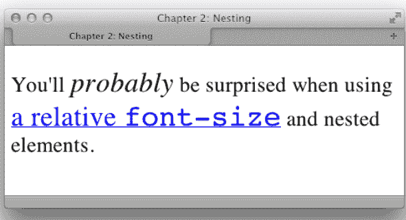

图 2.2. 相对字体大小

## 如何移除链接的下划线？

广泛接受的默认指示是，网页上的文本链接到另一个文档时，它带有下划线且显示的颜色与其他文本不同。然而，在某些情况下，你可能想要移除该下划线。

## 解决方案

我们使用 `text-decoration` 属性来移除链接文本的下划线。默认情况下，浏览器会将所有元素的 `text-decoration` 属性设置为下划线。要移除下划线，只需将链接的 `text-decoration` 属性设置为 `none`：

```css
text-decoration: none;
```

创建图 2.3 所示效果的 CSS 如下：

```css
chapter_02/textdecoration.css
a:link, a:visited {
  text-decoration: none;
}
```

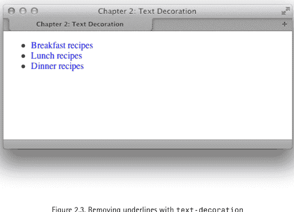

## 讨论

除了 `underline` 和 `none`，还有其他 `text-decoration` 的值可以让你尝试：

- `overline`（上划线）
- `line-through`（删除线）
- `blink`（闪烁）

可以组合这些值。例如，如果你希望在特定链接上同时显示下划线和上划线——如图 2.4 所示——你会使用此样式规则：

```css
a:link, a:visited {
  text-decoration: underline overline;
}
```

文本样式及其它基础知识 35

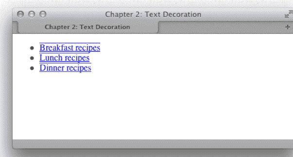

图 2.4. 带有下划线和上划线部分的链接

## 避免应用误导性的线条

你可以使用 `text-decoration` 属性为任何文本应用下划线，即使它是标准的下划线文本，但要小心这样做。链接的下划线被广泛接受，以至于用户往往认为任何带下划线的文本都是指向另一个文档的链接。

## 何时移除下划线是个坏主意？

链接下划线是所有浏览器遵循的标准规范，因此用户期望看到带有下划线的链接。在大文本区域内的链接移除下划线，会让人们很难意识到这些词实际上是链接，而不仅仅是高亮文本。我建议不要移除文本内链接的下划线。你有其他方法可以样式链接使其看起来具有吸引力，移除下划线很少、甚至没有必要。

作为菜单一部分的链接，或者出现在某些文本明显是链接的其他情况下——例如，文本通过 CSS 样式处理得像一个图形按钮——则是另一回事。如果你愿意，可以移除下划线……因为从它们的上下文来看，它们是什么应该是显而易见的。

## 如何创建一个在鼠标悬停时改变颜色的链接？

有一种迷人的链接效果，当鼠标移动到上方时会改变颜色或其他方式更改链接的外观。这种效果可以非常有效地应用于使用 CSS 创建的导航菜单，也可以用于普通段落文本中的链接。

## 解决方案

为了创建这种效果，我们需要对锚元素的 `:hover` 和 `:active` 动态伪类进行样式处理，使其与其他伪类有所不同。

让我们来看一个例子。这是一个典型的样式规则，它对锚元素的所有伪类应用相同的声明：

```css
a:link, a:visited, a:hover, a:active {
  text-decoration: underline;
  color: blue;
}
```

当应用此样式表时，你会发现如图 2.5 所示。

文本样式及其它基础知识 37


图 2.5. 样式化的链接

在设置伪类时，注意保持文本的大小或粗细（weight）不变。否则，你会发现它们的效果与你预期的不同。在下面的 CSS 中，我们为 `:hover` 和 `:active` 设置了不同的值。为了创建这种效果，我们需要对 `:hover` 和 `:active` 动态伪类进行样式处理，使其与其他伪类不同。

```css
chapter_02/textdecoration-v2.css
a:link, a:visited {
  text-decoration: underline;
  color: #6A5D;
  background-color: transparent;
}

a:hover, a:active {
  text-decoration: overline;
  color: #191970;
  background-color: #C9ED;
}
```

正如你可能意识到的，你可以单独设置 `:visited`。特别是，你可能对访问过的链接应用以下内容。

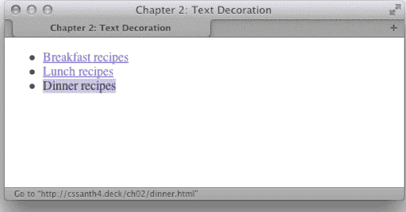

图 2.6. 鼠标悬停链接

## 伪类声明的顺序

锚元素的伪类应该按以下顺序排列：`:link`、`:visited`、`:hover`、`:active`，否则你可能会发现效果与你预期的不同。记住这个顺序的一种方法是使用助记词 `LoVeHAte`。

> 时尚警察
>
> 你对可以应用于 `:visited` 的样式是有限制的。² 这是因为浏览器知道你访问过哪些链接可能涉及隐私问题。如果访问过的样式在特定浏览器中不显示，可能是由于此原因。
>
> ² <http://hacks.mozilla.org/2010/03/privacy-related-changes-coming-to-visited/>

## 如何在页面上显示两种不同样式的链接？

之前的解决方案解释了如何对锚元素的不同选择器设置样式，但如果你想在同一个文档中使用不同的样式呢？也许你希望在导航菜单中显示不带下划线的链接，确保正文内容中的链接易于识别。或者你的文档部分区域具有深色背景，所以你在那里需要使用较浅的链接样式。

## CSS 选集

`chapter_02/linktypes.html`（节选）

```html
<div class="boxout">
<p>访问我们的<a href="#store">在线商店</a>，这里有许多你装备厨房所需的工具。</p>
</div>
```

我们需要创建一个样式规则，影响任何出现在类名为 `boxout` 的元素内部的链接：

`chapter_02/linktypes.css`（节选）

```css
.boxout {
color: #FFFFFF;
background-color: #6A5ACD;
}

.boxout a:link, .boxout a:visited {
text-decoration: underline;
color: #E4E2F6;
background-color: transparent;
}

.boxout a:hover, .boxout a:active {
background-color: #C9C3ED;
color: #191970;
text-decoration: none;
}
```

如图 2.7 所示，此规则将按照第一种样式显示文档中的所有链接，但对于出现在类名为 `boxout` 的 `div` 元素中的链接除外：这些链接将以较浅的颜色显示。

# 文本样式与其他基础

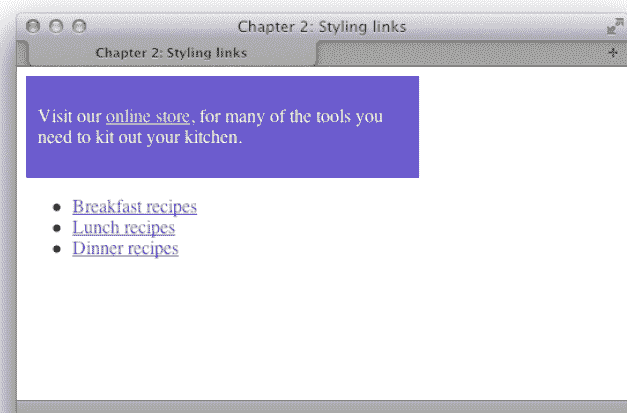

图 2.7. 在一个文档中使用两种链接样式

## 如何让列表中的第一个项目与其他项目具有不同的样式？

设计师经常发现，他们需要为一组项目中的第一个项目（无论是列表项目还是容器内的若干段落）设置与该组其他项目不同的样式。实现这一点的方法是为第一个项目分配一个类，然后对该类进行唯一的样式设置；然而，有一种更优雅的方法是使用伪类选择器 `first-child` 来创建这种效果。

## 解决方案

这是一个标记为无序列表的简单项目列表：

```html
chapter_02/firstchild.html (节选)
<<ul>
  <li>Brie</li>
  <li>Cheddar</li>
  <li>Red Leicester</li>
  <li>Shropshire Blue</li>
</ol>
```

为了不影响邻居元素的情况下更改列表中第一个项目的颜色，我们可以使用 `first-child` 选择器。这允许我们定位 `ul` 元素中的第一个元素，如图 2.8 所示：

```css
chapter_02/firstchild.css
li:first-child {
color: red;
}
```

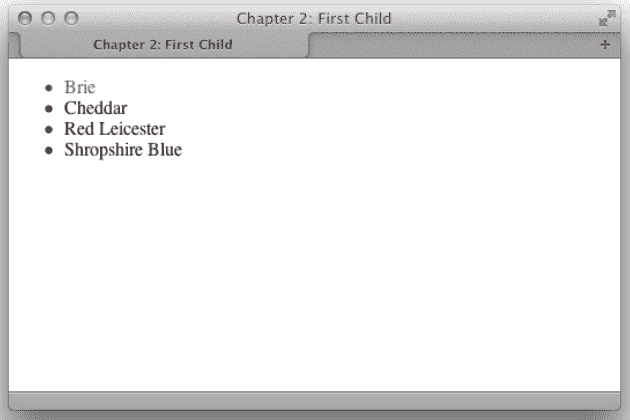

图 2.8. 以红色显示第一个列表项目

## 讨论

`first-child` 伪类选择器在浏览器中得到了很好的支持，因为它自 CSS2 规范以来一直存在。你可能可能关心的唯一浏览器是 IE6。请参考第 7 章关于如何管理这种不支持的建议。

## 如何为标题添加背景颜色？

CSS 允许我们为任何元素（包括标题）添加背景颜色。

## 解决方案

以下是为一级标题创建的 CSS 规则：

```css
h1 {
  background-color: #ADD8E6;
  color: #256579;
  font: 1.6em Verdana, Arial, sans-serif;
  padding: 0.2em;
}
```

结果如图 2.9 所示。

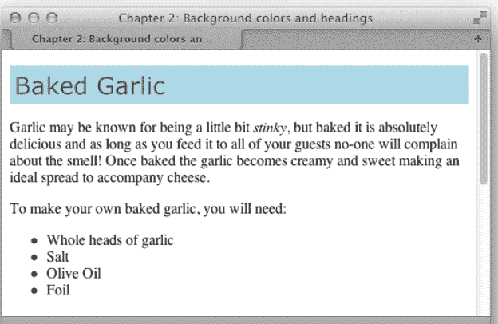

图 2.9. 带背景颜色的标题

### 为颜色留出空间

当你为标题添加背景时，你可能还想调整内边距（padding），以便标题文本与颜色区域边缘之间留有空间，正如示例中所做的那样。

## 如何设置带有下划线的标题？

使用 CSS，你有两种方式可以为文本添加下划线。

## 解决方案

添加下划线最简单的方法是使用我们之前在“如何移除链接的下划线？”章节中遇到的 `text-decoration` 属性。这种方法允许你应用与文本本身颜色相同的下划线，正如这段代码和图 2.10 所示：

```css
chapter_02/headingunderline.css (节选)
h1 {
  font: 1.6em Verdana, Arial, sans-serif;
  text-decoration: underline;
}
```

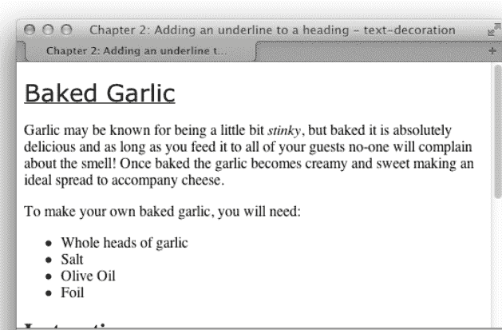

图 2.10. 使用 `text-decoration` 添加下划线

你也可以通过为标题添加底边框（bottom-border）来创建下划线效果。这种解决方案产生了图 2.11 所示的结果，它更加灵活，因为它允许你通过 `padding` 将下划线与标题隔开，并且你可以更改下划线的颜色使其与文本颜色不同。

具有这种效果的标题比使用 `text-decoration` 属性创建下划线的标题更不容易与下划线文本混淆。这里是你需要的样式规则：

```css
h1 {
  font: 1.6em Verdana, Arial, sans-serif;
  padding: 0.2em;
  border-bottom: 1px solid #AAAAAAA;
}
```

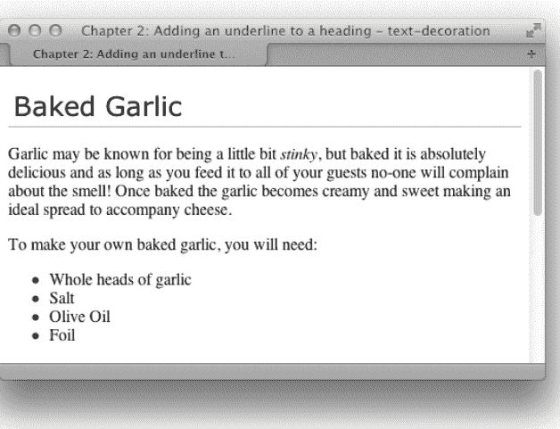

图 2.11. 使用底边框创建下划线

## 如何移除 `h1` 元素与后续段落之间的巨大间隙？

默认情况下，浏览器会在标题和段落元素之间渲染间隙。这种间隙是由浏览器应用于这些元素的默认边距（margin）产生的。图 2.12 中显示的标题边距反映了默认值。可以使用 CSS 移除此间隙。

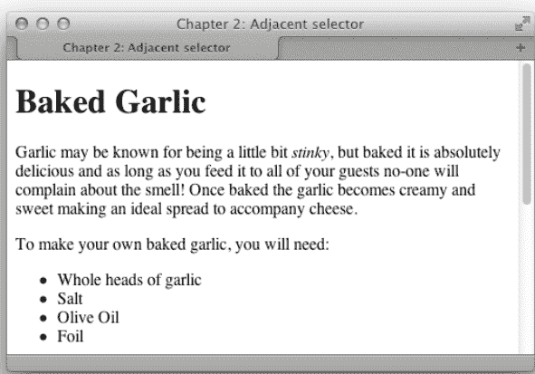

图 2.12. Safari 中默认的标题和段落间

## 解决方案

为了移除标题与其后续段落之间的所有空间，你必须移除标题的底部以及段落的上部。在现代浏览器（包括 Internet Explorer 7 及以上版本）中，我们可以使用 CSS 的相邻选择器来实现。然而，在旧版浏览器中实现相同的效果，我们需要回到其他支持的方法。

### 使用相邻选择器

相邻选择器允许你定位跟随另一个元素的元素，只要它们共享父元素。事实上，你可以使用相邻选择器来指定跟随多个元素而不仅仅是一个元素的元素。应用样式的元素始终是链中的最后一个元素。如果你感到困惑，请放心，一旦看到实际操作，这个概念就会变得清晰。

以下样式规则移除了紧跟在一级标题后的任何段落的上边距：

```css
h1 {
  font: 1.6em Verdana, Arial, sans-serif;
  margin-bottom: 0;
}

h1+p {
  margin-top: 0;
}
```

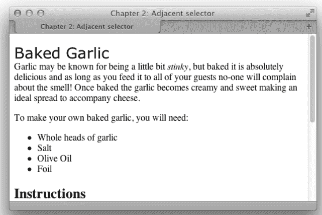

图 2.13. 使用相邻选择器更改标题显示

## CSS3 精选

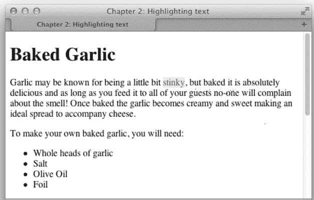

# 烤大蒜

大蒜可能因有一点臭味而闻名，但烤过绝对非常美味，只要你把它分给所有的客人们，没有人会抱怨这种味道的！烤过的大蒜变得像奶油一样香甜，是搭配奶酪的理想抹酱。

要制作自己的烤大蒜，你需要：

- *整头大蒜*
- 盐
- 橄榄油
- 锡纸

图 2.14. 使用类高亮文本

# 当仅为了演示时

只有当效果纯粹出于演示目的，且仅针对那些能在浏览器中看到文本的人时，你才以这种方式高亮文本。如果需要通过高亮来传达含义，请考虑使用 `em`（强调）或 `strong`，然后对 `em` 或 `strong` 元素进行样式。通过使用 `em` 或 `strong`，你会影响文档的含义。在那种高亮仅是为了好看且不需要额外语义元素的情况下，这里解释的技巧是最佳使用方法。

# 如何修改文本的行高（行距）？


CSS 相比于早期网页设计方法（如 `font` 标签）的巨大优势之一是，它让你对文本在页面上的显示方式具有更多的控制力。在解决方案中，我们将更改文档中文本的行距。

## 解决方案

如果页面上文本行之间的默认间距看起来有点窄，你可以用 `line-height` 属性来更改：

```css
p {
  font: 1em Verdana, Geneva, Arial, Helvetica, sans-serif;
  line-height: 2.2;
}
```

结果如图 2.15 所示。

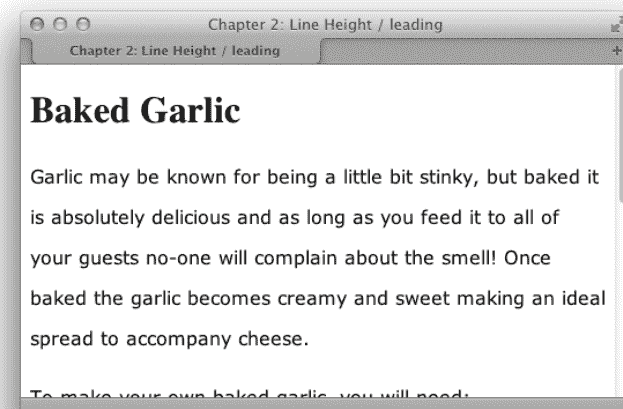

图 2.15. 使用 `line-height` 调整行距

只需注意不要过头，导致文本间距太大而难以阅读即可。

> 你会注意到在这个示例中我们没有指定任何测量单位；这是因为 2.2 的值是一个比率。你可以使用标准的 CSS 测量单位（如 `em` 或像素）为 `line-height` 指定值，但这会破坏子元素行高与字体大小之间的链接。例如，如果这个示例包含一个设置了较大字体大小的 `span`，行高将按比例缩放并保持相同的比率，因为段落的 `line-height` 被设置为数值 2.2。然而，如果 `line-height` 被设置为 2.2em 或 220%，则 `span` 将继承实际行高而不是比率，并且对 `span` 的行高产生影响。取决于你想要实现的效果，这实际上是一个理想的结果。

# 如何让文本两对齐？

当你对文本进行两对齐时，你改变了单词之间的间距，使左右边缘对齐。你可以使用 CSS 轻松地创建这种效果。

## 解决方案

你可以借助 `text-align` 属性对段落文本进行两对齐，如下：

```css
p {
  text-align: justify;
  font: 1em Verdana, Geneva, Arial, Helvetica, sans-serif;
  line-height: 2.2;
}
```

## 讨论

`text-align` 的其他值为：

- `right`：将文本对齐到容器右侧
- `left`：将文本对齐到容器左侧
- `center`：容器内居中文本

> **text-align 的语言**
>
> `text-align` 的默认值对于从左向右的语言（如英语和法语）为左，对于从右向左的语言（希伯来语或阿拉伯语）为右。如果没有设置 `text-align` 值，文本将根据查看网站的语言文本方向进行显示。如果你的网站必须支持双双文本文本，请注意对两种语言方向测试 `text-align`。

# 如何缩进文本？

要缩进文本，我们对其容器应用规则来设置 `padding-left` 值，例如：

```html
<p class="indent">大蒜可能因有一点臭
<span class="hilite">味</span></span>，但烤过绝对非常美味，只要你把它分给所有的客人们，没有人会抱怨这种味道的！烤过的大蒜变得像奶油一样香甜，是搭配奶酪的理想抹酱。</p>
```

这里是规则：

```css
.indent {
  padding-left: 1.5em;
}
```

你可以在图 2.17 中看到缩进的段落。

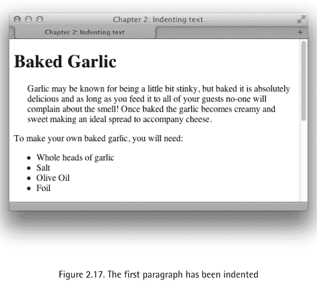

## 讨论

你应该避免使用 HTML `blockquote` 来缩进文本，除非它确实是一个引用。`blockquote` 标签用于表示引用其他来源的内容。对于缩进等布局目的，CSS `padding-left` 或 `margin-left` 是更合适的方法。

## CSS3 选集

你的客人们中没有人会对这种味道抱怨！烤好后，大蒜会变得顺滑且甜美，是搭配奶酪的理想涂酱。

```css
h1 + p:first-letter {
  font-size: 200%;
  font-weight: bold;
  float: left;
  width: 1em;
  line-height: 1;
}
```

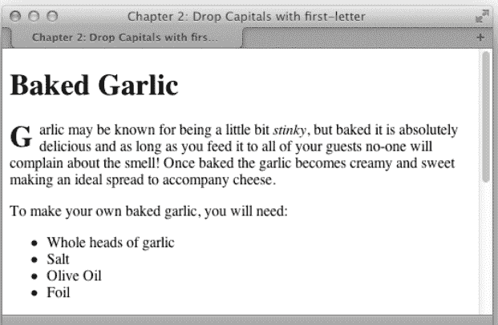

图 2.22. 简单的首字母效果

## 讨论

这是一个演示伪类选择器 `first-letter` 用法的基础示例。我还使用了一个相邻选择器来仅针对紧跟在 `h1` 之后的那个段落；如果不这样做，每个段落的首字母都会变成大写。由于浏览器对 `line-height` 的解释方式不同，结果可能会有一点不一致，因此你需要进行一些实验以获得理想的效果。

SitePoint 网站上有一篇 James Edwards 写的有用文章，详细讨论了创建首字母大写效果。

## 如何为我的文本添加阴影？

阴影可以用于添加微小的投影，无论是为了柔和地突出文本，还是为了实现更戏剧的阴影效果。

## 解决方案

`text-shadow` 属性允许你为文本添加阴影——从微妙到完全疯狂：

| `chapter_02/textshadow.html`（节选） |
| --- |
| `<h1>烤大蒜</h1>` |
| `<p>大蒜可能因为闻起来有点<em>臭</em>而闻名，但烤过非常美味，只要你把它给客人没有人会对味道抱怨！烤好后它会变得顺滑甜美，是搭配奶酪的理想涂酱。</p>` |
| `chapter_02/textshadow.css` |
| --- |
| `h1 {`<br>`  font-size: 250%;`<br>`  color: #256579;`<br>`  text-shadow: 3px 3px 3px #999;`<br>`}` |

³ http://www.sitepoint.com/a-simple-css-drop-cap/

## 讨论

`text-shadow` 属性的语法非常简单：

```css
text-shadow: 5px 5px 5px #999;
```

第一个值是距离文本的水平距离；第二个是垂直距离；第三个是阴影的模糊半径或扩散；最后一个值是颜色。查看 `text-shadow` 如何工作的最简单方法是创建一个标题——这样你可以清楚看到变化——然后尝试不同的值。你还可以尝试 `text-shadow` 和许多其他 CSS3 属性。

> **阴影之外**
>
> 给文本添加阴影时，请确保你的文本仍然清晰。我发现为按钮和大型标题添加效果时 `text-shadow` 最有用，但大量的正文应用阴影可能会阅读。遗憾的是，`text-shadow` 属性在 Internet Explorer（包括版本 9）中不支持。我们将在第 7 章进一步讨论这一点。

⁴ http://css3generator.com/

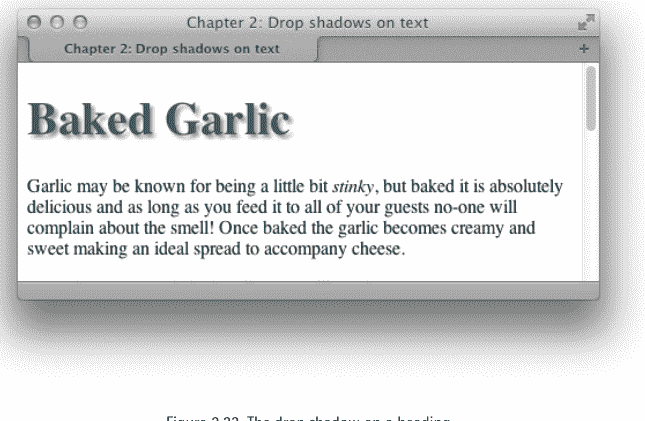

## 如何更改或移除列表项的符号？

## 解决方案

你可以通过更改 `list-style-type` 属性来更改无序列表显示的符号样式。首先，这是列表的标记：

`chapter_02/listtype.html`（节选）

```html
<ul>
  <li>Brie</li>
  <li>Cheddar</li>
  <li>Red Leicester</li>
  <li>Shropshire Blue</li>
</ul>
```

要像图 2.24 那样显示正方形符号，将 `list-style-type` 属性设置为 `square`：

`chapter_02/listtype.css`

```css
ul {
  list-style-type: square;
}
```

## 讨论

`list-style-type` 属性可以取的值还包括 `disc`、`circle`、`decimal-leading-zero`、`decimal`、`lower-roman`、`upper-roman`、`lower-alpha`、`upper-alpha` 和 `none`。你会发现某些浏览器不支持某些值；不支持特定符号的浏览器将显示默认符号。你可以在 CSS list-style-type 测试件中查看不同的类型并检查浏览器对它们的支持情况。将 `list-style-type` 设置为 `none` 会移除符号，尽管列表仍像有符号时那样缩进，如图 2.25 所示：

```css
ul {
  list-style-type: none;
}
```

⁵ http://meyerweb.com/eric/css/tests/css-2a.htm

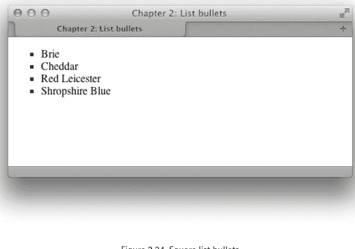

# 文本样式和其他基础

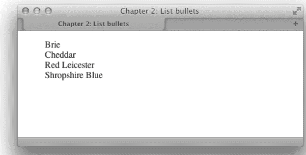

图 2.25. 无列表符号

## 如何使用图像作为列表符号？

## 解决方案

创建你的图像，然后使用 `list-style-image` 属性设置符号而不是 `list-style-type`。该属性接受 URL，可以包含你的图像文件路径，如下：

```css
ul {
  list-style-image: url(bullet.gif);
}
```

图 2.26 显示了如何使用这种效果来美化列表。

## CSS3 选集

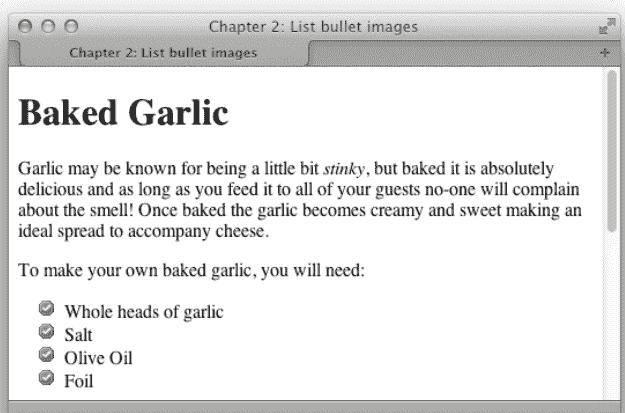

## 为单个项目设置符号

`list-style-image` 属性应用于列表中的列表项（`li`）元素。如果你对整个列表（`ul` 或 `ol` 元素）应用 `list-style-image`，每个单独的列表项将继承它。不过，你可以通过为每个项目分配类或 ID 来在单个项目上设置该属性，为项目提供它们独特的图像。

如果将符号转换为图像无法达到预期结果，你的其他选择是使用背景图像，我们将在第 3 章中讨论。

## 如何移除列表的缩进左边距？

如果你已将 `list-style-type` 设置为 `none`，你可能还想移除或减少浏览器为列表设置的默认左边距。

## 解决方案

要完全移除缩进并让列表左对齐，使其与前面的段落对齐如图所示，请使用类似的样式规则：

```css
ul {
  list-style-type: none;
  padding-left: 0;
  margin-left: 0;
}
```

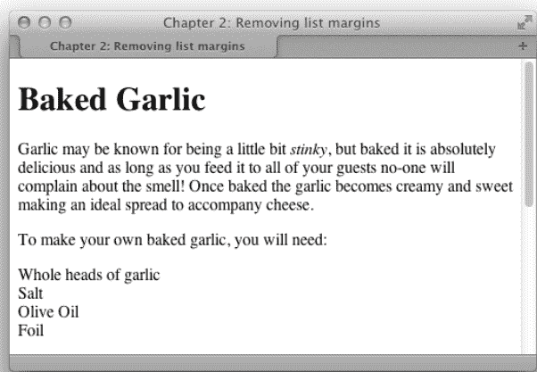

图 2.27. 移除列表符号

## 讨论

你可以根据需要对列表项应用新的缩进值。要让内容缩进几像素，尝试：

```css
ul {
  list-style-type: none;
  padding-left: 5px;
  margin-left: 0;
}
```

## 如何水平显示列表？

默认情况下，列表项是块级元素；因此每个新项目都会起一行。然而，页面上的某些内容在结构上是列表，尽管你希望以其他方式显示——一组导航链接就是一个很好的例子。如何水平显示这些列表项？

## 解决方案

通过将 `li` 元素的 `display` 属性更改为 `inline` 来设置水平列表，如下：

```html
<ul class="nav">
  <li><a href="#breakfast">早餐食谱</a></li>
  <li><a href="#lunch">午餐食谱</a></li>
  <li><a href="#dinner">晚餐食谱</a></li>
</ul>
```

```css
ul.nav li {
  display: inline;
}
```

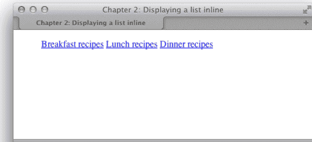

图 2.28. 内联显示的列表

## 如何移除页面边距？

大多数浏览器的默认样式会在浏览器与页面内容之间添加边距或内边距；这样无样式的文本会在窗口边缘结束。你可能希望移除这个间隙或指定其大小，而不是交给浏览器。

## 解决方案

要移除内容周围的所有边距和内边距，请使用定义为 `body` 元素的样式规则：

```css
body {
  margin: 0;
  padding: 0;
}
```

结果如图 2.29 所示。

## CSS3 选集

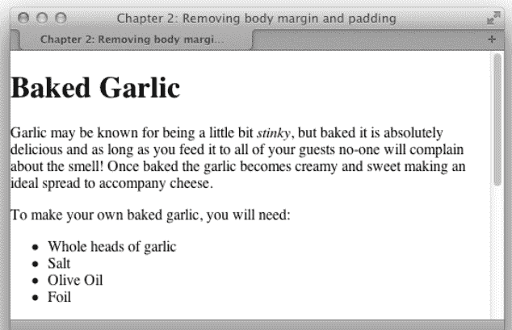

图 2.29. 默认页面内边距和外边距已移除

# 文本样式与其他基础知识 71

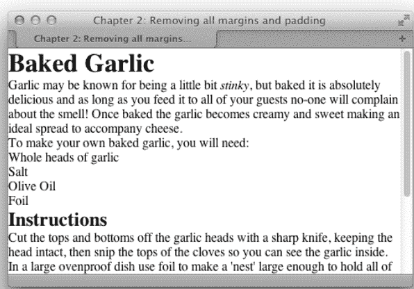

图 2.30. 使用通用选择器移除所有元素的内边距（`padding`）和外边距（`margins`）

```css
* {
  margin: 0;
  padding: 0
}
```

## 讨论

这条样式规则使用了通用选择器——也称为星号（`*`）——来移除所有内容的外边距和内边距，这种技术被称为执行全局空白重置。如果你正在处理一个特别复杂的设计，这可能是最好的开始方式。

但一旦你执行了此操作，你就返回并为你使用的每个元素添加外边距和内边距。这对于某些表单元素尤为重要，因为这种样式规则可能会导致它们无法使用。

对于较简单的设计，移除每个元素的空白通常是多此一举，而且只会增加额外的工作；你需要回去为段落、块引用和列表等元素添加内边距和外边距。一种可行的替代方案是仅对一组特定的元素移除外边距和内边距。下面的样式规则展示了这种方法，移除了标题和列表元素的空白：

```css
h1, h2, h3, h4, h5, h6, ul, ol {
  margin: 0;
  padding: 0;
}
```

Web 开发社区对于 CSS 重置（CSS Resets）是否是一个好主意已经有了很多讨论。就个人而言，我不使用它们，而是倾向于根据项目需求执行与我们看到的类似的方法。如果你发现它们很有用，我建议查看 Eric Meyer 的 CSS Reset⁶，作为一个可靠的起点。

⁶ http://meyerweb.com/eric/tools/css/reset/

# 我如何使用大多数用户电脑上未安装的字体？

当我们在本章开始讨论 `font-family` 时，我提到选择字体时必须小心，因为只有少数字体可以安全地认为存在大多数用户的电脑上。然而，CSS 也提供了一种使用其他字体的方法，即通过从服务器加载字体文件。

## 解决方案

理论上，我们可以使用 `font-face` 属性导入一个新字体：

```css
@font-face {
  font-family: KaffesatzBold;
  src: url(YanoneKaffesatz-Bold.ttf);
}
h1 {
  font-family: KaffesatzBold, sans-serif;
  font-weight: normal;
}
```

`@font-face` 规则声明了字体的名称，它允许你通过 `src` 属性加载位于服务器上的字体文件。然后你就可以像使用任何其他字体一样，在 `font-family` 列表中使用此字体。

## 讨论

目前使用 `@font-face` 有两个问题。第一个是没有单一字体格式可以被所有浏览器和操作系统支持；因此，导入字体比像上一个示例那样加载单个文件要复杂一些。

第二个问题是许可问题。你在自己的电脑上的 Photoshop 中使用的许多字体，并没有获得许可上传到 Web 服务器并以这种方式提供，因为其他人也可以下载字体文件本身——就像你可以下载在网站上使用的图像一样。

# 你上传到服务器的字体的浏览器兼容性

如果你有一个授权在 Web 上使用的字体，你的主要问题是生成覆盖所有浏览器和操作系统的字体包。这样做最简单的方法是使用可以生成字体集的网站之一；我喜欢使用 Font Squirrel⁷。除了拥有可以在 Web 上使用的字体库外，该网站还有一个 `@font-face` 生成器，它可以根据你上传的字体创建你的字体集。上传你的字体，然后你就可以下载包含各种字体类型的包，以及将它们包含在网站中所需的 CSS 规则：

> `chapter_02/fontface.css`（节选）

```css
@font-face {
  font-family: 'YanonekaeesBold';
  src: url('yanonekaeesatz-bold-webfont.eot');
  src: url('yanonekaeesatz-bold-webfont.eot?#iefix')
       format('embedded-opentype'),
       url('yanonekaeesatz-bold.woff') format('woff'),
       url('yanonekaeesatz-bold-webfont.ttf') format('truetype'),
       url('yanonekaeesatz-bold-webfont.svg#YanonekaeesatzBold')
       format('svg');
  font-weight: normal;
  font-style: normal;
}
```

⁷ http://www.fontsquirrel.com/fontface/generator

将该规则添加到你的 CSS 中，然后你就可以像往常一样使用这种字体。确保你在部署网站时记得上传字体文件。

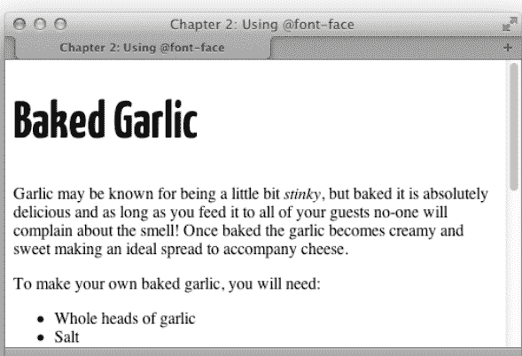

图 2.31. 使用 Font Squirrel 生成的自定义字体包

# 如果你的字体没有 Web 使用许可

如果你的字体没有此类用途的许可，你可以在 Font Squirrel 等网站上搜索相似的字体，或者。

## CSS3 精选


```html
<ul class="album">
  <li></li>
  <li></li>
</ul>
```

这种方法可以避免你为容器内的每张图像单独添加类名。

## 如何使用 CSS 移除导航图像周围的蓝色边框？

如果你在网站的导航链接中使用图像，你可能会在某些浏览器中看到难观的蓝色边框，就像文本链接上的下划线一样。如何使用 CSS 移除它呢？

## 解决方案

就像你可以创建边框一样，也可以移除它。添加一条 `border` 属性设置为 `none` 的规则即可移除这些边框：

```css
chapter_03/bordernone.css (excerpt)
img {
  border: none;
}
```

## 如何使用 CSS 为页面设置背景？

CSS 属性允许你为页面设置背景颜色、背景图像或两者兼有。

## 解决方案

以下规则为页面的 `body` 元素添加了背景颜色和背景图像。然后我们给 `div`（类名为 `wrapper`）设置了白色背景颜色，但没有背景图像：

```css
chapter_03/background.css (excerpt)
body {
  background-color: #333;
  background-image: url(brushed_alu_dark.png);
  color: #fff;
  margin: 0;
  padding: 0;
  font: 0.75em/1.3 "Lucida Grande", "Lucida Sans Unicode",
  "Lucida Sans", Tahoma, sans-serif;
}

.wrapper {
  width: 80%;
  margin: 20px auto 40px;
  background-color: #fff;
  color: #333;
}
```

在图 3.3 中你可以看到它的效果。

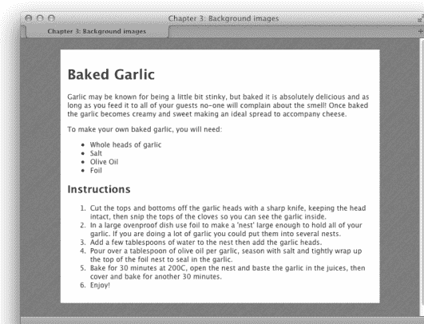

图 3.3. 使用背景图像和颜色

## CSS3 精选

## 讨论

`background-color` 属性简单地为应用的页面或元素添加颜色。我使用 `background-color` 将 `body` 设置为深灰色（以防图像因某些原因加载失败），然后将 `wrapper` `div` 设置为白色。如果 `wrapper` 没有背景颜色，`body` 上的背景图像就会透出来。

`background-image` 属性允许你指定一个要加载并显示为背景图像的图像。在这种情况下，我们希望将其作为整个页面的背景图像，因此将其用于 `body` 标签。你可以在大多数元素上使用背景图像，正如你在本章稍后的示例中看到的。

默认情况下，背景会平铺。在这个示例中，我从一个提供免费图案的网站¹下载了 `brushed_alu_dark.png` 图片，这是一个小图案。浏览器会重复该平铺以填充元素中的可用空间。

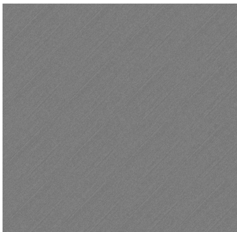

图 3.4. 背景平铺

> ¹ http://subtlepatterns.com

## 如何控制背景图像的重复方式？

## 解决方案

为了防止背景完全重复，我们将使用关键字 `no-repeat`：

```css
background-repeat: no-repeat;
```

这意味着我们看到的唯一背景图像将左上角的一个正方形平铺，如图 3.5 所示。

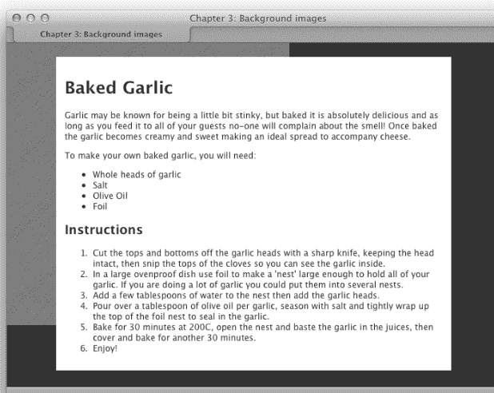

图 3.5. 平铺被设置为 `no-repeat`

如果我们只想沿 x 轴平铺（如图 3.6 所示），可以使用以下代码：

```css
background-repeat: repeat-x;
```

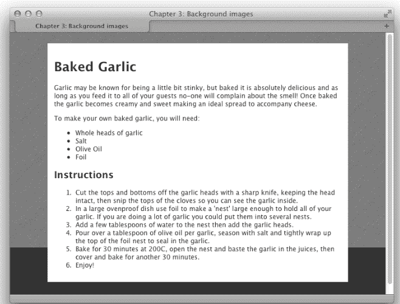

图 3.6. 图像沿 x 轴平铺

你现在可能已经意识到，我们也可以通过以下代码沿 y 轴平铺：

```css
background-repeat: repeat-y;
```

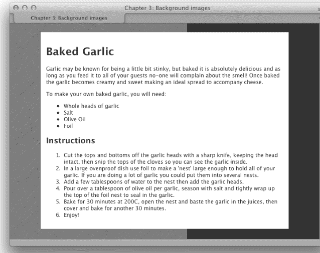

# 烤大蒜

大蒜可能以带有微味而闻名，但烤过之后绝对美味，只要你把它喂给所有的客人，就没人会抱怨气味的！烤过的大蒜会变得咸鲜而甜美，是搭配奶酪的理想抹酱。

制作你的烤大蒜，你需要：

- 整头大蒜

- 盐

- 橄榄油

- 锡纸

### 步骤

1. 用锋利的刀切掉大蒜头的顶部和底部，保持蒜头完整。

2. 淋上橄榄油并撒盐调味。

3. 用锡纸单独包裹每一头大蒜。

4. 在烤箱中以 400°F (200°C) 烤 45-60 分钟，直到大蒜变软。

5. 趁热搭配面包或奶酪食用。

`font: 0.75em/1.3 "Lucida Grande", "Lucida Sans Unicode", "Lucida Sans", Verdana, Tahoma, sans-serif;`

这在图 3.9 中得到了体现，但为了真正看到动态效果，我建议您在浏览器中加载此代码示例。

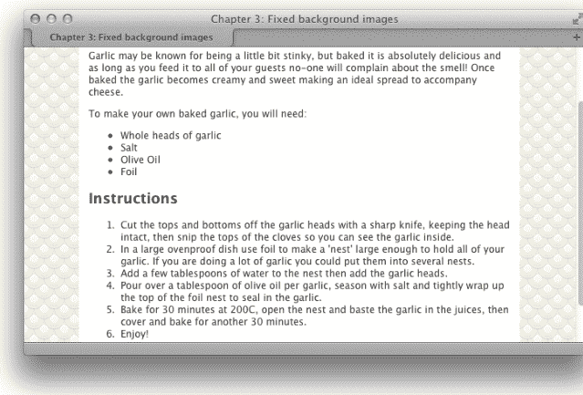

图 3.9. 固定背景图像，内容在其上方滚动

## 讨论

`background-attachment` 属性的 `fixed` 值在 Internet Explorer 6 中不支持。幸运的是它的降级处理良好——背景图像将随页面滚动。

在这一解决方案中，我们使用了多个 CSS 属性将图像添加到背景、进行定位，并规定它在文档滚动时的行为。

或者，我们可以使用简写方法来提供这些信息——CSS `background` 属性。该属性允许你在一个属性声明中声明 `background-color`、`background-image`、`background-repeat`、`background-attachment` 和 `background-position`。例如，这条 CSS 规则：

```css
body {
  background-color: #fff;
  background-image: url(gold_scale.png);
  background-attachment: fixed;
  background-repeat: repeat-x;
  background-position: 0 0;
}
```

这些声明可以更简洁地写如下：

```css
body {
  background: #fff url(gold_scale.png) repeat-x fixed 0 0;
}
```

## 我可以在任何元素上设置背景图像吗？

到本章为止，我们查看了用于页面 `body` 元素的背景图像；然而，背景图像也可以用于大多数其他元素。

## 解决方案

理解如何将图像作为背景图像是非常重要的，因为在设计 Web 时，你需要经常这样做。

图 3.10 使用了多个背景图像。

## 图像和其他设计元素

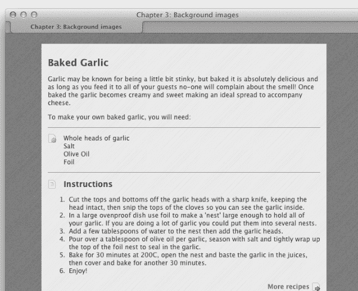

图 3.10. 应用于多个元素上的背景图像

首先，`wrapper` `div` 有一个背景图像，它是页面背景的浅色。它沿着 x 和 y 轴重复以覆盖该区域：

```css
chapter_03/background2.css (excerpt)
.wrapper {
  width: 80%;
  margin: 20px auto 40px;
  background-color: #fff;
  color: #333;
  background-image: url(brushed-alu.png);
}
```

我在“配料”列表和“说明”部分的标题中都添加了图标。对于列表，我们为 `ul` 元素添加背景图像：

```css
ul.ingredients {
  border-top: 1px solid #999;
  border-bottom: 1px solid #999;
  list-style: none;
  margin: 1em 0 1em 0;
  padding: 1em 0 1em 30px;
  background-image: url(ingredients.png);
  background-repeat: no-repeat;
  background-position: 0 1em;
}
```

如你所见，有一个 `1em` 的值用于设置图标距离容器顶部的距离。这意味着它与文本对齐，因为列表也应用了 `1em` 的顶部内边距（`padding`）。然后我为 `h2` 标题添加了图标：

```css
h2.instructions {
  background-image: url(instructions.png);
  background-repeat: no-repeat;
  background-position: left center;
}
```

对于这两个图标，我都使用了 `30px` 的左侧内边距（`padding`），以便列表和标题远离容器边缘，且不重叠背景图像。最后，我在页面底部的链接添加了一个图标，以便查看更多食谱：

```css
a.more:link, a.more:visited {
  display: block;
  padding: 0.3em 20px 0.3em;
  text-align: right;
  color: #666;
  font-weight: bold;
  background-image: url(arrow.png);
  background-position: right center;
  background-repeat: no-repeat;
  text-decoration: none;
}
```

## 讨论

使用背景图像是 Web 设计的核心部分，但你如何知道一个图像应该是背景图像，还是应该作为普通图像位于页面中？我的准则是：该图像对文档的其他部分是否有意义？如果是，将其作为普通图像嵌入，并为无法查看的用户包含相应的 `alt` 文本。作为背景图像添加的没有 `alt` 文本，因此对屏幕阅读器是不可见的。将背景图像留给纯美学元素。在创建布局的移动版本时，你可能会省略或替换这些内容。拥有背景图像会让这项任务变得更容易。

## 我如何创建渐变？

在整个页面、框或其他元素上需要线性渐变作为背景。

## 解决方案

CSS3 的方法是使用 `background-image` 属性并将线性渐变作为该属性的值：

```css
chapter_03/gradient.css (excerpt)
html {
  height: 100%;
}
body {
  height: 100%;
  background-attachment: fixed;
  background-color: #666;
  background-image: -webkit-gradient(linear, 0% 0%, 100%, from(#000), to(#666));
  background-image: -webkit-linear-gradient(top, #000, #666);
  background-image: -moz-linear-gradient(top, #000, #666);
  background-image: -ms-linear-gradient(top, #000, #666);
  background-image: -o-linear-gradient(top, #000, #666);
  background-image: linear-gradient(top, #000, #666);
  color: #fff;
  margin: 0;
  padding: 0;
  font: 0.75em/1.3 "Lucida Grande", "Lucida Sans Unicode", "Lucida Sans", Tahoma, sans-serif;
}
```

这产生了图 3.11 所示的效果。

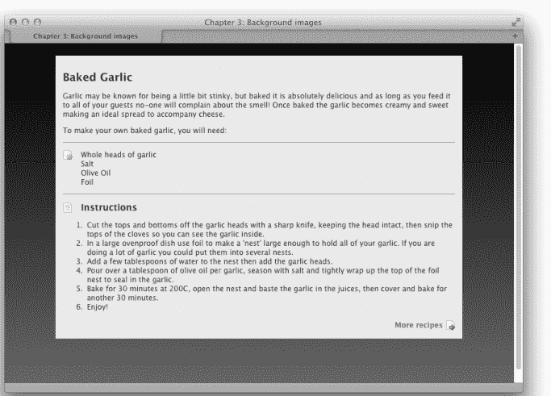

图 3.11. 使用 CSS 的背景渐变

## 讨论

根据 CSS3 规范，值应该是：

```css
background-image: linear-gradient(top, #000, #666);
```

从解决方案中可以看出，我们需要使用第 1 章提到的各种浏览器语法和相关的特定扩展来重复此行。这种技术在除 Internet Explorer 外的所有现代浏览器中均有效。我包含了 Internet Explorer 不支持的情况，是因为有一个可能会使用此渐变的环境：当你为智能手机、平板电脑或其他移动设备开发时。避免这些设备下载大文件图像而改用 CSS 是非常有用的。它可以帮助用户避免网络延迟、带宽限制和昂贵的流量等限制。我们将在第 7 章进一步讨论。

那么，如果你需要可以在 Internet Explorer 中运行的渐变，该怎么办？我的建议是使用图像。创建一个像素宽的从黑色到 `#333333` 的渐变图像，并将其保存为 `gradient.png`。然后使用以下 CSS 沿 `body` 元素的 x 轴重复渐变图像，创建渐变背景：

```css
chapter_03/gradient2.css (excerpt)
body {
  background-color: #666;
  background-image: url(gradient.png);
  background-repeat: repeat-x;
  color: #fff;
  margin: 0;
  padding: 0;
  font: 0.75em/1.3 "Lucida Grande", "Lucida Sans Unicode", "Lucida Sans", Tahoma, sans-serif;
}
```

记得将你的背景颜色设置为与渐变结束时相同的颜色，这样即使图像停止，颜色也会继续。

## 结合两种方法

正如 Chris Coyier 在文章《Speed Up with CSS Gradients》² 所描述的，可以结合使用 CSS 渐变和回退图像。只需先加载图像，然后添加渐变——基本上是结合了概述的两种技术：

```css
html {
  height: 100%;
}

body {
  height: 100%;
  background-attachment: fixed;
  background-color: #666;
  background-image: url(gradient.png);
  background-repeat: repeat-x;
  background-image: -webkit-gradient(linear, 0% 0%, 100%, from(#000), to(#666));
  background-image: -moz-linear-gradient(top, #000, #666);
  background-image: -ms-linear-gradient(top, #000, #666);
  background-image: -o-linear-gradient(top, #000, #666);
  background-image: linear-gradient(top, #000, #666);
  color: #fff;
  margin: 0;
  padding: 0;
  font: 0.75em/1.3 "Lucida Grande", "Lucida Sans Unicode", "Lucida Sans", Tahoma, sans-serif;
}
```

> ² http://css-tricks.com/5700-css3-gradients/

# 图片与其他设计元素

这是一部分关于渐变的简单介绍。为了查看 CSS3 渐变有多么灵活，并学习一些可以即插用到你的 CSS 中的规则，请尝试使用[渐变编辑器（Gradient Editor）]³

# 关于渐变的最后一个提示

即使你需要为你的渐变创建图像以获得更好的浏览器支持，在设计网站时，理解 CSS 渐变也会非常有帮助。与其在专门的图像编辑软件中创建渐变、保存文件并在浏览器中尝试——只需更改样式表中的值。然后你就可以创建最终的渐变并将其添加，从而节省大量时间！

# 我可以创建一个随浏览器窗口缩放的背景图像吗？

一种流行的效果是在网站背景中使用全尺寸图像并根据浏览器窗口的大小进行缩放。这是实现的？

## 解决方案

要创建可扩展的背景图像，你需要使用值为 `cover` 的 `background-size` 属性：

```css
chapter_03/backgroundscalable.css (节选)
html {
  background-image: url(ballet-background.jpg);
  background-repeat: no-repeat;
  background-position: center center;
  background-attachment: fixed;
  -webkit-background-size: cover;
  -moz-background-size: cover;
  -o-background-size: cover;
  background-size: cover;
  color: #fff;
  background-color: #000;
}
```

³ http://www.colorzilla.com/gradient-editor/

## CSS3 精选

这将创建图 3.12 和图 3.13 所示的效果，无论窗口是大是小，图像仍然填满整个浏览器窗口。


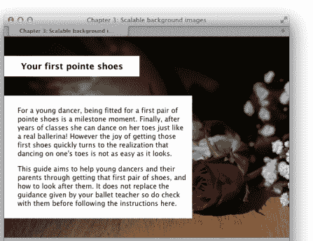

图 3.12. 小浏览器窗口中的图像……

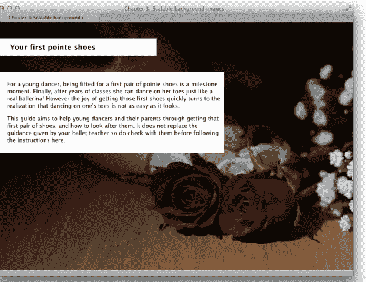

图 3.13. ……以及大浏览器窗口中

## 讨论

这种技术在当前浏览器中有效，包括 Internet Explorer 9。不支持该属性的浏览器将居中显示背景图像，但不会进行缩小或放大。取决于你的网站和选择的图像，这通常是可以接受的。关于在较早浏览器中实现此效果的一系列更复杂的方法，你可以阅读 CSS-Tricks 网站上 Chris Coyier 关于该主题的文章。

可扩展背景图像最大的问题是它在大尺寸下良好渲染所需的最小尺寸。请注意你的图像选择以及如何优化图像，以避免你的用户需要下载巨大的文件。

# 我如何向元素添加多个背景图像？

CSS2 只允许为元素应用一个背景图像。然而，在 CSS3 中，你可以添加多个背景图像。

## 解决方案

使用我们之前讨论的 `background` 属性，我们可以简单地为 `background` 属性添加背景图像列表和定位信息（每个图像用逗号隔开）：

```css
.box {
  height: 200px;
  width: 200px;
  border: 3px solid #333;
  background: url(gear.png) top right no-repeat,
  url(gear2.png) top left no-repeat,
  url(gear3.png) bottom left no-repeat,
  url(gear4.png) bottom right no-repeat;
}
```

这将显示如图 3.14 所示，其中每个齿轮图像都是背景图像。

## CSS3 精选

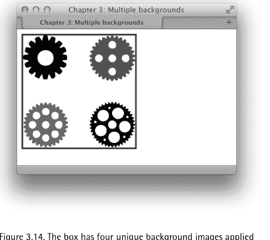

## 讨论

如所述，所有主流浏览器现在都支持多个背景图像，包括 Internet Explorer 9；但请注意，在不支持多背景的较早浏览器中，浏览器将忽略整个规则。我们将在第 7 章讨论你可能处理这种情况的方法。

值得注意的是，图像的顺序很重要。你声明的第一张图像将显示在堆栈顶端，最后一张在底部。我们可以通过向我们的框添加背景纹理来查看它是如何工作的。如果我将背景纹理作为第一张图像，它将平铺在齿轮图像之上，因此我们无法看到它们，如图 3.15 所示：

```css
.box {
  height: 200px;
  width: 200px;
  border: 3px solid #333;
  background: url(brushed_alu.png),
  url(gear.png) top right no-repeat,
  url(gear2.png) top left no-repeat,
  url(gear3.png) bottom left no-repeat,
  url(gear4.png) bottom right no-repeat;
}
```

# 图片与其他设计元素 101

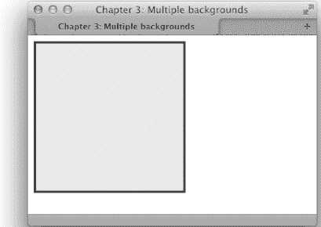

图 3.15. `brushed_alu.png` 图像平铺在齿轮图像之上

如果我们相反将其作为最后一张图像，它将作为背景显示在齿轮图像下方，如图 3.16 所示：

```css
chapter_03/backgroundmultiple.css

box {
  height: 200px;
  width: 200px;
  border: 3px solid #333;
  background: url(gear.png) top right no-repeat,
  url(gear2.png) top left no-repeat,
  url(gear3.png) bottom left no-repeat,
  url(gear4.png) bottom right no-repeat,
  url(brushed_alu.png);
}
```

# 102 CSS3 精选

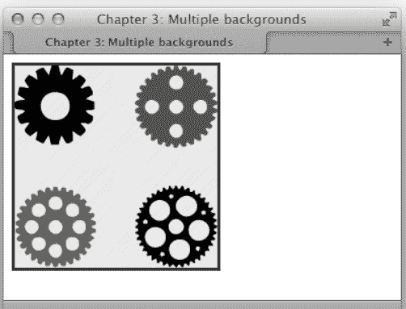

图 3.16. 背景纹理现在显示在齿轮下方

# 我如何让元素透明以便显示背景？

使用 `opacity` 可以为你的设计添加细微的效果。直到最近，跨浏览器这样做很难，并且需要使用带有 alpha 通道的 PNG 图像（像素级透明度）；但我们现在可以通过 CSS 实现透明度。

## 解决方案

我将演示两种让元素透明的方法。第一种是使用 `opacity` 属性。它取 0 到 1 之间的值，0 是完全透明，1 是不透明：

```css
h1 {
  width: 40%;
  padding: 0.6em 0.6em 0.6em 2em;
  margin: 40px 0 0;
  font-size: 127.6%;
  background-color: #fff;
  color: #000;
  opacity: 0.5;
}

content {
  width: 60%;
  padding: 0.6em 0.6em 0.6em 2em;
  margin: 40px 0 0;
  background-color: #fff;
  color: #000;
  opacity: 0.5;
}
```

使用这种方法的效果可见图 3.17。

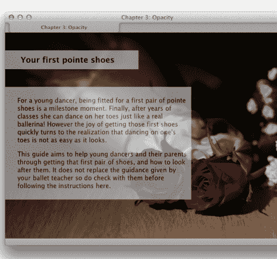

图 3.17. 两个框都是透明

## CSS3 精选

第二种方法是在指定框的 `background-color` 值时使用 `RGBA`。你可能已经熟悉使用 RGB 设置颜色或背景颜色。例如，为了使背景变为白色，我们将使用：

```css
background-color: rgb(255,255,255);
```

RGBA 为列表添加了第四个值——RGBA 中的 `A` 代表 Alpha（透明度）。我们可以用它设置颜色的透明度，如示例所示：

```css
h1 {
  width: 40%;
  padding: 0.6em 0.6em 0.6em 2em;
  margin: 40px 0 0;
  font-size: 127.6%;
  background-color: rgba(255,255,255,0.5);
  color: #000;
}

content {
  width: 60%;
  padding: 0.6em 0.6em 0.6em 2em;
  margin: 40px 0 0;
  background-color: rgba(255,255,255,0.5);
  color: #000;
}
```

第二种方法的效果在图 3.18 中所示。

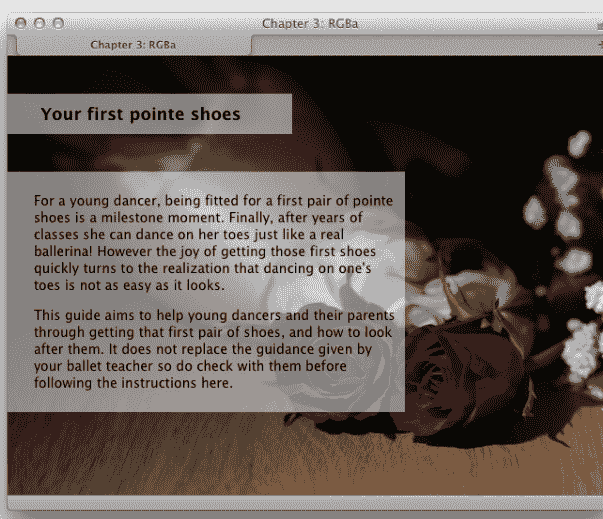

图 3.18. 使用 RGBA 使背景颜色透明

## 讨论

虽然两种方法都很简单，但主要的区别在于，当你使用 `opacity` 时，你会让整个框及其所有内容（设置了 `opacity` 的元素的子元素）都透明。当使用 `RGBA` 时，只有你指定的颜色受规则影响。例如，我在图 3.19 中将标题的前景色和背景颜色都设为白色。通过使用 `opacity`，文本同时变得透明，因此背景保持隐藏：

```css
h1 {
  width: 40%;
  padding: 0.6em 0.6em 0.6em 2em;
  margin: 40px 0 0;
  font-size: 127.6%;
  background-color: #fff;
}
```

## CSS3 精选

```css
color: #fff;
opacity: 0.3;
```

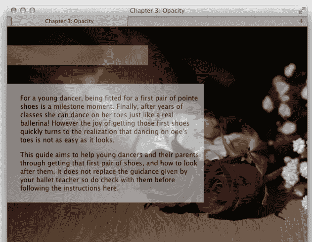

图 3.19. 使用 `opacity` 在白色背景上隐藏白色文字

另一种方法是使用 RGBA 使背景透明，如图 3.20 所示。因此，文本从背景中出现，因为它不继承 `opacity` 设置。

```css
h1 {
  width: 40%;
  padding: 0.6em 0.6em 0.6em 2em;
  margin: 40px 0 0;
  font-size: 127.6%;
  background-color: rgba(255,255,255,0.3);
  color: #fff;
}
```

## 图像和其他设计元素

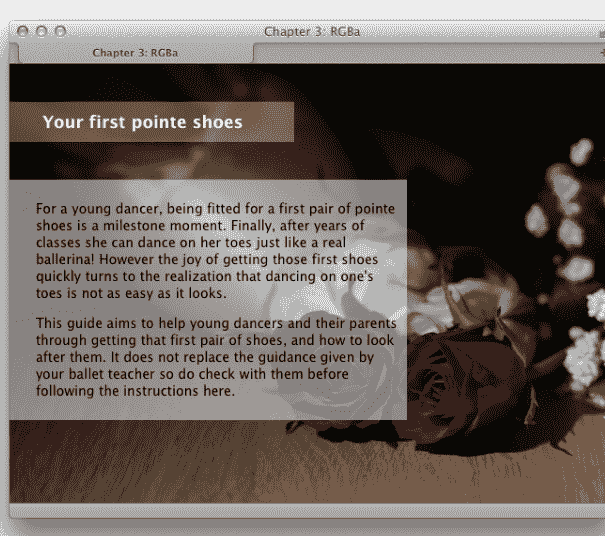

图 3.20. 在背景上使用 RGBA，文本保持不透明，因此可见

所有现代浏览器（包括 Internet Explorer 9 在内）都支持 `opacity` 属性和 RGBA。不支持该属性的旧浏览器将忽略 `opacity` 属性。如果你使用 RGBA，还应该在 RGBA 声明之前使用 RGB 或十六进制值提供一个回退颜色。不理解 RGBA 的浏览器将使用普通的实色，而其他浏览器将使用 RGBA，例如：

```css
background-color: rgb(255,255,255);
background-color: rgba(255,255,255,0.3);
color: #000;
```

# HSLA 颜色

在设置颜色时，使用透明度的第三种方法是 HSLA（色相、饱和度、亮度和透明度）。HSLA 的工作方式与 RGBA 非常相似，你设置一个颜色，然后设置一个 Alpha 通道的值来控制透明度。它并不常见，尽管它的语法非常优美。如果你想使用 HSLA 而不是 RGBA，CSS-Tricks 上有一篇很好的文章可以向你介绍细节。[^5]

[^5]: http://css-tricks.com/6565-yay-for-hsla/

# 小心处理颜色对比

在使用任何类型的透明度时，请确保你的内容在显示实色的浏览器中仍然是可读的。很容易产生只有在应用透明度时起作用的颜色对比。我们将在第 7 章中进一步讨论这些问题。

# 我如何为元素添加阴影？

在上一章中，我们查看了 `text-shadow` 属性，它允许我们为某些文本添加阴影。CSS3 还有一个 `box-shadow` 属性，它能够为几乎任何元素添加阴影，而无需求助于图像。

## 解决方案

使用 `box-shadow` 在布局的主容器上创建阴影：

```css
chapter_03/boxshadow.css (excerpt)

.wrapper {
  width: 80%;
  margin: 20px auto 40px auto;
  background-color: #fff;
  color: #333;
  background-image: url(brushed-alu.png);
  -webkit-box-shadow: 3px 3px 10px 8px rgba(0, 0, 0, 0.4);
  -moz-box-shadow: 3px 3px 10px 8px rgba(0, 0, 0, 0.4);
  box-shadow: 3px 3px 10px 8px rgba(0, 0, 0, 0.4);
}
```

你可以在图 3.21 中看到应用到 `wrapper` `div` 的 `box-shadow` 效果：

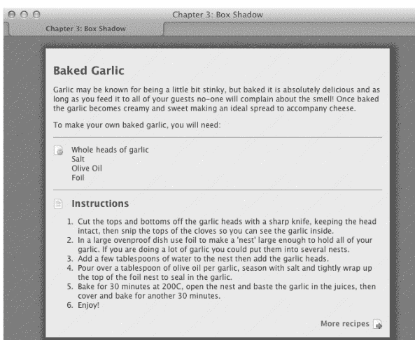

图 3.21. 主 `wrapper` 应用了 `box-shadow`

## 讨论

使用 `box-shadow` 让添加阴影变得极其简单——完全远离了在图像编辑软件中创建阴影图像并将其作为背景的痛苦。W3C 对 `box-shadow` 的官方语法为：

```css
box-shadow: 3px 3px 10px 8px rgba(0, 0, 0, 0.4);
```

这些值如下，按照上面的顺序列出：

### 水平偏移值

这可以是正值也可以是负值。如果是正值，阴影将位于框的右侧；如果是负值，则位于左侧。

### 垂直偏移值

这也可以是正值或负值，正值将阴影放在框下方，负值则放在上方。

### 模糊半径

这里的值越小意味着阴影越锐利，值越大则它越模糊。这个值必须是 0 或正值；不允许负值。

### 扩展范围

正值使阴影向所有方向扩散，负值使阴影收缩。

### 颜色

这可以是示例中使用的 RGBA，也可以是十六进制。你还可以在值的开头添加 `inset` 关键字，它将创建一个内阴影：

```css
box-shadow: inset 3px 3px 10px 8px rgba(0, 0, 0, 0.4);
```

通过尝试这些值是了解 `box-shadow` 如何工作的最佳方法。我经常使用在线阴影生成器来生成语法，并可以查看它们会有什么效果。`box-shadow` 属性受所有浏览器支持，包括 Internet Explorer 9，而不支持的浏览器会将其忽略。

# 我如何为元素创建圆角？

要为元素创建圆角（例如图 3.22 中的 `wrapper`），使用 `border-radius` 属性：

```css
.wrapper {
  width: 80%;
  margin: 20px auto 40px auto;
  background-color: #fff;
  color: #333;
  background-image: url(brushed-alu.png);
  -webkit-box-shadow: 3px 3px 10px 8px rgba(0, 0, 0, 0.4);
  -moz-box-shadow: 3px 3px 10px 8px rgba(0, 0, 0, 0.4);
  box-shadow: 3px 3px 10px 8px rgba(0, 0, 0, 0.4);
  border-radius: 10px;
}
```

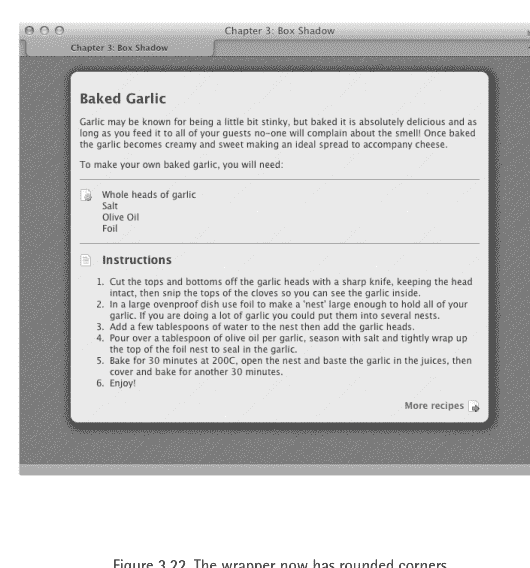

图 3.22. `wrapper` 具有圆角

使用 `border-radius` 允许你创建圆角，在显示实色的浏览器中仍然是可读的。很容易产生只有在应用透明度时起作用的颜色对比。我们将在第 7 章中进一步讨论这些问题。

## 第 3 章：变换（Transform）

# 烤大蒜

大蒜可能以味道味大闻名，但它非常美味，只要你给所有的客人吃，他们就不会抱怨。一旦大蒜变得奶油状且甜甜，它是搭配奶酪的理想抹酱。

制作烤大蒜，你需要：

- 整头大蒜
- 盐
- 橄榄油
- 锡纸

## 说明

用锋利的刀切掉大蒜头的顶部和底部，从大蒜头开始。

图 3.23. 图像在页面上投下阴影

```css
.recipe img {
  float: right;
  width: 200px;
  margin: 0 0 1em;
  -webkit-box-shadow: 3px 3px 10px 8px rgba(0, 0, 0, 0.4);
  -moz-box-shadow: 3px 3px 10px 8px rgba(0, 0, 0, 0.4);
  box-shadow: 3px 3px 10px 8px rgba(0, 0, 0, 0.4);
  -webkit-transform: rotate(5deg);
  -moz-transform: rotate(5deg);
  -o-transform: rotate(5deg);
  -ms-transform: rotate(5deg);
  transform: rotate(5deg);
}
```

图像现在显示如图 3.24 所示。

## 讨论

`transform` 属性是 CSS 规范中添加的较棘手的属性之一，但它可以在你的设计中创建很棒的效果，我鼓励你尝试它。除了旋转，`transform` 还可以用于：

- 缩放元素，使其比实际更大或更小
- “平移”元素，即沿 x 轴和 y 轴移动
- 倾斜元素，使图像倾斜并沿 x 轴和 y 轴歪斜

这些变换在用户与页面交互时最能发挥作用；例如在用户悬停时通过 `scale` 或 `rotate` 导致元素放大。关于如何在你的工作中使用变换的更多信息，我推荐 SitePoint 网站上由本书专家评审员 Louis Lazaridis 编写的文章《A Primer on CSS3 Transforms》。

需要注意的是，使用 `transforms` 后，其余内容不会重新流式以为更改的元素留出空间。因此，在使用 `rotate` 时，你需要确保旋转后的图像不会遮挡任何文本。

通过在上述示例中使用厂商前缀（vendor prefixes），你会发现 `transforms` 在所有现代浏览器中都受支持，而在旧版浏览器中会被忽略。在这里，旧浏览器将简单地以未旋转的状态显示图像。

# 在使用颜色时，我在无障碍（accessibility）方面需要注意什么？

在设计中使用颜色和透明度时，至关重要的一点是：并非所有用户看到颜色的方式都是相同的，某些用户使用的浏览器或设备不支持你使用的所有 CSS，从而导致无法加载图像等。通过在创建 CSS 时保持小心，你可以确保所有用户都能阅读你的内容，即使他们无法体验设计的完整效果。

## 解决方案

此解决方案包含了一份在使用颜色时需要考虑的简短清单。我在描述本章的其他解决方案时已经提到了其中许多内容，但在这里集中强调一下这些内容仍然是值得的。

### 使用背景图像时设置背景颜色

如果你在设计中于某些文本下方使用了背景图像（例如为列或框设置背景颜色），请确保你也添加了背景颜色。这样，如果图像加载失败，颜色也能确保上方的文字保持足够的对比度以便阅读。

### 如果你设置了背景颜色，就需要设置背景颜色，反之亦然


出于可读性考虑，颜色设置应该始终结合考虑；也就是说，前景颜色和背景颜色的选择应该使它们之间具有足够的对比度。如果你只设置了一种颜色（例如背景），而用户的默认前景颜色与你选择的颜色缺乏对比度，可能会导致你的文本无法读取。例如，如果用户将背景颜色设置为黑色，前景颜色设为白色，而你又将主文本颜色设为黑色，文本看起来就会消失了！如果你希望用户能够对颜色做出自己的选择，你应该让所有颜色处于未设置状态——但很少有网页设计师觉得自己能够这样做！

### 使用 RGBA 作为背景或前景颜色时使用合理的回退颜色

正如我们在讨论设置背景透明度时提到的，你应该确保当浏览器不支持 RGBA 时，你的回退颜色能让文本保持可读。

### 检查颜色对比度

注意文本与背景颜色之间的对比度。对于任何视觉障碍的用户来说，文本与背景之间的低对比度会使文本非常难以阅读。你还应该考虑那些色盲用户，他们可能会发现某些前景和背景的组合难以区分。WCAG 2.0 成功标准 1.4.3 要求通常情况下，文本和文本图像的对比度至少为 4.5:1。为了帮助你评估所选颜色是否符合此比例，你可以使用 Ge Lemon 编写的实用的亮度对比度比例分析器（Luminosity Contrast Ratio Analyzer）。

你还可以使用 Colorblend Web Page Filter 测试你的页面。它模拟了不同类型的色盲，让你了解你的设计对于具有某种形式色盲的人来说可能是怎样的。

## 背景应该只是装饰性的

在 CSS 中使用背景图像太容易了，以至于我们可能会掉入随处使用的陷阱。然而值得记住，对于无法加载图像或 CSS 的人来说，如果图像设置为背景图像，他们根本不知道该图像的存在。如果图像纯粹用于视觉显示，这是可以接受的；但如果图像对内容很重要，那么将图像内联到描述性文本中更为合适；这样，无法看到图像的用户就能理解它代表了什么。

## 第 4 章

除非你仅限制为单页网站，否则你需要在设计中加入导航。事实上，导航是任何设计中最重要的部分之一，如果访客想要轻松在你的网站上移动，就需要大量的思考。虽然你可以使用图像进行导航，但这种做法会有缺点。使用图像导航意味着它的无障碍性可能较低，因为图像无法调整大小来放大文本。此外，如果你的网站使用 CMS 构建，当你想要添加新的导航项时，需要设计师的干预。CSS 允许你创建吸引人的导航，而实际上，这比文本可以标记且所有人都能理解的内容更多。

### 如何设置结构化列表？

导航本质上是你网站上待访问的地方列表，因此在语义上将菜单标记为列表是有意义的，我们可以将 CSS 样式挂到列表元素本身。然而，重要的是要避免导航看起来像由浏览器内部样式表渲染的标准符号列表。

## 解决方案

图 4.1 所示的简单导航栏被标记为无序列表（unordered list），然后使用 CSS 进行样式。以下是标记：

```html
<!DOCTYPE html>
<html>
<head>
  <meta charset="utf-8" />
  <title>第 4 章：列表导航</title>
  <link rel="stylesheet" href="listnav.css" />
</head>
<body>
  <div class="wrapper">
    <ul class="nav">
      <li><a href="#">Wine</a></li>
      <li><a href="#">Fruit</a></li>
      <li><a href="#">Spreads</a></li>
      <li><a href="#">Biscuits</a></li>
    </ul>
  </div>
</body>
</html>
```

这里是用于将此普通列表转换为标准外观的纵向导航栏的 CSS：

```css
/* chapter_04/listnav.css (excerpt) */

.nav {
  list-style: none;
  margin: 0;
  padding: 0;
  width: 200px;
}

nav li {
  border-left: 10px solid rgb(144,154,181);
  border-bottom: 1px solid rgb(144,154,181);
}

nav li a:link,
nav li a:visited {
  background-color: rgb(192,202,229);
  color: rgb(49,52,61);
  padding: 0.5em;
  display: block;
  text-decoration: none;
  border-left: 5px solid rgb(239,213,252);
}
```

## 讨论

要基于无序列表制作导航，你首先创建一个列表，将每个导航链接放在`li`元素中：

```html
<ul>
  <li><a href="#">Wine</a></li>
  <li><a href="#">Fruit</a></li>
  <li><a href="#">Spreads</a></li>
  <li><a href="#">Biscuits</a></li>
</ul>
```

你需要能够识别这个特定的列表，因此像我们现在这样做一样，为起始的`ul`添加一个类或 ID，或者将列表放在另一个容器中：

```html
<ul class="nav">
  <li><a href="#">Wine</a></li>
  <li><a href="#">Fruit</a></li>
  <li><a href="#">Spreads</a></li>
  <li><a href="#">Biscuits</a></li>
</ul>
```

如图 4.2 所示，这现在看起来是一个应用了浏览器默认样式的列表。

## 导航 123

我们的下一个工作是对无序列表本身进行样式化，移除列表符号、边距和内边距，并为列表本身设置宽度，因为这将成为内部项的容器：

```css
chapter_04/listnav.css (excerpt)
.nav {
  list-style-type: none;
  margin: 0;
  padding: 0;
  width: 200px;
}
```

现在，我们的列表在浏览器中显示为文本列表，没有任何视觉特征可以识别它是一个列表，如图 4.3 所示。

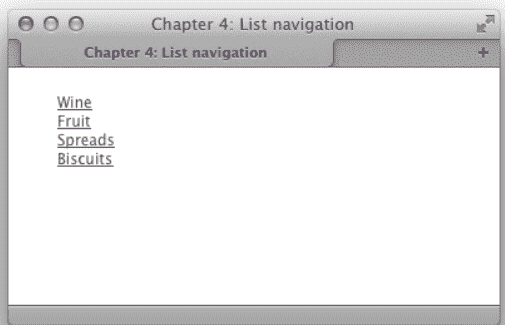

图 4.3. 移除符号、边距和内边距后的列表

下一个任务是为列表项本身添加一些 CSS。我所做的只是添加了一个粗的左边框和一个细细的下边框。这里没有给元素本身添加内边距，如图 4.4 所示，它们看起来有点拥挤：

# CSS3 百选集

```css
.nav li {
  border-left: 10px solid rgb(144,154,181);
  border-bottom: 1px solid rgb(144,154,181)
}
```

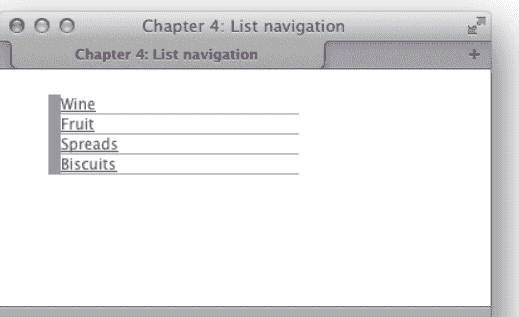

最后，我们将为链接本身添加 CSS。这才是我们的列表真正看起来像导航的地方：

```css
.nav li a:link,
.nav li a:visited {
  background-color: rgb(192,202,229);
  color: rgb(49,52,61);
  padding: 0.5em;
  display: block;
  text-decoration: none;
  border-left: 5px solid rgb(239,213,252);
}
```

在这种例中，我使用了 RGB 色值添加了背景颜色和字体，尽管你也可以使用十六进制值。我还为链接本身添加了内边距，并将其设置为`display: block`。

这个微调很重要，因为链接是一个行内元素，默认不占据`li`的整个区域——所以它不是一个容易点击的目标。为了让链接变得像块级元素一样，我们需要显式地声明`display`属性值为`block`。我们将在后面的章节中发现更多相关内容；现在请记住，如果你想占据容器的整个区域，就需要将其设置为`display: block`。

我们需要将内边距添加到链接上，而不是列表项上；如果添加到列表项上，内边距区域将变得不可思议——而我们想要创建一个易于点击链接的区域。

我还设置了`text-decoration`为`none`，以移除浏览器应用到链接上的下划线，并给链接添加了左边框，由于`li`已经有边框，这产生了双重边框的效果。

你现在应该有了一个如图 4.1 所示的导航栏。一旦你掌握了基本概念，就可以尝试不同的颜色和样式效果来玩这种技术。

# 如何使用 CSS 在不使用图像或 JavaScript 的情况下创建悬停导航？

站点导航具有悬停效果：当用户将光标悬留在菜单按钮上时，会显示新的按钮图像，产生高亮效果。我们可以通过多种方式创建它，我们将在章节后部分介绍更高级的变体。在这里，有一个非常简单的方法。

## 解决方案

使用 CSS 构建导航使得创建吸引人的悬停效果比使用图像简单得多。CSS 悬停是使用`:hover`伪类创建的，我们在第 2 章讨论链接样式时遇到过它。

让我们采用之前的列表导航示例并添加以下规则创建悬停效果：

```css
.nav li a:hover {
  background-color: rgb(144,154,181);
  color: rgb(255,255,255);
  border-left: 5px solid rgb(250,136,234);
}
```

图 4.5 显示了当光标悬留在第一个菜单项上时看到的效果。

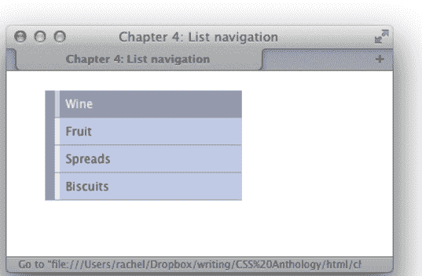

图 4.5. 显示悬停状态的菜单

## 讨论

简单来说，我更改了应用于链接的三个规则的颜色：背景颜色、文本颜色和左边框。这在链接悬停时产生了一种愉悦的视觉效果。

> 悬停获得广泛支持

> 在现代浏览器中，你可以对任何元素应用`:hover`伪类。而 Internet Explorer 6 及以下版本仅允许你将其应用于链接。

# 我可以使用 CSS 和列表创建一个带有子导航的导航系统吗？

到目前为止，我们只查看了一个简单的层次导航。如何在菜单中包含第二层导航？

## 解决方案

列表仍然是构建包含子导航导航的完美工具，因为我们可以在内部创建一个列表，当这样标记时，这两个列表将易于理解。即使对于不支持 CSS 的浏览器或阅读导航内容的情况，这一点也适用。为了演示多级导航，我们可以编辑图 4.5 中的示例并添加嵌套列表：

```html
<!DOCTYPE html>
<html>
<head>
  <meta charset="utf-8">
  <title>第4章：列表导航</title>
  <link rel="stylesheet" href="listnav.css" />
</head>
<body>
  <div class="wrapper">
    <ul class="nav">
      <li><a href="#">Wine</a>
        <ul>
          <li><a href="#">Red</a></li>
          <li><a href="#">White</a></li>
          <li><a href="#">Rosé</a></li>
        </ul>
      </li>
      <li><a href="#">Fruit</a>
        <ul>
          <li><a href="#">Spreads</a></li>
          <li><a href="#">Biscuits</a></li>
        </ul>
      </li>
    </ul>
  </div>
</body>
</html>
```

```css
body {
  background-color: #fff;
  color: #000;
  margin: 0;
  padding: 0;
  font-family: "Lucida Grande", "Lucida Sans", sans-serif;
  font-size: 0.75em;
}

.wrapper {
  width: 80%;
  margin: 0px auto;
}

.nav {
  list-style: none;
  margin: 0;
  padding: 0;
  width: 200px;
}

nav li {
  border-left: 10px solid rgb(144,154,181);
  border-bottom: 1px solid rgb(144,154,181);
}

.nav li a:link,
.nav li a:visited {
  background-color: rgb(192,202,229);
  color: rgb(49,52,61);
  padding: 0.5em;
  display: block;
  text-decoration: none;
  border-left: 5px solid rgb(239,213,252);
}

nav li a:hover {
  background-color: rgb(144,154,181);
  color: rgb(255,255,255);
  border-left: 5px solid rgb(250,136,234);
}

nav ul {
  list-style: none;
  margin: 0;
  padding: 0;
}

.nav ul li {
  border: 0;
}

.nav ul li a:link,
.nav ul li a:visited {
  background-color: rgb(237,241,252);
  color: rgb(49,52,61);
  padding: 0.5em 0.5em 0.5em 1em;
  display: block;
  text-decoration: none;
  border-left: 5px solid rgb(239,213,252);
}

.nav ul li a:hover {
  background-color: rgb(255,255,255);
  color: rgb(49,52,61);
  border-left: 5px solid rgb(250,136,234);
}
```

结果见图 4.6。

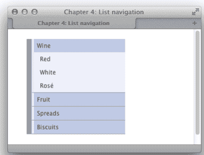

图 4.6. 带有子导航的列表

## 讨论

嵌套列表是描述我们在这里处理的导航系统的完美方式。第一个列表包含我网站的主要部分：适合搭配奶酪的食物和饮料。葡萄酒部分的子部分嵌套在 Wine 列表项下。即使没有任何 CSS 样式，网站的结构也是清晰且易懂的，如图 4.7 所示。

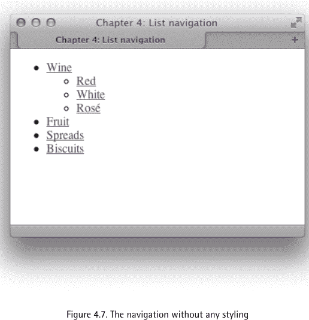

标记将子列表嵌套在主列表的`<li>`元素中：

```html
<ul class="nav">
  <li><a href="#">Wine</a>
    <ul>
      <li><a href="#">Red</a></li>
      <li><a href="#">White</a></li>
      <li><a href="#">Rosé</a></li>
    </ul>
  </li>
  <li><a href="#">Fruit</a>
    <ul>
      <li><a href="#">Spreads</a></li>
      <li><a href="#">Biscuits</a></li>
    </ul>
  </li>
</ul>
```

如果我们取之前的示例并仅添加嵌套列表标记，我们将得到图 4.8 所示的示例：我们的第二个列表继承了父列表的很多样式，但看起来有点奇怪。由于这种继承效应，在为嵌套列表设置样式时，我们需要覆盖在第一个列表中使用的值。

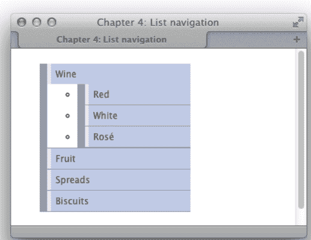

图 4.8. 添加标记后

首先，我移除嵌套列表的符号、边距和内边距。然后，我移除`li`的装饰性左边框。现在列表显示方式如图 4.9 所示：

```css
chapter_04/listnav-nested.css (excerpt)

nav ul {
  list-style: none;
  margin: 0;
  padding: 0;
  border: 0;
}
```

```css
.nav ul li {
  border: 0;
}
```

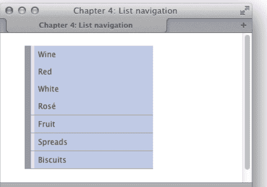

图 4.9。通过添加一条规则，列表恢复了对齐

嵌套链接现在很难与顶层项目区分，因此我将对嵌套列表中的链接进行样式，以便它们与主部分的链接区分开：


## 前言

我在这里做的只是更改列表内部链接的颜色和内边距，以创建一个愉悦的视觉效果；我还为这些子项的悬停状态添加了一些规则。请记住，在这里你覆盖了为外部列表链接设置的值，因此只需要设置你更改过的部分。

`chapter_04/listnav-nested.css`（节选）

```css
.nav ul li a:link,
.nav ul li a:visited {
  background-color: rgb(237,241,252);
  color: rgb(49,52,61);
  padding: 0.5em 0.5em 0.5em 1em;
  display: block;
  text-decoration: none;
  border-left: 5px solid rgb(239,213,252);
}
.nav ul li a:hover {
  background-color: rgb(255,255,255);
  color: rgb(49,52,61);
  border-left: 5px solid rgb(250,136,234);
}
```

## 如何使用列表和 CSS 创建水平菜单？

本章目前为止示例处理的是垂直导航，通常位于网站主内容区域的左侧或右侧；然而，网站导航通常位于文档顶部的水平菜单。

### 解决方案

图 4.10 显示了一个使用列表创建的水平导航菜单。


图 4.10。简单的水平导航

以下是创建此显示所需的 HTML 和 CSS：

`chapter_04/horizontal.html`

```html
<!DOCTYPE html>
<html>
<head>
  <meta charset="utf-8" />
  <title>第 4 章: 水平导航</title>
  <link rel="stylesheet" href="horizontal.css" />
</head>
<body>
  <div class="wrapper">
    <ul class="nav">
      <li><a href="">葡萄酒</a></li>
      <li><a href="">水果</a></li>
      <li><a href="">果酱</a></li>
      <li><a href="">饼干</a></li>
    </ul>
  </div>
</body>
</html>
```

```css
.nav {
  list-style: none;
  margin: 0;
  padding: 0;
}

.nav li {
  float: left;
  min-width: 8em;
  margin-right: 0.5em;
  text-align: center;
}

.nav li a:link,
.nav li a:visited {
  background-color: rgb(255, 255, 255);
  color: rgb(85, 85, 102);
  display: block;
  padding: 0.2em;
  text-decoration: none;
  font-weight: bold;
  margin: 0 0 0.2em 0;
  -webkit-border-radius: 3px;
  -moz-border-radius: 3px;
  -border-radius: 3px;
  -webkit-box-shadow: 3px 3px 3px 3px rgba(43, 43, 77, 0.5);
  -moz-box-shadow: 3px 3px 3px 3px rgba(43, 43, 77, 0.5);
  box-shadow: 3px 3px 3px 3px rgba(43, 43, 77, 0.5);
}

.nav li a:hover {
  background-color: rgba(255, 255, 255, 0.8);
  color: rgb(43, 43, 77);
}
```

### 讨论

此导航起初与我们之前用于创建垂直导航的列表完全相同：

```html
<ul class="nav">
  <li><a href="">葡萄酒</a></li>
  <li><a href="">水果</a></li>
  <li><a href="">果酱</a></li>
  <li><a href="">饼干</a></li>
</ul>
```

我首先移除列表符号、外边距和内边距：

```css
.nav {
  list-style: none;
  margin: 0;
  padding: 0;
}
```

现在我们希望列表项并排显示，而不是分行显示。有两种方法可以实现这一点。我们可以像在第 2 章中讨论的那样，将`li`的`display`属性设置为`inline`；但为了方便对列表项设置样式，我将使用另一种依赖于`float`属性的方法。我们将在书中稍后讨论`float`；现在你可以看到项目是如何并排浮动的：

`chapter_04/horizontal.css`（节选）

```css
.nav li {
  float: left;
  min-width: 8em;
  margin-right: 0.5em;
  text-align: center;
}
```

我们的菜单如图 4.11 所示。


图 4.11。浮动项目

列表项到位后，我们只需要对链接设置样式。首先，可以使用兼容非常旧浏览器的 CSS 设置项目：

`chapter_04/horizontal.css`（节选）

```css
nav li a:link,
nav li a:visited {
  background-color: rgb(255, 255, 255);
  color: rgb(85, 85, 102);
  display: block;
  padding: 0.2em;
  text-decoration: none;
  font-weight: bold;
  margin: 0 0 0.2em;
}
```

这带给了我们块状导航项。我非常希望它们是圆角的并带有阴影，因此为了实现这一点我使用了 CSS 属性：

`chapter_04/horizontal.css`（节选）

```css
.nav li a:link,
.nav li a:visited {
  background-color: rgb(255, 255, 255);
  color: rgb(85, 85, 102);
  display: block;
  padding: 0.2em;
  text-decoration: none;
  font-weight: bold;
  margin: 0 0 0.2em;
  -webkit-border-radius: 3px;
  -moz-border-radius: 3px;
  border-radius: 3px;
  -webkit-box-shadow: 3px 3px 3px 3px rgba(43, 43, 77, 0.5);
  -moz-box-shadow: 3px 3px 3px 3px rgba(43, 43, 77, 0.5);
  box-shadow: 3px 3px 3px 3px rgba(43, 43, 77, 0.5);
}
```

很有可能有人使用不支持这些属性的浏览器查看网站；然而，即使没有这些属性导航看起来也良好——我为支持这些浏览器添加了额外样式。这种做法被称为渐进增强，我们将在书中后面讨论这种策略。最后，我添加了悬停状态，通过 RGBA 调整背景色的 alpha 值，可以轻松地设置不同的颜色：

`chapter_04/horizontal.css`（节选）

```css
.nav li a:hover {
  background-color: rgba(255, 255, 255, 0.8);
  color: rgb(43, 43, 77);
}
```

## 如何创建标签导航？

页面顶部以标签形式出现的导航非常流行。许多网站使用图像创建这些标签；然而，这会降低可访问性，而且如果你的导航是用 CSS 创建的，也会产生问题。如果你为每个链接创建框——记住为了在文本和容器边缘之间留出空间，你需要在链接上添加更多左右内边距。为了在导航项之间留更多空间，请给链接添加左右外边距。好消息是可以使用 CSS 创建标签效果。

### 解决方案

图 4.12 中的导航是通过对水平列表设置样式创建的。


图 4.12。标签导航

以下是它的标记：

```html
<!DOCTYPE html>
<html>
<head>
  <meta charset="utf-8" />
  <title>第 4 章: 水平导航</title>
  <link rel="stylesheet" href="tabs.css" />
</head>
<body>
  <div class="wrapper">
    <ul class="nav">
      <li><a href="">葡萄酒</a></li>
      <li><a href="">水果</a></li>
      <li class="selected"><a href="">果酱</a></li></li>
      <li><a href="">饼干</a></li>
    </ul>
    <div class="content">
      <h1>搭配奶酪的果酱</h1>
    </div>
  </div>
</body>
</html>
```

```css
.nav {
  list-style: none;
  margin: 0;
  padding: 0;
  float: left;
  width: 100%;
}

.nav li {
  float: left;
  min-width: 8em;
  text-align: center;
}

.nav li a:link,
.nav li a:visited {
  background-color: rgba(255,255,255,0.4);
  color: rgb(0,0,0);
  text-decoration: none;
  display: block;
  padding: 0.75em;
  -moz-border-radius-topleft: 3px;
  -moz-border-radius-topright: 3px;
  -webkit-border-radius: 3px 3px 0px 0px;
  border-radius: 3px 3px 0px 0px;
  -webkit-box-shadow: 0px -3px 2px 0px rgba(0, 0, 0, 0.2);
  -moz-box-shadow: 0px -3px 2px 0px rgba(0, 0, 0, 0.2);
  box-shadow: 0px -3px 2px 0px rgba(0, 0, 0, 0.2);
  text-shadow: 1px 1px 3px rgba(0, 0, 0, 0.5);
}

.nav li.selected a:link,
.nav li.selected a:visited {
  background-color: rgb(255,255,255);
}

.nav li:hover {
  background-color: rgba(255, 255, 255, 0.8);
  color: rgb(43, 43, 77);
}
```

#### 导航 141

```html
<li class="selected"><a href="">Spreads</a></li>
<li><a href="">Biscuits</a></li>
<ul>
```

前两个 CSS 声明让我们的列表项没有实现水平对齐：


我们现在开始使用 RGBA 背景颜色对未选中的标签进行样式设置；这创建了一个半透明效果，让背景显示出来。如果你担心不支持 RGBA 的浏览器，可以在这里使用纯色：


#### CSS3 选集

```css
box-shadow: 0px -3px 2px 0px rgba(0, 0, 0, 0.2);
text-shadow: 1px 1px 3px rgba(0, 0, 0, 0.5);
```

这为我们提供了如图 4.13 所示的标签。我使用`border-radius`来稍微弯曲标签的顶角，使用`box-shadow`在四周和顶部创建阴影效果，并使用`text-shadow`来增强文本。


图 4.13 设置列表样式后的标签

现在我想让我的被选标签看起来像是与内容区域的背景颜色融合在一起。我通过以下声明来实现，它针对带有类名`selected`的`li a`。它仅仅是将背景颜色改为白色：

`chapter_04/tabs.css`（节选）

```css
.nav li.selected: a:link,
.nav li.selected: a:visited {
  background-color: rgb(255,255,255);
}
```

最后的润色是给标签添加悬停状态。同样，我只是使用 RGBA 调整透明度，但也可以使用纯色：

```css
.nav li:hover {
  background-color: rgba(255,255,255,0.8);
}
```

#### 拥抱 CSS3 增强效果

通过使用 CSS——特别是 CSS3 提供的最后修饰——我们可以轻松地创建出吸引人的标签效果。但以前并不一直如此。

本书的之前的版本包含过一种基于流行的“滑动门”方法的解决方案，该方法使用图像来创建灵活的标签。这种方法使用四张背景图像来创建圆角标签效果。如果你需要支持具有完整视觉效果的古老浏览器，或者受限于某种重量感很强的视觉风格，你可能需要考虑这些旧方法。对于大多数网站，我鼓励你巧妙地利用 CSS3，为旧版浏览器增强稍显单调的网站视图。

### 我的导航在一个包含文件中，我该如何指示哪一个是被选中的标签？

上一个解决方案为选中的菜单项添加了类，但如果你的菜单存储在链接的服务器端文件中——例如通过`include`语句引入的 PHP 文件——这可能是不可行的。你该如何指示哪个菜单项被选中了？

#### 解决方案

这是一个突出菜单标签的巧妙小方法。首先，编辑 HTML 为每个菜单标签添加一个类；我通常使用章节名称。在页面的`body`元素上添加一个与其中一个类名相同的 ID：

```html
<!DOCTYPE html>
<html
<head>
  <meta charset="utf-8" />
```

- ¹ http://www.alistapart.com/articles/slidingdoors/

#### 144 CSS3 选集

```html
<title>Chapter 4: 水平导航</title>
<link rel="stylesheet" href="selected.css" />
</head>
<body id="spreads">
<div class="wrapper">
<ul class="nav">
<li class="wine"><a href="">Wine</a></a></li>
<li class="fruit"><a href="">Fruit</a></a></li>
<li class="spreads"><a href="">Spreads</a></a></li>
<li class="biscuits"><a href="">Biscuits</a></a></li>
</ul>
<div class="content">
<h1>适合搭配奶酪的抹酱</h1>
</div>
</div>
</body>
</html>
```

在 CSS 中，我们现在只有当`li`位于具有相同 ID 的`body`内部时，才针对该类：


```css
nav {
  list-style: none;
  margin: 0;
  padding: 0;
  float: left;
  width: 100%;
}

nav li {
  float: left;
  min-width: 8em;
  text-align: center;
}

nav li a:link,
.nav li a:visited {
  background-color: rgba(255,255,255,0.4);
  color: rgb(0,0,0);
  text-decoration: none;
  display: block;
  padding: 0.75em;
  -moz-border-radius-top-left: 3px;
  -moz-border-radius-top-right: 3px;
  -webkit-border-radius: 3px 3px 0px;
  border-radius: 3px 3px 0px;
  -webkit-box-shadow: 0px -3px 2px rgba(0, 0, 0, 0.2);
  -moz-box-shadow: 0px -3px 2px rgba(0, 0, 0, 0.2);
  box-shadow: 0px -3px 2px rgba(0, 0, 0, 0.2);
  text-shadow: 1px 1px 3px rgba(0, 0, 0, 0.5);
}

#spreads .nav li:link;
#spreads .nav li:visited;
#fruit .nav li:link;
#fruit .nav li:visited;
#wine .nav li:link;
#wine .nav li:visited;
#biscuits .nav li:link;
#biscuits .nav li:visited {
  background-color: rgb(255,255,255);
}

nav li:hover {
  background-color: rgba(255,255,255,0.8);
}
```

## 讨论

如果你切换 `body` 元素的 ID 为其他任何名称，你将看到被选中标签的变化。这是因为我们使用了以下选择器，目标是类 `spreads` 的 `li` 且位于 ID 为 `spreads` 的元素内部：

```css
#spreads .nav li:link
```

所以类为 `wine` 的 `li` 无法匹配，位于 ID 为 `wine` 的 `body` 内部类为 `spreads` 的 `li` 也无法匹配。你只需要将章节名称作为 ID 输出到 `body` 标签，可以通过你的 CMS 输出。

## 如何在我的导航栏中放入额外信息？

一种流行的导航样式是在标题下方添加描述性文本。我们如何使用 CSS 创建这种？

## 解决方案

我们再次对导航使用列表结构，但这次为每个链接添加了更多信息。这创建如图 4.14 所示的导航。


图 4.14 带有额外文本的水平导航

在这个示例中，章节标题与描述位于相同的元素中，但位于 `strong` 元素内显示为块：

```html
<!DOCTYPE html>
<html>
<head>
  <meta charset="utf-8" />
  <title>Chapter 4: 水平导航</title>
  <link rel="stylesheet" href="horizontal2.css" />
</head>
<body>
  <div class="wrapper">
    <ul class="nav">
      <li><a href=""><strong>Wine</strong><small>奶酪酒对——经典！</small></a></li>
      <li><a href=""><strong>Fruit</strong><small>葡萄、苹果——在吃奶酪时摄入每日水果。</small></a></li>
      <li><a href=""><strong>Spreads</strong><small>泡菜、果酱、烤大蒜等更多。</small></a></li>
      <li><a href=""><strong>Biscuits</strong><small>将你的奶酪放入椭圆饼干、消化饼和水饼干中。</small></a></li>
    </ul>
  </div>
</body>
</html>
```

```css
.nav {
  list-style: none;
  margin: 0;
  padding: 0;
}

.nav li {
  float: left;
  width: 130px;
  margin-right: 20px;
}

.nav li a:link strong,
.nav li a:visited strong {
  font-size: 157.1%;
  display: block;
  font-weight: normal;
  color: rgb(119,126,134);
  font-style: normal;
}

.nav li a:link,
.nav li a:visited {
  text-decoration: none;
  color: rgb(93,78,72);
  font-style: italic;
}

.nav li a:hover,
.nav li a:hover strong {
  color: rgb(0,0,0);
}
```

## 讨论

这个解决方案只是我们创建的原始水平导航的扩展。你可以在列表项内添加任何元素，并按你喜欢的方式进行样式设置。

## 如何在视觉上指示哪些链接是外部链接？

如果指向另一个网站的链接与指向自己网站页面的链接显示方式不同，对访问者会有帮助。然而，为了给每个链接添加类以能够选择它，这远不实际。

## 解决方案

如果你的内部链接省略了网站的完整域名，我们可以使用属性选择器来定位外部链接：图标被放置在外部链接旁边，而不是内部链接。


图 4.15 使用图标显示外部链接

```html
<!DOCTYPE html>
<html>
<head>
  <meta charset="utf-8" />
  <title>Chapter 4: 显示外部链接</title>
  <link rel="stylesheet" href="external-links.css" />
</head>
<body>
  <div class="wrapper">
    <p>你可以使用 <a href="http://google.com">Google</a> 搜索更多美味的奶酪食谱，或者在 <a href="/recipes/">本网站</a>查看更多食谱。</p>
  </div>
</body>
</html>
```

```css
a[href^="http:"] {
  padding-left: 20px;
  background-image: url(icon-link-external.png);
  background-repeat: no-repeat;
}
```

现在，我们页面上任何以 `http:` 开头的链接（这些应该是外部的，因为我们不会这样链接到自己网站的页面）都会显示世界图标。

> 注意你的协议

此解决方案依赖于你的内部链接前面没有 `http://`。如果你使用的编辑器或 CMS 会为内部链接添加网站的完整域名，则该解决方案是不适用的。

## 讨论

属性选择器在现代浏览器中广泛支持，但在 Internet Explorer 6 中会被忽略。在不支持该选择器的浏览器中，链接将作为正常方式显示；因此，对于支持的浏览器来说，这是一个很好的增强，同时对使用旧版浏览器的用户保持体验不变。

让我们仔细查看一下选择器：

```css
a[href^="http*"]
```

我们正在选择 `href` 属性，并且我们希望选择器在属性值的开头找到文本 `http:` 时进行匹配。`^` 运算符表示“以……开头”。你可以使用一个选择器来匹配所有邮件链接；例如 `a[href^="mailto:"]`。

另一个实用的选择器是目标链接的文件扩展名。这意味着你可以添加一个小小的图标来显示文档是 PDF 或其他文档类型，具体取决于扩展名。选择器 `a[href$=".pdf"]` 将匹配任何文件扩展名为 `.pdf` 的链接。`$` 运算符表示“以……结尾”，因此当 `href` 属性值以 `.pdf` 结尾时，该选择器将匹配：

`chapter_04/external-links2.html`

```html
<!DOCTYPE html>
<html>
<head>
  <meta charset="utf-8" />
  <title>第 4 章：使用属性选择器</title>
  <link rel="stylesheet" href="external-links2.css" />
</head>
<body>
  <div class="wrapper">
    <ul class="links">
      <li><a href="http://google.com">去其他地方</a></li>
      <li><a href="files/example.pdf">下载 PDF</a></li>
      <li><a href="mailto:info@example.com">发送电子邮件</a></li>
    </ul>
  </div>
</body>
</html>
```

```css
a[href^="http"] {
  padding-left: 20px;
  background-image: url(icon-link-external.png);
  background-repeat: no-repeat;
}
```

```css
a[href^="mailto"] {
  padding-left: 20px;
  background-image: url(icon-link-email.png);
  background-repeat: no-repeat;
}
```

```css
a[href$=".pdf"] {
  padding-left: 20px;
  background-image: url(icon-pdf.png);
  background-repeat: no-repeat;
}
```

图 4.16 显示了所有类型的效果。


图 4.16. 使用属性选择器为不同类型的链接添加图标

# 如何在不使用 JavaScript 的情况下在导航中创建悬停图像？

利用 CSS3 提供的属性，我们可以在不使用图像的情况下创建许多导航效果；然而，你可能也会在导航中使用图像。将图像和文本结合可以提供许多机会来创建吸引人且易用的导航。

## 解决方案

此解决方案演示了如何在导航中使用图像，包括不使用 JavaScript 的悬停效果，如图 4.17 所示。


图 4.17. 使用 CSS 实现图像悬停

```html
<!DOCTYPE html>
<html>
<head>
  <meta charset="utf-8" />
  <title>第 4 章：图像悬停</title>
  <link rel="stylesheet" href="rollover-image.css" />
</head>
<body>
```

```html
<div class="wrapper">
<ul class="intouch">
  <li class="twitter"><a href="">Twitter</a></li>
  <li class="rss"><a href="">RSS</a></li>
  <li class="email"><a href="">Email</a></li>
</ul>
</div>
</body>
</html>
```

`chapter_04/rollover-image.css`（节选）

```css
.intouch {
  list-style: none;
  margin: 0;
  padding: 0;
}
```

```css
.intouch li a:link,
.intouch li a:visited {
  padding: 0.5em 0 0.5em 40px;
  display: block;
  font-weight: bold;
  background-repeat: no-repeat;
  background-image: url(sprite-roll.png);
  text-decoration: none;
  color: rgb(136,136,136);
}
```

```css
.intouch li.twitter a:link,
.intouch li.twitter a:visited {
  background-position: 0 6px;
}
```

```css
.intouch li.rss a:link,
.intouch li.rss a:visited {
  background-position: 0 -30px;
}
```

```css
.intouch li.email a:link,
.intouch li.email a:visited {
  background-position: 0 -60px;
}
```

```css
.intouch li.twitter:hover {
  background-position: 0 -90px;
  color: rgb(105,210,231);
}
```

```css
.intouch li.rss a:hover {
  background-position: 0 -126px;
  color: rgb(243,134,48);
}

.intouch li.email a:hover {
  padding-position: 0 -156px;
  color: rgb(56,55,54);
}
```

## 讨论

此解决方案使用了单个图像（`sprite-roll.png`），如图 4.18 所示，它结合了图像的非活动状态和悬停状态。我们随后使用此文件作为背景图像，调整其位置以显示每个链接的默认图像，然后在悬停在链接上时显示悬停图像。


图 4.18. 结合所有图标的精灵图

这种结合图像的方法被称为创建精灵图（image sprite），这是一项非常有用的技术，它通过允许一次请求而不是对多个小文件的请求来帮助减少服务器的负载。标记只是一个链接列表，我为每个 `li` 赋予了类名以指示链接的类型：

`chapter_04/rollover-image.html`（节选）

```html
<ul class="intouch">
  <li class="twitter"><a href="">Twitter</a></li>
  <li class="rss"><a href="">RSS</a></li>
  <li class="email"><a href="">Email</a></li>
</ul>
```

我为列表和每个列表项添加了一些基础样式，然后对链接进行样式处理，并将精灵图作为背景图像设置为不重复：

```css
.intouch {
  list-style: none;
  margin: 0;
  padding: 0;
}

.intouch a:link,
.intouch a:visited {
  padding: 0.5em 0.5em 40px;
  display: block;
  font-weight: bold;
  background-repeat: no-repeat;
  background-image: url(sprite-roll.png);
  text-decoration: none;
  color: rgb(136,136,136);
}
```

在图 4.19 中可以看到所有三种类型的效果。


图 4.16. 使用属性选择器为不同类型的链接添加图标

# 如何在不使用 JavaScript 的情况下在导航中创建悬停图像？

利用 CSS3 提供的属性，我们可以在不使用图像的情况下创建许多导航效果；然而，你可能也会在导航中使用图像。将图像和文本结合可以提供许多机会来创建吸引人且易用的导航。

## 解决方案

此解决方案演示了如何在导航中使用图像，包括不使用 JavaScript 的悬停效果，如图 4.17 所示。


图 4.17. 使用 CSS 实现图像悬停

```html
<!DOCTYPE html>
<html>
<head>
  <meta charset="utf-8" />
  <title>第 4 章：图像悬停</title>
  <link rel="stylesheet" href="rollover-image.css" />
</head>
<body>
```


`chapter_04/rollover-image.css`（节选）

```css
.intouch {
  list-style: none;
  margin: 0;
  padding: 0;
}
```

```css
.intouch li a:link, .intouch li a:visited {
  padding: 0.5em 0 0.5em 40px;
  display: block;
  font-weight: bold;
  background-repeat: no-repeat;
  background-image: url(sprite-roll.png);
  text-decoration: none;
  color: rgb(136,136,136);
}
```

```css
.intouch li.twitter a:link, .intouch li.twitter a:visited {
  background-position: 0 6px;
}
```

```css
.intouch li.rss a:link, .intouch li.rss a:visited {
  background-position: 0 -30px;
}
```

```css
.intouch li.email a:link, .intouch li.email a:visited {
  background-position: 0 -60px;
}
```

```css
.intouch li.twitter:hover {
  background-position: 0 -90px;
  color: rgb(105,210,231);
}
```

```css
.intouch li.rss a:hover {
  background-position: 0 -126px;
  color: rgb(243,134,48);
}
```

```css
.intouch li.email a:hover {
  padding-position: 0 -156px;
  color: rgb(56,55,54);
}
```

## 讨论

此解决方案使用了单个图像（`sprite-roll.png`），如图 4.18 所示，它结合了图像的非活动状态和悬停状态。我们随后使用此文件作为背景图像，调整其位置以显示每个链接的默认图像，然后在悬停在链接上时显示悬停图像。


图 4.18. 结合所有图标的精灵图

这种结合图像的方法被称为创建精灵图（image sprite），这是一项非常有用的技术，它通过允许一次请求而不是对多个小文件的请求来帮助减少服务器的负载。标记只是一个链接列表，我为每个`li`赋予了类名以指示链接的类型：

```html
chapter_04/rollover-image.html (节选)
<ul class="intouch">
  <li class="twitter"><a href="">Twitter</a></li>
  <li class="rss"><a href="">RSS</a></li>
  <li class="email"><a href="">Email</a></li>
</ul>
```

我为列表和每个列表项添加了一些基础样式，然后对链接进行样式处理，并将精灵图作为背景图像设置为不重复：

```css
.intouch {
  list-style: none;
  margin: 0;
  padding: 0;
}

.intouch a:link, .intouch a:visited {
  padding: 0.5em 0.5em 40px;
  display: block;
  font-weight: bold;
  background-repeat: no-repeat;
  background-image: url(sprite-roll.png);
  text-decoration: none;
  color: rgb(136,136,136);
}
```

在图 4.19 中可以看到所有三种类型的效果。


图 4.16. 使用属性选择器为不同类型的链接添加图标

# 如何在不使用 JavaScript 的情况下在导航中创建悬停图像？

利用 CSS3 提供的属性，我们可以在不使用图像的情况下创建许多导航效果；然而，你可能也会在导航中使用图像。将图像和文本结合可以提供许多机会来创建吸引人且易用的导航。

## 解决方案

此解决方案演示了如何在导航中使用图像，包括不使用 JavaScript 的悬停效果，如图 4.17 所示。


图 4.17. 使用 CSS 实现图像悬停

```html
<!DOCTYPE html>
<html>
<head>
  <meta charset="utf-8" />
  <title>第 4 章：图像悬停</title>
  <link rel="stylesheet" href="rollover-image.css" />
</head>
<body>
```

```html
<div class="wrapper">
<ul class="intouch">
  <li class="twitter"><a href="">Twitter</a></li>
  <li class="rss"><a href="">RSS</a></li>
  <li class="email"><a href="">Email</a></li>
</ul>
</div>
</body>
</html>
```

# 使用透明度实现悬停效果

在完成此解决方案之前，我想向你展示另一种使用透明度属性创建的悬停效果方法。

图 4.20 所示的效果通过我们使用的相同精灵图实现，但这次使用了透明度属性让图像和文字半透明。


图 4.20. 使用透明度实现悬停

```css
chapter_04/rollover-opacity.css (节选)
.intouch a:link, .intouch a:visited {
  padding: 0.5em 0.5em 40px;
  display: block;
  font-weight: bold;
  background-repeat: no-repeat;
  background-image: url(sprite.png);
  text-decoration: none;
}
```

```css
.intouch li.twitter a:link, .intouch li.twitter a:visited {
  background-position: 0 6px;
  color: rgb(105,210,231);
  opacity: 0.5;
}
```

```css
.intouch li.rss a:link, .intouch li.rss a:visited {
  background-position: 0 -30px;
  color: rgb(243,134,48);
  opacity: 0.5;
}
```

```css
.intouch li.email a:link, .intouch li.email a:visited {
  background-position: 0 -60px;
  color: rgb(56,55,54);
  opacity: 0.5;
}
```

```css
.intouch li.twitter:hover {
  background-position: 0 -90px;
  opacity: 1;
}
```

```css
.intouch li.rss a:hover {
  background-position: 0 -126px;
  opacity: 1;
}
```

```css
.intouch li.email a:hover {
  background-position: 0 -156px;
  opacity: 1;
}
```

## 站点地图

站点地图是网站上的一个非常有用的页面，列出了站点中的所有页面。它可以帮助那些在导航中无法找到所需内容的人，同时也提供快速查看可用内容并一键跳转的方法。

## 我应该如何设置站点地图？

站点地图实际上是你网站上所有目的地的列表，因此它理想情况下被标记为一组嵌套列表。第一个列表是主导航，内部导航嵌套在每个主导航点中。如果你的网站结构有很多层次，列表是可行的，并且很容易从内容管理系统中生成。图 4.21 显示了以下代码的结果：

```html
<!DOCTYPE html>
<html
<head>
  <meta charset="utf-8" />
  <title>第4章：站点地图</title>
  <link rel="stylesheet" href="sitemap.css" />
</head>
<body>
  <div class="wrapper">
    <ul class="sitemap">
      <li><a href="*">首页</a></li>
      <li><a href="*">关于我们</a>
        <ul>
          <li><a href="*">董事会</a></li>
          <li><a href="*">历史</a></li>
        </ul>
      </li>
      <li><a href="*">产品</a></li>
      <li><a href="*">订购信息</a>
        <ul>
          <li><a href="*">我们的门店</a>
            <ul>
              <li><a href="*">伦敦</a></li>
              <li><a href="*">纽卡斯尔</a></li>
            </ul>
          </li>
        </ul>
      </li>
      <li><a href="*">其他分商</a></li>
      <li><a href="*">联系我们</a></li>
    </ul>
  </div>
</body>
</html>
```

```css
.sitemap {
  list-style: none;
  margin: 0;
  padding: 0;
}

.sitemap > li {
  border: 2px solid rgba(153,178,183,0.2);
  -webkit-border-radius: 10px;
  -moz-border-radius: 10px;
  border-radius: 10px;
  margin: 0 0 1em 0;
}

.sitemap > li:hover {
  border: 2px solid rgba(153,178,183,1);
}

.sitemap > li > a:link, .sitemap > li > a:visited {
  background-color: rgba(153,178,183,0.1);
  color: rgb(0,0,0);
  text-decoration: none;
  display: block;
  padding: 0.75em;
}

.sitemap > li:hover > a:link, .sitemap > li:hover > a:visited {
  background-color: rgba(153,178,183,0.5);
}

.sitemap ul {
  margin: 1em 0 1em 0;
  padding: 0;
  list-style: none;
  line-height: 1.8;
}

.sitemap ul ul {
  margin: 0.5em 0 0.5em 0;
}

.sitemap a:link, .sitemap a:visited {
  padding: 0.75em;
  text-decoration: none;
  color: rgb(69,80,83);
}

.sitemap ul a:link:before, .sitemap ul a:visited:before {
  content: ">";
}
```

## 讨论

站点地图最初是一个包含主导航元素的列表，并在内部带有子菜单——这与上一节中讨论的导航列表“我可以使用 CSS 和列表创建导航系统吗？”的方法相同。站点地图的区别在于，所有菜单都会显示其子页面。如果站点地图变得更深（具有更多层次），你只需以相同的方式继续嵌套，子页面将是其父元素的列表。

注意正确地嵌套列表项。子菜单需要放在父列表的`li`结束标签之前。在不使用 CSS 的情况下，站点地图的显示如图 4.22 所示。

## CSS 选集

图 4.22. 未样式的列表

我将为每个主要部分（即每个顶层导航点和子导航）包围一个边框，以演示它是网站的一个部分：

```css
sitemap {
  list-style: none;
  margin: 0;
  padding: 0;
}

sitemap > li {
  border: 2px solid rgba(153,178,183,0.2);
  -webkit-border-radius: 10px;
  -moz-border-radius: 10px;
  border-radius: 10px;
  margin: 0 0 1em 0;
}

.sitemap > li:hover {
  border: 2px solid rgba(153,178,183,1);
}
```

我在这里使用了选择器，是因为我只想针对作为`.sitemap`直接子元素的`li`；这些元素将是顶层导航元素。如图 4.23 所示。我使用 RGBA 来处理边框，这样我可以在悬停在列表项时调整 alpha 值；这会为用户所在的地图部分提供极佳的视觉指示。

图 4.23. 对主列表项进行样式化后。

现在，我开始处理这些顶层列表项内部的链接，让它们在视觉上显示为该部分的主导航项：

```css
.sitemap > li > a:link, .sitemap > li > a:visited {
  background-color: rgba(153,178,183,0.1);
  color: rgb(0,0,0);
  text-decoration: none;
  display: block;
  padding: 0.75em;
}

.sitemap > li:hover > a:link, .sitemap > li:hover > a:visited {
  background-color: rgba(153,178,183,0.5);
}
```

注意我针对的是`li`内部的链接，这样当悬停在`li`的任何部分时就会发生该状态，如图 24 所示。

图 24. 链接样式化后。

现在我们可以对部分内部的项目——子列表和链接进行样式化：

```css
.sitemap ul {
  margin: 1em 0 1em;
  padding: 0;
  list-style: none;
  line-height: 1.8;
}

.sitemap ul ul {
  margin: 0.5em 0 0.5em;
}

.sitemap a:link, .sitemap a:visited {
  padding: 0.75em;
  text-decoration: none;
  color: rgb(69,80,83);
}

.sitemap ul a:before, .sitemap a:visited:before {
  content: ">";
}
```

## 如何用 CSS 创建下拉菜单？

下拉菜单在近年流行度有所下降，但它们可以用于快速访问网站部分，因此你可能想知道如何合理使用它们。

## 解决方案

此方案通过嵌套列表创建下拉菜单，并使用 jQuery 插件来增强 CSS。


```html
<!DOCTYPE html>
<html>
<head>
  <meta charset="utf-8" />
  <title>第 4 章：下拉菜单</title>
  <link rel="stylesheet" href="dropdown.css" />
  <script src="http://ajax.googleapis.com/ajax/jquery/1.7/jquery.min.js" type="text/javascript"></script>
  <script src="superfish.js" type="text/javascript"></script>
  <script>
  $(document).ready(function() {
    $('.nav').superfish({
      delay: 1000,
      animation: {opacity:'show',height:'show'},
      speed: 'fast',
      autoArrows: false,
      dropShadows: false
    });
  });
  </script>
</head>
<body>
  <div class="wrapper">
    <ul class="nav">
      <li><a href="#">首页</a></li>
      <li><a href="#">关于我们</a>
        <ul>
          <li><a href="#">董事会</a></li>
          <li><a href="#">历史</a></li>
        </ul>
      </li>
      <li><a href="#">产品</a></li>
      <li><a href="#">订购</a></li>
        <ul>
          <li><a href="#">我们的门店</a></li>
          <li><a href="#">其他分商</a></li>
        </ul>
      </li>
      <li><a href="#">联系我们</a></li>
    </ul>
  </div>
</body>
</html>
```

```css
.nav {
  list-style: none;
  margin: 0;
  padding: 0;
  font-size: 14.3%;
}

nav > li {
  float: left;
  width: 130px;
  margin-right: 20px;
  position: relative;
}

nav li:link, .nav li:visited {
  display: block;
  text-decoration: none;
  color: rgb(122,106,83);
}

nav li:hover, .nav li.sfHover ul {
  margin-left: 0;
}

nav li:hover {
  color: rgb(153,178,183);
}

nav ul {
  position: absolute;
  background-color: rgb(213,222,227);
  border: 5px solid rgb(153,178,183);
  -webkit-border-radius: 10px;
  -moz-border-radius: 10px;
  border-radius: 10px;
  padding: 0.5em;
  margin: 0.5em 0 0 -9999px;
  -webkit-box-shadow: 2px 2px 2px 2px rgba(0,0,0,0.2);
  -moz-box-shadow: 2px 2px 2px 2px rgba(0,0,0,0.2);
  box-shadow: 2px 2px 2px 2px rgba(0,0,0,0.2);
  list-style: none;
  font-size: 85.7%;
  width: 8em;
}
```

## CSS3 选集

图 4.25. 完成的菜单系统

```css
line-height: 1.8;

nav ul li a:link, .nav ul li a:visited {
  color: rgb(0,0,0);
}

nav ul li a:hover {
  color: rgb(122,106,83);
}
```

仅使用 CSS 构建菜单的问题在于它们可能非常难以使用。虽然对于屏幕阅读器用户来说，不像以前通过 JavaScript 插入菜单那样存在访问性问题（因为标记就在页面上），但对于使用键盘导航的用户来说，这些菜单通常是不可访问的，而且正如我们将很快看到的，使用鼠标点击时可能非常麻烦。我的建议是使用 CSS 创建菜单，然后使用 JavaScript 来增强它们的易用性，就像我在这里展示的那样。

我们从一组嵌套列表开始，如图 4.26 所示。


图 4.26. 未样式的嵌套列表

现在可以使用 CSS 将此列表显示为水平菜单：

```css
.nav {
  list-style: none;
  margin: 0;
  padding: 0;
  font-size: 114.3%;
}
```

```css
.nav > li {
  float: left;
  width: 130px;
  margin-right: 20px;
  position: relative;
}
```

```css
.nav li:link, .nav a:visited {
  display: block;
  text-decoration: none;
  color: rgb(122,106,83);
}
```

```css
.nav li:hover {
  color: rgb(153,178,183);
}
```

我在这里添加了一个规则来对链接也设置样式。如果你刷新浏览器，将看到我们创建了一个水平菜单，在主导航下方有子导航，如图 4.27 所示。


图 4.27. 浮动主项目后

接下来，我们想要样式化下拉菜单。下拉部分是嵌套的 `ul`。我为它们添加了边框和背景颜色，还添加了一些 CSS 属性，添加了圆角和阴影：

```css
.nav ul {
  position: absolute;
  background-color: rgb(213,222,217);
  border: 5px solid rgb(153,178,183);
  -webkit-border-radius: 10px;
  -moz-border-radius: 10px;
  border-radius: 10px;
  padding: 0.5em;
  margin: 0.5em 0 0;
  -webkit-box-shadow: 2px 2px 2px rgba(0,0,0,0.2);
  -moz-box-shadow: 2px 2px 2px rgba(0,0,0,0.2);
  box-shadow: 2px 2px 2px rgba(0,0,0,0.2);
  list-style: none;
  font-size: 85.7%;
  width: 8em;
  line-height: 1.8;
}
```

```css
.nav ul a:link, .nav ul a:visited {
  color: rgb(0,0,0);
}
```

```css
.nav ul a:hover {
  color: rgb(122,106,83);
}
```

刷新浏览器应该会给你完成的效果，两个菜单都显示出来，如图 4.28 所示。


图 4.28. 样式化的菜单

我们通过将菜单 `ul` 的左边距设置为一个很大的负值来隐藏菜单，将其推到屏幕之外：

## CSS 选集

`chapter_04/dropdown.css`（节选）

```css
.nav ul {
  position: absolute;
  background-color: rgb(213,222,217);
  border: 5px solid rgb(153,178,183);
  -webkit-border-radius: 10px;
  -moz-border-radius: 10px;
  border-radius: 10px;
  padding: 0.5em;
  margin: 0.5em 0 0 -9999px;
  -webkit-box-shadow: 2px 2px 2px rgba(0,0,0,0.2);
  -moz-box-shadow: 2px 2px 2px rgba(0,0,0,0.2);
  box-shadow: 2px 2px 2px rgba(0,0,0,0.2);
  list-style: none;
  font-size: 85.7%;
  width: 8em;
  line-height: 1.8;
}
```

你也可以将菜单设置为 `display: none` 来隐藏它们。我使用负边距而不是 `display: none`；遵循 CSS 的屏幕阅读器可能会读取 `display: none` 声明，而不给用户导航到隐藏项目的机会。

菜单现在会在重新加载页面时出现。为了在悬停时让它们回来，添加以下规则：

```css
.nav li:hover ul {
  margin-left: 0;
}
```

当我们悬停在 `li` 上时，`li` 内部的 `ul` 的 `margin-left` 将设置为 0，使其回到视野。

如果你测试一下这个，你会发现下拉菜单可以工作；然而，你可能还会发现点击下拉菜单中的链接是棘手的。有时在你在你触到它之前它就消失了！另一个问题是，如果你尝试使用键盘 Tab 键切换到链接，你会发现浏览器切换到了隐藏项目——但因为它们在屏幕之外，所以肉眼是不可见的。

为了解决这个问题，我们可以添加一些 JavaScript。有很多方法可以实现这一点，但作为示例，我将使用一个名为 Superfish 的 jQuery 插件。这个插件只是增强了你已经构建的 CSS 菜单。

# 介绍 jQuery

jQuery 是一个 JavaScript 库，旨在让使用 JavaScript 变得简单高效。除了基础库外，还有一系列插件可以帮助你完成各种任务——例如下拉菜单。

要使用 jQuery 插件，你需要在页面中引入 jQuery 以及插件本身。

## 如何使用 CSS 布局电子表格数据？

快速的回答是：你不需要！电子表格数据在本质上是表格化的，因此应该在 HTML 表格中显示。然而，我们仍然可以使用 CSS 来美化这些数据的显示，正如我们在本章稍后部分看到的。即使当我们使用表格来显示特定类型的内容时，我们仍然应该关注表格的可访问性（accessibility）。

## 讨论

表格数据是显示在表格中的信息，并在逻辑上可以排列成列和行。

当你的账户以电子表格格式存储时，它是表格数据的很好的示例。如果你需要为你正在构建的网站为一个组织的年度账目进行标记，可能会得到一个类似于图 5.1 所示的电子表格。


图 5.1. 在 Excel 中显示账户信息

显然，这是表格数据。我们看到了列标题和行标题，每个单元格中的数据都与这些标题相关。理想情况下，我们应该像图 5.2 所示将这些数据显示在表格中，并配有表格标题，以确保数据的逻辑结构化。


图 5.2. 使用 HTML 表格显示的账户信息

## 如何让我的表格数据具有访问性？

HTML 表格规范包含了许多元素和属性，它们超了实现表格数据特定外观的基础需求。表格的这些额外部分可以确保当内容为无法自行查看布局的视障用户读出时，内容是清晰的。它们也很容易实现，尽管网页开发者经常会忽略它们。看看这个示例：

```html
chapter_05/table.html (excerpt)
<table class="datatable">
  <caption>
    Year Income 2008 - 2011
  </caption>
```

```html
<tr>
<th scope="col">2008</th>
<th scope="col">2009</th>
<th scope="col">2010</th>
<th scope="col">2011</th>
</tr>
<tr>
<th scope="row">Grants</th>
<td>11,980</td>
<td>12,650</td>
<td>9,700</td>
<td>10,600</td>
</tr>
<tr>
<th scope="row">Donations</th>
<td>4,780</td>
<td>4,989</td>
<td>6,700</td>
<td>6,590</td>
</tr>
<tr>
<th scope="row">Investments</th>
<td>8,000</td>
<td>8,100</td>
<td>8,760</td>
<td>8,490</td>
</tr>
<tr>
<th scope="row">Fundraising</th>
<td>3,200</td>
<td>3,120</td>
<td>3,700</td>
<td>4,210</td>
</tr>
<tr>
<th scope="row">Sales</th>
<td>28,400</td>
<td>27,100</td>
<td>27,950</td>
<td>29,050</td>
</tr>
<tr>
<th scope="row">Miscellaneous</th>
<td>2,100</td>
<td>1,300</td>
<td>1,760</td>
</tr>
<tr>
<th scope="row">Total</th>
<td>58,460</td>
<td>57,859</td>
<td>58,110</td>
<td>60,700</td>
</tr>
</table>
```

## 讨论

这种标记创建了一个使用元素和属性清晰解释每个单元格内容的表格。让我们讨论一下这些元素和属性增加了什么。

## `caption` 元素

```html
<caption>
Yearly Income 2008 - 2011
</caption>
```

`caption` 元素为表格添加了标题。默认情况下，浏览器会将标题显示在表格上方；但你可以使用 `caption-side` CSS 属性手动设置标题相对于表格的位置。

```css
table {
  caption-side: bottom;
}
```

为什么你可能想使用 `caption` 而不是仅仅在表格旁边添加标题或段落文本？通过使用 `caption`，你可以确保文本与表格绑定，并被识别为表格的标题；屏幕阅读器不会将其解释为独立元素。如果你希望表格标题在图形浏览器中显示为段落文本，没问题！你可以像为其他元素一样为标题创建 CSS 规则。

## `th` 元素

```html
<th scope="col">2011</th>
```

`th` 元素识别行或列标题。示例标记包含了行标题和列标题，为了确保这一点，我们使用了 `th` 标签的 `scope` 属性。`scope` 属性显示给定的标题适用于列（col）还是行（row）。

在开始样式化表格以配合网站外观之前，确保这些表格对屏幕阅读器等用户的可访问是非常良好的做法。可访问性是许多开发者回避的问题之一，他们说“我完成后会检查”。但如果你把可访问性留到最后，你可能永远不会处理它们；它们识别出的问题可能需要大量的修复，特别是在复杂的应用程序中。一旦你习惯在设计时考虑可访问性，你会发现它变成本能，并且对项目开发时间的影响极小。

## 如何为表格添加边框？

你可以像使用 HTML 元素一样为表格添加边框。边框对表格特别有用，因为有助于理解数据：

```css
chapter_05/table.css (excerpt)
.datatable {
  border: 1px solid #338ba6;
}
```

此样式规则将在表格周围显示一个 1 像素的浅蓝色边框，如图 5.3 所示。


图 5.3. 为表格添加边框

你也可以为单个单元格添加边框：

```css
.datatable {
  border: 1px solid #73c0d4;
}
```

此样式规则在 `datatable` 类的 `td` 和 `th` 单元格周围渲染一个稍浅的边框，如图 5.4 所示。


图 5.4. 为 `th` 和 `td` 单元格添加边框

## 讨论

通过在表格上尝试 CSS 边框，你可以创建吸引人的效果——即使包含的数据很枯燥！你可以为表格标题和表格单元格使用不同颜色的边框，并对单元格应用各种粗细和样式。你甚至可以尝试这种技巧，例如用一种用于顶部和左边框，另一种用于底部和右边框，以创建缩进效果。

我们可以对 `border-style` 属性应用一系列值。我们已经遇到了 `solid`，它显示为实线边框，而其他可用选项在图 5.5 中显示。


这是产生上述边框范围的标记：


```html
<!DOCTYPE html>
<html lang="en">
<head>
  <meta charset="utf-8" />
  <title>Chapter 5: Border styles</title>
  <link rel="stylesheet" href="borderstyles.css" />
</head>
<body>
  <div class="wrapper">
    <div class="double">double</div>
    <div class="groove">groove</div>
    <div class="inset">inset</div>
    <div class="outset">outset</div>
    <div class="ridge">ridge</div>
    <div class="solid">solid</div>
    <div class="dashed">dashed</div>
    <div class="dotted">dotted</div>
    <div class="none">none</div>
  </div>
</body>
</html>
```

```css
chapter_05/borderstyles.css
body {
  background-color: #fff;
  color: #111;
  margin: 0;
  padding: 0;
  font: 1em/4 "Lucida Grande", "Lucida Sans Unicode", "Lucida Sans", Verdana, Tahoma, sans-serif;
}

wrapper {
  width: 80%;
  margin: 20px auto 40px auto;
}

wrapper div {
  background-color: #ccc;
  padding: 0.5em;
  margin: 0 0 1em 0;
}

.double {
  border: 4px double red;
}

.groove {
  border: 4px groove red;
}

.inset {
  border: 4px inset red;
}

.outset {
  border: 4px outset red;
}
```

```css
}

.ridge {
  border: 4px ridge red;
}

.solid {
  border: 4px solid red;
}

.dashed{
  border: 4px dashed red;
}

dotted {
  border: 4px dotted red;
}

.none {
  border: none;
}
```

# 在使用 CSS 添加边框后，如何消除表格单元格之间的空格？

在之前的解决方案中，在给`th`和`td`元素添加边框后，如图 5.4 所示，每个单元格边框之间存在间隙。仅仅将`margin`或`padding`设置为 0 并无法消除这个空格。

## 解决方案

可以通过将`border-collapse`属性的值设置为`collapse`来消除单元格之间的间隙：

```css
.datatable {
  border: 1px solid #338ba6;
  border-collapse: collapse;
}
```

```css
.dataTable td, .dataTable th {
  border: 1px solid #73c0d4;
}
```

图 5.6 显示了这种效果对图 5.4 所示示例的影响。


图 5.6. 使用`border-collapse`消除单元格之间的间距

# 如何以美观且实用的方式显示表格数据？

HTML 表格是结构化电子表格数据的最佳方式，尽管它的默认外观并不好看。幸运的是，我们可以使用 CSS 对表格进行样式化，这可以将标记减少到最低，并允许我们使用样式表控制数据表格的外观。

## 解决方案

我们在在本章早期看到的作为 HTML 表格显示的数据是电子表格数据的示例。图 5.7 中显示的未样式化标记构成了后续示例的基础。


图 5.7. 未样化的表格

让我们对该表格应用以下样式表：

```css
body {
  background-color: #fff;
  color: #111;
  margin: 0;
  padding: 0;
  font: 0.75em/1.3 "Lucida Grande", "Lucida Sans Unicode"
  "Lucida Sans", Verdana, Tahoma, sans-serif;
}

.wrapper {
  width: 80%;
  margin: 20px auto 40px auto;
}
```

```css
.datatable {
  border: 1px solid #d6dde6;
  border-collapse: collapse;
}
```

```css
.datatable td {
  border: 1px solid #d6dde6;
  text-align: right;
  padding: 0.2em;
}
```

```css
.datatable th {
  border: 1px solid #828282;
  background-color: #bcbcbc;
  font-weight: bold;
  text-align: left;
  padding: 0.2em;
}
```

```css
.datatable caption {
  font-size: 116%;
  font-weight: bold;
  background-color: #b0c4de;
  color: #111;
  padding: 0.4em 0 0.3em 0;
  border: 1px solid #789ac6;
}
```

## 讨论

在这个解决方案中，我的目标是使表格的显示方式类似于桌面电子表格。

首先，我对整个表格进行了样式化，并将边框设置为合并：

```css
.datatable {
  border: 1px solid #d6dde6;
  border-collapse: collapse;
}
```

正如我们所看到的，`border`显示了外围边框，而`border-collapse`则消除了表格之间的间隙。

接下来，我关注表格单元格：

```css
.datatable td {
  border: 1px solid #d6dde6;
  text-align: right;
  padding: 0.2em;
}
```

在这里，我为单元格添加了边框，并使用`text-align`将内容右对齐，以达到“电子表格”的效果。如果你预览此文档，你会看到每个单元格（表头单元格除外）都有边框，如图 5.8 所示。


图 5.8. 表格和`td` 

接下来，我为`th`单元格添加了边框。我使用了较深的颜色作为边框，因为我还为这些单元格添加了背景颜色，以突出它们是表头而不是普通单元格：

```css
datatable th {
  ...
}
```

```
chapter_05/spreadsheet.css (excerpt)
```

最后，我对`caption`进行了样式化，使其成为表格的一部分，如图 5.9 所示。

# 如何让表格行交替颜色？

在处理大量数据时，交替显示表格颜色是帮助用户关注特定行的常用方法。

## 解决方案

使用`nth-child`选择器，我们无需向标记中添加任何内容即可为每隔另一行添加不同的样式。以下是我们的示例标记：

```html
<!DOCTYPE html>
<html>
<head>
  <meta charset="utf-8" />
  <title>Chapter 5: highlighting rows</title>
  <link rel="stylesheet" href="alternate.css" />
</head>
<body>
<div class="wrapper">
  <table class="datatable">
    <caption>Student</caption>
    <tr>
      <th scope="col">Student Name</th>
      <th scope="col">Date of Birth</th>
      <th scope="col">Class</th>
      <th scope="col">ID</th>
    </tr>
    <tr>
      <td>Joe Bloggs</td>
      <td>27/08/1997</td>
      <td>Mrs Jones</td>
      <td>12009</td>
    </tr>
    <tr>
      <td>William Smith</td>
      <td>20/07/1997</td>
      <td>Mrs Jones</td>
      <td>12010</td>
    </tr>
    <tr>
      <td>Jane Toad</td>
      <td>21/07/1997</td>
      <td>Mrs Jones</td>
      <td>12030</td>
    </tr>
    <tr>
      <td>Amanda Williams</td>
      <td>19/03/1997</td>
      <td>Mrs Edwards</td>
      <td>12021</td>
    </tr>
    <tr>
      <td>Kylie Jameson</td>
      <td>18/05/1997</td>
      <td>Mrs Jones</td>
      <td>12022</td>
    </tr>
    <tr>
      <td>Louise Smith</td>
      <td>17/07/1997</td>
      <td>Mrs Edwards</td>
      <td>12019</td>
    </tr>
    <tr>
      <td>James Jones</td>
      <td>04/04/1997</td>
      <td>Mrs Edwards</td>
      <td>12007</td>
    </tr>
  </table>
```

图 5.9. 完成的表格

以下是用于其样化的 CSS：

```css
body {
  background-color: #fff;
  color: #111;
  margin: 0;
  padding: 0;
  font: 0.75em/1.3 "Lucida Grande", "Lucida Sans Unicode",
  "Lucida Sans", Verdana, Tahoma, sans-serif;
}

wrapper {
  width: 80%;
  margin: 20px auto 40px auto;
}

datatable {
  width: 100%;
  border: 1px solid #d6dde6;
  border-collapse: collapse;
}

datatable td {
  border: 1px solid #d6dde6;
  padding: 0.3em;
}

datatable th {
  border: 1px solid #828282;
  background-color: #bcbcbc;
  font-weight: bold;
  text-align: left;
  padding: 0.2em;
}

datatable caption {
  font: bold 110% Arial, Helvetica, sans-serif;
  color: #33517a;
  text-align: left;
  padding: 0.4em 0 0.8em 0;
  border: 1px solid #789ac6;
}

datatable tr:nth-child(odd) {
  background-color: #dfe7f2;
  color: #000000;
}
```

结果可以在图 5.10 中看到。


图 5.10. 使用`nth-child`交替表格行

## 讨论

`nth-child`选择器非常方便地使用关键字来定位表格中的奇数行：

```css
datatable tr:nth-child(odd) {
  background-color: #dfe7f2;
  color: #000000;
}
```

在广泛支持此之前，我们必须为每隔另一行添加一个类，然后使用该类来定位行：

```css
datatable tr.altrow {
  background-color: #dfe7f2;
  color: #000;
}
```

在第 7 章中，我们将介绍处理旧浏览器不支持`nth-child`等选择器的其他方法。

# 如何在鼠标悬停在行上更改行的背景颜色？

提高表格数据可读性的方法之一是在用户移动光标经过行时更改颜色，以突出显示他们阅读的行。这可以在图 5.11 中看到。

## CSS3 精选


图 5.11. 高亮行

## 解决方案

这是一个非常简单的解决方案；你只需要在 CSS 中添加以下规则：

```css
chapter_05/hililterow.css (excerpt)

.datatables tr:hover {
  background-color: #DFE7F2;
  color: #000;
}
```

完成！

## 讨论

当我们讨论链接的`:hover`时，我提到你也可以在其他元素上使用`:hover`来创建美观的效果；此外，这些可以为用户提供关于他们正在交互内容的反馈。

## 如何交替颜色显示表格列？

虽然行交替颜色是数据表格的常见功能，但我们看到列交替颜色的情况较少见。然而，它们可以是显示数据分组的一种有用方法。

## 解决方案

如果我们使用`col`元素来描述表格的列，就可以利用 CSS 为这些列添加背景颜色。你可以在下面的表格标记中看到我添加的`col`元素——每列都有一个：

chapter_05/columns.html (excerpt)

```html
<table class="datatable">
<col />
<col />
<col />
<col />
<tr>
  <th>Pool A</th>
  <th>Pool B</th>
  <th>Pool C</th>
  <th>Pool D</th>
</tr>
<tr>
  <td>England</td>
  <td>Australia</td>
  <td>New Zealand</td>
  <td>France</td>
</tr>
<tr>
  <td>South Africa</td>
  <td>Wales</td>
  <td>Scotland</td>
  <td>Ireland</td>
</tr>
<tr>
  <td>Samoa</td>
  <td>Fiji</td>
  <td>Italy</td>
  <td>Argentina</td>
</tr>
<tr
  <td>USA</td>
  <td>Canada</td>
  <td>Romania</td>
  <td>Europe 3</td>
</tr>
<tr
  <td>Region 2</td>
  <td>Asia</td>
  <td>Region 1</td>
  <td>Namibia</td>
</tr>
</table>
```

我们可以像这里这样使用`nth-child`为`col`元素添加样式规则；结果如图 5.12 所示。


图 5.12. 使用`nth-child`目标`col`元素

## 讨论

`col`元素为设置表格列提供了更大的灵活性，使我们的表格更漂亮且更容易理解。在`colgroup`元素中嵌套`col`元素也是可能的，这允许我们通过对父`colgroup`元素应用样式规则来更改列的外观。

这里是嵌套`col`元素的示例：

```html
<table class="datatable">
<colgroup>
<col />
<col />
</colgroup>
<colgroup>
<col />
<col />
</colgroup>
<tr>
<th>Pool A</th>
<th>Pool B</th>
<th>Pool C</th>
<th>Pool D</th>
</tr>
</table>
```

以下是应用于`colgroup`元素而非`col`的样式：

```css
.datatable colgroup:nth-child(odd) {
  background-color: #B0c9ff;
  color: #000;
}

.datatable colgroup:nth-child(even) {
  background-color: #bfe4ff;
  color: #000;
}
```


此更改的结果如图 5.13 所示。

200 CSS3 选集


图 5.13. 使用 `colgroup` 样式列

## 如何使用 CSS 显示日历？

日历（如图 5.14 所示的桌面应用程序示例）涉及表格数据。日历顶部的星期代表列的表头。因此，日历的显示构成了表格的合法用途，但通过使用 CSS 控制视觉效果，你可以将标记减少到最低。


## 解决方案

我们的解决方案使用了可访问的简单表格，利用 CSS 样式创建如图 5.15 所示的精美日历。由于其基本结构，它非常适合用于数据库驱动的应用程序，其中表格是通过服务器端代码创建的：

```html
<!DOCTYPE html>
<html>
<head>
  <meta charset="utf-8" />
  <title>第5章：日历</title>
  <link rel="stylesheet" href="cal.css" />
</head>
<body>
<div class="wrapper">
  <table class="cmmonth">
    <caption>2011年11月</caption>
    <tr
      <th scope="col">周一</th>
      <th scope="col">周二</th>
      <th scope="col">周三</th>
      <th scope="col">周四</th>
      <th scope="col">周五</th>
      <th scope="col">周六</th>
      <th scope="col">周日</th>
    </tr>
    <tr>
      <td class="previous">31</td>
      <td class="active">1
        <ul>
          <li>学生开放日</li>
          <li>8年级旅行</li>
        </ul>
      </td>
      <td>2</td>
      <td>3</td>
      <td>4</td>
      <td>5</td>
      <td>6</td>
    </tr>
    <tr>
      <td class="active">7
        <ul>
          <li>7年级考试</li>
        </ul>
      </td>
      <td>8</td>
      <td>9</td>
      <td>10</td>
      <td>11</td>
      <td>12</td>
      <td>13</td>
    </tr>
    <tr>
      <td>14</td>
      <td>15</td>
      <td>16</td>
      <td class="active">17
        <ul>
          <li>运动日</li>
        </ul>
      </td>
      <td class="active">18
        <ul>
          <li>7年级家长会</li>
          <li>家长会</li>
        </ul>
      </td>
      <td>19</td>
      <td>20</td>
    </tr>
    <tr>
      <td>21</td>
      <td>22</td>
      <td>23</td>
      <td class="active">24
        <ul>
          <li>8年级家长会</li>
        </ul>
      </td>
      <td>25</td>
      <td>26</td>
      <td>27</td>
    </tr>
    <tr>
      <td>28</td>
      <td>29</td>
      <td class="active">30
        <ul>
          <li>学校戏剧首映夜</li>
        </ul>
      </td>
      <td class="next">1</td>
      <td class="next">2</td>
      <td class="next">3</td>
      <td class="next">4</td>
    </tr>
  </table>
</div>
</body>
</html>
```

```css
body {
  background-color: #fff;
  color: #111;
  margin: 0;
  padding: 0;
  font: 0.75em/1.3 "Lucida Grande", "Lucida Sans",
  "Lucida Sans", sans-serif;
}

.wrapper {
  width: 80%;
  margin: 20px auto 40px auto;
}

.clmonth {
  border-collapse: collapse;
  width: 100%;
}

.clmonth caption {
  text-align: left;
  font-weight: bold;
  font-size: 116.7%;
  padding-bottom: 0.4em;
}

.clmonth th {
  border: 1px solid #aaa;
  border-bottom: none;
  padding: 0.2em 0.6em 0.2em 0.6em;
  background-color: #ccc;
  color: #f3f3f3;
  min-width: 8em;
}

.clmonth td {
  border: 1px solid #eaeaea;
  padding: 0.2em 0.6em 0.2em 0.6em;
  vertical-align: top;
}

.clmonth td.previous, .clmonth td.next {
  background-color: #f6f6f6;
  color: #c6c6c6;
}

.clmonth td.active {
  background-color: #b1cbe1;
  color: #2b5070;
  border: 2px solid #4682b4;
}

.clmonth ul {
  list-style-type: none;
  margin: 0;
  padding-left: 1em;
  padding-right: 0.6em;
}

.clmonth li {
  margin-bottom: 1em;
}
```


图 5.15. 以表格标记并使用 CSS 样式的日历

## 讨论

这个示例最初是一个非常简单的表格。它有一个标题（caption）——我们正在处理的月份——我使用 `th` 元素将星期标记为表头：

CSS3 选集

```html
<table class="clmonth">
  <caption>2011年11月</caption>
  <tr>
    <th scope="col">周一</th>
    <th scope="col">周二</th>
    <th scope="col">周三</th>
    <th scope="col">周四</th>
    <th scope="col">周五</th>
    <th scope="col">周六</th>
    <th scope="col">周日</th>
  </tr>
</table>
```

该表格在没有 CSS 的情况下显示方式如图 5.16 所示。


现在我们有了结构化标记，可以为日历设置样式。我为 `body` 设置了基础字体大小。

```css
.clmonth {
  border-collapse: collapse;
}
```

我为 `clmonth` 类设置了标题，然后为表格表头（`th`）和表格单元格（`td`）创建了样式：

```css
chapter_05/cal.css (excerpt)

.clmonth caption {
  text-align: left;
  font-weight: bold;
  font-size: 116.7%;
  padding-bottom: 0.4em;
}

.clmonth th {
  border: 1px solid #aaa;
  border-bottom: none;
  padding: 0.2em 0.6em 0.2em 0.6em;
  background-color: #ccc;
  color: #f3f3f3;
  min-width: 8em;
}

.clmonth td {
  border: 1px solid #eaeaea;
  padding: 0.2em 0.6em 0.2em 0.6em;
  vertical-align: top;
}

.clmonth td.previous, .clmonth td.next {
  background-color: #f6f6f6;
  color: #c6c6c6;
}

.clmonth td.active {
  background-color: #b1cbe1;
  color: #2b5070;
  border: 2px solid #4682b4;
}

.clmonth ul {
  list-style-type: none;
  margin: 0;
  padding-left: 1em;
  padding-right: 0.6em;
}

.clmonth li {
  margin-bottom: 1em;
}
```

# 表格数据 209


图 5.17. 对日历单元格进行样式处理后，它看起来越来越像桌面日历了

我们现在可以为表格单元格内的事件列表设置样式，移除项目符号并在列表项之间添加空间：

```css
chapter_05/cal.css (excerpt)

.clmonth ul {
  list-style-type: none;
  margin: 0;
  padding-left: 1em;
  padding-right: 0.6em;
}

.clmonth li {
  margin-bottom: 1em;
}
```

最后，我们为 `previous`（上一个）和 `next`（下一个）类添加样式，使非当前月份的天数呈现灰色效果。我们还为 `active` 类设置样式，突出显示发生事件的日期：

```css
.clmnth td.previous, .clmnth td.next {
  background-color: #f6f6f6;
  color: #c6c6c6;
}

.clmnth td.active {
  background-color: #b1cbe1;
  color: #2b5070;
  border: 2px solid #4682b4;
}
```

这是创建日历的许多方法之一。在线日历通常用于博客，其中日期是可以点击的，访问者可以查看该月生成的条目。通过从我们的 HTML 标记中移除事件，用单个字母表示日期——例如 M 代表周一，以此此类推，并对我们的 CSS 进行一些简单更改，我们可以创建一个适用于此用途的微型日历，如图 5.18 所示。


以下是创建此版本日历所需的 HTML 和 CSS：

```html
<!DOCTYPE html>
<html>
<head>
  <meta charset="utf-8" />
  <title>Chapter 5: mini calendar</title>
  <link rel="stylesheet" href="cal_mini.css" />
</head>
<body>
<div class="wrapper">
<table class="clmonth">
<caption>November 2011</caption>
<tr>
<th scope="col">M</th>
<th scope="col">T</th>
<th scope="col">W</th>
<th scope="col">T</th>
<th scope="col">F</th>
<th scope="col">S</th>
</tr>
<tr>
<td class="previous">31</td>
<td class="active">1</td>
<td>2</td>
<td>3</td>
<td>4</td>
<td>5</td>
<td>6</td>
</tr>
<tr>
<td class="active">7</td>
<td>8</td>
<td>9</td>
<td>10</td>
<td>11</td>
<td>12</td>
<td>13</td>
</tr>
<tr>
<td>14</td>
<td>15</td>
<td>16</td>
<td class="active">17</td>
<td class="active">18</td>
<td>19</td>
<td>20</td>
</tr>
<tr>
<td>21</td>
<td>22</td>
<td>23</td>
<td class="active">24</td>
<td>25</td>
<td>26</td>
<td>27</td>
</tr>
<tr>
<td>28</td>
<td>29</td>
<td class="active">30</td>
<td class="next">1</td>
<td class="next">2</td>
<td class="next">3</td>
<td class="next">4</td>
</tr>
</table>
</div>
</body>
</html>
```

```css
body {
  background-color: #fff;
  color: #111;
  margin: 0;
  padding: 0;
  font: 0.75em/1.3 "Lucida Sans Unicode", "Lucida Sans", Verdana, Tahoma, sans-serif;
}

wrapper {
  width: 80%;
  margin: 20px auto 40px auto;
}

.clmonth {
  border-collapse: collapse;
}

.clmonth caption {
  text-align: left;
  font-weight: bold;
  font-size: 116.7%;
  padding-bottom: 0.4em;
}

.clmonth th {
  border: 1px solid #aaa;
  border-bottom: none;
  padding: 0.2em 0.4em 0.2em 0.4em;
  background-color: #ccc;
}

.clmonth td {
  padding: 0.2em 0.4em 0.2em 0.4em;
}

.clmonth td.previous, .clmonth td.next {
  background-color: #f6f6f6;
  color: #c6c6c6;
}

.clmonth td.active {
  background-color: #b1cbe1;
  color: #2b5070;
  border: 2px solid #4682b4;
}
```

## CSS3 精选

现在我将查看列标题。可以通过使用属性选择器并查找 `scope="col"` 来单独对左侧的 `th` 元素进行样式化。我正在使用 `border-radius` 将顶角圆化，使我的标题看起来更美观，并为文本添加了文字阴影。我使用 `nth-child` 来选择隔一个标题设置不同的背景颜色（`background-color`）。最后，我设置了每个标题内部包含价格信息的 `span` 元素：

`chapter_05/pricing.css`（片段）

```css
.pricing th[scope="col"] {
  background-color: rgb(59,87,98);
  color: rgb(255,255,255);
  border: 1px solid rgb(255,255,255);
  font-weight: normal;
  padding: 0.75em;
  -moz-border-radius-topleft: 10px;
  -moz-border-radius-topright: 10px;
  -moz-border-radius-bottomright: 0px;
  -moz-border-radius-bottomleft: 0px;
}
```


```css
-webkit-border-radius: 10px 10px 0px 0px;

text-shadow: 1px 1px 3px #111111;

}

.pricing th[scope="col"]:nth-child(odd) {

background-color: rgb(91,124,121);

}

.pricing span.price {

display: block;

padding: 0.2em 0 0 0;

font-size: 87.5%;

font-weight: bold;

}

```

现在我可以查看左侧的标题了，使用属性选择器选择它们并添加一些样式信息。同样，我使用`nth-child`为这些标题行添加条纹效果：

# 表格数据 221

```css
.pricing th[scope="row"] {

background-color: rgb(232,232,232);

color: rgb(0,0,0);

border: 1px solid rgb(255,255,255);

padding: 0.75em;

font-weight: normal;

text-align: left;

}

.pricing tr:nth-child(odd) th[scope="row"] {

background-color: rgb(232,232,232,.5);

}

```

现在进行最后的修饰。当悬停在表格行（`:hover`）时，我更改了`td`的 rgba alpha 值，以提供鼠标悬停的视觉反馈：

```css
.pricing tr:nth-child(odd):hover td {

background-color: rgba(59,87,98,.2);

}

.pricing tr:nth-child(even):hover td {

background-color: rgba(91,124,121,.2);

}

```

最后一条规则移除了标题行的背景颜色（包括悬停时的`tr`和`td`），这样在标签后面就不会显示背景颜色：

```css
.pricing tr:first-child, .pricing tr:first-child:hover td {

background-color: transparent;

}

```

这个解决方案的优妙之处在于，我不需要添加大量的类（classes）或额外的标记来对其样式化。我使用了正确的表格标记，然后利用这些标记作为将 CSS 应用到表格上的方法，使其看起来很有吸引力。

# 顶部的表格

在本章中，我们发现表格是充满活力的——前提是它们被用于显示表格数据的原始目的时！CSS 赋予了你将数据表格转换为非常有吸引力的界面项的能力，而不会负面影响它们的可访问性。所以，请务必拥抱表格并使用它们来显示表格数据——这是它们的工作职所在！

# 第 6 章：表单与用户界面

表单是 Web 设计和开发中不可或缺的一部分。我们使用它们从用户那里获取信息、向留言板发布信息、向购物车添加项目以及更新我们的博客——仅列一斑。

CSS 为我们提供了许多样式化表单的选择；然而，表单与我们目前为止遇到的其他 HTML 元素不同。表单元素——例如字段、按钮和任何其他输入元素——在规范中被包含为“替换元素”（replaced element）。替换元素是指那些外观由外部源定义的元素。在表单元素的情况下，这就是浏览器或操作系统的 UI。由于这种情况，用户代理（user agents）提供了最适合其运行环境的界面控制控件；例如，手机上的浏览器处理选择列表（select list）的方式可能与桌面浏览器不同。这在可用性方面是有帮助的，因为用户会习惯于所用设备提供的控制；然而，对于 Web 设计师来说，这可能是令人沮丧的，因为他们认为应该对这些界面元素拥有更多的控制权。

自本书上一版以来，作为 HTML5 一部分的新表单元素和属性已包含在浏览器中，提供了自己的样式化机会和挑战。在本章中，我们将探索一些在不牺牲跨设备可用性的情况下创建吸引人的表单的方法。

## 如何用 CSS 布局表单？

虽然你可能仍然看到使用表格布局的表单，但使用 CSS 布局你的表单是非常简单的，如下所示。

## 解决方案

虽然你可能仍然看到使用表格布局的表单，但使用 CSS 布局你的表单是非常简单的，如下所示。

```html
<!DOCTYPE html>

<html>

<head>

  <meta charset="utf-8">

  <link rel="stylesheet" href="form.css">

  <title>Chapter 6: Styling a form</title>

</head>

<body>

  <div class="wrapper">

    <form action="/contact" method="post">

      <div>

        <label for="fName">Name</label>

        <input type="text" name="fName" required />

      </div>

      <div>

        <label for="fEmail">Email address</label>

        <input type="text" name="fEmail" />

      </div>

      <div>

        <label for="fQuestion">Comments</label>

        <textarea name="fQuestion" rows="10"></textarea>

      </div>

      <div class="submit">

        <input type="submit" value="Submit" />

      </div>

    </form>

  </div>

</body>

</html>
```

```css
/* form.css */

body {

  background-color: #fff;

  color: #111;

  font-family: "Lucida Grande", "Lucida Sans", sans-serif;

  margin: 0;

  padding: 20px;

}

.wrapper {

  width: 80%;

  margin: 0 auto;

}

form {

  width: 400px;

}

form div {

  float: left;

  width: 400px;

  padding: 0 0 0.75em 0;

}

form label {

  float: left;

  width: 120px;

}

form input, form textarea {

  display: block;

  padding: 0.2em 0 0 0;

  font-size: 87.5%;

}

/* Table-like styling */

.pricing th[scope="col"] {

  background-color: rgb(59,87,98);

  color: rgb(255,255,255);

  border: 1px solid rgb(255,255,255);

  font-weight: normal;

  padding: 0.75em;

  -moz-border-radius-topleft: 10px;

  -moz-border-radius-topright: 10px;

  -moz-border-radius-bottomright: 0px;

  -moz-border-radius-bottomleft: 0px;

  -webkit-border-radius: 10px 10px 0px 0px;

  text-shadow: 1px 1px 3px #111111;

}

.pricing th[scope="col"]:nth-child(odd) {

  background-color: rgb(91,124,121);

}

.pricing span.price {

  display: block;

  padding: 0.2em 0 0 0;

  font-size: 87.5%;

  font-weight: bold;

}

.pricing th[scope="row"] {

  background-color: rgb(232,232,232);

  color: rgb(0,0,0);

  border: 1px solid rgb(255,255,255);

  padding: 0.75em;

  font-weight: normal;

  text-align: left;

}

.pricing tr:nth-child(odd) th[scope="row"] {

  background-color: rgb(232,232,232,.5);

}

.pricing tr:nth-child(odd):hover td {

  background-color: rgba(59,87,98,.2);

}

.pricing tr:nth-child(even):hover td {

  background-color: rgba(91,124,121,.2);

}

.pricing tr:first-child, .pricing tr:first-child:hover td {

  background-color: transparent;

}

/* Form-specific overrides */

input[type="text"] {

  font-weight: bold;

}
```

### 讨论

表单由包含`label`和字段的`div`组成。通过字段的 ID 将标签关联：

`chapter_05/form.html`（片段）

```html
<div>

  <label for="fName">Name</label>

  <input type="text" name="fName" required />

</div>
```

在应用任何 CSS 的情况下，表单将如图 6.2 所示。

首先，我给表单设置宽度，然后让标签浮动：

```css
form {

  width: 400px;

}

form div {

  float: left;

  width: 400px;

  padding: 0 0 0.75em 0;

}

form label {

  float: left;

  width: 120px;

}
```

表单立即变得好看了，如图 6.3 所示。

现在我想给我的文本输入元素和`textarea`设置宽度，我可以通过以下规则实现这一点：

```css
form textarea, form input {

  float: right;

  width: 260px;

}
```

不幸的是，这产生了意外的效果，如图 6.4 所示。

CSS 更改了提交按钮，因为我们正在针对`input`元素，而提交按钮也是类型为`submit`的`input`元素。

为了解决这个问题，我们可以使用属性选择器处理提交按钮，并覆盖用于`input`的 CSS。我还使用了包裹按钮的`div`的类来向右对齐。这得到了我们的表单：

```css
form input[type="submit"] {

  float: none;

  width: auto;

}

form div.submit {

  text-align: right;

}
```

# 使用`:not`伪类

与其使用属性选择器覆盖 CSS，我们也可以选择使用`:not`伪类。以下代码将针对`input`元素，只要它们不是`submit`类型：

```css
form textarea, form input:not([type="submit"]) {

  float: right;

  width: 260px;

}
```

我选择使用属性选择器方法是因为它的浏览器支持度更好。

## 我可以使用 CSS 修改表单元素的外观和感受吗？

在上一个示例中，我们为表单元素设置了宽度，但也可以通过其他方式对其进行样式设计。

## 解决方案

使用与之前相同的标记，我为我的表单元素添加了一些额外的样式：

```css
form {

  width: 400px;

}

form div {

  float: left;

  width: 400px;

  padding: 0 0 0.75em 0;

}

form label {

  float: left;

  width: 120px;

}

form textarea, form input {

  float: right;

  width: 250px;

  border-top: 1px solid #999;

  border-right: 1px solid #ccc;

  border-bottom: 1px solid #cfcfcf;

  border-left: 1px solid #cfcfcf;

  -webkit-box-shadow: inset -2px 1px 2px 2px rgba(0, 0, 0, 0.1);

  -moz-box-shadow: inset -2px 1px 2px 2px rgba(0, 0, 0, 0.1);

  box-shadow: inset -2px 1px 2px 2px rgba(0, 0, 0, 0.1);

  padding: 4px;

}

form input[type="submit"] {

  float: none;

  width: auto;

  padding: 0.25em;

  -webkit-box-shadow: -2px 1px 2px 2px rgba(0, 0, 0, 0.1);

  -moz-box-shadow: -2px 1px 2px 2px rgba(0, 0, 0, 0.1);

  box-shadow: -2px 1px 2px 2px rgba(0, 0, 0, 0.1);

  font-size: 125%;

  -webkit-border-radius: 3px;

  -moz-border-radius: 3px;

  border-radius: 3px;

}

form div.submit {

  text-align: right;

}
```

新的样式可以在图 6.5 中看到。


图 6.5 现在添加了样式的表单

## CSS3 选集

## 讨论

我使用了 CSS 为表单中的输入元素添加了边框。通过对边框使用不同的深浅颜色，我可以创建一个斜角效果。我通过使用 `box-shadow` 作为内阴影（inset shadow）进一步增强了这种效果；这会在元素内部创建阴影而不是外部：

```css
form textarea, form input {

  float: right;

  width: 250px;

  border-top: 1px solid #999;

  border-right: 1px solid #ccc;

  border-bottom: 1px solid #cfcfcf;

  border-left: 1px solid #cfcfcf;

  -webkit-box-shadow: inset -2px 1px 2px 2px rgba(0, 0, 0, 0.1);

  -moz-box-shadow: inset -2px 1px 2px 2px rgba(0, 0, 0, 0.1);

  box-shadow: inset -2px 1px 2px 2px rgba(0, 0, 0, 0.1);

  padding: 4px;

}
```

对于提交按钮，我使用了`border-radius`来圆化角角，并添加了`box-shadow`，这次是向外的。此按钮内文字的字体大小也增加了：

```css
input[type="submit"] {

  float: none;

  width: auto;

  padding: 0.25em;

  -webkit-box-shadow: -2px 1px 2px 2px rgba(0, 0, 0, 0.1);

  -moz-box-shadow: -2px 1px 2px 2px rgba(0, 0, 0, 0.1);

  box-shadow: -2px 1px 2px 2px rgba(0, 0, 0, 0.1);

  font-size: 125%;

  -webkit-border-radius: 3px;

  -moz-border-radius: 3px;

  border-radius: 3px;

}
```

你可以设置许多影响表单字段外观和感受的属性，但实际上哪些可以被应用取决于浏览器和操作系统。我个人认为，在设计表单样式时，少即是多，因此我倾向于尽可能减少装饰，将精力放在提供良好的文本以使表单尽可能可用上。

## 如何在用户通过 Tab 键进入或点击字段时高亮该字段？

这是一个非常巧妙的效果，当字段获得焦点并准备输入时将其高亮。

我们在图 6.6 中看到的效果是通过为样式表添加针对`:focus`伪类规则来实现的。使用了与之前相同的标记：

```css
form {

  width: 400px;

}

form div {

  float: left;

  width: 400px;

  padding: 0 0 0.75em 0;
```


```css
}

form label {
  float: left;
  width: 120px;
}

form textarea,
form input {
  float: right;
  width: 250px;
  border-top: 1px solid #999;
  border-right: 1px solid #ccc;
  border-bottom: 1px solid #cfcfcf;
  border-left: 1px solid #cfcfcf;
  -webkit-box-shadow: inset -2px 1px 2px 2px rgba(0, 0, 0, 0.1);
  -moz-box-shadow: inset -2px 1px 2px 2px rgba(0, 0, 0, 0.1);
  box-shadow: inset -2px 1px 2px 2px rgba(0, 0, 0, 0.1);
  padding: 4px;
}

form textarea:focus,
form input:focus {
  background-color: #adb3c5;
}

form input[type="submit"] {
  float: none;
  width: auto;
  padding: 0.25em;
  -webkit-box-shadow: -2px 1px 2px 2px rgba(0, 0, 0, 0.1);
  -moz-box-shadow: -2px 1px 2px 2px rgba(0, 0, 0, 0.1);
  box-shadow: -2px 1px 2px 2px rgba(0, 0, 0, 0.1);
  font-size: 125%;
  -webkit-border-radius: 3px;
  -moz-border-radius: 3px;
  border-radius: 3px;
}

form input[type="submit"]:focus {
  background-color: #fbeb8e;
}

form div.submit {
  text-align: right;
}
```

## 讨论

我们可以简单使用`:focus`伪类来定位获得焦点的字段，这意味着它准备好可以使用；例如在文本字段中输入文本、在选择框中进行选择或点击按钮。某些浏览器可能会原生实现这种效果。

这为用户提供了一个查看自己在表单中位置的好方法。当处理非常长或复杂的表单时，这种反馈可能会有用。

## 哪些额外的元素和属性是 HTML5 表单规范的一部分？

到为止，我们查看了一些基本的表单元素。这些元素在 HTML 规范中已经存在很长时间且没有太大变化。HTML5 带来了一些新的表单元素和属性，因此为基于表单的 Web 应用程序提供了更丰富的界面。

图 6.6 焦点时高亮表单字段

许多新元素在尝试使用 CSS 进行样式设计时效果并不理想；它们很大程度上依赖操作系统或浏览器提供的 UI。不过，新属性是有趣的。

不支持该属性的浏览器会忽略`required`属性，因此使用它并无害处。你甚至可以使用 JavaScript 检查输入字段以查看它是否必填，并且对于不支持 HTML5 的浏览器，你可以创建自己的 JavaScript 验证。

## 我们可以使用 CSS 设置验证消息吗？

你脑海中现在的问题是我们是否可以对出现的验证消息设置样式，答案是：无法以任何标准方式。尽管浏览器厂商有自己的伪类，我们可以应用 CSS，这在某些方面是好的，因为它让人们习惯了这些消息的外观和行为；然而，对于那些认为警告很丑的设计师来说，这可能会让他们沮丧。图 6.9 显示了在 Firefox X 上相同的表单。


## 表单输入类型

用于`type="email"`的 email 字段是 HTML5 表单带给我们的新值之一。这些新值的用处是，浏览器无法识别它们，简单地将其处理为`type="text"`。在 email 字段的情况下，不支持`type="email"`的浏览器只是将其视为`type="text"`。尽管如此，`email`输入类型支持得非常好。输入类型的完整列表可以在表 6.1。

## 表 6.1. HTML5 表单输入类型值

| type="" | 输入设备 / 验证 |
|---|---|
| search | 搜索元素 |
| tel | 用于电话号码的文本字段（无语法） |
| url | 验证格式为 URL 的文本字段 |
| email | 验证格式为电子邮件地址的文本字段 |
| datetime | 日期时间选择器 |
| date | 日期选择器 |
| month | 允许选择月份的选择器 |
| week | 允许选择周的选择选择器 |
| time | 时间选择器 |
| datetime-local | 日期和时间选择器 |
| number | 允许你增减的数字选择器 |
| range | 范围滑块 |
| color | 颜色选择器 |

对这些类型的支持相当不不齐。Opera 通常具有最先进的支持。图 6.10 和图 6.11 显示了数字、日期和颜色值。


## 我可以根据有效性设置输入元素吗？

知道一个元素是必填的显然是有用的，正如我们在上一个解决方案中看到的，无论元素是错误还是有效。我们可以使用 CSS 访问这些状态。

## 解决方案

CSS3 用户界面模块概述了几个动态伪类，用于检测用户交互的各种状态：

```html
<!DOCTYPE html>
<html>
<head>
  <meta charset="utf-8" />
  <title>第 6 章：表单验证</title>
  <link rel="stylesheet" href="form-validation.css" />
</head>
<body>
  <div class="wrapper">
    <form method="post" action="/contact" id="contact-form">
      <div>
        <label for="fName">Name</label>
        <input type="text" name="fName" id="fName" required="required" />
      </div>

      <div>
        <label for="fEmail">Email address</label>
        <input type="email" name="fEmail" id="fEmail" required="required" placeholder="name@example.com" />
      </div>

      <div>
        <label for="fQuestion">Question / Comments</label>
        <textarea name="fQuestion" id="fQuestion" rows="10" cols="30"></textarea>
      </div>

      <div class="submit">
        <input type="submit" name="contact-submit" id="contact-submit" value="Submit" />
      </div>
    </form>
  </div>
</body>
</html>
```

`chapter_06/form-validation.css`（节选）

```css
form {
  width: 400px;
}

form div {
  float: left;
  width: 400px;
  padding: 0 0 0.75em 0;
}

form label {
  float: left;
  width: 120px;
}

form textarea,
input {
  float: right;
  width: 250px;
  border-top: 1px solid #999;
  border-right: 1px solid #ccc;
  border-bottom: 1px solid #cfcf;
  border-left: 1px solid #cfcf;
  -webkit-box-shadow: inset -2px 1px 2px rgba(0, 0, 0, 0.1);
  -moz-box-shadow: inset -2px 1px 2px rgba(0, 0, 0, 0.1);
  box-shadow: inset -2px 1px 2px rgba(0, 0, 0, 0.1);
  padding: 40px;
}

input:focus:required:invalid {
  background-image: url(error.png);
  background-position: 98% center;
  background-repeat: no-repeat;
}

input:required:valid {
  background-image: url(accept.png);
  background-position: 98% center;
  background-repeat: no-repeat;
}
```

```css
background-repeat: no-repeat;

input[type="email"]:focus:required:invalid {
  background-image: url(email_error.png);
}

form input[type="submit"] {
  float: none;
  width: auto;
  padding: 0.25em;
  -webkit-box-shadow: inset -2px 1px 2px rgba(0, 0, 0, 0.1);
}
```

随着时间的发展，我希望阅读器能够支持 HTML5 的`required`属性并将这些信息传递给用户，在此之前，我们需要自己提供这些信息。请参考本章末尾的解决方案，了解如何在保持表单美观的同时使其具有无访问性。

## 如何对相关字段分组？

我们可以使用`fieldset`对字段进行逻辑分组，然后对`fieldset`元素进行样式处理，使结果更美观。

## 解决方案

图 6.14 中的表单包含两个`fieldset`：

`chapter_06/fieldsets.html`

```html
<!DOCTYPE html>
<html>
<head>
  <meta charset="utf-8" />
  <title>第6章：使用 fieldsets 分组数据</title>
  <link rel="stylesheet" href="fieldsets.css" />
</head>
<body>
  <div class="wrapper">
    <form method="post" action="/contact" id="contact-form">
      <p class="help">请填写表单进行注册。必填字段由 <em></em> 标识。</p>

      <fieldset>
        <legend>创建账户</legend>

        <div>
          <label for="fName">姓名 <em></em></label>
          <input type="text" name="fName" id="fName" required="required" />
        </div>

        <div>
          <label for="fEmail">邮箱地址 <em></em></label>
          <input type="email" name="fEmail" id="fEmail" required="required" placeholder="name@example.com" />
        </div>

        <div>
          <label for="fPassword">密码 <em></em></label>
          <input type="text" name="fPassword" id="fPassword" required="required" />
        </div>

        <div>
          <label for="fPassword">确认密码 <em>*</em></label>
          <input type="text" name="fPassword" id="fPassword" required="required" />
        </div>
      </fieldset>

      <fieldset>
        <legend>您的地址</legend>

        <div>
          <label for="fAddress1">地址行 1 <em>*</em></label>
          <input type="text" name="fAddress1" id="fAddress1*" required="required" />
        </div>

        <div>
          <label for="fAddress2">地址行 2</label>
          <input type="text" name="fAddress2" id="fAddress2" />
        </div>

        <div>
          <label for="fCity">城镇 / 城市 <em>*</em></label>
          <input type="text" name="fCity" id="fCity" required="required" />
        </div>

        <div>
          <label for="fPostalCode">邮政编码 <em>*</em></label>
          <input type="text" name="fPostalCode" id="fPostalCode" required="required" />
        </div>
      </fieldset>

      <div class="submit">
        <input type="submit" name="contact-submit" id="contact-submit" value="提交" />
      </div>
    </form>
  </div>
</body>
</html>
```

```css
form {
  background-color: rgb(244,252,232);
  width: 500px;
  padding: 1em;
  -webkit-border-radius: 10px;
  -moz-border-radius: 10px;
  border-radius: 10px;
}
```

```css
fieldset {
  background-color: rgba(126,208,214,0.3);
  border: 3px solid rgb(255,255,255);
  -webkit-border-radius: 10px;
  -moz-border-radius: 10px;
  border-radius: 10px;
  margin: 0 0 1em 0;
}
```

```css
fieldset:hover {
  background-color: rgba(126,208,214,0.5);
}
```

```css
legend {
  font-size: 133%;
}
```

```css
form div {
  float: left;
  width: 100%;
  padding: 0 0.75em 0;
  -position: relative;
}
```

```css
form.help {
  font-style: italic;
  padding: 0 1em 1em;
}
```

```css
form.help em {
  color: red;
}
```

```css
form fieldset div:first-of-type {
  padding-top: 1em;
}
```

```css
form label {
  float: left;
  width: 30%;
  font-size: 116.7%;
}
```

```css
form div label em {
  position: absolute;
  color: red;
  right: 0;
}
```

```css
form input {
  width: 65%;
  font-size: 133%;
  border: 0;
  -webkit-border-radius: 10px;
```


# 创建美观的表单样式

## 初始样式与讨论

我们从包含两个部分的表单开始：基础信息和地址详情。在图 6.15 中，你可以看到没有应用 CSS 的表单——带有边框的两个 `fieldset` 元素——有点难看。

`img/91ffcf72aa0d1324280d9a5972b3be7_272_png`

我首先对表单进行样式处理，赋予颜色和圆角。我还使用了 `padding` 属性来提供表单与 `fieldset` 之间的空间。

```
form {
  background-color: rgb(244,252,232);
  width: 500px;
  padding: 1em;
  -webkit-border-radius: 10px;
  -moz-border-radius: 10px;
  border-radius: 10px;
}
```

然后我对 `fieldset` 元素进行样式处理，赋予粗边框。你可以移除边框，但我想保持表单部分之间的视觉区分。作为一种额外的效果，我在 `fieldset` 元素上使用 `:hover` 伪类，当用户将指针悬停在其上方时改变 RGBA 颜色值。在进行这些更改后，我的表单显示如图 6.16：

```
fieldset {
  background-color: rgba(126,208,214,0.3);
  border: 3px solid rgb(255,255,255);
  -webkit-border-radius: 10px;
  -moz-border-radius: 10px;
  border-radius: 10px;
  margin: 0 0 1em 0;
}

fieldset:hover {
  background-color: rgba(126,208,214,0.5);
}
```

`img/91ffcf72aa0d1324280d9a5972b3be7_273_0.png`

图 6.16。在处理表单和 `fieldset` 后，`legend` 元素是 `fieldset` 的标签。我正在增大它的尺寸使其更像一个标题：

```
legend {
  font-size: 133%;
}
```

我可以处理 `fieldset` 内部的 `div` 元素——就像本章中的其他解决方案一样。CSS `first-of-type` 选择器用于在第一个 `div` 元素的顶部添加额外的 `padding`：

```
form div {
  float: left;
  width: 100%;
  padding: 0 0.75em 0;
  position: relative;
}

form fieldset div:first-of-type {
  padding-top: 1em;
}
```

然后我让标签浮动并处理 `input` 元素：

```
form label {
  float: left;
  width: 30%;
  font-size: 116.7%;
}

form div label em {
  position: absolute;
  color: red;
  right: 0;
}

form input {
  width: 65%;
  font-size: 133%;
  border: 0;
  -webkit-border-radius: 10px;
  -moz-border-radius: 10px;
  border-radius: 10px;
  padding: 0.25em;
}
```

在图 6.17 中，你可以看到星号被用来指示表单中的必填字段。它作为 `label` 元素的一部分出现，这样在用户使用阅读器的情况下，字段的必填状态将与字段标签一起读出。

`img/91ffcf72aa0d1324280d9a5972b3be7_275_0.png`

然而，对于使用普通浏览器的用户，我认为将星号在视觉上放在表单字段之后更好，这样它们就可以对齐。我可以使用 Simply Accessible 上描述的技术来实现这一点.¹

> ¹ http://simplyaccessible.com/article/required-form-fields/

```
form div {
  float: left;
  width: 100%;
  padding: 0 0 0.75em 0;
  position: relative;
}
```

星号被包裹在一个 `em` 元素中（用于强调）。我可以使用它并将其绝对定位到容器 `div` 元素的右侧：

```
form div label em {
  position: absolute;
  color: red;
  right: 0;
}
```

然后，我为表单顶部的帮助文本设置样式，使得星号字符在处看起来也一样：

```
form p.help {
  font-style: italic;
  padding: 0 1em 1em 1em;
}

form p.help em {
  color: red;
}
```

这是一个稍微复杂的表单，但它展示了我们如何使用语义化表单元素通过 CSS 创建吸引人的设计。

# 如何创建一个看起来像句子一样带有内联字段的表单？

有时，短表单可以显示为就像用户正在填写句子中的单词。你现在可以在英国 BUPA 网站上看到这种效果，² 用户被要求填写一些细节以获取报价。

`img/91ffcf72aa0d1324280d9a5972b3b7e7_278_0.png`

我们如何使用 CSS 创建这种风格的表单呢？

## 解决方案

下面的 HTML 和 CSS 创建了图 6.19 所示的表单：

```
<!DOCTYPE html>
<html>
<head>
  <meta charset="utf-8" />
  <title>第 6 章：表单样式化</title>
  <link rel="stylesheet" href="form-inline.css" />
</head>
<body>
```

² https://www.bupa.co.uk/individuals/health-insurance/quote/quote-process

```
<div class="wrapper">
  <h2>订阅</h2>
  <form method="post" action="/contact" id="contact-form">
    <p class="helptext">你好！我们需要获取一些详细信息来
    处理您的订阅。请填写下方
    表单 <strong>所有字段均为必填。</strong></p>
    <p>
      <label for="fName">我的名字是</label>
      <input type="text" name="fName" id="fName"
      required="required" />
      以及
      <label for="fEmail">我的电子邮箱地址是</label>
      <input type="email" name="fEmail" id="fEmail"
      required="required" placeholder="name@example.com" />
      <label for="fPaymentType">我想要使用
      支付我的订阅费用</label>
      <select name="fPaymentType" id="fPaymentType"
        required="required">
        <option value="">请选择</option>
        <option value="paypal">PayPal</option>
        <option value="creditcard">信用卡</option>
      </select>
    </p>
    <div class="submit"><input type="submit" name="contact-submit"
      id="contact-submit" value="提交" /></div>
  </form>
</div>
</body>
</html>
```

```
form {
  border: 3px solid #ccc;
  background-color: #fcfcfc;
  padding: 1em;
  -webkit-border-radius: 10px;
  -moz-border-radius: 10px;
  border-radius: 10px;
}

form p {
  line-height: 2.5;
}
```

`chapter_06/form-inline.css` (节录)

```
form p.helpetext {
  line-height: 1.4;
  font-style: italic;
}
```

```
form input {
  border-top: 1px solid #999;
  border-right: 1px solid #ccc;
  border-bottom: 1px solid #cfcfcf;
  border-left: 1px solid #cfcfcf;
  -webkit-box-shadow: inset -2px 1px 2px 2px rgba(0, 0, 0, 0.1);
  -moz-border-shadow: inset -2px 1px 2px 2px rgba(0, 0, 0, 0.1);
  box-shadow: inset -2px 1px 2px 2px rgba(0, 0, 0, 0.1);
  padding: 4px;
}
```

```
input:focus:required:invalid {
  background-image: url(error.png);
  background-position: 98% center;
  background-repeat: no-repeat;
}
```

```
input:required:valid {
  background-image: url(accept.png);
  background-position: 98% center;
  background-repeat: no-repeat;
}
```

```
input[type="email"]:focus:required:invalid {
  background-image: url(email_error.png);
}
```

```
form input[type="submit"] {
  width: auto;
  border: 3px solid #ccc;
  background-color: #fff;
  color: #333;
  -webkit-border-radius: 5px;
  -moz-border-radius: 5px;
  border-radius: 5px;
}
```


使用 AJAX 更新内容，因为这对于辅助技术用户来说可能特别棘手。你可以在 Dev.Opera 上阅读这篇良好的 WAI-ARIA 介绍。⁵

除了确保屏幕阅读器用户理解我们的表单外，我们还应该在各种桌面和移动浏览器中测试表单，特别是我们添加了许多 CSS。正如本章开头提到的，表单元素的“状态替换内容”（status replaced content）意味着它们可能不会采用你所有的 CSS——你很容易在不同浏览器中得到截然不同的效果。最稳健的做法是专注于字段周围的元素，而不是在字段本身上发疯。

如果你在 Photoshop 或类似的软件中进行设计，你可能会发现，创建设计时放入标准的 UI 表单元素可以帮助你记住：这些元素有时超出了你的控制范围，并会将它们视为设计的一部分。你可以在 Designers Toolbox 找到一组良好的此类元素。⁶

## 你已经掌握了表单

在本章中，我们学习了使用 CSS 为表单样式的多种方法，从使用 CSS 更改表单元素的外观到使用 CSS 布局表单。我们已经看到 CSS 如何极大地增强表单的外观和可用性。我们还触及了替代设备用户对表单的无障碍性，并看到通过在标记表单时格外小心，可以让所有访问者更容易使用你的网站或 Web 应用。

⁵ http://dev.opera.com/articles/view/introduction-to-wai-aria/

⁶ http://designerstoolbox.com/designresources/elements/

# 第 7 章：跨浏览器技术

在编写《CSS 精选》当前版本时，我们正处于 Web 设计和开发的一个令人兴奋的时期。最新版本的浏览器对 CSS 有很好的支持，包括大部分 CSS3。书中目前展示的大多数技术都可以在最新版本的桌面浏览器和大多数移动浏览器中运行。浏览器制造商正在努力更快的发布计划努力，并且对 CSS3 新部分的实现速度比几年前要快得多，这意味着我们可以更快速地开始尝试新功能。

有了现代浏览器，我们遇到浏览器 Bug 的频率比过去少。我们现在的问题往往集中在浏览器是否支持某特定功能。然而，在现实世界中，仍有客户使用包含严重 Bug 的旧浏览器，以及完全不支持 CSS3。我们所有人都需要问的一个问题是：我们应该如何在使用 CSS3 创建现代 Web 设计与支持这些旧浏览器之间取得平衡？

本章概述了如何为我们工作的每个网站创建一个浏览器支持策略，并演示了如何为旧浏览器用户提供良好的体验。我们涵盖一些测试技巧，以及非常旧版本的 Internet Explorer 的主要 Bug 细节，以便在你遇到它们时能够快速修复它们。

## 我应该在哪些浏览器中测试我的网站？

当我开始从事 Web 开发时，我们谈论在“两种浏览器”中测试——那是 Internet Explorer 和 Netscape。今天，我们面临的是大量的浏览器和渲染引擎。

## 解决方案

答案尽可能在多的浏览器中测试你的网站。你能够安装的浏览器类型取决于你可以访问的操作系统。至少，你应该在 Internet Explorer 6、7、8 和 9 中测试，以及 Firefox、Opera、Safari 和 Chrome 的最新版本中测试。此外，如果你没有为移动用户提供不同的体验，那么检查网站在 iPhone、iPad 和其他移动设备上的表现是值得的，确保所有内容都可以通过触摸界面可用。

并不是说网站在所有这些浏览器中应该看起来完全相同。IE6 用户的体验可能与 IE9 用户非常不同——但你的目标应该是让内容可访问且网站可用。


> ### 在引擎室
>
> 你遇到过“浏览器渲染引擎”这个术语。如果我们把浏览器比作完整的软件包（包括应用程序界面和功能），那么浏览器渲染引擎就是解释 HTML 和 CSS 并为你渲染网页以供你查看和交互的部分。某些引擎是独立的软件产品，被多个浏览器使用。例如，由 Mozilla Foundation 开发的 Gecko 引擎被 Firefox 以及 Camel 和最后版本的 Netscape Navigator 等使用。WebKit 引擎为 Safari 和 Chrome 提供动力，它最初源于支持 Linux 上 Conquer Web 浏览器的 KHTML 引擎。WebKit 也特别有趣，因为它是移动版 Safari（用于 iPhone 和 iPad）背后的渲染引擎，也是 Android 和现代 Blackberry 设备浏览器的渲染引擎。

你可能认为，如果两个浏览器使用相同的渲染引擎，你只需要在其中一个中测试。虽然在一定程度上如此，但仍然存在差异，特别是在不同版本和操作系统之间。某些浏览器（如 Internet Explorer 和 Opera）使用自己的内部引擎。

## 我可以直接忽略旧浏览器吗？

最新版本的浏览器对许多有趣的 CSS3 属性有良好的支持，而且浏览器 Bug 比我们过去看到的少得多，完全放弃对旧版本 Internet Explorer 的支持是非常诱人的。我们该如何决定支持哪些浏览器，以及为他们什么水平的支持？

## 解决方案

在开始构建新网站时，你应该首先考虑使用该网站的人群类型，以及他们可能使用的浏览器和设备。如果你正在重新设计网站，那你就幸运了！应该有一些关于正在使用的浏览器的现有信息。即使是一个全新的网站，你也应该根据受众得出某些结论。例如，许多公司内部在使用非常旧的 Internet Explorer（6 和 7）。如果你的网站针对这些用户，你可能会发现你需要为旧浏览器提供更多支持。如果你的网站针对年轻人，或者对经常外出的人特别有用，你可能拥有比平均水平更多的设备。

你可能还有其他你可以访问的网站，它们服务类似的受众。还有许多网站发布统计数据，例如 StatCounter 通过收集运行其服务的网站的数据来提供有关浏览器和版本趋势的想法。

通过查看你的用户频繁使用的浏览器和设备，你可以为网站制定一个浏览器支持策略。这可以概述你测试的浏览器，以及你在设计上提供的支持水平。

¹ http://gs.statcounter.com

270 《CSS 精选》

## 支持并不意味着“看起来相同”

在讨论支持旧浏览器时，并不意味着我们需要让设计在所有浏览器中以相同的方式显示或运行。如果你的网站恰好有很多人使用旧版本的 Internet Explorer，你可能会发现来自老板或客户的压力，要求让设计在浏览器间保持一致；这通常意味着你需要简化设计并避免使用新技术。然而，对于大多数网站来说，为这些旧浏览器提供更简单的设计是合适的。重要的是内容仍然以可用的方式访问。

我们可以以第 3 章创建的布局为例。在图 7.1 中，我们可以看到在 OS X 的 Safari 上显示。


它使用了许多 CSS3 属性，在以下 CSS 中突出显示：

```css
body {
  background-color: #333;
  background-image: url(brushed_alu_dark.png);
}
```

## 跨浏览器技术

```css
color: #fff;
margin: 0;
padding: 0;
font: 0.75em/1.3 "Lucida Grande", "Lucida Sans Unicode",
"Lucida Sans", Verdana, Tahoma, sans-serif;
```

```css
.wrapper {
  width: 80%;
  margin: 20px auto 40px auto;
  background-color: #fff;
  color: #333;
  background-image: url(brushed-alu.png);
  -webkit-box-shadow: 3px 3px 10px rgba(0, 0, 0, 0.4);
  -moz-box-shadow: 3px 3px 10px rgba(0, 0, 0, 0.4);
  box-shadow: 3px 3px 10px rgba(0, 0, 0, 0.4);
  -webkit-border-radius: 10px;
  -moz-border-radius: 10px;
  border-radius: 10px;
}
```

```css
.recipe {
  padding: 1em;
}
```

```css
.recipe img {
  float: right;
  width: 200px;
  margin: 0 0 1em;
  -webkit-box-shadow: 3px 3px 5px rgba(0, 0, 0, 0.4);
  -moz-box-shadow: 3px 3px 5px rgba(0, 0, 0, 0.4);
  box-shadow: 3px 3px 5px rgba(0, 0, 0, 0.4);
  -webkit-transform: rotate(5deg);
  -moz-transform: rotate(5deg);
  -o-transform: rotate(5deg);
  -ms-transform: rotate(5deg);
  transform: rotate(5deg);
}
```

```css
h1 {
  font-size: 150%;
}
```

```css
h2 {
  font-size: 125%;
}
```

## CSS3 精选

```css
h2.instructions {
  background-image: url(instructions.png);
  background-repeat: no-repeat;
  background-position: left center;
  padding-left: 30px;
}

ul.ingredients {
  clear: both;
  border-top: 1px solid #999;
  border-bottom: 1px solid #999;
  list-style: none;
  margin: 1em 0 1em 0;
  padding: 1em 0 1em 30px;
  background-image: url(ingredients.png);
  background-repeat: no-repeat;
  background-position: 0 1em;
}

a.link,
a.more:visited {
  display: block;
  padding: 0.3em 20px 0.3em 0;
  text-align: right;
  color: #666;
  font-weight: bold;
  background-image: url(arrow.png);
  background-position: right center;
  background-repeat: no-repeat;
  text-decoration: none;
}
```

Internet Explorer 9 也支持我们用过的 CSS 属性。我们可以看到，图 7.2 显示的 Internet Explorer 9 中的设计看起来与 Safari 中的效果一样。


图 7.2 Internet Explorer 9 中的相同布局


图 7.3 Internet Explorer 6 中的布局

在这里我们可以看到以下几点：

- 主内容区域的圆角缺失了。
- 主内容区域的阴影缺失了。
- 特写图像的阴影缺失了。
- `transform`（变换）没有旋转主图像。

总的来说，页面内容在所有浏览器中都是完全可用且外观良好的；然而，对于非常老旧浏览器，我们丢失了一些精细的细节。

## 讨论

这种方法是**渐进增强（progressive enhancement）**的一个简单示例，我们本质上让我们的 IE6 布局包含了所有基础。通过使用 CSS，我们添加了旧浏览器不支持的细节，而那些浏览器仍然显示基础的、可读的体验。这种渐进增强的概念对于健壮的前端开发至关重要。你从支持程度较少的浏览器开始，为能力最强的浏览器层叠 CSS 属性、JavaScript 和其他增强。每个人都能获得良好的体验，并随着更现代、更强大的设备的出现，获得现代用户界面的所有额外精细设计。

对于极度依赖新 CSS 特性且来自 IE6 等浏览器流量极少的非常复杂的布局，你可能希望将这种方法更进一步，为 IE6 提供一个非常简单的样式表。Andy Clark 普及了这种方法，他的通用 IE6 样式表（Universal IE6 Stylesheet）可以在 Google Code 上找到。³

我的建议是，当我们仍然看到旧浏览器的流量时不要忽略它们；然而，对于这些有问题的浏览器，提供不同的内容是合适的。保持你的内容可用性，但不需要尝试完全复制。

## 解决方案

我如何在旧浏览器中添加 CSS3 选择器？在 IE6 中添加 CSS3 选择器？

CSS3 选择器非常有用，正如我们在之前的章节中所看到的。

### 填充（Polyfill）

什么是填充（polyfill）？

> 填充（polyfill），有时被称为 shim（垫片），是一段在不支持某些功能的浏览器中提供该功能的代码。

CSS3 选择器是为在旧浏览器中提供支持的最简单的方法之一。你可以通过自己编写代码来实现，也可以使用像 jQuery 这样的库，或者使用插件。

²

://..../

³³...com///ie6/

## 跨浏览器技术

正如  ..    。

### 填充（polyfill）

在很多 CSS3 选择器中，jQuery 的作用是使用 CSS 选择器来定位元素。如果你知道如何使用 CSS 访问元素，就会发现非常直观。这些填充：

⁴ http://selectizr.com/

⁵ https://remsharp.com/2010/08/what-a-polyfill/

⁶ https://github.com/Modernizr/wiki/HTML5

## 跨浏览器技术

```html
chapter07/selectors.html (excerpt)

<head>
  <meta charset="utf-8" />
  <title>第 7 章：Selectizr</title>
  <link rel="stylesheet" href="selectors.css" />
  <script src="//ajax.googleapis.com/ajax/libs/jquery/1.7.1/jquery.min.js"></script>
  <script type="text/javascript" src="selectizr-min.js"></script>
</head>
```

如果在 Internet Explorer 中刷新我的页面，我可以看到条纹行看起来是这样的。


图 7.6 使用 `nth-child` 的条纹行

## 讨论

使用 Selectizr 如果你有大量的 CSS3 选择器，是一个极好的解决方案；然而，你应该确保你的页面在用户禁用了 JavaScript、阻止了或由于某些原因加载失败时仍然是可以理解的。

## CSS3 精选

如果你只有一或两个 CSS3 选择器需要填充，并且希望跳过对 Selectizr 的引入，你可以写自己的 JavaScript 来修补这个特定的漏洞。再次，我正在使用 jQuery 作为库。jQuery 的一个非常好的用处是它使用 CSS 选择器来定位元素。如果你知道如何使用 CSS 访问元素，你就会发现使用 jQuery 进行这些填充非常直观。

我引入 jQuery，然后写一个简单的函数，给每一行添加一个类。在现实中，你可能会在这里包含一个包含许多函数的 JavaScript 文件：

```html
chapter07/selectors-jquery.html (excerpt)

<script>
$(document).ready(function() {
  $('tr:nth-child(odd)').addClass("odd");
});
</script>
```

我们需要对 CSS 进行一个微小的改动：在我们的 `tr-nth-child` 选择器旁边添加类的选择器：

```css
chapter07/selectors-jquery.css (excerpt)

.datatable tr.odd {
  background-color: #dfe7f2;
  color: #000000;
}
```

这将使得行在旧浏览器中产生条纹效果，只要它们支持 JavaScript。

不支持选择器的浏览器将变得越来越少见，这使得使用 Selectivizr 变得更有吸引力，因为不需要额外的 CSS 选择器。如果浏览器最终停止注册你上的状态，你只需移除 JavaScript 包含文件即可。

## 我可以添加 CSS 或 JavaScript 并让它仅为旧版本的 IE 服务吗？

之前的解决方案使用了一个为旧版本 Internet Explorer 提供支持的补丁脚本（polyfill）。是否可以只为旧浏览器提供此脚本呢？

## 解决方案

Selectivizr polyfill 旨在为 Internet Explorer 6、7 和 8 提供 CSS3 选择器支持，因此没有理由让 WebKit 或 Gecko 浏览器也下载它。我们可以使用条件注释仅为特定版本的 IE 提供此脚本：

```html
<head>
  <meta charset="utf-8" />
  <title>第 7 章：Selectivizr</title>
```


```
<link rel="stylesheet" href="selectors.css" />

<script src="//ajax.googleapis.com/ajax/libs/jquery/1.7.1/jquery.min.js"></script>

<!--[if (ie 6) & (ie 8)]>

<script type="text/javascript" src="selectivizr-min.js"></script>

<![endif]-->

</head>
```

## 讨论

条件注释是 Internet Explorer 引入的一种向特定版本的 Internet Explorer 提供内容的专有方法。它们可以用于包含额外的样式表以修复某些 IE 版本的问题，或者像本示例中所示，包含仅针对某些版本的 IE 的 polyfill。

## CSS3 精选

在我们的示例中，我们说明如果浏览器大于等于 IE6 且小于或等于 IE8，则应该加载 JavaScript。非 IE 浏览器以及 Internet Explorer 9 及以上版本将忽略它。

这里是一些实用的条件注释示例。如果浏览器是 IE6，则将包含 `ie6fixes.css`：

```
<[if IE 6]>

<link rel="stylesheet" type="text/css" href="ie6fixes.css" />

<![endif]-->
```

如果浏览器等于 IE7，则包含 `ie7fixes.css`：

```
<[if IE 7]>

<link rel="stylesheet" type="text/css" href="ie7fixes.css" />

<![endif]-->
```

此代码将向所有小于或等于 7 版本的 Internet Explorer 显示样式表。如果你为这些旧浏览器准备了布局修复，它是非常有用的：

```
<[if 1te IE 7]>

<link rel="stylesheet" type="text/css" href="iefixes.css" />

<![endif]-->
```

有关条件注释的更多示例以及完整的使用指南，请参阅 SitePoint CSS Reference 页面。

## 如何在不支持 border-radius 的浏览器中实现圆角？

正如我们在图 7.3 中看到的，在旧浏览器中不尝试支持 CSS3 特性通常是完全可以的。在不支持 `border-radius` 的地方让你的设计回退到直角可能是一个合理的解决方案。但如果你的客户或老板坚持要求圆角在旧浏览器中也能生效呢？

> http://reference.sitepoint.com/css/conditionalcomments

## 解决方案

一种解决方案是使用一个为 `border-radius` 以及其他 CSS3 属性添加支持的 polyfill 脚本。PIE（针对 Internet Explorer）就是这样的脚本之一。我们可以通过示例页面查看它的工作原理。在 Explorer 8 中，我们的布局显示方式与早期的 Explorer 版本非常相似，没有图 7.7 所示的圆角或投影。


图 7.7. 我们在 Internet Explorer 8 中的页面

下载 CSS PIE 并解压文件。`PIE.htc` 文件需要放入你的网站中。

在任何包含圆角或投影的规则中，按照我们的代码所示调整 `behavior`。`PIE.htc` 的路径相对于页面而非 CSS 文件，因此我建议在实际网站中将其设置为根目录路径；例如 `behavior: url(/path/to/PIE.htc);`

```css
.wrapper {
  width: 80%;
  margin: 20px auto 40px auto;
  background-color: #fff;
  color: #333;
  background-image: url(brushed-alu.png) rgba(0, 0, 0, 0.4);
  -webkit-box-shadow: 3px 3px 10px 8px rgba(0, 0, 0, 0.4);
  -moz-box-shadow: 3px 3px 10px 8px rgba(0, 0, 0, 0.4);
  box-shadow: 3px 3px 10px 8px rgba(0, 0, 0, 0.4);
  -webkit-border-radius: 10px;
  -moz-border-radius: 10px;
  border-radius: 10px;
  behavior: url(PIE.htc);
}

.recipe img {
  float: right;
  width: 20px;
  -webkit-box-shadow: 3px 3px 10px 8px rgba(0, 0, 0, 0.4);
  -moz-box-shadow: 3px 3px 10px 8px rgba(0, 0, 0, 0.4);
  box-shadow: 3px 3px 10px 8px rgba(0, 0, 0, 0.4);
  -webkit-border-radius: 10px;
  -moz-border-radius: 10px;
  border-radius: 10px;
  behavior: url(PIE.htc);
}
```

在 Explorer 中，我们的布局显示与早期的 Explorer 版本相似，没有图 7.7 所示的圆角或投影。

## 跨浏览器技术


图 7.8. 我们在 Internet Explorer 8 中的页面

## 讨论

条件注释是 Internet Explorer 引入的一种向特定版本的 Internet Explorer 提供内容的专有方法。它们可以用于包含额外的样式表以修复某些 IE 版本的问题，或者像本示例中，包含仅针对某些版本的 IE 的 polyfill。

在我们的示例中，我们说明如果浏览器大于等于 IE6 且小于或等于 IE8，则应该加载 JavaScript。非 IE 浏览器以及 Internet Explorer 9 及以上版本将忽略它。

这里是一些实用的条件注释示例。如果浏览器是 IE6，则包含 `ie6fixes.css`：

```
<[if IE 6]>

<link rel="stylesheet" type="text/css" href="ie6fixes.css" />

<![endif]-->
```

如果浏览器等于 IE7，则包含 `ie7fixes.css`：

```
<[if IE 7]>

<link rel="stylesheet" type="text/css" href="ie7fixes.css" />

<![endif]-->
```

此代码将向所有小于或等于 7 版本的 Internet Explorer 显示样式表。如果你为这些旧浏览器准备了布局修复，它是非常有用的：

```
<[if 1te IE 7]>

<link rel="stylesheet" type="text/css" href="iefixes.css" />

<![endif]-->
```

有关条件注释的更多示例以及完整的使用指南，请参阅 SitePoint CSS Reference 页面。

## 如何在不支持 border-radius 的浏览器中实现圆角？

正如我们在图 7.3 中看到的，在旧浏览器中不尝试支持 CSS3 特性通常是完全可以的。在不支持 `border-radius` 的地方让你的设计回退到直角可能是一个合理的解决方案。但如果你的客户或老板坚持要求圆角在旧浏览器中也能生效呢？

> http://reference.sitepoint.com/css/conditionalcomments

## 解决方案

一种解决方案是使用一个为 `border-radius` 以及其他 CSS3 属性添加支持的 polyfill 脚本。PIE（针对 Internet Explorer）就是这样的脚本之一。我们可以通过示例页面查看它的工作原理。在 Explorer 8 中，我们的布局显示方式与早期的 Explorer 版本非常相似，没有图 7.7 所示的圆角或投影。

下载 CSS PIE 并解压文件。`PIE.htc` 文件需要放入你的网站中。

在任何包含圆角或投影的规则中，按照我们的代码所示调整 `behavior`。`PIE.htc` 的路径相对于页面而非 CSS 文件，因此我建议在实际网站中将其设置为根目录路径；例如 `behavior: url(/path/to/PIE.htc);`

```css
.wrapper {
  width: 80%;
  margin: 20px auto 40px auto;
  background-color: #fff;
  color: #333;
  background-image: url(brushed-alu.png) rgba(0, 0, 0, 0.4);
  -webkit-box-shadow: 3px 3px 10px 8px rgba(0, 0, 0, 0.4);
  -moz-box-shadow: 3px 3px 10px 8px rgba(0, 0, 0, 0.4);
  box-shadow: 3px 3px 10px 8px rgba(0, 0, 0, 0.4);
  -webkit-border-radius: 10px;
  -moz-border-radius: 10px;
  border-radius: 10px;
  behavior: url(PIE.htc);
}

.recipe img {
  float: right;
  width: 20px;
  -webkit-box-shadow: 3px 3px 10px 8px rgba(0, 0, 0, 0.4);
  -moz-box-shadow: 3px 3px 10px 8px rgba(0, 0, 0, 0.4);
  box-shadow: 3px 3px 10px 8px rgba(0, 0, 0, 0.4);
  -webkit-border-radius: 10px;
  -moz-border-radius: 10px;
  border-radius: 10px;
  behavior: url(PIE.htc);
}
```

在 Explorer 中，我们的布局显示与早期的 Explorer 版本相似，没有图 7.7 所示的圆角或投影。

## 跨浏览器技术


图 7.8. 我们在 Internet Explorer 8 中的页面


在 Explorer 中，我们的布局显示与早期的 Explorer 版本相似，没有图 7.7 所示的圆角或投影。

# 跨浏览器技术


图 7.8. 我们在 Internet Explorer 8 中的页面

## 使用条件注释添加特定浏览器样式表

在此时，我建议你使用条件注释来添加一个额外的样式表（如上一节所述），以针对 IE6、IE7 或两者。你将将此样式表添加到文档的`<head>`标签中（跟在 HTML 中已有的样式表之后），这样你放置在针对 IE6 和 IE7 的特定样式表中的任何规则都将重写（overwrite）主样式表中的相同规则。

## 修复 Internet Explorer 问题

你可以以现代的方式处理在 IE6 和 7 中看到的任何问题，通过在你的备用样式表中应用修复方案，并可以放心，这些方案将只会被需要它们的浏览器应用。以下技巧解决了我们在 IE6 中看到的大多数问题。对于 IE7，我通常发现没有需要使用所有为 IE6 准备的规则，但某些规则仍然是需要的。我极少在 IE7 中发现我尚未在 IE6 中见过的全新问题，而且修复方法通常是相同的。

### 检查你的 doctype

确保你在标记语言的第一行使用了正确的 doctype；对于大多数网站来说，这将是本书中所有示例中使用的 HTML5 doctype。省略 doctype 或使用错误的 doctype 可能会导致你的布局在某些浏览器中以兼容模式（quirks mode）显示。这避免了实现极早期浏览器使用的旧的、正确的盒模型——这更适用于现代网站。如果你想了解更多相关信息，请参阅[使用 Doctype 激活浏览器模式](https://example.org/browser-modes)的文章。

### 修复 IE6 不支持 min-height 的

Internet Explorer 6 不支持`min-height`（元素应占据的最小高度），但它错误地将`height`解释为`min-height`。因此，尽管在其他浏览器中使用`height`来指定固定高度，但 Internet Explorer 6 将其视为最小高度；因此，块元素在需要时会比指定的高度更高。

> 8 许多现代浏览器有两种渲染模式。兼容模式（Quirks mode）根据 Internet Explorer 6 等旧版浏览器的实现渲染文档。标准或符合模式（Standards or compliance mode）按照 W3C 规范渲染文档，或尽可能接近规范。

> 9 http://hsivonen.iki.fi/doctype/

### 触发 hasLayout 属性

为了解决这个问题，由于我们在主样式表中使用`min-height`，我们只需在针对 IE6 的特定样式表中使用`height`属性即可。

IE6 和 7 有一个神秘的脚本属性叫做`hasLayout`，它是渲染引擎的内部组件，也是许多看似诡异渲染 bug 的根源。当一个具有布局的元素负责其内容的尺寸和排列时，就说它具有布局。如果一个元素没有布局，它就依赖其父元素或祖先元素来处理它的尺寸和位置。当一个元素没有布局时，可能会发生奇怪的事情——比如内容消失和布局行为异常。某些元素（如表格单元格）自动具有布局；然而，`div`元素没有。指定 CSS 属性（例如将`float`设置为`left`或`right`）也会导致元素获得布局。通过让元素获得布局，大部分这些问题都会消失。技巧在于找到一种可以赋予元素布局且不会对你的整体设计产生负面影响的 CSS 属性。

在 IE6 中，我触发元素布局最简单的方法是给它`1%`的`height`。IE6 将`height`视为`min-height`，因此`1%`的`height`实际上渲染为`1%`的最小高度——所以这种应用是非常安全的，盒子的大小将根据其内容进行调整。显然，你需要在包含条件注释的 IE6 特定样式表中执行此操作。

相比之下，IE7 正确支持`height`属性，因此我们无法像在 IE6 中那样使用它。然而，将`min-height`属性设置为任何值——即使在 IE7 中设置为`0`——都会导致元素获得布局。这是一个安全的方法，因为`min-height`的默认值始终为`0`。

这并不总是有效的。技巧是找到一个不会对整体设计产生负面影响且能赋予元素布局的 CSS 属性。

（注：此处译文根据原文逻辑去除了重复的段落并保持了翻译连贯性）

## 如何为不支持的 HTML5 元素样式？

Internet Explorer 版本 9 不支持这些元素。如果你想使用它们，可以添加一个 [polyfill](https://example.org/polyfill)。

## 解决方案

Internet Explorer 版本 9 不支持这些元素。如果你想使用它们，可以添加一个 [polyfill](https://example.org/polyfill)。

> 10 http://modernizr.com/
> 11 http://html5.com/

```html
<!DOCTYPE html>
<html>
<head>
<meta charset="UTF-8">
<title>Title</title>
<style>
article, aside, details, figcaption, figure, footer, header, nav, section { display: block; }
</style>
</head>
<body>
<p>Hello World</p>
</body>
</html>
```


## 讨论

Internet Explorer 版本 9 不支持这些元素。如果你想使用它们，可以添加一个 [polyfill](https://example.org/polyfill)。

现在常见的严重 bug 很少，但新问题意味着我们无法负担只在一个现代浏览器中进行测试。我们需要检查字体（特别是通过 `@font-face` 导入的自定义字体）在不同操作系统上的渲染情况。

某些浏览器在所有操作系统上都可用：例如 Firefox、Chrome 和 Opera 可以安装在 Windows、OS X 和 Linux 上。Safari（OS X 的默认浏览器）也有 Windows 版本。由于 Chrome 基于 WebKit（与 Safari 相同的渲染引擎），这些浏览器之间有许多相似之处；然而，在其他方面（例如对 CSS3 的支持），它们由于处于不同的发布周期。

## 当我只有一个系统访问时，如何在多个浏览器中进行测试？

如果你是只有一个系统访问 Windows、Mac 或 Linux 用户，测试所有浏览器可能会有些困难。没有完整测试套件的 Web 开发者是如何处理跨浏览器问题的？

## OS X 虚拟机

如果你使用运行 OS X 的 Mac，你可能处于最幸运的位置。你可以原生测试任何 Mac 特定的浏览器，通过安装虚拟化软件如 VMware Fusion¹²、Parallels¹³ 或 VirtualBox¹⁴，你可以在虚拟机中安装 Windows 和 Linux 操作系统，然后使用任何喜欢的浏览器；你甚至可以拥有安装了不同版本浏览器和系统的虚拟机。Windows 和 Linux 用户可以安装虚拟机来测试 Windows 和 Linux 的浏览器。

+ ¹² http://www.vmware.com/products/fusion/overview.html
+ ¹³ http://www.parallels.com/au/products/desktop/
+ ¹⁴ https://www.virtualbox.org/

## 290 CSS3 精选

硬件，创建一个“黑苹果”（Hackintosh）;¹⁵ 然而，苹果并不支持这种方式，而且设置并不简单。

## 浏览器“快照”工具

如果你只是想检查布局，有很多网站可以提供跨多个浏览器对你的网站进行快照的功能。示例包括 Adobe BrowserLab 和 Browsershifters，后者见图 7.9。这些工具可以用于快速查看你网站的渲染情况。如果你正在检查特定字体在不同操作系统和浏览器中的显示效果，这些工具会特别好用；但是，它们的局限性在于你只能得到网站的图片。你无法测试任何 JavaScript 是否正常工作，或者某些浏览器中的 Bug 是否导致你的输入框无法聚焦。


图 7.9. Browsershifters 允许我们在各种浏览器中查看你网站的截图

比第三方浏览器屏幕截屏工具更好的选择（尽管可能需要花费一些费用）是第三方托管的浏览器测试服务，例如

> ¹⁵ http://www.windows7hacker.com/index.php/2011/09/how-to-install-fully-functional-mac-os-x-lion-virtual-machine-inside-windows7/

## 跨浏览器技术 291

BrowserStack，见图 7.10。BrowserStack 允许你通过 Web 在各种浏览器和操作系统上测试你的网站。你可以在选择的浏览器中加载你的网站，甚至可以设置隧道（在 BrowserStack 的远程浏览器上访问你的本地文件）来查看位于实时开发站点上的文件（而无需设置实时开发环境）。


图 7.10. 通过 BrowserStack 在 Internet Explorer 9 中查看 Sitepoint 网站

## 它的优势

如果你有一套良好的测试套件，那么像 BrowserStack 这样的远程测试工具是非常用的。如果用户在某个没有安装的特定浏览器（例如旧版本的 Firefox）中遇到了问题，你可以快速访问 BrowserStack 并在指定的浏览器中加载你的网站，而无需去研究如何使用你已经运行的旧版本浏览器。

## 我可以在 Windows 上安装多个版本的 Internet Explorer 吗？

正如本章讨论过的，旧版本与最新版本的 Internet Explorer 有很大不同，而且特别麻烦；但是，一台 Windows 机器一次只能运行一个版本的 Internet Explorer。那么测试多个 Internet Explorer 浏览器版本的最佳方法是什么？

## 解决方案

根据我的经验，测试 Internet Explorer 最佳方法是在虚拟机中使用适当版本的 Internet Explorer。免费的虚拟化软件 VirtualBox¹¹⁶ 用于此目的时非常强大。

运行虚拟机需要大量的磁盘空间和内存——尤其是当你同时打开几个虚拟机时。这对你来说是一个问题，Utili IE Collection¹⁷ 可能会有所帮助；它安装了一系列独立的 Internet Explorer 版本。我建议即使你是 Windows 用户，也要在虚拟机内部进行这些操作，以避免对你的主 Internet Explorer 浏览器产生任何问题。

## 讨论

Internet Explorer 测试有更简单的解决方案。Internet Explorer 本身在最近的版本中有一种方法可以像早期版本一样渲染页面。在 Explorer 9 开发者工具中，你可以切换浏览器模式，并像使用早期浏览器一样查看页面。虽然这种方法效果还可以，但在某些情况下，你在浏览器模式 IE9 中看到的内容与真实浏览器不同，且浏览器模式本身可能存在原始浏览器中不存在的缺陷。因此，它可能对开发期间的快速查看很有帮助，但我始终建议在真实浏览器中进行适当测试。

还有许多 IE 测试工具，如 IETester¹⁸，但根据我的经验，这些工具是不可靠的。特别是条件注释（conditional comments）经常被忽略（因此针对此浏览器的样式表或脚本文件可能会被跳过）。我花了

> ¹¹⁶ https://www.virtualbox.org/
> ¹⁷ http://www.utili.com/IECollection/
> ¹⁸ http://www.my-debugbar.com/wiki/IETester/HomePage

许多令人沮丧的时刻，试图弄清楚为什么客户在 IE6 中看到的内容与我们不同，结果发现他们是在运行 IETester 来测试网站，而不是真实的 IE6 浏览器！因此，我不建议你使用这些工具。关于 Internet Explorer 测试的优秀撰写，包括我在本节中提到的许多工具以及更多内容，请阅读 Smashing Magazine 上的《可靠的跨浏览器测试》。¹⁹

## 我应该如何在移动端浏览器上进行测试？

所有的智能手机都拥有强大的浏览器，并且越来越多地用于查看网站。此外，我们还看到像 iPad 等平板电脑使用数量的增加。考虑到我们大多数人倾向于只拥有一个手机，我们该如何跨设备进行测试呢？

## 解决方案

在移动设备上测试涉及两个问题。一个是它们的屏幕尺寸比桌面端小；第二个是使用移动触摸设备的体验与使用带有键盘的桌面电脑不同。

鉴于移动浏览器的渲染引擎与桌面渲染引擎相似，且浏览器倾向于保持最新，你通常在布局方面不会遇到太多问题。你需要更彻底测试的是使用触摸屏使用网站的实际体验，特别是当你使用下拉菜单或任何在触摸屏上可能变得笨拙的交互时。

如果可能，我建议你拥有两个设备：一个屏幕较大、配置较高的设备（如 iPhone 或 Android 手机），以及一个廉价设备。我有一个用于此目的的小型 Android 手机；这种手机在英国可以通过廉价套餐免费获得，因此它是许多人可能会使用的设备。这样你就可以测试高端手机和低配置手机用户的体验，确保一切都是可用的。至少，你现在应该在触摸设备上检查你的网站。

Firtman, we 关于移动设备的大量信息正在汇总中。²⁰ ²¹

有一些服务让你看到你的网站在小设备上如何显示；例如 Screenly。²² 还有在移动设备上进行屏幕捕捉——就像之前描述的桌面服务一样。BrowserCam²³ 是此类涵盖桌面和移动端并提供各种设备访问的服务。还有一些服务提供远程访问各种设备——例如 Perfecto Mobile²⁴——尽管这些服务非常昂贵。

> ²⁰ http://www.quirksmode.org/mobile/
> ²¹ http://mobilehtml5.org/
> ²² http://quirktools.com/screenly/
> ²³ http://www.browsercam.com/
> ²⁴ http://www.perfectomobile.com/

## 解决方案

这是一个帮助你找到解决方案的方案。

## 休息一下

当我们为一个问题苦斗争而感到沮丧时，即使是应用任何理性的过程来寻找解决方案也是极其困难的。休息一下吧。去散散步，整理一下桌子，或者做做家务。如果你在办公室工作，老板正盯着你的肩膀（让你无法安静地去咖啡机），那就去处理其他任务：回几封邮件或整理一些内容。做任何事来让你的大脑暂时离开这个问题。

## 验证你的样式表和文档

如果你已经尝试过这样做，那么下一步是验证 CSS 和标记（markup）（尽管你可能会遇到一些关于 CSS3 的验证问题；详细信息请参阅“验证器对你的特定厂商扩展性表示抱怨，我该如何验证 CSS3？”这一章节）。CSS 或标记中的错误很可能会导致问题，而且即使你的问题实际上是由其他问题引起的，它们通常也会让寻找解决方案变得更加困难。

## 双重检查你正在使用的属性是否在你正在测试的浏览器中受支持

人们很容易忘记某个 CSS3 属性是从什么时候开始被特定浏览器支持的。例如，如果你使用 `first-child` 来移除第一个元素的内边距，这在 Internet Explorer 6 中将失效，你需要用 JavaScript 补丁（polyfill）来修复它，使用一些备用 CSS，或者接受间距上的差异。The Website when I use ...²²⁵ 是检查哪些浏览器支持哪些属性的极佳资源。

## 隔离问题

你能否让你的问题在与文档其他部分隔离开的情况下出现？CSS 问题通常只在满足某一组条件时才会显示，找出问题发生的确切位置可能帮助你找到如何修复它。尝试在一个与整体布局分开的文档中重现该问题。

如果你正在使用 JavaScript 补丁，移除 JavaScript 后问题是否会消失？你可能遇到了第三方补丁脚本中的一个 bug，在这种情况下，该脚本的支持人员将是你提问的最佳起点。

## 搜索网络

如果你的问题与非常旧的浏览器有关，特别是 Internet Explorer 6 和 7，那么它极有可能是以前遇到过的问题。IE6 及其渲染引擎的 bug 有非常详尽的记录。搜索网络应该会有很多包含这些问题细节网站；不用担心网站看起来过时——浏览器也过时了！

新浏览器的实际 CSS 渲染 bug 较少；对于这些浏览器，最可能的问题是对你正在使用的属性缺乏支持。Google 也可以帮助你找到问题的答案，因为遇到完全新问题非常困难。

## 寻求帮助

如果你在执行了上述步骤后仍找到解决方案，请寻求帮助。即使是最经验丰富的开发者也会遇到无法逾越的问题。有时，只需与一群拥有新鲜视角的人讨论该问题就能帮助解决它，或者想出新的测试想法——即使没有人能立即给出解决方案。

如果你在 Twitter 上有相当数量的前端开发者粉丝，只需发布该问题的示例，可能就会促使熟悉该问题的人来提供帮助。此外还有各种论坛和列表可以找到帮助，例如 SitePoint 论坛²²⁶ 或 Stack Overflow。²²⁷

当你在网站、论坛或邮件列表上发布内容时，请记住这些经验准则：

- 搜索该网站或列表的存档，以防你的问题足够常见，以至于至少会被问到一次。
- 确保你的 CSS 和 HTML 通过了验证；否则，你收到的答案很可能是“去验证你的文档看看这是否有帮助。”

> ²²⁶ http://www.sitepoint.com/forums/forum.php
> ²²⁷ http://stackoverflow.com/

## 跨浏览器技术 297

将示例上传到你可以从你的帖子中链接的某个位置。如果你设法在复杂布局之外重现了问题，²²⁸ 那就越好——这会让其他人更容易弄清楚发生了什么。如果你能在类似 jsFiddle 的工具中重建你的问题，²²⁹ 则更好。这将允许其他人对问题进行尝试并看看他们是否可以解决。

解释你到目前为止尝试过的解决方案。这可以避免你消息的接收者重走同样的死胡同，并表明你在寻求帮助之前已经尝试过修复问题。

给你的消息起一个具有描述性的标题。人们更倾向于阅读标题为“Internet Explorer 8 中的双倍高度外边距”或大喊着“救命！”的帖子。描述性的标题也让列表存档更有用，因为人们一眼就能看到线程中的帖子主题。

保持礼貌并直奔主题。

在等待答案时保持耐心。如果你在一天后没有收到回复，或者这是一个繁忙的列表，通常在主题行中加上“REPOST”（重发）再次发布是可以接受的。在特别大的版块中，帖子可能会被忽略，这是一种礼貌的方式。

当你遇到问题时，请提供尽可能简洁的复现代码。这可以帮助他人快速看到问题所在，而不是花费时间去猜测你的环境。

感谢你的帮助！

设计适用于触屏界面的网站！尽管如此，我们现在的浏览器状况已经比以往任何时候都要好得多。

关于移动浏览器和触屏界面，网络上已经有许多关于如何针对手机和平板进行设计的信息。许多人正在这一领域努力，旨在为与我们网站交互的设计师和用户提供更好的浏览体验。

## 第 8 章

## CSS 定位基础

在本章中，我们将进一步深入探讨使用 CSS 定位页面元素时的一些核心概念。如果你是逐章节阅读这本书的，你已经在示例中遇到过这些概念了。在这里，我们将对它们进行仔细观察，并看看如何结合使用来布局我们的页面和组件。

## 我如何决定何时使用类（class），何时使用 ID？

从乍一看，类和 ID 的用法似乎非常相似：你可以为类和 ID 分配属性，并应用它们来改变 HTML 元素的样式。但在什么情况下使用类和 ID 最好呢？

## 解决方案

涉及类和 ID 最重要的规则是：ID 在文档中只能使用一次，因为它唯一标识了它所应用的元素。一旦你为元素分配了 ID，就不能在在该文档内再次使用该 ID。

另一方面，类在同一个文档内可以根据需要使用多次。如果页面上有一个你希望重复的特征，类是理想的选择。即使你现在不想在页面上重复该元素，如果你认为将来可能再次使用它，也请使用类。

你可以为任何元素同时应用类和 ID。例如，你可能需要为一个无序列表（ul）添加 ID，以便你正在使用的 JavaScript 能够定位到它。如果你为该 ID 创建了 CSS，那么你在该页面内只能使用一次。但是，你也可以为该元素添加类以及 ID，并为类选择器编写 CSS，这样就可以在页面中多次复用 CSS。

## CSS 中的块级（block-level）元素和内联（inline）元素是什么？我可以改变它们的显示方式吗？

在 CSS 中，大多数元素被分类为块级或内联，这影响了它们在浏览器中的默认行为。这种默认显示方法可以通过 `display` 属性进行更改。

## 解决方案

在图 8.1 中，我们可以看到一些 HTML 元素，每个元素都描述了它们的默认显示（块级或内联），并展示了更改该元素 `display` 属性后会发生的情况。

## CSS 定位基础 303


在这个示例中，使用了六个元素来演示显示属性。第一个 `div` 默认是块级的，第二个和第三个 `div` 特别设置为内联的。第四个元素是包含链接的 `p` 标签，链接默认是内联的；第五个元素是包含链接的 `p` 标签，该链接被设置为块级。最后一个元素是包含链接的 `p` 标签，该链接被设置为 `inline-block`：

```
chapter_08/inline-block.html

<!DOCTYPE html>
<html>
<head>
  <meta charset="utf-8" />
  <title>第 8 章：内联和块级元素</title>
  <link rel="stylesheet" href="inline-block.css" />
</head>
<body>
  <div class="wrapper">
    <div class="one">div 是一个块级元素。这个 div 具有 1em 的内边距和 1em 的外边距。它占据了元素（.wrapper）的整个宽度。</div>
    <br />
    <div class="two">这个 div 以内联元素的形式显示。</div>
  </div>
  <div class="two">这个 div 也以内联元素。</div>
  <br /><br />
  <p>这个段落包含一个 <a href="http://www.sitepoint.com/">链接</a>，它以内联元素的形式显示。这是链接的默认行为。</p>
  <p>这个段落包含一个 <a class="block" href="http://www.sitepoint.com/">链接</a>，它使用 CSS 设置为块级显示。</p>
  <p>这个段落包含一个 <a class="inline-block" href="http://www.sitepoint.com/">链接</a>，它以内联元素的形式显示。这意味着我可以给它设置宽度。</p>
</div>
</body>
</html>
```

```
body {
  background-color: #fff;
  color: #000;
  margin: 0;
  padding: 0;
  font: 0.75em/1.5 "Lucida Grande", "Lucida Sans Unicode",
  "Lucida Sans", Verdana, Tahoma, sans-serif;
}
```


# CSS 盒模型与定位基础

## 基础样式示例

以下是一些基本的 CSS 规则片段，展示了元素样式和布局的常见写法：

```css
p {
  margin: 0;
  padding: 1em 0 1em 0;
}

.wrapper {
  width: 80%;
  margin: 20px auto 40px auto;
}

.one {
  background-color: #ccc;
  color: #000;
  border: 2px solid #aaa;
  padding: 1em;
  margin: 1em;
}

.two {
  background-color: #ccc;
  color: #000;
  border: 2px solid #aaa;
  padding: 1em;
  display: inline;
}

a {
  background-color: #ccc;
  color: #fff;
  text-decoration: none;
  padding: 1em;
}

a.block {
  display: block;
  margin: 1em;
  padding: 1em;
}

a.inline-block {
  display: inline-block;
  margin: 1em;
  padding: 1em;
  width: 200px;
}
```

## 讨论

理解 `display` 属性非常重要，因为它解释了为什么某些 CSS 规则在某个元素上看起来有效，而在另一个元素上无效。了解一个项目是被设置为内联还是块级（以及你可以更改这一点），也意味着你意识到有为元素设置宽度或其他属性。

## 内联元素（Inline Elements）

设置为 `display: inline` 的元素只会占据它所需的空间。在我们之前的示例中，`a` 的默认显示方式是与文本保持内联状态。它不会强制换行。此外，内联元素：

- 忽略上下外边距
- 可以受 `vertical-align` 的影响
- 忽略高宽
- 尊重所有内边距属性

## 块级元素

块级元素会强制换行并到文档的一行（除非上方有浮动元素——更多信息请参见“浮动元素后如何停止下一个项目？”章节）。在没有给定宽度的情况下，它们会扩展以填充父元素。此外，块级元素：

- 尊重所有外边距和内边距属性
- 扩展以适应其包含的内容；因此，`div` 会扩展以包含任何文本和图像

## CSS3 选集

### 文件：`chapter_08/margin.html`

```html
<!DOCTYPE html>
<html>
<head>
  <meta charset="utf-8" />
  <title>第8章：行内与块级元素</title>
  <link rel="stylesheet" href="inline-block.css" />
</head>
<body>
  <div class="wrapper">
    <div class="one">`div` 是一个块级元素。这个 `div` 有 1em 的内边距和 1em 的外边距。它占据容器元素 (`.wrapper`) 的整个宽度。</div>
    <div class="two">这个 `div` 以行内元素显示。</div>
  </div>
  <div class="three">这个 `div` 同样以行内元素显示。</div>
  <p>这个段落包含一个 <a href="http://www.sitepoint.com/">链接</a>，它以行内元素显示。这是链接的默认行为。</p>
  <p>这个段落包含一个 <a class="block" href="http://www.sitepoint.com/">链接</a>，它通过 CSS 设置为块级显示。</p>
  <p>这个段落包含一个 <a class="inline-block" href="http://www.sitepoint.com/">链接</a>，它以行内块元素显示。这意味着我可以给它设置宽度。</p>
</body>
</html>
```

### 文件：`chapter_08/margin.css`

```css
body {
  background-color: #fff;
  color: #000;
  margin: 0;
  padding: 0;
  font: 0.75em/1.5 "Lucida Grande", "Lucida Sans Unicode", "Lucida Sans", Verdana, Tahoma, sans-serif;
}

.wrapper {
  width: 80%;
  margin: 20px auto 40px auto;
}

p {
  border: 2px solid #aaa;
  background-color: #eee;
}

p.margintest {
  margin: 2em;
}
```

## 内边距详解

内边距属性在元素内部、其边框与内容之间添加空间。你可以为元素的顶部、右侧、底部和左侧单独设置内边距：

```css
padding-top: 1em;
padding-right: 1.5em;
padding-bottom: 0.5em;
padding-left: 2em;
```

你也可以使用此简写属性应用内边距：

```css
padding: 1em 1.5em 0.5em 2em;
```

外外边距一样，如果元素四周的内边距相等，你可以简单使用如下规则：

```css
padding: 1em;
```

图 8.3 由以下代码生成，显示了应用内边距后的块外观。对比图 8.2 可以查看外边距和内边距之间的差异。

要尝试使用内边距代替外边距来实现相同的页面，请尝试：

### 文件：`chapter_08/padding.html`

```html
<!DOCTYPE html>
<html>
<head>
  <meta charset="utf-8" />
  <title>第8章：内边距</title>
  <link rel="stylesheet" href="padding.css" />
</head>
<body>
  <div class="wrapper">
    <p>这个段落应该以浏览器的默认样式显示，带有背景颜色和边框，以便我们看到它的开始和结束位置。</p>
    <p>这是另一个具有默认浏览器样式的段落，我们可以看到在没有应用外边距或内边距时，段落之间的间距是如何显示的。</p>
    <p class="paddingtest">这个段落使用 CSS 应用了 2em 的内边距。内边距在元素内部创建了额外的空间。</p>
  </div>
</body>
</html>
```

### 文件：`chapter_08/padding.css`

```css
body {
  background-color: #fff;
  color: #000;
  margin: 0;
  padding: 0;
  font: 0.75em/1.5 "Lucida Grande", "Lucida Sans Unicode", "Lucida Sans", Verdana, Tahoma, sans-serif;
}

.wrapper {
  width: 80%;
  margin: 20px auto 40px auto;
}

p {
  border: 2px solid #aaa;
  background-color: #eee;
}

p.paddingtest {
  padding: 2em;
}
```

## 讨论：外边距与内边距的区别

上述解决方案演示了外边距和内边距的基础知识。正如我们所见，外边距属性在应用的元素与其周围元素之间创建空间，而内边距则在所应用的元素内部创建空间。这是 CSS 盒模型的一部分，并在图 8.4 中进行了说明。（该盒模型的标记存储在代码存档中，文件为 `boxmodel.html` 和 `boxmodel.css`。）

### 图 8.4 缩小内部元素区域的宽度

在我们的示例中，容器元素的宽度设置为 500 像素。内部 `div` 没有设置宽度，正如我们在上一节中学习的，块级元素会扩展宽度以填充其容器。设置在内部元素上的内边距和外边距会将内容向内推，而外部元素保持固定大小。将其与图 8.5 中没有内部元素的类似示例进行对比。（该盒模型的标记已包含在代码存档中。）

### 图 8.5 应用内边距的单个块

在我们的示例中，容器元素的宽度设置为 500 像素。内部 `div` 没有设置宽度，正如我们在上一节中学习的，块级元素会扩展宽度以填充其容器。设置在内部元素上的内边距和外边距会将内容向内推，而外部元素保持固定大小。将其与图 8.5 中没有内部元素的类似示例进行对比。（该盒模型的标记已包含在代码存档中。）

外外边距一样，如果元素四周的内边距相等，你可以简单使用如下规则：

```css
padding: 1em;
```

图 8.3 由以下代码生成，显示了应用内边距后的块外观。对比图 8.2 可以查看外边距和内边距之间的差异。

要尝试使用内边距代替外边距来实现相同的页面，请尝试：

### 讨论：盒模型的应用

解决方案演示了外边距和内边距的基础知识。正如我们所见，外边距属性在应用的元素与其周围元素之间创建空间，而内边距则在所应用的元素内部创建空间。这是 CSS 盒模型的一部分，并在图 8.4 中进行了说明。（该盒模型的标记存储在代码存档中，文件为 `boxmodel.html` 和 `boxmodel.css`。）

---

# CSS 浮动与清除

## 讨论：浮动的工作原理

浮动（`float`）使图像贴着其包含的块级元素的边缘。其他块级元素将忽略该浮动元素，并像它不存在一样渲染。然而，作为内容的内行元素会为浮动元素留出空间，这正是我们可以用来环绕文字的方法。

正如我们在图 8.7 中清楚看到的，文字与图片的侧面发生了碰撞。如果我们给这张图片添加边框，文字将撞击边框的侧面。

为了在图像和文字之间创建空间，我们需要为图像添加外边距（`margin`）。由于图像对齐在左侧边距，我们只需要添加右侧和底部的外边距即可让文字稍微离开图像：

```css
/* 文件：chapter_08/float.css (节选) */
.recipe img {
  float: right;
  width: 200px;
  margin: 0 0 1em;
  -webkit-box-shadow: 3px 3px 5px 3px rgba(0, 0, 0, 0.4);
  -moz-box-shadow: 3px 3px 5px 3px rgba(0, 0, 0, 0.4);
  box-shadow: 3px 3px 5px 3px rgba(0, 0, 0, 0.4);
}
```

图 8.8 显示了最终的效果，浮动图像周围有额外的空间。


**图 8.8.** 给浮动图像添加外边距

你可以让元素向右或向左浮动，且浮动目前是 CSS 布局的主要构建块之一，因此我们在第 9 章将大量使用它。

## 当我浮动了一个元素后，我需要停止下一个项目继续浮动吗？

你可能在之前的浮动示例中发现，配料部分的边框运行在浮动图像下方。我们如何让这个元素在浮动元素完成后才开始呢？

### 解决方案

我们可以使用 `clear` 属性来清除块级元素，以便它们只在浮动元素完成后才渲染。请看图 8.9。


**图 8.9.** 清除配料后，我们的页面变得整洁多了。

我们可以通过以下样式为配料列表留出空间：

```css
ul.ingredients {
  clear: both;
  border-top: 1px solid #999;
  border-bottom: 1px solid #999;
  list-style: none;
  margin: 1em 0 0em;
  padding: 1em 30px;
  background-image: url(ingredients.png);
  background-repeat: no-repeat;
  background-position: 0em;
}
```

### 讨论

`float` 属性改变了其他元素对浮动元素的响应方式，导致其他块级元素完全忽略它。因此，配料列表顶部的边框正确地占据了容器的全宽度，就像没有浮动图像一样。浮动图像本质上位于任何块级元素之上，而内行元素则为它留出了空间。我们将在下一章看到更多这种行为。

`clear` 属性告诉任何浮动图像下方的块级元素，它们应该清除那些浮动元素；即只在浮动完成后完成后。`clear` 属性可以取以下值：

- `left`: 仅清除向左浮动的项目
- `right`: 仅清除向右浮动的项目
- `none`: 什么都不清除
- `both`: 清除向左和右浮动的项目

---

# CSS 绝对定位

## 我如何使用 CSS 设置项目在页面上的位置？

我们可以使用 CSS 通过绝对定位（absolute positioning）来定位元素。

### 解决方案

如果你将 `position` 属性的值设置为 `absolute`，你就可以定位元素的上、左、下、右。这种定位将相对于视口（viewport）发生，除非你为你尝试定位的元素的父元素设置了绝对定位或相对定位。通过一系列示例，这变得更容易理解。

图 8.10 显示的图像有两个使用绝对定位的框，它们位于视口的左上角和右下角。


**图 8.10.** 绝对定位示例

此文档的 HTML 和 CSS 代码如下：

```html
<!DOCTYPE html>
<html>
<head>
  <meta charset="utf-8" />
  <title>第 8 章：CSS 定位</title>
  <link rel="stylesheet" href="position.css" />
</head>
<body>
  <div class="wrapper">
    <div class="box1">
      <p>这是框 1。</p>
    </div>
    <div class="box2">
      <p>这是框 2。</p>
    </div>
  </div>
</body>
</html>
```

其对应的 CSS 样式可能如下（具体规则未提供，但通常涉及 `position: absolute` 及 `top`、`left` 等属性）：

```css
body {
  background-color: #fff;
  color: #000;
}
```


```css
font-family: "Lucida Grande", "Lucida Sans", Tahoma, sans-serif;
font-size: 0.75em;
margin: 0;
}

.wrapper {
width: 80%;
margin: 0 auto 40px;
position: relative;
}

.box1 {
position: absolute;
top: 10px;
left: 10px;
width: 300px;
padding: 20px;
}

.box2 {
position: absolute;
bottom: 10px;
right: 10px;
width: 300px;
padding: 20px;
}
```

# CSS 定位基础

注意，如果缩缩小窗口，框将像图 8.11 所示发生重叠。


图 8.11. 窗口缩小时框会发生重叠

我们已经看到可以从视口边缘定位项目，但这可能并不很有用。当操作得当时，在容器内定位项目是很有用的。

在之前的示例中，如果我们希望定位的元素遵循父元素`div`，我们可以通过如下设置`.wrapper { position: relative; }`来：

在图 8.13 中，你可以看到发生了什么。框现在相对于`wrapper`的高度和宽度进行定位，自身距离左上角和右下角 10 像素。因此，`box2`现在位于视口的底部，而不是之前那样固定在视口。

# CSS3 选集

# 第 8 章：CSS 定位


图 8.12. 框位于任何内容之上

初学者 CSS 的一个常见错误是认为可以简单地使用`position absolute`来定位页面上的所有内容。这在他们自己的浏览器中可能有效，但在另一个字体更大的浏览器中，或者添加更多内容时，一切都会开始重叠！

## 讨论

我们已经看到可以从视口边缘定位项目，但这可能并不很有用。当操作得当时，在容器内定位项目是很有用的。

在之前的示例中，如果我们希望定位的元素遵循父元素`div`，我们可以通过如下设置`.wrapper { position: relative; }`来：

在图 8.13 中，你可以看到发生了什么。框现在相对于`wrapper`的高度和宽度进行定位，自身距离左上角和右下角 10 像素。因此，`box2`现在位于视口的底部，而不是之前那样固定在视口。

图 8.13. 框现在定位在`.wrapper div`内部

## 相对定位

正如我们的示例所示，设置位置为`relative`（相对）对容器（`wrapper`）本身没有产生影响，只会使其成为内部元素的定位上下文。如果你对设置了`position: relative`的元素设置了`top`、`left`、`bottom`或`right`值，元素将从其原始位置偏移相应的像素值。这对于将元素从文档流中的最终位置略微移动非常有用，但它会导致元素发生重叠。

## 如何让布局在页面上居中？

常见的页面布局是将主内容区域设置为固定宽度或灵活宽度的框，并在浏览器窗口中居中。我们如何实现这种居中呢？

## 解决方案

图 8.14 显示了一个居中的框。这是通过将类名为`wrapper`的`div`元素的左右外边距设置为`auto`实现的。


图 8.14. 居中的框

样式表如下：

```css
body {
  background-color: #fff;
  color: #000;
  margin: 0;
  padding: 0;
  font: 0.75em/1.5 "Lucida Grande", "Lucida Sans Unicode",
    "Lucida Sans", Verdana, Tahoma, sans-serif;
}

.wrapper {
  width: 600px;
  padding: 40px;
  margin: 20px auto 40px auto;
  border: 5px solid rgb(126,111,113);
}
```

## 讨论

这种技术允许你轻松地居中一个框。当我们设置左右外边设置为`auto`时，我们是在要求浏览器为每个外边距计算相等的值，从而使框居中。

## 如何创建一个缩略图画廊？

这个解决方案通过创建一个整洁的缩略图列表，结合了我们在本章中看到的几项技术。

## 解决方案

缩略图列表可以在图 8.15 中看到。


图 8.15. 我们的缩略图画廊

画廊使用以下标记创建：

```html
<!DOCTYPE html>
<html>
<head>
  <meta charset="utf-8" />
  <title>第8章：画廊</title>
  <link rel="stylesheet" href="gallery.css" />
</head>
<body>
  <div class="wrapper">
    <ul class="gallery">
      <li>
        <span>the cat</span></li>
      <li>
        <span>This is my tongue</span></li>
      <li>
        <span>the cat is looking very serious today</span></li>
      <li>
        <span>Widget and his favorite person</span></li>
      <li>
        <span>Widget explores</span></li>
      <li>
        <span>Widget is sleeping</span></li>
    </ul>
  </div>
</body>
</html>
```

`gallery_08/gallery.css`

```css
body {
  background-color: #fff;
  color: #000;
  margin: 0;
  padding: 0;
  font: 0.75em/1.5 "Lucida Grande", "Lucida Sans Unicode",
    "Lucida Sans", Verdana, Tahoma, sans-serif;
}

.wrapper {
  width: 80%;
  margin: 20px auto 40px auto;
}

ul.gallery {
  margin: 0;
  padding: 0;
  list-style: none;
}

ul.gallery li {
  display: inline-block;
  width: 240px;
  margin: 0 20px 20px;
  border: 1px solid #000;
  position: relative;
  -webkit-box-shadow: 1px 2px 5px 2px rgba(0, 0, 0, 0.3);
  -moz-box-shadow: 1px 2px 5px 2px rgba(0, 0, 0, 0.3);
  box-shadow: 1px 2px 5px 2px rgba(0, 0, 0, 0.3);
}

ul.gallery img {
  display: block;
}

ul.gallery span {
  position: absolute;
  bottom: 0;
  left: 0;
  background-color: rgba(0,0,0,0.7);
  color: rgb(255,255,255);
  width: 220px;
  padding: 10px;
  margin-left: -9999px;
}

ul.gallery li:hover span {
  margin-left: 0;
}
```

画廊的最终效果如图图 8.16 所示——当用户悬停在图片上时，会出现经过样化的说明。


图 8.16. 悬停在图片上上

## 讨论

画廊元素被标记为图片的无序列表。在没有任何 CSS 的情况下，显示效果将像图 8.17 所示。


- The cat
- This is my tongue
- The cat is looking very serious today

图 8.17. 添加 CSS 之前的画廊

第一个任务是移除浏览器默认的外边距、内边距和项目符号。如果你在使用重置样式表（参考第2章“如何移除浏览器的内边距和外边距”），你可能已经完成了这一步骤。

接下来我们需要处理列表元素并让它们并排显示。通过将它们的`display`属性设置为`inline-block`来实现这一点。你可能记得在本章早期我们讨论过`inline-block`元素行为像`block`元素，但不会换行。我们可以在这里利用这一点：

```css
ul.gallery li {
  display: inline-block;
  width: 240px;
  margin: 0 20px 20px;
  border: 1px solid #000;
}
```

添加这些之后，我们可以看到画廊开始像图 8.18 所示。


图 8.18. 设置列表项为`inline-block`后的画廊

我们可能见过使用`float`来解决此问题的方法。发现`inline-block`通常是这种情况下更好的解决方案。通过移除`inline-block`并添加`float: left`来演示这一点：

```css
ul.gallery li {
  float: left;
  width: 240px;
}
```

在图 8.18 中，你可以看到第三张图片有一个很大的说明，因此它比其他框高。我缩小了图 8.19 所示的浏览器窗口以显示不同的高度会导致元素排列不齐。如果我们使用`inline-block`，这个问题就会消失。


图 8.19. 使用`float`方法显示

使用`float`的一个理由是你需要不支持`inline-block`的浏览器，例如 Internet Explorer 6 和 7。解决此问题的方法是对支持的浏览器使用`inline-block`，并在包含条件注释的样式表中使用`float`方法来支持旧浏览器。如果你在使用`float`，还需要确保元素具有相同的高度，以避免所示的问题。

阴影完成了列表项的外观。接下来，我想让说明显示在图片上方。

现在我们将使用绝对定位将说明移动到框的底部。首先，在列表项上设置`position: relative`。这使得列表项成为每个说明的定位上下文：

```css
ul.gallery li {
  display: inline-block;
  width: 240px;
  margin: 0 20px 20px;
  border: 1px solid #000;
  position: relative;
  -webkit-box-shadow: 1px 2px 5px 2px rgba(0, 0, 0, 0.3);
  -moz-box-shadow: 1px 2px 5px 2px rgba(0, 0, 0, 0.3);
  box-shadow: 1px 2px 5px 2px rgba(0, 0, 0, 0.3);
}
```

我们可以将说明放在左下角并对其样式化。我使用`rgba`使它变为半透明：

```css
ul.gallery div {
  position: absolute;
  bottom: 0;
  left: 0;
  background-color: rgba(0,0,0,0.7);
  color: rgb(255,255,255);
  width: 220px;
  padding: 10px;
}
```

你可以在图 8.20 中看到结果。


图 8.20. 带有样式化说明的画廊

作为最后的点，我只在用户鼠标悬停在图片上时才显示说明。为了不用 JavaScript 实现这一点，我只需为每个说明设置一个很大的外边距：

```css
ul.gallery div {
  margin-left: -9999px;
}
```

在`li`元素的悬停状态下，将外边距设回 0，这会让说明出现：

```css
ul.gallery li:hover div {
  margin-left: 0;
}
```

# 第 9 章 用于布局的 CSS

在编写本书的第四版时，显显然 CSS 自上一个版本以来已变得如此实用和高效。在短短两年的时间里，我们从 CSS3 是一个吸引人但难以实现的概念，转变为能够将它提供的许多功能付诸实践。我们现在有了改进的方法来创建许多设计效果，从阴影到圆角。我们能够使用 CSS3 选择器精确地定位页面中的元素，并在为页面设置样式时消除标记中的杂乱。

## 当使用 CSS 进行布局时

最近快速发展的一个领域是支持智能手机、平板电脑和其他设备（具有各种屏幕尺寸）访问 Web。我们将在本章的大部分内容探索响应式设计，以及我们如何使用传统的布局技术来创建可以在各种设备上整齐显示的设计。现代网页设计必须关注移动浏览日益普及的趋势。

## 如何创建双列布局

如果你是刚开始使用 CSS 进行布局，你首先想知道的是如何将内容组织成两列，如图 9.1 所示。


图 9.1. 简单的双列布局

## 解决方案

接下来的标记和 CSS 使用定位来在浏览器中控制列，创建了一个简单的固定宽度布局：

```html
<!DOCTYPE html>
<html>
<head>
  <meta charset="utf-8" />
  <title>第9 章：双列布局定位</title>
  <link rel="stylesheet" href="2-col-positioning.css" />
</head>
<body>
<div class="wrapper">
  <div class="header">
    <h1>成功<span>之</span>秘诀</h1>
  </div>
  <div class="main">
    <div class="article">
      <h1>烤大蒜</h1>
```

Garlic（大蒜）大蒜可能因带有一点臭味而闻名，但烤过之后绝对美味，只要你的客人在场，没有人会抱怨这种气味！一旦烤过，大蒜会变得像奶油一样口感且甜，是搭配奶酪的理想抹酱。

要制作你自己的烤大蒜，你需要：

- 整头大蒜
- 盐
- 橄榄油
- 锡箔

### 步骤

```html
<ul>
```

- 用锋利的刀切掉大蒜头的顶部和底部，保持大蒜头完整，切断蒜瓣顶部以便你可以看到内部的大蒜。
- 在大型耐烤用具中使用锡箔制作一个足够容纳所有大蒜的“窝”。如果你准备了很多大蒜，可以放在几个窝里。
- 在窝中加入几汤匙水，然后放入大蒜头。
- 每头大蒜倒入一汤匙橄榄油，用盐调味，并紧紧包裹锡箔窝的顶部以密封大蒜。
- 在 200°C 下烤 30 分钟，打开窝并用汁水淋在大蒜上，然后盖好再烤 30 分钟。
- 享用吧！

```html
</ul>

</div>

<div class="aside">
  <h2>来自本站的其他内容</h2>
  <ul class="nav">
    <li><a href="">更多大蒜食谱</a></li>
    <li><a href="">成功秘诀索引</a></li>
    <li><a href="">烹饪学校</a></li>
  </ul>
</div>

<div class="box">
  <h3>你知道吗？</h3>
```


Lorem ipsum dolor sit amet, consectetur adipiscing elit. Pellentesque lacinia ligula eu risus egestas ut laoreet ipsum aliquet. Aenean laoreet, metus at dapibus auctor, dui arcu pret elit, bibendum ornare urna diam sed lacus. Suspendisse potenti. Cras tincidunt erat a enim mattis tritur non orci.

```html
</div>

<div class="box">

  <h3>提交你的食谱</h3>

  <p>Lorem ipsum dolor sit amet, consectetur adipiscing elit. Pellentesque lacinia ligula eu risus egestas ut laoreet ipsum aliquet. Aenean laoreet, metus at dapibus auctor, dui arcu pret elit, bibendum ornare urna diam sed lacus.</p>

  <p><a href="">点击在这里发送给我们！</a></p>

</div>

</div>

</body>

</html>
```

```css
chapter_09/2col-positioning.css

body {
  background-color: rgb(255,255,255);
  color: rgb(59,67,68);
  margin: 0;
  padding: 0;
  font: 1em/1.4 "Lucida Grande", "Lucida Sans", "Verdana", Tahoma, sans-serif;
}

h1, h2, h3 {
  margin: 0;
  padding: 0 1em;
  text-shadow: 1px 1px 2px rgba(0,0,0,0.3);
}

h1, ol, p {
  margin: 0;
  padding: 0 1em;
}

h1 {
  font-size: 137.5%;
  color: rgb(241,47,93);
}

h2 {
  font-size: 125%;
  color: rgb(241,47,93);
}

h3 {
  font-size: 100%;
}

a:link, a:visited {
  color: rgba(241,47,93,0.8);
}

a:hover {
  color: rgb(241,47,93);
  text-decoration: none;
}

.nav {
  list-style: none;
  padding: 0;
}

.nav a:link, .nav a:visited {
  text-decoration: none;
  display: block;
  border-top: 1px solid rgb(232,243,248);
  padding: 0.5em 0 0.5em;
  color: rgb(66,148,182);
}

.nav:hover {
  background-color: rgba(232,243,248,0.3);
}

.box {
  border-top: 1px solid rgb(219,230,236);
  padding: 1em 0;
}

.wrapper {
  width: 940px;
  margin: 0 auto;
}

.header {
  text-align: right;
  padding: 40px 0 0;
  border-bottom: 8px solid rgb(59,67,68);
  margin-bottom: 40px;
}

.header h1 {
  font-size: 187.5%;
  border-bottom: 1px solid rgb(59,67,68);
  margin-bottom: 2px;
  padding-bottom: 10px;
  color: rgb(59,67,68);
}

.header h1 span {
  font-style: italic;
  color: rgb(241,47,93);
}

.main {
  position: relative;
}

.article {
  position: absolute;
  top: 0;
  left: 0;
  width: 540px;
}

aside {
  width: 300px;
  position: absolute;
  top: 0;
  right: 0;
}
```

## 讨论

我们的设计一如既往从标记好的文档开始。然后我们添加一些 CSS 来设置文档中的样式。之后，页面以线性方式显示，如图 9.2 所示。


图 9.2. 添加 CSS 设置文档样式

我们的第一个任务是固定布局区域的宽度并在浏览器窗口中将其居中：

```css
.wrapper {
  width: 940px;
  margin: 0 auto;
}
```

布局现在居中了，如图 9.3 所示。


图 9.3. 固定宽居中布局

我们现在可以查看头部，这里的 CSS 非常简单。我们只需要将文本右齐，然后给头部及其内部 `h1` 添加内边距，以及一些设置文本的简单规则。CSS 如下，你可以在图 9.4 中看到结果：

```css
.header {
  text-align: right;
  padding: 40px 0 0;
  border-bottom: 8px solid rgb(59,67,68);
  margin-bottom: 40px;
}

.header h1 {
  font-size: 187.5%;
  border-bottom: 1px solid rgb(59,67,68);
  margin-bottom: 2px;
  padding-bottom: 10px;
  color: rgb(59,67,68);
}
```


为了使用绝对定位安排这两列，我首先需要为它们创建一个定位上下文。如果我使用 `position: absolute`，它们将相对于窗口进行定位；实际上，我想将它们放置在文档的主区域，头部下方。

我的标记中有一个包裹了两个列的 `div`；它有一个类 `main`。我在该 `div` 上设置 `position: relative`，以便创建一个定位上下文——即两列的容器：

```css
.main {
  position: relative;
}
```

现在我只需在该容器内定位我的两列。我将 `article` 和 `aside` 设置为 `position: absolute`。然后我在该容器内定位 `article` 的顶部和左侧，以及 `aside` 的顶部和右侧：

```css
.article {
  position: absolute;
  top: 0;
  left: 0;
  width: 540px;
}

aside {
  width: 300px;
  position: absolute;
  top: 0;
  right: 0;
}
```

## 如何创建一个带有页脚的双栏布局？

我们简单的定位布局有一个缺点，通过在布局中添加一个页脚，我们可以发现它的问题所在。由于我们的元素是经过定位的，它们脱离了文档流，因此页脚的表现就像这些元素完全不存在一样，显示在内容之上，而不是在两列的下方。你可以在图 9.5 中看到这种相当不理想的效果。


图 9.5。我们有一个页脚——只是它不在我们想要的位置

## 解决方案

为了让页脚位于列的下方，我们需要一种不同的布局方法。比较流行且跨浏览器兼容性好的方法之一是使用浮动（floats）。图 9.6 显示了如何使用浮动来定位两列。


图 9.6. 使用浮动的双栏布局，页脚位于底部

我们使用的标记与“如何创建一个双栏布局？”节中的标记大同小。包含容器 `div main` 是没必要的，因此在使用浮动时不需要创建新的定位上下文，我们在包装器 `wrapper` 内部添加了页脚 `div`：

```html
<!DOCTYPE html>

<html>

<head>
  <meta charset="utf-8" />
  <title>第 9 章：双栏布局 - 浮动</title>
  <link rel="stylesheet" href="2col-float.css" />
</head>

<body>

<div class="wrapper">

  <div class="header">
    <h1>Recipe <span for=""></span> Success</h1>
  </div>

  <div class="article">
    <h1>烤大蒜</h1>

    <p>大蒜可能以有一点点臭味而闻名，但烤过之后绝对美味，只要你把它提供给所有的客人，就没有人会抱怨这种气味！一旦烤大蒜变得像奶油般细腻且甜甜，就是奶酪的理想抹酱。</p>

    <p>制作你自己的烤大蒜，你需要：</p>

    <ul class="ingredients">
      <li>整头大蒜</li>
      <li>盐</li>
      <li>橄榄油</li>
      <li>锡箔纸</li>
    </ul>

    <h2>操作步骤</h2>

    <ol>
      <li>用锋利的刀切掉大蒜头的顶部和底部，保持大蒜头完整，然后切开大蒜瓣的顶部，这样你就能看到内部的大蒜了。</li>
      <li>在大号烤烤碗中，使用锡箔纸做一个足够容纳你所有大蒜的“窝”。如果你处理很多大蒜，可以把它们放入几个“窝”中。</li>
      <li>在“窝”里加入几汤匙水，然后放入大蒜头。</li>
      <li>每头大蒜淋一茶匙橄榄油，用盐调味，并紧紧包裹锡箔“窝”的顶部以密封大蒜。</li>
      <li>在 200°C 下烤 30 分钟，打开“窝”并用汁水淋在大蒜上，然后盖上再烤 30 分钟。</li>
      <li>享用吧！</li>
    </ol>
  </div>

  <div class="aside">
    <h2>来自此站的其他内容</h2>

    <ul class="nav">
      <li><a href="">更多大蒜食谱</a></li>
      <li><a href="">Recipe for Success 索引</a></li>
      <li><a href="">烹饪学校</a></li>
    </ul>

    <div class="box">
      <h3>你知道吗？</h3>

      <p>Lorem ipsum dolor amet, consectetur adipiscing elit. Pellentesque lacinia ligula eu risus egestas ut eleet ipsum aliquet. Aenean laoreet, metus ut dapibus auctor, dui arcu pretium elit, bibendum ornare urna sed lacus. Suspendisse potenti. Cras tincidunt erat a enim mattis at pretium non non orci.</p>
    </div>

    br>

    <div class="box">
      <h3>提交你的食谱</h3>

      <p>Lorem ipsum dolor amet, consectetur adipiscing elit. Pellentesque lacinia ligula eu risus egestas ut eleet ipsum aliquet. Aenean laoreet, metus at dapibus auctor, dui arcu pretium elit, bibendum ornare urna diam sed lacus.</p>

      <p><a href="">在这里发送给我们！</a></p>p
    </div>
  </div>

  <div class="footer">
    <p class="copy">Copyright &copy; Recipe for Success 2012</p>
  </div>

  <div class="vcard">
    <h3>联系我们</h3>

    <p class="fn org">Recipe for Success</p>

    <div class="adr">
      <div class="street-address">*1 The Avenue</div>
      <div class="locality">Mytown</div>
      <div class="postal-code">SR4 4TT</div>
      <div class="country-name">United Kingdom</div>
      <a class="email" href="mailto:test@example.com">test@example.com</a>
      <div class="tel">+44 (0)1234 56789</div>
    </div>
  </div>

</div>

</body>

</html>
```

```css
.article {
  float: left;
  width: 540px;
}

.aside {
  width: 300px;
  float: right;
}

.footer {
  clear: both;
  background-color: rgb(59,67,68);
  color: rgb(255,255,255);
  padding: 20px;
  overflow: auto;
}

.footer .copy {
  float: left;
  width: 520px;
}

.footer .vcard {
  float: right;
  width: 280px;
}

.footer a:link, .footer:visited {
  color: rgb(255,255,255);
}
```

## 讨论

浮动属性将元素移出标准流并改变了它们与其他元素的关系，它也允许它们被清除（clear）。因此一个元素——在本例中为页脚——可以设置为 `clear: both`，然后位于浮动元素下方。为了使用浮动而不是定位来显示我们的列，我们分别使用左浮和右浮：

```css
.article {
  float: left;
  width: 540px;
}

.aside {
  width: 300px;
  float: right;
}
```

我们随后为页脚设置 `clear` 属性：

```css
.footer {
  clear: both;
  background-color: rgb(59,67,68);
  color: rgb(255,255,255);
  padding: 20px;
}
```

我们将再次在页脚内部元素上使用浮动，这将让我们有机会查看在使用浮动和清除时可能会遇到的一些问题。

## 用于布局的 CSS

我为页脚设置了背景颜色和一些内边距，现在显示如图 9.7 所示。


图 9.7。页脚元素样式后的页面

我想让我的内容显示在左列，与上方对齐，并将联系信息显示在右列，与 `aside` div 对齐。再次让它们左右浮动——每个宽度比上面的列窄 10 像素，以留出内边距的空间：

```css
.footer .copy {
  float: left;
  width: 520px;
}

.footer .vcard {
  float: right;
  width: 280px;
}
```

`chapter_09/2col-float.css`（节）

现在尝试刷新浏览器：大部分页脚消失了！到底发生了什么？

如果你像图 9.8 那样突出文本，你可以看到页脚元素还在。发生的是页脚的背景颜色塌陷到了页脚上下内边距的高度：10 像素。版权声明和联系文本的颜色被设置为白色，因此它们在白色背景上消失了。


图 9.8。消失的页脚


页脚背景消失的原因是内容列通过浮动移出了标准流。解决方案是在这两列下方设置清除——就像页脚本身清除页面上的主列一样。

## 容器内部的清除

你现在正面对浮动布局中最受讨论且令人头疼的问题：如何自清除页面元素。

在我们的页脚列下方没有可以添加`clear`属性的标记。一个基本的解决方案是添加一个类为`clear`的`div`作为冗余标记：

```html
<div class="footer">
  <p class="copy">Copyright &copy; Recipe for Success 2012</p>
  <div class="vcard">
    <h3>联系我们</h3>
  </div>
  <p class="fn org">Recipe for Success</p>
  <div class="street-address">1 The Avenue </div>
  <div class="locality">Mytown </div>
  <div class="postal-code">SR4 4TT </div>
  <div class="country-name">United Kingdom </div>
  <a class="email" href="mailto:test@example.com">test@example.com</a>
  <div class="tel">+44 (0)1234 56789 </div>
</div>
<div class="clear"></div>
```

现在将类`.clear`设置为`clear`：

```css
.clear {
  clear: both;
}
```

这将清除页脚；然而，这是一种相对不优雅的方法！我将向你展示其他解决方案，它们都是清除浮动的有效方法。拥有几种方法是很有用的，因为如果某种技术给你带来问题，你可以尝试另一种。

## 浮动外部容器

如果你将元素或元素浮动在一个已经是浮动的包装元素内部，那么该包装元素将安全地包含内部的浮动元素，你的浮动元素将按照计划显示。因此，在我们的示例中，如果我们让页脚左浮，它将包含我们内部的浮动元素，页脚将完整显示：

```css
.footer {
  clear: both;
  background-color: rgb(59,67,68);
  color: rgb(255,255,255);
  padding: 20px;
  float: left;
  width: 900px;
}
```

以这种方式浮动容器元素的主要问题是，当浮动一个元素时，你需要给它设置一个显式的宽度，而这并不总是首选的或可行的。即使在可行的情况下，在页面内部元素上声明宽度也会降低它们在网站其他地方使用时的灵活性（例如，该宽度对于另一个页面的尺寸来说可能是错误的）。你还必须仔细地计算外边距（`margins`）和内边距（`padding`）。在我们的示例中，我们需要设置宽度为 900 像素，并考虑到页脚两侧的 20 像素。

## 设置 overflow: auto 或 overflow: hidden

另一个可以让包装器整齐地包含浮动元素的技巧是在容器上设置`overflow: auto`或`overflow: hidden`。注意任何可能超出容器的内容（例如不换行的长 URL），因为如果`overflow`设置为`auto`，它将生成一个滚动条；而如果设置为`hidden`，则它将无法显示：

```css
.footer {
  clear: both;
  background-color: rgb(59,67,68);
  color: rgb(255,255,255);
  padding: 20px;
  overflow: auto;
}
```

撇开这些警告，这是一个非常简单的技术，你可以在很多情况下使用它。

## Clearfix Hack（清除技巧）

你可能会遇到的另一种技术被称为 clearfix hack。不过，我在工作中倾向于避免使用它，因为以前的方法在大多数情况下已经足够了。clearfix hack 有几个版本，但它们都使用生成的生成内容（`generated content`）来添加用于清除容器的标记。我们在本例中使用的示例在 Nicolas Gallagher 的网站上进行了解释：¹

> ¹ http://nicolagasagher.com/micro-clearfix-hack/

chapter_09/2col-float.css (片段)

```css
/* 针对现代浏览器 */
.cf:before,
.cf:after {
  content:""
  display: table;
}

.cf:after {
  clear: both;
}

/* 针对 IE 6/7 (触发 Layout) */
.cf {
  zoom:1;
}
```

在我们的布局中，我们会给页脚添加`cf`类，如下所示：

chapter_09/2col-float.html (片段)

```html
<div class="footer cf">
```

然后浮动就会自动清除。

## 我如何创建一个三列的布局？

我们已经探索了基础的双栏页面设置，但要在我们的固定宽度布局中添加第三列（可能是为了添加一些子导航）有多容易呢？

### 解决方案

添加第三列来处理子导航实际上非常简单。我们可以调整子导航元素的结构以适应现有的标记，将其向左浮动，然后调整我们的其他列以为它留出空间。标记和 CSS 如下，结果可以在图 9.9 中看到：

chapter_09/3col-float.html (片段)

```html
<!DOCTYPE html>
<html>
<head>
  <meta charset="utf-8" />
  <title>第 9 章：三栏布局 - floats/</title>
  <link rel="stylesheet" href="3col-float.css" />
</head>
<body>
  <div class="wrapper">
    <div class="header">
      <h1>食谱 <span class="for"></span> 成功</h1>
    </div>

    <div class="subnav">
      <h2>针对...的食谱</h2>
      <ul class="nav">
        <li><a href="">早餐</a></li>
        <li><a href="">午餐</a></li>
        <li><a href="">晚餐</a></li>
        <li><a href="">宴会</a></li>
        <li><a href=""></a></li>
        <li><a href="">蛋糕与饼干</a></li>
        <li><a href="">面包</a></li>
        <li><a href="">无麸质</a></li>
      </ul>
    </div>

    <div class="article">
      <h1>烤大蒜</h1>
      <p></p>
    </div>
    <div class="aside"></div>
    <div class="footer">
      <p></p>
    </div>
  </div>
</body>
</html>
```

chapter_09/3col-float.css (片段)

```css
.subnav {
  width: 220px;
  float: left;
  margin-right: 20px;
}

.article {
  float: left;
  width: 440px;
}

aside {
  width: 220px;
  float: right;
}
```

### 讨论

当你向布局中添加额外的一列时，你需要确保你所有的宽度计算都是正确的。在我们的双栏布局中，我们将`.article`和`.aside`元素向左向右浮动；因为两者相加的总宽度小于`wrapper`的 940 像素宽度，所以它们之间留下了自然的间隙。

在三栏布局中，我们都将`.subnav`和`.article`向左浮动。如果没有右侧边距，元素之间将没有空间。给`.subnav`设置右边距就会在元素之间产生间隙，而`.inner`会溢出到容器边缘。

## 如何实现具有全宽的标题和页脚？

我们到为止编写的布局完全包含在 940 像素的`wrapper`中。这意味着标题和页脚是固定的。如何实现这一点？

### 解决方案

我们需要对标记进行一些更改以实现全宽的页脚：

```html
<!DOCTYPE html>
<html>
<head>
  <meta charset="utf-8" />
  <title>第 9 章：三栏布局 - 宽页脚</title>
  <link rel="stylesheet" href="3col-float.css" />
</head>
<body>
  <div class="header">
    <div class="inner">
      <h1>食谱 <span class="for"></span> 成功</h1>
    </div>
  </div>
  <div class="wrapper">
    <div class="subnav">
      <h2>针对...的食谱</h2>
      <ul class="nav">
        <li><a href="">早餐</a></li>
        <li><a href="">午餐</a></li>
        <li><a href="">晚餐</a></li>
        <li><a href="">宴会</a></li>
        <li><a href=""></a></li>
        <li><a href="">蛋糕与饼干</a></li>
        <li><a href="">面包</a></li>
        <li><a href="">无麸质</a></li>
      </ul>
    </div>

    <div class="article">
      <h1>烤大蒜</h1>
      <p></p>
    </div>
    <div class="aside"></div>
    <div class="footer">
      <div class="inner">
        <p>版权 &amp; 食谱 2012</p>
      </div>
      <div class="vcard"></div>
    </div>
  </div>
</body>
</html>
```

chapter_09/3col-wide-footer.css (片段)

```css
/* 针对现代浏览器 */
/* 移除 h1 的下边框并添加到新的 .inner */

.cf:before,
.cf:after {
  content:""
  display: table;
}

.cf:after {
  clear: both;
}

/* 针对 IE 6/7 (触发 Layout) */
.cf {
  zoom:1;
}

header h1 {
  font-size: 187.5%;
  padding-bottom: 10px;
  color: rgb(59,67,68);
}
.inner {
  border-bottom: 1px solid rgb(59,67,68);
  margin-bottom: 2px;
}

/* 移除页脚的左右内边距并加回内部列 */
.footer {
  clear: both;
  background-color: rgb(59,67,68);
  color: rgb(255,255,255);
  overflow: auto;
  padding: 20px 0 20px 0;
}

.footer .copy {
  float: left;
  width: 220px;
}

.footer .vcard {
  float: right;
  width: 220px;
}
```

### 讨论

要创建这种效果，我们简单地重用了`wrapper`元素。这是创建我们居中布局的元素。应用于它的 CSS 如下：

```css
chapter_09/3col-width-footer.css (片段)
.wrapper {
  width: 940px;
  margin: 0 auto;
}
```

我们需要对布局进行一些整理，移除页脚（`footer`）的左右内边距（`padding`），并将其重新添加到内容的内部列（基于它们的宽度值）。我们希望这些列与上方的列对齐，正如图 9:10 所示：

chapter_09/3col-wider-footer.css (节选)

```css
/* 移除 h1 的下边框并将其添加到新的 .inner */
.header h1 {
  font-size: 18px;
  padding-bottom: 10px;
  color: rgb(59, 67, 68);
}

.inner {
  border-bottom: 1px solid rgb(59, 67, 68);
  margin-bottom: 2px;
}

/* 移除页脚的左右内边距并重新添加到内部列 */
.footer {
  clear: both;
  background-color: rgb(255, 255, 255);
  overflow: auto;
  padding: 20px 0;
}

.footer .copy {
  float: left;
  width: 220px;
}

.footer .vcard {
  float: right;
  width: 220px;
}
```

此外，由于页头（`header`）上的细边框是应用于`h1`的，它现在包含在我们的包装 `div` 内部，不会全宽显示。为了修复这个问题，我们可以在页头包装器之外添加一个类名为`inner`的额外 `div`，并将边框值应用到它上。

### 我如何创建一个在移动设备上运行良好的设计？

固定宽度布局在桌面端上效果良好且易于实现。然而，越来越多的人不再在桌面上查看网站；而是在智能手机或平板电脑上查看内容，这些设备具有各种屏幕尺寸。直到最近，大争论的焦点在于你应该使用固定宽度布局（如我们在本章中构建的这种）还是使用流式布局（`liquid layout`）。流式布局会拉伸以适应浏览器窗口，并使用百分比进行列测量。当大多数人使用 800x600 像素到 1600x1200 像素之间的有限分辨率时，流式布局效果良好。创建一个在拉伸到 1600 像素时看起来合理的设计仍然需要妥协。

流式布局在大屏幕分辨率下的问题变得显而易见：行变得非常长且难以阅读。这些布局在移动设备上查看时也面临困难，因为列变得非常小，通常每行只有一个单词。许多网站所有者、开发者和设计师曾尝试通过维护完全独立的移动站点来解决这个问题。这种技术存在的问题在于，现代移动设备在网页显示方面非常灵活，用户并不一定想查看网站的精陋版本。他们希望看到所有内容，但希望以易于在设备上阅读的方式进行显示。

#### 解决方案

支持不同宽度的广泛设备的最佳解决方案是使用**响应式设计**（`responsive design`）。响应式设计是一个非常广泛的话题，但简单来说，它涉及灵活的设计方法，能够响应用户查看网站时的行为和偏好。我们将学习如何将你的固定宽度布局转换为移动响应式设计。

在“如何创建一个带有全宽页头和页脚的固定宽度布局？”章节中，除了我们将很快探讨的一些样式表链接外，宽页脚示例标记没有任何更改；但需要对 CSS 进行更改。你可以在图 9.14、9.15 和 9.16 中看到我们在各种浏览器尺寸下响应式布局的结果。文本布局的规则与我们之前的示例相同：

chapter_09/3col-responsive.css (节选)


```css
.wrapper {
  width: 90%;
  margin: 0 auto;
}

@media only screen and (min-width: 768px) {
  .subnav {
    width: 31.42857%; /* 220/700 */
    float: left;
  }
  .article {
    float: right;
    width: 65.71428%; /* 460/700 */
  }
  .aside {
    width: 100%;
    clear: both;
  }
  .footer .copy {
    float: left;
    width: 31.42857%; /* 220/700 */
  }
  .footer .vcard {
    float: right;
    width: 31.42857%; /* 220/700 */
  }
}

@media only screen and (min-width: 992px) {
  .wrapper {
    max-width: 1180px;
  }
  .subheader {
    width: 23.404255%; /* 220/940 */
    margin-right: 2.1276596%; /* 20/940 */
  }
  .article {
    float: left;
    width: 46.808511%; /* 440/940 */
  }
  .aside {
    width: 23.404255%; /* 220/940 */
    float: right;
    clear: none;
  }
  .footer .copy {
    width: 23.404255%; /* 220/940 */
  }
  .footer .vcard {
    width: 23.404255%; /* 220/940 */
  }
}
```

## 讨论

我们的大多数样式表与“如何创建一个带有全宽页头和页脚的固定宽度布局？”章节保持相同：我们希望向所有用户在文档顶部部分显示所有文本，无论他们使用的是智能手机、平板电脑还是桌面浏览器。我们更改了 `.wrapper` 的规则，移除了 940 像素的宽度并将其替换为 90% 的值：

```css
.wrapper {
  width: 90%;
  margin: 0 auto;
}
```

# 374 CSS 选集

```css
clear: both;
}
```

好的，让我们来测试一下。在浏览器中加载该网站，并将窗口拉窄至窄视图，使内容以单列显示。现在向外拉伸窗口，观察它如何重新排列为两列。你的第一个流式网格！

为了整齐这个屏幕宽度，我们可以使用之前示例中相同的宽度计算方法，将两部分页脚内容排列成两列。我们针对 `min-width: 768px` 的最终媒体查询如下：

```css
@media only screen and (min-width: 768px) {
  .subnav {
    width: 31.42857%; /* * 220/700 */
    float: left;
  }

  .article {
    float: right;
    width: 65.71428%; /* * 460/700 */
  }

  .aside {
    width: 100%;
    clear: both;
  }

  .footer .copy {
    float: left;
    width: 31.42857%; /* * 220/700 */
  }

  .footer .vcard {
    float: right;
    width: 31.42857%; /* * 220/700 */
  }
}
```

现在让我们创建一个三列版本，它将为桌面浏览器用户提供与他们查看网站固定宽度版本时相同的体验。

我们完成的 `min-width: 992px` 部分如下。由于之前的宽度计算，你对它应该非常熟悉，不过有几处例外：

```css
@media only screen and (min-width: 992px) {
.wrapper {
  max-width: 1180px;
}

.subnav {
  width: 23.404255%; /* 220/940 */
  margin-right: 2.1276596%; /* 20/940 */
}

.article {
  float: left;
  width: 46.808511%; /* 440/940 */
}

.aside {
  width: 23.404255%; /* 220/940 */
  float: right;
  clear: none; /* 用于抵消上一个断点的清除 */
}

.footer .copy {
  width: 23.404255%; /* 220/940 */
}

.footer .vcard {
  width: 23.404255%; /* 220/940 */
}
```

我们的第一个任务是设置 `.wrapper` 的最大宽度为 1,180 像素。这样做可以防止布局宽度超过 1,180 像素，从而避免用户遇到内容布局得太宽而难以阅读的问题。

# 376 CSS3 选集

在这个版本中，我们将目标容器的宽度设为 940 像素，然后用它来计算百分比。当然，这次我们有三列需要计算宽度。

当前两列左浮动时，我们需要为 `.subnav` 添加一个 `margin-right` 以防止 `.article` 与其碰撞。我们计算 20 像素外边距的方法与计算列宽度的方法完全相同：20 / 940 = 2.12765966%。

此此媒体查询的最后一个添加项是关于 `.aside` 的。在之前的媒体查询中，我们为它设置了 `clear: both` 规则。但在这里，我们需要取消此规则，以免另外两列不被清除，并让 `.aside` 浮动到它在布局右侧的位置。

# 添加一些设备特定的修复

如果你正在创建响应式设计，需要在 HTML 文档中添加几行代码。第一个是 `meta` 标签：

```html
<meta name="viewport" content="device-width,device-density=160dpi,initial-scale=1.0" />
```

这个 `meta` 标签意味着移动浏览器将把浏览器视口的宽度设置为设备的宽度。如果你曾用移动设备浏览过网页，你会发现第一次查看网站时通常是缩放过的。在我们的固定宽度三列布局中，首次查看将显示页面上的所有三列；你需要放大才能阅读你想要的内容。由于我们正在为布局创建一个自定义手机版本，我们希望移动浏览器以这种方式显示，而这个 `meta` 标签将确保这一点发生。

我们要在 HTML 中添加的第二行是一个链接——位于页面底部 `</body>` 标签上方——指向一个 JavaScript 文件：

```html
<script src="ios-orientationchange-fix.js"></script>
```

我已将文件包含在代码中，也可以从 GitHub 下载：https://github.com/scottje/iOS-Orientationchange-Fix

该文件修复了一个方向问题（写本文时），即当用户从横屏切换到竖屏时，iOS 设备可能会错误地显示布局。在未来的某个时刻，Apple 将对这个修复产生疑虑，它最终将成为旧版 iOS 设备的问题；因此，请检查这是否仍然是一个需求。

## 讨论

我们的示例网站是一个菜谱网站，因此人们很可能想要打印菜谱以便在厨房中参考。我们可以自定义一个单独的样式表，确保用户只打印菜谱本身，而不是导航区域或网站上对他们的目标无用的其他元素。

第一个操作是将指向原始样式表的链接（`link`）的 `media` 属性设置为 `screen`。这意味着主样式表（`col-responsive.css`）仅在网站于屏幕显示时使用。然后我们添加第二个 `link` 标签，指向我们的打印专用样式表；它的 `media` 属性为 `print`。浏览器将使用此样式表来渲染准备打印的文档。

现在我们可以设置一些基本的打印视图 CSS。第一个任务是遍历样式表，并将页面上任何不希望用户打印的元素设置为 `display: none`：

```css
chapter_09/col-responsive-print.css (excerpt)

.subnav {
  display: none;
}

.aside {
  display: none;
}

.footer .vcard {
  display: none;
}
```

然后我们可以调整其他样式以适应网页的打印副本；例如，消除 `h1`、`h2` 和 `h3` 颜色和文本阴影属性，并完全删除 `a:hover` 选择器。我们将在浏览预览功能中进行测试，直到对结果满意为止。

> 考虑墨水

> 在创建打印样式表时，考虑打印内容将如何被使用。例如，英国汽车协会（AA）网站允许你打印行驶路线，该网站的打印样式表使用大字体号打印地图路线，这在你努力驾驶时尝试导航时非常有用。许多浏览器不会打印背景颜色和图像，请确保所有内容保持清晰可读。

此外，除非你正在为打印创建多列布局，否则请避免为容器设置宽度，或将宽度设置为 100%；这样无论打印时使用何种尺寸，内容都能很好地填充页面。

如果你的内容有许多内联链接，你可以通过添加以下 CSS，在打印文档中每个相应的链接之后显示 URL：

```css
a:link:after {
  content: " (attr(href))";
}
```

最后，请考虑用户的墨水：将大图像设置为 `display: none` 并隐藏广告横幅。

# 当我的网站包含大量图像时，如何使用响应式设计技术？

我们的响应式布局表现良好，但到目前为止只包含文本——这对于大多数现代网站来说是不可能的情况。我们如何在响应式设计中使用图像，而不让它们超出边界框？

## 解决方案

图 9.19、图 9.20、图 9.21、图 9.22 和图 9.23 显示的设计包含许多图片的摄影集设计。无论你以什么屏幕宽度查看，它都符合严格的网格布局。这里是我们的基础 HTML 标记，随后是适用于每个网格的特定样式表：

```html
chapter_09/responsive.html
<!DOCTYPE html>
<html
<head>
  <meta charset="utf-8" />
  <title>第9章：响应式图像</title>
  <meta name="viewport" content="width=device-width, target-densitydpi=160dpi, initial-scale=1.0" />
  <link rel="stylesheet" href="responsive-basic.css" />
  <link rel="stylesheet" media="only screen and (min-width: 460px)" href="responsive-410.css" />
  <link rel="stylesheet" media="only screen and (min-width: 768px)" href="responsive-700.css" />
  <link rel="stylesheet" media="only screen and (min-width: 992px)" href="responsive-940.css" />
  <link rel="stylesheet" media="only screen and (min-width: 1280px)" href="responsive-1180.css" />

  <!--[if (IE 9) & (IEMobile)]-->
  <script src="selectizr-min.js"></script>
  <link rel="stylesheet" href="responsive-ie-old.css" />
  <!--[endif]-->
</head>
<body>
  <div class="header">
    <div class="wrapper">
      <h1>我的作品集</h1>
      <ul class="nav">
        <li><a href="#About">关于</a></li>
        <li><a href="#Photos">照片</a></li>
        <li><a href="#Contact">联系</a></li>
      </ul>
    </div>
  </div>

  <div class="wrapper">
    <div class="feature">
      
      <div class="caption">诺森伯郡的邓斯坦伯堡城堡</div>
    </div>
  </div>

  <div class="intro">
    <h2>前往诺森伯郡的旅行</h2>
    <p>这个画集中的照片是最近在英国东北部的诺森伯郡旅行时拍摄的。</p>
    <p>东北海岸是我世界上最喜欢的地方。那里可能非常冷风大，但面对自然可以获得壮丽海岸线、城堡以及看到法恩群岛的回报。</p>
  </div>

  <div class="gallery">
    <ul>
      <li><span>邓斯坦伯堡城堡</span></li>
      <li><span>邓斯坦伯堡城堡</span></li>
      <li><span>林斯费恩修院</span></li>
      <li><span>邓斯坦伯堡城堡</span></li>
      <li><span>林斯费恩修院</span></li>
      <li><span>林斯费恩修院</span></li>
      <li><span>百合</span></li>
      <li><span>百合</span></li>
      <li><span>玻璃屋</span></li>
      <li><span>克拉斯斯特海滩</span></li>
    </ul>
  </div>

  <div class="footer">
    <div class="wrapper">
      <p>所有照片 &copy; Rachel Andrew | 在 <a href="http://www.flickr.com/photos/racheland/">Flickr</a> 上找到我</p>
    </div>
  </div>
  <script src="orientation-change-fix.js"></script>
</body>
</html>
```


# `chapter_09/responsive-basic.css`

```css
body {
  margin: 0;
  padding: 0;
  font: 1em/1.4 "Lucida Grande", "Lucida Sans", "Verdana, Tahoma, sans-serif;
  background-color: rgb(255,255,255);
  color: rgb(59,67,68);
}

.wrapper {
  width: 90%;
  margin: 0 auto;
}

img {
  max-width: 100%;
  display: block;
}

h1, h2, h3 {
  margin: 0;
  padding: 0;
}

h2 {
  font-size: 125%;
  padding: 0 1em 0;
}

p {
  margin: 0;
  padding: 0 1em 0;
}

ul {
  margin: 0;
  padding: 0;
}

a:link, a:visited {
  color: rgb(122,106,83);
}

.header {
  background-color: rgb(59,67,68);
  color: rgb(255,255,255);
  border-bottom: 1px solid rgb(0,0,0);
  margin-bottom: 1em;
}

.header .wrapper {
  position: relative;
}

.header h1 {
  display: inline-block;
  padding: 1em 0 0.3em 0;
  font-size: 125%;
  font-weight: normal;
  text-shadow: 1px 1px 2px rgba(0,0,0,0.7);
}

.header .nav {
  padding-bottom: 1em;
}

.header .nav li {
  display: inline;
  font-size: 125%;
  color: rgb(255,255,255);
  padding: 0 0.5em 0 0;
  text-shadow: 1px 1px 2px rgba(0,0,0,0.7);
}

.header nav a:link, .header .nav a:visited {
  text-decoration: none;
  color: rgb(255,255,255);
}

.feature {
  background-color: rgb(59,67,68);
  color: rgb(255,255,255);
  margin: 0 0 1em 0;
}

.caption {
  padding: 0.3em;
  font-size: 87.5%;
  text-shadow: 1px 1px 2px rgba(0,0,0,0.7);
}

.gallery ul {
  list-style-type: none;
  margin: 0 0 1em 0;
  padding: 0;
}

.footer {
  border-top: 1px solid rgb(59,67,68);
  font-size: 87.5%;
  padding: 1em 0 1em 0;
}
```

# 诺森伯兰之旅

此图库中的照片是最近在英国东北部的诺森伯兰旅行时拍摄的。

东北海岸是我世界上最喜欢的地方。那里可能会非常冷且风大，但如果你勇敢地面对大自然，就能获得壮丽的海岸、城堡，以及在法恩群岛观察海鹦和燕鸥的机会。


图 9.19。移动端布局使用了 `responsive-basic.css` 表

```css
.gallery {
  overflow: hidden;
  clear: both;
}

.gallery li {
  float: left;
  width: 48.78048%;
  margin: 0 0 2.43902% 2.43902%;
}

.gallery li:nth-child(2n+1) {
  margin-left: 0;
}
```

## CSS 布局 389


## 诺森伯兰之旅

此图库中的照片是最近在英国东北部的诺森伯兰旅行时拍摄的。

东北海岸是我世界上最喜欢的地方。那里可能会非常冷且风大，但如果你勇敢地面对大自然，就能获得壮丽的海岸、城堡，以及在法恩群岛观察海鹦和燕鸥的机会。

图 9.20。稍宽的显示器将图像排列为两列网格

`chapter_09/responsive-700.css` (节选)

```css
.header .nav {
  position: absolute;
  top: 20px;
  right: 0;
  list-style-type: none;
}

.header h1 {
  padding: 20px 0 20px 0;
  font-size: 175%;
}
```

## CSS3 精集

```css
.header nav li {
  font-size: 175%;
}

.gallery li:nth-child(n) {
  width: 31.42857%;
  margin: 0 0 2.85714% 2.85714%;
}

.gallery li:nth-child(3n+1) {
  margin-left: 0;
}
```


图 9.21。在平板电脑上，我们看到跨三列的图像

```css
.gallery {
  overflow: hidden;
  clear: both;
}

.gallery li:nth-child(n) {
  width: 23.04205%;
  margin: 0 0 2.12765% 2.12765%;
}

.gallery li:nth-child(4n+1) {
  margin-left: 0;
}
```


图 9.22。小型桌面端视图显示跨四列的图像

## 392 CSS 精集

`chapter_09/responsive-1180.css` (节选)

```css
.wrapper {
  max-width: 1180px;
}

.feature {
  float: left;
  width: 79.66101%;
}

.intro {
  float: right;
  width: 18.64406%;
}

.gallery li:nth-child(n) {
  width: 18.64406%;
  margin: 0 0 1.69491% 1.69491%;
}

.gallery li:nth-child(5n+1) {
  margin-left: 0;
}
```

## 用于布局的 CSS 393

第 9 章：响应式图像


图 9.23。在非常宽的屏幕上，我们将介绍文本移动到大图旁边

## 讨论

如果你在浏览器中查看此设计，你会发现不仅网格在宽度断点之间会缩放，图像也是如此。为了实现这一点，我们需要在 CSS 中添加一条非常简单的规则：

`chapter_09/responsive-basic.css` (节选)

```css
img {
  max-width: 100%;
}
```

当我们设置这条规则时，所有图像的最大宽度将最多等于图像本身的宽度；*当调整浏览器大小时，随着容器的收缩，它们将显示得更小。*

我们可以通过查看特写图像 `main.jpg` 来看到这种行为。我们在所有尺寸下都使用相同的图像，但它会整齐地缩小以适应我们的移动端布局，或者在桌面端放大到其完整尺寸。

## 尺寸很重要

如果你认为让移动用户下载大图像是不理想的，那么在编写时，这个问题还没有简单的解决方案。响应式设计是一个新领域，为各种维度提供适当尺寸的响应式图像是社区正在讨论的话题。搜索“responsive images”会带给你关于该问题的最新思考以及实用的工具。

如果你只是使用单张图像，尽可能地优化图像，并确保它不会大于显示所需的宽度。不要让使用响应式图像导致你避免调整大小并将其上传到网站！

现在我们可以查看布局的其他部分。我们将使用**移动优先（mobile-first）**策略，但这次我们将使用不同的样式表。移动优先意味着我们只加载设备可以使用的样式表。我们的 `responsive-basic.css` 样式才是链接到 HTML 文档中的基础格式：

```html
<link rel="stylesheet" href="responsive-basic.css" />
```

使用此样式表，我们的图库将以线性方式显示，一个在另一个下面。接下来，添加一个适用于大于或等于 460 像素浏览器的样式表：⁴ http://adaptive-images.com/ http://www.cloudflare.com/responsive-images-part-2

## CSS 布局 395

```html
<link rel="stylesheet" media="only screen and (min-width:460px)" href="responsive-410.css" />
```

这里的 `media` 属性就像我们在 CSS 中使用的媒体查询。在这个样式表中，我们使用的是宽度为 410 像素、六列的网格，每列间距为十像素。此网格的有助于我们计算所需的百分比宽度：

| 项目 | 宽度 | 百分比 |
|---|---|---|
| gutter | 10px | 2.43902% |
| 1 | 60px | 14.6314% |
| 2 | 130px | 31.70731% |
| 3 | 200px | 48.78048% |
| 4 | 270px | 65.85365% |
| 5 | 340px | 82.96282% |
| 6 | 410px | 100% |

在这个样式表中，我们将 `.gallery` 设置为 `overflow: hidden` 以包含浮动元素。我们可以让图库项目浮动，并给每个项目 48.78048% 的百分比宽度。此值是从三列计算得到的。

## 间距问题

在第 8 章中，我们查看了一个 `display: inline-block` 用于布局的图库示例。理想情况下，我们在这里使用它，但 `inline-block` 会保留元素之间的空白。解决这个问题可能会产生问题；由于浏览器之间的间距可能不一致（在此布局中），所以我恢复到使用浮动。

如果你移除元素之间所有的空白——例如，如果你从服务器脚本生成内容并确保脚本不输出空白——你可以安全地将浮动替换为 `inline-block`。

正如你发现的，CSS 开发往往涉及一系列折协，在决定什么情况下效果最好时，准备一些小技巧是有益的。我们还添加了 2.43902% 的左边距和底部边缘，这是我们在评估 10 像素间距时得出的计算：

## 396 CSS 精集

```css
.gallery {
  overflow: hidden;
  clear: both;
}

.gallery li {
  float: left;
  width: 48.78048%;
  margin: 0 0 2.43902% 2.43902%;
}
```

最后，我们需要使用 `nth-child` 选择器移除第一个和每一个其他 `li` 的左边距：

```css
.gallery li:nth-child(2n+1) {
  margin-left: 0;
}
```

这创建了图 9.20 所示的布局。

现在我们可以移动到平板布局。我们将再次使用媒体查询链接此样式表：

```html
<link rel="stylesheet" media="only screen and (min-width:768px)" href="responsive-700.css" />
```

此样式表从 700 像素宽度开始工作；那是九列 60 像素的列，之间的间距为 20 像素。以下是我们的计算：

| 项目 | 宽度 | 百分比 |
|---|---|---|
| gutter | 20px | 2.85714% |
| 1 | 60px | 8.57142% |
| 2 | 140px | 20% |
| 3 | 220px | 31.42857% |
| 4 | 300px | 42.85714% |
| 5 | 380px | 54.28571% |
| 6 | 460px | 65.71428% |
| 7 | 540px | 77.14285% |
| 8 | 620px | 88.57142% |
| 9 | 700px | 100% |

## CSS 布局 

我们需要使用的样式表如下。在这个断点处，我们的头部有足够的空间将导航菜单移动到 `h1` 元素（我的作品集）同一行，同时增加此文本的大小：

```css
/* 之前代码的延续 */
.header nav li {
  font-size: 175%;
}

.gallery li:nth-child(n) {
  width: 31.42857%;
  margin: 0 0 2.85714% 2.85714%;
}

.gallery li:nth-child(3n+1) {
  margin-left: 0;
}
```

我们重新计算列宽，以便网格的每行有三张图像，每个图像宽度为三列：

最后，我们需要更改 `.gallery li` 选择器，使得第一个和每第三个列表项（`:nth-child(3n+1)`）没有左边距。然而，在实现自己的规则外，此样式表还会继承其前一个样式表的 CSS 规则；特别是 `responsive-410.css`。我们移除了第一个和每一个其他列表项的左边距。这并不是我们在新样式表和相应屏幕尺寸中想要的；我们需要更新我们的 `.gallery li:nth-child(2n+1)` 选择器的 `margin-left` 属性，以使用我们新的间距宽度：

```css
.gallery li:nth-child(2n+1) {
  margin-left: 2.85714%;
}

.gallery li:nth-child(3n+1) {
  margin-left: 0;
}
```

当然，我们也可以通过使用 `:nth-child(n)` 为所有的 `.gallery li` 以及我们的 `:nth-child(2n+1)` 项目编写一条规则来优化我们的标记语言：

`chapter_09/responsive-700.css` (节选)

```css
.gallery li:nth-child(n) {
  width: 31.42857%;
  margin-left: 2.85714%;
}

.gallery li:nth-child(3n+1) {
  margin-left: 0;
}
```

现在所有项目都具有正确的列宽，但由于我们将 `:nth-child(3n+1)` 选择器放在了最后，根据选择性（specificity）决定，每个第一个、第四、第七（等等）项目的 `margin-left` 值将被 0 的值覆盖。

> 持续检查你的样式表
> 当你移动到不同宽度的布局时，检查是否需要更新早期样式表中的任何内容。

现在让我们处理桌面端布局，在 HTML 文档的 `head` 中插入另一个链接：

```html
<link rel="stylesheet" media="only screen and (min-width: 992px)" href="responsive-940.css" />
```

此布局仍然使用总宽度 940 像素的网格，包含 12 列，每列 60 像素，中间由 20 像素的间隙（gutters）分隔。

## 使用 CSS 布局 399

| 项目 | 宽度 | 百分比 |
| :--- | :--- | :--- |
| 间隙 | 20px | 2.12765% |
| 1 | 60px | 6.38297 |
| 2 | 140px | 14.89361 |
| 3 | 220px | 23.40425 |
| 4 | 300px | 31.91489 |
| 5 | 380px | 40.42553 |
| 6 | 460px | 48.93617 |
| 7 | 540px | 57.44468 |
| 8 | 620px | 65.95744 |
| 9 | 700px | 74.46808 |
| 10 | 780px | 82.98782 |
| 11 | 860px | 91.48936 |
| 12 | 940px | 100% |

我们每行显示四张图片，因此为第一个项目以及随后的每个项目（`:nth-child(n+1)`）添加了 `margin-left: 0` 值。正如我们在 `responsive-700.css` 样式表中所的那样，我们需要记得根据重新计算的间隙宽度更新之前样式表中的 `:nth-child` 选择器：

`chapter_09/responsive-940.css` (节选)

```css
.gallery li:nth-child(n) {
  width: 23.40425%;
  margin: 0 0 2.12765%;
}

.gallery li:nth-child(n+1) {
  margin-left: 0;
}
```

快要完成了！最后，我们可以为我们的宽屏桌面样式表添加链接：

```html
```


<link rel="stylesheet" media="only screen and (min-width: 1280px)" href="responsive-1180.css" />

为了防止布局变得太宽，我们将`.wrapper`的最大宽度设置为 1180 像素：

## 400 CSS3 选集

`chapter_09/responsive-1180.css`（节选）

```css
.wrapper {
  max-width: 1180px;
}
```

我们也可以根据宽度计算网格：15 列，每列 60 像素，间隙 20 像素：

| 项目 | 宽度 | 百比 |
| :--- | :--- | :--- |
| 间隙 | 20px | 1.69491% |
| 1 | 60px | 5.08474% |
| 2 | 140px | 11.8644% |
| 3 | 220px | 18.64406% |
| 4 | 300px | 25.42372% |
| 5 | 380px | 32.20338% |
| 6 | 460px | 38.98305% |
| 7 | 540px | 45.76271% |
| 8 | 620px | 52.42437% |
| 9 | 700px | 59.32203% |
| 10 | 780px | 66.10169% |
| 11 | 860px | 72.88135% |
| 12 | 940px | 79.66101% |
| 13 | 1020px | 86.44067% |
| 14 | 1100px | 93.22033% |
| 15 | 1180px | 100% |

我们利用宽度提供的空间，更改`feature`和`intro`的布局，让第一个元素左浮，第二个右浮。让`feature`占据十二列，`intro`占据三列：

`chapter_09/responsive-1180.css`（节选）

```css
.feature {
  float: left;
  width: 79.66101%;
}
```

```css
.intro {
  float: right;
  width: 18.6406%;
}
```

现在我们可以重新计算列表项目的宽度以及第一个和每五个元素的边距。我们的`gallery`图片各占据列，这意味着`feature` div 中的图片将与`gallery`中的第一个图片对齐：

`chapter_09/responsive-1180.css`（节选）

```css
.gallery li:nth-child(n) {
  width: 18.6406%;
  margin: 0 0 1.6941% 1.6941%;
}

.gallery li:nth-child(5n+1) {
  margin-left: 0;
}
```

就是这样！你拥有了一个符合网格的响应式布局。在创建这些布局时，我倾向于像在这里样式表开始时计算列宽和间隙。这样做是值得的。许多使用相同技术的网格框架你可能会觉得有用。

## 对于旧浏览器和响应式设计？

如果不考虑旧浏览器支持，讨论响应式设计是不可能的。在“如何创建一个适用于移动设备的设计”章节中，我们添加了一个 JavaScript 文件来修复 iOS 设备的 bug，但对于那些无法很好处理设计的旧浏览器，我们该用什么？

## 解决方案

正如前面提到的，Internet Explorer 9 以下不支持媒体查询。如果用户在 Internet Explorer 6、7 或 8 中查看示例，他们将看到由移动特定样式表渲染的视图。这个问题有两个解决方案。

第一个是使用一个名为 Respond.js 的 JavaScript 补丁（polyfill），让这些旧浏览器加载媒体查询内的 CSS 规则。补丁只是处理你期望浏览器原生执行的功能的插件。你可以从 GitHub 下载 Respond.js 项目。注意阅读附注以确保你的样式表可以被脚本解析。

第二个解决方案是我打算在生产环境中做的，即完全为旧版本的 Internet Explorer 提供媒体查询。而是添加单独的样式表（或样式表），让 Internet Explorer 以固定宽度显示网站，如下图 9.24 所示：

`chapter_09/responsive-ie.html`（节选）

```html
<!--[if (lt 9) && IEm]>
<link rel="stylesheet" href="responsive-ie-old.css" />
<![endif]-->
```

`chapter_09/responsive-ie-old.css`

```css
.wrapper {
  width: 940px;
}

.header .nav {
  position: absolute;
  top: 20px;
  right: 0;
  list-style-type: none;
}

.header h1 {
  padding: 20px 0 20px 0;
  font-size: 175%;
}

.header .nav li {
  font-size: 175%;
}

.feature img {
  width: 940px;
}

.gallery {
  overflow: hidden;
  clear: both;
  width: 960px;
  margin-left: -20px;
}

.gallery li {
  float: left;
  width: 220px;
  margin: 0 0 20px 20px;
}

.gallery li img {
  display: block;
  height: 220px;
  width: 220px;
}
```

## 404 CSS 选集


图 9.24。我们在 Internet Explorer 8 中的固定宽度布局

## 讨论

此解决方案的 CSS 看起来非常简单。记住，低于 IE9 的 Internet Explorer 版本不会从你链接媒体查询的样式表接收任何定位信息，因此你需要在 IE 专用的样式表中添加你想要应用的所有规则。

在这里，我们将`.wrapper`的固定宽度设置为 940 像素，然后也将其他元素的宽度设置为像素——就像我们从一开始开始创建固定宽度布局时会做的那样。

我们可以在此样式表中处理的另一个问题是补偿 Internet Explorer 在 IE9 之前不支持`nth-child`选择器的问题。与其使用`nth-child`来移除列表元素在每行换行时的左边距，我们可以使用一个老技巧：给`gallery`设置负边距。

## 使用 CSS 布局 405

# CSS 布局的未来如何？

在本章的开始，我提到过 CSS 布局在实际应用和可用方面的进展比我们在规范的其他部分看到的要少。然而，这种情况很快就会发生变化，我希望当本书的第五版出版时，我们已经拥有足够的浏览器支持来充分利用这些新特性。

因此，为了快速预览一下未来，并为您提供一些额外内容供您在空余时间练习以保持技能跟上时代，让我们来看看我们希望很快就能使用的工具。

## CSS3 Grid 布局

CSS3 Grid Layout 目前是 W3C 的工作草案（Working Draft），在写作时，它已经在 Internet Explorer 10 开发者预览中实现，并带有`-ms`前缀。Grid Layout 令人兴奋的是，它将让你在使用表格布局网站时能够获得最初的控制力，但它不受限于源代码顺序——也就是说，你不需要将最重要的内容放在 HTML 文档的开头。这对于响应式设计将极其有用。

目前，在创建复杂的响应式设计时，我们必须非常仔细地考虑 HTML 源代码的顺序。我们希望在必要时能够以可用的方式折叠为单列，但仍允许我们将列浮动到正确的位置以实现多列布局。

CSS Template Layout 模块中还有一个针对 Grid Layout 的替代方案。这目前也处于工作草案阶段，但目前还没有浏览器实现。

## Flexible Box Layout 模块

同样处于工作草案阶段的 Flexible Box Layout 模块，这是在处理响应式设计时另一个潜在实用的模块。

目前，我们没有办法垂直居中元素，或者将一组元素放入框中并使用 CSS 说“均匀地分散这些项目”。这些都是 Flexible Box Layout 模块应该解决的问题。Grid Layout 应该解决我们的全页布局问题，而弹性框将解决我们在布局中遇到的许多小问题。

对弹性框的支持相当不错；它被包含在 IE10 预览中，Firefox 和 Chrome 也已经在最近的发布中实现。还有一个名为`flexie.js`¹ 的 polyfill，它为该模块提供了跨浏览器支持，`flexie.js`的开发者还为您创建了一个 Flexbox Playground²供您在其中实验，如图 9.25 所示。

图 9.25. Flexbox Playground

## CSS 多列布局模块

另一个具有较良好跨浏览器支持的模块是 CSS3 Multicolumn Layout Module¹³。该模块处于候选建议阶段（Candidate Recommendation），这是从工作草案的下一个阶段。除了 Internet Explorer 之外，它已经在当前的浏览器中实现，并且也是 IE10 开发者预览的一部分，因此我们可以假设它将进入 Internet Explorer 10。

多列布局允许我们通过向容器元素添加`column-count`属性来创建报纸风格的等宽尺寸列：

```css
.article {
  column-count: 3;
}
```


还有属性用于控制列的宽度、设置您希望内容断开的位置，以及平衡列以使它们最终长度相同。

一旦 Internet Explorer 10 发布——这意味着所有当前浏览器都将对上述模块中包含许多内容提供支持——我预计将看到越来越多开发者使用这些新 CSS 布局属性的示例。CSS 布局的未来非常令人兴奋，这些模块意味着我们在设计和开发 CSS 布局时，将比现在做出更少的妥协。

## 终身的设计

在本章中，我们学习了如何使用 CSS 布局的基础构建块为所有网页创建响应式设计，无论它们使用何种设备。更复杂的设计也使用相同的技术来构建布局的不同组件。当你处理任何设计时，将其拆分解为它的组成部分——主布局结构和内部的元素——然后用尽可能简单的方法处理它们的定位。你有时需要在浏览器支持的棘手问题上做出妥协，但正如我们所看到的，CSS 布局一直在改进——例如浮动和定位——随着新的、令人兴奋的 CSS3 模块的到来。这对于网页设计师或开发者来说是一个令人兴奋的时代！无论你是作为新手还是老手在读这本书，我都你你继续进行实验，并在我们一起学习的技巧基础上进行构建。

¹ http://flexie.com  
² http://flexie.js/playground/  
¹³ http://www.w3.org/TR/css3-multicol/

- `fieldset` 元素, 248–258, 264
- `points` 与 `picas`, 26–27
- Firefox, 容器尺寸, 31
- `font-face` 规则, 72–73
- `first-child` 选择器, 13, 41–438
- `font-family` 属性, 24
- `first-letter` 选择器, 15–16, 59–61
- 字体
- `first-line` 选择器, 16
- 浏览器性性, 289
- Fitman, Maximiliano, 293
- 生成自定义包, 73–74
- 弹性布局 (Flexible Box Layout), 406–378
- 许可, 73, 74–75
- 加载自定义, 72–75
- `float` 属性
  - 优先的, 25
  - 关于, 135, 136, 320
  - 尺寸（参见 `font-size`; `font units`）
  - 块级效果, 306
  - 指定, 24–26
- 页脚, 347–354
- `font-size` 属性, 26
- 图片, 314, 315, 316–338, 332–353
- 页脚
  - 嵌套, 355–356
  - 浮动, 347–354
- 浮动
  - 全宽, 360–366
  - `clear` 属性, 318–320
- 表单元素, 223, 230–233
- `clearfix hack`, 356–357
- 表单
  - 空空标记方法, 354–355
  - 无障碍性问题, 247–248, 264–266
  - 浮动外部容器, 355–432
  - 字段分组, 248–258, 264
  - `overflow` 属性, 356
  - 字段高亮, 233–235
  - `focus` 伪类, 235
  - HTML5, 235–241
  - 字体大小
  - 内联字段, 259–264
  - 绝对, 29–30
  - 字段标签, 226–228, 262, 264
  - 跨浏览器一致性, 27–28
  - 关键字, 29–31
  - 布局, 224–230
  - 行间距, 52
  - 设置字段宽度, 227
  - 测量单位（参见 `font units`）
  - 字段样式, 233
  - 用于打印输出, 26–27
  - 验证字段, 237–239
  - 相对, 28–29, 30–31, 39
- 论坛, 支持, 296–297
- Font Squirl, 73, 74
- 框架, CSS, 22
- 字体栈, 25

# G

- 字体单位
  - Gallagher, Nicolas, 356
  - `ems`, 28
  - 生成的内容, 16
  - `exes`, 28
  - Gradient Editor, 97
  - 标识符, 26
  - 线性渐变 (linear), 93–97
  - 行间距, 52
  - 大于 (`>`), 10
  - 百分比, 29
  - 网布局 (Grid Layout), 406

# H

- ID 选择器, 9
- Hackintosh, 290
- IE (Internet Explorer) (参见 Internet Explorer),
- 悬挂缩进, 55–56
- IETester, 292
- 号 (`#`), 9
- 雪碧图片, 154, 155
- `hasLayout` 属性, 286
- 图片
  - 头部
  - 添加边框, 77–80
  - 全宽, 360–366
  - 背景（参见 `background images`）
  - 表格, 180
  - 背景与内容, 93
  - 背景颜色, 43–44
- 标题
  - 清除浮动, 318–320
  - 浮动, 314–318, 332–333
  - 外边距, 46–49
  - 渐变, 95
  - 下划线, 44–46
  - 悬停标题说明, 330, 330–335
  - 高属性, 285–286
  - 移除边框, 80
- 高亮
  - 响应式设计与, 382–401
  - 表单字段, 233–235
  - 旋转, 112–115
  - 文本, 49–50
  - 设置最大宽度, 393
  - 移动设备尺寸, 394
  - 下拉菜单, 168
  - 缩略图库, 327–335
  - 行高亮, 195–196
  - 继承, 字体大小, 32–33
  - 用于图片说明, 330, 330–335
- 内联元素, 302–306
- 翻滚效果, 36–37
- 内联字段, 259–264
- 链接样式, 36–37
- 内联行, 3–4
- 内联块元素, 303, 306, 331–333, 395
- `.htc` 文件, 283
- HTML 组件 (`html`), 283
- HTML 与 XHTML, 3
- 添加边框, 232
- `doctype`, 285
- 验证样式, 242–248
- 表单, 235–241
- 颜色选择器, 240
- 旧边框, 287–388
- 日期/时间, 240
- 电子邮件, 236, 237, 247
- HTML5 `doctype`, 285
- HTML5 `div`, 287, 288
- 列表, 240–241
- 数字, 240
- 范围滑块, 240
- 搜索, 240
- `id` 属性, 9, 301–302
- 提交, 228–229
- 文本, 236
- URL, 240
- 使用 Selectizr, 276–279
- 验证, 237–239
- jsFiddle, 297
- `in-range` 伪类, 246

# I

- Internet Explorer
  - 属性选择器, 149
  - 背景固定属性, 89
  - 阴影属性, 281–283
  - `first-child` 选择器, 43
  - `hasLayout` 属性, 286
  - 悬停高亮, 196
  - 内联字段, 259–264
  - 内联块元素, 303, 306, 331–333, 395
  - 内联元素, 302–306
  - 内联行, 3–4
- 输入元素
- 输入类型
- `id` 属性, 9, 301–302
- Internet Explorer 9 工具, 292
- IE (Internet Explorer) (参见 Internet Explorer),
- IETester, 292
- 雪碧图片, 154, 155
- 图片
  - 头部
  - 添加边框, 77–80
  - 全宽, 360–366
  - 背景（参见下 images）
  - 表格, 180
  - 背景与内容, 93
  - 背景颜色, 43–44
- 标题
  - 清除浮动, 318–320
  - 浮动, 314–318, 332–333
  - 外边距, 46–49
  - 渐变, 95
  - 下划线, 44–46
  - 悬停标题说明, 330, 330–335
  - 高属性, 285–286
  - 移除边框, 80
- 高亮
  - 响应式设计与, 382–401
  - 表单字段, 233–235
  - 旋转, 112–115
  - 文本, 49–50
  - 设置最大宽度, 393
  - 移动设备尺寸, 394
  - 下拉菜单, 168
  - 缩略图库, 327–335
  - 行高亮, 195–196
  - 继承, 字体大小, 32–33
  - 用于图片说明, 330, 330–335
- 内联元素, 302–306
- 翻滚效果, 36–37
- 内联字段, 259–264
- 链接样式, 36–37
- 内联行, 3–4
- 内联块元素, 303, 306, 331–333, 395
- `.htc` 文件, 283
- HTML 组件 (`html`), 283
- HTML 与 XHTML, 3
- 添加边框, 232
- `doctype`, 285
- 验证样式, 242–248
- 表单, 235–241
- 颜色选择器, 240
- 旧边框, 287–388
- 日期/时间, 240
- 电子邮件, 236, 237, 247
- HTML5 `doctype`, 285
- HTML5 `div`, 287, 288
- 列表, 240–241
- 数字, 240
- 范围滑块, 240
- 搜索, 240
- `id` 属性, 9, 301–302
- 提交, 228–229
- 文本, 236
- URL, 240
- 使用 Selectizr, 276–279
- 验证, 237–239
- jsFiddle, 297
- `in-range` 伪类, 246

# J

- JavaScript
- 行间距, 50–52
- `legend` 元素, 254
- 行间距, 50–59
- `line-height` 属性, 51–52
- 删除线效果, 34
- 链接选择器, 12–13, 38
- 链接
  - 改变外观, 36–38, 125–126
  - 显示为块, 125
  - 外部, 148–151
  - 内部, 149
  - 多重样式, 39–41
  - 隐私问题, 38
  - 移除下划线, 33–35

# K

- Koch, Peter-Paul, 293

# L

- 元素, 227, 228, 262, 264
- 标签, 226–228, 262, 264
- 大关键字, 29
- 较大关键字, 30
- `last-child` 选择器, 13–14
- 布局, 存在/缺失, 286
- 居中, 326–344
- 媒体查询, 377–401
- `min-height` 属性, 285–286
- 多列布局, 407
- 属性, 238
- 调整大小, 27, 28, 31
- `text-shadow` 属性, 62
- 测试工具, 292–293
- 布局, 224–230
- 表单, 224–230
- 网布局, 406
- 弹性布局, 406–407
- 多列布局, 407–408
- 响应式（参见 responsive）
- `invalid-class`, 246
- 表格, 175
- 模板, 406
- 双列, 338–346
- 双列页脚, 347–353
- Respond.js 填充方案, 402
- Selectizr 插件, 276–277
- 针对 IE 的特定版本, 279
- `position` 属性, 286–320
- 定位
  - 绝对, 320–324
  - 类与 ID, 301–302
  - 相对, 286, 324–326
  - 定位上下文, 325, 326
- 前缀属性, 19
- 价格表, 213–221
- 打印输出, 26–27, 377–382
- 隐私问题, 已访问链接, 38
- 渐进增强, 137, 274
- Internet Explorer (PIE) 填充方案, 281–284
- 属性, 固定, 19
- 伪类选择器
  - 关于, 12
  - 激活, 36–37
  - 默认, 246
  - `first-child`, 13, 41–43, 218
  - `focus`, 235
  - 用于表单字段, 246
  - `hover`（参见 `hover` 伪类）

# 417

- 用于链接, 12–13, 38
- 响应式设计
  - 不, 229
  - 图片问题, 382–401
- `nth-child`（参见 `nth-child` 选择器）
- 旧浏览器, 401–405
- `only-child`, 14–15
- 视口宽度, 367–778
- 可的, 246
- RGBA, 104–105, 106–107, 116, 141, 221
- `out-of-range`, 246
- 翻滚效果
  - 只读, 246
  - 使用 CSS, 125–126, 152–158
  - 可读写, 246
  - 使用透明度, 157

# 418

- 伪类, 12
- 伪元素, 15
- 类型, 7
- 通用, 71
- 阴影效果
  - `box`, 108–110, 142, 232
  - 在 Internet Explorer 中, 281–283
  - 文字, 61–142
  - `shiv`, 277, 288
  - 站点统计, 269
- 站点地图, 158–165
- 滑动门方法, 143
- 小关键字, 29
- 较小关键字, 30
- 智能手机, 293–294
- 空格（作为运算符）, 10
- `src` 属性, 73
- 统计, 269
- 删除, 34
- `strong` 元素, 50
- `style` 属性, 3
- 样式声明, 2
- 样式定义, 6–7
- `style` 元素, 3, 4
- 样式
  - 关于, 2–3
  - 嵌入, 4
  - 外部（见样式表）
  - 内联, 3–4
  - 应用顺序, 20–22, 38
- 样式表 (sheetsheets)
  - 浏览器特定, 274, 279–280, 285, 292
  - 设备特定, 372, 354
  - 链接, 4–5
  - 打印友好, 377–382
  - 特定屏幕宽度, 366
  - 语法, 6–7
- 验证, 295, 298–299
- 子菜单, 127–133
- 提交按钮, 228–229
- Superfish 插件, 173–174
- 资源, 296–297

# T

- 选项卡导航
  - 基础, 138–143
  - 高亮选中的选项卡, 143–145
- 表格
  - 无障碍性问题, 177–180
  - 添加边框, 180, 181, 182, 186
  - 交替列高亮, 197–200
  - 交替行高亮, 191–195, 275, 278–279
  - 基础显示, 176–177
  - 边框间距, 185–186
  - 标题, 179–180
  - 表头, 180
  - 悬停高亮, 195–196
  - 作为布局方法, 175
  - 价格, 213–221
  - 可用性样式, 186–191
- `el` 输入类型, 240
- 模板布局 (Template Layout), 406
- 测试（见浏览器测试）
- 文字
  - 添加边框, 45–46
  - 闪烁, 34
  - 加粗, 50
  - 居中, 56–57
  - 改变大小写, 57–59
  - 落字母, 59–61
  - 投影阴影, 61–63
  - 悬挂缩进, 55–56
  - 高亮, 49–50
  - 缩进, 54–56
  - 倾斜化, 50
  - 两端对齐, 52–53
  - 行间距, 50–52
  - 上划线, 34
  - 调整大小, 27, 28, 29, 30, 31–42
  - 删除, 34
  - 环绕图片文字, 314–318
  - 文字方向, 53
  - 文字大小（见字体大小）
  - 文字换行, 314–318
  - `text-align` 属性, 52–53, 56–57
  - `text-decoration` 属性, 33–35, 44–46
  - `text-indent` 属性, 55–56
  - `text-shadow` 属性, 61–63, 142
  - `text-transform` 属性, 57–59
  - 它们, 180
- 缩略图库, 327–335
- 平铺, 82, 83–85
- `time` 输入类型, 240
- 时间选择器, 240
- `transform` 属性, 112–115, 283
- 透明度
  - HLSLA 方法, 107–108
  - `opacity` 属性, 102–103, 105–106, 157–158
  - RGBA 方法, 104–105, 116–107, 116, 141
- 链接, 33–35
- 通用 IE6 表, 274
- 通用选择器, 71
- `url` 输入类型, 240
- Util IE, 292

# V

- 有效伪类, 246
- 验证
  - 客户端 vs 服务端, 238
  - 表单字段, 237–239
  - 标记, 295
  - 样式表, 295, 298–299
  - 基于样式的, 242–248
  - 验证消息, 239
- 厂商前缀, 19, 298–299
- `viewport meta`, 376
- 虚拟机, 289, 292
- VirtualBox, 289, 292
- 访问伪类, 246

# W

- W3C 验证器, 298
- WAI-ARIA (网络无障碍计划), 265
- WebKit 引擎, 289
- ``, 376

# X

- HTML, 285
- `doctype`, 29
