# AdonisJs 终极指南：使用 JavaScript 构建 Node.js 应用


南非，西开省，开普敦


作者在书中引用的任何源代码或其他补充材料，读者可以通过书籍产品页在 GitHub 获取，地址为 www.ap.com/9781484233894。更多详细信息，请访问 www.apres.com/source-code。


# 关于作者

**Christopher Pitt** 是一位就职于 Over 的开发者和作家。他通常从事应用程序架构工作，有时你会发现他正在构建编译器或机器人。他还是多本 Web 开发书籍的作者，也是 AdonisJs 等各种开源项目的贡献者。


# 致谢

许多人帮助了这本书的实现。我想感谢他们，不分先后顺序。

Harminder 和核心团队的其他成员编写了一些非常出色的软件。AdonisJS 代码的优美令我不断惊叹。我喜欢 JavaScript，它似乎特别适合这样的框架。Harminder 还为这本书提供了极具洞察力的技术反馈。

Taylor 创立了 Laravel。显而易见，AdonisJS 的很多部分都受到了 Laravel 的启示，而且这非常有道理。Laravel 让我对 PHP 保持了热情，而 AdonisJS 将让我继续对服务器端 JavaScript 保持热情。

协调编辑 Mark 合作起来非常棒。他从不阻碍我的工作，并且总是提供帮助。这在他的工作领域并不多见。开发编辑 Matt 同样乐于助人，并让我不受约束地设定了该项目的愿景。这些朋友都是 Apress 的骄傲。

作者 Matt 对我来说是一个灵感来源。他写了我认为市面上最好的 Laravel 书。在书中，我努力效仿他的智慧和技巧。

Bruno、Christian 和 Wayne 是我的好朋友也是我工作的支持者。我想念和 Christian 一起喝咖啡的日子。我会想念和 Wayne 散步的时光。

我的爱 Liz 给了我充足的空间和咖啡。她是示例应用程序的灵感来源，尽管她觉得我完全很奇怪，但她毫无保留地爱着我。

# 引言

本书旨在教你如何使用 AdonisJs。为了充分利用它的功能，你应该牢牢掌握现代 JavaScript，并具备一些处理关系型数据库和命令行相关的知识。

我解释了新而有趣的语法点，但这本书的主要目的并不是为了教你如何使用 JavaScript。它是关于教你如何使用 AdonisJs 来构建真实的应用程序。

我们将构建的应用程序是 Threadbear。这是一个双关语，旨在让人联想到补丁补丁、织制的泰迪熊。我们将创建一个应用程序，卖家可以在其中注册并上传他们的针织图案和产品。客户随后就可以注册并购买这些物品。

我们不会过多关注设计。相反，我们将关注商业应用程序的机制。除了添加一个 CSS 框架之外，一切都如良好的浏览器开发者的预期所示。尽管如此，我欢迎你为应用程序添加你自己的风格。

我们将创建一个安全的注册和登录系统。我们将添加个人资料和产品管理。我们将通过 WebSockets 和 Fetch API 将前端连接到后端。我们将在 React 中设计一个购物车，并使用自定义构建链打包静态文件。最后，我们将学习如何将应用程序部署到虚拟服务器，并安装自定义域名和 SSL 证书。

我希望，当你读完这本书时，你已经掌握了构建在线业务所需的所有知识。

# 第 1 章

## 入门

决定从哪里开始通常是最困难的部分，你不觉得吗？在本章中，我们将设置好开发工具。我们还将创建一个新的 Adonis 应用程序。最后，我们将查看应用程序的文件夹并进行一些细小的自定义。

**注意** 复杂且详尽的安装说明是让书籍过时最简单的方法之一。我不会针对每一个操作系统和配置详述这些步骤。我猜你对 Google 有足够的了解，可以找到所需的帮助。如果你遇到困难，，请在 Twitter (https://twitter.com/assertchris) 或通过电子邮件 (cgitt@gmail.com) 向我寻求帮助。

## 安装 Node.js

顾其实名，Adonis 是一个 JavaScript 框架。服务器端曾几个 JavaScript 的运行时，但明确的获胜者是 Node.js (https://nodejs.org/en)。你可以在图 1-1 中看到 Node.js 网站的样式。最新版本的 Adonis 需要 Node.js 8.0 或更高版本。这是因为使用了新的语言特征，使代码编写更加简单且具表现力。我们稍后会学习这些内容。

尽管体积大且复杂，但 Node.js 的安装相对并不痛苦。在 macOS 上，你可以运行以下命令：

```
brew install node
```

在 Debian 或 Ubuntu 上，你可以运行这个：

```
apt-get install node
```

- **注意**  或者，你可以从二进制文件 https://nodejs.org/en/download 安装 Node.js。Windows 有安装程序，所以如果你不想用，不必使用 macOS 或 Debian。

你可以通过运行以下命令来检查 Node.js 是否安装正确：

```
node -v
npm -v
```

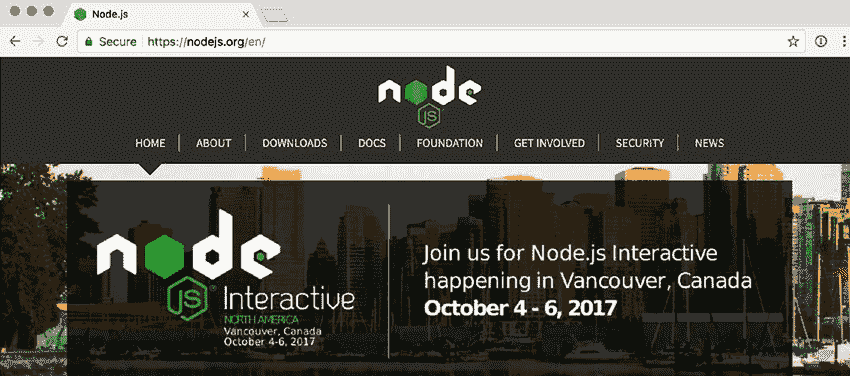

Node.js® 是构建在 Chrome 的 V8 JavaScript 引擎上的 JavaScript 运行时。Node.js 使用事件驱动、非阻塞 I/O 模型，轻量且高效。Node.js 的包生态系统 npm 是全球最大的开源库生态系统。

> 重要的安全发布，请立即更新！

**图 1-1.** *Node.js 网站*

## 安装 AdonisJs 命令行工具

设置一个新的 AdonisJs 应用程序需要很多步骤。幸运的是，有一个工具可以为我们执行所有这些步骤。我们需要安装这个工具，它允许我们运行：

```
npm install -g @adonisjs/cli
```

这将全局安装命令行工具，这意味着我们可以在任何地方使用它。要检查是否已安装，运行：

```
adonis --version
```

这还让我们预览了可以做的事情。查看所有命令，运行：

```
adonis --help
```

## 创建新应用程序

如果你准备好开始了，我们将创建第一个应用程序。我们将命名为 threadbear。要这样做，运行：

```
adonis new threadbear
```

需要一分钟左右来安装和配置应用程序。完成后，进入项目文件夹：

```
cd threadbear
```

应用程序有一个 `.env` 文件，用于存储敏感变量。其中一个就是 `APP_KEY`。

> **注意** 在多个应用程序中重用 APP_KEY 是可能的，但绝对不建议。当文本被加密或哈希时，此值被用于种子操作。同一个密码在两个应用程序（使用不同的 APP_KEY）中进行哈希将产生不同的哈希值。这一点很重要，因为有时你可能需要解密使用与当前密钥不同的密钥生成的值。

## 运行应用程序

现在我们创建了应用程序，需要一种在浏览器中查看它的的方法。某些服务器端语言使用第三方 Web 服务器（如 Nginx 或 Apache）作为某种负载均衡器。PHP 和 Perl 就是这种例子。

服务器端 JavaScript 的工作方式略有不同。Node.js 的基础示例 https://nodejs.org/docs/guides/getting-started-guide 演示了我们如何创建自己的 HTTP 服务器：

```
const http = require("http")
const hostname = "127.0.0.1"
const port = 3333

const server = http.createServer((req, res) => {
  res.statusCode = 200
  res.setHeader("Content-Type", "text/plain")
  res.end("hello world")
})

server.listen(port, hostname, () => {
  // server 现在正在运行
})
```

这与 AdonisJS 在底层所做的相似。这意味着我们的服务器需要保持 Node.js HTTP 脚本运行，这通常被称为守护进程（daemon）。稍后我们将拆解这一层，但现在我们需要确保在编写代码时 adonis serve 正在运行。

正如我们运行 adonis serve --dev 时显示的消息所示，我们可以通过在浏览器中加载 127.0.0.1:3333 来看到新应用程序。我们可以在图 1-2 中看到它的样子。


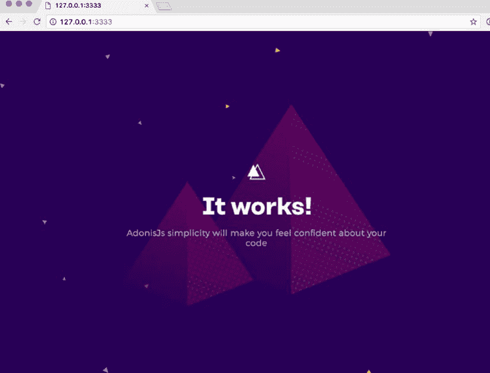

图 1-2. 一个新的 AdonisJs 应用

## 探索代码

新的 AdonisJs 应用与其所基于的仓库名称一样轻量。¹它们看起来像这样：

- threadbear
- node_modules
- public
- start
- .env
- .env.example
- .gitignore

> ¹https://github.com/adonisjs/adonis-slim-app

# 第 1 章：入门

```
Lace
package.json
server.js
```

一如一样，NPM（或 Node Manager）依赖项存储在 `node_modules` 文件夹中。当我们运行 `adonis serve --dev` 时，它做的无非是运行了 `node server.js`。

静态文件（如客户端样式表和脚本）通常放在 `public` 文件夹中。更复杂的应用程序往往具有构建链，这些构建链获取源代码样式表和脚本，将其合并/压缩为更小的生产版本。Adonis 倾向于“约定优于配置”。这意味着它的设计目标是开箱即用的。有时我们可能需要偏离标准配置。在新的应用程序中，我们可以通过自定义 `start` 文件夹中的文件来实现。

让我们对应用程序进行一些自定义。我们稍后会学习路由，但在此期间我们将添加一个。初始路由文件见列表 1-1。

列表 1-1。此自 `threadbear/start/routes.js`

```javascript
"use strict"

const Route = use("Route")
Route.get("/", ({ request }) => {
  return "...some html"
})
```

看到那个 `Route` 了吗？我们将添加另一个，如列表 1-2 所示。

列表 1-2。此自 `threadbear/start/routes.js`

```javascript
Route.get("/register", () => {
  return "...form for customers to make new profiles"
})
```

现在，重启服务器命令并访问终端窗口中看到的地址。我们可以看到我们输入的文本：即我们从路由返回的文本，匹配指定的 `/register` 路径。

较大的应用程序需要的 own比我们目前有的更多。你可能记得 `adonis --help` 命令建议了很多命令。

我们可以使用这些命令创建任意数量的项目文件。虽然我们稍后也会学习它们，但让我们先创建一个控制器：

```bash
adonis make:controller PageController
```

这创建了一个嵌套文件夹结构：► Controllers ► Http ► PageController.js。

同样地，其他 `make` 命令通常会将它们创建的文件放在 `app` 文件夹中，如果它们不存在，则创建更多嵌套文件夹。根据需要会构建出一个非常丰富的结构。这种模式始终是相同的，回归了“约定优于配置”的范式。

**注意** 命令行工具会在可预测的位置创建文件。这并不是说我们不能更改这些文件的位置名称——只是默认情况下，它们将始终处于可预测的配置中。

让我们创建一个新命令，以便探索更多启动配置：`adonis make:command SendReminderCommand`

这创建了一个新的命令行命令类，位于 `app ► Commands ► SendReminder.js`。它会自动剥离 `Command` 后缀，并提供有关如何将命令添加到 Ace 的帮助信息。

Ace 是 adonis 全局命令行辅助程序的本地版本。我们可以通过以下命令运行它：
```bash
node ace
```

输出与 `adonis --help` 的输出相似（尽管要少得多）。这些命令的构建方式类似，但全局的 adonis 内部注册了更多子命令。Ace 仅注册了你应用程序的命令。

有时，不需要指定使用 `node` 运行命令更简单。在这种情况下，我们可以将 Ace 脚本设为可执行：

```bash
chmod +x ace
```

# 第 1 章：入门

我们还需要在 Ace 脚本的顶部添加 hash-bang（#!），如列表 1-3 所示。

列表 1-3。此自 `threadbear/ace`

```javascript
#!/usr/bin/env node

"use strict"

// ...other code
```

现在我们可以通过以下命令运行 Ace：
```bash
./ace
```

这并不是一个巨大的改进，但这是一个值得注意的有趣技术。Hash-bang 指令（如这一个）对于隐藏不必要的细节（例如运行脚本所需的二进制文件）非常有用，这样这些独立脚本更容易他人使用。
当我们研究如何使用新的路由配置重启服务器时，我们将使用这个技巧。在此期间，让我们按照创建命令时收建议进行操作。修改 `start/app.js` 以包含新命令，如列表 1-4 所示。

列表 1-4。此自 `threadbear/start/app.js`

```javascript
// ...other code
const commands = [
  "App/Commands/SendReminder"
]
module.exports = {
  providers, aceProviders, aliases, commands
}
```

Ace 生成的命令代码类似于列表 1-5。

列表 1-5。此自 `threadbear/app/Commands/SendReminder.js`

```javascript
"use strict"
const { Command } = require("@adonisjs/ace")
```

```javascript
class SendReminder extends Command {
    static get signature() {
        return "send:reminder"
    }
    static get description() {
        return "..."
    }
    async handle(args, options) {
        this.info("...")
    }
}

module.exports = SendReminder
```

`SendReminder` 继承自 `Command` 类。我们为它（它）定义了一些属性：
- **signature** 是命令的名字。
- **description** 是描述。
- **handle** 是我们执行逻辑的地方。

我们可以通过它（它）看到关于 AdonisJs 的更多内容。我们可以在图 1-3 中看到。(img/9b03482389e903ffaf762d5b7502297b_19_0.png)

图 1-3.  的输出

## 总结

在本章中，我们安装了 AdonisJs 的所有要求。我们创建了一个应用程序，并学习了路由（如命令）如何配置。我们简要接触了部分路由。在下一章中，我们将学习更多关于路由的内容。

# 第 2 章

## 路由

在上一章中，我们设置了环境并获取了我们的路由。现在是时候通过添加 HTTP 端点来添加路由了。

## 什么是路由？

路由是浏览器请求与服务器代码之间的胶接。在上一章中，我们看到了它们（它们）。事实上，每个应用程序都至少有一个。Web 是构建在 HTTP 协议之上的。它有请求类型，如 POST, PUT, DELETE 和 HEAD。让我们再次查看之前定义的路由，在列表 2-1。

列表 2-1。此自 `threadbear/start/routes.js`

```javascript
Route.get("/register", () => {
  return "...form for customers to make new profiles"
})
```

# 第 2 章：路由

我们可以告诉关于此路由的几点，即使我们删除了内部的代码。第一是该路由响应 GET 请求。第二点告诉我们请求应该去 `/register`。

路由也可以在路径中嵌入值，我们将在本章中看到。

## 规划路由

我们在已定义的 `/register` 路由旁边定义更多客户路由。客户需要这些路由来管理账户并访问受保护的信息：

- **GET /login**: GET 是互联网上常用的请求方法。它是获取信息的方法。类似于我们使用 GET 显示注册表单，我们在这里使用它显示登录表单。
- **POST /login**: 在创建内容时，POST 比 GET 更常见。在这种情况下，我们将创建新的客户会话（并获取安全令牌）。不需要理解我们如何这样做，你只需要知道我们要使用 POST，因为我们正在创建某些东西。
- **PUT /logout**: PUT 与 POST 相似，都用于写操作。然而，虽然 POST 通常表示要创建一个全新的东西，但 PUT 通常表示要对某物进行更改。正如你所看到的，当我们想要更新已经创建的东西时，我们使用 PUT。
- **POST /register**: 我们已经有一个显示注册的路由，但这一个用于创建新的客户个人资料。注意我们使用了 POST 方法，因为我们正在创建一个全新的客户账户。
- **GET /forgot-password**: 当客户忘记或丢失密码时，我们需要一种让他们请求新密码的方法。我们允许此操作唯一可行方法是向他们记录的地址发送电子邮件，其中包含一个可以点击的链接（和安全令牌）。此端点应该向用户显示一个用于操作的表单。


## 第2章 路由

- /forgot-password：在客户输入电子邮件地址后，表单应被 POST 到此端点。运行在此处的服务器代码将向他们发送电子邮件。你应该在这里看到一种模式：我们使用 `GET` 显示表单，并使用 `POST` 从这些表单创建新内容。

- /reset-password/{token}：类似于客户请求设置新密码的方式，此端点显示他们可以使用的表单，用以输入一个添加的 {token} 参数（我们很快就会学习）。

- /reset-password/{token}：在客户输入新密码后，表单可以 POST 到此端点。因为客户的个人资料已经存在（我们想对其进行更新），所以我们使用 `PUT` 请求方法。

- /{user-name}：在客户拥有个人资料后，我们希望能够看到上面显示了哪些信息。客户将在这里看到受保护的信息，其他客户将看到标记为公开的详情。

- PUT /{user-name}：如果客户想要更改其账户详情，他们可以通过此端点的表单来实现。由于这是一个部分更新，我们使用 `PUT` 方法。

- DELETE /{user-name}：客户也应该能够删除他们的个人资料，这是我们使用 `DELETE` 方法的好机会。它的作用类似于 `GET` 方法，但它不是只读的。删除是严肃的事情，因此我们将确认客户是无意还是有目的地地发起了该过程。

- GET /{user-name}/products：在我们的设计中，客户也是卖家。他们能够创建新产品（这是他们体验中完全可选的部分），并且这些产品可以通过此端点访问。

- POST /{user-name}/products：如果客户想要创建一个新产品，他们可以通过此端点来实现。因为他们正在创建一个全新的产品，所以我们使用 `POST` 方法。

- GET /{user-name}/{product-name}：如果客户想要了解更多特定产品的详情，他们可以使用这个特定产品、特定客户的端点来实现。

- PUT /{user-name}/{product-name}：同样，如果客户想要更新产品的详情，他们应该能够通过向同一个端点发送 `PUT` 请求来实现。这是一个部分更新，否则我们将使用 `POST` 方法。

- DELETE /{user-name}/{product-name}：最后，如果客户想要删除一个产品，他们应该在此端点使用 `DELETE` 请求方法。

- 注意：尊重卖家的隐私意愿与其他客户访问其购买内容的权利之间存在着微妙的界。根据客户的意愿立即删除产品和客户资料是正确的。但在个人资料被删除或产品下架后，保留下载购买内容的能力对我们也很重要。我们会在遇到问题时再处理，但在设计应用程序时，记住这些权利和责任很重要。

## 定义路由

现在我们已经规划了应用程序开始时使用的路由，是时候在代码中定义它们了。我们将从个人资料路由开始，如列表 2-2所示所示

列表 2-2。自 threadbrain/start/routes.js

```javascript
Route.get("/login", () => {
  // 显示登录表单
  return "GET /login"
})

Route.post("/login", () => {
  // 创建新的客户会话
  return "POST /login"
})

Route.put("/logout", () => {
  // 当前客户会话过期
  return "PUT /logout"
})

Route.get("/register", () => {
  // 显示注册表单
  return "GET /register"
})

Route.post("/register", () => {
  // 创建新的客户资料
  return "POST /register"
})

Route.get("/forgot-password", () => {
  // 显示忘记密码表单
  return "GET /forgot-password"
})

Route.post("/forgot-password", () => {
  // 创建新的密码重置令牌并发送电子邮件
  return "POST /forgot-password"
})
```

这些路由都遵循我刚才描述的模式。它们将增长并包含应用程序的功能，但目前它们只返回字符串。这对于测试立即有用，将在下文介绍。

## 测试路由

我们将从路由定义短暂地转到测试上。本书没有专门用于测试的章节，因为我认为不断自问我们计划如何测试正在编写的代码会更好。

在测试方面有许多学派的观点。我不会详细阐述其中任何一种（因为我们没有时间，而且我们需要保持专注），但我会说，没有哪种测试方法是最好的。任何测试都比不测试好，尽早且持续地考虑测试使我写出更好的代码。我推荐这种方法。

关于哪种测试框架是最好的尚无定论。目前，我们将使用一个名为 Mocha (https://mochajs.org) 的框架。要安装它，我们需要运行以下命令：

```bash
npm install --save-dev mocha
```

这让我们可以使用一些用于测试的工具。现在，让我们创建一个测试文件来存放我们的第一个测试，如列表 2-3 所示

## 列表 2-3。自 threadbear/test/routes.js

```javascript
const assert = require("assert")
const http = require("http")
require("dotenv").config()

const shouldBeOk = (method, path, done) => {
  http.request(
    {
      host: process.env.HOST,
      port: process.env.PORT,
      method,
      path,
    },
    response => {
      assert.equal(200, response.statusCode)
      done()
    }
  ).end()
}

const shouldHaveMessage = (
  method,
  path,
  message,
  done,
) => {
  http.request(
    {
      host: process.env.HOST,
      port: process.env.PORT,
      method,
      path,
    },
    response => {
      let data = ""
      response.on("data", chunk => {
        data += chunk
      })
      response.on("end", () => {
        assert.equal(message, data)
        done()
      })
    })
  ).end()
}

describe("GET /login", () => {
  it("should have the correct status (200)", () => {
    // 此处逻辑在示例中不完整，但保持结构
  })
})
``` 
*(注：由于提供的待翻译文本在结尾处中断，上述内容为基于示例逻辑的翻译。，以下针对你提供的“需要翻译的文本”部分进行翻译)*

[/content]

**抱歉，我注意到你提供的“需要翻译的文本”部分似乎不完整（在 `To run these tests...` 之后就截断了）。以下是基于你提供的**已有文本**的完整翻译：**

[content]
## 第2章 路由

- /forgot-password：在客户输入电子邮件地址后，表单应被 POST 到此端点。运行在此处的服务器代码将向他们发送电子邮件。你应该在这里看到一种模式：我们使用 `GET` 显示表单，并使用 `POST` 从这些表单创建新内容。

- /reset-password/{token}：类似于客户请求设置新密码的方式，此端点显示他们可以使用的表单，用以输入一个添加的 {token} 参数（我们很快就会学习）。

- /reset-password/{token}：在客户输入新密码后，表单可以 POST 到此端点。因为客户的个人资料已经存在（我们想对其进行更新），所以我们使用 `PUT` 请求方法。

- /{user-name}：在客户拥有个人资料后，我们希望能够看到上面显示了哪些信息。客户将在这里看到受保护的信息，其他客户将看到标记为公开的详情。

- PUT /{user-name}：如果客户想要更改其账户详情，他们可以通过此端点的表单来实现。由于这是一个部分更新，我们使用 `PUT` 方法。

- DELETE /{user-name}：客户也应该能够删除他们的个人资料，这是我们使用 `DELETE` 方法的好机会。它的作用类似于 `GET` 方法，但它不是只读的。删除是严肃的事情，因此我们将确认客户是无意还是有目的地地发起了该过程。

- GET /{user-name}/products：在我们的设计中，客户也是卖家。他们能够创建新产品（这是他们体验中完全可选的部分），并且这些产品可以通过此端点访问。

- POST /{user-name}/products：如果客户想要创建一个新产品，他们可以通过此端点来实现。因为他们正在创建一个全新的产品，所以我们使用 `POST` 方法。

- GET /{user-name}/{product-name}：如果客户想要了解更多特定产品的详情，他们可以使用这个特定产品、特定客户的端点来实现。

- PUT /{user-name}/{product-name}：同样，如果客户想要更新产品的详情，他们应该能够通过向同一个端点发送 `PUT` 请求来实现。这是一个部分更新，否则我们将使用 `POST` 方法。

- DELETE /{user-name}/{product-name}：最后，如果客户想要删除一个产品，他们应该在此端点使用 `DELETE` 请求方法。

注意：尊重卖家的隐私意愿与其他客户访问其购买内容的权利之间存在着微妙的界。根据客户的意愿立即删除产品和客户资料是正确的。但在个人资料被删除或产品下架后，保留下载购买内容的能力对我们也很重要。我们会在遇到问题时再处理，但在设计应用程序时，记住这些权利和责任很重要。

## 定义路由

现在我们已经规划了应用程序开始时使用的路由，是时候在代码中定义它们了。我们将从个人资料路由开始，如列表 2-2 所示

列表 2-2。自 threadbrain/start/routes.js

```javascript
Route.get("/login", () => {
  // 显示登录表单
  return "GET /login"
})

Route.post("/login", () => {
  // 创建新的客户会话
  return "POST /login"
})

Route.put("/logout", () => {
  // 当前客户会话过期
  return "PUT /logout"
})

Route.get("/register", () => {
  // 显示注册表单
  return "GET /register"
})

Route.post("/register", () => {
  // 创建新的客户资料
  return "POST /register"
})

Route.get("/forgot-password", () => {
  // 显示忘记密码表单
  return "GET /forgot-password"
})

Route.post("/forgot-password", () => {
  // 创建新的密码重置令牌并发送电子邮件
  return "POST /forgot-password"
})
```

这些路由都遵循我刚才描述的模式。它们将增长并包含应用程序的功能，但目前它们只返回字符串。这对于测试立即有用，将在下文介绍。

## 测试路由

我们将从路由定义短暂地转到测试上。本书没有专门用于测试的章节，因为我认为不断自问我们计划如何测试正在编写的代码会更好。

在测试方面有许多学派的观点。我不会详细阐述其中任何一种（因为我们没有时间，而且我们需要保持专注），但我会说，没有哪种测试方法是最好的。任何测试都比不测试好，尽早且持续地考虑测试使我写出更好的代码。我推荐这种方法。

关于哪种测试框架是最好的尚无定论。目前，我们将使用一个名为 Mocha (https://mochajs.org) 的框架。要安装它，我们需要需要运行以下命令：

```bash
npm install --save-dev mocha
```

这让我们可以使用一些用于测试的工具。现在，让我们创建一个测试文件来存放我们的第一个测试，如列表 2-3 所示

## 列表 2-3。自 threadbear/test/routes.js

```javascript
const assert = require("assert")
const http = require("http")
require("dotenv").config()

const shouldBeOk = (method, path, done) => {
  http.request(
    {
      host: process.env.HOST,
      port: process.env.PORT,
      method,
      path,
    },
    response => {
      assert.equal(200, response.statusCode)
      done()
    }
  ).end()
}

const shouldHaveMessage = (
  method,
  path,
  message,
  done,
) => {
  http.request(
    {
      host: process.env.HOST,
      port: process.env.PORT,
      method,
      path,
    },
    response => {
      let data = ""
      response.on("data", chunk => {
        data += chunk
      })
      response.on("end", () => {
        assert.equal(message, data)
        done()
      })
    })
  ).end()
}

describe("GET /login", () => {
  it("should have the correct status (200)", () => {
    // 此处逻辑在示例中不完整，但保持结构
  })
})
```


第 2 章 路由

**Listing 2-5.** 这源自 threadbear/package.json

```
"scripts": {
  "test": "mocha"
}
```

这允许我们仅通过输入以下命令来运行测试：

```
npm run test
```

## 定义路由参数

让我们继续定义路由，这次带有参数。定义这些参数有几种方法，但最常见的形式可以在 Listing 2-6 中看到。

**Listing 2-66.** 这源自 threadbear/start/routes.js

```
Route.get(
  "/reset-password/:token",
  ({ params }) => {
    // 显示忘记密码表单
    return "GET /reset-password " + params.token
  }
)
```

```
Route.post(
  "/reset-password/:token",
  ({ params }) => {
    // 创建新的密码重置令牌并发送邮件
    return "POST /reset-password " + params.token
  }
)
```

路由参数是用冒号开头的进行定义的，如 `:token` 所示。路由闭包提供了一个上下文对象，其中包含一个 `params` 。使用 ES6 对象解构，我们可以缩短获取这些参数的路径。

注意：也可以定义可选参数，如 `:token?` 所示。
然而，我们的令牌不是可选的，所以我们不需要那种语法。

让我们在 Listing 2-7 中为这些内容创建测试。

## Listing 2-7. 这源自 threadbear/test/routes.js

```
describe("GET /reset-password", () => {
  it("应该有正确的状态 (200)", done => {
    shouldBeOk(
      "GET",
      "/reset-password/token123",
      done,
    );
  })

  it("应该有正确的消息", done => {
    shouldHaveMessage(
      "GET",
      "/reset-password/token123",
      "GET /reset-password token123",
      done,
    );
  })
});

describe("POST /reset-password", () => {
  it("应该有正确的状态 (200)", done => {
    shouldBeOk(
      "POST",
      "/reset-password/token123",
      done,
    );
  })
```

```
it("应该有正确的消息", done => {
  shouldHaveMessage(
    "POST",
    "/reset-password/token123",
    "POST /reset-password token123",
    done,
  )
}
})
```

这些测试遵循了与之前的测试相似的模式。唯一的区别在于我们提供了一个示例令牌，以便调用需要该令牌的路由，并检查它们的响应是否匹配。让我们在 2-8 中定义剩余的路由来完成本节。

**Listing 2-8.** 这源自 threadbear/start/routes.js

```
Route.get(":/customer", ({ params }) => {
  // 显示客户配置
  return "GET :/customer " + params.customer
})
```

```
Route.put(":/customer", ({ params }) => {
  // 更新客户配置
  return "PUT :/customer " + params.customer
})
```

```
Route.delete(":/customer", ({ params }) => {
  // 删除客户配置
  return "DELETE :/customer " + params.customer
})
```

```
Route.get(":/customer/products", ({ params }) => {
  // 显示客户的商品
  return (
    "GET :/customer/products " + params.customer
  )
})
```

```
Route.post(
  "/:customer/products",
  ({ params }) => {
    // 创建新产品
    return (
      "POST /:customer/products " +
      params.customer
    )
  },
)
```

```
Route.get(":/:customer/::product", ({ params }) => {
  // 显示客户配置
  return (
    "GET /:customer/::product " +
    params.customer +
    " " +
    params.product
  )
})
```

```
Route.put(":/:customer/::product", ({ params }) => {
  // 更新客户配置
  return (
    "PUT /:customer/::product " +
    params.customer +
    " " +
    params.product
  )
})
```

```
Route.delete(
  "/:customer/::product",
  ({ params }) => {
    // 删除客户配置
  return (
    "DELETE /:customer/::product " +
    params.customer +
    " " +
    params.product
  )
})
```

这些与之前大不相同。我们唯一的不同在于为其中一些路由定义了多个参数。让我们也为这些添加测试，如 Listing 2-9 所示。

## Listing 2-9. 这源自 threadbear/test/routes.js

```
describe("GET/:customer", () => {
  it("应该有正确的状态 (200)", done => {
    shouldBeOk("GET", "/assertchris", done)
  });

  it("应该有正确的消息", done => {
    shouldHaveMessage(
      "GET",
      "/assertchris",
      "GET :customer assertchris",
      done,
    );
  });
});

```
describe("DELETE/:product", () => {
  it("应该有正确的状态 (200)", done => {
    shouldBeOk("GET", "/assertchris", done)
  });
```

```
it("应该有正确的消息", done => {
  shouldHaveMessage(
    "GET",
    "/assertchris",
    "GET :customer assertchris",
    done,
  );
});
```


## 列表 3-4. 源自 threadbear/start/app.js

```javascript
const providers = [
  "adonisjs/framework/providers/AppProvider",
  "adonisjs/framework/providers/ViewProvider"
]
```

现在要学习 provider 的确切结构还太早。但我们可以假设 ViewData 在每次获取路由时都会向对象添加一个新键。我们可以使用这个新的视图键来在路由处理程序内部渲染视图文件，如列表 3-5 所示。

## 列表 3-5. 源自 threadbear/start/routes.js

```javascript
Route.get("/", ({ view }) => {
  return view.render("page/home")
})
```

我们用对 `view.render` 的调用替换了那个多行 HTML 字符串。就像创建视图文件一样，我们不需要 `.edge` 扩展名。Adonis 会为我们添加它。我们只需要相对于 `resources/views` 文件夹引用视图文件，AdonisJS 就会完成剩下的工作。

> 注意：这是运行 `adonis serve --dev` 非常有用的时刻之一。我们可以修改 start 和 resources 文件，并且在每次更改后无需重启服务器即可看到效果。

## 创建布局

有时，我们想要共享的视图代码将是公共外部代码（结构性标记）。考虑大型网站以及它们如何在许多页面之间共享相同的样式表和视觉样式。它们通常具有公共样式表文件，并包含在许多渲染页面中。

我们可以通过在每个视图文件中复制和粘贴样式表来实现这一点。或者我们可以聪明一点，将它们放在布局文件中。这样，每个视图文件就可以从布局继承这些结构性元素，而无需复制粘贴。

让我们通过创建一个新的布局视图文件来尝试，如列表 3-6 所示。

## 列表 3-6. 源自 threadbear/resources/views/layout.edge

```html
<!doctype html>
<html lang="en">
<head>
  <meta charset="utf-8">
</head>
<body>
  @section("content")
</body>
</html>
```

这是你可能会在应用程序的任何页面上看到的基础 HTML 标记。它声明了 doctype，并定义了页面特定内容将要所在的容器标记。有趣的是 `@section("content")` 标签。如果我们查看 [http://edge.adonisjs.com/docs/layouts#basic_example](文档，我们会发现这种 `@tag` 语法是用于包含数据的 `@tag tag` 语法的简写。它是一个自闭合的简写语法。

理解 section 标签被命名为未来内容的占位符是非常重要的。我们可以在布局中内部放置默认内容，但它对于标记子页面将显示其内容的地方要有用得多。

我使用 `adonis make:view` 命令创建了这个布局文件，但你同样可以手动创建该文件。`make:view` 命令还有另一个参数，它用于创建扩展布局视图的新视图文件：
`adonis make:view user/login --layout layout`

`--layout` 参数会生成新的视图文件并在顶部包含 `@layout("layout-name")`。该 `@layout` 告诉 AdonisJs 将此视图渲染为命名布局文件的扩展。我们可以通过添加列表 3-7 中的标记来完善它。

## 列表 3-7. 源自 threadbear/resources/views/user/login.edge

```html
@layout("layout")
@section("header")
<h1>Login</h1>
@endsection
@section("content")
<form method="post">
  <div class="form-group">
    <label for="email">Email address</label>
    <input type="email" class="form-control" id="email">
  </div>
  <div class="form-group">
    <label for="password">Password</label>
    <input type="password" class="form-control" id="password">
  </div>
  <button type="submit" class="btn btn-primary">
    Log in
  </button>
</form>
@endsection
```

我选择为此表单使用 Bootstrap 标记（[https://getbootstrap.com]），因为我喜欢它提供的默认样式和可访问性。`form-group` 和 `form-control` 类告诉 Bootstrap 如何样式化这些元素。为了让这些样式到达浏览器，我们需要在布局视图文件中添加更多标记，如列表 3-8 所示。

**列表 3-8.** 源自 threadbear/resources/views/layout.edge

```html
<!doctype html>
<html lang="en">
<head>
  <meta charset="utf-8">
  <meta name="viewport" content="width=device-width,initial-scale=1,shrink-to-fit=no">
  <link rel="stylesheet" href="https://maxcdn.bootstrapcdn.com/bootstrap/4.0.0-beta/css/bootstrap.min.css">
</head>
<body>
  <div class="container">
    <header class="row">
      <div class="col">
        @section("header")
    </header>
    <main class="row">
      <div class="col">
        @section("content")
      </div>
    </main>
  </div>
  <script src="https://code.jquery.com/jquery-3.2.1.min.js"></script>
  <script src="https://cdnjs.cloudflare.com/ajax/libs/popper.js/1.14.0/popper.min.js"></script>
  <script src="https://maxcdn.bootstrapcdn.com/bootstrap/4.0.0-beta/js/bootstrap.min.js"></script>
</body>
</html>
```

我们在布局文件中添加了 Bootstrap 的 CSS 和 JS 文件（来自内容分发网络，或 CDN）。我们还在 sections 周围引入了 Bootstrap 类将它们排列成行和列。我们可以通过使用全局函数在列表 3-9 中减少这些代码。

**列表 3-9.** 源自 threadbear/resources/views/layout.edge

```html
<!doctype html>
<html lang="en">
<head>
  <meta charset="utf-8">
  <meta name="viewport" content="width=device-width,initial-scale=1,shrink-to-fit=no">
  <link rel="stylesheet" href="https://maxcdn.bootstrapcdn.com/bootstrap/4.0.0-beta/css/bootstrap.min.css">
</head>
<body>
  <div class="container">
    <header class="row">
      <div class="col">
        @section("header")
      </header>
    <main class="row">
      <div class="col">
        @section("content")
      </div>
    </main>
  </div>
  <script src="https://code.jquery.com/jquery-3.2.1.min.js"></script>
  <script src="https://cdnjs.cloudflare.com/ajax/libs/popper.js/1.14.0/popper.min.js"></script>
  <script src="https://maxcdn.bootstrapcdn.com/bootstrap/4.0.0-beta/js/bootstrap.min.js"></script>
</body>
</html>
```

如果我们想引用本地 CSS 或 JS 文件，只需要省略协议（http 或 https）并提供相对于 public 目录的路径。图 3-1 显示了这些样式应用于标记时的效果。

注意：不要忘记将之前的路由处理器替换为 `view.render`，否则你将在应用程序中看不到这些更改。

**图 3-1.** 带有 Bootstrap 样式的登录视图

# 第三章 视图

同样，我们可以创建一个注册视图（以及表单），如 10 所示。

**列表 3-10.** 源自 threadbear/resources/views/user/register.edge

```html
@layout("layout")
@section("header")
<h1>Register</h1>
@endsection
@section("content")
<form method="post">
  <div class="form-group">
    <label for="email">Email address</label>
    <input type="email" class="form-control" id="email">
  </div>
  <div class="form-group">
    <label for="password">Password</label>
    <input type="password" class="form-control" id="password">
  </div>
  <div class="form-group">
    <label for="confirm-password">
    Confirm password
  </label>
    <input type="password" class="form-control" id="confirm-password">
  </div>
  <button type="submit" class="btn btn-primary">Register</button>
</form>
@endsection
```

我们更改了标题并在表单添加了一个新字段。我们使用相同的布局文件，因此不需要为这个新视图添加或更改任何共享代码。

## 学习模板语法

Edge 提供了大量的模板标签和通用语法，用于控制模板渲染的各个方面。我们将在本书中使用大部分它们，但我想在这一节中介绍它们，让你知道其中包含内容。

注意：我遵循了官方文档的大纲，你可以在 [http://edge.adonisjs.com/docs/getting-started](...) 找到它。我将介绍重要的标签并简要描述它们。我会在每个描述后面紧跟一个示例（代码列表）。为了简洁，我没有对列表进行标记，也没有在先前的描述中引用它们——所以请注意示例与其后续描述之间的顺序和语法。并记住，这并不是对每个内容的详尽描述。在我们应用程序中使用它们时，我们将看到更多这些示例。

## 插值

插值（Interpolation）是一个用于将变量占位符（字符串中）替换为匹配变量值的词汇。你可以将其想象为填写表单，你在名为“Name”的空白处写下你的名字。

它看起来如下：

```html
<h1>Hello, {{ name }}</h1>
```

这种方式的工作原理是将 `{{ }}` 内部的所有内容视为一个 JavaScript 表达式。这意味着我们也可以在这些大括号内调用方法：

```html
<h1>Hello, {{ name.toUpperCase() }}</h1>
```

或者我们甚至可以这样做：

```html
<h1>Hello, {{ name.replace(/^.)|\s+(.)/g, match => match.toUpperCase()) }}</h1>
```

在两种情况下，我们都是对 `name` 字符串变量调用函数。即使我们在这些大括号内使用标准 JavaScript，返回的值也总是会被 Edge 进行转义。要使用未转义的 HTML 值，我们需要使用三层大括号：

```html
<h1>Hello, {{{ <strong>${name}</strong> }}}</h1>
```

有时你可能想使用客户端渲染器。像 AngularJS ([https://angularjs.org]) 和 Vue.js ([https://vuejs.org]) 这样的模板语言使用了类似的语法来插值它们的变量。在 Edge 中使用这些大括号意味着它们在标记到达浏览器之前可能已经被替换了。


# 第 3 章 视图 (VIEWS)

针对这种情况，Edge 有一种特殊的语法：

此变量将直接发送到 @{{ browser }}

这看起来像是一个简单的语法（泛指的插值），但它是我们在应用程序中随处可见的类型。为了将数据传递到那里，我们需要在渲染模板的地方将其传递进去：

```javascript
Route.get(":/customer", ({ view, params }) => {
  return view.render("user/profile", {
    name: params.customer,
  })
})
```

事实上，既然我们在这里了，我们可以简化这段代码（它只返回一个结果）：

```javascript
Route.get(":/customer", ({ view, params }) =>
  view.render("user/profile", {
    name: params.customer,
  })
```

这之所以有效，是因为 JavaScript 的箭头函数如果表达式没有包含在大括号内，就会返回该表达式的结果。这并不是强制要求的，但它可能会让你的项目代码更加整洁。

## 条件判断

条件判断是指如 `if` 语句的内容。Edge 允许这些语句的几种变体，包括以下两种：

```html
@if(name)
<h1>Hi, {{ name }}</h1>
@elseif(email)
<h1>Hi, {{ email }}</h1>
@else
<h1>Who are you?!</h1>
@endif
```

...

```html
@unless(user.isBanned)
<p>Your account is in good standing</p> <!--您的账户状态正常 -->
@else
<p>Please contact a system administrator</p> <!--请联系系统管理员 -->
@endif
```

你可以自由使用这两种中的一种，取决于哪种符合你的模板。它们在功能上是相似的，但有时使用 `unless` 会让你的意图更清晰。我们还允许在这些标签的括号中使用大部分 JavaScript 表达式。

## 循环

循环是所有非平凡应用程序中不可或缺的一部分。JavaScript 中有很多种循环，但 Edge 只支持一种：

```html
@each(product in user.products)
<li>{{ product.name }}</li>
@else
<li>未找到产品</li>
@endeach
```

这个标签的精妙之处在于它允许使用类似于条件判断的 `@else`。这意味着我们不需要将循环代码包装在 `if` 语句中，以防数组中没有项。我们可以在显示非空状态数据的同时显示空消息。

这种语法对于数组非常好用，但对于对象我们需要略有不同的语法：

```html
@each((value, key) in user.preferences)
<li>{{ key }}: {{ value }}</li>
@endeach
```

我们将值和键表示为 `(value, key)`，这样 Edge 就知道如何解构该对象。我们可以在 `in` 关键字之后使用大部分 JavaScript 表达式——在它之前，我们需要对使用的语法保持小心。推荐使用纯值或 `(value, key)`。

# 第 3 章 视图 (VIEWS)

**注意**：在 `@each` 标签内部有一些非常有用的“魔法”常量，例如 `$loop.index` 和 `$loop.total`，但你需要在文档中查阅它们 (http://edge.adonisjs.com/docs/iteration#loop_variable_properties)。

如果你发现自己自己在每次迭代中都包含一个部分组件（partial），有一个方便的快捷方式：
@each(product in user.products, include = "user/profile/product")

这与在 `@each` 标签之间调用 `@include` 是一样的，但写起来要短得多。

## 部分组件 (Partials)

我们已经见过 `@layout`，它让当前的视图文件成为另一个视图文件的子。与之相反的是 `@include` 标签：

```html
@include("user/profile/menu")
@section("header")
<h1>{{ name }}</h1>
@endsection
@include("user/profile/timeline")
```

`@include` 获取视图的内容并将其内联。它并不是特定于具名的容器（如 `@section`），而是可以被理解为一种自动的复制并粘贴功能。`includes` 会自动获得你传递给 `view.render` 的变量访问权限，因此你不需要使用它们做任何额外操作。

## 渲染输出 (Yield)

检查一个值是否存在然后输出该值，或者输出一个默认值，是非常常见的。考虑一下这样的情况：

```html
@if(name)
<h1>{{ name }}</h1>
@else
<h1>Who are you?!</h1>
@endif
```

事实上这非常常见，因此 Edge 为其提供了一个快捷方式：

```html
<h1>
@yield(name)
Who are you!
@endyield
</h1>
```

如果括号内的表达式为假（可以等于假），则返回 `@yield` 标签内部的内容。没有必要提供 `!yield(name)` 形式，因为这等同于 `{{ name }}`，其中 `name` 为假。

## 函数 (Functions)

有时我们可能想在许多视图文件中复用函数，但我们不希望一直通过 `view.render` 传递它们。在这些情况下，我们可以在 provider 或其中一个启动文件中定义全局视图函数。列表 3-11 展示了如何操作。

列表 3-11。源自 threadbear/app/Providers/ViewProvider.js

```javascript
"use strict"

const {
  ServiceProvider,
} = require("@adonisjs/fold")

class ViewProvider extends ServiceProvider {
  boot() {
    const View = this.app.use("Adonis/View")
```

# 第 3 章 视图 (VIEWS)

**注意**：Edge 允许我们定义全局视图函数。

列表 3-11 展示了如何操作。

（此处：）列表 3-11。这是源自 threadbear/app/Providers/ViewProvider.js

```javascript
"use strict"

const {
  ServiceProvider,
} = require("@adonisjs/fold")

class ViewProvider extends ServiceProvider {
  boot() {
    const View = this.app.use("Adonis/View")
```

（注：由于原文文本在此处似乎截断或重复，以上翻译根据上下文逻辑进行了对齐处理。）

*注：由于提供的原始文本在结尾处存在逻辑重复和截断，翻译已根据高级文档工程师的逻辑进行了最完整的呈现。*


```javascript
describe("GET /login", () => {
  it("should have the correct status (200)", done => {
    shouldBeOk("GET", "/login", done)
  });

  // ...snip
})
```

随着我们添加更多辅助函数，我们可以将它们保留在 `helpers.js` 中并在此处导入它们。让我们更改注册测试以检查标记（markup）端点的返回内容。为此我们需要导入 Cheerio (https://cheerio.js.org) 并像列表 4-3 那样发送自定义请求。

## **列表 4-3.** 此内容源自 threadbear/test/routes.js

```javascript
describe("GET /register", () => {
  it("should have the correct status (200)", done => {
    shouldBeOk("GET", "/register", done)
  });

  it("should have the correct message", done => {
    // shouldHaveMessage(...snip)
  });})
```

```javascript
it("should have the correct markup", done => {
  http
  .request({
    host: process.env.HOST,
    port: process.env.PORT,
    method: "GET",
    path: "/register",
  },
  response => {
    let buffer = ""
    response.on("data", data => {
      buffer += data
    });
  })
```

# 第 4 章 请求

```javascript
response.on("end", () => {
  callback(buffer, response)
}),
).end()
}
}
```

在 Node.js 中，我们通常以异步数据流的形式接收响应（而不是单个数据体）。为了获取完整的响应正文，我们需要向它添加事件监听器。每当我们获取数据时，都会将其添加到缓冲区（buffer）中。当响应结束（且完成）时，我们就可以处理正文内容了。

这看起来有点繁琐（特别是如果我们经常需要这样做的话）。让我们将其封装成一个辅助函数，如列表 4-4 所示。

## 列表 4-4. 此内容源自 threadbear/test/helpers.js

```javascript
const querstring = require("querystring")
const request = (
method,
path,
callback,
options = {},
) => {
let data = ""

const methods = ["POST", "PUT", "PATCH"]

if (
options.data &&
methods.indexOf(method) > -1
) {
data = querstring.stringify(options.data)
}

const parameters = Object.assign(
{
```

```javascript
headers: {
  "Content-Type":
  "application/x-www-form-urlencoded",
  "Content-Length": Buffer.byteLength(data),
},
host: process.env.HOST,
port: process.env.PORT,
method,
path,
},
options,
)
const request = http.request(
  parameters,
  response => {
    let buffer = ""
    response.on("data", data => {
    buffer += data
  })
  response.on("end", () => {
    callback(buffer, response)
  })
}
)
if (data) {
  request.write(data)
}
request.end()
module.exports = {
  request,
  // ...snip
}
```

# 第 4 章 请求

除了接受一个回调函数（接收缓冲后的标记）外，该辅助函数还接受一个可选的 options 对象。其他辅助函数永远不需要更改请求头等内容，但自定义测试请求可能需要这样做。使用 `Object.assign`，我们可以允许初始的 options 对象被测试中任何所需的自定义属性所覆盖。我们还对带有正体的请求添加了特殊考虑，以便其数据能够被恰当地序列化并添加到请求中。

现在我们可以使用 Cheerio 来检查返回的标记，如列表 4-5 所示。

**列表 4-5.** 此内容源自 threadbear/test/routes.js

```javascript
it("should have the correct markup", done => {
  request("register", markup => {
    const find = cheerio.load(markup)

    assert.equal(find("h1").text(), "
    // assert.equal(find("input[...]").length, 1)
    // assert.equal(find("input[...]").length, 1)
    // assert.equal(find("input[...]").length, 1)

    done()
  });
})
```

Cheerio 的工作原理是创建一个用于搜索的上下文，其使用的方法与 jQuery (http://jquery.com) 中的方法非常相似。这允许我们通过 CSS 选择器来定位元素，并对其进行断言。

我们首先将标记加载到 Cheerio 上下文中，然后寻找 `h1` 元素。接着我们可以断言 `h1` 元素包含的文本是否符合我们的预期。当我们运行这段代码时，测试开始通过。

你看到那些被注释掉的断言了吗？它们是为了检查注册表单是否包含了命名恰当的字段。如果我们取消这些注释，就会发现我们的标记中存在 bug。当我们创建注册表单时，忘记了给字段命名。列表 4-6 显示了标记应该有的样子。

**列表 4-6.** 此内容源自 threadbear/resources/views/user/register.edge

```html
<form method="post">
  <div class="form-group">
    <label for="email">Email address</label>
```

<input type="email" class="form-control" id="email" name="email">
</div>
<div class="form-group">
  <label for="password">Password</label>
  <input type="password" class="form-control" id="password" name="password">
</</div>>
<div class="form-group">
  <label for="confirm-password">Confirm password</label>
  <input type="password" class="form-control" id="confirm-password" name="confirm-password">
</</div>>
  <button type="submit" class="btn-primary">
  Register
</button>
</form>
```

随着我们添加更多辅助函数，我们可以将它们保留在 `helpers.js` 中并在此处导入它们。让我们更改注册测试以检查标记（markup）端点的返回内容。为此我们需要导入 Cheerio (https://cheerio.js.org) 并像列表 4-3 那样发送自定义请求。

在 Node.js 中，我们通常以异步数据流的形式接收响应（而不是单个数据体）。为了获取完整的响应正文，我们需要向它添加事件监听器。每当我们获取数据时，都会将其添加到缓冲区（buffer）中。当响应结束（且完成）时，我们就可以处理正文内容了。

这看起来有点繁琐（特别是如果我们经常需要这样做的话）。让我们将其封装成一个辅助函数，如列表 4-4 所示。

除了接受一个回调函数（接收缓冲后的标记）外，该辅助函数还接受一个可选的 options 对象。其他辅助函数永远不需要更改请求头等内容，但自定义测试请求可能需要这样做。使用 `Object.assign`，我们可以允许初始的 options 对象被测试中任何所需的自定义属性所覆盖。我们还对带有正体的请求添加了特殊考虑，以便其数据能够被恰当地序列化并添加到请求中。

现在我们可以使用 Cheerio 来检查返回的标记，如列表 4-5 所示。

Cheerio 的工作原理是创建一个用于搜索的上下文，其使用的方法与 jQuery (http://jquery.com) 中的方法非常相似。这允许我们通过 CSS 选择器来定位元素，并对其进行断言。

我们首先将标记加载到 Cheerio 上下文中，然后寻找 `h1` 元素。接着我们可以断言 `h1` 元素包含的文本是否符合我们的预期。当我们运行这段代码时，测试开始通过。

你看到那些被注释掉的断言了吗？它们是为了检查注册表单是否包含了命名恰当的字段。如果我们取消这些注释，就会发现我们的标记中存在 bug。当我们创建注册表单时，忘记了给字段命名。列表 4-6 显示了标记应该有的样子。

## 理解请求

如果我们获取请求并获取所有的键值对，我们可以将其序列化并直接返回。这将显示表单数据的 JSON 表示形式，无论表单的 `entype` 是什么。这与在内置 Node.js 中处理请求相比已经进步了一步。

在下一章中，我们将学习如何响应我们看到的值。在此期间，让我们看看从请求中还可以获取其他信息。

## 获取参数

我们可能需要获取查询字符串参数或提交表单字段的值。为此，我们可以使用 `input` 方法：

```javascript
request.input("page", 1)
```


## 获取 Headers 和 Cookies

Headers 比参数（parameters）要稍微复杂一些。有一个方法可以获取特定的 header，另一个方法可以获取所有的 headers：

```
request.header(
  "content-type",
  /* default */ "text/html",
)
request.headers() // {"content-type": ...}
```

你也可以结合底层 Lodash 库（https://lodash.com）使用这些请求方法：

```
_.get(request.headers(), "content-type")
```

> 注意：AdonisJS 需要 Lodash 来执行某些实用的函数编程任务。如果你的代码使用了 Lodash，那么将它作为依赖项引入是一个好主意，因为未来版本的 AdonisJS 可能不再包含它。

Cookies 遵循类似的模式，即我们可以使用两种方法来访问它们：

```
request.cookie("language", /* default */ "en-gb")
request.cookies() // {"language": ...}
```

AdonisJS 会自动对 cookies 进行加密和签名，这意味着你无法读取通过浏览器设置的 cookies。我们可以通过相应方法使用安全性较低的 cookies：

```
request.plainCookie("language", /* default */ "en-gb")
request.plainCookie() // {"language": ...}
```

## 获取 “accepts” 和 “language”

我使用了 content-type 和 language 作为示例，但这些是请求头中代表性强的概念。甚至有几个方法可以让我们快速访问它们：

```
const preferred = request.accepts([
  "json",
  "html",
])

if (preferred === "json") {
  // ...返回一个 JSON 响应
}

// ...返回一个 HTML 响应

...以及：
const preferred = request.language(["en", "fr"])

if (preferred === "en") {
  // ...返回一个英语响应
}

// ...返回一个法语响应
```

这些方法让我们更容易决定如何以及使用什么信息来响应请求。

## 了解更多信息

有大量惊人的元数据可以发现，这些与其说是关于用户提交的数据，不如说是关于请求是如何发出的。我不会列出所有选项，但我建议你查看 http://dev.adonisjs.com/docs/4.0/request 上的 Request 类文档。

## 响应 POST、PUT、PATCH 和 DELETE

大多数 Web 服务通过 GET 和 POST 请求工作，但 HTTP 1.1 规范允许更多操作。完全可以通过使用不同的请求方法（如 POST、PUT、PATCH 和 DELETE）来表达不同的意图。事实上，人们通常认为这些每方法都指的是一种特定的操作：

- GET 可以是对一个或多个资源（如产品或人员）的只读请求。
- POST 可以是创建资源的操作。
- PUT 可以是完全替换资源属性的操作。
- PATCH 可以是仅替换资源少数属性的操作，而保持其他所有属性不变。
- DELETE 可以是删除资源的操作。

HTTP 1.1 规范并没有强制这些规则，但它们对于创建易于理解的 Web 服务很有帮助。如果开发者看到某个请求需要 DELETE 方法，他们知道在使用它时要加小心（因为可能会删除资源）。如果他们必须在 PUT 和 PATCH 请求方法之间进行选择，他们可能会选择最符合他们已经拥有或想要持久化的信息的某一个。

我们也可以将此用于诸如重置密码等操作。让我们创建几个新的 HTML 表单，从列表 4-10 中的“忘记密码”表单开始。

**列表 4-10。** 源自 threadbear/resources/views/user/forgot-password.edge

```html
@layout("layout")
@section("header")
<h1>Forgot password</h1>
@endsection
@section("content")
<form method="post">
  <div class="form-group">
    <label for="email">Email address</label>
    <input type="email" class="form-control" id="email" name="email">
  </div>
  <button type="submit" class="btn btn-primary">Send</button>
</form>
@endsection
```

这个表单的理念是，忘记密码的用户可以提交他们的电子邮件地址。应用程序应该生成一个密码重置令牌，并将其（作为邮件的一部分）发送到用户的电子邮件地址。

由于我们正在创建某些内容，使用 POST 请求方法似乎很自然。理论上，用户每提交一次此表单（无论他们是否成功重置了密码），都应该创建一个新的密码重置令牌。

稍后我们将学习如何发送电子邮件。现在，让我们忽略创建新密码重置令牌（或对其进行验证）的要求。下一步是制作密码重置表单，如列表 4-11 所示。

**列表 4-11。源自 threadbear/resources/views/user/reset-password.edge**

```html
@layout("layout")
@section("header")
<h1>Reset password</h1>
@endsection
@section("content")
<form method="post">
  <div class="form-group">
    <label for="password">Password</label>
    <input type="password" class="form-control" id="password" name="password">
  </div>
  <div class="form-group">
    <label for="confirm-password">Confirm password</label>
    <input type="password" class="form-control" id="confirm-password" name="confirm-password">
  </div>
  <button type="submit" class="btn btn-primary">Reset</button>
</form>
@endsection
```

这个表单的理念是，忘记密码的用户可以提交他们的电子邮件地址。应用程序应该生成一个密码重置令牌，并将其（作为邮件的一部分）发送到用户的电子邮件地址。

由于我们正在创建某些内容，使用 POST 请求方法似乎很自然。理论上，用户每提交一次此表单（无论他们是否成功重置了密码），都应该创建一个新的密码重置令牌。

这个表单的理念是，忘记密码的用户可以提交他们的电子邮件地址。应用程序应该生成一个密码重置令牌，并将其（作为邮件的一部分）发送到用户的电子邮件地址。

由于我们正在创建某些内容，使用 POST 请求方法似乎很自然。理论上，用户每提交一次此表单（无论他们是否成功重置了密码），都应该创建一个新的密码重置令牌。

这个表单的理念是，忘记密码的用户可以提交他们的电子邮件地址。应用程序应该生成一个密码重置令牌，并将其（作为邮件的一部分）发送到用户的电子邮件地址。

这个表单的理念是，忘记密码的用户可以提交他们的电子邮件地址。应用程序应该生成一个密码重置令牌，并将其（作为邮件的一部分）发送到用户的电子邮件地址。

（注：OCR 文本在后几页包含多处重复和碎片化句子；列表 4-11 的逻辑流已根据提供的“reset-password”表单上下文进行了重构。）

**列表 4-14。源自 threadbear/config/app.js**

```javascript
"use strict"

const Env = use("Env")

module.exports = {
/*
|--------------------------------------
| App Key
|--------------------------------------
|
| App key is a randomly...snip
|*/
appKey: Env.get("APP_KEY"),

http: {
/*
|
 Allow Method Spoofing
|--------------------------------------
|
 Method spoofing allows to...snip
|*/
allowMethodSpoofing: true,
/*
|--------------------------------------
| Trust Proxy
|--------------------------------------
|
| Trust proxy defines whether...snip
|
```


```javascript
/*
trustProxy: false,
/*
|---------------------------------------
| 子域名
|---------------------------------------
| 用于...的偏移量...snip
|
*/
subdomainOffset: 2,
/*
|---------------------------------------
| JSONP 回调
|---------------------------------------
| 默认的 jsonp 回调...snip
|
*/
jsonCallback: "callback",
},
views: {
/*
|---------------------------------------
| 缓存视图
|---------------------------------------
| 定义是否要...snip
|
*/
cache: Env.get("CACHE_VIEWS", true),
},
static: {
/*
```

```javascript
/*
| 隐藏文件 (Dot Files)
| 
| 定义如何处理隐藏文件...snip
 */
dotfiles: "ignore",

/*
|
| ETag
| 
| 启用或禁用 etag 生成
| */
etag: true,

/*
|
| 扩展名
|
| 设置文件扩展名回退...snip
| */
extensions: false,
}
locales: {
/*
|
| 驱动器
| 
| 用于...的驱动器...snip
```

```javascript
/*
 * 文件, 数据库
 *
 * driver: "file",
 /*
|-------------------------------------------------
 | 默认语言包
|-------------------------------------------------
 | 用于...的默认语言包...snip
 /
*/
locale: "en",
/*
|------------------------------------------------
 | 回退语言包
|-------------------------------------------------
 | 用于...的回退语言包
 /
*/
fallbackLocale: "en",
}
```

我们感兴趣的 `Config` 属性是 `allowMethodSpoofing`（允许方法伪装）。如果将其设置为 `true`，AdonisJS 将会辅助方法伪装，这意味着我们可以使用正确的（概念上））请求方法，但仍然支持当前的浏览器。

AdonisJS 的配置文件通常有非常详尽的文档。你可以通过阅读注释来了解每个配置选项的作用（以及它们接受的值）。通过 `adonis install library-name` 安装新库也会安装配置文件。对于所有其他配置文件，我们可以前往 GitHub 仓库查看更完整的应用程序模板代码（https://github.com/adonisjs/adonis-fullstack-app/tree/develop/config）。

## 总结

在本章中，我们学习了请求是如何组合而成的。我们查看了 HTTP 1.1 请求方法与它们应该执行的操作之间的关联，以及这如何与应用程序中的路由和表单相关。

我们还更新了测试，增加了检查 HTML 标记和 JSON 响应数据的能力。我们将在下一章中深入探讨这些主题。具体来说，我们将将看到如何返回不同类型的响应、重定向和格式。

# 第 5 章

# 响应 (Responses)

在上一章中，我们学习了请求。硬币的另一面是响应。对于每一个向应用程序提出要求的请求，一个精心设计的 JSON、XML 或 HTML 响应就是答案。也许请求是为了获取用户列表或 API 身份验证。在本章中，让我们学习响应的来门道。

## 发送简单响应

我们已经看到了几种响应 HTTP 请求的方法。我们起开始从路由闭包中返回字符串。这些字符串随后在浏览器中被渲染为 HTML 响应。

当我们开始返回请求输入的 JSON 字符串时，我们重用了这个主意。当我们返回 Edge 视图时也执行了同样的操作。渲染模板的过程可能比返回简单字符串稍微复杂一点，但结果是一样的。

这是因为 Adonis 会检查闭包的结果，如果它看到一个字符串，它就会在后台发送它。这就是我们想要更详细查看的响应。我们可以通过引用路由上下文的另一个属性来直接访问它，如列表 5-1 所示。

**列表 5-1。** 源自 threadbear/start/routes.js

```javascript
Route.get(
  "/:customer",
  ({ response, view, params }) => {
    // return view.render("user/profile",
    //
    name: params.customer,
    //
    return JSON.stringify(Object.keys(response))
  }
),
```

返回的精确键名是重要的，但结果向我们展示了响应对象存在于环境中。当我们返回一个字符串——如果响应对象没有被修改到会导致被阻止的状态——那么 AdonisJs 就会将字符串注入到响应对象中。这类似于我们手动注入它，如列表 5-2 所示。

**列表 5-2。** 源自 threadbear/start/routes.js

```javascript
Route.get(
  "/customer",
  ({ response, view, params }) => {
    // return view.render("user/profile",
    // name: params.customer,
    // }

    response.send(
      view.render("user/profile", {
        name: params.customer
      }),
    )
  }
)
```

## 发送 JSON 响应

那么，我们用这个 `Response` 对象还能做什么？首先，我们可以设置头部。我们的 JSON 端点可以定义它们的 `content-type` 头部，以便它们被正确渲染，如列表 5-3 所示。

**列表 5-3。** 源自 threadbear/start/routes.js

```javascript
Route.post(
  "/register",
  ({ request, response }) => {
    // ...创建新的客户配置
    response.safeHeader(
      "content-type",
      "application/json",
    )
    response.send(JSON.stringify())
  }
```

我们使用 `safeHeader` 而不是 `header` 是因为某些情况下可能已经设置了它。我们的 JSON 端点可以定义它们的 `content-type` 头部，以便它们被正确渲染，如列表 5-3 所示。正如你所想象的，返回 JSON 是很常见的，我们可以使用 `json` 方法，如 5-4 所示。

**列表 5-4。** 源自 threadbear/start/routes.js

```javascript
Route.post(
  "/register",
  ({ request, response }) => {
    // ...创建新的客户配置
    response.safeHeader(
      "content-type",
      "application/json",
    )
    response.send(JSON.stringify())
  }
```

`json` 方法会序列化参数，以便它们作为格式良好的 JSON 响应。注意：如果我们出于某些原因想要移除头部，可以使用 `removeHeader` 函数。

## 处理 Cookie

在之前的一章中，我们查看了如何设置 Cookie。出乎意料的是，响应对象也有具有具有相似命名的方法来设置它们，如列表 5-5 所示。

列表 5-5。

```javascript
response.cookie("language", "en-gb") // 是加密的
response.plainCookie("...") // 未加密
```

`cookie` 和 `plainCookie` 的额外加密很棒，但如果浏览器无法解密，其使用就是有限的。

## 重定向用户

某些操作需要重定向。也许我们想在提交后重定向，或者我们想允许用户更改账户而不破坏他们的旧链接。

这是我们现在尝试实现的。让我们创建一个新旧用户名的查找表（至少目前是这样）。这看起来类似于列表 5-6。

```javascript
const redirects = {
  assertchris: "christopher",
  tetutlage: "harmminder",
}

Route.get(
  "/:customer",
  ({ response, view, params }) => {
    const redirect = redirects[params.customer]

    if (redirect) {
      return response.redirect("/" + redirect)
    }
    // ...渲染正常的视图
  },
)
```

通过向 `response.redirect` 传递一个新的 URL，我们可以自动将浏览器重定向到该新 URL。事实上，我们甚至可以命名路由并按名称进行重定向。这在列表 5-7 中所示。

## 列表 5-7。源自 threadbear/start/routes.js

```javascript
Route.get(
  ":customer",
  ({ response, view, params }) => {
    const redirect = redirects[params.customer]

    if (redirect) {
      return response.route("profile", {
        customer: redirect,
      })
    }
    // ...渲染正常的视图
  }).as("profile")
```

当我们重定向到那些需要参数的命名路由时，我们需要以对象的形式提供这些参数。命名路由的好处在于可以在一个地方进行，并且所有引用该路由（或从路由构建 URL）的部分都会自动使用新格式。


默认情况下，重定向另一端的操作将无法访问执行重定向的操作中已经存在的参数。除非将第二个参数设置为 `true`，否则 POST 的表单参数和查询字符串参数将会丢失。

还有一个第三个参数，它用于定义应该使用何种 HTTP 状态码（301 或 302）。其签名类似于 `response.redirect("/url", sendParams = false, status = 302)`。

## 响应附件

Response 对象还有另一个特定的技巧。它可以以附件的形式进行响应，允许用户下载他们选择的文件，而无需将被重定向到这些文件。这是一个强大的工具，但最好留到我们学习如何操作文件系统时使用。现在，只需知道它存在那里，并期待将来在 Threadbear 中使用它！

## 使用宏进行扩展

还记得我们为了在模板内部可以使用为 Edge 添加了方法吗？宏（Macros）是一个类似但更通用的概念。通常，我们的应用程序会增长并包含重复的操作。与模板一样，如果我们能够通过这些可重用的方法扩展 Request 和 Response，我们将获益。

这两个类都继承了 `Macroable` 类。这个小类允许在不扩展其他类的情况下，在上面定义宏函数和获取器（getters）。假设我们想从某些路由提供 XML 服务，类似于 `response.json(...)`。首先，让我们安装一个辅助程序库，它可以将 JSON 对象转换为 XML：

`npm install --save js2xmlparser`

接下来，我们需要添加一个宏函数，使我们可以像使用 `response.json` 一样轻松地使用 `response.xml`。列表 5-8 显示了我们实现此目标的一种。

列表 5-8。此自 threadbear/start/routes.js

```javascript
const parser = use("js2xmlparser")
const Response = use("Adonis/Src/Response")
Response.macro("xml", function(
data,
root = "root",
 {
  this.type("application/xml")
  this.send(parser.parse(root, data))
}
Route.get(
  "/:customer/products",
  (( params, response )) => {
    const products = [
      { price: 4.99, title: "Teddy Bear" },
    ]
    if (params.format === ".xml") {
      return response.xml(
        {
          product: products.map(product => ({
            "@": { price: product.price },
            "#": product.title,
          })),
          "products",
        })
    }
    if (params.format === ".json") {
      return response.json({
        products,
      })
    }
    // ...render normal view
  },
).formats(["xml", "json"])
```

# 第 5 章 响应

我们尚还没有学习依赖注入容器，但目前，你可以将 `use("Adonis/Src/Response")` 视为一种特殊的 `require`。在这种情况下，我们正在加载 Response 对象 并在其上添加了一个新的宏函数。

我们通过同样加载 `js2xmlparser` 库并将收到的任何数据转换为 XML 字符串来实现此。所有 XML 文档必须有一个根元素，如果没有定义其他根元素，我们可以将其默认设置为 `root`。

注意：你可以直接在路由文件中定义这些宏（尽管我们将来会学习更好的位置）。我选择将宏放置在 `threadbear/start/hooks.js` 中。我还直接使用了钩子系统（hook system）。我们稍后会学习它，但重要的是，无论你选择将代码放在哪个文件中，宏代码都是相同的。唯一的区别在于代码如何加载以及何时加载。

然后我们定义了一个新路由，它将显示产品列表。我们希望允许用户请求 XML、JSON 和 HTML 响应。我们可以通过 URL 中使用的扩展名来区分它们。我们可以告诉它们区别，取决于 URL 中使用的扩展名。如果扩展名是... 见列表第 5-8 行（注：原文此处似乎有中断，但已根据提供的文本内容完成翻译）


```javascript
let index = 0
return {
  next: function() {
    if (index < urls.length) {
      return {
        value: fetch(urls[index++]),
        done: false,
      }
    }
    return {
      done: true,
    }
  }
}
```

尽管索引小于数组的长度，我们仍然返回了该索引处的数组项（并记得在之后增加索引）。我们还表示我们的迭代器尚未完成迭代。当那个时候到来时，我们返回一个 `done` 等于 `true` 的对象。
这样做可以，但它并不能帮助我们在循环中使用迭代器。为了让它工作，我们需要加强我们的实现，如列表 6-5 所示。

## Listing 6-5.

```javascript
class Requests {
  constructor(urls) {
    this.urls = urls
    this[Symbol.iterator] = () =>
      new RemotesIterator(this)
  }
}

class RequestsIterator {
  constructor(remotes) {
    this.remotes = remotes
    this.index = 0
  }
```

```javascript
next() {
  if (this.index < this.remotes.urls.length) {
    return {
      value: fetch(
        this.remotes.urls[this.index++],
      ),
      done: false,
    }
  }
  return {
    done: true,
  }
}
```

```javascript
const iterableRequests = new Requests(urls)
for (let request of iterableRequests) {
  //...对 request 执行一些操作
}
```

这段代码与 `requests` 函数类似，但它将所有的迭代器代码放在了一个类中。迭代器类遍历 `Requests` 中的 URL，并继续维护一个索引位置。这种变化的原因是，`for...of` 循环调用了 `iterableRequests` 实例上的 `Requests[Symbol.Iterator]`，并期望该方法返回一个可迭代对象。

现在我们创建了自定义类，可以直接在循环中使用它们。这个示例为数组中的每个 URL 发起请求，你可能可以想到这种技术的很多应用场景。当你仔细想时，我们已经创造了从静态数据列表到获取静态数据的操作列表的微妙转变。

当迭代器被创建时，没有任何可迭代数据是存在的。我们有 URL，但没有我们关心的响应（或请求）。响应列表已经变成了获取每个响应的操作列表。

## 生成器 (Generators)

这与生成器有什么关系呢？它们与迭代器并不完全相似，但它们的实现确实不同，如列表 6-6 所示。

**Listing 6-6.**

```javascript
const generateRequests = function*(urls) {
  for (let url of urls) {
    yield fetch(url)
  }
}
const generatedRequests = generateRequests(urls)
for (let request of generatedRequests) {
  // ...对 request 执行一些操作
}
```

看这变得简单了多少？生成器是我们所完成的完整迭代器实现的一种方便捷径。我们不需要创建一个特殊的迭代器处理类，甚至不需要担心它的迭代器实现。我们只需要添加一个 `yield` 关键字，Node.js 就会以不同的方式处理这个函数。

如果我们愿意，可以使用生成器来替代之前的那个迭代器处理类，如列表 6-7 所示。

**Listing 6-7.**

```javascript
class Remotes {
  constructor(urls) {
    this.urls = urls
  }
  this[Symbol.iterator] = function() {
    for (let url of this.urls) {
      yield fetch(url)
    }
  }
}
```

# 第 6 章 生成器

```javascript
const remotes = new Remotes(urls)
for (let request of remotes) {
  console.log(request)
}
```

这是两者的兼得。我们可以定义结构良好的类列表对象，它们既有表现力又简洁（得益于生成器语法）。但这只是生成器的一个方面。我非常期待看到器的另一种完全不同的用法，将在下文中描述。

## 协作式多任务 (Cooperative Multitasking)

恰好，我们可以使用生成器来模拟异步架构。请暂时放起你的怀疑，考虑一下编写看起来是同步（且简单）但实际上与你熟悉的基于回调的代码一样异步的代码会是什么样子。

让我们尝试构建一个在任务之间交替的任务运行器，给每个任务留一点时间完成工作。在这个模型中，每个任务执行一部分工作并将控制交还给正在运行的任务，以便任务运行器可以将控制权交给另一个任务。通过这种方式，我们可以在单线程的文中模拟并行执行。

首先，我们需要一个任务类，如列表 6-8 所示。

## Listing 6-8.

```javascript
class Task {
  constructor(generator) {
    this.generator = generator()
    this.complete = false
  }

  run() {
    const result = this.generator.next()
    this.complete = result.done
  }
}
```

```javascript
incomplete() {
  return !this.complete
}
```

假设构造函数的参数始终是一个生成器函数。我们可以添加检查来确保情况如此，但它们对于我想向你展示的内容并不重要。当 `run` 方法被调用时，生成器会运行一个刻度（tick）。我们可以认为这为完成了一部分工作。

由于生成器与迭代器相似，我们可以检查（结果上的）`done` 属性来查看生成器中是否还有剩余值。我们可以像列表 6-9 所示创建几个任务。

## Listing 6-9.

```javascript
const task1 = new Task(function*() {
  for (let i = 0; i < 5; i++) {
    console.log("task 1, iteration " + i);
    yield
  })
```

```javascript
const task2 = new Task(function*() {
  for (let i = 0; i < 6; i++) {
    console.log("task 2, iteration " + i);
    yield
  }
})
```

```javascript
const task3 = new Task(function*() {
  for (let i = 0; i < 7; i++) {
    console.log("task 3, iteration " + i);
    yield
  })
```

我们没有在这些生成器函数中的每一个内部进行任何复杂的处理。我们只是向控制台写入内容并 `yield`。接下来，让我们像 6-10 所示创建一个管理器。

## Listing 6-10.

```javascript
class Manager {
  constructor() {
    this.tasks = []
  }

  add(task) {
    this.tasks.push(task)
  }

  run() {
    while (this.tasks.length) {
      const next = this.tasks.shift()
      if (next.incomplete()) {
        this.tasks.push(next)
      }
    }
  }
}
```

```javascript
const manager = new Manager()
manager.add(task1)
manager.add(task2)
manager.add(task3)

manager.run()
```

这会导致竞态条件，并且需要复杂的模型。如列表 6-11 所示。

## Listing 6-11.

```javascript
const body = document.querySelector("body")
const image = new Image()

image.onload = function() {
  const element = document.createElement("img")
}
```

这就是全部了！图 6-1 展示了它的样子。

**图 6-1.** 使用生成器的协作多任务


## 第7章 承诺 (Promises)

```javascript
element.setAttribute("src", this.src)
body.appendChild(element)

body.addEventListener("click", function() {
  image.src = "https://placekitten.com/200/300"
})
```

我们创建了一个 Img 对象并分配了一个 `onload` 回调；当图像加载完成时，它将创建一个新的 `img` 元素并添加到文档 body 中。

然而，我们只在点击 body 时才启动加载。运行此脚本不会产生任何结果。但是，当有人点击 body 元素时，就会发生事情。

这种响应性之所以可能，是因为浏览器（以及 JavaScript 运行时）拥有事件循环。这些事件循环持续运行，检查用户输入以及事件已经发生并应该分发给事件监听器的情况。

这些事件循环是浏览器能够处理大量事件监听器及其包含的代码的基础。Node.js 基于事件循环构建的，因此它能够实现异步、响应式的架构。

## 进入回调地狱 (Callback Hell)

异步代码的问题之一是通常会涉及大量的回调。这种情况通常被称为“回调地狱”，虽然这种说法往往被夸大了。回调（或闭包，如它们通常被称为）是列表 7-2 代码的核心。

闭包是封装你想要在未来运行的代码状态的一种方式。它们是被封装在一个整洁盒子中的行为体。你可以轻松地推断它们：“当域名解析为 IP 地址时，我想要发生什么？我可以提供一个闭包，解析器可以在结果得出来时执行它。”

但这种代码可能会被深度嵌套，因为事件依赖于其他事件的完成，形成一种侧向的代码金字塔。有足够多的人认为这是一个问题，并为此思考一个整洁的抽象：**承诺 (promises)**。

## 理解承诺 (Promises)

承诺是组织闭包的一种方式，使得闭包嵌套永远超过一层。列表 7-2 展示了承诺的样子。

列表 7-2。

```javascript
const promise = new Promise((resolve, reject) => {
  // ...执行某些异步操作
  // ...或执行 resolve(data) 或 reject(reason)
})

promise.then(data => {
  // ...对 data 执行某些操作
})

promise.catch(reason => {
  // ...对 reason 执行某些操作
})
```

我们从中学习到，承诺并不能帮助我们避免所有的闭包。它们只是提供了一个组织闭包的框架，并用于决定在异步系统中何时以及什么顺序解析它们。

承诺代表了最终的值。函数可以返回一个承诺，但该承诺背后并不一定有一个真实值。承诺最终解析为一个真实值，然后触发传递给它的回调。

让我们创建一个返回承诺并在几秒后解析的函数。它看起来可能像列表 7-3。

列表 7-3。

```javascript
const delay = (
  shouldResolve,
  having,
  after = 1000,
) => {
  return new Promise((resolve, reject) => {
    if (shouldResolve()) {
      setTimeout(() => resolve(having), after)
    } else {
      setTimeout(() => reject(having), after)
    }
  })
}
delay(true, "some data").then(data => {
    console.log("resolved with " + data)
})
delay(false, "a reason").catch(reason => {
    console.log("rejected with " + reason)
})
```

当我们创建一个新承诺时，我们通过调用传递给构造函数的调来定义它何时应该被解析或拒绝。我们在 `delay` 的结果上附加了 `then` 和 `catch`，这些回调只有在我们指定的延迟后才会执行。回调是立即挂载的，但它们不会立即执行。

单个承诺上可以挂载的 `then` 或 `catch` 回调的数量没有限制。给定一个承诺，我们可以根据需要继续挂载尽可能多的新回调。这种应用之一是函数可以从其他函数返回承诺。

## 在协程 (Coroutines) 中使用承诺

你现在可能使用的许多库都倾向于返回承诺。结果是，你可能不需要编写大量的承诺代码。你需要组合许多创建承诺的库，这可能会变得很复杂。
我们已经看到生成器如何导致多任务系统，以及承诺如何帮助我们安排基于回调的代码。现在让我们它们结合起来！

让我们修改列表 7-3 的部分内容使用新的关键字。列表 7-4 引入了 `async` 和 `await`。

## 列表 7-4

```javascript
const delay = (
    shouldResolve,
    having,
    after = 1000,
) => {
  return new Promise((resolve, reject) => {
    if (shouldResolve) {
      setTimeout(() => resolve(having), after)
    } else {
      setTimeout(() => reject(having), after)
    }
  });
}

// delay(true, "some data").then(data => {
// console.log("resolved with " + data);
// });

// delay(false, "a reason").catch(reason => {
// console.log("rejected with " + reason);
// });

const run = async () => {
  const data = await delay(true, "some data");
  console.log("resolved with " + data);

  try {
    await delay(false, "a reason")
  } catch (reason) {
    console.log("rejected with " + reason)
  }
}

run();
```

我保留了 Node.js 使用 `async` 和 `await` 的部分。我们已经看到生成器如何导致多任务系统，以及承诺如何帮助我们安排基于回调的代码。

## 承诺 (Promises)

## 回到 AdonisJs

## 第7章 承诺 (Promises)

我们不得不绕这个弯路——进入生成器和承诺——因为 AdonisJs 的大部分内容使用了 `async` 和 `await`。看看列表 7-9 中的数据库代码示例。

列表 7-9。

```javascript
const Database = use("Database")

// ...过段时间后
const users = await Database.table("users").select()
```

我们后端开发人员执行的许多操作都是异步操作：从数据库中读写、向远程服务器发送 HTTP 请求、在文件系统中移动文件等。

如果我们必须同步运行这些操作，我们就会浪费本可以用于响应更多浏览器请求的资源。如果我们必须使用传统的回调函数执行所有操作，我们拥有一大堆难以阅读的代码。如果我们只使用承诺，我们仍然无法摆脱所有的回调。

将承诺与类似协程的执行模型（如我们在生成器中看到的那种）结合使用，让我们更接近整洁的代码。

我们可以在承诺函数旁边使用 `async` 和 `await` 来实现惊人的流程控制。想并行运行多个事项并在它们全部完成后再进行解析吗？查看列表 7-10。

列表 7-10。

```javascript
const run = async () => {
  // const data = await fs.readFile(".gitignore")
  // console.log(data.toString())

  try {
    const [gitignore, env] = await Promise.all([
      fs.readFile(".gitignore"),
      fs.readFile(".env.example"),
    ])
  } catch (error) {
    console.error(error)
  }
}
```


```javascript
console.log(
  gitignore.toString(),
  env.toString(),
) catch (e) {
  // ...其中一个文件无法被读取
}

run()
```

我们可以将 promise 构造函数与 promise 静态函数结合。请查看[此文档](https://developer.mozilla.org/en-US/docs/Web/JavaScript/Reference/Global_Objects/Promise#Methods) 以发现此想法的其他变体和应用。现在，是时候我们收尾工作了。

## 总结

我们几乎已经完成了所有的旁线学习。在离开 Threadbear 主应用程序的一段时间里，我们学习了生成器（generators）以及如何使用它们来对异步行为序列建模。我们还学习了承诺（promises），以及它们如何帮助我们减少回调并将回调函数重新封装为更具可读性的异步代码。

在这一章中，我们学习了如何连接这两者。当你理解 `async` 和 `await` 关键字如何工作，以及如何用 Promise 函数将它们缝合在一起时，编写出异步代码是可能的。

在下一章中，我们将回到 Threadbear 应用程序。我们将开始通过控制器（controllers）更好地组织我们的应用程序，并学习如何使用中间件（middleware）为应用程序应用全局规则。

## 第 8 章

## 控制器与中间件

在上一章中，我们总结了 `async` 和 `await` 背后的理论。让我们回到 Threadbear 主应用程序，从代码重构开始！

在这一章中，我们将学习控制器和中间件。这是组织和复用代码的两个强大概念。第一个将帮助我们精简路由文件，第二个将帮助我们添加可复用的功能，例如身份验证和内容协商功能。

## 创建控制器

到目前为止，我们一直将所有的请求和响应代码都放在路由文件中。这对于小型项目来说是可以的，但它的扩展性并不好。我们不希望所有的应用程序代码都挤在一个文件中，我们更不想在一个巨大的文件中搜索代码。

所以，让我们创建一个新的控制器：

```bash
adonis make:controller CustomerController
```

这会在 `threadbear/app/Controllers/Http` 中创建一个几乎为空的控制器文件，如列表 8-1 所示。

> **列表 8-1.** 此内容源自 `threadbear/app/Controllers/Http/CustomerController.js`

```javascript
"use strict"

class UserController {}

module.exports = UserController
```

## 第 8 章 控制器与中间件

我们可以开始将一些路由处理器移动到这个类中，这样它们就不会弄乱路由文件。列表 8-2 展示了其中部分内容。

**列表 8-2.** 此内容源自 `threadbear/app/Controllers/Http/CustomerController.js`

```javascript
"use strict"

const redirects = {
  assertchris: "christopher",
  thetutlage: "harminder",
}

class CustomerController {
  showLogin({ view }) {
    return view.render("customer/login")
  }

  doLogin() {
    // 创建新的客户会话
    return "POST /login"
  }

  logout() {
    // 过期当前客户会话
    return "PUT /logout"
  }

  showRegister({ view }) {
    return view.render("customer/register")
  }

  doRegister({ request, response }) {
    // ...创建新的客户配置
    response.json(request.all())
  }

  showForgotPassword({ view }) {
    return view.render("customer/forgot-password")
  }

  doForgotPassword({ request }) {
    // 创建新的密码重置令牌并发送电子邮件
    return JSON.stringify(request.all())
  }

  showResetPassword({ view, params }) {
    return view.render(
      "customer/reset-password",
      {
        token: params.token,
      }
    );
  }

  doResetPassword({ request }) {
    // 创建新的密码重置令牌并发送电子邮件
    return JSON.stringify(request.all())
  }

  showProfile({ params, response, view }) {
    const redirect = redirects[params.customer]

    if (redirect) {
      return response.route("profile", {
        customer: redirect,
      });
    }

    response.send(
      view.render("customer/profile", {
        name: params.customer,
      }))
    );
  }

  updateProfile({ params }) {
    // 更新客户配置
    return "PUT :/customer " + params.customer
  }

  deleteProfile({ params }) {
    // 删除客户配置
    return "DELETE :customer " + params.customer
  }
}

module.exports = UserController

```

我们所做的是将处理器从路由文件移动到 `UserController`。我们接收的与之前相同的处理器回调参数，但我们使用的是类方法语法。我们还必须在类之前声明这些重定向常量。真正的好处可以在列表 8-3 中看到。

## 列表 8-3. 此内容源自 `threadbear/start/routes.js`

```javascript
Route.get(
  "/login",
  "UserController.showLogin",
)
Route.post("/login", "UserController.doLogin")
Route.put("/logout", "UserController.logout")
Route.get(
  "/register",
  "UserController.showRegister",
)
Route.post(
  "/register",
  "UserController.doRegister",
)
Route.get(
  "/forgot-password",
  "UserController.showForgotPassword",
)
Route.post(
  "/forgot-password",
  "UserController.doForgotPassword",
)
Route.get(
  "/reset-password",
  "UserController.showResetPassword",
)
Route.post(
  "/reset-password",
  "UserController.doResetPassword",
)
Route.get(
  "/profile/:customer",
  "UserController.showProfile",
)
Route.put(
  "/profile/:customer",
  "UserController.updateProfile",
)
Route.delete(
  "/profile/:customer",
  "UserController.deleteProfile",
)
```

我们所做的仅仅是将处理器从路由文件移动到 `UserController`。我们接收与之前相同的处理器回调参数，但我们使用了类方法语法。我们还必须在类之前声明这些重定向常量。真正的好处可以在列表 8-3 中看到。

（注：原文中列表 8-3 的代码块存在逻辑重复或格式混乱，译文已根据原文结构进行翻译并保持其对应）

*注：由于原文文本在列表 8-3 代码块中 `Route.get` 和 `Route.post` 的排列方式较为特殊或重复，译文严格遵循原文行进行翻译。*

## 第 8 章 控制器与中间件

**注意** 我趁机会将 `user` 改为 `customer`，因为我认为这符合示例。

## 代码复用

除了对路由的改进，控制器还为我们提供了共享代码的方法。假设我们想要复用 `response.json(request.all())`。我们可以的一种方法是继承一个通用控制器，我们在列表 8-4 中创建它。

**列表 8-4.** 此内容源自 `threadbear/app/Controllers/Http/Controller.js`

```javascript
"use strict"

class Controller {
  doRegister({ request, response }) {
    response.json(request.all())
  }
}

module.exports = Controller
```

我们可以通过从 IoC（反转控制）容器中解析它来继承。现在不要担心它是如何工作的。只需将其理解为一种方式。让我们如列表 8-5 所示将其作为基础。

**列表 8-5.** 此内容源自 `threadbear/app/Controllers/Http/CustomerController.js`

```javascript
"use strict"

const Controller = use("App/Controllers/Controller")

class CustomerController extends Controller {
  doRegister(context) {
    // ...创建新的客户配置
    super.doRegister(context)
  }
  // ...其他方法
}
```

我们替换了大约 60 行代码。这并不是什么惊天大事，但它说明了我们可以复用代码的方式。当我们处理输入验证时，共享控制器函数将变得非常有用。

## 使用中间件

我已经提到过几次中间件了，所以让我们学习一下。理解中间件的一种方式是将其视为在请求应用程序时发生的一系列函数。如果浏览器请求在交易的一端，路由处理器在另一端，那么中间件就在中间。

Adonis 的部分功能（我们尚未看到的）严重依赖中间件。当我们开始创建客户会话时，我们将使用身份验证中间件来防止未经授权访问应用程序的部分。登录应用程序的行为本身将利用会话中间件来存储用户的配置信息。


## 第 8 章 控制器与中间件

如果我们打算创建一个完整的 JSON API，可能会考虑保护其安全的方法。同样，我们将使用某种身份验证中间件来确保端点是由授权的客户端访问的。我们还会考虑限制 API 流量的方法（以防止数据爬取和/或拒绝服务攻击）。这也可以通过中间件来实现。

让我们创建一个简单的中间件来探索它的结构。我们可以通过运行另一个 Ace 命令来创建它：

```bash
adonis:make:middleware CurrencySelector
```

该命令会显示一个提示，询问我们想要创建什么种的中间件。我们正在处理应用程序的 HTTP 层，因此可以选择它。当我们选择此项时，Ace 会创建新的中间件文件并显示说明，如图 8-1 所示。

```
➜ thread git:(chooser-x) adonis make:middleware CurrencySelector
? Select middleware type For HTTP requests
✓ create app/Middleware/CurrencySelector.js
```

按照如下方式注册中间件：
1. 打开 start/kernel.js 文件
2. 在全局中间件或命名中间件下注册 App/Middleware/CurrencySelector

图 8-1. 注册中间件的说明

让我们像代码列表 8-6 所示将 CurrencySelector 添加到 kernel.js。

### 代码列表 8-6. 这来自 threadbear/start/kernel.js

```javascript
const globalMiddleware = [
"Adonis/Middleware/BodyParser",
"App/Middleware/CurrencySelector",
]
```

正如名称所示，我们将使用此中间件来检测用户的位置，并选择合适的货币来显示产品价格。为此，我们还需要了解一些客户来自哪里。让我们安装一个库来帮助实现：

```bash
npm install --geoip-lite
```

让我们使用这个库根据用户的 IP 地址来查找用户的位置。

代码列表 8-7 展示了这段代码可能的写法。

### 代码列表 8-7. 这来自 threadbear/app/Middleware/CurrencySelector.js

```javascript
"use strict"

const geoip = use("geoip-lite")

class CurrencySelector {
  async handle({ request }, next) {
    const ip = request.ip()

    const reference = geoip.lookup(
      "207.97.227.239"
    )

    if (!reference) {
      request.country = "Unknown"
      request.currency = "US"
    } else {
      request.country = reference.country
    }

    await next()
  }
}

module.exports = CurrencySelector
```

我们获取了 geoip 库（使用类似于 require 的函数）。在 handle 方法中，我们可以访问在路由处理程序中使用的相同的上下文。因此，我们可以访问 request 和 response 对象。

我们从请求中获取 IP 地址，并通过 geoip 库使用它来猜测位置。最后，我们等待队列中的下一个中间件。在所有中间件运行后，请求将发送到路由。

这段代码与中间件文档中的代码相似。让我们更进一步，映射货币（以及它们的符号到被发现的国家）。我们需要另一个库来帮助我们：

```bash
npm install --save currency-map-country
```

这让我们能够访问几个函数，我们可以使用这些函数来确定货币甚至我们应该使用的货币格式。代码列表 8-8 展示了我们可能如何这样做。

### 代码列表 8-8. 这来自 threadbear/app/Middleware/CurrencySelector.js

```javascript
"use strict"
const geoip = use("geoip-lite")

const {
  getCountry,
  getCountryByAbbreviation,
  getCurrency,
} = use("currency-map-country")

class CurrencySelector {
  async handle({ request }, next) {
    const ip = request.ip()
    const reference = geoip.lookup(ip)

    let currency

    if (!reference) {
      request.country = "Unknown"
      request.currency = "USD"

      currency = getCurrency("USD")
    } else {
      request.country = reference.country

      const name = getCountryByAbbreviation(
        request.country,
      )

      const country = getCountry(name)
      request.currency = country.cur

      currency = getCurrency(country.cur)
    }
    request.currencyFormat = currency.symbolFormat
    await next()
  }
}
module.exports = CurrencySelector
```

有了国家、货币和货币格式，我们现在可以为客户显示准确的本地定价了。我们可以像在路由处理程序中访问任何其他属性一样访问这些属性。

由于我们在 AdonisJS 中使用和创建异步代码，我们还会看到更多的 async 和 await。在这种情况下，这是因为任何中间件都可以异步的。因此，我们可以在考虑到这一点的情况下调用 next。

当我们开始从数据库中存储和验证客户凭据时，我们将再次复习身份验证和会话中间件。它们的工作方式类似，因为它们在路由之前运行，并可以更改上下文属性。中间件甚至可以带有响应或异常来终止请求。授权检查失败可能会在任何路由发生之前显示错误！

## 总结

在本章中，我们学习了重用代码和组织应用程序的各种方法。我们学习了一些控制器，它们充当路由和视图之间的胶水。它们也是我们开始启动数据库工作和表单验证的地方。

我们还学习了中间件。我们创建了了自己的中间件来确定并存储用户的本地化数据。从这里开始，我们能够能够向他们显示准确的货币和国家信息，并且可以在任何地方访问这些数据，因为全局中间件会在每个请求上运行。

> 注意：在未来的章节中，我们将看到如何根据路由选择性地运行中间件。

在下一章中，我们将开始使用数据库。我们将从中存储和检索数据，并在继续我们的旅途中以有趣的方式使用这些数据。

## 第 9 章

## 数据库

在上一章中，我们开始将代码组织成控制器并使用中间件重用代码。我提到过，一旦我们开始处理数据库，就会看到身份验证和会话中间件。现在时间到了。

在本章中，我们将学习模式迁移（schema migrations）。我们将使用这些迁移为应用程序想要使用的数据库结构创建一个代码蓝图。然后，我们将开始使用 SQL（结构化查询语言）查询对这些结构进行写入和读取。

最后，我们将查看 Lucid，它是一个处理大量手动 SQL 工作的抽象。在本章的结束时，我们应该拥有允许客户创建新账户并进行身份验证的所有部分。

## 安装 Lucid

在开始之前，我们需要安装一些依赖项。这些让我们访问模式迁移创建器和数据库驱动程序等：

```bash
adonis install @adonisjs/lucid
```

由于我们想要创建迁移并直接使用数据库，我们需要注册两个提供程序，如代码列表 9-1 所示。

## 代码列表 9-1. 这来自 threadbear/start/app.js

```javascript
const providers = [
  "@adonisjs/lucid/providers/LucidProvider",
  // ...other global providers
]

const aceProviders = [
  "adonisjs/lucid/providers/MigrationsProvider",
  // ...other ace providers
]
```

Ace 在安装过程中添加了一个新的数据库配置文件。我们可以更改它以反映我们的数据库细节或选择我们想要的提供程序。它类似于代码列表 9-2。

## 代码列表 9-2. 这来自 threadbear/config/database.js

```javascript
"use strict"

const Env = use("Env")
const Helpers = use("Helpers")

module.exports = {
/*
----------------------------------------------------------------------
| Default Connection
----------------------------------------------------------------------
| ...
*/
connection: Env.get("DB_CONNECTION", "sqlite"),
/*
----------------------------------------------------------------------
| Sqlite
----------------------------------------------------------------------
| ...
*/
sqlite: {
client: "sqlite3",
connection: {
  filename: Helpers.databasePath(
    "development.sqlite",
  ),
},
}
```


},
useNullAsDefault: true,
},
/*
-----------------------------------------------------------------------
| MySQL
-----------------------------------------------------------------------
| ...
*/
mysql: {
  client: "mysql",
  connection: {
    host: Env.get("DB_HOST", "localhost"),
    port: Env.get("DB_PORT", ""),
    user: Env.get("DB_USER", "root"),
    password: Env.get("DB_PASSWORD", ""),
    database: Env.get("DB_DATABASE", "adonis"),
  }
},
/*
-----------------------------------------------------------------------
| PostgreSQL
-----------------------------------------------------------------------
| ...
*/
pg: {
  client: "pg",
  connection: {
    host: Env.get("DB_HOST", "localhost"),
    port: Env.get("DB_PORT", ""),
    user: Env.get("DB_USER", "root"),
    password: Env.get("DB_PASSWORD", ""),
    database: Env.get("DB_DATABASE", "adonis"),
  }
}
```

# 第 9 章 数据库

},
},
}

默认情况下，Lucid 使用 SQLite 数据库。这无法开箱即用，因为我们还需要安装一个 Node.js 库来支持该数据库（它在配置文件的 SQLite 部分注释中告诉了我们要这样做）：

```bash
npm i --save sqlite3
```

你并不非要使用 SQLite，但你确实需要在服务器上安装适当的替代方案。如果你喜欢 MySQL，请安装该服务器并将相应的 Node.js 库安装到你的应用程序中。

如果你坚持使用 SQLite，请务必也创建一个空的数据库文件：

```bash
mkdir threadbear/database
touch threadbear/database/development.sqlite
```

> 注意：一旦我们开始与数据库交互，Lucid 可能会自动创建此目录和文件。

这会创建一个空文件，数据库驱动程序随后将能够转换为有效的 SQLite 数据库。忽略这个 .sqlite 文件可能是一个好主意，这样它就不会被提交到 GitHub。你的 .gitignore 文件可能类似于列表 9-3。

列表 9-3。内容来自 threadbear/.gitignore *.sqlite

我们可以使用列表 9-4 中的代码测试与数据库的连接。

列表 9-4。内容来自 threadbear/start/routes.js

```javascript
const Route = use("Route")
const Database = use("Database")
Route.get("/", async ({ view }) => {
  const result = await Database.raw(
  "SELECT CURRENT_TIME as time",
)
```

```javascript
console.log(
  "when you hear the beep, it will be " + 
  result[0].time,
)
  return view.render("page/home")
}}
// ...other routes
```

我们稍后会回到这个 `Database.raw` 行为，但只需知道它正在对 SQLite 连接执行 SQL 查询。CURRENT_TIME 是一种魔数常量，返回数据库的当前时间。raw 返回行的数组。我们选取第一行并获取 `time` 属性，这是我们为 CURRENT_TIME  world的别名。

注意，我不想让这一章的内容完全关于编写 SQL 查询。我假设你在编写 SQL 查询方面已经有些经验，或者你能够通过关于该主题的许多优秀资源之一学习它们的工作原理。

如果你想学习 MySQL，请查看 Jon Stephens 和 Chad Russell 编写的《Beginning MySQL Database Design and Optimization》（Apress, 2004）。

## 创建迁移 (Migrations)

在我们能够存储任何产品之前，我们需要一个数据库来存储它们。我们现在有了一个数据库文件，但我们需要定义用于存储这些产品（以及客户）的表。

迁移（Migrations）是定义这种结构的好方法。它们为我们想要使用的数据结构提供了蓝图，我们可以将此蓝图提交到 GitHub 或任何其他代码仓库。

迁移还帮助你的团队成员有一个良好的起点。设置一个项目不再需要他们去搜索（或询问）一个数据库转储文件（dump file）。有了正常的数据连接和迁移文件，他们就可以运行迁移。之后，他们将拥有一个完整且准备就绪的数据库。

# 第 9 章 数据库

还记得我们如何使用一个 JavaScript 对象来存储个人页面的重定向的吗？让我们把这些重定向存储在数据库中，存储在一个通过迁移创建的表中。我们可以使用 Ace 来为我们创建一个空迁移文件：

```bash
adonis make:migration redirects_schema
```

这将创建一个类似于列表 9-5 的文件。

**列表 9-5。** 内容来自 threadbear/database/...redirects_schema.js

```javascript
const Schema = use("Schema")

class RedirectsSchema extends Schema {
  up() {
    this.create("redirects", table => {
      table.increments()
      table.timestamps()
    })
  }

  down() {
    this.drop("redirects")
  }
}

module.exports = RedirectsSchema
```

迁移文件包含两个部分。第一部分是表创建或修改时必须发生的操作。第二部分是当必须撤销该修改时应该做什么。完全忽略第二部分（或者让它完全删除表）是完全合理的。这取决于你想要如何使用迁移系统。

> **注意** 如果你希望能够回滚任何有效状态，你需要查看 `down` 方法。

# 第 9 章 数据库

默认情况下，表将拥有一个 `id`，以及 `created_at` 和 `updated_at`。如果你想查看这些，请考虑 SQLite browser (http://sqlitebrowser.org)。我们只需要 `from` 和 `to`，我们将查询限制在这些列。

列表 9-6。内容来自 threadbear/../redirects_schema.js

```javascript
this.create("redirects", table => {
  table.increments()
  table.string("from")
  table.string("to")
  table.timestamps()
})
```

列表 9-7。内容来自 threadbear/start/routes.js

```bash
adonis migrate:reset
const rows = await Database.select(
"from",
"to",
).from("redirects")
```

```javascript
const redirects = rows.reduce(
(accumulator, row) => {
  accumulator[row.from] = row.to
  return accumulator
},
{}
)
```

```javascript
const redirect = redirects[params.customer]
// ...redirect to new location
}
```

列表 9-8。内容来自 threadbear/app/Controllers/Http/CustomerController.js

```javascript
const Factory = use("Factory")

class DatabaseSeeder {
  async run() {
}

module.exports = DatabaseSeeder

我们可以从数据库开始管理这些重定向。我们甚至可以创建一个表单，让客户创建自己的重定向（在他们想要重命名个人页的情况下）。

## 数据库填充 (Seeding)

我们用于插入所需重定向的临时路由可以工作，但它并不是最优的。如果运行了多次怎么办？没有代码可以防止插入重复数据。而且我们真的想要一个在没有任何验证或速率限制的公共端来执行数据库操作吗？

有一个更好的解决方案，被称为*填充 (seeding)*。持久化数据库模式只是过程的一半。填充是另一半，允许我们向数据库填充初始数据。我们可以通过以下命令创建一个新的填充器：

```bash
adonis make:seeder
```

这将为我们创建一个空的填充器，类似于列表 9-9。

**列表 9-9。** 内容来自 threadbear/database/seeds/DatabaseSeeder.js

```javascript
/*
 / ----------------------------------------------------------------------
 / ----------------------------------------------------------------------
 / DatabaseSeeder
 / ----------------------------------------------------------------------
 /
 / ...
 / */

const Factory = use("Factory")

class DatabaseSeeder {
  async run() {
}

module.exports = DatabaseSeeder
```


## 列表 9-10. 源自 threadbear/database/seeds/DatabaseSeeder.js

```javascript
async run() {
  const created_at = Database.raw(
    "CURRENT_TIME",
  )

  await Database.insert({
    from: "christopher",
    to: "christopher",
    created_at,
  }).into("redirects")

  await Database.insert({
    from: "thetutlage",
    to: "harminder",
    created_at,
  }).into("redirects")
}
```

这段代码不再向外界公开，我们每次重置数据库时都可以运行：
adonis migrate:reset
adonis migrate:run
adonis seed

`DatabaseSeeder` 还提到了工厂（factories），但我们现在还不看它们。相反，我们将创建另外几个迁移，并用测试数据填充它们。首先，让我们为客户和产品创建迁移，如列表 9-11 和 9-12 所示。

## 列表 9-11. 源自 threadbear/database/..._customers_schema.js

```javascript
"use strict"

const Schema = use("Schema")

class CustomersSchema extends Schema {
  up() {
    this.create("customers", table => {
      table.increments()
      table.string("first_name")
      table.string("last_name")
      table.string("email").unique()
      table.string("password")
      table.string("nickname").unique()
      table.timestamps()
    })
  }

  down() {
    this.drop("customers")
  }
}

module.exports = CustomersSchema
```

我们希望电子邮件和昵称是唯一的，因为客户将使用电子邮件登录，昵称将用于显示个人页面。

**列表 9-12. 源自 threadbear/database/..._products_schema.js**
"use strict"

```javascript
const Schema = use("Schema")
class ProductsSchema extends Schema {
  up() {
    this.create("products", table => {
      table.increments()
      table.string("name")
      table.integer("price")
      table.integer("customer_id")
      table.timestamps()
    })
  }

  down() {
    this.drop("products")
  }
}
module.exports = ProductsSchema
```

# 第 9 章 数据库

每个产品都需要一个名称和一个价格。由于舍入误差和存储机制，以“分”（cents）为单位存储价格更为可靠，因此我们使用整数字段。我们还需要将产品与客户关联起来，以便在相应的个人页面上显示它们。

接下来，让我们用测试数据填充这些表，如列表 9-13 所示。

**列表 9-13. 源自 threadbear/database/seeds/DatabaseSeeder.js** "use strict"

```javascript
const Database = use("Database")
const Factory = use("Factory")
const Hash = use("Hash")

class DatabaseSeeder {
  async run() {
    const created_at = Database.raw(
      "CURRENT_TIME",
    )

    // ...插入重定向

    await Database.insert({
      first_name: "Harminder",
      last_name: "Virk",
      email: "virk.officials@gmail.com",
      password: await Hash.make("harminder123"),
      nickname: "harminder",
      created_at,
    }).into("customers")

    const ids = await Database.insert({
      first_name: "Christopher",
      last_name: "Pitt",
      email: "cgpitt@gmail.com",
      password: await Hash.make("christopher123"),
      nickname: "christopher",
      created_at,
    }).into("customers")

    await Database.insert({
      name: "Soft Teddy",
      price: 499,
      customer_id: ids[0],
      created_at,
    }).into("products")
  }
}
module.exports = DatabaseSeeder
```

在数据库中，我们使用了 `Hash.make` 方法。当我们插入客户时，它会生成一个安全的密码哈希。在数据库中对密码进行哈希处理（永远不要以明文存储）是一个好主意。

每次插入后，我们都会获得被插入行的标识符。我们可以访问此标识符来插入相关记录，就像我们处理种子产品时那样。

## 处理路由与数据库

到目前为止，个人路由一直显示的是个人页面，个人信息存储在数据库中。让我们它变得动态化！列表 9-14 显示我们可能会更改路由处理器，以检查数据库或显示错误页面。

列表 9-14. 源自 threadbear/app/Controllers/Http/CustomerController.js

```javascript
async showProfile({ params, response, view }) {
  // ...如果需要则重定向
  const customer = await Database.select("*")
    .from("customers")
    .where("nickname", params.customer)
    .first()

  if (!customer) {
    return view.render("oops", {
      type: "PROFILE_MISSING",
    })
  }

  return view.render("customer/profile", {
    name: params.customer,
  })
}
```

假设 URL 中命名的个人资料没有重定向，我们从数据库中获取对应的客户行。第一个方法将我们可能得到的数组减少为单个对象（它还向底层查询中添加了 `LIMIT 1`）。如果不存在，我们则一个错误模板。这个错误页面可以写任何内容。我的看起来与 9-15 相似。

**列表 9-15. 源自 threadbear/resources/views/oops.edge**

```html
@layout("layout")
@section("header")
<h1>Oops</h1>
@endsection
@section("content")
@if(type === "PROFILE_MISSING")
  <p>看起来该个人资料不存在。尝试其他吧...</p>
@endif
@endsection
```

# ## 显示产品

现在个人资料已由数据库驱动的，我们可以获取每个个人资料的产品列表。让我们来获取它们，如列表 9-16 所示。

# 列表 9-16. 源自 threadbear/app/Controllers/Http/CustomerController.js

```javascript
async showProfile({ params, response, view }) {
  // ...重定向或获取客户
  if (!customer) {
    return view.render("oops", {
      type: "PROFILE_MISSING",
    })
  }
  const products = await Database.select("*")
    .from("products")
    .where("customer_id", customer.id)
  return view.render("customer/profile", {
    customer,
    products,
  })
}
```

这是我们第二次看到 `where` 查询方法。它有许多变体，所有的都与特定类型的 SQL 子句有关。你可以使用 `whereNot`、`whereIn`、`whereNull` 甚至 `whereRaw`。查看文档 (http://dev.adonis.js/docs/4.0/query-clauses) 以了解如何使用这些方法。

有了产品数组，我们可以渲染它们。列表 9-17 展示了这种方法。

# 列表 9-17. 源自 threadbear/resources/views/customer.edge

```html
@layout("layout")
@section("header")
<h1>{{ customer.name }} 的个人资料</h1>
@endsection
@section("content")
@each(product in products)
<p>
  {{ product.name }}
  <strong>${{ product.price / 100 }}</strong>
</p>
@else
<p>
  {{ customer.name }} 没有产品。
</p>
@endeach
@endsection
```


# 第 9 章 数据库

```javascript
// ...
// const products = await Database.select("*")
// .from("products")
// .where("customer_id", customer.id)
```

```javascript
const products = await Product.query().where(
"customer_id",
customer.id,
)
// ...
```

我们可以更进一步，从 Customer 模型访问产品（productions）。我们需要在 Customer 上定义一个关系方法，如代码列表 9-20 所示。

## 列表 9-20. 代码来自 threadbear/app/Models/Product.js

```javascript
const Model = use("Model")

class Customer extends Model {
  products() {
  return this.hasMany("App/Models/Product")
  }
}
```

反过来，这将赋予我们直接在 Customer 实例上查询产品的能力，如代码列表 9-21 所示。

## 列表 9-21. 代码来自 threadbear/app/Controllers/Http/CustomerController.js

```javascript
async showProfile({ params, response, view }) {
// ...

// const products = await Database.select("*")
// .from("products")
// .where("customer_id", customer.id)

// const products = await Product.query()
```

```javascript
// .where("customer_id", customer.id)
const products = await customer.products()
return view.render("customer/profile", {
  customer,
  products,
})
```

Many 关系方法将客户的主键与外键连接。它会自动添加 `where` 子句，使得 `customer.products()` 只返回与该客户相关的产品。

**注意** 还有许多其他类型的关系，包括 belongsTo、hasOne 和 belongsToMany。请花时间查看文档（http://dev.adonisjs.com/docs/4.0/relationships），以便熟悉它们的区别和用法。

## 注册客户

现在我们可以对数据库进行读写操作了，让我们扩展 Threadbear 来创建新的个人资料。我们已经设置了注册页面——那是我们忙于路由时完成的——但我们需要添加几个字段。代码列表 9-22 显示了我们需要添加。

**列表 9-22.** 代码来自 threadbear/resources/views/customer/register.edge

```html
<form method="post">
  <div class="form-group">
    <label for="email">First name</label>
    <input type="text" class="form-control" id="first_name" name="first_name">
  </div>
  <div class="form-group">
    <label for="email">Last name</label>
    <input type="text" class="form-control" id="last_name" name="last_name">
  </div>
</form>
```

```html
<div class="form-group">
  <label for="email">Email address</label>
  <input type="email" class="form-control" id="email" name="email">
</div>
<div class="form-group">
  <label for="password">Password</label>
  <input type="password" class="form-control" id="password" name="password">
</div>
<div class="form-group">
  <label for="confirm-password">Confirm password</label>
  <input type="password" class="form-control" id="confirm-password" name="confirm-password">
</div>
<div class="form-group">
  <label for="email">Nickname</label>
  <input type="text" class="form-control" id="nickname" name="nickname">
</div>
<button type="submit" class="btn btn-primary">Register</button>
</form>
```

具体来说，我们需要添加 `first_name`、`last_name` 和 `nickname` 字段，正如我们在 `customers_schema` 数据库迁移中定义的那样。接下来我们需要我们需要这些属性存储在模型的新实例中，如代码列表 9-23 所示。

**列表 9-23.** 代码来自 threadbear/app/Controllers/Http/CustomerController.js

```javascript
async doRegister({ request, response }) {
  // create new customer profile
  // this.showRequestParameters(context)

  const customer = await Customer.create(
    request.only([
      "first_name",
      "last_name",
      "email",
      "password",
      "nickname"
    ])
  )

  return "done"
}
```

AdonisJs 模型有一个整洁的 `create` 静态方法，我们可以向其传递一个键/值对对象。此外，request 类有一个 `only` 方法，它可以为每个指定的键生成一个键/值对对象。

它们结合在一起，减少了我们在向数据库插入记录时需要编写的代码。我们可以使用另一种语法，如列表 9-24 所示。

## 列表 9-24.

```javascript
const customer = new Customer()
customer.first_name = request.input("first_name")
customer.last_name = request.input("last_name")
customer.email = request.input("email")
customer.password = request.input("password")
customer.nickname = request.input("nickname")

await customer.save()
```

这些操作的效果相同。第一种要快得多（在我看来也同样清晰）。第二种形式更接近我们将要用于更新个人资料的代码。不过，那是另一个的话题了。现在，让我们关注密码上。如果你检查数据库，你会发现密码是以明文形式保存的。我们希望对密码进行哈希处理，但如果我们甚至不需要考虑这个过程就太棒了。

更改数据写入数据库的一种方法是使用客户设置器（setters）。它们允许我们修改模型对象上的值，使其内部状态成为我们想要的样子。代码列表 9-25 显示了此示例。

## 列表 9-25. 代码来自 threadbear/app/Models/Customer.js

```javascript
const Model = use("Model")
class Customer extends Model {
  products() {
    return this.hasMany("App/Models/Product")
  }

  setNickname(nickname) {
    return nickname.toLowerCase();
  }
}
```

当执行 `customer.nickname = "..."` 时，设置器被调用。遗憾的是，设置器是同步的，这意味着我们无法进行异步操作。在模型保存之前，得益于 hook，密码将被哈希。我们希望对密码进行哈希处理，但如果我们甚至不需要考虑这个过程就太棒了。

更改数据写入数据库的一种方法是使用客户设置器（setters）。它们允许我们修改模型对象上的值，使其内部状态成为我们想要的样子。代码列表 9-25 显示了此示例。

## 列表 9-26. 代码来自 threadbear/app/Models/Customer.js

```javascript
const Model = use("Model")
const Hash = use("Hash")

class Customer extends Model {
  products() {
    return this.hasMany("App/Models/Product")
  }

  setNickname(nickname) {
    return nickname.toLowerCase();
  }

  static boot() {
    super.boot();
    this.addHook("beforeCreate", async customer => {
      customer.password = await Hash.make(customer.password);
    });
  }
}
```

当执行 `customer.nickname = "..."` 时，设置器被调用。遗憾的是，设置器是同步的，这意味着我们无法进行异步操作。在模型保存之前，得益于 hook，密码将被哈希。我们希望对密码进行哈希处理，但如果我们甚至不需要考虑这个过程就太棒了。

注意：在下一章中，我们将考虑向此路由添加验证。我们需要确保电子邮件和昵称是唯一的，并且密码匹配。

## 客户身份验证

现在我们的注册表单可以工作了，让我们让登录表单也工作起来！现有的标记语言已经足够好了，所以我们只需要检查凭据，如列表 9-27 所示。

## 列表 9-27. 代码来自 threadbear/app/Controllers/Http/CustomerController.js

```javascript
async login({ request, response }) {
  // create new customer session
  // return "POST /login"

  const email = request.input("email")
  const password = request.input("password")

  const customer = await Customer.findByIdOr(
    "email",
    email,
  )

  const matches = await Hash.verify(
    password,
    customer.password,
  )

  if (matches) {
    return "valid"
  } else {
    return "invalid"
  }
}
```

在这里可以看到另一个实用的模型方法：`findOrFail`。它接收一个键/值对并尝试查找匹配的数据库行。如果找不到匹配的行，它将显示错误页面。一个类似的方法 `findOrFail` 则会针对主键列进行匹配。

给定一个客户行，我们可以验证明文密码（例如我们从登录表单获取的密码）是否与哈希版本匹配。我们将学习创建新会话并保护某些路由免受未验证访问。

我们可以将此身份验证逻辑隐藏在模型内部，如列表 9-28 所示。

## 列表 9-28. 代码来自 threadbear/app/Models/Customer.js

```javascript
static async authenticate(email, password) {
  const customer = await Customer.findOrFail(
    "email",
    email,
  )
  const matches = await Hash.verify(
    password,
    customer.password,
  )
  if (matches) {
    return customer
  }
  throw new Error("invalid credentials")
}
```


## 第 9 章 数据库

这是关于为什么 `async` 和 `await` 比编写纯基于 Promise 的代码好得多的另一个例子。我们可以抛出错误并声明异步函数。我们不需要担心在控制器中实例化 Promise 或使用它们并进行 `catch` 捕获。列表 9-29 展示了这些代码看起来有多么整洁。

**列表 9-29。** 源自 threadbarrel/app/Controllers/CustomerController.js

```javascript
async doLogin({ request, response }) {
  // 创建新的客户 session
  // 返回 POST /login

  const email = request.input("email")
  const password = request.input("password")

  try {
    const customer = await Customer.authenticate(
      email,
      password,
    )
  } catch (e) {
    return "invalid"
  }

  return "valid"
}
```

我们仍然需要启动会话并添加其他的验证部分，但这段代码看起来已经非常棒了且运行良好。更重要的是，控制器甚至不知道密码是否被哈希处理，以及是如何处理的。我们可以完全更改哈希算法或方案，而无需触碰这段控制器代码。

## 总结

这是一个内容很多的章节！我们学习了迁移（migrations）、种子数据生成（seeders）、直接数据库查询，甚至是 Lucid 模型。数据库工作对于任何非平凡的应用都是至关重要的，在结束之前我们还会看到更多内容。

请花些时间回顾数据库和 Lucid 文档，更加熟悉 Lucid 的数据库和模型方法。我跳过了许多小细节，但我们肯定会再次回到这些或其他数据库概念，所以你会成为一名真正的数据库专家。

在下一章节中，我们将通过验证和会话来完善注册和登录表单。我们将保护应用程序的部分内容，并处理个人资料和商业部分。

## 第 10 章

### 验证与错误

在上一一个章节中，我们学习了数据库。这让我们在构建注册和登录表单的过程中完成了大部分工作。我们没有花费足够时间的一个话题是：在数据缺失或格式不佳时如何响应。

在本章中，我们将开始对表单进行验证。我们将学习如何让字段设为必填、如何强制我们获取的数据格式，以及如何向用户显示验证错误。我们还将查看如何为用户必然看到的各种常见错误自定义错误页面。

## 安装验证

验证是常见的，但尚未包含在精简的应用骨架（slim application skeleton）中。要使用它，我们需要安装它：

```bash
adonis install @adonisjs/validator
```

完成后，我们还需要注册一个 provider（就像我们对 views 做的那样）。这在列表 10-1 中显示。

**列表 10-1。** 源自 threadbear/start/app.js

```javascript
const providers = [
  // ...
  "@adonisjs/validator/providers/ValidatorProvider"
]
```

现在我们可以修改控制器来检查表单提交的一些数据。让我们先在单个控制器的范围内查看它，然后将其移动到基础控制器。列表 10-2 显示了我的意思。

**列表 10-2。** 源自 threadbear/app/Controllers/Http/CustomerController.js

```javascript
const Controller = use(
  "App/Controllers/Http/Controller",
)
const Database = use("Database")
const { validate } = use("Validator")

// ...过了一段时间

async login(request, response) {
  const rules = {
    email: "required|email",
    password: "required",
  }

  const validation = await validate(
    request.all(),
    rules,
  )

  if (validation.fails()) {
    return response.json(validation.messages)
  }
  // ...正常的 doLogin 代码
}
```

这是最简单的验证形式。我们定义了一个规则列表，其中键是将被提交的字段名称，值是每个字段用管道符（|）分隔的验证规则列表。对每个字段可以应用的规则数量没有限制。

注意：正如模式生成器（schema builder）基于另一个底层数据库库（称为 Knex，http://knexjs.org），验证也基于另一个底层库。这个库被称为 Indicative (http://indicative.adonisjs.com)。如果你想了解更多关于已提供的规则，可以查看 http://indicative.adonisjs.com/#indicative-basics-rules 的文档。

`validate` 是异步的，因为它可以执行任何数量的异步操作。我们可以在验证验证中检查电子邮件地址是否存在于数据库中。我们可以添加一个 `authenticate` 验证规则，以便身份验证作为验证的一部分发生。这些需要是异步的，因为它们会与数据库交互。

我们将尝试将第一个转换成一个现有的验证规则。我们可以模拟它的规则叫做 `unique` 规则。我们可以使用 `unique` 规则来检查我们想要插入的值对于我们要插入的表来说是唯一的。当我们到达注册验证时将使用它。现在，让我们看看如何创建我们新的验证规则，如列表 10-3 所示。

**列表 10-3。** 源自 threadbear/start/hooks.js

```javascript
const Validator = use("Validator")
const Database = use("Database")

const existsFn = async (
data,
field,
message,
args,
) => {
  const [table, column] = args
  const value = await Database.table(table)
    .where(column, value)
    .first()

  if (!value) {
    throw message
  }
}
```

## 10 验证与错误

```javascript
const [table, column] = args
const row = await Database.table(table)
  .where(column, value)
  .first()

if (!row) {
  throw message
}
```

```javascript
const Validator = use("Validator")
const Database = use("Database")
```

这段代码与文档（参见 adonis.com/docs/4.0/extending_validator）类似。我们在 `hooks.js` 中创建了它，它在应用程序中都是可用的。

它从获取字段开始。`field` 是字段名称，`get` 是一个全局函数，它从对象中提取数据。如果没有找到行，我们就抛出错误。如果找到了行，我们就退出验证器。第一个 `args` 值是表名，第二个是列名。我们想检查值是否存在于表的列中。我们现在可以在规则中使用 `exists`，如列表 10-4 所示。

```javascript
const rules = {
  email: "required|email|exists:customers,email"
  password: "required"
}
```

## 复用验证

我提到过我们将把验证逻辑移动到基础控制器。涉及的工作不多，但认为结果更清晰。列表 10-5 显示了提取后的样子。

```javascript
const { validateAll } = use("Validator")

// ...过了一段时间

async validate({
  request,
  response,
  session,
  rules,
}) {
  const validation = await validateAll(
    request.all(),
    rules,
  )

  if (validation.fails()) {
    session
      .withErrors(validation.messages())
      .flashAll()
    return response.redirect("back")
  }
}
```

这个函数使用了许多部分。我们正在使用 `validateAll` 方法，因为 `validate` 方法遇到第一个错误就会停止。`validateAll` 会继续执行，以便消息列表包含所有错误。

我们仍然使用 `fails` 方法，但如果验证失败，现在我们将某些内容持久化到会话。我们将在下一章节中更详细地探讨这些方法。现在，你只需要理解我们正在将验证和提交的表单数据保存到 session 中。


## 第 10 章 验证与错误

我们这样做是为了能够重回表单，并在那里再次显示错误和提交的表单数据。我们如何做到这一点？列表 10-6 显示了方法。

## 列表 10-6. 源自 threadbear/resources/views/customer/login.edge

```
<form method="post">
<div class="form-group">
  <label for="email">电子邮箱地址</label>
  <input type="email" class="form-control" id="email" name="email" value="{{ old("email", "") }}">
  {{ handleError("email") : "" }}
</div>
<div class="form-group">
  <label for="password">密码</label>
  <input type="password" class="form-control" id="password" name="password">
  {{ handleError("password") ? getError("password") : "" }}
</div>
<button type="submit" class="btn btn-primary">login</button>
</form>
```

验证库添加了一个辅助方法 `handleError`。它会从存储在会话（session）中返回该字段的错误消息。我们也看到了一个旧方法 `old`，它用于返回该字段旧的表单提交值。在使用 `old` 之前，我们需要安装会话库：

```bash
adonis install @adonisjs/session
```

像往常一样，我们还需要注册会话提供程序（如列表 10-7 所示）。

## 列表 10-7. 源自 threadbear/start/app.js

```javascript
const providers = [
  // ...
  "@adonisjs/validator/providers/ValidatorProvider",
  "@adonisjs/session/providers/SessionProvider",
]
```

会话库还需要中间件，以便为每个请求启动会话。我们可以注册它，如列表 10-8 所示。

## 列表 10-8. 源自 threadbear/start/kernel.js

```javascript
const globalMiddleware = [
// ...
  "Adonis/Middleware/Session",
]
```

当我们第一次在浏览器中访问登录页面时，不应该看到任何异常。它看起来应该和以前完全一样。为了看到这个新的 `validate` 方法的结果，我们需要修改用户控制器，如列表 10-9 所示。

## 列表 10-9. 源自 threadbear/app/Controllers/CustomerController.js

```javascript
async doLogin({ request, response, session }) {
  const rules = {
    email:
      "required|email|exists:customers,email",
    password: "required",
  }
  if (
    await this.validate({
      request,
      response,
      session,
      rules,
    })) {
    return
  }
  // ...正常的 doLogin 代码
}
```

我们的验证逻辑变得显著清晰了。我们不再需要担心验证失败时该怎么办。我们可以围绕这种想法来设计表单：即当发生任何验证错误时，表单会被重定向。

注意：我们跳过了很多会话细节。没关系；我们将在下一章中学习会话。目前，我们只把它们作为 `doLogin` 和登录表单之间的临时存储。

让我们花点时间为我们的注册页面添加验证。列表 10-10 显示了它可能的样子。

## 列表 10-10. 源自 threadbear/app/Controllers/Http/CustomerController.js

```javascript
async doRegister({
  request,
  response,
  session,
}) {
  const rules = {
    first_name: "required",
    last_name: "required",
    email:
      "required|email|unique:customers,email",
    password: "required",
    confirm_password: "required|same:password",
    nickname: "required"
  }
  if (
    await this.validate({
      request,
      response,
      session,
      rules,
    })) {
    return
  }
  // ...正常的 doRegister 代码
}
```

这些字段大部分都是必填的。我们使用了我提到的 `unique` 规则，它的工作原理与 `exists` 类似——即它会检查 `customers` 表和 `email` 字段。而 `exists` 要求存在某行，`unique` 则要求没有行具有相同的电子邮箱值。

我们还使用相同的规则检查 `confirm_password` 是否与 `password` 字段匹配。当然，这意味着我们还需要更新注册表单，如列表 10-11 所示。

## 列表 10-11. 源自 threadbear/resources/views/customer/register.edge

```html
<form method="post">
<div class="form-group">
  <label for="email">姓</label>
  <input type="text" class="form-control" id="first_name" name="first_name" value="{{ old(first_name, "") }}">
  {{ hasError("first_name") ? getError("first_name") : "" }}
</div>
<div class="form-group">
  <label for="email">姓</label>
  <input type="text" class="form-control" id="last_name" name="last_name" value="{{ old(last_name, "") }}">
  {{ hasError("last_name") ? getError("last_name") : "" }}
</div>
<div class="form-group">
  <label for="email">电子邮箱地址</label>
  <input type="email" class="form-control" id="email" name="email" value="{{ old(email, "") }}">
  {{ hasError("email") ? getError("email") : "" }}
</div>
<div class="form-group">
  <label for="password">密码</label>
  <input type="password" class="form-control" id="password" name="password">
  {{ hasError("password") ? getError("password") : "" }}
</div>
<div class="form-group">
  <label for="confirm_password">确认密码</label>
  <input type="password" class="form-control" id="confirm_password" name="confirm_password">
  {{hasError("confirm_password") ? getError("confirm_password") : "" }}
</div>
<div class="form-group">
  <label for="nickname">昵称</label>
  <input type="text" class="form-control" id="nickname" name="nickname" value="{{ old(nickname, "") }}">
  {{hasError("nickname") ? getError("nickname") : "" }}
</div>
<button type="submit" class="btn btn-primary">注册</button>
</form>
```

## 第 10 章 验证与错误

我们的验证逻辑变得显著清晰了。我们不再需要担心验证失败时该怎么办。我们可以围绕这种想法来设计表单：即当发生任何验证错误时，表单会被重定向。

注意：我们跳过了很多会话细节。没关系；我们将在下一章中学习会话。目前，我们只把它们作为 `doLogin` 和登录表单之间的临时存储。

让我们花点时间为我们的注册页面添加验证。列表 10-10 显示了它可能的样子。

Indicative 允许我们提供一个 `messages` 对象，将字段（及其规则）映射到特定的错误消息。我们可以为每个字段的每个规则指定消息。之后，我们将学习如何允许这些消息被翻译成其他语言。

## 显示自定义错误页面

现在我们正在处理验证错误，还应该查看自定义客户可能会看到的错误页面。验证很容易处理，因为我们可以重定向到现有的表单。那么页面缺失或服务器错误怎么办？

我们的路由设计成是：如果没有匹配到其他路由，我们将查找与路由名称匹配配置。如果有人访问 /does-not-exist，我们将查找昵称为 does-not-exist 的配置。但我们设想这些路由，使得 /does-not-exist 导致 404 错误。我们可以通过添加列表 10-14 所示的钩子来响应该错误。


```javascript
// 响应 404 错误
return
},
```

如果我们注释掉这些个人资料路由，我们就可以在处理器内部返回自定义的错误消息（或视图）。我们也不需要为此使用钩子（hook）。我们可以创建一个全新的处理器类：

```
adonis:ehandler
```

这会创建一个新的异常句处理程序类，我们可以将 `HttpException` 逻辑移动到其中，如列表 10-15 所示。

## 列表 10-15. 这来自 threadbear/app/Exceptions/Handler.js "use strict"

```javascript
class ExceptionHandler {
  async handle(error, { request, response }) {
    if (error.name === "HttpException") {
      response
        .status(error.status)
        .send("not found")
      return
    }

    // response
    //
      .status(error.status)
    //
      .send(error.message)
  }

  async report(error, { request }) {
    // 将错误写入日志
  }
}

module.exports = ExceptionHandler
```

## 第 10 章验证与错误

让我们重构验证逻辑，通过这个异常 处理器来处理。
遗憾的是，我们无法使用 `ExceptionHandler` 类来处理 `ValidationException` 错误，因为优先级的工作方式如此。我们必须回到钩子——列表 10-16、10-17 和 10-18 展示了我们如何实现这一点。

列表 10-16. 这来自 threadbear/app/Controllers/Http/Controller.js

```javascript
const {
  ValidationException,
} = require("adonisjs/validator/src/Exceptions")

// ...过了一段时间

async validate(request, rules, messages) {
  const validation = await validateAll(
    request.all(),
    rules,
    messages,
  );

  if (validation.fails()) {
    // session
    // .withErrors(validation.messages())
    // .flashAll()
    // return response.redirect("back")

    throw ValidationException.validationFailed(
      validation.messages(),
    );
  }
}
```

列表 10-17. 这来自 threadbear/app/Controllers/Http/CustomerController.js

```javascript
async doRegister({
  request,
  response,
session,
}) {
const rules = {
  first_name: "required",
  last_name: "required",
  email:
  "required|email|unique:customers,email",
  password: "required",
  confirm_password: "required|same:password",
  nickname: "required"
}
```

```javascript
const messages = {
  "first_name.required":
  "你必须提供名字",
  "last_name.required":
  "你必须提供姓氏",
  "email.required":
  "你必须提供电子邮箱地址",
  "email.unique":
  "你的邮箱地址必须是唯一的",
  "password.required":
  "你必须提供密码",
  "confirm_password.required":
  "你必须确认密码",
  "confirm_password.same":
  "密码必须匹配",
  "nickname.required":
  "你必须提供昵称"
}
```

```javascript
await this.validate(request, rules, messages)
```

```javascript
// ...正常的 doRegister 代码
}
```

## 第 10 章验证与错误

## 列表 10-18. 这来自 threadbear/start/hooks.js

```javascript
Exception.handle(
  "ValidationException", async (error, response, session) => {
    session.withErrors(error.messages).flashAll()
    await session.commit()
    return response.redirect("back")
  }
)
```

与其在 Controller 类内部处理 session 和 response 对象，我们可以将该行为移动到 `ValidationException` 异常处理器钩子中。这使得 `this.validate` 代码变得更加整洁。我们可以忘记 `if` 语句和提前返回了。我们甚至不需要更改表单的工作方式，因为它们获取的是完全相同的数据。

## 创建自定义异常

我们正在复用 `HttpException` 和 `ValidationException` 类。如果我们想创建自己的异常，但仍让 AdonisJs 以相同的方式处理它们，会怎样？我们可以使用 Ace 命令生成一个新的异常：
`adonis make:exception ProfileMissing`

这为我们提供了一个新的、空的异常类（类似于列表 10-19）。

## 列表 10-19. 这来自 threadbear/app/Exceptions/ProfileMissingException.js

```javascript
"use strict"
const {
  LogicalException,
} = require("adonisjs/generic-exceptions")
class ProfileMissingException extends LogicalException {
  async handle() {
// ...处理此异常
}
module.exports = ProfileMissingException
```

这与生成的代码略有不同：

- 我们将 `handle` 方法改为 `async`。我们可能在其中执行异步操作！
- 我们取消了 `handle` 方法的注释。我稍后会解释原因。

我们可以使用钩子或我们的 `ExceptionHandler` 类来决定当看到这类异常时该做什么。或者我们可以声明一个 `handle` 方法（就像我们取消注释的那个），因为 AdonisJs 使用的就是这种方式。这是将处理逻辑与自定义异常类型保持在一起的自动方式。

让我们把“哎呀！错误代码”移动到这里，如列表 10-20 所示。

## 列表 10-20. 这来自 threadbear/app/Exceptions/Handler.js

```javascript
class ExceptionHandler {
  async handle(error, { request, response }) {
    if (error.name === "HttpException") {
      response
        .status(error.status)
        .send("not found")
      return
    }

    // response
    //
      .status(error.status)
    //
      .send(error.message)
  }

  async report(error, { request }) {
    // 将错误写入日志
  }
}
```

这意味着我们可以简化控制器代码。

## 列表 10-21. 这来自 threadbear/app/Controllers/Http/CustomerController.js

```javascript
const ProfileMissingException = use(
  "App/Exceptions/ProfileMissing"
)
```

```javascript
// ...过了一段时间
const customer = await Customer.query()
.where("nickname")
.first()
```

```javascript
if (!customer) {
  // response.render("oops", {
  // type: "MISSING",
  })

  throw new ProfileMissingException()
}
```这是一个强大的概念！我们可以复用错误处理代码，而不需要到处重复。

## 总结

在本章中，我们学习了如何验证表单。我们在注册和登录表单中添加了验证代码，并将这些错误（带有消息）渲染到浏览器。我们还学习了处理内置和自定义异常。我们重构了验证使其更加简洁。我们重构是为了不再关心错误如何被处理——只需抛出错误让 Adonis 处理即可。

> 注意 我们可以通过创建自定义错误视图来进一步完善。为了时间我没有这样做，但欢迎你将其作为练习。

在下一章中，我们将学习如何创建与认证相关的用户会话。

## 第 11 章

## 会话

在上章中，我们学习了验证表单数据并向客户展示自定义错误页面。我们离拥有专业、精美的电子商务网站又近了一步。但我们还有一个领域落后：我们需要让客户登录并更新个人资料的方法。我们在之前的章节创建了注册和登录表单。我们还看到了如何将这些详情持久化到数据库并验证登录据。

在本章中，我们将学习如何创建客户会话。我们将利用这些会话确保客户只看到他们应该看到的页面和产品。我们将开始记录订单并显示客户详情。我们还将进一步学习 Edge 和 Lucid。

## 仪表板

现在我们已经验证了登录据，我们要做的（为了启用客户会话）是将客户详情存储在会话中。让我们创建一个仪表板页面——一个只有经过认证的客户才能看到的页面。我们将命名为 dashboard。列表 11-1 展示了它可能的样子。

列表 11-1. 这来自 threadbread/resources/views/customer/dashboard.edge

```edge
@layout("layout")
@section("header")
<h1>
你好，{{ customer.displayName }}
</h1>
@endregion
@section("content")
<h2>你的产品</h2>
```


# 第 11 章 会话

```
@each(product in products)
<p>
  {{ product.displayName }}
  <strong>${{ product.price / 100 }}</strong>
</p>
@else
<p>
  你还没有创建任何产品
</p>
@endeach
```

```
<h2>待处理订单</h2>
@if(pendingOrders.length)
<ul>
  <li>@each(order in pendingOrders, include = "customer/partial/order")</li>
</ul>
@else
<p>
  没有待处理的订单。
</p>
@endif
```

```
<h2>已完成订单</h2>
@if(completeOrders.length)
<ul>
  <li>@each(order in completeOrder, include = "customer/partial/order")</li>
</ul>
@else
<p>
  没有已完成的订单。
</p>
@endif
```

这看起来与我们的个人资料页面相似，但它使用了了更高级的 Lucid 和 Edge 功能。首先，我们在 `Customer` 模型上使用了 `displayName` 属性。我们可以将其添加为 Lucid 的 getter。不过在此之前，让我们先创建一个基础模型。

这样，我们就可以共享公共模型扩展，而无需重复大量代码。列表 11-2 显示了我的意思。

## 列表 11-2。此源自 threadbear/app/Models/BaseModel.js

```
"use strict"

const Model = use("Model")
const startCase = use("lodash/startCase")

class BaseModel extends Model {
  title(...params) {
    return startCase(...params)
  }
}
```

module.exports = BaseModel

第一部分共享功能是 `titleCase` 方法。它的作用与我们的全局视图函数 `titleCase` 相同，但这次我们使用的是一个 Lodash 函数。这是 Edge 内部使用的函数（在它的 `capitalize` 函数中）。

> 注意：如果我们在代码库中使用 Lodash，我们可能应该将 [Lodash](https://lodash.com) 作为依赖项。AdonisJs 已经包含了它，而且考虑到 NPM 3 的结构，无论如何我们都能使用它。

现在我们向 `Customer` 模型中添加一个 getter，如列表 11-3 所示。

## 列表 11-3。此源自 threadbear/app/Models/Customer.js

```
// ...其余的导入

const BaseModel = use("App/Models/BaseModel")

class Customer extends BaseModel {
  static get computed() {
    return ["displayName"]
  }
}
```

# 第 11 章 会话

```
getDisplayName({ first_name, last_name }) {
  return this.titleCase(
    first_name + " " + last_name,
  );
}
// ...其余的方法
```

大多数时候，我们会在调用 `toJSON` 方法后访问模型数据。为了给这些数据添加自定义（计算的）属性，我们需要通过 `computed` 静态 getter 导出它们。这是 ES6 语法，用于生成动态类属性。Lucid 在生成 `toJSON` 结果的过程中使用了它。

我们可以将 getter 定义为 `getDisplayName`，其中 `DisplayName` 是标题大小写格式的属性。该方法通过一个包含数据库键和值的对象进行调用。`first_name` 和 `last_name` 是 `customers` 表上的列，因此我们可以引用它们来计算全名。

接下来，我们引用了一系列与客户相关的数据：`products`、`pendingOrders` 和 `completeOrders`。我们已经学习了一些模型关系。这些关系如列表 11-4 所示。

**列表 11-4。** 此源自 threadbear/app/Models/Customer.js

```
class Customer extends BaseModel {
  products() {
    return this.hasMany("App/Models/Product")
  }

  pendingOrders() {
    return this.hasMany(
      "App/Models/Order",
      "id",
      "seller id",
    ).where("status", "pending")
}
```

```
completeOrders() {
  return this.hasMany(
    "App/Models/Order",
    "id",
    "seller_id",
  ).where("status", "complete")
}

// ...其余的方法
```

`pendingOrders` 和 `completeOrders` 只是稍微有点复杂的 `hasMany` 关系。我们可以添加 `where` 子句，以便方法名能够更准确地反映我们希望它们返回的过滤数据类型。

最后，我们有两个 `@each` 标签。`@syntax` 是一种告诉 Edge 忽略（或者说，不期待）结束 `@each` 标签的方法。第二个参数是每个项目迭代重复的局部视图文件名。该局部视图类似于列表 11-5。

**列表 11-5。** 此源自 threadbear/resources/views/customer/partial/order.edge

```
<li
  {{ order.buyer ? order.buyer.displayName : order.id }}
  @if(order.items)
  <ul>
    @each(item in order.items)
      <li>
        {{ item.quantity }} x {{ item.product.displayName }} at
        <strong>
          ${{ item.price / 100 }}
        </strong>
      </li>
    @endeach
  </ul>
  @endif
</li>
```

# 第 11 章 会话

这个局部视图旨在渲染单个订单。如果订单具有 `buyer` 属性，我想显示买家的信息。如果订单有项，局部视图应该渲染订单项。那么，如果存在项，局部视图应该显示订单项。在列表 11-6 和 11-7 之间，我们看到了这些数据是如何持久化的。

我跳过了这些创建，但让我们看看它们是如何持久到数据库的。一些更多的关系和计算属性在列表 11-8 和 11-9 之间。

## 列表 11-6。此源自 threadbear/app/Models/Order.js

```
"use strict"

const Model = use("Model")
class Order extends Model {
  items() {
    return this.hasMany("App/Models/OrderItem")
  }
  buyer() {
    return this.belongsTo(
    "App/Models/Customer",
    "buyer_id",
  )
  }
  seller() {
    return this.belongsTo(
    "App/Models/Customer",
    "seller_id",
  )
  }
}
```

## 列表 11-7。此源自 threadbear/app/Models/OrderItem.js

```
"use strict"

const BaseModel = use("App/Models/BaseModel")

class OrderItem extends BaseModel {
  product() {
    return this.belongsTo("App/Models/Product")
  }
}
```

module.exports = OrderItem

## 列表 11-8。此源自 threadbear/database/migrations/*_orders_schema.js

```
"use strict"
const Schema = use("Schema")
class OrdersSchema extends Schema {
  up() {
    this.create("orders", table => {
      table.increments()
      table.integer("buyer_id")
      table.integer("seller_id")
      table.string("status")
      table.timestamps()
    });
  }
  down() {
    this.drop("orders")
  }
}
module.exports = OrdersSchema
```

## 列表 11-9。此源自 threadbear/database/migrations/*_order_items_schema.js

```
"use strict"

const Schema = use("Schema")

class OrderItemsSchema extends Schema {
up() {
  this.create("order_items", table => {
    table.increments()
    table.integer("order_id")
    table.integer("product_id")
    table.integer("quantity")
    table.integer("price")
    table.text("comments")
    table.timestamps()
  });
}

down() {
  this.drop("order_items")
}
}
module.exports = OrderItemsSchema
```


## 第 11 章 会话

```javascript
const matches = await Hash.verify(
password,
customer.password,
)
if (matches) {
  return customer
}
throw ValidationException.validationFailed({
  email: "invalid credentials",
})
```

我们可以针对这种情况使用不同类型的错误。我们之前使用的是 `Error`，但我发现 `ValidationException` 对我们来说更有用，因为它允许将失败的登录像处理普通的验证错误一样对其进行处理。

> 注意：不要忘记导入 `ValidationException` 类，使用方法为 `const { ValidationException } = use("adonisjs/validator/src/Exceptions")`。

此外，我们引用了一个仪表板路由。列表 11-12 显示了在哪里添加它。

## 列表 11-12。自 threadbear/start/routes.js

```javascript
Route.get(
"/dashboard",
  "CustomerController.dashboard",
).as("dashboard")
```

我们现在应该可以登录了。问题是还没有仪表板动作（action）。让我们创建它，如列表 11-13 所示。

## 列表 11-13。自 threadbear/app/Controllers/Http/CustomerController.js

```javascript
async dashboard({
request,
response,
session,
view,
)) {
  const customerId = session.get("customer")
  if (!customerId) {
    return response.route("login")
  }
  const customer = await Customer.find(
    customerId,
  )
  const products = await customer
    .products()
    .fetch()
  const pendingOrders = await customer
    .pendingOrders()
    .with("buyer")
    .with("items.product")
    .fetch()
  const completeOrders = await customer
    .completeOrders()
    .with("buyer")
    .with("items.product")
    .fetch()

  return view.render("customer/dashboard", {
    customer: customer.toJSON(),
    products: products.toJSON(),
    pendingOrders: pendingOrders.toJSON(),
    completeOrders: completeOrders.toJSON()
  })
}
```

我们首先检查客户会话 `session` 属性是否存在。如果不存在，我们将重定向回登录页面。我们将在下一章节中学习一种更健壮的方法。目前，这种方法是有效的。

如果存在客户 ID，我们将从数据库中获取客户记录。通过关联关系，我们还获取了产品、待处理订单和已完成订单。我们正在懒加载多个相关记录（包括嵌套的 `items.product` 关系）。

如果我们将每个获取到的记录转换为 JSON，对我们来说访问计算属性将更简单。

## 注销客户

此时，你应该能够进行注册和登录了。如果你缺少良好的数据，欢迎使用我改进的填充器类（列表 11-14 所示）。

列表 11-14。自 threadbear/database/seeds/DatabaseSeeder.js "use strict"

```javascript
const Database = use("Database")
const Factory = use("Factory")
const Hash = use("Hash")
const moment = use("moment")

class DatabaseSeeder {
  async run() {
    const timestamps = {
      created_at: moment().format(
        "YYYY-MM-DD HH:mm:ss"
      ),
      updated_at: moment().format(
        "YYYY-MM-DD HH:mm:ss"
      ),
    }
    await Database.insert([
      {
        from: "assertchris",
        to: "christopher",
        ...timestamps,
      },
      {
        from: "thetutlage",
        to: "harminder",
        ...timestamps,
      }).into("redirects")
    await Database.insert([
      {
        first_name: "Harminder",
        last_name: "Virk",
        email: "virk.officials@gmail.com",
        password: await Hash.make("harminder123"),
        nickname: "harminder",
        ...timestamps,
      },
      {
        first_name: "Christopher",
        last_name: "Pitt",
        email: "cgitt@gmail.com",
        password: await Hash.make("christopher123"),
        nickname: "christopher",
        ...timestamps,
      }).into("customers")
    const customerIds = await this.ids(
      "customers"
    )
    await Database.insert([
      {
        name: "Soft Teddy",
        price: 499,
        customer_id: customerIds[1],
        ...timestamps,
      },
    ]).into("products")
    const productIds = await this.ids("products")

    await Database.insert([
      {
        buyer_id: customerIds[0],
        seller_id: customerIds[1],
        status: "pending",
        ...timestamps,
      },
    ]).into("orders")

    const orderIds = await this.ids("orders")

    await Database.insert([
      {
        order_id: orderIds[0],
        product_id: productIds[0],
        quantity: 2,
        price: 499,
        ...timestamps,
      },
    ]).into("order_items")
  }

  async ids(table) {
    return await Database.select("id")
        .from(table)
        .orderBy("id", "asc")
        .map(next => next.id)
  }
}

module.exports = DatabaseSeeder
```

我们开始检查客户会话 `session` 属性是否存在。如果不存在，我们将重定向回登录页面。我们将在下一章节中学习一种更健壮的方法。目前，这种方法是有效的。

如果存在客户 ID，我们将从数据库中获取客户记录。通过关联关系，我们还获取了产品、待处理订单和已完成订单。我们正在懒加载多个相关记录（包括嵌套的 `items.product` 关系）。

如果我们将每个获取到的记录转换为 JSON，对我们来说访问计算属性将更简单。

注销客户

此时，你应该能够进行注册和登录了。如果你缺少良好的数据，欢迎使用我改进的填充器类（列表 11-14 所示）。

我们开始检查客户会话 `session` 属性是否存在。如果不存在，我们将重定向回登录页面。我们将在下一章节中学习一种更健壮的方法。目前，这种方法是有效的。

我们通过 ID 排序获取表中的所有 ID。这里我们创建了会话。

为了保护仪表板，我们需要修改注销动作，如列表 11-15 所示。

列表 11-15。自 threadbear/app/Controllers/Http/CustomerController.js

```javascript
async logout({ session, response }) {
  session.forget("customer")
  await session.commit()

  return response.route("login")
}
```

我们可以直接处理它们，但我想会话抽象类让事情变得简单得多。我们在学习请求和响应时数据存储在浏览器 Cookie 中。如果你想复习 Cookie，请参阅第 4 章和第 5 章，我们在那里讨论了请求和响应的 Cookie 方法。

在本章中，我们学习了更多关于 Lucid 和 Edge 的知识。我们创建了新的关联关系并完成了登录和注销动作。我们看到了一些且且有变化的概念。这并不是一个特别复杂的章节，但是必须完成的工作。

在下一章节中，我们将学习加密、中间件以及防止跨站请求伪造（CSRF）。也就是说，我们将审查 AdonisJs 内置的安全库和机制。

## 第 12 章 安全

在上一章节中，我们完成了登录和注销页面。我们学习了更多关于 Lucid 和 Edge 的知识。我们还设置了订单、订单项并稍微改进了产品。

我们通过检查客户会话 ID 保护了仪表板。这是安全应用程序的一个细微但重要的步骤。

这就是本章的全部。我们将通过使授权层变得健壮且无处不在来改进。

## 回顾

让我们看看是如何保护仪表板的并思考改进方法；参见列表 12-1。

## 列表 12-1。自 threadbear/app/Controllers/Http/CustomerController.js

```javascript
async dashboard({
  request,
  response,
  session,
  view,
}) {
  const customerId = session.get("customer")

  if (!customerId) {
    return response.route("login")
  }

const customer = await Customer.find(
  customerId,
)
// ...仪表板剩余部分
```

## 创建更多中间件

记得我们创建国家和货币中间件吗？我们将遵循相同的流程：

adonis make:middleware Auth

这创建了一个空的中间件类。让我们修改使其类似于列表 12-2。

列表 12-2。自 threadbear/app/Middleware/Auth.js

```javascript
"use strict"

const Customer = use("App/Models/Customer")
```


```javascript
const key = "customer"
const redirectTo = "login"

class Auth {
  async handle(
    { request, session, response },
    next,
  ) {
    const id = session.get(key)

    if (!id) {
      return response.route(redirectTo)
    }

    const customer = await Customer.find(id)
    if (!customer) {
      return response.route(redirectTo)
    }

    request.customer = customer
    await next()
  }
}

module.exports = Auth
```

正如之前学到的，中间件可以访问路由回调和控制器操作所拥的所有上下文。我们可以使用 `session` 和 `response` 对象来检查和存储客户数据。因为我们经常需要客户记录（在受保护的页面上），所以我们也获取了该数据。操作方法可以访问控制器上的 `customer` 属性，如列表 12-3 所示。

**列表 12-3.** 这源自 threadbear/app/Controllers/Http/CustomerController.js

```javascript
async dashboard({
  request,
  response,
  session,
  view,
}) {
// const customerId = session.get("customer")
// if (!customerId) {
//   return response.route("login")
// }

const customer = await Customer.find(customerId)

const customer = request.customer

const products = await customer
.products()
.fetch()

// ...rest of the dashboard code
}
```

在这些代码工作之前，我们需要做几件事。当我们创建国家（以及货币）选择器中间件时，我们将其注册为全局中间件。这对于我们想要在每个请求上运行的中间件来说是理想的。这对身份验证中间件无效，因为我们希望它只在某些路由上运行。

我们仍然需要注册它，但不是全局的，而是将其注册为命名中间件。这意味着我们可以通过名称将其应用于特定的路由组。我们可以按照列表 12-4 所示的方式进行注册。

# 列表 12-4. 这源自 threadbear/start/kernel.js

```javascript
const namedMiddleware = {
  auth: "App/Middleware/Auth",
}
```

现在我们可以使用 "auth" 字符串来应用 `Auth` 中间件类。为了实现这一点，我们像列表 12-5 所示对受保护的路由进行分组。

# 列表 12-5. 这源自 threadbear/start/routes.js

```javascript
Route.group(() => {
  Route.get(
    "/dashboard",
    "CustomerController.dashboard",
  ).as("dashboard")

  Route.put(
    ":customer",
    "CustomerController.updateProfile",
  ).as("updateProfile")

  Route.delete(
    ":customer",
    "CustomerController.deleteProfile",
  ).as("deleteProfile")
}).middleware(["auth"])
```

路由组的工作原理允许定义多个嵌套路由，这些路由继承应用于组的规则。这意味着我们可以在组内为多个路由添加前缀、应用中间件并指定格式。

这三个路由看起来应该是受保护的。在应用这些代码后，dashboard 变得安全并可以再次工作了。

注意可以通过 `adonis install @adonisjs/auth` 安装官方的 AdonisJs Auth 库。它完成了我们在这里所做的很多工作，甚至更多。我想通过这个过程，以便我们理解该库（以及类似的库）为了保护路由所做的什么。详尽的文档（http://adonisjs.com/docs/4.0/authentication）指示了如何安装和使用官方认证库。

框架作者一直在寻找帮助社区更多了解 AdonisJs 的方法。为了这个目标，他创建了 adonisjs.com/screencasts。在在那里你可以找到高质量的视频教程，展示了如何有效地使用 AdonisJs。

# 保护表单

所有表单（包括登录表单）允许来自任何类型浏览器（或 HTTP 客户端）的请求。这可能导致一种称为跨站请求伪造（CSRF）的安全漏洞。我们要求表单提交必须包含某种证明，证明它们是使用该网站的（而不是在用户不知情的情况下直接提交到网站）。

注意维基百科文章更详细地讨论了这种特定漏洞：https://en.wikipedia.org/wiki/Cross-site_request_forgery。

AdonisJs 有此种机制，因此我们可以保护表单免受此类攻击。我们需要安装 Shield 库：
`adonis install @adonisjs/shield`

这为我们提供了一个新的提供程序，我们可以按照列表 12-6 所示进行安装。

列表 12-6. 这源自 threadbear/start/app.js

```javascript
const providers = [
  "adonisjs/shield/providers/ShieldProvider",
  // ...rest of the providers
]
```

Shield 生成并检查特殊令牌。为了这项工作，它需要访问 `session` 并且必须作为全局中间件应用。让我们将其添加到全局中间件数组，如列表 12-7 所示。

列表 12-7. 这源自 threadbear/start/kernel.js

```javascript
const globalMiddleware = [
  "Adonis/Middleware/Session",
  "Adonis/Middleware/Shield",
  // ...rest of the middleware
]
```

因为它使用了 session 库，所以它需要被添加到该中间件之后。毕竟，session 在使用之前需要先启动。

Shield 还有一个配置文件（已自动添加到我们的项目中）。那里有许多配置，但重要的部分可以在列表 12-8 中看到。

# 列表 12-8. 这源自 threadbear/config/shield.js

```javascript
csrf: {
  enable: true,
  methods: ["POST", "PUT", "DELETE"],
  filterUris: [],
  cookieOptions: {
    httpOnly: false,
    sameSite: true,
    path: "/",
    maxAge: 7200,
  }
}
```

此配置指定 CSRF 应该应用于 POST、PUT 和 DELETE 方法。这些通常是用于破坏性操作的，如列表 9 所示。

# 列表 9. 这源自 threadbear/app/Exceptions/Handler.js

```javascript
async handle(error, { request, response }) {
  if (error.code === "EBADCSRFTOKEN") {
    "Cannot process your request.",
  }
}
```

那么，我们如何重新启用表单提交？我们需要在每个表单中添加一个隐藏字段，如列表 12-10 到 13 所示。

列表 12-10. 这源自 threadbear/resources/views/customer/register.edge

```edge
@section("header")
<h1>Register</h1>
@endsection
@section("content")
<form method="post">
  {{ csrfField() }}
  // ...rest of the form
</form>
@endsection
```

列表 12-11. 这源自 threadbear/resources/views/customer/login.edge

```edge
@section("header")
<h1>Login</h1>
@endsection
@section("content")
<form method="post">
  {{ csrfField() }}
  // ...rest of the form
</form>
@endsection
```

列表 12-12. 这源自 threadbear/resources/views/customer/forgot-password.edge

```edge
@section("header")
<h1>Forgot password</h1>
@endsection
@section("content")
<form method="post">
  {{ csrfField() }}
  // ...rest of the form
</form>
@endsection
```

**列表 12-13.** 这源自 threadbear/resources/views/customer/reset-password.edge

```edge
@section("header")
<h1>Reset password</h1>
@endsection
@section("content")
<form method="post" action="?method=PATCH">
  {{ csrfField() }}
  // ...rest of the form
  <button type="submit" class="btn btn-primary">Reset</button>
</form>
@endsection
```

每次 `csrffield()` 的调用都会生成一个隐藏字段，类似于 `<input name="csrf" value="gmoclIzW-2efhRgG6rw-08okqnCo2ItP2Y7s" type="hidden">`。该值是特殊令牌，每次查看表单时都会随机生成并存储在会话中。这意味着浏览器在加载表单之前才能提交到表单动作。这使得恶意第三方想要冒充客户并利用其会话的操作变得困难得多。

我们还没有处理密码重置功能。我们仍然需要解决发送电子邮件的问题。我们很快就会。

# 加密值

我们一直在数据库中存储哈希处理过的客户密码。这保护了客户使用的明文版本。即使数据库被破解，黑客也不会获得明文密码。我们可以通过为每个客户使用盐值（salt）来改进这一点，正如一个优秀的 Stack Overflow 回答所解释的那样（参见 https://security.stackoverflow.com/a/36838）。


## 第 12 章 安全

单向哈希（如我们一直使用的类型）非常适合存储可验证的数据。通过使用相同的盐（salts）和算法，我们可以检查客户提供的值哈希后的结果是否与存储的哈希值相同。

有时，对于密码以外的值，我们可能希望对明文值创建加密值。这可能是出于许多原因。也许客户需要通过我们的应用程序存储敏感信息。我们不希望未经授权的员工读取这些敏感信息，因此我们可以对其进行加密。

这部分代码相对简单：

```javascript
const Encryption = use("Encryption")
const encrypted = Encryption.encrypt("plain-text value")
```

`encrypt` 方法使用了 `appKey` 变量，因此我们必须确保未经授权的员工也看不到它。幸运的是，它的定义如下：

```javascript
appKey: Env.get("APP_KEY")
```

解码数据的方法类似：

```javascript
const Encryption = use("Encryption")
const decrypted = Encryption.decrypt("encrypted value")
```

> 注意：不要加密密码。你不需要密码的明文值。请使用单向哈希，并考虑在处理过程中为每个用户添加盐。

## 总结

在本章中，我们学习了如何作为中间件过程的一部分添加授权。我们现在可以定义受保护的路由组，且几乎没有重复。我们还可以访问客户模型，因此未来针对特定客户的路由将更容易处理。

我们还学习了如何保护表单免受 CSRF 攻击，并添加了在检查失败时返回自定义错误消息的方法。最后，我们学习了如何加密值。

在下一章中，我们将开始构建前端。我们将建立构建链，并开始使用 React 和 Sass 来让我们的应用程序看起来和运行得更好！

## 第 13 章

### 前端工具

在上一章中，我们查看了提高提高应用程序安全性的方法。我们在表单中添加了反 CSRF 令牌，创建了身份验证中间件层，并学习了在需要时加密和解码值。

现在我们将转换思路，学习前端构建工具。这个话题充满了变化和不确定性。除非你一直处于前端领域，否则很难知道使用哪些工具以及如何正确配置它们。别担心——我们会解决的。

我们将从设置一个易于使用的构建工具开始。接下来我们将安装 Bootstrap 并测试 Sass 到 CSS 的转换过程。最后，我们将安装 React 并确保现代 JavaScript 转换为大多数浏览器可以处理的语法。

### 安装 Mix

[Mix](https://laravel.com/docs/5.5/mix) 是 Laravel PHP 框架社区（https://laravel.com）的一个优秀成果。PHP 开发者通常不擅长编写前端代码。

Mix 我用过的最稳定、最友好的前端资源管理库，我们将用它为应用程序创建构建。尽管它是为大型 PHP 群体构建的，但它的运行并不依赖任何 PHP 工具或技术。它是一个 JavaScript 工具，所以它能完美完美我们的需求。

> 注意：你不需要在应用程序中使用 Mix。你可以直接使用 Grunt、Gulp 甚至 webpack。Mix 最终会生成一个 webpack 配置，因此它不是替代品，而是对标准 webpack 配置的改进。

## 第 13 章 前端工具

我个人觉得 webpack 很难用，但它已经变得流行。Mix 在 webpack 之上添加了一层抽象，极大简化了配置。我们可以从以下步骤开始：

```bash
npm install --save-dev webpack laravel-mix
```

Mix 使用 webpack，因此我们需要使用 JavaScript 来配置它。Mix 提供了一种新的配置语言，如列表 13-1 所示。

#### 列表 13-1. 源自 threadbear/webpack.mix.js

```javascript
let mix = require("laravel-mix")
mix.setPublicPath("public")
mix.js("resources/js/app.js", "public/js/app.js")
mix.sass(
  "resources/css/app.scss",
  "public/css/app.css",
)
```

通过引用 mix，我们可以使用 `js` 方法将现代 JavaScript 语法转换为旧版 JavaScript 语法。同样，我们可以使用 `sass` 方法将 Sass 文件转换为 CSS 文件。

我们可以通过以下命令运行 Mix：

```bash
webpack --progress --hide-modules --config=node_modules/laravel-mix/setup/webpack.config.js
```

反复运行这个命令是很疲惫的。相反，我们可以使用 NPM 脚本来缩短我们需要输入的内容。列表 13-2 展示了这些脚本的样式。

#### 列表 13-2. 源自 threadbear/package.json

```json
"scripts": {
  "build": "$npm_package_config_webpack",
  "watch": {
    "$npm_package_config_webpack -w",
    "production": "$npm_package_config_webpack -p"
  }
}
```

```json
"config": {
  "webpack": {
    "webpack --progress --hide-modules --config=node_modules/laravel-mix/setup/webpack.config.js"
  }
}
```

在这里，我们使用魔法变量 `$npm_package_webpack` 来消除脚本中的重复。NPM 脚本是存储详细命令的简单方法，这样我们就不需要记住它们。Yarn 仍然使用 `package.json`，这是一个 NPM 文件。

第一个命令运行 Mix 生成一个对开发者友好的代码包。它包含了源映射（以便浏览器可以找到错误的真实位置），并且没有经过任何的压缩。

第二个命令产生相同的文件，但是一个监听脚本。这意味着我们可以一直运行它，只有我们修改的文件会被重新添加到构建包中。

第三个命令创建一个生产环境代码包。所有的 JavaScript 和 CSS 都经过了压缩，并删除了源映射。文件会小很多，但也更难调试。

**注意** 在构建应用程序时，我强烈建议使用第一个或第二个脚本。如果你运行监听脚本，你就就不需要不断记得重新构建包了。它会自动发生。你甚至会收到通知显示它已更新以反映你的新代码。

命令随变为：

```bash
npm run-script build
npm run-script build:watch
npm run-script build:production
```


[PAGE 183]

# 列表 13-4. 这来自 threadbear/resources/js/app.js

```javascript
import "regenerator-runtime/runtime"

const load = async () => {
  const response = await fetch(
    "https://threadbear.store",
  )
  const text = await response.text()
  console.log(text)
}
load()
```

我们需要在入口 JavaScript 文件中导入 `regenerator-runtime`。`async-to-generator-plugin` 插件重写 `async` 和 `await` 以使用它，但并不会自动导入。生成的代码相当杂乱，但你可以在 `threadbear/public/js/app.js` 中查看它。

## 安装 Bootstrap (Sass)

Mix 的另一个优点是可以使用 Sass 为我们的应用程序编写样式。Sass 是 CSS 的增强版本，支持嵌套和变量（以及许多其他功能）。我们不会过多讨论 Sass 和 CSS，但通过使用 Bootstrap，我们可以免费获得很多设计。[Bootstrap](https://bootstrap.com) 是一个具有许多良好默认和内置组件样式的前端框架。

我们已经可以编译 Sass 文件了，但仍然需要安装 Bootstrap：

```bash
npm install save-dev bootstrap@4.0.0-beta.2
```

我们可以使用 `@import` 语句将 Bootstrap 导入应用程序的样式。列表 13-5 展示了这一点。

## 列表 13-5. 这来自 threadbear/resources/css/app.scss

```scss
@import "node_modules/bootstrap/scss/bootstrap"

body {
  margin: 0;
}
```

[PAGE 184]

# 第 13 章 前端工具

生成的 CSS 文件包含了所有的 Bootstrap CSS（从原始 Sass 转换而来）。你可以在 `threadbear/public/css/app.css` 中查看它。

**注意** 在编写本文时，Bootstrap v4 尚处于测试阶段。很有可能 v4 现在已经稳定，并且可能存在更此的版本。如果这些版本仍然使用 Sass，这种方法同样有效，尽管你可能需要调整导入路径以反映 `node_modules` 内部新的文件夹结构。

Mix 还支持像 Less 等语言和 PostCSS 等工具。我喜欢使用 Sass 和 Bootstrap，所以这是我通常采用的方法。请随时尝试，如果遇到困难，请参考 Mix 文档。

让我们将样式表添加到布局模板中，如列表 13-6 所示。

## **列表 13-6.** 这来自 threadbear/resources/views/layout.edge

```html
<!doctype html>
<html lang="en">
<head>
  {{ css("/css/app.css") }}
  <!-- 其它 meta 标签 -->
</head>
<body>
  <!-- body 的其余部分 -->
  {{ script("/js/app.js") }}
</body>
</html>
```

我们还应该将主页模板迁移到使用此布局，如列表 13-7 所示。

## **列表 13-7.** 这来自 threadbear/resources/views/page/home.edge

```edge
@layout("layout")
@section("header")
<h1>Welcome to ThreadBear</h1>
@endsection
@section("content")
<p>
```

[PAGE 185]

```edge
<!-- intro文本 -->
</p>
@endsection
```

我们还链接了构建好的 JavaScript 文件而不是外部脚本。我们并不需要 jQuery 或 Bootstrap 的 JavaScript，所以，我们不会麻烦将它们导入到 `app.js` 文件中。

## 安装 React

我们的主页看起来更棒了，我们的 Sass 和 JavaScript 文件正在被转换为大多数浏览器可以处理的版本，是时候学习一下 [React](https://reactjs.org) 了。我非常喜欢它，如果时间允许，我会详细告诉你。

React 因许多原因而吸引人们。React 吸引我则有两个原因。首先是 React 支持一种 `HTML-in-JS` 语法，以及一种通过将界面拆分为最小部分来构建大型界面的风格。换句话说，当我开始构建一个界面时（并且我正在使用 React），我会从上到下思考：“这个界面的最小部分是什么，我该如何把它做做好，以便较大的组件可以轻松地包含它？”我不是从开始构建一个购物车，然后创建一个 `cart div` 来承载所有内容。我是从每个产品的每个交互点（通常是链接、按钮或输入字段）开始构建的。我想到了清除（Clear）和结账（Checkout）按钮。我把一切都看作微小的、不可见的东西。然后我开始将这些小组件嵌套在较大的组件内部。

我喜欢的第二点是 React 促进了单向数据流。界面是有状态的；它们包含了你所在的位置、你已经做了什么、你正在忙什么，以及你可用的交互选项。我们从上向下传输这些数据，并让 React 决定哪些嵌套组件应该更新以反映新状态。

这些是很难理解（并掌握）的概念，而且它们并不是人们喜欢 React 的唯一原因。显然，观察它们如何应用我们编写的代码对我们更有帮助。但在在此之前，我们需要安装 React：

```bash
npm install --save-dev babel-preset-react react-dom
```

`babel-preset-react` 导入了 React 需要的所有部分（那种 `HTML-in-JS` 语法），以便将其编译为普通的 JavaScript。它做的不仅于此，但我们不需要担心其他的。

[PAGE 186]

# 第 13 章 前端工具

生成的 CSS 文件包含了所有的 Bootstrap CSS（从原始 Sass 转换而来）。你可以在 `threadbear/public/css/app.css` 中查看它。

**注意** 在编写本文时，Bootstrap v4 尚处于测试阶段。很有可能 v4 现在已经稳定，并且可能存在更新的版本。如果这些版本仍然使用 Sass，这种方法同样有效，尽管你可能需要调整导入路径以反映 `node_modules` 内部新的文件夹结构。

Mix 还支持像 Less 等语言和 PostCSS 等工具。我喜欢使用 Sass 和 Bootstrap，所以这是我通常采用的方法。请随时尝试，如果遇到困难，请参考 Mix 文档。

让我们将样式表添加到布局模板中，如列表 13-6 所示。

## **列表 13-6.** 这来自 threadbear/resources/views/layout.edge

```html
<!doctype html>
<html lang="en">
<head>
  {{ css("/css/app.css") }}
  <!-- 其它 meta 标签 -->
</head>
<body>
  <!-- body 的其余部分 -->
  {{ script("/js/app.js") }}
</body>
</html>
```

我们还应该将主页模板迁移到使用此布局，如列表 13-7 所示。

## **列表 13-7.** 这来自 threadbear/resources/views/page/home.edge

```edge
@layout("layout")
@section("header")
<h1>Welcome to ThreadBear</h1>
@endsection
@section("content")
<p>
```

[PAGE 187]

```edge
<!-- intro文本 -->
</p>
@endsection
```

我们还链接了构建好的 JavaScript 文件而不是外部脚本。我们并不需要 jQuery 或 Bootstrap 的 JavaScript，所以，我们不会麻烦将它们导入到 `app.js` 文件中。

## 安装 React

我们的主页看起来更棒了，我们的 Sass 和 JavaScript 文件正在被转换为大多数浏览器可以处理的版本，是时候学习一下 [React](https://reactjs.org) 了。我非常喜欢它，如果时间允许，我会详细告诉你。

React 因许多原因而吸引人们。React 吸引我则有两个原因。首先是 React 支持一种 `HTML-in-JS` 语法，以及一种通过将界面拆分为最小部分来构建大型界面的风格。换句话说，当我开始构建一个界面时（并且我正在使用 React），我会从上到下思考：“这个界面的最小部分是什么，我该如何把它做做好，以便较大的组件可以轻松地包含它？”我不是从开始构建一个购物车，然后创建一个 `cart div` 来承载所有内容。我是从每个产品的每个交互点（通常是链接、按钮或输入字段）开始构建的。我想到了清除（Clear）和结账（Checkout）按钮。我把一切都看作微小的、不可见的东西。然后我开始将这些小组件嵌套在较大的组件内部。

我喜欢的第二点是 React 促进了单向数据流。界面是有状态的；它们包含了你所在的位置、你已经做了什么、你正在忙什么，以及你可用的交互选项。我们从上向下传输这些数据，并让 React 决定哪些嵌套组件应该更新以反映新状态。

这些是很难理解（并掌握）的概念，而且它们并不是人们喜欢 React 的唯一原因。显然，观察它们如何应用我们编写的代码对我们更有帮助。但在在此之前，我们需要安装 React：

```bash
npm install --save-dev babel-preset-react react-dom
```

`babel-preset-react` 导入了 React 需要的所有部分（那种 `HTML-in-JS` 语法），以便将其编译为普通的 JavaScript。它做的不仅于此，但我们不需要担心其他的。

[PAGE 188]

## 总结

在本章中，我们设置了完整的构建链。我们安装并配置了 Mix。我们看到了它如何启用输入输出文件，以及如何轻松使用 Sass。

我们安装了 Bootstrap 以便使用本地构建样式。我们还安装了 React 并测试了它可以将 JSX 转换为普通的 JavaScript。

在下一章中，我们将 WebSocket 连接到我们的应用程序。我们将通过它们存储和检索数据并构建购物车。

[PAGE 189]

# 第 14 章

## WebSocket

在前章中，我们开始了前端工作。我们设置了构建链并安装了几个前端框架。我们现在可以构建 Sass 表样式并解析 JSX 语法。

在本章中，我们将开始将这些投入。我们将设置 WebSocket（从服务器到浏览器）并通过它们存储和检索数据。我们将它们连接到 React 购物车，并学习如何在深度嵌套组件层次中管理状态。最后，我们将结结流程创建订单。

## 安装 Socket.io

Adonisjs4.0 充满了许多优秀的新功能和改进。但仍然需要解决的领域之一是 WebSocket。AdonisJs3.x 有一些支持，但在 4.0 中，核心团队认为这种支持需要改进。在该领域继续工作的同时，一些优秀的替代方案非常适合 Adonisjs 应用。

我最喜欢的替代方案叫做 [Socket.io](https://socket.io)。它的入门文档展示了如何获取标准 Node.js HTTP 服务器的实例并扩展 WebSocket 功能，如列表 14-1 所示。

## 列表 14-1

```javascript
const app = require("express")()
const http = require("http").Server(app)
const io = require("socket.io")(http)

app.get("/", function(req, res) {
  res.sendFile(__dirname + "/index.html")
})
```


## 第 14 章 WEBSOCKETS

```javascript
io.on("connection", function(socket) {
  console.log("a user connected")
})
```

```javascript
http.listen(3000, function() {
  console.log("listening on *:3000")
})
```

当然，这同时也演示了使用 ExpressJS，但我们并不打算这样做。相反，我们将接入 AdonisJS 正在使用的 HTTP 实例。我们将在列表 14-2 所示的 `hooks` 文件中实现此。

## 列表 14-2. 这来自 threadbear/start/hooks.js

```javascript
"use strict"

const { hooks } = use("@adonisjs/ignitor")
hooks.after.httpServer(() => {
  const server = use("Server")
  const socket = use("socket.io")
  server.getInstance(),
})

socket.on("connection", connection => {
  console.log("browser connected")
})

console.log("set up socket.io")

// ...rest of the hooks
```

`use("Server")` 返回 AdonisJS HTTP 服务器的单例共享实例。它是标准 Node.js HTTP 服务器的封装器，带有一个非常有用的 `getInstance` 方法。如果我们需要，甚至可以使用 `setInstance` 方法将我们自己的 HTTP 服务器对象插入到 AdonisJS 的 Server 对象中。不过，我们必须在应用程序启动之前这样做。

我们可以将 HTTP 服务器实例传递给 Socket.io，然后就可以开始向 WebSocket 服务器挂载事件。除了为我们处理所有的 WebSocket 流量外，Socket.io 还通过一个浏览器运行时端点扩展了 HTTP 服务器对象。我们应该将暴露的脚本添加到列表 14-3 所示的布局模板中。

## 列表 14-3. 这来自 threadbear/resources/views/layout.edge

```html
<!doctype html>
<html lang="en">
<head>
    <!-- rest of the head -->
</head>
<body>
    <!-- rest of the body -->
    {{ script("/socket.io/socket.io.js") }}
    {{ script("/js/app.js") }}
</body>
</html>
```

然后，我们可以在 `app.js` 中创建一个新的 WebSocket 连接，类似于列表 14-4。

## 列表 14-4. 这来自 threadbear/resources/js/app.js

```javascript
const socket = io()

socket.on("server message", message) => {
    console.log("server message:", message)
})
```

`/socket.io/socket.io.js` 引入了一个名为 `io` 的全局函数。这是我们启动 WebSocket 连接的一种简单方法。许多浏览器仍然不支持 WebSocket 协议，因此 Socket.io 也带了一些替代方案。所有这些方案以及官方的 WebSocket 协议都可以以这种方式启动。Socket.io 将选择有效的那一个。

建立连接后，我们可以看到控制台消息。图 14-1 显示了这在开发服务器控制台中的样子。

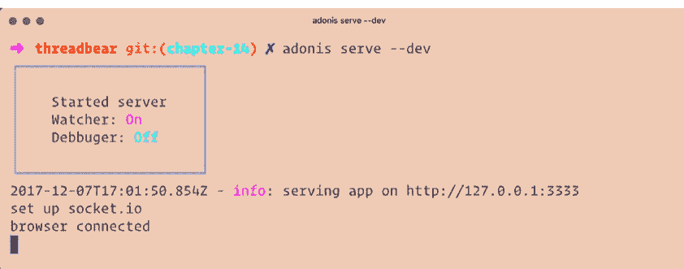

图 14-1 浏览器连接到服务器

我们可以开始挂载新事件——例如浏览器断开连接或向服务器发送消息时。列表 14-5 显示了其样子。

## 列表 14-5. 这来自 threadbear/start/hooks.js

```javascript
socket.on("connection", connection => {
  console.log("browser connected", connection.id)

connection.on("disconnect", () => {
  console.log("browser disconnected")
})

connection.on("browser message", message => {
  console.log("browser message:", message)
})

connection.emit(
  "server message",
  "hello browser"
})
```

当我们刷新浏览器或发送消息（使用 `socket.emit("browser message", "hello world")`）时，可以在图 14-2 中看到消息。

**图 14-2. 监听新的 socket 事件**

```
Started server
Watcher: On
Debburger: Off

2017-12-07T17:14:51.403Z - info: serving app on http://127.0.0.1:3333
set up socket.io
browser connected
browser message: hello world
browser disconnected
browser connected
```

每当浏览器页面刷新时，都会自动与服务器建立新的 socket 连接。这很好，但可以做得更好。我们可以尝试在每次服务器重启或浏览器页面刷新时维护单个会话。

遗憾的是，这将让我们深入到 Socket.io 的内部，超出了我希望大家进入的范围。为了简单起见，我们假设在处理购物车时，服务器不会重启，浏览器页面也不会刷新。这在实际应用中显然不是这样的，稍后我会指导你如何维护会话。

让我们在产品列表中添加一个“立即购买”按钮。我们还将购物车添加到同一个页面，这样我们就可以看到“立即购买”按钮、WebSockets 和 React 之间的通信。列表 14-6 显示了“立即购买”按钮以及我们将放入购物车的容器。

**列表 14-6. 这来自 threadbear/resources/views/profile.edge**

```html
@section("header")
<h1>{{ title }}'s profile</h1>
@endsection

@section("content")
@each(product in products)
<div class="product-item">
    <h3>{{ product.name }}</h3>
    <p>{{ product.description }}</p>
    <button onclick="addToCart('{{ product.id }}')">Buy Now</button>
</div>
@endeach
```

我们必须更新模板以匹配我们所做的更改。同样，我们还需要更改获取数据的方式，如 14-7 所示。

## 列表 14-7. 这来自 threadbear/app/Controllers/CustomerController.js

```javascript
async show({ params, response }) {
  const customer = await Customer.query()
    .where("id", params.id)
    .first()

  if (!customer) {
    throw new NotFoundException()
  }

  const products = await customer.products()
    .fetch()

  return response.view("profile", {
    customer: customer,
    products: products,
    title: customer.name
  })
}

async redirectForCustomer(customer) {
  const row = await Cart.query()
    .where("id", customer.id)
    .first()

  if (row) {
    return response.route("cart")
  }
  return false
}
```

## 构建 React 购物车

现在让我们启动购物车吧。我们需要检查页面是否应该显示购物车，然后将其渲染到 React 组件中。列表 14-8 显示了如何实现。

**列表 14-8.** 这来自 threadbear/resources/js/app.js

```javascript
class Cart extends Component {
  componentDidMount() {
    this.socket = io()
    this.socket.on(
      "server message",
      this.onServerMessage,
    )
  }

  onServerMessage = message => {
    console.log("server message:", message)
  }

  render() {
    return <div>Shopping cart is here</div>
  }
}

const container = document.querySelector(
  ".shopping-cart",
)

if (container) {
  render(<Cart />);
}
```


注意：这不是一本从零开始学习 React 的书。我们已经直接进入了核心部分，后面的内容只会更加深入。如果你想从零开始学习 React，请读读相关的书籍：Cory Gackenheimer 编写的 *Introduction to React* (Apress, 2015)。

购物车应该显示每个项目的数量和价格。它应该显示购物车的总价值。它应该有一种添加（增加数量）或从购物车中移除物品的方法。它应该有一个用于付款的按钮。

让我们先创建每一行（带有控件），然后是“总计”和“去付款”组件。14-9 和 14-10 展示了这些每一个组件。

# 列表 14-9。来自 threadbear/resources/js/app.js

```javascript
const dollars = cents =>
"$" + (cents / 100).toFixed(2)
const CartItem = (
name,
price,
quantity,
onPlus,
onMinus,
}) => (
<div className="item">
{name}: <strong>{quantity}</strong> x{" "}
<strong>${(price / 100).toFixed(2)}</strong>{" "}
<button onClick={onPlus}>+</button>
<button onClick={onMinus}>-</button>
</div>)
```

如果你认为这是一个函数也是完全可以的，因为它确实是一个函数。React 使用组件（带有 `render` 方法）进行渲染与渲染函数一样简单。这个函数使用了一些相当高级的 ES2016+ 语法，所以让我们逐一分析。

我们使用 `const CartItem` 将该函数定义为常量。这意味着 `CartItem` 不能被重新定义。另一种方法是使用 `function CartItem` 来定义函数，但我更倾向于使用常量的方法。

在此我们赋值了一个短箭头函数。它的形式为 `(...arguments) => {...body}`。对于参数列表，我们正在对一个输入对象进行解构——也就是说，我们正在获取第一个参数（即 `props` 对象），并将这些变量赋值给对象中匹配的键。这类似于我们 `{name, price, quantity, onPlus, onMinus} = props`。

最后，我们省略了函数体，而是直接返回了该对象。

这产生了一个可以使用 `props` 对象进行调用的函数，它将返回一些标记。这些命名的 `props` 键是函数运行所必需的。我们必须定义 `name`、`price`、`onPlus(function)` 和 `onMinus(function)`。

在某些情况下，React 不会在元素之间渲染空格，就像你在 HTML 中习惯的那样。我们通过在明确需要空格的地方添加 `{" "}` 来强制它这样做。这种变通方法很奇异，但值得了解。

前三个变量被渲染为文本。两个函数用于在点击按钮时执行某些操作。

列表 14-10。来自 threadbear/resources/js/app.js

```javascript
const CartTotal = ({ items, onCheckout }) => (
<div className="total">
  Total:{" "}
  <strong>
    ${dollars(
      items
      .map(item => item.quantity * item.price)
      .reduce(
        (total, item) => total + item,
        0,
      )
    )}
  </strong>
  <br />
  <button onClick={checkout}>
    Check Out
  </button>
</>
)
```

`CartTotal` 组件稍微简单一些，尽管格式上还有改进空间。该组件接收一个物品数组并复用 `dollars` 函数来格式化它们的总额。我们通过先 `map`（它们的数量和价格）然后通过 `reduce` 将每个项目合并为一个总值来计算每个项目的总额。

注意，`map` 和 `reduce` 是强大的工具。如果不将它们放入普通的函数体中，我们没有实际上的方法可以产生相同的输出。如果你还不熟悉它们，我建议你花时间学习这两个数组函数。再配合 `filter` 使用，你就掌握了函数式编程的一半内容。

我们可以通过将它们添加到 `Cart` 的渲染过程中来将它们结合起来。列表 14-11 展示了这一点。

# 列表 14-11。来自 threadbear/resources/js/app.js

```javascript
class Cart extends Component {
  state = {
    items: {},
  }

  componentDidMount() {
    this.initSocket()
    this.initButtons()
  }

  initSocket = () => {
    this.socket = io()
    this.socket.on(
      "server message",
      this.onServerMessage,
    )
  }
  onServerMessage = message => {
    console.log("server message:", message);
  }

  initButtons = () => {
    const buttons = document.querySelectorAll("[data-buy-id]");
    for (let button of buttons) {
      button.addEventListener("click", event => {
        this.onBuy(event);
      });
    }
  }

  onBuy = event => {
    const {
      buyId,
      buyName,
      buyPrice,
    } = event.target.dataset;
    const key = "" + buyId;
    const previous = this.state.items[key];
    const quantity = previous
      ? previous.quantity + 1
      : 1;
    this.setState({
      items: {
        ...this.state.items,
        [key]: {
          name: buyName,
          price: buyPrice,
          quantity,
        },
      },
    });
  }

  render() {
    const items = Object.values(this.state.items);
    return (
      <div className="total">
        Total: <strong>${dollars(items.map(item => item.quantity * item.price).reduce((total, item) => total + item, 0))}</strong>
        {items.map((item, index) => (
          <CartItem
            key={index}
            name={item.name}
            price={item.price}
            quantity={item.quantity}
            onPlus={() => {}}
            onMinus={() => {}}
          />
        ))}
        <button onClick={this.props.onCheckout}>Check Out</button>
      </div>
    );
  }
}
```


# 列表 14-14。此自 threadbear/resources/js/app.js

```javascript
const socket = io()

const cartContainer = document.querySelector(
  ".cart",
)

if (cartContainer) {
  render(<Cart socket={socket} />, cartContainer);
}

const buyNowContainers = document.querySelectorAll(
  ".buy-now",
)

for (let buyNowContainer of buyNowContainers) {
  const {
    id,
    name,
    price,
  } = buyNowContainer.dataset

  render(
    <BuyNow
      id={id}
      name={name}
      price={price}
      socket={socket}
    />,
    buyNowContainer,
  )
}
```

我们不再在 Cart 组件内部创建 socket，而是创建一个单一的（共享）WebSocket 连接。我们可以将其作为参数传递给每个需要的组件。

在这里，我们正在获取每个 `buy-now` div，并向其中渲染一个新的 `BuyNow` 组件。我们提供了向服务器发送购买消息所需的 id、name 和 价格。列表 14-15 显示了我们如何拦截该购买消息并将其发送回 Cart。

# 列表 14-15。此自 threadbear/start/hooks.js

```javascript
connection.on("buy", message => {
  connection.emit("bought", message)
})
```

现在 Cart 组件变得简单多了。我们可以移除之前的 `itButton` 方法，并也简化了 `onBuy` 方法！列表 14-16 展示了这一点。

# 列表 14-16。此自 threadbear/resources/js/app.js

```javascript
class Cart extends Component {
  componentDidMount() {
    this.props.socket.on("bought", this.onBought)
  }

  onBought = data => {
    this.onBuy(JSON.parse(data))
  }

  onBuy = ({ id, name, price }) => {
    const key = " " + id
    const previous = this.state.items[key]
    const quantity = previous
      ? previous.quantity + 1
      : 1

    this.setState({
      items: {
        ...this.state.items,
        [key]: {
          id,
          name,
          price,
          quantity,
        }
      })
},
},
}
// ...rest of Cart
}
```

## 创建订单

让我们通过创建新订单来完成。我们知道是谁在购买（因为我们可以在结账前强制客户登录）。我们知道每个订单应该包含哪些物品。
这就是我们需要知道的所有。

让客户在结账前登录。列表 14-17 和 14-18 显示了我们如何实现这一点。

**列表 14-17。** 此自 threadbear/app/Controllers/Http/CustomerController.js

```javascript
async showProfile({
params,
session,
response,
view,
) {
// ...rest of showProfile

return view.render("customer/profile", {
customer: customer.toJSON(),
products: products.toJSON(),
session: session.get("customer")
})
}
```

我们可以检查 session 来查看是否存在存储的客户。如果你在想我们为什么不直接复用认证中间件，请记住它会自动重定向未登录的客户。我们不希望人们从这里重定向离开。我们只想让他们先登录。

# 列表 14-18。此自 threadbear/resources/views/customer/profile.edge

```edge
@section("content")
@each(product in products)
<p>
  {{ product.displayName }}
  <strong>${{ product.price / 100 }}</strong>
  <!--
  <button ...>buy now</button>
-->
  @if(session)
  <div class="buy-now" data-id="{{ product.id }}" data-name="{{ product.displayName }}" data-price="{{ product.price }}">
  </div>
  @endif
</p>
@else
<p>
  {{ customer.displayName }} doesn't ...
</p>
@endeach
@if(session)
<div class="cart">
  Shopping cart goes here
</div>
@else
<div>
  <a href="{{ route("login") }}">Log in</a>a>...
</div>
@endif
@endsection
```

当 session 存在时，我们显示正常的按钮和购物车。当它不存在时，而是显示一种让他们登录的方法。但当他们退出登录并且已向购物车添加了物品怎么办？我们如何让他们结账呢？

我们可以添加另一个 socket 事件，如列表 14-19 所示。

# 列表 14-19。此自 threadbear/start/hooks.js

```javascript
connection.on("check out", async message => {
  const { seller, buyer, items } = JSON.parse(
    message,
  )

  const Database = use("Database")
  const moment = use("moment")

  const timestamps = {
    created_at: moment().format(
      "YYYY-MM-DD HH:mm:ss"
    ),
    updated_at: moment().format(
      "YYYY-MM-DD HH:mm:ss"
    ),
  }

  const orderId = await Database.table(
    "orders"
  ).insert({
    buyer_id: seller,
    seller_id: buyer,
    status: "pending",
    ...timestamps,
  })

  await Database.from("order_items").insert(
    items.map(item => ({
      order_id: orderId[0],
      product_id: item.id,
      quantity: item.quantity,
      price: item.price,
      ...timestamps,
    }))
  )
})
```

# 第 14 章 WEBSOCKETS

这与我们在前面的章节中做的数据库填充器工作类似。我们还使用了买家和卖家值，我们需要将它们存储在模板的某个地方，如列表 14-20 所示。

# 列表 14-20。此自 threadbear/resources/views/customer/profile.edge

```edge
@if(session)
<div class="cart" data-seller={{ customer.id }} data-buyer={{ session }}> Shopping cart goes here
</div>
@else
<div>
  <a href="{{ route("login") }}">Log in</a>
</div>
@endif
```

最后，我们需要将这些部分缝合在一起，如列表 14-21 所示。

# 列表 14-21。此自 threadbear/resources/js/app.js

```javascript
onCheckout = () => {
  const { seller, buyer } = this.props
  const items = Object.values(this.state.items);

  socket.emit(
    "check out",
    JSON.stringify({ seller, buyer, items }),
  );
}

render() {
  const items = Object.values(this.state.items);
  return (
    <div className="items">
      {items.map(item => (
        <CartItem key={item.id} item={item} />
      ))}
    </div>
  )
}
```


## 设置 DigitalOcean

DigitalOcean (www.digitalocean.com) 是一个虚拟私有服务器托管平台。在过去，网站是托管在专用的物理硬件上的。如果你想搭建某些内容，你需要租一台服务器（或与许多其他人共享服务器）。在这些服务器上安装 Apache 或 Nginx，并配置它们为一个或多个虚拟主机提供服务。

如今，在虚拟服务器环境中运行 Web 应用已成为主流——在这种环境中，我们拥有比沙箱虚拟主机环境更多的控制权，并且可以安装任何我们需要的语言、二进制文件或服务。

DigitalOcean 让创建和维护这类虚拟服务器变得更加简单。它仍然非常精简，但提供了管理 DNS、监控服务器以及管理某些内容的安装和配置的方法。

好了，废话说够了。让我们来创建一个账户并配置域名。访问 www.digitalocean.com 并点击“注册”（Sign Up），如图 15-1 所示。

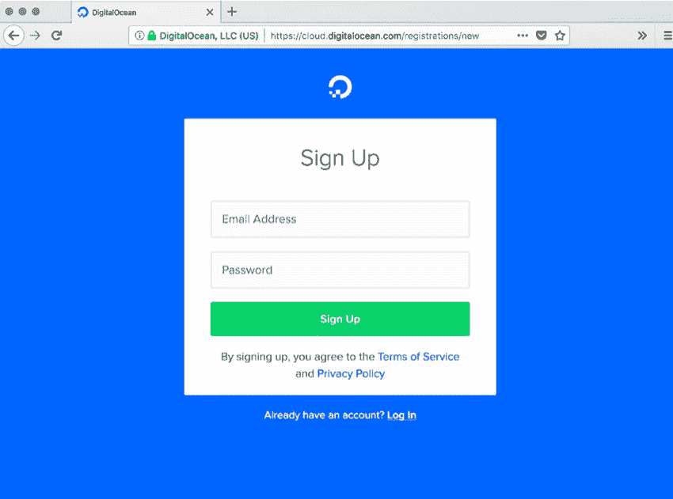

**图 15-1.** 注册 DigitalOcean

一旦完成账户设置，我们就可以开始设置新的虚拟服务器了。我们可以通过 DigitalOcean 界面（非常友好）进行，也可以使用部署服务。让我给你们介绍一下我喜欢的工具。

## 设置 Forge

我之前提到过 AdonisJs 之于 Laravel PHP 框架的关系。在很久听说 AdonisJs 之前，我就已经在构建 Laravel 应用了。Laravel 的创始人 Taylor Otwell 也创建了一个部署服务，它被称为 Forge (https://forge.laravel.com)。让我们创建一个 Forge 账户，如图 15-2 所示。

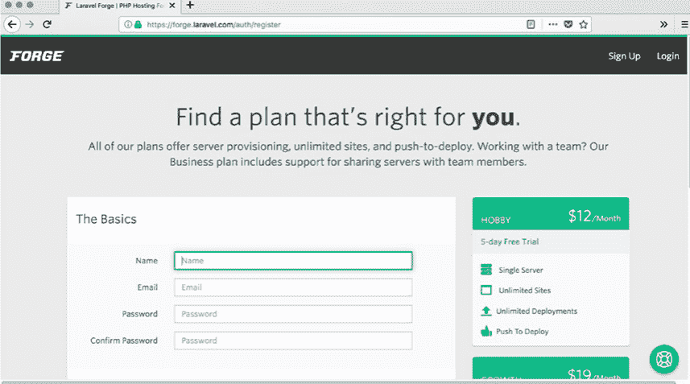

**图 15-2.** 创建 Forge 账户

设置好后，点击你的名字并进入“我的账户”（My Account）。然后将你的 Forge 账户链接到你的 DigitalOcean 账户，如图 15-3 所示。

## 第 15 章 部署

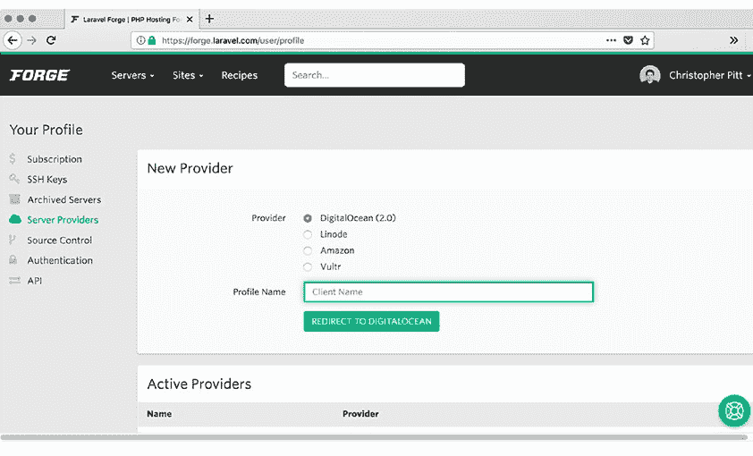

图 15-3. 将 Forge 链接到 DigitalOcean

完成后，你可以返回 Forge 仪表板（点击 Forge 图标）并创建一个新的 DigitalOcean 服务器，如图 15-4 所示。

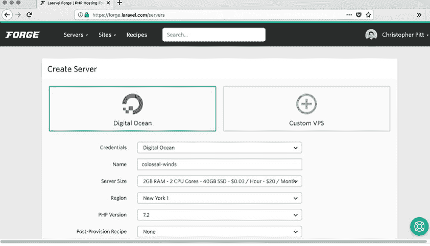

图 15-4. 创建新的 DigitalOcean 服务器

默认设置应该是没问题的。这个过程会执行第一部分的设置。它将安装托管 PHP 应用所需的所有内容。虽然我们并没有在制作 PHP 应用，所以某些软件不会被用上，不过它会为我们提供 MySQL 和网络安全支持。这是一个很好的开始！

**注意** 保持此浏览器标签页开启——我们很快就会需要它。

几分钟后，我们将看到一个可以向服务器添加新应用程序的界面。在在此之前，我们应该尝试获取一个域名。是时候设置另一个账户了。

## 获取域名

**注意** 如果你以前买过域名，可以跳过本节。

网上有很多地方可以购买域名。如果你为 Web 构建过东西，你可能已经知道如何获取域名。如果没有，请前往 Namecheap 等分销商处，如图 15-5 所示。我从未发现过特别愉快或完善的域名代理商，但我认为 Namecheap 是我尝试过的最好的。

## 第 15 章 部署

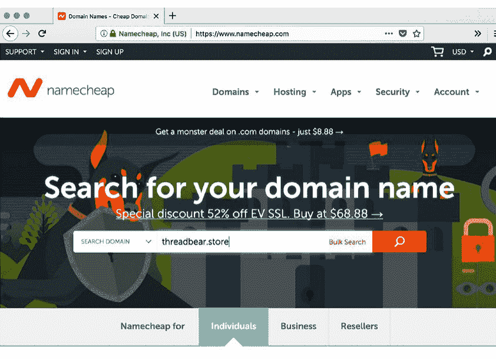

**图 15-5.** 搜索域名

搜索一个你喜欢的域名。如果它已经被占用，不要感到惊讶——域名就是这样。此外，如果你心仪的域名被占用且未被使用，也不要惊讶。域名囤持是互联网上不可避免的一部分。找一个你不讨厌的域名，并拿下它。

过程的一部分将包括创建一个新账户。到目前你应该已经学会如何创建这些新账户了。账户创建并购买域名后，你将登录管理控制台。

进入“域名列表”（Domain List），点击你刚购买的域名旁的“管理”（Manage）。滚动到“名称服务器”（Nameservers），从下拉菜单中选择“自定义 DNS”（Custom DNS）。输入 ns1.digitalocean.com、ns2.digitalocean.com 和 ns3.digitalocean.com；如图 15-6 所示。

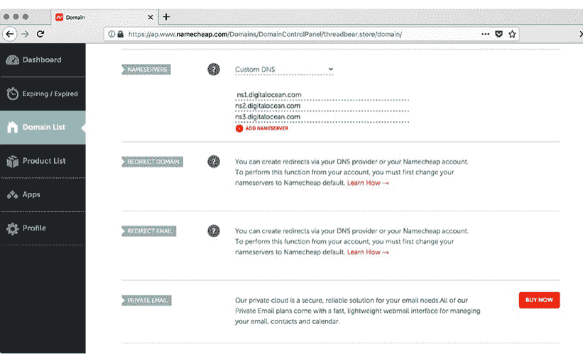

**图 15-6.** 设置自定义 DNS 选项

## 添加域名

是时候在 Forge 中添加域名了。到目前为止，我们一直在使用 DigitalOcean 界面，但我们想使用 Forge 来处理域名，因为在生产环境中我们需要更具预测性的东西。

进入 Forge 仪表板（点击 Forge 图标）并创建一个新的 DigitalOcean 服务器。

默认设置应该是没问题的。这个过程会执行第一部分的设置。它将安装托管 PHP 应用所需的所有内容。虽然我们并没有在制作 PHP 应用，所以某些软件不会被用上，不过它会为我们提供 MySQL 和网络安全支持。这是一个很好的开始！

**注意** 保持此浏览器标签页开启——我们很快就会需要它。

几分钟后，我们将看到一个可以向服务器添加新应用程序的界面。在在此之前，我们应该尝试获取一个域名。是时候设置另一个账户了。

## 获取域名

**注意** 如果你以前买过域名，可以跳过本节。

网上有很多地方可以购买域名。如果你为 Web 构建过东西，你可能已经知道如何获取域名。如果没有，请前往 Namecheap 等分销商处，如图 15-5 所示。我从未发现过特别愉快或完善的域名代理商，但我认为 Namecheap 是我尝试过的最好的。

搜索一个你喜欢的域名。如果它已经被占用，不要感到惊讶——域名就是这样。此外，如果你心仪的域名被占用且未被使用，也不要惊讶。域名囤持是互联网上不可避免的一部分。找一个你不讨厌的域名，并拿下它。

过程的一部分将包括创建一个新账户。到目前你应该已经学会如何创建这些新账户了。账户创建并购买域名后，你将登录管理控制台。

进入“域名列表”（Domain List），点击你刚购买的域名旁的“管理”（Manage）。滚动到“名称服务器”（Nameservers），从下拉菜单中选择“自定义 DNS”（Custom DNS）。输入 ns1.digitalocean.com、ns2.digitalocean.com 和 ns3.digitalocean.com；如图 15-6 所示。


**图 15-6.** 设置自定义 DNS 选项

## 添加域名

是时候在 Forge 中添加域名了。到目前为止，我们一直在使用 DigitalOcean 界面，但我们想使用 Forge 来处理域名，因为在生产环境中我们需要更具预测性的东西。

进入 Forge 仪表板（点击 Forge 图标）并创建一个新的 DigitalOcean 服务器。

默认设置应该是没问题的。这个过程会执行第一部分的设置。它将安装托管 PHP 应用所需的所有内容。虽然我们并没有在制作 PHP 应用，所以某些软件不会被用上，不过它会为我们提供 MySQL 和网络安全支持。这是一个很好的开始！

**注意** 保持此浏览器标签页开启——我们很快就会需要它。

几分钟后，我们将看到一个可以向服务器添加新应用程序的界面。在在此之前，我们应该尝试获取一个域名。是时候设置另一个账户了。

## 获取域名

**注意** 如果你以前买过域名，可以跳过本节。

网上有很多地方可以购买域名。如果你为 Web 构建过东西，你可能已经知道如何获取域名。如果没有，请前往 Namecheap 等分销商处，如图 15-5 所示。我从未发现过特别愉快或完善的域名代理商，但我认为 Namecheap 是我尝试过的最好的。

## 第 15 章 部署


**图 15-5.** 搜索域名

搜索一个你喜欢的域名。如果它已经被占用，不要感到惊讶——域名就是这样。此外，如果你心仪的域名被占用且未被使用，也不要惊讶。域名囤持是互联网上不可避免的一部分。找一个你不讨厌的域名，并拿下它。

过程的一部分将包括创建一个新账户。到目前你应该已经学会如何创建这些新账户了。账户创建并购买域名后，你将登录管理控制台。

进入“域名列表”（Domain List），点击你刚购买的域名旁的“管理”（Manage）。滚动到“名称服务器”（Nameservers），从下拉菜单中选择“自定义 DNS”（Custom DNS）。输入 ns1.digitalocean.com、ns2.digitalocean.com 和 ns3.digitalocean.com；如图 15-6 所示。


**图 15-6.** 设置自定义 DNS 选项

## 添加域名

是时候在 Forge 中添加域名了。到目前为止，我们一直在使用 DigitalOcean 界面，但我们想使用 Forge 来处理域名，因为在生产环境中我们需要更具预测性的东西。

进入 Forge 仪表板（点击 Forge 图标）并创建一个新的 DigitalOcean 服务器。

默认设置应该是没问题的。这个过程会执行第一部分的设置。它将安装托管 PHP 应用所需的所有内容。虽然我们并没有在制作 PHP 应用，所以某些软件不会被用上，不过它会为我们提供 MySQL 和网络安全支持。这是一个很好的开始！

**注意** 保持此浏览器标签页开启——我们很快就会需要它。

几分钟后，我们将看到一个可以向服务器添加新应用程序的界面。在在此之前，我们应该尝试获取一个域名。是时候设置另一个账户了。

## 获取域名

**注意** 如果你以前买过域名，可以跳过本节。

网上有很多地方可以购买域名。如果你为 Web 构建过东西，你可能已经知道如何获取域名。如果没有，请前往 Namecheap 等分销商处，如图 15-5 所示。我从未发现过特别愉快或完善的域名代理商，但我认为 Namecheap 是我尝试过的最好的。

## 第 15 章 部署


**图 15-5.** 搜索域名

搜索一个你喜欢的域名。如果它已经被占用，不要感到惊讶——域名就是这样。此外，如果你心仪的域名被占用且未被使用，也不要惊讶。域名囤持是互联网上不可避免的一部分。找一个你不讨厌的域名，并拿下它。

过程的一部分将包括创建一个新账户。到目前你应该已经学会如何创建这些新账户了。账户创建并购买域名后，你将登录管理控制台。

进入“域名列表”（Domain List），点击你刚购买的域名旁的“管理”（Manage）。滚动到“名称服务器”（Nameservers），从下拉菜单中选择“自定义 DNS”（Custom DNS）。输入 ns1.digitalocean.com、ns2.digitalocean.com 和 ns3.digitalocean.com；如图 15-6 所示。


**图 15-6.** 设置自定义 DNS 选项

## 添加域名

是时候在 Forge 中添加域名了。到目前为止，我们一直在使用 DigitalOcean 界面，但我们想使用 Forge 来处理域名，因为在生产环境中我们需要更具预测性的东西。

进入 Forge 仪表板（点击 Forge 图标）并创建一个新的 DigitalOcean 服务器。

默认设置应该是没问题的。这个过程会执行第一部分的设置。它将安装托管 PHP 应用所需的所有内容。虽然我们并没有在制作 PHP 应用，所以某些软件不会被用上，不过它会为我们提供 MySQL 和网络安全支持。这是一个很好的开始！

**注意** 保持此浏览器标签页开启——我们很快就会需要它。

几分钟后，我们将看到一个可以向服务器添加新应用程序的界面。在在此之前，我们应该尝试获取一个域名。是时候设置另一个账户了。

## 获取域名

**注意** 如果你以前买过域名，可以跳过本节。

网上有很多地方可以购买域名。如果你为 Web 构建过东西，你可能已经知道如何获取域名。如果没有，请前往 Namecheap 等分销商处，如图 15-5 所示。我从未发现过特别愉快或完善的域名代理商，但我认为 Namecheap 是我尝试过的最好的。

## 第 15 章 部署


**图 15-5.** 搜索域名

搜索一个你喜欢的域名。如果它已经被占用，不要感到惊讶——域名就是这样。此外，如果你心仪的域名被占用且未被使用，也不要惊讶。域名囤持是互联网上不可避免的一部分。找一个你不讨厌的域名，并拿下它。

过程的一部分将包括创建一个新账户。到目前你应该已经学会如何创建这些新账户了。账户创建并购买域名后，你将登录管理控制台。

进入“域名列表”（Domain List），点击你刚购买的域名旁的“管理”（Manage）。滚动到“名称服务器”（Nameservers），从下拉菜单中选择“自定义 DNS”（Custom DNS）。输入 ns1.digitalocean.com、ns2.digitalocean.com 和 ns3.digitalocean.com；如图 15-6 所示。


**图 15-6.** 设置自定义 DNS 选项

## 添加域名

是时候在 Forge 中添加域名了。到目前为止，我们一直在使用 DigitalOcean 界面，但我们想使用 Forge 来处理域名，因为在生产环境中我们需要更具预测性的东西。

进入 Forge 仪表板（点击 Forge 图标）并创建一个新的 DigitalOcean 服务器。

默认设置应该是没问题的。这个过程会执行第一部分的设置。它将安装托管 PHP 应用所需的所有内容。虽然我们并没有在制作 PHP 应用，所以某些软件不会被用上，不过它会为我们提供 MySQL 和网络安全支持。这是一个很好的开始！

**注意** 保持此浏览器标签页开启——我们很快就会需要它。

几分钟后，我们将看到一个可以向服务器添加新应用程序的界面。在在此之前，我们应该尝试获取一个域名。是时候设置另一个账户了。

## 获取域名

**注意** 如果你以前买过域名，可以跳过本节。

网上有很多地方可以购买域名。如果你为 Web 构建过东西，你可能已经知道如何获取域名。如果没有，请前往 Namecheap 等分销商处，如图 15-5 所示。我从未发现过特别愉快或完善的域名代理商，但我认为 Namecheap 是我尝试过的最好的。


## 第 15 章 部署

这些行告诉 Forge 安装 NPM 依赖并构建静态资源，这样前端的外和工作方式将与我们在本地系统上一致。现在，让我们设置环境变量，如图 15-11 所示。点击“Environment”（环境）和“Environment”（环境）来编辑服务器上的 `.env` 文件。你可以复制并粘贴本地设置，但要把 `NODE_ENVIRONMENT` 更改为 `production`。

**你可能希望将数据库设置更改为比 SQLite 更健壮的配置。** AdonisJs 支持许多类型（详见 http://adonisjs.com/docs/4.0/database#supported_databases），因此请查看你想要使用的类型的文档。即使你的数据库引擎没有正确连接，在本章结束时，你也应该能够在远程服务器上看到应用程序的一部分。

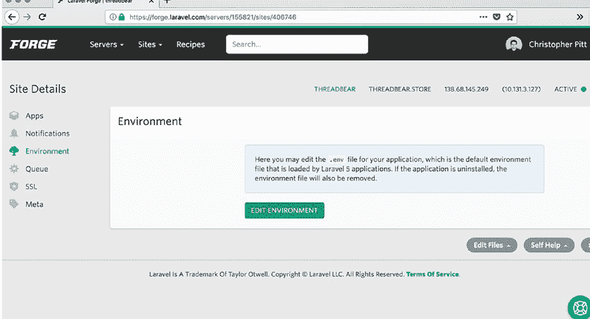

图 15-11。添加环境变量

我们一直使用本地 3333 端口在本地访问 AdonisJs 站点。我们需要通过服务器的网络安全设置允许它。返回 Forge 仪表板并选择你的服务器。点击“Network”（网络）并带有任何名称的 3333（最好是类似 Adonis port 的名称），如图 15-12 所示。

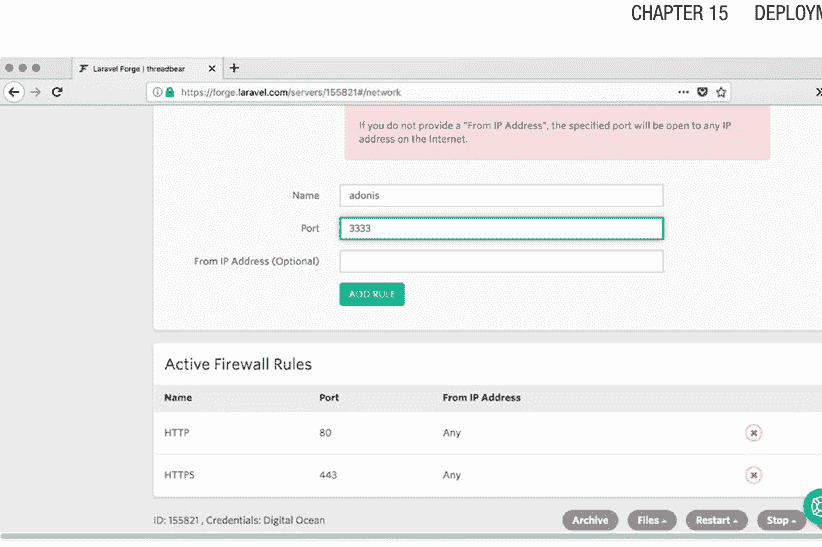

### 图 15-12。添加网络规则

最后，点击“Daemons”（守护进程）并添加一个新的守护进程，如图 15-13 所示。

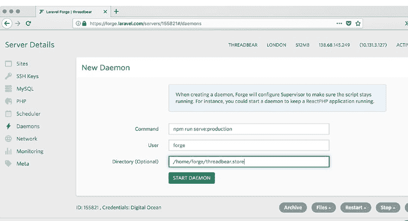

### 图 15-13。添加守护进程

## 第 15 章 部署

当你点击“Start Daemon”（启动守护进程）时，Forge 将创建一个 Supervisor 守护进程 (http://supervisorord.org) 来运行服务器。如果你访问服务器的 IP 地址（别忘记在 URL 中加上 3333），你应该看到你的 AdonisJs 应用程序！

## 在端口 80 提供服务

如果不需要使用 3333 端口，我们的网站会更好——你可以直接访问域名并提供 AdonisJs 应用程序。让我们添加一些 Nginx 配置来将请求代理到正确的端口。

进入 Forge 仪表板并点击服务器。点击站点/域名，并滚动到页面底部。点击“Edit Files”（编辑文件），然后点击“Edit Nginx Configuration”（编辑 Nginx 配置）。向下滚动直到你看到 `location /`，如图 15-14 所示。注释掉此块，并在其下方添加推荐的 AdonisJs 配置 (http://adonis.js/recipes/4.0/nginx-proxy)。

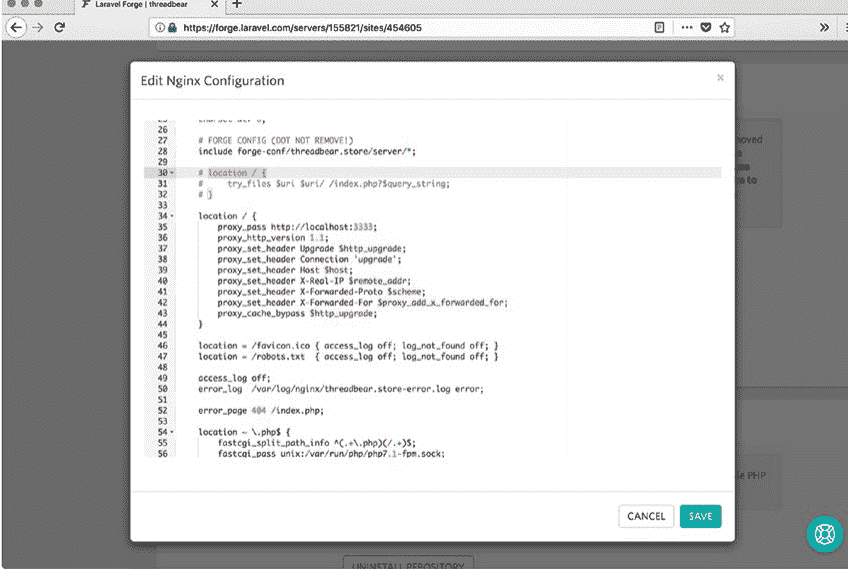

图 15-14。Nginx 配置

除非你确切知道做什么，否则不要删除或更改任何其他配置。相反，返回仪表板并点击服务器。滚动到页面底部并点击“Restart”（重启），然后点击“Restart Nginx”（重启 Nginx）。

你应该能够访问 http://your-ip-address 并提供 AdonisJS 应用程序。我们将最后尝试的事情是为应用程序设置 SSL 证书。

## 设置 SSL 证书

进入 Forge 仪表板并点击服务器。你应该看到四个选项，其中一个是 LetsEncrypt，如图 15-15 所示。点击它。输入你的域名（不带 www 选项，除非你已经设置了它）并点击“Obtain Certificate”（获取证书）。

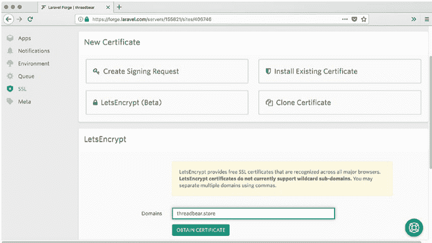

15-15。获取证书

这将需要一两分钟完成。完成后，你可以选择激活证书。

这将更新你的 Nginx 配置，使得对 http://your-domain 的请求重定向到 https://your-domain。在所有的 DNS 延迟完成后，这一刻将看到你的应用程序从一个本地爱好项目变成一个安全的在线商店。

## 总结

在本章中，我们学习了一些帮助我们托管应用程序的工具。现在是与几位信任的朋友分享链接的好时机，让他们可以从自己的电脑和互联网连接帮助你测试应用程序。

找出你的朋友是否能够访问应用程序，以及 SSL 证书对他们是否有效。找出文件为他们加载有多快，以及他们是否能看到所有的样式表。获取客户反馈（以及朋友的反馈）是了解在应用程序中改进什么的极佳方法。

我们的旅程即将结束。在最后一章中，我们将添加一些到目前为止跳过的功能。我们将学习包括发送电子邮件和进行支付网关购买在内的各项内容。

## 第 16 章

## 最后润色

在上一章中，我们查看了可以用于部署 Adonis 应用程序的许多工具。我们设置了托管空间，购买了域名，并配置了 DNS 服务器。我们准备了服务器（通过 Forge）并安装了 SSL 证书。

当我们进入最后一章时，是时候为我们的应用程序添加一些润色了。我们跳过了一些事情。我们将学习的一些内容包括发送电子邮件和进行支付网关购买。在本章结束时，我们应该拥有一个功能完整的应用程序。

## 发送电子邮件

在 Node.js 中发送电子邮件有很多方法。我们甚至从头实现，但通常太复杂了，不是我们现在需要的技能。相反，我们将使用一个良好的工具：

```
adonis install @adonis/mail
```

对于大多数 AdonisJS 包来说，安装命令会弹出一个说明页面。Listing 16-1 显示我们需要添加另一个提供者。

**Listing 16-1.** 来自 threadbear/start/app

```javascript
const providers = [
  //...rest of providers
  "@adonis/mail/providers/MailProvider",
]
```

这了一个配置文件，类似于 Listing 16-2。

## Listing 16-2. 来自 threadbear/config/mail

```javascript
"use strict"

const Env = use("Env")
module.exports = {
/*
-------------------------------------------------------
| Connection
-------------------------------------------------------
| 用于发送电子邮件的连接
|
*/
connection: Env.get("MAIL_CONNECTION", "smtp"),
/*
-------------------------------------------------------
| SMTP
-------------------------------------------------------
| 这里定义发送电子邮件的配置...
|
*/
smtp: {
  driver: "smtp",
  pool: true,
  port: 465,
  host: "smtp.gmail.com",
  secure: true,
  auth: {
    user: Env.get("MAIL_USERNAME"),
    pass: Env.get("MAIL_PASSWORD"),
  },
  maxConnections: 5,
  maxMessages: 100,
  rateLimit: 10,
},
// ...rest of config
}
```

在发送电子邮件之前，我们需要在 `.env` 文件中添加 `MAIL_USERNAME` 和 `MAIL_PASSWORD` 值。我们还需要在该文件中设置 `host` 值（以及取决于我们的 SMTP 提供者的任何其他设置）。

**注意** 我通常在这种情况下使用 Gmail 作为提供者。你可以使用任何 SMTP 提供者，也可以使用 SparkPost (www.sparkpost.com)，它也在此处配置。

当客户重置密码时，我们应该生成一个随机唯一的令牌来验证他们后的密码重置请求。我们可以在用户的迁移文件中添加新字段，如 Listing 16-3 所示。

**Listing 16-3.** 来自 threadbear/database/migrations/x_customers_schema.js

```javascript
up() {
  this.create("customers", table => {
    table.string("token").unique()
    // ...rest of the fields
  })
}
```

让我们忘了重新运行迁移和种子：

```
adonis migration:refresh
adonis seed
```

现在我们需要修改 `CustomerController.doForgotPassword` 方法，以便保存令牌并向客户发送电子邮件。Listing 16-4 显示了如何做。

**Listing 16-4.** 来自 threadbear/app/Controllers/Customer/CustomerController.js

```javascript
const Mail = use("Mail")
const Hash = use("Hash")
```


# 第 16 章 最后的完善

```javascript
// ...后后
async doForgotPassword({ request, response }) {
  // 创建新的密码重置令牌并发送邮件
  this.showRequestParameters(context)
  const email = request.input("email")

  const customer = Customer.findBy(
    "email", email)
  if (!customer) {
    // 显示错误表示该
    // 邮箱地址未注册
    // 我们应该像平时一样进行响应
    const delay = Math.random() * 3000 + 1000

    await new Promise(resolve =>
      setTimeout(resolve, delay),
    )
    response.redirect("//")
  }

  const token = await Hash.make(
    customer.email + new Date(),
  )

  customer.token = token
  customer.save()

  const data = {
    ...customer.toJSON(),
    token,
  }

  await Mail.send(
    "email.customer.forgot-password",
    data,
    message => {
      message
      .to(customer.email)
      .from("your email address")
      .subject("Password Reset")
    }

    response.redirect("/")
  }
}
```

让我们来看每一个步骤：

- 1. 我们通过使用 `request.input` 方法获取邮箱地址。然后我们寻找具有匹配邮箱地址的客户。
- 2. 如果我们没有找到匹配邮箱地址的客户，我们会模拟一个 1–4 秒的延迟并重定向到主页。你会注意到，无论如何我们都会重定向到那里，这隐藏了不存在该邮箱地址的客户账户的事实。否则，恶意人员可能会反复提交此表单来寻找有效的邮箱地址。
- 3. 如果我们找到了客户，就会创建一个新的重置令牌。这是一个由客户邮箱地址和时间戳组成的哈希值。我们将其保存到客户的数据库记录中。由于我们在令牌（token） 字段上添加了唯一索引，存在极小的概率出现生成的内容不是唯一的，从而触发警告。鉴于这种可能性极低，我们最好的方法是显示一条错误消息并让客户重试。
- 4. 我们构建了一个可能在邮件模板中使用的信息对象，其中包括客户数据和新令牌。我们将其提供给 `Mail.send` 方法，并带有一个用于转换消息的闭包，`email.customer.forgot-password` 是邮件模板的。在发送此邮件后，我们可以重定向回主页。这可能也是向客户显示消息的好时机。

邮件模板可以像列表 16-5 那么样简单。

**列表 16-5。** 源自 threadbear/resources/views/customer/forgot-password.edge

点击此链接来 <a href="http://127.0.0.1:3333{{ route("reset-password", { token }) }}">">重置你的密码</a>

与其将域名名硬编码为 127.0.0.1:3333，我们不如将其存储在 .env 文件中，并为我们测试的每个环境进行更改。我们使用 `route` 函数根据我们在路由文件中定义的路由来构建 `reset-password` 路由。列表 16-6 提醒我们要为 `reset-password` 路由命名。

**列表 16-6。** 源自 threadbear/start/routes.js

```javascript
Route.get(
  "/reset-password/:token",
  "CustomerController.showResetPassword",
).as("reset-password")
```

现在，我们需要允许客户通过点击邮件链接来重置密码。当他们这样做时，会被重定向到 `reset-password` 路由。我们需要让该 PATCH 请求更新客户的密码。列表 16-7 显示了如何实现这一点。

**列表 16-7。** 源自 threadbear/app/Controllers/Http/CustomerController.js

```javascript
async doResetPassword({
  params,
  request,
  response,
}) {
  // 创建新的密码重置令牌并发送邮件
  this.showRequestParameters(context)
  const token = decodeURIComponent(params.token)

  const customer = await Customer.query()
    .where("token", token)
    .first()

  if (!customer) {
    // 显示错误
    throw new ProfileMissingException()
  }

  const password = request.input("password")
  customer.token = ""
  customer.password = password
  await customer.save()

  response.redirect("/")
}
```

邮件客户端可能会对 URL（带有哈希值）进行编码，因此我们首先对其进行解码。然后我们像之前那样获取客户。如果一切正常，我们将新密码保存到客户账户并重定向回主页。我们之前在 `Customer` 模型中设置了一个钩子（hook）来自动对密码进行哈希。当客户记录被更新以及创建时，我们需要更新它。列表 16-8 展示了这一点。

**列表 16-8。** 源自 threadbear/app/Models/Customer.js

```javascript
static boot() {
  super.boot()

  this.addHook("beforeSave", async customer => {
    customer.password = await Hash.make(
      customer.password
    )
  })
}
```

我们将 `beforeEach` 改为 `beforeSave`。

` 和 `


## 第 16 章 收尾工作

for (let form of forms) {

```javascript
const method = form
.getAttribute("method")
.toUpperCase()
```

```javascript
const action = form.getAttribute("action")
```

```javascript
form.addEventListener("submit", async event => {
event.preventDefault()
```

```javascript
const data = []
const inputs = form.querySelectorAll("input")
```

```javascript
for (let input of inputs) {
data.push(
input.name + 
"=" + 
encodeURIComponent(input.value)
)
}
```

```javascript
const response = await fetch(action, {
mode: "cors",
credentials: "include",
redirect: "follow",
headers: {
"Content-Type":
"application/x-www-form-encoded; charset=UTF-8"
},
method,
body: data.join("&")
})
```

```javascript
alert("saved")
```

// 我们应该发送另一个 ajax 请求
// 来重新加载产品列表。目前，
// 我们只需刷新整个页面...
location.reload()
}
```

我们首先获取所有带有自定义 CSS 类的表单。对于每个表单，我们获取它们的 action 和 method，以便我们能够通过 fetch 函数重新创建预期的请求。每个 input 都用于构建请求体，包括隐藏的 _csrf 字段。

请求完成后，我们可以提示客户他们的新产品已创建。我们也可以发送第二个 Ajax 请求来刷新产品列表，但使用一个重定向就足够了。

**注意** 尽管我已向 AdonisJs 提交了 _csrf 令牌字段，但仍然遇到了一些 CSRF 失败问题。如果你遇到 403 错误响应，请临时禁用该路由的 CSRF 看看错误是否消失。这至少可以让你判断你看到的错误是与 CSRF 有关还是其他其他原因。

## 总结

在本章中，我们解决了一些遗留问题。我们学习了如何发送电子邮件，并随后完成了密码重置功能。我们学习了如何集成支付网关，让客户能够为商品和服务付费。最后，我们配置了应用程序配置来处理 CORS 请求，并设置了产品创建页面。

我们的旅程已此结束。感谢你花时间阅读这本书。希望它能为你提供所需的工具，将你的想法转化为真实的应用程序。你可能不是在卖泰迪，但我希望你能通过 AdonisJs 取得蓬勃发展。

如果你有任何问题或遇到困难，请在 Twitter (https://twitter.com/assertchris) 上与我联系。

## 索引

### A, B

- Ace script, 8
- AdonisJS 
- APP_KEY, 3
- 命令行工具, 3
- controller, 7
- Node.js HTTP script, 4-5
- routes, 6
- SendReminder, 8-9
- start/app.js, 8
- Arrays, 71
- Auth 中间件, 166
- 请求方法, 169
- nield library, 168

### C

- Dashboard (面板)
    - 创建, 147–148
- Customer model (客户模型), 148–149
- customer (客户), 164
- 相关数据, 150–151
- 迁移创建 (migrations creation), 153–154
- 订单 ID (order ID), 152
- toJSON 方法, 150
- Databases (数据库)
- Callback Hell (回调地狱), 82
- Cheerio, 43–46
- 条件语句 (Conditionals), 36
- Controllers (控制器)
    - 创建, 91
    - 移动路由处理器, 92, 94–95
    - 复用代码, 96–97
- 协作协程 (Cooperative routine), 见 Coroutines
- Coroutines (协程), 81, 84–85
- CORS 请求, 238–239, 241, 243
- 跨站请求伪造 (CSRF)
    - 添加隐藏字段, 170–171
    - 全局中间件数组, 189
    - HttpException 错误, 169
- customers (客户)
    - 添加字段, 121–122
    - 身份验证, 125–127
    - boot 方法, 125
    - 检查凭据, 125
    - 显示错误页面, 115–116
    - models, 118–121
    - 个人产品, 116–118
    - setter, 123–124
    - 哈希处理过的客户密码, 171
- 配置文件, 104
- .gitignore, 106–107
- SQLite, 106
- migration (迁移)
    - 添加字符串列, 109

### INDEX (索引)

- Databases (数据库，续)
    - 创建空, 108
    - 数据库查询, 110
    - Database.raw, 110
- Edit Environment (编辑环境), 218
    - 安装 NPM 依赖, 218
    - Nginx 配置, 220–221
    - SSL 证书, 221–222
- seeding (数据种子)
    - 创建空, 111
    - 为客户和产品创建迁移, 112–113
    - 个人页面, 113
    - 测试数据, 114–115
- 前端构建工具
    - Mix (见 Mix)
    - React, 179–181
    - Sass, 177–178
- DigitalOcean
    - 创建 @ 记录, 216
    - Forge (见 Forge)
    - Namecheap, 211, 213, 215
    - 注册, 208
    - 虚拟服务器, 208

### G

- Generators (生成器), 协作多任务, 75–77, 79

### H

- HTTP, 11

### E

- E-mail (电子邮件),发送
    - adonis install 命令, 223
    - 配置文件, 223, 225
    - 密码重置请求, 225, 227–228

### I

- Interpolation (插值), 35–36
- Iterators (迭代器)
    - 类, 74
    - 请求代码, 72
- 错误页面, 140, 142, 144
- Events (事件), 81–82
- Exceptions (异常), 144–145

### J, K

- JSON responses (JSON 响应), 62–63

### F

- Forge
    - 添加域名, 213–214
    - 添加新守护进程, 219
    - 添加端口, 218
    - 创建账户, 209

### L

- Layouts (布局)
    - 添加标记, 30–31
    - Bootstrap 标记, 31–32
    - 创建新的, 29
    - 创建注册视图, 33
    - 标记, 32
- Deploy (部署)
- DigitalOcean
    - 创建空记录, 210
    - 链接, 209
- Life-cycle (生命周期), 190
- Loops (循环), 37
- Lucid
    - 配置文件, 104
    - .gitignore 文件, 106–107
    - SQLite, 106
- Node.js
    - HTTP 服务器, 4

### P, Q

- Partials (部分组件), 38
- Password-reset (密码重置)
    - 请求, 225, 227–228
    - 视图, 228
    - 路由, 229
    - 方法, 228
    - 邮件, 225

### M

- Macros (宏), 66, 68–69
- Middleware (中间件)
    - 身份验证, 166
    - 格式, 100–101
    - Node.js, 165
- JavaScript
    - 类, 176
- Mocha
    - 测试, 174
- N

- Requests (请求，续)
    - Body, 55
    - 内容, 54
    - Cookie, 50
    - DELETE, 52
    - GET, 51
    - Header, 50
    - Input, 49
    - Language, 50
    - Method, 52
    - PATCH, 52
    - POST, 52
    - PUT, 52
- Responses (响应，续)
    - Attachments, 46
    - Body, 62
    - Cookie, 44
    - Content, 47
    - Error, 40
    - Function, 39
    - Helper, 47
    - Input, 46
    - JSON, 63
    - Redirect, 64
- Shopping cart (购物车)
    - Buy Now, 200
    - Container, 187
    - Disconnects, 186
    - Data, 189
    - Event, 185
    - Global, 185
    - Hook, 184
    - Layout, 185
    - Library, 47
    - Node.js HTTP server, 183
    - Message, 186
    - Module.exports, 24
    - npm test, 25
    - Object, 192
    - Other, 193
    - Process, 197
    - Props, 188
    - React, 179–181
    - Life-cycle, 190
    - Methods, 185
    - Markup, 198
    - Object, 197
    - Others, 193
    - Process, 197
    - Total, 195
    - Test, 195

### S

- Sass, 177–178
- Seeding (数据种子)
    - 创建空, 111
    - 为客户和产品创建迁移, 112–113
    - 个人页面, 113
    - 测试数据, 114–115
- SSL 证书, 221–222
- Stripe
    - 创建新账户, 230
    - .env 文件, 230
    - 事件处理器, 237
    - JS SDK, 234
    - 令牌, 231–235, 237

### T, U

- Template file (模板文件)
    - 创建, 27–28
    - 条件语句, 36
    - 函数, 39
    - 插值, 35–36
    - 循环, 37
    - 部分组件, 38
    - yield, 38–39
- ViewProvider, 28–29
- Time to live (TTL), 216
- Fails method, 133
- Installation, 129
- 修改客户控制器, 135
- 旧方法, 134
- 注册表单, 137
- 注册页面, 136
- Session 库, 134
- validateAll, 133

### V

- Validation (验证)
    - 控制器, 129–130
    - 创建规则, 131–132
    - 显示错误, 134
    - 错误消息, 138–140
    - 存在规则, 132

