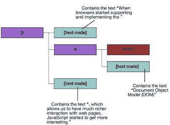
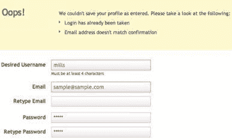
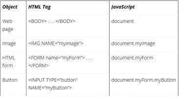
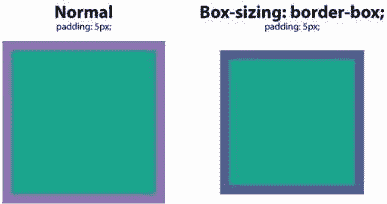

# 学习 javascript 的简单方法


## JavaScript 简介

JavaScript 是一种解释型编程语言，基于 ECMAScript 标准构建。该语言的定义非常广泛，因为它可以被定义为基于原型的、命令式的、弱类型的和动态过程语言。

JavaScript 主要作为一种客户端编程语言，作为 Web 浏览器的一部分实现，允许开发者以更改进的方式在网页中实现用户界面和动态功能，尽管目前也存在服务器端 JavaScript (SSJS) 的实现，但该语言的流行完全归功于客户端的实现。JavaScript 也可以用于 Web 之外，例如为 PDF 文档和桌面小组件添加交互性。

JavaScript 的设计语法与 C 语言相似，尽管它借鉴了 Java 编程语言的名称和约定。然而，尽管名字相似，Java 和 JavaScript 之间并没有关系，且语法也不同。JavaScript 最初由 Netscape 的 Brendan Eich 开发，名为 Mocha，后来被更名为 LiveScript。这个名字的出现正值 Netscape 在 1995 年底在其网页浏览器 Navigator 2.0 中加入了对 JavaScript 的支持。JavaScript 这个名字被创造出来，给人一种该语言是 Java 扩展的印象，这被认为是 Netscape 的一种营销策略。

随后，有用户作为 Internet 3 的实现了一种类似的客户端编程语言。微软将其称为 script 以避免与品牌相关的问题。该术似乎非常相似，以至于 "javascript" 和 "script" 经常混用，但 script 的规范并不 100% 兼容 ECMA 标准。为了避免这些不兼容性，世界网联盟 (W3C) 设计了标准的文档对象模型 (`DOM` 或文档模型)，该模型被包含在 Internet Explorer 6、Netscape Navigator、Opera 7 版本以及自首次发布以 Mozilla Firefox 之后的所有现代浏览器中。

1997 年，有一项建议将 JavaScript 提交给欧洲计算机制造商协会 ECMA 标准，尽管名字里有欧洲，但它并不是欧洲的而是国际性的，总部位于日内瓦。1997 年 6 月，它以 ECMAScript 的命名被 ECMA 标准。JavaScript 也成为了 ISO 标准。

由于标准化和互联网的极大普及，JavaScript 已经成为地球上最常用的编程语言。注意：JavaScript 是 Oracle 公司的注册商标。它根据许可由 Netscape Communications 创建的产品以及目前的实体（如 Mozilla）使用。

## JavaScript 的用途

JavaScript 存在于大多数网页中。很有可能你现在正在查看的页面包含了 JavaScript 代码。尝试一下：在网页上点击右键，然后点击“查看源代码”。你应该能在代码的某处找到它。

虽然 HTML 标记语言允许开发者格式化内容，但 JavaScript 允许他们让页面变得动态。例如，HTML 允许将文本加粗、创建框和创建按钮，而 JavaScript 允许更改页面上的文本、创建弹出消息以及验证框中的文本以确保用户字段已填写。JavaScript 让网页更具动态性，允许用户与页面进行交互、点击元素并更改页面。

### JavaScript 能为你做什么

让我们后退一步，数数 JavaScript 的优点：JavaScript 非常容易实现。你只需要将代码放入 HTML 文档中并告诉浏览器它是即可。即使在计算机离线状态下，JavaScript 也能工作！JavaScript 允许你创建高度响应的界面，改善用户体验并提供功能，而无需等待服务器响应并显示页面。JavaScript 可以在用户需要时将内容加载到文档中，而无需重新加载整个页面这通常被称为 Ajax。JavaScript 可以根据情况测试浏览器中可行的操作——这有时被称为侵入式脚本。JavaScript 可以帮助修复浏览器问题或修补浏览器支持的漏洞——例如修复某些浏览器中的布局问题。对于一种直到最近还被青睐“高级编程语言”的程序员嘲笑的语言来说，这已经很厉害了。JavaScript 复兴的一部分在于，我们现在正在构建日益复杂的 Web 应用，而高交互性要么需要 Flash（或其他插件），要么需要脚本。这无疑是最佳选择，因为它是一个 Web 标准，在浏览器中得到原生支持（在某种程度上——某些内容在浏览器之间存在差异，这些差异将在后续文章的相应位置讨论），并且它与其他开放标准兼容。

### JavaScript 的常见用途

在使用 JavaScript 的多年里，它的用途发生了变化。起初，JavaScript 与网站的交互主要限于与表单交互、向用户提供反馈以及检测他们做了什么。我们使用 `alert()` 通知用户某些情况（见图 1），使用 `confirm()` 询问某事是否正常，并使用 `prompt()` 或表单字段获取输入。

图 1：在 JavaScript 早期，使用 `alert()` 语句告知最终用户错误是我们唯一能做的事情。既不漂亮也不微妙。


我们使用的另一种方法是使用 `document.write()` 向文档中添加内容。我们还处理过弹出窗口和框架，在尝试让它们相互通信时耗费了大量心力并抓掉了许多头发。一想起这些大多数技术，应该让任何开发者都感到反复横跳、蜷缩成胎儿，并咒着“让它们消失吧”，所以我们就不再纠结这些事情了——有更好的方法来使用 JavaScript！

## 进入 DOM 脚本

当浏览器开始支持并实现文档对象模型（DOM）时（这允许我们与网页进行更丰富的交互），JavaScript 开始变得越来越风趣了。

DOM 是文档的对象的表示。例如，上段文字（通过“查看页面源代码”检查其源码）在 DOM 语言中是一个 `nodeName` 为 `p` 的元素节点。它包含三个子节点：一个 `nodeValue` 为“When browsers started supporting and implementing the ”的文本节点，一个 `nodeName` 为 `a` 的元素节点，以及另一个 `nodeValue` 为“,, which allows us to have much richer interaction with web pages, JavaScript started to get more interesting.”的文本节点。该子节点还有一个名为 `href` 的属性节点，其具有一个值以及一个 `nodeValue` 为“Document Object Model(DOM)”的文本节点子节点。

你也可以使用树形图可视化地表示这段文字，如图 2 所示。


图 2：示例 DOM 树的可视化表示。

用人类的话说，可以说 DOM 解释了文档中所有内容的两种类型：值和层次结构——目前你不需要了解更多。


访问文档中的任何元素并操纵它的外观、内容和属性。


创建新的元素和内容，并在需要时将其应用到文档中。

这意味着我们不再需要依赖窗口、框架、表单和丑陋的提示框，而是以精美的样式在文档中向用户提供反馈，如图 3 所示。

图 3：使用 DOM 可以创建更美观且侵侵入性的错误消息。

结合事件处理，这是一个创建交互式美观界面的强大武器库。

事件处理意味着我们的代码对浏览器中发生的事情做出反应。这些可能是自动发生的事情——比如页面加载完成——但大多数时候，我们是对用户对器的的操作做出反应。

用户可能会调整窗口大小、滚动页面、按下某些键，或使用鼠标点击链接、按钮和元素。通过事件处理，我们可以等待这些事情发生，并告诉网页对这些操作做出响应。过去，点击任何链接都会跳转到另一个文档，而现在我们可以劫持此功能并执行诸如显示/隐藏面板或获取信息的操作。

## JavaScript 的其他现代用途

这基本上就是我们现在使用 JavaScript 做的事情。增强过时的网页界面——点击链接、填写表单——使其对用户的响应更迅速。例如：注册表单可以在你输入用户名时检查用户名是否可用，避免你经历令人沮丧的页面刷新。

搜索框可以在你输入时根据你输入的内容提供建议结果，例如输入“bi”可能会带来该字符串的建议（如“bird”、“big”）。这种模式被称为自动补全。不断变化的信息可以在无需用户交互的情况下加载，例如匹配结果或市场行情指数。

那些很有用但对某些用户来说可能冗余的信息，可以在用户选择访问时加载。例如，网站的导航菜单可以是链接，但只有在用户激活菜单项时才显示链接。

JavaScript 可以修复布局问题。使用 JavaScript，你可以找到页面上任何元素的位置和区域，以及浏览器的尺寸。利用这些信息，你可以防止元素重叠和其他问题。例如假设你有一个多层级的菜单；在显示子菜单之前检查是否有足够空间让其出现，可以防止滚动条或菜单项重叠。

JavaScript 可以增强 HTML 为我们提供的界面。虽然有一个文本输入框很好，但你可能想要一个组合框（combo box），允许你从预设列表中选择或输入自己的值。使用 JavaScript，你可以增强普通的输入框来实现该功能。

你可以使用 JavaScript 为页面元素制作动画——例如显示和隐藏信息，或高亮页面的特定部分——这可以带来更易用、丰富的用户体验。

## 明智且负责地使用 JavaScript

没有什么是 JavaScript 做不到的——尤其是当你将其与 Canvas 或 SVG 等技术结合时。然而，能力越大责任越大，你在使用 JavaScript 时应该始终记住以下几点。


JavaScript 可能不可——这很容易测试。然而，依赖 JavaScript 的东西应该考虑到这一点进行创建，并且你应该确保你的网站在 JavaScript 不可用时不会崩溃（核心功能不可用）。


如果使用 JavaScript 没有帮助用户实现目标，那么这种用法就是错误的。


使用 JavaScript 经常会打破人们在 Web 上一直使用的、且仍然高效的模式。比如控制感之类的，我们很难应对变化。你的 JavaScript 解决方案应该感觉比之前的交互自然更好，但又不至于让用户无法根据之前的经验产生共鸣。如果你成功让访客说出“啊——这意味着我不需要等了”或“酷——现在我不用额外走这一步了”，你就找到了 JavaScript 的绝佳用途。


JavaScript 永远不应该是安全措施。如果你需要防止用户访问数据，或者你可能处理敏感数据，那么不要依赖 JavaScript。任何 JavaScript 保护都可以被轻易反向工程并破解，因为所有代码在客户端上都是可读的。此外，用户可以直接在浏览器中关闭 JavaScript。

## 开始学习 JavaScript 入门：设置代码

你的 JavaScript 代码放在哪里？基本上位于页面 `html` 标签内部的任何地方。代码的开头以 `<script type="text/javascript">` 开始，以 `</script>` 结束。

```html
<html>
<head><title>这是一个示例页面</title></head>
<body>

欢迎来到 JavaScript 源码！

<script type="text/javascript">
<!-
document.write("Hi there. This text is written using JavaScript!")
//-->
</script>

</body>
</html>
```

输出：Hi there. This text is written using JavaScript!

如你所见，我们用 `<script` 标签开始了脚本。


`language="type/javascript"` 红色部分是完全可选的，因为浏览器默认认为 `<script>` 标签是 JavaScript，尽管出于验证考虑，你仍然应该包含它。上述示例的第二行和倒数第二二是 `<!--` 和 `//->`，它们为 JavaScript 定制的 HTML 注释标签。建议你包含它们，以隐藏代码以免不支持 JavaScript 的极旧浏览器。如果不包含它们，而有人正在使用此类浏览器，浏览器会将你的所有代码作为文本“倾倒”到屏幕上，换句话，那可不好好看！此脚本唯一的“功能部分”是 `document.write(".......")` 部分。它基本上会将引号内的任何内容写入页面。先不要太担心为什么这样做，我们稍后会详细讨论。我们用 `</script>` 结束整个代码，这会终止你的脚本并回到 html。

就像 html 一样，你可以在 JavaScript 代码中插入注释。JavaScript 注释与 HTML 注释不同，后者注释掉脚本中的某些行使其不被解释。JavaScript 注释的语法为：

`//这里注释`

用于单行注释，或者

```
/*这里注释
*/
```

用于多行注释。

例如：

```html
<script language="JavaScript">
<!<!--
//这个脚本不起作用且毫无用处！
/*
嘿，别让我参与这个！
*/
//--> </script>
```

好了，我们现在准备好开始真正的编程了！

JavaScript 与许多编程语言一样，依赖对象、函数和事件处理器来创建可运行的程序。如果你对这些术语以及如何使用它们一无所知，不要担心。等我们完成教程，你就知道了。

## JavaScript 和 HTML

你可以将 JavaScript 视为 HTML 的扩展；或者说是一个插件。

它的工作原理如下。HTML 标签创建对象；JavaScript 让你操作这些对象。例如，你使用 HTML `<BODY>` 和 `</BODY>` 标签创建一个网页或文档。如表 1 所示，在创建文档后，你可以使用 JavaScript 与之交互。例如，你可以使用一种特殊的 JavaScript 结构 `onload` 事件处理器在文档加载到 Web 浏览器时触发一个动作——也许播放一段简短的欢迎曲。你使用 JavaScript 交互的其他 HTML 对象示例包括窗口、文本字段、图像和嵌入的 Java 应用。

表 1：创建和使用对象



要在 Web 页面中添加 JavaScript，你只需要将 JavaScript 代码嵌入到 HTML 文件中。在嵌入 JavaScript 代码的行之后，你可以通过响应事件处理器或 HTML 链接来引用或调用该 JavaScript 代码。

在 HTML 中嵌入代码时，你有两个选择：

1. 你可以使用 `<script>` 和 `</script>` 标签将代码直接包含在 HTML 中。在下面的示例中，HTML 顶部定义了一个 JavaScript 函数 `onclick()`。在 HTML 的更下方，通过事件调用了该 JavaScript 函数——特别是按钮的 onclick 事件（换句话说，当用户点击按钮时，`onclick()` 中的 JavaScript 代码就会运行）。

```html
<<html>
<head>
<script language="JavaScript">
// JavaScript code
function onclick() {
// JavaScript code
}
</script>
</head>
<body>
<form name="myForm">
<input type="button" name="order" value="click order" onclick="onclick()">
</form>
</body>
</html>
```

2. 你可以使用 `<script>` 标签包含一个外部 JavaScript 文件。在下面的示例中，JavaScript 函数 `onclick()` 定义在 `myfile.js` 中。当用户点击 Order 链接时，该函数被触发并调用。

```html
<html>
<head>
<script language="JavaScript" src="myfile.js"></script>
</head>
<body>
<a href="javascript:onclick();">点击此处下单</a>
</body>
```

因为 Web 页面不仅仅由 HTML 组成，JavaScript 提供的不仅仅是 HTML 对象。JavaScript 还提供了特定浏览器和平台的对象。浏览器插件（如 Reader 和 Adobe Acrobat）、特定浏览器的名称和版本以及日期都是你可以使用 JavaScript 处理的非 HTML 对象的示例。

组成网站的所有对象——HTML 对象、浏览器和平台相关的对象以及内置在 JavaScript 语言中的特殊对象——被称为文档对象模型 (DOM)。

### HTML 基础

如果你对 html 一无所知，你应该从基础开始；可能通过在线阅读来学习。一旦你掌握了 html 基础，其余将非常简单。然而，与每个学科一样，html 基础必须仔细学习。你不能跳过任何步骤。建议一次学习 html 基础的一个方面，只有在理解了较简单的内容后才进入高级步骤。最后一点建议——不要灰馁，因为……


它是网络浏览器用于显示网页内容的标记语言。它控制网页上的格式、字体、边距、布局、颜色、表格、链接以及许多其他项目。它的设计初衷并不是用于控制文档布局的这些方面。你应该做的是使用它来标记标题、段落、列表、超链接以及文档的其他结构性部分，然后添加样式表来单独指定布局，就像你在传统的桌面出版软件包中可能做的那样。

它是一种计算机语言，尽管是一种非常局限且特殊的语言。因此，如果你想要一个可以随着时间推移轻松演化的系统，你就需要编写清晰且易懂的 HTML。它是世界上最著名的标记语言，基本上是“Web 语言语言”，但自 1997 年 HTML 4 发布以来，它在实践中几乎没有维护。因此，今天发布在 Web 上的许多内容如果严格执行 HTML 4 规范，将无法跨浏览器渲染，而且 HTML 4 也有很多歧义之处。它是一种语言，使得呈现信息成为可能（例如，当你查看网页时，看到的是你的浏览器对 HTML 的解释）。

它通常以不可编辑的方式由浏览器显示——它迫使用户使用外部软件编辑原始内容。对于非编程用户来说，使用多个工具来处理文档的紧迫性可能是一项痛苦的任务。这是一门我们永远不会说的语言。它是每台计算机背后的语言或代码。

它还设定了一种媒体愿景——特别是不依赖于华丽、资源密集型私有插件的视频。看看你的插件文件夹；你可能至少看到四个视频插件。局限是一种美德。它在不同的查看客户端之间的渲染方式并不相同——所有关于可访问性的保证都付诸东流。这专门是为视障人士设计的。这是一种非常稳定的标记格式。命令的含义是任意的。它通常作为一种基础语言，经常用于 XML，讨论用于标记作者和日期等的元素。它被用于结构化信息——将文本标记为标题、段落、列表，并可以描述文档的某些外观。

它是为了构建文档而设计的。关键在于：如果你按照预期用途使用每一项功能，你将拥有一个更好的 Web，而且它终于可以停止构建那些从未设计过的应用程序。它不是，因为它是一个功能性标记（具体指结构），而不是页面布局。它的确切渲染不是由发布的文档指定的，而是某种程度上留给浏览器去区分。它是最著名的标记语言。尽管库是用 C 编写的，但各种语言使其在其他环境中可用。它是一种非交互式布局语言。它可以排版文本和图形，并提供颜色、粗体字体等。HTML 也是一种超文本标记语言。超文本是任何格式的文本，但增加了一个功能：文本的部分链接到文本的其他部分，使得很容易从文本的一个部分跳转到另一个部分。

它的目的不仅仅是持有内容，它包含了描述自身和引用更多内容的数据。Web 上的文本不仅仅是线性的，它是超文本。它的意图不是产生艺术家梦幻的视觉效果的精确外观。相反，它的目的是允许信息以结构化的方式组织，以便从设计的宽屏专业工作站到文本模式 VT100 终端，再到盲人的语音文本阅读器等所有设备上以易于理解的方式进行渲染。它是一段代码。仅此而已。它不是编程语言——它是一种“标记”，无论简单的代码被嵌入到原生环境中来描述文档的结构、布局和格式。这些代码由 Web 浏览器完全地“解释”或“解析”，页面是按照意图设计的。它在 Firefox 或 Explorer 等网络浏览器中易于阅读，并且用户 Web 的默认属性被留定义，Web 在不同的浏览器中看起来不同。它本质上是如何标记 Web 的。最新版本的超文本标记语言 HTML5 已经发布，具有新的功能和元素用于构建。

它由放置元素周围的标签组成，这些标签会改变这些元素的属性。HTML 是一种复杂的语言，而这个免费文本编辑器可能就是创建网站的关键。它由一系列标签组成，这些标签类似于命令，告诉浏览器做什么。这些标签可以输入到任何普通的文本编辑器（如记事本或 Simple text）中，并且当顺序正确时，就能形成一个网页。它是相对较弱的超文本实现的基础。早期的超文本系统具有类型链接、透明度和源跟踪等功能。它是主要用于设计网页的语言。我们可以在 HTML 的帮助下进行格式设置和表单设计。它的读音是一个字母一个字母的，就像你拼写 HTML 这个词一样。它的读音不是 "hitmill"，而且它不是编程语言。它的设计初衷并不是用于控制文档布局的这些方面。你应该做的是使用它来标记标题、段落、列表、超链接以及文档的其他结构性部分，然后添加样式表来单独指定布局，就像你在传统的桌面出版软件包中可能做的那样。


20 年前，当互联网还处于婴儿阶段时，构建网页唯一的方法就是使用记事本，这是 Microsoft Windows 提供的一个免费文本编辑器。现在，随着互联网已成为音乐、特效和 Flash 的汇汇，编写 HTML 代码的艺术正逐渐让位于 Microsoft FrontPage 和 Macromedia Dreamweaver MX 等 HTML 编辑器。然而，无论你是否喜欢，为了能够有效地构建网站，你仍然需要了解至少基础的 HTML 代码。

让我来解释一下……

HTML 或超文本标记语言本质上是世界维网的语言。没有了 HTML，我们像 Netscape、Internet Explorer 或 Firefox 这样的浏览器将无法解析我们的网页。HTML 由一系列标签组成，这些标签描述了你希望呈现网页的内部机制和结构。现在严肃地说，你可以在完全不懂一点 HTML 的情况下构建网页并生存，但要在网络上取得真正的成功，事实并非如此。

搜索引擎现在是互联网上使用的主要工具之一，你每天都能看到微软的 MSN、Yahoo 和 Google 在搜索引擎的角逐中争夺第一位置，但作为一名 Web 程序员，能够将自己定位在排名靠前的位置可能是你需要掌握的最重要技能之一。因为在你的关键词上处于领先位置，意味着你将为你的网站获得免费的精准流量，这比通过 Google AdWords、Overture 以及任何其他基于文本的服务付费要好得多。

所以，为什么了解 HTML 会帮助你将网站定位在搜索引擎的顶端呢……

你首先需要知道的是如何正确地格式化网页的标题标签（header tags），因为没有格式化正确的标题标签，搜索引擎将不知道你的网站是关于什么的，以及你希望与网页关联的关键词是什么。我在某些 HTML 编辑器中发现的一个大问题之一是，它们没有处理标题标签或特别是元标签（meta tags）这一问题，这意味着如果你正在构建网站，你已经在损害网站处于正确位置的能力。例如，某些编辑器会为你提供表单帮助你设置元描述和关键词，但遗掉了重要数据，例如搜索引擎是否应该索引所有页面、网页语言、字符集以及你根据 HTML 标准创建的是什么类型的文档。

```html
<!DOCTYPE HTML PUBLIC "//W3C//DTD HTML 40 Transitional//EN">
<html
<head>
<meta http-equiv="Content-Type" content="text/html; charset=windows-1252">
<meta name="GENERATOR" content="Microsoft FrontPage 6.0"> <meta name="ProgId" content="FrontPage.Document">
<title>Your Title</title>
<meta name="description" content="Your Description">
<meta name="keywords" content="Your Keywords">
```

我不应该忽略的是，仅仅你提供了所有信息并不意味着

a) 所有的搜索引擎都使用这些信息
b) 你保证获得搜索引擎的顶级位置

但在你的网页中拥有这些小元素，特别是当它们组合在一起时，确实可以提高你的搜索引擎排名。不过记住，每个搜索引擎都是不同的，它们用于网站内容的算法是极其复杂且受保护的秘密，但如果你添加了这些元素，你至少会在积极方向上获得一些加分。

将这些信息放入你的网站还有另一个原因。缺少其中一些信息也会影响视障人士查看你网站的能力。这听起来可能有点奇怪，但视障人士拥有可以将屏幕网页转换为盲文信息的工具。然而，在某些情况下，在元标签中不包含上述的某些信息（如内容语言和字符集）可能会影响他们的盲文软件是否能正确读取你的网站。所以，如果你的客户群中有 30%的市场是视障人士，那么你可能会因此失去客户。

你应该了解如何编写基础代码的另一个原因是为了为你的网页构建链接。你可以按照以下步骤来构建这些链接，以提供关于你所业务的信息。例如，如果你拥有一个应该索引所有高尔夫球杆的网站，你可能考虑写关于如何让人们找到高尔夫球杆的文章。

当你向 Ez.com、Articles.com 等地方提交文章时，他们会要求你使用某些标签来帮助你的文章。例如，在文章正文中，你只能使用**粗体**、*斜体*和列表项，但在像 put details 这样的地方，你可以添加超链接和文本等内容。在之前提到的文章提交中，如果你想添加超链接，你必须了解基础代码，因为他们不会为你构建链接，你必须从零开始编写 HTML 标签。

当你构建链接回你网页的超链接时，你希望确保以下几点：

1. 超链接（即你链接的网页或网站）的域名、文件夹名称或网页名称中包含关键词。
2. 确保超文本（即锚文本）也使用了你的关键词。

让我们来看一个基础示例。如果我为一款非常酷的新型高尔夫球杆写了一篇文章，我知道它将售出数百万个并在市场上引起很大兴趣，那么我链接回网页以提供更多关于该高尔夫球杆的信息将如下所示。让我们假设这款高尔夫球杆的名字叫 Lion Heart X9。

### 学习 JQuery

有时，在整个代码中提供某个功能是有用的的。你可能希望在一个 jQuery 选择器上调用一个单一函数，对该选择器执行特定操作。或者你可能在其中一个项目中写了一个工具函数，现在你想能够将其移动到其他项目中。编写插件是很棒的。它很容易学习，并帮助你创建用户友好的界面。


现在我们需要将插件文件和 jQuery 库一起引入到主 HTML 页面（`index.html`）。最佳实践是直接从 Google API 服务器引入 jQuery 库，因为它们在全球范围内分布，而不是你的单一服务器位置：更的服务器通常意味着访问者的响应速度更快。从 Google 引入 jQuery 的另一个优势是，当访问者访问网站时，他们的本地缓存中可能已经有了 jQuery 脚本。预缓存的内容通常意味着访问者的加载速度更快。

### jQuery 插件结构

jQuery 提供了所有必要的钩子（hooks）来帮助你开发我们的插件。但保持 JavaScript 的良好习惯很重要，因此我们必须确保所有内容都保持在局部作用域内。让我们从 jQuery 插件的基础框架开始：

```javascript
(function($) {
$.fn.simpleAccordion = function() {
    //TODO: 折叠面板插件代码
  }
}(jQuery));
```

让我们快速过一下这里发生了什么。通过将所有内容包含在 `(function() {})` 自闭 JavaScript 模式中，我们确保插件中的所有变量都将安全地留在全局命名空间之外。我们不会与页面上运行的任何其他 JavaScript 冲突，因此我们必须像上面的那样隔离代码。

你可能注意到的另一点是，我们定义插件就像 jQuery 处于“无冲突”（no-conflict）模式。同样，我们寻求避免与页面上的其他 JavaScript 冲突，因此我们要确保插件不依赖于默认的 `$`，因为该符号可能被另一个库使用。

最后，`$.fn` 是 jQuery 允许你定义插件的方式，我们命名为 `simpleAccordion`。所有组件都就绪后，让我们开始构建吧！

### 为我们的插件添加功能

jQuery 的强大之处在于它允许你使用任何需要的选择器。然而，你必须记住我们的插件可能会处理多种不同的元素类型。使用 `this` 关键字让我们的插件能够在循环中访问每个元素，无论其类型如何。

### 获取折叠面板的 HTML 部分

由于我们正在构建折叠面板（accordion），我们需要它的 HTML 结构：

标题 1：可折叠、带下边框元素。
标题 2：可折叠元素。
标题 3：可折叠元素。
标题 4：可折叠元素。

这是一个折叠面板结构，定义了四个标题及其相应的内容。因此，id 是我们的插件将此代码转换为功能性折叠面板的关键。它现在看起来应该是：只需让它看起来正常，并添加一些样式。

```css
.accordion {
  width: 600px;
  border: 1px solid;
  border-bottom: none;
}
.accordion dt {
  border-bottom: 1px solid;
  margin: 0px;
}
.accordion dt {
  background: rgb(193, 221, 252, 0.24);
  cursor: pointer;
  padding: 8px 4px;
  font-size: 14px;
  font-weight: bold;
}
.accordion dd {
  padding: 12px 8px;
}
```

现在我们的结构应该像这样：是时候编写 jQuery 部分了！

为我们的插件添加功能，我们将编辑 `js` 文件并添加以下代码：

```javascript
(function($) {
  $.fn.simpleAccordion = function(options) {
    return this.each(function() {
      var dts = $(this).children('dt');
      dts.click(accordionClick);
      dts.each(reset);
    });
  }
  function accordionClick() {
    $(this).siblings('dt').each(hide);
    $(this).next().slideDown('fast');
    return false;
  }
  function hide() {
    $(this).next().slideUp('fast');
  }
  function reset() {
    $(this).next().hide();
  }
})(jQuery);
```

让我们快速过一下这段代码的作用。首先，你需要理解 jQuery 是一个扩展 JavaScript 语言的库。在创建任何 jQuery 插件时，你本质上是在扩展 jQuery 库，而 jQuery 又在扩展 JavaScript。真正理解你的插件如何正确地扩展 jQuery 库。虽然 JavaScript 没有被直接使用，但通过 jQuery 在后台使用，它是原生 JavaScript 的别名。

在添加折叠面板功能时，你可以使用插件为添加选项。你的插件可以包含默认值和选项。选项是你传递给插件的参数。与其通过对象发送元素，不如你可以发送多个属性。当插件中存在所有选项时，最佳实践是使用默认对象。就像 options 一样，defaults 是一个应该包含的对象。让我们快速为我们的插件添加一些选项来展示这有多简单。我们将传递一个参数，在折叠面板首次加载时打开第一个面板。

```javascript
(function($) {
  $.fn.simpleAccordion = function(options) {
    var state = $.extend({}, {open: false}, options);
    return this.each(function() {
      var dts = $(this).children('dt');
      dts.click(accordionClick);
      dts.each(reset);
      if(state.open)
        $(this).children('dt:first-child').next().show();
    });
  }
  function accordionClick() {
    $(this).siblings('dt').each(hide); 
    $(this).next().slideDown('fast');
    return false;
  }
  function hide() {
    $(this).next().slideUp('fast');
  }
  function reset() {
    $(this).next().hide();
  }
})(jQuery);
```

如果你注意到了，我们使用了默认值 `open: false`，所以如果没有传递选项，插件将假设你希望折叠面板在首次加载时关闭。当插件接收到选项时，你可以依靠 `$.extend` 方法来进行实际覆盖。`$.extend` 方法的作用是合并两个或多个对象。

### JavaScript 与 CSS

CSS 和 JavaScript：界限随着每个浏览器的发布而变得模糊。它们一直承担着非常不同的工作，但最终它们都是前端技术，因此它们需要紧密合作。我们有 `.js` 文件，但这并不意味着 CSS 的交互不能比基础框架允许的更多。以下是五种 JavaScript 和 CSS 的工作方式

### 使用 JavaScript 获取伪元素

我们知道可以获取元素的基础样式，但伪元素呢？是的，JavaScript 可以访问那些内容。

```javascript
// 获取 .element:before 的颜色
var color = window.getComputedStyle(document.querySelector('.element'), ':before').getPropertyValue('color');

// 获取 .element:before 的内容
var content = window.getComputedStyle(document.querySelector('.element'), ':before').getPropertyValue('content');
```


我们非常熟悉通过 `element.style.propertyName` 方法来修改样式，也使用过 JavaScript 工具包来实现这一点，但你知道你实际上可以读取和写入新及现有样式表中的规则吗？这个 API 实际上非常简单！

```javascript
function addCSSRule(sheet, selector, rules, index) { 
  if(sheet.insertRule) {
    sheet.insertRule(selector + "{" + rules + "}", index); 
  } else {
    sheet.addRule(selector, rules, index);
  } 
}

// 使用它！
addCSSRule(document.styleSheets[0], "header", "float: left");
```

最常见的用例是创建一个新的样式表，但如果你想修改现有的样式表，尽管尝试吧。

### 使用加载器加载 CSS 文件

懒加载图像、JSON 和脚本等资源是减少加载时间的极佳方法。我们可以使用 `curl.js` 等 JavaScript 加载器加载这些外部资源，但你知道也可以懒加载样式表并在同一个回调函数中获取通知吗？

```javascript
curl(
  [
    "namespace/MyWidget",
    "css!namespace/resources/MyWidget.css"
  ],
  function(MyWidget) {
    // 对 MyWidget 进行某些操作
    // CSS 引用不在签名中，是因为我们不在乎它；// 我们只在乎它现在已经在页面中了
  } });
```

### CSS Pointer Events 基础

CSS `pointer-events` 属性的有趣之处在于，它的作用方式几乎像 JavaScript：当值为 `none` 时会有效禁用元素，而在值不为 `none` 时允许元素正常运行。你可能会说“那又怎样？”，但 pointer-events 会阻止 JavaScript 事件触发！

```css
.disabled { pointer-events: none; }
```

#### 用法

可以通过 bower 安装该包：
```bash
bower install css-essentials
```
用法：
```html
<link rel="stylesheet" href="bower_components/css-essentials/dist/css-essentialsmin.css">
```
或通过 npm：
```bash
npm install css-essentials
```

基础设计适用于所有现存的屏幕。因此，我们定义了以下断点：`@of-xsm: 460px;`

我们确定为了真正的调整，我们需要比通常更多的 3-4 个断点：
`@of-sm: 606px;`
`@of-md: 800px;`
`@of-lg: 1164px;`
`@of-xlg: 1440px;`
`@of-xxlg: 1740px;`

#### 浏览器支持

我们倾向于支持至少 n-1，其中 n 是任何浏览器的当前版本。

#### 组件网格

使用 flex 创建的 24 列网格。快速开始：
```html
<div class="row">
  <div class="col-24 col-18 col-12 md-6 lg-4 xlg-2">Content</div>
</div>
```
这会跨越整行，并在大型屏幕上占占 1 列。默认情况下，row 左右有 24px 的内边距（0px），每列之间有 12px 的间距。可以使用 `.row-padding` 省略行 的内边距。

#### 加载旋转器

加载旋转器可指示加载状态。快速开始：
```html
<div class="row">
  <div class="col-24">
    <div id="loading-bar"><div class="spinner"></div>
  </div>
</div>
```

#### 文本截断

当你希望在行内显示文本并在超出行宽时进行截断，文本截断非常有用。快速开始：
```html
<div class="row">
  <div class="col-12">
    <div class="truncate-text">Lorem ipsum dolor sit amet, consectetur adipiscing. Fusce non elit porttitor non felis. In condimentum eu commodo, mi sapien dictum element nulla. Phasellus tincidunt eu massa. A Aenean gravida orci, vitae tincidunt ante. Suspendisse vestibulum orci, vitae bibendum ullamcorper. Nulla element ipsum, quis congue est velit. Vestibulum ante primis in faucibus luctus et posuere curae; Pell sed elit. Duis sodales ultricies metus maximus. Quisque viver libero eu malesuada massa. Sed sodales varius facilisis. Phasellus cursus mauris magna, a element arcu blandit in. Vivamus elite vel felis lobortis, at cursus metus. Maenas dolor dui, commodo nec turpis eu, suscipit vehicula massa.</div>
  </div>
</div>
```

### 上推动画

上推动画是元素悬停时的一种很棒的效果。快速开始：只需在你的任何元素上添加 `.of-push-up-animation` 类即可。

### 自定义

可以通过通过编辑 `src/base/breakpoints.less` 中的值并进行编译来编辑网格断点。

### 命令行值

除了此，还可以传递命令行来指定网格断点的所需值：
`$npm release-breakpoints='xs 0px, xsm 460px, sm 606px, md 800px, lg 1164px, xlg 1440px, xxlg 1740px'`
此参数将覆盖 `src/base/breakpoints.less` 中指定的默认值。每个断点由 `<name>:<width>` 组成，并将用于识别你的断点，类将简化宽度。

### 每个设计师都应该知道的 20 个核心 CSS 技巧

**1. 绝对定位**
如果你想始终控制元素在我们网站上的位置，绝对定位是实现这一点的关键。如果你将浏览器想象成一个边界框，绝对定位允许你精确控制元素留在框内的哪个位置。使用 top, right, bottom 和 left 配合像素值来控制元素的位置。
```
position: absolute;
top:20px;
right:20px
```
上面的 CSS 设置了元素距离顶部和右侧 20px。

**2. 选择器**
`*` 选择器允许你选择所有元素。例如，如果你对 `*p` 使用了样式，它将应用于所有 `<p>` 标签。

**3. 覆盖样式**
这应该谨慎使用，因为如果你对所有内容都这样做，从长远来看你会遇到麻烦。但是，如果你想为特定元素覆盖其他 样式，请在样式中使用 `!important`。例如，如果我想让我特定区域的 H2 变为红色而不是蓝色，我会使用以下 CSS：
```css
.section h2 { color:red !important; }
```

**4. 居中**
居中很复杂，取决于你想居中什么。让我们来看看基于内容的 CSS。

*文本*
文本使用 `text-align:center;` 居中。如果你想让它位于一侧，请使用 left 或 right 而不是 center。

*内容*
div（或其他元素）可以通过对其添加 `block` 属性并使用 `auto` 边距来居中。我之所以将宽度设为“低于 100%”，是因为如果是 100%，它就不需要居中了。最好设置一个固定宽度，例如 60% 或 550px，*等等*。

**5. 垂直对齐（针对单行文本）**
你将在导航菜单中使用此技巧，我几乎可以肯定。关键是让菜单的高度和文本的行高相同。当我回过头来编辑现有网站时，经常看到这种技术。
```css
line-height:50px;
height:50px;
```

**6. 悬停效果**
这用于按钮、文本链接、网站区域、图标等。如果你希望某项内容在用户悬停在其上方时改变颜色，请使用相同的 CSS，但对其添加 `:hover` 并更改样式。这里有一个例子：


此操作是当有人悬停在你的 `h2` 标签上时，将其颜色从黑色变为红色。使用 `:hover` 的好处之处在于，如果字体大小或权重没有变化，你不需要重新声明 `font-size` 或 `weight`。它只会改变你指定的内容。

### 过渡 (Transition)

对于 `hover` 效果（例如网站中的菜单或图像），你不希望颜色太快地直接跳转到最终结果。理想情况下，你希望变化逐渐过渡，这就是 `transition` 属性大显用场的地方。

```css
h2:hover{
  color:#f00;
  transition: all 0.3s ease;
}
```

这让变化在 0.3 秒内发生，而不是瞬间变成红色。这让悬停效果看起来更悦目，且不那么突兀。

### 7. 链接状态

很多设计师忽略了这些样式，这确实会给访问者带来可用性问题。`:link` 伪类控制所有尚未点击过的链接。`:visited` 伪类处理所有你已经访问过的链接的样式。这可以告诉网站访问者他们已经在你的网站上浏览了哪里，哪些地方还有待探索。

```css
a:link { color: blue; }
a:visited { color: purple; }
```

### 8. 轻松调整图像大小以适应

有时你会遇到一种情况，图像需要适应特定的宽度，同时按比例缩放。实现此点的简单方法是使用 `max-width` 来处理。这里有一个示例：

```css
img {
  max-width:100%;
  height:auto;
}
```

这意味着图像最大可以达到 100%，而高度是根据图像宽度自动计算的。在某些情况下，你可能还需要指定宽度为 100%。

### 9. 控制区块中的元素

使用上面的图像示例，如果你只想针对特定区块（例如你的博客）的图像，请为博客区块使用一个类，并将其与实际选择器结合。这将允许你只选择博客区块的图像，而不是其他图像，例如你的 Logo、媒体图标或网站其他任何区块（如侧边栏）中的图像。

```css
.blog img{
  max-width:100%;
  height:auto;
}
```

### 10. 直接子元素 (Direct children)

我希望我在刚开始使用 CSS 时就知道这一点。这本可以节省我很多时间！使用 `>` 来选择元素的直接子元素。例如，来自广告：

```css
#footer > a
```

这将选择并样式化紧邻 `footer` 下方的所有活动链接元素。它不会选择该元素之外任何内容，也不会选择 `footer` 中的其他任何内容（如文本）。这在顶层结构中效果非常好。

#### 特定子元素 (Specific Child)

相信这在设置列表样式时非常有用。你只需要计算你想要样式化的项目相对于元素向下数是第几个，然后执行：

```css
li:nth-child(2) {
  font-weight:800;
  color:blue;
  text-style:underline;
}
```

上面的 CSS 针对第二个项目，并将其加粗、添加下划线并设为蓝色。在 `nth-child` 的数字后加上“n”，你就可以针对每 2 个项目。想象一下能够对表格布局中的每隔行设置样式。对应的 CSS 将是：`li:nth-child(2)`。

### 11. 为多个类应用 CSS

假设你想为所有图像、博客区块和侧边栏添加一个完全相同的边框。你不需要写三遍完全相同的 CSS。只需要将它们列出来并用逗号隔开即可。这里有一个示例：

```css
.blog img, .sidebar {
  border:1px solid #000;
}
```

无论你是当了多年的网页设计师还是刚刚起步，学习构建网站都是一段充满曲折且无止境的旅程。一旦你了想要学习的语言，就必须学习并精炼你的技能。无论你学什么，CSS 都是那些必不可少但令人敬畏的技能之一。它并不一定那么困难，特别是如果你知道一些实用且鲜为人知的 CSS 技术来完成工作。

### 12. box-sizing: border-box;

这是许多网页设计师的最爱，因为它解决了内边距（padding）和布局引起的问题。基本上，当你为一个框设置特定的宽度并为其添加内边距时，内边距会增加框的大小。然而，使用 `box-sizing:border-box;` 后，这种情况就被消除了，框将保持其应有的尺寸。



### 13. :before

这种 CSS 是一种选择器，允许你选择一个 CSS 元素并在每个应用了特定类的元素之前插入内容。假设你有一个网站，想在每个 H2 标签之前显示特定的文本。你可以使用：

```css
h2:before {
  content: "Read: ";
  <span class="Apple-converted-space">color: #F00;</span>
}
```

这非常有用，特别是当你使用图标字体时。你可以在某些元素之前放置图标并进行全局应用。

### 14. :after

与 `:before` 类似，你可以使用 `:after` 在特定元素上插入内容。一个实用的用法是在每个段落之后添加“阅读…”。以下是实现方法：

```css
p:after{
  content: "read…";
  color:#f00;
}
```

### 15. content

`content` 是一个 CSS 属性，当你需要填充特定的内容时可以使用它。最常见的用法是插入图标字体。

### 16. CSS 重置 (CSS reset)

不同的浏览器都有默认设置，因此你需要对它们进行重置。当你希望它们保持一致性时，这种方法是必须的。

### 17. 字母大写 (Drop caps)

大家都喜欢字母大写。它让我们想起了传统的书籍，是段落开头的一种棒方法。那个大字母真的能吸引你的注意力。在 CSS 中创建大字的简单方法是使用伪元素 `:first-letter`。这里有一个示例：

```css
:first-letter{
  display:block;
  float:left;
  margin:3px;
  color:#f00;
  font-size:300%;
}
```

此操作是将字母设置为其他字母的 3 倍。它在字母周围设置 3px 的间距以防止重叠，并将字母颜色设置为红色。

### 18. 强制大写、小写或首大写

将整个区块输入全大写是荒谬的。想象一下当网站格式更改或更新时，你需要回过去修复。相反，使用以下 CSS 样式来强制文本的特定格式。此 CSS 针对 h2 标题标签。

```css
h2 { text-transform: uppercase; } – 全大写
h2 { text-transform: lowercase; } – 全小写
h2 { text-transform: capitalize; } – 每个单词的首字母大写
```

### 19. 垂直屏幕高度 (Vertical screen height)

有时你希望一个区块填充整个屏幕，无论屏幕大小如何。你可以通过 `vh`（视口高度）来控制。它前面的数字是一个百分比，所以如果你希望它填充浏览器的 100%，你应该将其设置为 100。你可能会将其设置为 85% 等值，以适应固定的导航菜单。

为容器创建一个类，并应用你想要的 vh 数值。你可能需要针对特定屏幕或方向（如手机竖屏模式）调整媒体查询值。

```css
.fullhight { height: 85vh; }
```

### 20. 样式化电话链接


如果你有一个链接，用户在手机上点击它时会拨打电话，你可能无法使用传统的活动链接选择器对其进行样式设置。请使用以下 CSS：

```css
a[href^=tel] {
  <span class="Apple-converted-space"> color: #FFF;</span>
  <span class="Apple-converted-space"> textdecoration: none; }
}
```

## 执行 JavaScript 函数的不同方式

### 1 – 裸锚点 (anchor naked)
在某些浏览器中，鼠标指针在悬停时可能不会改变。可以使用 CSS 来解决这个问题：`a {cursor:pointer; }`

### 2 – 带有 href 的锚点 (anchor has href)
鼠标悬停时显示链接 #。在 IE6、IE7 上页面可能会跳转到顶部

### 3 – 伪锚点 (anchor pseudo)
在点击链接时调用函数的旧式方法。出于可用性和可访问性考虑，不建议使用伪协议 href（Pseudo-protocol hrefs）。

由于可用 API 的大量涌入，现在被认为是过时的编程方式。它杂乱且冗长，人们会在状态栏看到它，但它没有任何意义。Opera 不喜欢 `href="javascript:[anything]"`

### 4 – 伪空值锚点 (anchor pseudo void)
某些人认为使用 `javascript:[anything]` 是一种糟糕的实践。伪协议 href 可能会导致 IE 进入等待状态，预期页面将被替换，并自动禁用耗费资源的活动。`javascript:[anything]` 用于书签。

什么是 `javascript:void(0);`？

### 5 – 返回 false 的锚点 (anchor return false)
返回 `false` 会导致 `href="#"` 不被评估。比上面使用伪协议的示例更安全，避免了页面跳转。
Return 有时可能不可靠。

### 6 – 优美的 URL/jQuery (anchor pretty url/jQuery)
用户在悬停链接时会看到 #some-real-url。如果禁用了 JavaScript，他们会看到一些信息内容。

```javascript
$(document).on('click', 'a.mylink', function(e) {
  //防止页面跳转到 href
  e.preventDefault();
  //执行函数 foo();
});
```

## 学习 CSS 语法和正确应用

一旦你对 CSS 及其功能有了充分的理解，下一步就是理解 CSS 的语法以及将其应用于文档的几种方式方法。

### CSS 语法由三个元素组成。

**选择器 (Selector)**：选择器是你 HTML 文档中想要设置样式的元素。例如，如果你在 HTML 中放置了一个段落标签 `<p>`，那么你的选择器就是 "p" —— CSS 中的标准段落标签。如果你想对网站的整个主体应用样式，将使用 "body" 作为选择器。以后，你将学习如何使用 "class" 和 "id" 标签创建自己的选择器。

**属性 (Property)**：属性是那些应用于特定选择器的元素。以上面示例中的段落为例。你可以用于设置该选择器样式的属性包括 `font-family`、`fontsize`、`color` 以及其他几个。

**值 (Value)**：值是应用于属性的形状、大小、尺寸等。例如，如果你想让段落显示 20px，你就会对该属性应用 20px 的值。

```css
Selector: p {}
Selector + Property: p {font-size:}
Selector + Value {20px;}
```

现在，让我们进入 CSS 的应用。你有三种方式可以为文档应用样式。

### 内联样式 (Inline Styles)
内联样式意味着你将特定元素的样式放置在标签内部。例如，如果你想更改段落的文字颜色，你将在段落标签内应用 "blue;"。这种方法可以，但不推荐。如果你的网站有 100 个页面，且每个页面都使用内联样式，当需要更改时，你必须逐个更改所有页面。

### 内部样式 (Internal Styles)
内部样式将样式包含在 HTML 文档内部。HTML 文档的开头有 `head` 标签。你的样式将放在这些标签之间以便引用。如果你有一个单页网站，可以使用这种方法。

### 外部样式 (External Styles)
使用外部样式是使用 CSS 最有效的方法。你的样式存储在所有 HTML 文件连接的外部文档中。这使得全局更改变得非常简单。假设你想更改一个 100 页网站的链接颜色。你不需要逐个更改每个页面，只需更改外部文档中的样式即可。所有页面都会更改，因为它们都链接到同一个样式。

### 为什么大小写在 JavaScript 中如此重要？
这是这种语言的本质。首先，脚本是用纯文本编写的，但它不像 HTML（HTML 不区分大小写）仅仅是标记，它是代码，因此受到浏览器内部工作机制（DOM APIs）的严格审查。

`var names, Names;`

这两个变量看起来相似，但对 JS 来说它们是完全不同的。重要的是我们要识别它们，不是因为重要性，而是因为它们的本质。它就是它。

```javascript
function Person(name, age){
  this.name = name;
  this.age = age;
}
var person = new Person("Zach", 29);
```

我们可以忽略这段代码的构成，因为还没有还没有对象。这里的重点是显示 `person` 和 `Person` 是两个完全不同的对象。`Person` 是对象构造函数，而 `person` 是该构造类的实例。

```javascript
console.log(person); // { name: 'Zach', age: 29 }
以及，
console.log(Person); // [Function]
```

目前，我们必须检查字母大小写，否则可能会产生可能的负面后果，如语法错误、引用错误和其他异常。培养敏锐的眼光，并记住 JS 是区分大小写的。我们对此无法改变。

### 理解注释
你可以输入并跟踪关于个人和组织的评论。你可以查看关于某个个人或组织的所有评论，或者查看某人输入的评论。例如，如果你想对段落进行注释，你将在段落标签内应用 "blue;"。


这些是我最喜欢的颜色：紫色、青绿色、粉色和黄色。

## 句子中的分号


爸爸要秃顶了；他的头发变得越来越稀疏。


我非常喜欢牛肉配蘑菇酱；意面配阿尔弗瑞多酱；还有沙拉配法式油拉汁。


你应该少吃点食物了；你将不得不开始


减肥。你需要新的牙套；否则你可能无法


及时停止（进食）。《星际迷航》是我在 60 年代最喜欢的电视节目；事实上，它是我历史上最喜欢的电视节目。


我吃了一顿大餐；然而，我已经又饿了。


圣诞装饰品终于收起来了：小巧而闪光的；大而亮亮的；还有手工做的。


她接受过自卫训练；因此她击退了袭击者。


我们的学生来自秘鲁的利马；智利的圣地亚；以及委内瑞拉的加加斯。


我们失误了太多次；我们输掉了比赛。


我知道你不喜欢西兰花；尽管它对你非常有好处。


米歇尔开捷马；索尼开保时捷。


我完成了主菜；现在我得去做


甜点。春天带来了细雨和更温暖的天气；此外还有雷暴和冰。


她管那里叫卫生间；我管那里叫厕所。


妈妈希望家务能完成；此外她还希望完成得体面。


我一结束工作就过去；那是我绝对会遵守的承诺。


她没有看到另一辆车开过来；现在她的车上有一个巨大的凹痕。


全球变暖的证据日益增加；当然，有些人将永远不会相信它。

## 信誉循环

### 或时而谈

在旧世界，我们去学校是为了获取信息，我们信任法律和其他权威，并将广告当作娱乐来消费。大多数 30 岁以上的人还记得有那么段时间，每个人在电影开始前十分钟到达电影院仅仅是为了看他们。而今天，我们随处都能获得信息。权威机构服务的是他们而不是人民，而广告将成为最可靠的信息。广告是单向传播，而今天的消费者想要互动。

我们正变得越来越具有批判性、见多识广，并想要自己去搜索和发现。向朋友或小亚文化寻求参考已几乎成为一种规则；他们并不相信。广告诱导了长期低质量但价格过高的材料，这在未来将是不可能的。我们将知道今天的媒体充斥着噪音，很难让自己的声音被听到，而更多的广告并不是穿透噪音的最佳解决方案。

这是广告本身的现象，也是所有（在其他意义上）聪明的男/女商人正将昔日的文化护在翅下。有很多例子表明广告并没有推销销量。那么，为什么我们仍然拥有一种广告景观文化，充斥着没有产生其应产生效果的昂贵广告呢？

### 恐惧

哪些基础被用于设定媒体预算？我们只能推测，但完全可以说，心理影响是沉重的。对安全的渴望和对失败的恐惧比对以往做法及其结果的质疑要强得多。

昂贵且无用的广告活动在财务或理性理由上是成立的。但从情感和心理原因来看，这往往会发生。我们看到的是一种全球性的现象，一群公司（广告代理公司）成功地销售一种被过度夸大的产品。这怎么会发生？广告已经变成了一份非常昂贵的保费吗？

### 感知

接收者的感知已经改变了。随着互联网以及某些地区的全球化（从积极角度来看），今天的人拥有了质疑广告权力的独特机会。昨天需要几天或几个月，而今天只需要一秒。现在人们更倾向于从网络、从朋友的影响力群体那里获取他们的价值观影响和广告。例如：如果你去纽约并想住酒店，你会检查酒店吗？不会。而是会问一个朋友或阅读酒店评论。很少有人会相信广告：它们是主观的，仅仅传递信息。广告有多可信？

### 生产总值 (GNP)

一些公司的广告费超过了某些国家的生产总值。2004 年全球在广告上花费了一万亿，或十亿（1,000,000,000）美元。仅在美国，支出就至少了 5000 亿（宝洁公司）。将其与 2005 年全球在军事上花费的 1.1 万亿（1,180,000,000）美元相比，或者对于 Ries 在美国营销策略中描述的“……广告的肮脏秘密：它具有有用的用途”来说，这合理吗？那么……

我们想用一个整体的人性问题来挑战上述 GNP 事实：有多少人正在挨饿，有多少物种面临灭绝威胁，如果只用这笔钱的一部分，可以拯救多少雨林？这是一个有趣且非常重要的讨论，但在本期中，我们决定专注于局势的业务部分。我们拥有一种今天广告景观的替代方案，因为我们认为通过开发新产品和服务来创造信赖的沟通和品牌更为合适。这完全关乎创意、创新和设计。我们称之为信誉循环。在……线之前

如今，你需要一系列卫生因素才能进入市场。现在的竞争对手都有良好的质量、良好的服务、良好的配送、良好的人员、良好的价格、良好的沟通等等……在索尼有一句说法，所有产品的功能、性能都是相同的，唯一使竞争对手区分的是设计。为什么不在设计上花精力呢？

### 更快的马

直到今天，营销人员一直负责将新产品引入市场，并且（仅仅）是因为人们喜欢和想要。但他们真的知道人们需要什么吗？观察人们在做什么比听他们说什么更有趣。看看孩子吧；他们喜欢你，而不是像你要求那样喜欢你。亨利·福特在回答问题时可能会得到的答案是“更快的马”，而不是“装有四个轮子的带动机车辆”。


因此，让一种创意设计文化席卷整个组织，将研发部门的创新思维与营销部门外向的见解相结合。只有通过结合不同的技能和思维，你才能创造出真正的创新，并赋予你改变未来的责任。既然你无法赢得广告战——不如去体验一下“信誉环路（Credibility Loop）”的之旅吧！

让产品自己会说话。赋予它们存在的理由、个性和灵魂！这可能是区分产品供应最好的方式。而且从纯粹的财务角度来看：有什么理由不生产那些能够自我高效沟通的产品呢？

为什么不将资金和精力从产品生命周期的末端（广告）转移到起点（研发）呢？通过这样做，公司可以更具创新性，并使它们有可能从一开始就向产品中融入沟通特质。通过赋予产品和服务更好的意义，目标群体自发地选择它们的机会会大得多。

一个很好的例子：当 iPod 在 2001 年推出时，苹果公司花费了 2450 万万美元来发布该产品。这是一笔巨款，但可能仅是如果用一个缺乏吸引力的产品达到相同全球成功所需成本的十分之一。优秀的设计和口碑完成了大部分工作。

### 设计 = 经济
伟大的瑞典平面设计师 Olle Eksell 在 1964 年就描述过这一点。归根结底：关键在于掌控局面。

### 设计策略触角无不在

我们坚信，公司将通过良好的设计和创新策略建立一个更具信誉的品牌，而不是仅仅在最后用广告来包装产品。广告资金应该更好地用于那些能产生差异、并对业务和社会都有益的创新上。谁不想通过开发更具吸引力和可持续性的产品或服务，让人们的生活变得更好、更平等、更快乐呢？

有些人可能会认为，一切都会被复制：无论是产品还是服务。如果足够成功，这确实如此。当每个人都拥有相同的技术时，复制将永远存在。你必须进行差异化，而且你必须变得明智且主动。一种好的方法是少一些技术统治主义，多一些文化，因为组织的价值观是最难蓝的。在组织内部建立整合的设计（与营销、研发、财务等合作）将取得长远进展。

我们都熟悉今天关于品牌的设计理念：“我们的品牌是我们最有价值的资产”。今天这已是常谈，也是高价值因素。现在设计是“新”品牌。像苹果这样拥有清晰设计的成功公司深知，设计必须在最高层进行设计和决策。

设计策略在战略中应该触角无不在，这正是为什么它是必要且不可战胜的竞争优势。它超越了身份识别和平面设计；它关乎你公司中发生的一切。你的客户服务如何响应？你的办公室里是否有鲜花和水果？前台播放什么种音乐？你的物流是否经过优化？你的产品或服务是如何包装的，你是如何展示它的？一切都重要，没有什么是是不重要的，你必须拥有全局观并管理这一过程——设计过程。这是你最重要的过程，因为设计能帮助你在沟通中取得成功。通过良好的沟通，你将触达客户，并成为客户脑海中快乐且可能积极的一部分。

总结关于永恒品牌的讨论：一个品牌及其价值是设计过程的结果。

### 我们的总结

今天我们知道我们必须开发、创新并寻找新的生存方式——无论是业务、个人还是环境考量。在 David Report，我们承担责任并关注一个商业困境——既然你可以通过创新的研发来做更有力的的事情，实际上既建立品牌又售出更多产品/服务，为什么还要打广告呢？

当你阅读上述内容时，我们主张从广告转向以设计为核心的研发。在我们看来，这就是必要且不可战胜的竞争优势的原因。它超越了身份识别和平面设计；它关乎你公司中发生的一切。你的客户服务如何响应？你的办公室里是否有鲜花和水果？前台播放什么种音乐？你的物流是否经过优化？你的产品或服务是如何包装的，你是如何展示它的？一切都重要，没有什么是是不重要的，你必须拥有全局观并管理这一过程——设计过程。


但由于它们几乎完全相同，最好将它们合并到一个方法中，然后通过判断是哪个单选按钮调用了它。

这使得今后的维护工作变得容易得多（使用一个方法而不是四种方法）。

```sharp
private void ChangeColors(object sender, EventArgs e)
{
    /*获取调用该函数的单选按钮的引用。
    我们知道将调用此方法的控件将是一个单选按钮（Radio Button），
    因此首先创建一个 Radio Button 类型的变量。
    然后将我们的变量赋值为 sender 对象。
    但我们首先需要将 sender 变量转换为 Radio 类型。*/
    System.Windows.Forms.RadioButton rbtn = (System.Windows.Forms.RadioButton)sender;

    // 通过查找按钮名称来确定它是哪一个单选按钮。
    if (rbtn.Name == "rbtnGreen") this.BackColor = myColorArray[0];//
}
```

## JavaScript 和 Ajax

JavaScript 是一种客户端脚本语言。当你打开网页时，你的浏览器会首先从服务器下载所有必要的文件以正确显示该页面。这些必要文件包括 HTML、CSS、图像、视频等，以及 JavaScript 文件。下载完成后，浏览器会在窗口中显示该页面，任何关联的脚本将从下载的脚本文件中运行。

在 Ajax 技术中，用户输入和其他数据通过 JavaScript 发送到网络服务器。JavaScript 创建 `XML_HTTP_REQUEST_OBJECT` 来连接服务器、提交数据并向服务器请求响应。当响应返回时，会触发 JavaScript 事件，并执行与事件相关的函数。因此，在 Ajax 技术中，JavaScript 仅用于在客户端和服务器之间传输数据，而主程序（即数据处理）在服务器端通过 PHP 或其他服务器端语言执行。

由于 JavaScript 在客户端计算机上运行，其执行时间非常短，几乎是瞬时的。视图也可以可以在连接服务器的情况下运行 JavaScript。但在 Ajax 中，访问者必须连接到服务器。这里的执行时间要长得多，取决于网络连接速度、服务器硬件以及客户端与服务器之间传输的字节数。

在服务器安全方面，JavaScript 是绝对安全的，因为它不会从客户端将任何用户输入传输到服务器。但在 Ajax 中，你必须特别注意防止来自恶意用户的任何恶意数据。

在 JavaScript 中，你无法隐藏源代码。用户可以轻松从运行在他们计算机上的源代码视图中读取你的源代码。但在 Ajax 中，数据处理发生在服务器端，因此用户看不到程序源代码。

在 Ajax 中，你可以使用服务器数据库来支持你的程序。

对于很长的程序，如果你使用 JavaScript 来实现，网页的大小将会变大。这会导致下载时间更长，这是一个糟糕的 SEO 特性。但在 Ajax 中，你可以运行长程序并处理数据库中的数千条数据，而你的页面大小仍能保持很小。

由于并非所有浏览器都完美遵循标准，编写与浏览器无关程序并不容易。JavaScript 仅用于数据不是首要考虑的地方，而 Ajax 则是无限的。（注：原文包含多处损坏字符/重复，已保留核心含义）。

## CSS - 基础

想学习 CSS 但想知道在着手之前需要了解或需要学习的内容吗？让我们先明确，CSS 可以减少你花费的时间。但你需要学习且与搜索引擎及浏览器兼容的知识是什么呢？这些都是我将回答的问题，同时解释它们的含义。

### 什么是 CSS

CSS 代表 Cascading Style Sheets（级联样式表）。CSS 是一种控制网页外观的指令类型。支持它的浏览器有：(Firefox, IE3 或更高版本)。你可能会说这绝对会节省时间。不仅如此，你还需要知道，虽然浏览器理解，但它们并不支持所有属性。

XHTML 是可扩展标记语言。XHTML 是带有严格规则的 HTML，它增加了一致性并是 100% 符合标准的。因此，你应该熟悉或习惯 HTML 以及 CSS 属性。

### 你用 CSS 可以做什么

你可以构建布局，调整标题或正文的大小和颜色，以及对图片进行定位。这意味着只需要编写一次代码，而不需要手动在每个网页中输入相同的代码。消除了重复的格式。

### 如何让搜索引擎看到你的内容

有人说搜索引擎在理解 CSS 方面仍然存在一些问题。但如果你想使用 CSS，是否有办法让搜索引擎看到你想让看到的内容。

1. 保持你的文本整洁，如果你的网页中有太多垃圾信息，爬虫将很难判断哪些是相关的，哪些不是。因此，CSS 可以让你的网页保持整洁，而无需为每个单独的代码元素编写冗余代码。以下是如何使用下面的 CSS 代码编写标题的示例。

示例：`<h1>标题</h1>`（将开头和结尾的引号替换为内容）
CSS 代码：`H1 {font-family: Arial; size: 18px; bold;}`（去掉引号）

### CSS 语法

首先，CSS 可以写在任何文本编辑器中。但文本文件必须以 CSS 扩展名保存。

CSS 语法由选择器和声明组成。声明是在你想更改的主体内部使用的属性。你想更改的属性是字体大小或颜色等。属性的格式如下：

```css
h1 { color: red; }
```

### 内联、内部和外部

内联（Inline）使用在页正文（内部）中，或者外部（External）是链接到页面。

`<link rel="stylesheet" type="text/css" href="style.css">`（链接到文件）


# JavaScript

JavaScript 是一种用于 Web 的极佳技术。它并不难学，而且功能非常强大。它与 HTML 和 CSS 等其他网页技术配合得很好，甚至可以与 Flash 等插件进行交互。JavaScript 允许我们构建高度响应的用户界面，防止令人沮丧的页面刷新，甚至可以修复 CSS 的支持问题。通过使用正确的浏览器扩展（如 Google Gears 或 Yahoo Browser Plus），你甚至可以使用 JavaScript 让在线系统在离线状态下可用，并在计算机上线后自动同步。

## 跨越浏览器

JavaScript 并不局限于浏览器。与其他语言相比，JavaScript 运行速度快、内存占用小，这使得它的应用范围越来越广——从在 Illustrator 等程序中自动化重复任务，到将其用作带有独立解析器的服务器端语言。未来是开阔的；无论你在不久后作为 Web 开发者做什么，我深信你迟早都要与 JavaScript 打交道。
