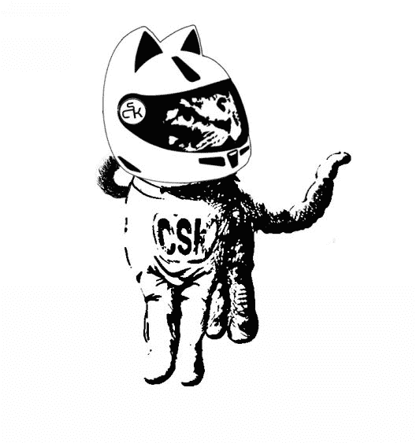

## 简介

在上一次任务（《黑客手册 2》）中，你的任务是攻破“网络小猫”的武器设施。现在他们组建了全新的太空部门——“网络太空小猫”（CSK）。该部门将此前安全评估中的所有经验教训应用于系统加固，建立了本地安全运营中心，并制定了安全策略。他们雇佣你来评估所有的安全控制措施是否有助于提升其整体安全态势。

根据我们掌握的一些细节，“网络太空小猫”似乎发现了一颗位于仙女座星雲（或仙女座星系）的神秘行星。这颗行星位于两个旋臂之一上，被称为 KITT-3n。KITT-3n 的体积是地球的两倍，它位于名为 OI 31337 的双星系统中，伴星的体积同样是地球恒星的两倍。这创造了一个可能宜居的环境，拥有海洋、湖泊、植物，甚至可能有生命……

怀着对新生命、水源和另一颗宜居星球的希望，太空竞赛已然展开。CSK 聘请我们执行红队评估，以确保他们安全无恙，并具备检测和阻止入侵的能力。他们的管理层目睹并听闻了去年发生的所有重大数据泄露事件，只想聘用最顶尖的人才。接下来就轮到你了……

你的使命，如果你选择接受的话，就是找出所有外部和内部漏洞，使用最新的漏洞利用程序，利用漏洞链，并观察其防御团队是否能检测到或阻止你。

你需要采取哪些战术、面对哪些威胁、遵循哪些程序？在这场战役中，你将需要进行大量的侦察和发现工作，寻找其外部基础设施中的弱点，对社会工程学员工实施攻击，提升权限，获取内部网络信息，在整个网络中进行横向移动，并最终窃取 KITT-3n 系统和数据库。

## 渗透测试团队与红队

在深入探讨红队技术的理想之前，我需要澄清我对“渗透测试”和“红队”这两个术语的定义。这些词汇常被随意使用，容易让人产生混淆。在这本书中，我想谈谈我将如何使用这两个术语。

渗透测试是对网络、应用程序、硬件等进行更严格和方法化的测试。如果你尚未阅读，我建议你去阅读《渗透测试执行标准》（PTES：`http://www.pentest-standard.org`）——它很好地展示了如何执行评估。

简而言之，你需要按照定义的范围、情报收集、漏洞分析、漏洞利用、后渗透测试和报告等步骤逐一执行。在传统网络测试中，我们通常扫描漏洞，发现并利用可被攻击的系统或应用程序，可能进行一些后渗透测试，获取域管理员权限，并撰写报告。这类测试会生成包含漏洞矩阵、补丁问题和建议等非常可操作结果的报告。

即使在创建范围时，渗透测试也有明确的定义，通常限定在为期一两周的评估周期内，并且一般会向公司内部安全团队公告。公司仍然需要渗透测试人员作为其安全软件开发生命周期（S-SDLC）的一部分。

如今，尽管公司拥有漏洞管理计划、S-SDLC 计划、渗透测试人员、事件响应团队/计划以及许多昂贵的安全工具，它们仍然会被攻破。如果我们回顾任何近期的数据泄露事件（`http://www.informationisbeautiful.net/visualizations/worlds-biggest-data-breaches-hacks`），我们会发现其中许多发生在非常大型且成熟的公司的身上。

我们从其他安全报告中看到，某些入侵可能在六个月后才被检测到（`https://en.wikipedia.org/wiki/Sony_Pictures_hack`）。还有一些报告指出，近三分之一的美国企业曾在 2017 年遭受过入侵（`https://www.esecurityplanet.com/network-security/almost-a-third-of-all-u.s.-businesses-were-breached-in-2017.html`）。

我希望公司能问自己这样的问题：如果同样的坏人或行为体使用完全相同的战术针对你们公司，你们能检测到吗？需要多久？能从其中恢复吗？能否弄清楚他们具体做了什么？

这就是红队发挥作用的地方。`Red Team` 的使命是模仿攻击者使用的战术、技术和程序（TTPs）。其目标是提供现实世界和硬事实，展示公司将如何做出反应，在安全计划中发现差距，在员工中识别技能差距，并最终提高其安全态势。

对于红队，它不像渗透测试那样有条不紊。由于我们在模拟现实世界事件，每次测试都会有显著差异。有些活动可能会专注于获取个人身份信息（PII）或信用卡，而另一些则专注于获取域管理员控制。

说到域管理员，这正好体现了渗透测试和红队活动之间的巨大差异。对于网络渗透测试，我们热爱获取域管理员（DA）以访问域控制器（DC）并结束这一天。对于红队活动，基于活动，我们可能会完全忽略 DC。

原因之一是我们看到许多公司在其 DC 周围放置了大量保护。他们可能有应用白名单、完整性监控、大量的 IDS/IPS/HIPS 规则，甚至更多。由于我们的使命不是被发现，我们需要低调。

我们要遵守的另一规则是我们几乎从不对内网运行漏洞扫描。您见过多少攻击者在侵入受 compromise 的环境后开始执行完整漏洞扫描？这极其罕见。为什么？漏洞扫描在网络上非常响亮，在当今世界很可能会被发现。

范围中的另一个主要差异是时间线。对于渗透测试，我们很幸运能拿到两周，如果不是一周。而红队必须构建活动，持续时间从两周到六个月。这是因为我们需要模拟真实攻击、社会工程学、信标等。

最后，两种团队类型之间最大的差异是结果。漏洞列表的最终报告中，红队发现更倾向于蓝队流程的差距、政策、工具和技能。在您的最终报告中，您可能有用于活动的漏洞发现，但大多数发现将是安全计划中的差距。记住发现主要是为了安全计划，而不是 IT。

| 渗透测试 | 红队 |
| :--- | :--- |
| 有条不紊的安全评估： 参与前互动 情报收集 漏洞分析 利用 后利用 报告 | 灵活的安全评估： 情报收集 初步立足点 持久性/本地权限提升 本地/网络枚举 横向移动 数据识别/渗出 域权限提升/转储哈希 报告 |
| 范围： 限制性范围 1-2 周参与 通常公告 识别漏洞 | 范围： 无规则* 1 周 – 6 个月参与 无公告 测试蓝队的项目、政策、工具和技能 不能违法… |

对于红队，我们需要向公司展示价值。这并非关于总漏洞数量或单个漏洞严重性，而是关于证明安全计划运行情况。红队的目标是模拟现实世界事件并追踪。

从这些活动中进化的两个强有力指标是检测时间（TTD）和缓解时间（TTM）。这些不是新概念，但仍然是红队有价值的指标。

检测时间（TTD）是什么意思？这是事件初次发生到分析师检测并开始处理事件之间的时间。假设有社会工程学邮件，用户在其系统上执行恶意软件。即使他们的 AV、基于主机安全系统或监控工具可能触发，记录时间是分析师创建第一个工单的时间。

缓解时间（TTM）是记录的次要指标。此时间线在防火墙阻止、DNS 陷阱或网络隔离被实施时记录。

其他有价值的信息要记录的是安全团队如何与 IT 协作，管理层如何处理严重事件，以及员工是否恐慌。有了所有这些数据，我们可以建立真实数字，了解您的公司处于风险的程度，或者被 compromise 的可能性有多大。

## 总结

我推动的主要要点是管理者摆脱审计指标的思维定势。我们都有理由符合合规性，可以肯定帮助成熟我们的计划，但它们并非总是为公司提供现实世界安全。

作为红队人员，我们的任务是测试整体安全计划是否有效。

当您阅读本书时，我想让您将自己置于红队思维中并专注于：

- 安全中的漏洞
- 模拟真实世界事件
- 生活在持续红队感染的世界

挑战系统……提供真实数据来证明安全差距。
