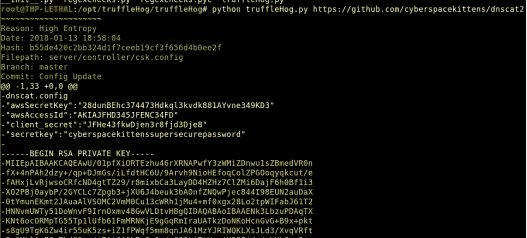
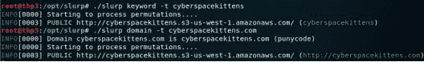
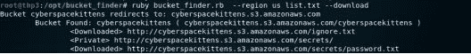
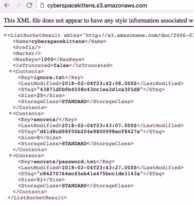
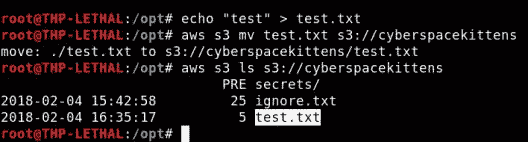
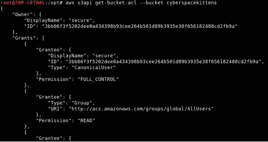
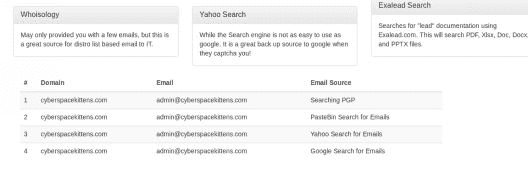

# 快照之前的突击行动：红队侦察

在上一本红队手记（THP）中，“快照之前”部分重点介绍了如何使用不同的工具，如`Recon-NG`、`Discover`、`Spiderfoot`、`Gitrob`、`Masscan`、`Sparta`、`HTTP Screenshot`、`Vulnerability Scanners`、`Burp Suite`等。这些工具既可以用于外部，也可以用于内部，对受害者的基础设施执行侦察或扫描。我们将延续这一传统，从红队的角度扩展侦察阶段的内容。

## 监控环境

对于红队行动，往往在于抓住攻击机会。你不仅需要随时准备好攻击基础设施，还需要不断寻找漏洞。这可以通过扫描环境的各种工具来实现，这些工具用于查找服务、云配置错误等。这些活动使你能够收集更多关于受害者基础设施的信息，并发现即时的攻击路径。

### 常规 Nmap 差异对比

对于我们的所有客户，我们要做的第一件事情之一就是设置不同的监控脚本。这些通常只是简单的 `bash` 脚本，每天向我们发送客户网络的变化差异报告。当然，在执行扫描之前，请确保已获得适当的授权。

对于通常规模不大的客户网络，我们会设置一个简单的定时任务（`cronjob`）来执行外部端口差异对比。例如，我们可以创建一个快速的 Linux `bash` 脚本来做繁重的工作（记得替换 IP 范围）：

```bash
#!/bin/bash

mkdir /opt/nmap_diff

d=$(date +%Y-%m-%d)

y=$(date -d yesterday +%Y-%m-%d)

/usr/bin//nmap -T4 -oXscan_$d.xml/10.100.100.0/24 > /dev/null 2>&1

if [ -e `/opt/nmap_diff`]; then
    /usr/bin/ndiff/opt/nmap_diff/scan_$y_xml// `/opt/nmap_diff/scan_$d.xml > /tmp/diff.txt`; fi;fi
```

这是一个非常基础的脚本，每天使用默认端口运行`nmap`，然后使用`ndiff`比较结果。我们可以将此脚本的输出用作通知团队每日新发现端口的依据。

在上一本书中，我们大量讨论了`Masscan`的好处（`github.com/robertdavidgraham/massscan`）以及它比`nmap`快多少。`Masscan`的开发人员表示，拥有足够大的网络管道，你可以在6分钟内扫描完整个互联网。我们遇到的问题主要是`Masscan`在扫描大范围时的可靠性。它非常适合进行初步侦察，但通常不用于差异对比。

**实验：**

红队手记（THP3）中的实验完全是可选项的。在某些章节中，我包含了额外的实验以供测试，或者在你可以扩展的领域进行学习。既然这一切都是为了学习并发现你的热情所在，我强烈推荐你花时间改进我们的工具，并将其分享给社区。

构建更强大的网络差异扫描器：

- 构建优于默认`nmap`的端口列表（即默认`nmap`会错过 Redis 6379/6380 服务器等端口）
- 实现`nmap`服务标志（`banners`）
- 保持端口的历史记录跟踪
- 构建电子邮件告警/通知系统
- 查看差异 Slack 告警：`http://bit.ly/2H1o5AW`

### Web 截图

除了定期扫描开放端口/服务外，红队还需要监控不同的 Web 应用程序。我们可以使用两种工具来帮助监控应用程序的变化。

我们通常使用的第一个 Web 截图工具是`HTTPScreenshot`（`github.com/breenmachine/httpscreenshot`）。`HTTPScreenshot`如此强大的原因是它使用`Masscan`快速扫描大型网络，并使用`phantomjs`对其检测到的任何网站进行截图。这是快速了解大型内部或外部网络布局的极佳方式。

请记住，本书中列出的所有工具引用均是在修改后的 Kali 虚拟机中运行的。你可以在此处找到该虚拟机：`http://thehackerplaybook.com/get.php?type=THP-vm`。用户名/密码默认为：`root/toor`。

```bash
cd /opt/httpscreenshot/
```

编辑`networks.txt`文件以选择要扫描的网络：`gedit networks.txt`。运行脚本：`./masshttp.sh firefox clusters.html`。

另一个值得尝试的工具是`EyeWitness`（`github.com/ChrisTruncer/EyeWitness`）。`EyeWitness`是另一个极佳的工具，它从`nmap`输出中读取 XML 文件，并截取 Web 页面、RDP 服务器和 VNC 服务器的截图。

**实验：**

```bash
cd /opt/EyeWitness
```

运行命令：`nmap-[IP 范围]/24--open-p 80,443 -oX/scan.xml`。随后运行：`python ./EyeWitness.py-x scan.xml--web`。

### 云扫描

随着越来越多的公司转向使用不同的云基础设施，许多新型和旧式的攻击手段也随之浮出水面。这通常是由于配置错误以及对云基础设施上具体哪些内容对外公开缺乏了解所致。无论是亚马逊 EC2、`Azure`、谷歌云还是其他提供商，这已成为一种全球趋势。

对于红队人员来说，问题在于如何在不同的云环境中进行搜索？由于许多租户使用动态 IP，他们的服务器不仅可能迅速变化，而且并未列在云提供商的某个特定网段中。例如，如果你使用 AWS，它们在全球拥有巨大的地址范围。根据你选择的区域，你的服务器会随机分配到 `/13` CIDR 范围内。对于外部人员来说，找到并监控这些服务器并不简单。

首先，重要的是弄清楚不同提供商拥有哪些 IP 范围。以下是一些示例：

- 亚马逊：`http://bit.ly/2vUSjED`
- Azure：`http://bit.ly/2r7rHeR`
- 谷歌云：`http://bit.ly/2HAsZFm`

你可以看出这些范围非常巨大，手动扫描它们将极其困难。在本章中，我们将回顾如何获取这些云系统的信息。

### 网络/服务搜索引擎

要查找云服务器，互联网上有许多免费资源可供我们对目标执行侦察。我们可以使用从谷歌到第三方扫描服务的一切。利用这些资源，我们可以深入调查公司，被动地获取有关服务器、开放服务、服务标志和其他细节的信息。公司永远不会知道你查询了此类信息。让我们看看红队人员如何使用其中一些资源。

#### Shodan

`Shodan`（`www.shodan.io`）是一项极好的服务，它会定期扫描互联网，抓取服务标志、端口、网络信息等内容。他们甚至拥有关于 Heartbleed 等漏洞的信息。使用`Shodan`最有趣的应用之一是查看开放的摄像头并进行互动。从红队角度来看，我们希望找到有关受害者的信息。

**几个基础搜索查询示例：**

- `title`: 搜索从 HTML 标签中抓取的内容
- `html`: 搜索返回页面的完整 HTML 内容
- `product`: 搜索服务标志中标识的软件或产品名称
- `net`: 搜索给定的网络块（示例：`204.51.94.79/18`）

我们可以在`Shodan`上针对`cyberspacekittens`进行一些搜索：

```bash
cyberspacekittens.com
```

操作：在 Title HTML 标签中搜索。

# *cyberspacekittens* 页面上下文中的搜索

- **`html`**: `cyberspacekittens.com`

请注意，我注意到`Shodan`的扫描速度有点慢。我的服务器被扫描并收录进`Shodan`数据库花费了一个多月。

#### Censys.io

`Censys`持续监控互联网上所有可到达的服务器和设备，因此你可以实时搜索和分析它们。你将能够理解你的网络攻击面，发现新的威胁，并评估其全球影响（[https://censys.io/](https://censys.io/)）。`Censys`最好的功能之一是它可以从 SSL 证书中抓取信息。

通常，红队成员面临的主要困难之一是找到受害者的服务器位于哪些云服务器上。幸运的是，我们可以使用`Censys.io`来查找这些信息，因为他们已经解析了这些数据。

我们使用这些扫描的一个问题是，它们有时可能会落后几天或几周。在这种情况下，获取标题信息（`title`）的扫描花费了一天时间。此外，在我的网站上创建 SSL 证书后，信息出现在`Censys.io`网站上花费了四天时间。

下面，我们运行了扫描以查找有关目标`cyberspacekittens.com`的信息。通过解析服务器的 SSL 证书，我们能够确定受害者的服务器托管在 AWS 上。

还有一个`Censys`脚本工具可以通过脚本过程查询它（`censys-subdomain-finder`）：

`https://github.com/christophetd/censys-subdomain-finder`

### 手动解析 SSL 证书

我们经常发现公司没有意识到他们在互联网上公开了什么。特别是随着云计算使用的增加，许多公司没有正确实施 ACL（访问控制列表）。他们相信他们的服务器受到保护，但我们发现它们是面向公众的。这包括 Redis 数据库、`Jenkins`（`jenkins`）服务器、Tomcat 管理、NoSQL 数据库等——其中许多导致了远程代码执行或 PII（个人身份信息）泄露。

查找这些云服务器的便宜且粗糙的方法是自动扫描互联网上的 SSL 证书。我们可以获取云提供商的 IP 范围列表，并定期扫描它们以获取 SSL 证书。查看 SSL 证书，我们可以了解组织的许多情况。从下面对`cyberspacekittens`范围的扫描中，我们可以看到证书中具有`.int.`的主机名用于内部服务器，`.dev.`用于开发，`.vpn.`用于 VPN 服务器等。很多时候，你可以获得内部网络中可能没有公共 IP 或白名单 IP 的内部主机名。

为了协助扫描证书中的主机名，开发了`sslScrape`工具用于 THP3（*THP3*：威胁猎人渗透）。此工具利用`Masscan`快速扫描大型网络。一旦它识别出端口 443 上的服务，它就会剥离证书中的主机名。

### sslScrape（`https://github.com/cheetz/sslScrape`）：

- `cd /opt/sslScraper`
- `python ./sslShrap.py [IP 地址] [CIDR 范围]`

### 云 IP 地址示例：

- Amazon（`http://bit.ly/2vUSjED`）
- Azure（`http://bit.ly/2r7rHeR`）
- Google Cloud（`http://bit.ly/2HAsZFm`）

在整个本书中，我试图提供示例和一个初始框架。然而，由你来进一步发展它。我强烈建议你将此代码作为起点，将所有主机名保存到数据库，制作 Web UI 前端（`frontend`），连接可能具有证书的其他端口（如 8443（`port`）），甚至可能查找一些漏洞，如`.git`/`.svn`风格的仓库（`repos`：`repositories`）。

### 子域名发现

就识别 IP 范围而言，我们通常可以从公共来源（如`ARIN`（美国互联网号码注册中心）`http://www.arin.net/`）查找公司。我们可以查找 IP 地址空间的所有者，搜索公司拥有的网络（`company1`，`company2`），自治系统编号（`AS`/`org`）等。如果我们在北美以外查找，还可以通过 AFRINIC（非洲）、APNIC（亚洲）、LACNIC（拉丁美洲）和 RIPE NCC（欧洲）进行查找。这些都是公开可用的，并列出在其服务器上。

你可以通过许多可用的公共来源查找任何主机名或 FQDN 以找到该域的所有者（我快速查找所有权的最爱之一是`co/domaindossier.aspx`）。你无法在任何地方找到列出的子域名（`subdomain`：`test`，`dev`）。子域名信息存储在目标的 DNS 服务器上，而不是注册在某些中央公共注册系统中。你必须知道要搜索什么才能找到有效的`subnet`。

为什么子域名对于找到你的目标**如此**重要？原因如下：

- 一些子域名可以指示服务器的类型（*i.e.*, `dev`, `vpn`, `mail`, `internal`/`test`）。例如，`.int.`cyberspacekittens.com。（注意：文本说 `mail.cyber...`）更正：例如，*Mail*`@CyberSpaceKitten`.com。
- 一些服务器不通过 IP 响应（`IP`：`192.x.x`）。它们可能位于共享基础设施上，仅通过完全限定域名（*FQDN*）响应。这在云基础设施中很常见。*所以你可以整天`nmap`，但如果无法找到子域名，你就不会真正知道该 IP 后面有哪些应用程序*。
- 子域名可以提供有关目标托管其服务器的位置的信息。这是通过查找公司的所有域、执行反向查找并`找到`IP 托管的位置（`Host`）来完成的。公司可能使用多个云提供商（`clouds`）和数据中心（`DC`::`DataCenter`）。

下面我们在上一本书中做了一些发现，所以让我们回顾一些当前的工具以执行更好的操作。欢迎加入我们一起扫描 *CyberSpaceKitten*.com 域！

#### 发现脚本 Discover Scripts

`https://github.com/leebaird/discover` 工具仍然是上一本书中讨论的最喜欢的侦察/发现（`disc`）工具之一。这是因为它将 Kali linux 上的所有侦察（`recon`：`recognition`）结合在一起并持续维护。被动域侦察将使用以下工具：被动使用 `ARIN`、`dnsrecon`、`goofile`、`googmail`/`goohost`/`theHarvester`/`Metasploit`/`URLCrazy`/`Whois`/多个网站和`ReconNG`。

### 脚本

1. `git clone https://github.com/leebaird/discover /opt/discover`
2. `cd` `/opt/discover/.update.sh` （运行更新脚本。）
3. `./discover.sh` 域名（`Domain_Name`）`firefox`/`root`/`data`/[`Index_Html`]/`index`。

### 发现脚本的最佳部分

它收集信息并根据收集的信息继续搜索。例如，通过搜索公共 PGP 存储库可能会识别出电子邮件，然后使用该信息搜索 Have I Been Pwned（`HIBP`）。这将让我们知道是否有任何密码被公开泄露。（这需要你自己找到！）。

#### Knock

接下来想要对公司可能使用的所有服务器和域有一个好主意。虽然子域名没有存储的中央位置，但我们可以使用 *Knock* 等工具暴力破解不同的子域名，以识别可能可用于攻击的服务器或主机（`hosts`）。（**攻击**！**防御**！）

#### Knockpy

`knockpy`（Python）是一个 Python 工具，旨在通过单词列表（`word`）枚举目标域上的子域名。

#### Knock 工具

子域名是很棒的扫描工具，它们获取`cyberspacekittens.com`列表。*Knock*将检查是否解析。所以如果你有*.knockpy.py*，将搜索任何子域名 *[sub]*.*dom*。现在，这里有一个警告：它仅对你的单词列表（`Word`）有效。因此，拥有更好的列表会增加找到子域名的机会！

我最喜欢的子域名之一是 *jhaddix* 创建的，位于 `bit.ly/2qwxrxB`。子域名是你应该始终收集（`collect`）的东西。在 THP Kali 镜像下的 `/opt/*SecLists*` 或此处（`https://github.com/danielmiessler/seclists`）发现的其它列表。

#### 实验室

查找`cyberspacekittens.com`的所有子域名：

- `cd` `/opt/knock/knockerpy`.run() -> `python`（`./knockpy.py`）*target*.com.（[子域名]）

### 步骤摘要：

1. `git clone https://github.com/leebaird/discover /opt/discover`.

    ```bash
    git clone --recursive (https://...) /path/to/script/repo.
    ```

2. `./update.sh` `python ./sslScrape.py [IP 地址].CIDR 范围`.


3. `"./discover"`、`"域名"`、`".PASSIVE"`、`"[公司]"`、`"[域名]"`、`firefox [/root/data/[index.htm]]` 等。

4. 命令示例：

- `cmd`：`echo 1 + var > cvar.log`

- `.cd /opt/knock/knockerpy.run().python ./knockpy.py cyberspacekittens.com`

### 注意

图像已转换为链接或占位符。图像链接（如 `images/00...`）应针对实际仓库中的可用性进行检查。

### 参考文献和链接

- `https://github.com/christophetd/censys-subdomain-finder`（`Github` 链接）

- `http://bit.ly/2JOkUyj`：`Knock`（`KnockLink`）

- `.git/.svn` 风格仓库：仓库类型

---

*免责声明*：始终仅在你拥有或明确获得测试权限的系统上进行道德渗透测试。负责任地使用调查结果！

这段内容使用了来自 `Knock` 的基础单词列表。尝试下载并使用一个更大的单词列表。尝试使用 `-u` 开关配合 `http://bit.ly/2qwxrxB` 列表使用（即 `python ./knockpy.py cyberspacekittens.com -u all.txt`）。

你从 `Discover` 脚本中发现了哪些类型的差异？对于攻击或 `spearphishing` 域攻击，你的首要目标域类型是什么？去现实世界中尝试一下。去寻找一个漏洞赏金项目，寻找看起来很有吸引力的子域。

### Sublist3r

如前所述，`Knock` 的问题在于它仅取决于你的单词列表。一些公司拥有独特的子域，无法通过普通单词列表找到。最好的替代资源是搜索引擎。随着网站被爬取，包含链接的文件会被分析和抓取公共资源变得可用，这意味着我们可以利用搜索引擎为我们做繁重的工作。

这就是我们可以使用类似 `Sublist3r` 这样的工具的地方。注意，使用此类工具会使用不同的 `Google Dork` 风格的搜索查询，看起来像机器人（`bot`）。这可能会导致你被临时列入黑名单，并要求你在每次请求时填写验证码，这可能会限制扫描结果。运行 `Sublist3r`：

```
cd /opt/Sublist3r
python sublist3r.py -d cyberspacekittens.com -o cyberspacekittens.com
```

是否注意到一些通过子域名爆破从未发现的结果？同样，在漏洞赏金项目中尝试一下，以查看爆破和使用搜索引擎之间的显著差异。

*存在一个也执行子域检查的 `Sublist3r` 分叉版本：`https://github.com/Plazmaz/Sublist3r`。

### SubBrute

最后一个子域枚举工具被称为 `SubBrute`。`SubBrute` 是一个社区驱动的项目，旨在创建最快、最准确的子域枚举工具。`SubBrute` 背后的部分魔力在于它使用开放解析器作为一种代理来规避 DNS 速率限制（`https://www.us-cert.gov/ncas/alerts/TA13-088A`）。这种设计还提供了一层匿名性，因为 `SubBrute` 不会直接向目标名称服务器发送流量。[`https://github.com/TheRook/subbrute`](https://github.com/TheRook/subbrute)

不仅 `SubBrute` 速度极快，它还具有 DNS 蜘蛛功能，可以爬取枚举的 DNS 记录。运行 `SubBrute`：

```
cd /opt/subbrute
./subbrute.py cyberspacekittens.com
```

我们还可以将 `SubBrute` 提升到下一个级别，将其与 `MassDNS` 结合以执行非常高性能的 DNS 解析（`http://bit.ly/2EMKIHg`）。

### GitHub

`GitHub` 是一个充满惊人数据的宝库。过去进行过许多渗透测试和红队评估，我们得以获取密码、`API` 密钥、旧源代码、内部主机名/IP 等。这些要么导致直接入侵，要么辅助其他攻击。我们看到的是，许多开发人员要么将代码推送到错误的仓库（发送到了公共仓库而不是公司的私有仓库），要么意外推送了敏感材料（如密码）然后试图删除它。`GitHub` 的一个好处是它追踪每次代码被修改或删除的时间。这意味着如果敏感的代码曾经被推送到一个仓库，且该敏感文件被删除，它仍然在代码更改中被跟踪。只要仓库是公开的，你将能够查看所有这些更改。

我们可以使用 `GitHub` 搜索来识别某些主机名/组织名称，甚至只需使用简单的 `Google Dork` 搜索，例如：

- `site:github.com + "cyberspacekittens"`

尝试使用不同的组织搜索漏洞赏金项目，而不是针对以下示例搜索 `cyberspacekittens`。

通过搜索你发现：`https://github.com/cyberspacekittens/dnscat2`（`GitHub` 实验室的修改示例）。你可以手动查看此仓库，但它通常很大，你可能难以浏览所有项目来找到任何有趣的内容。

如前所述，在 `GitHub` 中编辑或删除文件时，一切都会被记录。对于红队人员来说，许多人忘记了这个功能。因此，我们经常看到人们将敏感信息放入 `GitHub`，删除它，却未意识到它仍然存在！让我们看看能否找到其中的一些瑰宝。

### Truffle Hog

`Truffle Hog` 工具会扫描不同的提交历史和分支以查找高熵密钥并打印它们。这对于查找秘密、密码、密钥等非常有用。让我们看看是否能在 `cyberspacekittens` 的 `GitHub` 仓库中找到任何秘密。

实验：

```
cd /opt/trufflehog/truffleHog
python truffleHog.py https://github.com/cyberspacekittens/dnscat2
```



正如我们在提交历史中看到的，从 `server/controller/csk.config` 中移除了 `AWS` 密钥和 `SSH` 密钥，但如果你查看当前仓库，你找不到此文件：`https://github.com/cheetz/dnscat2/tree/master/server/controller`。

更好（但设置稍微复杂）的是来自 `https://github.com/anshumanbh/git-all-secrets` 的 `git-all-secrets`。在浏览大型组织时，`Git-all-secrets` 非常有用。你可以指向一个组织并让它在本地克隆代码，然后用 `Truffle-hog` 和 `repo-supervisor` 扫描它。你首先需要创建一个 `GitHub` 访问令牌，这是通过创建 `GitHub` 并在设置中选择生成新令牌来免费创建的。

运行 `git-all-secrets`：

```
cd /opt/git-all-secrets
docker run -it abhartiya/tools_gitallsecrets:v3 -repoURL=https://github.com/cyberspacekittens/dnscat2 -token=[API Key] -output=results.txt
```

- 这将克隆仓库并开始扫描。你甚至可以使用 `-org` 标志遍历整个组织的 `GitHub`。

- 容器运行完毕后，输入以下命令获取容器 ID：

  ```
  docker ps -a
  ```

- 获取容器 ID 后，通过输入以下命令从容器将结果文件复制到主机：

  ```
  docker cp <container-id>:/data/results.txt .
  ```

### 云

如前所述，云是我们看到很多公司不当保护其环境的一个领域。我们通常看到的最常见问题是：

- `Amazon S3` 缺少存储桶：`https://hackerone.com/reports/121461`

- `Amazon S3` 存储桶权限：`https://hackerone.com/reports/128088`

- 能够列出并写入公共 `AWS` 存储桶中的文件：

  ```
  aws s3 ls s3://[bucketname]
  aws s3 mv test.txt s3://[bucketname]
  ```

- 缺乏日志记录

在开始测试不同 `AWS` 存储桶的配置错误之前，我们需要首先识别它们。我们将尝试几种不同的工具来查看我们能在受害者的 `AWS` 基础设施上发现什么。

### S3 存储桶枚举

有许多工具可以执行 `S3` 存储桶枚举用于 `AWS`。这些工具通常会接受关键词或列表，应用多种排列组合，然后尝试识别不同的存储桶。例如，我们可以使用名为 `Slurp`（`https://github.com/bbb31/slurp`）的工具来查找有关我们目标 `CyberSpaceKittens` 的信息：

```
cd /opt/slurp
./slurp domain -t cyberspacekittens.com
./slurp keyword -t cyberspacekittens
```



### Bucket Finder

另一个工具 `Bucket Finder` 不仅会尝试查找不同的存储桶，还会下载来自这些存储桶的所有内容以供分析：

```
wget https://digi.ninja/files/bucket_finder_1.1.tar.bz2 -O bucket_finder_1.1.tar.bz2
cd /opt/bucket_finder
./bucket_finder.rb --region us my_words --download
```



你在 `Cyber Space Kittens` 的基础设施上运行发现工作并识别出他们之一的 `S3` 存储桶（`cyberspacekittens.s3.amazonaws.com`）。你检索在 `S3` 存储桶上可以查看和无法查看的内容的第一步是什么？你可以首先在浏览器中打开它，查看一些信息：



# 开始之前

在开始之前，我们需要创建一个 AWS 账户以获取 `AccessKeyID`。你可以在亚马逊上免费获取你的：[`https://aws.amazon.com/s/dm/optimization/server-side-test/free-tier/free_np/`](https://aws.amazon.com/s/dm/optimization/server-side-test/free-tier/free_np/)。一旦你创建账户，登录 AWS，进入 `YourSecurityCredentials`（[`https://amzn.to/2ItaySR`](https://amzn.to/2ItaySR)），然后进入 `AccessKeys`。当你拥有 `AWSAccessID` 和 `SecretKey` 后，我们便可以查询我们的 `S3` 存储桶。

# 查询 S3 并下载所有内容

- 安装 `awscli`：

  ```
  sudo apt install awscli
  ```

- 配置 `Credentials`：

  ```
  aws configure
  ```

- 查看 `CyberSpaceKittens` 的 `S3` 存储桶权限：

  ```
  aws s3api get-bucket-acl --bucket cyberspacekittens
  ```

- 从 `S3` 存储桶读取文件：

  ```
  aws s3 ls s3://cyberspacekittens
  ```

- 下载 `S3` 存储桶中的所有文件：

  ```
  aws s3 sync s3://cyberspacekittens .
  ```

除了查询 `S3` 之外，接下来要测试的是向该存储桶写入数据。如果我们拥有写入权限，这可能导致其应用程序受到完全 `RCE`（远程代码执行）。我们经常看到，当存储在 `S3` 存储桶中的文件用于所有页面时（如果我们可以修改这些文件），我们可以在其 Web 应用程序服务器上放置恶意代码。

# 向 S3 写入数据

- `echo "test" > test.txt`

- `aws s3 mv test.txt s3://cyberspacekittens`

- `aws s3 ls s3://cyberspacekittens`



*注意：`write` 权限已从 `Everyone` 组中移除。这仅用于演示。

# 在 AWS 存储桶中修改访问控制

分析 `AWS` 安全性时，我们需要审查对象和存储桶周围的控制权限。对象是单个文件，而存储桶是逻辑存储单元。如果配置不当，任何用户都可以修改这些权限。

首先，我们可以查看每个对象，看看这些权限是否正确配置：

- `aws s3api get-object-acl --bucket cyberspacekittens --key ignore.txt`

我们会看到文件仅对名为 `secure` 的用户可写。它未向所有人开放。如果我们要拥有写入权限，可以使用 `s3api` 中的 `put-object` 来修改该文件。

接下来，我们查看是否可修改存储桶本身。这可以通过以下方式完成：

- `aws s3api get-bucket-acl --bucket cyberspacekittens`



同样，在这两种情况下，`READ` 权限是全局授予的，但 `FULL_CONTROL` 或任何 `write` 权限仅由名为 `secure` 的账户允许。如果我们要能访问存储桶，可以使用 `--grant-full-control` 给予我们存储桶和对象的完全控制权。

# 资源

- [`https://labs.detectify.com/2017/07/13/a-deep-dive-into-aws-s3-access-controls-taking-full-control-over-your-assets/`](https://labs.detectify.com/2017/07/13/a-deep-dive-into-aws-s3-access-controls-taking-full-control-over-your-assets/)

# 子域接管

子域接管是如今几乎所有公司常见的一种漏洞。发生的情况是，公司利用第三方 `CMS`/`Content`/`Cloud` 提供商，并将其子域名指向这些平台。如果他们忘记配置第三方服务或从该服务器注销，攻击者可能会接管该主机名。

例如，你注册了一个名为 `testlab.s3.amazonaws.com` 的 `S3` Amazon 存储桶。然后，让你的公司的子域名 `testlab.company.com` 指向 `testlab.s3.amazonaws.com`。一年后，你不再需要 `S3` 存储桶 `testlab.s3.amazonaws.com` 并将其注销，但忘记了 `testlab.company.com` 的 `CNAME` 重定向。现在有人可以去 `AWS` 设置 `testlab.s3.amazon.com`，并在受害者的域名上创建有效的 `S3` 存储桶。

一个名为 `tko-subs` 的工具可用于检查易受攻击的子域名。我们可以使用此工具来检查我们发现的指向 `CMS` 提供商（`Heroku`、`Github`、`Shopify`、`Amazon S3`、`Amazon CloudFront` 等）的任何子域名是否可以被接管。

# 运行 tko-subs

- `cd /opt/tko-subs/`

- `./tkosubs -domains=list.txt -data=providers-data.csv -output=output.csv`

如果发现悬垂 `CNAME`，我们可以使用 `tko-subs` 接管 `Github` 页面和 `Heroku` 应用程序。否则，我们需要手动进行。另外两种有助于域名接管的工具是：

- `HostileSubBruteforcer`（[`https://github.com/nahamsec/HostileSubBruteforcer`](https://github.com/nahamsec/HostileSubBruteforcer))

- `autoSubTakeover`（[`https://github.com/JordyZomer/autoSubTakeover`](https://github.com/JordyZomer/autoSubTakeover))

想要了解更多关于 `AWS` 漏洞？一个很好的 `CTF` `AWS` 教程：[`http://flaws.cloud/`](http://flaws.cloud/)。

# 电子邮件

任何社会工程攻击的重要组成部分是找到员工的 `email` 地址和姓名。我们在之前的章节中使用了 `Discover Script`，这是收集此类数据的绝佳工具。我通常从 `Discover` 脚本开始，并开始深入挖掘其他工具。每个工具做的事情略有不同，尽可能使用尽可能多的自动化过程是有益的。

一旦你得到一小批电子邮件，了解他们的 `email` 格式是很重要的。它是 `firstname.lastname @cyberspacekitten.com` 还是 `first initial.lastname @cyberspacekittens.com`？一旦你能找出他们的格式，我们可以使用 `LinkedIn` 等工具来找到更多员工，并尝试识别他们的电子邮件地址。

### SimplyEmail


我们都知道`spear phishing`（鱼叉式网络钓鱼）仍然是更成功的攻击手段之一。如果我们在外部没有任何漏洞，攻击用户就是下一步。为了构建一份良好的`email`地址清单，我们可以使用`SimplyEmail`这样的工具。该工具的输出将提供公司的`email`地址格式以及有效用户列表。

## 实验室：为 cnn.com 查找所有电子邮件账户

* `cd /opt/SimplyEmail`
* `./SimplyEmail.py -all -v -e cyberspacekittens.com`
* `firefox cyberspacekittens.com<date_time>/Email_List.html`

运行此命令可能需要很长时间，因为它会检查`Bing`，`Yahoo`，`Google`，`Ask Search`，`PGP Repos`，文件以及更多内容。这也可能让你的网络看起来像给搜索引擎的`bot`（机器人），如果你产生太多搜索请求，可能需要`captchas`（验证码）。



针对你的公司运行此命令。是否看到任何你认识的`email`地址？这些可能是大规模攻击活动中可能首先被针对的`email`地址。

## 过去泄露

获取`email`账户的最佳方式之一是持续监控和捕获过去的泄露。我不想直接链接到泄露文件，但我将引用一些我找到的有用的：

* `1.4 Billion Password Leak 2017`：[`https://thehackernews.com/2017/12/data-breach-password-list.html`](https://thehackernews.com/2017/12/data-breach-password-list.html)
* `Adobe Breach`（2013 年）：[`https://nakedsecurity.sophos.com/2013/11/04/anatomy-of-a-password-disaster-adobes-giant-sized-cryptographic-blunder/`](https://nakedsecurity.sophos.com/2013/11/04/anatomy-of-a-password-disaster-adobes-giant-sized-cryptographic-blunder/)
* `Pastebin Dumps`：[`http://psbdmp.ws/`](http://psbdmp.ws/)
* `Exploit.In Dump`
* `Pastebin Google Dork`：`site:pastebin.com intext:cyberspacekittens.com`

## 其他开源资源

我不确定该在哪里放这些资源，但我希望提供一份用于`Red Team`风格活动的优秀资源合集。这有助于识别人员、地点、`domain`信息、`social media`（社交媒体）、`image analysis`（图像分析）等。

* `Collection of OSINT Links`：[`https://github.com/IVMachiavelli/OSINT_Team_Links`](https://github.com/IVMachiavelli/OSINT_Team_Links)
* `OSINT Framework`：[`http://osintframework.com/`](http://osintframework.com/)

## 结论

在本章中，我们概述了所有不同的`recon`（侦察）战术和工具。这只是开始，因为许多这些技术是手动的，需要相当长的时间才能执行。由你决定将这些提升到下一个级别，自动化所有这些工具，并使`recon`快速高效。
