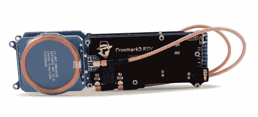
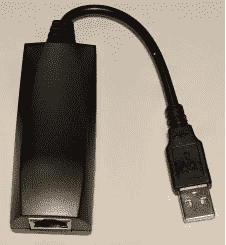
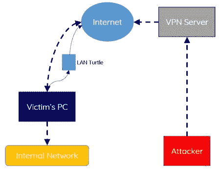
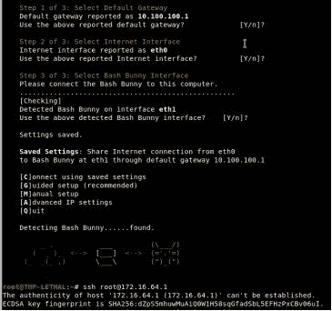
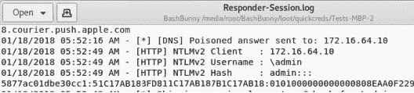

# 6 侧踢：物理攻击


作为安全评估的一部分，CSK 要求您的团队对设施进行物理评估。这包括检查他们的入口和保护是否足够，如果能够进入现场，则验证警卫的反应和响应时间。

> **快速提示：**在进行任何物理评估之前，请务必检查当地、州和联邦法律。例如，在密西西比、俄亥俄、内华达或弗吉尼亚，仅仅拥有开锁工具可能被视为非法。我不是律师，所以明智的是您先咨询律师。此外，确保您获得了适当的批准，与设施的物理安全团队一起，并签署文件，以防被抓获。在实际上采取行动之前，与物理安全团队合作，讨论如果安保人员抓住您，您是否可以逃跑，或者是否必须停止，以及是否有人在监视无线电。另外，确保警卫不联系当地执法人员。最后的事情是您实际上去坐牢。

现在，是时候闯入网络小猫的保密设施了。根据网站，看起来它位于`299792458 Light Dr`。在我们对 Google 街道进行一些侦察之后，我们注意到该设施是门控的，并且有一个或两个警卫舱。我们可以识别多个入口点和区域，我们可以翻过栅栏。通过初步的步行，我们也识别了一些摄像头、大门、入口点和读卡系统。

## 读卡器克隆机

读卡器克隆机在 THP2 中被广泛覆盖，因此我将主要进入更新。ProxCard II 徽章没有公共/私人握手，仍易受克隆和 bruteforce ID 号攻击。

在 THP2 中，我们喜欢克隆 ProxCard II 徽章，因为它们没有任何保护措施，可以轻松克隆，并且卡片通常批量逐步购买，这允许轻松 bruteforce。这全部使用`Proxmark3`设备。此后，已发布更便携的此设备版本称为`Proxmark3 RDV2 Kit`（`http://hackerwarehouse.com/product/proxmark3-rdv2-kit/`）。此版本可以用电池配置，并且比原始`Proxmark3`更小。



我们遇到的其他常见卡片：

- HID iClass（`13.56 MHz`）
- HID ProxCard（`125 kHz`）
- EM4100x（`125 kHz`）
- MIFARE Classic（`13.56 MHz`）

这是 Kevin Chung 的绝佳资源：`https://blog.kchung.co/rfid-hacking-with-the-proxmark-3/`。

## 物理工具绕过访问点

我们不会进入物理工具和操作方法，因为那是一整本书，需要大量的经验。如往常一样，进行物理评估的最佳方法是练习，建立物理实验室，并弄清楚什么有效，什么无效。就我们在过去使用过的一些酷工具而言：

- 开锁工具（`https://www.southord.com/`）— SouthOrd 一直是我们首选的开锁工具。质量高，工作良好。
- 大门绕过设备（`https://www.lockpickshop.com/GATE-BYPASS.html`）— 绕过锁定大门的工具。
- Shove-it 工具（`https://www.lockpickshop.com/SJ-50.html`）— 如果门和闩之间有适当的空间，则简单工具。类似于信用卡滑过打开门，您使用 shove-it 工具进入后拉回。
- Under the Door 2.0（`https://shop.riftrecon.com/products/under-the-door-tool`）— 适用于带有杠杆手柄的门。我们可以使用 Under the Door 工具字面意思是在门下方，缠绕在杠杆手柄周围，并拉下。以前，这些通常在酒店中发现，但我们在企业中也肯定发现。
- Air Canisters — 一种便宜且易于使用的工具，绕过内部带有运动传感器的解锁门。查看此视频，查看 Samy Kamkar 绕过这些类型的门：`https://www.youtube.com/watch?v=xcA7iXSNmZE`

请记住，这些工具和物理评估的目的是跟踪和监控公司对物理安全项目的反应。所以，我们的工作是确保我们不仅充分记录系统中的缺点，还确保响应时间和事件处理是可以接受的。

### LAN Turtle（`lanturtle.com`）

LAN Turtle 是 Hak5 我最喜欢的工具之一。在之前的书中，我们曾研究过用于投放盒的小尺寸 Raspberry Pi 和 ODROID。在这些设备上运行 Kali Linux，并通过 SSH 或 VPN 将其返回到我们的攻击机，是进行物理渗透测试的绝佳方式。

这些投放盒随着年份不断演变。现在，LAN Turtle 是可以隐藏在任意机器后面，由 USB 供电，对用户透明。LAN Turtle 使用 USB 作为 NIC 卡，并通过以太网电缆代理所有流量。

还有一个 3G 蜂窝版，但我们在这里不会演示它。

#### 设置 LAN Turtle

LAN Turtle 的目的是代替投放盒。虽然它具有像自动 SSH、DNS 欺骗、meterpreter、ptunnel、script2email、urlsnarf、responder 和其他许多功能，但主要的红队用途是获得进入网络的权限。

历史上，甚至在先前的 THP 书中，我们使用 SSH 反向 Shell。这些通常工作足够，但对于更深入的扫描/复杂攻击，我们需要完全进入网络。为此，我们必须配置 Reverse VPN 连接。反向 VPN 连接看起来是什么样的？

嗯，由于 LAN Turtle 将放在组织内部台式机后面的背面，我们无法直接连接它。因此，我们将让 LAN Turtle 首先通过端口 443 向外，VPN 返回我们的 OpenVPN AS 服务器。从我们的攻击者 Kali 盒子，我们也必须登录 VPN 服务器。一旦 LAN Turtle 和我们的攻击机进入我们的服务器，我们可以将我们的流量通过 LAN Turtle 进行扫描或攻击盒子。





虽然 OpenVPN 反向隧道并非新事物，但 Hak5 的团队确实做了一件很好的工作，制作教程。我不得不修改一些后续命令，但观看他们的 YouTube 视频进行更详细的说明：`https://www.youtube.com/watch?v=b7qr0laM8kA`。

这是三个主要部分：

1. 首先，我们必须将 OpenVPN AS 服务器在网络上设置。
2. 其次，我们必须配置 LAN Turtle。
3. 第三，我们必须配置我们的攻击机。

## 设置 OpenVPN 的 VPS 服务器

- 我们需要确保我们的`VPS`服务器对外可见。我们通常喜欢托管`VPS`服务器，因为它们非常容易且快速设置。作为补充说明，请与您的提供商确认，确保您被允许执行某些活动。
  - 我们通常看到人们使用`Linode`和`Amazon Lightsail`这两个提供商。这是因为这些`VPS`提供商快速、便宜且超级容易设置。在这种情况下，我们将使用 AWS Lightsail（`aws.amazon.com`）作为流量检测提供商。使用 AWS，我知道受害者网络很可能会有很多流量与 AWS 服务器。这将让我隐藏在他们的流量中。
- 前往`Lightsail.aws.amazon.com`并使用以下内容创建一个新的 VPS：
  - 创建后，进入“管理”→“网络”。
  - 添加两个防火墙 TCP 端口（`443`和`943`）。
- 完成`VPS`服务器的创建。现在让我们登录：
  - 在登录之前确保运行`chmod 600 your SSH keys`：

```bash
ssh -i /path/to/LightsailDefaultPrivateKey-us-west-2.pem ubuntu@[IP]
```

- 进入服务器后：
  - 进入 root：`sudo su -`
  - 更新服务器：`apt-get update && apt-get upgrade`
  - 安装 OpenVPN AS。
    - 前往`openvpn.net/index.php/access-server/download-openvpn-as-sw/113.html?osfamily=Ubuntu`获取最新版本。
- 复制链接并下载到 VPS：`wget http://swupdate.openvpn.org/as/openvpn-as-2.1.12-Ubuntu16.amd_64.deb`
- 安装 OpenVPN AS：`dpkg -i /path/to/openvpn-as-2.1.12-Ubuntu16.amd_64.deb`
- 删除当前配置并配置 OpenVPN：

```bash
/usr/local/openvpn_as/bin/ovpn-init
```

- 在设置期间：将`ADMIN UI`设置为所有接口。将“使用内部 DB 的本地认证”设置为`YES`。更新 OpenVPN 密码：`passwd openvpn`。
- 这是设置 IPTables 的好时机，仅允许来自您网络的 943 端口连接。

### 设置 OpenVPN AS 服务器

- 前往`https://[VPS 服务器 IP]:943/admin/`并使用用户账户`openvpn`和密码登录。
  - 如果您使用的是 AWS Lightsail：前往“服务器网络设置”，确保主机名或 IP 地址是正确的**PUBLIC** IP 地址，而不是**PRIVATE**的。
  - 保存并更新。
- 验证认证设置为本地：`认证 -> 常规 -> 本地 -> 保存设置 -> 更新服务器`。
- 创建两个用户，启用允许自动登录（`lanturtle`和`redteam`）：`用户管理 -> 用户权限`。

```bash
# 对于每个用户：
option = 设置允许自动登录；为两个用户设置密码；
通过用户权限启用权限：所有服务器端私有子网，所有其他 VPN 客户端；
```

- 为了允许 lanturtle 账户通过 VPN 进行通信，我们需要在用户管理中启用一些权限：`用户权限`。
  - 确保配置/启用“所有服务器端私有子网和其他 VPN 客户端”。

<!-- Image: images/00165.jpeg -->

### 下载 OpenVPN 配置文件

- 连接到`https://[您的 VPS]:943/?src=connect`下载配置文件。
  - 对于每个用户（`redteam`和`lanturtle`）执行以下操作：`登录`，然后**下载**配置文件——你自己（自动登录配置文件）。保存为`turtle.ovpn`或`redteam.ovpn`。

<!-- Image: images/00166.jpeg -->

### 设置 LAN Turtle 和初始配置

<!-- Image: images/00165.jpeg -->

- 插入 USB 和以太网。使用`nmap`扫描本地网络端口 22：

```bash
nmap x.x.x.x/24 -p22 -T5 --open
```

- 使用`root@[ip]`和密码`sh3llz` SSH。更新您的 LAN TURTLE。重要的是要更改您的 MAC 地址，因为 LANTurtles 使用类似的制造商 MAC 地址。确保您看起来像一个随机设备：更改您的 MAC 地址。
- 安装 OpenVPN：
  - 前往“模块”→“选择”→“配置”→“目录”（是）。然后安装 openvpn。选择“模块”以进行配置。
  - 通过返回“模块”→`openvpn`设置您的 OpenVPN 配置文件，然后使用`turtle.ovpn`中的内容进行配置。
- 我们还希望确保 LAN Turtle OpenVPN 服务器在启动时启动，以便我们可以简单地放下它并运行：前往“模块”→`openvpn`，启用。

```bash
# 以下命令示例仅供参考，日志或配置中可能需要使用
/etc/init.d/openvpn enable; restart
```

- 最后，修改我们 LAN Turtle 上的防火墙规则：退出 turtle 菜单并编辑我们的防火墙规则。

```bash
nano /etc/config/firewall

# 在以下位置：config 区域 'vpn'，选项 forward 设置为 ACCEPT。
# 添加以下配置转发规则：

config forwarding {
  option src     wan;
  option dest    lan;
}

config forwarding {
  option src     vpn;
  option dest    wan;
}

config forwarding {
  option src     WAN;
  option dest    VPN;
}
```

- 重新登录 turtle 菜单→“模块”→`openvpn`→“启动”。这应该在 Turtle 上启动 OpenVPN 客户端。为了确保它有效，返回到您的**OpenVPN AS**服务器，使用以下命令检查连接：

```bash
# 检查连接状态的逻辑示例（假设）：
systemctl status openvpn-as
```

我们现在已经配置了 LAN Turtle，以便每次它连接到网络时，它都会回连到我们的 VPN 服务器，我们可以 SSH 到 LAN Turtle。让我们通过一个示例来说明：

## 从我们的 Kali 攻击机访问 VPN 服务器

- 运行`openvpn --config ./redteam.ovpn`。我们需要获取他们网络上的 IP 地址，以便从您的 redteam VPN 路由所有流量。
  - SSH 进入 LAN Turtle。退出 Turtle 菜单并获取内部接口 IP 地址（通过`ifconfig`）。根据 IP 和 Bcast，确定 IP 范围。在我们的示例中，TURTLE 所在的网络是`10.100.100.0/24`。
- 最后，启用转发：回到**OpenVPN AS**→编辑用户 lanturtle。**用户权限→对于 lanturtle**：显示。**编辑 VPN 网关为是，添加内部范围（例如，`10.100.100.0/24`）。保存并更新。**

```bash
# 在 LAN Turtle 的 SSH 连接上，使用以下命令重启：
command = "reboot"
```

<!-- Image: images/00167.jpeg -->

现在我们可以从攻击机进行 VPN，并将所有流量通过 VPN LAN Turtle 路由到受害企业网络。在以下图片中，我们登录了 VPN 服务器，扫描 LAN TURTLE 的内部网络（`10.100.100.0/24`）。我们可以看到我们已成功配置了从 VPN 网关通过 LAN Turtle 到 corp 网络的路线。从我们的 Kali Attacker Machine，我们可以运行完整的漏洞扫描、网页抓取、Masscans 等。

<!-- Image: images/00168.jpeg -->

就是这样！你现在有了一个快速投放设备，可以让你与受害网络保持完整连接。为了成功，需要做一些事情：

- 设置一个每天重置设备的定时任务。隧道可能会断开，每次 Turtle 重启时，都会重新连接。
- 某些公司会阻止出站端口。在这种情况下，我们使用了端口`443`，在许多环境中，这是允许向外发送的。对于使用 web 代理直接向外传输流量的其他公司，您可能需要配置 LAN Turtle 在启动时自动尝试不同的端口或协议（`TCP/UDP`）。
- 如果投放两个（或更多）设备，请确保 VPN 服务器和 MAC 地址不同。我们的设备在参与的几乎所有时候都被意外发现，因为 IT 正在移动或更换电脑。

## Packet Squirrel

Hak5 的另一个工具 Packet Squirrel 具有与 LAN Turtle 类似的特征。Packet Squirrel 需要 USB micro 供电，但不同于 Packet Squirrel 的一端是 USB 以太网适配器，它的两端都是以太网电缆。这是另一种离散的捕获流量或建立 VPN 连接的方式。

<!-- Image: images/00169.jpeg -->

### 配置 Packet Squirrel

类似于 LAN Turtle，用于配置 Packet Squirrel：

- 编辑`/root/payloads/switch3/payload.sh`。
  - `FOR_CLIENTS=1`
- 编辑`/etc/config/firewall`。
  - 对您之前配置 LAN Turtle 时所做的防火墙更改进行相同的设置。
- 将`LANTurtle.ovpn`文件上传到`/root/payloads/switch3/config.ovpn`。

现在，您拥有了另一台设备，一旦连接到网络，它将对公司建立反向 VPN 连接。


此外，如果您拥有 `Packet Squirrel`，已有大量的优秀研究资源。您可以很容易地使用 `SWORD` 将 `Packet Squirrel` 转换为基于 `OpenWRT` 的 DIY 渗透测试投递盒（[`https://medium.com/@tomac/a-15-openwrt-based-diy-pen-test-dropbox-26a98a5fa5e5`](https://medium.com/@tomac/a-15-openwrt-based-diy-pen-test-dropbox-26a98a5fa5e5)）。

资源：

- [`https://www.hak5.org/episodes/hak5-1921-access-internal-networks-with-reverse-vpn-connections`](https://www.hak5.org/episodes/hak5-1921-access-internal-networks-with-reverse-vpn-connections)
- [`http://www.ubuntuboss.com/how-to-install-openvpn-access-server-on-ubuntu-15-10/`](http://www.ubuntuboss.com/how-to-install-openvpn-access-server-on-ubuntu-15-10/)
- [`https://trick77.com/how-to-set-up-transparent-vpn-internet-gateway-tunnel-openvpn/`](https://trick77.com/how-to-set-up-transparent-vpn-internet-gateway-tunnel-openvpn/)
- [`https://www.hak5.org/gear/packet-squirrel/docs`](https://www.hak5.org/gear/packet-squirrel/docs)

## Bash Bunny

在之前的书中，我们介绍了 `Rubber Ducky`（[`https://hakshop.com/collections/usb-rubber-ducky`](https://hakshop.com/collections/usb-rubber-ducky)）及其模拟 HID 设备（如键盘）并存储命令的方式。作为红队人员，`Rubber Ducky` 仍然是一个很好的工具，因为它可以加速 `PowerShell` 命令的交付，用于社会工程学练习，并能够在没有键盘但具有 USB 插槽的亭式系统上进行妥协。

`Bash Bunny` 是该工具的进阶版本。它不仅可以执行 HID 式攻击，而且还可以做更多的事。`Bash Bunny` 有两个独立的设置，用于存储两次攻击（和一个额外的设置用于管理）。这些载荷可以执行攻击以窃取凭据、进行网络钓鱼、执行 `Ducky` 攻击、运行 `PowerShell` 命令、执行扫描和侦察、运行 `Metasploit` 自动化攻击（`Autopwn`）等。

在之前的书中，我们介绍了如何使用 `KonBoot`（[`http://www.piotrbania.com/all/kon-boot/`](http://www.piotrbania.com/all/kon-boot/)）来进入没有密码的机器。`KonBoot` 适用于未加密的机器，它从 USB 启动盘启动并覆盖本地管理密码。虽然这需要完全重启，但这能让你在没有凭据的情况下进入机器。如果你还没有玩过 `KonBoot`，我们在参与过程中经常使用它，并且取得了巨大的成功。

有两个原因你可能不想使用 `KonBoot`：(1) 该攻击无法在加密机器上运行，和/或 (2) 你可能不想重启受害者的电脑。如何从被锁定的系统获取信息以访问网络上的其他内容或潜在地获取哈希/凭据？这正是 `Bash Bunny` 发挥作用的地方。

我们将使用 `Bash Bunny` 运行两种不同的攻击载荷。这两个载荷都允许我们从锁定（或解锁）的系统获取信息，只要我们具有物理访问权限。我们将演示 `BunnyTap` 和 `QuickCreds` 的使用。

### 潜入 Cyber Space Kittens 设施

你终于潜入 `Cyber Space Kittens` 设施的机房。在你周围没有人的情况下，你有几个小时的时间去折腾。你来到第一台机器，放下 `KonBoot` 并重启系统，但这些系统是加密的。然后你来到下一台机器，该机器处于屏幕锁定状态。你将 `Bash Bunny` 插入两次，运行 `BunnyTap` 和 `QuickCreds` 开关。几分钟后，运行臭名昭著的 `Responder` 的 `QuickCreds` 收集 `NetNTLMv2` 哈希。我们将这些哈希放入 `Hashcat` 中，几分钟就能破解用户的密码！对于无法获取或破解哈希的机器，`BunnyTap` 将启动 `PoisonTap`，捕获来自热门网站的 cookies，并可用于内部应用程序配置。我们获取这些 cookies，将攻击者笔记本电脑连接到他们的网络，将我们的 cookies 替换为敏感 Web 应用程序的 cookies，并在不知道任何密码的情况下访问这些 Web 应用程序。

### 在 Kali 上设置 Bash Bunny

- 下载最新固件：[`https://bashbunny.com/downloads`](https://bashbunny.com/downloads)
- 将 `Bash Bunny` 置于 Switch 3 - 激活模式（靠近 USB 端口）。
- 将固件放入 USB 挂载的根目录，拔掉，重新插入，并等待约 10 分钟直到它闪烁蓝光。
- 一旦完成，回到 `Bash Bunny` 并编辑以下文件：`payloads > switch1 > payload.txt`

  - `# System default payload`
  - `LED B SLOW`
  - `ATTACKMODE ECM_ETHERNET STORAGE`

- 拔掉设备。
- 在你的 Kali 盒子上设置互联网共享：

  ```bash
  wget bashbunny.com/bb.sh
  chmod +x bb.sh
  ./bb.sh
  ```

  - 指导模式（选择所有默认值）。

- 将 `Bash Bunny` 置于 Switch 1（远离 USB）并插入。完成后，请连接到 `Bash Bunny`，你应该看到 Cloud <-> Laptop <-> Bunny 图像。
- 在你的 Kali 机器上，使用密码 `hak5bunny` 登录 `Bash Bunny`。

  

### 登录 Bash Bunny

- 在你的 Kali 机器上，使用密码 `hak5bunny` SSH 到 `Bash Bunny`：

  ```bash
  ssh root@172.16.64.1
  ```

- 让我们更新并在 `Bash Bunny` 上安装一些工具：

  ```bash
  apt-get update
  apt-get upgrade
  export GIT_SSL_NO_VERIFY=1
  git clone https://github.com/lgandx/Responder.git /tools/responder
  git clone https://github.com/CoreSecurity/impacket.git /tools/impacket
  cd /tools/impacket && python ./setup.py install
  apt-get -y install dsniff
  ```

- 在 Kali 机器上的另一个终端中，安装你想要的所有模块：

  ```bash
  git clone https://github.com/hak5/bashbunny-payloads.git /opt/bashbunny-payloads
  ```

- 你可以选择任何类型的载荷，但在我们的情况下，我们将 `Bash Bunny` 设置为两种载荷：`BunnyTap` 和 `QuickCreds`。

  - `cp -R /opt/bashbunny-payloads/payloads/library/credentials/BunnyTap/* /media/root/BashBunny/payloads/switch1/`
  - `cp -R /opt/bashbunny-payloads/payloads/library/credentials/QuickCreds/* /media/root/BashBunny/payloads/switch2/`

  注意，在 `switch1` 和 `switch2` 文件夹中都有一个名为 `payload.txt` 的文件。在这些文件中，你需要将其配置为攻击 Windows 或 Mac 机器。对于 Windows 机器，请确保将 `ATTACKMODE` 设置为 `RNDIS_ETHERNET`，对于 Mac，将其配置为 `ECM_ETHERNET`。

### QuickCreds

`QuickCreds` 是一个很好的工具，利用 `Responder` 攻击从锁定和解锁的机器捕获 `NTLMv2` 挑战哈希。假设你进行物理评估，进入建筑物，遇到一堆锁定机器。你将 `Bash Bunny` 插入带有 `QuickCreds` 的开关，并等待每台机器大约 2 分钟。`Bash Bunny` 将接管网络适配器，使用 `Responder` 重定向任何请求共享和认证，然后记录该数据。它将所有凭据保存到 USB 磁盘上的 `loot` 文件夹。



参考资料：

- [`https://github.com/hak5/bashbunny-payloads/tree/master/payloads/library/credentials/QuickCreds`](https://github.com/hak5/bashbunny-payloads/tree/master/payloads/library/credentials/QuickCreds)
- [`https://room362.com/post/2016/snagging-creds-from-locked-machines/`](https://room362.com/post/2016/snagging-creds-from-locked-machines/)

### BunnyTap

`BunnyTap` 基于 Samy Kamkar 的臭名昭著的 `PoisonTap`（[`https://www.youtube.com/watch?v=Aatp5gCskvk`](https://www.youtube.com/watch?v=Aatp5gCskvk)）。`PoisonTap` 是一个非常棒的工具，即使在锁定机器上也能执行以下操作：

- 通过 USB（或 Thunderbolt）模拟以太网设备。
- 劫持来自机器（尽管是低优先级/未知网络接口）的所有互联网流量。
- 从 Web 浏览器获取 Alexa 排名前 1,000,000 个网站的 HTTP cookies 和会话。
- 将内部路由器暴露给攻击者，使其可以通过出站 WebSocket 和 DNS 重绑定远程访问（感谢 Matt Austin 的重绑定想法！）。
- 在 HTTP 缓存中为数十万域名和常见的 JavaScript CDN URL 安装持久 Web 基础后门，所有这些都可以通过缓存中毒访问用户 cookies。
- 允许攻击者远程强制用户发起 HTTP 请求，并将响应代理返回（`GET` 和 `POST`），同时利用用户在任何被植入后门域中的 cookies。
- 无需解锁设备即可实施。
- 即使设备被移除且攻击者离开后，后门和远程访问权限依然持续存在（[`samy.pl/poisontap/`](https://samy.pl/poisontap/)）。

从物理评估的角度来看，你可以进入他们的办公室，将设备插入每台机器，然后等待大约 2 分钟。`Bash Bunny` 会将所有流量路由到自身。如果他们正在使用浏览器并处于活动状态（例如广告或任何定期更新的页面），`BunnyTap` 将会启动，并请求 Alexa 排名前 1,000,000 的所有网站。如果受害用户在当时已登录这些网站中的任何一个，`BunnyTap` 将捕获该受害者的所有 cookies。现在，我们可以将这些 cookies 导入我们自己的计算机，用它们的 cookies 替换我们的 cookies，从而在不知晓其密码的情况下冒充他们。

请务必查看所有精彩的 `Bash Bunny` 有效载荷：

- [`https://github.com/hak5/bashbunny-payloads/tree/master/payloads/library`](https://github.com/hak5/bashbunny-payloads/tree/master/payloads/library)

## WiFi

在 WiFi 方面，我们攻击客户端的方式并没有发生任何显著变化。虽然我们看到的 WEP 网络明显减少，但这些攻击仍然包括解授权（deauth）、使用 `aireplay-ng` 以及捕获 IV 数据包。对于 WPA 无线网络，最佳策略仍然是对客户端进行解授权，捕获握手数据包，将其传递给 `hashcat`，然后破解密码。这两种方法都非常有效，而我最喜欢的工具是完全重写的 `Wifite2` 版本（[`github.com/derv82/wifite2`](https://github.com/derv82/wifite2)），搭配 Alfa `AWUS036NHA` 无线网卡使用。这是一个易于使用的界面，因为它支持多种攻击，基于 `aircrack` 运行，并且使得捕获哈希的破解变得轻松。

在设备方面，除了购买几只 Alfa 网卡外，执行更隐蔽 WiFi 攻击的简便方法是使用 `WiFi Pineapple Nano`（[`www.wifipineapple.com/pages/nano`](https://www.wifipineapple.com/pages/nano)）。如果你需要启动虚假的 `HostAP`，通过其他天线重新路由流量，建立虚假页面以捕获认证信息，执行所有 `MITM` 攻击，运行 `Responder` 以及其他攻击，`Nano` 是一个轻量级的硬件工具，可以执行这些操作。

对于那些不订阅 Pineapple 的用户，市面上也有一些很棒的工具可以执行许多企业级攻击。其中一个工具是 `eaphammer`（[`github.com/s0lst1c3/eaphammer`](https://github.com/s0lst1c3/eaphammer)）。`eaphammer` 的功能包括：

- 从 `WPA-EAP` 和 `WPA2-EAP` 网络中窃取 `RADIUS` 凭证。
- 执行敌对 `portal`（门户）攻击以窃取 `AD` 凭证并执行间接无线 pivoting（pivoting 指攻击者利用已控制的机器作为跳板进一步渗透网络）。
- 执行强制 `portal`（captive portal）攻击。
- 内置 `Responder` 集成。
- 支持 `Open`（开放）网络和 `WPA-EAP`/`WPA2-EAP`。
- 大多数攻击无需手动配置。
- 安装和设置过程无需手动配置。
- 利用最新版本的 `hostapd`（2.6）。
- 支持 `evil twin`（邪恶双子）和 `karma` 攻击。
- 生成定时的 `PowerShell` 有效载荷以进行间接无线 pivoting。
- 集成的 `HTTP` 服务器用于敌对 `portal` 攻击。
- 支持 `SSID` 隐藏。

`eaphammer` 最棒的部分在于利用自定义攻击功能执行 `Responder` 风格的攻击或捕获 `NTLM` 挑战认证哈希以供破解（[`github.com/s0lst1c3/eaphammer#iii---stealing-ad-credentials-using-hostile-portal-attacks`](https://github.com/s0lst1c3/eaphammer#iii---stealing-ad-credentials-using-hostile-portal-attacks)）和间接 pivoting（[`github.com/s0lst1c3/eaphammer#iv---indirect-wireless-pivots`](https://github.com/s0lst1c3/eaphammer#iv-indirect-wireless-pivots)）。

## 结论

物理攻击是最有趣的一类。它们让你肾上腺素飙升，让你感觉自己像个罪犯，并迫使你进行邪恶的思考。在许多我们的任务中，我们可能会花几天时间来侦察一家公司，观察守卫的轮换，并弄清楚他们有哪些类型的门。我们可能会尝试对员工的工牌进行长焦拍摄，记录人们离开大楼的时间，并找出能让我们进入大楼的弱点。

从 `Red Team`（红队）的角度来看，我们不仅要记录物理安全方面的弱点，还要记录人员方面的弱点。

- 如果你触发了警报，有人来检查需要多长时间？
- 摄像头是否 24/7 监控？如果是，发现可疑情况后，需要多久才会派人调查？
- 员工是否警惕“尾随”（tail-gating）行为？
- 如果你被拦下，你能否通过交涉摆脱困境？
- 如果你伪装成设施工作人员（或任何第三方服务人员）相似的人，你会得到什么样的反应？

最后，在开始之前，确保你有一个明确定义的范畴、一份“免死金牌”（即授权书）、`CISO`（首席信息安全官）/ `物理安全` 部门的电话号码，并确保与公司合作。你能详细规划的越多，被守卫按倒在地的可能性就越小，但也不能保证完全安全。
