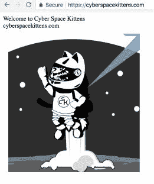
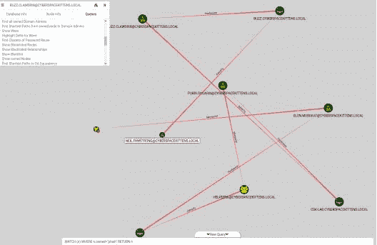

# 9 战地两分钟演练——从零到英雄

随着时钟滴答作响，今天是测试的最后一天，您在外线上并未取得太多成功。您感到压力倍增，因为您需要进入该环境，了解他们的公司布局，获取敏感文件或代码，渗透到不同的用户和网络中，并最终攻入`classified Cyber Space Kittens program`（涉密太空猫咪计划）。您的任务是窃取新的火箭秘密，绝不能失败……现在到了进行`两分钟演练`的时候。在时间仅剩无几时，您需要将“球”从`10 码线`推进，突破所有的防御保护，清理您的踪迹，并打入`90 码`至`达阵区`。

## 10 码线

您翻阅所有的笔记，试图找出可能遗漏的内容。一张网页抓取截图引起了您的注意……它是一个名为`CSK`的论坛网站。您没能在应用程序中发现任何漏洞，但注意到`CSK`论坛被员工和公众用户共同使用，用于发布问题、评论和其他有关其太空计划的内容。

您抓取了网站上所有看起来属于公司账户的用户。然后，您拿出了您可靠的密码列表。您使用常用的密码及其变体，对这些账户进行了`bruteforce`（暴力破解）尝试。慢慢地，您看到您的`Python`脚本正在运行……`failed`（失败）……`failled`（拼写错误）……`failed`（失败）……`password found`（找到密码）！看到其中一位用户`Chris Catfield`使用了密码`"Summer2018!"`，您忍不住笑了起来。您心想，这太容易了。接下来，您以`Chris`的身份登录论坛，阅读他所有的私信和帖子，以便找出建立初始立足点的最佳方法。您发现`Chris`经常在论坛上与另一位内部员工`Neil Pawstrong`讨论太空计划。他们看起来并不是真的朋友，但有着良好的工作关系。这很好，因为这将为下一次`phish`（钓鱼攻击）成为一项`trusted attack`（可信攻击）打下基础。利用`Chris`的账户，我们已经有这两位用户之间的默契，成功的几率非常大。

## 20 码线

您正在辩论是否应该向`Neil`发送定制的`malware`（恶意软件）载荷，因为那可能太明显了。相反，您发送了一个链接到您搭建的猫照片网页，并留言道：“嘿 Neil，我知道你爱猫！看看我做的这个页面吧！”

几分钟后，您收到来自`Neil`在论坛网站上的回复，说道：“LOL，我爱太空猫！”`Neil`毫不知情的是，他访问的网页包含一个定制的`JavaScript`载荷，该载荷会在他机器上运行代码，扫描其内部的`CSK`网络，并攻破未认证的`Jenkins`和`Tomcat`Web 服务器。几秒钟内，您开始收到`Empire`载荷，并松了一口气。

## 30 码线

随着您的感官感到阵阵刺痛，您知道`Blue Team`（蓝队）迟早会采取`firewall/DNS/host blocks`（防火墙/DNS/主机）封锁措施，所以您必须迅速行动。幸运的是，您已经设置了自动化程序来完成大量繁琐的工作。被攻陷的主机`beacon`被激活并开始运行工具，如`Bloodhound`，查找本地密码，设置注册表项以捕获`Mimikatz LSASS`密码，运行`SPN`并转储所有`Kerberos`票据，当然还要在计划任务中设置持久化。

## 40 码线

您知道需要迅速从这个初始节点移开。您将所有`Kerberos`票据转储到`Hashcat`中开始暴力破解。幸好您找到了额外的`bug bounties`（漏洞赏金），用来购买了几块`1080TI`GPU。随着它们开始破解，您看到一些服务账户密码出现了，但您还没有时间处理那些。您审查了`Bloodhound`的输出，意识到被攻陷的机器属于`Neil Pawstrong`，而他的`AD`账户可以访问`Buzz Clawdrin`的机器。使用`WMI`，您在远程端在他的系统上生成了另一个载荷，并迁移到了属于`Buzz`的进程中。

## 50 码线

幸运的是，您也是`Buzz`机器的一名本地管理员，这意味着他们必须进行大量协作工作。利用`Bloodhound`的输出，您在网络中遍历到`CSK-LAB`机器，但意识到您在这个系统上没有本地管理员账户。没关系，您加载了`PowerUp PowerShell`脚本来查找该系统上的配置错误，这些错误可能允许您获得本地管理员权限。正如您所想的那样，该系统中存在大量的未引用的服务二进制文件路径，您可以在此处编写自己的载荷。您迅速创建了一个新的恶意二进制文件，现在可以由本地系统服务触发。

## 60 码线

您在一个次要`C2`箱上获得了一个新的`Cobalt Strike`载荷，即使他们发现了您活动的一部分，也能让您保持连接。将此新连接视为`System`，您搜遍了该箱体，发现了大量以文本文件形式存储的凭据、存储在浏览器中的凭据、在`WinSCP`中配置的凭据等。这个共享箱体就是一个大金矿，具有连接到多个服务器和数据库的能力。您注意到该机器位于不同的`VLAN`上。看来该系统可以访问网络中`Neil`之前无法看到的多个系统。您再次运行命令，运行`Bloodhound`以了解您能看到哪些系统。您注意到该网络背后的许多系统无法访问互联网，因此无法运行`HTTP`信标。然而，由于您使用的是`Cobalt Strike` (https://www.cobaltstrike.com/help-smb-beacon)，您知道它有一个很棒的功能，可以通过命名管道（`SMB`）隧道传输您的被攻陷系统。这意味着在该实验室网络`VLAN`中被攻陷的任何其他系统，都将通过`CSK-LAB`箱体路由以连接到互联网。此外，通过运行`systeminfo`并抓取 Windows 补丁级别，您注意到这些箱体都属于这个半隔离网络，并未获得更新。看来客户端机器都在运行`Windows 7`，且尚未针对`EternalBlue`进行打补丁。

## 70 码线

通过`CSK-LAB`箱体，您使用修改后的`EternalBlue`漏洞利用程序，在实验室网络中的众多`Windows 7`系统上启动`SMB`信标载荷。利用所有新获得的 Shell，您开始搜刮它们以获取信息。您注意到其中一个系统与名为`Restricted`的远程 Microsoft SQL 服务器有活动连接。您尝试了实验室网络中的所有账户，但没有任何用户名和密码适用于该数据库。陷入僵局后，您翻阅了所有的笔记，突然意识到……您忘了您的`Kerberos`票据！您`SSH`到您的破解箱，审查输出，并找到了与`Restricted`数据库关联的票据。当您找到该服务账户的密码时，一股巨大的解脱感涌上心头！

## 80 码线
