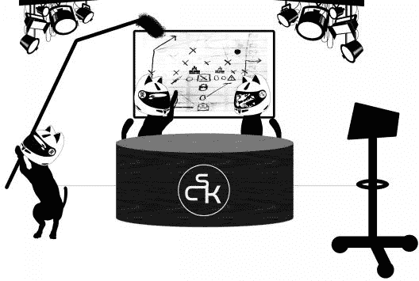
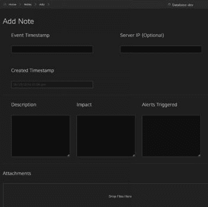
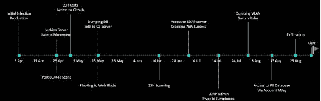

# 10. 赛后分析 - 报告编写

你登录到`Restricted DB`（受限数据库）并导出整个数据库。你忍不住想立刻阅读它，但你知道时间有限。你利用一些`PowerShell-fu`（PowerShell 技巧）来压缩和加密转储文件，然后在各个被入侵的系统之间缓慢地横向移动并最终将其从他们的网络转移到你的`C2`（命令与控制）服务器上。

你做到了，你告诉自己，但当你逐渐退出“快乐舞蹈区”（即兴奋状态）时，你意识到仍有工作要做。你回到之前的`Bloodhound`转储数据，注意到通过`Purri Gagarin`的机器的路径，她是`HelpDesk`组成员。太棒了——我们可以利用这一点`Remote Connect`（远程连接）到`Domain Admin`（域管理员）的电脑，或者通过`Windows ACE`（访问控制条目）进行操作，然后我们可以将`Domain Admin`的密码重置为我们选择的密码。我们继续重置`Domain Admin` `Elon Muskkat`的密码，并以完全`DOMAIN ADMIN`（域管理员）身份生成新的负载！

## 90 码线

我们需要做的最后一件事是从`domain controller`（域控制器）中转储所有哈希值，设置额外的后门，并留下我们的“名片”。与其使用嘈杂的方法（`Shadow Volume Copy`，卷影复制）来获取所有域哈希值，你运行了`Mimikatz`的`DCSync`来提取所有用户哈希值，包括`krbtgt`票据。现在我们拥有了黄金票据！如果我们决定再次进入网络，我们可以创建自己的`Kerberos`票据并直接返回`Domain Admin`。

为了继续设置更多后门，我们将所有技术散布在不同的机器上。我们在其中一台用户系统上设置了粘滞键；使用`backdoorfactory`技术将恶意软件隐藏在另一台系统的常见二进制文件中；设置一个每周运行一次的计划任务以连接回我们其中一个子域名；选取一台分段实验室机器，用`dnscat`二进制文件替换一个无用的运行服务；并在不同系统的启动文件夹中投放几个负载。

幸运的是（对他们来说是不幸的），我们还没有被发现。但是，请记住`Red Team`（红队）评估的目的是观察他们能多快地识别恶意活动（他们没有做到），以及他们能多快地执行`IR`（事件响应）/`forensics`（取证）并缓解所有活动。因此，在你最后一次尝试触发`Blue Team`（蓝队）的努力中，你运行了`https://github.com/EmpireProject/Empire/blob/master/data/module_source/trollsploit/Get-RickAstley.ps1`，享受了一阵欢笑，然后合上了笔记本电脑。任务完成。

达阵！

## 10. 赛后分析 - 报告编写

在之前的`THP`书籍中，我们有如何编写渗透测试报告的示例，并提供了大量的样本模板。这些对于标准的周式渗透测试项目非常有用，但对于`Red Team`活动来说，它们的适用性较差。正如书中所述，`Red Team`的主要重点并非仅仅识别漏洞（尽管这通常是活动的一部分），而是测试人员、工具、流程以及员工技能。如果你的公司遭到攻击并被攻击者或坏人成功入侵，你会给自己的安全评分多少分？我一直反对使用差距评估分数、`ISO`分数、成熟度模型分数、标准风险分析、热力图等类似报告来提供对公司安全项目的真实视图。

就我个人而言，我很喜欢看到公司实施来自以前`Red Team`活动的控制措施，以测试是否真正取得了进展。例如，对于使用类似`doppelganger`（伪装）风格域名的钓鱼活动，我们已经看到公司启用了以下部分措施：

- 使用`DNStwist`对公司域名相似的域名发出警报。
- 建立可信的外部电子邮件域名列表。任何不匹配的外部内容都会在这些电子邮件中添加对用户可见的标头，表明它是外部的（非公司）非批准电子邮件来源。这将帮助用户更容易识别钓鱼邮件。
- 来自代理中未分类域名的电子邮件中的任何链接，至少应有一个点击通过提示，并警告用户该域名未分类。
- 禁止`Office Macro Attachments`（Office 宏附件），强制启用受保护视图，并对文档进行沙盒处理。

这只是公司可以实施的少数简单措施之一，足以阻止攻击。

请记住，`Red Teamers`（红队成员）只需要找到一个漏洞就可能入侵环境。但同时，`Blue Teamers`（蓝队成员）只需要识别攻击者的一个`TTPs`（战术、技术和程序）就有可能阻止入侵。因此，问题变成了：如果这些`TTPs`中的任何一个从你的工具集中发出警报，你的`IR`团队会多快地看到它并做出反应？

那么，`Red Team`风格的报告包含什么内容呢？由于`Red Team`仍然相对较新，目前还没有标准的报告模板，我们可以根据客户的需求进行定制。在我看来，由于在完整活动期间我们可能会多次尝试进入环境（并可能被抓到几次），我们希望展示好的方面和坏的方面。

在活动期间做笔记方面，许多工具如`Empire`和`Cobalt Strike`都有非常棒的活动日志，但这些可能并不总是足够有用。我发现对我们的团队活动极其有用的是搭建一个简单的 Web 服务器来记录`Red Team`成员执行的每一项活动。在活动期间仅收集最基本的信息，包括特定事件、服务器、描述、影响、任何警报和截图。大多数`Red Teamers`/`Penetration Testers`（渗透测试人员）讨厌做笔记，而这种方式提供了一种轻松追踪活动的简便方法。

一旦活动结束，我们将所有笔记结合起来构建一个讲述故事的`Red Team`报告。`Red Team Report`（红队报告）的主要组成部分可能包括：

- **介绍/范围**：此部分需要清楚说明活动的目标。例如，我们曾接到客户请求，要求获取特定数据、获得`Domain Admin`（域管理员）权限、获取`PII`（个人身份信息）、获取`IP`（知识产权或信息财产，此处语境可能指获取关键信息或标识）或在生产网络中的一台服务器上找到标志。

- **指标**：对于`IR`/`Forensics`（事件响应/取证）团队来说，在活动结束后进行回溯调查非常有帮助。我们还希望识别他们的工具或传感器可能存在的不足，从而禁用它们以进行取证或检测恶意活动。因此，我们要提供诸如`C2`服务器的`IP addresses`（IP 地址）、使用的域名、二进制的`MD5`/`SHA1`哈希值、电子邮件地址和`IP`信息、被钓鱼受害者的列表以及可能有助于取证/`IR`团队的任何其他信息。

- **攻击时间线**：这是`Red Team`活动中最重要的部分之一，也是良好笔记记录发挥作用的时刻。时间线应充分说明所有主要活动、触发警报的任何`TTPs`以及主要的活动进展。这将允许`Blue Team`比较他们的时间线和笔记，以查看他们错过了哪些漏洞。在真实的攻击中，你多久可以向坏人询问他们所做的一切？这对防御团队来说是非常有益的。一个示例时间线可能如下所示：

- `时间检测` (TTD)/`缓解时间` (TTM)：这通常是我们可以利用`蓝队`报告来构建 TTD/TTM 统计数据的地方。我们共同的目标是识别团队发现每一次入侵所花费的时间；在扫描事件触发调查之前过去了多少时间（如果有）；以及`蓝队`识别网络钓鱼活动所花费的时间。第二部分应讨论采取行动之前所经过的时间。如果有`C2`通信被报警或`网络钓鱼`被识别，那么在被`防火墙`或`DNS`服务器封禁`域名`之前，过去了多久？我们经常看到公司擅长封禁`域名`，但很快就失败了，因为`C2`服务器通过`IP`进行通信（反之亦然）。我们要确保跟踪并识别此类活动。另一个很好的`TTM`测量指标是，他们能多快隔离已确认的`受感染系统`。随着`恶意软件`变得越来越`自动化`，我们需要开始利用`智能`和`自动化流程`来隔离`系统`或`网络`的`组织`的其他部分。

- `来自 IR/取证人员的反馈`：我最喜欢的文档内容之一是`蓝队`关于从`防御视角`来看整体`活动`如何进行的`反馈`。我正在寻找的是，他们是否觉得自己遵循了`政策`，`事件负责人`是否推动了`调查`，`管理层`是否过度介入，`安全`部门如何与`IT`互动以进行任何`IT 相关更改`（例如，`防火墙拦截`、`DNS 修改`等等），以及谁`惊慌失措`或过于`冷静`。

- 如前所述，`红队`的目的不是发现`漏洞`或`入侵`环境（尽管那是`有趣`的部分）；而是为了`改进``组织`的整体`安全计划`并`证明`其`环境`中存在某些`缺口`。如今许多公司在他们的`安全计划`方面过于`过度自信`，因此他们直到被`入侵`才做出`更改`。有了`红队`，我们可以`模拟``入侵`并`鼓励``更改`，而无需`真实`的`事件`。

# 继续教育

我收到的`百万美元`问题一直是，我现在该做什么？我已经读了所有的`THP`书籍，`参加`了不同的`培训课程`，并`出席`了`会议`的`几次`。我现在能给出的最好`建议`是，你应该开始`做``小项目`并`贡献`给`安全社区`。这是真正`测试`你的`技能`并`提升`你的`游戏`的最佳方式。

一些`想法`可以帮助：

- 建立`博客`和你的`Github`账户：你应该`撰写`关于你的所有`冒险`和`学习`的文章。虽然你是`分享`给`世界`，但这主要是为了你自己的`成长`。必须`写博客`关于你正在`学习`的内容，这将帮助你`改进`你的`写作`，以`易于理解`的方式更好地`解释``漏洞`/`利用`，并确保你知道`内容`足够好，可以`解释`给`世界`。

- 你的`简历`应该是你的`Github`账户：我总是告诉我的`学生`，你的`Github`账户（或`博客`）应该能`独立站立`。无论是大量的`小安全项目`，例如使`工具`更具`效率`和`有效性`，还是你自己的`安全项目`，你的`工作`都应该在`Github`上`说明``话`。

- 在`本地会议`上`演讲`：`演讲`可能非常`令人畏惧`，但如果你在你的`简历`上有它，它将使你`凌驾`于其他`人`之上。你可以在哪里找到`演讲`的地方？我应该从你的`本地聚会` (`meetup.com`) 开始，寻找`群组`以`参与`。它们通常是`小`的，而且大家通常都相当`友好`。如果你在`南部加州`地区，我`创办`并目前`运行``LETHAL` (`meetup.com/LETHAL`)，这是一个`免费社区驱动的安全小组`，`不同的成员`每月`展示`一次。无论如何，`参与`！

- `漏洞赏金`：无论你是在`进攻`还是`防御`方面，`赏金计划`都能真正帮助你`提升`你的`游戏`。像`HackerOne`、`BugCrowd`和`SynAck`这样的`漏洞赏金计划`可以`免费``注册`。你不仅可以`赚取``相当不错的钱`，还可以`合法``黑客`他们的`网站`（当然，要符合他们的`计划``范围`）。

- `夺旗`比赛：我知道很难找到`时间`去做所有这些`事情`，但我总是告诉我的`学生`，`安全`不是一份`工作`——它是一种`生活方式`。去`CTFTime.org`，挑选`几个`贯穿全年的`CTF`， `预留`那些`周末`，然后`开始黑客攻击`。 `相信`我，你在`CTF 周末`学到的`东西`将比任何`课程`所能`教导`你的`东西`都要`多`。

- `与`你的`朋友`一起`搭建`一个`实验室`：没有`测试实验室`，要`实践``现实`的场景很困难，该实验室能`复制``企业环境`。没有这个`测试环境`，你就不可能真正`理解`在运行所有`进攻工具`时`幕后`的`发生`的`事情`。因此，必须`构建`一个带有`VLANs`、`Active Directory`、`服务器`、`GPOs`、`用户`和`计算机`、`Linux`环境、`Puppet`、`Jenkins`以及你可能`看到`的所有其他`常见工具`的`完整实验室`。

- `向``坏人``学习`：对于`红队`来说，这是最重要的`因素`之一。我们的`活动`不应是`理论`的，而应是`真实攻击`的`复制`。保持`睁大眼睛`，关注`最新的 APT 报告`，并确保`理解``对手`如何`改变`他们的`攻击`。

- `订阅``The Hacker Playbook`：为了`保持`与`最新的 THP``新闻``同步`，请`订阅`[here](http://thehackerplaybook.com/subscribe/)。

- `培训`：如果你在`寻找`一些`培训`，请访问[here](http://thehackerplaybook.com/training/)。

# 关于作者

`Peter Kim`在`信息安全`行业从业超过`14 年`，并`运行渗透测试`/`红队`超过`12 年`。他曾为多个`公用事业公司`、`财富 1000``娱乐公司`、`政府机构`和`大型金融组织``工作`。虽然他因`The Hacker Playbook`系列而`广为人知`，但他的`热情`是`构建``安全`的`安全社区`，`指导``学生`并`培训`其他人。他`创办`并`维护`一个`南部加州`最大的`技术安全俱乐部`，名为`LETHAL` (`www.meetup.com/LETHAL`)，在`LETHAL Security` (`lethalsecurity.com`) 的`仓库`进行`私人培训`，并`运营`一家名为`Secure Planet` (`www.SecurePla.net`) 的`精品渗透测试公司`。

`Peter`的`主要目标`与`The Hacker Playbook`系列是`灌输`他的`读者``激情`，并`让他们`开始`思考``跳出``框`。随着`安全``环境`的`不断变化`，他希望`帮助构建``下一代``安全专业人士`。

请`随时``联系``Peter Kim`以获取以下任何内容：

- `关于本书`的`问题`：`book@thehackerplaybook.com`
- `私人培训`或`渗透测试`的`咨询`：`secure@securepla.net`
- `Twitter`: `@hackerplaybook`

# 特别鸣谢

`贡献者`

`Walter Pearce`

`Bill Eyler`

`Michael Lim`

`Brett Buerhaus`

`Tom Gadola`

`Kristen Kim`

`Ann Le`

`Kevin Bang`

`Tony Dow`

`特别鸣谢`

`Mark Adams`

`SpecterOps`

`Casey Smith` (@`subTee`)

`Ben Ten` (@`Ben0xA`)

`Vincent Yiu` (@`vysecurity`)

`Chris Spehn` (@`ConsciousHacker`)

`Barrett Adams` (`peewpw`)

`Daniel Bohannon` (@`danielbohannon`)

`Sean Metcalf` (@`PyroTek3`)

`@harmj0y`

`Matt Graeber` (@`mattifestation`)

`Matt Nelson` (@`enigma0x3`)

`Ruben Boonen` (@`FuzzySec`)

`Ben Campbell` (@`Meatballs__`)

`Andrew Robbins` (`_wald0`)

`Raphael Mudge` (`rsmudge`)

`Daniel Miessler` (`DanielMiessler`)

`Gianni Amato` (`guelfoweb`)

`Ahmed Aboul-Ela` (`aboul3la`)

`Lee Baird` (`leebaird`)

`Dylan Ayrey` (`dxa4481`)

`Rapid7` (`@rapid7`)

`Will Schroeder` (`@harmj0y`)

`Ron Bowes` (`@iagox86`)

`SensePost`

`Sekirkity`

`Byt3bl33d3r`

`Karim Shoair` (`D4Vinci`)

`Chris Truncer`

`Anshuman Bhartiya`

`OJ Reeves`

`Ben Sadeghipour` (`@nahamsec`)

`Tim Medin` (`nidem`)

`Gianni Amato`

`Robert David Graham`

`blechschmidt`

`Jamieson O'Reilly`

`Nikhil Mittal` (`SamratAshok`)

`Michael` (`codingo`)

`Cn33liz`

`Swissky` (`Swisskyrepo`)

`Robin Wood` (`digininja`)

`TrustedSec`

`大卫·肯尼迪 (@hackingDave)`

**赛博观察站**

*Igandx*

*亚历山大·因尼斯 (leostat)*

*积极突破 (mdsecactivebreach)*

*bbb31*

*pentestgeek*

*SECFORCE*

*史蒂夫·米卡勒夫*

*SpiderLabs*

H.D. 摩尔

*TheRook*

A 艾哈迈德·阿布-埃拉 (`aboul3la`)

艾米利奥 (`epinna`)

Dylan Ayrey (`dxa4481`)

乔治·贾兹索夫尼奥乌 (`sophron`)

Derv (`derv82`)

加雷特·吉

HackerWarehouse

致命威胁

`no0py`
