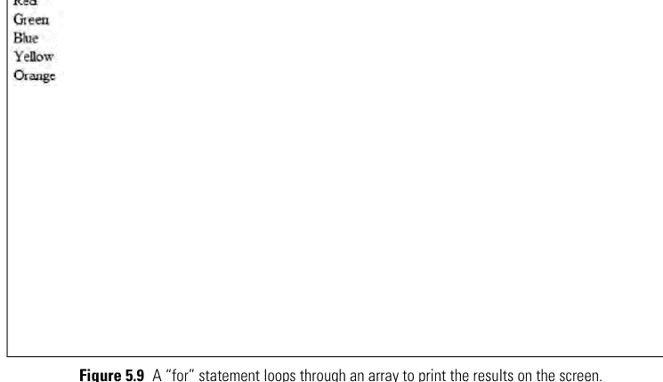
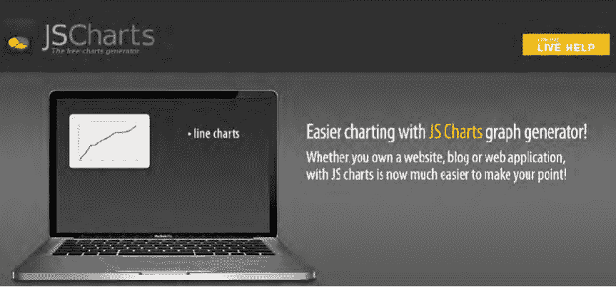

# HTML5 JavaScript 模型


该领域的知识和最佳实践在不断变化。随着新研究和经验扩大了我们的理解，研究方法、专业实践或医疗治疗的改变可能变得必要。

执业人员和研究人员在评估和使用本文中的任何信息、方法、化合物或实验时，必须始终依靠自己的经验和知识。在使用此类信息或方法时，他们应该注意自己及他人的安全，包括对他们负有专业责任的方。

在法律允许的范围内，出版商以及作者、贡献者或编辑对于由于产品责任、疏忽或其他原因导致的人员或财产的任何伤害或损害，或对材料中包含的任何方法、产品、说明或思想的任何使用或操作不承担任何责任。


# HTML5 JavaScript 模型

CSS、SVG 和视频都是 HTML5 的巨大改进。然而，HTML5 的作用不仅仅是添加一些视觉点缀，而是让开发者能够在网页浏览器中创建性能等同于桌面应用程序的程序。为了实现这一点，你需要一种能够赋予开发者创建复杂解决方案能力的开发语言。答案就是 JavaScript，世界上最流行的编程语言。

目前的观点是 Web 应用程序并不像桌面应用程序那样强大。原因不在于 JavaScript，而是于你网页浏览器内部处理 JavaScript 的引擎。脚本处理得越快，你的应用程序就可以变得越复杂。

在 2009 年，网页浏览器公司进行了一场跳跃式的游戏，试图重置速度基准。Firefox、Safari、Google 和 Opera 同时进行。到年底，似乎唯一一家被留在黑暗中的公司是带有 Internet Explorer 8 器的微软。在 2009 年秋季 PDC 上，微软展示了 IE 的早期开发者版本，它运行标准的 JavaScript 测试（例如 http://www2.webkit.org/perfs/sunspider-0.9/sunspider.html 上的 SunSpider 测试），使其 JavaScript 引擎与竞争对手处于平级（见图 5.1）。

本文的目标是回顾 JavaScript，包括它如何在 HTML5 中被使用、你如何通过 Ajax 在他人工作的基础上进行构建，以及如何将流行的 Ajax 库实现到你的工作中。


## 理解 JavaScript

本文的目标是向设计师展示如何将 JavaScript 配合 HTML5，为你的网页布局提供卓越的视觉控制。此外，HTML5 正在扩展以支持应用程序编程接口 (API)，这些接口能够在你的网页内部实现复杂的系统集成。新的 API，如 Web Workers、地理位置和本地数据存储是复杂的，需要熟练使用 JavaScript 才能使其工作。

JavaScript 不是一项新技术。JavaScript 的根源可以追溯到 1993 年，当时 Netscape Communications 在其网页浏览器中包含了一种名为 LiveScript 的脚本技术。即使是能够在网页浏览器中实现交互的简单编程语言也变得极其流行。

JavaScript 的当前版本极大地完善了原始的 LiveScript 语言。与运行针对操作系统优化代码的桌面应用程序不同，JavaScript 必须在网页浏览器内部运行虚拟机翻译器中进行解释。这一过程本质上强制 JavaScript 解决方案的运行速度比桌面应用程序慢。为了补偿这一点，Google 使用了一种名为 V8 的技术极大改进了 JavaScript 代码的处理。竞争对手 Mozilla、Apple 和微软也有他们自己的 JavaScript 引擎来与 Google 的 V8 竞争。它们的引擎——Rhino (Firefox) 和 SquirrelFish (Safari) 让应用程序非常接近桌面级。抱歉，微软没有为 JavaScript 引擎起一个酷的名字；他们只叫它 Chakra——不怎么性感。

今天的 JavaScript 允许你构建在网页浏览器中运行的类桌面应用程序。Google 的 Wave 解决方案是一个使用 JavaScript 的极其复杂的应用程序示例（图 5.2）。

JavaScript 是世界上最流行的语言，拥有数百万用户。这项技术学习起来并不复杂；如果你有任何 C#、Java 或 ActionScript 的经验，可能会很快学会。

JavaScript 如此流行，以至于它有自己的标准。Ecma International 是一家成立于 1961 年的行业协会，致力于信息和通信技术 (ICT) 以及消费电子 (EC) 的标准化。JavaScript 的标准化版本由 Ecma 管理。全称是 ECMA-262，但通常被称为 ECMAScript。ECMA-262 是一个标准，并受到包括微软 Internet Explorer 在内的所有浏览的支持。


图 5.2 复杂的 JavaScript 解决方案 Google 的 Wave。

## 作为编程语言的 JavaScript

幸运的是，作为编程语言，JavaScript 学习起来并不复杂。当你读到本节结束时，你将理解编写基础程序需要什么。有两种方法可以将 JavaScript 插入到你的网页中：

- 将你的 JavaScript 直接插入到网页中两个 SCRIPT 元素之间。
- 将你的 JavaScript 添加到文本文件中并将网页链接到该文本文件。

为了开始，我们将在页面中使用 SCRIPT 元素来分离代码。稍后，你为为 创建单独的文件。以下是一个简单的 JavaScript 文件：

```html
<html>
<body>
<script type="text/javascript">
document.write("Welcome to JavaScript");
</script>
</body>
</html>
```

这是一个带有打开和关闭 HTML 元素的正常网页。在 BODY 元素中，你可以看到打开和关闭的 SCRIPT 元素。你将你的 JavaScript 代码放在 SCRIPT 元素中。

SCRIPT 元素将默认使用 JavaScript 作为脚本语言。然而，不止一种脚本语言可以使用。JavaScript 的替代方案是微软的 VBScript，它是脚本格式的 VB 语言。VBScript 由微软 Internet Explorer 原生支持。其他网页浏览器可以通过插件支持 JavaScript。

这个示例 JavaScript 有一行代码：

```javascript
document.write("Welcome to JavaScript");
```

"document" 引用了一个对象。在这种情况下，document 对象是网页本身。"write" 脚本是 document 对象的属性，允许你添加代码。图 5.3 显示了当你运行此脚本时你的页面看起来的样子。

JavaScript 也可以放在页面的 HEAD 元素中，并由事件动作执行。事件动作由


当某些事情发生时。例如，当网页加载时，你可以添加一个名为 `onLoad` 的事件操作（见图 5.4）。以下是将 JavaScript 插入页面 `HEAD` 元素中的示例。

```html
<html
<head>
<script type="text/javascript">
function popUpAlert()
{
  alert("Welcome to JavaScript");
}
</script>
</head>
<body onLoad="popUpAlert()">
</body>
</html>
```

JavaScript 运行一个函数。函数是由另一个代码调用时执行的代码块。在这种情况下，另一个代码是 `BODY` 元素中的 `onLoad` 命令。

正如你所想象的，你可以像下面的示例那样在 `HEAD` 元素和主页面中混合代码。

# 6

**图 5.4** 你可以在加载网页时强制弹出一个 JavaScript 警告框。


```html
<html
<head>
<script type="text/javascript">
function popUpAlert() {
  alert("Welcome to JavaScript");
}
</script>
</head>
<body>
<script type="text/javascript">
document.write("<h1>Welcome to JavaScript</h1>");
</script>
<a href="#" onclick="popUpAlert()">Click me</a>
</body>
</html>
```

你会在 JavaScript 中看到有一个同名为 `popUpAlert()` 的函数。不同之处在于调用该脚本的事件已移动到网页的主内容中。现在由一个 `ANCHOR`（锚点）元素控制 JavaScript 函数的执行时机：

<a href="#" onclick="popUpAlert()">Click me</a>

`ANCHOR` 元素不能与 `onload` 事件一起使用，因此是使用 `onClick` 事件来运行 `popUpAlert()` 函数。这段 JavaScript 只有在你点击链接时才会运行。在 `ANCHOR` 元素上方是一个动态向页面添加内容的 JavaScript，如下所示：

```html
<script type="text/javascript">
document.write("<h1>Welcome to JavaScript</h1>");
</script>
```

在添加动态文本时，JavaScript 还插入了 HTML 的 `H1` 元素。图 5.5 显示了这一切在你的网页中的外观。

## 欢迎来到 JavaScript

点击这里

> 图 5.5 JavaScript 可以放置在 HEAD 和 BODY 元素中。


运行脚本的第三方法是通过外部文件。将文件保留在外部文件中允许你与其他网页共享该文件并保持 HTML 更加整洁。

你将使用的外部文件其实就是一个文本文件。打开你喜欢的文本编辑器（如记事本），将 JavaScript 函数粘贴到文件中并保存，将其命名为 `popup.js`。将以下 JavaScript 粘贴到你的新 JS 文件中。

```javascript
function popUpAlert() {
  alert("Welcome to JavaScript");
}
```

你会注意到 JavaScript 中没有开头和结尾的 `SCRIPT` 元素。当你将代码移动到外部文件时，不需要它。“`.js`”扩展名标识该文档为 JavaScript 文件（见图 5.6）。

现在你可以将网页文件中的 `SCRIPT` 元素链接到 JS 文件：

```html
<script type="text/javascript" src="popup.js"></script>
```

你会发现你的 JavaScript 在网页浏览器中运行良好。

## 变量操作

JavaScript 是一种编程语言，作为其的一部分，它自带了许多创建数据的方法。创建数据的简单方法是通过变量。变量是一个包含数据的声明对象。例如，以下是一个名为 "color" 值为 "red" 的变量：

```javascript
var color="red"
```

现在，你可以编写 JavaScript，在其中引用变量 "color" 来替换值 "red"。

```html
<script type="text/javascript">
document.write("<p>My favorite color is " + color + "</p>");
</script>
```

名为 "color" 的变量被动态地添加到页面内容中。

## 在脚本中使用数学运算

变量也可以具有数学值（见图 5.7）。例如，以下两个变量可以用来创建第三个变量的值。

```html
<html
<head>
<script type="text/javascript" src="popup.js"></script>
</head>
<body>
<script type="text/javascript">
document.write("<h1>Welcome to JavaScript</h1>");
</script>
<a href="#" onclick="popUpAlert()">Click me</a>
</body>
</html>
```

**图 5.6** 你可以将你的 JavaScript 添加到外部链接的文件。

```javascript
<script type="text/javascript">
var myFirstNumber=4;
var mySecondNumber=3;
var myThirdNumber=myFirstNumber*mySecondNumber;
</script>
```


你可以看到前两个变量相乘（`*` 是乘数值）以生成第三个变量。以下 JavaScript 在网页中展示了最终值：

```javascript
document.write("<p>My favorite number is " + myThirdNumber + "</p>");
```

JavaScript 中有七种算术运算符可以使用：

- + 加法
- - 减法
- * 乘法
- / 除法
- % 取模
- ++ 递增
- -- 递减

以下示例使用了所有七种运算符来演示你如何在代码中使用它们（另见图 5.8）。

```html
<html
<head>
<script type="text/javascript">
varNumber=7;
var varAddition=varNumber+3;
var varSubtraction=varNumber-3;
varMultiplication=varNumber*3;
7+3=10
7-3=4
7*3=21
7/3=2.3333333333333335
7%3=1
Increment 7=8
Decrement 7=7
```

**图 5.8** JavaScript 有七种不同的算术运算符，你可以它们来动态控制内容的值。

```javascript
var varDivision=varNumber/3;
var varModulus=varNumber%3;
var varIncrement=++varNumber;
var varDecrement=--varNumber;
```

```html
<script>
</head>
<body>
<script type="text/javascript">
document.write("<p>7+3="+varAddition+"</p>");
document.write("<p>7-3="+varSubtraction+"</p>");
document.write("<p>7*3="+varMultiplication+"</p>");
document.write("<p>7/3="+varDivision+"</p>");
document.write("<p>7%3="+varModulus+"</p>");
document.write("<p>Increment 7="+varIncrement+"</p>");
document.write("<p>Decrement 7="+varDecrement+"</p>");
</script>
</body>
</html>
```

## 使用运算符评估值

除了算术运算符外，JavaScript 还有比较运算符，允许你取两个或多个值并比较它们的差异。有七种比较运算符：

- == 等于
- === 严格相等
- != 不等于
- > 大于
- < 小于
- >= 大于等于
- <= 小于等于

比较运算符在你开始编写具有两个或多个结果的函数时非常有价值。

## 使用 If/Else 控制结果

几乎所有编程语言通都会使用 `if/else` 语句。本质上，`if/else` 语句查找一个条件，并根据该值执行语句。例如，以下代码：

```html
<script type="text/javascript">
var myColor="red"
if (myColor=="red")
{
  document.write("The correct color");
}
</script>
```

名为 `myColor` 的变量带有值为 "red" 的字符串。`if` 语句使用比较运算符 `==` 来查找值。如果精确相等，则在页面上打印 "The correct color"。如果变量 `myColor` 变为 "blue"，则 `if` 语句将不会运行。如何使用 `else` 语句来显示第二种选择，如下：

```html
<script type="text/javascript">
var myColor="blue"
if (myColor=="red")
{
  document.write("The correct color");
}
else
{
  document.write("This is not the color");
}
</script>
```

`if/else` 语句可以有第三种条件。例如，允许你有两个正确答案（red 和 blue），但当 `myColor` 的值变为任何其他值时，会打印第三个结果。

```html
<script type="text/javascript">
var myColor="green"
if (myColor=="red")
{
  document.write("The correct color");
}
else if (myColor=="blue")
{
document.write("This is a good color");
}
else
{
document.write("The wrong color was chosen");
}
</script>
```

如果你有三个或更多有效选择，你将希望使用 `switch` 语句来匹配你的列表中的选择。让我们创建一个可以匹配不同选择的变量：

```javascript
var myColor="green"
```
`switch` 语句现在可以查找 `myColor` 的条件并与可能的答案进行匹配。以下 `switch` 语句根据变量是 "green"、"red" 还是 "blue" 创建三种不同的答案。如果没有满足任何条件，将运行默认值。

```javascript
switch (myColor)
{
case "red":
document.write("You picked red");
break;
case "green":
document.write("You picked green");
break;
}
```


```javascript
case "blue":
document.write("You picked blue");
break;
default:
document.write("You did not make a valid choice");
}
```

当你运行此脚本时，匹配字符串值 "green" 的 "case" 语句将在网页上打印 "You picked green"。尝试将 `myColor` 变量的值更改为 "red" 和 "blue"，以更改打印到页面上的值。

JavaScript 支持许多其他你可以用来控制内容的工具。例如，你可以创建一个循环语句，遍历列表以匹配正确的结果。以下示例使用数组配合 `for` 循环在网页上打印结果（图 5.9）。

```html
<html>
<body>
<script type="text/javascript">
var my;
var colors = new Array();
mycolors[0] = "Red";
mycolors[1] = "Green";
mycolors[2] = "Blue";
mycolors[3] = "Yellow";
mycolors[4] = "Orange";
for (color in colors)

| Red |
| :--- |
| Green |
| Blue |
| Yellow |
| Orange |



```javascript
{ document.write(mycolors[mycolor]) + "<br />";
}
</script>
</body>
</html>
```

## 在 JavaScript 中可以使用特定对象

JavaScript可以通过使用对象在 浏览器内部进一步扩展。JavaScript 是一种面向对象的编程 (OOP) 语言，与 Java、C++ 和 C# 等语言一样都是 OOP。这意味着你可以创建并使用对象。默认情况下，网页浏览器支持以下对象：

- String—这是文本
- Date—允许你使用日期和时间
- Array—允许你构建结构化的数据集合
- Boolean—真或假
- Math—允许你使用数学运算符
- RegExp—允许你使用正则表达式来定义模式，例如社会安全号或电话号码

使用这些对象使你能够创建复杂的解决方案。最终的解决方案是否满足桌面应用程序的需求？五年前我会说不；但今天，它已经非常接近，而且未来的解决方案将超出你在桌面上可以的操作。

## 为 HTML5 开发 JavaScript

HTML5 中的新 API 可以与 JavaScript 进行程序化接口接。有三个 API 脱颖而出：

- Web Workers
- LocalStorage
- 地理位置感知系统

使用 JavaScript，你可以与这些新 API 交互以创建新的以 Web 为中心的解决方案。

## 使用 Web Workers

JavaScript 是一种脚本解决方案，运行时会按行执行代码。许多其他开发语言（如 C# 和 Java）可以同时运行多个进程。Web Workers 是一项可以让 JavaScript 离顺序执行的技术。你现在可以同时运行多个脚本。

这在 JavaScript 中很容易实现。在下面的脚本中，你将一个名为 `myWebWorker` 的新变量作为一个新的 Web Workers 文件：

```javascript
var myWebWorker = new Worker("webWorker.js");
```

示例正在加载第二个脚本。在 JavaScript JS 文件中，第二个脚本会触发另一个重复的 Web Workers 运行。该循环强制两个程序同时运行。`webWorker.js` 的 JavaScript 代码如下：

```javascript
var results = [];
function resultReceiver(event) {
  results.push(parseInt(event.data));
  if (results.length == 2) {
    postMessage(results[0] + results[1]);
  }
}

function errorReceiver(event) {
  throw event.data;
}

onmessage = function(event) {
  var n = parseInt(event.data);
  if (n == 0 || n == 1) {
    postMessage(n);
    return;
  }

  for (var i = 1; i <= 2; i++) {
    myWebWorker = new Worker("webWorker.js");
    myWebWorker.onmessage = resultReceiver;
    myWebWorker.onerror = errorReceiver;
    myWebWorker.postMessage(n - i);
  }
}
```

"for" 语句触发相同的 `webWorker.js` 文件重载。以便 for 脚本运行多次。在你的主 HTML 页面中，你将添加以下 HTML 和 JavaScript 来加载 Web Worker。

```html
<html>
<title>Test threads fibonacci</title>
<body>
<div id="result"></div>
<script language="javascript">
var myWebWorker = new Worker("webWorker.js");
myWebWorker.onmessage = function(event) {
  document.getElementById("result").textContent = event.data;
  dump("Got: " + event.data + "\n");
};
myWebWorker.onerror = function(event) {
  dump("Web Worker error: " + event.data + "\n");
  throw event.data;
}

myWebWorker.postMessage("Success, Web Workers are working");
</script>
</body>
</html>
```

允许多个 JavaScript 同时执行对于复杂应用程序至关重要。你可以进行一个快速测试来查看大量的 JavaScript 程序正在运行。访问 www.Gmail.com 并登录 Google 的 Web 电子邮件服务。如果你使用 IE7 或更早版本访问 Gmail，该服务将运行网站的简易版本。如果你使用 Firefox 3.6 或 Google Chrome，那么你将看到一个加载了 JavaScript 的喷气动力替代方案。这种高性能的替代方案要求浏览器支持如 Web Workers 等技术来同时处理脚本。

## 使用 LocalStorage 存储数据

应用程序的关键在于存储数据的能力。过去，你可以使用复杂的 cookie 或利用发送数据到数据库的 Ajax 命令来实现这一点。随着 LocalStorage 的实施，在网页浏览器中本地存储数据的能力得到了极大提高。

LocalStorage 本质上是你在网页浏览器中运行类似 SQL 数据库的能力。LocalStorage 的使用示例是 Google 的 iPhone 版本的 Gmail。使用 LocalStorage，你可以在没有 Web 连接的情况下查看和发送电子邮件。当建立新的网络连接时，电子邮件将与邮件服务器同步。

你在 JavaScript 中通过使用 `GlobalStorage` 对象来访问 LocalStorage。图 5.10 展示了 LocalStorage 的用法。


> 图 5.10 使用 LocalStorage 对象可以在网页浏览器中本地存储数据。

图 5.10 示例的第一步是创建一个可以输入某些文本的区域。你将使用标准的表单控件。

```html
<textarea id="text" class="freetext">
</textarea> 项目名称 <input id="item_name" type="text" value="new item" />
```

将在 INPUT 按钮上添加一个事件来触发 JavaScript 运行：

```html
<input onclick="writeLocal();" type="button" value="Save"/>
```

Local 将数据存储在浏览器中并到网页。定义了一个 ID 为 "items" 的区域。

```html
<div id="items"></div>
```

你在 JavaScript 中运行的第一个函数是定义页面内容与你所在的网站关联。

```javascript
function $(id) { return document.getElementById(id); }
var host = location.hostname;
var myLocalStorage = globalStorage[host];
```

第二个函数允许你使用 LocalStorage 存储数据。

```javascript
function writeLocal() {
var data = $('text').value;
var itemName = $('item_name').value;
myLocalStorage.setItem(itemName, data);
updateItemsList();
}
```

像任何 SQL 一样删除条目。下面的函数允许使用 remove 删除项目。

```javascript
function deleteLocal(itemName) {
myLocalStorage.removeItem(itemName);
updateItemsList();
}
```

以下示例向你展示了带有样式的完整程序。

```html
<html><head><title>HTML5 Web Storage</title></head>
```

```css
<style>
.freetext {
  width: 100%;overflow: hidden;
  background: #FFE;font-family: sans-serif;font-size: 14pt;moz-border-radius: 10px;-webkit-border-radius: 10px;
}
li {
  padding: 4px;width: 400px;
}
input {
  margin: 2px;border-style: solid; -moz-border-radius: 10px;-webkit-border-radius: 10px;color: #666;padding: 2px;
}
body {
  font-family: 'Lucida Sans', 'Lucida Sans Regular', 'Lucida Grande', 'Lucida Sans Unicode', Geneva, Verdana, sans-serif;color: #FF0000;font-size: medium;
}
</style>
```

```javascript
function updateItemsList() {
  var items = myLocalStorage.length;
  // 列出项目
}
```


# 20

```javascript
var s = '<h2>Items for '+host+'</h2>';
s+= '<ul>';
for (var i=0;i<items;i++) {
  var itemName = myLocalStorage.key(i);
  s+= '<li>'+
    '<div style="float:right;">'+
    '<input type="button" value="Load" onclick="readLocal(\'+itemName+'\')">' + ' ' +
    '<input type="button" value="Delete" onclick="deleteLocal(\'+itemName+'\')">' + ' '+
    '</div>'+
    '<strong>'+itemName+'</strong>'+
  '</li>';
}
$(items).innerHTML = s+'</ul>';

window.onload = function () {
  updateItemsList();
  $(text).value = ['Quick and dirty Web Storage sample:','1 Write some text,
2 Give it some name,
3 Click Save button,','Data is stored and retrieved using Web Storage (no cookies and no server side).'].join('\n');
}
</script></body></html>
```

如你所见，LocalStorage 的实现允许你在不使用服务器端数据库 Cookie 的存储数据。

## 使用 JavaScript 控制地理位置设备

毫无疑问，科技世界正在走向移动化。设备现在需要知道自己的地理位置。为了准备这一点，HTML5 包含了对地理定位的支持（见图 5.11）。iPhone 和 Android 手机都启用了地理定位功能。

以下示例使用 Google Maps 服务告诉你你所在的位置。第一步是加载地图服务。

```html
<script src="http://maps.google.com/maps?file=api&v=2&sensor=false&key=ABQIAAAAAIUzol0s6QWHuyxx-JVN7ABSUL8-Cfelegd6fe6dq-CwlitXxhqkov2kxasxgGQCdn10OCYag7Ub2S3" type="text/javascript"></script>
```

Google Maps 服务是公开访问的。第一步是定义一组可以在代码中使用的变量。

## HTML 5 地理定位


```javascript
var map;
var mapCenter;
var geocoder;
var fakeLatitude;
var fakeLongitude;
```

定义好 JavaScript 变量后，你可以创建一个初始化浏览器中地理定位服务的函数。

```javascript
function initialize() {
  navigator.geolocation.getCurrentPosition(
    function (position) {
      mapServiceProvider(position.coords.latitude,position.coords.longitude);
    }
  );
} else {
```

```javascript
alert("I’m sorry, but geolocation services
not supported by your browser or you do
not have a GPS device in your computer. I
will use a sample location to produce the map
instead.");
fakeLatitude = 49.2736777;
fakeLongitude = -123.114420;
mapServiceProvider(fakeLatitude);
}
```

下一个函数指令地理定位服务使用 Google Map 服务。

```javascript
function mapServiceProvider(latitude, longitude)
{
  mapThisGoogle(latitude, longitude);
}
function mapThisGoogle(latitude, longitude)
{
  var mapCenter = new GLatLng(latitude,longitude);
  map = new GMap2(document.getElementById("map"));
  map.setCenter(mapCenter, 15);
  map.addOverlay(new GMarker(mapCenter));
  geocoder = new GCGeocoder();
  geocoder.getLocations(latitude+','+longitude);
  addAddressToMap();
}
```

最后的代码完成了地图映射。

```javascript
function addAddressToMap(response)
{
  if (!response || response.Status.code != 200) {
    alert("Sorry, we were unable to geocode
that address");
  } else {
    place = response.Placemark[0];
    $('#address').html("Your address: '+place.address);
  }
  window.location.querystring = (function() {
    var collection = {};
    var queryString = window.location.search;
    if (!queryString) {
```

```javascript
    return { toString: function() { return ""; };
  };
  }();
  queryString = decodeURI(queryString.substring(1));
  var pairs = queryString.split("&");
  for (var i = 0; i < pairs.length; i++) {
    if (!pairs[i]) {
      continue;
    }
    var seperatorPosition = pairs[i].indexOf("=");
    if (seperatorPosition == -1) {
      collection[pairs[i]] = "";
    } else {
      collection[pairs[i].substring(0, seperatorPosition)] = pairs[i].substr(seperatorPosition + 1);
    }
  }
  collection.toString = function() {
    return "?" + queryString;
  }
  return collection;
})();();
```

最终结果是你可以使用地理定位通过网络浏览器确定你的位置。这在移动网络浏览器中非常有用，你可以将地图服务链接到基于地理的工具。

## 将 JavaScript 与 HTML5 集成

发现 JavaScript 与 HTML5 的所有元素都紧密集成，可能会感到惊讶。这在 CANVAS 元素的使用上是非常明显的。元素本身不能做什么。是 JavaScript 的使用使其具有交互性。

以下 JavaScript 示例演示了如何使用 JavaScript、CANVAS 和少量的 CSS 创建简单的游戏，你可以在其中控制人群。这个游戏被称为“人群控制”（Crowd Control），这个简单游戏的目标是追逐屏幕上的人。你会发现，当你向光标移动时，屏幕上的每一个人都会避开它。

# 24

第一步是创建一个基础 HTML5 页面，并使用一些 CSS 控制页面的颜色。使用下面的即可。

```html
<!DOCTYPE HTML>
<html>
<head>
<title>Canvas Example - Crowd Control</title>
<style type="text/css">
body{
    margin: 0;
    padding: 0;
    overflow: hidden;
    background: yellow;
    color: white;
    text-align: right;
    font-family: Arial, Helvetica, sans-serif;
    font-size: 0.8em;
}
</style>
</head>
<body>
```


屏幕上的元素，无论是 HTML、SVG、CSS 还是 CANVAS。这带给了你极大的控制力。

## 使用 Ajax 将 JavaScript 提升到新高度

好消息是，有很多工具可以打破 JavaScript 复杂开发的屏障。你可以下载预先构建好功能的 JavaScript 代码库，这些库包含了如动画、表单验证控制和数据操作等功能。这些库被称为 Ajax 库。它最初被称为 AJAX（异步 JavaScript 和 XML），现在该术语已改为 Ajax（注意小写字母），以便支持除 XML 之外更广泛的技术。

## 在工作中使用 Ajax

从核心来说，Ajax 是一组你可以与之交互的编写良好的 JavaScript 程序。每个 Ajax 库都有略有不同的使用方法。以下示例演示了如何在你的网站中使用最流行的 Ajax 库——jQuery。

有数百种不同的 Ajax 库，但 jQuery 是脱颖而出的。该库本身非常健壮，能够与所有流行的网页浏览器配合，包括微软的 Internet Explorer。jQuery 的流行程度之高，使得微软现在将 jQuery 作为其 ASP.NET 的默认 Ajax 工具。这意味着 ASP.NET 解决方案可以无缝集成 jQuery Ajax 库。

要获取 jQuery，你需要访问 www.jquery.com，如图 5.13 所示。你可以下载最新的 jQuery JavaScript 库，或者简单地通过互联网连接它。以下示例将从 Web 端连接 jQuery。首先如下所示创建一个空白网页。

```html
<!DOCTYPE html>
<html lang="en">
<head>
</head>
<body>
</body>
</html>
```

在页面的 BODY 部分中，让我们添加一些内容。

```html
<section id="container">
  <article class="article">
    <h1>《圣诞颂歌》</h1>
    <p class="thebody">首先，马尔利已经死了。关于这一点，没有任何疑义。他的埋葬登记簿由牧师、书记员、殡葬承办人和首席哀悼者签署了。斯克鲁奇签了名。而斯克鲁奇的名字在“兑换”上很灵通，无论他选择手手任何事情都能行。</p>
    <ul class="actions">
    </ul>
  </article>
  <article class="article">
    <h1>《查理·铜伯环》</h1>
    <p class="thebody">我究竟会成为自己生活的英雄，还是这个位置会被别人占据，这必须由这些页来说明。我从生命的开始开始我的生命，我记录我出生（正如我所知和相信的）在周五午夜十二点。有人注意到，钟声开始敲响，我也同时哭了起来。</p>
    <ul class="actions">
    </ul>
  </article>
</section>

当你预览此页面时，你会发现没有任何格式化或交互。你所看到的是一个查尔斯·狄更斯的列表，紧接着是开头段落。如果你有大量的条目需要快速浏览，这些内容将变得难以阅读。使用一点 jQuery，你可以插入一个显示/隐藏动作来显示和隐藏段落（参见[图 5.14]）。

在页面的 HEAD 部分，插入以下代码来调用并使用 jQuery 库。

```html
<script src="http://jquery.com/src/jquery-latest.js"></script>
```

接下来的 JavaScript 与 jQuery 库交互以创建简单的交互。

### 《圣诞颂歌》

首先，马尔利已经死了。关于这一点，没有任何疑义。他的埋葬登记簿由牧师、书记员、殡葬承办人和首席哀悼者签署了。斯克鲁奇签了名。而斯克鲁奇的名字在“兑换”上很灵通，无论他选择手手任何事情都能行。

```
显示/隐藏
```

### 《查理·铜伯环》

```
显示/隐藏
```

### 《双城记》

```
显示/隐藏
```

### 《荒野时》

伦敦。迈尔斯·特姆最近去世了，大法官正坐在林肯法学院大厅里。冷酷无情的十一月天气。街道上的泥多得简直如果能遇到一只恐龙就太奇妙了，它距离地面四十英尺，而且它可能还没有成年人的脚那么大，像头头象般的蜥蜴一样在霍尔伯恩山上蹒跚。从烟囱口向下落下，下着细细的黑色毛雨，夹杂着像成年雪花一样大的烟粒——人们可以想象，它们正在移动，为了太阳的死亡……

```
显示/隐藏
```

图 5.14 查询允许你用极少数行代码添加效果，例如显示和隐藏效果。

```javascript
<script> //![CDATA[
// 当页面准备就绪时
$(document).ready(function() {
  $(".article .tbody
```

图 5.15 Adobe 的 Spry 框架是一个内置在 Adobe Dreamweaver 网站管理中的成熟 AJAX 库。

对于非开发人员来说，添加 Ajax、验证交互控制、动画和数据控制非常容易。

你可以在 www.labs.adobe.com/technologies/spry 下载该库。

## YUI: Yahoo 界面库

Yahoo 以其 Web 服务而闻名。它们在 Web 标准和功能方面的工作较为人知。YUI 库是 Yahoo 提供的一组可以在网站使用的 Ajax 工具。你可以在 Yahoo 开发者网络 http://developer.yahoo.com/ 更多关于 YUI 工具的信息（参见图 5.16）。

## 使用 Wforms 控制表单

在某些时刻，你会想要控制用户如何使用网站中的表单。表单控制涵盖了诸如用户如何向表单输入数据、页面上的其他元素如何控制表单字段，以及根据用户输入数据如何隐藏/显示表单元素。这些功能都可以由 Wforms (http://www.formassembly.com/Wforms/) 轻松处理。该库体积很小且文档齐全。

最后，插入一点 CSS 让页面看起来更美观，如下：

```css
<style type="text/css">
section {
  width: 500px;
}
ul {
  list-style-type: none;
  right: 0px;
  font-family: "Franklin Gothic Medium", "Arial Narrow", Arial, sans-serif;
  font-size: xx-small;
  text-decoration: none;
}
h1 {
  font-family: "Cambria, Cochin, Georgia, Times, "Times Roman", serif;
  font-size: x-large;
  font-weight: bolder;
}
p {
  font-family: "Franklin Gothic Medium", "Arial Narrow", Arial, sans-serif;
  font-size: small;
}
</style>
```

现在你可以测试你的页面了。你将选择“显示/隐藏”文本让开头段落出现。这使得快速浏览内容变得更容易。

有很多 Ajax 库。虽然 jQuery 是最流行的，但有很多符合特定需求的库。


# YAHOO! 开发者网络

33

| 我的项目 | 工具与服务 | 资源 | YUI 在 YDN 上 | YUI 首页应用 | YUI 3.0 |
| :--- | :--- | :--- | :--- | :--- | :--- |
| 新与旧 | 连接电视工作 | YAP 中的 YUI Beta 版 | | | |

# Yahoo! 连接电视平台现已开放

发布于2007年1月

将你的网页内容带到电视上！通过 Yahoo Connected TV 为北美、欧洲和亚洲的数百万电视所有者开发新的交互式体验。Yahoo Connected TV Widget 平台适用于多种消费电子设备，包括来自三星、索尼、LG电子和 VIZIO 的平板显示器，其他设备也即将推出。

你是一个局限于今天技术限制而工作的 Javascript 开发者吗？访问 connectedtv.yahoo.com/developer 下载 WDK（小部件开发包）。

了解更多 | 下载 WDK | ConnectedTV 论坛


| 充分利用 YDN | 1 探索 YUI API 和资源。 | 2 构建 获取 API 密钥并创建你的应用。 | 3 连接 在我们的论坛中与其他开发者建立联系。 |
| :--- | :--- | :--- | :--- |

图 5.16 Yahoo 开发者网络。

# 使用 $fx() 进行动画控制

需要一种在网页中添加动画的方法吗？$fx() 库 (http://fx.inetcat.com/) 允许你在网站中添加动画。

# 使用 JCharts 实现数据视觉化

数据可视化是一项大趋势。仅用行和列呈现数据的时代已经结束了。我们需要一些方法，让我们看到的数据具有意义。Ajax 库 JCharts (http://www.jcharts.com/) 将为你提供方法，



将 HTML 表格转换为折线图、柱状图和饼图。它们看起来极佳（见图 5.17）。

根结底，Ajax 库是扩展你网页功能的绝佳方式。通过将 CSS、SVG、HTML 以及整个 HTML5 族工具结合起来，你可以创建引人入目的 Web 应用程序。

# 你学到的知识

在整个章节中，你学习了作为 HTML 内编程语言的 JavaScript 如何演进，以便你开发大型、复杂的应用程序。像 Google Gmail 这样的网站是 Web 应用程序的极佳示例，它们的运行效率与桌面版本相当。你的下一步是下载一个 Ajax 库（例如 jQuery），并开始在 Web 上创建应用程序。

# focal press 书籍

# 使用 HTML 5 实现网页视觉化

下载 HTML5 中的这些其他优秀文章：Visualizing the Web（网页视觉化）系列

# HTML5 富媒体基础

# 图片 CSS3

了解将视频和音频轻松嵌入 HTML5 网页页的新方法。发现你如何如何创建新的 Web 媒体内容，以及如何整合 JavaScript、CSS 和 SVG 来为你的工作创建一个引人入目的富媒体基础。

查看你如何使用层叠样式表（或 CSS3）来快速方便地增强你对视觉化网页设计的控制。

# HTML5 JavaScript 模型

JavaScript 是让 HTML 变得交互的胶水。学习你如何利用 JavaScript 库来快速构建美丽的 Web 应用程序。

# HTML5 渲染插

可缩矢量图形 (SVG) 和 CANVAS 是 HTML5 中引入的两个新工具，你可以用它们为网页添加插图和交互式动画。理解为什么会有两种不同的格式、你如何使用它们以及它们在今天的使用场景。

# HTML5 标签结构

浏览一下新的 HTML5 元素：你可以如何利用它们，以及在构建新网站时需要注意什么。

请关注 2010 年出版的《HTML5: Visualizing the Web》书籍。该书将包含扩展这五部分系列的信息和资源。


访问 focalpress.com 获取视频教程、示例章节、播客以及专属竞赛和折扣。focalpress.com

