# Javascript 探险之旅

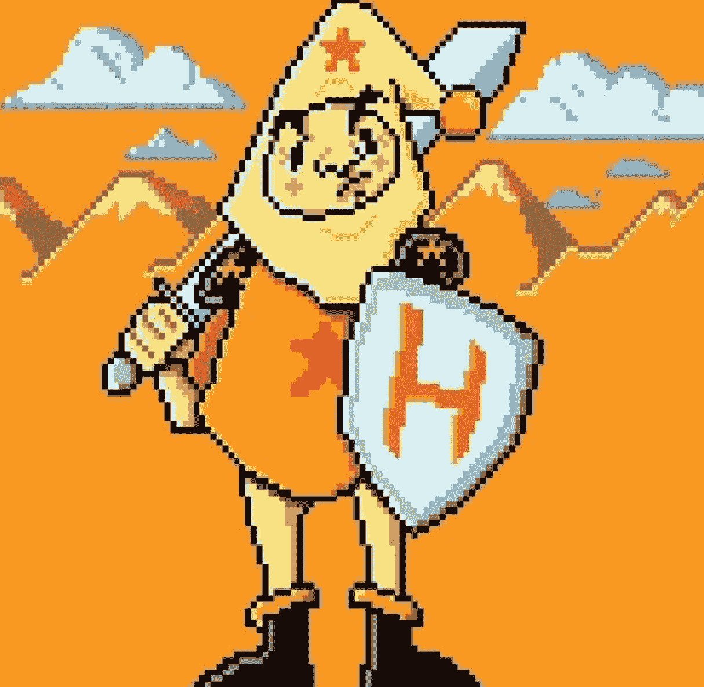

## 前言

这本书的目的是帮助人们开始编写计算机代码。我们尽一切保持简单。为了做到这一点，许多概念没有被涵盖，因为坦率地说，它们会让事情变得太复杂。这不是教授所有编程知识的指南，它是一本帮助人们入门的书。

书中的概念通过向你展示如何构建游戏来教授。你写的几乎每一行代码将为创建一个简单的文本冒险游戏做出贡献。你只需要一台带有 Google Chrome 浏览器的电脑、一个文本编辑器、一个互联网连接（用于下载启动材料）以及一点想象力。

本书的第 1-6 章为初学者设计。这些章节教读者如何从零开始编写游戏代码。前六章中的示例介绍了 Javascript 语言和许多关键编程概念。

第 7-8 章针对已掌握书中第一部分介绍概念的中级学习者。这部分将分解包含的示例游戏是如何工作的。

## 关于格式的说明

下面的章节解释了本书的文本格式。

**新的技术术语、重要概念和需要记忆的事已加粗。**

*技术术语和重要概念使用斜体。*

代码以此字体显示。

**你必须添加的新代码使用此字体并加粗！**

这就是你入门真正需要知道的一切。如果你有任何问题，请随时给我发送推特 @mantisorange。继续阅读，几分钟后你就能写出你的第一个程序！

## 第一章：Hello World，每个人的第一个程序

计算机编程并不难，只需要时间。不要担心，它会很有趣（大部分时候如此）。话不多说，让我们开始编写代码吧。你只需要一个现代网络浏览器和一个基础文本编辑器。幸运的是，大多数电脑已经安装了这两者。

**注意：** 对于 Windows，我们建议使用 **Notepad++** 文本编辑器。对于 Mac，我们建议使用 **Text Wrangler** 编辑器。两个平台都推荐 **Google Chrome**。

让我们编写你的第一个程序。

1. 打开浏览器并导航到 `google.com`（在地址栏中输入 `http://google.com` 并按回车）。

2. 右键点击页面，从右键菜单中选择 **检查（检查 element）**。


浏览器窗口现在应该被分成。一部分显示 **Network（网络）**，另一部分显示 **Elements（元素）**。

3. 寻找名为 **Console（控制台）** 的标签。

4. 在控制台中，你会看到 `>`。

5. 输入以下内容并按回车：

```javascript
alert("Hello World");
```

如果输入正确，应该会弹出一个显示“Hello World”的窗口。


你写了你的第一个程序！

## 第二章：变量，又名以后存储内容的盒子

变量在编程中用于存储和组织内容。在 Javascript 中，你可以将几乎任何内容放入变量中；例如字符串（文本）、数字等。

如果它没有打开，请打开控制台，让我们稍微修改一下我们的第一个程序。

在控制台中输入：

```javascript
var welcome = "Welcome to my game";
alert(welcome);
```

如果输入正确，你应该会看到一个显示“Welcome to my game!”的小窗口。


你可能会注意到，变量名 `welcome` 和文本 `"Welcome to my game!"` 之间有一个等号。在 Javascript 中，等号告诉浏览器将欢迎消息放入 `welcome` 变量中。这在计算机术语中被称为“赋值”。

将代码翻译成通俗易懂的英语来理解发生了什么通常很有用。

```javascript
var welcome = "Welcome to my game!";
```

用英语表达的话，它的意思是：创建一个名为 `welcome` 的变量，并将 `"Welcome to my game!"` 放入其中。

```javascript
alert(welcome);
```

用英语表达的话，它的意思是：显示 `welcome` 变量中的内容。

将变量想象成盒子也有帮助。在编写代码时，变量是存放字符串等内容的绝地方。使用变量的一个重要原因是是为了存储将会发生变化的信息。

在控制台中输入：

```javascript
alert(welcome);
```

你应该能看到 `"Welcome to my game!"` 出现。如果你没有看到它，可能是因为页面刷新被重置了。如果是这样，请在控制台中重新输入这些：

```javascript
var welcome = "Welcome to my game!";
alert(welcome);
```

现在输入：

```javascript
welcome = "Welcome back!";
```

```javascript
alert(welcome);
```

你现在应该能在警告框中看到 `"Welcome back!"`。通过输入没有 `var` 关键字的 `welcome`，你正在复用之前创建的 `welcome` 变量。这次你用一个不同的消息填充它。在计算机术语中，这被称为“重新赋值”。

现在你已经了变量，有趣的事情就开始了。再努力一下，我们可以构建一个游戏。

## 第三章：游戏时间

你已经学习了许多知识；事实上，学得多到我们可以开始构建游戏了。控制台是输入简单语句和命令的好地方，但它不是运行完整程序的地方。为了帮助你入门，请从这里下载游戏包：`https://github.com/orangemantis/gamekit/archive/master.zip`

一旦下载了游戏包，请将其保存到你容易找到的地方。桌面或你的文档文件夹都是存放它的好地方。游戏包包含许多有用资源，甚至还有示例代码，可以在你卡壳时为你提供帮助。书中将介绍许多示例。这些示例的代码可以在 `gamekit/mygame/snippets` 文件夹中找到。文件以示例的命名。

作为一名新手程序员，在尝试新事物时搞乱一个文件是很常见的。如果你需要某个游戏包文件重新开始，只需从游戏包存档中获取一份新副本，并将其保存到你的游戏目录（即 `mygame` 文件夹）。存档只是所有初始游戏包文件的副本。确保永远不要修改存档文件！

打开 `gamekit` 文件夹，然后打开里面的 `mygame` 文件夹。

在 `mygame` 文件夹中，使用你的文本编辑器打开名为 `main.js` 的文件。

`main.js` 文件顾其名，是你游戏的主程序。`.js` 告诉计算机主文件包含 Javascript 代码。你不需要担心此文件夹中的其他文件；包含它们是为了让你的生活更轻松。程序员经常依赖于利用他人编写的代码。将这些预写文件想象成一个库。事实上，一组预写的编程文件集合就称为“库”（library）。

在 `main.js` 文件中，你应该能看到类似这样的内容：

```javascript
/* Add your code below */
```

这被称为“注释”。注释以斜杠和星号开始，以星号和斜杠结束。注释是代码中供人阅读的笔记，计算机会忽略它们。不要修改此注释之上的任何代码，或注释下方提示你不要修改的代码。这些注释为你编写代码划定了边界。

**注意：** 如果你只有一行注释，可以在行开头使用两个斜杠来创建注释。

```javascript
//This is a single line comment.
```

注释非常重要。使用它们来描述你的代码的功能。注释还有另一个用途，你可以用它们向计算机隐藏代码。

在 `main.js` 文件中上述注释的下方，输入：

```javascript
/* alert("Hello World"); */
```

保存文件，然后从 `mygame` 文件夹中获取 `index.html` 文件并将其拖到浏览器窗口上。

如果你操作正确，你不应该看到 `"Hello World"` 警告框出现。注释告诉浏览器忽略星号之间的代码。

`index.html` 是一个网页。Javascript 需要一个网页来承载。之前，当你仅仅在控制台中输入内容时，你的 Javascript 使用的是浏览器中已经存在的网页。

如果你用文本编辑器打开 `index.html` 页面，你会看到几行 HTML，其中有一行代码看起来像这样：

```html
<script src="main.js"></script>
```

这是一个**脚本标签**（script tag）。标签很容易识别，因为它们都以 `<` 开头并以 `>` 结束。HTML 使用标签告诉浏览器做什么。在这种情况下，索引页告诉浏览器获取 `main.js` 文件中的所有代码并加载它。

我们不会讨论 HTML，因为此项目所需的大部分 HTML 已经包含在游戏包中了。书中讨论 HTML 只是让事情看起来不那么神奇。

现在你已经知道将 HTML 拖到页面上会加载它，你应该知道一旦加载完成，浏览器就会显示变化。从现在起，只要检查器（inspector）处于打开状态，缓存就会被禁用。

控制台的 `log` 方法是一种在控制台中打印对象的简易方法。你可以用它在控制台中显示任何有效的 Javascript 代码。这是一个非常强大的功能。每当你想看一眼代码中发生了什么时，你都可以使用它。

再次刷新页面，但这次当提示要求你输入姓名时，直接点击确定而不输入任何内容。通过添加**加粗文本**，再次查看 `playerName` 变量的值：

```javascript
/* Important game variable */
var myName = "Zultan Swack";
var title = "The Legend of Princess Helga";
var playerName = "";
```

```javascript
var screenText = "Please enter your name";
/* Show the game title. */
alert(title);
playerName = prompt(screenIText);
console.log(playerName);
```

在你按下回车后，控制台应该显示 `""`。由于你没有输入任何内容，`prompt` 返回了一个空字符串。

此时，你可以让玩家在没有名字的情况下继续游戏。如果你这样做，那么每当你想要使用玩家的名字时，它将是空白。作为一名新出炉的程序员，你不能让这种情况发生！你至少想要警告她没有输入名字。幸运的是，使用 `if` 语句很容易实现这一点。

## 示例 2

添加以下**加粗文本**，使得你的代码看起来像这样：

```javascript
/* Important game variable */
var myName = "Zultan Swack";
var title = "The Legend of Princess Helga";
var playerName = "";
```

```javascript
var screenText = "Please enter your name:";
/* Show the game title. */
alert(title);
playerName = prompt(screenText);
if (!playerName) {
  alert("You must enter a name!");
  playerName = prompt(screenText);
}
```

刷新页面，并在被要求时不要输入名字。

在上面的代码中，我们使用了一个 **if 语句**来检查是否添加了名字。

**if 语句**使用关键字 `if`，后面跟着一个括号，括号内包含你正在检查的条件。括号之后是一个*大括号*，后面跟着是几行代码，然后是另一个相反的*大括号*。大括号是 Javascript 中将相关代码分组在一起的方式。

大括号之间的代码通常被称为代码**块**（block）。附加到 `if` 语句上的代码块只有在语句为真时才会运行。

**if 语句**只理解 **true**（真）或 **false**（假），Javascript 几乎将所有内容分为这两者之一。想象一下玩家在要求输入名字的框里输入了 `"HANK"`。**包含文本的变量被视为 `true`。**

由于这里什么都没输入，`playerName` 是 `""`，而恰好，一个**空字符串（空白文本）被视为 `false`。**

我们在 `playerName` 变量之前放置了一个感叹号，这在起初看起来可能有点让人困惑。它*允许* `if` 语句将 `false` 值视为 `true`。这个感叹号被称为**非逻辑运算符**（not operator）。

```javascript
if (!playerName)
```

用大白话来说，它的意思是：

如果 `playerName` 是空的（`false`），则执行大括号内部的内容。

这之所以能通，是因为“名字是空白的”这是一个真实的陈述。由于玩家的名字等于 `false`，会显示警告框告诉玩家输入名字。随后，`prompt` 出现并要求输入名字。

```javascript
if (!playerName) {
  alert("You must enter a name!");
  playerName = prompt(screenIText);
}
```

你也可以这样写这段代码块：

```javascript
if (playerName === "") {
  alert("You must enter a name!");
  playerName = prompt(screenIText);
}
```

**三等号**（triple equals）是你在 Javascript 中检查两个事物是否相等的方法。记住，一个等号用于设置变量，而三个等号用于检查两个事物是否相互相等。

让我们确保你已经理解了。打开控制台并输入：

```javascript
var test1 = "";
var test2 = false;
var test3;
var test4 = null;
var test5 = " ";
```

然后通过输入以下代码来测试每个变量：

```javascript
if (!test1) {
  alert("This is false");
}
```

```javascript
if (!test2) {
  alert("This is false");
}
```

```javascript
if (!test3) {
  alert("This is false");
}
```

```javascript
if (!test4) {
  alert("This is false");
}
```

```javascript
if (!test5) {
  alert("This is false");
}
```

`test1` 是空文本，实际上被视为 `false`。这触发了 `false` 警告。

`test2` 显然是 `false`。这触发了 `false` 警告。

`test3` 未设置，因此是 `undefined`（未定义）并等于 `false`。这触发了 `false` 警告。

`test4` 是 `null`。`Null` 表示为空，因此它是 `false`。这触发了 `false` 警告。

`test5` 是个陷阱。这个没有触发 `false` 警告，因为它不是。如果你仔细观察，你会发现 `test5` 是一个空格，而空格就像一个不可见的字母。你起初可能没有注意到，但它在那里，这使得它变成了 `true`。

你在这一章中学到了很多，从技术上来说，你可以利用所学知识编写一个游戏。在下一章中，我们将使用语句、变量、alerts 和 prompts 来编写一个完整但简单的游戏。

## 第 4 章：冒险继续

你可以从上到下继续编写这个游戏，但这会带来一些几乎无法克服的挑战。在上一章中，你学习了如何确保玩家输入名字。如果他们第二次输入了名字，这种方法非常好；但如果他们没有输入，你就会一遍又遇到同样的问题。

为了解决这个问题，你可以创建一个规则，规定如果玩家在第一次或第二次尝试都没有输入名字，那么她就不能玩。规则看起来如下：

```javascript
/* Important game variable */
var myName = "Zultan Swack";
var title = "The Legend of Princess Helga";
var playerName = "";

var screenText = "Please enter your name:";
/* Show the game title. */
alert(title);
playerName = prompt(screenText);
if (!playerName) {
  alert("You must enter a name");
  playerName = prompt(screenText);
}
if (!playerName) {
  alert("Sorry, you can't play because you didn't enter a name, game over.");
}
```

虽然你技术上可以这样做，但这并不是一个好主意。

创建一个并调用一个会讲敲门笑的函数。这做起来应该不难。也许你可以复用之前某个课程中的一些代码？

现在我们已经学习了函数的威力，你可以开始构建一个好得多的游戏。如果你的文本编辑器没有打开，请打开它，然后打开 `gamekit/mygame` 文件夹下的 `main.js`。这将是你游戏代码的家园。确保它被保存在项目的 `scripts` 文件夹中。

## 示例 4

向文件中以下代码：

```javascript
var gameTitle = "The Legend of Helga";
var intro = "The princess has been kidnapped. You must save her!";
var playerName = "";
```

```javascript
alert(gameTitle);
```


```javascript
function askName(){
playerName = prompt("Player what is your name?");
if (!playerName) {
alert("You must enter a name to continue.");
askName();
}
}
```

```javascript
askName();
```

```javascript
alert(intro);
```

这段小段代码的作用如下：它创建了存储游戏标题和介绍文本的变量。它还为玩家的名字创建了一个占位变量。

首先显示游戏标题。

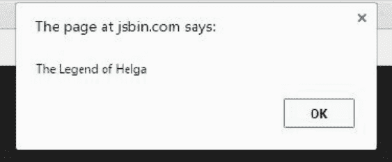

之后，创建了`askName`函数。紧接着运行了（或调用了）`askName`函数。这就是魔法发生的地方！`askName`函数会提示：

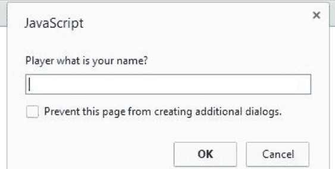

如果没有输入名字，你将收到弹出提示“你必须输入一个名字以继续”。然后再次调用`askName`函数来获取玩家的名字。这会一直进行，直到玩家真的输入一个名字。

**注意：不要勾选“阻止此页面创建额外的对话框”（Prevent this page from creating additional dialogs）。** 如果你这样做，游戏将无法运行。勾选此框会阻止警告框（alerts）和提示框（prompts）显示。如果你不小心勾选了该框，请关闭浏览器并重新打开。这将重置浏览器的内存。

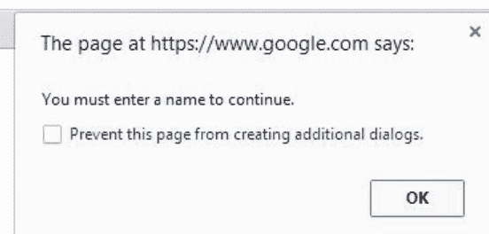

这有一个专门的术语，叫做**递归（recursion）**。这简单来说意味着一个函数调用它自己。`递归`非常酷，被用于让程序中的某事发生一次又一次、又一次、又一次……再次。就像最后一句话一样，使用递归的函数可以永远持续。如果你不输入名字，`askName`将不断重复。

最后，显示游戏的介绍。

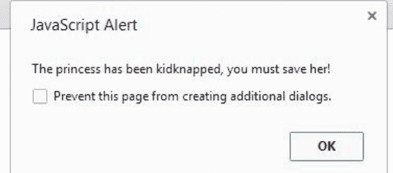

你在这一章中学到了很多知识，游戏真的开始成型了。接下来你将创建更多函数，为游戏添加更多有趣的内容。

## 第 5 章：构建回答界面

文字游戏需要玩家在屏幕上输入答案。程序将根据玩家输入的内容判断该做什么。为了保持简单，我们只给玩家提供 3 个选择：A、B 或 C。

### 示例 5

以粗体添加以下代码：

```javascript
var gameTitle = "The Lengend of Helga";
var intro = "The princess has been kidnapped, you must save her!";
var playerName = "";
```

```javascript
alert(gameTitle);

function askName() {
playerName = prompt("Player what is your name?");
if (!playerName) {
alert("You must enter a name to continue.");
askName();
}
}
```

```javascript
askName();
```

```javascript
alert(intro);
```

```javascript
/*Options screen*/
function playScreen1() {
var screen1Text = "The princess is not going to save herself, " + 
"where will you start? \n" + 
"A) Venture into the Dark Forest \n" + 
"B) Visit the Dark Forest Temple \n" + 
"C) Quit";
}
```

```javascript
function checkAnswer(answer){
  alert(answer);
}

var playerAnswer = prompt(screen1Text);
checkAnswer(playerAnswer);
}

HomeScreen1();
```

哇，你刚刚添加了很多代码，不要困惑，让我们分解一下你刚刚所的操作。

你做的第一件事是创建了一个名为`playScreen1`的新函数。这个函数处理询问玩家想做什么。

在`playScreen1`函数内部（大括号之间），你创建了一个变量`screen1Text`。记住，在函数内部创建的任何变量只在该函数内部存在。其他函数都看不到该变量。如果你在`playScreen1()`这一下方输入`alert(screen1Text);`，你会在检查器中看到错误，因为它无法使用其未包含的函数内部的变量。

尝试看看到会发生什么。

我们还没有对文本做很多操作，但这里的情况变得有点复杂了。你可以把文本写成非常长的一行，但对开发者来说可能很难阅读。将文本或字符串拆分成较短行的方法是使用`+`号。`+`号在技术上被称为加法运算符（plus operator）。

加法运算符在进行数学运算时用于相加，但也可以合并文本。如果你想让文本跨越几行代码以进行拆分，必须在两段文本之间放置一个`+`号。

以下两种方式都有效：

```javascript
var someText1 = "Hello world I am here " +
"to stay for good!";

var someText2 = "Hello world I am here " + "to stay for good!";
```

如果你仔细观察，可能会注意到某些文本内部有`\n`。这是告诉浏览器在屏幕上创建一个**新行**的特殊方法。

要查看效果，请打开控制台并复制粘贴以下内容：

```javascript
alert("Hello\n\n\n\n\n\nn\nWorld");
```

你应该能在 Hello 和 World 之间看到 10 行内容。

那个`rollDice`属于你。你可以把一个对象想象为一个特殊的变量，它可以包含许多其他变量和函数。当一个函数属于一个对象时，它被称为一个“方法”（method）。这可能让你感到困惑，但事实就是如此。为了增加这种困惑的是，属于对象的变量被称为“属性”（property）。现在你不需要记住所有这些；你只需要知道对象充满了信息和函数。你通过在对象和方法（或属性）名称之间输入一个点`.`来获取对象中的信息。

从技术上讲，像`alert`和`prompt`这样的方法属于`window`对象。输入：

```
window.alert("Hello");
```

相当于输入：

```
alert("Hello");
```

`window`是一个特殊的对象，获取它的方法不需要输入点。浏览器知道`alert`和`prompt`等方法属于`window`。`game`对象实际上挂载在`window`对象上。你可以输入：

```
window.game.rollDice();
```

在你的游戏中，`game`对象实际上挂载在`window`对象上。你通过在对象和方法（或属性）名称之间输入一个点`.`来获取对象中的信息。

从技术上讲，像`alert`和`prompt`这样的方法属于`window`对象。输入：

```
window.alert("Hello");
```

相当于输入：

```
alert("Hello");
```

`window`是一个特殊的对象，获取它的方法不需要输入点。浏览器知道`alert`和`prompt`等方法属于`window`。`game`对象实际上挂载在`window`对象上。你可以输入：

```
window.game.rollDice();
```

在你的游戏中，`game`对象实际上挂载在`window`对象上。你通过在对象和方法（或属性）名称之间输入一个点`.`来获取对象中的信息。

从技术上讲，像`alert`和`prompt`这样的方法属于`window`对象。输入：

```
window.alert("Hello");
```

相当于输入：

```
alert("Hello");
```

`window`是一个特殊的对象，获取它的方法不需要输入点。浏览器知道`alert`和`prompt`等方法属于`window`。`game`对象实际上挂载在`window`对象上。你可以输入：

```
window.game.rollDice();
```

在你的游戏中，`game`对象实际上挂载在`window`对象上。你通过在对象和方法（或属性）名称之间输入一个点`.`来获取对象中的信息。

从技术上讲，像`alert`和`prompt`这样的方法属于`window`对象。输入：

```
window.alert("Hello");
```

相当于输入：

```
alert("Hello");
```

`window`是一个特殊的对象，获取它的方法不需要输入点。浏览器知道`alert`和`prompt`等方法属于`window`。`game`对象实际上挂载在`window`对象上。你可以输入：

```
window.game.rollDice();
```

在你的游戏中，`game`对象实际上挂载在`window`对象上。你通过在对象和方法（或属性）名称之间输入一个点`.`来获取对象中的信息。

从技术上讲，像`alert`和`prompt`这样的方法属于`window`对象。输入：

```
window.alert("Hello");
```

相当于输入：

```
alert("Hello");
```

`window`是一个特殊的对象，获取它的方法不需要输入点。浏览器知道`alert`和`prompt`等方法属于`window`。`game`对象实际上挂载在`window`对象上。你可以输入：

```
window.game.rollDice();
```

在你的游戏中，`game`对象实际上挂载在`window`对象上。你通过在对象和方法（或属性）名称之间输入一个点`.`来获取对象中的信息。

从技术上讲，像`alert`和`prompt`这样的方法属于`window`对象。输入：

```
window.alert("Hello");
```

相当于输入：

```
alert("Hello");
```

`window`是一个特殊的对象，获取它的方法不需要输入点。浏览器知道`alert`和`prompt`等方法属于`window`。`game`对象实际上挂载在`window`对象上。你可以输入：

```
window.game.rollDice();
```

在你的游戏中，`game`对象实际上挂载在`window`对象上。你通过在对象和方法（或属性）名称之间输入一个点`.`来获取对象中的信息。

从技术上讲，像`alert`和`prompt`这样的方法属于`window`对象。输入：

```
window.alert("Hello");
```

相当于输入：

```
alert("Hello");
```

`window`是一个特殊的对象，获取它的方法不需要输入点。浏览器知道`alert`和`prompt`等方法属于`window`。`game`对象实际上挂载在`window`对象上。你可以输入：

```
window.game.rollDice();
```

在你的游戏中，`game`对象实际上挂载在`window`对象上。你通过在对象和方法（或属性）名称之间输入一个点`.`来获取对象中的信息。

从技术上讲，像`alert`和`prompt`这样的方法属于`window`对象。输入：

```
window.alert("Hello");
```

相当于输入：

```
alert("Hello");
```

`window`是一个特殊的对象，获取它的方法不需要输入点。浏览器知道`alert`和`prompt`等方法属于`window`。`game`对象实际上挂载在`window`对象上。你可以输入：

```
window.game.rollDice();
```

在你的游戏中，`game`对象实际上挂载在`window`对象上。你通过在对象和方法（或属性）名称之间输入一个点`.`来获取对象中的信息。

从技术上讲，像`alert`和`prompt`这样的方法属于`window`对象。输入：

```
window.alert("Hello");
```

相当于输入：

```
alert("Hello");
```

`window`是一个特殊的对象，获取它的方法不需要输入点。浏览器知道`alert`和`prompt`等方法属于`window`。`game`对象实际上挂载在`window`对象上。你可以输入：

```
window.game.rollDice();
```

在你的游戏中，`game`对象实际上挂载在`window`对象上。你通过在对象和方法（或属性）名称之间输入一个点`.`来获取对象中的信息。

从技术上讲，像`alert`和`prompt`这样的方法属于`window`对象。输入：

```
window.alert("Hello");
```

相当于输入：

```
alert("Hello");
```

`window`是一个特殊的对象，获取它的方法不需要输入点。浏览器知道`alert`和`prompt`等方法属于`window`。`game`对象实际上挂载在`window`对象上。你可以输入：

```
window.game.rollDice();
```

在你的游戏中，`game`对象实际上挂载在`window`对象上。你通过在对象和方法（或属性）名称之间输入一个点`.`来获取对象中的信息。

从技术上讲，像`alert`和`prompt`这样的方法属于`window`对象。输入：

```
window.alert("Hello");
```

相当于输入：

```
alert("Hello");
```

`window`是一个特殊的对象，获取它的方法不需要输入点。浏览器知道`alert`和`prompt`等方法属于`window`。`game`对象实际上挂载在`window`对象上。你可以输入：

```
window.game.rollDice();
```

在你的游戏中，`game`对象实际上挂载在`window`对象上。你通过在对象和方法（或属性）名称之间输入一个点`.`来获取对象中的信息。

从技术上讲，像`alert`和`prompt`这样的方法属于`window`对象。输入：

```
window.alert("Hello");
```

相当于输入：

```
alert("Hello");
```

`window`是一个特殊的对象，获取它的方法不需要输入点。浏览器知道`alert`和`prompt`等方法属于`window`。`game`对象实际上挂载在`window`对象上。你可以输入：

```
window.game.rollDice();
```

在你的游戏中，`game`对象实际上挂载在`window`对象上。你通过在对象和方法（或属性）名称之间输入一个点`.`来获取对象中的信息。

从技术上讲，像`alert`和`prompt`这样的方法属于`window`对象。输入：

```
window.alert("Hello");
```

相当于输入：

```
alert("Hello");
```

`window`是一个特殊的对象，获取它的方法不需要输入点。浏览器知道`alert`和`prompt`等方法属于`window`。`game`对象实际上挂载在`window`对象上。你可以输入：

```
window.game.rollDice();
```

在你的游戏中，`game`对象实际上挂载在`window`对象上。你通过在对象和方法（或属性）名称之间输入一个点`.`来获取对象中的信息。

从技术上讲，像`alert`和`prompt`这样的方法属于`window`对象。输入：

```
window.alert("Hello");
```

相当于输入：

```
alert("Hello");
```

`window`是一个特殊的对象，获取它的方法不需要输入点。浏览器知道`alert`和`prompt`等方法属于`window`。`game`对象实际上挂载在`window`对象上。你可以输入：

```
window.game.rollDice();
```

在你的游戏中，`game`对象实际上挂载在`window`对象上。你通过在对象和方法（或属性）名称之间输入一个点`.`来获取对象中的信息。

从技术上讲，像`alert`和`prompt`这样的方法属于`window`对象。输入：

```
window.alert("Hello");
```

相当于输入：

```
alert("Hello");
```

`window`是一个特殊的对象，获取它的方法不需要输入点。浏览器知道`alert`和`prompt`等方法属于`window`。`game`对象实际上挂载在`window`对象上。你可以输入：

```
window.game.rollDice();
```

在你的游戏中，`game`对象实际上挂载在`window`对象上。你通过在对象和方法（或属性）名称之间输入一个点`.`来获取对象中的信息。


从技术上讲，像`alert`和`prompt`这样的方法属于`window`对象。输入：

```
window.alert("Hello");
```

相当于输入：

```
alert("Hello");
```

`window`是一个特殊的对象，获取它的方法不需要输入点。浏览器知道`alert`和`prompt`等方法属于`window`。`game`对象实际上挂载在`window`对象上。你可以输入：

```
window.game.rollDice();
```

在你的游戏中，`game`对象实际上挂载在`window`对象上。你通过在对象和方法（或属性）名称之间输入一个点`.`来获取对象中的信息。

那个`rollDice`属于你。你可以把一个对象想象为一个特殊的变量，它可以包含许多其他变量和函数。当一个函数属于一个对象时，它被称为一个方法（method）。这可能让你感到困惑，但事实就是如此。为了增加这种困惑的是，属于对象的变量被称为“属性”（property）。现在你不需要记住所有这些；你只需要知道对象充满了信息和函数。你通过在对象和方法（或属性）名称之间输入一个点`.`来获取对象中的信息。

以下是关于对象概念的详细说明：
- **属性（Properties）**：属于对象的变量。
- **方法（Methods）**：属于对象的函数。
- **访问方式**：使用`.`符符访问属性或方法。

代码块是趣味发生的地方。你在这里决定玩家是否找到了钥匙、赢了战斗还是输了战斗。

在第一个代码块中，你检查`roll`变量是否等于3、6、9或12。如果是其中之一，你通过将`templeKey`变量设置为true来给玩家一把钥匙：

```javascript
if (roll === 3 || roll === 6 || roll === 9 || roll === 12) {
  templeKey = true;
}
```


```javascript
alert("You found the key!");

}
```

这段代码在括号中使用了一个双竖线（`||`）。`||` 是 JavaScript 中表示“或”的方式。从技术上讲，这被称为逻辑或运算符。

`else` 语句处理 `roll` 为 1、2、4、5、7、8、10 或 11 的情况。这个代码块是战斗发生的地方。你再次掷骰子，并将结果保存在你声明的 `roll2` 变量中。然后你检查 `roll2` 是否大于 5。

```javascript
if (roll2 > 5)
```

如果大于 5，玩家将通过击败一个名为 Grublor 的敌人获得 5 颗宝石。

```javascript
gems += 5;

alert("You came across a Grublor and defeated it!") +
"You won 5 gems!";
```

在上面的代码中，你使用等加号（`+=`）来增加 `gems` 的值。等加是在变量已有的值基础上进行累加的方法。由于 `gems` 变量从 0 开始，代码向其加了 5。这很重要；如果你只使用等号，你会将 `gems` 的值改为 5，无论它原来的值是什么。当玩家拥有 0 颗宝石时这可能重要，但是

注意：你也可以对包含文本（字符串）的变量使用等加。尝试：

```javascript
var test = "Hello World";

test += 1; // 在每个人的第一个程序中

alert(test);
```

紧接上述代码块的 `else` 处理 `roll2` 小于或等于五的情况。在这种情况下，玩家实际上输掉了战斗，并失去了一个血量作为惩罚。

```javascript
hearts--;

alert("You battled Grublor and were hurt in the battle.") +
"You lost a heart.",
```

我们使用了一点 JavaScript 魔法来移除一个血量。当你有一个包含数字的变量时，可以在它末尾添加双减号（`--`）来减 1。

**注意：** 如果你在包含数字的变量末尾添加双加号（`++`），它会加 1。

尝试一下：

```javascript
var test = 1;

test++;

alert(test);
```

最后一个 `if/else` 非常重要。如果玩家在战斗后仍有血量，你再次显示屏幕二。如果玩家的血量小于 1，则显示一个游戏结束的消息。

```javascript
if (hearts < 1) {
  alert("This was your final battle, game over.");
}
else {
  playScreen(2);
}
```

信不信由你，你已经学习了构建一个基于文字的游戏所需的所有知识。你可以通过自己构建一个极其有趣且复杂的游戏来让你的朋友和家人感到惊讶。然而，有几个原因你可能想以不同的方式来构建游戏。

首先，这种方法有很多重复代码。有时你必须反复编写相似的代码。你应该能够重用其中的一些代码。不同的编码风格可以大幅减少你需要编写的代码量。

这种方法还缺少很多功能。如果你现在还没有发现，如果玩家输入 "a" 而不是 "A"，游戏就会直接退出。没有消息，没有警告，它就崩溃了。当程序出错时，告诉用户发生了什么总是个好主意。

为了让玩家更方便，你可以通过编写这样的代码强制你的游戏接受大和小写字母：

```javascript
if (answer == "A" || answer == "a") {
  /*在这里执行某些操作*/
}
```

这将允许答案等于 "A" 或 "a"。

你也可以这样做：

```javascript
if (answer.toUpperCase() == "A") {
  /*在这里执行某些操作*/
}
```

上面的代码实际上是将答案转换为大写字母，然后与 "A"。

你可以为你发现的每一个缺失的功能创建一个解决方案，特别是使用 HelgaJS 游戏引擎库来让你的游戏编码任务更易管理。HelgaJS 库的编写只有一个目的：帮助你学习。

在下一章中，我们将探索如何使用 HelgaJS 来构建你的游戏。HelgaJS 库是

<!-- content -->

## 第 7 章：HelgaJS 游戏引擎简介

HelgaJS 引擎专为教授人们如何编写而创建。HelgaJS 自带了一个演示，帮助你理解使用它可以完成的一些事情。它是初级和中级编码者的良好起点。

## 工作原理

要玩游戏，必须创建游戏数据，然后通过 `start` 方法将其传递给游戏引擎。这是通过运行以下命令实现的：

```javascript
ge.start(gd);
```

命名为 `ge` 的游戏引擎是负责游戏的对象。游戏数据是一个 JavaScript 对象，至少需要以下属性：

- `name`：英雄的名字
- `hearts`：英雄拥有的生命值
- `gems`：用于存放英雄金钱的钱包
- `enemies`：敌人名称的数组
- `_currentScreen`：玩家正在查看的屏幕
- `_previousScreen`：当前屏幕之前的屏幕
- `_gameOverWin`：玩家胜利时显示消息的屏幕编号
- `_gameOverLose`：玩家失败时显示消息的屏幕编号
- `_quitScreen`：玩家退出时显示的消息
- `screens`：显示给玩家的各种屏幕（或提示框）

## 示例 9

只显示标题屏幕的简单游戏数据如下：

```javascript
var gd = {
  name: "Roon",
  hearts: 5,
  gems: 0,
  enemies: [],
  _currentScreen: 0,
  _previousScreen: 0,
  _gameOverWin: 9999,
  _gameOverLose: 9999,
  _quitScreen: 9999,
  screens: [{
    id: 1,
    title: "The Legend of Helga",
    text: "点击 OK 开始。",
    a: "",
    b: "",
    c: "",
    d: "",
    e: "",
    hideStats: true,
    action: function(ge, gd, answer) {
      return {
        goto: 9999
      }
    }
  }]
};
```

`gd` 变量包含一个表示游戏数据的对象字面量。对象字面量是通过输入左大括号和右括号并将其赋值给变量来创建的。创建一个空对象，或对象字面量，简单来说，看起来如下：

```javascript
var foo = {};
```

对象的属性在大括号内指定。它们几乎可以是任何有效字符串。属性的值在名称后声明，并使用冒号将属性名与值隔开。你可以将对象想象成包含许多其他东西的“超级箱子”。属性就像属于它们创建的对象的变量。对象帮助你组织代码。

属性可以包含变量可以的任何内容，包括函数甚至其他对象。HelgaJS 使用对象将代码组织成较小的块，使其易于编写和移动。文中稍后将更多地讨论对象。

游戏对象的 `screens` 属性是所有“魔法”发生的地方。`screens` 属性是一个屏幕对象字面量的数组。在 JavaScript 中，数组是一个简单的列表。数组中的项之间用逗号分隔。数组非常适合跟踪具有数字顺序的项。在计算数组中项的位置时，从零开始计数。

要创建一个数组，输入一个左方括号，紧跟一个右方括号，并将其赋值给变量或对象属性。

```javascript
var foo = [];
```

以下数组内部有三个不同的字符串：

```javascript
var foo = ["alpha", "beta", "gamma"];
```

字符串 `alpha` 位于数组位置 0，`beta` 位于 1，`gamma` 位于 2。如果你想使用数组中的任何信息，将使用数字位置获取它。

要查看此效果，请在控制台中输入以下内容：

```javascript
var foo = ["alpha", "beta", "gamma"];

alert(foo[1]);
```

浏览器会显示 "beta"。由于变量 `foo` 持有该数组，你使用 `foo` 来访问数组中的值。要获取数组内部的值，你输入一组括号，并写上你想要的项的位置。关于数组还有很多需要了解的，但这些足够让你入门了。

再次尝试一下，这次显示单词 `gamma`。

每个屏幕都负责告诉游戏引擎该做什么。以下是每个属性用途的简要说明。

- `id`：该属性不被游戏引擎使用，但会被游戏开发者使用。它只是让你轻松知道自己正在处理哪个屏幕。这应该代表屏幕在 `screens` 属性数组中的数字顺序。虽然数组位置从零开始，但为了让游戏更容易追踪，`screen.id` 始终应该是数组位置加 1。游戏引擎在你引用 `screen` 时会进行计算。它知道屏幕 1 实际上位于 `screens` 数组的位置 0。
- `title`：此属性中的文本显示在显示给玩家的屏幕的第一行。
- `text`：此属性中的文本显示在标题下方。
- `a`：选项“A”的文本。
- `b`：选项“B”的文本。
- `c`：选项“C”的文本。
- `d`：选项“D”的文本。
- `e`：选项“E”的文本。
- `hideStats`：这是一个可选属性，如果设置为 `true`，将防止屏幕显示心和宝石。
- `action`：`action` 属性包含一个函数，告诉游戏引擎下一步要做什么。`Action` 接收三个参数：游戏引擎（`ge`）、游戏数据（`gd`）和 `answer`（玩家在提示框中输入的答案）。

该方法是编写所有用于处理游戏流程的自定义逻辑的地方。`Action` 返回一个游戏引擎可以使用的对象来自动化某些常见任务。以下是你可以在返回对象中设置的用于控制游戏引擎自动化的属性描述。

- `goto`：它告诉游戏引擎下一个显示哪个屏幕。这应该是你想要显示的屏幕的 `screen.id` 数字。
- `hearts`：它告诉游戏引擎增加或减少英雄的生命值。正数增加心形，负数扣除。
- `gems`：像心形一样，你可以使用数字来增加或减少英雄获得的金钱。

`action` 必须返回一个对象字面量，至少将 `goto` 属性设置为下一个要显示的屏幕编号。

## 游戏引擎 API（属性和方法）

游戏引擎有几个用于让构建游戏更容易的方法和属性。这被称为游戏引擎 API（应用程序编程接口）。API 是一个高级词汇，意思是你用来为游戏引擎编程的东西。API 处理更常见的编程任务。以下是可用方法和属性列表。

- `addToken`：该方法接收两个字符串参数：`token` 和 `meth`。它将 `token` 添加到 `tokens` 数组中，并将 `meth` 添加到 `tokenHandlers` 数组中。此方法可以向屏幕添加自定义令牌。更多信息请参见 `tokens`。
- `adjust`：该方法有两个参数：`name` 和 `val`。`name` 是标识游戏数据属性的字符串。`val` 是应该从游戏数据属性中增加或减少的金额。游戏引擎用它执行此类操作，例如在英雄受伤时减少心形，或在英雄发现钱时增加宝石。
- `attack`：该方法有两个参数：`target` 和 `damage`。此方法用于减少游戏 Boss 或其他具有生命值的敌人的心形。
- `formatInventory`：该方法专门供游戏引擎使用，用于创建背包屏幕显示的文本。
- `getBoss`：该方法接受一个数字，对应你想要从游戏数据 `bosses` 数组返回的 Boss。更多信息请参见 `bosses`。
- `getCurrentBossName`：它获取当前 Boss 的名称。
- `getData`：该方法返回加载到引擎中的当前游戏数据。
- `getEnemy`：该方法根据传入的数字从游戏数据 `enemies` 数组中返回对应的敌人。
- `getItem`：该方法接收一个字符串名称并返回匹配的项数据属性。这是最常用的方法之一。
- `getRandomNum`：该方法接受一个数字作为上限。当指定时，将返回一个从零到该上限的随机数。
- `showScreen`：此方法由游戏引擎用于显示指定的屏幕。此方法有两个参数：`gd`（游戏数据）和 `num`（要显示的屏幕编号）。
- `getScreenText`：该方法接收屏幕标题、文本并格式化后显示。
- `getStats`：该方法获取心形和宝石信息并将其格式化后显示。
- `setTitle`：该方法设置第一个屏幕的标题。按照惯例，游戏标题被设置为第一个屏幕的标题。
- `getTokens`：该方法从 `tokens` 数组返回令牌。更多信息请参见 `tokens`。
- `hasText`：该方法有两个参数：`text` 和可选的 `contentType`。检查传递给方法的文本是否为空以及是否包含空格（空白字符）。`contentType` 属性设置为 "ABC" 将只允许字母。当设置为 "ABC123" 时，将允许字母和数字。
- `parse`：该方法接收两个参数：可以是字符串的 `txt` 和作为替换项数组的 `tokens`。`Parse` 将 `txt` 中找到的任何令牌替换为相应的值。一个很好的例子是玩家的名字。任何传递给 `parse` 且包含 `{{HERO}}` 令牌的文本都会被替换为属性的值。
- `process`：`process` 方法是屏幕动作的主处理器。所有的游戏自动化都通过此方法完成。
- `rollDice`：该方法返回一个一到十二之间的随机数。
- `sellItem`：该方法处理扣除宝石并将物品放入游戏数据。它有两个参数：`item`（字符串）和 `price`（数字）。
- `setInventory`：该方法向背包对象添加一个项。它有三个参数：`item`、`title` 和 `name`。`item` 是背包属性的字符串名称。`title` 是物品的类型。`name` 是物品的描述名称。在演示游戏的案例中，英雄拥有一个标题为 "sword"、名称为 "Silver Sword" 的剑类物品。
- `setItem`：该方法有两个参数 `name`（字符串）和 `val`（任何类型）。它更改指定的游戏数据属性的值。
- `showScreenTmpl`：此方法在控制台中打印一个空的示例屏幕对象。这是为那些忘记屏幕应该什么样的新学者提供的方便方法。
- `start`：此方法接收传递给它的游戏数据，将其设置到引擎中，并显示第一个屏幕以开始游戏。
- `tokenHandlers`：此属性是一个数组，应该包含一个属性名或函数名，用于为相应的令牌（token）提供数据。
- `tokens`：此属性包含一个令牌数组，这些令牌将替换任何屏幕文本。该属性与 `tokenHandler` 一起被 `parse` 用于格式化屏幕文本。

虽然阅读关于工作原理的文档很棒，但通过实践做来学习通常更好。示例游戏数据（`game.js`）使用 HelgaJS API 和各种技术构建了一个完整的冒险游戏。

为了更好地理解如何使用 HelgaJS 引擎，请阅读下一章节中的示例游戏数据文档。

## 第 8 章：游戏数据详解

## 屏幕 1

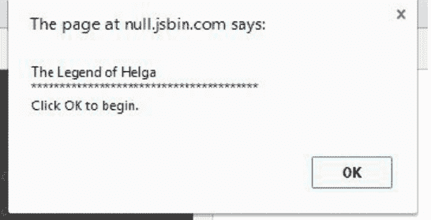

按照惯例，屏幕 1 是标题界面。遵循这一惯例很重要，因为 `getTitle` 方法会返回此屏幕的标题作为游戏标题。

此屏幕的 `action` 方法将火柴添加到物品栏。`matches` 变量包含文本，告诉玩家他们开始游戏时有多少根火柴。注意，使用 `getItem` 来获取游戏数据 `matches` 属性中设置的火柴数量。

在设置了 `matches` 变量后，调用 `setInventory` 将火柴添加到物品的 light（光亮）类别。

`setInventory` 的第一个参数 "light" 告诉该方法更改光亮物品。此时，物品屏幕上显示的物品只有 light、key、sword（剑）和 shield。下一个参数 "Light" 设置了显示类别的名称。它可以设置为任何你想在屏幕上显示的内容。有些人可能觉得它应该改为 "Matches"（火柴）。这也可以的。最后一个参数 `matches` 将 `matches` 变量的值设置为光亮物品的描述，以告诉玩家他们有多少根火柴。

最后，`action` 方法返回一个动作对象（RAO），告诉游戏引擎跳转到屏幕 2。这是游戏运行的核心。你通过设置返回对象的 `goto` 属性来切换屏幕。

```javascript
//在这里初始化物品栏

var matches = "Matches (" + ge.getItem("matches") + ");

G.setInventory('light', 'Light', matches);

return {goto: 2};
```

## 屏幕 2

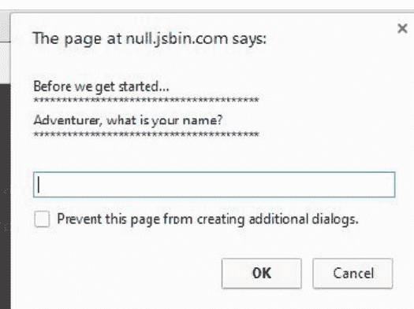

屏幕 2 的 `action` 方法提前声明了一个空白的返回动作对象（RAO）。这样做是因为该屏幕使用 `if` 语句来设置此物品的属性，特别是 `goto` 属性。

此方法中的 `if/else` 块检查是否输入了名字。如果输入了，玩家将进入屏幕 4。如果她没有输入名字，会被发送到屏幕 3，在那里她将看到一条警告消息，告诉她需要输入名字。

```javascript
var act = {};

if (ge.hasText(answer)) {
  act.goto = 4;
  ge.getItem('name', answer);
}
else {
  act.goto = 3;
}

return act;
```


## 屏幕 3

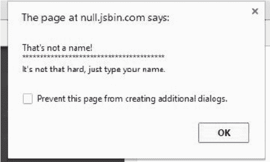

这里没什么好看的，屏幕 3 显示了一条消息告诉玩家没有输入名字，然后通过将 `RAO` 的 `goto` 设置为 2 将她送回屏幕 2。

## 屏幕 4

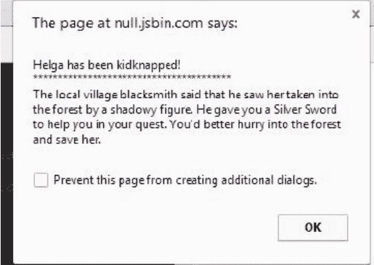

屏幕 4 的标题包含 `RESCUE`（救援）替换令牌。当屏幕显示时，公主的名字将被填入。

`title:"{{RESCUE}} 被绑架了!"`

此屏幕的 `action` 方法直接将玩家发送到屏幕 5。

## 屏幕 5

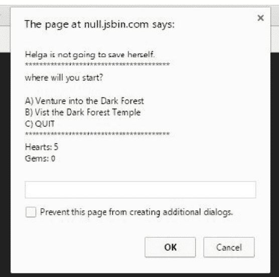

此屏幕的 `action` 方法直接将玩家发送到屏幕 5。

此屏幕包含 `RESCUE` 替换令牌。当屏幕显示时，公主的名字将被填入。

第一个 `if` 块告诉游戏引擎通过将 `RAO matches` 属性设置为 -1 来移除火柴。游戏引擎会将此处设置的数字添加到游戏数据的 `matches` 属性中。负数被用于有效地减一。如果没有灯笼，此操作将在该屏幕显示后发生。被注释掉的那行是立即移除火柴的手动方法。如果你在处理选项之前必须添加或删除物品，可能需要手动执行此操作。

下一个 `if` 块检查玩家是否拥有火柴或灯笼。如果玩家没有光源，`goto` 将设置为屏幕 11，这是一个特殊的游戏结束屏幕。该块中的 `return` 会停止操作的继续执行。`RAO` 将传回给游戏引擎，游戏结束。

这些操作发生在考虑玩家答案之前。

```javascript
var act = {};

var lantern = ge.getItem('lantern');

var roll = ge.rollDice();

var matches = ge.getItem('matches');

var forestKey = ge.getItem('forestKey');
```

```javascript
if (!lantern) {

//ge.adjustItem('matches', -1);

act.matches = -1;

}
```

```javascript
// 如果没有火柴，游戏结束

if(!matches && !lantern) {

act.goto = 11;

return act;

}
```

`switch` 语句处理玩家的答案。答案 "A" 是寻找灯笼。如果玩家选择了此项，"A" 分支中的第一个 `if` 语句将检查玩家是否拥有灯笼。如果她拥有，`goto` 将玩家发送到屏幕 10。

下一个 `if` 块只有在玩家没有灯笼的情况下才会发生。它检查 `roll` 变量，如果掷出的点数大于 6，玩家将被发送到屏幕 8，她在那里将获得一个灯笼。

`else` 块处理玩家掷出的点数为 6 或更小的情况。这个 `else` 块包含在另一个 `if/else` 块内部。这个块表示，如果玩家拥有任何火柴，她会被发送到屏幕 9，告诉她还没有找到灯笼。否则，她会被发送到屏幕 11，即游戏结束屏幕。

```javascript
switch(answer) {

case "A":

if(lantern) {

act.goto = 10;

return act;

}

// 假设这里没有灯笼

if (roll > 6) {

act.goto = 8;

} else {

if(matches) {

act.goto = 9;

}
```

在 "B" 分支的第一条语句中，代码检查玩家是否拥有 `forestKey`（森林钥匙）。首先处理这一点是为了简化编程。如果她有钥匙，就不需要做其他任何操作。如果她有一个，`goto` 被设置为 17。这个屏幕只是告诉玩家她已经有一把了。这告诉她无法找到另一把钥匙。此处的 `return` 用于防止函数执行下方的任何逻辑。它是该函数的一个巨大的停止信号。

注意：记住，如果你给玩家一个选项，即使她不被允许执行该操作，你也必须让她知道其操作的结果。有时，与其给玩家一个选择并告诉她不能这样做，要比完全移除该选择要容易。

下一个 `if` 块检查骰子点数是否大于 6。如果是，`goto` 将设置为 12。这个屏幕告诉玩家她找到了一把钥匙。在设计游戏时，你必须制定自己的规则来决定玩家如何找到物品。

在这种情况下，掷出大于六的数字允许玩家找到钥匙。

随其后的 `else` 块将 `goto` 设置为 13。这个屏幕告诉玩家她没有找到钥匙，她必须再次尝试。

```javascript
case "B":

if (forestKey) {

act.goto = 17;

return act;

}

if (roll > 6) {

act.goto = 12;

}

else {

act.goto = 13;// 未找到钥匙

}

break;
```

分支 "C" 处理玩家尝试前往寺庙的行为。`if` 块使用 `setInventory` 方法在物品屏幕中隐藏森林钥匙，因为因为它已经被使用且不再可用。`RAO` 属性被设置为 18（显示寺庙入口的屏幕）。`else` 块处理他们没有钥匙的情况。它将 `goto` 设置为 16，这是一个告诉玩家她一把钥匙的屏幕。

```javascript
case "C":

if (forestKey) {

// 从物品中隐藏钥匙，它已使用

ge.setInventory("key", "+", "-");

act.goto = 18;

}

else {

act.goto = 16;

}

break;
```

## 屏幕 9

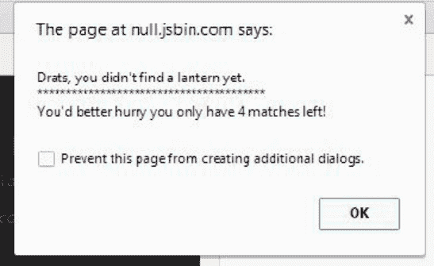

这个屏幕是一个消息屏幕，告诉玩家她没有找到灯笼。`if` 块检查是否有火柴。如果有火柴，玩家将被送回发送她到此屏幕的屏幕。`else` 块将玩家发送到游戏结束屏幕。

```javascript
action: function (ge, gd, answer){

var act = {};

var matches = ge.getItem('matches');

if (matches) {

act.goto = 7;

}

else {

act.goto = 11;

}

return act;

}
```

## 屏幕 10

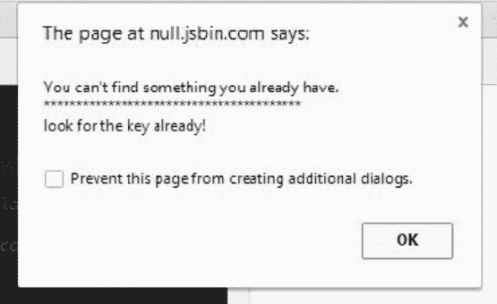

屏幕 10 只是告诉玩家她无法找到另一盏灯笼，并送回发送她到此处的屏幕。

## 屏幕 11

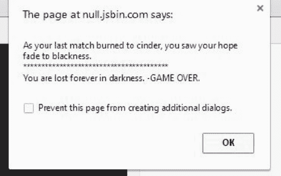

屏幕 11 是消息屏幕，告诉玩家她使用了最后一根火柴。`goto` 被设置为游戏结束屏幕。

## 屏幕 12


屏幕 12 是消息屏幕，告诉玩家她找到了一把钥匙。该操作将 `forestKey` 设置为 true 并将其添加到物品。

```javascript
action: function (ge, gd, answer) {

ge.setInventory("key", "+", "");

ge.setItem("forestKey", true);

act.goto = 7;

}
```

## 屏幕 13

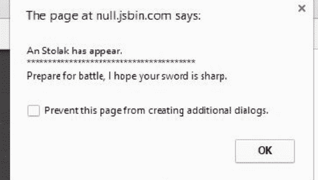

屏幕 13 是战斗屏幕，处理决定玩家胜负的逻辑。如果玩家掷出的点数大于七，她就赢了并发送到 14。如果她掷出 7 或更少，她会被发送到 15。

```javascript
action: function (ge, gd, answer) {

var act = {};

var roll = ge.rollDice();

if (roll > 7) {

act.goto = 14;

} else {

act.goto = 15;

}

return act;

}
```

## 屏幕 14

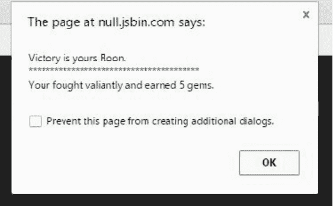

屏幕 14 显示胜利消息。对于这次胜利，玩家将获得 5 颗宝石。然后玩家被送回 7。

```javascript
action: function (ge, gd, answer) {

var act = {};

ge.adjustItem("gems", 5);

act.goto = 7;

return act;

}
```

## 屏幕 15

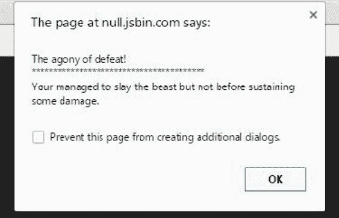

屏幕 15 显示来自 13 的失败消息。它通过将 `act.hearts` 设置为 -1 来移除一个血量。这告诉游戏引擎移除一个生命。

```javascript
action: function (ge, gd, answer) {

var act = {};

ge.adjustItem("hearts", -1);

act.goto = 7;

return act;

}
```

## 屏幕 16

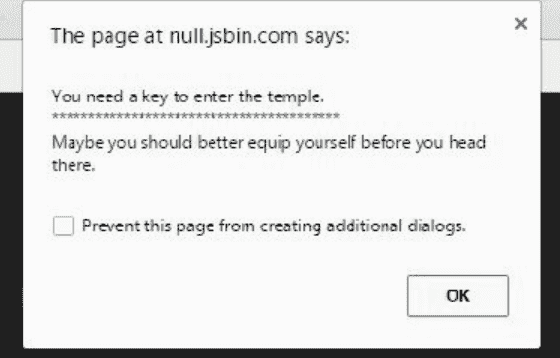

屏幕 16 告诉玩家她需要一把才能进入寺庙，并将她送回 7。

## 屏幕 17

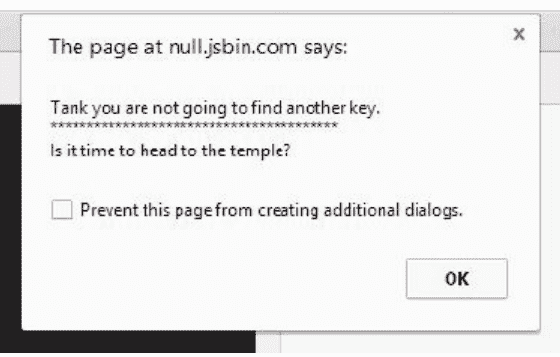

屏幕 17 是简单的消息屏幕，告诉玩家无法找到另一把钥匙，并将她送回 7。

## 屏幕 18

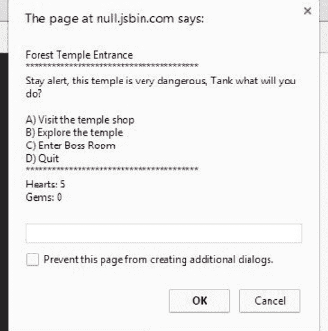

屏幕 18 是寺庙的入口，也是下一个主要的操作屏幕。操作屏幕遵循一种在处理任何决策之前检查先决条件的模式。

灯笼（`lantern`）。`act` 变量与其他屏幕中的完全相同。它是一个空对象，引擎使用的 `goto` 和其他驱动属性将设置在这里。最后，`roll` 变量存储了虚拟骰子掷出的数字。每次显示此屏幕时，都会检查这些值。这确保了获取的是最新的信息。

```javascript
action: function (ge, gd, answer) {

//Set_currentBoss

if (!ge.getItem('_currentBoss')) {

  var boss = ge.getBoss(1);

  ge.setItem('_currentBoss', boss);

}

//如果找到 boss 密钥则更改屏幕文本

var bossKey = ge.getItem('forestBossKey');

var lantern = ge.getItem('lantern');

var act = {};

var roll = ge.rollDice();
```

情况 "A" 非常简单，它将玩家传送到神庙商店，第 19 页。

```javascript
switch(answer) {

case "A":

act.goto = 19;

break;
```

情况 "B" 利用了骰子掷数的真实力量，并在玩家探索神庙时决定她的命运。第一个 `if` 块检查玩家是否拥有灯笼，如果没有，则移除一个宝箱。

下一个 `if` 块决定玩家是否会发现宝石宝箱。此块使用了双管道符 (`||`)（这在 JavaScript 中意味着“或”），用于检查玩家是否掷出了 1 或 12。如果她掷出了这些数字之一，她会被发送到第 26 页，告诉她发现了一个宝石宝箱。

接的 `if` 块如果玩家掷出 9、10 或 11，则将玩家发送到第 27 页。此屏幕告诉她她发现了一个 boss 密钥。

最后的一个 `if` 块如果玩家掷出 2、3、4、5、6、7 或 8，则将玩家发送到第 28 页进行战斗。第 28 页是神庙战斗发生的地方。

```javascript
case "B":

if(!lantern) {

act.matches = -1;

}

// 寻找宝箱

if (roll === 1 || roll === 12) {

act.goto = 26;

}

// 发现

if (roll === 9 || roll === 10 || roll === 11) {

act.goto = 27;

}

// 在此战斗

if (roll === 2 || roll === 3 || roll === 4 || roll === 5 || roll === 6 ||

roll === 7 || roll === 8) {

act.goto = 28;

}

break;
```

情况 "C" 处理玩家尝试战斗 boss 的情况。如果玩家拥有 boss 密钥，`if` 块将玩家发送到第 31 页。`else` 块将玩家发送到第 32 页，告诉她需要一把才能进入 boss 房间。

```javascript
case "C":

console.log('boss key ' + bossKey);

if (bossKey) {

act.goto = 31;

}

else {

act.goto = 32;

}

break;
```

## 第 19 页

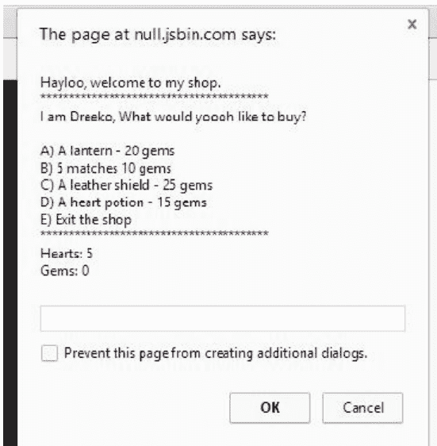

第 19 页显示神庙商店。每部优秀的冒险游戏都需要一个商店！此屏幕创建了存储商店中出售物品价格的变量。创建了以物品命名的变量，用于告诉引擎玩家是否拥有这些物品。这很重要，因为游戏规则规定你不能向玩家出售她已经拥有的东西。

到现在，你应该已经习惯看到 `act` 变量了。我们不再提它了。

```javascript
var lanternPrice = 20;//20

var shieldPrice = 25;//35

var potionPrice = 15;//15

var act = {};

var gems = ge.getItem('gems');

var lantern = ge.getItem('lantern');

var shield = ge.getItem('shield');

var potion = ge.getItem('potion');
```

情况 "A" 处理灯笼的购买逻辑。第一个 `if` 块如果玩家已经有一个灯笼，则将她发送到第 20 页并显示无法购买的消息。随后的 `else` 块包含一个 `if/else`，如果玩家买得起灯笼，则将她发送到第 21 页告诉她现在拥有了灯笼。`sellItem` 方法处理将物品添加到背包。你可以使用 `setInventory` 方法执行此操作。如果玩家钱够，`sellItem` 返回 `true`，否则返回 `false`。随后的 `else` 块如果玩家钱不够，会将玩家发送到第 22 页。

```javascript
case "A":

if (lantern) {

act.goto = 20;

}

else {

if (ge.sellItem('lantern', lanternPrice)) {

act.goto = 21;

}

else {

act.goto = 22;

}

}

break;
```

情况 "B" 仅仅将玩家发送到第 23 页。选项 B 是一种技巧。玩家永远可以选择这个。这是给那些决定不在森林里拿灯笼的玩家的提示。可能玩家玩几次后会发现在森林里拿灯笼是最好的。情况分别处理盾和药水的购买逻辑。这遵循类似于情况 "A" 的模式。所有这些情况将玩家发送到显示可以购买信息的屏幕。

## 第 20 页

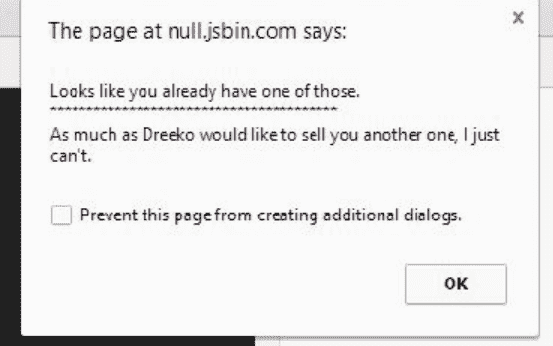

此屏幕是一个通用消息，告诉玩家她已经有了一个，不能购买。此屏幕将玩家送回神庙商店。所有商店相关的屏幕都会将玩家送回神庙商店。

## 第 21 页

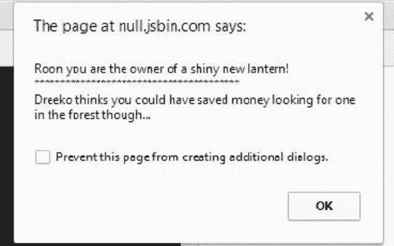

此屏幕告诉玩家她成功购买了灯笼。

## 第 22 页

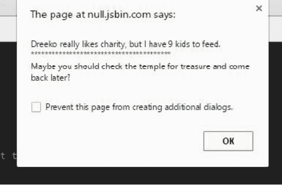

此屏幕在玩家买不起物品时显示通用消息。

## 第 23 页

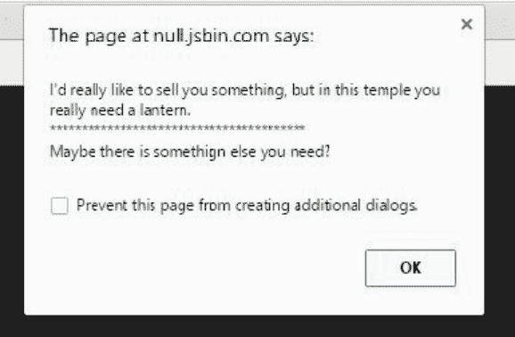

此消息给玩家一个讽刺的消息，告诉她尽管她想买火柴，但应该得到一个灯笼。

## 第 24 页

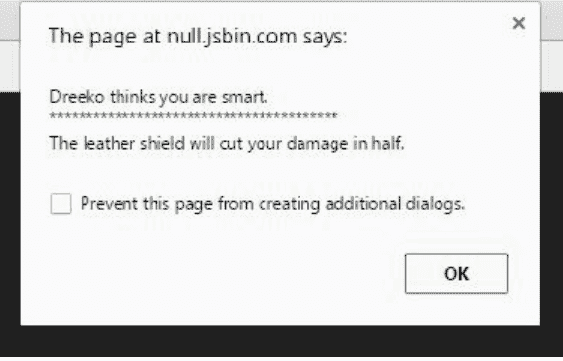

此屏幕告诉玩家现在拥有了一个盾牌。它还告诉玩家战斗中受到的伤害会减少。由于游戏引擎的编写方式，如果玩家有盾牌，它会自动降低伤害。如果你对查看该逻辑感兴趣，请查看游戏引擎方法的源代码。

## 第 25 页

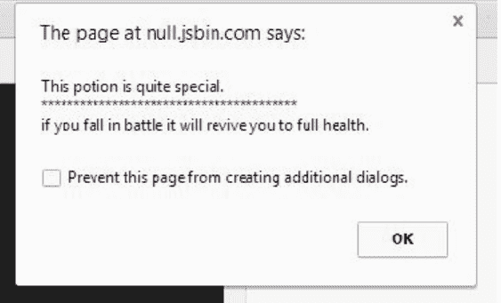

玩家购买药水时显示此屏幕。像盾一样，药水会自动运行。它由引擎处理以方便制作游戏。如果玩家没有剩余生命，药水会自动补满。如果这个功能不是自动处理的，你能想到实现它的方法吗？

## 第 26 页

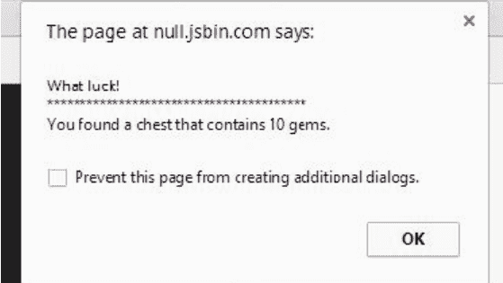

当第 18 页的玩家决定探索神庙且掷数显示她发现了一些宝石时，显示此屏幕。宝石通过 `adjustItems` 方法添加。该方法可以增加或减少物品。或者：可以将 10 添加到 `RAO`。

```javascript
ge.adjustItem('gems', 10);

return [goto: 18];
```


## 第 27 页

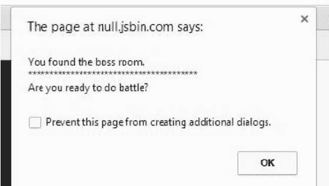

第 27 页处理骰子运气玩家发现了 Boss 房间的情况。第一行将 Boss 密钥添加到游戏数据，后续行将 Boss 密钥添加到背包屏幕。

```javascript
ge.setItem('forestBossKey', true);

ge.setInventory('key', '', 'Forest Boss Key');

return goto: 18;
```

## 第 28 页

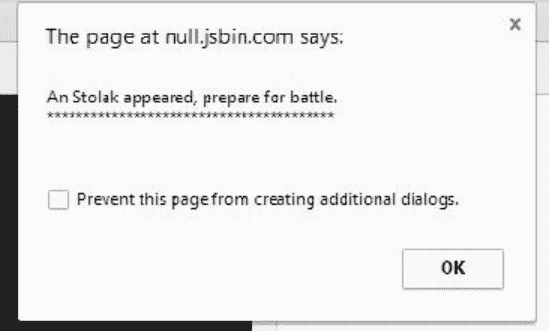

此屏幕中的代码应该看起来很熟悉，它处理神庙战斗。此屏幕使用骰子数来判断玩家胜利还是失败。如果玩家掷出 9 或以上，她就胜利并发送到第 29 页。否则，被发送到第 30 页查看失败消息。

```javascript
var act = {};

var roll = ge.rollDice();

if (roll > 8) {
  act.goto = 29;
} else {
  act.goto = 30;
}

return act;
```

## 第 29 页

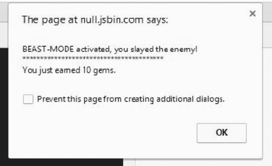

此屏幕告诉玩家赢得了第 28 页的战斗。通过设置 RAO 的 `gems` 属性为 10 来奖励 10 颗宝石。

```javascript
return {
  goto: 18,
  gems: 10
};
```

## 第 30 页

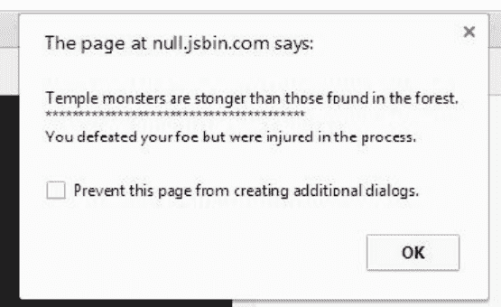

此屏幕处理骰子显示玩家输掉战斗的情况。对英雄的伤害通过将 RAO 中的生命设置为负数来实现，在本例中为 -2。

```javascript
return {
  goto: 18,
  hearts: -2
};
```

## 第 33 页

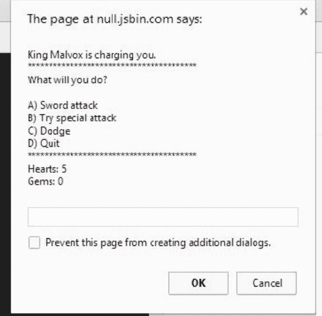

此屏幕处理所有 Boss 战斗选项的逻辑。首先，设置变量来声明 RAO 和几次骰子掷。屏幕中使用了两次骰子掷，以为战斗结果增加更多的随机性。

分支 “A”处理玩家想要使用她的剑的情况。如果她掷出的点数是 7 或更高，她将被发送到第 34 屏幕，那里将显示成功信息，且 Boss 将受到攻击伤害。如果玩家掷出的点数为 6 或以下，她将被发送到第 35 屏幕，该屏幕显示失败信息且英雄受到伤害。

```javascript
case "A":
  if (roll1 > 6) {
    act.goto = 34;
  } else {
    act.goto = 35;
  }
  break;
```

分支 “B”处理玩家选择尝试特殊攻击的情况。特殊攻击非常稀有，代码仅允许在两次骰数之和等于 14 时发生特殊攻击。如果满足其中一个条件，玩家将被发送到第 36 屏幕对 Boss 造成伤害。它还会让玩家知道她幸运获得了一个特殊攻击。如果两个条件都不满足，玩家将被发送到第 37 屏幕，在那里英雄会受到伤害。将显示一条消息让玩家知道特殊攻击惨遭失败了。

```javascript
case "B":
  if (roll1 == roll2 || (roll1 + roll2 == 14)) {
    act.goto = 36;
  } else {
    act.goto = 37;
  }
```

分支 “C”将玩家发送到第 38 屏幕，让她知道无法通过闪避来赢得游戏。

注意：你可以通过添加一个 `if/else` 块并使用骰子掷来决定闪避是否成功，从而给英雄增加一些风险。这为一个原本安全的选项增加了一个危险条件。

## 第 34 页

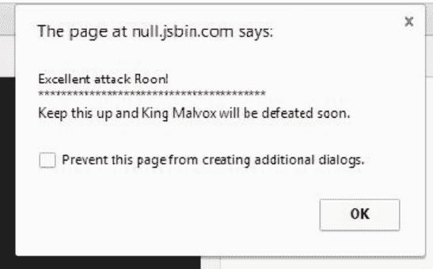

此屏幕创建一个 Boss 变量来保存从游戏数据中获取的 Boss 对象。Boss 对象是一个关于特定 Boss 的信息包。它告诉游戏引擎 Boss 的名称以及 Boss 有多少颗心心。`act` 变量持有一个 `goto` 设置为 33 的 RAO。这假设战斗仍在进行，并将玩家送回战斗选项。

`attack` 方法需要 Boss 对象。当向该方法传递 Boss 对象和一个负数时，它将移除指定数量的血量。`attack` 返回 Boss 剩余的血量。如果 Boss 不再有血量，玩家将被发送到第 39 屏幕查看胜利消息。通过预先在 RAO 中指定 `goto`，代码假设战斗将继续。这意味着我们只需要编写代码来处理 Boss 没有血量且战斗结束的情况。这种技术可以用于许多只有两种结果的情况。你同样可以轻松将 `act` 留为空空对象，并创建一个 `else` 在 Boss 还有血量时将 `goto` 设置为 33。

```javascript
var act = {goto: 33};

var boss = gd_currentBoss;

var bossHearts = ge.attack(boss, -1);
```

```javascript
if (!bossHearts) {
  act.goto = 39;
}

return act;
```

## 第 35 页

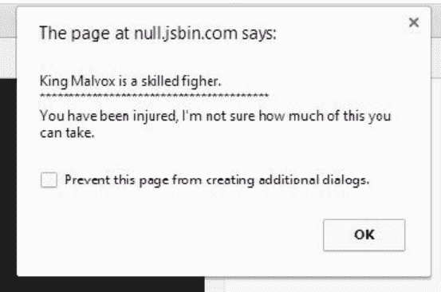

此屏幕让玩家知道她输了当前与 Boss 的战斗。该动作造成了 -2 点伤害。

## 第 36 页

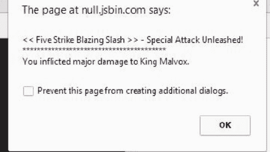

此屏幕处理特殊攻击的结果。其逻辑与第 34 页几乎相同，除了这里不是造成 1 点伤害，而是 Boss 损失了 3 点血量。

## 第 37 页

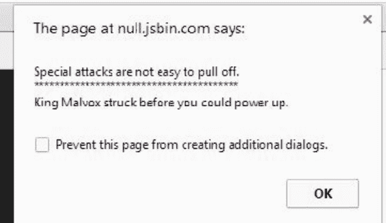

此屏幕显示消息，让玩家知道特殊攻击失败了。该动作让游戏引擎移除 2 点血量。

## 第 38 页

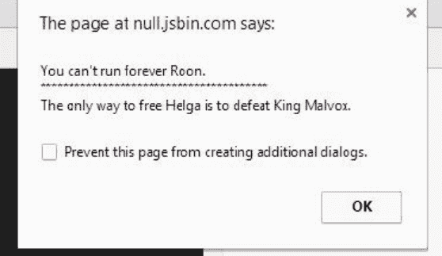

此屏幕告诉玩家她无法通过闪避赢得游戏。

## 第 39 页

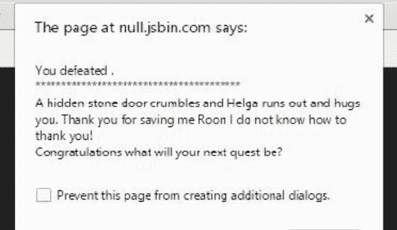

此屏幕处理 Boss 的消亡。第一行通过将 `_currentBoss` 设置为 `null` 来移除当前的 Boss。下一行非常特殊；它增加了英雄的总血量。这对于超过一个等级的游戏非常有用。通常，随着游戏的进行难度会增加。增加英雄的血量使其战斗更强大的 Boss。游戏数据中的 `heartLimit` 属性告诉引擎英雄允许的最大血量。此代码通过使用 `setItem` 方法增加了限制。最后一行恢复了英雄的血量。实现此点的另一种方法是将 `getItem` 的返回值放入变量中，然后将该变量传递给 `setItem`。这段代码是为了向你展示有许多方法可以实现同样的事情。

```javascript
ge.setItem('_currentBoss', null);

ge.setItem('_heartLimit', 1);

ge.setItem('hearts', ge.getItem('_heartLimit'));
```

## 第 40 页

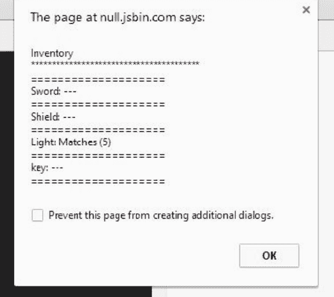

此屏幕用于显示背包。`screenNum` 变量代表玩家想要查看背包时所在的屏幕。这用于在关闭时将玩家送回之前的屏幕。

```javascript
var screenNum = ge.getItem("_previousScreen");

return {goto: screenNum};
```

## 第 41 页

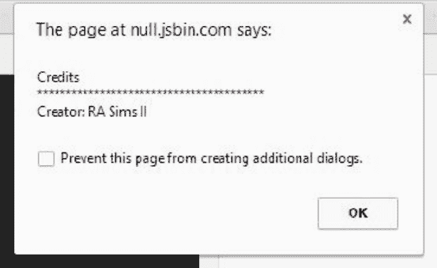

此屏幕显示设置在游戏数据 `credit` 属性中的制作名单。

## 第 42 页

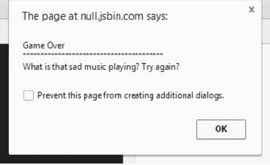

此屏幕显示英雄死亡时的游戏结束消息。

## 第 43 页

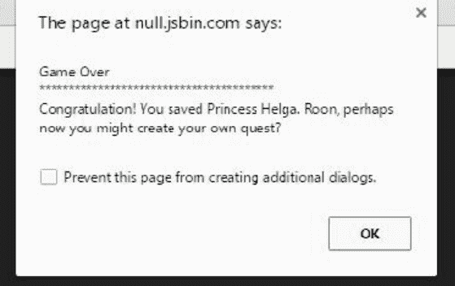

此屏幕显示英雄击败 Boss 并拯救公主时的游戏结束消息。

## 第 44 页

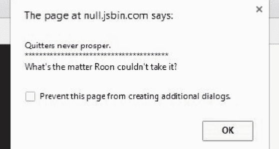

此屏幕显示玩家决定退出游戏时的消息。

现在，你已经准备好使用 HelgaJS 引擎创建你自己的冒险游戏了。此外，你现在应该已经有足够的编程知识来探索你自己独特的想法了。你的编程之旅才刚刚开始。希望你能够坚持下去，并创作出非常酷的作品。

编码愉快！

