# JavaScript 编程语言入门指南

洛义拉玛蒙特大学（Loyola Marymount University）

## 制作人员

- 买编辑：Timothy Anderson
- 编辑助理：Melissa Potter
- 制作总：Amy Rose
- 制作助理：Ashlee Hazeline
- 组排：Northeast Compositors, Inc.
- 封面设计：Scott Moden
- 封面图像与标题页：© Noreebo/ShutterStock, Inc.
- 打印与装订：Malloy, Inc.
- 封面印刷：Malloy, Inc.

## 关于本书

### 引言

本简短指南介绍了`JavaScript™`编程语言。它针对的是通修计算机科学课程（CS50）的学生，这些学生需要特定的编程语言材料来完成一本与语言无关的主文本。因此，我们将范围限制在`JavaScript`语言的“优秀部分”子集。虽然我们假设读者没有之前的编程经验，但它的节奏很快，且有时包含传统上入门水平不会介绍的内容。因此，它也适用于对该语言陌生并渴望实战冒险的资深程序员。可以安全跳过的高级章节已标记了星号（`*`）。

尽管本书旨在教授基础编程实践，但它根结底是关于`JavaScript`语言，包含了对象、函数、构造函数和原型的细节。理解语言的结构基础对于在该语言中有效地表达自己是必要的。当然，我们没有忽视`JavaScript`是让网络浏览器更具交互性的主要语言这一事实。鉴于网络编程只是`JavaScript`的一个应用领域，我们将该主题的介绍推到了详细介绍大部分语言内容之后。

由于本书非常简洁，最好从头到尾阅读。我们从`JavaScript`语言的原理开始，并迅速介绍了几个短小的示例程序。书的中间章节以相当技术的方式涵盖了语言的主要元素，并配有可以直接运行的示例代码。最后一章探索了`JavaScript`在万维网上的用法，简要介绍了`HTML`和`Ajax`。我们鼓励读者输入并运行示例代码，并完成章节末尾许多练习。

### 致谢

感谢 Loren Abrams、Hervé Franceschi 和 B. J. Johnson 的见解和评论；他们都花费了大量时间和精力帮助我们大大改进了文本。感谢 Mike Megally 和 Matt Werner 为我们提供整体印象。

感谢 Mei Lyn、Aidan、Anton 和 Aila 的支持和观点。

> -JDND

最后，Tim Anderson（收购编辑）、Melissa Potter（编辑助理）、Amy Rose（制作总监）、Ashlee Hazeltine（制作助理）以及他们的 Jones and Bartlett 同事在鼓励本书和完成整个制作过程中起了关键作用。

## 第 1 章 引言

本章并不是向你介绍`JavaScript`，而是带你入门。在简要讨论了为什么`JavaScript`值得学习之后，我们立即进入编写和运行各种真实的`JavaScript`程序。

### 1.1 为什么选择 JavaScript？

`JavaScript`是今天使用的许多编程语言之一，主要作为允许网页变得“动态”或“交互式”的技术而闻名。每种编程语言都有自己的优点、独特特征、支持者和反对者，所有这些都构成了学习该语言的价值的理由。在`JavaScript`的情况下，该语言值得学习的原因有以下这些：

- 得益于网络浏览器的普及，几乎任何计算设备都可以“开箱即用”运行`JavaScript`。不需要安装、下载或设置。
- `JavaScript`程序与网页内容的集成程度比任何其他当前编程语言的程序都更好，能够在“纯”网页中（无需插件或扩展）实现可拖拽对象、可滚动地图、动画和实时效果、3D 渲染等。

无论人们对该语言有多少误解，`JavaScript`都是一种极其强大且极其流行的编程语言（某些人认为它是目前使用最流行的语言）。

在编程语言领域，流行性往往意味着重要性。

### 1.2 编写和运行 JavaScript

要编写和运行`JavaScript`程序，你需要以下资源：

- 一个网络浏览器

就这些。虽然从技术上说这一单一要求可能取决于各种条件（例如，它必须是“现代”网络浏览器；必须启用`JavaScript`；你必须拥有`JavaScript`的“良好实现”），但在书中我们采取乐观（且很可能）的立场，认为你今天使用的浏览器已经准备好并愿意运行`JavaScript`。所以，启动浏览器，从最简单的方法开始：浏览器自己的地址栏。

#### 1.2.1 JavaScript URL

在你的网络浏览器中输入以下“Hello world!”：

```javascript
javascript:alert("Hello world!")
```

让你的浏览器访问此地址（通常通过按 Enter 或 Return 键），你的浏览器应该弹出一个窗口，上面惊讶地写着“Hello world!”

图 1.1 展示了该程序在运行不同操作系统的两个浏览器中的样子（其他浏览器和平台看起来非常相似）。底层网站不会影响显示——你要求浏览器执行一个`JavaScript`程序（`alert("Hello world!")`），而浏览器照从了。为了强调网络浏览器的普及性，泛指 JavaScript，，书中的屏幕截图将刻意混合不同的浏览器和平台。除非另有说明，书中的所有内容在你的设备上都应该运行良好。最终显示可能看起来不同，但底层行为保持不变。

#### 1.2.2 JavaScript 草稿页

在单行文本字段中编写`JavaScript`很快就会变得很麻烦，我们开发了一个“草稿页”，通过它你可以更容易输入脚本。网站`http://javascript.cs.lmu.edu/scratch`托管了此类草稿页的原始版本（图 1.2）。

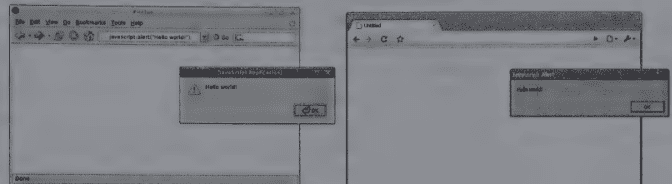

**图 1.1** Linux 上的 Firefox 和 Windows XP 上的 Chrome 显示 JavaScript "Hello world!"

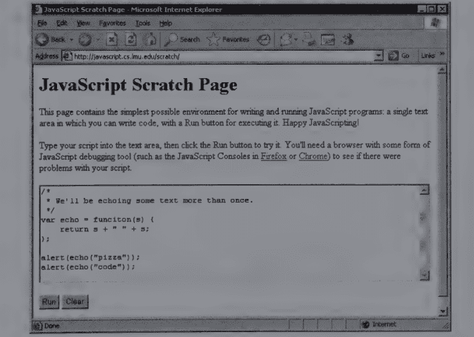

**图 1.2** 一个原始的 JavaScript 草稿页

要使用此功能，在文本区域输入脚本，然后点击 **Run** 按钮。对于第 1.2 节中的简易示例，你会输入：

```javascript
alert('Hello world!');
```

这与你在地址栏中输入的内容相同，除了没有了`javascript:`前缀。该前缀不是语言的一部分；它是一个告诉浏览器如何解释文本的标记。因为草稿页期望且只有在`JavaScript`下才能正常工作，所以这个前缀现在是不需要的。

意不意外，点击`Run`导致的结果与之前完全相同。这是因为浏览器运行的是完全相同的程序——唯一的区别在于你输入的方式。

你可能想通过输入和运行接下来的简短示例来稍微适应这个环境。我们不会对这些示例进行大部分解释；它们的目的不是教你语言，而是让你习惯输入和运行`JavaScript`的过程。如果你已经有一定的编程经验，选择这些示例是为了预览`JavaScript`的一些有趣且独特的方面，因此快速扫描一遍会很有用。

记住按照所示内容准确输入。如果程序运行不符合预期，请检查你输入的内容以确保它与给定的程序匹配。此外，欢迎通过细小更改并观察结果来实验这些脚本。

- 此程序模拟单次掷骰子——每当你运行它时，都会得到一个一到六之间的随机数：

```javascript
alert("You rolled a " + (Math.floor(Math.random() * 6) + 1) + "!");
```

- 这个程序根据你熟悉的 20 世纪 40 年代节目玩简单的“填空”游戏：

```javascript
alert("I like " + prompt("请输入城市:") + " in " + prompt("请输入月份:") + ", how about you?");
```

- 这两行代码对于懒得处理大小写的人来说非常棒：

```javascript
alert(prompt("要大喊的内容:").toUpperCase());
alert(prompt("大喊内容（全大写）").toLowerCase());
```

- 这是一个运行用户输入的另一个脚本的脚本。你认为哪一点更有趣——在`JavaScript`中可以做到这一点，还是脚本可以短到这样？

```javascript
new Function(prompt("输入脚本:")));();
```

注意这些括号——它们必须按照所示内容输入。当你在这个程序的提示框中输入的脚本是程序本身时，你认为会发生什么？

#### 1.2.3 JavaScript 文件

JavaScript URL 和临时页面（scratch pages）让你能够快速方便地编写和实验`JavaScript`代码。然而，一旦代码被认为已经准备好发布，它们就无法处理`JavaScript`程序的分发和共享。

为了让其他用户可以使用你最新、最出脚本，你必须将`JavaScript`程序保存在单独的文件中。网络浏览器就可以下载这些文件并运行它们，就像它们运行 JavaScript URL 或 JavaScript 临时页的内容一样。区别在于，它们不需要直接输入（如你使用 URL 和临时页面时所的那样），网络浏览器可以自行获取代码。

由于本书致力于专门关注`JavaScript`作为一种编程语言，而不是`JavaScript`作为一种网络技术，我们将刻意推迟有关在网络浏览器应用程序中使用`JavaScript`代码的分发和共享的内容，直到第 5.2.4 节。

#### 1.2.4 注释

看看下面的脚本。你发现它有什么不寻常之处吗？（不用说，试着输入并运行它。）

```javascript
/*
* 我们将多次输出某些文本。
*/
var echo = function(s) {
  return s + " " + s;
}

alert(echo("pizza"));
alert(echo("money"));

// 我们也可以输出用户提供的内容。
alert(echo(prompt("Type something to echo:")));
```

示例开头`/*`和`*/`之间的块，以及末尾附近以`//`开头的行，看起来不像代码——它们看起来像是普通的英语。这是因为它们确实是普通的英语；`/*`和`*/`之间的文本，以及两个斜杠（`//`到行尾）之后的任何文本都被称为注释。注释允许人类语言成为脚本的一部分，帮助读者稍更好地理解编程人员的意图。当`JavaScript`看到`/*`时，它知道跳过之后的所有内容，直到看到`*/`。当`JavaScript`看到`//`时，它会忽略从那里到行尾的所有内容。

在实践中，高度鼓励在代码中大量包含注释；无论编程专家变得多么优秀，用普通的英语（或你熟悉的任何其他会说、会读或写的语言）来阅读某些内容通常比阅读代码要容易。当你作为一个程序员团队的一员并阅读你没有编写的代码时，甚至当你回顾自己写过但一段时间未见的代码时，这一点变得变得尤为重要。

### 1.3 你的第一个非平凡脚本

现在我们已经建立了编写和运行`JavaScript`的简单机制，让我们来看一个稍微复杂一点的脚本。这里的目的是展示一个非平凡脚本像什么样；在那个时候，你不需要理解每一行的含义。在`http://javascript.cs.lmu.edu/`中输入以下内容：

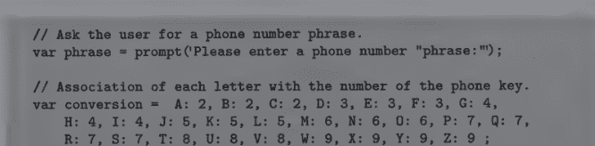

```javascript
// 向用户询问一个数字短语。
var phrase = prompt('Please enter a phone number "phrase:");');

// 每个字母与电话键数字的对应。
var conversion = {A: 2, B: 2, C: 2, D: 3, E: 3, F: 3, G: 4, H: 4, I: 4, J: 5, K: 5, L: 5, M: 6, N: 6, O: 6, P: 7, Q: 7, R: 7, S: 7, T: 8, U: 8, V: 8, W: 9, X: 9, Y: 9, Z: 9};
// 一一次构建一个数字。
var phoneNumber = ""
for (var index = 0; index < phrase.length; index++) {
  var symbol = phrase[index].toUpperCase();
  phoneNumber += conversion[symbol];
}

alert("You want to dial " + phoneNumber + ".");
```

如之前提到的，代码必须绝对精确——完整地复制所有内容。如果你不信任自己的复制，可以访问`http://javascript.cs.lmu.edu/scratch/phrase-to-phone`获取一个已经预加载了该脚本的临时页面版本。

假设你正确地输入了此脚本，在临时页面上运行应该显示一个请求“Please enter a phone number 'phrase'”的对话框。输入一个有效的电话短语，如 (800) DENTIST（或 310) GROCERY），应该会得到第二个对话框，给出该短语对应的电话号码。图 1.3 显示了基于电话号码 (212) GET-CTR 的截图序列。

逐行检查此脚本，即使没有之前的编程经验，也可以看到它的内容如何与其运行时的行为相对应。首先，记住`JavaScript`会忽略注释，因为这些项目是给阅读脚本的人类看的。

**图 1.3** 你第一个非平凡脚本的截图，以 (212) GET-CTR 作为要拨打的电话短语

那么，实际执行的第一行是以`phrase = prompt`开头的那个行……

在网络浏览器中运行时，`JavaScript`可以执行`prompt`，在这种情况下，它会让网络浏览器显示一个对话框，请求拨打“电话短语”。技术上，`prompt`被称为“函数”，你将在第 3 章学习更多关于函数的知识。

为了将电话号码中的字母转换为数字 0-9，使用了一个名为`conversion`的`JavaScript`对象。`JavaScript`对象在第 4 章中会有更详细的介绍；目前可以说`conversion`定义了一个可能的字母到数字的“翻译”列表。每个翻译（例如，“A”对应 2，“Q”对应 7）都用逗号（`,`）分隔，字母和数字部分用冒号（`:`）隔开。字母出现在冒号之前，与每个字母对应的数字出现在冒号之后：例如，字母“D”、“E”和“F”对应数字 3；“T”、“U”和“V”对应数字 8；以此此类推。

通过执行以`for`开头的代码块，脚本会遍历电话短语中的每个符号，确定其与脚本大写版本的对应关系。未列在`conversion`中的符号将保持未转换状态。`for`块被称为`循环`，因为它会根据条件重复某些活动。一旦短语中的每个符号都处理完毕，`alert`就会将结果显示给用户。脚本随后返回到常规的网页。

### 1.4 另一个非平凡脚本

在我们详细介绍`JavaScript`之前，这里有另一个（可选）脚本可以尝试。与之前的脚本一样，这个示例的目的仅仅是让你熟悉较长程序的外观和感觉。该脚本在线可用——如果你反感，可以访问`http://javascript.cs.lmu.edu/scratch/phone-phrase/`：

```javascript
/**
 * 此函数将数字转换为与该数字对应的
 * 随机按键键盘字母。非数字也会被转换。
 */
var getRandomFromDigit = function(digit) {
  var conversion = ["ABC", "DEF", "GHI", "JKL", "MNO", "PQRS", "TUV", "XYZ"];
  var possibleLetters = conversion[digit - 2];
  return possibleLetters[Math.floor(Math.random() * possibleLetters.length)];
};

// 向用户询问电话号码。

 * “数字”是任何数字、空格、括号和破折线的序列。
 * "match" 之后的代码看起来很吓人，但在高级脚本
 * 中很常见。现在，只需确保准确输入即可。
 */
if(phoneNumber.match(/^[0-9\-\(\)\s]*$/)) {
  // 一个字符地构建电话号码。
  var mnemonic = "";
  for (var index = 0; index < phoneNumber.length; index++) {
    mnemonic = mnemonic + getRandomFromDigit(phoneNumber[index]);
  }
  alert(mnemonic + " is a possible equivalent of " + phoneNumber + ".");
} else {
  // 至少有一个不是数字、空格、括号
  // 或破折线的字符。
  alert(phoneNumber + " 无法解释为电话号码。");
}
```

当你运行脚本时，首先会收到请求你输入电话号码。输入一个有效的电话号码（脚本对它认为的“电话号码”其实非常宽松）会产生一个警框，给出该数字随机选择的字母。图 1.4 显示了电话号码 555-1212 的截图。不要担心图中的输出与你自己的屏幕上看到的不相同——记住电话上的数字 2-9 每个……

## 章节总结

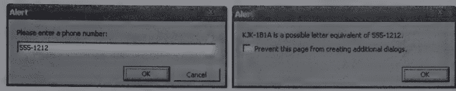

**图 1.4** 来自非平凡脚本的截图，使用 555-1212 作为要转换的电话号码

对应多个可能的字母，该字母由脚本随机选择。重要的是，如果你“拨打”了随机选择的电话号码短语，你最终将拨通输入的电话号码（图 1.4 中的 555-1212）。


此脚本涉及函数（第 3 章）、对象（第 4 章）和循环（第 2.4.4 节），以及 JavaScript 语言的更多特性——有些是基础的，但目前暂且到此。在继续之前，请随时尝试或修改此脚本。

这个示例完成了我们对 JavaScript 语言的初步观察；为了让你能够立即尝试并看到结果，我们采取了从示例开始但跳过某些细节的方法。其余章节将深入探讨语言本身，书最后概述了 JavaScript 及其特性如何用于交互式 Web 应用程序。

## 章节总结

- JavaScript 是世界上最流行的编程语言。几乎每个带有网络浏览器的计算机（包括一些手机和嵌入式设备）都可以“开箱即用”。
- 要开始 JavaScript 编程，你只需要一个网络浏览器。
- 可以在浏览器中输入单行的 `javascript:` URL 或使用基于浏览器的空白页（scratch page）来执行 JavaScript。最终完成的代码可以使用标记进行存储、分发和共享。
- 脚本既包含代码（代表计算机要做的操作），也包含注释（代表给脚本的人类读者的信息）。
- 构建在运行 JavaScript 的网络浏览器中的 `prompt` 和 `alert` 函数分别是向用户请求（输入）信息和向用户显示（输出）信息的最简单方法。

# 第 1 章 引言

## 练习

1. 将以下程序作为单行 JavaScript URL 运行，或作为输入到空白页或控制台的文本运行。

```javascript
alert("Hello, " + prompt("What's your name?"));
```

2. 尝试使用 JavaScript URL 方法而不是空白页来运行第 1.2.2 节中提供的每个示例程序。
   - (a) 这样做可能吗？
   - (b) (a) 部分的答案告诉了你关于 JavaScript 如何处理空格以及换行或空行？

3. 运行以下单行脚本（记住完全按照所示输入），并注意出现的内容。解释 `alert` 括号中的内容与显示内容之间的关系。
   - (a) `alert("Good night and good" + "luck.");`
   - (b) `alert(2 + 10);`
   - (c) `alert(5 > 9);`
   - (d) `alert(/* * Do the right thing. */);`
   - (e) `alert(Math.sqrt(-1));`

4. 以下的单行脚本（记住完全按照所示输入它）会向你请求一些输入并返回某些内容：

```javascript
alert(prompt("Type something:"));
```

   - (a) 运行脚本并输入 `2 + 10`。显示了什么？
   - (b) 运行脚本并输入 `5 > 9`。显示了什么？
   - (c) 运行脚本并输入 `Math.sqrt(-1)`。显示了什么？
   - (d) 运行脚本并点击 *Cancel* 按钮。显示了什么？
   - (e) 简要地用你自己的话描述脚本的作用。

5. 查询 JavaScript 的 `Math.random` 函数返回结果的范围。还要查询 `Math.floor` 的作用。你可以写一个通用的“公式”来生成大于等于 *a* 但小于 *b* 的随机数吗？如果你想要随机整数……

## 练习

6. 输入并运行此脚本，它在另一个注释内部包含一个块注释：

```javascript
/* A comment /* inside */ / a comment. */
alert("Done!");
```

发生了什么（或者没有发生什么）？猜猜为什么 JavaScript 有这种行为。

7. 输入并运行此脚本，它使用 `+` 运算符组合表达式：

```javascript
alert(1 + 1);
alert("*1" + "1");
```

显示了什么？猜猜为什么 JavaScript 这次表现得这样，用户可以选择什么进行相加运算。

8. 以下脚本是练习 7 中脚本的变体；这次，用户可以选择什么进行加减运算：

```javascript
alert(prompt("First thing to add: ") + prompt("Second thing to add: "));
```

输入并运行此脚本。输入 1 和 1 作为输入，以及其他组合。显示了什么？这证实还是反驳了你对 `+` 作用的猜测？

9. 旧旧手机，特别是那些带有拨盘的手机，没有将 Q 和 Z 作为数字 7 和 9 的可能转换。修改第 6 页的脚本，使其与这些旧手机“向后兼容”。

# 第 2 章 基础 JavaScript

现在你已经有机会运行了一些简单的 JavaScript 程序，我们准备好从技术角度查看该语言本身的基本元素。

## 2.1 表达式

我们将从表达式开始对语言进行概述。表达式是会被求值的代码。让我们计算一些表达式：

```javascript
2 => 2
2 + 8.1 * 5 => 42.5
(2 + 8.1) * 5 => 50.5
9 > 4 => true
"dog" + "house" => "doghouse"
```

表达式由值（如 `8.1`、`true` 和 `"dog"`）和运算符（如 `+` 加法和 `*` 乘法）组成。JavaScript 中的每个值要么是：

- 布尔值（`true` 或 `false`）
- 数字
- 字符串
- 特殊值 `undefined`
- 特殊值 `null`
- 对象

我们将讨论布尔值、数字和字符串。我们将在第 2.3 节中介绍 `undefined`，并在第 4 章中介绍对象和 `null`。

### 2.1.1 布尔值

布尔值 `true` 和 `false` 最经常被视为比较的结果——即计算两个值是否相等、不相等（`!=`）或以某种方式排序（`<`、`<=`、`>=` 或 `>`）的表达式。

```javascript
7 === 5 => false
3 == 3 => true
12 <= 12 => true
```

JavaScript 为布尔值提供了运算符，包括这些：

- `&&`（“与”）：当且仅当 `x` 和 `y` 都为 `true` 时，`x && y` 为 `true`。
- `||`（“或”）：当 `x` 或 `y` 或两者都为 `true` 时，`x || y` 为 `true`。
- `^`（“异或”）：当且仅当 `x` 和 `y` 中恰有一个为 `true` 时（不同为 `true`），`x ^ y` 为 `true`。
- `!`（“非”）：当且仅当 `x` 为 `false` 时，`!x` 为 `true`。

下表总结了这些关系：

| x | y | x && y | x \|\| y | x | !x |
|---|---|---|---|---|---|
| true | true | true | true | false | false |
| true | false | false | true | true | false |
| false | true | false | true | true | true |
| false | false | false | false | false | true |

### 2.1.2 数字

你写数字的方式正如你预期的一样：`1729`、`31459`。数字之间的字母 E（或 e）（也称为科学计数法）：

```javascript
3.6288E6 => 36288
5.39E-44 => 5.39 × 10⁻⁴
4.63e17 => 4.63 × 10⁷
```

数字的运算符包括 `+`（加法）、`-`（减法）、`*`（除法）和 `%`（取模）。取模运算符计算除余数：

```javascript
18 % 5 => 3
31.5 % 225 => 1.75
```

其他操作包括 `Math.floor(x)`，产生小于或等于 `x` 的最大数字；`Math.ceil(x)`，产生大于等于 `x` 的最小数字；`Math.sqrt(x)`，产生 `√x`；`Math.pow(x, y)`，产生 `x^y`；以及 `Math.random()`，产生 0 到 1 之间的随机数。

```javascript
Math.floor(2.8) => 2
Math.floor(-2.8) => -3
Math.ceil(2.8) => 3
Math.ceil(-5) => -5
Math.sqrt(100) => 10
Math.pow(2.5, 4) => 39.0625
```

在 JavaScript 中，和大多数编程语言一样，数字存储在内存的有限位置中，因此表示的数字集合是有限的。有一个最大的数字（JavaScript 的约为 `1.79 × 10^308`）和一个最小的数字（约为 `-1.79 × 10^308`）。任何产生大于最大数字（或小于最小数字）的计算都会产生特殊值 `Infinity`（`-Infinity`）。

```javascript
2E00 * 73.987E150 => Infinity
-1e306 => -Infinity
```

在实践中，你通常不会遇到这些情况，但意识到它们的存在是非常重要的！这里有一些帮助你应对的技巧：

- 可表示的数字在 0 附近分布最密集；事实上，超过一半的数字处于 -1 和 1 之间。离 0 越远，它们分布得越稀疏。
- 在 -9007199254709992 和 9007199254709991 之间的所有整数（“整数”的术语）都是精确表示的。除非你对极贬值的货币进行财务计算，否则你可以放心地计数。
- 对大整数或非整数进行计算（或产生）通常会产生不精确的结果。

特殊值 `NaN` 的意思是“不是数字”（Not a Number），每当计算的结果不是数字时，它就会出现。

```javascript
0 / 0                => NaN
"dog" - "cat"        => NaN
Infinity - Infinity  => NaN
NaN + 16             => NaN
NaN === NaN          => false
```

最后一个例子有些令人惊讶：`NaN` 不等于自己，甚至 `NaN` 不等于 `NaN`！要判断某个值是否是数字，请使用 `isNaN`：

```javascript
isNaN(2.71828828) => false
isNaN(NaN)        => true
isNaN("water")    => true
isNaN(Infinity)   => false
```

### 2.1.3 字符串

字符串是来自 Unicode [Uni06] 字符集的序列。每个字符都有一个唯一的名称，称为码点（codepoint）。按照习惯，码点以十六进制表示。以下是一些示例：

```text
F1      LATIN SMALL LETTER N WITH TILDE
03B8    GREEK SMALL LETTER THETA
095A    DEVANAGARI LETTER GHHA
11F4    HANGUL JONGSEONG KAPYEUNPHIEUPH
13C9    CHEROKEE LETTER QUO
265B    BLACK CHESS QUEEN
2678    RECYCLING SYMBOL FOR TYPE-6 PLASTICS
FE7C    ARABIC SHADDA ISOLATED FORM
11D22   MUSICAL SYMBOL F CLEF
```

十六进制（Hex）数字是 16 进制；它们的顺序如下：0, 1, 2, 3, 4, 5, 6, 7, 8, 9, a, b, c, d, e, f, 10, 11, 12, ..., 9e, 9f, a0, a1, ..., ff, 100, ...

旧版本的码点到字符映射可以在源码 [Uni08] 中找到。

字符串值写在双引号（例如 `"hello"`）或单引号（例如 `'hello'`）中，并且必须位于行内。反斜杠字符 `\` 是特殊的；它与随后的字符结合，用来表示我们可能无法输入的字符等。反斜杠组合被称为转义序列（escape sequences），表 2.1 给出了其中几个。

以下是两个示例：

- `'\u1f61\'s me.''` 这个 20 个字符的字符串（约占几行）说明了转义引号字符的代码。
- `'\u03a8\u03b8\u03b7\u03b1` 这个字符串命名了希腊的首都 Αθηνα。

表 2.1 中提到的“控制字符”影响字符串的显示方式。其中最常见的是换行符 `\n`，它导致字符串的其余部分写入下一行，以及制表符 `\t`，它可以用于列对齐文本。

| 字符 | 说明 |
|---|---|
| `'` | 单引号字符（用于在单引号包裹的字符串中获取单引号字符） |
| `"` | 双引号字符（用于在双引号包裹的字符串中获取双引号字符） |
| `\xhh` | 其中 `hh` 是两个位的十六进制值，表示码点为该值的字符 |
| `\uhhhh` | 其中 `hhhh` 是四位十六进制值，表示码点为该值的字符 |
| `\n`, `\t`, `\b`, `\f`, `\r`, `\v` | 控制字符：换行、制表符、退格、分页符、回车符和垂直制表符 |
| `\\` | 反斜杠字符本身 |

**表 2.1 JavaScript 转义序列**

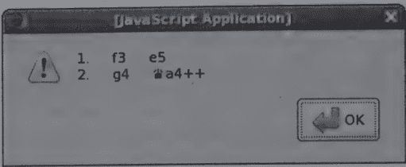

**图 2.1** 带有制表符和换行的字符串

制表符可以用于列对齐文本。这里有一个有趣的单行脚本，它会弹出一个带有制表符和换行的字符串；图 2.1 显示了输出。

```javascript
alert("1\tf3\e5\n2\tg4\u265ba4++");
```

JavaScript 提供了几十种字符串操作，例如查找字符串的长度（字符数）、转换为大写和小写以及替换字符串的一部分。

| 表达式 | 结果 |
|---|---|
| `"Hello, there".length` | ⇒ 12 |
| `"Hello, there".toLowerCase()` | ⇒ `"hello, there"` |
| `"Hello, there".toUpperCase()` | ⇒ `"HELLO, THERE"` |
| `"Hello, there".replace("ello", "i")` | ⇒ `"Hi, there"` |

有时你想知道某个字符在字符串的什么位置，或者查找给定位置的字符是什么。在 JavaScript 中，字符串中的第一个字符索引为 0，第二个索引为 1，第三个索引为 2，以此类推。字符串中位置 `p` 处的字符通过表达式 `s.charAt(p)` 找到。字符串内的文本可以使用 `indexOf` 和 `lastIndexOf` 定位。表达式 `s.substring(x, y)` 产生一个从字符串索引 `x` 开始到不包含索引 `y` 字符的字符串。

| 表达式 | 结果 |
|---|---|
| `"Some text".charAt(7)` | ⇒ `"x"` |
| `"Some text".indexOf("me")` | ⇒ 2 |
| `"Some text".lastIndexOf("e")` | ⇒ 6 |
| `"Some text".substring(3, 7)` | ⇒ `"e te"` |

### 2.1.4 类型转换

JavaScript 运算符期望特定类型的操作数；例如，`*` 乘以数字，`toUpperCase()` 将字符串转换为大写等。然而，当运算符应用于意外类型的数值时，JavaScript 会为你的值找到一个合适的处理方式。

当期望布尔值时，`false`、空字符串（`""` 或 `''`）、`undefined`、`null` 和 `NaN` 都被视为 `false`，其他所有值都被视为 `true`。当期望字符串时，非字符串按照你预期的那样处理——例如，`true` 被视为 `"true"`，`100` 被视为 `"100"`。当期望数字时，`undefined` 被视为 `NaN`，`null` 和 `false` 被视为 0，`true` 被视为 1。看起来像数字的字符串被视为数字；不是数字的在大多数算术运算中触发 `NaN` 转换，但加法除外，因为加号（`+`）执行的是字符串拼接！

```javascript
"dog" + 256     => "dog256"
"dog" * 256     => NaN
"100" + 256     => 100256
"100" * "256"   => 25600
```

## 2.2 变量

## 2.3 数组

其次，你不能使用 JavaScript 的任何保留字：

`abstract`、`boolean`、`break`、`byte`、`case`、`catch`、`char`、`class`、`const`、`continue`、`debugger`、`default`、`delete`、`do`、`double`、`else`、`enum`、`export`、`extends`、`final`、`finally`、`float`、`for`、`function`、`goto`、`if`、`implements`、`import`、`instanceof`、`int`、`interface`、`long`、`native`、`new`、`package`、`private`、`protected`、`public`、`return`、`short`、`static`、`super`、`synchronized`、`this`、`throw`、`throws`、`transient`、`try`、`typeof`、`var`、`volatile`、`with`。

JavaScript 保留这些词是为了可能的特殊含义；例如，我们已经看到了 `var` 是如何引入变量声明的。


数组由值的序列组成。你将数组中的第一个值标识为`a[0]`，第二个标识为`a[1]`，以此类推。数组用方括号编写（例如`[2, 3, 7]`）。你可以使用`push`向数组末尾添加项，使用`shift`向数组开头添加项。你可以使用`pop`从末尾移除项，使用`shift`从前部移除项。你还可以对数组进行排序。

```javascript
var a = [];                  // a 是长度为 0 的数组
var b = [3, 5];              // b 长度为 2
b.push(2);                   // 现在 b 是 [3, 5, 2]
b.shift();                   // 现在 b 是 [5, 2]
a.push(3, 10);               // 现在 a 是 [3, 10, 5, 2]
alert(a[0]);                 // 弹出 3 并 a 改为 [3, 5, 2]
alert(a.shift());            // 弹出 3 并 a 改为 [10]
b.push(b[0], 1);             // 现在 b 是 [7, 3, 5, 2, 10, 1]
b.sort();                    // 现在 b 是 [1, 10, 2, 3, 5, 7]
```

什么？10 是怎么跑到 1 和 2 之间的？答案是数组可以包含任何类型的值——只是在排序时，JavaScript 将所有值都视为字符串。字符串`"1"`小于`"10"`，而`"10"`小于`"2"`。那么如何进行数值排序呢？你必须等到下一章才能得到问题的答案。

给定一个数组`a`，表达式`a.length`产生`a`中的元素数量。给`a.length`赋值可以增大或缩小数组；新值将被设置为`undefined`。你也可以通过给超出数组末尾的索引位置赋值来扩展数组。

```javascript
var a = [9, 3, 2, 1, 8, 7, 3];     // a[7] 到 a[19] 现在是 undefined。
a[20] = 6;                          // 弹出 21。
alert(a.length);                    // 弹出 21。
a.length = 50;                      // a[21] 到 a[49] 均为 undefined。
a.length = 3;                       // 现在 a 是 [9, 3, 2]。
```

# 第 2 章 基础 JavaScript

## 2.4 语句

我们通过查看语句来完成基础 JavaScript 的概述。表达式计算值，而语句产生动作。事实上，脚本是语句的序列，每条语句在脚本运行时都会被执行。

在本节中，我们将涵盖最常见的 JavaScript 语句，并提供包含它们的脚本。你会注意到，我们在每个语句结束时都加了分号（；），除非它已经以右括号（}）结尾。虽然不是严格要求的，但这是一种非常推荐的做法。漏掉分号可能会导致很多问题（参见`[ECM99, Sec.7.9]`）。

### 2.4.1 声明语句

声明语句只是声明一个变量。

```javascript
var count = 0;
var dogs = ["Sparky", "Spot", "Spike"];
var response;
```

### 2.4.2 表达式语句

表达式语句评估表达式并忽略其值。因此，只有那些对后续计算产生影响的表达式语句（如赋值）是有用的。

```javascript
2 + 2;                // 合法语句，但完全没用。
x = 1 + (y = 4);      // 将 4 赋值给 y，然后将 5 赋值给 x。
count++;              // 自增非常常见。
alert("hi");          // 这个绝对有可见的影响。
```

### 2.4.3 条件执行

程序通常需要在某些条件下执行一件事，在另一种条件下执行另一件事。`if`语句根据各种条件从多个可选执行中执行一个。该语句的通用格式是一个部分、零或多个`else`部分以及可选的`else`部分。条件按从上到下的顺序评估。

```javascript
if (score >= 90) {
  grade = "A";
} else if (score >= 80) {
  grade = "B";
} else if (score >= 70) {
  grade = "C";
} else {
  grade = "F";
}
```

有时你可能更喜欢条件表达式而不是语句：

```javascript
grade = (score >= 90) ? "A" : "B";
```

另一种条件是`switch`语句，它将值与情况进行比较。例如：

```javascript
switch (direction) {
  case "north":
    // 执行其他事情
    break;
  case "south":
    // 执行其他事情
    break;
  case "east":
    // 执行其他事情
    break;
  case "west":
    // 执行其他事情
    break;
  default:
    // 执行其他事情
}
```

`break`语句将终止整个循环。当你数组中查找某些内容时，这种行为特别有用。

```javascript
// 查找数组中第一个偶数的索引位置。
for (var i = 0; i < array.length; i++) {
  if (array[i] % 2 == 0) {
    alert("在 " + i + " 找到偶数");
    break;
  }
}
```

`continue`语句立即开始循环的下次迭代，而不完成当前迭代。当循环中的部分迭代产生有用信息时，它非常有用。

```javascript
// 计算数组中所有正值的和。
var sum = 0;
for (var i = 0; i < array.length; i++) {
  if (array[i] < 0) { // 跳过非正数。
    continue;
  }
  sum += array[i]; // 累加正数。
}
alert("正数的和为 " + sum);
```

### 2.4.4 循环

JavaScript 还有我们在第 4 章将遇到的另一种`for`循环。

`while`循环重复代码直到条件变为假。例如：

```javascript
var i = 0;
while (i < 5) {
  console.log(i);
  i++;
}
```

当你使用计数器时，`for`循环是编写`while`循环的一种更简洁的方式。

```javascript
for (var i = 0; i < 5; i++) {
  console.log(i);
}
```

# 第 2 章 基础 JavaScript

- 表达式`x === y`计算`x`和`y`是否相等，而`x = y`则将`y`的值赋值给`x`。表达式`x == y`是另一种等值性测试，但通常应该避免使用，因为它的行为虽然在官方语言定义中是有完全说明的，但往往出乎意料。
- 数组是一个从 0 开始索引的值的集合。
- JavaScript 语句包括声明、表达式语句、条件语句、循环以及`break`和`continue`语句。

## 练习题

1. 设置`x = 10, y = 4, b = false`。求出以下表达式的值：

   **(a)** `x * y > 25 && !b ? y % -3 : 2`

   **(b)** `--y * 4 ===2 || (b --true)`

2. 了解数值运算符：`<<`、`>>`、`>>>`、`-`和`^`。用你自己的语言描述每一种。在控制台或草稿页面中尝试它们。

3. 查阅 JavaScript 参考手册（纸质或在线），列出语言中所有的`Math`操作。

4. 下面表达式代表什么？

```javascript
Math.random() < 0.75 ? "Heads" : "Tails"
```

5. 求出以下表达式的值：

   **(a)** `5 / 0`

   **(b)** `0 / 0`

   **(c)** `Infinity + Infinity`

   **(d)** `Infinity - Infinity`

   **(e)** `Infinity * Infinity`

   **(f)** `Infinity / Infinity`

6. 用你自己的语言解释：变量值为`undefined`与变量未定义时发生的错误之间的区别。

7. 写一个（单行）脚本，使用亚美尼亚语、阿拉伯语、希伯来语、印地语、中文或其他任何使用非字母脚本的显示问候消息。

8. 在网络上或 JavaScript 参考书中查找数组操作`slice`和`splice`的细节。在草稿页面上实验这些操作，直到你能够用自己的语言解释它们为止。

9. 表达式`x < y ? x : y`有什么用？

10. 在第 24 页的“老鼠非常智能”示例中，当数组项之一为空字符串时发生了什么？当数组项是数字时发生了什么？值为`undefined`时发生了什么？你可能需要修改并运行脚本来找出。

11. 查找关于字符串`split`操作的信息。求出以下表达式的值：

    - **(a)** `"one three".split(" ")`
    - **(b)** `"abracabra".split("a")`

12. 写一个脚本，提示用户输入包含空格分隔的数字字符串，然后提示最小值、最大值和和。例如，如果输入`2 9 3 4`，脚本应该提示`Minimum is -9, Maximum is 4, Sum is 1`。

13. 写一个脚本，反复提示用户输入一个单词或短语，直到输入空字符串为止。在输入过程中将所有输入收集到一个数组中。将所有字符串转换为大写，然后对数组进行排序。最后，弹出数组，每个条目单独占一行。

14. 写一个脚本，提示用户输入一个字符串，然后提示输入字符串是否为回文。回文是正读和反读都相同的字符串——例如`"I"`、`"racecar"`。尝试脚本的变体，使其对字母大小写不敏感（例如允许`"Abba"`）并忽略非字母（例如允许`"Madam, I'm Adam"`）。

15. 用你自己的语言解释以下每个脚本的行为：

```javascript
var i = 0;
while (i < 10) {
  continue;
  i++;
}
alert("All done");
```

```javascript
for (var i = 0; i < 10; i++) {
  continue;
}
alert("All done");
```

## 3.2 变量作用域

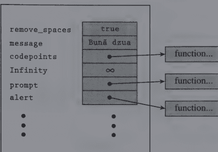

变量`message`以及一个属于`codecs`函数的局部变量。更新局部变量绝不会影响顶层变量，尽管它们具有相同的名称。

在第 5-11 行中，数组`message`随着变量`text`中每个字符的数据点而增长，不同之处在于，如果变量`remove_spaces`为`true`，则跳过空格字符。有趣的一点是，`remove_spaces`定义在函数外部；然而，函数体内部的代码可以引用它。这是许多编程语言中的常见场景：“外部”变量对脚本的“内部”区域可见的。这非常有用：`alert`和`prompt`等函数存在于顶层，我们不希望它们从函数体中隐藏掉。图 3.5 展示了我们在函数体结束时的情况。

从更技术角度来说，函数激活对象从内向外链接在一起，形成所谓的作用域链。当在`datapoints`函数内部代码中使用某个名称时，JavaScript 首先查找：

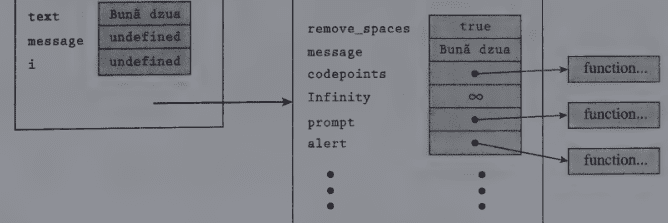

**图 3.4** 函数入口处

# 第 3 章 函数

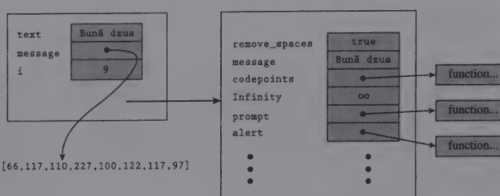

**图 3.5** 函数体结束时

函数激活对象中的该名称。如果未找到该名称，它将沿着作用域链移动并在下一个对象中查找该名称。包含所有顶层变量的对象是链的末端。因此：

- 在函数内部，名称`message`将始终引用该名称的内部变量，而绝不引用外部变量。
- 因为链只向“外”运行，所以函数外部的代码看不到函数内部的任何变量。

尽管第二点直接源于定义链的语言规则，但它仍然值得举个例子：

```javascript
var say_hello = function() {
  var message = "Hello";
  alert(message + "!!!");
}
```

```javascript
message = "Goodbye"; // 这不是内部变量。
say_hello();         // 弹出 "Hello!!!"
```

局部变量不受外部干扰的这一事实，意味着函数是封装和共享代码的极佳方式。此外，函数每次被调用时都会获得其局部变量和参数的副本，因此你永远不需要担心定义在一个函数中的名为`x`的变量会与另一个函数中名为`x`的变量冲突。它们是两个独立的变量。

- 2. 每次调用都获得其副本的这一事实支持了一种极其强大的编程技术，称为递归，其底层理论在任何计算机科学教科书中都有解释。

## 3.3 函数语句

JavaScript 的函数*语句*（statement）提供了一种声明变量并对其赋值一个函数值的替代方法。以下语句声明并初始化了一个名为`cubed`的变量：

```javascript
function cubed(x) {
  return x * x * x;
}
```

我们更倾向于使用较长的形式，因为它清楚地表明函数是值。

## 3.4 作为函数参数的函数

所有程序员在某个时刻都会意识到，反复编写相同的代码是一件坏事。如果你必须（例如）加密大批信用卡号，你肯定不会为每个信用卡号复制那 50 多行的加密代码。相反，你会写一个加密函数，将信用卡号作为参数传入。³现在你的代码遵循了 DRY（不要重复自己）原则——这是一件好事。

有时，这两个函数都通过以特定方式处理输入数组的每个元素来返回新生成的数组：

```javascript
var square_all = function(a) {
  var result = [];
  for (var i = 0; i < a.length; i++) {
    result[i] = a[i] * a[i];
  }
  return result;
};

var capitalize_all = function(a) {
  var result = [];
  for (var i = 0; i < a.length; i++) {
    result[i] = a[i].toUpperCase();
  }
  return result;
}
```

这两个函数仅在一种微小方式上不同。第一个函数对元素求平方；后者将其转换为大写。我们可以编写一次通用结构，并通过这个微小差异将其参数化？JavaScript 让这变得非常简单：

```javascript
var do_all = function(a, f) {
  var result = [];
  for (var i = 0; i < a.length; i++) {
    result[i] = f(a[i]);
  }
  return result;
};
```

你对每个数组元素执行的实际操作（例如，平方、转大写）现在作为参数传递：

```javascript
var square_all = function(a) {
  return do_all(a, function(x) { return x * x; });
};
var capitalize_all = function(a) {
  return do_all(a, function(x) { return x.toUpperCase(); });
};
```

如果将整个函数值放在`return`语句中间看起来很晦懂，你可以单独定义这些参数：

```javascript
var square = function(x) { return x * x; };
var capitalize = function(x) { return x.toUpperCase(); };
var square_all = function(a) { return do_all(a, square); };
var capitalize_all = function(a) { return do_all(a, capitalize); };
```

记得上一章中`sort`是如何工作的吗？如果需要，当第一个参数小于第二个参数时你可以返回负值；如果它们相等，则返回零；如果第一个更大，则返回正值。

- 3. 当这个概念变成你的本能时，你已经超越了编程白带水平。

## 3.5 从函数返回的函数

函数不仅可以传递给其他函数，还可以被返回。假设你需要一个加 10 的函数，另一个加 17 的函数。我们可以在一个地方捕获它们：

```javascript
var incrementer = function(n) {
  return function(x) { return x + n; }
}
var add_ten = incrementer(10);
var add_venteen = incrementer(17);
alert(add_ten(5));     // 弹出 15
alert(add_venteen(5)); // 弹出 22
```

## 第 3 章总结

- 函数不仅可以传递给其他函数，也可以被返回。
- 函数值是一个可以根据需要运行（或“调用”）的参数化代码块。
- 调用函数时，我们对其传递参数。
- 函数可以通过`return`语句向调用者返回结果。

## 练习

1. 写一个返回两个参数平均值的函数。例如，`average(-2, 10)`应该返回 4。


- 2. 写一个返回数组所有元素平均值的函数。例如，`average([4, 5, 7, 2])` 应该返回 4.5。
- 3. 写一个返回字符串中指定字符出现次数的函数。例如，给定字符串 `"Rat-a-tat"` 和字符 `t`，函数应该返回 5。
- 4. 详细解释此脚本会弹出什么：

```javascript
var x = 5;
var f = function() { alert(x); var x = 10; alert(x); };
f();
alert(x);
```

- 5. 详细解释运行此脚本会发生什么：

```javascript
alert("Hello");
var alert = 2;
alert("World");
```

- 6. 写一个名为 `twice` 的函数，接收一个函数 `f` 和一个值 `x`，并返回 `f(f(x))`。
- 7. 定义一个名为 `EighthPower` 的函数，接收一个值 `x` 并返回 `x²`。使用本章中定义的 `square` 函数和你在练习 6 中定义的 `twice` 函数。
- 8. 假设你尝试使用错误的表达式 `do.all(a, square())` 实现 3.4 中写的 `square.all` 函数。解释为什么这是错误的。
- 9. 假设你的老板、老师或朋友要求你写一个判断给定函数是结束还是无限运行的函数。换句话说，你被要求填充这个函数的体：

```javascript
// 如果调用 f() 完成返回 true；如果无限运行则返回 false。
var finishes = function() {
  // 在此处填充...
}
```

在尝试实现它之前，考虑以下函数：

```javascript
var paradox = function() {
  if (finishes(paradox)) {
    while (true) {
    }
  }
}
```

假设函数 `finishes` 执行结束：第 2 行的表达式 `finishes(paradox)` 将返回 `true`，但随后它将在第 3 行无限运行。现在假设它没有结束：第 2 行对 `finishes` 的调用将返回 `false`，此时它将到达函数体的末尾并……结束。为什么这意味着函数 `finishes` 在逻辑上、数学上、科学上都是无法编写的？

# 第 4 章 对象

JavaScript 值有两种类型：简单值（数字、布尔值、字符串、`null` 和 `undefined`）和对象。本章将介绍如何定义和使用对象。

## 4.1 对象表示法

在 JavaScript 中，对象拥有属性，属性拥有值。属性值也可以是对象，从而允许复杂的结构。对象字面量是一个定义新对象的表达式；以下是几个示例。

```javascript
var dress =
  { size: 4, color: "green", brand: "DKNY", price: 834.95 };
var location = {
  latitude: 31.131013,
  longitude: 29.976977
};
var song = {
  title: "This Town",
  track_number: 6,
  album: "Beauty and the Beat",
  artist: "The Go-Go's",
  authors: ["Charlotte Caffey", "Jane Wiedlin"],
  duration: 200
};
```

```javascript
var p = {
  name: { first: "Ciarán", last: "O'Brien" },
  country: "Ireland",
  birth: { year: 1952, month: 2, day: 17 },
  kids: ["Ciara", "Seán", "Bearach", "Máiréad", "Aisling"]
};
```

定义对象后，你可以使用点号（`.`）或方括号访问其属性。

```javascript
p.country => "Ireland"
p["country"] => "Ireland"
p.birth.year => 1952
p.birth["year"] => 1952
p["birth"].year => 1952
p["birth"]["year"] => 1952
p.kids[1] => "Seán"
p["kids"][1] => "Seán"
```

属性名可以是字符串（带或不带引号）或非负整数（0、1、2、……）。我们之前见过的数组是具有整数属性以及一个名为 `length` 的属性的对象。函数也是对象。

属性的点号表示法更简洁，但不能用于整数属性（即你不能写 `.1.`），而且如果属性是 JavaScript 的保留字，也无法使用点号（我们在第 21 页看到过这些）。在这些情况下，必须使用方括号表示法（例如 `a[10]`、`a["var"]`）。

定义对象时没有必要完整指定所有属性。你可以以后根据需要添加（或删除）属性：

```javascript
var dog = {}; // 一个没有属性的对象。
dog.name = "Kärl"; // 现在对象有一个属性。
alert(dog);
dog.breed = "Rottweiler"; // 现在对象有两个属性。
delete dog.name; // 现在又变成了一个属性。
```

对象的属性可以是（且通常也是）函数值。在这样的函数中，`this` 表达式指向包含该函数的对象。

```javascript
var vector = {
  i: 4,
  j: -3,
  magnitude: function() {return Math.sqrt(this.i*this.i+this.j*this.j)};
};
alert(vector.magnitude()); // 弹出 5
vector.i = 0;
alert(vector.magnitude()); // 弹出 3
```

## 4.2 对象值

关于对象的两个事实对于理解如何正确高效地使用对象至关重要，应该牢记：

- 每一次对对象字面量的求值都会创建一个全新的对象。
- 对象字面量表达式的值并不是对象本身，而是指向它的引用或指针。

我们需要用图示来讲述这个故事。图 4.1 显示了执行一个声明三个变量并创建两个对象的脚本的结果。注意这两个对象事实是如何反映在后续内容中的：

- 因为评估了两个独立的对象字面量，所以创建了两个不同的对象，尽管每个对象包含相同属性的相同属性。
- 虽然代码似乎暗示对象本身存储在变量中，但变量只包含引用。

使用引用意味着一个对象可以同时被多个变量引用。任何一个变量都可以用于更新对象的属性，并用于查看这些更新。见图 4.2。

你可以通过为变量分配不同的值来将对象与变量解除关联。特殊值 `null` 在这方面特别有用。它通常用于表示“指向空无”的概念，如图 4.3 所示。

你创建的每个对象都会占用存储空间。当一个对象不再被任何变量引用时，它被称为垃圾。JavaScript 垃圾最终会被清理，释放它所占用的存储空间供你创建新对象。产生垃圾是好事；持有再也不会使用的对象是坏事，因为那些空间永远不会被释放。一个因为未使用的对象未被回收而丢失内存的程序被称为内存泄漏。

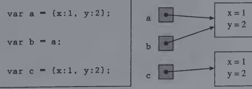

图 4.1 三个变量和两个对象

```javascript
var a = {x:1, y:2};
var b = a;
var c = {x:1, y:2};
b.y = 3;
alert(a.y); // 3
```

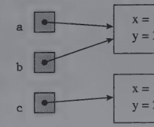

图 4.2 更新共享对象的属性

```javascript
var a = {x:1, y:2};
var b = a;
var c = {x:1, y:2};
b.y = 3;
c = null;
```

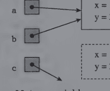

图 4.3 给变量赋值 `null`

## 4.3 原型

考虑一个处理地球点的脚本。为了避免为地球表上的成千上万个点重复编写“latitude”和“longitude”，我们可以尝试这样的脚本：

```javascript
// 这个函数在每次调用时都会新点。
make_point = function(lat, lon) {
  return {
    latitude: lat,
    longitude: lon,
    is_valid: function() {
      return Math.abs(this.latitude) <= 90 &&
             Math.abs(this.longitude) <= 180;
    },
    antipodes: function() {
      return make_point(-this.latitude, -this.longitude);
    },
    arctic_circle: function() {
      return this.latitude > 66.5608;
    }
  };
};

var mauna_ke = make_point(19, -155);
alert(mauna_ke.arctic_circle()); // false
alert(mauna_ke.is_valid()); // true
alert(mauna_ke.antipodes()); // -19

var north_pole = make_point(90, 0);
alert(north_pole.arctic_circle()); // true
alert(north_pole.is_valid()); // true
alert(north_pole.antipodes()); // -90
```

当然，这种代码非常浪费。我们创建的每个点都需要空间来存储所有函数，见图 4.4。

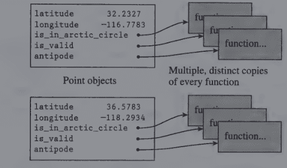

图 4.4 浪费的拷贝

幸运的是，JavaScript 的设计者意识到共享属性的必要性。由于这个原因，他们给每个对象提供了一个指向另一个对象的隐藏属性，称为原型。当你尝试读取对象的属性时，JavaScript 会在对象中查找。如果那里没有，就会搜索原型。图 4.5 显示了一个持有我们点的共享属性的原型。

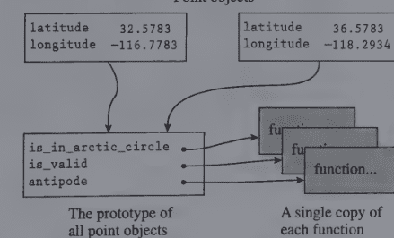

图 4.5 对象共享原型

JavaScript 在创建对象时附加原型。让我们看看它是如何实现的。

正如前面提到的，JavaScript 函数是对象。每个函数都有（至少）两个属性：`length`（声明中的参数数量）和 `prototype`（如果函数通过 `new` 调用，将附加到所有创建的对象）。当以这种方式调用函数（例如 `new Point(...)`）时，JavaScript 会执行一些魔法：

- 它创建一个全新的对象。
- 它将这个新对象的原型设置为该 `prototype` 属性的值。
- 它执行函数，并将 `this` 的设置为新对象。
- 除非你显式返回其他内容，否则它从函数返回新对象。

打算配合 `new` 使用的函数是构造函数创建新类型（例如点）的惯例是编写构造函数来填充每个实例特有的属性，而将共享属性放入原型中。对于点，我们可以定义并使用以下构造函数：

```javascript
var Point = function(lat, lon) {
  this.latitude = lat;
  this.longitude = lon;
};

Point.prototype.is_in_arctic_circle = function() {
  return this.latitude > 66.5608;
};

Point.prototype.antipode = function() {
  return make_point(-this.latitude, -this.longitude);
};

Point.prototype.is_valid = function() {
  return Math.abs(this.latitude) <= 90 &&
         Math.abs(this.longitude) <= 180;
};
```

## 4.4 构造函数

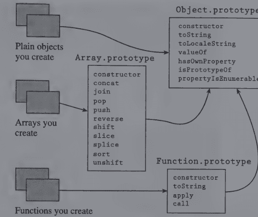

图 4.6 对象、函数和数组原型

让我们来看看新类型的实际用法：

```javascript
var p = new Point(40.185486, 44.515069);
alert(p.is_in_arctic_circle()); // 弹出 false。
```

使用大括号 `{...}` 创建的对象在内部会调用 `new Object()`，因此这些对象的原型是 `Object.prototype`。使用方括号 `[...]` 创建数组会调用 `new Array()`，因此数组的原型是 `Array.prototype`。同样，所有的函数对象都接收了 `Function.prototype`。这些“内置”原型分别用于存储所有对象、数组和函数共有的属性。此外，作为原型对象本身，它们也有 `prototype` 属性。除了 `Object.prototype` 之外，所有的都是如此——也就是说——它被设计为终极原型。图 4.6。

由于 `Object.prototype` 位于每个原型链的末端，它的函数对每个对象都是可用的。¹ `hasOwnProperty` 和 `toString` 属性是最广泛使用的。前者返回一个布尔值，表示对象本身（而不是原型！）中是否具有给定名称的属性；后者返回对象的字符串表示。

> 1. 除非某些聪明的（或恶意的）程序员操纵了原型链。

```javascript
var p = new Point(40.185486, 44.515069);
alert(p.hasOwnProperty("latitude")); // 弹出 true。
alert(p.hasOwnProperty("antipode")); // 弹出 false。
alert(p.toString()); // 弹出 [object Object].
```

哎呀！最后一个弹出看起来很丑。我们可以通过给 `Point.prototype` 赋予它自己的 `toString` 属性来修复这个问题。这将允许点显示得更美观，而不影响其他对象的显示方式（本章末尾的练习 9）：

```javascript
Point.prototype.toString = function() {
  return ("N" + Math.abs(this.latitude) + +
    (this.latitude > 0 ? "S" : ",") + +
    Math.abs(this.longitude) + +
    (this.longitude > 0 ? "E" : "W"));
}
var p = new Point(40.185486, 40.515069);
alert(p.toString()); // 弹出 (40.185486N,44.515069E)
```

`toString` 属性实际上非常特殊。这个函数可以调用：

```javascript
alert(p);
```

在这里 `p` 是一个点，而 `alert` 期望一个字符串。在 JavaScript 中，当期望字符串但提供了对象时，会调用对象的 `toString` 属性函数。

`hasOwnProperty` 函数通常与 `for` 语句的变体（有时称为 `for...in` 语句）结合使用，该语句遍历对象的所有属性，通常包括对象原型中的属性。

```javascript
var point = new Point(0, 0);
// latitude, longitude, antipode, is_in_arctic_circle, 等.
for (var p in point) {
  alert(p);
}
```

许多脚本将希望排除原型中的属性，以下惯用法是最常见的选择：

```javascript
var point = new Point(0, 0);
// 只有 latitude 和 longitude。
for (var p in point) {
  if (point.hasOwnProperty(p)) {
    alert(p);
  }
}
```

## 4.5 原生、内置和宿主对象

JavaScript 程序设计为运行在某些主机环境中，例如手机、网络浏览器、Adobe Acrobat 或 Adobe Photoshop。你在 JavaScript 程序中创建的对象以及少数几个内置对象被称为原生对象。由主机环境提供的对象被称为宿主对象。例如，网络浏览器提供了诸如窗口、文档、按钮、cookie、帧、浏览历史、菜单、文本字段等宿主对象。你将在下一章看到其中一些。

在少数的内置 JavaScript 对象中，有 `Object`、`Function`、`Number`、`Boolean`、`String`、`Date`、`Array`、`RegExp` 和 `Error`。这些对象中最有之一是构造函数 `Date`。表达式 `new Date()` 创建当前时间的日期对象。如有必要，你可以通过调用 `setMonth` 和 `setYear` 等函数来修改日期的属性（例如月份或年份）。

```javascript
var d = new Date();
d.setFullYear('2285');
d.setMonth(8);
d.setDate(20);
d.setHours(18);
d.setMinutes(29);
d.alert(d);
```

对于这段代码，我们得到了以下弹出（你的输出可能不同）：

```text
Sun 20 2285 18:29:54 GMT-0700 (PDT)
```

注意月份值。JavaScript 使用 0 到 11——当心！

## 4.6 正则表达式


正则表达式（或简称 regex）是表示字符串集合的模式。JavaScript 正则表达式通常用斜杠（`/ ... /`）分隔。我们谈论正则匹配字符串。例如：

- `/dog|rat|cat/` 匹配任何包含 "dog" 或 "rat" 或 "cat" 的字符串，`|` 字符表示“或”。
- `/colou?/` 匹配包含 "color" 或 "colour" 的字符串，`?` 表示可选。

## 章节总结

- 对象由属性组成，属性包含值。属性值可以是（且通常是）其他对象。
- 对象的值实际上是引用，因此同一个精确对象可以同时被多个变量引用。
- 每一个对象都包含一个指向另一个对象的隐藏引用，称为其原型（prototype）。当对某个对象发出属性请求而该对象没有该属性时，请求将发送到原型。
- 构造函数创建一个新对象并为其分配原型。
- JavaScript 环境由原生对象（native objects）和宿对象（host objects）组成。内置对象是原生对象的子集。

## 练习题

1. `let p = { x: 1, y: [ 4, {z: 2 } ] }`。`p.y[1]` 是什么？
2. `{ x: 1, y: 2 }.y` 的值是什么？你会写出这样的代码吗？
3. `p["dog"]` 和 `p['dog']` 之间有什么区别？
4. 写一个函数，接收一个歌曲对象（如第 4.1 节中的示例），并返回其以分钟为单位的时长。对象中存储时长是秒。
5. 写一个函数，接收一个歌曲对象数组，并返回所有歌曲的累计时长（秒）。
6. 下述 `for` 语句创建了多少个对象？

```javascript
for (var i = 0; i < 100; i++) {
  alert(x: 1, y: 2);
}
```

7. 给定第 4.3 节中的点构造函数，编写代码创建一个点对象，然后给它的 `toString` 属性分配一个整数值。当你用这个对象调用 `alert` 时会发生什么？（你需要尝试这段代码；答案不在文中。）
8. 写一个合适的构造函数，用于构造如第 4.1 节示例中那样的歌曲对象。
9. 解释为什么在 `Point.prototype` 上添加 `toString` 不会影响点对象之外的对象转换为字符串的方式。
10. 假设你的朋友对必须在每个数学函数前输入 `Math` 单词感到烦恼，并决定像这样声明几个顶层变量：`var sin = Math.sin; var cos = Math.cos; var log = Math.log;` 等等。你会对你的朋友说什么？
11. 列出你最喜欢的浏览器和操作系统的 JavaScript 环境中全局对象的属性列表。
12. 用你的话解释为什么 `window.window.window.window.alert("Hi")` 是可以的。

# 交互

到目前为止，你的脚本在请求输入时仅通过 `prompt` 与用户通信，在显示输出时仅通过 `alert` 通信。与任何语言一样，用户与 JavaScript 的交互可以通过其他方式实现；其中最流行的方式无疑是 Web。现在你已经更熟悉这门语言，我们可以更有效地讨论网页交互了。

由于 JavaScript 和 Web 在大多数人的脑海中是紧密耦合的，你可能认为这样的章节会在 Web 部分更早出现。我们特意推迟现在才讨论 Web 技术，是因为我们认为要充分发挥 JavaScript 与 Web 的潜力，首先要理解 JavaScript 作为一种编程语言。因此，本章还有第二个目的：它旨在将之前章节的内容整合在一起，就像形成有意义图片的拼图碎片。

## 5.1 重新回顾电话号码

单独看第 1 章引入的电话号码脚本尚未准备好投入：调用它们的唯一方法是复制/粘贴或将代码输入到空白页面中，然后让该页面运行脚本。对你的潜在用户群提出这种要求是不公平的；我们期望脚本是具有方便用户界面网页的一部分，图 5.1 显示了其简单版本。左侧的截图显示了首次加载时的页面。右侧的视图显示了在文本框中输入一些内容并在虚拟键盘上进行一些“拨号”后的页面。

# 第5章 交互

(a) 初始加载

(b) 用户交互后

图 5.1 一个简单的基于 Web 的电话号码转换界面

访问 http://javascript.cs.lmu.edu/phone-form 亲自与页面交互。该应用程序由两个文件组成：`phone-form.html` 和 `phoneConversion.js`。当你查看页面源代码时，看到的是 `phone-form.html`。要查看 `phoneConversion.js` 文件，请使用 http://javascript.cs.lmu.edu/phoneConversion.js。

花点时间阅读 `phoneConversion.js` 中的代码。注意它的整体结构；它本质上是一个函数定义列表。作为良好编程实践的一部分，其中有大量的注释。函数代码本身包含了之前章节的结构：变量、不同类型的语句和运算符、对象、数组，甚至还有正则表达式等高级功能。

本章的其余部分描述了这些动态网页背后的技术，充分利用了到目前为止讨论的语言。我们最后介绍了 Ajax。

## 5.2 动态 HTML

网页使用超文本标记语言 (HTML) 编写。它们通过互联网传递到 Web 浏览器，由这些浏览器渲染成我们熟悉的视觉表示。没有 JavaScript，这些页面是静态的——也就是说，加载后内容不会改变。改变显示的唯一方法是点击链接，这实际上重新启动了加载渲染循环。有了 JavaScript，网页根据用户的交互变得动态。（虽然此时绝对不需要 HTML 知识，但它会有帮助。你可能需要随手准备纸质或屏幕上的 HTML 教程或参考资料。）快速搜索就能获得大量此类资源。

JavaScript 实现动态 HTML 的关键在于能够访问并操作网页内容，这与操作任何其他对象是相同的。Web 浏览器、其窗口（window）以及其 HTML 文档以定义的内置对象的形式暴露给 JavaScript。脚本可以像之前章节描述的任何其他对象一样访问这些对象中的信息。对这些对象的更改会产生即时的、有时是可见的效果。为了演示这种效果，请在空白页面中输入并运行以下代码：

```javascript
document.getElementById("introduction").style.background = "red";
```

尽管还没有对这段代码进行解释，你还能看到发生的情况与运行的内容之间的联系吗？从语言角度来看，你可以告诉我们：名为 `document` 的对象上定义的 `getElementById` 函数返回另一个对象，该对象有一个 `style` 属性，而该属性又有一个 `background` 属性。然后将值 `"red"` 分配给该背景属性。当然，问题在于，这个函数是什么？这些属性是什么？它们与网页有什么关系？

在上面的一行代码中使用的所有对象、函数和属性，统称为文档对象模型 (DOM)¹

### 5.2.1 文档“仅仅”是一个内置对象

从语言的角度来看，DOM 是一个内置对象函数集合，与 `Math`、`Date`、`prompt` 和 `alert` 等无异。DOM 的有趣之处在于它与 Web 浏览器、其窗口及其内容等可见元素的直接联系。因此，正如本节标题所示，“仅仅”另一个内置对象，它可能是这组对象中最复杂的一个。此外，由于 DOM 充当网页用户与 JavaScript 功能之间的桥梁，它包含了“事件”的概念，事件代表了在你的 JavaScript 代码显式活动之外“发生”的事情。事件包括当前用户在网页上采取的动作，甚至是 Web 浏览器执行的后台活动，例如你可能安排了提前或定期执行的任务，或者通过网络传入的数据。

位于 http://javascript.cs.lmu.edu/scratch 的基础草稿页本身就是一个网页，因此它可以作为一个 JavaScript 对象被可见。在草稿页中输入以下内容并运行它：

```javascript
alert(document);
```

你看到了什么？你当然看到了一个 alert 对话框，但它包含什么？它显然不是 `null` 或 `undefined`。这至少说明 `document` 是一个实实在在、预定义的对象。alert 消息准确地告诉了这一点。

由于 `document` 是一个内置对象，它必须拥有属性。要查看其中一些属性，请输入并运行此脚本：

```javascript
var i = 0;
for (var property in document) {
  alert(property);
  i = i + 1;
  if (i > 4) {
    break;
  }
}
```

你看到连续五个 alert 对话框，每个都有一个像 `bgColor`、`width` 或 `getElementById` 这样的名称。我们无法在这里给你确定的列表，因为不同的浏览器可能会以不同的顺序列出 `document` 的属性（它们可能包含其他浏览器没有的属性）。但请注意，从代码角度来看，这正是遍历任何旧 JavaScript 对象属性的方法。

上述脚本中的 `i` 计数器限制了显示的属性数量；如果没有它，你必须多次按下 Enter 或 Return 键。不过，有一种更舒适的方法查看 `document` 的所有属性。尝试这个脚本：

```javascript
var footer = document.getElementById("footer");
footer.innerHTML = "<b>document properties:</b><br/>";
for (var property in document) {
  footer.innerHTML += property + "<br/>";
}
```

## 5.2 动态 HTML

图 5.2 JavaScript 草稿页，其脚本已将 document 的属性追加到内容中

现在发生了什么？你应该能看到与图 5.2 类似的内容。你的脚本更改了草稿页的实际内容。这就是动态 HTML 的精髓——对文档的更改会立即体现为浏览器窗口的变化。这种能力代表了传统 `alert` 函数的潜在替代方案。

“DOM 对象”并不仅限于 `document` 或其直接属性。在它下方是一个整个对象树，其中 `document` 位于顶部。如果你熟悉 HTML，情况会更棒了：这棵树的结构与网页的 HTML 结构并行。图 5.3 为我们现在熟悉的 JavaScript 草稿页说明了这一点。树的单个元素（例如 `document`、`p`、`form`）被称为“节点”（nodes）{每个 DOM 节点都包含额外的节点（例如 `head` 包含 `meta` 和 `title`），包含节点的节点是父节点，而被包含节点的父节点是子节点。子节点可能只有一个父节点；`document` 是唯一没有父节点的节点，它是树的根。

有没有替代 `prompt` 的方法？如果向网页中添加内容对应于显示输出，那么读取页面的可用户编辑部分（如文本区域、复选框、单选按钮、列表等）对应于接收输入就是合逻辑的。事实上事实确实如此。尝试这个脚本：

```javascript
var scriptArea = document.getElementById('scriptArea');
var footer = document.getElementById('footer');
footer.innerHTML = "<pre>" + scriptArea.value + "</pre>";
```

图 5.3 JavaScript 脚本页的 HTML 和 document 表示，为了简洁起见省略了段落文本；HTML 标签与 document 属性之间的并行关系（其属性的属性等）。

当你运行此脚本时，你会发现网页上被追加了看起来与草稿页文本区域内容完全相同的内容。那是因为它就是草稿页文本区域的内容——你只是要求 JavaScript 访问该文本并将其复制到页面底部（也称为页面的“页脚”）！

该脚本用另一种机制从用户处接收信息替换了 `prompt`；具体来说，它读取草稿页文本区域的内容。基础草稿页还有另一个机制：`Run按钮`。点击按钮的能力被算作用户输入。

在继续之前还有最后一件事：当我们说 DOM 将网页上的所有内容都暴露给 JavaScript 时，我们可以做*任何事情*。接下来的脚本演示了这种灵活性——即使是按钮在大多数其他环境中通常是神圣不可侵的（或者无法动态更改），在 DOM 中也是可以随意处理的：

```javascript
var runButton = document.getElementById("runButton");
runButton.value = "Please Execute This Script as Soon As Possible";
```

但为什么停于此呢？按钮永远越多越好：

```javascript
var form = document.getElementById("scratch");
var newButton = document.createElement("input");
newButton.type = "button";
newButton.value = "I'm New! But I Do Nothing...";
form.appendChild(newButton);
```

（不用说，你真的应该在这里输入并运行这些代码，以获得最大的收获——没有截图可以让你逃脱。）

### 5.2.2 为了乐趣和利润的元素与 ID

HTML 定义了许多我们在基础草稿页中演示之外的对象。为了向你介绍更多 DOM 元素而不需要要求你从头开始整个页面，我们移动到一个包含更多可操作对象的新草稿页。该页面可以在图 5.4 中看到，并可以在 http://javascript.info/eduplayground 在访问。

**图 5.4** 带有更多你可以操作的 DOM 元素的 JavaScript 草稿页

在我们深入研究这个新页面之前，让我们揭开目前为止使用的一些属性的神秘面。顶级 `document` 对象（图 5.3）具有以下函数：

- **getElementById(name)**: 此函数查找并以 JavaScript 对象的形式返回 HTML 中 `id` 属性设置为 `name` 的页面元素。
- **createElement(type)**: 此函数创建一个新的 HTML 元素，就像在 `type` 中指定的标签被写入原始 HTML 文件中一样。新元素尚未添加到页面中（`appendChild` 函数负责这一点），因此你可以认为元素在你自定义其属性时存在于一个“等待区域”。

动态 HTML 活动通常从调用 `document.getElementById` 开始，以便“到达”你想要操作的 DOM 节点。这种操作涉及读取或写入如下的属性：

- **innerHTML**: 此属性适用于对应于 HTML 块（如 `<p> ...</p>` 或 `<div> ... </div>`）的节点，它代表出现在该块的起始和结束标签内的确切 HTML 代码。为此属性分配新值将立即更改网页的相应部分。
- **value**: 此属性适用于大多数用户输入节点，它代表该元素当前的内容，例如文本字段中的文本、按钮的状态或列表中的当前选择。与 `innerHTML` 一样，给此属性赋值会立即修改网页中相应的元素。

`document` 内部的 DOM 节点也有它们自己的函数；这些我们目前只使用了 `appendChild(newElement)`。此函数将 `Element` 添加到被调用 DOM 节点的子节点列表中。它等同于在页面 HTML 源代码中、与被调用 DOM 节点对应的标签内插入一个新的 HTML 标签。

到为止，我们描述了三个你将使用大部分的函数和属性，DOM 中还有更多可用内容。关于完整列表，在网络上搜索“JavaScript DOM properties”或“JavaScript DOM reference”应该会产生包含此类信息的网站。热门网站包括托管在 http://www.w3schools.com/js/js_obj_htmldom.asp 的，参考 http://www.mozilla.org/docs/dom，以及最后由世界维网联盟（W3C）在 http://www.w3.org/DOM 定义的权威标准。这些网站中的大多数都具有基于 DOM 内部实际对象、函数和属性名称的搜索功能或大纲，例如刚才列出的那几个。

我们已经准备好开始操作新的沙盒页面了。要访问你想要的元素（标签）的关键是使用 `getElementById`。但正如俗所说，权力越大，责任越大：HTML 源代码必须确保你想要的元素首先已经给它们分配了 ID。这是 HTML-JavaScript 共生关系的一个关键方面：为了让 JavaScript 能够访问（并操作）网页，必须为脚本将关心的标签标记上标识符。

在网页中识别 ID 很容易。在浏览器中查看我们的新页面时，选择浏览器的“查看源代码”、“页面源代码”或类似的命令。这会打开一个新窗口，显示该网页的 HTML 代码。每一个带有 `id` 属性的标签（例如 `<p id="description">`）都是你可以使用 `getElementById` 访问的元素。

请花点时间获取页面中的 ID 标签，然后在脚本中输入以下内容：


```javascript
// 获取我们需要的元素。
var input1 = document.getElementById("input1");
var input2 = document.getElementById("input2");
var status = document.getElementById("status");

// 读取所需值。
var number1 = parseFloat(input1.value);
var number2 = parseFloat(input2.value);

// 写入结果。
status.innerHTML = number1 + " + " + number2 + " = " + (number1 + number2);
```

你刚刚写了一个简单的加法器！脚本从页面中获取`input1`和`input2`文本框，通过内置的`parseFloat`函数将这些字段内的文本（`value`属性）转换为数字，并将结果数字相加。虽然加法可能很微不足道，但这个脚本旨在向你展示：通过对 HTML 元素谨慎地分配 ID，借助`getElementById`的帮助，可以极其容易地访问和修改网页的内容——包括请求用户输入的内容（如输入字段）。

- 当然，这个加法器的正确性取决于 JavaScript 算术的通用正确性，正如第 2 章所讨论的。

当然，页面上的标签和信息并没有真正写着“加法器”，所以让我们用这个脚本相应地调整网页：

```javascript
document.getElementById("header").innerHTML =
  "简单的动态 HTML 加法器";
document.getElementById("introduction").innerHTML =
  "此页面用于两个数字相加.";
document.getElementById("instructions").innerHTML =
  "在下方的每个字段中输入数字，" +
  "将加法脚本粘贴到文本区域，" +
  "然后点击 <Add/> 按钮";
document.getElementById("inputLabel").innerHTML = " 加数 1";
document.getElementById("input2Label").innerHTML = " 加数 2";
document.getElementById("status").innerHTML = "";
document.getElementById("runButton").innerHTML = " 执行";
```

```javascript
// 让其他所有内容都隐藏。
var idsToHide = ["check", "checkLabel", "row2", "row3"];
for (var index = 0; index < idsToHide.length; index++) {
  document.getElementById(idsToHide[index]).style.display = "none";
}
// 最后的提醒：我们需要单独粘贴
// 脚本。
alert("别忘记粘贴/输入加法器脚本！");
```

一旦运行此脚本，请将其替换为纯加法脚本。注意，只要刷新页面，这些更改就会“持久有效”。你所操作的 JavaScript 对象会与页面保持在一起，直到被读取到浏览器窗口。网页承载了 JavaScript 的“生命周期”：对象、变量、函数以及其他一切在网页关闭、刷新或替换时会被丢弃，由下一个页面中出现的任何 DOM/脚本/变量取代。

以下单行代码集合展示了你并不局限于文本值或`innerHTML`；你可以自由运行你最感兴趣的部分。单行代码可能会影响多个元素。例如，选择一个单选按钮会自动取消另一个单选按钮。此外，其中一行代码没有立即的可见效果，但会影响后续某些行的行为——你能认出是那行吗？

```javascript
document.getElementById("input1").disabled = true;
document.getElementById("check").disabled = true;
document.getElementById("check").checked = true;
document.getElementById("radio2").checked = true;
// 单选按钮是互斥的。
document.getElementById("radio4").checked = true;
document.getElementById("password").value = "swordfish";
document.getElementById("password").readOnly = true;
```

```javascript
document.getElementById("category").selectedIndex = 2;
document.getElementById("category").style["vertical-align"] = "bottom";
document.getElementById("wonder").multiple = true;
document.getElementById("wonder").style.float = "right";
document.getElementById("wonder").options[1].selected = true;
document.getElementById("wonder").options[3].selected = true;
document.getElementById("status").style.border = "medium outset #000";
document.getElementById("status").style["text-align"] = "right";
```

你已经注意到，纯视觉属性——只影响 HTML 元素的外观（例如颜色、字体、边框、可见性、边距），而不影响其数据或行为（例如已选中/未选中、启用/禁用）——是通过中间属性`style`访问的。这些属性属于一个不同的标准级联样式表（CSS）。

### 5.2.3 事件

大多数时候，事件指的是用户执行的操作。例如，移动鼠标会触发“鼠标事件”，按键会触发“键盘事件”，以此类推。如果你仔细考虑，程序响应此类活动的唯一方式就是通过事件处理器。尽管也有非用户触发的事件；你将在第 5.3 节中读到一个特殊的事件。但目前，让我们专注于用户可能执行的操作。

`http://javascript.edu/playground`默认并不以自定义方式处理任何事件。让我们添加一个简易的事件处理器来开始：

```javascript
document.getElementById("header").onclick =
function() { alert(this.innerHTML); };
```

当你运行此脚本时，似乎什么都没有发生。然而，确实发生了：页面已被告知处理 ID 为`header`的页面元素的点击事件。这个元素恰好是网页的大标题——现在点击它看看会发生什么。

简单，但可能没什么用。这里有一个你更有可能在“实战”中看到的。再次，将其输入`http://javascript.cse.edu/playground`并运行脚本：

```javascript
/*
 * 启用或禁用下拉菜单。
 */
var setCategoryEnabled = function(enabled) {
  // 回想 JavaScript 中 "1" 意味着“不”
  document.getElementById("category").disabled = !enabled;
}

/*
 * 根据“勾选”框是否被选中
 * 启用或禁用下拉菜单。
 */
var handleCheckClick = function() {
  setCategoryEnabled(this.checked);
}

// 同步下拉菜单和复选框。
setCategoryEnabled(document.getElementById("check").checked);

// 设置事件处理器。
document.getElementById("check").onclick = handleCheckClick;
```

### 5.2 动态 HTML

运行此脚本后，点击复选框（对应其`checked`属性），将通过其`disabled`属性相应地启用或禁用类别下拉菜单。`handleCheckClick`是该框鼠标点击事件的事件处理器。这个特定的处理器说明了这些函数的另一个属性：

当由事件调用时，某些属性具有预定义值。这些值指向触发该事件的 DOM 元素，因此我们无需调用`getElementById`即可使用`this.checked`。此外，虽然在本示例中使用了，但`event`被设置为一个代表事件本身的对象。这些事件对象包含了刚发生的事件的补充信息。可用信息取决于事件类型。对于鼠标事件，你可能想知道事件的鼠标坐标；对于键事件，你可能想知道在此时是否按下了 Shift 键。你可以查阅动态 HTML/DOM/JavaScript 参考网站，获取可用事件列表以及它们在相应对象中提供的信息。

这里是另一个脚本，它展示了更多的事件，包括在事件处理器调用内部访问上述的事件对象：

```javascript
// 从给定字符串中删除所有非数字字符。
var restrictToDigits = function(string) {
  return string.replace(/[^\d]/g, "");
}

// 检查值是否全为数字。
var isAllDigits = function(string) {
  return string.match(/\d+$/);
}

// 拒绝非数字按键。
var handleInputKeyPress = function() {
  // 是的，这有点过度了，因为我们确定
  // 这是一个单字符字符串，但它仍然有效。
  if (!isAllDigits(String.fromCharCode(event.charCode))) {
    event.preventDefault();
  }
}

// 拒绝此值中的非数字内容，并选择下一个字段。
var handleBlur = function() {
  if (!isAllDigits(this.value)) {
    alert("抱歉，这里只允许 0-9。");
    this.value = restrictToDigits(this.value);
    this.select();
  }
}
```

## 第 5 章 交互

```javascript
document.getElementById("input1").onkeypress = handleKeyPress;
document.getElementById("input2").onblur = handleInputBlur;
```

运行此脚本后，在页面的 Input 1 和 Input 2 字段中输入值。如果顺利，Input 1 现在应该只接受数字 0 到 9，并拒绝其他字符。完成此任务的方法揭示了事件机制的一个新方面：事件传播。“正常”按钮点击、文本字段编辑和其他活动实际上也是由事件处理器完成的——它们自动“安装”在 DOM 节点上的默认处理器。此外，元素可以嵌套元素——父元素可能具有某个事件的事件处理器，但其子元素没有。这就是传播发挥作用的地方：当事件被触发时，它首先传递给自定义处理器（如果可用）。自定义处理器之后是该“最邻”元素的默认处理器；如果没有默认处理器（例如对于通常是惰性的元素，包括段落或标题），事件将传递元素的父元素，依此类推，直到某些对象处理它或到达 DOM 树的根节点。

事件传播还有额外的细节和注意事项（特别是关于浏览器之间的差异），但与其他领域一样，本书并不是讨论这些的地方。底线是，处理器（无论是通过脚本分配的还是默认安装的）都有机会响应事件。

对于输入字段，按键事件的默认处理器会将按下键的字符插入字段。在我们的数字恢复器中，我们并不总是希望这种情况发生；我们只希望在文本字段中输入数字。这就是`preventDefault`函数的作用。调用此函数告诉 JavaScript“停在这里”——换句话说，不要将事件传播到默认事件处理器。然后，当我们的自定义处理器捕获到提示时，`preventDefault()`将它们视为从未发生过（从 Input 1 的默认键事件处理器的角度来看）。

Input 2 也只接受数字 0 到 9，但只有在你离开字段或点击另一个控件后才会检查是否符合标准。如果 Input 2 中的值包含 0-9 以外的任何内容，当字段失去焦点时（即它停止成为按键的目标），将触发相应的警告消息。焦点的变化（即成为或变为按键的接收者）与鼠标点击或击键一样也是事件。当元素获得焦点时（例如通过“Tab”键切入或被点击），会触发焦点事件。当元素失去焦点时（例如通过“Tab”键切出或点击另一个元素），动态 HTML 通过调用`onblur`玩了一个小文字游戏（即，“focus”聚焦的反义词是“blur”模糊——懂了吗）？

## 5.2 动态 HTML

当然，（几乎）永远看不到由用户输入的代码分配的事件处理。相反，是我们那些“已经知道”如何处理事件的动态网页。实质上，此类页面是使用 JavaScript 构建的。为了了解如何实现，让我们来看一个例子。

```html
<div id="box" onmouseover="highlight()" onmouseout="unhighlight()">
  悬停在我上方！
</div>

<script>
function highlight() {
  document.getElementById("box").style.backgroundColor = "yellow";
}
function unhighlight() {
  document.getElementById("box").style.backgroundColor = "white";
}
</script>
```

在上面的示例中，`onmouseover`和`onmouseout`事件用于在用户鼠标移动到`div`上时更改`div`的背景颜色。这是使用事件创建交互式网页的简单示例。你可以使用许多其他可用事件。以下是一些常用事件：

| 事件 | 描述 |
| :--- | :--- |
| `onclick` | 元素被点击时 |
| `onclick` | 在元素上按下鼠标按钮时 |
| `onmouseover` | 鼠标移动到元素上方时 |
| `onmouseout` | 鼠标离开元素时 |
| `onfocus` | 元素获得焦点时 |
| `onblur` | 元素失去焦点时 |
| `onchange` | 元素的值改变时 |
| `onkeypress` | 键被按下时 |
| `onkeyup` | 键被释放时 |
| `onsubmit` | 表单提交时 |

## 5.2 动态 HTML

当提供单独的脚本文件时，脚本的主体部分将被忽略。不要费精力做这种事：

```html
<script type="text/javascript" src="messageUtilities.js">
  var displayHelp = function() {
    alert("Please visit our support website.");
  };
</script>
```

在这种情况下，`messageUtilities.js`中的代码会被下载并执行，而定义`displayHelp`函数的代码将永远不会被定义。只需将它们拆分为独立的`script`标签即可——你可以在 HTML 文件中包含任意数量、任意类型的`script`标签。浏览器将所有标签视为一个整体脚本，并按照标签出现的顺序执行代码。

这些 JavaScript 包含机制构成了一个整体的 JavaScript 环境，所有脚本都在该环境中运行。因此，动态 HTML 网站典型的 JavaScript 内容（无论是直接包含在 HTML 中还是从单独文件加载的）主要由函数和变量定义组成。当页面被浏览器加载并渲染时，这些函数和变量会累积变得可访问。当页面加载完成后，用户活动将触发事件，根据需要调用这些定义的函数或访问这些变量。

构建的 JavaScript 环境将一直有效，直到加载下一个页面（通过用户点击链接或刷新页面）。因此，在前面的示例中定义的`displayMessage`函数只要浏览器停留在定义它的页面上，它就会一直存在。如果浏览器加载了新页面，该函数就会消失。如果浏览器刷新了页面，那么`displayMessage`仍然可用，但实际上发生的情况是“旧”的`displayMessage`函数被丢弃了，而页面的脚本重新定义了它。

### 5.2.5 其他相关的内置对象

除了`document`（它是网页内容和结构的 JavaScript 对象表示）之外，还有其他与 Web 浏览器相关的 JavaScript 对象。我们在这里列出它们，并将完整细节留给本书以外的材料：

- `window`：正在显示网页的窗口。
- `navigator`：Web 浏览器应用程序本身。
- `screen`：用户的显示器。

# 第 5 章 交互

使用这些对象与使用`document`几乎相同——它们总是可用的，你可以通过访问它们的属性来读取或写入它们，并可以通过访问你定义的函数来让它们执行操作。区别在于，它们毕竟是不同的对象，因此它们拥有的特定属性和函数必须与`document`中的不同。一如既往，请查找这些对象的更多信息以查看所有精彩的细节。

### 5.2.6 定时或持续的活动


关于动态 HTML 的这一部分，我们介绍了两个与 Web 环境并非严格相关的函数，但它们对于为网页提供活跃的“实时”感仍然有用。这两个函数`setTimeout`和`setInterval`促进了延迟执行或持续执行的活动。换句话说，它们允许代码在脚本的精确位点运行，而不是在未来的某个点或预定义的间隔时间运行。

将此脚本输入 http://javascript.cs.lmu.edu/playground——但不要立即点击 Run：

```javascript
var timeoutStr = document.getElementById("input1").value;
var timeout = parseInt(timeoutStr) + 1000;
document.getElementById("status").innerHTML = "Wait for it...";
setTimeout(function() { document.getElementById("status").innerHTML = "Liftoff!"; }, timeout);
```

在运行程序之前，在 Input1 文本框输入一个数字（以秒为单位）。绿色状态应该变为`Wait for it ...`并持续你输入的秒数。消息将变为`Liftoff!`。

你刚刚使用`setTimeout`函数来延迟在特定毫秒数后调用 JavaScript 函数（这解释了本节示例中提前 1000 毫秒的原因）。`setTimeout`会立即返回，允许你的代码执行其他事情，而被延迟的函数在后台“等待”，直到指定的时间过去。在此期间，你的代码可能已经做了许多其他事情，包括额外的计算和事件处理。要看到此效果，请在`setTimeout`的行之后添加一个`alert`调用，然后再次运行脚本。注意看在点击 Run 后，alert框立即出现，而`Liftoff!`稍后出现（记得在 Input1 中输入几秒数，以免事情发生得太快）。

现在尝试这个程序：

```javascript
setInterval(function() { document.getElementById("status").innerHTML = 
new Date(); }, 1000);
```

## 5.3 Ajax 简介

这次你使用的是`setInterval`。与`setTimeout`类似，`setInterval`延迟在若干毫秒后调用函数。与`setTimeout`不同，`setInterval`在给定的时间间隔（间隔）之间重复调用函数。在上一个示例中，练习场的绿色状态区域每秒更新一次当前日期和时间。该函数被反复调用，直到地止。如果不编写额外的代码，你需要刷新页面、关闭浏览器窗口或访问新网站来结束重复调用。

通过额外的代码，你可以对`setTimeout`和`setInterval`实施更好的控制。当调用这些函数时，它们实际上会返回某些内容——该值作为由`timeout`或`interval`函数代表的特定“延迟调用”的标识符。该标识符可以分别用于`clearTimeout`和`clearInterval`，以停止或取消待处理的函数调用。要使用这些函数，你的代码如下：

```javascript
// 一个超时或间隔，保存返回的 ID。
var timeoutID = setTimeout(function, someDuration);
var intervalID = setInterval(anotherFunction, anotherDuration);

/* 此处运行任何其他代码... */

// 每当必须取消超时或间隔时，调用：
clearTimeout(timeoutID);
clearInterval(intervalID);
```

访问 http://javascript.cs.lmu.edu/deferred 查看这一系列函数的具体演示。你也可以使用网页查看 HTML 和 JavaScript 文件是如何打包的，正如第 5.2.5 节所讨论的那样。

此时，你应该已经拥有充分理解第 5.1 节介绍的电话转换页所需的信息。现在是回到 http://javascript.cs.lmu.edu/phone-form 的好时候，看看上述 JavaScript 交互是如何结合在一起并产生一个相当实用且（我们希望）相当易懂的浏览器应用程序的。

当你准备好后，我们可以通过介绍 Ajax 来圆满本书，Ajax 将 JavaScript、动态 HTML 与 Web 的其他部分结合，以实现这些技术的全部交互潜力。

## 5.3 Ajax 简介

恭喜——你快要完了。读这本书到这里，你现在应该已经知道了（其他内容）：

# 第 5 章 交互

- JavaScript 脚本/编程语言的整体外观（语法）和含义（语义）（第 1 到 4 章）

- Web 浏览器如何将网页的 HTML 内容“暴露”为从`document`开始的 JavaScript 对象树（第 5.2.1 节）

- 用户与网页的交互如何触发 JavaScript 代码更改网页的当前内容，或其他对用户的活动活动做出响应（第 5.2.3 节）

这些知识构成了开发如第 5.1 节所示的浏览器应用程序的基础。此类网页本质上是可下载的应用程序，可以在 Web 浏览器中运行，而不需要额外的插件或“原生”（操作系统的）代码。

通过这一切，Web 的最后一个方面仍然未被使用——那就是 Web 本身。没有任何网页是孤岛；任何网站的实用性和力量至少部分源于它对互联网上其他网站的访问/来自。到目前为止，我们看到的唯一连接机制是链接或锚点——一种显式的 HTML 标签，点击后会让浏览器丢弃当前网页并重新加载整个页面——再加上`script`标签的变体，它会导致浏览器从 Web 下载并运行 .js 文件。尽管如此，可以在不导致整个 HTML 下载-渲染序列重新开始的情况下与 Web 通信。这种能力结合 JavaScript 和动态 HTML，构成了 Ajax（异步 JavaScript 和 XML）的基础。

### 5.3.1 Ajax 实际演示

要看到 Ajax 的实际应用，通常查看任何声称使用“Web 2.0”技术的网站即可。滚动地图或列表、实时更新以及不改变地址或加载新页面的动态过滤器很可能在使用 Ajax 来实现这些效果。为了提供一个简短且易于消化的代码简单示例，我们编写了一个小型 Ajax 风格应用程序，你可以通过 http://javascript.cs.lmu.edu/ajax-sample 访问。

你可以使用 Web 浏览器的查看源代码功能查看该示例应用程序的 HTML（以及 DOM）。要查看驱动此示例的 JavaScript 代码，观察源代码，注意哪些部分看起来是熟悉的，哪些是不熟悉的。在这次 Ajax 介绍结束时，你应该对它的运作原理有一个整体的认识。

### 5.3.2 核心秘诀：XMLHttpRequest

Ajax 风格网页（呃，应用程序）的核心特征是，它可以在不从跳转到另一个网页的情况下发送并接收新信息。动态 HTML 处理用户活动并将其解释为要发送回服务器的新信息，这通常会触发该服务器的响应，响应包含新的或更新的信息，而这些信息现在必须显示给用户。此时，动态 HTML 再次接管，因为来自服务器的信息被回馈到 DOM 中，导致网页内容发生更新。

这种连接性有一个限制：出于安全考虑，应用程序只能从托管原始 Ajax 网页的同一台服务器检索信息。例如，你通过 http://javascript.cs.lmu.edu 访问的文本中的 Ajax 代码只能向 http://javascript.cs.lmu.edu 建立网络连接。这种限制被称为沙箱安全模型——它旨在保护向任何任意机器或互联网进行各种连接的网页……这种行为在很多情况下可能是恶意的，而且会将责任完全推到你的电脑上！

考虑到这一点，让我们进入实际代码。为动态 HTML 添加 Ajax 的新成分是什么？意乎所料，它只是“另一个”内置的 JavaScript 对象：`XMLHttpRequest`。如果 Web 浏览器的 JavaScript 环境包含`XMLHttpRequest`，那么它就具备 Ajax 能力。快速搜索即可给你这些浏览器的最新列表，尽管此时此，除非你正在运行非常旧的软件（按计算机年而不是人类年计算！），否则你可以确信你的浏览器和目标用户的浏览器都会带有`XMLHttpRequest`。

使用`XMLHttpRequest`很容易；难点在于弄清楚何时使用它（这个问题稍后讨论）。事实上，你可以在通常的地方——一个 JavaScript 草稿页面中创建并调用一个`XMLHttpRequest`。将此脚本输入我们在 http://javascript.cs.lmu.edu/playground 的“增强”版本中，或者直接前往 http://javascript.cs.lmu.edu/ajax 跳过输入过程：

```javascript
// 设置一些每个人都想看到的对象。
var xml;
var status = document.getElementById("status");
```

- 此函数处理请求状态的变化。

```javascript
var stateChanged = function() {
  var state = xmlHttp.readyState;
  switch (state) {
    case 0: status.innerHTML += "Not initialized."; break;
    case 1: status.innerHTML += "Setup..."; break;
    case 2: status.innerHTML += "...Sent..."; break;
    case 3: status.innerHTML += "...In Process"; break;
    case 4: status.innerHTML += "...Complete"; break;
    // 在这里处理数据。
}}
};

// 这是主脚本序列。
status.innerHTML = "";
if (XMLHttpRequest) {
  xmlHttp = new XMLHttpRequest();
  xmlHttp.onreadystatechange = stateChanged;
}

// 我们期望 Input 1 中有一个 URL。
xmlHttp.open("GET", document.getElementById("input1").value, true);
xmlHttp.send(null);
} else {
  status.innerHTML = "Sorry, no AJAX!";
}
```

要运行此脚本，在 Input 1 文本框中输入任何以 http:////javascript.cs.lmu.edu 开头的 URL（因为这是提供该页面的网站），点击 Run，并观察绿色状态区域。发生了什么？你应该看到文本逐渐累积成像这样的内容：

Setup...Sent...In Process...In Process...Complete

你刚刚发送了你的 Ajax 风格 HTTP 请求！让我们拆解脚本看看发生了什么。

脚本开始为我们稍需要的两个对象声明变量：`XMLHttpRequest`和网页上的状态区域。为`status`变量赋值只是简洁起见（我们不想反复编写`document.getElementById("status")`），但我们确实需要保留`XMLHttpRequest`。变量之后是函数`stateChanged`，紧接着是主序列。

在状态区域闪烁后，脚本从这一行开始：

```javascript
if (XMLHttpRequest) {
```

对于当前的浏览器版本，这一行是对 Ajax 准备就绪的简单且优雅的检查——我们只需测试内置`XMLHttpRequest`对象是否存在。如果`XMLHttpRequest`被定义，则`if`条件求值为真，我们继续进行 Ajax 活动；否则，它求值为假，网页应该应该以某种优雅的方式处理 Ajax 的缺失。在我们的示例中，网页通过绿色状态区域警告用户不可用 Ajax。

一旦我们知道可以“做” Ajax，脚本就会根据`XMLHttpRequest`的原型继续创建一个新对象。该块的其余部分分配了一个属性并调用了两个函数。我们将查看这些函数：

`open`：此函数定义了`XMLHttpRequest`对象要建立的连接。第一个参数是用于连接的方法（常见的有 `"GET"`、`"PUT"`和`"POST"`，但还有更多）；第二个参数是要访问的 URL；第三个参数说明连接是否是异步的（即在继续之前是否要等待它完成）。示例脚本使用`"GET"`方法，获取你在运行脚本之前在 Input 字段中输入的任何内容作为 URL，并设为`true`。当然，我们建立的是异步连接：Ajax 中的第一个 "A" 就在之后。

`send`：此函数实际上启动连接，并在适用情况下可以包含一些内容（它的空参数）。在示例脚本中，我们发送请求时不带额外信息。

在`XMLHttpRequest.send(null);`之后脚本“结束”了——没有其他代码要运行。看起来很奇怪吗？乍看如此，但不要忘记我们跳过了这一行：

```javascript
xml.readyState = stateChanged;
```

从宏观结构角度来看，这个赋值可能是脚本最重要的部分。`onreadystatechange`属性应该持有当`XMLHttpRequest`对象发生变化时要调用的 JavaScript 函数。你不会在脚本中调用此函数，但浏览器会。而且确实调用了。

- 如果你希望支持 Ajax 已就绪但使用不同请求机制的旧浏览器，这一行将变成一个近乎一页的函数。为了简洁，而且由于旧浏览器最终会被废弃，我们将这个更具包容性但长得多的版本留给你。某一天，这种检查可能不再是必要的，因为假设所有当前浏览器都具备 Ajax 能力可能变得过于草率。

听起来熟悉吗？*似曾相识？确实如此！*——`onreadychange`是一个事件。

虽然它与网页上的组件没有关联（像`onclick`、`onblur`和`keyup`等事件那样），但`onreadychange`的行为相同：通过设置此属性，你正在用某些代码“设置”`XMLHttpRequest`，在发生某些事情时调用，并保持在那里，直到在代码外部某处的环境检测到“某些事情”并调用分配的函数。因此，`XMLHttpRequest`是事件驱动的，就像动态 HTML 一样，`XMLHttpRequest`变化的通知可以在函数分配后触发事件处理器，就像那些不可预测的用户鼠标和按键事件一样。

此时，我们终于可以查看`stateChanged`函数了，我们现在知道它是每当`XMLHttpRequest`的“就绪状态”变化时的事件处理器。事实上，`readyState`是`XMLHttpRequest`的另一个属性，如`stateChanged`体内所示。在我们的示例脚本中，`stateChanged`显示`readyState`的当前值。你可能记得 2.4.3 中的`switch`语句。在这个例子中，`readyState`可以取从 0 到 4 的值，每个值恰恰对应于状态区域中的文本。

如此示例所示，我们从未见过“初始化”状态——因为如果`XMLHttpRequest`没有初始化，就不会有事件会触发`stateChanged`。一旦调用`open`，状态就会变为“setup”（尝试在不带`send()`行的情况下运行脚本）。当 URL 完全加载后，我们可能会在`readyState`为“process”时获得多次`stateChanged`调用。“process”是`XMLHttpRequest`从 URL 服务器接收数据期间的状态。传入的数据可能非常大量多，一个良好的`XMLHttpRequest`实现应该随时通知你，以防管道中有某些数据，而你的 Web 应用程序可能想对其做些什么。

这就涵盖了整个原始示例脚本。如果你理解了脚本，通常就理解了`XMLHttpRequest`。请求对象完成了它的工作，并稳定在`readyState === 4`（即“completed”、“loaded”、“finished”），`XMLHttpRequest`的参与在技术上就结束了。但从 Ajax 的角度来看，还有一件事要做，那就是……

### 5.3.3 处理响应

等等，文本突然结束了。重新读：

### 5.3.3 处理响应

你可以通过在第 5.3.2 节提供的介绍性 Ajax 脚本中添加一行`// Deal with the data.`注释来完善它。

## 5.3 Ajax 简介

在`stateChanged`中使用`break;`语句，使得`case 4`部分看起来如下：

```javascript
case 4: status.innerHTML += "...Complete"; // 处理数据。
document.getElementById("footer").innerHTML = xhr.responseText;
break;
```

在运行这个修改过的脚本之前，先花点时间思考一下当你向`Input 1`文本框中输入任何 URL 并点击`Run`时，会在沙盒页面上看到什么。现在实际运行它。发生的情况与你预想的一致吗？

无论如何，那个单次赋值访问了我们在书中介绍的最后一个`XMLHttpRequest`响应属性：`responseText`。简单来说，该属性在 HTTP 连接完成后，持有服务器对请求响应的精确内容。至于我们如何处理这些内容，现在完全取决于我们自己。


在示例草稿脚本中，内容极可能是 HTML 源代码，因为你被要求提供 URL 作为输入。这应该清楚地解释了你看到的内容——`responseText` 被直接赋值给页面页脚连接的内部属性（`innerHTML`）。当该属性以这种方式被赋值时，浏览器会尝试像渲染任何网页一样对其进行渲染。当然，这些内容看起来可能与你以“正常”方式访问 URL 时看到的完全不同，但切换应该是可以识别的。这种差异有很多可能的原因，但总来说，是因为你获取的内容旨在作为一个独立的网页查看，而不是嵌入在另一个页面的 HTML 中。

这里的重点不在于你成功地将一个网站的内容推送到页面上，而是你可以自由地对从服务器接收到的信息做任何你想做的。现在你已经了解 `XMLHttpRequest`，可以仔细查看第 5.3.1 节中完整 Ajax 示例的源码。具体来说，找到传递给请求 `open` 函数的 URL。如果你直接将该 URL 输入到网络浏览器中，你不应该看到网页，而是纯文本。然而，这些纯文本包含了原始信息，这些信息可以很容易在动态网页上美观地显示。

因此，这就是典型 Ajax 周期的最后一个阶段：服务器的内容已被接收，现在位于对象的 `responseText` 属性中。这些内容现在可以以某种方式呈现给用户。最后，`responseText` 会根据需要被修饰或处理，从而赋值给 DOM 中某处组件的某个属性。如果是这样，用户就能看到这些信息，他们随后的操作现在就可以基于这些信息了。

# 第 5 章 交互

### 5.3.4 整体 Ajax 结构

你可能已经注意到，一个有效的 Ajax 应用不能只是“随手凑合”的。相反，创建一个应用需要真正的规划、设计和纪律。回顾一下，一个完整的 Ajax 应用由以下主要部分组成：

- 涉及应用的数据模型（Model）。最初显示哪些信息？用户在与网页交互时会提供哪些新信息？根据用户的输入，必须从网络检索哪些更新信息？这些信息如何转换到网页上？

- 经过良好规划的应用程序视图（View），以用户最初访问的网页形式呈现。该网页必须正确识别所有相关组件（通过 HTML 标签中的 `id` 属性），以便 JavaScript 进行操作。输出信息来自交互式组件，如文本框、按钮和选择列表，而输入信息可以出现在页面的任何地方。

- 一组有效地控制应用行为的 JavaScript 函数（控制层/Controller）。这些函数决定了信息何时以及如何从一个地方移动到另一个地方。在原始 HTML 中恰当设置事件处理程序（例如 `onclick`、`focus`、`keyup`）有助于触发交互周期，允许浏览器在用户执行感兴趣的操作时调用正确的 JavaScript 代码。由这些事件触发的代码可以完全操作本地内容（例如更改其他控制控件的状态、更新它们的值、修改其他显示信息），或者通过 `XMLHttpRequest` 从网络寻求新信息。当这些信息到达时，由 `onchange` 处理程序触发的代码会相应地更新显示的内容。正是这种后者的活动形成了现在所谓的 Ajax 风格编程的基础。

“控制”并不一定得是由用户触发的。表现出“实时更新”行为的网页在没有明显的浏览器重加载的情况下持续持续活动，这些活动通过 JavaScript 内置的 `setTimeout` 或 `setInterval` 函数设置，它们会在设定的时间自动触发。这也构成了控制的形式，并最终具有相同的结构：在某点，调用了一个函数，该函数使用 `XMLHttpRequest` 启动网页内容的自动更新。

当你进一步深入研究 Ajax 时，请记住这个整体结构。它有助于“校准”关于何时以及使用何种技术或机制的决策，同时让你组合的 HTML 和 JavaScript 代码更容易理解和遵循。⁵

### 5.3.5 XML 在哪儿？

你可能注意到本节使用的示例通过交换纯文本信息来工作——易读、易懂。但 Ajax 中的“X”不就代表“XML”（即可扩展标记语言）吗？是的，它确实代表——但不，Ajax 并不一定使用 XML。在这方面，“Ajax”是一个有点误导的名称。但它听起来确实比“AJAT”（文本）、“AJAPT”（纯文本）、“AJAD”（数据）或任何其他名称要好得多。

对于本书，我们选择了省略对 XML 的使用，因为它增加了复杂性。关键在于，除了纯文本外，我们还使用了最适合应用程序的数据格式。

JavaScript 可以直接嵌入 HTML 中，也可以从单独的文件引用。

## 章节总结

- 除了 `alert` 和 `prompt`，网页还构成了另一种技术。

- 当前网页被称为文档对象模型（DOM）。与“普通”JavaScript 不同，DOM 属性经常被硬连到网页上。

- JavaScript 通过事件响应用户活动。

> ⁵ 部分读者可能将这种结构和信息流识别为 MVC（模型-视图-控制器）架构。如果你感兴趣，可以查一下。

## 练习

1. 运行第 64 页列出的单语句，确保清楚它们的作用。

   (a) 识别没有产生直接影响的单语句。

   (b) 识别受那个“隐形”语句影响的其他单语句。可以查阅而不是通过尝试错误。无论是哪种方法，请单独运行这些单语句以验证你的答案。

2. 将第 63 页加法程序的最后一行更改为匹配以下内容（即移除包裹表达式 `number1 = " + " + number2` 的括号）：

```javascript
status.innerHTML = number1 + " + " + number2 + " = " + number1 + number2;
```

这个新版本的加法器有何不同？删除的括号产生了什么影响？

3. 在大多数图形用户界面（GUI）中，复选框和单选按钮不仅可以点击控件本身，还可以点击关联的标签（例如，当原生 GUI 显示“不再显示”复选框时，点击复选框本身或“不再显示”标签都会切换该状态）。在网页上并非如此：默认情况下，复选框或单选按钮的标签不响应鼠标点击。编写一个 HTML/JavaScript 组合来实现网页复选框和单选按钮的标准 GUI 行为。

4. 修改 5.2.2 节中的脚本，使它们变成一个基础计算器。

   (a) 编写一个基于第 64 页的设置脚本，更改页面使单选按钮的标签分别标记为 +, -、* 和 /。

## 练习

- (b) 根据第 63 页的示例编写实际的计算器脚本，该脚本应从文本框获取两个数字，对它们执行选定的算术运算，并在绿色状态区域显示结果。

- 5. 第 67 页的“数字限制器”示例在 Input 1 上有一个漏洞；可以在该字段中输入非数字。你能识别出这个漏洞吗（即：用户可以采取哪些特定操作——当然不包括运行 JavaScript 代码——来让 Input 接受非数字字符）？

- 6. 如果你对“框体拖动器”示例（参考第 69 页，可从 http://javascript.cs.lmu.edu/boxes 获取）玩足够的时间，你会发现它并不完美。有时，拖动操作会“中止”并让框处于不一致的状态。

    - (a) 稍微实验一下这个示例。你能为这种行为找到一种可能的解释吗？

    - (b) 你认为如何才能解决这个问题？

    - (c) 将你的想法编写成代码，看看是否有效。

- 7. 实现一个“找零”Web 应用程序。该程序应由一个 HTML 文件组成，包含一个请求找零金额的输入字段和一个“找零”（Make Change）按钮。点击按钮后，应在字段下方显示用户给定金额所需的四角币、一角币、五分币和一分币的数量。提供此功能的 JavaScript 应该存储在单独的 .js 文件中；HTML 文件中直接包含的唯一 JavaScript 应该是实现所需功能所需的事件处理器。

- 8. 在 XMLHttpRequest 对象的生命周期中的哪一点，其 `readyState` 会为 0，或“未初始化”？编写一个 JavaScript 程序展示这一点。

- 9. 第 76 页的脚本在第 79 页进行了调整，以便你可以在草稿页的页脚看到通过 `XMLHttpRequest` 获取的文本或 HTML 内容。但这些内容并不一定是 HTML 或纯文本；它实际上可以是任何从 Web 上下载的内容。修改操场页面和/或 JavaScript，以适应包含图像数据的响应。

- 10. Ajax 沙箱安全模型允许运行从 Web 下载的代码；存储在你机器文件上的代码（即通过网络浏览器的“文件 | 打开”命令打开的代码）可以连接到任何地方。

    - (a) 将 http://javascript.cs.lmu.edu/playground 草稿页保存为本地机器上的 HTML 文件，然后在浏览器中打开它。输入并运行第 76 页的脚本，并尝试访问 http://javascript.cs.lmu.edu/ 以外的 URL。与直接在 http://javascript.cs.lmu.edu/playground 执行相同操作相比，发生了什么？

    - (b) 你认为为什么本地文件可以“免于”沙箱？

- 11. 阅读 http://javascript.cs.lmu.edu/ajax-sample 的源代码来回答以下问题：

    - (a) 应用程序的 `XMLHttpRequest` 调用的 URL 是什么样子的（即它的格式是什么）？

    - (b) 尝试直接从你的浏览器访问这种格式的 URL。发生了什么？

- 12. 编写一个完全不同的网页，执行与 http://javascript.cs.lmu.edu/ajax-sample 相同的任务，但使用不同的 HTML 和 JavaScript 特性。

## 后记

当我们读到这本书的结尾时，你可能已经注意到我们是从 JavaScript 介绍开始并结束的。我们很高兴能带给你信心、技能和能力，让你能够独立探索更多知识。

## 术语表

**Ajax** 是 Asynchronous JavaScript and XML 的缩写，是一种 JavaScript Web 编程编程风格，在其中向服务器发送请求，并在稍后的时间处理响应（通常是 XML，但并不一定），而无需离开当前网页页。

**Array**（数组）一个从 0 开始索引的数值集合。真正的 JavaScript 数组具有 `length` 属性，如果通过脚本为其赋值，该属性将扩展或缩小数组。

**Character**（字符）一个命名的符号，例如加号 PLUS SIGN、音乐符号高音谱 F CLEF、切罗基字母 QV 或白色国际象棋骑士。不要将字符与字形（glyph）混淆，字形是字符的图像。例如，两个不同的字母 P 和西里尔字母 ER 都可以用字形 P 表示；同样，不同的希腊字母 TERMA 和 N 叉求和符号 SUMATION 都可以用字形 Σ 表示。

**Character Set**（字符集）一组字符的集合，每个字符都标记有一个称为码点（codepoint）的唯一整数。例如，在 Unicode 字符集中，西里尔字母小写 Y 的码点是 44E（十六进制）。现今常用的字符集有 Unicode、ASCII 和 ISO-8859-1。

**Constructor**（构造函数）一个创建新对象的函数。

**DOM** 是 document object model（文档对象模型）的缩写，它将网页的结构和内容表示为 JavaScript 对象。

**Event**（事件）一种动作，例如页面加载、按钮按下或点击，脚本可能希望对此做出响应。

**Expression**（表达式）一段被求值的代码。

**Function**（函数）可以被调用的代码，通常带有参数。JavaScript 与某些语言不同，将函数视为值，可以赋值给变量并作为参数传递给其他函数。

**Loop**（循环）一段被执行多次的代码，直到某个条件变为真（或为假——但如果你仔细想的话，这几乎是一样的）。

**Object**（对象）一个由命名属性组成的值。

**Prototype**（原型）一个包含属性的对象，这些属性供许多相似的对象共享。

**Script**（脚本）一段意图作为单元单元执行的语句序列。

**Statement**（语句）脚本内部的执行单元。JavaScript 语句包括空语句、变量声明、求值、块、if、for、while、continue、break、return、with、switch、throw 和 try。

**String**（字符串）一个文本值。字符串可以视为符号或字符的序列。因此，它们具有长度，可以通过从 0 开始的数字索引访问字符串中的单个字符。

**Type**（类型）一组特定的值。JavaScript 中的所有值都属于六类型之一：undefined、null、Boolean、number、string 或 object。

**Unicode**（统一字符编码）一种国际标准的字符集，包含数十万个字符。它是 JavaScript 的原生字符集。

**Variable**（变量）一个用于数值的命名“容器”。可以通过为其分配新值来更新变量。

- [Cro01] Douglas Crockford. Javascript: The world's most misunderstood programming language. http://javascript.crockford.com/javascript.html, 2001. Accessed May 24, 2008.

- [Cro02] Douglas Crockford. JSLint: The JavaScript verifier. http://www.jslint.com/, 2002. Accessed August 4, 2008.

- [Cro08a] Douglas Crockford. JavaScript: the good parts. O'Reilly Media, 2008.

- [Cro08b] Douglas Crockford. JavaScript: the world's most misunderstood programming language has become the world's most popular programming language. http://javascript.crockford.com/popular.html, 2008. Accessed May 24, 2008.

- [ECM99] ECMA. Standard ECMA-262, ECMAScript specification, 3rd edition. ECMA International, December 1999. http://www.ecma-international.org/publications/standards/ecma-262.htm.

- [Fla06] David Flanagan. JavaScript: the definitive guide, 5th edition. O'Reilly Media, 2006.

- [Sco05] Michael L. Scott. Programming language pragmatics. Morgan Kaufmann, 2005.

- [Spo06] Joel Polsky. Can your programming language do this? http://www.joelsonsoftware.com/items/2006/08/01.html, 2006. Accessed May 31, 2008.

- [Uni06] The Unicode Consortium. The unicode standard, version 5.0. Addison-Wesley Professional, 2006.

- [Uni08] Unicode, Inc. The Unicode character code charts. http://www.unicode.org/charts, 2008. Accessed June 13, 2008.

## 索引

- 激活对象 (activation object), 31, 51

- Ajax, 73

- 参数 (argument), 30

- 算术运算符 (arithmetic operator), *参见* 数值运算符 (numeric operator)

- 数组 (array), 21

- 赋值 (assignment), 19

- 异步 JavaScript 和 XML (asynchronous JavaScript and XML), *参见* Ajax

- 布尔表达式 (Boolean expression), 14

- 布尔运算符 (Boolean operator), 14

- *break* 语句 (break statement), 23, 25

- 闭包 (closure), 37

- 码点 (codepoint), 16

- 注释 (comments), 5, 56

- 条件执行 (conditional execution), *参见* 语句 (statement)

- 构造函数 (constructor), 46

- *continue* 语句 (continue statement), 25

- CSS, 65

- 文档对象模型 (document object model), *参见* DOM

- DOM, 57

- 事件 (event), *参见* 事件 (event)

- DRY, 35

- 动态 HTML (dynamic HTML), 56

- 转义序列 (escape sequence), 17

- 事件 (event), 58, 65

- 处理器 (handler), 65, 66, 78, 80

- 对象 (object), 67

- 失去焦点 (enblur), 68

- 点击 (onclick), 66

- 按键 (onkeypress), 68

- 鼠标按下 (onmousedown), 69

- 鼠标移动 (onmousemove), 69

- 鼠标离开 (onmouseout), 69

- 鼠标悬入 (onmouseover), 69

- 鼠标释放 (onmouseup), 69

- 状态改变完成 (ononreadystatechange), 77

- 表达式 (expression), 13

- 布尔 (Boolean), *参见* 布尔表达式 (Boolean expression)


- `条件` (conditional), 23
- `数值` (numeric), *参见* `数值表达式` (numeric expression)
- `字符串` (string), *参见* `字符串表达式` (string expression)
- `转义序列` (escape sequence), *参见* `转义序列` (escape sequence)
- `for` 语句 (for statement), 7, 24
- `函数` (function), 29, 56
- `参数` (argument), *参见* `参数` (argument)
- 作为`参数` (as argument), 35
- `主体` (body), 29
- 内置`alert` (built-in alert), 2, 4, 7
- 内置`alert` (built-in alert), 2, 4, 7, 51, 93
- `数组` (Array), 49, 51
- `布尔` (Boolean), 49, 51
- `日期` (Date), 49, 51
- `文档` (document), 51, 58
- `错误` (Error), 49
- `函数` (Function), 4, 51, 51
- `数学对象` (Math), 4, 15, 49
- `导航` (navigator), 71
- `数字` (Number), 49
- `对象` (Object), 49, 51
- `声明` (declaration), 22
- `表达式` (expression), 22
- `for` 语句 (for statement), *参见* `语句` (statement)
- `函数语句` (function statement), *参见* `函数语句` (function statement)
- `if` 语句 (if statement), *参见* `if` 语句 (if statement)
- `返回语句` (return statement), *参见* `返回语句` (return statement)
- `while` 语句 (while statement), *参见* `while` 语句 (while statement)
- `字符串` (string), 16
- `字符串表达式` (string expression), 16
- `字符串运算符` (string operator), 18
- `全局对象` (global object), 7, 51
- `HTML`, 56
- `if` 语句 (if statement), 22
- `无穷` (Infinity), 51
- `整数` (integer), 16
- `循环` (loop), 7, 23
- `正则表达式` (regular expression), 49
- 留`关键字` (reserved word), 21
- `返回语句` (return statement), 30
- `内存泄漏` (memory leak), 43
- `NaN`, 16, 51
- `空` (null), 13, 19, 43, 51
- `数值表达式` (numeric expression), 14
- `数值运算符` (numeric operator), 15
- `作用域` (scope), 31
- `作用域链` (scope chain), 33, 51
- `语句` (statement), 22
- `break` 语句 (break statement), *参见* `break` 语句 (break statement)
- `continue` 语句 (continue statement), *参见* `continue` 语句 (continue statement)
- `对象` (object), the, 7, 41
- 内置`alert` (built-in alert) (built-in alert), 2, 4, 7, 51, 93
- `数组` (Array), 49, 51
- `布尔` (Boolean), 49, 51
- `日期` (Date), 49, 51
- `文档` (document), 51, 58
- `错误` (Error), 49
- `函数` (Function), 4, 51, 51
- `数学对象` (Math), 4, 15, 49
- `导航` (navigator), 71
- `数字` (Number), 49
- `对象` (Object), 49, 51
- `声明` (declaration), 22
- `表达式` (expression), 22
- `for` 语句 (for statement), *参见* `语句` (statement)
- `函数语句` (function statement), *参见* `函数语句` (function statement)
- `if` 语句 (if statement), *参见* `if` 语句 (if statement)
- `返回语句` (return statement), *参见* `返回语句` (return statement)
- `while` 语句 (while statement), *参见* `while` 语句 (while statement)
- `字符串` (string), 16
- `字符串表达式` (string expression), 16
- `字符串运算符` (string operator), 18
- `全局对象` (global object), 7, 51
- `HTML`, 56
- `if` 语句 (if statement), 22
- `无穷` (Infinity), 51
- `整数` (integer), 16
- `循环` (loop), 7, 23
- `正则表达式` (regular expression), 49
- 留`关键字` (reserved word), 21
- `返回语句` (return statement), 30
- `内存泄漏` (memory leak), 43
- `NaN`, 16, 51
- `空` (null), 13, 19, 43, 51
- `数值表达式` (numeric expression), 14
- `数值运算符` (numeric operator), 15
- `作用域` (scope), 31
- `作用域链` (scope chain), 33, 51
- `语句` (statement), 22
- `break` 语句 (break statement), *参见* `break` 语句 (break statement)
- `continue` 语句 (continue statement), *参见* `continue` 语句 (continue statement)
- `对象` (object), the, 7, 41
- 内置`alert` (built-in alert) (built-in alert), 2, 4, 7, 51, 93
- `数组` (Array), 49, 51
- `布尔` (Boolean), 49, 51
- `日期` (Date), 49, 51
- `文档` (document), 51, 58
- `错误` (Error), 49
- `函数` (Function), 4, 51, 51
- `数学对象` (Math), 4, 15, 49
- `导航` (navigator), 71
- `数字` (Number), 49
- `对象` (Object), 49, 51
- `声明` (declaration), 22
- `表达式` (expression), 22
- `for` 语句 (for statement), *参见* `语句` (statement)
- `函数语句` (function statement), *参见* `函数语句` (function statement)
- `if` 语句 (if statement), *参见* `if` 语句 (if statement)
- `返回语句` (return statement), *参见* `返回语句` (return statement)
- `while` 语句 (while statement), *参见* `while` 语句 (while statement)
