# jQuery 的乐趣：全球最流行的 JavaScript 库初学者指南


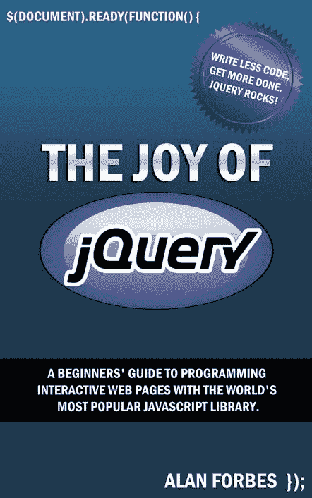

# 目录

- 标题页
- 什么是 jQuery?
- 开始使用 jQuery
- HTML 简介
- CSS 简介
- jQuery 选择器
- 使用 jQuery 进行表单验证
- jQuery UI 小部件：戏剧性的页面增强
- jQuery Mobile
- jQuery AJAX
- jQuery 动画
- 作者的话


版权 © 2013 Alan Forbes。保留所有权利，包括以任何形式复制此书或其部分的权利。未经作者许可，在网上扫描、托管、下载或以其他方式分享此书均违法并受法律处罚——而且这很不友好。请通过购买自己的副本来鼓励我写另一本书。

# 什么是 jQuery?
### 简介

`jQuery` 是一种你可以用来创建酷 Web 应用程序的编程语言。它是免费的、强大的、相对容易设置和学习，并且拥有许多扩展和插件可以实现你所想象的任何功能。你可以快速上手，而且当你以后精通它时，也不会觉得它不再够用。在我看来，`jQuery` 非常值得你投入精力和时间去学习。

坦率地说，它本身也非常有趣。这就是我写这本书的灵感所在。

让我们开始吧。你需要掌握的最基本概念是：网页仅仅是一堆按特定方式组织的文本，由浏览器显示。浏览器读取这些文本并在内存中构建一个名为“文档对象模型”的页面模型。`jQuery` 允许你操作文档对象模型（通常称为“DOM”）。你将在全书中看到 `DOM` 这个术语。

`jQuery` 是一个轻量级的 JavaScript 库，口号是“写更少的代码，做更多的事”。这到底意味着什么呢？为了理解它的含义，最好对 `jQuery` 旨在帮助你做什么心中有数。如果你没有 `jQuery`（或其他任何其他框架，如 `Dojo`，它也很酷），那么你在浏览器中实现功能的方法就是使用一种名为 `JavaScript` 的语言。

`JavaScript` 是一种内置在所有现代 浏览器中的编程语言，以便客户端脚本可以与用户交互、控制浏览器、在后台与服务器通信，并更改显示的文档内容和格式。`JavaScript` 是一种功能齐全的编程语言，因此可能相当复杂。

`jQuery` 是用 `JavaScript` 编写。事实上，`jQuery` 是将大量的 `JavaScript` 代码聚集在一起——因此有了“库（library）”这个词。它就像一个装满 `JavaScript` 代码的库。`jQuery` 的目的是让你在网页中使用 `JavaScript` 变得更加容易。`jQuery` 将许多原本需要大量行 `JavaScript` 代码才能完成的常见任务，转换为你可以用单行调用的方法。

（注：原文中存在大量重复段落，翻译时已进行去重处理以保留核心逻辑。）

# 什么是 jQuery?
### 简介
`jQuery` 是一种你可以用来创建酷 Web 应用程序的编程语言。它是免费的、强大的、相对容易设置和学习，并且拥有许多扩展和插件可以实现你所想象的任何功能。你可以快速上手，而且当你以后精通它时，也不会觉得它不再够用。在我看来，`jQuery` 非常值得你投入精力和时间去学习。

坦率地说，它本身也非常有趣。这就是我写这本书的灵感所在。

让我们开始吧。你需要掌握的最基本概念是：网页仅仅是一堆按特定方式组织的文本，由浏览器显示。浏览器读取这些文本并在内存中构建一个名为“文档对象模型”的页面模型。`jQuery` 允许你操作文档对象模型（通常称为“DOM”）。你将在全书中看到 `DOM` 这个术语。

`jQuery` 是一个轻量级的 JavaScript 库，口号是“写更少的代码，做更多的事”。这到底意味着什么呢？为了理解它的含义，最好对 `jQuery` 旨在帮助你做什么心中有数。如果你没有 `jQuery`（或其他任何其他框架，如 `Dojo`，它也很酷），那么你在浏览器中实现功能的方法就是使用一种名为 `JavaScript` 的语言。

`JavaScript` 是一种内置在所有现代 浏览器中的编程语言，以便客户端脚本可以与用户交互、控制浏览器、在后台与服务器通信，并更改显示的文档内容和格式。`JavaScript` 是一种功能齐全的编程语言，因此可能相当复杂。

`jQuery` 是用 `JavaScript` 编写。事实上，`jQuery` 是将大量的 `JavaScript` 代码聚集在一起——因此有了“库（library）”这个词。它就像一个装满 `JavaScript` 代码的库。`jQuery` 的目的是让你在网页中使用 `JavaScript` 变得更加容易。`jQuery` 将许多原本需要大量行 `JavaScript` 代码才能完成的常见任务，转换为你可以用单行调用的方法。

# 什么是 jQuery?
### 特性
`jQuery` 包含：
* `HTML`
* `CSS`
* `AJAX`
* 效果 (Effects)
* 动画 (Animations)

# 什么是 jQuery?
### 为什么它不是
`jQuery` 不是：
* 一种语言
* 一个框架
* 一个浏览器

（注：提供的文本包含许多重复的段落和不完整的句子。我已经清理了结构，在保持逻辑文档流的同时保留了源文本中提供的核心技术信息。）

# 什么是 jQuery?
### 下载的替代方案
使用来自 Google 或 Microsoft 的托管版本 `jQuery` 相比于自己托管具有巨大的优势。许多用户在访问其他网站时已经从 Google 或 Microsoft 下载过 `jQuery`。因此，他们就不需要再次下载它，因为他们的浏览器已经在本地存储了它。这缩短了你网站的加载时间。此外，大多数 CDN 都会确保当用户请求文件时，将从距离他们最近的服务器提供服务，这很可能比你的服务器更近（更重要的是，速度更快）。

除非你有非常充分的理由要自己托管 `jQuery`，否则你应该使用 CDN（内容分发网络）。


你可以通过访问 http://www.thejoyofjquery.com 并加入邮件列表来获取本书的所有源代码。我永远不会向你发送垃圾邮件，如果你失去了兴趣，也可以随时退出。虽然目前我还没有做过这些视频，但我打算制作一些演示源代码运行的 YouTube 视频，并在发布时通过邮件列表向大家更新进度。

## 联系作者

如果你对本书有任何反馈（如拼写错误或代码 Bug）或问题，欢迎与我联系。如果某些地方你仍然无法理解，可能其他人也会遇到相同的问题，这意味着我需要改进特定的章节。我会花时间回复每一位给我发邮件的人。我的邮箱是 AlanForbes@outlook.com。

## 为网站安装

如果你想让你的应用程序可以通过互联网供所有人访问，你就需要将应用程序安装到可以公共访问的服务器上。这通常意味着寻找一个托管提供商。

如果你正在寻找廉价的托管提供商，我自己的基于 PHP 的网站（它让人们轻松地编写自己的 Kindle 书，访问 [`www.KindleSmith.com`](http://www.KindleSmith.com/)）托管在 AccuWeb Hosting，我在他们那里没有遇到过任何问题。

如果你也想使用他们，如果你能使用我的推广链接 `manage.accuwebhosting.com/aff.php?aff=743`，我将不胜感激。

使用上述链接不会增加你的费用，我会获得小额佣金。谢谢。

## 开始使用 jQuery

### jQuery 基本语法

使用 jQuery，你可以选择（查询）HTML 元素并对它们执行“操作”。

### jQuery 语法

jQuery 语法设计用于选择 HTML 元素并对其执行某些操作。

基本语法为：`$(selector).action()`

*   `$` 符号意味着“后面的是 jQuery”
*   `(selector)` 用于找到（或选择）HTML 元素的子集
*   `action` 定义了对选定元素将发生什么。

这是一张指出每个元素的图片：

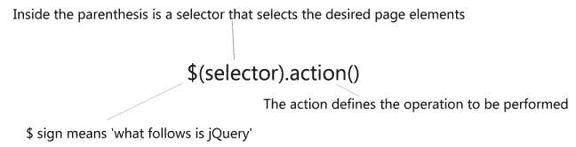

### jQuery 示例

*   `$(this).hide()` - 隐藏当前元素。
*   `$("p").hide()` - 隐藏所有的 `<p>` 元素。
*   `$(".test").hide()` - 隐藏所有 `class="test"` 的元素。
*   `$("#test").hide()` - 隐藏 `id="test"` 的元素。

你熟悉 CSS 选择器吗？如果是，那你就运气了。jQuery 使用 CSS 语法来选择元素。你将在本教程的下一章节学习更多关于选择器语法的知识。

### 文档就绪事件

你可能注意到，我们示例中所有的 jQuery 方法都在一个 document ready 事件中：

```javascript
$(document).ready(function(){

// jQuery 方法写在这里...

});

```

这是为了防止任何 jQuery 代码在文档完成加载之前（即在它准备就绪之前）运行。

在处理文档之前，等待文档完全加载并就绪是一个良好的习惯。这还允许你将 JavaScript 代码放在文档 body 标签之前，即 head 区域。

以下是一些如果在文档完全加载之前运行方法可能会导致失败的操作示例：

*   尝试隐藏尚未创建的元素
*   尝试获取尚未加载的图像的大小

提示：jQuery 团队还为文档就绪事件创建了一个更短的方法：

```javascript
$(function(){

// jQuery 方法写在这里...

});

```

使用你喜欢的语法即可。我们认为在阅读代码时，document ready 事件更容易理解。

## HTML 简介

### 简介

正如我们所描述的，jQuery 是一种用于在网页发送到浏览器后进行的语言。网页是用 HTML 编写的，使用 jQuery 是为了让特定页面上的 HTML 可以根据你定义的某些情况发生动态变化。

由于 jQuery 用于操作页面上的 HTML，因此在继续之前，你需要理解基础 HTML 是有意义的。

层叠样式表（CSS）是一种相关技术，用于定义 HTML 页面的外观和感觉。有时 CSS 也被更简单地称为样式表。

jQuery 允许你操作网页的 HTML 和 CSS。如果你已经非常理解 HTML 和 CSS，可以跳过接下来的两个章节。如果你认为通过对这些基础技术进行快速复习会获益，那么请花时间现在阅读它们，否则 jQuery 将不会产生太大意义。

### 基础 HTML

HTML 是网页的主要构建模块，因此对 HTML 是什么以及它是如何工作的有一个基本的理解至关重要。HTML 是一种标记语言，浏览器使用它，以便它们知道如何将文档渲染为网页。无论文档起初是手写的 HTML 还是使用 ASP、JSP 或 PHP 生成的，最终文档都会转换为 HTML 并发送到浏览器中进行渲染，以供人显示。

HTML 是一种定义网页结构和大纲的标记语言。标记并不是为了定义页面内容的视觉和感觉，除了标题、段落和列表等基础概念之外。

HTML 的表现属性已被废弃，这是一种华丽的说法，意思是“请不要再使用这些了，尽管它们仍然有效”。HTML 页面设计的当前最佳实践规定，大多数样式应包含样式表中，样式表是一组描述页面应该什么样子的规则。样式表本身就是一个主题，将在下一章节介绍。

编写和查看 HTML 极其简单（而且有趣），这正是让它如此受欢迎的一个因素。构建 HTML 只需要计算机、一个文本编辑器和一个浏览器。你只需创建文件，以 `.htm` 或 `.html` 扩展名保存，然后直接打开它。Windows 用户会发现 [Notepad](http://www.notepad.org/) 是创建 HTML 的绝佳编辑器。

#### HTML 基本元素

所有 HTML 文档都有相同的基本元素。它们由定义各个部分的标签组成——从开始到结束以及之间的所有内容。HTML 使用元素（标签）来标记文本。

标签

为了将标签与普通文本区分开，标签出现在括号内：`<` 和 `>`。大多数标签都有开启标签和关闭标签，也称为开始和结束标签。开启标签以 `<` 开头，结束标签以 `</` 开头。例如 `<b>` 表示开始加粗，`</b>` 表示停止（结束）加粗。

例如这是一个段落元素：

```html
<p>这是第一个段落。</p>
```

在这个示例中`<p>` 和 `</p>` 是标签；它们用于界定包含其中的文本为段落。这里值得指出的一点是，你不需要将所有内容放在同一行。上面的代码效果和下面的一样一样：

```html
<p>

这是第一个段落。

</p>
```

事实上，缩进也不是需要的，尽管它确实提高了可读性。记住，未来某人（可能是你）可能编辑你的 HTML，所以让它易于阅读是一个好主意。

所有的标签格式都是相同的。它们以小于号 `<` 开头，以大于号 `>` 结尾。始终如此。位于 `<` 和 `>` 之间的是标签名称。学习 HTML 的很大一部分是学习特定的标签及其作用。

嵌套标签

通常情况下，大多数标签都可以嵌套在其他标签内部，但当然这个规则可能会有例外。

在这里你看到加粗标签嵌套在段落标签内部：

```html
<p>这是第一个段落，其中包含一些<b>加粗</b>文本。</p>
```


并不是所有的元素都有对应的开始和结束标签。例如，`<br>` 没有对应的 `</br>`，`<hr>` 也是如此。`<hr>` 标签插入一条水平规则（线），而 `<br>` 标签插入一个换行。

## 必需标签

HTML 页面以 `<html>` 标签开始，以 `</html>` 结束。页面主体位于 `<body>` 标签内部。

```html
<!DOCTYPE html>
<html>
<body>
<p>这是我的第一段文字。</p>
</body>
</html>
```

### DocType（文档类型声明）

如果网页缺少 `<DOCTYPE>` 标签或具有某种类型的“过渡性” doctype 标签，页面将以所谓的“怪异模式”（quirks mode）进行渲染。怪异模式具有某种不可预测性，你并不总能得到预期的结果。

因此，如果你希望你的网页按照预期以“标准模式”（Standards mode）显示，拥有一个 doctype 标签是非常重要的。不过，为了简单起见，书中的示例将跳过这一步。

### Head（头部）

文档的头部是放置 `Title`（标题）和 `Meta`（元数据）信息的地方。通常，如果你有任何 CSS 样式、脚本标签以及指向外部文件的链接标签，你也会将它们放在 Head 中。

```html
<!DOCTYPE html>
<html>
<head>
<title>
这是页面的标题。
</title>
</head>
<body>
正文内容在这里。
</body>
</html>
```

## 可选标签

### Meta Tags（元数据标签）

`Meta` 标签与 `link` 标签的独特之处在于，它们是唯一既不需要结束标签，也不需要在标签末尾添加结束 `/` 的 HTML 标签，且仍然被认为语法正确。

关于元数据标签的另外一点是，通常情况下，它们是唯一对页面的布局或处理没有影响的标签；它们用于提供关于所查看页面和/或网站的信息。`meta` 标签本质上是一个键/值对，每个标签只能包含一对值。元数据标签主要供搜索引擎使用。

## 有用标签

### Headers（标题）

标题用于将信息组织成层级分组。

```html
<h1>标题 1</h1>
<h2>标题 2</h2>
<h3>标题 3</h3>
<h4>标题 4</h4>
<h5>标题 5</h5>
<h6>标题 6</h6>
```

标题标签是块级元素，这意味着它们单独占据整行，并且标题标签内部不允许有其他标记。

### DIV

`DIV` 标签是你用来在文档中创建逻辑划分的标签之一。`DIV` 与 CSS 配合，并允许你编写 CSS 规则来指定 `DIV` 内部文本的格式方法。

### Images/Picture（图像/图片）

要向文档中添加图像，你可以使用“image”标签。在 html 文档中插入图像请使用以下语法：

```html

```

你在 `src=` 属性中填入的值可以指定本地文件系统上的图形，也可以指定一个完整的 URL，从互联网的其他地方获取图像。

### Links（链接）

用户点击链接时，会将他们带到另一个地方。链接可以指向打开文档的特定部分，也可以指向全新的页面。

将用户带到新页面。
```html
<a href="http://www.joyofphp.com">访问 Joy of PHP!</a>
```

将用户带到当前页的不同位置（由标签 `<a id="top">` 所示）：
```html
<a href="#top">回到顶部</a>
```

### Lists（列表）

列表有两种类型——有序列表和无序列表。有序列表是有编号的，例如 1, 2, 3，而无序列表是带符号的项目列表。有标签用于开始和结束列表，也有用于列表每个每个项的标签。

有序列表以 `<ol>` 标签开始。无序列表以 `<ul>` 标签开始。每个列表项无论列表类型如何，都以 `<li>` 标签开始并以 `</li>` 结束。

```html
<ul>
<li>咖啡</li>
<li>牛奶</li>
</ul>
```
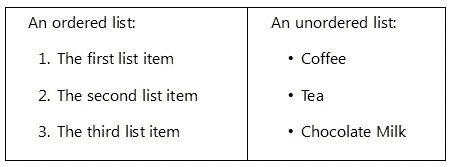

### Exercise（练习）

制作几个基础的 HTML 文件并将它们放置在计算机的正确位置，这样你就可以在浏览器中打开它们了。包含列表、段落以及粗体和斜体文本。我还没有告诉你如何制作斜体任务。鉴于粗体的标签是 `<b>`，你认为斜体的标签是什么呢？

## HTML Tables（HTML 表格）

表格非常棒。它们解决了很多问题，但不应用于整个页面的布局。HTML 表格应该只用于渲染属于网格的数据，换句话说，就是描述具有相同属性的多个对象。例如，如果在 Microsoft Excel 中显示这些数据是合理的，请使用表格。

表格用 `<table>` 标签定义。表格分为行（使用 `<tr>` 标签），每行又分为数据单元（使用 `<td>` 标签）。`td` 代表 "table data"，存储数据单元的内容。`<td>` 标签可以包含文本、链接、图像、列表、表单、其他表格等。

### Table Example（表格示例）

```html
<table border="1">
<tr>
<td>行 1 单元格 1</td>
<td>行 1 单元格 2</td>
</tr>
<tr>
<td>行 2 单元格 1</td>
<td>行 2 单元格 2</td>
</tr>
</table>
```
*(注：原文示例代码内容不完整或为占位符，翻译时保持逻辑结构，此处根据语意进行了结构对齐处理)*
```html
<table border="1">
<tr>
<td>row 1, cell 1</td>
<td>row 1, cell 2</td>
</tr>
<tr>
<td>row 2, cell 1</td>
<td>row 2, cell 2</td>
</tr>
</table>
```

### HTML Tables and Border Attribute（HTML 表格与边界属性）

如果不指定边界，表格将显示：
```html
<table>
<tr>
<td>row 1</td>
<td>row 2</td>
</tr>
</table>
```

### HTML Table Headers（HTML 表头）

表格中的头用 `<th>` 标签定义。

```html
<table border="1">
<tr>
<th>Header 1</th>
<th>Header 2</th>
</tr>
</table>
```


## HTML Forms（HTML 表单）

HTML 表单特殊的 HTML 页面，用于将数据传递给服务器。一旦服务器获取了数据，可以对其进行处理并返回，也可以将其存储在数据库中以后使用。

HTML 表单将包含输入元素，如标签、文本字段、复选框、单选按钮、提交按钮等。表单还可以呈现列表让用户从中选择，或者允许多行输入的文本区域。

表单的基本结构如下：

```html
<form>
.
</form>
```

表单标签放在 `<body>` 标签内部。表单中的数据被发送到表单 `action` 属性指定的页面。

```html
<form name="input" action="PostSignup.php" method="get">
```
我们将稍后介绍表单动作。

### The Input tag（Input 标签）

常见的表单元素是 `<input>` 元素，用于从用户处收集信息。`<input>` 元素有多种变体，取决于 `type` 属性。`<input>` 元素还有一个 `name` 属性，以便后续引用。通用语法为：

```html
<input type="type" name="name"/>
```

`<input>` 元素可以是文本、复选框、密码、单选按钮、提交按钮等类型。常见的输入类型描述如下：

文本字段：`<input type="text">` 定义了一个用户可以输入文本的单行输入字段：

```html
<form>
名：<input type="text" name="firstname"/><br>
姓：<input type="text" name="lastname"/>
</form>
```
上述 HTML 代码在浏览器中看起来像这样：


密码字段：`<input type="password">` 定义了一个密码字段。密码字段与文本字段一样，只是输入的输入的文字不会显示在屏幕上。

```html
密码：<input type="password" name="pwd"/>
```


注意，密码字段并不能保护数据，它只是在屏幕上隐藏数据。

### 单选按钮 (Radio Buttons)
`<input type="radio">` 定义一个单选按钮。单选按钮允许用户从有限的展示选项中选择一个（且仅限一个）：

```html
<body>
<form>
选择你喜喜欢的颜色： <br/>
<input type="radio" name="color" value="red"/>红色<br/>
<input type="radio" name="color" value="blue"/>蓝色<br/>
<input type="radio" name="color" value="green"/>绿色
</form>
</body>
```

以下是上述 HTML 代码在浏览器中的显示效果：

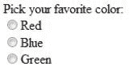

### 复选框 (Checkboxes)
`<input type="checkbox">` 定义一个复选框复选框。复选框允许用户从有限的选项中选择零或多个选项。

```html
<form>
<input type="checkbox" name="vehicle" value="Bike">我有一辆自行车<br>
<input type="checkbox" name="vehicle" value="Car">我有一辆汽车
</form>
```

### 提交按钮 (Submit Button)
`<input type="submit">` 定义一个提交按钮。

当用户填写完表单并准备好将输入的数据发送（提交）到服务器时，就会使用提交按钮。数据会被发送到表单 `action` 属性指定的页面，这将在下一节中介绍。

## HTML 表单动作与方法 (HTML Form Actions & Methods)
当你定义一个表单时，有两个必需属性：`action` 和 `method`。`action` 属性（`action=`）指示表单将提交的文件名称。`method` 属性（`method=`）指定表单提交的方式。

`action` 属性中定义的文件通常会对接收到的输入进行某些处理，例如将其放入数据库或向用户返回某些值。这里有一个带有 `action` 和 `method` 属性的简单表单示例。

```html
<form name="input" action="form_action.php" method="get">
你的名字：<input type="text" name="name"/>
<input type="submit" value="提交">
</form>
```

为了本书的内容，我们将假设 `action` 属性指定了一个 PHP 文件的名称。正如你将看到的，`action` 属性中指定的 PHP 文件将可以访问表单中的所有值。

## CSS 简介 (Introduction to CSS)

### 什么是 CSS？
CSS 是 Cascading Style Sheets（级联样式表）的缩写。样式定义了如何显示 HTML 元素，而样式表是样式列表。例如，你可能有一个样式定义 `<h1>` 元素的样子，另一个样式定义基本段落的样子。

今天所有的浏览器都支持 CSS。学习它，热爱它。

最佳实践规定，样式表应该存储为与 HTML 页面分离的独立文件，尽管这并不是唯一支持的配置。你的样式表应该具有 `.css` 扩展名，以便计算机和人类轻松识别。

样式被加入 HTML 4.0 是为了解决一个问题。这个问题是，HTML 从未被设计为包含用于文档格式化的标签。HTML 的初衷是定义文档的内容，例如：

```html
<h1>这是一个标题</h1>
<p>这是一个段落。</p>
```

当 `<font>` 标签和颜色属性被添加到 HTML 3.2 规范时，它无意中为 Web 开发者造成了巨大的混乱。虽然能对网页的外观进行这种控制非常棒，但大型网站的开发突然变得更加繁琐和昂贵。为了获得营销人员渴望的独特“企业视觉识别系统”，现在必须在每个页面中添加字体和颜色信息。更糟糕的是，更改一个本应该是简单的事情（例如，所有标题现在都应该是橙色的——如 Amazon.com 的情况所示）意味着要编辑每一个页面。又是这样。唉。

为了解决这个问题，世界维网联盟 (W3C) 创建了 CSS。在 HTML 4.0 中，所有的格式都可以从 HTML 文档中移除，并存储在独立的 CSS 文件中。

### 外部样式表 (External Style Sheets) 可以节省大量工作
样式表应该存储为与 HTML 页面分离的独立文件，尽管这并不是唯一支持的配置。你的样式表应该具有 `.css` 扩展名，以便计算机和人类轻松识别。

外部样式表可以节省大量工作。外部样式表存储在 CSS 文件中。使用外部样式表，你可以通过 `<link>` 标签将其链接到页面。

如果你使用了上面的样式表，将发生以下变化：
1. 背景颜色将变为黄色。
2. `<h1>` 标题将变为橙色。
3. 段落中的所有文字将变为 20 点。

外部样式表可以存储在 CSS 文件中。使用外部样式表，你可以通过 `<link>` 标签将其链接到页面。

```html
<head>
<link rel="stylesheet" type="text/css" href="mystyle.css">
</head>
```

外部样式表可以存储在 CSS 文件中。使用外部样式表，你可以通过 `<link>` 标签将其链接到页面。

使用外部样式表，你可以通过 `<link>` 标签将其链接到页面。

外部样式表可以存储在 CSS 文件中。使用外部样式表，你可以通过 `<link>` 标签将其链接到页面。

外部样式表可以存储在 CSS 文件中。使用外部样式表，你可以通过 `<link>` 标签将其链接到页面。

外部样式表可以存储在 CSS 文件中。使用外部样式表，你可以通过 `<link>` 标签将其链接到页面。

外部样式表可以存储在 CSS 文件中。使用外部样式表，你可以通过 `<link>` 标签将其链接到页面。

外部样式表可以存储在 CSS 文件中。使用外部样式表，你可以通过 `<link>` 标签将其链接到页面。

外部样式表可以存储在 CSS 文件中。使用外部样式表，你可以通过 `<link>` 标签将其链接到页面。

外部样式表可以存储在 CSS 文件中。使用外部样式表，你可以通过 `<link>` 标签将其链接到页面。

外部样式表可以存储在 CSS 文件中。使用外部样式表，你可以通过 `<link>` 标签将其链接到页面。

### CSS 规则语法 (CSS Rule Syntax)
CSS 规则有两个主要部分：选择器和位于花括号 `{}` 内的声明。选择器是你想要样式的元素。

```css
p {
  color: red;
}
```

外部样式表可以存储在 CSS 文件中。使用外部样式表，你可以通过 `<link>` 标签将其链接到页面。

外部样式表可以存储在 CSS 文件中。使用外部样式表，你可以通过 `<link>` 标签将其链接到页面。

外部样式表可以存储在 CSS 文件中。使用外部样式表，你可以通过 `<link>` 标签将其链接到页面。

外部样式表可以存储在 CSS 文件中。使用外部样式表，你可以通过 `<link>` 标签将其链接到页面。

外部样式表可以存储在 CSS 文件中。使用外部样式表，你可以通过 `<link>` 标签将其链接到页面。

### 如何使用样式表 (How to use a Style Sheet)
好了，现在我们有一个样式表了。如何使用它？要使用样式表，HTML 页面只需通过 `<link>` 标签将其链接。

```html
<head>
<link rel="stylesheet" type="text/css" href="mystyle.css">
</head>
```

使用样式表，你可以通过 `<link>` 标签将其链接到。

### 选择器 (Selectors)
正如你所猜的，选择器不仅限于选择单个项目，例如 `<p>` 标签。有很多 CSS 选择器。这里有几个：

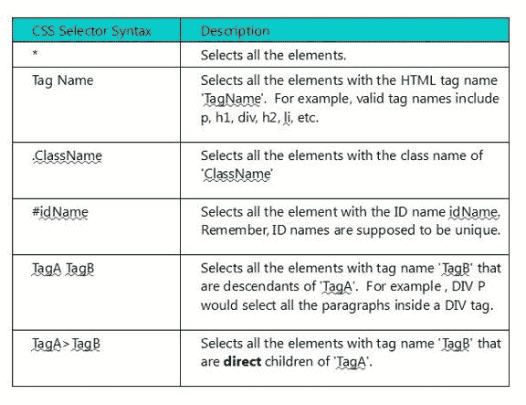

当我们讨论 jQuery 选择器时，我们会介绍更多这些，它们是基于 CSS 选择器的。

### 子元素与后代选择器 (Child vs Descendant)
你可能注意到某些选择器指的是元素的后代。考虑以下这个后代选择器：

`div p`

这会选择所有 `div` 的后代段落。换句话之，如果段落在 `div` 内部，即使它在其他东西内部。

然后是子选择器：

`div > p`

区别是什么？区别在于子选择器只选择直接子元素，而不选择元素的子元素。

### CSS 示例 (CSS Examples)
这是一个基础示例，将段落文字颜色设置为蓝色：

```css
p {color:blue;}
```

```css
p {color:blue;text-align:left;}

这是一个更高级的示例：

```css
h1 { display: block; margin: 20px 0 6px 0; font-size: 1.8em; color: blue; text-decoration: none; text-align: center; }
```

你可能注意到第二个示例读起来要困难得多，因为它读起来像一个连句。为了让 CSS 对人类更易读，最好将每个声明放在单独的一行中，如下所示：

```css
p {
  color: red;
  text-align: center;
}
```


我强烈建议你养成将声明单独写一行的习惯，并尽可能提高可读性。你会为这样做感到庆幸的。

## CSS 注释

说到可读性，所有正规语言都支持注释，CSS 也不例外。注释用于解释你的代码，当你日后编辑源代码时，它们一定能帮助你——那时你可能忘记了为什么要以某种方式操作，或者某个特定规则的意图是什么。（这个长句写得怎么样？）。浏览器会忽略注释，但用户会赞赏它们。也养成写注释的习惯吧。:)

CSS 注释以 `/*` 开始，以 `*/` 结束，如下所示：

```css
/*在这里我设置了段落的默认格式*/
p
{
text-align:center;
color:black;
font-family:Arial;
}
```

看这样读起来是不是容易得多？

## 指定字体

你可能已经注意到很多声明都提到了字体。正确的字体会对页面的外观产生显著影响。`font-family` 属性可以同时包含多个字体名称，这样做是确保最大兼容性的最佳实践。如果浏览器不支持第一个字体，它会尝试下一个字体，依此类推。

从你真正想要的特定字体开始，以你能够接受的通用字体族结束。这种方法将指示浏览器在首选字体可用时从通用字体族中选择一个字体。

示例：

```css
p{font-family:"Times New Roman", Times, serif}
```

## 使用 CSS 定位元素

### 定位简介

CSS 定位属性允许你在页面上精确地定位元素。它可以将一个元素放置在另一个元素的上方、旁边，甚至指定当元素内容过大时应该发生什么。

元素可以使用 `top`、`bottom`、`left` 和 `right` 属性进行定位。然而，除非先设置 `position` 属性，否则这些属性将不起作用。这些属性的作用也根据定位方法的不同而异。

有四种定位方法：静态 (Static)、固定 (Fixed)、相对 (Relative) 和绝对 (Absolute)。

### 静态定位

HTML 元素默认是静态定位的。静态定位的元素根据页面的“标准流”在页面上定位。换句话说，当一个元素是静态的时，它就顺流而。如果你没有指定元素的位置，它就是静态的。

静态定位的元素不受 `top`、`bottom`、`left` 和 `right` 属性的影响。

### 固定定位

固定位置的元素相对于浏览器窗口进行定位。当页面滚动时，它不会移动，因为它不是相对于页面上的任何其他元素进行定位。

这是一个固定定位的示例：

```css
p.fixed
{
position:fixed;
top:25px;
right:15px;
}
```

此样式将选择带有 `fixed` 类的段落。固定定位的元素从标准流中移除。页面上的所有其他元素表现就像固定定位元素不存在一样。

### 相对定位

相对定位的元素相对于其如果是静态时所在的位置进行定位。例如，我们可以通过修改 `left` 位置将 `h2` 元素移动到其通常位置的左侧或右侧。

对于相对定位的元素，`left` 属性将元素的左边缘相对于正常位置的左/右。

以下规则根据元素所属的类将 `h2` 元素向左或向右移动。例如 `<h2 class='move_left'>`：

```css
h2.move_left
{
position:relative;
left:-30px;
}

h2.move_right
{
position:relative;
left:30px;
}
```

相对定位元素的内容可以移动并可能与其他元素重叠，但元素空间在标准流中仍然被保留。

```css
h2.pos_top
{
position:relative;
top:-50px;
}
```

相对定位元素经常被用作绝对定位元素的容器块。

### 绝对定位

绝对定位元素元素相对于第一个非静态位置的父元素进行定位。如果没有找到此类元素，则包含块为 `<html>`。

```css
h2
{
position:absolute;
left:100px;
top:150px;
}
```

绝对定位的元素从标准流中移除。文档和其他元素表现就像绝对定位元素不存在一样。

绝对定位元素可以与其他元素重叠。我们接下来讨论这个。

### 元素重叠

当元素定位在标准流之外时，它们可能会与其他元素重叠。当两个元素重叠时，你如何决定哪个元素在前，哪个元素在后？这由名为 `z-index` 的属性决定。（我猜是叫 Zachary 的人想出的词。）

`z-index` 属性指定了元素的“堆叠顺序”。想象一组 3 个堆叠在一起的块。最顶部的块 `z-index` 为 3，最底部的块 `z-index` 将为 1。从上方观察堆叠层，顶部的块最可见，所以你可以认为它在前面。底部的块可以被认为在堆叠的后面。

元素可以有一个正或负的堆叠顺序：

```css
img
{
position:absolute;
left:0px;
top:0px;
z-index:-1;
}
```

`z-index` 较大的元素位于 `z-index` 较小的元素前面。注意：如果两个元素重叠且没有指定 `z-index`， HTML 代码中后定义的元素将显示上方。

## jQuery 选择器

### 什么是 jQuery 选择器

jQuery 选择器的概念是真正理解 jQuery 世界的最重要的概念之一。那么，什么是 jQuery 选择器？选择器使用 CSS 语法来选择元素或元素集，以便对其执行操作。

理解 jQuery 选择器是有效使用该库的关键。好消息是，如果你以前用过 CSS，你已经知道了大部分内容。

一个 jQuery 语句通常遵循语法：

`$(selector).methodName()`

选择器是一个表达式，用于标识后续方法操作的元素集。本章将关注选择器，而后续章节将关注方法。

许多 jQuery 操作也可以组合：

`$(selector).method1().method2().method3()`

作为一个示例，假设我们想要隐藏 ID 为 `goAway` 的 DOM 元素并添加类 `incognito`：

`$("#goAway").hide().addClass("incognito")`

### jQuery 选择器返回什么

当 jQuery 选择器应用于 Web 页面时，底层发生的是一个复杂的 JavaScript 函数正在检查 DOM 中的每个元素。在检查每个元素时，它都会与选择器进行比较。匹配选择器的 DOM 元素被放入一个只包含匹配项的“特殊列表”。当整个文档检查完成后，该匹配元素列表将被“返回”，以便进行操作。

当你学习 jQuery 时——你有成百千千的资源可以这样做——你可能会看到被选项目列表被称为“匹配集”(matched set)、“包装集”(wrapped set) 或“结果集”(result set)。它们都是同一个意思——即在 DOM 元素与选择器进行比较时被放入的那个“特殊列表”。


我个人更倾向于使用“结果集”（result set）这个术语，因为它符合选择器基本上是对文档执行查询并返回结果的理念。但仅仅因为我喜欢结果集这个词，并不意味着我在之后会让你感到困惑。请理解，这些术语是可以互换的，意思完全相同。在后续的学习过程中，我可能会在这里混用它们，以此帮助你保持清醒。

# jQuery 选择器的类型

jQuery 选择器分为三类：基础 CSS 选择器、位置选择器和自定义 jQuery 选择器。基础选择器被称为“查找选择器”（find selectors），因为它们用于在 DOM 中查找元素。位置选择器自定义选择器是“过滤选择器”（filter selectors），因为它们用于过滤（或精调）一组元素。

## 基础 CSS 选择器

以下 jQuery 选择器遵循标准的 CSS3 选择器语法。以下选择器的任何变体都可以作为 jQuery 命令的选择器参数使用：

```javascript
$(selector).methodName();
```

### 选择器的实际示例

- `$("p")` 选择所有的 `<p>` 元素
- `$("h1")` 选择所有的 `<h1>` 元素
- `$("div a")` 选择 `<div>` 元素内所有的锚点标签 (`<a>`) 元素
- `$("p>div")` 选择所有作为 `<p>` 元素直接子元素的 `<div>` 元素
- `$("div~h2")` 选择前面有 `<h2>` 元素的 `<div>` 元素
- `$("p:has(b)")` 选择所有包含加粗文本的段元素
- `$("div.className")` 选择所有类名为 `className` 的 `<div>` 元素
- `$(".className ")` 选择所有类名为 `className` 的元素
- `$("#IDvalue")` 选择 id 值为 `IDvalue` 的元素
- `$("img[alt]")` 选择所有具有 `alt` 属性的图像 (`` 元素）
- `$("a[href$=.pdf]")` 选择所有链接到 PDF 文件的锚点。它选择所有 `href` 属性以 `.pdf` 结尾的 `<a>` 元素

你可以访问 [`www.w3schools.com/jquery/trysel.asp?filename=trysel_basic&jqsel=p.intro,%23choose`](http://www.w3schools.com/jquery/trysel.asp?filename=trysel_basic&jqsel=p.intro,%23choose) 来练习 jQuery 选择器。

## 多重选择器

如果用逗号分隔多个选择器，可以将它们合并到一个语句中。例如，选择器 `$("ul,ol")` 将选择所有的列表 (`<ul>` 和 `<ol>`) 元素。

## 位置选择器

位置选择器根据元素之间的位置关系选择元素。这些选择器可以附加到任何基础选择器（我们记为 `BaseSelector`）之后，以根据位置过滤匹配项。如果省略基础选择器，则假设为 `*`（所有元素）。

### 示例位置选择器语法

- `BaseSelector:first`: 选择页面上第一个匹配基础选择器的元素。
- `BaseSelector:last`: 选择页面上最后一个匹配基础选择器的元素。
- `BaseSelector:first-child`: 选择所有匹配基础选择器且为第一个元素的元素。
- `BaseSelector:last-child`: 选择所有匹配基础选择器且为最后一个元素的元素。
- `BaseSelector:only-child`: 选择所有匹配基础选择器且为唯一子元素的元素。
- `BaseSelector:nth-child(n)`: 选择所有匹配基础选择器且为第 n 个子元素。计数从 1 开始。
- `BaseSelector:nth-child(odd|even)`: 选择所有匹配基础选择器且为偶数或奇数子元素。第一个元素被视为奇数（计数从 1 开始）。
- `BaseSelector:even`: 选择所有匹配基础选择器的偶数元素。
- `BaseSelector:odd`: 选择所有匹配基础选择器的奇数元素。
- `BaseSelector:eq(n)`: 选择匹配基础选择器的元素集中的第 n 个元素。计数从 0 开始。
- `BaseSelector:gt(n)`: 选择匹配基础选择器且大于第 n 个元素的元素（不包含 n）。计数从 0 开始。
- `BaseSelector:lt(n)`: 选择匹配基础选择器且小于第 n 个元素的元素（不包含 n）。计数从 0 开始。

### 实际示例

- `$("p:first")` 选择页面上的第一个段落。
- `$("img[src$=.png]:first")` 选择页面上第一个 `src` 属性以 `.png` 结尾的 `` 元素
- `$("button.small:last")` 选择页面上最后一个类名为 `small` 的 `<button>` 元素
- `$("li:first-child")` 选择所有在列表中作为第一个元素的 `<li>` 元素
- `$("a:only-child")` 选择所有在其父元素内是唯一的 `<a>` 元素
- `$("li:nth-child(2)")` 选择所有在列表中处于第二个的 `<li>` 元素
- `$("tr:nth-child(odd)")` 选择表格中所有奇数的 `<tr>` 元素
- `$("div:nth-child(5n)")` 选择每 5 个 `<div>` 元素
- `$("div:nth-child(5n+1)")` 选择每 5 个 `<div>` 元素之后的元素
- `$(".someClass:eq(1)")` 选择类名为 `someClass` 的第二个元素
- `$(".someClass:gt(1)")` 选择除前两个之外的所有类名为 `someClass` 的元素
- `$(".someClass:lt(4)")` 选择类名为 `someClass` 的前四个元素

注意 `:nth-child` 选择器的计数从 1 开始，而大多数 jQuery 选择器（如 `:eq`、`:gt` 和 `:lt`）从 0 开始。

## jQuery 自定义选择器

jQuery 提供这些选择器是为了实现 CSS 规范未预料到的常用或方便的选择。与位置选择器类似，这些选择器过滤一个基础匹配项（我们记为 `B`）。省略 `B` 被解释为所有元素集。这些选择器可以组合；请查看选择器组合示例。

- `BaseSelector:enabled`: 选择匹配基础选择器且处于启用状态的元素。
- `BaseSelector:button`: 选择匹配基础选择器且为任何按钮类型的元素。
- `BaseSelector:input`: 选择匹配基础选择器的控件——例如 `<input>`、`<select>`、`<textarea>` 和 `<button>` 元素。
- `BaseSelector:checkbox`: 选择匹配基础选择器类型为 checkbox 的元素。例如此选择器会选择 `<input type="checkbox" name="colors">`。
- `BaseSelector:image`: 选择匹配基础选择器且类型为图像的元素。
- `BaseSelector:file`: 选择匹配基础选择器且类型为文件的元素。
- `BaseSelector:radio`: 选择匹配基础选择器且为 `input[type=radio]` 的元素。
- `BaseSelector:text`: 选择匹配基础选择器且类型为文本的元素。
- `BaseSelector:password`: 选择匹配基础选择器且类型为密码的元素。
- `BaseSelector:submit`: 选择匹配基础选择器且为 `input type=submit` 或 `button type=submit` 的元素。
- `BaseSelector:reset`: 选择匹配基础选择器且为 `input[type=reset]` 或 `button[type=reset]` 的元素。
- `BaseSelector:hidden`: 选择匹配基础选择器且隐藏的元素。
- `BaseSelector:header`: 选择匹配基础选择器且为标题 `<h1>` 到 `<h6>` 的元素。
- `BaseSelector:not(f)`: 选择匹配基础选择器但不符合 `not()` 中指定的过滤选择器的元素。过滤选择器是任何以冒号(:)开头的选择器。
- `BaseSelector:parent`: 选择匹配基础选择器且具有非空子元素的元素。
- `BaseSelector:selected`: 选择匹配基础选择器且处于选中状态的元素。只有 `<option>` 元素可能拥有此状态。
- `BaseSelector:animated`: 选择匹配基础选择器且正通过一个 jQuery 动画方法进行动画控制的元素。
- `BaseSelector:visible`: 选择匹配基础选择器且可见的元素。


如你所见，jQuery 选择器既强大强大又提供了灵活性，让你创建一个一组 DOM 元素（称为结果集或匹配集），你可以使用 jQuery 方法对这些元素进行操作。让我们再看一组示例。

`$("img:animated")` 选择所有正在进行动画的图像元素。

`$(":button:disabled")` 选择所有禁用的按钮。这将是启用这些按钮的一种方便方法。

`$("input:radio:checked")` 选择所有被选中的单选元素。

`$("option:not(:selected)")` 选择所有未选中的 `<option>` 元素。

`$(":text:visible")` 选择所有可见的文本字段。

`$("#myForm button:not(.someClass)")` 选择 id 为 `myForm` 的 `<form>` 标签中所有不具备 `someClass` 类名的按钮。

`$("select[name=choices] :selected")` 选择名为 `choices` 的 `<select>` 元素中被选中的 `<option>` 元素。

`$("p:contains(hello world)")` 选择包含文本 'hello world' 的所有 `<p>` 元素。

# JavaScript 对象

观众中的 JavaScript 程序员会发现，应用选择器产生的结果集可以被视为 JavaScript 数组。从技术上讲，它是 jQuery 为我们屏蔽掉的 JavaScript 数组。尽管如此，有时使用数组索引访问结果集中的元素也是有用的。

例如：

```
var element = $("img")[0];
```

这将把变量 `element` 设置为匹配集中的第一个元素。

# 对结果集采取操作

虽然 jQuery 选择器在识别要将哪些 DOM 元素添加到结果集时给了我们极大的灵活性，但有时某些标准是无法通过选择器单独的。此外，在 jQuery 方法链的过程中，我们可能希望在方法调用之间调整结果集的内容。针对这些情况，jQuery 提供了方法，这些方法的操作不是作用于结果集中的元素，而是作用于结果集本身。本节将讨论这些方法。

## 向结果集添加元素

你可以使用 `.add()` 方法向结果集添加额外的元素。

```
add(expression)
```

`expression` 是一个选择器，用于指定要匹配哪些元素。匹配该选择器的元素将尽添加到现有的匹配项中。

给定一个代表一组 DOM 元素的 jQuery 对象，`.add()` 方法将根据结果集中的元素与传入方法的元素的并集，构建一个新的 jQuery 对象。`.add()` 的参数几乎可以是 `$()`  world 接受的任何内容，包括 jQuery 选择器表达式、DOM 元素的引用或 HTML 片段。

## 从结果集中移除元素

如果我们想从结果集中移除元素呢？那是 `not()` 方法的工作。

```
not(expression)
```

`expression` 是一个选择器，用于指定要匹配哪些元素。不匹配选择器的元素将包含在结果中。

给定一个代表一组 DOM 元素的 jQuery 对象，`.not()` 方法根据匹配元素的子集构建一个新的 jQuery 对象。提供的选择器将对每个元素进行测试；不匹配选择器的元素将包含在结果中。

### 示例

```
$("body *").css("font-weight","bold").not("p").css("color","blue");
```

将所有 body 元素加粗，然后将段落元素以外的所有元素设为蓝色。

```
$("body *").css("font-weight","bold").not(anElement).css("color","blue");
```

与上一个示例类似，区别是变量 `anElement` 引用的元素未包含在第二个集合中（因此不会被染成蓝色）。

## 查找后代元素

有时，将元素搜索限制在结果集中之前确定的元素的后代中是有用的。`find()` 方法正是此功能：

```
find(expression)
```

`expression` 是一个选择器，用于指定要匹配哪些后代元素。

与之前检查的方法不同，`find()` 仅接受选择器表达式作为参数。将在现有匹配集中的元素中搜索匹配该表达式的后代元素。原始匹配集中任何匹配选择器的元素都不会被包含在新集合中。

给定一个代表一组 DOM 元素的 jQuery 对象，`.find()` 方法允许我们搜索 DOM 树中这些元素的后代，并从匹配的元素构建一个一个新的 jQuery 对象。`.find()` 和 `.children()` 方法类似，区别在于后者只在 DOM 树中向下移动一层。

`.find()` 方法的第一种签名接受与我们可以传递给 `$()` 函数相同类型的选择器表达式。将通过测试元素是否匹配此选择器来对其进行过滤。

### 示例

```
$("div").css("background-color","blue").find("img").css("border","1px solid aqua");
```

选择所有 `<div>` 元素，将其背景设为蓝色，选择这些 `<div>` 元素的后代 `` 元素（而不是不是后代的 `` 元素），并为它们设置青色边框。

## 过滤匹配集

当需要对匹配集的过滤进行更细粒度的控制时，`filter()` 方法变得非常有用：

```
filter(selector)
```

`selector` 是一个表达式，用于指定要保留哪些元素。

`filter` 函数也可以传递一个函数，但这超出了本书的范围。当传递选择器时，它的作用类似于 `not()` 的相反，保留匹配选择器的元素（而不是排除它们）。

```
$(".invisible").show().filter("img[src$=.gif]").attr("title","Hello world!");
```

# 使用 jQuery 进行表单验证

## 简介 - 表单验证

JavaScript 的主要用途之一是表单验证。其理念是防止用户提交包含“无效”数据的表单。


```css
08 .submit { margin-left: 13em; margin-top: 2em;}
</style>
```

第 4 - 9 行包含格式化文档的样式。第 5 行使用了 `*` 选择器，它选择所有元素，并将默认字体设置为 Arial。第 6 行定义了标签的样式，第 7 行定义了输入元素的样式，第 8 行定义了提交按钮的样式。

```html
11 </head>
<body>
```

第 11 行关闭了 `HEAD` 区域，第 12 行开始 body 区域。

```html
13 <form id="comments" method="get" action="">
<fieldset>
<legend>没有验证或消息的简单表单</legend>
```

第 13 行开始表单。对于 jQuery 而言，重要的标签是 `id` 属性，在此例中为 `'comments'`。我们将使用这个 `id` 来告诉 jQuery 应该验证哪个表单。第 14 行开始一个 `fieldset`。

`fieldset` 标签将表单中相关的元素分组在一起。

```html
16 <div>
<label for="name">Name</label>
<input id="name" name="name" />
</div>
20 <div>
<label for="email" style="height: 1px">E-Mail</label>
<input id="email" name="email" />
</div>
24 <div>
<label for="url">URL (optional)</label>
<input id="url" name="url" class="url" value="" />
</div>
28 <div>
<label for="ccomment">Your comment</label>
<textarea id="ccomment" name="comment"></textarea>
</div>
32 <div>
<input class="submit" type="submit" value="Submit"/>
</</div>
</fieldset>
```

第 16 – 35 行定义了表单上的字段。第 33 行是提交按钮。

```html
36 </form>
</body>
</html>
```

第 36 行关闭表单，第 37 行关闭 body，第 38 行关闭 html 文档。

# 带有 jQuery 验证的表单

我还提供了一个带有验证的表单版本。该页面名为 `'validation.html'`。

## 代码

```html
01. <!DOCTYPE html>
02. <html>
03. <head>
04. <script src="jquery.min.js"></script>
05. <script src="jquery.validate.js"></script>
07. <style type="text/css">
08. * { font-family: Arial; }
09. label { width: 10em; float: left; }
10. label.error { float: none; color: red; padding-left: .5em; vertical-align: top; }
11. div { clear: both; }
12. input, textarea { width: 15em; }
13. .submit { margin-left: 10em; }
</style>
15. <script type="text/javascript">
16. jQuery(document).ready(function($){
17. $("#comments").validate();
18. });
</script>
20. </head>
21. <body>
22. <form id="comments" method="get" action="">
23. <fieldset>
<legend>带有基础验证和消息的简单表单</legend>
25. <div>
<label for="name">Name</label>
<input id="name" name="name" class="required" minlength="2" />
</div>
29. <div>
<label for="email">E-Mail</label>
<input id="email" name="email" class="required email" />
</div>
33. <div>
<label for="url">URL (optional)</label>
<input id="url" name="url" class="url" value="" />
</div>
37. <div>
<label for="comment">Your comment</label>
<textarea id="comment" name="comment" class="required"></textarea>
</div>
41 <div>
<input class="submit" type="submit" value="Submit"/>
</</div>
</fieldset>
45. </form>
46. </body>
47. </html>
```

### 代码解释

上面的代码包含了 jQuery 验证插件。我们使用 `jQuery(document).ready(function($){` 来确保代码在 DOM 完全加载后运行。然后我们调用 `$("#comments").validate();` 为带有 `id="comments"` 的表单初始化验证。

CSS 包含了格式化表单的样式。例如，`*` 选择器将全局字体设置为 Arial，`label.error` 类用于用红色显示错误消息。


一旦你有了自己喜欢的主题，就可以将该主题下载到计算机上。点击下载按钮时，你将被带到“下载生成器”（Download Builder）页面，在其中你可以你可以下载整个 `jQuery` 库，也可以挑选你需要的项目。如果你的目标是获取尽可能小的下载包，这非常容易。

当你获得下载内容时，它将以压缩包的形式出现，其中包含 `jQuery` 库、`CSS` 文件和一个演示页面。打开演示文件将显示你的主题的外观，并提供一些示例代码供你参考，查看它是如何应用的。这里是我在研究此书时下载的示例文件的部分截图：

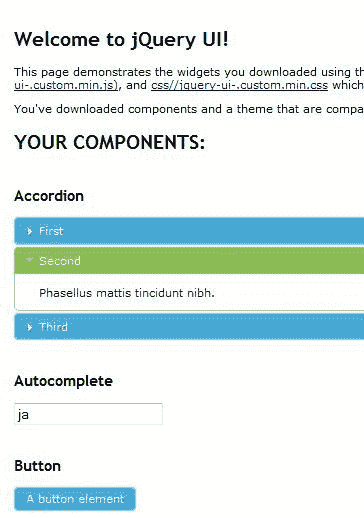

`CSS` 文件夹是存储主题的地方。那里会有一个 `CSS` 文件和一个包含小部件用图像的文件夹。将这些文件放置在网站上并引用该 `CSS` 文件，你就可以开始添加使用该主题的小部件了。

jQuery Widgets CDN

同样，Microsoft 和 Google 都为 `jQuery UI` 提供了内容分发网络（CDN）。它们还提供了库中主题的 `CSS` 链接。你可以在下方找到这些链接：

[`ajax.googleapis.com/ajax/libs/jqueryui/1.8.10/jquery-ui.js`](http://ajax.googleapis.com/ajax/libs/jqueryui/1.8.10/jquery-ui.js)

Microsoft: [`www.asp.net/ajaxlibrary/CDNjQueryUI1910.ashx`](http://www.asp.net/ajaxlibrary/CDNjQueryUI1910.ashx)

Google: http://www.devcurry.com/2010/05/latest-jquery-and-jquery-ui-theme-links.html

引用 jQuery UI

现在你已经有了主题，是时候开始为你的网站添加 `jQuery UI` 了。如上所述，你需要引用这些库和 `CSS` 文件。在你的 `<head>` 标签中，你需要添加以下内容：

```html
<head>
<script src="http://code.jquery.com/jquery-1.9.1.js"></script>
<script src="http://code.jquery.com/ui/1.10.3/jquery-ui.js"></script>
<script src="js/jquery-ui-1.10.3.custom.js"></script>
</head>
```

第一个引用是 `jQuery` 库的 `<script>` 引用。第二个 `<script>` 引用是 `jQuery UI` 库的。第三个也是最后一个 `<script>` 引用是添加主题的 `jQuery UI` `CSS` 文件。前两个 `<script>` 引用是让 `jQuery UI` 运行所必需的。你不一定要有主题，但如果没有主题，UI 看起来会很单调。

现在我们已经添加了 `jQuery UI` 的适当链接，现在可以添加一些小部件和其他项目了。让我们添加一个日历小部件。在 `<head>` 标签中，我们添加这些：

```javascript
<script>
$(document).ready(function () {
  $("#datepicker").datepicker();
});
</script>
```

在 body 标签中，我们添加这些：

```html
<p>Date: <input id="datepicker" type="text"></p>
```

这段代码的作用是将 `"datepicker"` 小部件挂载到 `<input>` 框上。让我们在下一节中更详细地检查它。

### Date Picker

Web 表单上的常见需求是让用户输入日期。在原生 HTML 中，唯一的选择是给用户一个文本字段，并希望他们输入有效的日期。

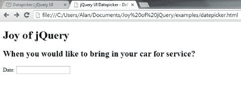

`jQuery` 日期字段让用户输入日期变得简单。日期选择器修改了标准表单输入字段的行为。只需聚焦输入字段（点击或使用 tab 键），一个交互式日历就会神奇地出现。选择一个日期，选中的日期将显示为输入框的值。

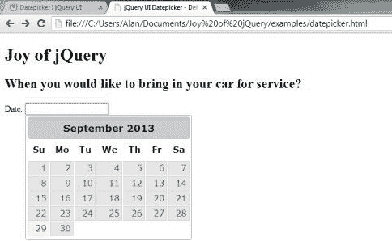

### Code

```html
01 <!doctype html>
02
03 <html lang="en">
04 <head>
05 <meta charset="utf-8" />
06 <title>jQuery UI Datepicker - Default functionality</title>
07 <link rel="stylesheet" href="jquery-ui.css" />
08 <script src="jquery-1.9.1.js"></script>
09 <script src="jquery-ui.js"></script>
10
11 <script>
12 $(function() {
13 $( "#datepicker" ).datepicker();
14 });
15 </script>
16 </head>
17 <body>
18 <h1>Joy of jQuery</h1>
19 <h2>When you would like to bring in your car for service?</h2>
20
21 <p>Date: <input type="text" id="datepicker" /></p>
22
23
24 </body>
25 </html>
```

### Code 解释

```html
01 <!doctype html>
02
03 <html lang="en">
04 <head>
05 <meta charset="utf-8" />
06 <title>jQuery UI Datepicker - Default functionality</title>
07 <link rel="stylesheet" href="jquery-ui.css" />
08 <script src="jquery-1.9.1.js"></script>
09 <script src="jquery-ui.js"></script>
10
11 <script>
12 $(function() {
13 $( "#datepicker" ).datepicker();
14 });
15 </script>
16 </head>
17 <body>
18 <h1>Joy of jQuery</h1>
19 <h2>When you would like to bring in your car for service?</h2>
20
21 <p>Date: <input type="text" id="datepicker" /></p>
```

第 6 行设置了 `title`。第 7 行是 `CSS` 文件。第 8 行是 `jQuery` 库。第 9 行是 `jQuery UI` 库。第 11 行开始 `<script>`。第 12 行打开 `function`。第 13 行调用了 `$("#datepicker")()`。第 14 行结束了 `function`。第 15 行结束了 `<script>`。第 16 行结束了 `</head>`。第 17 行是 `<body>`。第 18 行是 `<h1>`。第 19 行是 `<h2>`。第 21 行是 `<p>`。

### 自动补全文本字段

有时可能的数值范围会让单选按钮变得很尴尬。一个棒的解决方案是提供一个文本框并在用户输入时建议值。例如，当我向框中输入 `jq` 时，Google 会自动建议我想要的内容。

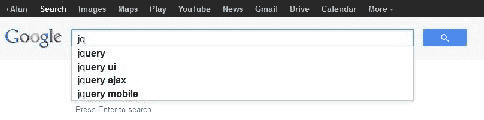

我们如何为我们的应用程序添加如此酷的功能？`jQuery` 让这一切变得简单！请考虑以下示例：

```html
<!doctype html>
<html lang="en">
<head>
<meta charset="utf-8" />
<title>Joy of jQuery - Autocomplete</title>
<link rel="stylesheet" href="http://code.jquery.com/ui/1.10.3/themes/smoothness/jquery-ui.css" />
<script src="http://code.jquery.com/jquery-1.9.1.js"></script>
<script src="http://code.jquery.com/ui/1.10.3/jquery-ui.js"></script>
<script>
$(function() {
var carTypes = [
"Audi",
"BMW",
"Buick",
"Cadillac",
"Chevrolet",
"Chrysler",
"Dodge",
"Ferrari",
"Fiat",
"Fiskar",
"GMC",
"Honda",
"Hyundai",
"Infiniti",
"Jaguar",
"Jeep",
"Kia",
"Mazda",
"Mercedes-Bens",
"Mitsubishi",
"Nissan",
"Porsche",
"Rolls-Royce",
"Scion",
"Suburu",
"Toyota",
"Volkswagon",
"Volvo"
];

$("#tags" ).autocomplete({
source: carTypes
});
});
</script>
</head>
<body>
<h1>Joy of jQuery - Sam's Used Cars</h1>
<h2>What kind of car are you looking for?</h2>
<div class="ui-widget">
<label for="tags">Manufacturer: </label>
<input id="tags" />
</div>
</body>
</html>
```

这就是完成后表单看起来的样子。一个标记为 `"Manufacturer"` 的文本框会在你开始输入时自动填充汽车品牌。这太酷了，你只需在自己的网页中任何可以添加的地方添加它！

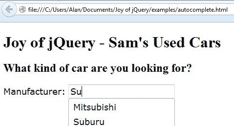


第 1-2 行将文档设置为 html。第 3 行开始 `head` 区域。第 4 行设置字符集，可能不需要。第 5 行是页面标题，当页面激活时显示在浏览器的顶部。

```html
06. <link rel="stylesheet" href="http://code.jquery.com/ui/1.10.3/themes/smoothness/jquery-ui.css" />
07. <script src="http://code.jquery.com/jquery-1.9.1.js"></script>
08. <script src="http://code.jquery.com/ui/1.10.3/jquery-ui.js"></script>
```

第 6 行是 jQuery UI 样式表的链接。关于什么是样式表，请参见相关章节。

第 7 行下载基础 jQuery 代码，而第 8 行下载 jQuery UI 代码。

```html
09. <script>
10. $(function() {
11. var carTypes = [
12. "Audi",
...
37. "Toyota",
38. "Volkswagon"
39. ];
```

第 9 行开始一个脚本块。第 10 行是 jQuery `document ready` 事件简短版本的开始。第 11 行声明了一个名为 `carTypes` 的变量，它将是一个数组。该数组由第 12 行到 38 行的汽车制造商名称填充。第 39 行关闭变量声明，第 43 行关闭脚本块。

```javascript
40. $( "#tags" ).autocomplete({
41. source: carTypes
42. });
43. });
44. </script>
45. </head>
46. <body>
47. <h1>Joy of jQuery - Sam's Used Cars</h1>
48. <h2>你正在寻找哪种汽车?</h2>
49. <div class="ui-widget">
50. <label for="tags">Manufacturer: </label>
51. <input id="tags" />
52. </div>
53. </body>
54. </html>
```

第 40 行是 jQuery `document ready` 事件简短版本的开始，在第 42 行关闭。

记住，基础 jQuery 语法是 `$(selector).action()`。

如你所见，完全不需要多少代码。单条 jQuery 语句（跨越第 40 和第 41 行）就完成了所有工作。

点左侧的文本（在下方用黄色高亮显示）选择了 ID 为 'tags' 的页面元素。

```javascript
$( "#tags" ).autocomplete({source:carTypes});
```

点右侧的文本（在下方用黄色高亮显示）告诉 jQuery 运行 `autocomplete` 操作，这是 jQuery UI 库提供的一个函数。

某些 jQuery 操作需要参数，而某些则不需要。[自动补全组件](http://api.jqueryui.com/autocomplete/) 接受一个参数，指定将要建议的项目来源。这是合理的，因为你希望控制自动建议的值。

## jQuery UI 按钮

使用 jQuery UI 制作按钮非常简单，它们看起来比标准的 HTML 按钮好看得多。此外，你甚至可以对链接进行看起来像按钮。

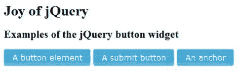

## 代码

```html
01. <html>
02. <head>
03. <title>jQuery UI Button - Default functionality</title>
04. <link rel="stylesheet" href="jquery-ui.css" />
05. <link href="css/alan-theme/jquery-ui-1.10.3.custom.css" rel="stylesheet">
06.
07. <script src="jquery-1.9.1.js"></script>
08. <script src="jquery-ui.js"></script>
09. <script>
10. $(function() {
11. $( "input[type=submit], a, button" )
12. .button()
13. });
14. </script>
15. </head>
16. <body>
17. <h1>Joy of jQuery</h1>
18. <h2>Examples of the jQuery button widget</h2>
19.
20. <button>A button element</button>
21. <input type="submit" value="A submit button" />
22. <a href="#">An anchor</a>
23. </body>
24. </html>
```

### 代码解释

```html
01. <html>
02. <head>
03. <title>jQuery UI Button - Basic functionality</title>
04. <link rel="stylesheet" href="jquery-ui.css" />
05. <link href="css/alan-theme/jquery-ui-1.10.3.custom.css" rel="stylesheet">
06.
07. <script src="jquery-1.9.1.js"></script>
08. <script src="jquery-ui.js"></script>
```

第 1 行将文档设置为 html。第 2 行开始 `head` 区域。第 3 行设置文档标题，当页面激活时显示在浏览器的顶部。第 4 行是 jQuery UI 样式表的链接。第 5 行是可选样式表的链接，在章节开头有所描述。

第 7 行下载基础 jQuery 代码，第 8 行下载 jQuery UI 代码。


敏锐的读者可能已经注意到标题为“反馈”的列表项具有类名 `class="ui-state-disabled"`。这防止了该项目被点击。很聪明，不是吧？这是因为汽车经销商 Sam 并不真的想要你的反馈，他只是想要钱。 :)

# jQuery 进度条

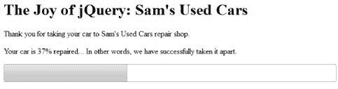

通常，向用户显示操作状态是有帮助的。在“Sam 的二手车”的案例中，Sam 可能希望用户知道他们距离准备好车辆还有多远。进度条是视觉化这种状态极好的方法。

一条 jQuery 语句就完成了所有工作。

```javascript
$(function() {
  $( "#progressbar").progressbar({value: 37});
});
```

再次，这清楚地展示了 jQuery 库惊人的力量。后台正在发生大量的代码。

记住，基础的 jQuery 语法是 `$(selector).action()`。

执行工作的行代码是 `$( "#progressbar").progressbar({value: 37});`。在这个示例中，我们选择了一个 ID 为 `progressbar` 的 DIV，并告诉 jQuery 对其应用 `progressbar` 函数。`progressbar` 函数接受一个 `value` 参数，用于指定进度条应该填充的百分比。

## 示例代码

```html
01. <!doctype html>
02. <html lang="en">
03. <head>
04. <title>jQuery UI Progressbar - Default functionality</title>
05. <link rel="stylesheet" href="http://code.jquery.com/ui/1.10.3/themes/smoothness/jquery-ui.css" />
06. <script src="http://code.jquery.com/jquery-1.9.1.js"></script>
07. <script src="http://code.jquery.com/ui/1.10.3/jquery-ui.js"></script>
08. <link rel="stylesheet" href="/resources/demos/style.css" />
09. <script>
10. $(function() {
11. $( "#progressbar").progressbar({
12. value: 37
13. });
14. });
15. </script>
16. </head>
17. <body>
18. <h1>The Joy of jQuery: Sam's Used Cars</h1>
19. <p>感谢您将车开到 Sam 的二手车修理厂。</p>
20. <p>您的车已经修理了 37%…… 换句话说，我们已经成功将其拆解了。</p>
21. <div id="progressbar"></div>
22. </body>
23. </html>
```

此小组件的相关代码可以在第 `11` 行和第 `21` 行找到。

# jQuery 滑块

滑块控件用于允许用户选择一个值而无需手动输入。相反，用户只需沿着某线移动选择器即可。在合适的情况下，滑块可以非常丝滑易用，但你不想过度使用。

如果你曾经买过二手车，你就知道当你靠近一辆车时，第一个想要得到答案的问题是“这辆车多少钱？”。反之，向你走来的销售人员想要知道的第一个问题是“你的预算是多少？”。

销售人员会非常喜欢这个滑块。对于 Sam 的二手车网站的访问者来说，滑块是一种指定他们愿意花费金额的简单方法，这样就可以向客户展示合适的车辆。它的外观可能是这样的：

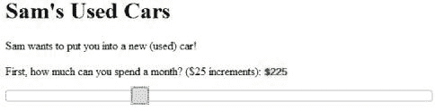

生成滑块的代码（再次）非常简单。我们在表单上创建一个 `div` 并给它一个唯一的 `id`，例如 `'slider'`。在 jQuery 的文档加载就绪事件中，我们选择该 `div` 并对其应用 `slider` 方法。

`slider` 方法接受多个选项，所有选项的描述可以在 [`api.jqueryui.com/slider/`](http://api.jqueryui.com/slider/) 中找到。

滑块小组件的一些常用选项包括：`value`、`min`、`max` 和 `increment`。

与目前为止显示的组件相比，这个小组件的一个重要区别是，滑块小组件有一个我们需要处理的重要事件以使其变得有用。这就是 `slide` 事件。每当滑块控件移动时，`slide` 事件就会被触发。事件中提供的 `ui.value` 值代表了滑块由于当前移动而将具有的值。取消事件将阻止滑块移动，滑块将保持其先先的值。

例如，当用户移动滑块时， Sam 可能希望显示的值为“您愿意每月为车支付 250 美元”之类，以便向用户明确他们所选择的值。

## 代码示例

```html
01. <!doctype html>
02. <html lang="en">
03. <head>
04. <meta charset="utf-8" />
05. <title>Joy of jQuery - Slider</title>
06. <link rel="stylesheet" href="jquery-ui.css" />
07. <script src="jquery-1.9.1.js"></script>
08. <script src="jquery-ui.js"></script>
09. <link rel="stylesheet" href="/resources/demos/style.css" />
10. <script>
11. $(function() {
12. $( $("#slider").slider({
13. value:200,
14. min:100,
15. max:500,
16. step:25,
17. slide: function( event, ui ) {
18. $( "#amount").val( "$" + ui.value );
19. }
20. });
21. $("#amount").val( "$" + $("#slider").slider("value"));
22. });
23. </script>
24. </head>
25. <body>
26. <h1>The Joy of jQuery: Sam's Used Cars</h1>
27. <p>二手车</p>
28. <p>首先，你的预算是多少?</p>
29. <div id="slider"></div>
30. <input type="text" id="amount" style="border:0; font-weight:bold;" />
31. <p>此示例展示了特定的增量，在此情况下</p>
32. <p>但你可以将其改为任何值。</p>
33. </body>
34. </html>
```

第 1-10 行在所有中通用，不再进行详细说明。它们设置了页面并引用了 jQuery 文件。

第 10-23 行是示例中最重要的部分，我们将重点关注。第 10 行开始脚本块。第 11 行是现在熟悉的文档加载就绪事件的简写引用。它意味着“当文档充分加载到浏览器后执行以下操作”。

第 12 行遵循标准的选择器/动作语法，选择 ID 为 `'slider'` 的 `div` 并对其应用 `slider` 方法。`slider` 方法定义在 jQuery 库中。

执行工作的行代码是 `$( "#slider").slider({value: 200, min:100, max:500, step:25});`。在这个示例中，我们选择了一个 ID 为 `slider` 的 div，并告诉 jQuery 将其转换为一个初始值为 200 (`value:200`)、最小值为 100、最大值为 500 且每次点击增量为 25 (`step:25`) 的滑块。

到为止都还好，对吧？

接下来的部分有点复杂，所以我在这里重复代码，以便你不需要向上滚动。接下来我们将集中在第 17-22 行，但我们会在上下文中显示它们。

```javascript
17. slide: function( event, ui ) {
18. $( "#amount").val( "$" + ui.value );
19. }
20. });
```


```javascript
21\. $( "#amount" ).val( "$" + $( "#slider" ).slider( "value" ) );
22\. });
24\. </head>
```

第 17 行与之前的选项不同，因为我们不是传递像 `max:500` 这样简单的值，而是要处理 slide 事件。事件是会发生的事情，例如点击按钮。在这种情况下，当滑块移动时，就会发生 slide 事件。我们将一个函数传递给 `slide` 选项，所示：

```javascript
slide: function( event, ui ) {
  $( "#amount" ).val( "$" + ui.value );
}
```

换句话说，当 slide 事件发生时，我们将执行以下函数：

```javascript
$( "#amount" ).val( "$" + ui.value );
```

敏锐的读者（我指的就是你）会注意到，用于处理滑块控件 slide 事件的函数使用了 jQuery！

处理滑块控件 slide 事件的函数遵循标准的 jQuery 语法 `$(selector).action()`。

该函数执行了以下操作：选择 ID 为 `'amount'` 的元素，并将其值设置为美元符号和滑块控件的当前值。我在下方红圈了它，这样你就可以看到用户拖动滑块到 225 处时发生了什么。

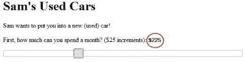

代码的其他部分是标准的 HTML，我将不再解释。你可以使用包含的 `slider.html` 文件进行尝试。

## jQuery Tabs（标签页）

Tabs 是分组相关信息的极佳方法，可以让页面对用户来说不那么混乱，并且更容易找到你正在寻找的信息。

对于二手车业务的网站，你可能不想一个充满信息的长页面，而是将相关的条目分组，例如概览（Overview）、照片（Photographs）和财务计算器（Finance Calculator），所示：

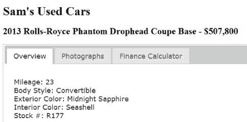

标签控件的工作原理与菜单非常相似。你从一个无序列表开始，通过 jQuery 的魔法将其转换为其他形式。这里是创建上述页面所需的 HTML 代码段：

```html
<div id="tabs">
  <ul>
    <li><a href="#tabs-1">Overview</a></a></li>
    <li><a href="#tabs-2">Photographs</a></a></li>
    <li><a href="#tabs-3">Finance Calculator</a></a></li>
  </ul>
  <div id="tabs-1">
    <p>Mileage: 23<br>Body Style: Convertible<br>Exterior Color: Midnight Sapphire<br>Interior Color: Seashell<br>Stock #: R177<br><br>Fuel: Gasoline: R-177<br>Engine: 6.8L V12 48V GDI DOHC<br>Transmission: 8-Speed Automatic<br>Drivetrain: RWD<br>Doors: 2</p>
  </div>
</div>
```

所需的 jQuery 代码几乎简单得不可思议：

```javascript
$(function() {
  $( "#tabs" ).tabs();
});
```

要将内容放在你想要的位置标签页中，创建一个 `id` 与列表 `href` 目标匹配的 `div`。例如，在接后的代码中，注意字符串 `'tabs-1'` 在两个黄色高亮处都是通用的。这就是标签页与内容链接的地方。

```html
<div id="tabs">
  <ul>
    <li><a href="#tabs-1">Overview</a></a></li>
    <li><a href="#tabs-2">Photographs</a></a></li>
    <li><a href="#tabs-3">Finance Calculator</a></a></li>
  </ul>
  <div id="tabs-1">
    <p>Mileage: 23<br>Body Style: Convertible<br>Exterior Color: Midnight Sapphire<br>Interior Color: Seashell<br>Stock #: R177<br><br>Fuel: Gasoline<br>Engine: 6.8L V12 48V GDI DOHC<br>Transmission: 8-Speed Automatic<br>Drivetrain: RWD<br>Doors: 2</p>
  </div>
</div>
```

我们所做的是指定标签为 Overview 的标签页将包含 `id` 为 `'tabs-1'` 的 `div` 中指定的内容。我们的标签页起什么名字并不重要，只要它们匹配即可。

查看包含的 `tabs.html` 示例文件。

## 代码

```html
<!doctype html>
<html lang="en">
<head>
  <meta charset="utf-8" />
  <title>Joy of jQuery - UI Tabs</title>
  <link rel="stylesheet" href="jquery-ui.css" />
  <script src="jquery-1.9.1.js"></script>
  <script src="jquery-ui.js"></script>
  <link rel="stylesheet" href="/resources/demos/style.css" />
  <script>
    $(function() {
      $( "#tabs" ).tabs();
    });
  </script>
</head>
<body>
  <h1>Sam's Used Cars</h1>
  <h2>2013 Rolls-Royce Phantom Drophead Coupe Base - $507,800</h2>
  <div id="tabs">
    <ul>
      <li><a href="#tabs-1">Overview</a></a></li>
      <li><a href="#tabs-2">Photographs</a></a></li>
      <li><a href="#tabs-3">Finance Calculator</a></a></li>
    </ul>
    <div id="tabs-1">
      <p>Mileage: 23<br>Body Style: Convertible<br>Exterior Color: Midnight Sapphire<br>Interior Color: Seashell<br>Stock #: R177<br><br>Fuel: Gasoline<br>Engine: 6.8L V12 48V GDI DOHC<br>Transmission: 8-Speed Automatic<br>Drivetrain: RWD<br>Doors: 2</p>
    </div>
    <div id="tabs-2">
      
    </div>
    <div id="tabs-3">
      <p>Finance Calculator content here...</p>
    </div>
  </div>
</body>
</html>
```

## 其他控件

### Accordion（折叠面板）
比显示的控件多得多，例如 Accordion、Spinner 和 Tooltip——它们都遵循标准的 jQuery 语法 `$(selector).action()`。accordion 是一组可折叠的头部。每个头部都可以点击显示或隐藏内容。

### Spinner（计数器）
spinner 控件允许用户通过点击箭头或输入从列表中选择值。

### Tooltip（提示框）
tooltip 控件在用户悬停在元素上时显示弹出消息。

## 简介（Introduction）
accordion 控件是一组可折叠的头部。每个头部都可以点击显示或隐藏内容。

（注：由于原文中存在大量重复的段落，此处已按要求翻译了核心内容并保持格式）


第 5 行对我们来说是新的。它告诉浏览器“视口”（在移动设备上可见的页面部分）宽度应该与设备宽度相同，初始缩比例为 `1`。简而言之，对于 99% 的 jQuery 移动页面，你可以直接使用这一行。如果没有这一行，移动浏览器将尝试缩放文档，看起来会很糟糕。

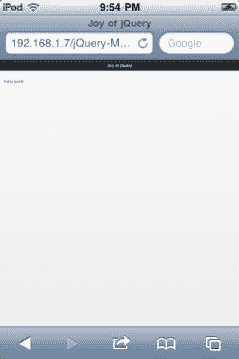

```html
6. <meta http-equiv="content-type" content="text/html; charset=utf-8" />
7. <link rel="stylesheet" href="http://code.jquery.com/mobile/1.3.2/jquery.mobile-1.3.2.min.css" />
8. <script src="http://code.jquery.com/jquery-1.9.1.min.js"></script>
9. <script src="http://code.jquery.com/mobile/1.3.2/jquery.mobile-1.3.2.min.js"></script>
```

第 6 行是另一个必选项项。jQuery Mobile 喜欢知道字符集。只需将其放入你所有的移动页面中即可，无需担心。

第 7 行是到 jQuery mobile 样式表的链接。第 8 行是对 jQuery 库的引用，最后第 9 行是对 jQuery mobile 库的引用。注意，你必须在引入 jQuery 库之后引入 jQuery mobile 库，因为它们之间相互依赖。

你必须在引用 jQuery 之后引用 jQuery mobile。jQuery mobile 扩展了 jQuery，因此 jQuery 必须在文档中先加载。

```html
10. </head>
11. <body>
12.
13. <div data-role="page">
14.
15. <div data-role="header">
16. <h1>Joy of jQuery</h1>
17. </div> <!-- /header -->
18.
19. <div data-role="content">
20. <p>Hello world</p>
21. </div> <!-- /content -->
22.
23. </div> <!-- /page -->
24.
25. </body>
26. </html>
```

第 13 行是一个 `DIV` 的开始，在第 23 行结束。注意文档中的所有 `DIV` 都包含一个名为 `data-role` 的属性。`data-role` 告诉 jquery mobile 如何格式化特定的 `DIV`。jQuery Mobile 框架使用 HTML5 的 `data-` 属性来实现基于标记的组件初始化和配置。

数据角色有许多类型，但为了保持第一页的简单，我们将 data-roles 限制在 `page`、`header` 和 `content`。

## jQuery Mobile 主题

默认主题包含 5 种色块，并为其分配了字母 (a, b, c, d, e) 以于快速引用。这让事情变得超级简单。为了让跨组件的色块映射保持一致，jQuery 团队遵循了约定：色块 "a" 是视觉优先级最高级（在我们默认主题中为黑色），"b" 是次级（蓝色），"c" 是我们在许多情况下默认使用的基准级（灰色），"d" 用于备用次级，“e" 作为强调色块。

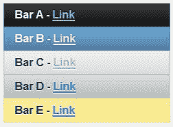

使用特定的色块非常简单。例如，如果我想修改“hello mobile world”示例，在标题栏中使用“b”主题，我会进行以下代码更改：

```html
<div data-role="header" data-theme="b">
```

你可以将 `data-theme` 元素放在任何带有 `data-role` 的 jQuery `div` 中，它将获得适当的主题。因此，要更改内容区域的外观可以这样做：

```html
<div data-role="content" data-theme="b">
```

### 练习

尝试通过将 `data-theme` 属性放在页面的不同部分来进行实验。你会发现根据应用位置的不同，会有不同的结果。看看是否能让它看起来像这样：

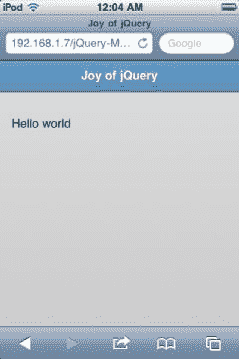

## 如何测试你的移动页面

你可能已经注意到书中的示例都使用以 IP 地址 192.186.... 开头的网络地址。这是因为当我编写移动网页时，我将它们放在笔记本电脑上的 `WAMP` 文件夹中。`WAMP`（对于那些还没读过我的 [Joy of PHP](http://www.amazon.com/The-Joy-PHP-Programming-Applications-ebook/dp/B00BALXN70/r) 或之前没用过 `WAMP` 的人来说）是一个可以安装在几乎任何电脑上的超级简单（且免费）的 Web 服务器，它可以轻松托管此类页面。只需在 Google 上搜索“download WAMP”就能找到它。

我的笔记本电脑无法通过互联网访问，但在同一局域网（即共享我家的 WIFI）上的其他电脑（以及移动设备）是可以访问的。所以我找到了我的 IP 地址（在 Windows 上选择运行，`CMD`，`ipConfig`），并将该地址输入我的 iPod 的地址栏。

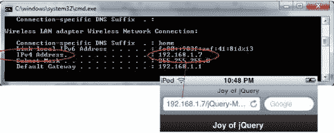

毫无疑问，对于使用优秀的 Apple 平台的读者来说也有类似的方法，但原理是如此 :)

## 一个带有 UI 元素和多页面的更高级示例

好的，我们已经掌握了 'hello world'，是时候提升一下了。接下来我们将为 Sam 的二手车网站创建一个页面，允许移动用户像普通访问者一样浏览车辆。这个示例可以在源代码中找到 `Sam-Mobile.html`。我们要构建的页面看起来像这样：


点击链接将滑动到一个新页面，例如：


或者使用 'e' 主题的页面：


### Sam 的二手车网站代码

这段代码看起来很长，但概念上并不困难。不要被长度吓到。我会解释它的，你就会明白的！

```html
<!DOCTYPE html>
<html>
<head>
<title>Joy of jQuery</title>
<meta name="viewport" content="width=device-width, initial-scale=1" />
<meta http-equiv="content-type" content="text/html; charset=utf-8" />
<link rel="stylesheet" href="http://code.jquery.com/mobile/1.3.2/jquery.mobile-1.3.2.min.css" />
<script src="http://code.jquery.com/jquery-1.9.1.min.js"></script>
<script src="http://code.jquery.com/mobile/1.3.2/jquery.mobile-1.3.2.min.js"></script>
12. 避免 header 文字被截断 -->
<style type="text/css">
.ui-header .title {
margin-right: 10%;
margin-left: 10%;
}
</style>
</head>
<body>
<div data-role="page" id="mainPage" data-theme="b">
<div data-role="header" data-theme="b">
<h4>Sam's Used Cars</h4>
</div>
<div data-role="content">
<ul data-role="listview" inset="true" filter="true">
<li><a href="#Acura" data-transition="slide">Acura</a></li>
<li><a href="#BMW" data-transition="slide">BMW</a></li>
<li><a href="#Chevy" data-transition="slide">Chevrolet</a></li>
<li><a href="#Dodge" data-transition="slide">Dodge</a></li>
</ul>
</div>
<div data-role="footer" data-theme="b">
<h4>Sam's Used Cars</h4>
</div>
</div>
<div data-role="page" id="Acura">
<div data-role="header" data-theme="b">
<a data-rel="back" data-direction="reverse" href="#mainPage">Back</a>
<h1>Acura</h1>
</div>
<div data-role="content">

<p>Sam 刚为你进了一批 Acura！这些小家伙卖得很快，所以不要等了...</p>
</div>
<div data-role="footer" data-theme="b">
<h4>Call Sam now!</h4>
</div>
</div>
<div data-role="page" id="BMW">
<div data-role="header" data-theme="b">
<a data-rel="back" data-direction="reverse" href="#mainPage">Back</a>
<h1>BMW</h1>
</div>
<div data-role="content">

<p>哥们儿——坐在这台终极机器的驾驶盘后，你总能赢得女孩。</p><p>Sam 有许多优质二手 BMW 选择</p>
</div>
<div data-role="footer" data-theme="b">
<h4>Call Sam @ 555-1212</h4>
</div>
</div>
<div data-role="page" id="Chevy">
<div data-role="header">
<a data-rel="back" data-direction="reverse" href="#mainPage">Back</a>
<h1>Chevrolet</h1>
</div>
<div data-role="content">

```


83. 预算有限大家庭的理想车型。Sam 拥有精选优质二手雪佛兰。

#### 立即致电 Sam 吧！

<div data-role="page" id="Dodge" data-theme="e">
  <div data-role="header" data-theme="e">
    <a data-rel="back" data-direction="reverse" href="#mainPage">返回</a>
    <h1>道奇</h1>
  </div>
  <div data-role="content">
    
    <p>预算有限大家庭的理想车型。Sam 拥有精选优质二手雪佛兰</p>
  </div>
  <div data-role="footer" data-theme="e">
    <h4>Sam 喜欢道奇！</h4>
  </div>
</div>

# 代码解析

尽管当你查看这个“网站”（web site）时，它看起来是由若干个独立的页面组成的，但实际上它只是一个带有多个子页面的单一页面。这就是为什么它看起来很长。但如果你能理解其中一个子页面是如何工作的，你就能理解整个体系是如何运作的。

这里是生成主面的代码片段。我们展示的是第 24 – 42 行：

```html
<div data-role="page" id="mainPage" data-theme="b">
  <div data-role="header" data-theme="b">
    <h4>Sam 的二手车</h4>
  </div>
  <div data-role="content">
    <ul data-role="listview" data-inset="true" data-filter="true">
      <li><a href="#Acura" data-transition="slide">奥迪</a></li>
      <li><a href="#BMW" data-transition="slide">宝马</a></li>
      <li><a href="#Chevy" data-transition="slide">雪佛兰</a></li>
      <li><a href="#Dodge" data-transition="slide">道奇</a></li>
    </ul>
  </div>
  <div data-role="footer" data-theme="b">
    <h4>Sam 的二手车</h4>
  </div>
</div>
```

你有一个 `data-role` 为 `page` 的 `DIV`。这意味着该 `DIV` 的内容在移动设备上渲染时将定义一个单一页面。它是第一个具有该元素的 `DIV`，因此它是第一个显示的页面。接下来是一个 `data-role` 为 `header` 的 `DIV`，这是页面顶部的标题。下一个 `DIV` 的 `data-role` 为 `content`，当然，那是页面的主要内容所在。内容区域内部包含一个无序列表 `<ul>`，其中有四个列表项：奥迪、宝马、雪佛兰和道奇。jQuery 将这个简单的无序列表转换为一组触控友好的按钮。最后是一个 `data-role` 为 `footer` 的 `DIV`，它定义了页面底部的内容。

这里有一张图片可以帮助解释这一切的工作原理：

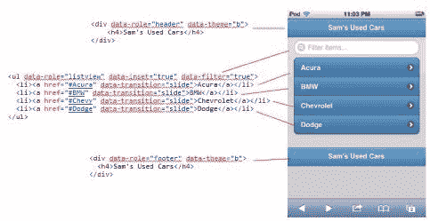

点击无序列表中指定的任何链接（换句话说，在移动设备上点击任何一个大亮按钮）都将带你进入新页面。

那部分是如何工作的？这是基础 HTML，如果我们查看其中一个链接，例如：

```html
<li><a href="#BMW" data-transition="slide">宝马</a></li>
```

你会看到这里有一个 `HREF` 设置为 `'#something'` 的锚点链接。在 HTML 中，当 `HREF` 目标以前带有井号 (`#`) 时，它将带你到同一页面上带有该标识的元素。在我们的情况下，那个“另一个元素”将是一个 `ID` 为 `BMW` 的 `DIV`，如下所示：

```html
<div data-role="page" id="BMW">
  <div data-role="header" data-theme="b">
    <a data-rel="back" data-direction="reverse" href="#mainPage">返回</a>
    <h1>宝马</h1>
  </div>
  <div data-role="content">
    
    <p>哥们们——坐在这台终极机器机器的驾驶上，你总能赢得女孩的。</p>
    <p> Sam 拥有精选优质二手宝马。</p>
  </div>
  <div data-role="footer" data-theme="b">
    <h4>致电 Sam @ 555-1212</h4>
  </div>
</div
```

你会发现 `BMW` `DIV` 与主页具有相同的基本元素，即页眉、页脚和内容区域。唯一的新元素是包含了图片和返回按钮。返回按钮包含在页眉 `DIV` 内部，实现方式如下：

```html
<a data-rel="back" data-direction="reverse" href="#mainPage">返回</a>
```

## AJAX

返回按钮包含在页眉 `DIV` 内部，实现方式如下：

```html
<a data-rel="back" data-direction="reverse" href="#mainPage">返回</a>
```

你会发现 `BMW` `DIV` 与主页具有相同的基本元素，即页眉、页脚和内容区域。唯一的新元素是包含了图片和返回按钮。返回按钮包含在页眉 `DIV` 内部，实现方式如下：

```html
<a data-rel="back" data-direction="reverse" href="#mainPage">返回</a>
```

## AJAX

返回按钮包含在页眉 `DIV` 内部，实现方式如下：

```html
<a data-rel="back" data-direction="reverse" href="#mainPage">返回</a>
```

## AJAX

返回按钮包含在页眉 `DIV` 内部，实现方式如下：

```html
<a data-rel="back" data-direction="reverse" href="#mainPage">返回</a>
```

## AJAX

返回按钮包含在页眉 `DIV` 内部，实现方式如下：

```html
<a data-rel="back" data-direction="reverse" href="#mainPage">返回</a>
```

## AJAX

返回按钮包含在页眉 `DIV` 内部，实现方式如下：

```html
<a data-rel="back" data-direction="reverse" href="#mainPage">返回</a>
```

## AJAX

返回按钮包含在页眉 `DIV` 内部，实现方式如下：

```html
<a data-rel="back" data-direction="reverse" href="#mainPage">返回</a>
```

## AJAX

返回按钮包含在页眉 `DIV` 内部，实现方式如下：

```html
<a data-rel="back" data-direction="reverse" href="#mainPage">返回</a>
```

## AJAX

返回按钮包含在页眉 `DIV` 内部，实现方式如下：

```html
<a data-rel="back" data-direction="reverse" href="#mainPage">返回</a>
```

## AJAX

返回按钮包含在页眉 `DIV` 内部，实现方式如下：

```html
<a data-rel="back" data-direction="reverse" href="#mainPage">返回</a>
```

## AJAX

返回按钮包含在页眉 `DIV` 内部，实现方式如下：

```html
<a data-rel="back" data-direction="reverse" href="#mainPage">返回</a>
```

## AJAX

返回按钮包含在页眉 `DIV` 内部，实现方式如下：

```html
<a data-rel="back" data-direction="reverse" href="#mainPage">返回</a>
```

## AJAX

返回按钮包含在页眉 `DIV` 内部，实现方式如下：

```html
<a data-rel="back" data-direction="reverse" href="#mainPage">返回</a>
```

## AJAX

返回按钮包含在页眉 `DIV` 内部，实现方式如下：

```

一个“回调函数”是一种高级的说法，指这是在获取成功时将运行的函数。回调函数本身包含参数，这些参数由 jQuery 在获取成功时赋予的。第一个参数将包含请求的页面内容，第二个回调参数将包含请求的状态。起初我假设状态参数的值只有“success”，因为根据定义，函数只有在获取成功时才被调用。然而，简单的搜索发现了其他可能的值，如“notmodified”、“error”、“timeout”或“parsererror”。## AJAX 语法 - Get/Post

`get()` 和 `post()` 方法用于从服务器请求数据。

### Get 与 Post

*   `GET` 从指定的资源请求数据。
*   `POST` 将数据提交到指定的资源。

`GET` 用于获取数据。然而，与 `GET` 相比有两个主要区别。首先，`POST` 方法可以随请求发送数据。

## jQuery $.get() 方法

`$.get()` 方法使用 HTTP 请求从服务器获取数据。这是 `get()` 的语法：

```javascript
$.get(URL, callback);
```

所需的 `URL` 参数是你想要请求的 URL (`get`)，可选的 `callback` 参数是请求成功后将执行的函数名称。

### $.get() 示例

以下示例使用 `.get()` 方法从文件检索数据：

```javascript
$("button").click(function(){
  $.get("todays_deal.php",function(data,status){
    alert("Data: " + data + "\nStatus: " + status);
  });
});
```

`$.get()` 的第一个参数是你想要请求的 URL (`"todays_deal.php"`）。第二个参数是回调函数。“回调函数”是一种高级的说法，指这是在成功时将运行的函数。回调函数本身包含参数，这些参数由 jQuery 在成功时赋予的。第一个参数将包含页的内容，第二个回调参数将包含请求的状态。起初我假设状态参数的值只有“success”，因为根据定义，函数只有在成功时才被调用。然而，简单的搜索发现了其他可能的值。

顺便说一下，上面 PHP 文件 ("todays_deal.php") 如下：

```php
<?php echo ("Today only-- Sam has an awesome deal for you!"); ?>
```

## jQuery $.post() 方法

`$.post()` 方法使用 HTTP POST 请求从服务器获取数据。这是 `post()` 的语法：

```javascript
$.post(URL, data, callback);
```

所需的 `URL` 参数是你想要请求的 URL。可选的 `data` 参数指定了随请求发送的一些数据。与 `get` 一一样，可选的 `callback` 参数是请求成功后将执行的函数名称。

### $.post() 示例

以下示例使用 `.post()` 方法在从服务器检索数据的同时发送一些数据。由于此特定示例依赖于基于 php 的服务器端脚本，我将其发布在了 [`www.joyofphp.com/ajaxpost.html`](http://www.joyofphp.com/ajaxpost.html) 上供你尝试。


# jQuery 之悦 -  Ajax POST 示例

```html
<link rel="stylesheet" href="jquery-ui.css" />
<script src="jquery-1.9.1.js"></script>
<script>
$(document).ready(function(){
    $("button").click(function(){
        var Make = $('input[type="radio"]:checked').val();
        $.post("response.php",
        {
            Make: Make
        },
        function(data,status){
            // alert("Data: " + data + "\nStatus: " + status);
            $("#deal").html(data);
        });
    });
});
</script>
</head>
<<body>
    <h1>Sam 的二手车行</h1>
    <p>Sam 想让你开上一一辆新的（二手）车！点击按钮了解今日的特惠：</p>
    <p>
        <form method="post">
            <input type="radio" name="Make" value="Ford">福特<br>
            <input type="radio" name="Make" value="Dodge">道奇<br>
            <input type="radio" name="Make" value="Honda">本田<br>
        </form>
    </p>
    <div id="deal" style="background-color:silver;">
        今日特惠
    </div>
    <br>
    <button>向页面发送 HTTP POST 请求并获取结果</button>
</body>
</html>
```

AJAX 是在客户端 JavaScript 中运行的，因此只有你的计算机会看到或处理你的数据输入/输出。

`$.post()` 的第一个参数是我们想要请求的 URL（`"response.php"`）。

然后我们传入了一些要随请求一起发送的数据（`Make`）。

`"response.php"` 中的 PHP 脚本会读取参数，对其进行处理并返回结果。

第三个参数是回调函数。第一个回调参数持有所请求页面的内容，第二个回调参数持有请求的状态。

**提示：** 以下是 PHP 文件的外观所示（`"demo_test_post.asp"`）：

```php
<?php
$Make = $_POST['Make'] ;
$Day = date("l");
switch ($Make ) {
case "Dodge":
    echo "<h1>Dodge</h1>";
    echo "<p>预算有限家庭的完美车型。$Day 是 Sam 二手车行的道奇日。</p>";
    break;
case "Ford":
    echo "<h1>Ford</h1>";
    echo "<p>福特探险者是美国人喜爱的 SUV。$Day 是 Sam 二手车行的福特日。</p>";
    break;
case "Honda":
    echo "<h1>Honda</h1>";
    echo "<p>$Day 是 Sam 二手车行的本田日。快来看吧...</</p>";
    break;
default:
    echo "<h1>$Make</h1>";
    echo "<p>$Day 是你在 Sam 二手车行的幸运日。如果我们这里没有 $Make，我们会为你找一台的！</p>";
    break;
}
?>
```

## 备用 AJAX 语法 - Load

`load` 与 `get` 类似，但它增加了功能，允许你定义返回的数据应该放在文档的哪个位置。因此，`load` 命令非常适用于以下情况：你知道返回的内容是一个格式良好的 HTML 片段，并且你想将其放在文档的某处。

`load` 命令是一个与特定的 jQuery 封装元素相关的方法，你首先需要使用 jQuery 选择器来选择该元素。其模式类似于：

`$('#divWantingContent').load(...)`

顺便提一下，由于 `get()`、`post()` 和 `load()` 命令实际上只是更复杂（但更灵活）的通用 `$.ajax()` 命令的“封装（wrapper）”。换句话说，当你调用 `get` 命令时，实际上发生的情况是调用了 `.ajax()` 命令，并自动为你填充了所有参数。我们不会在书中介绍更具通用性的 `.ajax()` 方法，但如果你发现 `get`、`post` 或 `load` 都不能完全满足你的需求，那么了解 jQuery 提供了比这些更灵活的方法也是很有好处的。

以下是 `load()` 方法的语法：

`[selector].load( URL, [data], [callback] );`

以下是参数的说明：

- **URL**: 发送请求的服务器端资源的 URL。它可以是一个 CGI、ASP、JSP 或 PHP 脚本，用于动态生成数据或从数据库获取数据。
- **data**: 此可选参数表示一个对象，其属性会被序列化为编码正确的参数以传递给请求。如果指定了该参数，将使用 `POST` 方法进行请求。如果省略，则使用 `GET` 方法。
- **callback**: 在响应数据加载到匹配集合的元素后执行的函数。传递给此函数的第一个参数是从服务器收到的响应文本，第二个参数是状态状态码。

### 基础示例：加载简单数据

让我们从一个基础示例开始。假设二手车商 Sam 想在他的网站上设置一个页面，用来揭示“今日特惠”。

（注意：提供的文本包含大量的重复内容，且 HTML 标签与描述性文本之间结构不匹配。以下是根据源文件中提供的逻辑清理后的表示形式。）

提供的源文本是 HTML 行号和描述的杂烩。我已提取了“基础示例：加载简单数据”章节描述的核心逻辑：

假设二手车商 Sam 想在他的网站上设置一个页面来揭示“今日特惠”。`load` 方法将用加载的 URL 结果替换 div 内部的 HTML。

### 更高级的示例：加载数据并执行函数

可选的回调参数指定了一个在 `load()` 方法完成后运行的函数。该回调函数可以接收三个参数：

- **responseText**: 如果加载成功，包含的文本。
- **statusText**: 调用的状态。
- **xhr**: 包含 XMLHttpRequest 对象。

以下示例修改了我们之前的示例，在 `load()` 方法完成后显示一个警告框。如果 `load()` 方法成功，它将显示“外部内容加载成功！”，如果失败了，它将显示错误消息。

```javascript
$(document).ready(function(){
    $("#driver").click(function(){
        $("#deal").load("response.html",function(responseTxt,statusTxt,xhr){
            if(statusTxt=="success")
            alert("外部内容加载成功！");
            if(statusTxt=="error")
            alert("错误："+xhr.status+": "+xhr.statusText);
        });
    });
});
```


# 代码 – ajax2.html

```html
<html>
<head>
<title>jQuery 之美 -  Ajax 示例</title>
<link rel="stylesheet" href="jquery-ui.css" />
<script src="jquery-1.9.1.js"></script>
<script type="text/javascript" language="javascript">
$(document).ready(function() {
$("#driver").click(function(){
$("#deal").load("result.html",function(responseTxt,statusTxt,xhr){
if(statusTxt=="success")
alert("外部内容加载成功!");
if(statusTxt=="error")
alert("错误: "+xhr.status+": "+xhr.statusText);
});
});
});
</script>
</head>
<body>
<h1>Sam 的二手车</h1>
<p>Sam 想让你开上一辆崭新的（二手）车！&nbsp;&nbsp; 点击按钮了解今日特惠：</p>
<div id="deal" style="background-color:silver;">
今日特惠
</div>
<br><input type="button" id="driver" value="今日特惠" />
</body>
</html>
```

## 跨域

你可能已经注意到，这些示例从同一个域名加载动态内容（或者在本地运行时，从同一个文件夹加载）。大多数浏览器都会阻止脚本从其他域名将内容加载到当前页面。正如你妈妈常说的，“这都是为了你好！”这种设计的目的是防止跨域脚本将恶意软件加载到毫无防备的用户所在的当前网页中。

如果你确实需要从另一个域提取数据，请研究 jQuery 的 `.ajax` API 文档。在少数情况下你可以实现跨域，但这超出了本书的讨论范围。关于这一点，请搜索 `crossDomain` 属性，你可以在 [`api.jquery.com/jQuery.ajax/`](http://api.jquery.com/jQuery.ajax/) 了解更多信息。

## jQuery 动画

在 jQuery 使变得简单的许多功能中，动画是最直观的，也认为是最有趣的之一。只需记住不要在自己的网页上过度使用动画。在合理的地方使用动画，而不是为了到处处使用动画而使用它。

## jQuery hide(), show(), and toggle()

通过 jQuery，你可以使用 `hide()` 和 `show()` 方法隐藏和显示 HTML 元素：

### 隐藏
```
$("#hide").click(function(){
$("p.first()").hide();
});
```

### 显示
```javascript
$("#show").click(function(){
$("p.first()").show();
});
```

## 语法
```
$(selector).hide(speed,callback);
$(selector).show(speed,callback);
```
可选的 `speed` 参数指定了从一个状态到另一个状态的过渡速度，可以取值 "slow"、fast" 或指定毫秒数的数字。

可选的 `callback` 参数是一个函数，它将在 `hide()` 或 `show()` 方法完成后被执行。

### jQuery toggle()

通过 jQuery，你可以使用 `toggle()` 方法在 `hide()` 和 `show()` 方法之间切换。可见的元素会被隐藏，隐藏的元素将变为可见：

### 示例
```javascript
$("button").click(function(){
$("p.first()").toggle();
});
```

## 语法
```
$(selector).toggle(speed,callback);
```
由于 `toggle` 实际上只是调用了 `show` 或 `hide` 函数，因此自然地提供了相同的参数。可选的 `speed` 参数可以取以下值："slow"、"fast" 或毫秒数的数字。

可选的 `callback` 参数是 `toggle()` 完成后执行的函数。

## jQuery 渐变 (Fading)

jQuery 不仅仅是简单的显示或隐藏元素，还允许让元素渐入和淡出可见状态。jQuery 拥有以下渐变方法：

* `fadeIn()`
* `fadeOut()`
* `fadeToggle()`
* `fadeTo()`

### jQuery fadeIn() 方法

jQuery 的 `fadeIn()` 方法用于让隐藏元素逐渐变得可见。当它完成时，元素将完全可见。

## 语法
```
$(selector).fadeIn(speed,callback);
```
可选的 `speed` 参数指定了效果的持续时间。它接受以下值："slow"、"fast" 或毫秒数的数字。

可选的 `callback` 参数是一个在渐变完成后后执行的函数。

### jQuery fadeIn() 示例
```javascript
$("button").click(function(){
$("#div1").fadeIn();
$("#div2").fadeIn("slow");
$("#div3").fadeIn(5000);
});
```

### jQuery fadeOut() 方法

jQuery 的 `fadeOut()` 方法用于让可见元素逐渐变得不可。当它完成时，元素将完全隐藏。

## 语法
```
$(selector).fadeOut(speed,callback);
```
可选的 `speed` 参数指定了效果的持续时间。它接受以下值："slow"、"fast" 或毫秒数的数字。

可选的 `callback` 参数是一个在渐变完成后后执行的函数。

### jQuery fadeOut() 示例
```javascript
$("button").click(function(){
$("#div1").fadeOut();
$("#div2").fadeOut("slow");
$("#div3").fadeOut(3000);
});
```

### jQuery fadeToggle() 方法

类似于在 `hide()` 和 `show()` 方法之间切换的 jQuery `toggle()` 方法，jQuery 的 `fadeToggle()` 方法在 `fadeIn()` 和 `fadeOut()` 方法之间切换。

如果元素是隐藏的，`fadeToggle()` 将让它们淡入。如果元素是可见的，`fadeToggle()` 将让它们淡出。

## 语法
```
$(selector).fadeToggle(speed,callback);
```
可选的 `speed` 参数指定了效果的持续时间。可以取值："slow"、"fast" 或毫秒数的数字。

可选的 `callback` 参数是 `toggle()` 完成后执行的函数。

### jQuery fadeToggle() 示例
```javascript
$("button").click(function(){
$("#div1").fadeToggle();
$("#div2").fadeToggle("slow");
$("#div3").fadeToggle(5000);
});
```

### jQuery fadeTo() 方法

渐变方法集中的最后一个是 `fadeTo()` 方法。`fadeTo()` 方法允许渐变到指定的透明度。这与其他渐变方法不同，后者总是以显示 100% 的元素结束。

## 语法
```
$(selector).fadeTo(speed,opacity,callback);
```
所需的 `speed` 参数指定了效果的持续时间。它接受以下值："slow"、"fast" 或毫秒数的数字。

`fadeTo()` 方法中所需的 `opacity` 参数指定指定的透明度（0 到 1 之间的值）。

可选的 `callback` 参数是渐变完成后后执行的函数。

### jQuery fadeTo() 示例
```javascript
$("button").click(function(){
$("#div1").fadeTo("slow",0.15);
$("#div2").fadeTo("slow",0.5);
$("#div3").fadeTo("slow",0.8);
});
```

## jQuery 滑动 (Sliding)

jQuery 滑动方法通过向上或向下滑动来显示或隐藏元素。jQuery 有以下滑动方法：

* `slideDown()`
* `slideUp()`
* `slideToggle()`

### jQuery slideDown() 方法

jQuery 的 `slideDown()` 方法用于让元素向下进入可见状态。

## 语法
```
$(selector).slideDown(speed,callback);
```
可选的 `speed` 参数指定了效果的持续时间。它可以取值："slow"、"fast" 或毫秒数的数字。

可选的 `callback` 参数是一个在滑动完成后后执行的函数。

### jQuery slideDown() 示例
```javascript
$("#button").click(function(){
$("#panel").slideDown();
});
```

### jQuery slideUp() 方法

jQuery 的 `slideUp()` 方法用于让元素向上进入不可见状态。

## 语法
```
$(selector).slideUp(speed,callback);
```
可选的 `speed` 参数指定了效果的持续时间。它可以取值："slow"、"fast" 或毫秒数的数字。

可选的 `callback` 参数是一个在滑动完成后后执行的函数。

### jQuery slideUp() 示例
```javascript
$("#button").click(function(){
$("#panel").slideUp();
});
```

### jQuery slideToggle() 方法

jQuery 的 `slideToggle()` 方法在 `slideDown()` 和 `slideUp()` 方法之间切换。

如果元素是可见的，`slideToggle()` 将让它们向上滑动。如果元素是不可见的，`slideToggle()` 将让它们向下进入可见状态。


```javascript
$(selector).slideToggle(speed,callback);
```

可选的 `speed` 参数可以取以下值："slow"、fast" 或毫秒形式的数字。

可选的 `callback` 参数是一个在滑动完成后执行的函数。

## jQuery slideToggle() 示例

以下示例演示了 `slideToggle()` 方法的使用：

```javascript
$("#button").click(function(){
  $("#panel").slideToggle();
});
```

## jQuery Animate

jQuery 的 `animate()` 方法用于创建自定义动画。几乎任何 CSS 属性都可以制作动画，但请记住，在使用 `animate()` 方法时，所有属性名称必须使用驼峰命名法。例如，您需要编写 `paddingRight` 而不是 `padding-righ`，编写 `marginRight` 而不是 `margin-right`，以此此类推。

注意：默认情况下，所有 HTML 元素都具有静态位置，无法通过动画进行移动。要操作元素的位置，请记住先将元素的 CSS `position` 属性设置为 `relative`、`fixed` 或 `absolute`。

颜色动画未包含在 jQuery 核心库中。如果您想对颜色制作动画，，需要从 jQuery.com 下载 Color Animations 插件。

## 语法

```javascript
$(selector).animate({params},speed,callback);
```

必需的 `params` 参数定义了要动画的 CSS 属性。

可选的 `speed` 参数指定效果的持续时间。它接受以下值："slow"、fast" 或毫秒形式的数字。

可选的 `callback` 参数是一个在动画完成后执行的函数。

## jQuery Animate 示例

以下示例演示了 `animate()` 方法的简单用法；它会将 `<div>` 元素向右移动，直到其 `left` 属性达到 `300px`：

```javascript
$("button").click(function(){
  $("div").animate({left:'300px'});
});
```

## 动画多个属性

如果您真的想玩花哨的（我鼓励您适度使用），可以同时对多个属性制作动画：

```javascript
$("button").click(function(){
  $("div").animate({
    left:'250px',
    opacity:'0.7',
    height:'300px',
    width:'300px'
  }, "slow");
});
```

# 作者的话

你好，感谢阅读我的书。作为一名新作者，我特别感兴趣获得你的反馈，了解你喜欢和不喜欢的地方，并在专业能力上不断成长。正如我在书开头提到的，请随时通过邮件 `AlanForbes@outlook.com` 与我联系。

如果你不喜欢这本书，请给我发邮件并告诉我该如何改进它。如果你喜欢这本书，如果你愿意花点时间点击此链接在 Amazon 上留留评价，我将不胜感激 --> [`www.amazon.com/review/create-review?ie=UTF8&asin=B00H1G7B08`](https://www.amazon.com/review/create-review?ie=UTF8&asin=B00H1G7B08)

此外，如果你喜欢我的写作风格并想学习服务器端脚本，请查看我的另一本畅销书：[The Joy of PHP: A Beginner's Guide to Programming Interactive Web Applications with PHP and mySQL](http://www.amazon.com/Joy-PHP-Programming-Interactive-Applications-ebook/dp/B00BALXN70)。

再次感谢，祝编码愉快！

