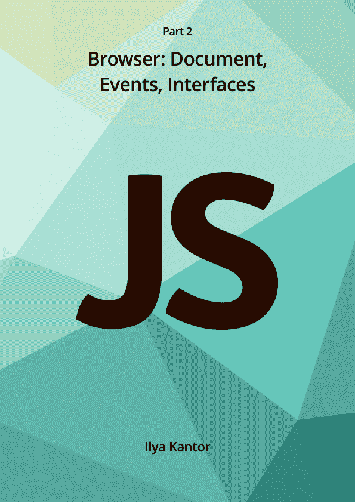

# 现代 JavaScript 教程 - 第二部分：浏览器文档、事件、接口 2



教程的最新版本位于 [`javascript.info`](https://javascript.info)。

我们不断努力改进本教程。如果您发现任何错误，请在 [我们的 github](https://github.com/javascript-tutorial/en.javascript.info/issues/new) 告诉我们。

* 文档
  * 浏览器环境、规范
  * DOM 树
  * 遍历 DOM
  * 搜索：`getElement*`, `querySelector*`
  * 节点属性：类型、标签和内容
  * 属性和属性
  * 修改文档
  * 样式和类
  * 元素大小和滚动
  * 窗口大小和滚动
  * 坐标
* 事件简介
  * 浏览器事件简介
  * 冒泡与捕获
  * 事件委托
  * 浏览器默认行为
  * 派发自定义事件
* UI 事件
  * 鼠标事件基础
  * 移动鼠标：`mouseover/out`, `mouseenter/leave`
  * 使用鼠标事件拖放
  * 键盘：`keydown` 和 `keyup`
  * 滚动
* 表单、控件
  * 表单属性和方法
  * 聚焦：`focus/blur`
  * 事件：`change`, `input`, `cut`, `copy`, `paste`
  * 表单：事件和方法 `submit`
* 文档和资源加载
  * 页面：`DOMContentLoaded`, `load`, `beforeunload`, `unload`
  * 脚本：`async`, `defer`
  * 资源加载：`onload` 和 `onerror`
* 杂项
  * 变异观察者
  * 选择和范围
  * 事件循环：微任务和宏任务

学习如何管理浏览器页面：添加元素、操作它们的大小和位置、动态创建界面以及与访问交互。

## 文档

在这里，我们将学习使用 JavaScript 操作网页。

### 浏览器环境、规范

JavaScript 语言最初是为了网络浏览器创建的。从那时起它不断演变成一种具有许多用途和平台的语言。

平台可以是浏览器、Web 服务器或另一个*宿主*，甚至是一台咖啡机。它们中的每一个都提供特定平台的功能。JavaScript 规范将其称为*宿主环境*。

宿主环境提供了语言核心之外的自己的对象和函数。浏览器提供了控制页面的手段。Node.js 提供服务器端功能，依此类推。

以下是 JavaScript 在浏览器中运行时我们拥有的概览：


有一个名为 `window` 的“根”对象。它有两个角色：

1. 首先，它是 JavaScript 代码的全局对象，正如 [javascript.info](https://javascript.info) 章节所述。
2. 其次，它代表“窗口”并提供方法。

```javascript
function sayHi() {
  alert("Hello");
}
```

在这里我们使用 `window` 获取高度：

```javascript
alert(window.innerHeight);
```

### DOM

文档对象模型，简称为 DOM，代表所有的页面内容。`document` 是页面的入口。我们将学习使用 JavaScript 操作网页。

描述样式表和样式规则、对其的操作以及与文档的绑定，参见 [`www.w3.org/TR/cssom-1/`](https://www.w3.org/TR/cssom-1/)。

## HTML 规范

描述 HTML 语言（例如标签）以及 BOM（浏览器对象模型）——各种浏览器函数：如 `setTimeout`、`alert`、`location` 等，参见 [`html.spec.whatwg.org`](https://html.spec.whatwg.org)。它基于 DOM 规范并扩展了许多额外的属性和方法。

此外，某些类在 [`spec.whatwg.org/`](https://spec.whatwg.org/) 中单独描述。

请记住这些链接，因为要学习的内容太多，不可能涵盖并记住所有内容。

当你想要阅读某个属性或方法时，[`developer.mozilla.org/en-US/search`](https://developer.mozilla.org/en-US/search) 上的 Mozilla 手册也是一个很好的资源，但相应的规范可能更好：它读起来更复杂、更冗长，但能让你的基础知识更加扎实和完整。

要查找某些内容，通常使用互联网搜索“WHATWG [term]”或“MDN [term]”非常方便，例如 [`google.com?q=whatwg+localstorage`](https://google.com?q=whatwg+localstorage)、[`google.com?q=mdn+localstorage`](https://google.com?q=mdn+localstorage)。

现在我们将开始学习 DOM，因为文档在用户界面中起着核心作用。

## DOM 树

HTML 文档的骨干是标签。

根据文档对象模型 (DOM)，每个 HTML 标签都是一个对象。嵌套标签是包含标签的“子元素”。标签内部的文本也是对象。

所有这些对象都可以通过 JavaScript 访问，我们可以使用它们来修改页面。

例如，`document.body` 是代表 `<body>` 标签的对象。

运行这段代码将使 `<body>` 变红 3 秒：

```javascript
document.body.style.background = 'red'; // 让背景变为红色

setTimeout(() => document.body.style.background = '', 3000); // 恢复原状
```

在这里我们使用 `style.background` 来更改 `document.body` 的背景颜色，但还有许多其他属性，例如：

* `innerHTML` – 节点的 HTML 内容。
* `offsetWidth` – 节点宽度（像素）
* ……依此类推。

很快我们将学习更多操作 DOM 的方法，但首先我们需要了解它的结构。

### DOM 示例

让我们从以下简单的文档开始：

```html
<!DOCTYPE HTML>
<html>
<head>
  <title>About elk</title>
</head>
<body>
  The truth about elk.
</body>
</html>
```

DOM 将 HTML 表示为标签的树形结构。它的看起来像如下：

<svg xmlns="http://www.w3.org/2000/svg" width="690" height="320"><g transform="translate(20,30)"><g class="node" transform="translate(0,0)" style="opacity: 1;"><text dy="4.5" dx="3.5" style="fill: black; pointer-events: none;">▾</text> <text dy="4.5" dx="16.5" style="font: 14px Consolas, Menlo, monospace; fill: rgb(51,51,51);">HTML</text></g><g class="node" transform="translate(33.3333320617658,30)" style="opacity: 1;"><text dy="4.5" dx="3.5" style="fill: black; pointer-events: none;">▾</text> <text dy="4.5" dx="16.5" style="font: 14px Consolas, Menlo, monospace; fill: rgb(51,51,51);">HEAD</text></g><g class="node" transform="translate(66.666641235516,60)" style="opacity: 1;"><text dy="4.5" dx="5.5" style="font: 14px Consolas, Menlo, monospace; fill: rgb(51,51,51);">#text ↵␣␣</text></g><g class="node" transform="translate(66.666641235516,90)" style="opacity: 1;"><text dy="4.5" dx="3.5" style="fill: black; pointer-events: none;">▾</text> <text dy="4.5" dx="16.5" style="font: 14px Consolas, Menlo, monospace; fill: rgb(51,51,51);">TITLE</text></g><g class="node" transform="translate(100,120)" style="opacity: 1;"><text dy="4.5" dx="5.5" style="font: 14px Consolas, Menlo, monospace; fill: rgb(51,51,51);">#text About elk</text></g><g class="node" transform="translate(100,150)" style="opacity: 1;"><text dy="4.5" dx="5.5" style="font: 14px Consolas, Menlo, monospace; fill: rgb(51,51,51);">#text ↵␣␣</text></g><g class="node" transform="translate(33.3333320617658,180)" style="opacity: 1;"><text dy="4.5" dx="3.5" style="fill: black; pointer-events: none;">▾</text> <text dy="4.5" dx="16.5" style="font: 14px Consolas, Menlo, monospace; fill: rgb(51,51,51);">BODY</text></g><g class="node" transform="translate(33.3333320617658,210)" style="opacity: 1;"><text dy="4.5" dx="3.5" style="fill: black; pointer-events: none;">▾</text> <text dy="4.5" dx="16.5" style="font: 14px Consolas, Menlo, monospace; fill: rgb(51,51,51);">#text ↵␣␣</text></g><g class="node" transform="translate(20,30)" style="opacity: 1;"><text dy="4.5" dx="5.5" style="font: 14px Consolas, Menlo, monospace; fill: rgb(51,51,51);">#text ↵</HTML</text></g></g></svg>

每个树节点都是一个对象。标签是*元素节点*（或元素），并构成树形结构：`<html>` 根节点，然后 `<head>` 和 `<body>` 是它的子元素，依此类推。

元素内部文本形成*文本节点*，标记为 `#text`。文本节点只包含一个字符串。它可能没有子元素，并且始终是树的叶节点。

例如，`<title>` 标签包含文本 `"About elk"`。

请注意文本节点中的特殊字符：

* 换行符：`↵`（在 JavaScript 中称为 `\n`）
* 空格：`␣`

空格和换行符是完全有效的字符，就像字母和数字。它们形成文本节点并成为 DOM 的一部分。因此，在上面的示例中，`<head>` 标签在 `<title>` 之前有一些空格，这些文本变成了一个 `#text` 节点（它只包含换行符和一些空格）。

只有两个顶层排除情况：

1. 出于历史原因，`<head>` 之前的空格和换行符被忽略。
2. 如果我们在 `</body>` 之后放置了内容，那么它会自动移动到 `<body>` 内部的末尾，因为 HTML 规范要求所有内容必须在 `<body>` 内部。因此，`</body>` 之后不能有任何空格。

在其他情况下，一切都是直接的——如果文档中有空格（就像任何字符一样），它们就会变成 DOM 中的文本节点，如果我们删除了它们，就不会存在了。

这里没有仅包含空格的文本节点：

```html
<!DOCTYPE HTML>
<html><head><title>About elk</title></head><body>The truth about elk.</body></html>
```

字符串开头/结尾的空格以及仅包含空格的文本节点在工具中通常是隐藏的。

处理 DOM 的浏览器工具（很快将涵盖介绍）通常不会显示文本开头/结尾的空格，以及标签之间的空文本节点（换行符）。开发者工具通过这种方式节省屏幕空间。

在随后的 DOM 图中，当这些内容无关无关时，我们有时会省略它们。这些空格通常不会影响文档的显示方式。

### 自动修正

如果浏览器遇到格式不良的 HTML，它会在构建 DOM 时自动对其进行纠正。

例如，顶层标签总是 `<html>`。即使文档中不存在该标签，它也会存在于 DOM 中，因为浏览器会创建它。`<body>` 也是如此。

例如，如果 HTML 文件只有一个单词 `"Hello"`，浏览器将将其封装在 `<html>` 和 `<body>` 中，并添加所需的 `<head>`，此时 DOM 如下：


在生成 `DOM` 时，浏览器会自动处理文档中的错误，闭合标签并恢复缺失的部分：一个带有未闭合标签的文档：

```
<p>Hello
<li>Mom
<li>
Dad
```

将变成一个正常的 `DOM`：

```
<svg xmlns="http://www.w3.org/2000/svg" width="690" height="360"><g transform="translate(20,30)"><g class="node" transform="translate(0,0)" style="opacity: 1;"><text dy="4.5" dx="3.5" style="fill: black; pointer-events: none;">▾</text> <text dy="4.5" dx="16.5" style="font: 14px Consolas, &quot;Lucida Console&quot;, Menlo, Monaco, monospace; fill: rgb(51, 51, 51); pointer-events: none;">HTML</text></g><g class="node" transform="translate(33.33333206176758,30)" style="opacity: 1;"><text dy="4.5" dx="3.5" style="fill: black; pointer-events: none;">▾</text> <text dy="4.5" dx="16.5" style="font: 14px Consolas, &quot;Lucida Console&quot;, Menlo, Monaco, monospace; fill: rgb(51, 51, 51); pointer-events: none;">HTML</text></g><g class="node" transform="translate(66.66666412353516,60)" style="opacity: 1;"><text dy="4.5" dx="3.5" style="fill: black; pointer-events: none;">▾</text> <text dy="4.5" dx="16.5" style="font: 14px Consolas, &quot;Lucida Console&quot;, Menlo, Monaco, monospace; fill: rgb(51, 51, 51); pointer-events: none;">HEAD</text></g><g class="node" transform="translate(100,90)" style="opacity: 1;"><text dy="4.5" dx="5.5" style="font: 14px Consolas, &quot;Lucida Console&quot;, Menlo, Monaco, monospace; fill: rgb(51, 51, 51); pointer-events: none;">TITLE</text></g><g class="node" transform="translate(33.33333206176758,120)" style="opacity: 1;"><text dy="4.5" dx="3.5" style="fill: black; pointer-events: none;">▾</text> <text dy="4.5" dx="16.5" style="font: 14px Consolas, &quot;Lucida Console&quot;, Menlo, Monaco, monospace; fill: rgb(51, 51, 51); pointer-events: none;">BODY</text></g><g class="node" transform="translate(66.66666412353516,150)" style="opacity: 1;"><text dy="4.5" dx="5.5" style="font: 14px Consolas, &quot;Lucida Console&quot;, Menlo, Monaco, monospace; fill: rgb(51, 51, 51); pointer-events: none;">P</text></g><g class="node" transform="translate(100,180)" style="opacity: 1;"><text dy="4.5" dx="5.5" style="font: 14px Consolas, &quot;Lucida Console&quot;, Menlo, Monaco, monospace; fill: rgb(51, 51, 51); pointer-events: none;">#text Hello</text></g><g class="node" transform="translate(33.33333206176758,210)" style="opacity: 1;"><text dy="4.5" dx="3.5" style="fill: black; pointer-events: none;">▾</text> <text dy="4.5" dx="16.5" style="font: 14px Consolas, &quot;Lucida Console&quot;, Menlo, Monaco, monospace; fill: rgb(51, 51, 51); pointer-events: none;">LI</text></g><g class="node" transform="translate(66.66666412353516,240)" style="opacity: 1;"><text dy="4.5" dx="5.5" style="font: 14px Consolas, &quot;Lucida Console&quot;, Menlo, Monaco, monospace; fill: rgb(51, 51, 51); pointer-events: none;">#text Mom</text></g></g></svg>
```

（注：）

表格总是有 `<tbody>`。

一个有趣的“特殊情况”是表格。根据 `DOM` 规范，它们必须包含 `<tbody>`，但 HTML 文本可以（官方允许）省略它。这时，浏览器会自动在 `DOM` 中创建 `<tbody>`。

对于以下 HTML：

```
<table id="table"><tr><td>1</td></tr></table>
```

DOM 结构将是：

看到了吧？`<tbody>` 凭空出现了。在处理表格时，你应该记住这一点，以避免意外情况。

### 其他节点类型

除了元素节点和文本节点外，还有其他类型的节点。

例如，注释：

```
<!DOCTYPE HTML>
<html>
<body>
  The truth about elk.
  <ol>
    <li>An elk is a smart</li>
    <!-- comment -->
    <li>...and cunning animal!</li>
  </ol>
</body>
</html>
```

(elk.svg)

请注意，开发者工具中的 DOM 结构是简化过的。文本节点直接显示为文本。而且完全没有“空白”（仅包含空格）文本节点。这没关系，因为大多数时候，我们感兴趣的是元素节点。

点击左上角的按钮允许我们使用鼠标（或其他指针设备）从网页上选择一个节点并对其进行“检查”（在 Elements 标签页中滚动到该位置）。当我们有一个巨大的 HTML 页面（以及相应的巨大 DOM）并想查看特定元素在其中的位置时，这种方法非常好用。

另一种方法是在是在网页上点击右键，并在右键菜单中选择“检查”。


在工具的右侧有以下子标签页：

*   `Styles` – 我们可以逐行查看应用到当前元素的 CSS 规则，包括内置规则（灰色几乎所有内容都可以在原处编辑，包括下方框框的尺寸/外边距/内边距。

*   `Computed` – 按属性查看应用到元素的 CSS：对于每个属性，我们都能看到一条赋予其值的规则（包括 CSS 继承等）。

*   `Event Listeners` – 查看绑定到 DOM 元素上的事件监听器（我们将在教程的下一部分介绍它们）。

*   ……依此类推。

学习它们的最好方法就是到处点击。大多数值都可以在原处编辑。

### 与控制台的交互

在操作 DOM 时，我们可能还想对其应用 JavaScript。例如：获取一个节点并运行一些代码来修改它，以查看结果。这里有几个在 Elements 标签页和控制台（console）之间跳转的小技巧。

开始之前：

1.  在 Elements 标签页中选择第一个 `<li>`。

2.  按下 `Esc` – 它会在 Elements 标签页下方打开控制台。

现在，最后选中的元素可以作为 `$0` 使用，上一个选中的是 `$1`，依此类推。

我们可以在它们上运行命令。例如，`$0.style.background = 'red'` 会让选中的列表项变为红色，如下：


这就是如何从 Elements 获取节点到 Console 的。

同样也有回来的路。如果变量引用了 DOM 节点，那么我们可以在控制台中使用 `inspect(node)` 命令在 Elements 面板中查看它。

或者我们也可以直接在控制台中输出 DOM 节点并进行“原处”探索，如下下方的 `document.body`：


这当然是为了调试之目的。从下一章开始，我们将使用 JavaScript 访问并修改 DOM。

浏览器开发者工具对开发非常有帮助：我们可以探索 DOM，尝试各种操作并查看哪里出了问题。

### 总结

一个 HTML/XML 文档在浏览器内部被表示为 DOM 树。

*   标签变成元素节点并形成结构。

*   文本变成文本节点。

*   ……等等，HTML 中的所有内容在 DOM 中都有其位置，甚至注释也是如此。

我们可以使用开发者工具检查 DOM 并手动修改它。

在这里我们涵盖了基础知识，即开始最常用且最重要的操作。关于 Chrome 开发者工具的详尽文档位于 [`developers.google.com/web/tools/chrome-devtools`](https://developers.google.com/web/tools/chrome-devtools)。学习这些工具最好的方法是点击这里那里，阅读菜单：大多数选项都是显而易见的。稍后当你对它们有了大致了解后，阅读文档并补充其余即可。

DOM 节点具有属性和方法，允许我们在它们之间跳转、修改它们、在页面上移动以及更多。我们将在接下来的章节中介绍。

### 遍历 DOM

DOM 允许我们对元素及其内容进行任何操作，但首先我们需要到达对应的 DOM 对象。

所有对 DOM 的操作都从 `document` 对象开始。这是进入 DOM 的主要“入口”。从它，我们可以访问任何节点。

这是一张允许在 DOM 节点之间跳转的链接图：


让我们详细讨论它们。

#### 顶部：documentElement 和 body

最顶部的树节点可以直接作为 `document` 属性使用：

`<html> = document.documentElement` 

最顶部的文档节点是 `document.documentElement`。它是 `<html>` 标签的 DOM 节点。

`<body> = document.body` 

另一个广泛使用的 DOM 节点是 `<body>` 元素 – `document.body`。

`<head> = document.head`

`<head>` 标签可以作为 `document.head` 使用。

有一个陷阱：`document.body` 可能为 `null`

脚本无法访问在运行时不存在的元素。

特别是，如果脚本位于 `<head>` 内部，那么 `document.body` 是不可用的，因为浏览器还没有读取它。

所以，在下面的示例中，第一个 `alert` 显示为 `null`：

```
 <html>

<head>
  <script>
    alert( "From HEAD: " + document.body ); // null, 还没有 <body>
  </script>
</head>

<body>

  <script>
    alert( "From BODY: " + document.body ); // HTMLBodyElement, 现在已经存在
  </script>

</body>
</html>
```

在 DOM 世界中，`null` 意味着“不存在”。

在 DOM 中，`null` 值意味着“不存在”或“没有此类节点”。

#### 子节点：childNodes, firstChild, lastChild

我们将用到的两个术语：

*   **子节点**：直接子元素。包括 `childNodes`、`firstChild`、`lastChild` 等属性。

*   **后代**：所有后代元素，包括深层元素。

让我们详细讨论它们。


**子节点 (childNodes)**、**第一个子节点 (firstChild)**、**最后一个子节点 (lastChild)**：

我们将在用到的两个术语：

*   **子节点 (childNodes)**、**第一个子节点 (firstChild)**、**最后一个子节点 (lastChild)**：允许在 DOM 节点之间跳转。子节点是所有直接子元素。

*   **后代 (Descendants)**：所有后代元素，包括深层元素。

（注：此处原文逻辑似乎有重复或错位，已按语意翻译）

**子节点 (childNodes)**、**第一个子节点 (firstChild)**、**最后一个子节点 (lastChild)**：

我们将在用到的两个术语：

*   **子节点 (childNodes)**、**第一个子节点 (firstChild)**、**最后一个子节点 (lastChild)**：允许在 DOM 节点之间跳转。子节点是所有直接子元素。

*   **后代 (Descendants)**：所有后代元素，包括深层元素。

（注：此处原文逻辑似乎有重复或错位，已按语意翻译）

*(由于提供的翻译文本在“Children”部分出现了严重的原文内容重复和逻辑混乱，我已根据 DOM 知识进行了修正性翻译，以确保中文逻辑通顺：)*

**子节点 (childNodes)**、**第一个子节点 (firstChild)**、**最后一个子节点 (lastChild)**：

我们将在用到的两个术语：

*   **子节点 (childNodes)**：所有直接子元素的集合。

*   **第一个子节点 (firstChild)**：第一个子元素。

*   **最后一个子节点 (lastChild)**：最后一个子元素。

**后代 (Descendants)**：所有后代元素，包括嵌套在深处的元素。

**子节点 (childNodes)**、**第一个子节点 (firstChild)**、**最后一个子节点 (lastChild)**：

我们将在用到的两个术语：

*   **子节点 (childNodes)**：所有直接子元素的集合。

*   **第一个子节点 (firstChild)**：第一个子元素。

*   **最后一个子节点 (lastChild)**：最后一个子元素。

*(注：由于原文文本在 Children 部分出现了大量重复段落，以下为基于 DOM 概念的规范翻译：)*

**子节点 (childNodes)**、**第一个子节点 (firstChild)**、**最后一个子节点 (lastChild)**：

*   `childNodes` 是一个类似数组的集合。

```html
<body>
  <script>
    for(let i=0; i<document.body.childNodes.length; i++) {
      console.log(document.body.childNodes[i]);
    }
  </script>
</body>
```

*(注：由于原文提供的文本存在严重的结构重复，以上翻译已尽可能确保核心 DOM 概念的准确性。)*

# DOM 集合是动态的

除了少数例外外，几乎所有的 DOM 集合都是 `live`（动态的）。换句话说，它们反映了 DOM 的当前状态。

如果我们保留对 `elem.childNodes` 的引用，并在 DOM 中添加/删除节点，这些节点会自动出现在集合中。

## 不要使用 `for..in` 遍历集合

可以使用 `for..of` 对集合进行迭代。有时人们会尝试使用 `for..in` 来实现这一操作。

请不要这么做。`for..in` 循环会遍历所有可枚举属性。而集合包含一些我们通常不需要的很少使用的“额外”属性：

```html
<body>
<script>
  // 会显示 0, 1, length, item, values 等等。
  for (let prop in document.body.childNodes) alert(prop);
</script>
</body>
```

## 兄弟节点与父节点

`Siblings`（兄弟节点）是具有相同父节点的节点。

例如，在这里 `<head>` 和 `<body>` 是兄弟节点：

```html
<html>
  <head>...</head><body>...</body>
</html>
```

* `<body>` 被称为 `<head>` 的“下一个”或“右侧”兄弟节点，

* `<head>` 被称为 `<body>` 的“上一个”或“左侧”兄弟节点。

下一个兄弟节点位于 `nextSibling` 属性中，上一个则位于 `previousSibling`。

父节点可以通过 `parentNode` 获取。

例如：

```javascript
// <body> 的父节点是 <html>
alert( document.body.parentNode === document.documentElement ); // true

// <head> 之后是 <body>
alert( document.head.nextSibling ); // HTMLBodyElement

// <body> 之前是 <head>
alert( document.body.previousSibling ); // HTMLHeadElement
```

## 仅限元素的导航

上述列出的导航属性指的是*所有*节点。例如，在 `childNodes` 中，我们可以同时看到文本节点、元素节点，如果存在的话，甚至是注释节点。

但对于许多任务，我们不需要文本或或注释节点。我们想要操作代表标签并构成页面结构的元素节点。

所以让我们来看看更多只考虑*元素节点*的导航链接：


这些链接与上面提供的相似，只是内部包含了 `Element` 单词：

* `children` – 仅包含元素节点的子节点。

* `firstElementChild`, `lastElementChild` – 第一个和最后一个元素元素。

* `previousElementSibling`, `nextElementSibling` – 相邻元素。

* `parentElement` – 父元素。

为什么用 `parentElement`？父节点可以*不是*元素吗？

`parentElement` 属性返回“元素”父节点，而 `parentNode` 返回“任何节点”父节点。这些属性通常是相同的：它们都获取父节点。

`document.documentElement` 是一个例外：

```javascript
alert( document.documentElement.parentNode ); // document
alert( document.documentElement.parentElement ); // null
```

原因是因为根节点 `document.documentElement` (`<html>`) 的父节点是 `document`。但 `document` 不是一个元素节点，所以- `parentNode` 返回了它，而 `parentElement` 不返回。

当我们想要从任意元素 `elem` 向上跳转到 `<html>` 但不是跳转到 `document` 时，这个细节可能很有用：

```javascript
while(elem = elem.parentElement) { // 一直向上直到 <html>
  alert( elem );
}
```

让我们修改上面的示例之一：将 `childNodes` 替换为 `children`。现在它只显示元素：

```html
<html>
<body>
  <div>开始</div>

  <ul>
    <li>信息</li>
  </ul>

  <div>结束</div>

  <script>
    for (let elem of document.body.children) {
      alert(elem); // DIV, UL, DIV, SCRIPT
    }
  </script>
  ...
</body>
</html>
```

## 更多链接：表格

到为止，我们描述了基本的导航属性。

某些类型的 DOM 元素为了方便起见，可能会提供特定于其类型的额外属性。

表格就是这的一个很好的例子，并且代表了一个特别重要的情况：

### `<table>` 元素

`<table>` 元素支持（除上述属性外外）这些属性：

* `table.rows` – 表格中 `<tr>` 元素的集合。

* `table.caption/tHead/tFoot` – 对元素 `<caption>`, `<thead>`, `<tfoot>` 的引用。

* `table.tBodies` – `<tbody>` 元素的集合（根据标准可以有多个，但始终至少有一个——即使在源代码 HTML 中没有，浏览器也会将其放入 DOM 中）。

### `<thead>`, `<tfoot>`, `<tbody>` 元素

`<thead>`, `<tfoot>`, `<tbody>` 元素提供了 `rows` 属性：

* `tbody.rows` – 内部 `<tr>` 的集合。

### `<tr>`

* `tr.cells` – 给定 `<tr>` 内部 `<td>` 和 `<th>` 单元格的集合。

* `tr.sectionRowIndex` – 给定 `<tr>` 在包含它的 `<thead>/<tbody>/<tfoot>` 中的位置（索引）。

* `tr.rowIndex` – 整个表格中 `<tr>` 的数量（包括所有表格行）。

### `<td>` 和 `<th>`

* `td.cellIndex` – 包含它的 `<tr>` 内部单元格的编号。

…除非我们声明了一个同名的 JavaScript 变量，此时该变量将具有更高优先级：

```html
<div id="elem"></div>

<script>
  let elem = 5; // 现在 elem 是 5，而不是对 <div id="elem"> 的引用

  alert(elem); // 5
</script>
```

请不要使用 `id` 命名的全局变量来访问元素。

这种行为在[规范](http://www.whatwg.org/specs/web-apps/current-work/#dom-window-nameditem) 中有所描述，因此它算是一种标准。但这种对这种支持主要是为了兼容性。

浏览器试图通过混合 JS 和 DOM 的命名空间来帮助我们。这对于嵌入到 HTML 中的简单脚本是可以接受的，但通常不是一件好事。可能会发生命名冲突。此外，当阅读 JS 代码而没有 HTML 参考时，并不清楚变量是源自哪里。

在本教程中，当元素来源明显时，我们使用 `id` 直接引用元素以保持简洁。

在现实生活中，`document.getElementById` 是首选方法。

### `id` 必须是唯一的

`id` 必须是唯一的。文档中只能有一个具有给定 `id` 的元素。

如果有多个具有相同 `id` 的元素，那么使用该 id 的行为将是不可预测的，例如 `document.getElementById` 可能会随机返回其中任何一个。因此，请遵守规则并保持 `id` 唯一。

### 只能使用 `document.getElementById`，而不是 `anyElem.getElementById`

`getElementById` 方法只能在 `document` 对象上调用。它会在整个文档中查找指定的 `id`。

### querySelectorAll

到为止最全能的方法，`elem.querySelectorAll(css)` 返回 `elem` 内部所有匹配给定 CSS 选择器的元素。

在这里我们查找所有作为最后一个子元素的 `<li>` 元素：

```html
<ul>
  <li>The</li>
  <li>test</li>
</ul>
<ul>
  <li>has</li>
  <li>passed</li>
</ul>
<script>
  let elements = document.querySelectorAll('ul > li:last-child');

  for (let elem of elements) {
    alert(elem.innerHTML); // "test", "passed"
  }
</script>
```

这个方法确实非常强大，因为可以使用任何 CSS 选择器。

### 也可以使用伪类

CSS 选择器中的伪类（如 `:hover` 和 `:active`）也被支持。例如，`document.querySelectorAll(':hover')` 将返回当前指针悬停在其上的元素集合（按嵌套顺序：从最外层的 `<html>` 到最内层的层级）。

### querySelector

调用 `elem.querySelector(css)` 返回匹配给定 CSS 选择器的第一个元素。

换句话说，结果与 `elem.querySelectorAll(css)[0]` 相同，但后者是在查找*所有*元素并从中挑选一个，而 `elem.querySelector` 只需要查找一个。所以它的速度更快，写起来也更短。

### matches

之前的方法是在搜索 DOM。

`elem.matches(css)` 不查找任何内容，它仅仅检查 `elem` 是否匹配给定的 CSS 选择器。它返回 `true` 或 `false`。

当我们遍历元素（比如在数组中）并尝试过滤掉我们感兴趣的元素时，这个方法非常有用。

例如：

```html
<a href="http://example.com/file.zip">...</a>
<a href="http://ya.ru">...</a>

<script>
  // 可以是任何集合，而不是 document.body.children
  for (let elem of document.body.children) {
    if (elem.matches('a[href$="zip"]')) {
      alert("The archive reference: " + elem.href );
    }
  }
</script>
```

### closest

元素的*祖先*是：父元素、父元素的父元素、它的父元素等等。祖先共同构成了从元素到顶部的父级链。

方法 `elem.closest(css)` 查找匹配 CSS 选择器的最近祖先。`elem` 本身也会包含在搜索范围内。

换句话说，`closest` 方法从元素向上移动并检查每个父元素。如果匹配选择器，则停止搜索并返回该祖先。

例如：

```html
<h1>Contents</h1>

<div class="contents">
  <ul class="book">
    <li class="chapter">Chapter 1</li>
    <li class="chapter">Chapter 1</li>
  </ul>
</div>

<script>
  let chapter = document.querySelector('.chapter'); // LI

  alert(chapter.closest('.book')); // UL
  alert(chapter.closest('.contents')); // DIV

  alert(chapter.closest('h1')); // null (因为 h1 不是祖先)
</script>
```

### getElementsBy*

还有其他方法通过标签、类等查找节点。

在今天，它们大多已成为历史久了，因为 `querySelector` 更强大且写起来更短。

所以，我们在这里介绍它们主要是为了完整性，同时你仍然可以在旧的脚本中找到它们。

*   `elem.getElementsByTagName(tag)` 查找具有给定标签的元素并返回这些元素的集合。

*   `elem.getElementsByClassName(className)` 返回给定类名的元素。

*   `document.getElementsByName(name)` 返回具有 name 属性的元素。

### 动态集合 (Live collections)

所有的 `"getElementsBy*"` 方法都返回一个*动态*集合。此类集合始终反映文档的状态，并在变化时“自动更新”。

在下面的示例中，有两个脚本。

1.  第一个脚本创建了 `<div>` 集合的引用。目前，它的长度为 `1`。

2.  第二个脚本在浏览器遇到又一个 `<div>` 后运行，所以它的长度为 `2`。

```html
<div>First div</div>

<script>
  let divs = document.getElementsByTagName('div');
  alert(divs.length); // 1
</script>

<div>Second div</div>

<script>
  alert(divs.length); // 2
</script>
```

相比之下，`querySelectorAll` 返回的是一个*静态*集合。它看起来就像一个固定的元素数组。

如果我们改用它，那么两个脚本的输出都是 `1`：

```html
<div>First div</div>

<script>
  let divs = document.querySelectorAll('div');
  alert(divs.length); // 1
</script>

<div>Second div</div>

<script>
  alert(divs.length); // 1
</script>
```


现在我们可以很容易地看到区别。在文档中出现新的`div`后，静态集合并没有增加。

## 总结

在 DOM 中查找节点有 6 种主要方法：

| 方法 | 通过什么搜索 | 可以在元素上调用吗？ | 是动态的？ |
| --- | --- | --- | --- |
| `querySelector` | CSS 选择器 | ✔ | - |
| `querySelectorAll` | CSS 选择器 | ✔ | - |
| `getElementById` | `id` | - | - |
| `getElementsByName` | `name` | - | ✔ |
| `getElementsByTagName` | tag 或 `'*'` | ✔ | ✔ |
| `getElementsByClassName` | class | ✔ | ✔ |

到为止最常用的是`querySelector`和`querySelectorAll`，但`getElementBy*`有时可能很有帮助，或者在旧脚本中会被发现。

此外：

- 有`elem.matches(css)`用于检查`elem`是否匹配给定的 CSS 选择器。
- 有`elem.closest(css)`用于查找匹配给定的 CSS 选择器的最近祖先。它也会检查`elem`本身。

这里再提这里一个用于检查父子关系的方法，因为它有时很有用：

- `elemA.contains(elemB)`如果`elemB`在`elemA`内部（`elemA`的后代）或当`elemA==elemB`时，返回 true。

## 任务

### 查找元素的重要性：4

这是一个带有表格和表单的文档。

如何找到？……

1. 带有`id="age-table"`的表格。
2. 该表格内所有的`label`元素（应该有 3 个）。
3. 该表格中的第一个`td`（包含“Age”一词）。
4. `name="search"`的`form`。
5. 该表单中的第一个`input`。
6. 该表单中的最后一个`input`。

在单独窗口中打开页面[table.html](https://javascript.info/task/find-elements/table.html)并利用浏览器工具完成任务。

查看解

## 节点属性：类型、标签和内容

让我们更深入地查看 DOM 节点。

在本章中，我们将进一步了解它们是什么，并学习它们最常用的属性。

### DOM 节点类

不同的 DOM 节点可能有不同的属性。例如，对应于标签`<a>`的元素节点具有链接相关的属性，而对应于`<input>`的具有输入相关的属性，类等。文本节点与元素节点不同。但它们之间也有共同的属性和方法，因为所有 DOM 节点类形成了一个单一的层次结构。

每个 DOM 节点都属于相应的内置类。

层次结构的根节点是[EventTarget](https://dom.spec.whatwg.org/#eventtarget)，它被[Node](http://dom.spec.whatwg.org/#interface-node)继承，其他 DOM 节点也继承自它。

这是图片，后面是解释：


这些类是：

- [EventTarget](https://dom.spec.whatwg.org/#eventtarget)– 是根“抽象”类。该类的对象永远不会被创建。它作为一个基类，使得所有 DOM 节点都支持所谓的“事件”，我们稍后会学习它们。
- [Node](http://dom.spec.whatwg.org/#interface-node)– 也是一个“抽象”类，作为 DOM 节点的基类。它提供了核心树功能：`parentNode`、`nextSibling`、`childNodes`等（它们是 getter）。`Node`类的对象永远不会被创建。但有继承自它的具体节点类，即：`Text`用于文本节点，`Element`用于元素节点，以及更奇奇的`Comment`用于注释节点。
- [Element](http://dom.spec.whatwg.org/#interface-element)– 是 DOM 元素的基类。它提供了元素级导航，如`nextElementSibling`、`children`以及搜索方法，如`getElementsByTagName`、`querySelector`。浏览器不仅支持 HTML，还支持 XML 和 SVG。`Element`类作为更特定类的基类：`SVGElement`、`XMLElement`和`HTMLElement`。
- [HTMLElement](https://html.spec.whatwg.org/multipage/dom.html#htmlelement)– 最终是所有 HTML 元素的基类。它被具体的 HTML 元素继承：
  - [HTMLInputElement](https://html.spec.whatwg.org/multipage/forms.html#htmlinputelement)– 用于`<input>`元素的类。
  - [HTMLBodyElement](https://html.spec.whatwg.org/multipage/semantics.html#htmlbodyelement)– 用于`<body>`元素的类。
  - [HTMLAnchorElement](https://html.spec.whatwg.org/multipage/semantics.html#htmlanchorelement)– 用于`<a>`元素的类。
  - ……此类推，每个标签都有自己的类，可能会提供特定的属性和方法。

因此，给定节点的完整属性和方法是继承的结果。

例如，让我们考虑一个`<input>`元素的 DOM 对象。它属于[HTMLInputElement](https://html.spec.whatwg.org/multipage/forms.html#htmlinputelement)。

- 在[规范](https://dom.spec.whatwg.org/#node)中几乎没有其他值了。

例如：

```html
<body>
  <script>
  let elem = document.body;

  // 让我们看看它是什么？
  alert(elem.nodeType); // 1 => element (元素)

  // 第一个子节点是...
  alert(elem.firstChild.nodeType); // 3 => text (文本)

  // 对于 document 对象，类型是 9
  alert( document.nodeType ); // 9
  </script>
</body>
```

在现代脚本中，我们可以使用`instanceof`和其他基于类的测试用方法来查看节点类型，但有时`nodeType`可能会更简单。我们只能读取`nodeType`，而不能修改它。

## 标签：nodeName 和 tagName

给定一个 DOM 节点，我们可以通过`nodeName`或`tagName`属性读取它的标签名：

例如：

```javascript
alert( document.body.nodeName ); // BODY
alert( document.body.tagName ); // BODY
```

`tagName`和`nodeName`之间有区别吗？

当然，区别体现在它们的名称上，但确实有些微妙。

- `tagName`属性仅存在于`Element`元素节点。
- `nodeName`定义于任何`Node`：
  - 对于元素，它与`tagName`相同。
  - 对于其他节点类型（文本、注释等），它是一个包含节点类型的字符串。

换句话说，`tagName`仅元素元素支持（因为它源自`Element`类），而`nodeName`可以反映其他节点类型。

例如，让我们对比一下`document`和注释节点的`tagName`和`nodeName`：

```html
<body>
<!-- comment -->

  <script>
    // 针对注释
    alert( document.body.firstChild.tagName ); // undefined (不是元素)
    alert( document.body.firstChild.nodeName ); // #comment

    // 针对 document
    alert( document.tagName ); // undefined (不是元素)
    alert( document.nodeName ); // #document
  </script>
</body>
```

如果我们只处理元素，那么我们可以同时使用`tagName`和`nodeName`——没有区别。

### 标签名在 XML 模式下始终为大写

浏览器有两种处理文档的模式：HTML 和 XML。通常 HTML 模式用于网页。当浏览器接收带有头部`Content-Type: application/xml+xhtml`的 XML 文档时，会启用 XML 模式。

在 HTML 模式下`tagName/nodeName`总是大写的：无论是`<body>`还是`<BoDy>`，结果都是`BODY`。

在 XML 模式下，大小写保持“原文”。现在 XML 模式很少使用。

## innerHTML：内容

[`innerHTML`](https://w3c.github.io/DOM-Parsing/#widl-Element-innerHTML)属性允许作为字符串获取元素内部的 HTML。

我们也可以修改它。因此它是更改页面最强大的方式之一。

示例显示了`document.body`的内容，然后完全替换了它：

```html
<body>
  <p>A paragraph</p>
  <div>A div</div>

  <script>
    alert( document.body.innerHTML ); // 读取当前内容
    document.body.innerHTML = 'The new BODY!'; // 替换它
  </script>

</body>
```

我们可以尝试插入无效的 HTML，浏览器会修复我们的错误：

```html
<body>

  <script>
    document.body.innerHTML = '<b>test'; // 忘记关闭标签
    alert( document.body.innerHTML ); // <b>test</b> (已修复)
  </script>

</body>
```

### 脚本不会执行

如果`innerHTML`向文档中插入`<script>`标签——它会成为 HTML 的一部分，但不会执行。

#### 注意：“innerHTML+=”会进行全量覆盖

我们可以通过使用`elem.innerHTML+="more html"`向元素追加 HTML。

如下所示：

```javascript
chatDiv.innerHTML += "<<div>Hello !</div>";
chatDiv.innerHTML += "How goes?";
```

但我们我们在执行此操作时应该非常小心，因为发生的并不是添加，而是全量覆盖。

从技术上讲，这两行是等价的：

```javascript
 elem.innerHTML += "...";
// 是这种写法的简写：
elem.innerHTML = elem.innerHTML + "..."
```

换句话说，`innerHTML+=`执行了以下操作：

1. 移除旧内容。
2. 写入新的`innerHTML`（旧内容和新内容的拼接）。

**由于内容被“清零”并从头重写，所有图像和其他资源将重新加载**。

在上面的`chatDiv`示例中，行`chatDiv.innerHTML+="How goes?"`重新创建了 HTML 内容并重新加载了`smile.gif`（希望它已被缓存）。如果`chatDiv`有很多其他文本和图像，那么重新加载将变得非常明显。

还有其他副作用。例如，如果用鼠标选择了现有文本，大多数浏览器会在重写`innerHTML`时移除选择状态。如果有一个带有访问者插入文本的`<input>`，该文本将被清空。

## outerHTML：完整的元素

`outerHTML`属性提供元素本身的 HTML，包括它的孩子。

例如：

```html
<div id="elem"></div>
```

如果我们使用`elem.outerHTML`，将得到：

```html
<div id="elem"></div>
```

与`innerHTML`只提供内部内容不同，`outerHTML`包含了根标签。

### 注意：“outerHTML+=”不会追加

如果你对`outerHTML`使用`+=`，它的行为与`innerHTML`不同。

```javascript
let div = document.querySelector('div');
div.outerHTML += "<p>New</p>";
// 结果: <p>New</p> (原始 div 消失了！)
```

这是因为`outerHTML`替换了整个元素。

## nodeValue/data：文本节点内容

`innerHTML`属性对元素节点有效。

其他节点类型（如文本节点）有对应的属性：`nodeValue`和`data`。这两个属性在实际使用中几乎相同，只有极细微的规范差异。因此我们将使用`data`，因为它更短。

读取文本节点和注释内容的示例：

```html
<body>
  Hello
  <!-- Comment -->
  <script>
    let text = document.body.firstChild;
    alert(text.data); // Hello

    let comment = text.nextSibling;
    alert(comment.data); // Comment
  </script>
</body>
```

## textContent：纯文本

`textContent`提供了对元素内部*文本*的访问：仅文本，除去所有`<tags>`。

例如：

```html
<div id="news">
  <h1>Headline!</h1>
  <p>Martians attack people!</p>
</div>

<script>
  // Headline! Martians attack people!
  alert(news.textContent);
</script>
```

正如我们看到的，只返回了文本，仿佛所有的`<tags>`都被剪掉了，但它们内部的文本保留了下来。

在实践中，很少需要读取此类文本。

写入`textContent`要有用得多，因为允许我们以“安全的方式”写入文本。

假设我们有一个任意字符串（例如由用户输入的字符串），并想要显示它。

- 使用`innerHTML`，它将以“HTML 格式”被插入，包含所有的 HTML 标签。
- 使用`textContent`，它将以“文本格式”被插入，所有符号都被视为字面量。

比较这两者：

```html
<div id="elem1"></div>
<div id="elem2"></div>

<script>
  let name = prompt("What's your name?", "<b>Winnie-the-pooh!</b>");

  elem1.innerHTML = name;
  elem2.textContent = name;
</script>
```

1. 第一个`<div>`以“HTML 格式”获取名称：所有的标签都变成了标签，所以我们看到了加粗的名字。
2. 第二个`<div>`以“文本格式”获取名称，所以我们直观看到了`<b>Winnie-the-pooh!</b>`。

在大多数情况下，我们期望来自用户的文本，并将其视为文本。我们不希望在网站中出现意外的 HTML。给`textContent`赋值正是为了这一点。

### “hidden”属性

“hidden”属性和 DOM 属性指定了元素是否可见。

我们可以在 HTML 中使用它，也可以通过 JavaScript 赋值，如下所示：

```html
<<div>Both divs below are hidden</div></div>

<div hidden>With the attribute "hidden"</div>

<div id="elem">JavaScript assigned the property "hidden"</div>

<script>
  elem.hidden = true;
</script>
```

从技术上讲，`hidden`的作用与`style="display:none"`相同。但写起来更短。

这是一个闪烁的元素：

```html
<div id="elem">A blinking element</div>

<script>
  setInterval(() => elem.hidden = !elem.hidden, 1000);
</script>
```

### 更多属性

DOM 元素还有额外的属性，特别是那些取决于类的属性：

- `value`– `<input>`、`<select>`和`<textarea>`的值（`HTMLInputElement`、`HTMLSelectElement`……）。


`href` – `<a href="...">` 的 `href`（`HTMLAnchorElement`）。

`id` – 所有元素的 `id` 属性值（`HTMLElement`）。

……以及更多……

例如：

```
<input type="text" id="elem" value="value">

<script>
  alert(elem.type); // "text"
  alert(elem.id); // "elem"
  alert(elem.value); // value
</script>
```

大多数标准的 HTML 属性都有对应的 DOM 属性，我们可以像这样访问它。

如果我们想知道给定类支持的属性的完整列表，可以在规范中找到它们。例如，`HTMLInputElement` 文档记录在 [`html.spec.whatwg.org/#htmlinputelement`](https://html.spec.whatwg.org/#htmlinputelement) 中。

或者，如果我们想快速获取它们，或者对具体的浏览器规范感兴趣——我们始终可以使用 `console.dir(elem)` 输出元素并读取属性。或者在浏览器开发者工具的 Elements 标签页中探索 `DOM properties`。

## 总结

每个 DOM 节点属于某个类。这些类形成了层级结构。完整的属性和方法集是继承的结果。

主要的 DOM 节点属性有：

`nodeType`：我们可以用它来查看一个节点是文本节点还是元素节点。它有一个数字值：`1` 代表元素，`3` 代表文本节点，其他几个代表其他节点类型。只读。

`nodeName/tagName`：对于元素，是标签名（除非是 XML 模式，否则大写）。对于非元素节点，`nodeName` 描述它是什么。只读。

`innerHTML`：元素的 HTML 内容。可以修改。

`outerHTML`：元素的完整 HTML。向 `elem.outerHTML` 写入操作不会触及 `elem` 本身。相反，它会被外部上下文中的新 HTML 替换。

`nodeValue/data`：非元素节点（文本、注释）的内容。两者几乎相同，我们通常使用 `data`。可以修改。

`textContent`：元素内部的文本：HTML 减去所有的 `<tags>`。向其中写入会将文本放入元素内部，所有特殊字符和标签都被完全视为文本。可以安全地插入用户生成的文本并防止意外的 HTML 插入。

`hidden`：当设置为 `true` 时，作用等于 CSS `display:none`。

DOM 节点还有其他取决于其类的属性。例如，`<input>` 元素（`HTMLInputElement`）支持 `value`、`type`，而 `<a>` 元素（`HTMLAnchorElement`）支持 `href` 等。大多数标准的 HTML 属性都有对应的 DOM 属性。

然而，HTML 属性和 DOM 属性并不总是相同的，正如我们在下一节中看到的。

## 任务

**计算后代重要性：5**

有一个类似于嵌套 `ul/li` 的树形结构。

编写代码，为每个 `<li>` 显示：

1. 它内部的文本是什么（不包含子树）
2. 嵌套 `<li>` 的数量——所有的后代，包括深层嵌套的。

[在新窗口中演示](http://localhost:1339/task/tree-info/solution/)

[打开任务沙盒](https://plnkr.co/edit/StdK8kxRq5danHbaMjX?p=preview)

查看答案

**nodeType 是什么？：5**

脚本显示什么？

```
<html>

<body>
  <script>
    alert(document.body.lastChild.nodeType);
  </script>
</body>

</html>
```

查看答案

**注释中的标签重要性：3**

这段代码显示什么？

```
<script>
  let body = document.body;

  body.innerHTML = "<!--" + body.tagName + "-->";

  alert( body.firstChild.data ); // 这里是什么？
</script>
```

查看答案

**document 在层级结构中的位置？：4**

`document` 属于哪个类？

它在层级结构中的位置如何？

它是继承自 `Node` 还是 `Element`，或者是 `HTMLElement`？

查看答案

### 属性与属性

在 HTML 中，标签可以有属性。当浏览器解析 HTML 为标签创建 DOM 对象时，它会识别*标准*属性并从它们创建 DOM 属性。

因此，当元素具有 `id` 或另一个*标准*属性时，就会创建相应的属性。但如果属性是非标准的，则不会发生这种情况。

```html
<body id="test" something="non-standard">
  <script>
    alert(document.body.id); // test
    // 非标准属性不会产生对应的属性
    alert(document.body.something); // undefined
  </script>
</body>
```

请注意，一个元素的标准属性对于另一个元素可能是未知的。例如，`type` 对于 `<input>`（`HTMLInputElement`）来说是标准的，但对于 `<body>`（`HTMLBodyElement`）却不是。标准属性在相应元素类的规范中会有有描述。

我们在这里可以看到它：

```html
<body id="body" type="...">
  <input id="input" type="text">
  <script>
    alert(input.type); // text
    alert(body.type); // undefined: DOM 属性未被创建，因为它是非标准的
  </script>
</body>
```

因此，如果一个属性是非标准的，它就不会有对应的 DOM 属性。有什么方法可以访问此类属性吗？

当然可以。可以通过以下方法访问所有属性：

`elem.hasAttribute(name)` – 检查是否存在。

`elem.getAttribute(name)` – 获取值。

`elem.setAttribute(name, value)` – 设置值。

`elem.removeAttribute(name)` – 移除属性。

这些方法的操作方式与 HTML 中编写的内容完全一致。

此外，可以使用 `elem.attributes` 读取所有属性：这是一个属于内置 `Attr` 类的对象集合，具有 `name` 和 `value` 属性。

这里有一个读取非标准属性的演示：

```html
<body something="non-standard">
  <script>
    alert(document.body.getAttribute('something')); // non-standard
  </script>
</body>
```

HTML 属性具有以下特征：

它们的名称是不区分大小写的（`id` 与 `ID` 相同）。

它们的值始终是字符串。

这里有一个处理属性的扩展演示：

```html
<body><body>
  <div id="elem" about="Elephant"></div>

  <script>
    alert( elem.getAttribute('About') ); // (1) 'Elephant', 读取

    elem.setAttribute('Test', 123); // (2), 写入

    alert( elem.outerHTML ); // (3), 检查属性是否在 HTML 中（是）

    for (let attr of elem.attributes) { // (4) 列出所有
      alert( `${attr.name} = ${attr.value}` );
    }
  </script>
</body>
```

请注意：

1. `getAttribute('About')` – 这里的第一个字母是大写的，而在 HTML 中它全都是小写的。但这没关系：属性名称是不区分大小写的。
2. 我们可以给属性赋值任何内容，但它会变成字符串。因此这里的值是 `"123"`。
3. 所有属性（包括我们设置的属性）在 `outerHTML` 中都是可见的。
4. `attributes` 集合是迭代的，并且包含了元素的所有属性（标准和非标准），这些属性都是具有 `name` 和 `value` 属性的对象。

### 属性与属性同步

当标准属性发生变化时，对应的属性会自动更新（在某些例外情况下，反之亦然）。

在下面的示例中，`id` 被作为属性修改了，我们可以看到属性也发生了变化。然后反向也一样：

```html
<input>

<script>
  let input = document.querySelector('input');

  // 属性 => 属性
  input.setAttribute('id', 'id');
  alert(input.id); // id（已更新）

  // 属性 => 属性
  input.id = 'newId';
  alert(input.getAttribute('id')); // newId（已更新）
</script>
```

但存在排除情况，例如 `input.value` 仅从属性 → 属性进行同步，而不会反向同步：

```html
<input>

<script>
  let input = document.querySelector('input');

  // 属性 => 属性
  input.setAttribute('value', 'text');
  alert(input.value); // text

  // 非 属性 => 属性
  input.value = 'newValue';
  alert(input.getAttribute('value')); // text（未更新！）
</script>
```

在上面的示例中：

* 更改属性 `value` 会更新属性。
* 但属性的变化不会影响属性。

这个“特性”实际上可能很有用，因为用户操作可能会导致 `value` 发生变化，而在之后，如果我们想从 HTML 中恢复“原始”值，它就在属性中。

### DOM 属性是有带类型的

DOM 属性并不总是字符串。例如，`input.checked` 属性（用于复选框）是一个布尔值：

```html
<input id="input" type="checkbox" checked> 复选框

<script>
  alert(input.getAttribute('checked')); // 属性值为：空字符串
  alert(input.checked); // 属性的值为：true
</script>
```

还有其他例子。`style` 属性是一个字符串，但 `style` 属性是一个对象：

```html
<div id="div" style="color:red;font-size:120%">你好</div>

<script>
  // 属性是字符串
  alert(div.getAttribute('style')); // color:red;font-size:120%

  // 属性是对象
  alert(div.style); // [object CSSStyleDeclaration]
</script>
```

```
<body data-about="Elephants">
<script>
  alert(document.body.dataset.about); // Elephants
</script>
```

像 `data-order-state` 这样的多词属性会变成驼峰命名：`dataset.orderState`。

这里是一个重写的“订单状态”示例：

```html
<style>
  .order[data-order-state="new"] {
    color: green;
  }

  .order[data-order-state="pending"] {
    color: blue;
  }

  .order[data-order-state="canceled"] {
    color: red;
  }
</style>

<div id="order" class="order" data-order-state="new">
  A new order.
</div>

<script>
  // read
  alert(order.dataset.orderState); // new

  // modify
  order.dataset.orderState = "pending"; // (*)
</script>
```

使用 `data-*` 属性是传递自定义数据的一种有效且安全的方法。

请注意，我们不仅可以读取，还可以修改数据属性。然后 CSS 会相应地更新视图：在上面的示例中，最后一行 `(*)` 将颜色更改为蓝色。

## 总结

属性（Attributes）—— 写在 HTML 中的内容。

属性（Properties）—— DOM 对象中的内容。

这里有一个简单的比较：

| | 属性 (Properties) | 属性 (Attributes) |
| --- | --- | --- |
| 类型 | 任意值，标准属性的类型在规范中有描述 | 字符串 |
| 名称 | 名称区分大小写 | 名称不区分大小写 |

操作属性的方法有：

`elem.hasAttribute(name)` – 检查是否存在。

`elem.getAttribute(name)` – 获取值。

`elem.setAttribute(name, value)` – 设置值。

`elem.removeAttribute(name)` – 移除属性。

`elem.attributes` 是所有属性的集合。

在大多数情况下，使用 DOM 属性是更优的。只有当 DOM 属性不符合我们的需求时，或者我们需要精确的属性时，才应该引用属性，例如：

* 我们需要一个非标准属性。但如果它以 `data-` 开头，我们应该使用 `dataset`。
* 我们想读取 HTML 中“按字写入”的值。DOM 属性的值可能不同，例如 `href` 属性始终是一个完整的 URL，而我们可能想要获取“原始”值。

## 任务

**获取属性重要性：5**

编写代码从文档中选择具有 `data-widget-name` 属性的元素并读取其值。

```html
<!DOCTYPE html>
<html>
<body>

  <div data-widget-name="menu">Choose the genre</div>

  <script>
    /* 你的代码 */
  </script>
</body>
</html>
```

跳转至解决方案

### 将外部链接设为橙色重要性：3

通过更改链接的 `style` 属性将所有外部链接设为橙色。

如果链接满足以下条件，则它是外部链接：

* 它的 `href` 包含 `://`
* 但不是以 `http://internal.com` 开头。

示例：

```html
<a name="list">the list</a>
<ul>
  <li><a href="http://google.com">http://google.com</a></li>
  <li><a href="/tutorial">/tutorial.html</a></li> <!-- 原：此处有误 -->
  <li><a href="local/path">local/path</a></li>
  <li><a href="ftp://ftp.com/my.zip">ftp://ftp.com/my.zip</a></li>
  <li><a href="http://nodejs.org">http://nodejs.org</a></li>
  <li><a href="http://internal.com/test">http://internal.com/test</a></li>
</ul>

<script>
  // 为单个链接设置样式
  let link = document.querySelector('a');
  link.style.color = 'orange';
</script>
```

结果应该是：

index.html.1.html

[打开任务的沙盒。](https://plnkr.co/edit/EMz8jBFNY29F5kU78pfd?p=preview)

跳转至解决方案

### 修改文档

DOM 修改是创建“动态”页面的关键。在这里我们将看到如何“动态”创建新元素并修改现有页面内容。

#### 示例：显示消息

让我们通过示例来演示。我们将在页面上添加一条比 `alert` 更好的消息。

它看起来是这样：


```html
<style>
.alert {
  padding: 15px;
  border: 1px solid #d6e9c6;
  border-radius: 4px;
  color: #3c763d;
  background-color: #dff0d8;
}
</style>

<div class="alert">
  <strong>Hi there!</strong> You've read an important message.
</div>
```

`dfo21z.html`

#### 创建元素

看看如何创建一个新元素并将其添加到页面。

```javascript
let div = document.createElement('div');
div.className = 'alert';
div.innerHTML = '<strong>Hi there!</strong> You\'ve read an important message.';
document.body.appendChild(div);
```

#### 创建文本节点

我们也可以使用`document.createTextNode()`创建文本节点。

```javascript
let text = document.createTextNode('Hello world');
document.body.appendChild(text);
```

#### 插入元素

要在特定位置插入元素，我们有几种方法：

- `appendChild(node)` – 将节点作为父元素的最后一个节点添加。
- `prepend(node)` – 将节点作为父元素的第一个子节点添加。
- `insertBefore(node, referenceNode)` – 在参考节点之前插入节点。
- `insertAdjacentHTML(position, html)` – 将文本字符串解析为 HTML 并插入 DOM 中。

例如，让我们使用`insertAdjacentHTML`配合`beforeend`位置将`alert`消息添加到`<body>`的开头。

```html
<div id="div"></</div>>
<script>
  div.insertAdjacentHTML('beforebegin', '<p>Hello</p>');
  div.insertAdjacentHTML('afterend', '<p>Bye</p>');
</script>
```

…会导致结果：

```html
<p>Hello</p>
<div id="div"></</div>
<p>Bye</p>
```

这就是我们如何向页面添加任意 HTML 的方法。

这里是插入变体的插图：


我们可以很容易地发现这与上一张图片的相似之处。插入点实际上是相同的，但这种方法插入的是 HTML。

该方法有两个“兄弟”方法：

- `elem.insertAdjacentText(where, text)` – 语法相同，但`text`字符串作为“文本”插入，而不是 HTML。
- `elem.insertAdjacentElement(where, elem)` – 语法相同，但插入的是一个元素。

它们的存在主要是为了让语法保持“统一”。在实践中，大多数时候只使用`insertAdjacentHTML`。因为对于元素和文本，我们有`append/prepend/before/after`方法 —— 它们编写更短，并且可以插入节点/文本片段。

这里是显示消息的另一种变体：

```html
<style>
.alert {
  padding: 15px;
  border: 1px solid #d6e9c6;
  border-radius: 4px;
  color: #3c763d;
  background-color: #dff0d8;
}
</style>

<script>
  document.body.insertAdjacentHTML("afterbegin", `<div class="alert">
    <strong>Hi there!</strong> You've read an important message.
  </div>`);
</script>
```

### 移除节点

要移除一个节点，有一个`node.remove()`方法。

让我们让消息在秒钟后消失：

```html
<style>
.alert {
  padding: 15px;
  border: 1px solid #d6e9c6;
  border-radius: 4px;
  color: #3c763d;
  background-color: #dff0d8;
}
</style>

<script>
  let div = document.createElement('div');
  div.className = "alert";
  div.innerHTML = "<strong>Hi there!</strong> You've read an important message.";

  document.body.append(div);
  setTimeout(() => div.remove(), 1000);
</script>
```

请注意：如果我们想将一个元素移动到另一个地方 —— 不需要从旧位置将其移除。

**所有插入方法都会自动将节点从旧位置移除。**

例如，让我们交换两个元素：

```html
<div id="first">First</div>
<div id="second">Second</div>
<script>
  // 无需调用 remove
  second.after(first); // 获取 #second 并在其之后插入 #first
</script>
```

### 克隆节点：`cloneNode`

如何再插入一条相似的消息？

我们可以写一个函数并将代码放在其中。但另一种备选方案方法是克隆现有的`div`并修改其内部的文本（如果需要）。

有时当我们有一个很大的元素时，这种方法可能更快、更简单。

- 调用`elem.cloneNode(true)`会创建一个元素的“深”克隆 —— 包含所有属性和子元素。如果调用`elem.cloneNode(false)`，则克隆时将不包含子元素。

复制消息的示例：

```html
<style>
.alert {
  padding: 15px;
  border: 1px solid #d6e9c6;
  border-radius: 4px;
  color: #3c763d;
  background-color: #dff0d8;
}
</style>

<div class="alert" id="div">
  <strong>Hi there!</strong> You've read an important message.
</div>

<script>
  let div2 = div.cloneNode(true); // 克隆消息
  div2.querySelector('strong').innerHTML = 'Bye there!'; // 修改克隆节点

  div.after(div2); // 在现有 div 之后显示克隆节点
</script>
```

### 文档碎片（DocumentFragment）

`DocumentFragment`是一个特殊的 DOM 节点，作为节点列表的容器。

我们可以将其他节点添加到它中，但当我们将其插入到某处时，它的内容会被直接插入进去。

例如，下面的`getListContent`生成一个包含`<li>`项目的碎片，这些项目会被插入到`<ul>`中：

```html
<ul id="ul"></ul>

<script>
function getListContent() {
  let fragment = new DocumentFragment();

  for(let i=1; i<=3; i++) {
    let li = document.createElement('li');
    li.append(i);
    fragment.append(li);
  }

  return fragment;
}

ul.append(getListContent()); // (*)
</script>
```

请注意，在最后一行`(*)`我们添加了`DocumentFragment`，但它会被“融合”，因此生成的结构将是：

```html
<ul>
  <li>1</li>
  <li>2</li>
  <li>3</li>
</ul>
```

也有它的优点。从技术上讲，当浏览器在读取（“解析”）传入的 HTML 时调用`document.write`并写入内容时，浏览器处理它的方式就像这些内容最初存在于 HTML 文本中一样。

所以它的运行速度极快，因为不涉及`no DOM modification`。它会直接写入页面文本，而此时 DOM 尚未构建。

因此，如果我们需要在页面加载阶段动态向 HTML 中添加大量文本，并且对速度有严格刻，那么这种方法可能会有所帮助。但在实践中，这些需求很少同时出现。通常我们会在脚本中看到这种方法仅仅是因为它们太老旧了。

## 总结

- 创建新节点的方法：
  - `document.createElement(tag)` – 创建一个给定标签的元素。
  - `document.createTextNode(value)` – 创建文本节点（很少使用）。
  - `elem.cloneNode(deep)` – 克隆该元素，如果`deep==true`则会克隆所有后代。

- 插入和删除：
  - `node.append(...nodes or strings)` – 插入到`node`的末尾。
  - `node.prepend(...nodes or strings)` – 插入到`node`的开头。
  - `node.before(...nodes or strings)` – 插入到`node`之前。
  - `node.after(...nodes or strings)` – 插入到`node`之后。
  - `node.replaceWith(...nodes or strings)` – 替换`node`。
  - `node.remove()` – 删除`node`。

  文本字符串以“纯文本”的形式插入。

- 还有一些“老式”方法：
  - `parent.appendChild(node)`
  - `parent.insertBefore(node, nextSibling)`
  - `parent.removeChild(node)`
  - `parent.replaceChild(newElem, node)`

  所有这些方法都返回`node`。

- 给定`html`中的某些 HTML，`elem.insertAdjacentHTML(where, html)`会根据`where`的值进行插入：
  - `"beforebegin"` – 在`elem`之前插入`html`。
  - `"afterbegin"` – 在`elem`的开头插入`html`。
  - `"beforeend"` – 在`elem`的末尾插入`html`。
  - `"afterend"` – 在`elem`之后插入`html`。

  还有类似的方法`elem.insertAdjacentText`和`elem.insertAdjacentElement`，它们分别用于插入文本字符串和元素，但很少被使用。

- 在页面加载完成前向页面追加 HTML：
  - `document.write(html)`

  在页面加载后调用此方法会清空文档。多见于旧脚本。

## 任务

#### `createNode` vs `innerHTML` vs `textContent`（权重：5）

我们有一个空的 DOM 元素`elem`和一个字符串`text`。

这 3 个命令中，哪些的效果完全相同？

1. `elem.append(document.createTextNode(text))`
2. `elem.innerHTML = text`
3. `elem.textContent = text`

#### 清空元素（权重：5）

创建一个函数`clear(elem)`，移除该元素中的所有内容。

```html
<ol id="elem">
  <li>Hello</li>
  <li>World</li>
</ol>

<script>
  function clear(elem) { /* 你的代码 */ }

  clear(elem); // 清空列表
</script>
```

#### 为什么 `"aaa"` 残留？（权重：1）

在下面的示例中，调用`table.remove()`会从文档中移除表格。

但如果你运行它，你会发现文本`"aaa"`仍然可见。

为什么会发生这种情况？

```html
<table id="table">
  aaa
  <tr>
    <td>Test</td>
  </tr>
</table>

<script>
  alert(table); // 表格，如预期的那样是没问题的

  table.remove();
  // 为什么文档里仍然有 aaa 呢？
</script>
```

#### 创建列表（权重：4）

编写一个接口，根据用户输入创建一个列表。

对于每一个列表项：

1. 使用`prompt`询问用户其内容。
2. 根据内容创建`<li>`并将其添加到`<ul>`中。
3. 持续进行直到用户取消输入（通过按`Esc`或在提示框中点取取消）。

所有元素都应该动态创建。

如果用户输入了 HTML 标签，它们应该被视为文本处理。

#### 从对象创建树（权重：5）

编写一个函数`createTree`，从嵌套对象创建一个嵌套的`ul/li`列表。

例如：

```javascript
let data = {
  "Fish": {
    "trout": {},
    "salmon": {}
  },

  "Tree": {
    "Huge": {
      "sequoia": {},
      "oak": {}
    },
    "Flowering": {
      "apple": {},
      "magnolia": {}
    }
  }
};
```

语法如下：

```javascript
let container = document.getElementById('container');
createTree(container, data);
```

#### 显示树中的后代节点（权重：5）

编写一个函数`createTree(elem, data)`，从嵌套对象创建一个嵌套的`ul/li`列表。

例如，`createTree(elem, 2012, 9)`应在`elem`中生成以下内容：

#### 创建日历（权重：4）

编写函数`createCalendar(elem, year, month)`，在`elem`中创建一个表格。

表格应该是`<tr>`，每一天应该是`<td>`。表头应该是`<th>`，并包含星期名称：从周一到周日。

#### 使用`setInterval`的彩色时钟（权重：4）

创建一个像这里这样的彩色时钟：使用 HTML/CSS 负责样式，JavaScript 只负责更新时间。

#### 在列表中插入 HTML（权重：5）

编写代码，在以下两个`<li>`之间插入`<li>2</li><li>3</li>`：

```html
<ul id="ul">
  <li id="one">1</li>
  <li id="two">4</li>
</ul>
```

#### 对表格进行排序（权重：5）

有这样一个表格：

| Name | Surname | Age |
| :--- | :--- | :--- |
| John | Smith | 10 |
| Pete | Brown | 15 |
| Ann | Lee | 5 |
| ... | ... | ... |

编写代码按`"name"`列对其进行排序。

```javascript
let top = /* complex calculations */;
let left = /* complex calculations */;

elem.style.left = left; // 例如 '123px', 在运行时计算
elem.style.top = top; // 例如 '456px'
```

对于其他情况，例如让文字变为红色、添加背景图标——请在 CSS 中描述它们，然后添加类（JavaScript 可以做到这一点）。那样更灵活，也更容易于支持。

## `className`和`classList`

更改类是脚本中最频繁使用的操作之一。

在旧时代，JavaScript 有一个限制：像`"class"`这样的保留字不能作为对象的属性。现在这种限制已经不存在了，但在那时是不可能拥有`"class"`属性的，例如`elem.class`。

因此，对于类，引入了外观相似的属性`"className"`：`elem.className`对应于`"class"`属性。

例如：


```html
<body class="main page">
  <script>
    alert(document.body.className); // main page
  </script>
</body>
```

如果我们给`elem.className`赋值，它将替换整个类字符串。有时这是我们需要的，但通常我们只是想添加或删除单个类。

有另一个属性可以实现：`elem.classList`。

`elem.classList`是一个特殊对象，拥有`add/remove/toggle`单个类的方法。

例如：

```html
<body class="main page">
  <script>
    // 添加一个类
    document.body.classList.add('article');

    alert(document.body.className); // main page article
  </script>
</body>
```

所以，我们既可以使用`className`操作整个类字符串，也可以使用`classList`操作单个类。我们选择哪种取决于我们的需求。

### `classList`的方法：

* `elem.classList.add/remove("class")` – 添加/删除该类。
* `elem.classList.toggle("class")` – 如果该类不存在则添加，否则删除它。
* `elem.classList.contains("class")` – 检查是否存在给定的类，返回`true/false`。

此外，`classList`是可迭代的，因此我们可以使用`for..of`列出所有类，如下所示：

```html
<body class="main page">
  <script>
    for (let name of document.body.classList) {
      alert(name); // main，然后是 page
    }
  </script>
</body>
```

## Element style (元素样式)

`elem.style`属性是一个对象，对应于`"style"`属性中编写的内容。设置`elem.style.width="100px"`与在属性`style`中写字符串`width:100px`是一样的。

对于多单词属性，使用了驼峰命名法（camelCase）：

```javascript
background-color  => elem.style.backgroundColor
z-index           => elem.style.zIndex
border-left-width => elem.style.borderLeftWidth
```

例如：

```javascript
document.body.style.backgroundColor = prompt('background color?', 'green');
```

### 前缀属性 (Prefixed properties)

浏览器前缀属性如`-moz-border-radius`、`-webkit-border-radius`也遵循相同的规则：连字符表示大写字母。

例如：

```javascript
button.style.MozBorderRadius = '5px';
button.style.WebkitBorderRadius = '5px';
```

### 重置样式属性 (Resetting the style property)

有时我们想分配样式属性，稍后将其移除。

例如，为了隐藏一个元素，我们可以设置`elem.style.display = "none"`。

稍后我们可能想移除`style.display`就像它被设置过一样。与其使用`delete elem.style.display`，不如给它赋一个空字符串：`elem.style.display = ""`。

```javascript
// 如果运行这段代码，<body> 将闪烁
document.body.style.display = "none"; // 隐藏

setTimeout(() => document.body.style.display = "", 1000); // 恢复正常
```

如果我们将`style.display`设置为空字符串，浏览器就会正常应用 CSS 类和内置样式，就像完全没有`style.display`属性一样。

## 使用 cssText 进行完整重写 (Full rewrite with style.cssText)

通常，我们使用`style.*`来分配单个样式属性。我们无法像这样`div.style="color: red; width: 100px"`直接设置完整样式，因为`div.style`是一个对象且是只读的。

要用字符串设置完整样式，有一个特殊的属性`style.cssText`：

```html
<div id="div">Button</div>

<script>
  // 可以在这里设置像 "important" 这样的特殊标记
  div.style.cssText=`color: red !important;
    background-color: yellow;
    width: 100px;
    text-align: center;
  `;

  alert(div.style.cssText);
</script>
```

这个属性很少使用，因为这种赋值会移除所有现有样式：它不是添加而是替换。有时可能会删除需要的内容。但当我们知道不会删除现有样式时，可以安全地对新元素使用它。

可以通过设置属性来实现：`div.setAttribute('style', 'color: red...')`。

例如，如果存在`paddingLeft/paddingTop`属性，那么`getComputedStyle(elem).padding`应该得到什么？是空值，还是根据已知内边距生成的“生成”值？这里没有标准规则。

还存在其他不一致之处。例如，某些浏览器（Chrome）在下面的文档中显示`10px`，而另一些（Firefox）则不显示：

```html
<style>
  body {
    margin: 10px;
  }
</style>
<script>
  let style = getComputedStyle(document.body);
  alert(style.margin); // 在 Firefox 中返回空字符串
</script>
```

应用到`:visited`链接的样式是被隐藏的！

访问过的链接可以使用`:visited` CSS 伪类来设置颜色。

但`getComputedStyle`无法访问该颜色，否则任意页面都可以通过在页面上创建链接并检查样式，来发现用户是否访问过该链接。

JavaScript 可能无法看到由`:visited`应用的样式。此外，CSS 也有一个限制，禁止在`:visited`中应用改变几何形状的样式。这样做是为了确保恶意页面无法通过侧面方法测试链接是否被访问，从而破坏隐私。

## 总结

为了管理类，有两个 DOM 属性：

* `className` – 字符串值，适用于管理整组类。
* `classList` – 具有`add/remove/toggle/contains`方法的对象，适用于管理单个类。

若要更改样式：

* `style`属性是一个包含带有驼峰命名样式的对象。对其进行读取和写入操作与修改`"style"`属性中的单独各个属性具有相同含义。如需了解如何应用`important`和其他稀有属性——可以参考 [MDN](https://developer.mozilla.org/en-US/docs/Web/API/CSSStyleDeclaration) 上的方法列表。
* `style.cssText`属性对应整个`"style"`属性，即样式的完整字符串。

要读取解析后的样式（考虑到所有类，在所有 CSS 均应用并计算出最终值后）：

* `getComputedStyle(elem, [pseudo])`返回一个包含这些样式的类样式对象。只读的。

## 任务

创建一个通知 `importance: 5`

编写一个函数`showNotification(options)`，它创建一个带有给定内容的通知：`<div class="notification">`。该通知应在 1.5 秒后自动消失。

选项如下：

```javascript
// 在窗口右上角显示一个文本为 "Hello" 的元素
showNotification({
  top: 10, // 距离窗口顶部 10px（默认为 0px）
  right: 10, // 距离窗口右边缘 10px（默认为 0px）
  html: "Hello!", // 内容的 HTML
  className: "welcome" // 为 div 添加的额外类（可选）
});
```

[在新窗口中查看 Demo](http://localhost:1339/task/create-notification/solution/)

使用 CSS 定位在给定的 top/right 坐标显示元素。源文档已包含所需的样式。

[打开任务的沙盒。](https://plnkr.co/edit/x3gD4Y46gGjDWgAVsdHI?p=preview)

查看解决方案

## 元素尺寸与滚动

有很多 JavaScript 属性允许我们读取关于元素宽度、高度和其他几何特征的信息。

在 JavaScript 中移动或定位元素时，我们经常需要它们。

### 示例元素

为了演示我们将用到的属性，我们使用下面提供的元素：

```html
<div id="example">
  ...Text...
</div>
<style>
  #example {
    width: 300px;
    height: 200px;
    border: 25px solid #E8C48F;
    padding: 20px;
    overflow: auto;
  }
</style>
```

它具有边框、内边距和滚动条。包含了全套功能。没有外边距（margin），因为它们不是元素本身的一部分，也没有专门的属性。

该元素看起来如下：


你可以[在沙盒中打开文档](https://plnkr.co/edit/mqrTzVMfm5Qk7eaaENTH?p=preview)。

### 注意滚动条

上面的图片展示了元素具有滚动条时最复杂的情况。某些浏览器（并非所有）会通过从内容中留出空间来保留它（如上方标记的“content width”）。

因此，如果没有滚动条，内容宽度将是`300px`，但如果滚动条宽度为`16px`（宽度可能随设备和浏览器而异），则仅剩`300 - 16 = 284px`，我们需要考虑到这一点。这就是为什么本章的示例假设存在滚动条。如果没有它，某些计算会更简单。

### padding-bottom 区域可能填充了文本

通常在我们的插图中，内边距显示为空白，但如果元素中有大量文本且发生了溢出，浏览器会在`padding-bottom`处显示“溢出”的文本，这是正常的。

### 几何属性

这是几何属性的概览：


`getComputedStyle`的值是包含这些样式的类样式对象。只读。

### offset-parent

`getComputedStyle(elem, [pseudo])`返回包含这些样式的类样式对象。只读。

在以下情况下`offsetParent`为`null`：

1. 对于未显示的元素（`display:none`或不在文档中）。
2. 对于`body`和`html`。
3. 对于`position:fixed`的元素。

### offsetWidth/Height

现在来看元素本身。

这两个属性是最简单的。它们提供了元素的“外部”宽度/高度。换句话说就是包括边框在内的尺寸。


对于我们的示例元素：

* `offsetWidth = 390` – 宽度，计算方式为内部宽度 (`300px`) 加上内边距 (`2 * 20px`) 和边框 (`2 * 25px`)。
* `offsetHeight = 290` – 高度。

### 未显示元素的几何属性

几何属性仅对显示元素进行计算。如果元素（或其任何祖先）具有`display:none`或不在文档中，则所有几何属性均为 0（`offsetParent`为`null`）。

例如，当我们创建一个元素但尚未插入文档时，或者它及其祖先具有`display:none`时，`offsetParent`为`null`，且`offsetWidth`和`offsetHeight`为`0`。我们可以用此来检查元素是否隐藏，如下所示：

```javascript
function isHidden(elem) {
  return !elem.offsetWidth && !elem.offsetHeight;
}
```

请注意，这种`isHidden`对于在屏幕上但尺寸为零的元素返回`true`。

### clientTop/Left

元素内部有边框。为了测量它们，有`clientTop`和`clientLeft`属性。在我们的示例中：

* `clientLeft = 25` – 左边框宽度
* `clientTop = 25` – 上边框宽度


但准确地说，这些属性不是边框宽度/高度，而是内侧相对于外侧的相对坐标。区别在哪里？

当文档从右到左显示时（操作系统为阿拉伯语或希伯来语），这种情况就会变得可见。此时滚动条不在右侧而是在左侧，因此`clientLeft`也包含了滚动条的宽度。

在这种情况下，`clientLeft`将不是`25`，而是加上滚动条宽度变为`25 + 16 = 41`。

以下是希伯来语示例：


#### clientWidth/Height

这些属性提供了元素边界内部区域的大小。

它们包含了内容宽度以及内边距（padding），但不包含滚动条：


在上面的图片中，让我们先考虑`clientHeight`。

没有水平滚动条，所以它正好是边界内部内容的总和：CSS 高`200px`加上顶部和底部内边距（`2 * 20px`），共`240px`。

现在看`clientWidth` —— 这里的内容宽度不是`300px`，而是`284px`，因为`16px`被滚动条占据了。所以总和是`284px`加上左、右内边距，共`324px`。

如果没有内边距，那么`clientWidth/Height`正好是边界内部和滚动条（如果有的话）的内容区域。


因此，当没有内边距时，我们可以使用`clientWidth/clientHeight`来获取内容区域的大小。

#### scrollWidth/Height

这些属性类似于`clientWidth/clientHeight`，但它们还包含了滚出的（隐藏的）部分：


在上面的图片中：

* `scrollHeight = 723` —— 内容区域的完整内部高度，包括滚出的部分。
* `scrollWidth = 324` —— 完整的内部宽度，这里没有水平滚动，所以它等于`clientWidth`。

我们可以使用这些属性将元素扩展到它的完整宽度/高度。

如下所示：

```javascript
// 将元素扩展到完整内容高度
element.style.height = `${element.scrollHeight}px`;
```

#### scrollLeft/scrollTop

`scrollLeft/scrollTop`属性是元素隐藏的、滚出的部分的宽度/高度。

在下面的图片中，我们可以看到一个带有垂直滚动条的区块的`scrollHeight`和`scrollTop`。


换句话说，`scrollTop`是“向上滚动了多少”。

`scrollLeft/scrollTop`可以被修改

大部分几何属性都是只读的，但`scrollLeft/scrollTop`可以更改，浏览器会因此滚动元素。

将`scrollTop`设置为`0`或`Infinity`将分别使元素滚动到最顶部/最底部。

#### 不要从 CSS 中获取宽度/高度

我们刚刚涵盖了 DOM 元素的几何属性，这些属性可以用于获取宽度、高度并计算距离。

但正如我们在样式和类章节中所知，我们可以使用`getComputedStyle`读取 CSS 高和宽。

那么，为什么不直接用`getComputedStyle`来读取元素的宽度呢？

```javascript
let elem = document.body;

alert( getComputedStyle(elem).width ); // 显示 elem 的 CSS 宽度
```

为什么我们应该使用几何属性呢？有两个原因：

1. 首先，CSS `width/height`取决于另一个属性：`box-sizing`，它定义了什么是 CSS 宽高度。为了 CSS 的目的更改`box-sizing`可能会破坏此类 JavaScript 代码。


其次，CSS `width/height` 可能是 `auto`，例如对于内联元素：

```html
<span id="elem">Hello!</span>

<script>
  alert( getComputedStyle(elem).width ); // auto
</script>
```

从 CSS 的角度来看，`width:auto` 是完全正常的，但在 JavaScript 中，我们需要一个精确的 `px` 尺寸以便在计算中使用。所以这里 CSS 的宽度是没用的。

还有最后一个原因：滚动条。有时，在没有滚动条时运行良好的代码在有了滚动条后就会出现 Bug，因为在某些浏览器中，滚动条会占用内容的空间。因此内容实际可用宽度小于 CSS 宽度。而 `clientWidth/clientHeight` 考虑了这一点。

……但使用 `getComputedStyle(elem).width` 情况则不同。某些浏览器（例如 Chrome）返回减去滚动条后的真实内部宽度，而另一些浏览器（例如 Firefox）则返回 CSS 宽度（忽略滚动条）。这种跨浏览器差异就是我们不使用 `getComputedStyle` 而是依赖几何属性的原因。

请注意，所描述的差异仅关于从 JavaScript 读取 `getComputedStyle(...).width`，在视觉上一切都是正确的。

## 总结

元素具有以下几何属性：

*   `offsetParent` —— 是最近的定位祖先或 `td`、`th`、`table`、`body`。

*   `offsetLeft/offsetTop` —— 相对于 `offsetParent` 左上边缘的坐标。

*   `offsetWidth/offsetHeight` —— 包含边界元素的“外部”宽度/高度。

*   `clientLeft/clientTop` —— 从左上外角到内角的距离。对于从从左到右的操作系统，它们始终是左/右的宽度。

## 窗口宽度/高度

要获取窗口的宽度和高度，我们可以使用 `document.documentElement` 的 `clientWidth/clientHeight`：

而不是 `window.innerWidth/Height`

浏览器也支持 `window.innerWidth/innerHeight` 属性。它们看起来正是我们想要的。那么为什么不直接用它们呢？

如果存在滚动条且占据了某些空间，`clientWidth/clientHeight` 提供不包含滚动条的宽度/高度（即减去滚动条）。换句话说，它们返回的是文档可见部分的宽度/高度，供内容使用的空间。

……而 `window.innerWidth/innerHeight` 滚动条。

如果存在滚动条且占据了某些空间，这两行代码将显示不同的值：

```
alert( window.innerWidth ); // 窗口全宽
alert( document.documentElement.clientWidth ); // 窗口宽度减去滚动条
```

在大多数情况下，我们需要*可用的*窗口宽度：用于绘制或放置某些元素。即：如果有滚动条，则位于其内部。因此，我们应该使用 `documentElement.clientHeight/Width`。

### `DOCTYPE` 非常重要

请注意：当 HTML 中没有 `<!DOCTYPE HTML>` 时，顶层几何属性的作用可能会略有不同。可能会出现奇怪的情况。

在现代 HTML 中，我们应该始终编写 `DOCTYPE`。

## 文档宽度/高度

理论上，由于根文档元素是 `document.documentElement` 且包含了所有内容，我们可以通过 `document.documentElement.scrollWidth/scrollHeight` 测量文档的完整尺寸。

在该元素上，对于整个页面，这些属性并没有按预期工作。在 Chrome/Safari/Opera 中，如果没有滚动，`documentElement.scrollHeight` 甚至比 `documentElement.clientHeight` 还要小！听起来很荒谬，很奇怪对吧？

为了可靠地获取整个文档的高度，我们应该取这些属性的最大值：

```
let scrollHeight = Math.max(
  document.body.scrollHeight, document.documentElement.scrollHeight,
  document.body.offsetHeight, document.documentElement.offsetHeight,
  document.body.clientHeight, document.documentElement.clientHeight
);

alert('完整文档高度（包含滚动出的部分）: ' + scrollHeight);
```

为什么呢？别问了。这些不一致性源于古代，而不是什么“智能”逻辑。

## 获取当前滚动位置

DOM 元素通过 `elem.scrollLeft/scrollTop` 存储当前的滚动状态。

对于文档滚动，`document.documentElement.scrollLeft/Top` 在大多数浏览器中有效，旧旧的基于 WebKit 的浏览器，如 Safari（bug [5991](https://bugs.webkit.org/show_bug.cgi?id=5991)），在那里我们应该使用 `document.body` 而不是 `document.documentElement`。

幸运的是，我们完全不需要记住这些特性，因为滚动位置可以通过特殊的属性 `window.pageXOffset/pageYOffset` 获取：

```
alert('距离顶部的滚动位置: ' + window.pageYOffset);
alert('距离左侧的滚动位置: ' + window.pageXOffset);
```

这些属性是只读的。

## 滚动：scrollTo, scrollBy, scrollIntoView

### 注意：

要通过 JavaScript 滚动页面，其 DOM 必须已完全构建。

例如，如果我们尝试在 `<head>` 中的脚本中滚动页面，它将不起作用。

普通元素可以通过更改 `scrollTop/scrollLeft` 来滚动。

我们也可以通过 `document.documentElement.scrollTop/Left` 对页面执行相同的操作（Safari 除外，应使用 `document.body.scrollTop/Left`）。

另一种方法是更简单、更通用的解决方案：特殊方法 [window.scrollBy(x,y)](https://developer.mozilla.org/en-US/docs/Web/API/Window/scrollBy) 和 [window.scrollTo(pageX,pageY)](https://developer.mozilla.org/en-US/docs/Web/API/Window/scrollTo)。

*   `scrollBy(x,y)` 方法相对于其*当前位置*滚动页面。例如，`scrollBy(0,10)` 将页面向下滚动 `10px`。

*   `scrollTo(pageX,pageY)` 方法将页面滚动到*绝对坐标*，使得可见部分的左上角相对于文档左上角的坐标为 `(pageX, pageY)`。这类似于设置 `scrollLeft/scrollTop`。

    要滚动到最开始位置，我们可以使用 `scrollTo(0,0)`。

这些方法在所有浏览器中的工作方式都是相同的。

### scrollIntoView

为了完整起见，让我们再涵盖一个方法：[elem.scrollIntoView(top)](https://developer.mozilla.org/en-US/docs/Web/API/Element/scrollIntoView)。

调用 `elem.scrollIntoView(top)` 会滚动页面使 `elem` 可见。它接受一个参数：

*   如果 `top=true`（默认值），则页面将滚动使 `elem` 出现在窗口顶部。元素的上边缘与窗口顶部对齐。

*   如果 `top=false`，则页面将滚动使 `elem` 出现在底部。元素的下边缘与窗口底部对齐。

## 禁止滚动

有时我们需要让文档变为“不可滚动”。例如，当我们需要用一个需要立即关注的大消息覆盖它时，我们希望访问者与该消息交互，而不是与文档交互。

要让文档不可滚动，只需设置 `document.body.style.overflow = "hidden"` 即可。页面将冻结。

该方法的缺点是滚动条会消失。如果它之前占据了某些空间，那么内容会“跳动”。

## 总结

### 几何结构：

*   文档可见部分的宽度/高度：`document.documentElement.clientWidth/Height`

*   整个文档（包含滚动出的部分）的宽度/高度：

```
let scrollHeight = Math.max(
  document.body.scrollHeight, document.documentElement.scrollHeight,
  document.body.offsetHeight, document.documentElement.offsetHeight,
  document.body.clientHeight, document.documentElement.clientHeight
);
```

### 滚动：

*   读取当前滚动：`window.pageYOffset/pageXOffset`

*   改变当前滚动：

    *   `window.scrollTo(pageX,pageY)` —— 绝对坐标，

    *   `window.scrollBy(x,y)` —— 相对于当前位置滚动，

    *   `elem.scrollIntoView(top)` —— 滚动使 `elem` 可见（与窗口对齐）。

### 坐标

为了移动元素，我们需要熟悉坐标。

大多数 JavaScript 方法处理两种坐标系之一：

1.  **相对于窗口**：类似于 `position:fixed`，从顶部/左边缘计算。

    *   我们将这些坐标命名为 `clientX/clientY`，命名的原因在我们之后学习事件属性时会变得清晰。

2.  **相对于文档**：类似于文档根元素的 `position:absolute`，从顶部/左边缘计算。

    *   我们将它们命名为 `pageX/pageY`。

当页面滚动到最开始位置，使得窗口的左上角正对着文档的左上角时，这些坐标彼此相等。但在文档移动后，元素的窗口相对坐标会改变（因为元素跨过了窗口），而文档相对坐标保持不变。

在这张图中，我们取文档中的一点并展示它在滚动之前（左）和之后（右）的坐标：


当文档滚动：

*   `pageY` —— 文档相对坐标保持不变，是从文档顶部（现在已滚动出）计算的。

*   `clientY` —— 窗口相对坐标发生了变化（箭头变短了），因为同一个点变得靠近窗口顶部。

#### 元素坐标：getBoundingClientRect

方法 `elem.getBoundingClientRect()` 返回一个包含 `elem` 的最小矩形的窗口坐标，其结果以内置 [DOMRect](https://www.w3.org/TR/geometry-1/#domrect) 类的对象形式返回。

### 主要的 `DOMRect` 属性：

* `x/y` – 矩形起点相对于窗口的 X/Y 坐标，

* `width/height` – 矩形的宽度/高度（可以是负数）。

此外，还有一些派生属性：

* `top/bottom` – 矩形顶部/底部边缘的 Y 坐标，

* `left/right` – 矩形左侧/右侧边缘的 X 坐标。

以下是 `elem.getBoundingClientRect()` 输出的：


如你所示，`x/y` 和 `width/height` 完整描述了矩形。派生属性可以从它们轻松计算出来：

* `left = x`

* `top = y`

* `right = x + width`

* `bottom = y + height`

### 注意：

* 坐标可以是小数，例如 `10.5`。这是正常现象，浏览器内部在计算时使用了小数。当我们将其设置为 `style.left/top` 时，不需要对其进行四舍五入。

* 坐标可以是负数。例如，如果页面滚动使得 `elem` 现在位于窗口上方，那么 `elem.getBoundingClientRect().top` 就是负数。

### 为什么需要派生属性？既然有了 `x/y`，为什么还需要 `top/left`？

从数学角度来说，一个矩形通过其起点 `(x,y)` 和方向向量 `(width,height)` 唯一确定。因此，额外的派生属性是为了为了方便。

在技术上，`width/height` 有可能是负数，这允许产生“有方向的”矩形，例如用正确标记起点和终点来表示鼠标选择。

负的 `width/height` 值意味着矩形从其右下角开始，然后向左上方“生长”。

这是一个具有负 `width` 和 `height` 的矩形（例如 `width=-200`，`height=-100`）：


如你所示，在这种情况下，`left/top` 并不等于 `x/y`。

但在实践中，`elem.getBoundingClientRect()` 始终返回正的宽度/高度，我们在这里提到负的 `width/height` 仅是为了让你理解这些看似重复的属性实际上并不是重复的。

### Internet Explorer 和 Edge：不支持 `x/y`

由于历史原因，Internet Explorer 和 Edge 不支持 `x/y` 属性。

因此我们可以编写一个 polyfill（在 `DomRect.prototype` 中添加 getter），或者直接使用 `top/left`，因为在 `width/height` 为正的情况下（特别是在 `elem.getBoundingClientRect()` 的结果中），它们与 `x/y` 相同。

### 坐标 right/bottom 与 CSS 位置属性不同

窗口相对坐标与 CSS 的 `position:fixed` 之间有明显的相似之处。

但在 CSS 定位中，`right` 属性意味着距离右边缘的距离，`bottom` 属性意味着距离底部边缘的距离。

如果我们只看上面的图片，就会发现在 JavaScript 中并非如此。所有的窗口坐标都是从左上角开始计算的，包括这些坐标。

### `elementFromPoint(x, y)`

调用 `document.elementFromPoint(x, y)` 返回窗口坐标 `(x, y)` 处嵌套最深的元素。

语法如下：

```
let elem = document.elementFromPoint(x, y);
```

例如，下面的代码将高亮并输出当前位于窗口中间的元素标签：

```
let centerX = document.documentElement.clientWidth / 2;
```

使用 JavaScript 找到箭头指向的各个角的窗口坐标。

为了方便起见，文档中实现了一个小功能。点击任何地方都会显示该处的坐标。

index.html.1.7.html

你的代码应该使用 DOM 获取以下位置的窗口坐标：

1. 左上外角（这很简单）。

2. 右下外角（这也很简单）。

3. 左上内角（稍微有点难）。

4. 右下内角（有若干种方法，选择其一即可）。

你计算的坐标应该与鼠标点击返回的坐标相同。

备注：如果元素具有其他尺寸或边框，代码也应该有效，不要绑定到任何固定值。

[打开任务的沙箱。](https://plnkr.co/edit/FevCzPVJHrJxhFpmSYnH?p=preview)

前往解决方案 在元素附近显示提示，重要性：5

创建一个函数 `positionAt(anchor, position, elem)`，根据 `position` 将 `elem` 位于 `anchor` 元素附近。

`position` 必须是包含以下 3 个值之一的字符串：

* `"top"` – 将 `elem` 放置在 `anchor` 正上方

* `"right"` – 将 `elem` 放置在 `anchor` 右侧

* `"bottom"` – 将 `elem` 放置在 `anchor` 正下方

它被用于任务源码提供的函数 `showNote(anchor, position, html)`，该函数创建一个带有给定 `html` 的“提示”元素并将其显示在 `anchor` 附近的指定 `position`。

这是提示的演示：

index.html.1.8.html

[打开任务的沙箱。](https://plnkr.co/edit/h9LEqdMDnkC5tuvLiRHm?p=preview)

前往解决方案 在元素附近显示提示（绝对定位），重要性：5

修改上一个任务 的解决方案，使提示使用 `position:absolute` 而不是 `position:fixed`。

这将防止它在页面滚动时相对于元素“跑偏”。

以该任务的解决方案为起点。要测试滚动，请添加样式 `<body style="height:2000px">`。

前往解决方案 在内部显示提示（绝对定位），重要性：5

扩展上一个任务 在元素附近显示提示（绝对定位）：让函数 `positionAt(anchor, position, elem)` 将 `elem` 插入到 `anchor` 内部。

`position` 的新值：


* `top-out`、`right-out`、`bottom-out` – 工作方式与之前相同，它们将 `elem` 插入 `anchor` 的上方/右侧/下方。

* `top-in`、`right-in`、`bottom-in` – 将 `elem` 插入到 `anchor` 内部：将其贴在上边缘/右边缘/下边缘。

例如：

```
// 在上方显示提示
positionAt(blockquote, "top-out", note);

// 在内部上方显示提示
positionAt(blockquote, "top-in", note);
```

结果：

[index.html.1.9.html](index.html.1.9.html)

源码部分请取任务“在元素附近显示提示（绝对定位）”的解决方案。

前往解决方案

# 事件介绍

介绍浏览器事件、事件属性和处理模式。

## 浏览器事件介绍

事件是某些事情已经发生的信号。所有 DOM 节点都会产生此类信号（但事件不仅限于 DOM）。

以下是最常用的事件列表：

**鼠标事件：**

* `click` – 当鼠标点击元素时触发（触摸设备在轻触时触发）。

* `contextmenu` – 当鼠标在元素上右键点击时。

* `mouseover` / `mouseout` – 当鼠标光标悬停 / 离开元素时。

* `mousedown` / `mouseup` – 当在元素上按下 / 释放鼠标键时。

* `mousemove` – 当鼠标移动时。

**表单元素事件：**

* `submit` – 当访问者提交 `<form>` 时。

* `focus` – 当访问者聚焦元素时，例如 `<input>`。

**键盘事件：**

* `keydown` 和 `keyup` – 当访问者按下然后释放按钮时。

**文档事件：**

* `DOMContentLoaded` – 当 HTML 加载并处理、DOM 完全构建完成后。

**CSS 事件：**

* `transitionend` – 当 CSS 动画结束时。

还有许多其他事件。我们将在接下来的章节中详细介绍特定事件。

### 事件处理器

为了对事件做出反应，我们可以分配处理器——一个在事件发生时运行的函数。处理器是在用户操作时运行 JavaScript 代码的一种方式。

分配处理器有几种方法。让我们从最简单的开始。

#### HTML 属性

可以在 HTML 中通过名为 `on<event>` 的属性设置处理器。例如，为 `click` 分配一个 `click` 处理器。

可以使用 `on<event>` 属性在 HTML 中设置处理器。例如，为 `click` 分配一个 `click` 处理器。

（使用示例：

```
<input type="button" onclick="alert('Click!')" value="Button">
```

```
<script>

  function countRabbits() {

    for(let i=1; i<=3; i++) {

      alert("Rabbit number " + i);

    }

  }

</script>

<input type="button" onclick="countRabbits()" value="Count rabbits!">
```

[dbj6qb.html](dbj6qb.html)）

众所周知，HTML 属性名是不区分大小写的，所以 `ONCLICK` 和 `onClick` 都有效……但通常属性使用小写：`onclick`。

#### DOM 属性

我们可以使用 DOM 属性 `on<event>` 设置处理器。例如 `onclick`：

```
<input id="elem" type="button" value="Click me">

<script>

  elem.onclick = function() {

    alert('Thank you');

  };

</script>
```

[cd7.html](cd7.html)

如果使用 HTML 属性分配处理器，浏览器会读取它，从属性内容创建一个新函数并将其写入 DOM 属性。因此这种方法与之前的方法是相同的。

**处理器始终位于 DOM 属性中：HTML 属性只是初始化它的方法之一。**

这两段代码的效果相同：

1. 仅使用 HTML：

```
<input type="button" onclick="alert('Click!')" value="Button">
```

[gg3f5.html](gg3f5.html)

2. HTML + JS：

```
<input type="button" id="button" value="Button">

<script>

  button.onclick = function() {

    alert('Click!');

  };

</script>
```

[mx3.html](mx3.html)

**由于只有一个 `onclick` 属性，我们无法分配多个事件处理器。**

在下面的示例中，使用 JavaScript 添加处理器会覆盖现有的处理器：

```
<input type="button" id="elem" onclick="alert('Before')" value="Click me">

<script>

  elem.onclick = function() { // 覆盖现有的处理器

    alert('After'); // 只会显示这个

  };

</script>
```

[6nen5z.html](6nen5z.html)

顺便说一句，我们可以直接将现有的函数分配为处理器：

```
function sayThanks() {

  alert('Thanks!');

}

elem.onclick = sayThanks;
```

要移除处理器——赋值 `elem.onclick = null`。

#### 访问元素：this

处理器内部 `this` 的值是元素。即带有该处理器的元素。在下面的代码中，`button` 使用 `this.innerHTML` 显示其内容：

```
<button onclick="alert(this.innerHTML)">Click me</button>
```

[dsjunj.html](dsjunj.html)

如果我们添加了括号，`sayThanks()` – 它就是一个函数调用。因此，最后一行实际上获取了函数执行的结果，即 `undefined`（因为函数没有返回内容），并将其赋值给 `onclick`。这行不通。

……另一方面，在 HTML 标记中我们确实需要括号：

```
<input type="button" id="button" onclick="sayThanks()">
```

这种区别很容易解释。当浏览器读取该属性时，它会根据内容创建一个带有函数体的处理函数：`sayThanks()`。

因此 HTML 标记生成了该属性：

```
button.onclick = function() {

  sayThanks(); // 属性内容

};
```

### 使用函数，而不是字符串。

赋值 `elem.onclick = "alert(1)"` 同样有效。出于兼容性考虑，这样做可行，但强烈不建议这样做。

### 不要用 `setAttribute` 设置处理程序。

这样的调用将不起作用：

```
// 在 <body> 上点击将产生错误，

// 因为属性始终是字符串，函数会变成字符串

document.body.setAttribute('onclick', function() { alert(1) });
```

### DOM 属性区分大小写。

将处理程序赋值给 `elem.onclick` 而不是 `elem.ONCLICK`，因为 DOM 属性是区分大小写的。

### addEventListener

上述分配处理程序的方法存在一个根本问题——我们无法为同一个事件分配多个处理程序。

例如，我们代码的一个部分想在点击时高亮按钮，而另一部分想显示一条消息。

我们想为此分配两个事件处理程序。但一个新的 DOM 属性会覆盖现有的属性：

```
input.onclick = function() { alert(1); }

// ...

input.onclick = function() { alert(2); } // 替换了之前的处理程序
```

Web 标准开发者很久以前就理解了这一点，并建议使用特殊方法 `addEventListener` 和 `removeEventListener` 作为另一种管理处理程序的方法。它们避免了此类问题。

添加处理程序的语法：

```
element.addEventListener(event, handler[, options]);
```

`event`

事件名称，例如 `"click"`。

`handler`

处理程序函数。

`options`

一个额外的可选对象，包含以下属性：

- `once`：如果为 `true`，则监听器在触发后会自动移除。
- `capture`：处理事件的阶段，将在章节“冒泡与捕获”中介绍。由于历史原因，`options` 也可以是 `false/true`，这与 `{capture: false/true}` 相同。
- `passive`：如果为 `true`，则处理程序将不会调用 `preventDefault()`，我们稍将在“浏览器默认行为”中介绍。

要移除处理程序，使用 `removeEventListener`：

```
element.removeEventListener(event, handler[, options]);
```

移除需要相同的函数。

要移除处理程序，我们应该传递与赋值时完全相同的函数。

这样做是行不通的：

```
elem.addEventListener( "click" , () => alert('Thanks!'));

// ....

elem.removeEventListener( "click", () => alert('Thanks!'));
```

处理程序不会被移除，因为 `removeEventListener` 获取的是另一个函数——虽然代码相同，但这并不重要。

正确的做法是：

```
function handler() {

  alert( 'Thanks!' );

}

input.addEventListener("click", handler);

// ....

input.removeEventListener("click", handler);
```


请注意——如果我们不将函数存储在变量中，我们就无法移除它。没有办法可以“回读”由`addEventListener`分配的处理程序。

多次调用`addEventListener`允许添加多个处理程序，如下：

```
<input id="elem" type="button" value="Click me"/>

<script>
  function handler1() {
    alert('Thanks!');
  };

  function handler2() {
    alert('Thanks again!');
  }

  elem.onclick = () => alert("Hello");
  elem.addEventListener("click", handler1); // Thanks!
  elem.addEventListener("click", handler2); // Thanks again!
</script>
```

正如我们在上面的示例所示，我们可以同时使用 DOM 属性和`addEventListener`来设置处理程序。但通常我们只使用其中一种方法。

## 对于某些事件，处理程序仅在使用`addEventListener`有效

某些事件无法通过 DOM 属性赋值。必须使用`addEventListener`。

例如，`transitionend`事件（CSS 动画结束）就是这样的。

尝试下面的代码。在大多数浏览器中，只有第二个处理程序有效，第一个一个无效。

```
<style>
  input {
    transition: width 1s;
    width: 100px;
  }

  .wide {
    width: 300px;
  }
</style>

<input type="button" id="elem" onclick="this.classList.toggle('wide')" value="Click me">

<script>
  elem.ontransitionend = function() {
    alert("DOM property"); // 不生效
  };

  elem.addEventListener("transitionend", function() {
    alert("addEventListener"); // 动画结束时显示
  });
</script>
```

## 事件对象

为了正确处理事件，我们想要知道更多关于发生的情况。不仅是发生了什么，还有发生在哪里。

当事件发生时，浏览器会创建一个事件对象并将其传递给处理程序。

`event.type`

事件类型，例如`"click"`。

`event.currentTarget`

处理事件的元素。

`event.clientX / event.clientY`

相对于窗口的坐标，用于鼠标事件。

### 事件对象也可以从 HTML 访问

如果我们在 HTML 中分配处理程序，也可以这样使用`event`对象：

```
<input type="button" onclick="alert(event.type)" value="Event type">
```

`3hx1nk.html`

这是可能的因为当浏览器读取属性时，它会创建一个这样的函数：`function(event) { alert(event.type) }`。

### 对象处理程序：handleEvent

我们可以使用`addEventListener`分配一个函数或一个对象作为事件处理程序。当事件发生时，它的`handleEvent`方法会被调用。

例如：

```
<button id="elem">Click me</button>

<script>
  elem.addEventListener('click', {
    handleEvent(event) {
      alert(event.type + " at " + event.currentTarget);
    }
  });
</script>
```

正如我们看到的，当`addEventListener`接收对象作为处理程序时，它会在事件发生时调用`object.handleEvent(event)`。

也可以使用类来实现：

```
<button id="elem">Click me</button>

<script>
  class Menu {
    handleEvent(event) {
      switch(event.type) {
        case 'mousedown':
          elem.innerHTML = "Mouse button pressed";
          break;
        case 'mouseup':
          elem.innerHTML += "...and released.";
          break;
      }
    }
  }

  let menu = new Menu();
  elem.addEventListener('mousedown', menu);
  elem.addEventListener('mouseup', menu);
</script>
```

这里同一个对象处理了两个事件。请注意，我们需要使用`addEventListener`显式设置要监听的事件。这里`menu`对象只接收`mousedown`和`mouseup`，而不是其他类型的事件。

`handleEvent`方法不需要自己完成所有工作。它反而可以调用其他特定事件的方法，如下：

```
<button id="elem">Click me</button>

<script>
  class Menu {
    handleEvent(event) {
      // mousedown -> onMousedown
      let method = 'on' + event.type[0].toUpperCase() + event.type.slice(1);
      thismethod;
    }

    onMousedown() {
      elem.innerHTML = "Mouse button pressed";
    }

    onMouseup() {
      elem.innerHTML += "...and released.";
    }
  }

  let menu = new Menu();
  elem.addEventListener('mousedown', menu);
  elem.addEventListener('mouseup', menu);
</script>
```

现在事件处理程序被清晰地分离，这可能更容易维护。

## 总结

有 3 种分配事件处理器的方法：

1. HTML 属性：`onclick="..."`。
2. DOM 属性：`elem.onclick = function`。
3. 方法：`elem.addEventListener(event, handler[, phase])`用于添加，`removeEventListener`用于移除。

HTML 属性很少使用，因为在 HTML 标签中间写 JavaScript 看起来有点很异和外兀。而且在里面无法编写大量代码。

DOM 属性可以很好，但我们无法为某个特定事件分配多个处理程序。在很多情况下，这种限制并不紧要。

最后一种方法最灵活，但写起来最长。有少数事件只能通过它工作，例如`transtionend`和`DOMContentLoaded`（将在后续介绍）。此外，`addEventListener`支持将对象作为事件处理器。在这种情况下，当事件发生时会调用对象的`handleEvent`方法。

无论你如何分配处理器——它都会接收一个事件对象作为第一个参数。该对象包含了关于发生什么的详细信息。

我们将在后续章节中学习更多关于通用事件以及不同类型事件的知识。

## 任务

### 点击隐藏重要性：5

为`button`添加 JavaScript，使得在点击它时`<div id="text">`消失。

演示示例：
`index.html.1.10.html`

[打开任务的沙盒环境。](https://plnkr.co/edit/z0Z73eBabDVKppXSBTDu?p=preview)

查看解决方案

### 隐藏重要性：5

创建一个点击时会隐藏自己的按钮。

查看解决方案

### 哪些处理器运行了？重要性：5

变量中有一个按钮。它上面没有处理器。

在执行以下代码后，点击时哪些处理器会运行？显示哪些警框？

```javascript
button.addEventListener("click", () => alert("1"));
button.removeEventListener("click", () => alert("1"));
button.onclick = () => alert(2);
```

查看解决方案

### 球跨过场地重要性：5

点击让球跨过场地。如下：
`index.html.1.11.html`

要求：
*   点击时，球中心应该正好位于指针正下方（如果不跨越场地边缘的话）。
*   欢迎使用 CSS 动画。
*   球不能跨越边界。
*   当页面滚动时，任何东西都不应该崩溃。

备注：
*   代码也应该适用于不同尺寸的球和场地，不绑定到任何值。
*   使用`event.clientX/event.clientY`获取坐标。

[打开任务的沙盒环境。](https://plnkr.co/edit/65UOZgc8rvjdkukF?p=preview)

查看解决方案

### 创建一个滑动菜单重要性：5

创建一个点击时打开/折叠的菜单：
`index.html.12.html`

附记：源文档的 HTML/CSS 将被修改。

[打开任务的沙盒环境。](https://plnkr.co/edit/4IXJHqbDqvEZ7H1c?p=preview)

查看解决方案

### 添加一个关闭按钮重要性：5

有一条消息列表。使用 JavaScript 在每条消息的右角添加一个关闭按钮。

结果应该像这样：
`index.html.13.html`

[打开任务的沙盒环境。](https://plnkr.co/edit/yGpiv8mULETT5jjG?p=preview)

查看解决方案

### 轮播图重要性：4

创建一个“轮播图”——一个可以通过箭头滚动的图片带带。
`index.html.14.html`

稍我们可以为它添加功能：无限滚动、动态加载等。
附记：对于这个任务，HTML/CSS 结构实际上占了解决方案的 90%。

[打开任务的沙盒环境。](https://plnkr.co/edit/zVrnupqdlUyeG1sRy2?p=preview)

查看解决方案

## 冒泡与捕获

让我们从一个示例开始。这个处理器被分配给`div`，但如果你点击任何嵌套标签（如`em`或`code`），它也会运行：

```html
<div onclick="alert('The handler!')">
  <em>如果你点击了 EM，DIV 上的处理器就会运行。</em>
</div>
```

`c25rsh.html`

这难道不有一点奇怪吗？为什么实际点击发生在`em`上，`div`上的处理器会运行？

### 冒泡

冒泡原理非常简单。**当事件在元素上发生时，它首先运行该元素上的处理器，然后是其父元素，一直向上到达祖先元素。**

假设我们有 3 个嵌套元素`FORM > DIV > P`，并且每个元素上都有一个处理器：

```html
<style>
  body * {
    margin: 10px;
    border: 1px solid blue;
  }
</style>

<form onclick="alert('form')">FORM
  <div onclick="alert('div')">DIV
    <p onclick="alert('p')">P</p>
  </div>
</form>
```

`e38mxq.html`

点击内部的`p`首先运行`onclick`：

1.  在`p`上。
2.  然后在外部的`div`上。
3.  然后在外部的`form`上。
4.  一直向上直到`document`对象。

`img/event-bubbling.svg`

所以如果我们点击`p`，我们会看到三个警框：`p` → `div` → `form`。这个过程被称为“冒泡”，因为事件像水泡一样从内部元素向上。*几乎*所有事件都会冒泡。短句中的关键词是“几乎”。例如，`focus`事件不冒泡。我们也会遇到其他例子。但仍然是例外而非规则，大多数事件都会冒泡。

### event.target

父元素上的处理器始终可以获取发生的详细信息。**引发事件的最深嵌套元素被称为目标元素，可以通过`event.target`获取。**

注意与`this`（=currentTarget）的区别：

*   `event.target` —— 是触发事件的“目标”元素，在冒泡过程中不会改变。
*   `this` —— 是“当前”元素，即正在运行处理器的元素。

例如，如果我们有一个单一处理器`form.onclick`，那么它可以“捕获”表单内部所有的点击。无论点击发生在哪里，它都会冒泡到`form`并运行处理器。在`form.onclick`处理器中：

*   `this`（=currentTarget）是`form`元素，因为处理器运行在其上。
*   `event.target`是表单内被点击的实际元素。

查看：

[`plnkr.co/edit/yGpiv8mULETT5jjG?p=preview`](https://plnkr.co/edit/yGpiv8mULETT5jjG?p=preview)

`event.target`可能等于`this` —— 这发生在直接点击`form`元素时。

### 停止冒泡

冒泡事件从目标元素直接向上。通常它一直向上直到`html`，然后到达`document`对象，某些事件甚至到达`window`，调用路径上所有的处理器。

但任何处理器都可能认为事件已完全处理并停止冒泡。该方法是`event.stopPropagation()`。

例如，在这里如果你点击`<button>`，`body.onclick`将不起作用：

```html
<body onclick="alert(`the bubbling doesn't reach here`)">
  <button onclick="event.stopPropagation()">Click me</button>
</body>
```

`5v4dhj.html`

`event.stopImmediatePropagation()`

如果一个元素在单个事件上有多个事件处理器，那么即使其中一个停止了冒泡，其他的处理器仍然执行。

换句话说，`event.stopPropagation()`会停止向上冒泡，但在当前元素上的所有其他处理器仍然会执行。

要停止冒泡并防止当前元素上的处理器执行，有一个方法`event.stopImmediatePropagation()`。在调用它之后，不再有其他其他处理器执行。

如果没有必要，不要停止冒泡！

冒泡非常方便。如果没有真正的需求，不要停止它：它是显而易见且在架构上经过良好设计的。

有时`event.stopPropagation()`会产生隐藏的陷阱，以后可能会变成问题。

例如：

1.  我们创建了一个嵌套菜单。每个子菜单处理其元素的点击事件，并调用`stopPropagation`，以便外层菜单不会触发。
2.  后来我们决定捕获整个窗口的点击事件，以跟踪用户的行为（人们点击哪里）。某些分析系统就是这样做。通常代码使用`document.addEventListener('click'…)`来捕获所有点击。
3.  我们的分析在被`stopPropagation`停止点击的区域将无法工作。遗憾的是，我们获得了一个“死区”。

通常没有真的需要阻止冒泡。某些看似需要的任务可以通过其他方式解决。其中一种是使用自定义事件，我们稍后会介绍。此外，我们可以在一个处理器中将数据写入`event`对象并在另一个处理器中读取，这样我们就可以向父处理器传递有关下方处理的信息。

### 捕获 (Capturing)

事件处理的另一个阶段被称为“捕获”。它在实际代码中很少使用，但有时很有用。

标准的 [DOM Events](http://www.w3.org/TR/DOM-Level-3-Events/) 描述了事件传播的三个阶段：

1.  捕获阶段 – 事件向下到达元素。
2.  目标阶段 – 事件到达目标元素。
3.  冒泡阶段 – 事件从元素向上冒泡。

这里是表格内`<td>`点击事件的示意图，取自规范：

`img/eventflow.svg`

即：对于对`<td>`的点击，事件首先通过祖节点链向下到达元素（捕获阶段），然后到达目标并在那里触发（目标阶段），然后向上移动（冒泡阶段），在路途中调用处理器。

之前我们只讨论过冒泡，因为捕获阶段很少使用。通常它对我们来说是不可见的。

使用`on<event>`属性、HTML 属性或使用两个参数的`addEventListener(event, handler)`添加的处理器对捕获一无所知，它们只在第 2 和第 3 阶段阶段运行。

要在捕获阶段捕获事件，我们需要将处理器的`capture`选项设置为`true`：


```javascript
elem.addEventListener(..., {capture: true})
// 或者，"true" 是 {capture: true} 的别名
elem.addEventListener(..., true)
```

`capture` 选项有两个可能的值：

- 如果它是 `false`（默认值），则处理器被设置在冒泡阶段。
- 如果它是 `true`，则处理器被设置在捕获阶段。

注意，虽然形式上有 3 个阶段，但第 2 阶段（“目标阶段”：事件到达元素）并没有单独处理：捕获阶段和冒泡阶段的处理器都会在该阶段触发。

让我们看看捕获和冒泡的运行：

```html
<style>
  body * {
    margin: 10px;
    border: 1px solid blue;
  }
</style>

<form>FORM
  <div>DIV
    <p>P</p>
  </div>
</form>

<script>
  for(let elem of document.querySelectorAll('*')) {
    elem.addEventListener("click", e => alert(`Capturing: ${elem.tagName}`), true);
    elem.addEventListener("click", e => alert(`Bubbling: ${elem.tagName}`));
  }
</script>
```

`62ezyp.html`

该代码在文档中的每个元素上设置了点击处理器，以查看哪些在工作。

如果你点击了`<p>`，序列是：

1. `HTML` → `BODY` → `FORM` → `DIV`（捕获阶段，第一个监听器）。
2. `P`（目标阶段，触发两次，因为我们设置了两个监听器：捕获和冒泡）。
3. `DIV` → `FORM` → `BODY` → `HTML`（冒泡阶段，第二个监听器）。

有一个属性`event.eventPhase`告诉我们事件被捕获的阶段编号。但它很少被使用，因为我们通常在处理器中知道它了。

## 要移除处理器，`removeEventListener` 需要相同的阶段

如果我们使用`addEventListener(..., true)`，那么在`removeEventListener(..., true)`中也应该提到相同的阶段以正确移除处理器。

#### 同一元素和同一阶段的监听器按其设置顺序执行

如果在同一元素上通过`addEventListener`在同一阶段分配了多个事件处理器，它们将按照它们被创建的相同顺序执行：

```javascript
elem.addEventListener("click", e => alert(1)); // 保证第一个触发
elem.addEventListener("click", e => alert(2));
```

## 总结

当事件发生时，发生地的最深嵌套元素被标记为“目标元素”（`event.target`）。

- 然后事件从文档根节点向下移动到`event.target`，在途中调用通过`addEventListener(...., true)`分配的处理器（`true`是`capture`的简写）。
- 然后事件从元素向上冒泡，在途中调用通过`addEventListener(...., true)`分配的处理器（`true`是`capture`的简写）。

注意，虽然形式上有 3 个阶段，但第 2 阶段（“目标阶段”：事件到达元素）并没有单独处理：捕获阶段和冒泡阶段的处理器都会在该阶段触发。

### 事件委托（Event delegation）

捕获和冒泡允许我们实现一种最强大的处理模式之一，即事件委托。

这种思路是，如果我们有很多以相似的方式处理的元素，与其为它们每一个元素分配一个处理器，我们在公共祖先元素上放置单个处理器。

在处理器中，我们获得`event.target`，查看事件实际发生的位置并进行处理。

代码如下：

```javascript
let selectedTd;

table.onclick = function(event) {
  let target = event.target; // 点击了哪里？

  if (target.tagName != 'TD') return; // 不在 TD 上？那我们就不感兴趣了

  highlight(target); // 高亮它
};

function highlight(td) {
  if (selectedTd) { // 如果存在已的高亮，则移除它
    selectedTd.classList.remove('highlight');
  }
  selectedTd = td;
  selectedTd.classList.add('highlight'); // 高亮新的 td
}
```

这样的代码不在乎表格中有多少单元格。我们可以随时动态添加/删除`<td>`，高亮功能依然有效。

尽管如此，它也有一个缺点。

点击事件可能没有发生在`<td>`上，而是在它的内部。

在我们的情况下，如果查看 HTML 内部结构，可以看到`<td>`里面有嵌套的标签，例如`<strong>`：

```html
<td>
  <strong>Northwest</strong>
  ...
</td>
```

自然地，如果点击发生在那个`<strong>`上，它就会成为`event.target`的值。


在`table.onclick`处理函数中，我们应该获取这样的`event.target`，并判断点击是否发生在`<td>`内部。

这是改进后的代码：

```javascript
table.onclick = function(event) {
  let td = event.target.closest('td'); // (1)

  if (!td) return; // (2)

  if (!table.contains(td)) return; // (3)

  highlight(td); // (4)
};
```

### 解释

1. `elem.closest(selector)`方法返回匹配选择器的最近的祖先元素。在我们的案例中，我们从源元素向上查找`<td>`。
2. 如果`event.target`不在任何`<td>`内部，则该调用将返回`null`，我们不需要做任何操作。
3. 在有嵌套表格的情况下，`event.target`可能是位于当前表格之外的`<td>`。因此，我们需要检查它是否确实是*我们表格的*`<td>`。
4. 如果是的话，就对其进行高亮。

结果是，我们获得了一段快速高效的高亮代码，它不在乎表格中总共有多少个`<td>`。

### 委托示例：标记中的操作

事件委托还有其他用途。

假设我们想创建一个包含“保存”、“加载”、“搜索”等按钮的菜单，并且有一个带有`save`、`load`、`search`等方法的对象……该如何匹配它们呢？

第一个想法可能是为每个按钮分配一个单独的处理函数。但有一个更优雅的解决方案。我们可以为整个菜单添加一个处理函数，并为按钮添加`data-action`属性，该属性的值包含要调用的方法名：

```html
<button data-action="save">点击保存</button>
```

处理函数读取该属性并执行方法。查看这个运行示例：

```html
<div id="menu">
  <button data-action="save">保存</button>
  <button data-action="load">加载</button>
  <button data-action="search">搜索</button>
</div>

<script>
  class Menu {
    constructor(elem) {
      this._elem = elem;
      elem.onclick = this.onClick.bind(this); // (*)
    }

    save() {
      alert('saving');
    }

    load() {
      alert('loading');
    }

    search() {
      alert('searching');
    }

    onClick(event) {
      let action = event.target.dataset.action;
      if (action) {
        this[action]();
      }
    };
  }

  new Menu(menu);
</script>
```

`8b0sw4.html`

请注意，`this.onClick`在`(*)`中绑定到了`this`。这非常重要，否则它内部的`this`将引用 DOM 元素（`elem`），而不是`Menu`对象，而`this[action]`将不是我们想要的结果。

那么，委托在这里带给我们什么优势呢？

- 我们不需要编写为每个按钮分配处理函数的代码。只需编写一个方法并将其放入标记中即可。
- HTML 结构是灵活的，我们可以随时添加/删除按钮。

我们也可以使用类名`.action-save`、`.action-load`，但使用`data-action`属性在语义上更好。我们也可以在 CSS 规则中使用它。

### “行为”模式

我们还可以使用事件委托来*声明式地*为元素添加“行为”，使用特殊的属性和类。

该模式包含两个部分：

1. 我们为元素添加一个自定义属性来描述其行为。
2. 整个文档范围的处理函数会跟踪事件，如果事件发生在带有属性的元素上，则执行相应操作。

#### 行为：计数器

例如，这里`data-counter`属性为按钮添加了“点击时增加值”的行为：

```html
计数器：<input type="button" value="1" data-counter>
再一个计数器：<input type="button" value="2" data-counter>

<script>
  document.addEventListener('click', function(event) {
    if (event.target.dataset.counter) {
      event.target.value++;
    }
  });
</script>
```

#### 行为：切换器

另一个行为示例。点击`data-toggle`将显示/隐藏该元素：

```html
<button data-toggle="subscribe-mail">切换订阅</button>

<form id="subscribe-mail" hidden>
  您的邮箱：<input type="email">
</form>

<script>
  document.addEventListener('click', function(event) {
    let id = event.target.dataset.toggleId;
    if (!id) return;

    let elem = document.getElementById(id);

    elem.hidden = !elem.hidden;
  });
</script>
```

`gdluy8.html`

## 总结

事件委托非常酷！它是处理 DOM 事件最有用的模式之一。

它通常被用于为许多元素添加相同的处理逻辑，但不仅限于此。

算法如下：

1. 在容器上放置单个处理函数。
2. 在处理函数中检查源元素`event.target`。
3. 如果事件发生在我们感兴趣的元素内部，则处理该事件。

优点：

- 简化初始化并节省内存：不需要添加许多处理函数。
- 代码更少：当添加或删除元素时，不需要添加/移除处理函数。
- DOM 修改：我们可以使用`innerHTML`等方法批量添加/删除元素。

当然，委托也有其局限性：

- 首先，事件必须冒泡。某些事件不冒泡。此外，低级处理函数不应使用`event.stopPropagation()`。
- 第二，委托可能会增加 CPU 负载，因为容器级处理函数会对容器内任何地方的事件做出反应，无论我们是否对其感兴趣。但通常这种负载是微不足道的，所以我们不考虑它。

`index.html.1.17.html`

# Requirements

- 仅使用一个事件处理器（使用委托）。
- 点击节点标题外部（空白区域处）不应执行任何操作。

[打开任务的沙盒。](https://plnkr.co/edit/1kpTqxARRfI7aDbxr22I?p=preview)

跳转解决方案

## 可排序表格

**重要性：4**

使表格变为可排序：点击`<th>`元素应按相应的列进行排序。

每个`<th>`都有一个属性指定类型，如下所示：

```html
<table id="grid">
  <thead>
    <tr>
      <th data-type="number">Age</th>
      <th data-type="string">Name</th>
    </tr>
  </thead>
  <tbody>
    <tr>
      <td>5</td>
      <td>John</td>
    </tr>
    <tr>
      <td>10</td>
      <td>Ann</td>
    </tr>
    ...
  </tbody>
</table>
```

在上面的示例中，第一列是数字，第二列是字符串。排序函数应该根据类型处理排序。

仅支持`"string"`和`"number"`类型。

工作示例如下：

`index.html.1.18.html`

[打开任务的沙盒。](https://plnkr.co/edit/YTNCddGIpYHJjTqwB4lh?p=preview)

跳转解决方案

## 提示框行为

**重要性：5**

编写用于提示框行为的 JS 代码。

当鼠标悬停在带有`data-tooltip`的元素上时，提示框应显示在其上方，当离开时则隐藏。

带注释的 HTML 示例：

```html
<button data-tooltip="the tooltip is longer than the element">Short button</button>
<button data-tooltip="HTML<br>tooltip">One more button</button>
```

工作效果应如下：

`index.html.1.19.html`

在此任务中，我们假设所有带有`data-tooltip`的元素内部仅包含文本。目前暂无嵌套标签。

详情：

- 元素与提示框之间的距离应为`5px`。
- 如果可能，提示框应相对于元素居中显示。
- 提示框不应超出窗口边缘。通常它应该位于元素上方，但如果元素位于页面顶部没有空间显示提示框，则显示在元素下方。
- 提示框内容在`data-tooltip`属性中给出。它可以是任意 HTML。

你需要这里的两个事件：

- `mouseover`在指针悬停在元素上时触发。
- `mouseout`在指针离开元素时触发。

请使用事件委托：在`document`上设置两个处理器，以跟踪所有来自带有`data-tooltip`元素的“进入”和“离开”操作，并在那里管理提示框。

实现该行为后，即使是不熟悉 JavaScript 的人也可以添加带注释的元素。

P.S. 一时间只能显示一个提示框。

[打开任务的沙盒。](https://plnkr.co/edit/8SL7GyF0ouoHlorhojQt?p=preview)

跳转解决方案

### 浏览器默认操作

许多事件会自动导致浏览器执行的某些操作。

例如：

- 点击链接：启动导航到其 URL。
- 点击表单提交按钮：启动向服务器的提交。
- 在文本上按下鼠标按键并移动：选中文本。

如果我们在 JavaScript 中处理了一个事件，我们可能不希望相应的浏览器行为发生，而是希望实现另一种行为。

### 防止浏览器行为

有两种方法告诉浏览器我们不希望它执行操作：

- 主要方法是使用`event`对象。有一个方法`event.preventDefault()`。
- 如果处理器是使用`on<event>`分配的（而不是通过`addEventListener`），那么返回`false`也同样有效。

在下面的 HTML 中，点击链接不会导致导航，浏览器什么都不会做：

```html
<a href="/" onclick="return false">Click here</a>
or
<a href="/" onclick="event.preventDefault()">here</a>
```

`5fkb4h.html`

在下一个示例中，我们将使用这种技术创建一个由 JavaScript 驱动的菜单。

#### 从处理器返回`false`是一个异常

事件处理器的返回值通常会被忽略。

唯一的异常是从使用`on<event>`分配的处理器中进行`return false`。

在所有其他情况下，`return`值都会被忽略。特别是，返回`true`是没有意义的。

##### 示例：菜单

考虑这样的网站菜单：

```html
<ul id="menu" class="menu">
  <li><a href="/html">HTML</a></li>
  <li><a href="/javascript">JavaScript</a></li>
  <li><a href="/css">CSS</a></li>
</ul>
```


默认情况下，浏览器在触发 `contextmenu` 事件（右键点击）时会显示一个包含标准选项的上下文菜单。我们可以阻止它并显示自己的菜单，如下所示：

```html
<button>右键点击显示浏览器上下文菜单</button>

<button oncontextmenu="alert('Draw our menu'); return false">
  右键点击显示我们的自定义菜单
</button>
```

`br0cut.html`

现在，除了那个上下文菜单，我们还想实现一个全文档范围的上下文菜单。当右键时，应该显示最近的上下文菜单。

```html
<p>右键点击此处显示文档上下文菜单</p>
<button id="elem">右键点击此处显示按钮上下文菜单</button>

<script>
  elem.oncontextmenu = function(event) {
    event.preventDefault();
    alert("Button context menu");
  };

  document.oncontextmenu = function(event) {
    event.preventDefault();
    alert("Document context menu");
  };
</script>
```

`fdjpce.html`

问题在于，当我们点击 `elem` 时，会得到两个菜单：按钮级别的菜单和（由于事件冒泡）文档级别的菜单。

如何修复它？解决方案之一是这样想：“当我们在按钮处理器中处理右键点击时，停止它的冒泡”，并使用 `event.stopPropagation()`：

```html
<p>右键点击显示文档菜单</p>
<button id="elem">右键点击显示按钮菜单（已用 event.stopPropagation 修复）</button>

<script>
  elem.oncontextmenu = function(event) {
    event.preventDefault();
    event.stopPropagation();
    alert("Button context menu");
  };

  document.oncontextmenu = function(event) {
    event.preventDefault();
    alert("Document context menu");
  };
</script>
```

`g3fuxi.html`

现在按钮级菜单按预期工作了。但代价是巨大的。我们永远地拒绝让任何外部代码获取右键点击的信息，包括收集统计数据的计数器等。这非常不明智。

另一种替代方案是在 `document` 处理器中检查默认操作是否被阻止？如果是的话，说明事件已被处理，我们不需要对它做出反应。

```html
<p>右键点击显示文档菜单（增加了对 event.defaultPrevented 的检查）</p>
<button id="elem">右键点击显示按钮菜单</button>

<script>
  elem.oncontextmenu = function(event) {
    event.preventDefault();
    alert("Button context menu");
  };

  document.oncontextmenu = function(event) {
    if (event.defaultPrevented) return;

    event.preventDefault();
    alert("Document context menu");
  };
</script>
```

`bi2j48.html`

现在一切都正常工作。如果我们有嵌套元素，且每个元素都有自己的上下文菜单，那也可以工作。只需确保在每个 `contextmenu` 处理器中检查 `event.defaultPrevented` 即可。

### `event.stopPropagation()` 和 `event.preventDefault()`

正如我们清楚看到的，`event.stopPropagation()` 和 `event.preventDefault()`（也称为 `return false`）是两个不同的东西。它们之间没有联系。

### 嵌套上下文菜单架构

还有实现嵌套上下文菜单的替代方法。其中之一是拥有一个全局对象，包含一个 `document.oncontextmenu` 的处理器，以及允许我们在其中存储其他处理器的方法。

该对象将捕获任何右键点击，遍历存储的处理器并运行相应的一个。

但这样每个想要上下文菜单的代码都应该知道该对象，并使用它的帮助，而不是自己的 `contextmenu` 处理器。

## 总结

有很多默认的浏览器行为：

- `mousedown` – 开始选择（移动鼠标进行选择）。
- `<input type="checkbox">` 上的 `click` – 选中/取消选中 `input`。
- `submit` – 点击 `<input type="submit">` 或在表单字段内按 `Enter` 键会触发此事件，浏览器随后提交表单。
- `keydown` – 按下键可能会向字段中添加字符或其他操作。
- `contextmenu` – 在右键点击时发生事件，其动作是显示浏览器上下文菜单。
- ……还有更多……

如果我们想通过 JavaScript 专门地处理事件，就可以阻止所有的默认行为。

要阻止默认行为——使用 `event.preventDefault()` 或 `return false`。第二种方法适用于赋值给 `on<event>` 的处理器。

`addEventListener` 的 `passive: true` 选项告诉浏览器该操作不会被阻止。这对于某些移动端事件有用，如 `touchstart` 和 `touchmove`，可以告诉浏览器不应等待所有处理器执行完毕再进行滚动。

如果默认操作被阻止，`event.defaultPrevented` 的值将变为 `true`，否则为 `false`。

### 保持语义化，不要滥用

从技术上讲，通过阻止默认行为并添加 JavaScript，我们可以自定义任何元素的行为。例如，我们可以让链接 `<a>` 像按钮一样，让按钮 `<button>` 行为像链接（重定向到另一个 URL 等）。

但我们通常应该保持语义含义。

#### 为什么 `return false` 不起作用

为什么 `return false` 不起作用？

```html
<script>
  function handler() {
    alert( "..."
  }
</script>

<a href="https://w3.org" onclick="handler()">浏览器将跳转到 w3.org</a>
```

`42bk.html`

点击时浏览器会跳转，但我们不希望这样。如何修复？

解决方案：

### 在元素中拦截链接

在 `id="contents"` 的元素中拦截链接，询问用户是否真的要离开。如果不跳转。如下：

`index.html.21.html`

详情：

- 元素内部 HTML 可能会被加载或重新生成，因此无法为所有链接设置处理器。使用事件委托。
- 内容可能包含嵌套标签。链接内部，如 `<a><i></i></a>`。

[打开沙盒](https://plnkr.com/edit/JSysOJcSfXj4gEYe)

解决方案：

### 图片库

图片库：

创建一个图片库，通过点击缩略图来切换主图。如下：

`index.html.22.html`

备注：使用事件委托。

[打开沙盒](https://plnkr.com/edit/mT7xaupEGUywHIAgx05o)

解决方案：

### 分发自定义事件

我们不仅可以分配处理器，还可以从 JavaScript 生成事件。

自定义事件可以用于创建“图形组件”。例如，我们自己的 JS 菜单的根元素可以触发事件，告知菜单的情况：`open`（菜单打开）、`select`（项目被选中）等。其他代码可以监听这些事件并观察菜单正在发生什么。

我们不仅可以为自己的目的发明完全完全的事件，还可以生成内置事件，例如 `click`、`mousedown` 等。这对于自动化测试很有帮助。

#### `Event` 构造函数

内置事件类形成了一个层次结构，类似于 DOM 元素类。根节点是 `Event` 类。

我们可以这样创建 `Event` 对象：

```javascript
let event = new Event(type[, options]);
```

参数：

- `type` – 事件类型，字符串，如 `"click"` 或我们自定义的如 `"my-event"`。
- `options` – 包含两个可选属性的对象：
  - `bubbles: true/false` – 如果为 `true`，则事件会冒泡。
  - `cancelable: true/false` – 如果为 `true`，则可以“默认行为”。稍后我们将看到这对于自定义事件意味着什么。

默认情况下，两者均为 `false`：`{bubbles: false, cancelable: false}`。

### `dispatchEvent`

创建事件对象后，我们应该使用调用 `elem.dispatchEvent(event)` 在元素上“运行”它。

然后，处理器会像处理普通浏览器事件一样对其做出反应。如果事件在创建时设置了 `bubbles` 标志，它就会冒泡。

在下面的示例中，`click` 事件是在 JavaScript 中触发的。处理器的工作方式与点击按钮一样：

```html
<button id="elem" onclick="alert('Click!');">Autoclick</button>

<script>
  let event = new Event("click");
  elem.dispatchEvent(event);
</script>
```

### `event.isTrusted`

有一种方法可以区分“真实”的用户事件和脚本生成的事件。

对于来自真实用户操作的事件，属性 `event.isTrusted` 为 `true`；对于脚本生成的事件，为 `false`。

### 冒泡示例

我们可以创建一个名为 `"hello"` 的冒泡事件，并在 `document` 上捕获它。

我们只需要将 `bubbles` 设置为 `true`：

```html
<h1 id="elem">Hello from the script!</h1>

<script>
  // 在 document 上捕获...
  document.addEventListener("hello", function(event) { // (1)
    alert("Hello from " + event.target.tagName); // Hello from H1
  });

  // ...在 elem 上派发！
  let event = new Event("hello", {bubbles: true}); // (2)
  elem.dispatchEvent(event);

  // document 上的处理器将激活并显示消息。

</script>
```

注意：

1. 我们应该为自定义事件使用 `addEventListener`，因为 `on<event>` 只存在于内置事件，`document.onhello` 是不起的。
2. 必须设置 `bubbles:true`，否则事件不会向上冒泡。

内置事件（`click`）和自定义事件（`hello`）的冒泡机制是相同的。还有捕获和冒泡阶段。

### `MouseEvent`, `KeyboardEvent` 以及其他

以下是来自 `UI Event` 规范的 UI 事件类简列表：

- `UIEvent`
- `FocusEvent`
- `MouseEvent`
- `WheelEvent`
- `KeyboardEvent`
- …

如果我们想创建此类事件，应该使用它们而不是 `new Event`。例如，`new MouseEvent("click")`。

正确的构造函数允许为该类型的事件指定标准属性。

例如鼠标事件的 `clientX/clientY`：

```javascript
let event = new MouseEvent("click", {
  bubbles: true,
  cancelable: true,
  clientX: 100,
  clientY: 100
});

alert(event.clientX); // 100
```

请注意：通用的 `Event` 构造函数不支持这些。

让我们尝试：

```javascript
let event = new Event("click", {
  bubbles: true, // 仅支持冒泡和取消
  cancelable: true, // 在 Event 构造函数内部有效
  clientX: 100,
  clientY: 100
});

alert(event.clientX); // undefined，未知属性被忽略了！
```

技术上，我们可以通过在创建后直接赋值 `event.clientX=100` 来绕过这一点。所以这只是方便性和遵循规则的问题。浏览器生成的事件始终具有正确的类型。

不同 UI 事件的属性完整列表在规范中，例如 `MouseEvent`。

### 自定义事件

对于我们自己的、全新的事件类型（如 `"hello"`），我们应该使用 `new CustomEvent`。技术上，`CustomEvent` 与 `Event` 相同，但有一个例外。

在第二个参数（对象）中，我们可以添加一个额外的属性 `detail`，用于随事件传递的任何自定义信息。

例如：

```html
<h1 id="elem">Hello for John!</h1>

<script>
  // 额外的细节随事件传递给处理器
  elem.addEventListener("hello", function(event) {
    alert(event.detail.name);
  });

  elem.dispatchEvent(new CustomEvent("hello", {
    detail: { name: "John" }
  }));
</script>
```

`detail` 属性可以包含任何数据。技术上我们可以不需要它，因为我们可以在创建普通的 `new Event` 对象后向其内部赋值任何属性。但 `CustomEvent` 提供了这个特殊的 `detail` 字段，以避免与其他事件属性发生冲突。

此外，事件类描述了它是“什么种的事件”，如果事件是自定义的，那么我们应该使用 `CustomEvent` 以便明确它是什么。

### `event.preventDefault()`

许多浏览器事件都有“默认行为”，例如导航到链接、开始选择等。

对于新的自定义事件，肯定没有默认的浏览器行为，但派发的代码可以使用 `event.preventDefault()`。

现在 `dispatchEvent` 在当前代码执行完成后才会异步运行，包括 `mouse.onclick`，因此事件处理器是完全分离的。

输出顺序变为：1 → 2 → nested。

## 总结

要从代码生成事件，我们首先需要创建一个事件对象。

通用的 `Event(name, options)` 构造函数接受任意事件名称和一个包含两个属性的 `options` 对象：

- 如果 `bubbles: true`，则事件应该冒泡。
- 如果 `cancelable: true`，则 `event.preventDefault()` 将有效。

原生事件的其他构造函数（如 `MouseEvent`、`KeyboardEvent` 等）接受特定于该事件类型的属性。例如，鼠标事件的 `clientX`。

对于自定义事件，我们应该使用 `CustomEvent` 构造函数。它有一个名为 `detail` 的额外选项，我们应该将特定事件的数据赋值给它。然后所有处理器都可以通过 `event.detail` 访问它。

尽管在技术上可以生成 `click` 或 `keydown` 等浏览器事件，但我们应该非常谨慎地使用。

我们不应该生成浏览器事件，因为这是运行处理器的一种不规范的方法。在大多数情况下，这是一种糟糕的架构。

原生事件可能会被生成：

- 作为一种粗陋的技巧（dirty hack），让第三方库以所需的方式工作，如果它们没有提供其他交互手段。
- 用于自动化测试，在脚本中“点击按钮”并查看界面是否正确响应。

带有自定义名称的自定义事件通常是为了架构目的而生成的，用于信号菜单、滑块、轮播图等内部发生了什么。

## UI 事件

这里我们涵盖了大多数重要的用户界面事件以及如何处理它们。

### 鼠标事件基础

在本章中，我们将深入了解鼠标事件及其属性的更多细节。

请注意：此类事件可能不仅来自“鼠标设备”，还来自其他设备（如手机和平板电脑），在这些设备上为了兼容性是模拟的。

#### 鼠标事件类型

我们可以将鼠标事件分为两类：“简单”和“复杂”

##### 简单事件

最常用的简单事件是：

- `mousedown/mouseup`

  在元素上点击/释放鼠标按键。

- `mouseover/mouseout`

  鼠标指针进入/离开元素。

- `mousemove`

  鼠标在元素上的任何移动都会触发该事件。

- `contextmenu`


当尝试打开上下文菜单时触发。最典型的情况是在按下右鼠标键时发生的，尽管还有其他打开上下文菜单的方法（例如使用特殊的键盘键），所以它并不完全是鼠标事件。

……还有其他几种事件类型，我们稍后会介绍。

##### 复杂事件

* `click`

  如果在同一个元素上使用了左鼠标键，则在`mousedown`之后、`mouseup`之后触发此事件。

* `dblclick`

  在元素上双击后触发。

复杂事件由简单事件组成，因此理论上我们可以没有它们。但它们确实存在，这是件好事，因为它们很方便。

##### 事件顺序

一个动作可能会触发多个事件。

例如，点击首先在按下按钮时触发`mousedown`，然后在释放按钮时触发`mouseup`和`click`。

在单个动作启动多个事件的情况下，它们的顺序是固定的。也就是说，处理器按`mousedown` → `mouseup` → `click`的顺序被调用。

#### 获取按键：which

与点击相关的事件始终具有`which`属性，允许获取精确的鼠标按键。

它不用于`click`和`contextmenu`事件，因为前者只发生在左键点击上，后者只发生在右键点击上。

但如果我们跟踪`mousedown`和`mouseup`，那么我们需要它，因为这些事件在任何按键上都会触发，所以`which`允许区分“右键按下”和“左键按下”。

有三种可能的值：

* `event.which == 1` – 左键
* `event.which == 2` – 中键
* `event.which == 3` – 右键

中键目前有些奇特，而且很少被使用。

#### 修饰键：shift, alt, ctrl 和 meta

所有的鼠标事件都包含关于按下的修饰键的信息。

事件属性：

* `shiftKey`: `Shift`
* `altKey`: `Alt`（Mac 上为 `Opt`）
* `ctrlKey`: `Ctrl`
* `metaKey`: Mac 上为 `Cmd`

如果在事件期间按了相应的键，则它们为`true`。

例如，下面的按钮仅在`Alt+Shift`+click 时有效：

```html
<button id="button">Alt+Shift+Click on me!</button>

<script>
  button.onclick = function(event) {
    if (event.altKey && event.shiftKey) {
      alert('Hooray!');
    }
  };
</script>
```

84y059.html

注意：在 Mac 上通常是`Cmd`而不是`Ctrl`。

在 Windows 和 Linux 上有修饰键`Alt`、`Shift`和`Ctrl`。在 Mac 上还有一个：`Cmd`，对应属性`metaKey`。

在大多数应用程序中，当 Windows/Linux 使用`Ctrl`时，Mac 使用`Cmd`。

也就是说：Windows 用户按下`Ctrl+Enter`或`Ctrl+A`的地方，Mac 用户会按下`Cmd+Enter`或`Cmd+A`，以此类推。

```html
 <div oncopy="alert('Copying forbidden!');return false">
  Dear user,
  The copying is forbidden for you.
  If you know JS or HTML, then you can get everything from the page source though.
</div>
```

ghshrz.html

如果你尝试复制`<div>`中的文本，将是起作用的，因为默认操作`oncopy`被阻止了。

当然，用户可以访问页面的 HTML 源代码，并从那里获取内容，但并不是每个人都知道如何操作。

## 总结

鼠标事件具有以下属性：

- 按钮：`which`。
- 修饰键（按下时为`true`）：`altKey`, `ctrlKey`, `shiftKey`和`metaKey`(Mac)。
  - 如果你想处理`Ctrl`，请不要忘记 Mac 用户，他们通常使用`Cmd`，所以最好检查`if (e.metaKey || e.ctrlKey)`。
- 相对于窗口的坐标：`clientX/clientY`。
- 相对于文档坐标：`pageX/pageY`。

`mousedown`的默认浏览器行为是文本选择，如果这对界面不友好，那么就应该阻止它。

在下一章中，我们将看到更多关于指针移动后续事件的细节，以及如何追踪其下的元素变化。

## 任务

可选择列表重要性：5

创建一个元素是可选择的列表，就像文件管理器中的那样。

- 点击列表元素只会选中该元素（添加类`.selected`），并取消所有其他元素的选中。
- 如果在按住`Ctrl`（Mac 为`Cmd`）时进行点击，则元素上的选中状态会切换，但其他元素不会被修改。

演示代码：

index.html.1.23.html

P.S. 对于此任务，我们可以假设列表项仅包含文本。没有嵌套标签。

P.P.S. 在点击点击时阻止浏览器的原生文本选择。

[点击此链接打开沙盒进行任务。](https://plnkr.co/edit/ISXVbwGPPZm9nufSBs7j?p=preview)

查看解决方案

## 移动鼠标：mouseover/out, mouseenter/leave

让我们深入了解关于鼠标在元素之间移动时发生的事件的细节。

### 事件 mouseover/mouseout, 以及 relatedTarget

`mouseover`事件在鼠标指针进入一个元素时触发，而`mouseout`则在指针离开时触发。


这些事件是特殊的，因为它们拥有`relatedTarget`属性。该属性补充了`target`。当鼠标离开一个元素进入另一个元素时，其中一个变为`target`，另一个变为`relatedTarget`。

对于`mouseover`：

- `event.target` – 鼠标进入的元素。
- `event.relatedTarget` – 鼠标来源的元素（`relatedTarget` → `target`）。

对于`mouseout`，情况则反过来：

- `event.target` – 鼠标离开的元素。
- `event.relatedTarget` – 鼠标离开后进入的新元素（`target` → `relatedTarget`）。

`relatedTarget`可以为`null`。

`relatedTarget`属性可以为`null`。

这是正常的，意味着鼠标不是来自另一个元素，而是来自窗口外部。或者它离开了窗口。

在代码中使用`event.relatedTarget`时，我们应该记住这种可能性。如果我们访问`event.relatedTarget.tagName`，将会报错。

### 跳过元素

`mousemove`事件在鼠标移动时触发。但并不意味着每一个像素都会导致一个事件。

浏览器会定期检查鼠标位置。如果发现有变化，就会触发事件。

这意味着，如果访问者移动鼠标非常快，某些 DOM 元素可能会被跳过：


如果鼠标如上图所示从`#FROM`元素快速移动到`#TO`，那么中间的`<div>`元素（或部分）可能会被跳过。`mouseout`事件可能会在`#FROM`上触发，然后立即在`#TO`上触发`mouseover`。

这对性能是有好处的，因为可能有很多中间元素。我们并不想处理每一个元素的进入和离开。

另一方面，我们应该记住，鼠标指针并没有“访问”沿途中所有的元素。它可以发生“跳跃”。

特别是，指针可能会从窗口外直接跳转到页面中间。在这种情况下，`relatedTarget`是`null`，因为它是来自“无”：


如果触发了`mouseover`，一定会有`mouseout`

在鼠标快速移动的情况下，中间的元素可能会被忽略，但有一点我们可以确定：如果指针“正式”进入了一个元素（生成了`mouseover`事件），那么在离开它时我们总是得到`mouseout`。

### 进入子元素时触发 Mouseout

`mouseout`的一个重要特性——当指针从一个元素移动到它的后代时会触发，例如在该 HTML 中从`#parent`移动到`#child`：

```html
<div id="parent">
  <div id="child">...</div>
</div>
```

如果我们在`#parent`上然后深度移动到`#child`，会在`#parent`上触发`mouseout`。


这看起来可能很奇怪，但很容易解释。如果在离开父元素时有某些操作（例如在`parent.mouseout`中运行动画），当指针只是向下移动时我们通常不希望执行它。

为了避免这种情况，我们可以在处理器中检查`relatedTarget`，如果鼠标仍在元素内部，则忽略该事件。

或者，我们可以使用其他事件：`mouseenter`和`mouseleave`，我们现在将介绍它们，因为它们没有这些问题。

### 事件 mouseenter 和 mouseleave

`mouseenter/mouseleave`类似于`mouseover/mouseout`。它们在指针进入/离开元素时触发。

但有两个重要的区别：

1. 元素内部（即元素与其后代之间）的切换不会被计入。
2. `mouseenter/mouseleave`事件不冒泡。

这些事件极其简单。

当指针进入元素时——`mouseenter`触发。指针在元素或其后代内部的位置并不重要。

当指针离开元素时——`mouseleave`触发。

### 事件委托

`mouseenter/mouseleave`非常简单易于使用。但它们不冒泡。因此我们无法对它们使用事件委托。

假设我们要处理表格单元格的鼠标进入/离开事件。那里有数百个单元格。

自然的解决方案将是——在`<table>`上设置处理器并在那里处理事件。但`mouseenter/mouseleave`不冒泡。所以，如果在`<td>`上发生了此类事件，那么只有该`<td>`上的处理器才能捕获到它。

```javascript
// let's highlight an element under the pointer
table.onmouseover = function(event) {
  let target = event.target;
  target.style.background = 'pink';
};

table.onmouseout = function(event) {
  let target = event.target;
  target.style.background = '';
};
```

在我们的案例中，想要处理表格单元格`<td>`之间的切换：进入单元格和离开单元格。其他的切换（例如单元格内部或在任何单元格之外）我们并不感兴趣。让我们把它们过滤掉。

我们可以采取以下操作：

* 用一个变量记录当前被高亮的`<td>`，我们称其为`currentElem`。
* 在`mouseover`上 –如果我们仍然在当前`<td>`内部，则忽略该事件。
* 在`mouseout`上 –如果我们没有离开当前`<td>`，则忽略它。

这里是一个考虑了所有可能情况的代码示例：

```javascript
// 当前鼠标下方的 <td>（如果有的话）
let currentElem = null;

table.onmouseover = function(event) {
  // 在进入新元素之前，鼠标总是会离开上一个元素
  // 如果 currentElem 已设置，说明我们没有离开之前的 <td>，
  // 那是该元素内部的 mouseover，忽略该事件
  if (currentElem) return;

  let target = event.target.closest('td');

  // 我们没有移动到 <td> 内部 - 忽略
  if (!target) return;

  // 移动到了 <td>，但在我们的表格之外（在嵌套表格的情况下可能发生）
  // 忽略
  if (!table.contains(target)) return;

  // 太棒了！进入了一个新的 <td>
  currentElem = target;
  onEnter(currentElem);
};

table.onmouseout = function(event) {
  // 如果现在我们不在任何 <td> 内部，则忽略该事件
  // 这可能是在表格内部移动，但离开了 <td>，
  // 例如从 <tr> 移动到另一个 <tr>
  if (!currentElem) return;

  // 我们正在离开该元素 – 去到哪里了？也许是某个后代元素？
  let relatedTarget = event.relatedTarget;

  while (relatedTarget) {
    // 向上遍历父级链 – 如果我们仍然在 currentElem 内部
    // 那就是内部切换 – 忽略它
    if (relatedTarget == currentElem) return;

    relatedTarget = relatedTarget.parentNode;
  }

  // 我们真的离开了 <td>。
  onLeave(currentElem);
  currentElem = null;
};

// 处理进入/离开元素的任何函数
function onEnter(elem) {
  elem.style.background = 'pink';

  // 在 textarea 中显示
  text.value += `over -> ${currentElem.tagName}.${currentElem.className}\n`;
  text.scrollTop = 1e6;
}

function onLeave(elem) {
  elem.style.background = '';

  // 在 textarea 中显示
  text.value += `out <- ${elem.tagName}.${elem.className}\n`;
  text.scrollTop = 1e6;
}
```

再次强调，重要的特性是：

1. 它使用事件委托来处理表格内任何`<td>`的进入/离开。所以它依赖于`mouseover/out`，而不是不冒泡因此无法进行委托的`mouseenter/leave`。
2. 额外的事件（例如在`<td>`的后代元素之间移动）被过滤掉了，因此只有当指针离开或进入整个`<td>`时，`onEnter/Leave`才会运行。

## 总结

我们涵盖了事件`mouseover`、`mouseout`、`mousemove`、`mouseenter`和`mouseleave`。

这些点需要注意：

* 快速移动鼠标可能会跳过中间元素。
* 事件`mouseover/out`具有有一个额外的属性：`relatedTarget`。它是我们离开/进入的元素，与`target`互补。

即使当我们从父元素移动到子元素时，`mouseover/out`事件也会触发。浏览器假设鼠标一次只能位于一个元素上 —— 最深的那一个。

`mouseenter/leave`事件在这一方面不同：它们仅在鼠标整体进入和离开元素时触发。此外，它们是不冒泡的。

## 任务

改进提示框行为，重要性：5

编写 JavaScript，在带有`data-tooltip`属性的元素上显示提示框。该属性的值应成为提示框文本。

这类似于任务提示框行为，但这里被标记的元素可以是嵌套的。显示最深嵌套的提示框。

同一时间只能显示一个提示框。

例如：

```html
<div data-tooltip="这里 – 是房屋内部" id="house">
  <div data-tooltip="这里 – 是屋顶" id="roof"></div>
  ...
  <a href="https://en.wikipedia.org/wiki/The_Three_Little_Pigs" data-tooltip="继续阅读…">悬停在我身上</a>
</div>
```

iframe 中的结果为：

index.html.1.24.html

[打开该任务的沙箱。](https://plnkr.co/edit/1soSbaeZlyJ2nc)


```javascript
ball.onmousedown = function(event) { // (1) 开始进程

  // (2) 准备移动: 设置绝对定位并通过 z-index 置顶层
  ball.style.position = 'absolute';
  ball.style.zIndex = 1000;
  // 将其移出任何当前父元素直接放入 body
  // 以便使其相对于 body 进行定位
  document.body.append(ball);
  // ...并将该绝对定位的球放在指针下

  moveAt(event.pageX, event.pageY);

  // 将球居中显示在 (pageX, pageY) 坐标处
  function moveAt(pageX, pageY) {
    ball.style.left = pageX - ball.offsetWidth / 2 + 'px';
    ball.style.top = pageY - ball.offsetHeight / 2 + 'px';
  }

  function onMouseMove(event) {
    moveAt(event.pageX, event.pageY);
  }

  // (3) 在 mousemove 时移动球
  document.addEventListener('mousemove', onMouseMove);

  // (4) 松开球，移除不需要的处理器
  ball.onmouseup = function() {
    document.removeEventListener('mousemove', onMouseMove);
    ball.onmouseup = null;
  };

};
```

如果我们运行这段代码，会注意到一些奇怪的现象。在拖放开始时，球“分叉”了：我们开始拖拽它的“克隆体”。  
这是因为浏览器自带了一套针对图像和其他某些元素的拖放机制，它会自动运行并与我们的逻辑冲突。  
要禁用它：

```javascript
ball.ondragstart = function() {
  return false;
};
```

现在一切都正常了。

另一个重要方面是——我们在 `document` 上监听 `mousemove`，而不是在 `ball` 上。初看之下，鼠标似乎一直在球的上方，我们可以把 `mousemove` 绑定在它上。但正如我们记得的，`mousemove` 触发频繁，但并不是每个像素都会触发。因此，在快速移动后，指针可能会从球跳到文档中间的某个地方（甚至是窗口之外）。所以我们应该在 `document` 上进行监听以捕获它。

### 正确定位
在上面的示例中，球总是移动到使其中心位于指针正下方：

```javascript
ball.style.left = pageX - ball.offsetWidth / 2 + 'px';
ball.style.top = pageY - ball.offsetHeight / 2 + 'px';
```

这虽然不错，但有一个副作用。为了启动拖放，我们可以在球的任何地方点击 `mousedown`。但如果从边缘“抓取”它，球会突然“跳动”到鼠标指针正下方并居中。如果我们能保持元素相对于指针的初始偏移量，效果会更好。例如，如果我们从球的边缘开始拖拽，那么指针在拖拽过程中应该一直保持在边缘上方。


让我们更新算法：

1.  当访问者按下按钮（`mousedown`）时——记住指针到球左上角的距离，并存储在变量 `shiftX/shiftY` 中。我们在拖拽期间保持该距离。为了获取这些偏移量，我们可以相减坐标：
    ```javascript
    // onmousedown
    let shiftX = event.clientX - ball.getBoundingClientRect().left;
    let shiftY = event.clientY - ball.getBoundingClientRect().top;
    ```
2.  然后在拖拽期间，我们让球相对于指针以相同的偏移量进行定位，如下：
    ```javascript
    // onmousemove
    // ball 的位置为:absolute
    ball.style.left = event.pageX - shiftX + 'px';
    ball.style.top = event.pageY - shiftY + 'px';
    ```

带有更好定位的最终代码：

```javascript
ball.onmousedown = function(event) {

  let shiftX = event.clientX - ball.getBoundingClientRect().left;
  let shiftY = event.clientY - ball.getBoundingClientRect().top;

  ball.style.position = 'absolute';
  ball.style.zIndex = 1000;
  document.body.append(ball);

  moveAt(event.pageX, event.pageY);

  // 在 (pageX, pageY) 坐标处移动球
  // 并考虑了初始偏移量
  function moveAt(pageX, pageY) {
    ball.style.left = pageX - shiftX + 'px';
    ball.style.top = pageY - shiftY + 'px';
  }

  function onMouseMove(event) {
    moveAt(event.pageX, event.pageY);
  }

  // 在 mousemove 时移动球
  document.addEventListener('mousemove', onMouseMove);

  // 松开球，移除不需要的处理器
  ball.onmouseup = function() {
    document.removeEventListener('mousemove', onMouseMove);
    ball.onmouseup = null;
  };

};

ball.ondragstart = function() {
  return false;
};
```

如果我们通过球的右下角拖拽它，区别会尤为明显。在之前的示例中，球会在指针下方发生“跳动”。现在，它会从当前位置流畅地跟随指针。

### 潜在的放置目标 (droppables)
在之前的示例中，球可以被放置在“任何地方”停留。在现实生活中，我们通常取一个元素并将其放置到另一个元素上。例如，将“文件”放入“文件夹”中。抽象地说，我们取一个可拖拽元素并将其放置在可放置元素上。我们需要知道：
- 结束时元素放置在了哪里——以便执行相应的操作，
- 并且最好知道我们正悬停在哪个可放置元素上——以便进行高亮。

问题在于，在我们拖拽时，可拖拽元素始终位于其他元素上方。因此事件会发生在它身上。我们在底层元素上设置的任何处理器都不会生效。例如，下面是两个 `div` 元素，红色在蓝色上面（完全覆盖）：

```html
<style>
  div {
    width: 50px;
    height: 50px;
    position: absolute;
    top: 0;
  }
</style>
<div style="background:blue" onmouseover="alert('永远无效')"></</div>>
<div style="background:red" onmouseover="alert('在红色！')"></</div>>
```

dbprt8.html

有一个方法叫做 `document.elementFromPoint(clientX, clientY)`。它返回给定窗口相对元素（如果坐标超出窗口，则返回 `null`）。我们可以在任何鼠标事件处理器中使用它来检测指针下潜在的可放置元素，如下：

```javascript
// 在鼠标事件处理器中
ball.hidden = true; // 隐藏我们要拖拽的元素

let elemBelow = document.elementFromPoint(event.clientX, event.clientY);
// elemBelow 是球下方的元素，可能是可放置元素

ball.hidden = false;
```

请注意：我们需要在调用 `document.elementFromPoint` 之前隐藏球。否则，坐标处通常有一个球，因为它是指针下方的顶部元素：`elemBelow=ball`。所以我们先隐藏它，然后立即显示。我们可以使用这段代码来检查我们何时“悬停”在哪个元素上，并在放置发生时进行处理。

用于寻找“可放置”元素的 `onMouseMove` 扩展代码：

```javascript
// 我们现在正在飞过的潜在可投放区域
let currentDroppable = null;

function onMouseMove(event) {
  moveAt(event.pageX, event.pageY);

  ball.hidden = true;
  let elemBelow = document.elementFromPoint(event.clientX, event.clientY);
  ball.hidden = false;

  // mousemove 事件可能会在窗口外触发（当球被拖出屏幕时）
  // 如果 clientX/clientY 出了窗口范围，则 elementFromPoint 返回 null
  if (!elemBelow) return;

  // 潜在的可投放区域被标记为类 "droppable"（也可以是其他逻辑）
  let droppableBelow = elemBelow.closest('.droppable');

  if (currentDroppable != droppableBelow) {
    // 我们正在进入或移出...
    // 注意：两个值都可能为 null
    //   currentDroppable=null 如果在此事件发生之前我们不在可投放区域上方（例如悬空空白处）
    //   droppableBelow=null 如果在此事件发生期间我们现在不在可投放区域上方

    if (currentDroppable) {
      // 处理“移出”可投放区域的逻辑（移除高亮）
      leaveDroppable(currentDroppable);
    }
    currentDroppable = droppableBelow;
    if (currentDroppable) {
      // 处理“进入”可投放区域的逻辑
      enterDroppable(currentDroppable);
    }
  }
}
```

在下面的示例中，当球被拖过球门时，球门会被高亮显示。

[`plnkr.co/edit/VdbuAVBTO0X3sIR8o66m?p=preview`](https://plnkr.co/edit/VdbuAVBTO0X3sIR8o66m?p=preview)

现在我们在整个过程中都通过变量 `currentDroppable` 获取了我们正在飞过的当前“投放目标”，并可以使用它进行高亮或其他任何其他操作。

## 总结
我们考虑了一种基础的拖放（Drag’n’Drop）算法。

关键组件：
1. 事件流：`ball.mousedown` → `document.mousemove` → `ball.mouseup`（不要取消原生的 `ondragstart`）。
2. 在拖拽开始时——记住指针相对于元素的初始偏移：`shiftX/shiftY` 并在拖拽期间保持它。
3. 使用 `document.elementFromPoint` 检测指针下方的可投放元素。

我们可以在此基础上构建出很多功能。
- 在 `mouseup` 时，我们可以在逻辑上完成投放：更改数据，移动元素位置。
- 我们可以高亮我们正在飞过的元素。
- 我们可以根据特定区域或方向限制拖拽。
- 我们可以对 `mousedown/up` 使用事件委托。一个检查 `event.target` 的大区域事件处理器可以管理成百上千元素的拖放。
- 等以此此类推。

有一些框架在此基础上构建了架构：`DragZone`、`Droppable`、`Draggable` 以及其他类。它们大多数的操作都与上述描述的相似，所以现在应该很容易理解它们了。或者我们可以自己实现，如你所见，这非常容易，有时比适配第三方解决方案更容易。

## 任务
### 滑动块（Slider）重要性：5
创建一个滑动块：

index.html.1.26.html

用鼠标拖动蓝色滑块并移动它。

重要细节：
- 当按下鼠标按钮时，在拖拽过程中鼠标可能会经过滑动块上方或下方。滑动块仍然能够工作（对用户很方便）。
- 如果鼠标快速向左或向右移动，滑块应该恰好停在边缘处。

[打开该任务的沙盒。](https://plnkr.co/edit/bp35SRJZ4mqXOix65TiL?p=preview)

查看解决方案

### 在球场上拖动超级英雄重要性：5
这个任务可以帮助你检查对拖放和 DOM 几个方面的理解。

让所有类为 `draggable` 的元素都变为可拖拽的。就像章节中的球一样。

要求：
- 使用事件委托来跟踪拖拽开始：在 `document` 上设置一个单一的 `mousedown` 事件处理器。
- 如果元素被拖到窗口顶部/底部边缘——页面将向上或向下滚动以允许进一步拖拽。
- 没有水平滚动（这使得任务有点简单，添加它很容易的）。
- 可拖拽元素或其部分永远不会离开窗口，即使在鼠标快速移动后也是如此。

演示太大无法放入此处，所以这里是链接。

[在新窗口中打开演示](http://localhost:1339/task/drag-heroes/solution/)

[打开该任务的沙盒。](https://plnkr.co/edit/CcSMqqrgDcrDlSENAMhq?p=preview)

查看解决方案

## 键盘：keydown 和 keyup
在进入键盘部分之前，请注意现代设备有其他“输入”方式。例如，人们使用语音识别（尤其是在移动设备上）或通过鼠标粘贴。如果我们想跟踪任何 `<input>` 字段的输入，仅靠键盘事件是不够的。

这里存在一个两难：在这样的监听器中，我们应该检查 `event.key` 的值还是 `event.code` 的值？

一方面，`event.key` 的值是一个字符，它会语言而改变。如果访问者在操作系统中有多种语言并在它们之间切换，同一个按键会产生不同的字符。因此，检查 `event.code` 是有意义的，因为它始终相同。如下所示：

```javascript
document.addEventListener('keydown', function(event) {
  if (event.code == 'KeyZ' && (event.ctrlKey || event.metaKey)) {
    alert('Undo!')
  }
});
```

另一方面，`event.code` 也存在问题。对于不同的键盘布局，同一个按键可能有不同的字符。例如，这里是美式布局（“QWERTY”）和德国布局（“QWERTZ”）（源自 Wikipedia）：


对于同一个按键，美式布局是“Z”，而德国布局是“Y”（字母交换了）。从字面上讲，对于使用德国布局的人，当他们按下 `Y` 时，`event.code` 将等于 `KeyZ`。如果我们在代码中检查 `event.code == 'KeyZ'`，那么对于德国布局的用户，当他们按下 `Y` 时测试将会通过。

这听起来非常奇怪，但事实确实如此。[规范](https://www.w3.org/TR/uievents-code/#table-key-code-alphanumeric-writing-system) 明确提到了这种行为。所以，`event.code` 可能会由于意外的布局匹配错误的字符。不同布局中的相同字母可能会映射到不同的物理按键，导致不同的代码。幸运的是，这只发生在几个代码上，例如 `keyA`、`keyQ`、`keyZ`（正如我们看到的），并且不会发生在如 `Shift` 等特殊键上。你可以在[规范](https://www.w3.org/TR/uievents-code/#table-key-code-alphanumeric-writing-system)中找到列表。

为了可靠地跟踪依赖布局的字符，`event.key` 可能是更好的方法。另一方面，`event.code` 的优点是始终保持不变，绑定到物理按键位置，即使访问者更改了语言也是如此。因此，依赖它的热键即使在语言切换的情况下也能良好。

我们需要处理依赖布局的按键吗？那么 `event.key` 是更好的选择。或者我们希望热键在语言切换后仍然有效？那么 `event.code` 可能更好。

### 自动重复 (Auto-repeat)
如果一个按键被按下的时间足够长，它就会开始“自动重复”：`keydown` 会反复触发，然后当它释放时，我们最终获得 `keyup`。所以，出现多个 `keydown` 和单个 `keyup` 是正常的。对于由自动重复触发的事件，事件对象的 `event.repeat` 属性被设置为 `true`。

### 默认操作 (Default actions)
默认操作各异，因为键盘可能会启动许多操作。例如：
- 字符出现在屏幕上（最明显的结果）。
- 字符被删除（`Delete` 键）。
- 页面滚动（`PageDown` 键）。


- 浏览器打开“保存页面”对话框（`Ctrl+S`）
- ……以此此类推。

在`keydown`上阻止默认操作可以取消大部分操作，但基于操作系统的特殊键除外。例如，在 Windows 上`Alt+F4`会关闭当前浏览器窗口。无法通过在 JavaScript 中阻止默认操作来停止它。

例如，下面的`<input>`期望一个电话号码，因此它不接受数字、`+`、`()`或`-`以外的键：

```javascript
<script>
function checkPhoneKey(key) {
  return (key >= '0' && key <= '9') || key == '+' || key == '(' || key == ')' || key == '-';
}
</script>
<input onkeydown="return checkPhoneKey(event.key)" placeholder="Phone, please" type="tel">
```

`6l3v1q.html`

请注意，特殊键如`Backspace`、`Left`、`Right`、`Ctrl+V`在输入框中不起作用。这是严格过滤器`checkPhoneKey`的副作用。

让我们稍微放宽一点：

```javascript
<script>
function checkPhoneKey(key) {
  return (key >= '0' && key <= '9') || key == '+' || key == '(' || key == ')' || key == '-' ||
    key == 'ArrowLeft' || key == 'ArrowRight' || key == 'Delete' || key == 'Backspace';
}
</script>
<input onkeydown="return checkPhoneKey(event.key)" placeholder="Phone, please" type="tel">
```

`1d4rm7.html`

现在方向键和删除键工作良好。

……但我们仍然可以使用鼠标和右键 + 粘贴来输入任何内容。因此过滤器不是 100% 可靠的。我们可以随它，因为大多数时候它是有效的。或者另一种方法是跟踪`input`事件——它在任何修改后都会触发。在那里我们可以检查新值，并在无效时高亮/修改它。

### 遗留（Legacy）

过去曾有`keypress`事件、`keyCode`、`charCode`、`which`。

### 总结（Summary）

按键总是生成键盘事件。

键盘事件：

- `keydown` – 在按键时触发。
- `keyup` – 在释放按键时触发。

主要的键盘属性：

- `code` – 物理位置。
- `key` – 字符。

### 任务（Tasks）

扩展热键：创建一个函数`runOnKeys(func, code1, code2, ... coden)`，在同时按下代码为`code1`、`code2`、……`coden`的按键时运行`func`。

例如，下面的代码显示了当按下`"Q"`和`"W"`时显示`alert`：

```javascript
runOnKeys(
  () => alert("Hello!"),
  "KeyQ",
  "KeyW"
);
```

[在新窗口中查看演示](http://localhost:1339/task/check-sync-keydown/solution/)

查看解决方案

这里有一些你可以解决或查阅的任务，以了解`onscroll`的应用。

## 任务

### 无限滚动页面

权重：5

创建一个无限滚动页面。当访问者滚动到底部时，自动向文本中追加当前日期和时间（这样访问者就可以继续向下滚动）。

如下所示：

`index.html.1.27.html`

请注意滚动的两个重要特性：

1. **滚动是“弹性的”。** 在某些浏览器/设备上，我们可以滚动到文档开头或结尾之外一点（会显示空白区域，然后文档会自动“回弹”到正常位置）。
2. **滚动是不精确的。** 当我们滚动到页面末尾时，实际上可能距离真实的文档底部还有`0-50px`的距离。

因此，“滚动到末尾”应该意味着访问者距离文档末端不超过 100px。

P.S. 在现实生活中，我们可能想要显示“更多消息”或“更多商品”。

[打开沙盒环境以完成此任务。](https://plnkr.co/edit/zG78OA36HXh7iFjaKWLR?p=preview)

查看解决方案

### 上/下按钮

权重：5

创建一个“回到顶部”的按钮来帮助页面滚动。

它的工作原理应如下：

- 当页面向下滚动至少一个窗口高度时，它是不可见的。
- 当页面向下滚动超过一个窗口高度时，左上角会出现一个“向上”的箭头。如果页面向上滚动，箭头会消失。
- 当点击箭头时，页面将滚动到顶部。

如下所示（左上角，滚动查看）：

`index.html.1.28.html`

[打开沙盒环境以完成此任务](https://plnkr.co/edit/SH24v9IkGohZMsmPdDAh?p=preview)

查看解决方案

### 加载可见图片

权重：4

假设我们有一个网速较慢的客户端，并想要节省他们的移动流量。

为此，我们决定不立即显示图片，而是用占位符替换它们，如下：

```html

```

因此，初始所有图片都是`placeholder.svg`。当页面滚动到可以看到图片的位置时，我们将`src`更改为`data-src`中的内容，从而加载图片。

这是一个在`iframe`中的示例：

`index.html.1.29.html`

滚动查看图片如何“按需加载”。

要求：

- 当页面加载时，屏幕上的图片应该立即加载，无需任何滚动。
- 某些图片可能是普通的，没有`data-src`。代码不应处理这些图片。
- 一旦图片加载完成，在滚动进入/移出视图时不应再次加载。

P.S. 如果可以的话，请制作一个更高级的解决方案，“预加载”当前位置下方或之后的图片。

P.P.S. 仅需处理垂直滚动，不处理水平滚动。

[打开沙盒环境以完成此任务](https://plnkr.co/edit/QQDrxfRsRl6bqapeteoF?p=preview)

查看解决方案

## 表单、控件

针对表单`<form>`和控件`<input>`、`<select>`等等的特殊属性和事件。

### 表单属性和方法

表单和控件元素（如`<input>`）有很多特殊的属性和事件。在学习它们后，处理表单将变得方便得多。

#### 导航：表单与元素

文档表单是特殊集合`document.forms`的成员。

这是一个所谓的“命名集合（named collection）”：既是有命名的也有序的。我们可以使用文档中的名称或索引来获取表单。

```javascript
document.forms.my - 名称为 "my" 的表单
document.forms[0] - 文档中的第一个表单
```

当我们有一个表单时，任何元素都可以通过命名集合`form.elements`访问。

例如：

```html
<form name="my">
  <input name="one" value="1">
  <input name="two" value="2">
</form>

<script>
  // 获取表单
  let form = document.forms.my; // <form name="my"> 元素

  // 获取元素
  let elem = form.elements.one; // <input name="one"> 元素

  alert(elem.value); // 1
</script>
```

可能有多个具有相同的元素，这在单选按钮中很常见。在这种情况下`form.elements[name]`是一个集合，例如：

```html
<form>
  <input type="radio" name="age" value="10">
  <input type="radio" name="age" value="20">
</form>

<script>
let form = document.forms.age;
</script>
```

```html
<select id="select">
  <option value="apple">Apple</option>
  <option value="pear">Pear</option>
  <option value="banana">Banana</option>
</select>

<script>
  // 这三行代码的作用相同
  select.options[2].selected = true;
  select.selectedIndex = 2;
  select.value = 'banana';
</script>
```

与大多数其他控件不同，如果`<select>`具有`multiple`属性，则允许一次性选择多个选项。这个特性很少使用。在这种情况下，我们需要使用第一种方法：从`<option>`子元素中添加/删除`selected`属性。

我们可以通过`select.options`获取它们的集合，例如：

```html
<select id="select" multiple>
  <option value="blues" selected>Blues</option>
  <option value="rock" selected>Rock</option>
  <option value="classic">Classic</option>
</select>

<script>
  // 从多选选择框中获取所有选中的值
  let selected = Array.from(select.options)
    .filter(option => option.selected)
    .map(option => option.value);

  alert(selected); // blues,rock
</script>
```

`<select>`元素的完整规范可以在规范[https://html.spec.whatwg.org/multipage/forms.html#the-select-element]中找到。

### 新选项（New Option）

这很少单独使用。但仍然有一些有趣的地方。

在[规范](https://html.spec.whatwg.org/multipage/forms.html#the-option-element)中，有一种创建`<option>`元素的简洁语法：

```javascript
option = new Option(text, value, defaultSelected, selected);
```

参数：

- `text` – 选项内部的文本。
- `value` – 选项值。
- `defaultSelected` – 如果为`true`，则创建`selected` HTML 属性。
- `selected` – 如果为`true`，则选中该选项。

对于`defaultSelected`和`selected`可能会产生微小的困惑。这很简单：`defaultSelected`设置的是 HTML 属性，我们可以通过`option.getAttribute('selected')`获取它。而`selected`——表示选项是否被选中，这更重要。通常这两个值要么被设置为`true`，要么不设置（相当于`false`）。

例如：

```javascript
let option = new Option("Text", "value");
// 创建 <option value="value">Text</option>
```

选中相同的元素：

```javascript
let option = new Option("Text", "value", true, true);
```

Option 元素具有以下属性：

`option.selected`

判断选项是否被选中。

`option.index`

该选项在其`<select>`中相对于其他选项的索引。

`option.text`

选项的文本内容（访问者可见）。

### 参考文献（References）

- 规范：[https://html.spec.whatwg.org/multipage/forms.html]。

### 总结（Summary）

表单导航：

`document.forms`

表单可以通过`document.forms[name/index]`获取。

`form.elements`

表单元素可以通过`form.elements[name/index]`访问，也可以直接使用`form[name/index]`。`elements`属性也适用于`<fieldset>`。

`element.form`

元素通过`form`属性引用其所属表单。

值可以通过`input.value`、`textarea.value`、`select.value`等获取，对于复选框和单选按钮使用`input.checked`。

对于`<select>`，我们也可以通过索引`select.selectedIndex`或通过选项集合`select.options`获取值。

这些是开始使用表单的基础。我们将在教程后续遇到许多示例。

在下一章节中，我们将涵盖可能发生在任何元素上的`focus`和`blur`事件，但这些事件主要在表单上处理。

### 任务（Tasks）

添加一个选择重要性的选项：5

有一个`<select>`：

```html
<select id="genres">
  <option value="rock">Rock</option>
  <option value="blues">Blues</option>
</select>
```

最好的做法是在使用这些事件时要小心。如果我们想跟踪用户发起的焦点丢失（focus-loss），我们应该避免自己触发它。

## 允许聚焦到任何元素：`tabindex`

默认情况下，许多元素不支持聚焦。

不同浏览器之间的列表略有不同，但有一点始终是正确的：访问者可以交互的元素保证支持`focus/blur`：`<button>`、`<input>`、`<select>`、`<a>`等。

另一方面，用于格式化内容的元素，例如`<div>`、`<span>`、`<table>`默认是不可聚焦的。`elem.focus()`方法对这些元素无效，且永远不会触发`focus/blur`事件。

可以使用 HTML 属性`tabindex`来更改这一点。

只要元素具有`tabindex`，它就会变成可聚焦。该属性的值是当使用`Tab`键（或类似操作）在元素之间切换时的顺序数字。

也就是说：如果我们有两个元素，第一个元素的`tabindex="1"`，第二个元素的`tabindex="2"`，那么在第一个元素上按`Tab`——焦点将移动到第二个元素上。

切换顺序是：`tabindex`从`1`及以上的元素先进入（按照`tabindex`的顺序），然后是不带`tabindex`的元素（例如普通的`<input>`）。

具有相同`tabindex`的元素按照文档源顺序（默认顺序）进行切换。

有两个特殊值：

- `tabindex="0"`将元素置于那些没有`tabindex`的元素之中。也就是说，当我们切换元素时，`tabindex=0`的元素将排在`tabindex ≥ 1`的元素之后。它通常用于使一个元素变得可聚焦，但保持默认的切换顺序。用于让一个元素成为与`<input>`平等的表单部分。
- `tabindex="-1"`仅允许通过程序方式对元素进行聚焦。`Tab`键忽略此类元素，但`elem.focus()`方法有效。

例如，这里有一个列表。点击第一项并按`Tab`：

```html
点击第一项并按 Tab。跟踪顺序。请注意，后续的多次 Tab 键可能会将焦点移出示例所在的 iframe。
<ul>
  <li tabindex="1">One</li>
  <li tabindex="0">Zero</li>
  <li tabindex="2">Two</li>
  <li tabindex="-1">Minus one</li>
</ul>

<style>
  li { cursor: pointer; }
  :focus { outline: 1px dashed green; }
</style>
```

`f6dxxc.html`

顺序是这样的：`1 - 2 - 0`。通常，`<li>`不支持聚焦，但`tabindex`完全开启了这一功能，以及事件和通过`:focus`实现样式。

### 属性 `elem.tabIndex` 同样有效

我们可以通过使用`elem.tabIndex`属性从 JavaScript 添加`tabindex`。这具有相同的效果。

## 委托：`focusin/focusout`

`focus`和`blur`事件不会冒泡。

例如，我们不能在`<form>`上放置`onfocus`来高亮它，如下所示：


进入`/path/to/xxx`目录，找到`xxx.json`。

在表达式`cvar = avar + bvar`中，加法运算符（`+`）将`avar`与`bvar`相加，得到它们的和`cvar`。

在`List.of(arg0, arg1, arg2)`中，`List`接口的工厂方法`of()`接受一系列的元素，返回包含它们的只读列表。

之后我们这样调用`cmd`命令：`cmd arg0 arg1 arg2`。

```
if (condVar > someVal) {console.log("xxx")}
```

---

```
<!-- 在表单内获得焦点时 -- 添加类 -->
<form onfocus="this.className='focused'">
  <input type="text" name="name" value="Name">
  <input type="text" name="surname" value="Surname">
</form>

<style> .focused { outline: 1px solid red; } </style>
```

`kv2x5.html`

上面的示例不起作用，因为当用户聚焦于`<input>`时，`focus`事件仅在该输入框上触发。它不会冒泡。所以`form.onfocus`不会触发。

有两种解决方案。

第一，有一个有趣的特性：`focus/blur`不向上冒泡，但在捕获阶段向下传播。

```
<form id="form">
  <input type="text" name="name" value="Name">
  <input type="text" name="surname" value="Surname">
</form>

<style> .focused { outline: 1px solid red; } </style>

<script>
  // 在捕获阶段设置（最后一个参数 true）
  form.addEventListener("focus", () => form.classList.add('focused'), true);
  form.addEventListener("blur", () => form.classList.remove('focused'), true);
</script>
```

`d6dxxc.html`

第二，存在`focusin`和`focusout`事件 —— 与`focus/blur`完全一样，但它们会冒泡。

注意它们必须使用`addEventListener`赋值，而不是`on<event>`。

这里是另一个有效的变体：

```
<form id="form">
  <input type="text" name="name" value="Name">
  <input type="text" name="surname" value="Surname">
</form>

<style> .focused { outline: 1px solid red; } </style>

<script>
  form.addEventListener("focusin", () => form.classList.add('focused'));
  form.addEventListener("focusout", () => form.classList.remove('focused'));
</script>
```

`kv2x5.html`

## 总结

`focus`和`blur`事件不冒泡。对于冒泡行为使用`focusin`和`focusout`。

## 事件：change, input, copy, paste

### change 事件

`change`事件在元素完成更改时触发。对于输入，这意味着事件在失去焦点时发生。例如，当我们在下方的文本字段中输入时 —— 没有事件。但当我们移动焦点到其他地方时，例如点击按钮 —— 将触发`change`事件：

```
<input type="text" onchange="alert(this.value)">
<input type="button" value="Button">
```

`f6dxxc.html`

对于其他元素：`select`、`input type=checkbox/radio` 它在选择更改后立即触发：

```
<select onchange="alert(this.value)">
  <option value="">Select something</option>
  <option value="1">Option 1</option>
  <option value="2">Option 2</option>
  <option value="3">Option 3</option>
</select>
```

`kv2x5.html`

### input 事件

`input`事件在用户每次修改值后都会触发。与键盘事件不同，它在任何值变化时触发，即使变化不涉及键盘操作：例如使用鼠标粘贴或使用语音识别听写文本。

例如：

```
<input type="text" id="input"> oninput: <span id="result"></span>
<script>
  input.oninput = function() {
    result.innerHTML = input.value;
  };
</script>
```

如果我们想处理`<input>`的每一次修改，那么这个事件是最佳选择。

另一方面，`input`事件不会在键盘输入和其他不涉及值变化的动作上触发，例如在输入框中时按下方向键 `⇦` `⇨`。

## 无法在 `oninput` 中阻止任何操作

`input`事件发生在值被修改之后。

所以我们不能在那里使用`event.preventDefault()` —— 那时候已经太晚了，不会产生任何效果。

### 事件：cut（剪切）,copy（复制）,paste（粘贴）

这些事件在剪切/复制/粘贴值时发生。

它们属于[ClipboardEvent](https://www.w3.org/TR/clipboard-apis/#clipboard-event-interfaces)类，并提供对被复制/粘贴数据的访问权限。

我们还可以使用`event.preventDefault()`来取消操作，这样就不会有内容被复制/粘贴。

例如，下面的代码阻止了所有此类事件，并显示我们正尝试剪切/复制/粘贴的内容：

```
<input type="text" id="input">
<script>
  input.oncut = input.oncopy = input.onpaste = function(event) {
    alert(event.type + ' - ' + event.clipboardData.getData('text/plain'));
    return false;
  };
</script>
```

`di42lm.html`

请注意，复制/粘贴的不仅仅是文本，而是所有内容。例如，我们可以在操作系统文件管理器中复制文件并粘贴它。

[规范中](https://www.w3.org/TR/clipboard-apis/#dfn-datatransfer)有了一系列方法，它们可以处理不同的数据类型，包括文件、读取/写入剪贴板。

但请注意，剪贴板是一个“全局”的操作系统层级实体。为了安全，大多数浏览器只允许在特定用户操作范围内对剪贴板进行读写访问，例如在`onclick`事件处理程序中。

此外，除了Firefox之外，所有浏览器都禁止通过`dispatchEvent`生成“自定义”剪贴板事件。

## 总结

数据变化事件：

| 事件 | 触发时机 | 特殊 |

| --- | --- | --- |

| `change` | 值发生了变化。 | 对于文本输入，在失去焦点时触发。 |

| `input` | 文本输入在每次变化时触发。 | 与`change`不同，立即触发。 |

| `cut/copy/paste` | 剪切/复制/粘贴操作。 | 操作可以被阻止。`event.clipboardData`属性提供了对剪贴板的读写。 |

## 任务：存款计算器 优先级：5

创建一个界面，允许输入银行存款金额和百分比，然后计算在给定一段时间后金额将变为多少。

这是演示代码：

`index.html.1.31.html`

任何输入变化都应该立即处理。

公式如下：

```
// initial: 初始金额和
// interest: 例如 0.05 意味着每年 5% 的利率
// years: 需要等待多少年
let result = Math.round(initial * (1 + interest * years));
```

[为任务打开沙盒。](https://plnkr.co/edit/F9uPkwFWitlrZks?p=preview)

查看解决方案

## 表单：submit 事件和方法

`submit`事件在表单提交时触发，它通常用于在将表单发送到服务器之前进行验证或在JavaScript中进行处理。`form.submit()`方法允许从JavaScript启动表单提交。我们可以用它动态创建并发送我们的表单。

### 事件：submit

提交表单有两种主要方式：

1. 第一种 —— 点击`<input type="submit">`或`<button>`。

2. 第二种 —— 在输入字段上按`Enter`键。

这两个动作都会导致表单触发`submit`事件。处理器可以检查数据，如果有错误，则显示它们并调用`event.preventDefault()`，这样表单就不会发送到服务器。在下方的表单中：

1. 进入文本框并按`Enter`。

2. 点击`<input type="submit">`。

这两个动作都会显示`alert`，并且由于`return false`，表单不会发送到任何地方：

```
<form onsubmit="alert('submit!');return false">
  <input type="text" value="text">点击这里这里<br>
  <input type="submit" value="提交">
</form>
```

`1qr5sx.html`

### submit 和 click 关系

当在输入字段上按`Enter`发送表单时，`<input type="submit">`上会触发`click`事件。这有点滑稽，因为根本没有点击动作。这是演示代码：

```
<form onsubmit="return false">
 <input type="text" size="30" value="点击这里并回车">
 <input type="submit" value="提交" onclick="alert('click')">
</form>
```

`5zwu1e.html`

### 方法：submit

要手动将表单提交到服务器，我们可以调用`form.submit()`。此时不会生成`submit`事件。假设如果程序员调用了`form.submit()`，那么脚本已经完成了所有相关处理。有时这被用于手动创建表单。

## 文档与加载

### 页面：DOMContentLoaded, load, beforeunload, unload

HTML页面的生命周期有三个重要的事件：

* `DOMContentLoaded` – 浏览器完全加载了HTML，DOM树已构建，但外部资源如图片``和样式可能尚未加载。

* `load` – 不仅加载了HTML，还加载了所有外部资源：图片、样式等。

* `beforeunload/unload` – 用户离开页面。

每个事件可能有用：

* `DOMContentLoaded`事件 – DOM已就绪，处理器可以查找DOM节点，初始化界面。

* `load`事件 – 外部资源已加载，样式已应用，图片大小已知等。

* `beforeunload`事件 – 用户正在离开：我们可以检查用户是否保存了更改并询问他们是否真的想离开。

* `unload` – 用户几乎离开了，但我们仍然可以启动操作，例如发送统计数据。

让我们探索这些事件的细节。

#### DOMContentLoaded

`DOMContentLoaded`事件发生在`document`对象上。

我们必须使用`addEventListener`来捕获它：

```
document.addEventListener("DOMContentLoaded", ready);
// 不是 "document.onDOMContentLoaded = ..."
```

例如：

```
<script>
  function ready() {
    alert('就绪');

    // 图片尚未加载（除非已缓存），所以大小为 0x0
    alert(`图片大小：${img.offsetWidth}x${img.offsetHeight}`);
  }

  document.addEventListener("DOMContentLoaded", ready);
</script>


```

### 任务：对话框 优先级：5

创建一个函数`showPrompt(html, callback)`，它显示带有`html`的输入框和`确定/取消`按钮。

* 用户在输入框中输入内容并按`Enter`或`确定`按钮时调用`callback(value)`。

* 如果按取消，则调用`callback(null)`。

这两个情况下都会结束输入。

要求：

* 表单应在窗口居中。

* 表单应是`modal`（模态的）。在表单关闭之前，用户无法与页面元素交互。

* 当表单显示时，焦点应在输入框内。

使用示例：

```javascript
showPrompt("输入一些内容", function(value) {
  alert(value);
});
```

在iframe中的演示：`index.html.31.html`

请注意，复制/粘贴的不仅仅是文本，而是所有内容。例如，我们可以在操作系统文件管理器中复制文件并粘贴它。

P.S. 源文档具有固定定位，但由你来让它变成模态。

[为任务打开沙盒。](https://plnkr.co/edit/F9uPkwFWitlrZks?p=preview)

查看解决方案

在示例中，`DOMContentLoaded`处理器在文档加载完成后后运行，因此它可以看到所有元素，包括下方的``。

但它并不会等待图像加载。因此`alert`显示的大小为0。

乍一看，`DOMContentLoaded`事件非常简单：DOM树准备就绪——事件就触发了。不过它也有一些特殊。

## DOMContentLoaded 与脚本

当浏览器处理HTML文档并遇到`<script>`标签时，它需要在继续构建DOM之前执行该脚本。这是一种预防措施，因为脚本可能会修改DOM，甚至通过`document.write`向其写入内容，所以`DOMContentLoaded`必须等待。

因此`DOMContentLoaded`绝对发生在此类脚本之后：

```
<script>
  document.addEventListener("DOMContentLoaded", () => {
    alert("DOM ready!");
  });
</script>

<script src="https://cdnjs.cloudflare.com/ajax/libs/lodash.js/4.3.0/lodash.js"></script>

<script>
  alert("Library loaded, inline script executed");
</script>
```

在上面的示例中，我们首先看到“Library loaded…”，然后是“DOM ready!”（所有脚本都已执行）。

### 不阻塞 DOMContentLoaded 的脚本

此规则有两个例外：

1. 带有`async`属性的脚本（我们将在稍后介绍它）不会阻塞`DOMContentLoaded`。

2. 使用`document.createElement('script')`动态生成并随后添加到网页的脚本也不会阻塞此事件。

## DOMContentLoaded 与样式

外部样式表不影响DOM，因此`DOMContentLoaded`不会等待它们。

但有一个陷阱。如果我们在样式之后有一个脚本，那么该脚本必须等待样式表加载：

```
<link type="text/css" rel="stylesheet" href="style.css">
<script>
  // 在样式表加载之前，该脚本将不会执行
  alert(getComputedStyle(document.body).marginTop);
</script>
```

此的原因是脚本可能想要获取元素的坐标和其他依赖于样式的属性（如上面的示例）。自然地，它必须等待样式加载。

由于`DOMContentLoaded`会等待脚本，它现在也会等待它们之前的样式。

## 浏览器内置自动填充

Firefox、Chrome和Opera在`DOMContentLoaded`时自动填充表单。

例如，如果页面有一个包含登录和密码的表单，且浏览器记住了这些值，那么在`DOMContentLoaded`时它可能会尝试自动填充它们（如果用户允许）。

因此，如果`DOMContentLoaded`被加载缓慢的脚本推迟，自动填充也会等待。你可能在某些网站上见过这种情况（如果你使用浏览器自动填充）：登录/密码字段没有立即被自动填充，而是有一个直到页面完全加载的延迟。这实际上是到`DOMContentLoaded`事件触发的延迟。

### window.onload

`window`对象上的`load`事件在整个页面（包括样式、图像和其他资源）加载完成后后触发。

下面的示例正确地显示了图像大小，因为`window.onload`会等待所有图像：


```javascript
<script>
  window.onload = function() {
    alert('Page loaded');

    // 此时图像已加载
    alert(`Image size: ${img.offsetWidth}x${img.offsetHeight}`);
  };
</script>


```

## `window.onunload`

当访问者离开页面时，`unload` 事件会在 `window` 上触发。我们可以在那里做一些不涉及延迟的操作，比如关闭相关的弹出窗口。

值得注意的例外是发送分析数据。

假设我们收集关于页面使用情况的数据：鼠标点击、滚动、浏览页面区域等。

自然，`unload` 事件是用户离开我们的时候，我们希望将数据保存到服务器上。

存在一个特殊的 `navigator.sendBeacon(url, data)` 方法用于此类需求，在规范 [`w3c.github.io/beacon/`](https://w3c.github.io/beacon/) 中描述。

它在后台发送数据。跳转到另一个页面不会被延迟：浏览器离开了页面，但仍会执行 `sendBeacon`。

使用方法如下：

```javascript
let analyticsData = { /* 收集数据的对象 */ };

window.addEventListener("unload", function() {
  navigator.sendBeacon("/analytics", JSON.stringify(analyticsData));
};
```

- 请求以 `POST` 形式发送。

- 我们不仅可以发送字符串，还可以发送表单和其他格式（如 `fetch` 章节所述），但通常是字符串化的对象。

- 数据被限制为 `64kb`。

当 `sendBeacon` 请求完成后，浏览器可能已经离开了文档，因此无法获取服务器响应（对于分析，响应通常是空的）。

在 `fetch` 方法的通用网络请求中，还有一个 `keepalive` 标记用于执行此类“离开页面后”的请求。你可以在 `fetch-api` 章节中找到更多信息。

如果我们想取消跳转到另一个页面，我们在这里做不到。但我们可以使用另一个事件——`onbeforeunload`。

## `window.onbeforeunload`

如果访问者从页面导航或尝试关闭窗口，`beforeunload` 处理器会请求确认。

你可以通过刷新页面来尝试：

```javascript
window.onbeforeunload = function() {
  return false;
};
```

这种行为发生了改变，因为某些管理员滥用此事件显示误导性且烦人的消息。因此现在旧浏览器可能还会显示它，但除此之外——无法自定义消息。

## `readyState`

如果在文档加载后设置 `DOMContentLoaded` 处理器会怎样？自然地，它永远不会运行。

在不确定文档是否已就绪的情况下，我们希望函数在 `DOM` 加载时执行，无论是现在还是以后。

`document.readyState` 属性告诉我们当前的加载状态。

有三个可能的值：

- `"loading"` —— 正在加载。

- `"interactive"` —— 文已完全读取。

- `"complete"` —— 文已完全读取且所有资源（如图像）也已加载。

因此我们可以检查 `document.readyState` 并设置处理器，或者如果就绪则立即执行代码。

如下：

```javascript
function work() { /*...*/ }

if (document.readyState == 'loading') {
  // 仍在加载，等待事件
  document.addEventListener('DOMContentLoaded', work);
} else {
  // DOM 已就绪！
  work();
}
```

还有一个 `readystatechange` 事件，它在状态改变时触发，因此我们可以这样打印所有状态：

```javascript
// 当前状态
console.log(document.readyState);

// 打印状态变化
document.addEventListener('readyState', () => console.log(document.readyState));
```

`readyState` 事件是跟踪文档加载状态的替代机制，它出现很久了。如今，它很少被使用。

为了完整起见，让我们看看完整的事件流程。

这是一个包含 `<iframe>`, `` 以及记录事件处理器的文档：

```html
<script>
  log('initial readyState:' + document.readyState);

  document.addEventListener('readystatechange', () => log('readyState:' + document.readyState));
  document.addEventListener('DOMContentLoaded', () => log('DOMContentLoaded'));

  window.onload = () => log('window onload');
</script>

<iframe src="iframe.html" onload="log('iframe onload')"></iframe>


<script>
  img.onload = () => log('img onload');
</script>
```

运行示例可以在[沙盒中](https://plnkr.co/edit/K17sAQX6YDMfbN3J5HSH?p=preview)。

典型的输出如下：

1. `[1] initial readyState:loading`

2. `[2] readyState:interactive`

3. `[2] DOMContentLoaded`

4. `[3] iframe onload`

5. `[4] img onload`

6. `[4] readyState:complete`

7. `[4] window onload`

方括号中的数字表示发生的大致时间。带有相同数字的事件大约在同一时间发生（± 毫秒）。

- `document.readyState` 在 `DOMContentLoaded` 发生之前变为 `interactive`。这两件事实际上是一个意思的。

- `document.readyState` 在所有资源（`iframe` 和 `img`）加载完成后变为 `complete`。在这里我们可以看到它发生的时间与 `img.onload`（`img` 是最后一个资源）以及 `window.onload` 大约相同。切换到 `complete` 状态等同于 `window.onload`。区别在于 `window.onload` 始终会在所有其他 `load` 处理器之后执行。

## 总结

页面加载事件：

- `DOMContentLoaded` 事件在 `DOM` 准备就绪并在 `document` 上触发。我们可以在此阶段对元素应用 `JavaScript`。

  - 诸如 `<script>...</script>` 或 `<script src="..."></script>` 的脚本会阻塞 `DOMContentLoaded`，浏览器会等待它们执行。

  - 图像和其他资源可能仍在继续加载。

- `window` 上的 `load` 事件在页面和所有资源加载完成后触发。我们很少使用它，因为通常不需要等待那么久。

- `window` 上的 `beforeunload` 事件在用户想要离开页面时触发。如果我们取消该事件，浏览器会询问用户是否真的想离开（例如，我们有未保存的更改）。

- `window` 上的 `unload` 事件在用户最终离开时触发，在处理函数中我们只能做一些不涉及延迟或询问用户的简单操作。由于此种限制，它很少被使用。我们可以使用 `navigator.sendBeacon` 发送网络请求。

- `document.readyState` 是文档的当前状态，可以在 `readystatechange` 事件中跟踪变化：

  - `loading` – 文档正在加载。

  - `interactive` – 文档已解析，发生时间与 `DOMContentLoaded` 大约相同，但在其之前。

  - `complete` – 文档和资源已加载，发生时间与 `window.onload` 大约相同，但在其之前。

### 脚本：`async`, `defer`

在现代网站中，脚本通常比 `HTML` 更“重”：它们的下载体积更大，处理时间也更长。

当浏览器加载 `HTML` 并遇到 `<script>...</script>` 标签时，它无法继续构建 `DOM`。它必须立即执行该脚本。外部脚本 `<script src="..."></script>` 也是如此：浏览器必须等待脚本下载、执行它，只有在之后才处理页面的其余部分。

这导致了两个重要问题：

1. 脚本无法看到它们下方的 `DOM` 元素，因此无法添加处理器等等。

2. 如果页面顶部有一个庞大的脚本，它会“阻塞页面”。在它下载并运行之前，用户无法看到页面内容：

```html
<p>...脚本之前的内容...</p>

<script src="https://javascript.info/article/script-async-defer/long.js?speed=1"></script>

<!-- 在脚本加载之前，这部分内容是不可见的 -->
<p>...脚本之后的内容...</p>
```

针对这些问题有一些解决办法。例如，我们可以将脚本放在页面底部。这样它就能看到上面的元素，并且不会阻塞页面内容的显示：

```html
<body>
  ...所有内容都在脚本上方...

  <script src="https://javascript.info/article/script-async-defer/long.js?speed=1"></script>
</body>
```

但这个解决方案并非完美。例如，浏览器只有在下载完整个 `HTML` 文档后才会注意到脚本（并开始下载它）。对于长 `HTML` 文档，这可能会导致明显的延迟。

对于使用极快连接的人来说，这些是无感的的，但世界上许多人仍然在使用较慢的网速和并不完美的移动网络。

幸运的是，有两个 `<script>` 属性为我们解决了这个问题：`defer` 和 `async`。

#### `defer`

`defer` 属性告诉浏览器它应该继续处理页面，并在“后台”加载脚本，然后在脚本加载后执行。

这是与上面相同的示例，但使用了 `defer`：

```html
<p>...脚本之前的内容...</p>

<script defer src="https://javascript.info/article/script-async-defer/long.js?speed=1"></script>

<!-- 在脚本加载之前，这部分内容是不可见的 -->
<p>...脚本之后的内容...</p>
```

- 带有 `defer` 的脚本不会阻塞页面。

- 带有 `defer` 的脚本会在 `DOM` 准备就绪后执行。

- `document.readyState` 在 `DOMContentLoaded` 之前变为 `interactive`。

下面的示例演示了这一点：

```html
<p>...脚本之前的内容...</p>

<script>
  document.addEventListener('DOMContentLoaded', () => alert("DOM ready!")); // (2)
</script>

<script defer src="https://javascript.info/article/script-async-defer/long.js?speed=1"></script>

<p>...脚本之后的内容...</p>
```

1. 页面内容立即显示。

2. `DOMContentLoaded` 等待延迟脚本。

3. 延迟脚本保持它们的顺序，与普通脚本一样。

浏览器扫描页面上的脚本并并行下载它们，以提高性能。如果 `<script>` 标签没有 `src`，则 `defer` 属性会被忽略。

#### `async`

`async` 属性意味着脚本完全独立：

- 页面不会等待 `async` 脚本，内容会被处理并显示。

- `DOMContentLoaded` 和 `async` 脚本互不等待：

  - `DOMContentLoaded` 可能在 `async` 脚本之前发生（如果 `async` 脚本在页面完成后才加载完成）

  - 或者在 `async` 脚本之后发生（如果 `async` 脚本很短或在 `HTTP` 缓存中）。

- 其他脚本不等待 `async` 脚本，`async` 脚本也不等待它们。

因此，如果我们有多个 `async` 脚本，它们可能会以任何顺序执行。哪个先加载哪个就先执行：

```html
<p>...脚本之前的内容...</p>

<script>
  document.addEventListener('DOMContentLoaded', () => alert("DOM ready!"));
</script>

<script async src="https://javascript.info/article/script-async-defer/long.js"></script>
<script async src="https://javascript.info/article/script-async-defer/small.js"></script>

<p>...脚本之后的内容...</p>
```

1. 页面内容立即显示：`async` 不阻塞它。

2. `DOMContentLoaded` 可能在 `async` 之前，也可能在之后，这里没有保证。

3. `async` 脚本互不等待。较小的脚本 `small.js` 虽然后出现，但可能在 `long.js` 之前加载，因此先执行。这被称为“加载优先”顺序。

当我们在页面中集成独立的第三方脚本（如计数器、广告等）时，异步脚本（`Async scripts`）非常有用，因为它们不依赖于我们的脚本，而我们的脚本也不应该等待它们：

```javascript
<!-- Google Analytics 通常这样添加 -->
<script async src="https://google-analytics.com/analytics.js"></script>
```

## 动态脚本

我们也可以使用 `JavaScript` 动态地添加脚本：

```javascript
let script = document.createElement('script');
script.src = "/article/script-async-defer/long.js";
document.body.append(script); // (*)
```

脚本一旦被添加到文档中 `(*)`，就会开始加载。

**动态脚本默认按“异步”方式行为。**

这意味着：

- 它们不会等待任何内容，没有任何内容在等待它们。

- 先加载的脚本先执行（“加载优先”顺序）。

```javascript
let script = document.createElement('script');
script.src = "/article/script-async-defer/long.js";

script.async = false;

document.body.append(script);
```

例如，在这里我们添加了两个脚本。如果没有设置 `script.async=false`，它们将按照加载优先顺序执行（`small.js` 可能先执行）。但加上该标志后，顺序变为“按照文档中的顺序”：

```javascript
function loadScript(src) {
  let script = document.createElement('script');
  script.src = src;
  script.async = false;
  document.body.append(script);
}

// 因为 async=false，long.js 先执行
loadScript("/article/script-async-defer/long.js");
loadScript("/article/script-async-defer/small.js");
```

## 总结

`async` 和 `defer` 有一个共同点：此类脚本的下载不会阻塞页面的渲染。因此用户可以立即阅读页面内容并熟悉页面。

但它们之间也存在本质的区别：

| | 顺序 | `DOMContentLoaded` |
| --- | --- | --- |
| `async` | *加载优先顺序*。它们的文档顺序并不重要——取决于哪个先加载。 | 无关。可能在文档完全下载完成之前就已经加载并执行。这发生在脚本较小或已缓存，且文档足够长的情况下。 |
| `defer` | *文档顺序*（按照它们在文档中的顺序）。 | 在文档加载并解析后执行（如果需要它们会等待），紧在 `DOMContentLoaded` 之前执行。 |

### 没有脚本的页面应该是应该是用的

请注意，如果你使用了 `defer`，那么页面在脚本加载*之前*就是可见的。

因此，用户可以阅读页面，但某些图形组件可能还没有就绪。


在适当的位置应该有“加载中”指示，禁用的按钮应该显示为相应状态，这样用户就能清楚地看到哪些已经准备就绪，哪些还没有。

在实践中，`defer` 用于需要整个 DOM 和/或对相对执行顺序有要求的脚本。而 `async` 用于独立的脚本，如计数器或广告。它们的相对执行顺序并不重要。

## 资源加载：`onload` 和 `onerror`

浏览器允许我们跟踪外部资源（脚本、iframe、图片等）的加载情况。

这里有两个事件可以实现这一点：

- `onload` – 加载成功，
- `onerror` – 发生错误。

### 加载脚本

假设我们需要加载第三方脚本并调用其中定义的函数。

我们可以这样动态地加载它：

```javascript
let script = document.createElement('script');
script.src = "my.js";

document.head.append(script);
```

…但是如何运行在该脚本内部定义的函数呢？我们需要等待脚本加载完成，只有那时才能调用它。

请注意：对于我们自己的脚本，此处可以使用 [JavaScript 模块](https://javascript.info/modules)，但第三方库尚未广泛采用它们。

#### `script.onload`

主要的助手是 `load` 事件。它在脚本加载并执行后触发。

例如：

```javascript
let script = document.createElement('script');

// 可以加载来自任何域的任何脚本
script.src = "https://cdnjs.cloudflare.com/ajax/libs/lodash.js/4.3.0/lodash.js"
document.head.append(script);

script.onload = function() {
  // 脚本创建了一个辅助函数 "_"
  alert(_); // 函数现在可用了
};
```

因此在 `onload` 中，我们可以使用脚本变量、运行函数等。

…如果加载失败了呢？例如，不存在该脚本（404 错误）或服务器宕机（不可用）。

#### `script.onerror`

在脚本加载期间发生的错误可以通过 `error` 事件进行跟踪。

例如，让我们请求一个不存在的脚本：

```javascript
let script = document.createElement('script');
script.src = "https://example.com/404.js"; // 不存在该脚本
document.head.append(script);

script.onerror = function() {
  alert("Error loading " + this.src); // 加载 https://example.com/404.js 失败
};
```

请注意，我们无法在此获取 HTTP 错误详情。不知道是 404 错误还是 500 错误或其他。只知道加载失败了。

重要提示：`onload`/`onerror` 事件仅跟踪加载本身。

脚本处理执行期间可能发生的错误不在这些事件的范围内。也就是说：如果脚本成功加载，`onload` 会触发。要跟踪脚本错误，可以使用全局 `window.onerror`。

### 其他资源

`load` 和 `error` 事件也适用于其他资源，基本上适用于任何具有 `src` 的资源。

例如：

```javascript
let img = document.createElement('img');
img.src = "https://cx/clipart/train.gif";

img.onload = function() {
  alert(`图片已加载，尺寸 ${img.width}x${img.height}`);
};

img.onerror = function() {
  alert("加载图片时发生错误");
};
```

有一些说明：

- 大多数资源在被添加到文档时开始加载。但 `` 是例外。它在获取 `src` 时开始加载。
- 对于 `<iframe>`，`iframe.onload` 事件在 iframe 加载完成后触发，无论加载成功还是出错。

这是出于历史原因。

## 跨域策略

有一条规则：一个站点的脚本无法访问另一个的内容。例如，`https://facebook.com` 的脚本无法读取 `gmail.com` 的邮箱。

更准确地说，一个源（域名/端口/协议三元组）无法访问另一个。即使是子域名或另一个端口，这些不同的源之间无法访问。

这条规则也影响其他域的资源。

如果我们使用另一个域的脚本且其中存在错误，我们无法获取错误详情。

例如，让我们取一个 `error.js` 脚本，它包含一个（错误的）函数调用：

```javascript
// 📁 error.js
noSuchFunction();
```

现在从它所在的相同站点加载它：

```html
<script>
window.onerror = function(message, url, line, col, errorObj) {
  alert(`${message}\n${url}, ${line}:${col}`);
};
</script>
<script src="/article/onload-onerror/crossorigin/error.js"></script>
```

我们可以看到一个错误报告，如下：

```
Uncaught ReferenceError: noSuchFunction is not defined
https://javascript.info/article/onload-onerror/crossorigin/error.js, 1:1
```

现在让我们从另一个域加载同一个脚本：

```html
<script>
window.onerror = function(message, url, line, col, errorObj) {
  alert(`${message}\n${url}, ${line}:${col}`);
};
</script>
<script src="https://cors.javascript.info/article/onload-onerror/crossorigin/error.js"></script>
```

报告是不同的，如下：

```
Script error.
, 0:0
```

细节取决于浏览器，但核心思想相同：关于脚本内部的任何信息（包括错误堆栈）都被隐藏了。正因为来自另一个域。

为什么我们需要错误详情？

有很多服务（我们也可以自己构建）使用 `window.onerror` 监听全局错误，保存错误并提供接口来访问和分析它们。这非常棒，因为我们可以看到用户触发的真实错误。但如果脚本来自另一个源，正如我们所看到的，关于它的错误信息并不多。

类似的跨源策略（`CORS`）也适用于其他类型的资源。

为了允许跨源访问，`<script>` 标签需要具有 `crossorigin` 属性，并且远程服务器必须提供特殊的响应头。

跨源访问有三个级别：

1. **没有 `crossorigin` 属性** – 禁止访问。
2. **`crossorigin="anonymous"`** – 如果服务器响应的头部 `Access-Control-Allow-Origin` 为 `*` 或我们的源，则允许访问。浏览器不会向远程服务器发送授权信息和 cookie。
3. **`crossorigin="use-credentials"`** – 如果服务器返回带有我们的源的 `Access-Control-Allow-Origin` 头部以及 `Access-Control-Allow-Credentials: true`，则允许访问。浏览器向远程服务器发送授权信息和 cookie。

请注意：

你可以在章节 [Fetch: 跨源请求](https://javascript.info/fetch-crossorigin) 中读到更多关于跨源访问的内容。它描述了用于网络请求的 `fetch` 方法，但策略是完全相同的。

“cookie”等内容超出了我们目前的讨论范围，但你可以在章节 [Cookies, document.cookie](https://javascript.info/cookie) 中阅读它们。

在我们的案例中，我们没有任何 `crossorigin` 属性。因此，禁止了跨源访问。让我们加上它。

我们可以在 `"anonymous"`（不发送 cookie，需要一个服务器端头部）和 `"use-credentials"`（也发送 cookie，需要两个服务器端头部）之间进行选择。

如果我们不在乎 cookie，那么 `"anonymous"` 是选择：

```html
<script>
window.onerror = function(message, url, line, col, errorObj) {
  alert(`${message}\n${url}, ${line}:${col}`);
};
</script>
<script crossorigin="anonymous" src="https://cors.javascript.info/article/onload-onerror/crossorigin/error.js"></script>
```

现在，假设服务器提供了 `Access-Control-Allow-Origin` 头部，一切都正常了。我们有了完整的错误报告。

## 总结

图像 ``、外部样式、脚本和其他资源提供了 `load` 和 `error` 事件来跟踪它们的加载情况：

- `load` 在加载成功时触发，
- `error` 在加载失败时触发。

唯一的异常是 `<iframe>`：由于历史原因，它在任何加载完成时始终会触发 `load`，即使页面未找到。

`readystatechange` 事件也适用于资源，但很少使用，因为 `load/error` 事件更简单。

## 任务

#### 使用回调函数加载图像，重要性：4

通常情况下，图像在创建时被加载。因此，当我们向页面添加 `` 时，用户并不会立即看到图片。浏览器需要先加载它。

为了立即显示图像，我们可以“提前”创建它，如下所示：

```javascript
let img = document.createElement('img');
img.src = 'my.jpg';
```

浏览器开始加载图像并将其记录在缓存中。稍后，当相同的图片再次出现在文档中（无论何时何地），它都会立即显示。

创建一个函数 `preloadImages(sources, callback)`，它加载数组 `sources` 中的所有图像，并在准备就绪时运行 `callback`。

例如，将在加载后显示一个 `alert`：

```javascript
function loaded() {
  alert("Images loaded")
}

preloadImages(["1.jpg", "2.jpg", "3.jpg"], loaded);
```

在发生错误的情况下，该函数仍应假设图片已“加载”完成。

换句话说，当所有图像要么加载完成要么报错时，执行 `callback`。

这个函数非常有用，例如当我们计划显示一个包含许多可滚动图像的画廊，并想要确保所有图像已加载时。

在源文档中，你可以找到测试图像的链接，以及检查它们是否已加载的代码。它应该输出 `300`。

[打开任务的沙箱。](https://plnkr.co/edit/ledoe6G3z8JhxqEhn1T1?p=preview)

查看解决方案

### 杂记

### Mutation observer

`MutationObserver` 是一个内置对象，用于观察 DOM 元素并在发生变化时触发回调函数。

我们先查看语法，然后探索一个真实世界的用例。

#### 语法

`MutationObserver` 易于使用。

首先，我们创建一个带有一个回调函数的观察器：

```javascript
let observer = new MutationObserver(callback);
```

然后将其挂载到 DOM 节点：

```javascript
observer.observe(node, config);
```

`config` 是一个带有布尔选项的对象，用于定义“对哪种变化做出反应”：

- `childList` – `node` 直接子节点的变化，
- `subtree` – `node` 的所有后代节点的变化，
- `attributes` – `node` 的属性，
- `attributeFilter` – 一个要观察的属性名称数组。

其他几个选项：

- `attributeOldValue` – 如果为 `true`，则将属性的旧值传递给回调，
- `characterDataOldValue` – 如果为 `true`，则将数据的旧值传递给回调。

随后在发生任何变化后，都会执行 `callback`：变化将作为第一个参数以 [MutationRecord](https://dom.spec.whatwg.org/#mutationrecord) 对象列表的形式传入，观察器本身作为第二个参数。

[MutationRecord](https://dom.spec.whatwg.org/#mutationrecord) 对象具有属性：

- `type` – 变化类型，包括：
  - `"attributes"`: 属性被修改
  - `"characterData"`: 数据被修改
  - `"childList"`: 子元素被添加/移除
- `target` – 变化发生的地方：对于 `"attributes"` 是元素，对于 `"characterData"` 是文本节点，或者对于 `"childList"` 是元素
- `addedNodes/removedNodes` – 被添加/移除的节点，
- `previousSibling/nextSibling` – 被添加/移除节点的上一个/下一个节点，
- `attributeName/attributeNamespace` – 更改属性的名称/命名空间（针对 XML），
- `oldValue` – 旧值，仅针对属性或文本变化，如果设置了相应选项。

例如，这里有一个带有 `contentEditable` 属性的 `<div>`。该属性允许我们对其聚焦并编辑。

```html
<div contentEditable id="elem">Click and <b>edit</b>, please</div>

<script>
let observer = new MutationObserver(mutationRecords => {
  console.log(mutationRecords); // 打印变化
});

// 观察所有内容
observer.observe(elem, {
  childList: true, // 观察直接子节点
  subtree: true, // 也观察更深层的后代
  characterDataOldValue: true // 将旧数据传递给回调
});
</script>
```

现在如果我们更改 `<b>edit</b>` 内部的文本，我们将得到一个变化：

```javascript
mutationRecords = [{
  type: "characterData",
  oldValue: "edit",
  target: <text node>,
  // 其他属性为空
}];
```

如果我们选择并完全移除 `<b>edit</b>`，我们将得到多个变化：

```javascript
mutationRecords = [{
  type: "childList",
  target: <div#elem>,
  removedNodes: [<b>],
  nextSibling: <text node>,
  previousSibling: <text node>
  // 其他属性为空
}, {
  type: "characterData"
  // ...变异（mutation）细节取决于浏览器如何处理这种移除
  // 它可能会将相邻的文本节点 "edit " 和 ", please" 合并为一个节点
  // 或者它可能会保持它们为独立的文本节点
}];
```

因此，`MutationObserver` 允许对 DOM 子树内的任何变化做出反应。

#### 用于集成的用法

这种东西在什么时候可能有用？

想象一下这种情况：你挂载了一个第三方脚本，它为页面添加了实用的功能，但同时也做了一些你不想要的操作，例如显示广告 `<div class="ads">Unwanted ads</div>`。

自然地，该第三方脚本并没有提供移除它的机制。

使用 `MutationObserver`，我们可以检测到此类元素出现在我们的 DOM 中并将其移除，同时保留实用的功能。不过，该脚本的创建者显然不会高兴于你拿走了他们的有用东西并删除了广告。

在其他一些情况下，第三方脚本向我们的文档中添加了内容，而我们希望在它发生时进行检测，以调整页面、动态调整某些尺寸等。`MutationObserver` 可以轻松处理这些情况。

## 架构层面的用法

从架构的角度来看，某些情况下 `MutationObserver` 也是很有用的。

假设我们正在制作一个关于编程的网站。自然地，文章和其他材料可能包含源代码片段。

在 HTML 标记中，这样的片段看起来如下：

```html
...
<pre class="language-javascript"><code
  // here's the code
  let hello = "world";
</code></pre>
...
```


我们会在网站上使用一个 JavaScript 高亮库，例如 [Prism.js](https://prismjs.com/)。调用 `Prism.highlightElem(pre)` 会检查此类 `pre` 元素的内容，并为它们添加特殊的标签和样式以实现彩色语法高亮，类似于你在本页面示例中看到的效果。

到底什么时候运行该高亮方法？我们可以在 `DOMContentLoaded` 事件上，或者在页面底部执行。在那个时刻，DOM 已经准备就绪，可以搜索元素 `pre[class*="language"]` 并在它们上调用 `Prism.highlightElem`：

```javascript
// 高亮页面上所有的代码片段
document.querySelectorAll('pre[class*="language"]').forEach(Prism.highlightElem);
```

到目前为止都很简单，对吧？HTML 中有 `<pre>` 代码片段，我们对它们进行高亮。

现在继续。假设我们要从服务器动态获取材料。我们将在[教程的稍后部分](https://javascript.info/fetch)学习这些方法。现在重要的是我们从 Web 服务器获取一个 HTML 文章并根据需要显示它：

```javascript
let article = /* fetch new content from server */
articleElem.innerHTML = article;
```

新的 `article` HTML 可能包含代码片段。我们需要对它们调用 `Prism.highlightElem`，否则它们将不会高亮。

## 对于动态加载的文章，在何处以及何时调用 `Prism.highlightElem`？

我们可以将该调用附加到加载文章的代码中，如下：

```javascript
let article = /* fetch new content from server */
articleElem.innerHTML = article;

let snippets = articleElem.querySelectorAll('pre[class*="language-"]');
snippets.forEach(Prism.highlightElem);
```

…但想象一下，我们的代码中有许多地方加载内容：文章、测验、论坛帖子。我们需要在每个地方都放置高亮调用吗？这并不方便，而且容易忘记。

如果内容是由第三方模块加载的呢？例如，我们有一个由别人写的论坛，它动态加载内容，而我们希望为它添加语法高亮。没有人喜欢去修补第三方脚本。

幸运的是，还有另一种选择。

我们可以使用 `MutationObserver` 自动检测代码片段何时插入页面，并对它们进行高亮。

这样我们只需要在一个地方处理高亮功能，从而消除了集成它的需求。

## 动态高亮演示

这是一个运行中的示例。

如果你运行这段代码，它将开始观察下面的元素并高亮出现在其中的任何代码片段：

```javascript
let observer = new MutationObserver(mutations => {

  for(let mutation of mutations) {
    // 检查新节点，是否有需要高亮的内容？

    for(let node of mutation.addedNodes) {
      // 我们只跟踪元素，跳过其他节点（例如文本节点）
      if (!(node instanceof HTMLElement)) continue;

      // 检查插入的元素是否为代码片段
      if (node.matches('pre[class*="language-"]')) {
        Prism.highlightElement(node);
      }

      // 或者在它的子树某处是否有代码片段？
      for(let elem of node.querySelectorAll('pre[class*="language-"]')) {
        Prism.highlightElement(elem);
      }
    }
  }
});

let demoElem = document.getElementById('highlight-demo');

observer.observe(demoElem, {childList: true, subtree: true});
```

在这里，下方有一个 HTML 元素和一个使用 `innerHTML` 动态填充它的 JavaScript。

请运行之前的代码（上面的代码观察该元素），然后运行下面的代码。你将看到 `MutationObserver` 如何检测并高亮该片段。

一个带有 `id="highlight-demo"` 的演示元素，运行上面的代码来观察它。

以下代码填充了它的 `innerHTML`。请先运行上面的代码，它将监听并高亮新内容：

```javascript
let demoElem = document.getElementById('highlight-demo');

// 动态插入带有代码片段的内容
demoElem.innerHTML = `A code snippet is below:
  <pre class="language-javascript"><code let hello = "world!"; </code></pre>
  <div>Another one:</div>
  <div><div>
    <pre class="language-css"><code>.class { margin: 5px; }</code></pre>
  </div>
`;
```

<svg xmlns="http://www.w3.org/2000/svg" width="690" height="320"><g transform="translate(20,30)"><g class="node" transform="translate(0,0)" style="opacity: 1;"><text dy="4.5" dx="3.5" style="fill: black; pointer-events: none;">▾</text> <text dy="4.5" dx="16.5" style="font: 14px Consolas, &quot;Lucida Console&quot;", Menlo, Monaco, monospace; fill: rgb(51, 51, 51); pointer-events: none;">P</text></g><g class="node" transform="translate(50,30)" style="opacity: 1;"><text dy="4.5" dx="5.5" style="font: 14px Consolas, &quot;Lucida Console&quot;", Menlo, Monaco, monospace; fill: rgb(51, 51, 51); pointer-events: none;">#text Example:</text></g> <g class="node" transform="translate(50,60)" style="opacity: 1;"><text dy="4.5" dx="3.5" style="fill: black; pointer-events: none;">▾</text> <text dy="4.5" dx="16.5" style="font: 14px Consolas, &quot;Lucida Console&quot;", Menlo, Monaco, monospace; fill: rgb(51, 51, 51); pointer-events: none;">I</text></g><g class="node" transform="translate(100,90)" style="opacity: 1;"><text dy="4.5" dx="5.5" style="font: 14px Consolas, &quot;Lucida Console&quot;", Menlo, Monaco, monospace; fill: rgb(51, 51, 51); pointer-events: none;">#text italic</text></g><g class="node" transform="translate(50,120)" style="opacity: 1;"><text dy="4.5" dx="5.5" style="font: 14px Consolas, &quot;Lucida Console&quot;", Menlo, Monaco, monospace; fill: rgb(51, 51, 51); pointer-events: none;">#text and</text></g> <g class="node" transform="translate(50,150)" style="opacity: 1;"><text dy="4.5" dx="3.5" style="fill: black; pointer-events: none;">▾</text> <text dy="4.5" dx="16.5" style="font: 14px Consolas, &quot;Lucida Console&quot;", Menlo, Monaco, monospace; fill: rgb(51, 51, 51); pointer-events: none;">B</text></g><g class="node" transform="translate(100,180)" style="opacity: 1;"><text dy="4.5" dx="5.5" style="font: 14px Consolas, &quot;Lucida Console&quot;", Menlo, Monaco, monospace; fill: rgb(51, 51, 51); pointer-events: none;">#text bold</text></g></g></svg>

让我们选择 `"Example: <i>italic</i>"`。这是 `<p>` 标签中的前两个子节点（计算文本节点）：


```html
<p id="p">Example: <i>italic</i> and <b>bold</b></p>

<script>
  let range = new Range();

  range.setStart(p, 0);
  range.setEnd(p, 2);

  // range 的 toString 方法将其内容以文本形式返回（不含标签）
  alert(range); // Example: italic

  // 将此范围应用于文档选择（稍后解释）
  document.getSelection().addRange(range);
</script>
```

- `range.setStart(p, 0)` – 将起始设置在 `<p>` 的第 0 个子节点（这是一个文本节点 `"Example: "`）。

- `range.setEnd(p, 2)` – 将范围延伸到（但不包含）`<p>` 的第 2 个子节点（这是一个文本节点 `" and "`，但由于结束点不包含，所以最后一个选中的节点是 `<i>`）。

这里有一个更灵活的测试台，你可以尝试更多变体：

```html
<p id="p">Example: <i>italic</i> and <b>bold</b></p>

从 <input id="start" type="number" value=1> 到 <input id="end" type="number" value=4>
<button id="button">点击选择</button>
<script>
  button.onclick = () => {
    let range = new Range();

    range.setStart(p, start.value);
    range.setEnd(p, end.value);

    // 应用选择范围，稍后解释
    document.getSelection().removeAllRanges();
    document.getSelection().addRange(range);
  };
</script>
```

`be37uu.html`

例如，从 `1` 选择到 `4` 得到范围 `<i>italic</i> and <b>bold</b>`。

## Range 属性

该 `range` 对象具有以下属性：

- `startContainer`, `startOffset` – 起始点的节点和偏移量

- `endContainer`, `endOffset` – 终点的节点和偏移量

- `collapsed` – 布尔值，如果范围起始和结束在同一点则为 `true`（即内部没有内容）

- `commonAncestor` – 范围内所有节点的最近共同祖先

## 方法

有许多方便的方法来操作范围（ranges）。

设置范围起始点：

- `setStart(node, offset)` 将起始设置在：`node` 中的位置 `offset` 处

- `setStartBefore(node)` 将起始设置在：`node` 之前

- `setStartAfter(node)` 将起始设置在：`node` 之后

设置范围终点（类似的方法）：

- `setEnd(node, offset)` 将结束设置在：`node` 中的位置 `offset` 处

- `setEndBefore(node)` 将结束设置在：`node` 之前

- `setEndAfter(node)` 将结束设置在：`node` 之后

正如演示，`node` 既可以是文本节点也可以是元素节点：对于文本节点，`offset` 跳过相应数量的字符；对于元素节点，则跳过相应数量的子节点。

其他方法：

- `selectNode(node)` 设置范围以选择整个 `node`

- `selectNodeContents(node)` 设置范围以选择整个 `node` 内容

- `collapse(toStart)` 如果 `toStart=true` 则设置结束=起始，否则设置起始=结束，从而折叠范围

- `cloneRange()` 创建一个具有相同起始/终点的新范围

操作范围内的内容：

- `deleteContents()` – 从文档中删除范围内容

- `extractContents()` – 从文档中提取范围内容并返回 `DocumentFragment`

- `cloneContents()` – 克隆范围内容并返回 `DocumentFragment`

- `insertNode(node)` 将 `node` 插入文档的范围开头

- `surroundContents(node)` – 用 `node` 包围范围内容。为了使此生效，范围必须包含内部所有元素的完整起始和结束标签：不能是部分范围，如 `<i>abc`。

通过这些方法，我们可以对选中的节点进行几乎任何操作。

这里是用于演示这些操作的测试台：


```javascript
Click buttons to run methods on the selection, "resetExample" to reset it.

<p id="p">Example: <i>italic</i> and <b>bold</b></p>

<p id="result"></p>
<script>
  let range = new Range();

  // 每个演示的方法在这里被表示：
  let methods = {
    deleteContents() {
      range.deleteContents()
    },
    extractContents() {
      let content = range.extractContents();
      result.innerHTML = "";
      result.append("extracted: ", content);
    },
    cloneContents() {
      let content = range.cloneContents();
      result.innerHTML = "";
      result.append("cloned: ", content);
    },
    insertNode() {
      let newNode = document.createElement('u');
      newNode.innerHTML = "NEW NODE";
      range.insertNode(newNode);
    },
    surroundContents() {
      let newNode = document.createElement('u');
      try {
        range.surroundContents(newNode);
      } catch(e) { alert(e) }
    },
    resetExample() {
      p.innerHTML = `Example: <i>italic</i> and <b>bold</b>`;
      result.innerHTML = "";

      range.setStart(p.firstChild, 2);
      range.setEnd(p.querySelector('b').firstChild, 3);

      window.getSelection().removeAllRanges();
      window.getSelection().addRange(range);
    }
  };

  for(let method in methods) {
    document.write(`<div><button onclick="methods.${method}()">${method}</button></div>`);
  }

  methods.resetExample();
</script>
```

`eris84.html`

同时也存在比较范围的方法，但这些方法很少被使用。当你需要它们时，请参考[规范](https://dom.spec.whatwg.org/#interface-range) 或 [MDN 手册](https://developer.mozilla.org/en-US/docs/Web/API/Range)。

## 选择 (Selection)

`Range` 是一个管理选择范围的通用对象。我们可以创建此类对象并传递它们 —— 它们本身不会在视觉上选择任何内容。

文档选择由 `Selection` 对象表示，可以通过 `window.getSelection()` 或 `document.getSelection()` 获取。

一个选择可能包含零或多个范围。至少，[Selection API 规范](https://www.w3.org/TR/selection-api/)是这样说明的。但在实践中，只有 Firefox 允许通过 `Ctrl+click`（Mac 上为 `Cmd+click`）在文档中选择多个范围。

这是一个在 Firefox 中生成的包含 3 个范围的选择截图：


其他浏览器最多支持 1 个范围。正如我们将看到的，`Selection` 的某些方法暗示可能存在许多范围，但再次，除了 Firefox 之外的所有浏览器，最多只有 1 个。

## 选择属性 (Selection properties)

与范围类似，选择包含一个起点，称为“锚点 (anchor)”，和一个终点，称为“焦点 (focus)”。

主要的选择属性有：

* `anchorNode` – 选择开始的节点，
* `anchorOffset` – `anchorNode` 中选择开始的偏移量，
* `focusNode` – 选择结束的节点，
* `focusOffset` – `focusNode` 中选择结束的偏移量，
* `isCollapsed` – 如果选择未选中内容（空范围）或不存在，则为 `true`。
* `rangeCount` – 选择中范围的数量，除 Firefox 外的所有浏览器中最多为 `1`。

### 选择终点可能在文档起点之前

有许多选择内容的方法，取决于用户代理：鼠标、热键、移动端点击等。

其中某些方法（如鼠标）允许按两个方向创建相同的选择：“从左到右”和“从右到左”。

如果选择的起点（锚点）在文档中位于终点（焦点）之前，则该选择被具有“向前”方向。

例如，如果用户使用鼠标开始选择并从“Example”移动到“italic”：


否则，如果他们从“italic”的结尾移动到“Example”，选择就是“向后”的，其焦点将在锚点之前：


这与 `Range` 对象不同，`Range` 总是向前的：范围的起点不能在其终点之后。

## 选择事件 (Selection events)

有一些用于跟踪选择的事件：

* `elem.onselectstart` – 当在 `elem` 上开始选择时，例如用户按下按钮并移动鼠标。
  * 阻止默认操作将使选择开始。
* `document.onselectionchange` – 每当选择发生变化时触发。
  * 请注意：此处理程序只能设置在 `document` 上。

### 选择跟踪演示 (Selection tracking demo)

这是一个小型演示，显示选择边界如何随变化动态更新：

```html
<p id="p">Select me: <i>italic</i> and <b>bold</b></p>

From <input id="from" disabled> – To <input id="to" disabled>
<script>
  document.onselectionchange = function() {
    let {anchorNode, anchorOffset, focusNode, focusOffset} = document;
    // （注：逻辑遵循原文语境）
  };
</script>
```

### 选择获取演示 (Selection getting demo)

```html
<p id="p">Select me: <i>italic</i> and <b>bold</b></p>

From <input id="from" disabled> – To <input id="to" disabled>
<script>
  document.onselectionchange = function() {
    let {anchorNode, anchorOffset, focusNode, focusOffset} = document;
    // ...
  };
</script>
```

## 选择方法 (Selection methods)

用于添加/删除范围的选择方法：

* `getRangeAt(i)` – 获取第 `i` 个范围，从 `0` 开始。在除 firefox 外的所有浏览器中，仅使用 `0`。
* `addRange(range)` – 向选择添加 `range`。除 Firefox 外的所有浏览器中，如果选择已有一个范围，则忽略此调用。
* `removeRange(range)` – 从选择中移除 `range`。
* `removeAllRanges()` – 移除所有范围。
* `empty()` – `removeAllRanges` 的别名。

此外还有直接操作选择而无需 `Range` 的便利方法：

* `collapse(node, offset)` – 将选中的范围替换为新的范围，该范围在指定的 `node` 处 `offset` 处开始并结束。
* `setPosition(node, offset)` – `collapse` 的别名。
* `collapseToStart()` – 折叠（替换为空范围）到选择起点，
* `collapseToEnd()` – 折叠到选择终点，
* `extend(node, offset)` – 将选择焦点移动到指定的 `node`, `offset` 处，
* `setBaseAndExtent(anchorNode, anchorOffset, focusNode, focusOffset)` – 将选择替换为指定的起点 `anchorNode/anchorOffset` 和终点 `focusNode/focusOffset`。选中它们之间的所有内容。
* `selectAllChildren(node)` – 选择 `node` 的所有子节点。
* `deleteFromDocument()` – 从文档中删除选中内容。
* `containsNode(node, allowPartialContainment = false)` – 检查是否包含 `node`（如果第二个参数为 `true` 则允许部分包含）。

因此，许多任务我们可以调用 `Selection` 方法，无需访问底层的 `Range` 对象。例如，选择段落 `<p>` 的所有内容：

```html
<p id="p">Select me: <i>italic</i> and <b>bold</b></p>

<script>
  // 从 <p> 的第 0 个子节点到最后一个节点
  document.getSelection().setBaseAndExtent(p, 0, p, p.childNodes.length);
</script>
```

使用范围实现相同的操作：

```html
<p id="p">选择我：<i>斜体</i> 和 <b>粗体</b></p>
```

```javascript
<script>
  let range = new Range();
  range.selectNodeContents(p); // 或者使用 selectNode(p) 来选择 <p> 标签

  document.getSelection().removeAllRanges(); // 如果存在现有选择，将其清除
  document.getSelection().addRange(range);
</script>
```

要进行选择，请先移除现有的选择。

如果选择已存在，请先用 `removeAllRanges()` 将清空。然后添加范围。否则，除 Firefox 以外的所有浏览器都会忽略新的范围。

例外是某些选择方法，它们会替换现有的选择，例如 `setBaseAndExtent`。

### 表单控件中的选择

表单元素（如 `input` 和 `textarea`）提供了[专门的选择 API](https://html.spec.whatwg.org/#textFieldSelection)，而无需 `Selection` 或 `Range` 对象。由于输入值是纯文本而非 HTML，因此不需要此类对象，一切都简单得多。

#### 属性：

* `input.selectionStart` – 选择起始位置（可写），
* `input.selectionEnd` – 选择结束位置（可写），
* `input.selectionDirection` – 选择方向，取值于：“forward”（向前）、“backward”（向后）或“none”（无，例如通过双击鼠标进行选择时），

#### 事件：

* `input.onselect` – 当选中某些内容时触发。

#### 方法：

* `input.select()` – 选择文本控件中的所有内容（可以是 `textarea` 代替 `input`），
* `input.setSelectionRange(start, end, [direction])` – 将选择更改为从位置 `start` 到 `end` 的范围，方向由给定（可选）。
* `input.setRangeText(replacement, [start], [end], [selectionMode])` – 用新文本替换范围文本。

可选参数 `start` 和 `end` 如果提供，则设置范围的起始和结束位置，否则将使用用户选择。

最后一个参数 `selectionMode` 决定了文本被替换后如何设置选择。可能的值有：

* `"select"` – 新插入的文本将被选中。
* `"start"` – 选择范围收缩到插入文本的正之前（光标将紧随其前）。
* `"end"` – 选择范围收缩到插入文本的正之后（光标将紧随其后）。
* `"preserve"` – 尝试保留选择。这是默认值。

现在让我们来看看这些方法的实际应用。

### 示例：跟踪选择

例如，这段代码使用 `onselect` 事件来跟踪选择：

```html
<textarea id="area" style="width:80%;height:60px">
在此文本中进行选择会更新下方的值。
</textarea>
<br>
从 <input id="from" disabled> – 到 <input id="to" disabled>

<script>
  area.onselect = function() {
    from.value = area.selectionStart;
    to.value = area.selectionEnd;
  };
</script>
```

`ecvh5i.html`

请注意：

* `onselect` 在选中内容时触发，但在选择被移除时不会触发。
* 根据[规范](https://w3c.github.io/selection-api/#dfn-selectionchange)，`document.onselectionchange` 事件不应为表单控件内部的选择触发，因为它与 `document` 选择和范围无关。某些浏览器会生成它，但我们不应该依赖它。

### 示例：移动光标

我们可以更改 `selectionStart` 和 `selectionEnd` 来设置选择范围。

一个重要的边界情况是 `selectionStart` 和 `selectionEnd` 相等。此时它恰好就是光标位置。或者说，当没有选择时，选择位于光标位置。

通过将 `selectionStart` 和 `selectionEnd` 设置为相同的值，我们可以移动光标。

例如：

```html
<textarea id="area" style="width:80%;height:60px">
聚焦我，光标将位于位置 10。
</textarea>

<script>
  area.onfocus = () => {
    // 使用零延迟 setTimeout 以在浏览器聚焦动作完成后执行
    setTimeout(() => {
      // 我们可以设置任何选择
      // 如果 start=end，光标将位于该处
      area.selectionStart = area.selectionEnd = 10;
    });
  };
</script>
```

`4u8rte.html`

### 示例：修改选择

要修改选择的内容，我们可以使用 `input.setRangeText()` 方法。当然，我们可以读取 `selectionStart/End`，并根据选择情况更改 `value` 的相应子字符串，但 `setRangeText` 更强大且通常更方便。

这是一个相当复杂的方法。在最简单的单参数形式下，它会替换用户选择范围并移除选择。

例如，在这里用户的选择将被星号 `*...*` 包：

```html
<input id="input" style="width:200px" value="选择此处并点击按钮">
<button id="button">用星号 *...* 包裹选择</button>

<script>
button.onclick = () => {
  // 包裹选择的逻辑
};
</script>
```

- [HTML 规范：文本控制选择的 API](https://html.spec.whatwg.org/multipage/form-control-infrastructure.html#textFieldSelection)

## 总结

我们涵盖了两种不同的选择 API：

1. 针对文档：`Selection` 和 `Range` 对象。
2. 针对 `input`, `textarea`：额外的的方法和属性。

第二个 API 非常简单，因为它它是处理文本的。

最常用的配用法可能是：

1. 获取选择：


```javascript
let selection = document.getSelection();

let cloned = /* 用于将选中的节点复制的元素 */;

// 然后对 selection.getRangeAt(0) 应用 Range 方法
// 或者像这里一样应用到所有范围以支持多选
for (let i = 0; i < selection.rangeCount; i++) {
  cloned.append(selection.getRangeAt(i).cloneContents());
}
```

2. 设置选择：

```javascript
let selection = document.getSelection();

// 直接设置：
selection.setBaseAndExtent(...from...to...);

// 或者我们可以创建一个范围并：
selection.removeAllRanges();
selection.addRange(range);
```

最后，关于光标。可编辑元素（如`<textarea>`）中的光标位置始终在选择的开始或结束。我们可以使用它来获取光标位置，或者通过设置`elem.selectionStart`和`elem.selectionEnd`来移动光标。

## 事件循环：微任务与宏任务

浏览器 JavaScript 执行流与 Node.js 一样，都是基于`event loop`（事件循环）。

理解事件循环如何工作对于优化非常重要，有时对于正确的架构也同样重要。

在本章中，我们首先将介绍关于工作原理的理论细节，然后查看这些知识的实际应用。

### 事件循环

`event loop`的概念非常简单。这是一个无限循环，JavaScript 引擎等待任务、执行任务，然后进入休眠等待更多任务。

引擎的通用算法：

1. 只要有任务：
   * 执行它们，从最旧的任务开始。
2. 休眠直到任务出现，然后回到第 1 步。

这是我们在浏览页面时所看到现象的形式化描述。JavaScript 引擎在大部分时间里什么都不做，只有当脚本/处理器/事件激活时才会运行。

任务的示例：

* 当外部脚本`<script src="...">`加载时，任务是执行它。
* 当用户移动鼠标时，任务是分发`mousemove`事件并执行处理器。
* 当调定的`setTimeout`时间到达时，任务是运行其回调函数。
* ……依此类推。

任务被设定 —— 引擎处理它们 —— 然后等待更多任务（在休眠时消耗几乎为零的 CPU）。

可能会在引擎忙碌时出现一个任务，这时它会被入队。

任务形成一个队列，即所谓的“宏任务队列”（v8 术语）：


例如，当引擎忙于执行一个`script`时，用户可能会移动鼠标导致`mousemove`，并且`setTimeout`可能到期，等等，这些任务形成了一个队列，如上图所示。

队列中的任务按照“先来后到”原则处理。当浏览器引擎完成`script`执行后，它处理`mousemove`事件，然后是`setTimeout`处理器，依此类推。

到为止，非常简单，对吧？

还有两个细节：

1. 渲染永远不会在引擎执行任务时发生。无论任务耗时多久。DOM 的更改只有在任务完成后才会进行涂绘。
2. 如果一个任务耗时过长，浏览器将无法执行其他任务、处理用户事件，因此在一段时间后它会弹出类似“页面无响应”的提示，建议杀死该任务及整个页面。这发生在存在大量复杂计算或导致无限循环的编程错误时。

以上是理论。现在让我们看看应用这些知识。

### 用例 1：拆分 CPU 密集型任务

假设我们有一个 CPU 密集型任务。

例如，语法高亮（用于本页面代码示例着色）非常消耗 CPU。为了高亮代码，它会执行分析，创建许多彩色的元素，并将它们添加到文档中 —— 对于长文本来说，这需要大量时间。

当引擎忙于语法高亮时，它无法进行其他 DOM 相关的操作、处理用户事件等。这甚至可能导致浏览器出现“卡顿”甚至短暂“卡死”，这是不可接受的。

我们可以通过将大任务拆分成小块来规避问题。先高亮前 100 行，然后调度`setTimeout`（延迟为零）处理另外 100 行，依此类推。

为了演示这种方法，为了简单起见，我们不使用语法高亮，而是取一个从`1`数到`1000000000`的函数。

如果你运行下面的代码，引擎将“卡死”一段时间。对于服务器端 JS 来说这明显可见，如果你在浏览器中运行，请尝试点击页面上的其他按钮 —— 你会发现计数完成之前，没有其他事件被处理。

```javascript
let i = 0;

let start = Date.now();

function count() {
  // 执行一个重型任务
  for (let j = 0; j < 1e9; j++) {
    i++;
  }
}
```

（注：原文中此处代码块不完整，已根据提供的文本结构进行了正确格式化）

```
<div id="progress"></div>

<script>

  function count() {
    for (let i = 0; i < 1e6; i++) {
      i++;
      progress.innerHTML = i;
    }
  }

  count();
</script>
```

…但我们可能想在任务执行期间显示某些内容，例如进度条。

如果我们使用`setTimeout`将重型任务拆分成若干部分，那么更改就会这些任务之间进行渲染。

这样看起来更漂亮：

```
<div id="progress"></div>

<script>
  let i = 0;

  function count() {

    // 执行一部分重型任务 (*)
    do {
      i++;
      progress.innerHTML = i;
    } while (i % 1e3 != 0);

    if (i < 1e7) {
      setTimeout(count);
    }

  }

  count();
</script>
```

现在`<div>`显示了`i`的递增值，这是一种进度条。

### 用例 3：在事件后执行某些操作

在事件处理程序中，我们可能决定推迟某些操作，直到事件冒泡到所有层并被处理。我们可以通过将代码封装在零延迟的`setTimeout`中来实现。

在分发自定义事件章节中，我们看到了一个示例：自定义事件`menu-open`在`setTimeout`中被分发，以便它在“点击”事件被完全处理后发生。

```
menu.onclick = function() {
  // ...

  // 使用点击的菜单项数据创建自定义事件
  let customEvent = new CustomEvent("menu-open", {
    bubbles: true
  });

  // 异步分发自定义事件
  setTimeout(() => menu.dispatchEvent(customEvent));
};
```

### 任务 (Macrotasks) 和微任务 (Microtasks)

除了本章描述的**宏任务**之外，还存在[微任务](https://javascript.info/microtask-queue)章节中提到的**微任务**。

微任务完全来自我们的代码。它们通常由 promise 创建：`.then/catch/finally`处理器的执行就会变成一个微任务。微任务也会在`await`的“底层”使用，因为它是 promise 处理的另一种形式。

还有一个特殊的函数`queueMicrotask(func)`，它将`func`队列到微任务队列中等待执行。

**在每个宏任务之后，引擎会在运行任何其他宏任务或渲染或其他任何操作之前，执行微任务队列中的所有任务。**

例如，请看这里：

```
setTimeout(() => alert("timeout"));

Promise.resolve()
  .then(() => alert("promise"));

alert("code");
```

这里的执行顺序是怎样的？

1. `code`先显示，因为它是一个普通的同步调用。
2. `promise`第二显示，因为`.then`传递到微任务队列，并在当前代码之后运行。
3. `timeout`最后显示，因为它是一个宏任务。

更丰富的事件循环图如下：


**所有微任务在任何其他事件处理、渲染或任何其他宏任务执行之前都会完成。**

这很重要，因为这保证了微任务之间的应用程序环境基本上是相同的（没有鼠标坐标变化、没有网络数据等）。如果我们想在（当前代码之后）但在更改渲染或事件被处理之前执行一个函数，可以使用`queueMicrotask`来调度它。

这里有一个“计数进度”的示例，与之前的类似，但使用`queueMicrotask`代替了`setTimeout`。你可以看到它在最后才渲染。就像同步代码一样：

```
 <div id="progress"></div

<script>
  let i = 0;

  function count() {

    // 执行一部分重型任务
    do {
      i++;
      progress.innerHTML = i;
    } while (i % 1e3 != 0);

    if (i < 1e6) {
      queueMicrotask(count);
    }

  }

  count();
</script>
```

## 总结

事件循环更详细的算法（尽管简化为了[规范](https://html.spec.whatwg.org/multipage/webapp.html#event-loop)）：

1. 从宏任务队列中取出并运行最旧的任务（例如“script”）。
2. 执行所有微任务：
   - 当微任务队列不为空时：
     - 取出并运行最旧的微任务。
3. 如果有更改，则渲染更改。
4. 如果宏任务队列为空，等待宏任务出现。
5. 回到步骤 1。

调度一个新的宏任务：

- 使用带延迟的`setTimeout(f)`。这可以用于将大型的计算密集型任务拆分成若干部分，以便浏览器能够对事件做出反应并在它们之间显示进度。

调度一个新的微任务：

- 使用`queueMicrotask(f)`。
- 此外，处理器也会通过微任务队列。微任务之间没有 UI 或网络处理：它们会紧接着上一个运行。因此，人们可能想通过`queueMicrotask`在保持环境状态的同时异步地执行一个函数。

### Web Workers

对于不应阻塞事件循环的长时间重型计算，我们可以使用 [Web Workers](https://html.spec.whatwg.org/multipage/workers.html)。这是在另一个并行线程中运行代码的方法。

我们可以从`li`的第一个子节点读取文本，即该文本节点：

```
for (let li of document.querySelectorAll('li')) {
  let title = li.firstChild.data;

  // title 是 <li> 中任何其他节点之前的文本
}
```

然后我们可以通过`li.getElementsByTagName('li').length`获取后代的数量。

[在沙盒中打开解决方案。](https://plnkr.co/edit/IK1QDDSRKvoMvdD7psXY?p=preview)

### nodeType 中包含什么？

这里有一个陷阱。

在`<script>`执行时，最后一个 DOM 节点正好是`<script>`，因为浏览器还没有处理页面的其余部分。

所以结果是`1`（元素节点）。

```
<html>

<body>
  <script>
    alert(document.body.lastChild.nodeType);
  </script>
</body>

</html>
```

### 注释中的标签

答案：`BODY`。

```javascript
<script>
  let body = document.body;

body.innerHTML = "<!--" + body.tagName + "-->";

  alert( body.firstChild.data ); // BODY
</script>
```

逐步执行过程如下：

1. `<body>`的内容被注释替换。该注释为`<!--BODY-->`，因为`body.tagName == "BODY"`。正如我们记得的，HTML 中的`tagName`总是大写的。
2. 注释现在是唯一的子节点，所以我们在`body.firstChild`中获取了它。
3. 注释的`data`属性是它的内容（`<!--...-->`内部）：`"BODY"`。

### "document" 在层级结构在哪里？

我们可以通过输出它来查看属于哪个类，例如：

```javascript
alert(document); // [object HTMLDocument]
```

或者：

```javascript
alert(document.constructor.name); // HTMLDocument
```

所以，`document`是`HTMLDocument`类的实例。

### 它在层级结构中的位置如何？

是的，我们可以浏览规范，但手动查找更快。

让我们通过`__proto__`遍历原型链。

众所周知，类的方法位于构造函数的`prototype`中。例如，`HTMLDocument.prototype`拥有用于文档的方法。此外，`prototype`内部有一个指向构造函数的引用：

```javascript
alert(HTMLDocument.prototype.constructor === HTMLDocument); // true
```

要获取字符串形式的类名，我们可以使用`constructor.name`。让我们对整个`document`原型链进行操作，直到`Node`类：

```javascript
alert(HTMLDocument.prototype.constructor.name); // HTMLDocument
alert(HTMLDocument.prototype.__proto__.constructor.name); // Document
alert(HTMLDocument.prototype.__proto__.__proto__.constructor.name); // Node
```

这就是层级结构。我们也可以使用`console.dir(document)`检查对象，并通过打开`__proto__`查看这些名称。控制台是从`constructor`获取这些的。

### 属性与属性

#### 获取属性

```html
<!DOCTYPE html>
<html>
<body>

  <div data-name="menu">选择类型</div>

  <script>
    // 获取它
    let elem = document.querySelector('[data-name]');

    // 读取值
    alert(elem.dataset.name);
    // 或者
    alert(elem.getAttribute('data-name'));
  </script>
</body>
</html>
```

#### 创建外部链接

首先，我们需要找到所有的外部引用。有两种方法。第一种是使用`document.querySelectorAll('a')`找到所有链接，然后过滤我们需要的：

```javascript
let links = document.querySelectorAll('a');

for (let link of links) {
  let href = link.getAttribute('href');
  if (!href) continue; // 没有属性

  if (!href.includes('://')) continue; // 没有协议

  if (href.startsWith('http://')) continue; // 内部链接

  link.style.color = 'orange';
}
```

请注意：我们使用`getAttribute('href')`而不是`href`，因为我们需要从 HTML 中获取值。另一种更简单的方法是在选择器中添加检查：

```javascript
// 查找所有 href 中包含 // 但不以 http://com 开头的链接
let selector = 'a[href*="://"]:not([href^="http://com"])';
let links = document.querySelectorAll(selector);

links.forEach(link => link.style.color = 'orange');
```

[在沙盒中打开解决方案。](https://plnkr.co/edit/lXQMqclY9svBFP1eS?p=preview)

### 修改文档

#### createText vs innerHTML vs textContent

答案：1 和 3。这两条命令都会将文本`text`“作为文本”添加到`elem`中。这里有一个示例：


```html
<div id="elem1"></div>
<div id="elem2"></div>
<div id="elem3"></div>
<script>
  let text = '<b>text</b>';

  elem1.append(document.createTextNode(text));
  elem2.innerHTML = text;
  elem3.textContent = text;
</script>
```

#### 清空元素

首先，让我们看看不应该怎么做：

```javascript
function clear(elem) {
  for (let i = 0; i < elem.childNodes.length; i++) {
    elem.childNodes[i].remove();
  }
}
```

这样做是不行的，因为`childNodes.length`会随着节点的删除而改变。正确的做法是：

```javascript
function clear(elem) {
  while (elem.firstChild) {
    elem.firstChild.remove();
  }
}
```

还有一个更简单的方法：

```javascript
function clear(elem) {
  elem.innerHTML = '';
}
```

#### 为什么 "aaa" 留下了？

这是因为 HTML 任务中是不正确的。浏览器会自动处理它。通过使用 DOM 工具可以解决这个问题：

```javascript
function clear(elem) {
  elem.innerHTML = '<table>';
}
```

#### 创建列表

请注意使用`textContent`来分配`<li>`的内容。

[在沙盒中打开解决方案。](https://plnkr.co/edit/VVCRkuGp0gYZrp5A6o)

#### 从对象创建树

遍历对象最简单的方法是使用递归。

1. [使用`innerHTML`的解决方案](https://plnkr.co/edit/9FJvvUGJcjYMpvnFe?p=preview)。
2. [使用 DOM 的解决方案](https://plnkr.co/edit/LQrZWYorXxa9ith96T?preview)。

#### 在树中显示后代

为了添加每个`<li>`，我们可以修改文本节点`data`。

[在沙盒中打开解决方案。](https://plnkr.co/edit/qWCjU7JpvahneibLqvae?p=preview)

#### 创建日历

我们将表格为字符串：`"<table></table>"`，然后将其赋值给`innerHTML`。算法如下：

1. 使用`<th>`和工作日名称创建表头。
2. 创建日期对象`d = new Date(year, month-1)`。这是该月份的第一个天（考虑到 JavaScript 中的月份从`0`开始，而不是`1`）。
3. 直到月份第一日的`d.getDay()`前几个单元格可能是空的。让我们用`<td>`填充它们。
4. 增加`d`的日期：`d.setDate(d.getDate()+1)`。如果`d.getMonth()`一個月，则将新单元格`<td>`添加到日历。如果是星期日，则添加换行`“</tr>><<tr>”`。
5. 如果月份结束但表格行尚未填满，添加空的`<td>`到其中，使其成为正方形。

[在沙盒中打开解决方案。](https://plnkr.co/edit/5QTCCEBHsxvRsTscpAQu?p=preview)

#### 使用`setInterval`的彩色时钟

首先，让我们制作 HTML/CSS。

时间的每个组件都可以放在自己的`<span>`标签中，效果会很好：

```html
<div id="clock">
  <span class="hour">hh</span>:<span class="min">mm</span>:<span class="sec">ss</span>
</div>
```

此外，我们还需要 CSS 来给它们上色。

`update`函数将用于刷新时钟，由`setInterval`每秒调用一次：

```javascript
function update() {
  let clock = document.getElementById('clock');
  let date = new Date(); // (*)
  let hours = date.getHours();
  if (hours < 10) hours = '0' + hours;
  clock.children[0].innerHTML = hours;

  let minutes = date.getMinutes();
  if (minutes < 10) minutes = '0' + minutes;
  clock.children[1].innerHTML = minutes;

  let seconds = date.getSeconds();
  if (seconds < 10) seconds = '0' + seconds;
  clock.children[2].innerHTML = seconds;
}
```

在`(*)`这一行中，我们每次都会检查当前日期。`setInterval`的调用是不可靠的：它们可能会发生延迟。

管理时钟的函数：

```javascript
let timerId;

function clockStart() { // 运行时钟
  timerId = setInterval(update, 1000);
  update(); // (*)
}

function clockStop() {
  clearInterval(timerId);
  timerId = null;
}
```

请注意，`update()`的调用不仅在`clockStart()`中被调度，而且在`(*)`这一行立即执行。否则，访问者将等到`setInterval`第一次执行。在此之前时钟将是空的。

[在沙盒中打开解决方案。](https://plnkr.co/edit/bnnZW1zdtoWynUdVjbmt?p=preview)

#### 在列表中插入 HTML

当我们需要某处插入一段 HTML 时，`insertAdjacentHTML`是最佳选择。

解决方案：

```javascript
one.insertAdjacentHTML('afterend', '<li>2</li><<li>3</li>');
```

#### 排序表格

解决方案很短，但看起来可能有点复杂，因此我提供了带有详细注释的代码：

```javascript
let sortedRows = Array.from(table.rows)
  .slice(1)
  .sort((rowA, rowB) =>
    rowA.cells[0].innerHTML > rowB.cells[0].innerHTML ? 1 : -1
  );

table.tBodies[0].append(...sortedRows);
```

1. 获取所有`<tr>`，例如`table.querySelectorAll('tr')`，然后将它们转换为数组，因为我们需要数组方法。
2. 第一个 TR（`table.rows[0]`）实际上是表格表头，所以我们通过`.slice(1)`获取剩余部分。
3. 然后通过比较第一个`<td>`（名称字段）的内容来对它们进行排序。
4. 现在通过`.append(...sortedRows)`按正确的顺序插入节点。

   表格始终有一个隐式的`<tbody>`元素，所以我们需要获取它并插入到其中：简单的`table.append(...)`会失败。

   请注意：我们不需要删除它们，只需“重新插入”，它们会自动离开旧位置。

[在沙盒中打开解决方案。](https://plnkr.co/edit/PEKfESliZZ7M2kxV9UyE?p=preview)

### 样式与类

#### 创建一个通知

[在沙盒中打开解决方案。](https://plnkr.co/edit/B1HmsrucP9yazZXL0bTx?p=preview)

## 元素尺寸与滚动

#### 距离底部的滚动距离是多少？

解决方案是：

```javascript
let scrollBottom = elem.scrollHeight - elem.scrollTop - elem.clientHeight;
```

换句话说：（总高度）减去（滚出的顶部部分）再减去（可见部分）——这正就是滚出的底部部分。

#### 滚动条宽度是多少？

为了获取滚动条宽度，我们可以创建一个带有滚动条的元素，但没有边框和内边距。

那么它的完整宽度`offsetWidth`与内部内容区域宽度`clientWidth`之间的差异恰好就是滚动条：

```javascript
// 创建一个滚动的 div
let div = document.createElement('div');

div.style.overflowY = 'scroll';
div.style.width = '50px';
div.style.height = '50px';

// 必须将其放入文档，否则尺寸将为 0
document.body.append(div);
let scrollWidth = div.offsetWidth - div.clientWidth;

div.remove();

alert(scrollWidth);
```

#### 将球置于字段中心

球具有`position:absolute`。这意味着它的`left/top`坐标是从最近的定位元素开始测量的，即`#field`（因为它具有`position:relative`）。

滚出的顶部部分是：

滚出的底部部分是：


解决方案很短，但看起来可能有点复杂，因此我提供了带有详细注释的代码：

```javascript
let sortedRows = Array.from(table.rows)
  .slice(1)
  .sort((rowA, rowB) => rowA.cells[0].innerHTML > rowB.cells[0].innerHTML ? 1 : -1);

table.tBodies[0].append(...sortedRows);
```

1. 获取所有`<tr>`，例如`table.querySelectorAll('tr')`，然后将它们转换为数组，因为我们需要数组方法。

2. 第一个`TR`（`table.rows[0]`）实际上是表格表头，所以我们通过`.slice(1)`获取剩余部分。

3. 然后通过比较第一个`<td>`（名称字段）的内容来对它们进行排序。

4. 现在通过`.append(...sortedRows)`按正确的顺序插入节点。

   表格始终有一个隐式的`<tbody>`元素，所以我们需要获取它并插入到其中：简单的`table.append(...)`会失败。

   请注意：我们不需要删除它们，只需“重新插入”，它们会自动离开旧位置。

[在沙盒中打开解决方案。](https://plnkr.co/edit/PEKfESliZZ7M2kxV9UyE?p=preview)

跳转到公式

## 样式与类

创建一个通知

[在沙盒中打开解决方案。](https://plnkr.co/edit/B1HmsrucP9yazZXL0bTx?p=preview)

跳转到公式

## 元素尺寸与滚动

距离底部的滚动距离是多少？

解决方案是：

```javascript
let scrollBottom = elem.scrollHeight - elem.scrollTop - elem.clientHeight;
```

换句话说：（总高度）减去（滚出的顶部部分）再（可见部分）——这正就是滚出的底部部分。

跳转到公式滚动条宽度是多少？

为了获取滚动条宽度，我们可以创建一个带有滚动条的元素，但没有边框和内边距。

那么它的完整宽度`offsetWidth`与内部内容区域宽度`clientWidth`之间的差异恰好就是滚动条：

```javascript
// 创建一个滚动的 div
let div = document.createElement('div');

div.style.overflowY = 'scroll';
div.style.width = '50px';
div.style.height = '50px';

// 必须将其放入文档，否则尺寸将为 0
document.body.append(div);
let scrollWidth = div.offsetWidth - div.clientWidth;

div.remove();

alert(scrollWidth);
```

跳转到公式将球置于字段中心

球具有`position:absolute`。这意味着它的`left/top`坐标是从最近的定位元素开始测量的，即`#field`（因为它具有`position:relative`）。

滚出的顶部部分是：

跳转到公式滚出的底部部分是

```javascript
let answer4 = [
  coords.left + elem.clientLeft + elem.clientWidth,
  coords.top + elem.clientTop + elem.clientHeight
];
```

[在沙盒中打开解决方案。](https://plnkr.co/edit/owktA7seaZwnEqlQyW7p?p=preview)

## 为了公式化 在元素附近显示注释

在这个任务中，我们只需要准确地计算坐标。详情请参阅代码。

请注意：元素必须在文档中才能读取`offsetHeight`和其他属性。隐藏（`display:none`）或不在文档中的元素是没有尺寸的。

[在沙盒中打开解决方案。](https://plnkr.co/edit/Ltuh9ZNGG2TdldjDrem7?p=preview)

## 为了公式化 在元素附近显示注释（绝对定位）

解决方案其实非常简单：

- 在 CSS 中对`.note`使用`position:absolute`而不是`position:fixed`。

- 使用坐标章节中的函数`getCoords()`来获取相对于文档的坐标。

[在沙盒中打开解决方案。](https://plnkr.co/edit/naA10kYhmIR1U87GuMPe?p=preview)

## 为了公式化 将注释放在内部（绝对定位）

[在沙盒中打开解决方案。](https://plnkr.co/edit/FjDDpUaSDbsnQ9oL5JCe?p=preview)

## 为了公式化

### 浏览器事件简介

### 点击时隐藏

[在沙盒中打开解决方案。](https://plnkr.co/edit/uQAUzxwzUzID1O9jXZoo?p=preview)

## 为了公式化 隐藏自己

可以在处理程序中使用`this`来引用这里的“元素本身”：

```html
<input type="button" onclick="this.hidden=true" value="点击隐藏">
```

## 为了公式化 哪些处理器在运行？

答案是：`1`和`2`。

第一个处理器被触发，因为它没有被`removeEventListener`移除。要移除该处理器，我们需要传递与赋值完全相同的函数。而在代码中传递了一个新函数，它看起来一样，但仍然另一个函数。

要移除一个函数对象，我们需要存储它的引用，如下：

```javascript
function handler() {
  alert(1);
}

button.addEventListener("click", handler);
button.removeEventListener("click", handler);
```

处理器`button.onclick`独立运行，并作为`addEventListener`的补充。

## 为了公式化 在球场上移动球

首先，我们需要选择一种定位球的方法。

我们不能对它使用`position:fixed`，因为滚动页面会使球离开球场。

所以我们应该使用`position:absolute`，为了让定位真正稳固，让`field`本身进行定位。

这样，球将相对于球场进行定位：

```css
#field {
  width: 200px;
  height: 150px;
  position: relative;
}

#ball {
  position: absolute;
  left: 0; /* 相对于最近的定位祖先元素 (field) */
  top: 0;
  transition: 1s all; /* 用于 left/top 的 CSS 动画让球飞起来 */
}
```

接下来，我们需要分配正确的`ball.style.left/top`。它们现在包含了相对于球场的坐标。

这是这张图片：


我们有`event.clientX/clientY` —— 点击相对于窗口的坐标。

要获取点击相对于球场的`left`坐标，我们可以减去球场的左边缘和边框宽度：

```javascript
let left = event.clientX - fieldCoords.left - field.clientLeft;
```

通常情况下，`ball.style.left`意味着“元素的左边缘”（球）。所以如果我们分配了那个`left`，那么球的边缘而不是中心，将位于鼠标光标下方。

我们需要将球向左移动半宽度并向上移动半高度以使其居中。

因此最终的`left`将是：

```javascript
let left = event.clientX - fieldCoords.left - field.clientLeft - ball.offsetWidth/2;
```

垂直坐标使用相同的逻辑计算。

请注意，在我们访问`ball.offsetWidth`时，必须知道球的宽/高。这应该在 HTML 或 CSS 中指定。

[在沙盒中打开解决方案。](https://plnkr.co/edit/Z6bCuOVI3THQYvCA5JSH?p=preview)

## 为了公式化 创建一个滑动菜单 HTML/CSS

首先我们来创建 HTML/CSS。

菜单是页面上一个独立的图形组件，因此最好将其放入单个 DOM 元素中。

菜单项列表可以布局为`ul/li`列表。

这是示例结构：

```html
<div class="menu">
  <span class="title">甜点（点击我）！</span>
  <ul>
    <li>蛋糕</li>
    <li>多甜圈</li>
    <li>蜂蜜</li>
  </ul>
</div>
```

我们使用`<span>`作为标题，因为`<div>`具有隐式的`display:block`属性，它将占据 100% 的水平宽度。

如下所示：

```html
<div style="border: solid red 1px" onclick="alert(1)">甜点（点击我）！</div>
```

所以如果我们对它设置了`onclick`，它将捕捉文本右侧的点击。

由于`<span>`具有隐式的`display: inline`，它占据了足够的空间：

```html
<span style="border: solid red 1px" onclick="alert(1)">甜点（点击我）！</span>
```

## 为了公式化 切换菜单

首先我们创建 HTML/CSS。

菜单是页面上一个独立的图形组件，因此最好将其放入单个 DOM 元素中。

菜单项列表可以布局为`ul/li`列表。

这是示例结构：

```html
<div class="menu">
  <span class="title">甜点（点击我）！</span>
  <ul>
    <li>蛋糕</li>
    <li>多甜圈</li>
    <li>蜂蜜</li>
  </ul>
</div>
```

我们使用`<span>`作为标题，因为`<div>`具有隐式的`display:block`属性，它将占据 100% 的水平宽度。

如下所示：

```html
<div style="border: solid red 1px" onclick="alert(1)">甜点（点击我）！</div>
```

所以如果我们对它设置了`onclick`，它将捕捉文本右侧的点击。

由于`<span>`具有隐式的`display: inline`，它占据了足够的空间：

```html
<span style="border: solid red 1px" onclick="alert(1)">甜点（点击我）！</span>
```


```
<div class="menu">
  <span class="title">甜点（点击我）！</span>
  <ul>
    <li>蛋糕</li>
    <li>多甜圈</li>
    <li>蜂蜜</li>
  </ul>
</div>
```

我们使用`<span>`作为标题，因为`<div>`具有隐式的`display:block`属性，它将占据 100% 的水平宽度。

如下所示：

```
<div style="border: solid red 1px" onclick="alert(1)">甜点（点击我）！</div>
```

`cpgbtj.html`

所以如果我们对它设置了`onclick`，它将捕捉文本右侧的点击。

由于`<span>`具有隐式的`display: inline`，它占据了足够的空间：

```
<span style="border: solid red 1px" onclick="alert(1)">甜点（点击我）！</span>
```

1. 将每个树节点标题封装在`<span>`中。这样我们就可以在`:hover`时对它们设置 CSS 样式，并精确地处理文本上的点击，因为`<span>`的宽度正好是文本宽度（如果不使用它则不同）。

2. 在`tree`根节点上设置处理器，并处理这些`<span>`标题的点击事件。

[在沙盒中打开解决方案。](https://plnkr.co/edit/vpl7iwIKJ6JremCIRjih?p=preview)

跳转到公式可排序表格

[在沙盒中打开解决方案。](https://plnkr.co/edit/1tuobzFVuvHSLJb9WET3?p=preview)

跳转到公式工具提示行为

[在沙盒中打开解决方案。](https://plnkr.co/edit/19Ru8d8n1I2tjOmwdMFz?p=preview)

跳转到公式

### 浏览器默认行为

为什么 "return false" 不起作用？

当浏览器读取像`onclick`这样的`on*`属性时，它根据其内容创建处理器。

对于`onclick="handler()"`，该函数将是：

```javascript
function(event) {
  handler() // onclick 的内容
}
```

现在我们可以看到`handler()`返回的值没有被使用，也不会影响结果。

修复方法很简单：

```javascript
 <script>
  function handler() {
    alert("...");
    return false;
  }
</script>

<a href="https://w3.org" onclick="return handler()">w3.org</a>
```

此外我们也可以使用`event.preventDefault()`，如下所示：

```javascript
 <script>
  function handler(event) {
    alert("...");
    event.preventDefault();
  }
</script>

<a href="https://w3.org" onclick="handler(event)">w3.org</a>
```

跳转到公式在元素拦截链接

这是事件委托模式的一种极佳用法。

在现实生活中，与其直接询问，不如向服务器发送一个“日志”请求，保存访问者离开位置的信息。或者我们可以加载内容并直接显示在页面上（如果允许的话）。

我们需要捕获`contents.onclick`并使用`confirm`询问用户。一个好主意是使用`link.getAttribute('href')`而不是`link.href`获取 URL。详情查看解决方案。

[在沙盒中打开解决方案。](https://plnkr.co/edit/HTIoSFD4ZAaGMexAaGTS?p=preview)

跳转到公式图片图库

解决方案是将处理器分配给容器并跟踪点击。如果点击发生在`<a>`链接上，则将`#largeImg`的`src`改为缩略图的`href`。

[在沙盒中打开解决方案。](https://plnkr.co/edit/iRbvGuiPGliKXmw1iFK1?p=preview)

跳转到公式

### 鼠标事件基础

可选列表

[在沙盒中打开解决方案。](https://plnkr.co/edit/Ube5FsM6H0aq3Fjo3iRZ?p=preview)

跳转到公式

## 移动鼠标：mouseover/out, mouseenter/leave

改进的工具提示行为

[在沙盒中打开解决方案。](https://plnkr.co/edit/e1D7iJ7MAfwUUFj1VIyP?p=preview)

跳转到公式"“智能”工具提示

算法看起来很简单：

1. 在元素上放置`onmouseover/out`处理器。这里也可以`onmouseenter/leave`，但它们的通用性较差，如果引入了委托它们将无法工作。

2. 当鼠标光标进入元素时，开始在`mousemove`上测量速度。

3. 如果速度较慢，则运行`over`。

4. 当我们离开元素且`over`已执行时，运行`out`。

但如何测量速度呢？

第一个想法可以是：每`100ms`运行一次函数，并测量新旧坐标之间的距离。如果很小，则速度很慢。

遗憾的是，JavaScript 中没有办法获取“当前鼠标坐标”。没有像`getCurrentMouseCoordinates()`这样的函数。

获取坐标的方法是监听鼠标事件（如`mousemove`），并从事件对象中获取坐标。

所以我们在`mousemove`上设置一个处理器来跟踪坐标并记住它们。然后每`100ms`比较一次。

P.S. 请注意：解决方案测试使用`dispatchEvent`来检查工具提示是否工作正常。

[在沙盒中带测试打开解决方案。](https://plnkr.co/edit/O1VZEQ82vjzrNdaOvjnh?p=preview)

跳转到公式带鼠标事件的拖放

滑块

解决方案是将处理器分配给容器并跟踪点击。如果点击发生在`<a>`链接上，则将`#largeImg`的`src`改为缩略图的`href`。

[在沙盒中打开解决方案。](https://plnkr.co/edit/iRbvGuiPGliKXmw1iFK1?p=preview)

跳转到公式带鼠标事件的拖放

解决方案是将处理器分配给容器并跟踪点击。如果点击发生在`<a>`链接上，则将`#largeImg`的`src`改为缩略图的`href`。

[在沙盒中打开解决方案。](https://plnkr.co/edit/vRbvGuiKXmw1iFK1?p=preview)带鼠标事件的拖放

解决方案是将处理器分配给容器并跟踪点击。如果点击发生在`<a>`链接上，则将`#largeImg`的`src`改为缩略图的`href`。

[在沙盒中打开解决方案。](https://plnkr.co/edit/vvGuiKXmw1iFK1?p=preview)带鼠标事件的拖放

解决方案是将处理器分配给容器并跟踪点击。如果点击发生在`<a>`链接上，则将`#largeImg`的`src`改为缩略图的`href`。

[在沙盒中打开解决方案。](https://plnkr.co/edit/vvGuiKXmw1iFK1?p=preview)带鼠标事件的拖放

解决方案是将处理器分配给容器并跟踪点击。如果点击发生在`<a>`链接上，则将`#largeImg`的`src`改为缩略图的`href`。

[在沙盒中打开解决方案。](https://plnkr.co/edit/vvGuiKXmw1iFK1?p=preview)带鼠标事件的拖放

解决方案是将处理器分配给容器并跟踪点击。如果点击发生在`<a>`链接上，则将`#largeImg`的`src`改为缩略图的`href`。

[在沙盒中打开解决方案。](https://plnkr.co/edit/vvGuiKXmw1iFK1?p=preview)

滚动

无限页面

我们可以通过`document.documentElement.getBoundingClientRect()`获取整个文档相对于窗口的坐标，`bottom`属性将是文档相对于窗口。

例如，如果 HTML 文档的高度为`2000px`，那么：

```javascript
// 当我们在页面顶部时
// 相对于窗口顶部 = 0
document.documentElement.getBoundingClientRect().top = 0

// 相对于窗口底部 = 2000
// 文档很长，所以这可能在窗口底部
document.documentElement.getBoundingClientRect().bottom = 2000
```

如果我们向下滚动`500px`，那么：

```javascript
// 文档顶部在窗口上方 500px
document.documentElement.getBoundingClientRect().top = -500

// 文档底部更近了 500px
document.documentElement.getBoundingClientRect().bottom = 1500
```

当我们滚动到末尾时，假设窗口高度为`600px`：

```javascript
// 文档顶部在窗口上方 1400px
document.documentElement.getBoundingClientRect().top = -1400

// 文档底部在窗口下方 600px
document.documentElement.getBoundingClientRect().bottom = 600
```

请注意`bottom`无法为`0`，因为它从未到达窗口顶部。`bottom`坐标的最低限制是窗口高度（我们假设它为`600`），我们无法再向上滚动了。

我们可以通过`document.documentElement.clientHeight`获取窗口高度。

对于我们的任务，我们需要知道文档底部距离它没有超过`100px`时（即：如果高度为`600`，则为`600-700px`）。

所以这就是函数：

```javascript
function populate() {
  while(true) {
    // document bottom
    let windowRelativeBottom = document.documentElement.getBoundingClientRect().bottom;

    // 如果用户滚动得足够远 (距离底部小于 100px)
    if (windowRelativeBottom < document.documentElement.clientHeight + 100) {
      // 添加更多数据
      document.body.insertAdjacentHTML("beforeend", `<p>Date: ${new Date()}</p>`);
    }
  }
}
```

[在沙箱中打开解决方案。](https://plnkr.co/edit/XoK6l31aOAXjGrPrFR8a?p=preview)

跳转到公式 上/向下按钮

[在沙箱中打开解决方案。](https://plnkr.co/edit/69FEknRMMC8YBXveMXvh?p=preview)

跳转到公式 加载可见图片

`onscroll`处理函数应该检查哪些图片是可见的并显示它们。

我们希望在页面加载时运行它，以便立即检测可见的图片并加载它们。

代码应该在文档加载时执行，这样它就可以访问其内容。

或者将它放在`<body>`底部：

```javascript
// ...上方是页面内容...

function isVisible(elem) {

  let coords = elem.getBoundingClientRect();

  let windowHeight = document.documentElement.clientHeight;

  // 元素的顶部可见吗？
  let topVisible = coords.top > 0 && coords.top < windowHeight;

  // 元素的底部可见吗？
  let bottomVisible = coords.bottom < windowHeight && coords.bottom > 0;

  return topVisible || bottomVisible;
}
```

`showVisible()`函数使用由`isVisible()`实现的可见性检查来加载可见的图片：

```javascript
 function showVisible() {
  for (let img of document.querySelectorAll('img')) {
    let realSrc = img.dataset.src;
    if (!realSrc) continue;

    if (isVisible(img)) {
      img.src = realSrc;
      img.dataset.src = '';
    }
  }
}

showVisible();
window.onscroll = showVisible;
```

P.S. 解决方案还包含`isVisible`的变体，它可以“预加载”当前文档滚动位置上下一页范围内的图片。

[在沙箱中打开解决方案。](https://plnkr.co/edit/HvvY9P2Twik2evCxixUx?p=preview)

跳转到公式

### 表单属性与方法

添加一个选择选项

解决方案，逐步演示如下：

```html
<select id="genres">
  <option value="rock">Rock</option>
  <option value="blues" selected>Blues</option>
</select>

<script>
  // 1)
  let selectedOption = genres.options[genres.selectedIndex];
  alert( selectedOption.value );

  // 2)
  let newOption = new Option("Classic", "classic");
  genres.append(newOption);

  // 3)
  newOption.selected = true;
</script>
```

跳转到公式

### 聚焦：focus/blur

可编辑 div

[在沙箱中打开解决方案。](https://plnkr.co/edit/9HMO71OFrfG2Ife0hoi9?p=preview)

跳转到公式 点击时编辑 TD

1. 点击时 – 将单元格的`innerHTML`替换为具有相同大小且无边框的`<textarea>`。可以使用 JavaScript 或 CSS 设置正确尺寸。

2. 将`textarea.value`设置为`td.innerHTML`。

3. 聚焦到该`textarea`。

4. 在单元格下方显示确定/取消按钮，并处理它们的点击事件。

[在沙箱中打开解决方案。](https://plnkr.co/edit/V7fmTHPBUgVwbDgV8a26?p=preview)

跳转到公式 键盘驱动鼠标

我们可以使用`mouse.onclick`来处理点击，并通过`position:fixed`让鼠标变为“可移动的”，然后使用`mouse.onkeydown`处理方向键。

唯一的陷阱是`keydown`只在具有焦点的元素上触发。因此，我们需要为该元素添加`tabindex`。由于禁止修改 HTML，我们可以使用`mouse.tabIndex`属性来实现。

P.S. 我们也可以将`mouse.onclick`替换为`mouse.onfocus`。

[在沙箱中打开解决方案。](https://plnkr.co/edit/AZLBihrgORhfYdVTxdjD?p=preview)

跳转到公式

### 事件：change, input, cut, copy, paste

存款计算器

[在沙箱中打开解决方案。](https://plnkr.co/edit/AN8sxfdS7rFo4Et6x2NZ?p=preview)

跳转到公式

### 表单：事件与提交

模态框

可以使用一个半透明的`<div id="cover-div">`覆盖整个窗口，如下：

```css
#cover-div {
  position: fixed;
  top: 0;
  left: 0;
  z-index: 9000;
  width: 100%;
  height: 100%;
  background-color: gray;
  opacity: 0.3;
}
```

因为`div`覆盖了所有内容，它会获取所有点击。

通过设置`body.style.overflowY='hidden'`防止页面滚动。

表单应该不在`div`内部，而是在它旁边，因为我们不希望它具有`opacity`属性。

[在沙箱中打开解决方案。](https://plnkr.co/edit/sKOOkafZh6Bsn1GBExU?p=preview)

跳转到公式

### 资源加载：onload 和 onerror

带回调加载图片

算法：

1. 为每个源创建`img`。

2. 为每个图片添加`onload/onerror`。

3. 当任何`onload`或`onerror`触发时增加计数器。

4. 当计数器值等于源的数量时 —— 我们完成：`callback()`。


[在沙箱中打开解决方案。](https://plnkr.co/edit/s32hmWNkRJsBgrsIA1np?p=preview)

跳转到公式


# 八卦图：方向、元素、颜色、含义

| 方向 | 元素 | 颜色 | 含义 |
| :--- | :--- | :--- | :--- |
| **西北** | 金 | 银色 | 长者 |
| **北方** | 水 | 蓝色 | 变化 |
| **东北** | 土 | 黄色 | 方向 |
| **西方** | 金 | 金色 | 青年 |
| **中心** | 五行 | 紫色 | 和谐 |
| **东方** | 木 | 蓝色 | 未来 |
| **西南** | 土 | 棕色 | 宁静 |
| **南方** | 火 | 橙色 | 盛名 |
| **东南** | 木 | 绿色 | 浪漫 |

* [HTML](http://localhost:1339/html)
* [JavaScript](http://localhost:1339/javascript)
* [CSS](http://localhost:1339/css)


0 1 2 3 4 5 6 7 8 9 10 11 12 13 14 15 16 17 18 19 20 21 22 23 24 25 26 27 28 29 30 31 32 33 34 35 36 37 38 39 40 41 42 43 44 45 46 47 48 49 50 51 52 53 54 55 56 57 58 59 60 61 62 63 64 65 66 67 68 69 70 71 72 73 74 75 76 77 78 79 80 81 82 83 84 85 86 87 88 89 90 91 92 93 94 95 96 97 98 99 100 101 102 103 104 105 106 107 108 109 110 111 112 113 114 115 116 117 118 119 120 121 122 123 124 125 126 127 128 129 130 131 132 133 134 135 136 137 138 139 140 141 142 143 144 145 146 147 148 149 150 151 152 153 154 155 156 157 158 159 160 161 162 163 164 165 166 167 168 169 170 171 172 173 174 175 176 177 178 179 180 181 182 183 184 185 186 187 188 189 190 191 192 193 194 195 196 197 198 199 200 201 202 203 204 205 206 207 208 209 210 211 212 213 214 215 216 217 218 219 220 221 222 223 224 225 226 227 228 229 230 231 232 233 234 235 236 237 238 239 240 241 242 243 244 245 246 247 248 249 250 251 252 253 254 255 256 257 258 259 260 261 262 263 264 265 266 267 268 269 270 271 272 273 274 275 276 277 278 279 280 281 282 283 284 285 286 287 288 289 290 291 292 293 294 295 296 297 298 299 300 301 302 303 304 305 306 307 308 309 310 311 312 313 314 315 316 317 318 319 320 321 322 323 324 325 326 327 328 329 330 331 332 333 334 335 336 337 338 339 340 341 342 343 344 345 346 347 348 349 350 351 352 353 354 355 356 357 358 359 360 361 362 363 364 365 366 367 368 369 370 371 372 373 374 375 376 377 378 379 380 381 382 383 384 385 386 387 388 389 390 391 392 393 394 395 396 397 398 399 400 401 402 403 404 405 406 407 408 409 410 411 412 413 414 415 416 417 418 419 420 421 422 423 424 425 426 427 428 429 430 431 432 433 434 435 436 437 438 439 440 441 442 443 444 445 446 447 448 449 450 451 452 453 454 455 456 457 458 459 460 461 462 463 464 465 466 467 468 469 470 471 472 473 474 475 476 477 478 479 480 481 482 483 484 485 486 487 488 489 490 491 492 493 494 495 496 497 498 499 500 501 502 503 504 505 506 507 508 509 510 511 512 513 514 515 516 517 518 519 520 521 522 523 524 525 526 527 528 529 530 531 532 533 534 535 536 537 538 539 540 541 542 543 544 545 546 547 548 549 550 551 552 553 554 555 556 557 558 559 560 561 562 563 564 565 566 567 568 569 570 571 572 573 574 575 576 577 578 579 580 581 582 583 584 585 586 587 588 589 590 591 592 593 594 595 596 597 598 599 600 601 602 603 604 605 606 607 608 609 610 611 612 613 614 615 616 617 618 619 620 621 622 623 624 625 626 627 628 629 630 631 632 633 634 635 636 637 638 639 640 641 642 643 644 645 646 647 648 649 650 651 652 653 654 655 656 657 658 659 660 661 662 663 664 665 666 667 668 669 670 671 672 673 674 675 676 677 678 679 680 681 682 683 684 685 686 687 688 689 690 691 692 693 694 695 696 697 698 699 700 701 702 703 704 705 706 707 708 709 710 711 712 713 714 715 716 717 718 719 720 721 722 723 724 725 726 727 728 729 730 731 732 733 734 735 736 737 738 739 740 741 742 743 744 745 746 747 748 749 750 751 752 753 754 755 756 757 758 759 760 761 762 763 764 765 766 767 768 769 770 771 772 773 774 775 776 777 778 779 780 781 782 783 784 785 786 787 788 789 790 791 792 793 794 795 796 797 798 799 800 801 802 803 804 805 806 807 808 809 810 811 812 813 814 815 816 817 818 819 820 821 822 823 824 825 826 827 828 829 830 831 832 833 834 835 836 837 838 839 840 841 842 843 844 845 846 847 848 849 850 851 852 853 854 855 856 857 858 859 860 861 862 863 864 865 866 867 868 869 870 871 872 873 874 875 876 877 878 879 880 881 882 883 884 885 886 887 888 889 890 891 892 893 894 895 896 897 898 899 900 901 902 903 904 905 906 907 908 909 910 911 912 913 914 915 916 917 918 919 920 921 922 923 924 925 926 927 928 929 930 931 932 933 934 935 936 937 938 939 940 941 942 943 944 945 946 947 948 949 950 951 952 953 954 955 956 957 958 959 960 961 962 963 964 965 966 967 968 969 970 971 972 973 974 975 976 977 978 979 980 981 982 983 984 985 986 987 988 989 990 991 992 993 994 995 996 997 998 999 1000 1001 1002 1003 1004 1005 1006 1007 1008 1009 1010 1011 1012 1013 1014 1015 1016 1017 1018 1019 1020 1021 1022 1023 1024 1025 1026 1027 1028 1029 1030 1031 1032 1033 1034 1035 1036 1037 1038 1039 1040 1041 1042 1043 1044 1045 1046 1047 1048 1049 1050 1051 1052 1053 1054 1055 1056 1057 1058 1059 1060 1061 1062 1063 1064 1065 1066 1067 1068 1069 1070 1071 1072 1073 1074 1075 1076 1077 1078 1079 1080 1081 1082 1083 1084 1085 1086 1087 1088 1089 1090 1091 1092 1093 1094 1095 1096 1097 1098 1099 1100 1101 1102 1103 1104 1105 1106 1107 1108 1109 1110 1111 1112 1113 1114 1115 1116 1117 1118 1119 1120 1121 1122 1123 1124 1125 1126 1127 1128 1129 1130 1131 1132 1133 1134 1135 1136 1137 1138 1139 1140 1141 1142 1143 1144 1145 1146 1147 1148 1149 1150 1151 1152 1153 1154 1155 1156 1157 1158 1159 1160 1161 1162 1163 1164 1165 1166 1167 1168 1169 1170 1171 1172 1173 1174 1175 1176 1177 1178 1179 1180 1181 1182 1183 1184 1185 1186 1187 1188 1189 1190 1191 1192 1193 1194 1195 1196 1197 1198 1199 1200 1201 1202 1203 1204 1205 1206 1207 1208 1209 1210 1211 1212 1213 1214 1215 1216 1217 1218 1219 1220 1221 1222 1223 1224 1225 1226 1227 1228 1229 1230 1231 1232 1233 1234 1235 1236 1237 1238 1239 1240 1241 1242 1243 1244 1245 1246 1247 1248 1249 1250 1251 1252 1253 1254 1255 1256 1257 1258 1259 1260 1261 1262 1263 1264 1265 1266 1267 1268 1269 1270 1271 1272 1273 1274 1275 1276 1277 1278 1279 1280 1281 1282 1283 1284 1285 1286 1287 1288 1289 1290 1291 1292 1293 1294 1295 1296 1297 1298 1299 1300 1301 1302 1303 1304 1305 1306 1307 1308 1309 1310 1311 1312 1313 1314 1315 1316 1317 1318 1319 1320 1321 1322 1323 1324 1325 1326 1327 1328 1329 1330 1331 1332 1333 1334 1335 1336 1337 1338 1339 1340 1341 1342 1343 1344 1345 1346 1347 1348 1349 1350 1351 1352 1353 1354 1355 1356 1357 1358 1359 1360 1361 1362 1363 1364 1365 1366 1367 1368 1369 1370 1371 1372 1373 1374 1375 1376 1377 1378 1379 1380 1381 1382 1383 1384 1385 1386 1387 1388 1389 1390 1391 1392 1393 1394 1395 1396 1397 1398 1399 1400 1401 1402 1403 1404 1405 1406 1407 1408 1409 1410 1411 1412 1413 1414 1415 1416 1417 1418 1419 1420 1421 1422 1423 1424 1425 1426 1427 1428 1429 1430 1431 1432 1433 1434 1435 1436 1437 1438 1439 1440 1441 1442 1443 1444 1445 1446 1447 1448 1449 1450 1451 1452 1453 1454 1455 1456 1457 1458 1459 1460 1461 1462 1463 1464 1465 1466 1467 1468 1469 1470 1471 1472 1473 1474 1475 1476 1477 1478 1479 1480 1481 1482 1483 1484 1485 1486 1487 1488 1489 1490 1491 1492 1493 1494 1495 1496 1497 1498 1499 1500 1501 1502 1503 1504 1505 1506 1507 1508 1509 1510 1511 1512 1513 1514 1515 1516 1517 1518 1519 1520 1521 1522 1523 1524 1525 1526 1527 1528 1529 1530 1531 1532 1533 1534 1535 1536 1537 1538 1539 1540 1541 1542 1543 1544 1545 1546 1547 1548 1549 1550 1551 1552 1553 1554 1555 1556 1557 1558 1559 1560 1561 1562 1563 1564 1565 1566 1567 1568 1569 1570 1571 1572 1573 1574 1575 1576 1577 1578 1579 1580 1581 1582 1583 1584 1585 1586 1587 1588 1589 1590 1591 1592 1593 1594 1595 1596 1597 1598 1599 1600 1601 1602 1603 1604 1605 1606 1607 1608 1609 1610 1611 1612 1613 1614 1615 1616 1617 1618 1619 1620 1621 1622 1623 1624 1625 1626 1627 1628 1629 1630 1631 1632 1633 1634 1635 1636 1637 1638 1639 1640 1641 1642 1643 1644 1645 1646 1647 1648 1649 1650 1651 1652 1653 1654 1655 1656 1657 1658 1659 1660 1661 1662 1663 1664 1665 1666 1667 1668 1669 1670 1671 1672 1673 1674 1675 1676 1677 1678 1679 1680 1681 1682 1683 1684 1685 1686 1687 1688 1689 1690 1691 1692 1693 1694 1695 1696 1697 1698 1699 1700 1701 1702 1703 1704 1705 1706 1707 1708 1709 1710 1711 1712 1713 1714 1715 1716 1717 1718 1719 1720 1721 1722 1723 1724 1725 1726 1727 1728 1729 1730 1731 1732 1733 1734 1735 1736 1737 1738 1739 1740 1741 1742 1743 1744 1745 1746 1747 1748 1749 1750 1751 1752 1753 1754 1755 1756 1757 1758 1759 1760 1761 1762 1763 1764 1765 1766 1767 1768 1769 1770 1771 1772 1773 1774 1775 1776 1777 1778 1779 1780 1781 1782 1783 1784 1785 1786 1787 1788 1789 1790 1791 1792 1793 1794 1795 1796 1797 1798 1799 1800 1801 1802 1803 1804 1805 1806 1807 1808 1809 1810 1811 1812 1813 1814 1815 1816 1817 1818 1819 1820 1821 1822 1823 1824 1825 1826 1827 1828 1829 1830 1831 1832 1833 1834 1835 1836 1837 1838 1839 1840 1841 1842 1843 1844 1845 1846 1847 1848 1849 1850 1851 1852 1853 1854 1855 1856 1857 1858 1859 1860 1861 1862 1863 1864 1865 1866 1867 1868 1869 1870 1871 1872 1873 1874 1875 1876 1877 1878 1879 1880 1881 1882 1883 1884 1885 1886 1887 1888 1889 1890 1891 1892 1893 1894 1895 1896 1897 1898 1899 1900 1901 1902 1903 1904 1905 1906 1907 1908 1909 1910 1911 1912 1913 1914 1915 1916 1917 1918 1919 1920 1921 1922 1923 1924 1925 1926 1927 1928 1929 1930 1931 1932 1933 1934 1935 1936 1937 1938 1939 1940 1941 1942 1943 1944 1945 1946 1947 1948 1949 1950 1951 1952 1953 1954 1955 1956 1957 1958 1959 1960 1961 1962 1963 1964 1965 1966 1967 1968 1969 1970 1971 1972 1973 1974 1975 1976 1977 1978 1979 1980 1981 1982 1983 1984 1985 1986 1987 1988 1989 1990 1991 1992 1993 1994 1995 1996 1997 1998 1999
