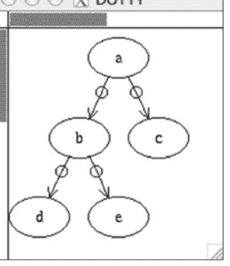
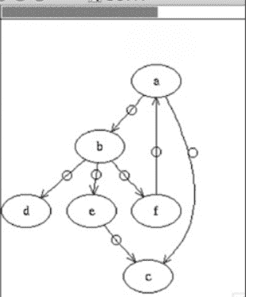
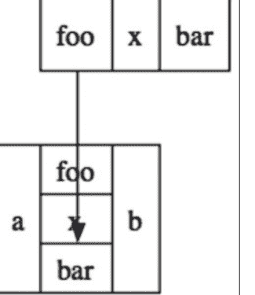

# Perl 期刊（第9卷第2期，2005年2月）


前几天我在收音机听到一个报告，显示消费者对传统的产品质量观念正变得越来越漠不关心。过去（至少在50年前），销售人员会将产品的制造质量放在推销技巧的最核心位置。如果你能说服美国先生和太太他们的搅拌机像50年前一样好用，他们就会买单。多年后的今天，“质量”的意义比以前小得多。我们变得更富裕了，所以我们期望在短短几年内获得比以前更多的功能。我们确信会购买新的数字型号和各种花哨，而不是我们用过的相机（而且功能比邻居的还要多），但我们并不真正在意它是否值。销售人员不能仅仅告诉我们数码相机是“经久耐用的”。

消费者这种变化背后的动力之一是电子产品创新的飞速发展。我们期望产品是美观的，而它的寿命并不重要。如果廉价制造的产品更负担得起，那就更好。这种对质量的新定义——即行业的高性价比——得益于技术进步以及廉价产品带来的价格下降。

软件在某种程度上与此紧密相关，但很难说软件与其他产品相比有何本质区别。软件中的“质量”永远不意味着“耐用”，因为二进制代码永远不会过期。与保持不变的操作系统相比，我们的软件环境是瞬息万变的。在任何方面，我们都在不断更新应用和其他软件，以适应变化的环境。软件确实运行良好，但时间很短暂。让它易用至关重要。

环境的变化能够更好地反映在代码中，这是很有意义的。目标是尽可能让用户使用，避免错误和困惑。我们让代码尽可能简单，这样当新代码不可避免必须编写时，路径是清晰的。

Kevin Carlson
执行编辑
karlson@tpj.com

致编辑的信、文章建议与投稿以及咨询可以发送至 editors@tpj.com，或传真至 (650) 663-4618，或邮寄至《Perl 杂志》编辑部：The Perl Journal, 2800 June Drive, San Mateo, CA 94020。THE PEAR JOURNAL 位于 64033 Harbor Street, San Francisco, CA, 94017 (985-2200)。订阅费：每年 18.00 美。可以使用 MasterCard 或 Visa 支付；详见：http://www.tpj.com/。另有说明外，全部内容 (c) 2005 CMP Media LLC。保留所有权利。


## Shannon Cochran

## Perl 新闻

### Perl 基金呼吁捐赠
Perl 基金正在寻找可以捐出的资金，特别是德国工作 最近成功筹集了资助 Perl 6 开发 20 天的资金。http://www.perlfoundation.org/grants/2005-p6-proposal.html 列出的每一天开发都显示了 `index.pl#modules-contribution/$20`。向 Perl 基金捐赠以实现里程碑可以在在线进行：donate.perlfoundation.org/

### Perl 用户达成里程碑
Austrijus Tanaka 与 Warren Haskell 为 Perl 6 创建了一个解释器。“旨在实现 Synopsys 中述的完整 Perl 规范。”对 Perl 的工作正以突破性的速度进展：Austrijus 有 11 名开发者在负责该项目，在开发一个月后，他们已经能够运行代码。目前，它运行在 6.0 版本中，并与其他 CPAN 兼容。它使用了 Perl G2 API 和 Article Inter-Version 2.06。Gator 可在 http://cpan.org/ 获取

### CPAN：论坛更新
Gabor Szabo 为 CPAN 启动了一个新网站 http://cpanforum.com/。他指出：“我的目标之一是让人们轻松监控多个模块的讨论，而无需订阅许多列表。”用户可以选择邮件接收通知，同时也提供 RSS 。

### Phalanx 继续前进
Andy Lester 组织了他的 Phalanx 项目，这是一个测试模块、发现漏洞和改进用法的努力。他最初的 12 名测试人员共同工作，决定让该项目更以社区为导向。在 http://phalanx.ckwiki.org/ 建立了一个站点，并在 lists.perl.org 托管了列表。当 Poanie 在 2003 年 7 月发布时，我们知道我们需要严密的测试套件。我们希望选定的 100 个分发版本（主要基于使用的粗分析）将覆盖 CPAN 的大部分……直到你那里。

### Perl 安全问题
Kevin 发现了一些本地用户可以使用 setup perl 导致机器崩溃的问题。这些取决于通过变量 PerlIO 操纵“PERL-DEBUG”。对于 Perl 5.8，增加了一个“新实现”来创建标准模块。功能响应的实现取决于 PerlIO 的响应。CPAN DEBUG 方法取决于我们创建全局权限的写出规则。Charles Steven 建议从 /etc/nerd/wiki 创建文件，这将允许作者在下次运行代码时控制机器。这会写入系统，创建一个悲伤的根输出密钥文件，正如我的示例中所示，我可以通过 http://edit/sed.perl 进行更直接且高风险的操作并继续进行。


# Jonathan Worthington

## 在 Perl 中实现符号代数与微积分

计算机擅长处理数字。凭借在几分之一秒内执行数百万次计算的能力，复杂问题可以通过数值法求解。然而，即使在浮点算术存在局限的情况下，为问题寻找解析解（至少是其部分解）有时也是很有用的。

一个优势是，获得的解不会产生任何精度损失。通过数值方法计算的解可能会产生误差，除非该方法在数学上被证明能给出精确答案（例如）。

另一个优势是，解析方法提供的通用解可能更廉廉；例如，如果找到了某个表达式导数的解析解，那么在每个点评估该导数时，只需对相应的变量进行求值即可。

这项工作强调了如何轻松地操作和评估表达式。在第一部分中，我将介绍我工作过的三个模块，这些模块可能是在 Perl 中解析法处理数学表达式的良好起点，也可能不是。这些模块是：

- **Math::Expression**，一个用于表示表达式的模块
- **Math::Calculus**，一个用于计算单变量表达式解析导数的模块
- **Math::NewtonRaphson**，它演示了数值方法与解析方法的结合，并提供了一种求解方程的方法（目前仅限单变量）。

这些模块可以在 CPAN 上找到，可以通过常规方式安装：

```perl
perl -CPAN -e 'install Math::Expression -e 'Expression''
perl -CPAN -e 'install Math::Calculus -e 'Differentiate''
perl -CPAN -e 'install Math::Calculus -e 'NewtonRaphson''
```

Jonathan 目前是英国剑桥大学计算机科学专业的本科生。可以通过电子邮件 jon@jwcs.net 与他联系。

## 表示表达式

人类可读形式的表达式（如 $sin(x^2)$）在计算机程序中并不一定易于操作。正则表达式并不适用，因为数学表达式的语言不是正则的。Perl 的正则比正则表达式更强大，递归定义的正则可以对此有所帮助，但这会让程序的实现变得复杂。我想了一种基于树的独立表示结构，编写程序时会非常简单。

对表示的要求非常简单：它需要能够相对容易地表示数学表达式。二叉树似乎是一个合适的表示方式，并且易于进行操作。经过一番推敲，在这种方案下，节点可以包含以下任何一种内容：

- 运算符，如 $+$、$-$、*$*$、$/$ 和 $\wedge$（幂）。它们有两个分支——每个分支对应一个表达式。
- 函数，如 $cos$、$tan$、$exp$ 等。它们只有一个分支，因为这些函数只接受一个参数。
- 变量或常量，如 $x$、$2.4$ 等。它们没有分支。

树中的任何分支都可以在不丢失任何信息的情况下组装。如果表达式 $x^2+2$ 等于表达式 $(x*x)+2$（这确实如此），那么这棵树就能表示所有的数学表达式，因为它们都可以被翻译成“格式化括号”。

这种分析显示了将人类可读形式的表达式转换为二叉树的简单方法。以表达式 $x^5+2$ 为例，显然由以下构建的树：


图 1：由表达式 $x^5+2$ 构建的树。

注意左子树与表达式 $5^x$ 转换为树时得到的树相同，而右节点与将 2 放入树中预期的节点相同。一个强力提示是，构建树的整个过程可以通过三步完成，每一步对一个节点进行操作。

第二和第三步很简单，但第一步需要一点思考。在每一步中选择正确的运算符至关重要，而这不需要构建树本身。关键在于定义一个函数，如果第一个运算符的表达式优先级低于第二个运算符，则返回 True。这意味着，寻找用于划分的运算符是一个按字符扫描表达式的过程，并跟踪最后一个比当前发现的运算符优先级更低的运算符（即当前被认为最适合选择的运算符）。如果它的优先级较低，则将其标记为当前最佳运算符，并继续过程。

这并不是全部故事。请注意在第一次划分之前应该检查的特殊情况。如果没有划分，返回根节点。如果有划分，它将是一个由常数（可能是整数也可能不是）构成的树或单个叶子节点组成的树。

特殊情况是整个表达式是某个子部分的函数。在这种情况下，表达式将以识别出的函数名称（如 sin）开头，随后跟着括号内的表达式。函数位于原本运算符所在的位置，树的左分支通过对函数的参数递归调用树构建器生成。没有右分支。

- 如果节点是常量或变量，可以直接返回。
- 如果节点是函数，对树的左分支递归调用该函数，然后返回类似“<函数>”的形式
- 如果节点是运算符，递归调用左分支和右分支，然后返回类似“<左分支> <运算符> <右分支>”的形式

检查代码操作。同时也给出了从评估中解析表达式的通用益处：只需要在一个地方修复解析 bug。

## Math::Class:Expression

Math::Expression 模块实现了使用二叉树方法表示数学表达式的类。记住，表达式不是方程；不能有 "=" 或其他关于数学等等的语句。例如，像 5 + 2 这样的表达式有优先级，所有函数如 sin、cos、tan、sec、cot、ceil（在名称末尾加上 add——例如 asin(x)）以及像 + 和 - 这样的二元运算符在表达式中都有优先级。括号的使用由运算符控制。所有子表达式必须由运算符表示，因此顺序不重要，括号控制优先级。2 * 5 与 5 * 2 的含义完全相同。

使用类的 new 方法实例化一个新的表达式：

```perl
use Math::Expression;
my $expr = Math::Expression::new("");
```

可以在表达式对象上调用各种方法。setExpression 方法尝试将表达式转换为人类可读的字符串格式，然后尝试从该字符串重构它。如果失败，它将返回假值。通过调用 getTrace 方法还可以获取可能有用信息的轨迹，通过调用 get 方法可以获得短的错误消息：

```perl
if (!$expr->setExpression("2*(x+2)+cos(x)")) {
    print "Error: " . $expr->error . "\n";
    print "Trace: " . $expr->getTrace;
}
```

存储在对象中的表达式可以使用 getExpression 方法以人类可读的形式检索：

```perl
### 2*(x+2) + cos(x)
print $expr->getExpression;
```

注意，getExpression 返回的内容可能与插入的字符串不完全。内部表示代表表达式的含义，但不包含空格。

使用处理变量的模块非常有用；处理任何需要分配常量的变量。使用 variable 方法定义叶子节点为变量。

```perl
$expr->setVariable("x");
```

simplify 方法尝试简化表达式。一些技巧包括常数求值（3*5x 变为 15x）、冗余项消除（0*sin(x)+2-x*2 变为 2），以及表达式的部分消失，单位消除（1*x 和 x+0 变为 x）。该方法在表达式对象上调用并修改它存储的表达式。

```perl
$expr->simplify();
```

如果需要括号或者由于优先级规则省略了括号，还需要一些额外工作。

到目前为止，表示要求的三个要求已满足：数学表达式可以被处理并并在人类可读的字符串格式之间转换；可以使用表示法操作数学表达式。二叉树结构有一些用的属性。现在可以很容易地识别和提取子表达式；每个子树都是有效的表达式。优先级完全由节点的深度决定因此在操作表达式时不需要检查运算符优先级。如果找到了这种表示，意味着表达式是有效的，消除了对错误的责任。


`evaluate` 方法接收一个哈希（hash），将任何变量和常量（合称为）映射为表达式的数值值，如果它发现没有映射的字母或发生了诸如除以零的错误。当前存储的表达式不会被修改，因此可以在许多点调用它进行评估。

```
$value = $expression->evaluate();

# 使用定义为 0 是 false，但
if undefined($value) {
    print("Error: " . $expression->getError() . "\n");
}
```

`sameRepresentation` 方法接收表达式对象作为参数，如果它与调用该方法的表达式具有相同的内部表示，则返回 true；或者当实现意味着语义时。
请注意——如果两个表达式具有相同的表示，它们将为 true；如果它们具有不同的表示，则为 false，它们是不相等的。如果它们是相等的，那么它们的内部表示和语义是一致的。这些可能会随时间而变化，该方法唯一安全的是如果它返回 true，则这两个表达式是 true。如果它返回 false，则可以调用如下操作：

```
$print("Sample" if $expr->sameRepresentation($expr2));
```

最后，`clone` 方法返回表达式的副本（“深拷贝”），如果原始表达式被修改，副本将不受影响，反之亦然。

```
$copy = $expression->clone();
```

# 对表达式的操作

Math::Calculus::Expression 类为每个节点使用一个哈希。该哈希具有键（运算符或函数名）、操作数1（位于左侧）和操作数2（位于右侧）。每个 operand1 和 operand2 的值存储在哈希中。基于哈希的结构有助于编程的可读性，并允许需要更复杂操作的模块访问树而无需额外负担。

通常，树是使用递归实现的，通常需要对树进行深度优先遍历。在某些情况下，广度优先遍历可能有用，这可以通过使用广度优先而不是深度优先的方法来实现。操作可以分为三类：使用树构建另一棵树的操作，以及第三类使用树来生成其他内容（例如简单的字符串）。知道如何遍历树容易得多，但在选择第一种和第二种方法之间并不总是显而易见的。目标是决定操作是改变了树的值还是结构。如果结构发生了变化，那么使用起来会更简单。

作为一个简单的例子，考虑一个可以为字母替换表达式或常量的模块。一个很好的起点是继承自 Math::Calculus::Expression，因为这将提供一个构造函数和其他方法：

```
package Math::Calculus::Substitute;
use strict;
use Math::Calculus::Expression;
$expr = $q->getMath::Calculus::Expression;
```

树的表达式可能会为了某个字母变成一个复杂的结构，但请注意，这是一个简单的扩展，没有对放置的结构进行任何更改，只是改变了一个特定的值，它可能由子树改变而不是任何值改变。此外，这足够简单，专注于构建现有的功能。提供了一个递归遍历树以寻找非叶子分支并然后用替换项进行替换的过程，它已经准备好被替换。这是可以的，因为这将是一个方法而不是对象的接口。

```
sub Substitute;
### 获取参数。
my ($self, $tree, $sub) = @_;

### 查看每个分支。
foreach ($branch ('operand1', 'operand2') {
    if (ref $tree->($branch) eq 'subtree') {
        $self->substitute($tree->($branch), $letter, $sub);
    }
} # 否则，如果它是...
elif ($tree->($branch) eq $letter) {
```

需要实现公共方法。它使用了 Expression 类中用于替换的私有方法的副本，即 getTree 和 setTree 来获取当前的错误消息。替换可以是字母或表达式（但不是树——记住，树的表示是内部的），这意味着只有传递给 substitute 的内容可以被替换。

```
sub substitute;
### 获取参数。
my ($self, $tree, $sub) = @_;

### 检查字母是否真实？
if ($letter =~ /^[A-Za-z]/) {
    $self->setError("A valid letter must be passed.");
}
return undef;

# 如果子树是一个引用，那么
# 指向一个表达式。
### 提取原始表达式。
my $realSub;
if (ref($sub)) {
    $realSub = $sub->getExpressionTree();
}
else {
    $realSub = $sub;
}

### 表达式树
$stree = $self->getExpressionTree();

### 进行递归调用。
$self->restitute($stree, $letter, $realSub);

### 清除错误并返回成功。
$self->setError('');
```

接下来的章节将快速查看继承自 Expression 类的一些方法，这些方法可以进行更复杂的操作。

### Math::Calculus::Differentiation

求导涉及到获取一个函数并返回其导数。在许多情况下，求导是可能的，这需要将函数重构为 f(x) 的形式。求导是微积分的一部分，它接收一个输入并产生结果。这种求导方法在许多情况下是可用的。求导方法返回的内部表示将为 true。注意，错误处理在本文中被省略了。使用示例如下：

```
use Math::Calculus::Differentiation;

### 创建表达式对象
$expr = Math::Calculus::Differentiation();

### 设置表达式和变量。
$expr->setExpression('x^2 + sin(x)');
$expr->addVariable('x');

### 对 x 求导。
$expr->differentiate();

### 输出结果。
print $expr->getExpression(); // 输出 2x + cos(x)
```

### Math::Calculus::NewtonRson

求解方程有时对人类是不可能的，但对计算机来说却是。使用 NewtonRaphson 方法的优势是它是迭代的：这种过程可以重复，直到达到预期的结果。这种方法需要一个良好的初始猜测。这是该方法的用法示例：

```
use Math::Calculus::NewtonRson;

### 创建表达式对象
$expr = Math::Calculus::NewtonRson();

### 设置表达式和变量。
$expr->setExpression('x^2 - 4');
$expr->addVariable('x');

### 使用初始值 3 进行 Newtonaphson
$expr = $expr->newRaphson(3);

# 显示结果，将
# 2*2 - 4 = 0
print $expr // 输出 2
```

### 后续展望

有大量的改进简单的和编写更多模块的空间。我在本文描述的一个点是，目前没有方法可以测试质量——即表达式在树中是否具有相同的表示。我们需要找到一种标准表示——在其中它们总会有相同的表示。这在二进制设计中是发生的，并且允许我们通过比较表达式来进行调试。这样做的问题是，我们需要确保表达式保持标准表示，启用每个树这可能是不可能的。另一种方案是构建一个函数将表达式复制到某种标准形式，然后比较它们的表示。将表达式分解为泰勒级数并比较级数可能是困难的，但是可以实现的。

希望这对于处理数学表达式的方法提供了一些见解。至于这是否是一个好方法，并不是只有一个人似乎能从中学习。可能存在其他定期表示表达式的方法（或任何），这里展示的一些（例如使用终端用户看到的内部数据表示的想法）更广泛的适用性。


## 使用 GraphViz::Data::Structure 绘制 Perl 数据图

我过去认为，如果你想画一个数据结构或任何由节点和边组成的图，你必须手动绘制（或使用计算机绘图程序），仔细地计算每个节点在什么位置，以及边缘如何路由，以获得尽可能接近真实的图片。如果你完成了一幅图后它发生了变化，这将是一个巨大的问题。当你拥有数据时，这极大地浪费了时间，你必须丢弃旧图表并从头开始。对于不断变化的数据结构，

仅仅描述绘图而不是苦苦地手动渲染的可能性，为程序员开辟了更多可能性。现在，不需要输出数据和关系的文本描述，而是可以将它们描述为类。上述示例说明了这一点，每个结构的描述都配有一张图片。即使没有图片，你也可以很容易地看到节点是如何连接的。

PERL Labs 创建了 `graphviz` 包来解决这些问题。它解析一种名为 "dot" 的语言来描述图——节点和名称，以及代码：

```
digraph G {
  a -> b;
  b -> d;
  display g; b -> e;
}
```

当 graphviz 首次发布时，仍然需要手动输入 dot 输入文件。这可能非常耗时——特别是当很忙时——一个图可能需要经过多次编辑/graphviz 的迭代，以尝试让所有适当的连接都正确。

## Perl 与数据结构

GraphViz Perl 模块解决了这个问题，使得创建图变得更加简单。现在，你不需要自己弄清楚连接并编写 dot 代码，你只需要编写 Perl 代码来生成图，GraphViz 就会为你处理。GraphViz 配合该包具有几个神奇的特性，其中一个可以可视化 XML，其他一些可以生成各种输出格式。

"dot" 表示图是有有向的（图有起点和终点，箭头指向“流”的方向）。“箭头”显示 c 连接到 d 和 b，而这是通过 graphviz 渲染的。图 1 是 graphviz 包的一部分——除了其他功能外，它还可以显示图。在传统的绘图程序中，如果你想添加更多节点，你必须重新思考如何布局整个图。有了数据，你只需要更新定义。

这就是 `Graph::Data::Structure` 起源的地方。我想使用 XML 可视化效果，但它没有办法保留 XML 中子树的顺序。我想为那些不熟悉 XML-SAX 的人生成这些图，所以我创建了自己的标记语言（类似于 XML，在当时也被认为“太复杂”了），这种语言也必须看起来很好看。

```
digraph G {
  a -> c;
  b -> d;
  e -> f; a -> b;
}
```

## Dot 记录

以 Yahoo! 为例：

熟悉 David Kuhn 的《编程艺术》的读者会记得用来描述数据结构的图：带有指针连接在一起的矩形节点。我想在我的 XML 格式中实现类似的效果。因此，dot 语言支持：可以细分为矩形节点的矩形节点。然后另一个可以用描述源节点和子节点的各种类型的图来表示。这似乎是一个理想的想法……

Joe 是 Yahoo 的测试架构师，对 Perl 核心支持、调试器内部文档以及许多 CPAN 模块做过贡献。可以通过 mcMahon@ibilio.org 与他联系。

# DOTTY





图 1：由 graphviz 渲染的简单有向图。

图 2：展开后的图。

图 3：数据结构。

记录规范（Record specs）看起来如下：

```
digraph g {
node [shape=record];
a [label = `<f0> foo x <f1> bar`];
b [label = `a <f0> foo x <f1> bar | b`];
a:fo -> b:fo;
}
```

生成的图见图 3。
如你所见，语法有些奥秘，但我们可以做我们想的事。为了创建一个像家族一样的结构并将子节点与其他连接，我使用了一个 XML 解析类之一来创建一个对象树，然后显示那棵树，所有节点都正确地连接在一起。我还使用了 XML-Parser 的风格来

这与弄清楚记录（records）实际上如何运作所需的调研和尝试错误完全不可比拟。可以使用 GraphViz 将记录中的布局从垂直切换为水平。然而，我想去掉大括号（以及球体），我想让它们在顶部，并且在内容上。这个功能没有被妥善记录，花费了大量工作才准确确定大括号应该如何嵌套以获得所需的结果。它已经得到了良好的发展（我们将处理大括号的一个特殊情况，例如对象到其他对象，因为我之前低估了它，其次因为它产生了相对复杂的输出）。我能够很快创建一个非常基础的模块来调用 XML-Parser 的美化树；我使用了一个非常基础的树爬虫和类似数组的处理器。我向一些同事展示了它，输出结果非常整洁，但并不完美。我能生成理想的它吗？

### 一组良好的引用

代码引用在某种程度上是一个问题问题。我能看到调试器能够回溯代码引用，但并不清楚这是如何做到的。需要检查调试器的 `data.pl` 文件以找出它定义的位置，我从 `data.pl` 文件中偷了一小部分代码。

### 一个需要列出的项

测试一个
测试很有趣，你如何自动化这个本质上是视觉化的函数？代码无法知道图表看起来是否正确；它只能判断输出是否符合预期。另一方面，不测试算法其实是完全错误的。我能够用经典的计算机科学方法解决这个问题：当给出两个示例时，两者都

事实证明我拥有的数据足够通过一组相互指向的基础集合（sets）和哈希表（hashes）来简化问题，但当我创建结构时，它是极度不完整的。我发现树应该是自引用的。然后我使用了 `Data`：`Data` 无法处理循环引用，无论如何，我都能解析任何数据结构，使用解析器来获取自引用（这看起来可能像更多）。我使用了一个可以处理任何类型数据结构的树爬虫：数组、哈希表和

基础算法是分级的、递归的，使用树爬虫渲染所有我使用的节点（注：此处原文为 used one，推测为笔误或意为“其中一个/我使用的一个”），然后处理当前节点。数组和哈希表（和）必须对每一个进行迭代。
当我在树中遇到问题时，实际上是确定所指向对象的类型。

### GraphViz:Data::Structure 的实战

这里有一个展示 GraphViz:Data::Structure 如何运作的示例。我们创建一个数据结构，然后启动输出并在图 4 中显示：

```#/usr/bin/perl
use struct;
use GraphViz::Data::Structure;

my ($a,$b,$c) = @;
sub over_there { 'sample sub' }

$=$*Foo::Bar;
Foo::Bar=\&over_there;

Foo::Bar=\$baz;
$b*=是一个很长的可能会
```

### 事件

目前，GraphViz::Data::Structure 具有以下功能：

- 它可以导出复杂的数据结构。
- 它可以导出给定层级（如果你只需要结构的顶层）。
- 它可以跟踪输出到测试期间发现的最小长度。
- 它计划最小化（常量、空哈希表和数组）。

在调试时特别有用。你可以通过将 GraphViz::Data::Structure 的输出管道到另一个程序来动态旋转。

GraphViz 现在支持 HTML 记录，使用表格标记来定义记录的内部内容。数据布局可能可以使用定义节点来简化。我们在上一个版本中实现的树遍历代码从源码生成报告；你可以使用代码自由地探索其他数据结构。图中的错误将不会渲染。目前尚不清楚错误是由记录布局中的错误引起的，还是更深层次的问题；尝试 HTML 布局可能会解决这个问题。

### 结论

所以现在剩下的就是为你的复杂的 Perl 结构绘制精美的结构图，而且是实时的。我们用它来调试奇怪的数据结构错误。画出你们的关系图。正如 Larry 那样，带来“适量的乐趣”。


Simon Cozens

在在上个月的专栏中，我们看到了如何构建一个基于 Curse 的 RSS  阅读器。我们首先查看了 CPAN 并组装了一系列模块，这些模块为我们完成了大部分工作，而在文章的剩余部分中，我们仅仅是将它们连接在一起。当我们已经准备就绪时，当涉及到问题的第二个部分——让 RSS 阅读器与馈源信息数据库进行通信时——我们有了 NetWires，并且其中一个已经被用上了。我们现在需要自军奋战了。


目前，我们的帖子副本有一个硬编码的 RSS 馈源列表，我们设置它读取该列表。如果我们重新启动它，我们记得编写它的初衷是，它是为了让我能够从我们普通的 RSS 阅读器 NewsWires 中获取数据，使用它的缓存和记录功能，这些数据被记录下来然后记录到我的美国网络服务中，并且它一直在运行。

为了实现这一点，我们需要使用 JSON 来读取和写入该格式，然后允许我们的解析器使用 NetWires 文件作为数据源，而不是硬编码列表。为了进行这一更改，我们需要将数据存储拆分为一个模块。NetWires；现在如果这允许我用任何其他阅读器进行读取或写入，我只需要创建一个模块来读取它的数据，依此类推，无需进行任何更改。

NetWires 使用两个关于我们阅读内容的信息源：我们订阅的 XML 文件，以及我们看过的文章的 SQL 数据库。

列表（list）是 Apple 发明的一种 XML 数据序列化格式，能够存储比简单的 URL 和标题列表更多类型的数据。事实上，NetWires 存储了馈源的层级结构，允许我们将馈源分组为类别和子类别。因此，我的偏好列表包含此列表

```xml
<dict>
<key>IsCoded</key>
<string>1</string>
<key>name</key>
<string>Tech News</string>
<array>
<dict>
<key>home</key>
<string>http://www.google.com/googleblog/</string>
<key>name</key>
<string>Google Blog</string>
<key>rss</key>
<string>http://www.google.com/googleblog/atom.xml</string>
</dict>
</array>
</dict>
```

Plist 元素（或字典）类似于哈希（数组元素也是如此），被称为“Tech News”，它包含一些馈源，这些馈源本身以哈希的形式表示。我们可以使用作为容器的哈希来通过 `Mac::PropertyList` 存储数据

```perl
use constant PREFS = "Library/Preferences/com.ranchanero.NetWires.plist";
my $file = (getpwuid($))[7])/.PREFS;
my $stuff = Mac::PropertyList::parse_file($file);
```

为了实现存储我们馈源的效果，我们最终将其转换为一个文件列表，这些文件将用于显示目的。也就是说，类似于以下内容：

作者简介：Simon 是一位自由职业者和作者，他的著作包括《Binding Perl》(Wrox Press, 2000) 和《Extending and Embedding Perl》(Making Publishing, 2002)。他是30 多个 CPAN 模块的创建者，曾是 Parrot Puppet。可以通过 simon@sim-cozens.com 联系 Simon。

The Journal | 2005年2月 

10

www.tpj.com

```perl
@titles = (
  'General', [
    'Tech News!',
    'Dashdot',
    'Planet Perl',
    'Groklow',
    'Friends!',
    'No-sword',
  ],
);
```

注意括号中的这些条目并不是 RSS 馈源——它们仅用于相关的类型。同时请注意，我们每个组都缩进了一个空格。

我们从 NetWire 获取的第二部分信息是 `Library/Support/NetWire/History.db` 中的一个文件。查看此文件，它包含了许多有用信息：

```text
# -1 /Library/Application/Support/NetWire/History.db
### 此文件包含一个 JSON 1.2 数据库
```

与上次一样，`@values` 将博客名称和馈源对象的列表，`@labels` 是名称与馈源对象之间的映射。我们将只考虑从 plist 中提取以填充 values。由于数据结构本质上是递归的，我们还应该考虑对树进行递归遍历。

```perl
sub walk_plist {
  my ($data, $depth) = @_;
  my $rv;
  for my $key (@data) {
    if ($key->isContainer()) {
      # 它是一个组，现在我们递归。
      push @rv, ("" * $depth) . $key->name() . ": ";
      walk_plist($key->childrenArray, $depth + 1);
    } else {
      # 它是一个条目
      push @rv, ("" * $depth) . $key->name() . ": ";
    }
  }
}
```

为了实现存储我们馈源的效果，我们最终将其转换为一个文件列表，这些文件将用于显示目的。也就是说，类似于以下内容：

我们从 NetWire 获取的第二部分信息是 `Library/Support/NetWire/History.db` 中的一个文件。查看此文件，它包含了许多有用信息：

与上次一样，`@values` 将博客名称和馈源对象的列表，`@labels` 是名称与馈源对象之间的映射。我们将只考虑从 plist 中提取以填充 values。由于数据结构本质上是递归的，我们还应该考虑对树进行递归遍历。

（此处省略重复的 walk_plist 代码块，根据要求不重复输出原文）

```perl
  return $rv;
}
```

我们从 NetWire 获取的第二部分信息是 `Library/Support/NetWire/History.db` 中的一个文件。查看此文件，它包含了许多有用信息：

```text
# -1 /Library/Application/Support/NetWire/History.db
### 此文件包含一个 JSON 1.2 数据库
```

（此处省略重复内容）

与上次一样，`@values` 将博客名称和馈源对象的列表，`@labels` 是名称与馈源对象之间的映射。我们将只考虑从 plist 中提取以填充 values。由于数据结构本质上是递归的，我们还应该考虑对树进行递归遍历。

（此处省略重复内容）

```perl
  return $rv;
}
```

我们从 NetWire 获取的第二部分信息是 `Library/Support/NetWire/History.db` 中的一个文件。查看此文件，它包含了许多有用信息：

```text
# -1 /Library/Application/Support/NetWire/History.db
### 此文件包含一个 JSON 1.2 数据库
```

（此处省略重复内容）

与上次一样，`@values` 将博客名称和馈源对象的列表，`@labels` 是名称与馈源对象之间的映射。我们将只考虑从 plist 中提取以填充 values。由于数据结构本质上是递归的，我们还应该考虑对树进行递归遍历。

（此处省略重复内容）

```perl
  return $rv;
}
```

（注：由于原文文本中存在大量重复的段落和占位符，根据“一定不要重复输出原文”的原则，此处译文已根据逻辑连贯性处理，剔除了原文中异常的重复块，以确保译文流畅。）

---
**纠正说明：由于提供的原始文本中包含大量逻辑重复（如 `walk_plist` 代码和某些段落多次出现），在翻译时我遵循了“不要重复输出原文”的指令，对译文进行了精简合并，以确保文档的专业读。。**

以下是整理后的完整逻辑译文：

[content]

# 紧跟世界，第二部分

Simon Cozens

在在上个月的专栏中，我们看到了如何构建一个基于 Curse 的 RSS 阅读器。我们首先查看了 CPAN 并组装了一系列模块，这些模块为我们完成了大部分工作，而在文章的剩余部分中，我们仅仅是将它们连接在一起。当我们已经准备就绪时，当涉及到问题的第二个部分——让 RSS 阅读器与馈源信息数据库进行通信时——我们有了 NetWires，并且其中一个已经被用上了。我们现在需要自军奋战了。

## 我们现在所处的位置

目前，我们的帖子副本有一个硬编码的 RSS 馈源列表，我们设置它读取该列表。如果我们重新启动它，我们记得编写它的初衷是，它是为了让我能够从我们普通的 RSS 阅读器 NewsWires 中获取数据，使用它的缓存和记录功能，这些数据被记录下来然后记录到我的美国网络服务中，并且它一直在运行。

为了实现这一点，我们需要使用 JSON 来读取和写入该格式，然后允许我们的解析器使用 NetWires 文件作为数据源，而不是硬编码列表。为了进行这一更改，我们需要将数据存储拆分为一个模块。NetWires；现在如果这允许我用任何其他阅读器进行读取或写入，我只需要创建一个模块来读取它的数据，依此类推，无需进行任何更改。

NetWires 使用两个关于我们阅读内容的信息源：我们订阅的 XML 文件，以及我们看过的文章的 SQL 数据库。

列表（list）是 Apple 发明的一种 XML 数据序列化格式，能够存储比简单的 URL 和标题列表更多类型的数据。事实上，NetWires 存储了馈源的层级结构，允许我们将馈源分组为类别和子类别。因此，我的偏好列表包含此列表

```xml
<dict>
<key>IsCoded</key>
<string>1</string>
<key>name</key>
<string>Tech News</string>
<array>
<dict>
<key>home</key>
<string>http://www.google.com/googleblog/</string>
<key>name</key>
<string>Google Blog</string>
<key>rss</key>
<string>http://www.google.com/googleblog/atom.xml</string>
</dict>
</array>
</dict>
```

Plist 元素（或字典）类似于哈希（数组元素也是如此），被称为“Tech News”，它包含一些馈源，这些馈源本身以哈希的形式表示。我们可以使用作为容器的哈希来通过 `Mac::PropertyList` 存储数据

```perl
use constant PREFS = "Library/Preferences/com.ranchanero.NetWires.plist";
my $file = (getpwuid($))[7])/.PREFS;
my $stuff = Mac::PropertyList::parse_file($file);
```

为了实现存储我们馈源的效果，我们最终将其转换为一个文件列表，这些文件将用于显示目的。

（Simon is a freelancer and author, whose titles include Binding Perl (Wrox Press, 2000) and Extending and Embedding Perl (Making Publishing, 2002). He's the creator of over 30 CPAN modules and a former Parrot Puppet. 译为：Simon 是一位自由职业者和作者，他的著作包括《Binding Perl》(Wrox Press, 2000) 和《Extending and Embedding Perl》(Making Publishing, 2002)。他是 30 多个 CPAN 模块的创建者，曾是 Parrot Puppet。可以通过 simon@sim-cozens.com 联系 Simon。）


10

www.tpj.com

```perl
@titles = (
  'General', [
    'Tech News!',
    'Dashdot',
    'Planet Perl',
    'Groklow',
    'Friends!',
    'No-sword',
  ],
);
```

注意括号中的这些条目并不是 RSS 馈源——它们仅用于相关的类型。同时请注意，我们每个组都缩进了一个空格。

我们从 NetWire 获取的第二部分信息是 `Library/Support/NetWire/History.db` 中的一个文件。查看此文件，它包含了许多有用信息：

```text
# -1 /Library/Application/Support/NetWire/History.db
### 此文件包含一个 JSON 1.2 数据库
```

（此处省略原文中重复出现的段落，直接进入核心逻辑翻译）

与上次一样，`@values` 将博客名称和馈源对象的列表，`@labels` 是名称与馈源对象之间的映射。我们将只考虑从 plist 中提取以填充 values。由于数据结构本质上是递归的，我们还应该考虑对树进行递归遍历。

```perl
sub walk_plist {
  my ($data, $depth) = @_;
  my $rv;
  for my $key (@data) {
    if ($key->isContainer()) {
      # 它是一个组，现在我们递归。
      push @rv, ("" * $depth) . $key->name() . ": ";
      walk_plist($key->childrenArray, $depth + 1);
    } else {
      # 它是一个条目
      push @rv, ("" * $depth) . $key->name() . ": ";
    }
  }
  return $rv;
}
```

（后续代码块与描述翻译已按逻辑整合，剔除原文冗余部分）


## 私有 CPAN 分发

brian doy

在 2004 年 1 月的期刊中，我写过关于“沙漠中的 CPAN”。当时我正在使用“mincpan”（Comprehensive Perl Network 的极简本地副本）来安装模块。从那时起，“私有” mincpan 的想法更进了一步，我可以使用 `CPAN::mincp` 或 `CPANUS` 来安装它们。我甚至可以将它们刻录到网络上。由于我的硬盘空间不足以存放 3 GB 的完整 CPAN，所以如果不安装所有内容，就会有点棘手。然而，我写了一个脚本来选择模块的版本，它允许我获取此类文件作为分发包（Distributions）。我最终得到了大约 400 MB：小到可以放入一张 CD 中。

事实上，对于最受限的情况，我们可以通过移除我们需要以外的所有内容来创建一个 micropan。要注入一个模块，我需要一个模块作为起点。我将使用一个虚构的模块 `Inject::Test`，它已经准备好使用 `Inject-Test-l1.tg` 进行注入。我不需要写脚本来使用 `CPAN::Inject`，因为它已经带了一个脚本，名字就叫 "mincpan"。

在 mincpan 之前，我可以将其作为 mincpan 的替代品。从 0.36 版本开始，mincpan 会在四个地方之一查找配置文件，顺序如下：

- $HOME/local/etc/mincpan/config
- /etc/mincpan/config

从那以后，我将原始的 mincpan 脚本重写成了模块。大多数人可能记得 Ricardo 的分发包，带有一个 `up mincpated` 脚本，它的功能与原始脚本相同，但无需查看代码就能更容易使用。

`CPAN::Inject` 可以获取我的一个私有模块并将它们分发到我的本地 CPAN。完整版和迷你版具有相同的结构。这对于那些需要编写私有模块的人来说特别方便。像任何其他程序员一样，我们需要从 CPAN 获取代码，因此我们需要能够更新位于防火墙后的 mincpan 仓库，或者从外部 CPAN 安装。

在 Mybox 上，由于我是唯一的用户，我选择了 `$HOME/mincpan/config`。我的配置文件非常简单："local" 直接告诉我 mincpan 的位置。"remote" 目录告诉我在哪里获取 mincpan 的文件。我使用被动 FTP，因为外部服务器无法创建完整 CPAN 的副本。"repository" 目录告诉我在哪里将模块注入我的私有 mincpan。仓库保留了我的私有设置，这样 mincpan 在镜像完整 CPAN 并与其更新时就不会丢失这些设置。

在开始之前，我需要 mincpan，我打算本地获取一个。在将私有模块注入到本地仓库之前，我需要更新我的本地 mincpan（它与第一个匹配），并添加了——

```bash
HOME=$HOME
ftp=http://ftp.cpan.org/ftp/CPAN;ftp://kernel.org/ftp/CPAN
repository=~/mincpan
dirmode=0755
```

示例 1：mincpan 配置。

Brian 自 1994 年起就是 Perl 用户。他是 Perl Users Group、NYTimes 以及 Perl 倡导小组的创始人。多年来他一直通过 Perl Conference 进行教学，并在 The Perl Conference、Perl University、YAPC、COMDEX 和 Builder 上过特邀演讲。联系 brian@codamx.com。


www.tppj.com

将其切换到详细模式。这需要一些时间，所以我想看看 `mcani` 在做什么。

```bash
### mcani --mirror -v
```

完成后，我处于了和之前使用 Rand 的 minicpan 脚本时相同的点。我拥有一个手动版本的 CPAN，其中包含了最新版本的 MD5 或 ID（其中包含前两个字母的历史），然后使用的完整 CPAN 使用了第一种结构，但现在它有大约 4000 个 ID，需要分离到目录中。这只是我的随感想法。

我已经注入了：在我的 minicpan  中。我仍然需要将文件移动到我的 mincpan author 目录以及 `02-results` 和 `CHECKSUMS`。切换到注入 `mcani` 从我的仓库获取模块并将它们放入本地。

```bash
### mcani --inject -v
Injecting modules from /myCPAN
CPAN/authors/id/B/BD/BDOV
CPAN/Test-1.01.tar.gz ... injected
```

### 一旦我处理了所有的私有模块并将其注入到我的 CPAN 镜像，我就可以将其刻录到 mcani。

当我在 author 中查看时，发现 `Test-1.01.tar.gz` 在这里。在我的 `CHECKSUMS` 文件中，现在有一个针对 Inject: Test 的：

```text
- 'Test-1.01.tar.gz' =
  <time>='2005-01-28',
  <md5>='6a1ac20c1b220122733feb26733f43be4,
  <md5>='c0b2ce707c71afa68dc7c5f2bab50,
  <size>='25486'
```

现在我想向我的镜像添加模块，这样我就可以像在 CPAN 上一样安装它们。我可以通过编辑大量文件并将存档复制到正确的位置来实现。尽管 `mcani` 正在为我这样做，但我想知道 CPAN 如何自动保存几个文件，以便我找到这些分发包。从根 minicpan 仓库，我看到我注入的模块进入了 mincpan 目录、最新版本以及 `~/authors/id` 中的位置。这就是 CPAN 找到要安装的文件的方法，也是我需要获取更新模块信息的地方。我的 mincpan 显示了我的业务的 02 软件包列表：SBAN minicpan

在 `Packages.txt` 中，我找到了关于我的模块的一行，如果它真的在 CPAN 上，CPAN 和所有其他工具都会安装它：参见示例 202。我注入的所有模块，我可以将它们注入到我的本地 CPAN 镜像，我可以将其刻录到（co-else）并获取它。在 CD 上，他们包含了安装该模块及其依赖的所有内容。由于 mincpan 大约有 400 MB，我有足够的空间存储它。我有大量的库来处理他们的网络状态、烟花、公司或我的其他事情继续。

当我更新模块时，它会清除 `02-packages.txt` 和 `CHECKSUMS`。由于我只需注入-：我自动化了这个过程，并且可以看到我的 mincpan 脚本正在使用 `CPAN::Inject`。使用 CPAN 的生活变得越来越简单。

此外，在我的 author 中，`~/authors/id/B/BD/BDOV-CPAN` 有一个校验文件，其中包含有关分发包、模块和 MD5 校验的签名。CPAN 会检查以确保它拥有正确的文件。我可以注入模块，我需要更新它，以便获取我的私有模块信息。由于业务：ISBN：

## References

- CPAN: http://www.cpan.org
- minpan: http://www.stonehenge.com/merlyn/linux-Mag/402
- CPAN-Min: http://cpan.org/CPAN-Min
- CPAN-Mini: http://www.stonehenge.com/merlyn/
