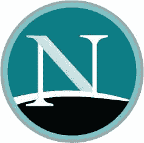
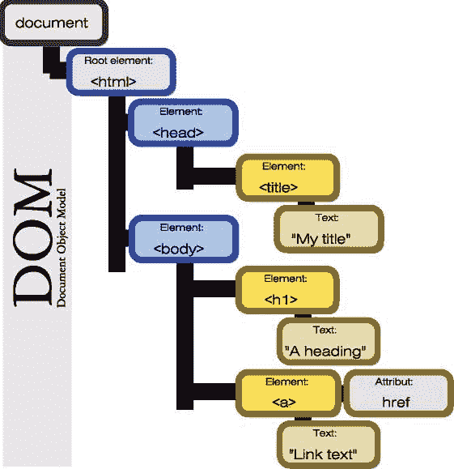
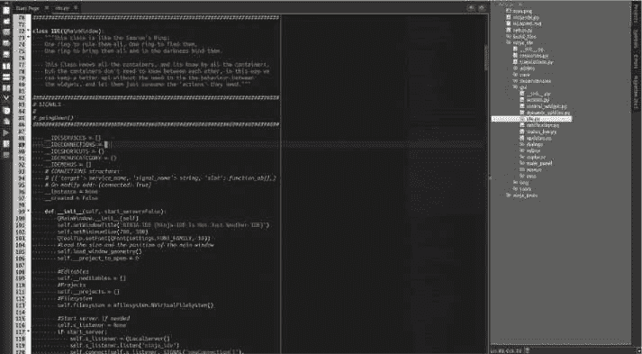
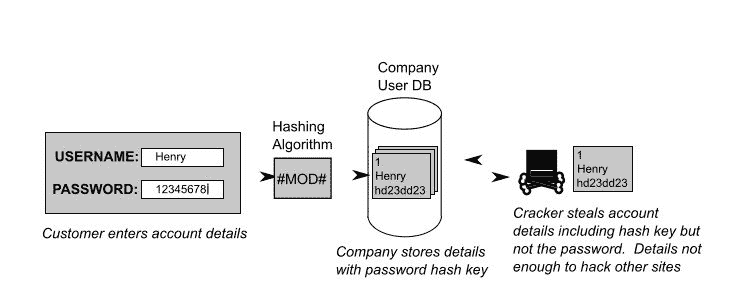
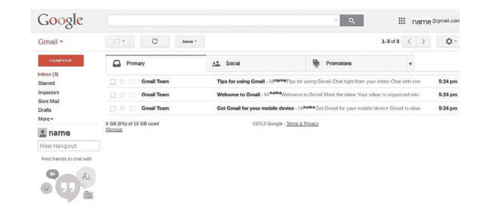
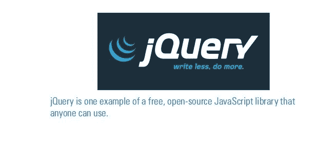
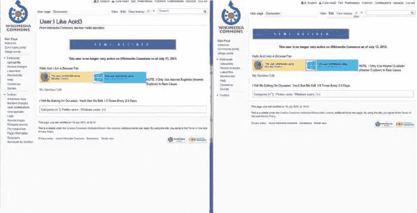
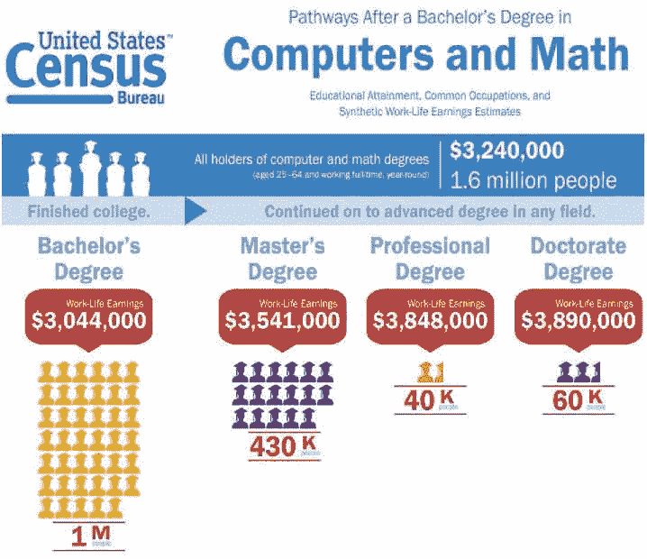
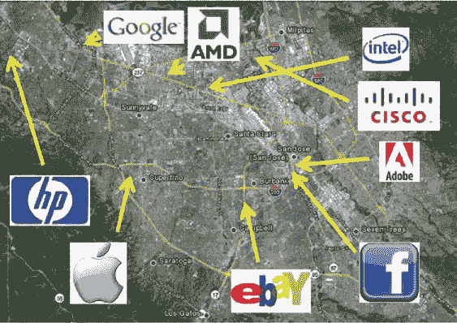
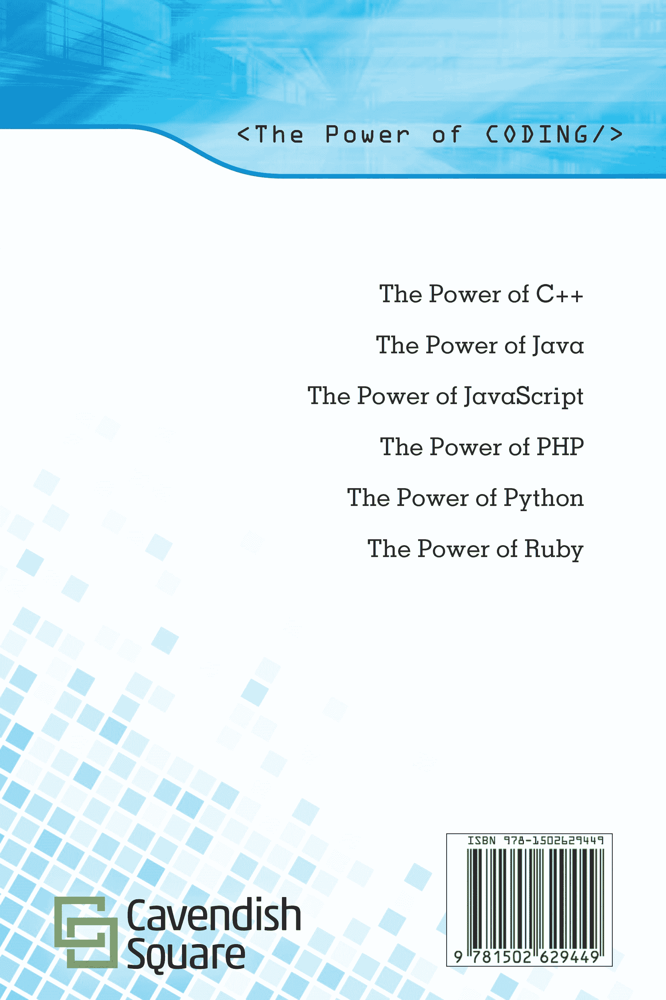

# Javascript 的力量 (编程的力量)


## JavaScript 的历史

JavaScript 是世界上最广泛使用的语言。它是网站不可或缺的组成部分。尽管知名度很高，JavaScript 是由 Eich 在十天内设计并创建的。尽管他当时不知道，他的创作将改变人们的方式。但在查看今天 JavaScript 的重要用途之前，让我们看看它的历史。

1995 年，互联网还处于婴儿阶段。万维网刚刚向公众开放，使用起来仍然非常原始且枯燥。在使用拨号调制器访问互联网时，打开一个网页通常需要 30 秒甚至更久。由于如此，在互联网上填写表单（例如创建一个账户）是一个痛苦的过程。如果你忘记填写某个字段，就必须等待你的计算机向服务器发送请求。然后服务器会返回一个指出错误的响应。

JavaScript 的创建是为了解决这个问题。它允许网页在向服务器发送请求之前检查所有必要字段是否已填写。这意味着如果用户留了空白，在他们的计算机（也称为客户端）与服务器开始长时间通信之前，就能收到通知。

JavaScript 是第一个流行的客户端语言。它的广泛应用标志着互联网历史的一个根本性转变。任务现在可以轻松地在客户端和服务器端完成。JavaScript 的功能迅速增长，很快被用于许多检查表单和其他基础任务之外的事情。

### 浏览器大战

JavaScript 的历史与所谓的“浏览器大战”密切在一起，这是微软和 Netscape 之间争夺全球领先网络浏览器供应商的竞争。Netscape 是新兴网络浏览器市场的早期主导力量。它在 1994 年发布了第一个浏览器，并迅速占据了大部分市场。它似乎将成为该领域无可争议的领导者。

然而，在 1995 年，微软回应了。由于 Windows 的流行，微软已经是一家科技巨头，他们也意图接管浏览器市场。该公司推出了 Internet Explorer，与 Netscape 竞争。它开始随几乎所有电脑的 Windows 操作系统免费提供该软件。


战争很快结束了。在五年内，`Windows` 占据了 95% 的浏览器市场。`Netscape` 被消灭了。微软的强硬手段奏效了，但这些手段很快就会被用来对付这家科技巨头。美国司法部因该公司垄断并不公平地利用 `Windows` 打压竞争对手而起诉。。在诉讼过程中，`Netscape` 的执行官被传唤作庭，微软在法庭上受到了指责。

曾几何，微软被法院命令从 `Windows` 的基础版本中临时移除 `Internet Explorer`。微软的律师辩辩称，`Internet Explorer` 是 `Windows` 的不可或缺的一部分，很难移除。然而，法官 `Thomas Jackson` 注意到他自己花不到两分钟就卸载了它，并对该公司的律师表示批评。最后，`Jackson 法官` 认定微软是一个垄断者，该公司应该被拆分为两家独立的公司：一家专注于 `Windows`，另一家专注于 `Internet Explorer` 和 `Word` 等软件。这是一个具有重大意义的决定，可能会产生深远的影响。

然而，当微软律师对该判决提出上诉时，它被推翻了。`Jackson 法官` 也因其处理案件的方式以及对微软论点的明显蔑视而受到斥。上诉法院裁定微软确实是一个垄断者，但不需要拆分为两家公司。这项裁决改变了计算技术的历史。

## JavaScript 的诞生



随着微软 `Internet Explorer` 的发布，`Netscape Navigator` 的人气急剧下降。

浏览器大战的事件将塑造 JavaScript 的奠基性阶段。`Brendan Eich` 曾是 `Netscape` 的员工，并在 1995 年创建了 JavaScript。它最初被称为 `LiveScript`，但在发布前更改了名称。当时，一种名为 `Java` 的完全不同的编程语言已经非常流行。`Netscape` 希望通过将自己的语言命名为 JavaScript，让它也能声声鹊起，尽管两者之间毫无关系。这一决定直到今天仍让不熟悉编程的人们感到困惑。

### Brendan Eich

o o o

Brendan Eich 在 1995 年发明 JavaScript 时正处于职业生涯的途中。他在此之前在 `Silicon Graphics` 工作了七年，在加入 `Netscape` 团队之前，在 `MicroUnity Systems Engineering` 工作了三年。在 `Silicon Graphics`，他为公司构建了新的编程语言。他甚至在大学期间就构建过编程语言，以深化对编程语法 `syntax` 的理解。正是这些经历让他能够在 1995 年仅用十天时间就了 JavaScript——这是一项惊人的成就。

1998 年，`Eich` 在 `Netscape` 的新项目 `Mozilla` 中担任领导角色。`Mozilla` 是 `Netscape` 浏览器的早期名称，员工在产品作为 `Netscape Navigator` 发布之前使用它。这个词是“Mosaic”（马赛克，1994 年 `Netscape Navigator` 发布时的领先浏览器）和“killer”（杀手锏）的结合——这是新程序旨在的目标。但到 1998 年，`Mosaic` 早已过时。`Mozilla` 本旨在支持 `Netscape` 的新发布方式，即将浏览器及其代码免费向公众开放。这是一项旨在提高透明度并利用公众力量改进现有程序的大胆实验。

然而，`Netscape` 最终还是在浏览器大战中中败北，人气继续下降。`Netscape` 的所有者 `AOL` 在 2003 年基本停止了对其开发的支持。这导致了非营利组织 `Mozilla Foundation` 作为独立机构成立，`Mozilla` 为其子公司。来年，`Mozilla` 发布了 `Firefox`——基于 `Netscape Navigator` 代码的新浏览器，它也是开源的，这意味着它的代码对开放。不久后，`Eich` 被提升为首席技术官（CTO），这是一个专注于新技术开发的执行职位。他在该职位上留了十年。

2014 年，`Eich` 被提升为 `Mozilla` 的首席执行官（CEO）。然而，他很快陷入了一场引起全国头条新闻的大丑闻。结果发现他在 2008 年捐了 1000 美元支持一项有争议的公投。该公投被称为 `Proposition 8`，旨在禁止加利福尼亚州的同性婚姻。该提案在当时通过了，但这项婚姻禁后来被 `加州最高法院` 推翻，理由是它为了迎合多数人而不必要地剥夺了一个“不受欢迎的群体”的权利。

尽管 2008 年大多数加利福尼亚人像 `Eich` 一样支持了 `Proposition 8`，但他的捐款极不受欢迎。他成为了严厉且持续批评的目标。科技行业以支持同性恋权利闻名，许多人抨击 `Eich`，包括他自己的一些员工。结果，在他升职后不到两周，`Eich` 就辞掉了 CEO 职位。他的辞职引发了许多伦理问题。许多人质疑 CEO 是否应该为私人行为（如向政治竞选捐款）负责。其他人将其视为工作与家庭生活界限正在崩溃的证据——对于那些同样看重私人生活的人来说，这是一个不安的信号。这仍然是一个关于隐私的棘手问题，而且 `Eich` 的职业并没有随着他的公开辞职而结束。2015 年，他创立了一家名为 `Brave Software` 的初创公司，旨在让互联网更安全更快速。今天他仍是其 CEO。

### Brendan Eich（续）

无需多说，这种情况远非理想。人们必须在两个浏览器之间切换才能有效上网，或者被迫无法查看某些网站。由于浏览器大战，互联网似乎将面临永久分裂。

因此，`Netscape` 开始致力于标准化这些语言。他们将 `JavaScript 1.1` 提交给 `欧洲计算机制造商协会 (ECMA)`，作为跨公司使用的建议标准。代表 `Netscape` 和 `Microsoft` 以及其他公司的程序员会面，创建一个可以被所有人采纳的新标准。结果是 `ECMAScript`——一种规范了 JavaScript 和 `JScript` 基本内容的编程语言。尽管这些语言继续存在并在 `ECMAScript` 的核心基础上构建，但现在有了所有网站都可以使用的标准。这对 JavaScript 和互联网来说都是重要的一步，因为它使得网站更容易兼容 `Netscape Navigator` 和 `Internet Explorer`。


#### 万维网

在进入 JavaScript 历史的下一个章节之前，有必要回顾一下网站开发的历史。万维网由科学家 `Tim Berners-Lee` 于 1989 年发明。他在次一年编写了第一个互联网浏览器。他将浏览器命名为 `WorldWideWeb`——在当时，他的浏览器是访问互联网的唯一方式。

Berners-Lee 发明了三种至今仍是基础的技术：

1. `HTTP`（超文本传输协议）：允许网站之间相互链接的系统。


2. `URI`（统一资源标识符）：一种标识网络资源的唯一名称。URI 的一种类型是网站的 `URL`，或地址。

3. `HTML`（超文本标记语言）：用于格式化网页的语言。

这三项创新共同为当今的互联网奠定了基础。在当时，他的想法并没有立即获得赞誉。事实上，他的老板在他关于万维网的提案上写了一条备注，简单地写了一句话：“模糊但令人兴奋”。尽管如此，伯纳斯-李（Berners-Lee）还是得到了时间来开发他的项目。

在接后的几年里，万维网的普及程度呈爆炸式增长。这无疑是伯纳斯-李决心让他的创造对公众免费且开放的结果。他鼓励他的雇主让所有人都能使用网络，而不是保留任何控制权。

从早期阶段开始，网页最基础的语言一直是 `HTML`。事实上，网站仅仅是 `HTML` 文档。你可能通过浏览器查看它们，浏览器将它们与其他网站链接起来，为它们填充图像，使它们内容动起来，并在你与之交互时改变它们（几乎总是通过 `JavaScript`）。但你只需打开一个文本文档，就能在 `HTML` 格式中看到完全相同的网站。`HTML` 文档是纯文本。通过这些文字和数字，它们勾勒出了网站在浏览器中打开时的呈现方式。

`HTML` 不是一种编程语言。编程语言必须包含可以被执行的指令。`HTML` 仅仅是对数据进行标记以定义其内涵。正如其名称所示，它是一种标记语言。通过使用标签（功能上类似于命令）如 `<header>` 和 `<link>`，`HTML` 构建了网页结构。这些标签使得你的浏览器能够正确显示数据。但尽管它不是一种编程语言，`HTML` 仍然是互联网的基石。

### DHTML 和 DOM

网站可以仅使用 `HTML` 构建，但那些网站是静态的。当你点击链接时，整个网页都会重新加载。用户无法与网站进行交互。无法创建标签页或其他我们现在期望在网页上看到的其他基本功能。

`JavaScript` 解决了这个问题。作为一种客户端编程语言，它允许网站在不向服务器发送请求的情况下发生变化。因此，`DHTML`（动态超文本标记语言）的新概念随着 Internet Explorer 4 在 1997 年的发布而兴起。同年，`Netscape Navigator 4` 也发布了。这两个浏览器都使用了 `DHTML`，但方式不同。这再次证明了要设计能够在两个浏览器中运行的网站是困难的。



文档对象模型（`DOM`）构建文档。这是一个简单的 `HTML` 文档示例。

`DHTML` 不是编程语言或标记语言。相反，它是一个技术的集合（主要是 `HTML` 和 `JavaScript`），允许网站更具交互性和动态性。例如，当你将光标移动到按钮上，按钮的外观发生变化时，是 `DHTML` 实现了这种可能性。在 `JavaScript` 和 `DHTML` 出现之前，这种情况并没有发生。

为了应对两个不同版本的 `DHTML` 的崛起，万维网联盟（`W3C`）介入了。`W3C` 由伯纳斯-李创立（他仍担任负责人），`W3C` 建议浏览器采用文档对象模型（`DOM`），以在不同浏览器中标准化 `DHTML`。`DOM` 涉及到另一种标记语言：`XML`。`XML` 代表可扩展标记语言，是一种用于存储和传输数据的文本格式。`XML` 格式是以数据为中心的。它关注的是准确记录数据。这与 `HTML` 不同，后者关注的是在网页上显示数据。因此，两种标记语言经常同时用于同一个网页上。

像 `DHTML` 一样，`DOM` 也编程语言。它为 `HTML` 和 `XML` 文档提供了结构。根据 `DOM`，`HTML` 和 `XML` 文档被表示为结构化的节点和对象组。`DOM` 提供了一种对文档进行分类和映射。由于这种映射，`JavaScript` 能够操作复杂的 `HTML` 和 `XML` 文档的任何组件。

### 拼图的最后一块

到目前为止，我们已经查看了 `HTML` 和 `JavaScript`。直到今天，它们仍然是大多数网站的基础。但我们还有一个尚未看过的缺失部分：级联样式表（`CSS`）。`CSS` 是定义当今万维网的三种语言中的最后一种。`CSS` 是一种样式表语言，正如其名称，它专注于文档的呈现（在实践中，几乎总是 `HTML` 文档）。

`CSS` 允许 Web 开发者快速方便地格式化网站，使其看起来更有吸引力。使用 `CSS`，他们可以操纵颜色、字体、字体大小、边距等。虽然 `HTML` 能够完成这大部分工作，但它的效率并不高。`CSS` 允许你对构成网站的许多网页中的标题、链接和背景进行格式化。要在 `HTML` 中完成相同的操作，你必须单独对每个 `HTML` 文档进行格式化。

例如，如果你想网站上的每个段落的文字都是蓝色的、居中对齐的、大小为十二像素，你可以编写以下代码：

```css
P {
  font-size: 12px;
  color: blue;
  text-align: center;
}
```
在 `HTML` 中没有快速完成这项任务的方法。

### Ajax

随着 1996 年 `CSS` 的创建和 1998 年 `DOM` 的出现，变革的舞台已经铺好。`JavaScript` 让网页变得更加动态和交互。像 `W3C` 和 `ECMA` 这样的机构也成功创建了被广泛采用的标准。在此之前，桌面应用程序的能力远超网站，但这种情况很快发生了变化。

2004 年，Google 发布了 Gmail（一种电子邮件服务），随后发布了 Google Maps。这两个网站的能力远超当时的典型水平。2005 年，界面设计师和信息架构师 Jesse Garrett 创造了 `Ajax`（异步 `JavaScript` 和 XML）术语，用来描述这些新网站的工作方式。


Web 2.0 的技术基石是 `Ajax`。它让网站变得如此动态且具有交互性。`Ajax` 的实现完全得益于 `JavaScript`。`JavaScript` 在客户端而非服务器端，允许网页随着用户的输入不断发生变化。

蒂姆·奥雷（Tim O’Reilly）对 Web 2.0 的定义如下：

Web 2.0 是作为平台的网络，跨越所有连接的设备；Web 2.0 是那些充分利用该平台内在优势的服务：提供一种持续更新的软件服务，使用的人越多，它就越好用；消费并重新混合来自包括个人用户在内的多个源的数据，同时以一种允许他人进行重新混合的格式提供他们自己的数据和服务；通过一种“参与式架构”创造网络效应，并超越了 Web 1.0 的页面比喻，提供丰富的用户体验。

自 2005 年以来，网站的复杂性不断增加。但协作和丰富用户体验的理念保持不变。即使 `Ajax` 技术也保持不变，尽管它在执行上在某种程度上发生了变化。


2007 年发布的 iPhone 是第一款看起来像今天手机的智能手机。

## 智能手机革命

技术的下一个巨大飞跃是智能手机的兴起。智能手机随着手机和个人数字助理（可以发送电子邮件和连接互联网的手持设备）的普及而逐渐发展起来。这两种设备被合并为一台设备——既能拨打电话又能连接互联网。

早期的智能手机与我们今天习惯的样式大不相同。它们通常带有小键盘并附有手写笔。屏幕是彩色的，且难以导航。这一切在 2007 年随着 iPhone 的发布而改变。苹果的这项新创新在科技界引起了震动。它的大触摸屏和流线型设计标志着行业的转型。尽管 iPhone 很大程度上被企业拒绝（他们转而选择旧款智能手机型号），但它塑造了世界看待连接的方式。

iPhone 发布一年后，谷歌发布了 `Android` 移动操作系统。与 iPhone 类似，它用于像我们今天使用的带有大触摸屏的设备。苹果与谷歌（以及其他智能手机公司）之间的斗争为所谓的“智能手机大战”奠定了舞台，这场战争从 2009 年开始持续至今。公司为其手机中使用的技术获得专利，并在全球范围内的法院起诉竞争对手侵犯专利。

与此同时，苹果和三星等巨头竞争销售最多的手机并扩大其客户群。根据皮尤研究中心的数据，2011 年，只有 35% 的美国人拥有智能手机。而今天，这一比例已超过了 75%。这一市场的快速扩张对编程世界产生了巨大影响。智能手机应用开发已成为全球的一项重要产业。

## Facebook 和 JavaScript

你几乎肯定听过 Facebook，你可能就是每天使用它的数亿人之一。但你可能不知道的是这家公司对于现代 `JavaScript` 格局有多么重要。在我们查看他们对 `JavaScript` 贡献的具体细节之前，让我们看看他们作为一家公司谦卑的起步。

Facebook 于 2004 年由马克·扎克伯格（Mark Zuckerberg）创立，当时他还是哈佛大学的学生。该网站的普及速度极异常快。在一个月内，半数哈佛的本科生就有了账户。2005 年，它有 600 万用户。到 2017 年 3 月，人数接近 20 亿。

Facebook 成为世界上价值最高的公司之一。在 2017 年初，其股票价值估为 3810 亿美元。随着其流星般的崛起，Facebook 已从社交媒体世界扩展到不同领域。该公司在 2014 年购买了流行的即时通讯服务 WhatsApp，并深度参与虚拟现实领域。

2013 年，Facebook 发布了 `React—一个 JavaScript 库`。`JavaScript` 库旨在让编码变得更简单、更容易。它们通常包含预先写的 `JavaScript` 代码段，开发者可以使用并操作这些代码，而无需从零开始。虽然使用它们仍然需要对编程语言有深入了解，但它们可以节省程序员的时间和精力。网站也可以使用多个一个 `JavaScript` 库。事实上，大多数大型网站都使用许多不同的库来实现不同的目标，并解决可能出现的各种问题。

`React` 主要为创建用户界面而构建，即用户与之交互的技术呈现。对于网站来说，这包括导航栏和输入框等功能，用户通过与这些交互来完成任务。

根据创建者的说法，`React` 的目的是“[鼓励]创建可重用的 `UI` 组件，以展示随时间变化的数据。”想看 Facebook 的用户界面。有许多不同的滚动区域和链接构成了一个非常复杂的显示。Facebook 使用 `React` 让操作这个用户界面的变得尽可能简单。没有 `React`，你可以使用 `JavaScript` 构建像 Facebook 那样的网站，但随着用户界面随时间推移的变化，创建和维护它将是一项耗耗时的任务。

根据 Facebook 的说法，`React` 还有一个额外好处，可以帮助开发者改进产品，因为它强制我们把应用程序拆分为离散的组件，每个组件代表一个单一视图。2015 年，随着 `React Native，一个专注于创建手机应用的 JavaScript 框架` 的发布，Facebook 将其触角进一步扩展到 `JavaScript` 世界和编码资源领域。该公司在该领域将做多少还有待观察。

移动应用开发受到了两个主要移动操作系统的影响：苹果的 `iOS`（限于苹果设备）和谷歌的 `Android`（被苹果之外的几乎所有手机制造商使用）。最初，应用程序无法用同一种编程语言编写并在 `iOS` 和 `Android` 上运行。这种局面让人想起浏览器大战，当时网站必须在 `Netscape Navigator` 或 `Internet Explorer` 之间做出选择以获得良好运行。

`Android` 应用通常用 `Java` 编写，而 `iOS` 应用用 `Objective-C` 编写。两种不同的编程语言使得跨操作系统的开发成本高昂且耗时。直到今天，应用程序通常会先在一个平台发布，然后再重新开发发布到另一个平台。

### JavaScript 征服手机

最初，用 `JavaScript` 创建应用的最接近的是移动 Web 应用。尽管尽管如此，这类应用并非真正的程序。相反，它们是在浏览器中查看的网页，模仿应用程序的样式和布局。它们无法从应用商店下载，并且需要浏览器打开。

但这种情况在 2008 年改变了。名为 Nitobi Software 的公司开发了一个名为 `PhoneGap` 的移动应用开发框架。它允许开发者使用 `JavaScript`、`HTML` 和 `CSS`（这三种网站开发语言）来创建手机应用。这些应用程序可以在 `Android` 和 `iOS` 设备上运行，而无需在两种不同的编程语言中编写应用程序。


这是一个巨大的进步。它让 `JavaScript` 开启了移动应用开发的新领域，而它曾仅仅是网站开发的老标准。许多已经掌握了创建网站所需语言的程序员现在可以开始开发移动应用，而无需学习 `Java` 或 `Objective-C`。

`PhoneGap` 创建的是混合应用（hybrid apps）而非原生应用。混合应用的编码方式与网站类似，然后封装在原生容器中，这样它们就可以从应用商店下载并访问手机摄像头等硬件。`PhoneGap` 以及其他类似的混合应用开发框架的一个缺点是，与原生应用相比，它们的性能可能较差。根据操作系统的，用 `Java` 或 `Objective-C` 编写的应用程序运行速度通常比 `PhoneGap` 应用快。这可能是一个显著缺点缺点，公司权衡使用 `JavaScript` 与其他编程语言的优势时，必须考虑这一担忧。


马克·扎克伯格（Mark Zuckerberg）于 2004 年创立了 Facebook。2015 年，Facebook 创建了 JavaScript 框架 `React Native`。

然而，最近的进展意味着 `JavaScript` 可以用于真正的原生应用，而不仅仅是混合应用。使用 `JavaScript` 构建原生应用的领先框架之一是 `React Native`。`React Native` 由 Facebook 于 2015 年创建——它被用于制作 Facebook 的应用，以及 Instagram 和沃尔玛等知名公司的应用。

通过 `React Native`，你可以用 `JavaScript` 编写代码，但当应用运行时，用户界面将使用原生组件显示。得益于该框架，你不再需要在性能较慢的混合应用，与需要用 `Objective-C` 和 `Java` 等困难语言编写多次以同时在 iOS 和 Android 上运行的原生应用之间进行选择。

随着 `React Native` 以及其他类似框架的兴起，`JavaScript` 将有望进一步扩展到应用开发领域。程序员现在仅需一种语言即可构建网站并创建应用。`JavaScript` 巨大的力量和实用性意味着它是当今最广泛使用的编程语言，因此，它通常是新程序员学习的第一门语言。


反之：`JavaScript` 之前的浏览器（如 Mosaic）看起来与我们习惯的非常不同。


## 工作原理

`JavaScript` 的工作原理取决于它的使用方式。最初，`JavaScript` 仅用于客户端的 Web 开发（也称为前端）。前端编程语言运行在用户的计算机上，具体说是他们的浏览器中。当你浏览网站时，它会创建并更改计算机上显示的内容。今天，`JavaScript` 仍然是担任这一角色的流行编程语言。考虑到后端（或服务器端）有许多流行的语言，如 `Java`、`Ruby`、`PHP`、`C` 和 `Python`，这真是一个令人惊讶的事实。

后端编程语言运行在托管网站的服务器上。它们在网站显示之前就已经运行结束了，而 `JavaScript` 可以在网站显示时继续工作。后端编程语言负责处理幕后运行的工作。例如，当你在线上购买商品时，是后端在处理你输入的信息、验证交易并开始发货流程。

### 前端 Web 开发

`JavaScript` 作为最重要的前端编程语言的地位仍在持续。它与 `HTML` 和 `CSS` 一起，通常负责创建在浏览器中显示的网站用户界面。

为了实现这一点，`JavaScript` 被直接编码在网站的 `HTML` 文档中。查看 `HTML` 文档的基本格式有助于理解其工作原理。在精简形式下，网站看起来如下：

```html
<!DOCTYPE html>
<html>
<head>
<title> 此内容显示在浏览器的顶部 </title>
</head>
<body>
<p > 这是一个段落。</p>
</body>
</html>
```

让我们看看这个示例的各个部分以初步掌握 `HTML`。`<!DOCTYPE html>` 这一行明确了接下来的文档是 `HTML` 格式的；它位于网上绝大多数网站的顶部。`<html>` 标签标记了所谓的页面根元素的开始。在页面的最末尾，`</html>` 标志着该元素的结束。在 `HTML`（以及其他一些语言）中，反斜杠（`/`）被用于标记组件的结束。通过这种方式，`HTML` 标签通常被成对提到，有一个起始标签（如 `<html>`）和一个结束标签（如 `</html>`）。

这对标签内部包含有 `head` 和 `body` 元素。`head` 包含元数据——或者说是数据的描述。写在这个元素中的内容不会显示在实际网页本身上，尽管在大多数现代浏览器中，`title` 元素的内容出现在网页上方的标签页中。在 `body` 元素内部，是网页本身的内容。在这个示例中，有一个段落出现在 `<p>` 和 `</p>` 对内部。此文本的任何格式通常会在 `CSS` 中完成，而不是 `HTML`。

上面的示例完全用 `HTML` 编写。它将是一个只有一句话的静态网页。为了让它变成动态的，你可以在 `HTML` 中插入 `JavaScript`。这里有一个使用 `JavaScript` 创建按钮的示例：

```html
<!DOCTYPE html>
<html>
<head></head>
<body>
<p> 1+1 的答案是多少？ </p>
<p> 点击按钮获取答案！ </p>
<button type="button" onclick="document.write(1 + 1)">点击此处显示答案。</button>
</body>
</html>
```

如你所见，这段代码大部分是 `HTML`。文档类型、`HTML`、`body` 和段落标签都是基础 `HTML`。然而，创建按钮的代码部分是用 `JavaScript` 编写的。这部分让网页变得动态。当你点击出现的按钮时，所有的文本都被数字“2”替换。这种变化发生在客户端。这意味着没有向服务器发送请求。这就是为什么 `JavaScript` 如此重要——它仍然是能够完成此任务的唯一流行语言。其他语言可以进行加一并更改网页，但它们需要用户刷新并向服务器发送另一个请求。在这里，得益于用户计算机上完成的操作，用户的显示立即变化。

### JavaScript 基础

为网站添加按钮是 `JavaScript` 一个常见且简单的示例，但它可以实现更多功能。`JavaScript` 的许多功能取决于它是一种面向对象的编程语言。这意味着它使用对象来完成任务。对象是数据和对数据执行的操作的集合。

让我们来看简单的对象来说明什么是对象。假设你想存储关于某人的数据。你可以编写以下代码来实现：

```javascript
var person = {firstName:"John", lastName:"Doe", age:17, eyeColor:"brown"};
```


到目前为止，我们只是查看了可以存储关于对象的不同数据类型。但属性也可以是方法。JavaScript 中的方法是可以在对象上执行的操作。JavaScript 中有海量的方法，因为它们允许你操作数据并赋予了 JavaScript 许多功能。网页上常用的一个常见示例是 `sort()` 方法，它用于对 `array`（一种可以存储多个值的特殊变量）的元素进行排序。另一种作用于字符串的方法是 `toUpperCase()` 方法——它将字符串转换为全大写字母。

初看之下，编写这样的代码可能相对简单：

```javascript
var person = {firstName:"John", lastName:"Doe", age:17, eyeColor:"brown"};
```

但是语法——即规定代码编写方式的规则——可能需要一些时间来掌握。如果你的代码不符合 JavaScript 的语法，它将无法运行。让我们来看一些编写 JavaScript 的基础规则。

与某些其他编程语言不同，JavaScript 是大小写敏感的。这意味着，任何给定字符是大写还是小写非常重要。关于大小写的一个微小错误就可能导致你的代码无法使用。大小写很重要，是因为按照惯，JavaScript 使用一种名为`驼峰命名法`（camel case）的格式。这意味着复合词之间没有空格，并且每个单词的首字母大写。在名称示例中，你可以从 `firstName`、`lastName` 和 `eyeColor` 的写法中看到这一点。在 JavaScript 中，第一个单词通常保持小写，其后的单词首字母大写。

JavaScript 中还有许多其他类似的语法规则。例如，某些代码行末尾必须使用分号，而另一些行则不需要。初学者往往苦于无法完美做到这一点，并因此导致许多问题的出现。

要在代码中留注释，你可以在文本前面加上 `/*` 或 `//`。这允许你为自己或参与该项目的其他程序员留下笔记。确保你的代码对于查看它的人（甚至是未来的你自己）来说是易于理解的，是成为一名优秀程序员的重要部分。

当你学习编写代码时，所有这些语法规则可能会让你感到无从从。这可能也会令人困惑，因为不同的编程语言有不同的规则。它们通常在某种程度上是重叠的，但细微的差异可能即使是经验丰富的程序员如果不小心也会出错。

### 调试

编程中最棘手的部分之一是调试。每当你编写一大块代码时，它几乎总是会有漏洞。这些漏洞可能是语法错误——代码的格式问题——或者是逻辑错误。逻辑错误可以有多种形式。一个例子是尝试调用不存在的属性。这会导致错误，因为如果属性不存在，就无法对其进行操作。

幸运的是，有很多工具可以帮助你调试代码。事实上，大多数网络浏览器都内置了调试 JavaScript 的工具。工具可以指出你代码中的错误，以便你修复它们。某些浏览器甚至可以帮助提高网页的性能。它们可以分析网页上每个事件发生需要多长时间，并让你精准定位任何导致加载速度缓慢的性能问题。

### 代码编写位置

许多程序员使用集成开发环境（IDE）。IDE 是一个你在其中输入代码的程序。虽然可以使用像记事本这样的简单文本编辑器来为网站编写代码，但 IDE 会让编写代码变得容易得多。如果你在记事本中忘记了分号，在运行代码之前你不会注意到它。然后，当代码无法工作时，你必须搜索你写过的所有内容并尝试诊断问题。IDE 可以通过指出你何时犯了漏掉分号或未使用正确大小写等错误来防止这种情况。



集成开发环境为你的代码添加颜色，使其更容易看到每个部分。

### 后端 Web 开发

到目前为止，我们主要查看了前端网页开发——它依赖于 HTML——但 JavaScript 也用于后端或服务器端。前端是你查看网页时看到的内容。事实上，你甚至可以在浏览器中查看任何网站的代码。（具体步骤取决于你使用的浏览器。）你的浏览器将显示创建你所看内容的 HTML——以及几乎总是包含的 CSS 和 JavaScript。

另一方面，后端功能在很大程度上在幕后运行。例如，当你在 Google 上搜索某个内容时，Google 的服务器使用算法创建一个与你的搜索匹配的网站列表。这完全在后端进行。然后，Google 将你引导到一个新网页，显示在他们的服务器上创建的结果。在服务器上的操作对用户是不可见的。这就是为什么 Google 搜索算法的精确代码未知。



后端的哈希算法保护用户的密码。

数据库是后端最重要的部分之一。它们可以存储为了网站正常运行所需的各种信息。存储信息的一个例子是用户名。你可能认为密码也存储在数据库中，但事实上它们从未如此。如果数据库被破解，在其中存储密码将面临巨大的安全风险。

相反，哈希后的密码通常存储在 Web 服务器上。哈希密码是根据你输入的密码生成的随机字符字符串。哈希密码类似于加密密码，但如果你有加密密钥，加密很容易被反转。对于哈希密码，没有简单的方法可以生成原始密码。

在后端执行 JavaScript 需要一个 JavaScript 运行时。在前端，浏览器处理这一点。到目前，后端最流行的 JavaScript 运行时是 `Node.js`。它已被 Netflix、微软和沃尔玛等许多网站使用。`Node.js` 你在后端使用 JavaScript 来满足上述需求，而不是使用 Java 或 Ruby 等其他编程语言。

### 库与框架

一旦你学习了 JavaScript 的基础，就有许多库和框架可以帮助你构建网站。库和框架之间的边界很难界定。通常，库包含 JavaScript 对象和函数，你可以将它们整合到自己的代码中。这比从零开始尝试自己编写一切要容易得多。大多数网站使用多个库。另一方面，框架比库要健壮得多。它们试图简化开发的许多方面，为了实现这一点，它们通常使用许多不同的库。

#### API

编程中的一个重要概念是 API（应用程序接口）。API 规定了软件组件之间如何相互通信。这种宽泛的定义意味着 API 被用于完成各种任务。例如，如果你正在开发软件，你会使用操作系统的 API 来集成应用和操作系统。许多大型在线数据库也会发布自己的 API 以为研究人员提供更强大的工具。例如，数字公共图书馆有一个程序员可以利用的 API，以便更容易地处理 DPLA 数据。


然而，对于网站开发而言，API 填充了一个你可能已经见过很多次的特定领域。它们允许网站轻松地将 `third-party`（第三方）组件嵌入你的网站中。许多网站允许你使用 Gmail 地址或 Facebook 账户创建账户正是如此。许多网站嵌入 YouTube 视频也是这样实现的。

让我们看看 Google Maps 来了解它是如何运作的。要在你的网站上添加一个带有标记的地图，你只需要在完成一些准备工作后，将以下 JavaScript 代码粘贴到你的网站中：

```html
<script async defer src="https://maps.googleapis.com/maps/api/js?key=YOUR_API_KEY&callback=initMap">
</script>
```


API 让开发者能够轻松将 Google Maps 嵌入到网站中。在离线状态，Google Maps 标记甚至进入了艺术领域，例如 Aram Bartholl 的这件雕塑。

然后，当你的网站加载时，它将包含一个由 Google Maps 提供的地图，该地图在你之前指定的位置有一个标记。这比自己创建地图和标记要简单得多。你的用户还可以利用 Google Maps 内置的许多功能，例如路线和卫星视图。这说明了 API 的强大之处以及用于将它们添加到网站的简短 JavaScript 代码。只需少少的努力，网页开发者就可以利用 Google Maps 和 YouTube 这样完善的网站来改进自己的网站，并提供像视频播放和精确地图这样难以编码的服务。

最流行的 JavaScript 库是 `jQuery`。和所有库一样，你需要下载 `jQuery` 库，或者链接到互联网上的内容分发网络（CDN）来使用它。Google 托管了一个免费提供 `jQuery` 的 CDN。一旦你获取了 `jQuery`，你就可以简化你网站上的许多不同过程。`jQuery` 的一些主要用途是 `DOM` 操作（网页的结构）、`Ajax` 支持以及图像动画。虽然 `jQuery` 有许多不同的、离散的用途，但它仍然被认为是一个库，因为它不是一个从根本上改变你构建网站方式的通用框架。

你可以使用 `jQuery` 做的另一件方便的事是创建回调函数。由于 JavaScript 语句是按行执行的，当某行代码在它依赖的上一行代码完成执行之前执行时，就会发生错误。为了防止这个问题，使用了回调函数。回调函数允许你指定只有在另一个函数完成后，才执行另一个函数。许多开发者在没有 `jQuery` 帮助的情况下创建回调函数，但使用像 `jQuery` 这样的库可以简化这一过程。



Gmail 在单个网页上执行许多不同操作（如查看不同的收件箱和起草电子邮件）的能力归功于 JavaScript。

截至 2017 年，最常用的 JavaScript 框架是 `AngularJS`。它是一个由 Google 维护的开源项目，其重点是简化使用 `HTML` 和 JavaScript 创建单页应用（SPA）。单页应用是功能上某种程度上类似于应用程序或程序的单个网页。它们不需要像由许多不同页面组成的传统网站那样加载不同的网页。例如，`Gmail` 就是一个单页应用。一旦你登录并访问你的账户，你就可以读取邮件、起草邮件，并查看不同的收件箱，而无需导航到不同的页面。

`AngularJS` 比库要广泛得多——它的目标是成为构建客户端单页应用所需的唯一资源（它不扩展到服务端）。`AngularJS` 的网站按方式描述了它：

> AngularJS 是一个用于动态 Web 应用程序的结构性框架。它让你使用 `HTML` 作为你的模板语言，并让你扩展 `HTML` 的语法以清晰、简洁地表达你的应用程序组件……

`AngularJS` 并不是构建 Web 应用客户端整体拼图中的某一部分。它处理了你曾经手动编写的所有 `DOM` 和 `Ajax` [连接不同组件以便它们相互兼容的代码]，并将其置于一个定义良好的结构中。

`AngularJS` 人气最大的竞争对手是 `React`。`React` 是一个库而不是框架，但大多数时候，开发者会使用其中一个来创建网站。哪一个更好通常取决于网站的具体性质，尽管开发者的体验有时也会起作用——许多开发者对其中一个比另一个更熟悉。

使用像 `AngularJS` 这样的框架的主要优点之一是减少了你必须编写的代码量。它让你无需处理回调函数等问题，而如果你在框架之外编写代码，这些问题是不可少的，并且可能会占用开发者大量的时间，却无法显性地改进网站。框架可以让你更多关注宏观问题，例如网站的功能以及你想通过它实现的目标。

### 异步 JavaScript

代码通常是同步的。这意味着它是按顺序执行的。然而，正如之前提到的，某些同步代码有一个主要的缺点。通常需要等待上一个命令执行完毕后才能完成下一个命令。这可能导致同步代码加载缓慢。如果一个过程耗时很长，执行就会停滞。

为了解决这个问题，可以以异步方式编写 JavaScript。你可以控制代码执行的时机，确保缓慢的过程不会导致你的网页出现很长的加载时间。事实上，异步是如此重要，以至于“异步”（异步）是 `Ajax` 中的“A”。如果没有放置异步请求（即不会让网页等待响应的请求）的能力，`Ajax` 就无法实现快速交互式的网页。

尽管如此，某些 JavaScript 的异步特性对开发者来说可能是一个巨大的头疼。要在正确的地方编写简单、直接异步代码是困难的。事实上，错误处理回调函数（异步代码的一个重要工具）是导致意大利面代码（spaghetti code）最常见的原因之一：代码组织就像一碗意大利面。

幸运的是，许多 JavaScript 库和框架可以帮助你避免异步代码的常见问题。某些 JavaScript 引擎甚至包含了两个函数 `async` 和 `await`，这将简化编写异步代码的任务。虽然这两个函数尚未被 `ECMA` 采用并加入标准 JavaScript，但它们很可能在未来的某个时候被采纳。

#### 使用 JavaScript 进行黑客

o o o


一台被勒索软件感染的计算机。

JavaScript 较少为人知的用途之一是用于非法目的。恶意软件（malware）偶尔会完全用 JavaScript 编写。最近，出现了两起使用 JavaScript 攻击有漏洞计算机的高知名案例。

2016 年，一种新型勒索软件出现在互联网上。勒索软件加密计算机上的文件并锁定所有者的访问权限。除非他们向黑客支付赎金，否则他们无法访问这些文件。虽然勒索软件是一种典型的恶意软件，但这次攻击引人注目，因为勒索软件是用 JavaScript 编写的。

JavaScript 是该恶意软件的一个明智选择，因为程序倾向于信任 JavaScript 文件。你可以轻松地从邮件打开此类文件，许多邮件客户端不会警告用户此类操作是不安全的。它们直接运行代码——在这种情况下，这导致了除非所有者支付 250 美元，否则感染计算机上的数据就会被劫持。


该恶意软件命名为 `RAA`。一如既往，避免感染的最好方法是不打开发送恶意软件的原始邮件中的附件。`RAA` 是第一次仅使用 `JavaScript` 创建的勒索软件。但考虑到这种语言的普及，这不太可能是最后一次。

研究人员还利用 `JavaScript` 通过所谓的 `Rowhammer` 漏洞来接管计算机和手机。这种攻击依赖于设备的硬件（或物理组件），而不是其程序。通常，来自网站的 `JavaScript` 被禁止访问设备最关键的内存位置。这防止了网站窃取密码等敏感信息或接管你的计算机。然而，当以特定方式访问内存位置时，有极小的概率相邻的内存位置发生变化。`Rowhammer` 利用了这一事实，通过反复访问内存，直到能够损坏并接管设备内存中最重要的部分（这些部分通常是被锁定在之外的），从而接管设备。

根据研究人员的说法，这是“首次远程软件诱发的硬件故障攻击”。换句话说，这是程序第一次能够从世界另一端利用设备物理特性中发现的漏洞。其他的硬件故障攻击依赖于对设备的物理访问：例如，在某些情况下，将激光照射到设备上可能会破解加密。

`Rowhammer` 代表了未来的威胁，安全研究人员如此关注它的原因之一是它对 `JavaScript` 的使用。如果你开启了 `JavaScript`，几乎没有采取采取措施可以阻止网站运行它。而且由于它针对的弱点在设备硬件中，因此没有简单的修复方法。

## 手机应用开发

编写手机应用通常是一项耗时的活动。由于 `iOS` 和 `Android` 操作系统在手机上的普及，意味着应用通常需要用两种不同的编程语言进行编写。传统上，`iOS` 使用 `Objective-C`，`Android` 使用 `Java`。然而，这种情况在最近几年发生了变化。`Objective-C` 已在很大程度上被编程语言 `Swift` 取代。`Swift` 由苹果公司于 2014 年开发，与 `Objective-C` 类似，但试图变得更简单、更容易学习。这对于让公司和个人都能更容易进行应用开发来说是的一大进步。

今天，`JavaScript` 框架也允许仅使用 `JavaScript` 来编写应用。目前这些框架中最流行的是 Facebook 的 `React Native`。`React Native` 与 `React` 非常不同——`React` 是一个专注于网站界面的 `JavaScript` 库。`React Native` 被认为是一个框架而不是库，它专门用于为 `iOS` 和 `Android` 设备创建应用，而不是网站。

要开始使用 `React Native`，你只需要下载 Facebook 网站上的免费文件并确保计算机上安装了 `Node.js`。然后，你就可以开始编码了。`React` 网站提供了以下代码作为示例，创建一个显示“Hello world!”字样的应用：

```javascript
import React, { Component } from 'react';
import { AppRegistry, Text } from 'react-native';

export default class HelloWorldApp extends Component {
  render() {
    return (
      <Text>Hello world!</Text>
    );
  }
}

// 使用 Create React Native App 时跳过此行

AppRegistry.registerComponent('HelloWorldApp', () => HelloWorldApp);
```

你可能识别出 `JavaScript` 的一些特性。语句末尾使用分号。代码中使用驼峰命名法，两个反斜杠标记代码中不执行的注释的开头。然而，这只是用 `React Native` 编写的应用的非常简单的示例。尽管使用了框架来简化事情，但完全开发的应用可能会相当复杂。


相反：`JavaScript` 无处不在，包括你的收件箱。但并不意味着它是所有 Web 开发的最佳语言。


### 优点与缺点

`JavaScript` 许多许多优点和缺点。其中一些是其普及程度的结果，而另一些是其作为编程语言的设计初衷。和所有编程语言一样，塑造该语言的许多设计决策都伴随着利与弊端。多种语言可以以不同的难度完成相同的任务——用于某个项目的最优语言取决于你的目标。然而，`JavaScript` 在许多非常重要的方面是独特的。这就是为什么它是专业开发人员最常用的编程语言。通常没有办法可以取代 `JavaScript`——特别是在 Web 开发中。

因此，它的流行程度在短期内不太可能下降。在本章中，我们将研究 `JavaScript` 的许多优缺点。

## 唯一的客户端脚本语言

`JavaScript` 仍然是客户端脚本语言的唯一真正选择。这在网站开发中是一个至关重要的角色。它允许你的浏览器更改网站的显示，并在不向服务器发送请求的情况下检查你是否完成了表单。缺乏这种语言是 `JavaScript` 产生的原因，但与其他许多语言不同，`JavaScript` 从未见过严肃的竞争对手试图取代它的位置。由于这个原因，`JavaScript` 是 Web 开发领域的常客。

这种语言的处是多方面的。它们让网站运行快得多，减轻了服务器的压力。这是因为更多操作可以在用户的机器上完成，而不是通过反复通信。更少的在线通信意味着用户等待网站刷新的时间更短。相反，它可以根据客户端脚本指定的更改外观，或者因为表单为空而不发送请求。

客户端编程语言也是 `Ajax` 的必要组件（这就是为什么 `JavaScript` 是该缩写词中的“J”）。`JavaScript` 允许网站在后台不断更新，使得像 Facebook 新闻流这样的组件可以无限滚动新内容，而无需刷新网页。在这里，`JavaScript` 也是不可替代的。这种优势极其重要。这一切都由 JavaScript 实现。

## 流行：是祝福也是诅咒

学习 `JavaScript` 的主要益处之一是其惊人的实用性。没有其他语言可以用于如此多不同的事情。`JavaScript` 不仅是构建现代网站所必需的，如果你下载了免费的开源框架，它还可以用于制作手机应用和桌面应用。

因此，如果你良好地学习 `JavaScript`，你就可以完成各种项目。

根据调查，使用 `JavaScript` 的计算机程序员比任何其他编程语言都多。它不仅在前端 Web 开发人员中流行（在那里它几乎是必不可少的），在有如 `Java` 等其他选择的后端开发人员中也流行。随着 `React Native` 等框架的完善，它在应用创建中也变得流行。


`React Native` 允许开发者为 `Android` 和 `iOS` 手机创建应用，这是手机最流行的两种操作系统。


这种普及也带来了许多好处。这意味着 `JavaScript` 是一种程序员学习的一门流行语言，因为它是许多职位的任要求。如果你预计要从事任何与网站开发相关的工作，至少需要 `JavaScript` 的基础知识。在从事前端工作时，通常还需要对 `JavaScript` 及其相关的库和框架有深入的了解。因此，对于精通 `JavaScript` 的人来说，有很多工作机会。虽然掌握不那么流行的编程语言也可能有丰厚的回报，但对于精通这些语言的人来说，在任何给定时间内，并不总有数百个职位空缺可供。例如，根据一项调查显示，在 2016 年，更专业的程序员中，报告使用 `AngularJS` 框架的人数甚至多于 `Ruby` 和 `Objective-C` 的总和。这些调查结果令人震惊，因为大多数使用 `JavaScript` 的人并没有使用 `AngularJS`。使用 `JavaScript` 的开发者如此之多，以至于即使使用 `AngularJS` 的人数也超过了使用 `Ruby` 和 `Objective-C` 的受访者人数。

在某些方面，`JavaScript` 的普及也是一个缺点。广泛使用的技术由于其流行程度，往往是黑客攻击的目标。尝试在网站和程序的常用功能（如 `JavaScript`）中寻找漏洞比在很少使用的功能中寻找更有意义。

`JavaScript` 最臭名昭著的漏洞之一是跨站脚本（`XSS`）。跨站脚本的基本原理相当简单——黑客试图让网站执行一段脚本，该脚本向网站的其他用户发送恶意脚本。你可能会想这怎么可能实现，而答案可能会让你惊讶。

最简单的 `XSS` 攻击依赖于网站自身的输入字段，例如搜索栏或用户名字段。黑客输入的不是用户名，而是代码，并观察网站是否会执行它。如果网站是安全的，它会判断不应该运行该代码；但如果它存在漏洞，就可能会执行它。然后黑客可以设计代码，引导网站向其他用户发送恶意脚本。由于这些脚本来自受信任的网站，它们会被其他用户的浏览器执行。

最终结果是，攻击者可以访问访问影响网站的无辜用户的 cookie（网站用于跟踪访问者的的工具）和其他信息。在最坏的情况下，这些 cookie 可能包含信用卡号和其他敏感的个人信息。虽然这种依赖输入字段的简单 `XSS` 形式已为人知，几乎所有网站都对其采取防护措施，但网上仍然存在更复杂的 `XSS` 漏洞。根据计算机安全公司 High-Tech Bridge 的数据，2015 年约 80% 的安全漏洞与 `XSS` 相关。不出意外的是，几乎所有的 `XSS` 漏洞都与 `JavaScript` 相关，因为它是唯一的客户端脚本语言。

## 没有 JavaScript 的用户

`JavaScript` 的一个严重缺点是某些用户无法接收依赖于它的内容。在没有 `JavaScript` 增强的情况下查看网站的切人数很难说定。英国政府数字服务部门在 2013 年对该问题进行了最严谨的研究之一。他们的发现是，约 1.1% 的用户没有正确接收到需要 `JavaScript` 的内容。有趣的是，只有 0.2% 的用户禁用了 `JavaScript`；对于剩下的 0.9% 用户来说，`JavaScript` 无法正常工作。

虽然这个用户百分比较低，但对于高流量网站来说这可能是一个巨大的数字。例如，Facebook 在 2017 年第一季度平均每天有 12.8 亿用户。如果这个数字的 1.1% 无法正常看到依赖 `JavaScript` 的内容，将是 1400 万人。不过有趣的是，Facebook 甚至不允许你在禁用 `JavaScript` 的情况下查看网站，这很可能是因为由于高度依赖 `Ajax`。如果你尝试在禁用 `JavaScript` 的情况下访问 Facebook，网站会显示一条信息：“启用 JavaScript 后 Facebook 才能正常工作”，并将你重重定向到移动端网站。像 Amazon 等其他热门网站将允许你在没有 `JavaScript` 的情况下进行浏览，否则它们可能会失去 1% 的客户，尽管在禁用时某些功能会缺失。

由于这个问题，Web 开发者面临一个选择，即是否为没有 `JavaScript` 的用户优化网站。确保在禁用 `JavaScript` 的情况下网站的精简版本仍然可用可能非常耗时，但开发者通常会花时间这样做，而不是失去网站大约 1% 的流量。

## 全栈 Web 开发

一个功能完备的网站有许多不同的部分。它必须既有前端（用户看到的）又有后端（处理数据和处理服务器请求的）。在像 Facebook 或 Amazon 这样的大公司里，不同的团队通常负责网站的这些不同部分。例如，处理和构建 Facebook 数据库的人不负责用户界面。每个团队都拥有与其专业领域相关的高度专门化的技能。然后还有一个具有前端和后端通用知识的团队，将这两个部分整合在一起。

`MEAN` 栈一术诞生于 2013 年，它仍然是人们设计网站的一种流行方式。(images/32.jpg)

一个全栈 Web 开发者需要良好掌握 `HTML`、`CSS` 和 `JavaScript` 作为起点。后端也有许多常用的语言，例如 `SQL` 和 `Java`。对于全栈开发者来说，`JavaScript` 相比其他语言的一个显著优势是，可以使用 `JavaScript` 以及 `HTML` 和 `CSS` 之外的任何语言来创建一个网站或应用。

事实上，`JavaScript` 是唯一可以做到此点的语言。最流行的开源 JavaScript 栈被称为 `MEAN` 栈。`MEAN` 代表 `MongoDB`（处理数据库）、`Express.js`（一个 Web 框架）、`AngularJS` 和 `Node.js`。这四者都是使用 JavaScript 编写的。

使用单一语言编写的栈有几个不同的优势。首先，可以在前端和后端使用相同的代码。这可以减少为了完成相同或类似任务而在不同语言中编写代码花费的时间。其次，如果你刚开始学习编程，掌握 `JavaScript` 比掌握许多不同的编程语言要容易得多。第三，如果你是一个团队的一部分，团队的所有成员都使用 `JavaScript` 工作，因此可以更紧密地协作。如果你的栈包含多种不同的语言，团队中的所有成员就不可能理解它们所有的语言。

### JavaScript、CSS 和 HTML

`JavaScript` 的重要特性之一是它能够与 `CSS` 和 `HTML` 交互的能力——这是创建高质量 Web 页面所需的另外两种语言。让我们来看一个使用 `HTML`、`CSS` 和 `JavaScript` 构建的简单网页的示例，看看这些交互是如何发生的：

```html
<!DOCTYPE html>
<html>
<head>
<style>
P {
color: blue; text-align: center;
}
</style>
</head>
```


```html
</head>
<body>
<p id="demo" onclick="myFunction()">Original Paragraph.</p>
<script>
function myFunction() {
  document.getElementByid("demo").innerHTML = "Displayed after click.";
}
</script>
</body>
</html>
```

`<html>`、`<head>` 和 `<body>` 标签是构建页面所必需的 HTML 标签。这些标签根据 `DOM` 组织网页。在 `HTML` 样式标签（位于 `<head>` 中）内部，你可以找到几行 `CSS`。这些行代码指定了 `HTML` 段落标签（`<p>` 和 `</p>`）内部的所有文本均为蓝色，并且在页面中间居中显示。在 `<body>` 内部，有一个段落被赋予了 `id` 为 `"demo"`，并包含文本 `"Original Paragraph."`。当用户首次加载此网页时，这两个单词（在页面中心显示为蓝色）是唯一出现的内容。

到为止，它看起来像是一个静态网页。然而，随后的 JavaScript 使其变得动态。包含在 `<script>` 标签内的代码行与段落标签内的 `onclick="myFunction()"` 交互。因此，当观众点击文本 `"Original Paragraph,"` 时，这两个单词会被替换为显示 `"Displayed after click."` 的文本。由于页面顶部的 `CSS`，这段文本具有相同的样式——蓝色并居中。通过这种方式，`JavaScript` 能够与 `HTML` 进行交互。

让我们来看一个显示 JavaScript 与 `CSS` 交互的示例：

```html
<!DOCTYPE html>
<html>
<head>
<style>
P {
  color: blue; text-align: center;
}
</style>
</head>
<body>
<p id="p1">Styled by CSS above</p>
<p id="p2">Style changed by JavaScript below</p>
<script>
document.getElementById("p2").style.color = "red";
document.getElementById("p2").style.textAlign = "left";
document.getElementById("p2").style.fontFamily = "Arial";
document.getElementById("p2").style.fontSize = "larger";
</script>

### JavaScript, CSS, and HTML (cont . )

- <p>This is styled by the CSS at the top.</p>
</body>
</html>
```

在这个示例中，有三个段落。前两个带有 `ids`，而底部的没有。第一个和最后一个段落根据顶部的 `CSS` 设置了样式：蓝色并居中。然而，中间的段落 `"p2"` 并不是。它的样式被 `JavaScript` 改变了。当这个 `HTML` 文档在浏览器中打开时，它将显示为页面左侧较大的红色文本，并使用 `Arial` 字体。`JavaScript` 被用来更改最初由 `CSS` 定义的格式。

如果你观察这个示例的格式，可以看到 `CSS` 和 `JavaScript` 之间的差异。在 `<style>` 标签之间，我们使用 `text-align`。但在 `<script>` 标签之间，我们使用 `textAlign`——注意这里是驼峰命名法，而不是连字符。如果你尝试在 `JavaScript` 部分使用 `CSS` 语法，它将不起作用。文本的对齐方式不会发生变化。这表明要犯可能影响网页外观的简单错误是多么么容易。

虽然这两个示例非常简单，但 `CSS`、`HTML` 和 `JavaScript` 的交互对现代网站来说至关重要。它允许各种动态功能，使用户能够与响应式用户界面交互，而不是一个枯燥的静态页面。

## 支持程度

`JavaScript` 和 `MEAN` 栈的流行带来了使用 `JavaScript` 的另一个优势：网络上有无数资源可以使 `JavaScript` 编程变得更简单。存在大型社区，你可以在那里提问，并且有数百个网站拥有关于如何在 `JavaScript` 中实现编程目标的教程。

即使在你精通了这种语言后，大量的 `JavaScript` 库和框架也可以简化你的生活。存在可以处理大量专门任务的库。此外，许多此类库和框架都是开源的。这意味着由用户社区不断进行更新。



## 渲染问题

使用 `JavaScript` 的一个主要缺点是网站的外观可能会取决于查看它的浏览器。这对于网页开发者来说是一个头疼的问题，解决由此引起的问题可能花费大量的时间。浏览器渲染问题是使简单项目变成网页开发者时间黑洞的因素之一。必须在许多不同的浏览器中测试网站，以确保它们在每个浏览器中正常运行。如果存在问题，通常必须编写额外的代码。



两个不同浏览器中的同一个网站

正如我们之前看到的，`ECMA` 为浏览器应该支持的功能制定了标准。根据目前在线提供的数据，不同浏览器支持的功能百分比差异很大。例如，`Opera` 和 `Chrome` 支持 94% 的 `ECMAScript 2016`（`JavaScript` 实现的内容）。然而，`Internet Explorer 11` 仅支持 3%，而 `Microsoft Edge 15` 支持 76%。

如果你网站上的某个功能不受观众浏览器的支持，它可能会干扰网站的外观和功能。花费多少时间来确保网站在可能使用的每个浏览器中都能运行取决于开发者的决定。由于许多人使用旧版本的浏览器（这些浏览器可能支持更的功能），这些问题变得更加严重。

有许多最佳实践可以减少由某些浏览器引起的问题。如果你从一开始就以特定的方式编写代码，就可以避免以后可能出现的很多问题。然而，这些实践需要时间和经验来学习。为单个浏览器编写代码可以解决许多问题，但也意味着随着新版本的发布，你的网站需要不断更新。

### 解释型语言

JavaScript 是一门解释型语言，这一事实带来了各种优缺点。编程语言有两种：解释型语言和编译型语言。计算机无法执行用 `JavaScript` 或 `C` 等编程语言编写的代码。相反，源代码在执行之前必须先经过解释或编译。

编译型语言被直接转换为字节码或计算机能够读取的机器码。编译是在代码执行之前提前完成的，对于复杂的程序来说，可能非常耗时。相比之下，解释型语言是逐行解释并翻译成计算机运行的指令的。这意味着解释型代码开始运行所需的时间较短，但从长远来看，解释可能会花费更长时间，因为重复的代码行每次出现时都必须通过解释器运行。

`JIT`（即时编译）编译器在 `JavaScript` 中越来越受到关注，并包含在现代浏览器中。这些编译器编译部分 JavaScript 而不是总是解释它。因此，JavaScript 的执行速度比它过去纯作为解释型语言时要快。

解释型和编译型语言之间的差异在数据类型方面同样重要。数据类型是决定字符串、对象、数字等可以做和不能做什么操作的重要因素。例如，尝试将字符串（由文本组成）与数字相加是无法工作的。编译型语言通常在编译源代码时检查数据类型。它们会在代码执行之前通知程序员任何错误。


另一方面，`JavaScript` 直到代码实际被解释和运行（即运行时）时才会检查数据类型错误。这意味着在程序员意识到错误存在之前，用户可能已经遇到了错误。从调试的角度来看，静态类型检查（编译期间）和动态类型检查（运行期间）都各有优劣。静态类型检查让开发者更有可能在用户之前发现错误；然而，编译你的代码可能是一个漫长的过程，因此通过静态类型检查来调试细微更改可能会浪费大量时间。

## 开发速度

由于以下几个原因，在 `JavaScript` 中编写代码可以非常快。与其他语言相比，这是一个优势，因为在其他语言中，开发者在开始之前必须在阶段花费更多时间。

`JavaScript` 容易上手的原因之一是因为它是一种弱类型语言。这意味着你不需要指定值的数据类型。如果你给一个对象赋值为 `5`，`JavaScript` 会认为它是一个数字。如果你给一个对象赋值为 `"Hello world,"`，它会认为它是一个字符串。不需要编写代码来声明值的数据类型。这与 `C` 这样的强类型编程语言不同。在这些语言中，你必须指定每个值的数据类型。不需要这样做让编写 `JavaScript` 变得更快。

## JSON 与 XML

正如第一章所讨论，`Ajax` 是当今网络开发的关键组件。它允许浏览器和服务器在后台进行通信，无需重新加载整个网站即可更改你正在查看的内容。为了实现这一点，浏览器和服务器交换数据。

从历史上看，服务器和网页交换的数据是 `XML` 文件（XML 是一种特定的数据格式方法）。但在实践中，现在的数据并不总是 `XML` 文件。它通常是 `JSON`（JavaScript 对象表示法）。`JSON` 比 `XML` 更精简，在近年来越来越流行。程序员编写和读取它更快，因为在两种语言中编写的相似语句在 `JSON` 中更短。

这是一个 `JSON` 数组的示例：

```json
{"employees":[
{ "firstName":"Jane", "lastName":"Doe" },
{ "firstName":"John", "lastName":"Smith" },
{ "firstName":"Michael", "lastName":"Jones" }
]}
```

将其与用 `XML` 编写相同的数据进行对比：

```xml
<employees>
<employee>
<firstName>Jane</firstName> <lastName>Doe</lastName>
</employee>
<employee>
<firstName>John</firstName> <lastName>Smith</lastName>
</employee>
<employee>
<firstName>Michael</firstName> <lastName>Jones</lastName>
</employee>
</employees>
```

很容易看出 `JSON` 简洁了多少。这节省了程序员工作时的时间。它也让他们的代码一目了然更容易理解。`JSON` 格式没有那么多标签和换行符那么杂乱。

然而，程序员仍然继续使用 `XML` 而不是 `JSON`，或与之结合。它可以完成一些 `JSON` 无法完成的复杂任务。需要注意的是，`JSON` 预示了 `JavaScript` 不仅作为网络开发的客户端和服务器端，而且作为两者之间数据交换格式的崛起。

弱类型语言的缺点是，数据类型仍然必须匹配你尝试的操作。如果你在 `JavaScript` 中尝试相加数字和字符串，它将返回错误并停止进程。对于其他阅读你代码的人来说，可能更难看出发生了什么，因为数据类型总是隐含的，从未明确说明。

`JavaScript` 容易上手的另一个原因是内存管理在后台由你处理了。虽然大多数语言都是如此，但某些语言仍然要求你处理程序与设备内存的交互。这可能是一个耗时的过程。在 `JavaScript` 中，你的脚本将使用它所需的内存，然后将其释放回系统。

这源于一种被称为垃圾回收的自动内存管理形式。垃圾回收语言自动执行移除不再需要的对象的过程。这确保了计算机内存不会产生不必要的负担——开发者不需要花费时间编写控制内存管理的代码。

像 `C` 这样的语言要求程序员显式地管理内存。要做到这一点可能困难，错误可能会损害程序的性能。因此，直接使用 `JavaScript` 这样的语言开始编码要容易得多。


反之：许多学生在学校开始学习编码。开始得什么时候都不太早！


## 开始学习 JavaScript

技术是全球增长最快的就业领域之一。进入该领域是一个令人兴奋的时刻。如果你精通像 `JavaScript` 这样的编程语言，你可以预期为你的专业知识获得高薪水。与其他需要执照或认证的就业机会（如医疗保健和教育）相比，这是一个相对容易入手的领域。

### 职业与薪前景

如果你决定想找一份编码工作，你需要问自己的第一个问题是你将学习哪些编程语言。2017 年，在线开发者社区 `Stack Overflow` 对六万名开发者进行了调查，以查看专业人士了解哪些语言。意乎意料的是，`JavaScript` 是最常用的语言。约 66.7% 的开发者报告使用过它。这是学习 `JavaScript` 的一个有力理由——它是大多数编程工作的要求。

此外，72.6% 的受访者认为自己是网络开发者，这使其成为范围内最受欢迎的角色。在网络开发者中，熟悉 `JavaScript` 几乎是必要的。即使你计划在 `JavaScript` 并不普及的服务器端工作，了解它也是有用的。

你可能会问的问题是使用不同语言的开发者薪水如何比较。这是一个很难回答的问题，因为很难收集大量数据。`Stack Exchange` 的调查依赖于受访者的自报告收入，但这并不是具有代表性的调查。只有 32% 的受访者提供了薪水。在他们中，`C++` 证明是利润最丰厚的语言，且有超过 7% 的程序员使用。使用 `C++` 的开发者平均年水为 100,890 美元。紧随其后的是 `C` 的 100,000 美元、`Python` 的 99,000 美元、`Ruby` 的 97,000 美元、`Java` 的 96,000 美元，以及 `JavaScript` 的 90,000 美元。

另一个来源，来自热门招聘网站 `Indeed.com` 的数据提供了一个不同的视角。它将 `Ruby` 列为薪最高的编程语言，平均为 117,147 美元。随其后的是 `Python` 的 116,027 美元、`C++` 的 115,597 美元、`JavaScript` 的 110,062 美元、`Java` 的 102,043 美元，以及 `C` 的 95,045 美元。


来自另一个求职网站 `gooroo.io` 的数据清楚地说明了这一点。该网站根据 `JavaScript` 开发者所负责使用的框架划分了薪资情况。根据他们的招聘信息，主要使用 `Node.js` 的开发者平均薪为 98,003 美元，而使用 `React` 的开发者平均薪为 78,603 美元。你如何利用你 `JavaScript` 的知识会对你的薪水产生巨大影响。

总而言之，目前还不清楚一个从事 `JavaScript` 工作的人与使用 `Ruby` 或 `C++` 等其他语言的同行相比，可以获得多少收入。明确的是，`JavaScript` 是最广泛使用的编程语言之一，它在科技行业许多不同领域的开发者中都很受欢迎。

## 更多学习语言的动力

除了找工作，还有其他学习编程的良好理由。学习编程语言可以教你理性地思考和解决问题。许多人已经解释了学习编程带来的无数益处，许多有影响力的人认为所有学生至少应该学习编程的基础知识，为以后生活做好准备。在 1995 年的一次采访中，苹果创始人 `Steve Jobs` 表达了他对为什么学习编程如此重要的个人观点：

> 我认为这个国家的每个人都应该学会如何编写程序，应该学习一种计算机语言，因为它教你如何思考。这就像去法学院一样。我不认为每个人都应该当律师，但我认为去法学院实际上是有用的，因为它教你如何以某种方式思考——计算机编程以同样的方式（略有不同的方式）教你如何思考。我将计算机科学视为一门自由艺术。它应该是每个人都应该学习的东西——在生命中花一年时间，他们学习课程之一就是学习如何编程。


Steve Jobs 认为每个人都应该学习编程。

一旦你决定学习编程，下一个问题就是如何做。三个主要选择是大学、代码训练营或自自学。这三者都有各自独特的优缺点，哪种最适合你是一个极具个人色彩的选择。这取决于你对独立学习还是小组学习的偏好，以及你愿意在教育上花费多少钱。大学是目前最贵的选项（在没有丰厚学金的情况下），其次是代码训练营，其费用也可能高达数千美元。另一方面，如果你有一台可以上网的电脑，或者可以在图书馆使用电脑，自学几乎是免费的。

## 大学的问题

要出的最大决定之一是是否上大学学习与代码相关的领域。这是一个具有争议的问题，许多人认为考虑到高昂的成本，这是没有必要的且是浪费钱的。

首先，让我们来看看支持学位的论点。事实是，大多数专业人士都拥有学位。根据 `Stack Exchange` 的调查，76% 的开发者拥有学位。在这些人中，超过四分之一的人主修计算机科学。此外，20% 的受访者表示拥有硕士学位。


## 薪资与教育

薪资往往随着受教育程度的增加而增加。根据监测劳动力市场的分析公司 `Burning Glass Technologies` 2015 年的一份报告，“89% 的职业型工作通常需要学士学位。”对于本报告而言，职业型工作被定义为时薪超过 15 美元的工作。

也许上大学最有说服力的理由是个人修养。你可能会发现自己对以前从未接触过的科目感兴趣。此外，`计算机科学` 在行业内仍然很受欢迎。

尽管如此，许多人认为对于成功的职业来说，学位并不是必不可少的。著名的例子是微软创始人 `Bill Gates` 和苹果创始人 `Steve Jobs`。他们都没有完成本科学业。

反对上学的一个论点是该行业快节奏的特点。它的某些方面，例如使用哪种 `JavaScript` 框架，以惊人的速度变化的。当你完成一个为期四年的课程时，你所学的可能已经过时了。反对上大学的财务论据也被提出。拥有学位者的薪资通常高于自学者。然而，随着职业生涯的不断深入，这种差异会缩小，而且学费的成本无法抵消其收益。


耶尔大学教授 Gelernter

许多人认为大学课程本身与现实世界脱节。2015 年，一家创业公司的负责人兼教授 `David Gelernter` 在《华尔街日报》的评论版发表了这一观点的文章：

> 我在开发者身上寻找的不是计算机科学学位。大学的计算机科学系状况糟糕：比一个每十分钟变化一次的领域落后了十年。计算机科学系为学生从事学术或研究职业做准备，并蔑视那些真正给钱的工作。他们教学生如何设计操作系统，但不教他们如何与真实的、活跃的开发团队合作。耶尔大学或普林斯大学的计算机科学系中没有一门关于 iPhone 或 Android 的课程。哈佛大学有一个，但你无法在一个学期内培养出一个优秀的开发者。

## 训练营

代码训练营——如何编程的速成课程是一个具有争议的话题。这些项目通常持续二到六个月，旨在让学生为计算机编程或 Web 开发领域的入门工作做准备。`JavaScript` 是训练营涵盖的许多编程语言之一。


代码训练营的主要优势是其周期较短。获得计算机科学学位需要多年时间才能完成。相比之下，训练营只需要几周或几个月。结果是，训练营的费用较低，尽管学费可能仍然非常贵。另一方面，短的周期意味着学生无法花费更多的时间来学习。这导致了许多争议。

一些代码训练营因为未能充分让学生做好在现实世界中工作的准备而饱受批评。尽管收取了数千甚至数万美元的学费，毕业生可能并没有准备好通过代码测试或在工作面试中取得成功。一些毕业生已成功起诉他们就读过的训练营，理由是对方没有教授他们宣称的技能。另一些毕业生则不仅没有工作，还背负了数万美元的债务。

然而，许多代码训练营确实为学生找工作做了准备。有些训练营甚至在你找到工作之前不需要你支付课程费用。与所有层次的教育一样，代码训练营的质量存在巨大差异。

如果你考虑参加训练营，应该确保查看了他们的统计数据，关于学生按时完成课程的比例、毕业后不久找到工作的比例，以及他们的起薪情况。这些信息应该来自中立的第三方，而不仅仅是训练营本身。在过去，一些训练营因为使用误导和虚假的统计数据来宣传其服务而被迫关闭。结果报告诚信委员会（`CIRR`）在网上发布了许多代码训练营的数据。

### 自学

自学诸如 `JavaScript` 等编程语言有很多资源。当地图书馆和学校图书馆通常会有自学材料。你可以学习该语言如何工作以及如何编写代码。

然而，自学编程语言最常见的方式是通过网络。网上有无数免费网站教授 `JavaScript` 和其他编程语言的基础知识。一个很好的学习网站是 `w3schools.com`。它会引导你学习 `HTML`、`CSS` 以及 `JavaScript`。一旦你学会了这三种语言，就可以设计你自己的简单网站。


`w3schools.com` 是在线学习编程的可用资源之一。

从那里，你需要学习更多关于各种 `JavaScript` 库和框架。虽然像 `Node.js` 和 `React` 等工具主要用 `JavaScript` 编写，但它们有其你需要学习的独特之处。正是这些更高级的工具使得在短时间内创建精美的网站成为可能。仅用 `HTML`、`CSS` 和 `JavaScript` 手写所有代码是一个耗时的过程，而且它迫使你为那些可以由 `JavaScript` 框架或库轻松解决常见问题寻找解决方案。

在这样做时，拥有自己的电脑是有用的，这样你可以编写代码并查看它是否有效。如果你在从事前端 Web 开发，你只需要在电脑上安装一个浏览器。如果你在从事后端，你还需要 `Node.js`。要创建应用，你需要在开始之前下载一个框架。

### 技术工作

对软件开发人员和 Web 开发人员的需求正在快速增长。你可能听过学校系统和劳动力市场中对 `STEM`（科学、技术、工程和数学）的重视。这是今天教育和政治领域的热话题，因为劳动力市场正在发生变化，掌握这四个学科知识的高技能工人需求量非常大。

根据美国劳工部的数据，预计平均工作在 2014 年到 2024 年之间将实现 7% 的增长。然而，软件开发人员的数量预计将增长 17%，而 Web 开发人员的数量预计将增长 27%！如果你想成为软件开发人员，这是一个极好的消息。你很可能在你选择的领域找到工作。由于该领域对工人需求量且供应有限，薪水可能很高。

为《波士顿环报》撰稿的记者 John Dodge 讨论了 2016 年马萨诸塞州软件开发人员的短缺是如何影响该州的：

马萨诸塞州对技术人才的竞争有多激烈？

刚毕业的软件开发人员可以获得高达 90,000 美元的起薪。一旦入职，他们每天可能会有多达二十个招聘电话试图说服他们离开去公司。当他们跳槽时，薪水增加 20% 到 25% 并不罕见。



技术领域的终身收入受你的具体职位以及教育水平的影响。

技能技术工人的短缺已成为马萨诸塞许多公司的首要问题，也是该州创新经济日益增长的关注。技术高管将招聘环境描述为残酷的——甚至比 20 世纪 90 年代的网络泡沫还要糟糕——并且对他们扩张、开发新技术和持续增长的能力构成了威胁。

虽然这篇文章关注马萨诸塞州，但同样的问题也面临着全国乃至全球的公司。

### 对外包的恐惧

自 20 世纪 90 年代以来，一直担心外包——让外部公司接手某些任务——会导致公司将工作转移海外，从而导致美国就业短缺。

技术世界对外包的恐惧可能最为剧烈。2008 年，技术作家 Steve Holzner 编写了一篇文章，详细说明了技术领域对外包的担忧是多么广泛。他引用了全国计算机科学专业招生人数的下降，以及程序员对可能失去工作的悲观情绪。然而，正如 Holzner 当时所说，这种恐惧被放大了。尽管外包是全球范围内面临的一个相关问题，但美国科技行业仍继续蓬勃发展。

## 硅谷


科技工作遍布整个美国和世界。然而，某些地区在该领域尤为重要。这意味着在这些地方寻找工作可能更容易，因为有许多公司在寻求员工。这同时也意味着试图晋入该领域顶端的人士通常会搬到这些地区，以为自己争取最多的晋升机会。

计算机程序员最多的州是加利福尼亚州、德克萨斯州（达拉斯所在地）、纽约州、伊利诺伊州（芝加哥所在地）和新泽西州。这些地区聚集的原因之一是这些州的人口众多，但它们也是重要科技中心的所在地。像纽约市（以及附近的新泽西州）、芝加哥、达拉斯，以及加利福尼亚州的旧金山和洛杉矶，充满了科技公司。计算机程序员经常搬到这些城市寻找工作，有时会在这些城市之间搬迁，因为许多公司在其中多个城市都设有办公室。



## 硅谷

硅谷是众多领先科技公司的所在地。

但在科技领域，没有哪个地方像硅谷这样闻名——它是位于加利福尼亚州旧金山湾的一个地区。它是科技领域无可争议的王者，其名字闻名全球。该行业中许多顶级品牌的总部都设在硅谷，包括 Google、Apple 和 Facebook。

硅谷在计算历史上扮演了重要角色。它在 1971 年根据该地区电子制造商的集中程度而得此名。硅被用于制造让手机和电脑等电子设备运行的芯片。即使在 1971 年之前，该地区在科技领域也扮演了不可或缺的角色。

硅谷的显赫很大程度上是因为斯坦福大学位于其核心位置。一位名叫弗德里克·特曼（Frederick Terman）的斯坦福大学教授以及后的院长和教务长在将硅谷打造为科技中心的努力中发挥了巨大作用。1939 年，特曼的两个学生威廉·休尔特（William Hewlett）和大卫·帕纳（David Packard）在特曼的鼓励下，在谷的一个车库里创立了惠普（HP）。今天，HP 销售了全球近 20%的个人电脑。虽然 HP 是斯坦福大学毕业生在该地区创立的第一家公司，但它并不是最后一家。Google 和 Yahoo!在年后相随其后，斯坦福大学继续作为该行业的领导者。

硅谷不仅是许多最大且最成熟科技公司的总部，还是全球初创公司最多的地方。初创公司通常依赖于富有的投资者或投资银行提供的资金来启动。这允许他们在开发初始产品时创建自己的产品并支付员工工资。这种对不提供股票公司的初始投资被称为风险投资。

风险投资的金额通常非常巨额。例如，Facebook 在 2004 年成立仅短短几个月后，就从一位天使投资人处处收了 50 万美元。当时，这家公司规模很小，仍然由大学学生运营。该公司在随后的几年里获得了得多的资金。最值得注意的是，2011 年，投资银行高盛向 Facebook 投资了 4.5 亿美元——这是一个惊震惊的数字。

如果你决定尝试创立初创公司并正在寻找风险投资，没有没有比硅谷更好的地方了。全球惊人的 25%的风险投资（2012 年超过了 100 亿美元）投入了硅谷。事实上，硅谷的风险投资额甚至超过了整个欧洲大陆的总和。

巨额资金流入该地区也有其缺点。硅谷的房产价值和生活成本高得惊人。如果你在该地区获得了一份工作，这是需要记住的。硅谷的房屋中位约为 100 万美元。相比之下，芝加哥的中位房价低于 30 万美元。虽然硅谷的平均薪水高于芝加哥，但不足以抵消住房成本的巨大差异。

尽管如此，在硅谷获得一份工作仍然许多计算机程序员的梦想。虽然初级员工的薪水不足以让他们在这个昂贵的地区过上奢华的生活，但成功的初创公司创始人大型公司的高级员工可以带回令人深刻目的薪水。

## Electron 和 GitHub

o o o

JavaScript 世界最近的创新之一是可以使用该语言轻松地为计算机创建桌面应用程序。这在很大程度上归功于名为`Electron`的新型框架，它始于 2013 年（当时名为`Atom Shell`）。`Electron`使得为运行 Windows、Mac 和 Linux 操作系统的计算机创建桌面应用成为可能。你可以用 JavaScript（以及 HTML 和 CSS）编写代码，生成的程序看起来像原生的计算机应用程序。

有许多使用`Electron`构建的桌面应用。`WordPress` 是一个轻松创建网站的流行平台，它有一个使用`Electron`构建的应用，而`Discord`——一个游戏玩家常用的语音和文本通信应用——也是用它制作的。`Electron`本身是由初创公司`GitHub`开发的。

`GitHub`是一个存储代码的云端服务。个人和企业可以购买会员，允许他们存储自己的程序。这样做的好处是`GitHub`简化了许多人协作同一代码的过程。用户可以请求其他人审查他们的代码——这为他们提供了反馈并改进了最终产品。这些功能不仅造福企业，也造了开发者依赖的许多开源项目。许多 JavaScript 库和框架都是开源项目。在工作中使用这些项目的无数开发者也在网上对它们做出贡献，以便它们对每个人都运行得更好。如果你需要下载像`React`这样的 JavaScript 框架，你通常可以在`GitHub`上完成。`Electron`也受益于开源。根据`GitHub`网站的：

```Electron 1.0 是社区努力的结果。在核心框架之外，已经发布了数百个库和工具用于构建、打包和部署 Electron 应用。```

现在有一个新的社区页面列出了许多正在开发的`Electron`工具、应用、库和框架。你也可以查看`Electron`和`Electron Userland`组织来了解这些精彩的项目。

`GitHub`对于全球开发者来说是一个极其重要的网站。截至 2017 年 5 月，亚马逊的 Alexa 估计它是美国第四十六位最受欢迎网站，全球第六十三位最受欢迎网站。这是由于数百万程序员和开发者经常使用它。如果你花费大量时间编写代码，你几乎会使用`GitHub`及其提供的许多开发人员资源——除非你想在上面托管私有项目，否则不需要支付会员费。

### 工作与 JavaScript

一旦你学会了用 JavaScript 编写代码，各种职业选择就会开启。你需要做的第一个选择之一是是否进入 Web 开发。Web 开发专注于创建网站。通常，Web 开发人员会有一些图形设计方面的经验，因为他们可能负责设计网站的布局以及功能性、技术性的方面。


关于 Web 开发的一个值得注意的事实是，其中自雇人士的比例很高。在 2014 年，大约每七个 Web 开发者中有一人是自雇，这意味着他们为自己工作或经营自己的业务，而不是为公司工作。

自雇有很多优缺点。它最具吸引力的方面之一是，如果你自雇，你就没有老板。你可以制定自己的日程并设定自己的工作时间。然而，这也意味着你需要自己寻找客户。你需要通过营销自己来寻找付费工作，而且即使客户不是你的老板，你仍然对他们负责。此外，你必须激励自己工作；如果没有人为你设定工作时间，一旦你拖延，就会很快变成问题。

### 寻找工作

如果你决定寻找工作而不是作为自由职业者闯荡，你需要完善你的简历并磨练你的技能。通常，像 `Google` 或 `Facebook` 这样的大公司需要强大的计算机科学背景。如果你是自学或参加过代码训练营，虽然你可能会提交申请，但也应该关注那些标准更宽松的小公司。总的来说，初创公司最愿意给自学程序员提供机会。

为了增加获得工作的机会，你可以采取许多步骤。最重要的是练习编码和编程。即使你参加过训练营或获得了计算机科学学位，精炼你的技能并准备代码测试也是重要的——这些测试通常是招聘流程的一部分。面试官经常会提问来测试你的知识，花在编码和学习如何编码的时间是值得的。


参与 `GitHub` 项目是展示你编码技能的极佳方法。


史夫·乔布斯（左）和史夫·沃兹尼亚克（右）在车库里创立了 `Apple`。

你可以在获得第一份工作之前通过参与项目来建立简历。如果你有自己构建的应用程序或网站可以加入简历，这证明了你的能力和天赋。此外，你可以参与在线开源项目，以证明你是一个有能力的程序员。如果你是自学者，将此类成就加入简历可能尤为重要。这证明你的技能水平达，你会成为编程团队中宝贵的成员。

除了这些特定的编程建议外，遵循通用的求职建议也很重要。你应该确保你的简历经过了润色和校对。雇主希望知道你对细节的关注并对自己的工作感到自豪。此外，在编程世界，人脉与任何其他领域一样重要。许多人是通过从朋友或熟人那里听到消息而工作的。

也许最重要的事情是坚持尝试寻找工作。大多数职位空缺都有数十名申请者，因此即使没有立即找到，也有必要继续尝试。编程的需求如此之，如果你的技能过硬，只要你坚持尝试并练习编码，最终终能找到工作。

### JavaScript：改变 Web 的语言

自 1995 年创建以来，`JavaScript` 一直是程序员不可或缺的语言。它的开发产生了交互式网页，这推动了 Web 的现代增长，并导致了我们今天所知的协作、社交化 Web。从那时，它的用途也扩展到了应用创建和其他编程领域。它的影响力是任何其他编程语言无法比拟的，几乎所有专业程序员都对 `JavaScript` 有了解。尽管如此，它是一门强大的语言，精通它及其流行的框架和库是一项艰巨的任务。

但通过努力和练习，各种类型的学习者都有精通的可能性。学习 `JavaScript` 的回报是巨大的。精通这种语言确实为各种职业领域打开了大门。它还给了你机会在 Web 上留下自己的印记。

<Glossary/>

**angel investor**（天使投资人）向初创公司或个人企业家提供大量资金的富人。

**AngularJS** 一种流行的 JavaScript 框架，旨在创建单页 Web 应用程序。

**array**（数组）在 `JavaScript` 中，一种可以存储多个值的变量。

**back end**（后端）你的浏览器通过互联网与之通信的网站部分。它由服务器以及有时的数据库和应用程序组成。它也被称为服务端。

**Boolean**（布尔值）存储“真”（true）或“假”（false）信息的数据类型。

**callback**（回调函数）用于规定代码行执行顺序的 JavaScript 函数。

**compatible**（兼容的）两个或多个可以协同工作的。

**data type**（数据类型）数据的分类；常见的数据类型是数字和字符串（字符的集合，通常是单词或句子）。

**elements**（元素）在 `HTML` 中，元素是 HTML 文档的各个组件。它们通常有起始和结束标签，例如段落的`<p>` 和 `</p>`，但有时它们是一个标签，例如换行的`<br>`。

**encrypted**（加密的）出于安全原因进行编码的性质。

**framework**（框架）JavaScript 框架结构化你的代码，并旨在简化某些过程，让你专注于网站的内容而不是编写代码。

**freelancer**（自由职业者）自雇者，而非公司的雇员。

**front end**（前端）网站中对用户可见的部分，并且通常随着输入而改变。它也被称为客户端。

**library**（库）JavaScript 库是预写代码的集合，可以帮助开发者节省时间。它们的范围通常比框架窄。

**methods**（方法）在 `JavaScript` 中，方法是可以在对象上执行的操作。

**native**（原生的）原生代码设计为运行在特定系统上——使其运行得更快。非原生代码往往运行得较慢。

**open source**（开源）开源软件的源代码免费可用，并允许对其进行修改。通常有社区来维护和改进流行的开源软件。

**operating system**（操作系统）负责计算机或智能手机基本功能的软件。

**properties**（属性）与 JavaScript 对象关联的值；例如，如果该对象是车辆，那么属性可能是它的重量和颜色。

**React** 由 `Facebook` 创建的 JavaScript 库，主要处理网页的用户界面。

**React Native** 由 `Facebook` 创建的 JavaScript 框架，允许用户使用 `JavaScript` 创建 Android 和 iOS 应用程序。

**referendum**（公投）人民对单一政治问题进行的直接投票，而不是由代表们对法律进行投票的典型立法过程。

**runtime**（运行时）计算机程序执行的时间段。

**scripting language**（脚本语言）在`runtime`执行命令的编程语言。

**self-employed**（自雇的）作为自由职业者或小企业主工作，而不是作为他人或企业的雇员。

**source code**（源代码）人类可以理解的计算机指令。

**spaghetti code**（面条代码）对因编程糟糕而导致异常复杂且难以处理的代码的正式贬义说法。

**start-up**（初创公司）希望快速增长且通常有外部资金的新业务。

**static**（静态的）不变的。

**strings**（字符串）字符的集合，可以是字母和数字。它是一种常用的数据类型，用于存储单词和句子。

**syntax**（语法）编程语言的“语法”。

**third-party**（第三方）由外部公司开发。


# `UI` 用户界面；网站或应用程序中用户交互的界面。它包括显示内容以及交互手段，如光标和输入框。

`venture capital` 风险投资；为了换取企业百分股而投资于初创企业的资金。

<更多信息/>

## 书籍

Freeman, Eric T. , and Elisabeth Robson . 《Head First JavaScript Programming: A Brain-Friendly Guide》. Sebastopol, CA: O'Reilly Media Inc . , 2014 .

McFarland, David Sawyer. 《JavaScript and jQuery: The Missing Manual》. Sebastopol, CA: O'Reilly Media Inc . , 2014 .

Minnick, Chris, and Eva Holland . 《Coding with JavaScript for Dummies》. Hoboken: Wiley, 2015 .

### 网站

Codecademy

[`www.codecademy.com`](https://www.codecademy.com)

Codecademy 是许多旨在教初学者编程的在线服务之一。JavaScript 是其中涵盖的语言之一。

GitHub 教程：React 简介

[`facebook.github.io/react/tutorial/tutorial.html`](https://facebook.github.io/react/tutorial/tutorial.html)

学习如何使用 React 构建一个交互性的井字游戏。

Mozilla 开发者网络：JavaScript 基础

[`developer.mozilla.org/en-US/docs/Leam/Getting_started_with_the_web/JavaScript_basics`](https://developer.mozilla.org/en-US/Leam/)

Mozilla 在其语言指南的开头详尽介绍了 JavaScript 的基础知识。

### 视频

“面向初者的 JavaScript 基础”

[`www.youtube.com/watch?v=vEROU2XtPR8`](https://www.youtube.com/watch?v=vEROU2XtPR8)

Traversy Media 解释了 JavaScript 以及通用的编程基础知识。

“JavaScript 教程”

[`www.youtube.com/watch?v=fju9ii8YsGs`](https://www.youtube.com/watch?v=fju9ii8YsGs)

Derek Banas 提供了一个深入的 JavaScript 教程。

<参考文献/>

AngularJS. “什么是 AngularJS?” 检索于 2017 年 6 月 10 日。[`docs.angularjs.org/guide/introduction.`](https://docs)

BBC. “完全用 JavaScript 编写的新型勒索病毒。” 2016 年 6 月 20 日。[`www.bbc.com/news/technology-36575687`](http://www).

Dodge, John. “科技人才战升级。” 《波士顿华报》，2016 年 2 月 20 日。[`www.bostonglobe.com/business/2016/02/19/the-war-for-tech-talent-escalates/ejUSbuPCjPLCMRYlRZIKoJ/story.html`](https://www).

Florida, Richard. “科技风险投资集中的全球城市。” 《大西洋月》，2016 年 1 月 26 日。

Garrett, Jesse James.“Ajax：Web 应用程序的新方法。” Adaptive Path, 2005 年 2 月 18 日..http://adaptivepath.org/ideas/ajax-new-approach-web-applications/.

Herlihy, Peter.“有多少人错过了 JavaScript 增强？” 政府数字服务博客，2013 年 10 月 21 日。[`gds.blog.gov.uk/2013/10/21/how-many-people-are-missing-out-on-javascript-enhancement/`](https://gds).

Holzner, Steve.“为什么外包正在吓跑潜在的计算机学生。” 科技共和国，2008 年 9 月 15 日。[`www.techrepublic.com/blog/software-engineer/why-outsourcing-is-scaring-off-potential-cs-students/`](http://www).

Metz, Rachel.“Apple 正在寻求一种 Swift 方法来吸引更多开发者。” 《麻理工评论》，2014 年 6 月 3 日.https://[www.technologyreview.com/s/527821 /apple-way-to-lure-more-developers/](http://www.technologyreview).

美国国家研究委员会“在 21 世纪竞争”委员会。《州和地区创新倡议的最佳实践：在 21 世纪竞争》。华盛顿特区：国家学院出版社，2013。

Naughton, John.“Netscape：这个回来困扰微软的网页浏览器。” 《卫卫报》，2015 年 3 月 22 日.https://[www.theguardian](http://www.theguardian).com/global/2015/mar/22/web-browser-came-back-haunt-microsoft.

O'Reilly, Tim.“什么是 Web 2.0。” O'Reilly，2005 年 9 月 30 日。[`www.oreilly.com/pub/a/web2/archive/what-is-web-20.html?page=1`](http://www).

Roberts, Jeff John.“这个应用专家认为计算机科学学位是在浪费钱。” 《财富杂志》，2015 年 9 月 1 日。[`fortune.com/2015/09/01/computer-science-degree/`](http://fortune).

Smith, Aaron.“现在有很大比例的美国人拥有智能手机和家庭宽带。” 皮尤 研究中心，2017 年 1 月 12 日。[`www.pewresearch.org/fact-tank/2017/01/12/evolution-of-technology/`](http://www).

Surowcki, James,“Mozilla 如何失去其地位。” 《纽约客》，2014 年 4 月 4 日。[`www.newyorker.com/business/how-mozilla-lost-its`](http://www).

Thibodeau, Patrick.“美国编程人数减少，但 IT 职位增加。” 《计算机世界》，2015 年 12 月 22 日。[`www.computerworld.com/article/301762/u-s-drop-in-programming-but-gains-in-jobs.html`](http://www).

<索引/>

Ajax, 19–22, 44, 46–47, 55, 59, 70

Amazon, 59–60, 97

Android, 23, 26–27, 29, 50, 84

AngularJS, 44–46, 57, 61

Application Interface, 42–43

Apple, 23, 26, 50, 78, 93

applications (apps), 5, 19, 25–27, 29, 42, 46–47, 50–51, 56, 61, 77, 96, 99

framework, 65–66, 77, 82, 87–88, 96–97, 101

freelancer, 99

front end, 31–32, 39, 41, 55–56, 60–61, 87

Gates, Bill, 7, 8, 82

GitHub, 96–97, 99

Google, 19, 23, 26, 39–40, 42–44, 93–94, 99

HTML, 14–19, 16, 27, 32–34, 39, 44–46, 61–64, 87, 96

Integrated Development Environment (IDE), 38–39, 38

internet, 5–7, 11–15, 22, 34, 38, 44, 48, 54

Internet Explorer, 7–8, 12–13, 16, 26, 67

interpreted languages, 68

iPhone, 22, 23, 84

Java, 9, 26–27, 31, 41, 50, 56, 61, 77

Jobs, Steve, 78, 79, 82, 100

jQuery, 44, 65

library, 24, 41–42, 44–47, 50, 56, 65–66, 80, 86

Linux, 96

malware, 47–49

mobile application, 22, 23, 84

native, 27–29

Mozilla, 7–10, 12, 13, 26, 67

Netscape, 7–10

Netscape Navigator, 7–13

Node.js, 41, 57

operating system, 8

open source, 11

PHP, 31

properties, 35–38

React, 24–25, 46, 50, 77

React Native, 28–29, 50–51, 56

ransomware, 48

Ruby, 31 (Wait, original text says 31, but re-checking... original says Ruby, 31) -> Ruby, 31

runtime, 41

scripting language, 54–58

self-employed, 98

server-side, 39

Silicon Valley, 93–95

smartphones, 22, 23, 26

software developers, 88–89

source code, 68–69

spaghetti code, 47

start-up, 11, 94–95

static, 15, 19–20, 33, 62–64

strings, 35–36, 40

Swift, 50

syntax, 10, 36–37, 46, 64

tags, 15, 33–34, 62–64, 71

third-party, 42, 86

UI (user interface), 25, 29, 32, 60, 64

URL, 14

venture capital, 94–95

Web 2.0, 20–21

web development, 18, 31, 39, 43, 53–55, 59, 61, 66, 70–71, 76–77, 84, 87–88, 98

Windows, 7–8, 96

World Wide Web, 6, 13–14, 17–18, 55

World Wide Web Consortium (W3C), 17

XML, 17, 19, 70–71

关于作者/>

**Derek Miller** 是一位来自马里兰州塞尔比的作家和教育工作者。他专注于科学、历史和技术。他的许多书籍包括*Henry David Thoreau: Civil Disobedience and Earth, Sun, and Moon: Cyclic Patterns of Lunar Phases, Eclipses, and the Seasons.*。他喜欢和妻子一起旅行，并尝试用 JavaScript 处理编程项目。



