# React 进阶：掌握简洁实用的 React.js 之路


本书已发售：[`leanpub.com/the-road-to-learn-react`](http://leanpub.com/the-road-to-learn-react)

此版本发布于 `2024-02-05`


这是一本 [Leanpub](https://leanpub.com) 书籍。Leanpub 通过精益出版（Lean Publishing）流程为作者和出版社提供支持。[精益出版](https://leanpub.com/manifesto)是指使用轻量级工具和多次迭代来出版进行中的电子书，以获取读者反馈，不断调整直到获得正确的书籍，并在一旦成功后建立影响力。


## 前言

从 React 诞生之初，我一直是一名 React 开发者。当我第一次遇到它时，它笼罩着神秘色彩，因为它通过强调专门使用组件与其竞争对手脱颖而出。多年以后，我发现自己无法想象在未来使用任何其他框架。React 在不断自我更新的同时，也在推动周围的其他框架共同进化。作为一名与公司紧密合作的自由 Web 开发人员，React 是我不可或缺的日常伙伴，提高了我在每个项目的效率。

《React 之路》于 2016 年首次亮相，从那时起我几乎每年重写一次。这本书介绍了 React 的核心原理，引导你如何在没有复杂工具的情况下，使用纯 React 构建实际应用程序。书中涵盖了从项目设置到部署到服务器的所有内容。每一章都包含了额外的推荐阅读和练习。到最后，你将拥有开发自己的 React 应用的技能。

在《React 之路》中，我在深入更广泛的 React 生态系统之前建立了坚实的基础。本书阐明了真实世界 React 应用的通用概念、模式和最佳实践。最终，你将学会从零构建一个 React 应用，并整合分页、客户端和服务器搜索以及排序等高级 UI 交互等功能。我的愿景是让这本书传达出我对 React 和 JavaScript 的热情，帮助你自信地开启旅程。

### 关于作者

我是一个德国软件和 Web 开发人员，对学习和教授 JavaScript 充满热情。在获得计算机科学硕士学位后，我沉浸于初创世界，在职业工作和业余时间广泛使用 JavaScript。通过与柏林的一支卓越工程师团队合作，我们开发了大型的 JavaScript 应用，这激发了我与他人分享这些知识的兴趣。

在此期间，我经常为我的网站撰写关于 Web 开发的文章。那些希望从我的文章中学习的读者给出的积极反馈，激励我不断完善自己的写作和教学风格。随着每一篇文章的创作，我有效教育他人的能力不断增长。看到学生在提供清晰目标和快速反馈循环下茁壮成长，我感到非常有成就感。

目前，我作为一名雇 Web 开发人员运营，与公司紧密合作开发产品。更多关于与我合作的信息可以访问我的[网站](https://www.robinwieruch.de/)。

### 常见问题解答 (FAQ)

**如何获取更新？**

通过两个渠道获取最新更新。你可以订阅[邮件更新](https://rwieruch.substack.com/)或在 [Twitter](https://twitter.com/rwieruch) 上关注我。无论你选择哪种渠道，请放心，我优先分享只有高质量的内容。收到书籍更新通知后，只需访问我的网站下载书籍的最新版本即可。

**学习材料是新的吗？**

与会迅速过时的传统编程书籍不同，这本自出版的书籍允许在相关工具或技术发布新版本时及时更新。请放心，你将始终获得最新信息。

**如果我在亚马逊上购买了书，可以获得电子版吗？**

如果你在亚马逊上购买了这本书，你可能注意到它在我的网站上也有。由于我将亚马逊作为为我的免费内容产生收入的一种方式，非常感谢你的支持，并鼓励你注册我的[课程](https://courses.robinwieruch.de/)。一旦创建了账户，请给我发封邮件详细说明你的亚马逊购买情况。这将使我能够为你解锁内容。通过在我的平台上拥有账户，你将始终可以使用书籍的最新版本。感谢你的支持！

**为什么纸质版这么大？**

如果你购买了纸质版书籍，可以考虑直接在页面上做笔记。特意选择保持纸质书超大尺寸，是为了为大量的代码段提供充足的空间，并为你的注释和个人笔记留出足够的空间。这一尺寸决定旨在提升你的整体阅读和学习体验。

**为什么这本书页数不多？**

纸质版更大的尺寸导致了页数较少。虽然大部分章节都很简洁，但在网上提供了详细材料以供深入洞解。这确保了顺畅的阅读体验，书中涵盖了核心的 React 概念以便快速上手。鼓励参与可选练习以获得全面的理解。

**为什么这本书写得像一个长篇阅读教程？**

这本书的编写和结构这种非传统方式可能会习惯于传统编程文本格式的人感到惊讶。当我刚开始编码时，缺乏实用的实操资源。作为一名学习者，我发现那些提供分步说明的材料非常有价值，它们不仅指导我完成“是什么”和“怎么做”，还解释了每个概念背后的“为什么”。为了这种沉浸式的学习体验，我承担了自出版的任务，希望将这种宝贵的知识分享机会扩大到社区内的其他开发者。

**如果我遇到 Bug 怎么办？**

如果你在代码中遇到任何 Bug，请查看每节末尾的当前 GitHub 项目链接。随时可以在那里开启 GitHub Issue，你的帮助将受到高度重视！

### 这本书适合谁？

**JavaScript 初学者**

具备基础 JS、CSS 和 HTML 知识的 JavaScript 初学者：如果你刚开始 Web 开发，并掌握了 JS、CSS 和 HTML 的基础，这本书将提供学习 React 所需的一切。但如果你觉得自己的 JavaScript 知识存在空白，请在继续阅读书籍之前学习一下该主题。不过，书中会有大量基础 JavaScript 知识的引用。

**JavaScript 老兵**

来自 jQuery 的 JavaScript 老兵：如果你过去曾大量使用 jQuery、MooTools 和 Dojo 开发 JavaScript，对于想要回归轨道的人来说，新的 JavaScript 时代可能会感到无从从。然而，大多数基础知识并没有改变，底层仍然 JavaScript 和 HTML，因此这本书应该为你提供 React 的正确开始。


拥有其他现代 SPA 框架知识的 JavaScript 爱好者：如果你是从 `Angular` 或 `Vue` 转过来的，那么在如何使用 `React` 应用程序方面可能会有很多差异，但所有这些框架都共享 `JavaScript` 和 `HTML` 的相同基础。在转变思维以适应 `React` 之后，你应该能够很顺利地采用 `React`。

## 非 JavaScript 开发者

如果你来自其他编程语言，你可能比其他人更熟悉编程的各个侧面。在掌握了 `JavaScript` 和 `HTML` 的基础知识后，你和我一起学习 `React` 将会段愉快的时光。

## 设计师和 UI/UX 爱好者

如果你的主业是设计、用户交互或用户体验，请犹豫地拿起这本书。你可能已经对 `HTML` 和 `CSS` 非常熟悉，这是一个很大的加分项。在学习完一些 `JavaScript` 基础知识后，你就能很好地读完这本书了。如今，UI/UX 越来越趋于实现细节，而这些细节通常由 `React` 来处理。了解代码是如何运作的将成为你完美的竞争优势。

## 团队负责人、产品所有者或产品经理

如果你是开发部门的团队负责人、产品所有者或产品经理，这本书将为你详细拆解 `React` 应用程序的所有核心部分。每一节都解释了一个 `React` 概念/模式/技术，用于添加另一个新功能或改进整体架构。这是一份完善的 `React` 参考指南。

### 如何阅读这本书？

大多数编程书籍都处于高层次且涉及大量的技术细节，但它们缺乏让读者进入编码状态的能力。这就是为什么这本书可能与你在这个领域阅读过的书籍不同，因为它试图教有抱的开发者进行实际编程。因此，我尝试在务实和注重细节之间保持良好的平衡：通过提供完成工作所需的所有工具来保持务实，同时通过提供足够以理解这些工具以及它们如何在实践中使用的信息来保持注重细节。

书中的每一节都会向你介绍一个新主题。对于不想进入过多细节的快速学习者，可以一节一节地阅读。然而，如果学习者想要深入研究某些主题，可以通过跟随脚注阅读更多内容。我想为你提供一种方法，在获取当前主题良好概述的同时，仍然让你在需要时深入挖掘。无论以何种方式读完书，你都应该以务实的方式编写出你所学到的代码。

### 做笔记

如果你有这本书的纸质版，尽管去划线段落、写笔记或对代码段进行注释。这就是为什么它最初体积很大。如果你没有纸质版，在旁边准备一个笔记本记录你的收获。做笔记可以巩固你所学的内容，你可以随时回来查看。随着每一次新的学习，你将对大局以及较小部分如何组合在一起有更好的理解，因此在纸上写下你的学习收获是一项很好的辅助练习。

## 代码 代码 代码

每一节都以一种务实的方式向你介绍一个新主题。因此，仅仅读完这一节并不足以成为一名开发者，因为仅仅一节中就发生了很多事情。所以你不应该匆忙从一节跳到另一节，相反我建议你旁边放一台电脑，让你边读边写。

不要只复制粘贴代码，而是要自己输入。不要仅仅用了书中的代码就感到满意，而是要对其进行实验。看看什么破坏了代码以及如何修复。看看某些变化如何影响结果。看看你如何通过添加几行代码来扩展甚至改进代码。毕竟，这才是编码的本质。如果你从未写过一行代码，那么急于读完这本书对你没有任何帮助。所以动手吧，多写代码，少看书！

### 预测

书中将呈现许多编码问题。通常，我会在你阅读下一段文字或代码片段中的解决方案之前，给你一个自己解决问题的选项。然而，这会打破我重复表达的流畅性，所以我将这些鼓励减少到最低。相反，我希望你在这里迫不及待地提前。在我有机会向你展示解决方案之前尝试去解决问题。只有通过尝试、失败并解决问题，你才会成为一名更优秀的开发者。

### 休息

由于每一节都向你介绍一个新主题，你很快就会忘记上一节的收获。除了在每一节边读边写代码之外，我建议你在章节之间进行休息，让学习内容内化。读完一节，边读边写代码，在之后做练习，如果你喜欢的话再多写一点代码，然后休息。在户外散步时思考你的学习收获，或者与某人谈论你学到的东西，即使这个人不搞编程。毕竟，如果你想学习新东西，休息始终是至关重要的。

## React 基础

在学习旅程的初始阶段，我们将深入探讨 `React` 的核心基础，引导你创建第一个 `React` 项目。随着我们的进展，我们将扩展对 `React` 能力的探索，实现实际功能，如客户端和服务端搜索、远程数据获取和高级状态管理。这种从上手的方法反映了真实世界网络应用程序的开发。结束时，你将拥有一个功能完整的 `React` 应用程序，它可以与真实数据无缝交互。

### Hello React

单页应用 ([SPA](https://bit.ly/3BZOL1o)) 随着第一代 SPA 框架如 `Angular` (Google)、`Ember`、`Knockout` 和 `Backbone` 变得越来越流行。这些框架使得构建超越 `JavaScript` 和 `jQuery` 的网络应用程序变得更容易。2013 年由 Facebook 引入的 React 是另一种 SPA 解决方案，提供了另一种使用 JavaScript 构建现代网络应用程序的框架。

让我们回到 SPA 出现之前的时代：过去，网站和网络应用程序是服务器渲染的。当用户在浏览器中访问 URL 时，会向 Web 服务器发送请求，获取一个 HTML 文件以及相关的 HTML、`CSS` 和 JavaScript 文件。经过一段时间的网络延迟，用户会在浏览器中看到渲染后的 HTML 并开始与之交互。随后的每次页面跳转都会再次触发这一系列事件。在早期版本中，服务器处理大多数核心任务，而客户端的角色很小，主要关注渲染页面。基础 `HTML` 和 `CSS` 构建并美化应用程序，并带有少量 JavaScript（通常以流行库 `jQuery` 的形式）来实现交互（例如切换下拉菜单）或高级样式（例如定位工具提示）。

相比之下，SPA 框架将重点从服务器转移到了客户端。在 SPA 世界中，服务器主要通过网络交付 JavaScript，并配有一个最小的 HTML 文件。HTML 文件随后在客户端（浏览器）上执行链接的 JavaScript 文件，使用 `HTML`（和 `CSS`）渲染整个应用程序，同时仍然依赖 JavaScript 进行交互。在最极端的情况下，用户访问 URL 请求一个很小的 HTML 文件和一个较大的 JavaScript 文件。经过网络和渲染延迟，用户在浏览器中看到 JavaScript 渲染的 HTML。随后的页面跳转不再需要从 Web 服务器请求额外文件，而是利用最初请求的 JavaScript 来渲染新页面。


React 以及其他 SPA 解决方案在实现这一转变过程中起了关键作用。本质上，SPA 是一个单一的、组织良好的 JavaScript 包，它整齐地结构在文件夹和文件中，创建了整个应用程序。SPA 框架（如 `React`）为构建这种以 JavaScript 为中心的应用提供了必要的工具。当用户访问你的 Web 应用 URL 时，这个以 JavaScript 为中心的应用会通过网络一次交付到他们的浏览器。随后，`React` 或任何其他 SPA 框架将负责在浏览器中将所有内容渲染为 HTML 并使用 JavaScript 管理用户交互。

随着 `React` 的兴起，组件的概念变得流行。每个组件使用 HTML、CSS 和 JavaScript 定义其视觉和功能方面。一旦建立了一个组件，就可以将其集成到组件层级结构中以构建一个完整的应用程序。虽然 `React` 主要作为一个库来关注组件，但其灵活的生态系统使其成为一个灵活的框架。凭借精简的 API、繁荣且稳定的生态系统以及支持性的社区，`React` 已经准备好张开双臂欢迎你的到来！:-)

## 练习

*   阅读更多关于[网站与 Web 应用](https://www.robinwieruch.de/web-applications/) 的内容。
*   观看 [React.js：纪录片](https://bit.ly/3xrvxkI)。
*   阅读更多关于[React 所需的 JavaScript 基础](https://www.robinwieruch.de/javascript-fundamentals-react-requirements/) 的内容。
*   可选，如果你需要动力支持：
    *   阅读更多关于[如何学习一个框架](https://www.robinwieruch.de/how-to-learn-framework/) 的内容。
    *   阅读更多关于[如何学习 React](https://www.robinwieruch.de/learn-react-js/) 的内容。
*   可选：[为此此章节提交反馈](https://forms.gle/NTqhvyDaP1RjtanC6)。

## 要求

为了阅读这本书，对 Web 开发有基础理解至关重要，这涵盖了 HTML、CSS 和 JavaScript。熟悉 [APIs](https://www.robinwieruch.de/what-is-an-api-javascript/)是有益的，因为我们稍后会讨论它们。此外，你还需要以下编码工具来跟进书籍，补充这些技能。

### 编辑器和终端

对于这次学习体验，你需要一个编辑器（例如 `Sublime Text`）和一个命令行工具（例如 `iTerm`）。作为备选，我建议初学者使用 IDE，例如 `Visual Studio Code`（也称为 `VSCode`），因为它是一个全能的解决方案，提供了一个带有集成命令行工具的高级编辑器，而且由于它是 Web 开发人员中是最流行的选择。我提供了一份[设置指南](https://www.robinwieruch.de/developer-setup/)来帮助你开始通用的 Web 开发。它包含了所有细节，我将其与书籍分开，因为它为 Windows 和 MacOS 用户提供了不同的选项。

如果你不想在本地机器上设置编辑器/终端组合或 IDE，在线编辑器 [CodeSandbox](https://codesandbox.io) 也是一个可行的替代方案。虽然 `CodeSandbox` 是在线共享代码的很棒工具，但本地机器设置是学习创建 Web 应用的不同方式的更好工具。此外，如果你想专业地开发应用程序，将需要本地设置。

在整个学习体验过程中，我将使用 `command line`（命令行）一词，它与 `command line tool`（命令行工具）、`terminal`（终端）和 `integrated terminal`（集成终端）同义使用。同样也适用于 `editor`（编辑器）、`text editor`（文本编辑器）和 `IDE`，取决于你决定在设置中使用什么。

可选情况下，我建议在执行书中的练习时在 `GitHub` 上管理项目，我提供了一份关于使用这些工具的[短期指南](https://www.robinwieruch.de/git-essential-commands/)。`Github` 拥有出色的版本控制，所以如果你犯了错误或只是想用更直接的方式跟进，你可以看到做了哪些更改。它也是以后与其他人分享代码的好极方法。

### Node 和 NPM

在开始之前，我们需要安装 [Node 和 NPM](https://nodejs.org/en/)。这两者都用于管理你在此过程中需要的库（node 包）。这些 node 包可能是库，也可能是整个框架。我们将通过 `npm`（node 包管理器）安装外部的 node 包。

你可以在命令行中使用 `node --version` 和 `npm --version` 命令验证 `node` 和 `npm` 的版本。如果你没有在终端中收到指示已安装哪个版本的输出，你需要安装 `node` 和 `npm`：

```
node --version
vXX.YY.ZZ
npm --version
vXX.YY.ZZ
```

### 命令行

如果你已经安装了 `Node` 和 `npm`，请确保你的安装是最新版本。如果你是 `npm` 新手或需要复习，我创建的这个 [npm 快速上手课程](https://www.robinwieruch.de/npm-crash-course/) 将让你快速上手。

#### 练习：

*   可选：阅读更多关于 [yarn](https://yarnpkg.com/) 和 [pnpm](https://pnpm.io/) 的内容。两者都可以作为 `npm` 的替代。但是，我不建议初学者使用它们。这个练习只是为了确保你了解这些替代方案。

## 设置 React 项目

在《Road to React》中，我们将使用 [Vite](https://bit.ly/3BsG1TH) 来设置我们的 React 应用。`Vite`（一个法语词，意为“快速”）是一个用于现代 Web 框架（如 React）的构建工具，它带有合理的默认，同时可以针对特定用例（如 SVG、Lint、TypeScript）进行高度扩展。`Vite` 的核心是一个开发服务器，允许你在本地机器（开发环境）上启动 React 应用，以及一个打包器，输出用于生产级部署的文件（生产环境）。对于初学者来说，重要的是在不被周围工具干扰的情况下开始学习 React。因此 Vite 是学习 React 的完美伙伴。

有两种方法使用 `Vite` 创建项目。第一是选择在线模板，无论是 React 或 React TypeScript（高级，意味着你需要自己实现类型），以便在线处理项目。第二（也是我推荐的方法）是在本地机器上使用 Vite 创建 React 项目，并在本地 IDE 中处理。

由于在线模板开箱即用，我们在本节将关注本地机器的设置。在之前的章节中，你安装了 `Node` 和 `npm`。后者允许你从命令行安装第三方依赖（库、框架等）。因此，打开你的命令行工具并移动到你想创建 React 项目的文件夹。这里是命令行导航的快速课程：

*   使用 `pwd`（Windows 上使用 `cd`）显示当前文件夹
*   使用 `ls`（Windows 上使用 `dir`）显示当前文件夹的所有文件夹和文件
*   使用 `mkdir <folder_name>` 创建文件夹
*   使用 `cd <folder_name>` 进入文件夹
*   使用 `cd ..` 离开文件夹

在移动到想创建 React 项目的文件夹后，输入以下命令。我们将此项目称为 *hacker-stories*，但你可以选择任何喜欢的项目名称：

```bash
npm create vite@latest hacker-stories -- --template react
```


如果你觉得有信心，也可以选择 React + TypeScript 项目（请查看 Vite 的安装网站并按照其说明进行 React + TypeScript 项目）。不过，书在后面会有一个 TypeScript 章节，但在将 JavaScript 转换为 TypeScript 的过程中，它不会提供任何手把手式的指导。只有在每个章节的末尾，你才能找到备选的 TypeScript 实现。

接下来，按照命令行给出的指令进入文件夹、安装项目的所有第三方依赖项，并在你的本地机器上运行它：

```
cd hacker-stories
npm install
npm run dev
```

### 命令行

命令行应该输出一个 URL，你可以在该 URL 在浏览器中找到运行的项目。使用给定的 URL 打开浏览器，并验证可以看到 React 项目在那里运行。我们将在接下来的章节中继续开发此项目，但在本节的剩余部分，我们将将介绍项目结构和脚本（例如 `npm run dev`）。

## 项目结构

首先，让我们在编辑器/IDE 中打开应用程序。对于 VSCode，你只需要在命令行中输入 `code .` 即可。将会显示以下文件夹结构（或根据 `Vite` 版本有所变体）：

```
hacker-stories/
--node_modules/
--public/
----vite.svg
--src/
----assets/
------react.svg
----App.css
----App.jsx
----index.css
----main.jsx
--.eslintrc.cjs
--.gitignore
--index.html
--package-lock.json
--package.json
--README.md
--vite.config.js
```

### 项目结构拆解

这是最重要的文件夹和文件的详细说明：

- `package.json`: 此文件显示了所有第三方依赖列表（读作：位于 `node_modules` 文件夹中的 node 包）以及与 Node/npm 相关的其他项目配置。
- `package-lock.json`: 此文件指示 npm 如何拆分（读作：解析）所有 node 包版本及其内部的第三方依赖。我们不会动这个文件。
- `node_modules/`: 文件夹包含所有已安装的 node 包。由于我们使用 Vite 创建 React 应用程序，已经为我们安装了各种 node 模块（例如 React）。我们不会动这个文件夹。
- `.gitignore`: 此文件指定了在使用 git 时不应被添加到 git 仓库的所有文件夹和文件，因为这些文件和文件夹应该只存在于你的本地机器。`node_modules` 文件夹就是一个例子。与团队中的其他开发者共享 `package.json` 和 `package-lock.json` 文件就足够，这样他们可以在自己的端通过 `npm install` 安装依赖，而无需与所有人共享整个 `node_modules` 文件夹。
- `vite.config.js`: 配置 Vite 的文件。如果你打开它，你应该能看到 Vite 的 React 插件。如果你使用另一个 Web 框架运行 Vite，那么另一个框架的 Vite 插件将会出现。最后，这里还有许多可以可选设置的项。
- `public/`: 文件夹存放项目的静态资源，例如 [favicon](https://bit.ly/3QvRupG)，它用于启动开发服务器或构建生产环境项目时浏览器标签页的缩略图。
- `index.html`: 启动项目时在浏览器中显示的 HTML。如果你打开它，可能看不到太多内容。但是，你应该看到一个 script 标签，它链接到源代码文件夹（所有的 React 代码都在那里），以便在浏览器中输出 HTML/CSS。

起初，你需要的所有内容都在 `src` 文件夹中。重点在于 `src/App.jsx` 文件，它用于实现 React 组件。它将用于实现你的应用程序，但之后你可能想将你的 React 组件拆分成多个文件，每个文件独立维护一个或多个组件。我们最终会到达这一步。

此外，你会发现一个 `src/main.jsx` 作为进入 React 世界的入口点。你将在后面的章节中了解这个文件。还有 `src/index.css` 和 `src/App.css` 文件用于为你的整个应用程序和组件设置样式，它们在打开时带有带有默认样式。你之后也会修改它们。

## npm 脚本

在学习了 React 项目的文件夹和文件结构之后，让我们来看可用的命令。你所有项目特定的命令都可以在 `package.json` 文件的 `scripts` 属性下找到。根据你的 Vite 版本，它们看起来可能类似于：

```
"dev": "vite",
"build": "vite build",
"lint": "eslint . --ext js,jsx --report-unused-disable-directives --max-warnings 0",
"preview": "vite preview"
```

### package.json

这些脚本在 IDE 集成终端或你的独立命令行工具中通过 `npm run <script>` 命令执行。命令如下：

```
## 在本地为浏览器运行应用程序
npm run dev

## 在本地检查应用程序的代码风格错误
npm run lint

## 构建用于生产环境的应用程序
npm run build
```

### 命令行

之前的 npm 脚本中另一个名为 `preview` 的命令可用于本地机器上运行生产就绪的构建以便测试。为了使其工作，你必须在运行 `npm run preview` 之前执行 `npm run build`。基本上 `npm run dev` 和 `npm preview`（在 `npm run build` 之后）提供了生产就绪的应用程序。

#### 练习：

- 了解更多关于 [Vite](https://vitejs.dev/) 的信息。
- 使用 `npm run dev` 启动你的应用程序。
- 通过 `Control + C` 退出命令行。
- 运行 `npm run build` 并验证已添加 `dist` 文件夹。
- 之后运行 `npm preview` 查看生产就绪的应用程序。
- 在后续章节更改源代码时，确保应用程序运行。
- 可选：如果你使用 git 和 GitHub，在书的每个章节后提交更改。
- 可选：[为本章节提供反馈](https://forms.gle/bv2jcppsSA6p16)。

#认识组件

每个 React 应用程序都构建在 React 组件的基础上。在本节中，你将了解位于 `src/App.jsx` 文件中的 React 组件，它看起来类似于下面的示例。根据你的 Vite 版本，文件内容可能会有所不同：

```
import { useState } from 'react';
import reactLogo from './assets/react.svg';
import viteLogo from '/vite.svg';
import './App.css';

function App() {
  const [count, setCount] = useState(0);

  return (
    <>
      <div>
        <a href="https://vitejs.dev" target="_blank" rel="noreferrer">
          
        </a>
        <a href="https://react.dev" target="_blank" rel="noreferrer">
          
        </a>
      </div>
      <h1>Vite + React</h1>
      <div className="card">
        <button onClick={() => setCount((count) => count + 1)}>
          count is {count}
        </button>
        <p>
          Edit <code>src/App.jsx</code> and 保存以测试 HMR
        </p>
      </div>
      <p className="read-the-docs">
        Click on the Vite and React logos to learn more
      </p>
    </>
  );
}

export default App;
```

src/App.jsx


除非另有说明，此文件将是整本书的关注重点。尽管这个文件的大小会增大，但由于我们没有从一开始就将其拆分为多个文件，对于初学者来说，它更容易理解，因为所有内容都在一个地方。一旦你更熟悉了 React，我将向你展示如何将你的 React 项目及其组件拆分为多个文件。

让我们先将这个 React 组件简化为一个更轻量级的版本，帮助你开始，而不会有过多的分散注意力的[样板代码](https://bit.ly/3lZzckS)：

```javascript
function App() {
  return (
    <div>
      <h1>Hello React</h1>
    </div>
  );
}

export default App;
```

`src/App.jsx`

可选情况下，我建议将 `src/index.css` 和 `src/App.css` 文件留空，以便从干净的样式开始。接下来，在命令行中运行 `npm run dev` 启动你的应用程序，并检查浏览器中显示的内容。你应该能看到“Hello React”这个标题。在我们深入探讨每个主题之前，这里快速概述一下你代码中的内容以及我们将在后续章节中深入涵盖的内容：

*   首先，这个 React 组件（专门称为 `App` 组件）只是一个 JavaScript 函数。与传统的 JavaScript 函数不同，它使用[驼峰命名法](https://www.robinwieruch.de/javascript-naming-conventions/)定义。组件必须以大字母开头，否则它在 React 中不会被视为组件。`App` 组件的类型通常被称为**函数组件**。函数组件是 React 中使用组件的现代方式，但请注意 React 组件还有其他变体（参见后续章节中的**组件类型**）。

*   其次，`App` 组件的函数签名中还没有任何参数。在接下来的章节中，你将学习如何从一个组件传递信息到另一个组件（参见后续章节中的**props**）。这些 props 此后将通过函数签名作为参数进行访问。

*   第三，`App` 组件返回了类似于 HTML 的代码。你将看到这种新语法（参见后续章节中的**JSX**）允许你结合 JavaScript 和 HTML，以便在浏览器中显示高度动态和交互式的内容。

就像任何其他 JavaScript 函数一样，函数组件在函数签名和返回语句之间可以包含实现细节。你将在整个 React 之之旅的实践中看到这一点：

```javascript
function App() {
  // 你可以在这里做一些事情

  return (
    <div>
      <h1>Hello React</h1>
    </div>
  );
}

export default App;
```

`src/App.jsx`

在函数体内部定义的变量会在每次该函数运行时被重新定义，如果你熟悉 JavaScript 及其函数，这不应该是什么新鲜事：

```javascript
function App() {
  const title = 'React';

  return (
    <div>
      <h1>Hello React</h1>
    </div>
  );
}

export default App;
```

`src/App.jsx`

组件的函数会在组件每次在浏览器中显示时运行一次。这不仅发生在组件的初始显示（即：渲染）时，也发生在组件每次更新时，因为由于变化，它必须显示不同的内容（重新渲染）。我们稍后也会学习更多这方面的知识。

由于我们不希望在每次函数运行时都从函数内部重新定义变量，我们也可以将变量定义在组件外部。在这种情况下，`title` 不依赖于函数组件内部的任何信息（例如来自函数签名的参数），因此将其移动到外部是可以的。因此，它只会被定义一次，而不是每次调用函数都定义：

```javascript
const title = 'React';

function App() {
  return (
    <div>
      <h1>Hello React</h1>
    </div>
  );
}

export default App;
```

`src/App.jsx`

在你作为 React 开发者的旅程以及这次学习体验中，你将遇到两种情况：定义在组件外部和内部的变量（以及函数）。根据经验法则：如果一个变量不需要函数体内部的任何内容（例如参数），则将其定义在组件外部，这样可以避免每次调用函数时都重新定义它。

## 练习

*   将你的源代码与作者的[源代码](https://bit.ly/490FAxX) 进行对比。
    *   可选：如果你使用 TypeScript，请查看作者在此处](https://bit.ly/3OvfqLO)的源代码。
*   思考如何在你的 App 组件返回的 HTML 中显示 `title` 变量。在下一节中，我们将让这个变量用场。
*   可选：[为本节提供反馈](https://forms.gle/VYiZqqjzXGE11wCv6)。

### React JSX

React 组件返回的所有内容都将在浏览器中显示。到目前为止，我们只从 `App` 组件返回了 HTML。然而，请记住我提到过 `App` 组件的返回输出不仅类似于 HTML，还可以与 JavaScript 混合。事实上，这种输出被称为 **JSX (JavaScript XML)**，它强有力地结合了 HTML 和 JavaScript。让我们看看它是如何显示上一节中的变量的：

```javascript
const title = 'React';

function App() {
  return (
    <div>
      <h1>Hello {title}</h1>
    </div>
  );
}

export default App;
```

`src/App.jsx`

再次通过 `npm run dev` 启动你的应用程序（或检查应用程序是否仍在运行），并在浏览器中寻找显示的（即：渲染的）`title`。输出应该是“Hello React”。如果你更改了源代码中的变量，浏览器应该反映出这一变化。

在源代码中更改变量并在浏览器中看到变化不仅与 React 有关，还与我们在命令行中启动应用程序时底层的开发服务器有关。每当我们的任何文件发生变化时，开发服务器都会注意到并重新加载所有受影响的文件。React 和开发服务器之间实现这种行为的桥梁被称为 React Fast Refresh。

接下来，尝试在你的 JSX 中手动定义一个 HTML 输入字段 (`<input>`) 和一个 HTML 标签 (`<label>`)。通过将输入字段嵌套在标签中，或者对两者使用专门的 HTML 属性，也可以在点击标签时聚焦输入字段。下面的代码片段将向你展示书中对此任务的实现，你可能会对 HTML 在 JSX 中的不同感到惊讶：

```javascript
const title = 'React';

function App() {
  return (
    <div>
      <h1>Hello {title}</h1>

      <label htmlFor="search">Search: </label>
      <input id="search" type="text" />
    </div>
  );
}

export default App;
```

`src/App.jsx`


在 JSX 中使用 HTML 时，React 内部会将所有的 HTML 属性转换为 JavaScript，因为在渲染过程中，`class` 或 `for` 等某些单词是会被保留的。因此，React 为它们引入了如 `className` 和 `htmlFor` 等替代方案。然而，一旦为浏览器渲染了实际 HTML，这些属性就会转换回它们的原生变体。

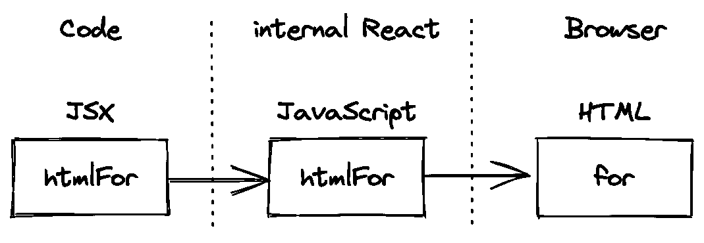

我们稍后将再次回顾 HTML 输入字段及其标签，以介绍更多 JavaScript 实现细节。现在，为了对比 HTML 和 JavaScript 在 JSX 中的用法，让我们先在 JSX 中使用更复杂的 JavaScript 数据类型。与其定义像 `title` 这样的 JavaScript 字符串类型，不如定义一个名为 `welcome` 的 JavaScript 对象，它包含 `title`（例如 `'React'`）和 `greeting`（例如 `'Hey'`）作为属性。之后，尝试在 JSX 的 `<h1>` 标签中并排渲染该对象的这两个属性。

下面的代码片段将向你展示该任务的解决方案。在此之前，我们定义了一个用于在 `App` 组件中显示的 JavaScript 字符串类型。现在，通过在 JSX 中访问其属性，可以使用 JavaScript 对象来实现同样的操作：

```
const welcome = {
  greeting: 'Hey',
  title: 'React',
};

function App() {
  return (
    <div>
      <h1>
        {welcome.greeting} {welcome.title}
      </h1>

      <label htmlFor="search">Search: </label>
      <input id="search" type="text" />
    </div>
  );
}

export default App;
```

`src/App.jsx`

### 在 JSX 中使用 JavaScript

虽然 HTML 几乎可以以原生方式在 JSX 中使用（属性除外），但大括号中的所有内容都可以用于其中插值 JavaScript。例如，你可以定义一个返回标题的函数并在大括号内执行它：

```
function getTitle(title) {
  return title;
}

function App() {
  return (
    <div>
      <h1>Hello {getTitle('React')}</h1>

      <label htmlFor="search">Search: </label>
      <input id="search" type="text" />
    </div>
  );
}

export default App;
```

`src/App.jsx`

### 理解 JSX

JSX 是 JavaScript 的语法扩展。在过去，使用 JSX 的 JavaScript 文件[必须使用](https://bit.ly/3tT0DDD) `.jsx` 扩展而不是 `.js`。然而，如今有几个构建工具（即：编译器/打包器）[可以配置为识别 .js 文件中的 JSX](https://www.robinwieruch.de/minimal-react-webpack-babel-setup/)。如果这样配置，它们会将 JSX 编译为 JavaScript。尽管如此，像 Vite 这样的工具仍然采用 `.jsx` 扩展，因为这对开发者来说更加显式。

```
const title = 'React';

// JSX ...
const myElement = <h1>Hello {title}</h1>;

// ... 被编译为 JavaScript
const myElement = React.createElement('h1', null, `Hello ${title}`);

// ... 被 React 渲染为 HTML
<h1>Hello React</h1>
```

代码练习 (Code Playground)

JSX 允许开发者通过混合 HTML 和 JavaScript 来表达应该渲染的内容。而之前的思维方式是将标记（即：HTML）与逻辑（即：JavaScript）解耦，而 React 将所有内容作为一个单元整合在 React 组件中。正如你从最后一个代码片段所示，React 完全不需要你使用 JSX，相反，可以使用像 `createElement()` 这样的方法。但大多数人发现使用 JSX 的声明式特性比使用 JavaScript 方法（这里：React 提供的方法）更直观，因为后者只允许人们以命令式的方式表达 UI。

JSX 最初是为 React 发明的，后来在其他现代库和框架中也流行了起来。如今，它并不严格与 React 绑定，但人们通常将其与 React 联系起来。无论如何，当被问到 React 时，JSX 是我最喜欢的东西之一](https://bit.ly/3aZbdM0)。不需要任何额外的模板语法（大括号除外），我们能够在 HTML 中使用 JavaScript。每种 JavaScript 数据结构，从原始类型到复杂类型，都可以在 JSX 的帮助下在 HTML 中使用。

#### 练习：

*   将你的源代码与作者的[源代码](https://bit.ly/3S51Lfu) 进行对比。
    *   回顾本节的所有[源代码更改](https://bit.ly/3vLjctL)。
    *   可选：如果你正在使用 TypeScript，请在此查看作者的[源代码](https://bit.ly/3SukC3A)。
*   初学者：阅读更多关于[JavaScript 变量](https://www.robinwieruch.de/javascript-variable/) 的信息。
    *   初学者：定义更多原始和复杂的 JavaScript 数据类型并在 JSX 中渲染它们。
    *   高级：：尝试使用数组内置的 `map()` 方法在 JSX 中渲染 JavaScript 数组，为列表中的每个项目返回 JSX。如果太复杂，不要担心，因为你将在下一节中学习更多内容。
*   可选：[为本节提供反馈](https://forms.gle/R6y6kEqGPACLrXmP8)。

#### 面试题：

*   问题：React 中的 JSX 是什么？
    *   答案：JSX 是 React 推荐的 JavaScript 语法扩展，用于描述 UI 应该的样子。
*   问题：JSX 可以被浏览器直接渲染吗？
    *   答案：不能，浏览器无法理解 JSX。
*   问题：JSX 是强制性的吗？
    *   答案：不是，它是一种常用且方便的方法。
*   问题：如何在 JSX 中渲染变量？
    *   答案：使用大括号 `{}`。

### React 中的列表

在处理数据时，数据通常以数组形式出现。因此，我们将学习列表，让我们回顾常用的数据处理方法之一：数组内置的 map 方法](zl.la/B37tf)。它用于遍历每一项：

```
const numbers = [1, 2, 3, 4];

const exponentialNumbers = numbers.map(function (number) {
  return number * number;
});

console.log(exponentialNumbers);
// [1, 4, 9, 16]
```

在 React 中，数组内置的 `map()` 方法用于将项目列表转换为 JSX。因此我们不会从一种 JavaScript 数据类型映射到另一种，而是返回渲染列表每个项目的 JSX：

接下来，我们将在组件外部定义数组。之后，尝试自己通过在 JSX 中内联数组的 `map()` 方法来渲染每个对象的 `title` 属性：

```
const list = [
  {
    title: 'React',
    url: 'https://reactjs.org/',
    author: 'Jordan Walke',
    num_comments: 3,
    points: 4,
    objectID: 0,
  },
  {
    title: 'Redux',
    url: 'https://redux.js.org/',
    author: 'Dan Abramov, Andrew Clark',
    num_comments: 2,
    points: 5,
    objectID: 1,
  },
];

function App() { ... }

// 注意 ... 占位符
// 用于没有变化且与此代码片段相关的源代码

export default App;
```

`src/App.jsx`


```javascript
function App() {
  return (
    <div>
      <h1>My Hacker Stories</h1>

      <label htmlFor="search">Search: </label>
      <input id="search" type="text" />

      <hr />

      <ul>
        {list.map(function (item) {
          return <li>{item.title}</li>;
        })}
      </ul>
    </div>
  );
}
```

`src/App.jsx`

实际上，在 `React` 中渲染项目列表是我个人 JSX 之上的“豁然开朗”时刻之一。在不需要任何虚构的模板语法的情况下，可以使用 `JavaScript` 将一个 `JavaScript` 对象数组映射到 `HTML` 元素列表。这正是 `JSX` 对开发者而言的最终意义：只是 `JS` 与 `HTML` 的混合。

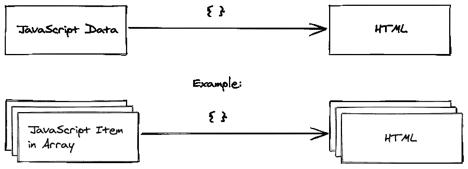

现在 `React`终于可以显示每个项目了。但还缺少了一个重要的部分。如果你检查浏览器的开发者工具，你应该会在 `Console` 标签页中看到一个警告，显示列表中的每个 `React` 元素应该分配一个 `key`。`key` 是一个 `HTML` 属性，应该是一个稳定的标识符。幸运的是，我们的项目带有这样一个稳定的标识符，因为它们有一个 `id`（这里是：`objectId`）：

```javascript
function App() {
  return (
    <div>
      ...

      <ul>
        {list.map(function (item) {
          return <li key={item.objectID}>{item.title}</li>;
        })}
      </ul>
    </div>
  );
}
```

`src/App.jsx`

`key` 属性的使用有一个非常特定的原因：每当 `React` 必须重新渲染列表时，它会检查项目是否发生了变化。使用 `keys` 时，`React` 可以高效地交换已更改的项目。如果不使用 `keys`，`React` 更新列表可能会非常低效。看下面的例子，一个新项目被添加到了列表开头。

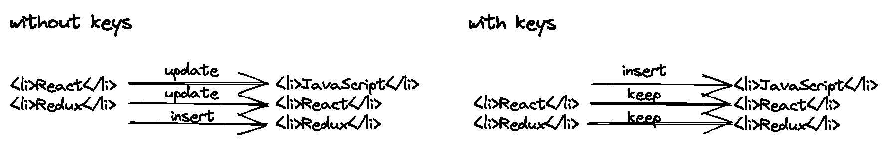

`key` 并不难找到，因为当数据以数组形式存在时，我们可以使用每个项目的稳定标识符（例如 `id` 属性）。然而，有时你没有 `id`，所以你需要想出另一个标识符（例如，如果 `title` 不改变且在数组中是唯一的）。作为最后手段，你也可以使用项目在列表中的索引：

```javascript
<ul>
  {list.map(function (item, index) {
    return (
      <li key={index}>
        {/* 仅在最后手段使用索引 */}
        {/* 顺便说一下：这就是在 JSX 中写注释的方式 */}

        {item.title}
      </li>
    );
  })}
</ul>
```

### 代码演场

不过通常应该避免使用索引，因为会带来上述相同的渲染性能问题。此外，每当项目顺序发生变化时（例如重新排序、添加或删除项目），它可能会[在 UI 中引起实际 Bug](https://www.robinwieruch.de/react-list-key/)。然而，作为最后手段，如果列表没有以任何方式改变顺序，使用索引是可以的。

到目前为止，我们只显示了每个项目的 `title`。继续渲染项目的 `url`、`author`、`num_comments` 和 `points`。在 `url` 的特殊情况下，使用一个包裹 `title` 的 `HTML` 锚点 `HTML` 元素（即 `<a>` 标签）。自己试一下！为了指导，下面的解决方案将向你展示这本书是如何实现它的，以便为后续章节做好准备：

```javascript
function App() {
  return (
    <div>
      ...

      <ul>
        {list.map(function (item) {
          return (
            <li key={item.objectID}>
              <span>
                <a href={item.url}>{item.title}</a>
              </span>
              <span>{item.author}</span>
              <span>{item.num_comments}</span>
              <span>{item.points}</span>
            </li>
          );
        })}
      </ul>
    </div>
  );
}
```

`src/App.jsx`

数组的 `map()` 方法被简洁地内联在你的 `JSX` 中，用于渲染列表。在 `map()` 方法内部，我们可以访问每个对象及其属性。每个项目的 `url` 属性被用作锚点锚点 `HTML` 元素的 `href` 属性。在 `JSX` 中 `JavaScript` 不仅可以用于显示元素，还可以动态分配 `HTML` 属性。然而，这一节仅触及了使用数组混合 `JavaScript` 和 `HTML` 的强大之处的表面。

## 练习

- 到目前为止，我们只显示了每个项目的 `title`。继续渲染项目的 `url`、`author`、`num_comments` 和 `points`。在 `url` 的特殊情况下，使用一个包裹 `title` 的 `HTML` 锚点 `HTML` 元素（即 `<a>` 标签）。自己试一下！为了指导，下面的解决方案将向你展示这本书是如何实现它的，以便为后续章节做好准备：
- 数组的 `map()` 方法被简洁地内联在你的 `JSX` 中，用于渲染列表。在 `map()` 方法内部，我们可以访问每个对象及其属性。每个项目的 `url` 属性被用作锚点锚点 `HTML` 元素的 `href` 属性。在 `JSX` 中 `JavaScript` 不仅可以用于显示元素，还可以动态分配 `HTML` 属性。然而，这一节仅触及了使用数组混合 `JavaScript` 和 `HTML` 的强大之处的表面。
- 到目前为止，我们只显示了每个项目的 `title`。继续渲染项目的 `url`、`author`、`num_comments` 和 `points`。在 `url` 的特殊情况下，使用一个包裹 `title` 的 `HTML` 锚点 `HTML` 元素（即 `<a>` 标签）。自己试一下！为了指导，下面的解决方案将向你展示这本书是如何实现它的，以便为后续章节做好准备：
- 数组的 `map()` 方法被简洁地内联在你的 `JSX` 中，用于渲染列表。在 `map()` 方法内部，我们可以访问每个对象及其属性。每个项目的 `url` 属性被用作锚点锚点 `HTML` 元素的 `href` 属性。在 `JSX` 中 `JavaScript` 不仅可以用于显示元素，还可以动态分配 `HTML` 属性。然而，这一节仅触及了使用数组混合 `JavaScript` 和 `HTML` 的强大之处的表面。
- 到目前为止，我们只显示了每个项目的 `title`。继续渲染项目的 `url`、`author`、`num_comments` 和 `points`。在 `url` 的特殊情况下，使用一个包裹 `title` 的 `HTML` 锚点 `HTML` 元素（即 `<a>` 标签）。自己试一下！为了指导，下面的解决方案将向你展示这本书是如何实现它的，以便为后续章节做好准备：
- 数组的 `map()` 方法被简洁地内联在你的 `JSX` 中，用于渲染列表。在 `map()` 方法内部，我们可以访问每个对象及其属性。每个项目的 `url` 属性被用作锚点锚点 `HTML` 元素的 `href` 属性。在 `JSX` 中 `JavaScript` 不仅可以用于显示元素，还可以动态分配 `HTML` 属性。然而，这一节仅触及了使用数组混合 `JavaScript` 和 `HTML` 的强大之处的表面。
- 到目前为止，我们只显示了每个项目的 `title`。继续渲染项目的 `url`、`author`、`num_comments` 和 `points`。在 `url` 的特殊情况下，使用一个包裹 `title` 的 `HTML` 锚点 `HTML` 元素（即 `<a>` 标签）。自己试一下！为了指导，下面的解决方案将向你展示这本书是如何实现它的，以便为后续章节做好准备：
- 数组的 `map()` 方法被简洁地内联在你的 `JSX` 中，用于渲染列表。在 `map()` 方法内部，我们可以访问每个对象及其属性。每个项目的 `url` 属性被用作锚点锚点 `HTML` 元素的 `href` 属性。在 `JSX` 中 `JavaScript` 不仅可以用于显示元素，还可以动态分配 `HTML` 属性。然而，这一节仅触及了使用数组混合 `JavaScript` 和 `HTML` 的强大之处的表面。
- 到目前为止，我们只显示了每个项目的 `title`。继续渲染项目的 `url`、`author`、`num_comments` 和 `points`。在 `url` 的特殊情况下，使用一个包裹 `title` 的 `HTML` 锚点 `HTML` 元素（即 `<a>` 标签）。自己试一下！为了指导，下面的解决方案将向你展示这本书是如何实现它的，以便为后续章节做好准备：
- 数组的 `map()` 方法被简洁地内联在你的 `JSX` 中，用于渲染列表。在 `map()` 方法内部，我们可以访问每个对象及其属性。每个项目的 `url` 属性被用作锚点锚点 `HTML` 元素的 `href` 属性。在 `JSX` 中 `JavaScript` 不仅可以用于显示元素，还可以动态分配 `HTML` 属性。然而，这一节仅触及了使用数组混合 `JavaScript` 和 `HTML` 的强大之处的表面。
- 到目前为止，我们只显示了每个项目的 `title`。继续渲染项目的 `url`、`author`、`num_comments` 和 `points`。在 `url` 的特殊情况下，使用一个包裹 `title` 的 `HTML` 锚点 `HTML` 元素（即 `<a>` 标签）。自己试一下！为了指导，下面的解决方案将向你展示这本书是如何实现它的，以便为后续章节做好准备：
- 数组的 `map()` 方法被简洁地内联在你的 `JSX` 中，用于渲染列表。在 `map()` 方法内部，我们可以访问每个对象及其属性。每个项目的 `url` 属性被用作锚点锚点 `HTML` 元素的 `href` 属性。在 `JSX` 中 `JavaScript` 不仅可以用于显示元素，还可以动态分配 `HTML` 属性。然而，这一节仅触及了使用数组混合 `JavaScript` 和 `HTML` 的强大之处的表面。
- 到目前为止，我们只显示了每个项目的 `title`。继续渲染项目的 `url`、`author`、`num_comments` 和 `points`。在 `url` 的特殊情况下，使用一个包裹 `title` 的 `HTML` 锚点 `HTML` 元素（即 `<a>` 标签）。自己试一下！为了指导，下面的解决方案将向你展示这本书是如何实现它的，以便为后续章节做好准备：
- 数组的 `map()` 方法被简洁地内联在你的 `JSX` 中，用于渲染列表。在 `map()` 方法内部，我们可以访问每个对象及其属性。每个项目的 `url` 属性被用作锚点锚点 `HTML` 元素的 `href` 属性。在 `JSX` 中 `JavaScript` 不仅可以用于显示元素，还可以动态分配 `HTML` 属性。然而，这一节仅触及了使用数组混合 `JavaScript` 和 `HTML` 的强大之处的表面。

### 认识另一个组件

组件是每个 `React` 应用的基础。有了这个例子，我们可以看到组件如何通过封装有意义的任务，同时为更大的 `React` 项目的整体利益做出贡献。到目前为止，我们一直在使用 `App` 组件。这结果不会很好，因为组件应该随着应用程序的大小而扩展。因此，与其让一个组件变得更大、更复杂，我们将从一个新的 `List` 组件开始，它从 `App` 组件中提取功能：

```javascript
const list = [ ... ];

function App() { ... }

function List() {
  return (
    <ul>
      {list.map(function (item) {
        return (
          <li key={item.objectID}>
            <span>
              <a href={item.url}>{item.title}</a>
            </span>
            <span>{item.author}</span>
            <span>{item.num_comments}</span>
            <span>{item.points}</span>
          </li>
        );
      })}
    </ul>
  );
}
```

`src/App.jsx`

那么新的 `List` 组件就可以在 `App` 组件中使用，我们之前那里使用的是内联的 `HTML` 元素：

```javascript
function App() {
  return (
    <div>
      <h1>My Hacker Stories</h1>

      <label htmlFor="search">Search: </label>
      <input id="search" type="text" />

      <hr />

      <List />
    </div>
  );
}
```

`src/App.jsx`

你刚刚创建了第一个 `React` 组件。有了这个例子，我们可以看到组件如何封装有意义的任务，同时为更大的 `React` 项目的整体利益做出贡献。作为一名 `React` 开发者，你经常会执行提取组件的任务，因为组件将会增长变得复杂。从 `App` 组件中提取 `label` 和 `input` 元素到它们自己的组件。下面的代码片段显示了书籍如何解决这个任务：

等待，抱歉，由于处理错误，我在上面的输出中注意到了一些重复章节。根据你的规则，让我提供请求文本的正确格式的版本：

```javascript
function App() {
  return (
    <div>
      <h1>My Hacker Stories</h1>

      <label htmlFor="search">Search: </label>
      <input id="search" type="text" />

      <hr />

      <ul>
        {list.map(function (item) {
          return <li>{item.title}</li>;
        })}
      </ul>
    </div>
  );
}
```

`src/App.jsx`

实际上，在 `React` 中渲染项目列表是我个人 JSX 之上的“豁然开朗”时刻之一。在不需要任何虚构的模板语法的情况下，可以使用 `JavaScript` 将一个 `JavaScript` 对象数组映射到 `HTML` 元素列表。这正是 `JSX` 对开发者而言的最终意义：只是 `JS` 与 `HTML` 的混合。


现在 `React`终于可以显示每个项目了。但还缺少了一个重要的部分。如果你检查浏览器的开发者工具，你应该会在 `Console` 标签页中看到一个警告，显示列表中的每个 `React` 元素应该分配一个 `key`。`key` 是一个 `HTML` 属性，应该是一个稳定的标识符。幸运的是，我们的项目带有这样一个稳定的标识符，因为它们有一个 `id`（这里是：`objectId`）：

```javascript
function App() {
  return (
    <div>
      ...

      <ul>
        {list.map(function (item) {
          return <li key={item.objectID}>{item.title}</li>;
        })}
      </ul>
    </div>
  );
}
```

`src/App.jsx`

`key` 属性的使用有一个非常特定的原因：每当 `React` 必须重新渲染列表时，它会检查项目是否发生了变化。使用 `keys` 时，`React` 可以高效地交换已更改的项目。如果不使用 `keys`，`React` 更新列表可能会非常低效。看下面的例子，一个新项目被添加到了列表开头。


`key` 并不难找到，因为当数据以数组形式存在时，我们可以使用每个项目的稳定标识符（例如 `id` 属性）。然而，有时你没有 `id`，所以你需要想出另一个标识符（例如，如果 `title` 不改变且在数组中是唯一的）。作为最后手段，你也可以使用项目在列表中的索引：

```javascript
<ul>
  {list.map(function (item, index) {
    return (
      <li key={index}>
        {/* 仅在最后手段使用索引 */}
        {/* 顺便说一下：这就是在 JSX 中写注释的方式 */}

        {item.title}
      </li>
    );
  })}
</ul>
```

### 代码演场

不过通常应该避免使用索引，因为会带来上述相同的渲染性能问题。此外，每当项目顺序发生变化时（例如重新排序、添加或删除项目），它可能会[在 UI 中引起实际 Bug](https://www.robinwieruch.de/react-list-key/)。然而，作为最后手段，如果列表没有以任何方式改变顺序，使用索引是可以的。

到目前为止，我们只显示了每个项目的 `title`。继续渲染项目的 `url`、`author`、`num_comments` 和 `points`。在 `url` 的特殊情况下，使用一个包裹 `title` 的 `HTML` 锚点 `HTML` 元素（即 `<a>` 标签）。自己试一下！为了指导，下面的解决方案将向你展示这本书是如何实现它的，以便为后续章节做好准备：

```javascript
function App() {
  return (
    <div>
      ...

      <ul>
        {list.map(function (item) {
          return (
            <li key={item.objectID}>
              <span>
                <a href={item.url}>{item.title}</a>
              </span>
              <span>{item.author}</span>
              <span>{item.num_comments}</span>
              <span>{item.points}</span>
            </li>
          );
        })}
      </ul>
    </div>
  );
}
```

`src/App.jsx`

数组的 `map()` 方法被简洁地内联在你的 `JSX` 中，用于渲染列表。在 `map()` 方法内部，我们可以访问每个对象及其属性。每个项目的 `url` 属性被用作锚点锚点 `HTML` 元素的 `href` 属性。在 `JSX` 中 `JavaScript` 不仅可以用于显示元素，还可以动态分配 `HTML` 属性。然而，这一节仅触及了使用数组混合 `JavaScript` 和 `HTML` 的强大之处的表面。

## 练习

- 到目前为止，我们只显示了每个项目的 `title`。继续渲染项目的 `url`、`author`、`num_comments` 和 `points`。在 `url` 的特殊情况下，使用一个包裹 `title` 的 `HTML` 锚点 `HTML` 元素（即 `<a>` 标签）。自己试一下！为了指导，下面的解决方案将向你展示这本书是如何实现它的，以便为后续章节做好准备：
- 数组的 `map()` 方法被简洁地内联在你的 `JSX` 中，用于渲染列表。在 `map()` 方法内部，我们可以访问每个对象及其属性。每个项目的 `url` 属性被用作锚点锚点 `HTML` 元素的 `href` 属性。在 `JSX` 中 `JavaScript` 不仅可以用于显示元素，还可以动态分配 `HTML` 属性。然而，这一节仅触及了使用数组混合 `JavaScript` 和 `HTML` 的强大之处的表面。
- 到目前为止，我们只显示了每个项目的 `title`。继续渲染项目的 `url`、`author`、`num_comments` 和 `points`。在 `url` 的特殊情况下，使用一个包裹 `title` 的 `HTML` 锚点 `HTML` 元素（即 `<a>` 标签）。自己试一下！为了指导，下面的解决方案将向你展示这本书是如何实现它的，以便为后续章节做好准备：
- 数组的 `map()` 方法被简洁地内联在你的 `JSX` 中，用于渲染列表。在 `map()` 方法内部，我们可以访问每个对象及其属性。每个项目的 `url` 属性被用作锚点锚点 `HTML` 元素的 `href` 属性。在 `JSX` 中 `JavaScript` 不仅可以用于显示元素，还可以动态分配 `HTML` 属性。然而，这一节仅触及了使用数组混合 `JavaScript` 和 `HTML` 的强大之处的表面。
- 到目前为止，我们只显示了每个项目的 `title`。继续渲染项目的 `url`、`author`、`num_comments` 和 `points`。在 `url` 的特殊情况下，使用一个包裹 `title` 的 `HTML` 锚点 `HTML` 元素（即 `<a>` 标签）。自己试一下！为了指导，下面的解决方案将向你展示这本书是如何实现它的，以便为后续章节做好准备：
- 数组的 `map()` 方法被简洁地内联在你的 `JSX` 中，用于渲染列表。在 `map()` 方法内部，我们可以访问每个对象及其属性。每个项目的 `url` 属性被用作锚点锚点 `HTML` 元素的 `href` 属性。在 `JSX` 中 `JavaScript` 不仅可以用于显示元素，还可以动态分配 `HTML` 属性。然而，这一节仅触及了使用数组混合 `JavaScript` 和 `HTML` 的强大之处的表面。
- 到目前为止，我们只显示了每个项目的 `title`。继续渲染项目的 `url`、`author`、`num_comments` 和 `points`。在 `url` 的特殊情况下，使用一个包裹 `title` 的 `HTML` 锚点 `HTML` 元素（即 `<a>` 标签）。自己试一下！为了指导，下面的解决方案将向你展示这本书是如何实现它的，以便为后续章节做好准备：
- 数组的 `map()` 方法被简洁地内联在你的 `JSX` 中，用于渲染列表。在 `map()` 方法内部，我们可以访问每个对象及其属性。每个项目的 `url` 属性被用作锚点锚点 `HTML` 元素的 `href` 属性。在 `JSX` 中 `JavaScript` 不仅可以用于显示元素，还可以动态分配 `HTML` 属性。然而，这一节仅触及了使用数组混合 `JavaScript` 和 `HTML` 的强大之处的表面。
- 到目前为止，我们只显示了每个项目的 `title`。继续渲染项目的 `url`、`author`、`num_comments` 和 `points`。在 `url` 的特殊情况下，使用一个包裹 `title` 的 `HTML` 锚点 `HTML` 元素（即 `<a>` 标签）。自己试一下！为了指导，下面的解决方案将向你展示这本书是如何实现它的，以便为后续章节做好准备：
- 数组的 `map()` 方法被简洁地内联在你的 `JSX` 中，用于渲染列表。在 `map()` 方法内部，我们可以访问每个对象及其属性。每个项目的 `url` 属性被用作锚点锚点 `HTML` 元素的 `href` 属性。在 `JSX` 中 `JavaScript` 不仅可以用于显示元素，还可以动态分配 `HTML` 属性。然而，这一节仅触及了使用数组混合 `JavaScript` 和 `HTML` 的强大之处的表面。
- 到目前为止，我们只显示了每个项目的 `title`。继续渲染项目的 `url`、`author`、`num_comments` 和 `points`。在 `url` 的特殊情况下，使用一个包裹 `title` 的 `HTML` 锚点 `HTML` 元素（即 `<a>` 标签）。自己试一下！为了指导，下面的解决方案将向你展示这本书是如何实现它的，以便为后续章节做好准备：
- 数组的 `map()` 方法被简洁地内联在你的 `JSX` 中，用于渲染列表。在 `map()` 方法内部，我们可以访问每个对象及其属性。每个项目的 `url` 属性被用作锚点锚点 `HTML` 元素的 `href` 属性。在 `JSX` 中 `JavaScript` 不仅可以用于显示元素，还可以动态分配 `HTML` 属性。然而，这一节仅触及了使用数组混合 `JavaScript` 和 `HTML` 的强大之处的表面。
- 到目前为止，我们只显示了每个项目的 `title`。继续渲染项目的 `url`、`author`、`num_comments` 和 `points`。在 `url` 的特殊情况下，使用一个包裹 `title` 的 `HTML` 锚点 `HTML` 元素（即 `<a>` 标签）。自己试一下！为了指导，下面的解决方案将向你展示这本书是如何实现它的，以便为后续章节做好准备：
- 数组的 `map()` 方法被简洁地内联在你的 `JSX` 中，用于渲染列表。在 `map()` 方法内部，我们可以访问每个对象及其属性。每个项目的 `url` 属性被用作锚点锚点 `HTML` 元素的 `href` 属性。在 `JSX` 中 `JavaScript` 不仅可以用于显示元素，还可以动态分配 `HTML` 属性。然而，这一节仅触及了使用数组混合 `JavaScript` 和 `HTML` 的强大之处的表面。
- 到目前为止，我们只显示了每个项目的 `title`。继续渲染项目的 `url`、`author`、`num_comments` 和 `points`。在 `url` 的特殊情况下，使用一个包裹 `title` 的 `HTML` 锚点 `HTML` 元素（即 `<a>` 标签）。自己试一下！为了指导，下面的解决方案将向你展示这本书是如何实现它的，以便为后续章节做好准备：
- 数组的 `map()` 方法被简洁地内联在你的 `JSX` 中，用于渲染列表。在 `map()` 方法内部，我们可以访问每个对象及其属性。每个项目的 `url` 属性被用作锚点锚点 `HTML` 元素的 `href` 属性。在 `JSX` 中 `JavaScript` 不仅可以用于显示元素，还可以动态分配 `HTML` 属性。然而，这一节仅触及了使用数组混合 `JavaScript` 和 `HTML` 的强大之处的表面。
- 到目前为止，我们只显示了每个项目的 `title`。继续渲染项目的 `url`、`author`、`num_comments` 和 `points`。在 `url` 的特殊情况下，使用一个包裹 `title` 的 `HTML` 锚点 `HTML` 元素（即 `<a>` 标签）。自己试一下！为了指导，下面的解决方案将向你展示这本书是如何实现它的，以便为后续章节做好准备：
- 数组的 `map()` 方法被简洁地内联在你的 `JSX` 中，用于渲染列表。在 `map()` 方法内部，我们可以访问每个对象及其属性。每个项目的 `url` 属性被用作锚点锚点 `HTML` 元素的 `href` 属性。在 `JSX` 中 `JavaScript` 不仅可以用于显示元素，还可以动态分配 `HTML` 属性。然而，这一节仅触及了使用数组混合 `JavaScript` 和 `HTML` 的强大之处的表面。
- 到目前为止，我们只显示了每个项目的 `title`。继续渲染项目的 `url`、`author`、`num_comments` 和 `points`。在 `url` 的特殊情况下，使用一个包裹 `title` 的 `HTML` 锚点 `HTML` 元素（即 `<a>` 标签）。自己试一下！为了指导，下面的解决方案将向你展示这本书是如何实现它的，以便为后续章节做好准备：
- 数组的 `map()` 方法被简洁地内联在你的 `JSX` 中，用于渲染列表。在 `map()` 方法内部，我们可以访问每个对象及其属性。每个项目的 `url` 属性被用作锚点锚点 `HTML` 元素的 `href` 属性。在 `JSX` 中 `JavaScript` 不仅可以用于显示元素，还可以动态分配 `HTML` 属性。然而，这一节仅触及了使用数组混合 `JavaScript` 和 `HTML` 的强大之处的表面。


```jsx
function App() {
  return (
    <div>
      <h1>My Hacker Stories</h1>

      <Search />

      <hr />

      <List />
    </div>
  );
}

function Search() {
  return (
    <div>
      <label htmlFor="search">Search: </label>
      <input id="search" type="text" />
    </div>
  );
}
```

`src/App.jsx`

最后，我们在应用程序中拥有三个组件：`App`、`List` 和 `Search`。总的来说，一个 React 应用由许多具有层级关系的组件组成；而我们可以将它们归类为以下几类。接下来的插图假设我们还从 `List` 组件中拆分出了一个 `Item` 组件——这有助于我们理清这种分类法。

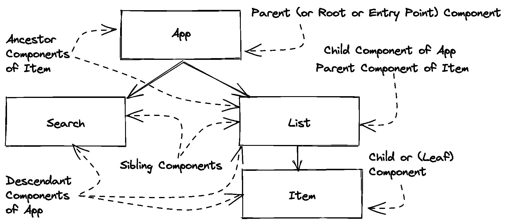

React 应用具有`组件层次结构`（也称为`组件树`）。通常有一个最顶层的`入口组件`（例如 `App`），它跨越了其下方的组件树。`App` 是 `List` 和 `Search` 的`父组件`，因此 `List` 和 `Search` 是 `App` 组件的`子组件`，并且它们彼此是`兄弟组件`。插图更进一步展示了 `Item` 组件是 `List` 的子组件。在组件树中，总有一个`根组件`（例如 `App`），而不渲染任何其他组件的组件被称为`叶组件`（例如我们当前源代码中的 `List`/`Search` 组件，或者插图中的 `Item`/`Search` 组件）。所有组件都可以有零、一个或多个子组件。

你可以通过创建更多连接在同一个层级结构中的组件，看到 React 应用是如何增长的。通常，你会从 `App` 组件开始构建你的组件树。你可以预先知道想要创建的组件，也可以从一个组件开始，并最终从中提取组件。对于初学者来说，可能很难判断何时创建新组件或何时从另一个组件中提取组件。通常，当一个组件的大小/复杂度变得太大时，或者当你在领域/功能上看到自然的边界时（例如，`List` 组件渲染项目列表，`Search` 组件渲染搜索表单），这种情况就会自然发生。最后，每个组件代表了应用程序中的一个单一单元，这使得应用程序具有可维护性和可预测性。

#### 练习：

*   将你的源代码与作者的[源代码](https://bit.ly/3S5rDb5) 进行对比。

    *   回顾本节中所有的[源代码更改](https://bit.ly/47Ed7MY)。

    *   可选：如果你正在使用 TypeScript，请在此处查看作者的源代码](https://bit.ly/3SuMogq)。

*   我们目前还无法从 `List` 组件中提取出 `Item` 组件（如插图所示），因为我们还不知道如何将列表中的单个项目传递给每个 `Item` 组件。思考一种实现方法。

*   可选：[为本节留下反馈](https://forms.gle/EZENmy48zvDP82NL7)。

#### 面试题：

*   问题：为什么在 React 中提取组件是有益的？

    *   回答：提取组件可以提高可复用性、可维护性并使组件结构更加整洁。

*   问题：你如何决定何时提取组件？

    *   回答：当你在代码中发现重复的 UI 模式或功能时，就提取组件。

*   问题：在 React 中提取组件的过程是什么？

    *   回答：这被称为重构，具体来说是提取组件以改进代码组织。

*   问题：可以在不同文件中提取组件吗？

    *   回答：可以，将组件提取到单独的文件中可以促进文件组织和模块化。

### React 组件的实例化

你已经学习了如何`声明`(declare)一个组件（例如 `function List() { ... }`）以及如何对其进行`实例化`(instantiate)（例如 `<List />`）。在本节中，我们将通过一个类比和术语来深化这一学习。我们将从使用 JavaScript 类开始进行类比。从技术上讲，JavaScript 类和 React 组件之间没有关系，这一点需要注意，但对于你来说，通过以前使用过的东西来理解组件的概念，这仍然是一个很好的类比。

类通常用于面向对象的编程语言。JavaScript 作为一种多范式编程语言，允许函数式编程和面向对象编程并存。为了回顾面向对象编程的 JavaScript 类，考虑以下 `Person` 类：

```javascript
class Person {
  constructor(firstName, lastName) {
    this.firstName = firstName;
    this.lastName = lastName;
  }

  getName() {
    return this.firstName + ' ' + this.lastName;
  }
}
```

代码沙场

每个类都有一个构造函数，它接收参数并在实例化时将它们赋值给类实例。类还可以定义与实例关联的函数（例如 `getName()`），这些函数被称为`方法`或`类方法`。现在，声明一次 `Person` 类仅仅是其一部分；实例化是另一部分。类的声明是其功能的蓝图，而用法在通过 `new` 语句创建实例时发生。如果存在 JavaScript 类声明，人们可以创建它的`多个`实例：

```javascript
// 类声明
class Person { ... }

// 类实例化
const robin = new Person('Robin', 'Wieruch');

console.log(robin.getName());
// "Robin Wieruch"

// 另一个类实例化
const dennis = new Person('Dennis', 'Wieruch');

console.log(dennis.getName());
// "Dennis Wieruch"
```

代码沙场

JavaScript 类声明和实例化的概念与 React 组件相似，React 组件也有`一个`组件声明，但可以有`多个`组件实例：

```jsx
// App 组件声明
function App() {
  return (
    <div>
      ...

      {/* 创建 List 组件的实例 */}
      <List />
      {/* 创建另一个 List 组件的实例 */}
      <List />
    </div>
  );
}

// List 组件声明
function List() { ... }
```

src/App.jsx

一旦我们定义了一个`组件`，就可以 JSX 中的任何地方将其作为`元素`使用。该元素产生你的组件的`实例`，或者说，组件被实例化了。只要你有组件声明，就可以创建任意数量的组件实例。这与 JavaScript 类的声明和实例化差别不大，然而，正如之前提到的，技术上讲 JavaScript 类和 React 组件并不是一个东西。只是用法方便了我们演示它们的相似性。

### React DOM

我们已经学习了组件声明/实例化，并在 `List` 和 `Search` 组件中看到了实际应用。然而，在最开始我们从 `App` 组件的声明开始，却从未遇到它的实例化。它必须在那里，否则 `App` 组件及其在组件层次结构中的所有后代组件将无法渲染。

打开 `src/main.jsx` 文件查看使用 `<App />` 元素对 App 组件的实例化。该文件可能与你的文件略有不同，但下面的代码显示了它的所有本质方面：


```javascript
import React from 'react';
import ReactDOM from 'react-dom/client';
import App from './App.jsx';
import './index.css';

ReactDOM.createRoot(document.getElementById('root')).render(
  <React.StrictMode>
    <App />
  </React.StrictMode>
);
```

`src/main.jsx`

### src/main.jsx 分析

文件开头导入了两个库：`react` 和 `react-dom`。虽然 React 开发者在日常业务中使用 React，但 React DOM 通常在 React 应用中使用一次，用于将 React 钩到原生 HTML 世界中。打开侧侧的 `index.html` 文件，找到 `id` 属性等于 `"root"` 的 HTML 元素。这正是 React 插入到 HTML 中以启动整个 React 应用的元素——从 `App` 组件开始。

在 JavaScript 文件中，`createRoot()` 方法期望一个用于实例化 React 的 HTML 元素。在这里我们使用 JavaScript 内置的 `getElementById()` 方法来返回我们在 `index.html` 文件中看到的 HTML 元素。一旦获得了 `root` 对象，我们在返回的根对象上调用 `render()`，并以 JSX 作为参数，这通常代表入口点组件（也称为根组件）。通常入口点组件是 `App` 组件的实例，但也可以是任何其他 JSX：

```javascript
const title = 'React';

ReactDOM.createRoot(document.getElementById('root')).render(
  <h1>Hello {title}</h1>
);
```

#### 代码练场

本质上，React DOM 是将 React 集成到任何使用 HTML 的网站所需的所有内容。如果你从零开始构建 React 应用，应用程序中通常只有一个 `ReactDOM.createRoot()` 调用。然而，如果你恰好在处理一个以前使用 React 其他内容的遗留应用程序，你可能会看到多个 `ReactDOM.createRoot()` 调用，因为只有应用程序的某些区域是由 React 驱动的。

无论，你还记得关于仅由小型 HTML 文件和大型 JavaScript 文件驱动的单页应用的介绍吗？你现在可以看到一切是如何整合在一起的。虽然一个很小的 HTML 文件（这里是：`index.html`）和一个大型 JavaScript 文件（这里是编译并打包的 `src/main.jsx` 和 `src/App.jsx` 文件）从 Web 服务器传输到浏览器，但 JavaScript 文件主要负责渲染浏览器中的所有 HTML。HTML 文件仅存在于请求 JavaScript 文件并渲染 React 插入自身的 HTML 元素处。从那里开始，React 调用它所有需要的函数组件来将其自身渲染为组件层次结构。

#### 练习：

*   阅读更多关于 [React 的 createRoot](https://bit.ly/3vx3uT2) 的内容。
*   阅读更多关于 [React 的 StrictMode](https://bit.ly/48TUA0k) 的内容。
*   可选：[为此部分提供反馈](https://forms.gle/zSqHUhmsuQ35vqoj9)。

### React 组件声明

到目前，我们已经声明了多个 React 组件。由于这些组件被称为函数组件，我们可以利用 JavaScript 中声明函数的不同方式来编写它们。到目前为止，我们使用了标准的函数声明，尽管箭头函数可以更简洁地使用，因此可以为声明函数组件建立新的标准：

```javascript
// 函数声明
function App() { ... }

// 箭头函数表达式
const App = () => { ... }
```

#### 代码练场

掌握这些知识后，浏览你的 React 项目并将所有的函数声明重构为箭头函数表达式。虽然这种重构可以适用于函数组件，但也可以用于项目中的任何其他函数。我们也将把所有函数组件的函数声明重构为箭头函数表达式：

```javascript
const App = () => {
  return ( ... );
};

const Search = () => {
  return ( ... );
};

const List = () => {
  return ( ... );
};
```

### `src/App.jsx`

如所说，不仅函数组件可以重构，像我们用于数组的 `map()` 方法的[回调函数](https://www.robinwieruch.de/javascript-callback-function/) 等其他函数也可以重构：

```javascript
const List = () => {
  return (
    <ul>
      {list.map((item) => {
        return (
          <li key={item.objectID}>
            ...
          </li>
        );
      })}
    </ul>
  );
};
```

### `src/App.jsx`

此外，如果一个箭头函数的唯一目的是返回一个值且中间没有任何业务逻辑，你可以移除函数的`块状体`（block body，大括号）。在`简洁体`（concise body）中，会带有一个`隐式返回语句`，因此你可以移除返回语句。查看以下演示：

```javascript
// 使用了块状体
const addOne = (count) => {
  // 在中间执行任何任务

  return count + 1;
};

// 使用了多行的简洁体
const addOne = (count) =>
  count + 1;

// 使用了单行的简洁体
const addOne = (count) => count + 1;
```

#### 代码练场

让我们在 `Search` 组件中看其实效果：

```javascript
const Search = () => (
  <div>
    <label htmlFor="search">Search: </label>
    <input id="search" type="text" />
  </div>
);
```

### `src/App.jsx`

这也可以适用于 `App` 和 `List` 组件，因为它们只返回 JSX 且中间不执行任何任务。此外，它也适用于用于 `map()` 方法的箭头函数：

```javascript
const App = () => (
  <div>
    ...
  </div>
);

const List = () => (
  <ul>
    {list.map((item) => (
      <li key={item.objectID}>
        ...
      </li>
    ))}
  </ul>
);
```

### `src/App.jsx`

现在所有的 JSX 都更简洁了，因为它们省略了函数语句、大括号和返回语句。然而，重要的是记住这是一个可选的步骤，并且对于箭头函数使用函数声明代替箭头函数表达式、以及使用带大括号的块状体代替带隐式返回的简洁体是可以接受的。

通常情况下，需要使用块状体以便在函数签名和返回语句之间引入更多的业务逻辑。请务必理解这个重构概念，因为在后续过程中，我们会快速地在带块状体和不带块状体的箭头函数之间切换。我们使用哪种取决于组件的需求：

```javascript
const App = () => {
  // 在中间执行一项任务

  return (
    <div>
      ...
    </div>
  );
};
```


- 答案：使用箭头函数语法，例如 `const MyComponent = () => {...};`。

### JSX 中的处理器函数

我们已经学习了许多关于 React 组件的知识，但还没有涉及到交互。如果你恰好在使用 React 开发应用程序，总会有一个必须实现用户交互的时候。在我们的项目中，最好的开始点是 `Search` 组件——它已经包含了一个输入框元素。

在原生 HTML 中，我们可以通过在 DOM 节点上程序化地使用 `addEventListener()` 方法来为元素[添加事件处理程序](https://mzl.la/2ZbTcYZ)。在 React 中，我们将发现如何以声明式的方式在 JSX 中添加处理程序。首先，将 `Search` 组件的函数从简洁体重构为块状体（block body），这样我们就可以在 `return` 语句之前添加实现细节：

```javascript
const Search = () => {
  // 在中间执行某些任务

  return (
    <div>
      <label htmlFor="search">Search: </label>
      <input id="search" type="text" />
    </div>
  );
};
```

`src/App.jsx`

接下来，为输入框的变更事件定义一个函数，可以是函数声明或箭头函数表达式。在 React 中，这个函数被称为 `(event) 处理器`。之后，可以将该函数传递给 HTML 输入框的 `onChange` 属性（JSX 命名属性）：

```javascript
const Search = () => {
  const handleChange = (event) => {
    // 合成事件
    console.log(event);
    // target 的值（此处是：input HTML 元素）
    console.log(event.target.value);
  };

  return (
    <div>
      <label htmlFor="search">Search: </label>
      <input id="search" type="text" onChange={handleChange} />
    </div>
  );
};
```

`src/App.jsx`

在浏览器中打开你的应用程序后，打开浏览器开发者工具的“Console”（控制台）标签页，查看在输入框输入内容后发生的日志。你看到的是作为一个 JavaScript 对象的合成事件（synthetic event）以及输入框的内部值。

React 的合成事件本质上是对[浏览器原生事件](https://mzl.la/30Dk8kt) 的封装。由于 React 最初是作为一个单页应用程序的库存在的，因此需要对事件进行增强功能以[防止原生浏览器行为](https://www.robinwieruch.de/react-preventdefault/)。例如，在原生 HTML 中提交表单会触发页面刷新。然而，在 React 中应该阻止这种页面刷新，因为开发者应该处理后续发生的情况。无论如何，如果你恰好需要访问原生 HTML 事件，可以通过 `event.nativeEvent` 实现，但在经过几年的 React 开发后，我本人从未遇到过这种情况。

归根结底，这就是我们如何在 JSX 处理器函数中传递 HTML 元素，以便为用户交互添加监听器。始终向这些处理程序传递函数，而不是函数的返回值，除非该返回值本身也是一个函数。了解这一点至关重要，因为它是 React 初学者应用程序中常见的 Bug 根源：

```javascript
// 如果 handleChange 是一个函数
// 且没有返回一个函数
// 不要这样做
<input onChange={handleChange()} />

// 应该这样做
<input onChange={handleChange} />
```

### 代码演练场


如你所见，HTML 和 JavaScript 在 JSX 中配合得很好。HTML 中的 JavaScript 可以显示 JavaScript 变量（例如 `<span>{title}</span>` 中的 `title` 字符串），可以将 JavaScript 原型传递给 HTML 属性（例如将 `url` 字符串传递给 `<a href={url}>` HTML 元素），并将函数传递给 HTML 元素的属性以处理用户交互（例如将 `handleChange` 函数传递给 `<input onChange={handleChange} />`）。在开发 React 应用时，在 JSX 中混合 HTML 和 JavaScript 将成为你的基本技能。

#### 练习：

- 将你的源代码与作者的[源代码](https://bit.ly/48VWc9R) 进行对比。
- 回顾本节所有的源代码更改](https://bit.ly/424TMUo)。
- 可选：如果你在使用 TypeScript，请在此处查看作者的源代码](https://bit.ly/3UrYARS)。
- 阅读更多关于[React 事件处理器](https://react.dev/learn/react-handling-events) 的内容。
- 除了 `onChange` 属性，为你的输入框添加 `onBlur`。
- 阅读更多关于[事件捕获和冒泡](https://react.dev/learn/passing-event-handlers#propagation) 的内容。

#### 面试题：

- 问题：如何定义一个事件？
  - 答案：使用 `function`。
- 问题：如何在 JSX 中附加事件处理程序？
  - 答案：使用相应的属性。
- 问题：事件命名的通用模式是什么？
  - 答案：在函数名前前加上 `handle` 然后是事件名称。
- 问题：可以在 JSX 中直接使用箭头函数吗？
  - 答案：可以，在 JSX 中直接使用箭头函数。
- 问题：如何向事件处理器传递参数？
  - 答案：使用箭头函数调用。
- 问题：可以在元素之间复用事件处理程序吗？
  - 答案：可以，事件处理程序可以在多个元素间复用。
- 问题：事件处理器 `event.target` 属性的作用是什么？
  - 答案：它指向触发事件的 DOM 元素。
- 问题：如何在事件处理器中访问事件对象？
  - 答案：在函数中包含 `(event)` 参数。
- 问题：`event.preventDefault()` 在事件处理器中起什么？
  - 答案：阻止事件的默认行为，例如提交表单或点击链接。
- 问题：`event.stopPropagation()` 方法在事件处理器中的作用是什么？
  - 答案：停止事件在 DOM 树中向上或向下传播。

### React Props

目前，我们在项目中使用 `list` 作为一个全局变量。最初，我们在 `App` 组件中直接使用它，后来在 `List` 组件中也使用了。如果你只有一个全局变量且只有一个包含所有组件的文件，这可能可行，但对于跨组件（文件夹/文件）的多个变量，它是不可维护的。通过使用 React 中所谓的 props，我们可以变量从一个组件传递到另一个，即使这些组件不在同一个文件中。让我们探索它是如何工作的。

在第一次使用 props 之前，我们将 `list` 从全局作用域移动到 `App` 组件，并给它一个更有描述性的名称。不要忘记将 `App` 组件的函数从简洁体重构为块状体，以便在 `return` 语句之前声明 `list`：

```javascript
const App = () => {
  const stories = [
    {
      title: 'React',
      url: 'https://reactjs.org/',
      author: 'Jordan Walke',
      num_comments: 3,
      points: 4,
      objectID: 0,
    },
    {
      title: 'Redux',
      url: 'https://redux.js.org/',
      author: 'Dan Abramov, Andrew Clark',
      num_comments: 2,
      points: 5,
      objectID: 1,
    },
  ];

  return ( ... );
};
```

`src/App.jsx`


接下来，我们将使用 `React props` 将项目列表传递给 `List` 组件。在 `App` 组件中，该变量名为 `stories`，我们以这个名称将它传递给 `List` 组件。然而，在 `List` 组件的实例化过程中，它被赋值给了一个新的 `list` HTML 属性：

```javascript
const App = () => {
  const stories = [ ... ];

  return (
    <div>
      ...

      <List list={stories} />
    </div>
  );
};
```

`src/App.jsx`

现在请尝试尝试通过引入一个参数，从 `List` 组件的函数签名中获取 `list`。如果你自己找到了解决方案，恭喜你成功完成了首次从一个组件到另一个组件的信息传递。如果没有找到，下面的代码片段展示了它是如何工作的：

```javascript
const List = (props) => (
  <ul>
    {props.list.map((item) => (
      <li key={item.objectID}>
        ...
      </li>
    ))}
  </ul>
);
```

`src/App.jsx`

我们通过组件元素的 HTML 属性从父组件传递到子组件的所有内容都可以在子组件中访问。子组件在它的函数签名中接收一个对象参数（`props`），该对象包含了所有传递的属性作为属性（简写：props）。

关于 ESLint 有一点需要注意：你可能会遇到一个错误，显示“error ‘list’ is missing in props validation.” 在不使用 TypeScript 而使用 React 的理想情况下，解决方案是引入 [prop-types](https://bit.ly/48Tbn3F) 来为你的组件提供对其接收的 props 更好的洞察。然而，值得提到，虽然 prop-types 的作用与 TypeScript 类似，但它们被认为健壮性较差。如果实现这一目标是你的项目的必要条件，建议在 React 开发中采用 TypeScript。在 JavaScript 是唯一选择的情况下，我的建议是在你的配置文件中禁用此特定的 ESLint 规则以解决问题。

```javascript
rules: {
    ...
    'react/prop-types': 'off',
  },
```

`.eslintrc.cjs`

React props 的另一个用例是 `List` 组件及其潜在的子组件。之前，我们无法从 `List` 组件中提取出一个 `Item` 组件，因为我们不知道如何将每个项目传递给提取出的 `Item` 组件。有了这些关于 React props 的新知识，我们可以进行组件提取，并将每个项目传递给 `List` 组件的新子组件。

在查看下面的解决方案之前，请先自己尝试一下：从 `List` 组件中提取一个 `Item` 组件，并将 `map()` 方法回调函数中的每个 `item` 传递给这个新组件。如果你在过一段时间后仍然没有想出解决方案，请查看书籍是如何实现的：

```javascript
const List = (props) => (
  <ul>
    {props.list.map((item) => (
      <Item key={item.objectID} item={item} />
    ))}
  </ul>
);

const Item = (props) => (
  <li>
    <span>
      <a href={props.item.url}>{props.item.title}</a>
    </span>
    <span>{props.item.author}</span>
    <span>{props.item.num_comments}</span>
    <span>{props.item.points}</span>
  </li>
);
```

`src/App.jsx`

不要忘记我们在之前的些节中引入的 `key` 属性。在 React 应用程序的 JSX 中处理列表时，记住 key 属性的重要性至关重要。正如之前在专门章节中讨论过的，key 属性在列表中项的高效渲染和更新中起着至关重要的作用。通过为每个列表项分配唯一的 key，React 可以准确地跟踪和管理这些元素。

最后，你应该看到列表再次渲染了。关于 props 最重要的事实是：不允许更改它们，因为它们应该被视为不可变的数据结构。它们仅用于向组件层次*向下*传递信息。继续这种想法，信息（props）*只能*从父组件传递到子组件，而反之亦然。我们以后将学习如何克服这一局限性。现在，我们已经找到了在 React 组件树中从顶到底部共享信息的工具。

## 练习题

*   将你的源代码与作者的[源代码](https://bit.ly/48XUAfE) 进行对比。
    *   回顾本节中所有的[源代码更改](https://bit.ly/421fKaA)。
    *   可选：如果你正在使用 TypeScript，请在此处查看作者的[源代码](https://bit.ly/3SzqclA)。
*   阅读更多关于[如何在 React 中使用 props](https://www.robinwieruch.de/react-pass-props-to-component/)的介绍。
*   可选：[为此节留下反馈](https://forms.gle/APwaUSAuVAAA56sY6)。

### 面试题

*   **问题：** React 中的 props 是什么？
    *   回答：Props（properties 的缩写）是从父组件向子组件传递数据的机制。
*   **问题：** 在 JSX 中向组件传递 props？
    *   回答：将它们作为属性包含，例如 `<MyComponent prop1={value1} prop2={value2} />`。
*   **问题：** 如何函数组件中访问 props？
    *   回答：使用函数参数访问 props。

### React State（状态）

props 和 state 这两个概念都有明确的用途：props 用于向下传递信息，而 state 用于修改。让我们从以下用例开始学习 React 中的 state：每当用户在我们的 HTML 输入字段中输入内容时，Search 组件希望在它旁边显示这些内容。一个直观（但不可行）的方法如下：

```javascript
const Search = () => {
  let searchTerm = '';

  const handleChange = (event) => {
    searchTerm = event.target.value;
  };

  return (
    <div>
      <label htmlFor="search">Search: </label>
      <input id="search" type="text" onChange={handleChange} />

      <p>
        Searching for {searchTerm}.
      </p>
    </div>
  );
};
```

`src/App.jsx`

当你在浏览器中尝试这种方法时，你会发现在输入内容后，输出并没有出现在 HTML 输入字段下方。然而，这种方法离实际解决方案并不远。缺少的是告诉 React `searchTerm` 是一个状态值。幸运的是，React 为我们提供了一个名为 `useState` 的方法来实现：

```javascript
import * as React from 'react';

...

const Search = () => {
  const [searchTerm, setSearchTerm] = React.useState('');

  const handleChange = (event) => {
    setSearchTerm(event.target.value);
  };

  ...
};
```

`src/App.jsx`

通过使用 `useState`，我们是在告诉 React 我们想要有一个随时间变化的状态值。每当这个状态值变化时，受影响的组件（这里是 Search 组件）将重新渲染以使用它（这里是显示最近的值）。

React 的 `useState` 方法接收*初始状态*作为参数——在我们的案例中是一个空字符串。此外，调用此方法将返回一个包含两个项的数组：第一个项（`searchTerm`）代表*当前状态*。第二个项（`setSearchTerm`）是更新此状态的函数。书籍此此函数*状态更新函数*。这两个项包含了显示当前状态（读取）和更新它（写入）所需的所有内容。


当用户在输入框中输入内容时，输入框的更改事件会使用事件处理器。处理器的逻辑使用目标元素的事件值和状态更新函数来设置新状态。之后，组件会重新渲染（即：组件函数运行）。更新后的状态将变为当前状态（此处：`searchTerm`），并显示在组件的 JSX 中。

作为一个练习，请在你的每个组件中放入一个 `console.log()`。例如，`App` 组件获取一个 `console.log('App renders')`，`List` 组件获取一个 `console.log('List renders')`，依此类推。现在检查你的浏览器：对于第一次渲染，所有的日志都应该出现；然而，一旦你在 HTML 输入框中输入内容，只有 `Search` 组件的日志应该出现。React 只在组件状态更改后才会重新渲染该组件（以及它所有潜在的后代组件）。

现在你已经在技术语境下听过“渲染”（rendering）和“重新渲染”（re-rendering）这两个术语了。本质上，React 应用中的每个组件都有初始渲染，随后是后续可能的重新渲染。通常，初始渲染发生在 React 组件显示在浏览器中时。然后，每当发生副作用时（例如用户交互，如在输入框中输入），更改就会被捕获到 React 的状态中，从而强制重新渲染受此更改影响的所有组件；这意味着管理该状态的组件及其所有后代组件。

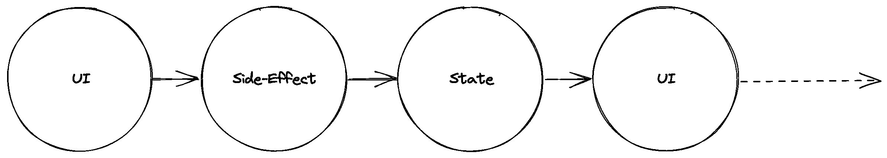

需要注意的是，`useState` 函数被称为 React hook（钩子）。它只是 React 提供的多个 hooks 之一，本节仅接触了 React 中 hooks 的皮角。你将在接下来的章节中学习更多关于它们的知识。目前，你应该知道你可以在一个或多个组件中使用任意数量的 `useState` hooks，而状态可以是任何内容，从 JavaScript 字符串（如本例）到更复杂的数据结构（如数组或对象）。

同样重要的是，你可能会在浏览器的开发者工具中看到两次日志，这是 React `StrictMode`（严格模式）的结果（请参考 `src/main.jsx` 文件）。`StrictMode` 仅在开发环境中运行，执行额外的检查和警告以识别潜在问题。当它应用于根组件时，它能有效地突显可能出现的任何问题。在之后的生产环境中，只有一次渲染。

当 UI 首次渲染时，每个渲染组件的 `useState` hook 都会用初始状态初始化，该状态作为当前状态返回。每当 UI 因为状态更改而重新渲染时，`useState` hook 都会使用其内部[闭包](https://www.robinwieruch.de/javascript-closure/)中的最新状态。这看起来可能很奇怪，人们会认为每次组件函数运行时，`useState` 都会从头开始声明。然而， React 为每个组件分配一个对象将状态等信息存储在内存中。最终，当组件不再被渲染时，JavaScript 的垃圾回收将清理内存。

#### 练习：

* 将你的源代码与作者的[源代码](https://bit.ly/3U3B799) 进行对比。
* 回顾本节中所有的[源代码更改](https://bit.ly/3vw4M0z)。
* 可选：如果你在使用 `TypeScript`，请查看作者的源代码。

### JSX 中的回调处理器

虽然 props 从父组件传递给子组件，但我们需要将状态向上传递给父组件。例如，目前 `Search` 组件没有与其他组件共享它的状态；但最后我们希望在其他地方使用这个状态。在本节中，例如，我们希望在将 `stories` 传递给 `List` 组件之前对它们进行过滤。所以我们知道可以通过 props 与子组件通信，但不知道如何将状态向上传递给父组件（此处：从 Search 到 App）。

没有办法直接向组件树上方传递信息，因为 props 天生是向下传递的。但是，我们可以引入一个回调处理器（callback handler）：回调处理器（只是一种更特定类型的事件处理器）作为事件处理器 (A) 被引入，作为函数通过 props 传递给另一个组件 (B)，在并在执行 (C)，然后回调回它被引入的地方 (D)：

```javascript
const App = () => {
  const stories = [ ... ];

  // A
  const handleSearch = (event) => {
    // D
    console.log(event.target.value);
  };

  return (
    <div>
      <h1>My Hacker Stories</h1>

      {/* // B */}
      <Search onSearch={handleSearch} />

      <hr />

      <List list={stories} />
    </div>
  );
};

const Search = (props) => {
  const [searchTerm, setSearchTerm] = React.useState('');

  const handleChange = (event) => {
    setSearchTerm(event.target.value);

    // C
    props.onSearch(event);
  };

  return ( ... );
};
```

src/App.jsx


现在每当用户在输入框中输入内容时，从 `App` 组件传递到 `Search` 组件的函数就会运行。通过这样，当用户在 `Search` 组件的输入框中输入时，我们可以通知 `App` 组件。本质上，回调处理器（只是一种更特定类型的事件处理器）成为了我们向上组件树通信的隐式载体。

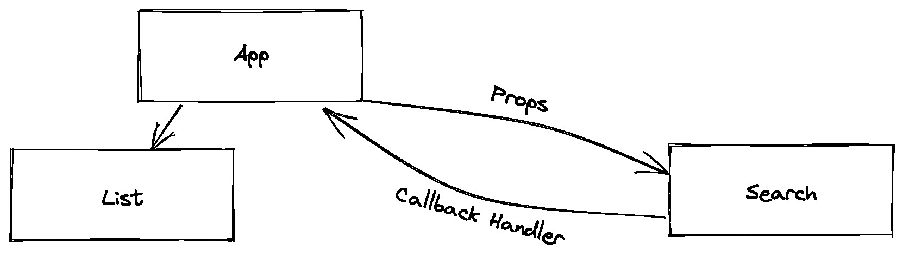

### 问题：

* **什么是 `useState`？**
  答案：`useState` 是一个 React hook，允许组件管理状态。
* **如何使用状态？**
  答案：`const [searchTerm, setSearchTerm] = useState('');`
* **什么触发了重新渲染？**
  答案：更新状态会触发重新渲染。
* **你可以直接修改状态吗？**
  答案：不，你应该使用 setter 函数（设置函数）。
* **`StrictMode` 总是触发重新渲染吗？**
  答案：是的，在开发环境中为了识别潜在问题。
* **多次调用和单次调用有什么区别？**
  答案：多次调用会创建独立的状态变量，单次调用允许状态化。


## 简述回调处理器（callback handler）的概念

我们通过 props 将函数从父组件（`App`）传递给子组件（`Search`）；我们在子组件（`Search`）中调用该函数，但该函数的实际实现却在父组件（`App`）中。换句话说，当一个（事件）处理器作为 props 从父组件传递给其子组件时，它就变成了一个回调处理器。React 的 props 总是沿着组件树向下传递，因此作为 props 回调处理器向下传递的函数可以用于在组件树向上进行通信。

## 练习题

*   将你的源代码与作者的[源代码](https://bit.ly/3O6t1c8) 进行对比。
    *   回顾[本节中所有的代码更改](https://bit.ly/3SmJ8Fe)。
    *   可选：如果你正在使用 TypeScript，请查看作者在此处提供的[源代码](https://bit.ly/3UnOJMQ)。
*   根据需要多次复习[(事件)处理器和回调处理器](https://www.robinwieruch.de/react-event-handler/) 的概念。
*   可选：[为此节内容提交反馈](https://forms.gle/3LoBoWKCMNT2YpnA7)。

### 面试题

*   问题：React 中的回调处理器是什么？
    *   回答：回调处理器是一个作为 prop 传递给子组件的函数，允许子组件与父组件进行通信。
*   问题：如何将回调处理器传递给子组件？
    *   回答：将其作为 prop 包含，例如 `<ChildComponent callback={handleCallback} />`。
*   问题：如何在父组件中定义回调处理器？
    *   回答：在父组件中创建一个函数，例如 `function handleCallback(data) {...}`。
*   问题：回调处理器可以接收参数吗？
    *   回答：可以，回调处理器可以接收由子组件传递的参数。
*   问题：回调处理器可以是异步的吗？
    *   回答：可以，回调处理器可以是异步的，以便处理异步操作。
*   问题：你可以跨多层组件传递回调处理器吗？
    *   回答：可以，你可以跨多层组件传递回调处理器。
*   问题：子组件可以拥有来自同一个父组件的多个回调处理器吗？
    *   回答：可以，子组件可以接收并使用从同一个父组件传递的多个回调处理器。
*   问题：在 React 中使用回调处理器处理表单提交常见吗？
    *   回答：是的，回调处理器常用于处理表单提交并更新父组件的状态。

## React 中的状态提升（Lifting State）

在本节中，我们面临以下任务：使用 `Search` 组件中带状态的 `searchTerm`，在 `stories` 作为 props 传递给 `List` 组件之前，在 `App` 组件中根据其 `title` 属性进行过滤。到为止，我们学习了如何通过 props 显式向下传递信息，以及如何通过回调处理器隐式向上传递信息。然而，如果你查看 `App` 组件中的回调处理器，对于初学者来说，并不自然如何将 `App` 组件中 `handleSearch()` 处理器中的 `searchTerm` 作为过滤器应用于 `stories`。

一种解决方案是在 `App` 组件中建立另一个状态，用于捕获进入 `App` 组件的 `searchTerm`，然后将其作为 props 传递给 `List` 组件之前用于对 `stories` 进行过滤。然而，这增加了重复，属于不良好的做法，因为 `searchTerm` 在 `Search` 和 `App` 组件中都拥有状态。因此换一种角度考虑：如果 `App` 组件对过滤 `stories` 的 `searchTerm`状态感兴趣，为什么不一开始就在 `App` 组件中而不是 `Search` 组件中实例化状态呢？

我们将 `useState` 钩子从 `Search` 组件移动到 `App` 组件，在提供的回调处理器中使用状态更新函数，并在 `Search` 组件中使用回调处理器将事件传递给父组件。然后，每当用户在输入框中输入时，`App` 组件中的状态就会更新。之后，我们将使用 `App` 组件中的新状态在将 `stories` 传递给 `List` 组件之前对其进行 `filter()`。以下实现展示了其第一部分：

```
const App = () => {
  const stories = [ ... ];

  const [searchTerm, setSearchTerm] = React.useState('');

  const handleSearch = (event) => {
    setSearchTerm(event.target.value);
  };

  return (
    <div>
      <h1>My Hacker Stories</h1>

      <Search onSearch={handleSearch} />

      <hr />

      <List list={stories} />
    </div>
  );
};

const Search = (props) => (
  <div>
    <label htmlFor="search">Search: </label>
    <input id="search" type="text" onChange={props.onSearch} />
  </div>
);
```

`src/App.jsx`

我们之前学习了回调处理器，是因为它可以帮助我们保持从子组件（这里是 `Search` 组件）到父组件（这里是 `App` 组件）的开放通信通道。现在，`Search` 组件不再管理状态，而是在 HTML 输入框中输入文本后，通过回调处理器将事件向上传递给 `App` 组件。从那里，`App` 组件更新它的状态。这种状态从一个组件移动到另一个组件的过程（正如我们在上一个代码段中所做）被称为**状态提升**。接下来，你仍然可以在 `App` 组件中再次显示 `searchTerm`。`App` 组件中的 `searchTerm` 状态可以在将 `stories` 传递给 `List` 组件之前对其进行 `filter()`。

`images/component-communication.png`

准则：始终在组件感兴趣的层级上状态。

最后，通过在 `App` 组件中管理状态，我们可以在将 `stories` 作为 `list` prop 传递给 `List` 组件之前，使用带状态的 `searchTerm` 对其进行过滤。尝试结合数组内置的 `filter()` 方法和 `stories`，并参考以下实现：

```
const App = () => {
  const stories = [ ... ];

  const [searchTerm, setSearchTerm] = React.useState('');

  const handleSearch = (event) => {
    setSearchTerm(event.target.value);
  };

  const searchedStories = stories.filter(function (story) {
    return story.title.includes(searchTerm);
  });

  return (
    <div>
      <h1>My Hacker Stories</h1>

      <Search onSearch={handleSearch} />

      <hr />

      <List list={searchedStories} />
    </div>
  );
};
```

`src/App.jsx`

在这里，使用了 [JavaScript 数组内置的 filter 方法](https://mzl.la/3BYFAOR) 来创建一个过滤后的数组。`filter()` 方法接收一个函数作为参数，该函数访问数组中的每个项并返回 `true` 或 `false`。如果函数返回 `true`（意味着满足条件），则该项保留在新创建的数组中；如果函数返回 `false`，它就会被移除：

```
const words = [
  'spray',
  'limit',
  'elite',
  'exuberant',
  'destruction',
  'present'
];

const filteredWords = words.filter(function (word) {
  return word.length > 6;
});

console.log(filteredWords);
// ["exuberant", "destruction", "present"]
```

Code Playground

通过使用箭头函数和立即返回，可以让 `filter()` 方法变得更加简洁。


```javascript
const App = () => {
  ...

  const searchedStories = stories.filter((story) =>
    story.title.includes(searchTerm)
  );

  ...
};
```

`src/App.jsx`

以上就是 `filter()` 方法内联函数重构的全部步骤。它有很多变体——而且在可读性和简洁性之间保持良好的平衡并不总是易的——但是，我觉得尽可能保持简洁在大多数情况下也能保持良好的可读性。

目前运行得不太理想的地方是：`filter()` 方法检查 `searchTerm` 是否作为字符串存在于每个故事的 `title` 属性中，但它是区分大小写的。如果我们搜索“react”，那么在渲染的列表中就不会出现经过过滤的“React”故事。尝试通过纯 JavaScript 的原生力量让 `filter()` 方法的条件变得不区分大小写，来自己尝试修复这个问题。下面的代码片段展示了如何通过将 `searchTerm` 和故事的 `title` 转换为小写来实现这一点：

```javascript
const App = () => {
  ...

  const searchedStories = stories.filter((story) =>
    story.title.toLowerCase().includes(searchTerm.toLowerCase())
  );

  ...
};
```

`src/App.jsx`

现在你应该能够搜索“eact”、“React”或“react”，并看到两个故事中的一个。恭喜你，你刚刚通过状态（state）——推导出过滤后的故事列表——以及属性（props）——通过向 `Search` 组件传递回调处理器，为你的应用程序添加了第一个真实的交互功能。

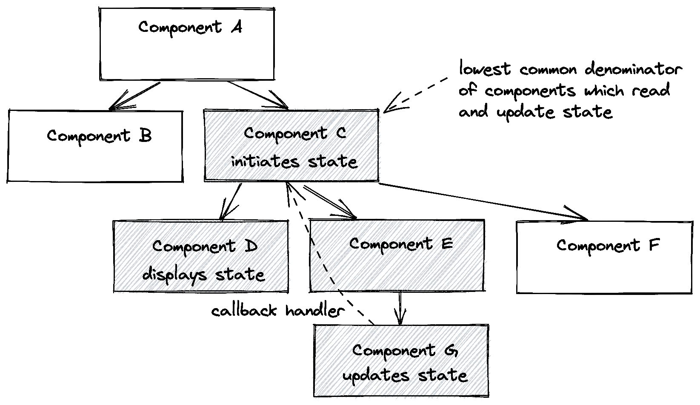

毕竟，知道在 React 中何实例化状态被证明是每位 React 开发者职业生涯中的一项重要技能。状态应该始终存在所有依赖该状态的组件可以读取（通过 props）和更新（通过回调处理器）它的地方。这些组件都是实例化状态的那个组件的后代组件。

#### 练习题：

*   将你的源代码与作者的[源代码](https://bit.ly/48U6Rlq) 进行对比。

    *   回顾本节中所有的[源代码更改](https://bit.ly/3U3Fhhh)。

    *   可选：如果你正在使用 TypeScript，请[在此处查看作者的源代码](https://bit.ly/49k1Cf9)。

*   阅读更多关于[React 中的状态提升](https://www.robinwieruch.de/react-lift-state/)的介绍。

*   可选：[为此节提供反馈](https://forms.gle/EqJGjxCM1Xzw9S6g7)。

#### 面试题：

*   问题：什么是 React 中的状态提升？

    *   回答：状态提升是将状态从子组件移动到其父组件的做法。

*   问题：为什么要提升 React 中的状态？

    *   回答：为了在高级别共享和管理状态，使其多个子组件可以访问。

*   问题：如何在 React 中提升状态？

    *   回答：将状态和相关函数移动到共同祖先（通常是父级）组件。

*   问题：多个子组件可以共享同一个提升的状态吗？

    *   回答：可以，状态提升允许多个子组件共享同一个状态。

*   问题与在组件中使用本地状态相比，状态提升的优势是什么？

    *   回答：状态提升促进了组件之间的状态共享。

*   问题：回调在状态提升中起什么作用？

    *   回答：在状态提升时，回调函数用于将数据从子组件传递给父组件。

*一个问题：子组件可以直接通过回调处理器修改父组件的状态吗？

    *   回答：不可以，子组件可以调用回调来通知父组件，父组件可以决定如何更新它的状态。

*   问题：有必要将所有状态提升到顶层父组件吗？

    *   回答：没有，只需将状态提升到多个组件需要共享的级别。

*   问题：状态提升如何有助于组件的可复用？

    *   回答：状态提升允许状态逻辑集中在共同祖先中，使组件更具复用性。

### React 受控组件

HTML 元素带有其内部状态，这些状态与 React 解耦。通过检查你的 `Search` 组件中如何实现 HTML 输入字段，亲自验证这一论点。虽然我们提供了处理器（这里是 `onChange`）以及 `id` 和 `type` 等基本属性，但我们并没有告诉元素它的值。然而，当用户输入时，它会显示正确的值。

现在尝试一下：在 `App` 组件中初始化 `searchTerm` 状态时，使用 `'React'` 作为初始状态而不是空字符串。之后，在浏览器中打开应用程序。你能发现问题吗？花些时间自己思考这里发生了什么以及如何修复这个问题。

虽然在上一节中 `stories` 已经根据新的初始 `searchTerm` 进行了过滤，但 HTML 输入字段在浏览器中并没有显示该值。只有当我们开始在输入字段中输入时，才看到变化反映在其中。这是因为输入字段不知道 React 的状态（这里是：`searchTerm`），它只使用处理器（参见 `handleSearch()`）将其内部状态通信给 React 状态。一旦用户开始在输入字段中输入，HTML 元素就会跟踪这些变化。然而，如果我们想让一切正确，HTML 应该知道 React 状态。因此，我们需要将当前状态作为 `value` 提供给它：

```javascript
const App = () => {
  const stories = [ ... ];

  const [searchTerm, setSearchTerm] = React.useState('');

  const handleSearch = (event) => {
    setSearchTerm(event.target.value);
  };

  return (
    <div>
      <h1>My Stories</h1>

      <Search search={searchTerm} onSearch={handleSearch} />

    </div>
  );
};

const Search = (props) => (
  <div>
    <label htmlFor="search">Search: </label>
    <input
      id="search"
      type="text"
      value={props.search}
      onChange={props.onSearch}
    />
  </div>
);
```

`src/App.jsx`

现在两个状态同步了。与其让 HTML 元素自由跟踪其状态，我们通过利用元素的 `value` 属性使用 React 的状态。每当 HTML 元素发出更改时，新值写入 React 状态并重新渲染组件。然后 HTML 元素再次使用最新的状态作为 `value`。

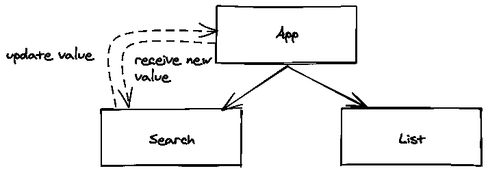

之前 HTML 元素各行其是，但现在我们通过为其提供 React 状态来控制它。现在，虽然输入字段显式地变得受控，但 `Search` 组件隐式地变得受控。对于 React 初学者来说，使用受控组件很重要，因为你希望执行可预测的行为。不过之后，可能存在不受控组件的情况。”


- **回答**: 使用 `checked` 属性并提供一个 `onChange` 处理器来更新相应的状态。
- **问题**: 如何清空受控组件的值？
  - **回答**: 将状态变量设置为空值或 `null` 以清空受控组件的值。
- **问题**: 使用受控组件的潜在缺点是什么？
  - **回答**: 受控组件可能会导致代码冗长，特别是在包含许多输入元素的表单中。

## Props 处理（进阶）

Props 从父组件沿组件树向下传递给子组件。由于我们经常使用 props 在组件之间传输信息，且有时会通过中间的其他组件进行，因此了解一些让 props 传递更方便的技巧非常有用。

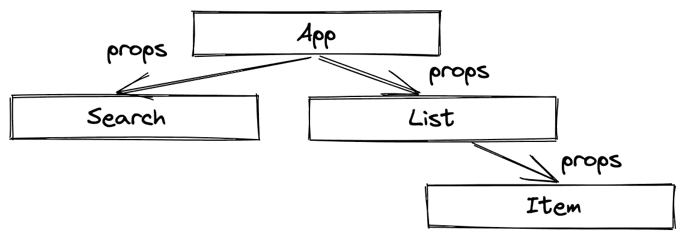

建议你学习以下重构以掌握不同的 JavaScript/React 模式，尽管即使不使用它们你也可以构建完整的 React 应用。将这些视为高级 props 技术，它们将使你的 React 代码在某些场景下变得简洁、易读且易于维护。

### 通过对象解构进行 Props 解构

React props 仅仅是一个 JavaScript 对象，否则我们无法在 React 组件中访问 `props.list` 或 `props.onSearch`。由于 props 是一个仅从一个组件向另一个组件传递信息的对象，我们可以对其应用一些 JavaScript 技巧。例如，使用现代的 [JavaScript 对象解构](https://mzl.la/30KbXTC) 访问对象的属性：

```
const user = {
  firstName: 'Robin',
  lastName: 'Wieruch',
};

// 不使用对象解构
const firstName = user.firstName;
const lastName = user.lastName;

// 使用对象解构
const { firstName, lastName } = user;
```

 代码 代码演场

当我们需要访问对象的各种属性时，使用单行代码而不是多行代码通常是一种更直观、更优雅的方法。这就是为什么对象解构在 JavaScript 中被广泛使用。在深入研究接下来的代码片段之前，尝试将这种理解应用到我们 `Search` 组件中的 props 上。

现在，让我们探索如何使用 props 解构。首先，我们需要将 `Search` 组件的箭头函数从简写体（concise body）重构为块体（block body）。随后，我们可以在函数体内部实现 `props` 对象的解构：

```
const Search = (props) => {
  const { search, onSearch } = props;

  return (
    <div>
      <label htmlFor="search">Search: </label>
      <input
        id="search"
        type="text"
        value={search}
        onChange={onSearch}
      />
    </>
  );
};
```

#### src/App.jsx

这是 React 组件中对 `props` 对象的基础解构，以便在组件中方便地使用对象的属性。然而，我们还必须将 `Search` 组件的箭头函数从简写体重构为块体，以便在组件函数体中使用对象解构访问 `props` 的属性。如果我们遵循这种模式，这种情况会经常发生，并且不会让我们的工作变得更轻松，因为我们必须不断重构组件。我们可以更进一步，直接在组件的函数签名中解构 `props` 对象，从而再次省略组件的函数块体：

```
const Search = ({ search, onSearch }) => (
  <div>
    <label htmlFor="search">Search: </label>
    <input
      id="search"
      type="text"
      value={search}
      onChange={onSearch}
    />
  </div>
);
```

#### src/App.jsx 继续

React 的 `props` 很少在组件中单独使用；相反，`props` 对象中包含的所有信息都会被使用。通过在组件函数签名中立即解构 `props` 对象，我们可以方便地访问所有信息，而无需处理它的 `props` 容器。`List` 和 `Item` 组件可以执行相同的 props 解构：

```
const List = ({ list }) => (
  <ul>
    {list.map((item) => (
      <Item key={item.objectID} item={item} />
    ))}
  </ul>
);

const Item = ({ item }) => (
  <li>
    <span>
      <a href={item.url}>{item.title}</a>
    </span>
    <span>{item.author}</span>
    <span>{item.num_comments}</span>
    <span>{item.points}</span>
  </li>
);
```

#### src/App.jsx 最终版

使用对象解构符合 JavaScript 的最佳实践，并促进了更简洁、更高效的 React 组件结构。它允许更直接地提取所需的属性，增强了代码的清晰度以及 React 应用的整体开发体验。然而，我们可以通过一些可选的进阶课程更进一步一步。

### 嵌套解构

`Item` 组件中传入的 `item` 参数与之前讨论的 `props` 参数有共同点：它们都是 JavaScript 对象。此外，尽管 `item` 对象已经在 `Item` 组件的函数签名中从 `props` 中被解构出来，但它并没有在 `Item` 组件中被直接使用。`item` 对象仅将其信息（对象属性）传递给元素。

目前的解决方案是可以行的，正如你将在接下来的讨论中看到的。。不过，我想向你展示它的另外两种变体，因为关于 JavaScript 对象有很多需要学习的内容。让我们从嵌套解构开始，看看它是如何工作的：

```
const user = {
  firstName: 'Robin',
  pet: {
    name: 'Trixi',
  },
};

// 不使用对象解构
const firstName = user.firstName;
const name = user.pet.name;

console.log(firstName + ' has a pet called ' + name);
// "Robin has a pet called Trixi"

// 使用对象解构
const {
  firstName,
  pet: {
    name,
  },
} = user;

console.log(firstName + ' has a pet called ' + name);
// "Robin has a pet called Trixi"
```

 代码 代码演场

嵌套解构帮助我们在函数签名中收集 `item` 对象的所有所需信息，以便在组件元素中立即。。在这里这不是最易读的选项，但注意它在其他场景下仍然可能有用：

```
// 变体 1：嵌套解构

const Item = ({
  item: {
    title,
    url,
    author,
    num_comments,
    points,
  },
}) => (
  <li>
    <span>
      <a href={url}>{title}</a>
    </span>
    <span>{author}</span>
    <span>{num_comments}</span>
    <span>{points}</span>
  </li>
);
```

#### src/App.jsx 总结

总结来说，React 中的嵌套解构在处理复杂数据结构（尤其是 props 或状态中的嵌套对象或数组）时，被证明是一种强大且高效的技巧。这种方法简化了深层嵌套值的提取，提高了代码的简洁性和可读性。然而，嵌套解构通过函数签名中的缩进引入了大量的杂乱。虽然在这里这不是最易读的选项，但在其他场景下它确实有用。

### 展开运算符和剩余参数

让我们用 JavaScript 的展开运算符和剩余参数尝试另一种方法。为了做此准备，我们将 `List` 和 `Item` 组件重构为以下实现。我们不再将 item 作为一个对象从 `List` 传递给 `Item` 组件，而是传递 `item` 对象的每一个属性：


```javascript
// Variation 2: Spread and Rest Operators
// 1\. Step

const List = ({ list }) => (
  <ul>
    {list.map((item) => (
      <Item
        key={item.objectID}
        title={item.title}
        url={item.url}
        author={item.author}
        num_comments={item.num_comments}
        points={item.points}
      />
    ))}
  </ul>
);

const Item = ({ title, url, author, num_comments, points }) => (
  <li>
    <span>
      <a href={url}>{title}</a>
    </span>
    <span>{author}</span>
    <span>{num_comments}</span>
    <span>{points}</span>
  </li>
);
```

`src/App.jsx`

### 第 1 步：使用扩展运算符（Spread Operator）减少杂乱（Clutter）

现在，虽然 `Item` 组件的函数签名更加简洁，但杂乱的代码却转移到了 `List` 组件中，因为每个属性都是单独传递给 `Item` 组件的。我们可以使用[JavaScript 的扩展运算符](https://mzl.la/3jetIkn) 来改进这种方法：

```javascript
const profile = {
  firstName: 'Robin',
  lastName: 'Wieruch',
};

const address = {
  country: 'Germany',
  city: 'Berlin',
};

const user = {
  ...profile,
  gender: 'male',
  ...address,
};

console.log(user);
// {
//   firstName: "Robin",
//   lastName: "Wieruch",
//   gender: "male"
//   country: "Germany",
//   city: "Berlin",
// }
```

### 第 2 步：在 JSX 中使用扩展运算符

JavaScript 的扩展运算符允许我们将对象的所有键值对直接展开到另一个对象中。这在 React 的 JSX 中也可以实现。我们不再像以前那样通过 `props` 从 `List` 逐一传递属性给 `Item` 组件，而是可以使用 JavaScript 的扩展运算符将对象的所有键值对作为属性/值对传递给 JSX 元素：

```javascript
// Variation 2: Spread and Rest Operators
// 2\. Step

const List = ({ list }) => (
  <ul>
    {list.map((item) => (
      <Item key={item.objectID} {...item} />
    ))}
  </ul>
);

const Item = ({ title, url, author, num_comments, points }) => (
  <li>
    <span>
      <a href={url}>{title}</a>
    </span>
    <span>{author}</span>
    <span>{num_comments}</span>
    <span>{points}</span>
  </li>
);
```

`src/App.jsx`

### 第 3 步：添加剩余参数解构（Rest Destructuring）

这次重构使得信息从 `List` 传递到 `Item` 组件的过程更加简洁。最后，我们将使用 JavaScript 的剩余参数解构来“锦上添花”。JavaScript 的剩余操作总是作为对象解构的最后一部分执行的：

```javascript
const user = {
  id: '1',
  firstName: 'Robin',
  lastName: 'Wieruch',
  country: 'Germany',
  city: 'Berlin',
};

const { id, country, city, ...userWithoutAddress } = user;

console.log(userWithoutAddress);
// {
//   firstName: "Robin",
//   lastName: "Wieruch"
// }

console.log(id);
// "1"

console.log(city);
// "Berlin"
```

### 分离属性

尽管两者的语法相同（三个点），但不应将剩余运算符（rest operator）与扩展运算符（spread operator）混淆。剩余运算符发生在赋值的左侧，而扩展运算符发生在右侧。剩余运算符始终用于将对象从某些属性中分离出来。

现在它可以用于我们的 `List` 组件中，将 `objectID` 从 `item` 中分离出来，因为 `objectID` 只用作 `key`，而没有在 `Item` 组件中使用。只有剩余的（即 rest）`item` 会作为属性/值对展开到 `Item` 组件中（如之前）：

```javascript
// Variation 2: Spread and Rest Operators
// Final Step

const List = ({ list }) => (
  <ul>
    {list.map(({ objectID, ...item }) => (
      <Item key={objectID} {...item} />
    ))}
  </ul>
);

const Item = ({ title, url, author, num_comments, points }) => (
  <li>
    <span>
      <a href={url}>{title}</a>
    </span>
    <span>{author}</span>
    <span>{num_comments}</span>
    <span>{points}</span>
  </li>
);
```

`src/App.jsx`

在最后一个变体中，剩余运算符被用于从 `item` 对象的剩余部分中解构出 `objectID`。之后，`item` 及其键值对被展开到 `Item` 组件中。虽然这个最终变体非常简洁，但它包含了一些某些人可能未知的高级 JavaScript 特性。

在本节中，我们学习了 JavaScript 对象解构，它不仅可以常用于 `props` 对象，还可以用于嵌套在 `props` 之中的其他对象（例如 `item` 对象）。我们还看到了如何使用嵌套解构（变体 1），但也看到了在我们的案例中它并没有带来任何好处，只是让组件变得复杂了。


## Questions

- **问题**: 是否有必要对所有 props 进行解构，还是可以选择特定的 props？
  - **回答**: 你可以根据组件的需求选择解构特定的 props，而保持其他 props 不变。

- **问题**: 展开运算符（…）在 React props 中是如何运的？
  - **回答**: 展开运算符用于将对象的所有属性作为单独的 props 传递给 React 组件，例如 `<MyComponent {…obj} />`。

- **问题**: 你可以使用展开运算符将 props 与额外的 props 组合在一起吗？
  - **回答**: 是的，你可以使用展开运算符将现有 props 与额外的 props 组合，例如 `<MyComponent {…props} newProp={value} />`。

- **问题**: 展开运算符创建的是对象的浅拷贝还是深拷贝？
  - **回答**: 展开运算符创建的是对象的浅拷贝，这意味着嵌套的仍然仍然是对原始对象的引用。

- **问题**: React 中剩余参数运算符（`…rest`）的作用是什么？
  - **回答**: 剩余参数运算符用于将剩余的属性收集到一个新对象中，通常与 props 解构结合使用。

- **问题**: 为什么 React Hooks（如 `useState`）使用数组解构，而 props 使用对象解构？
  - **回答**: 像 `useState` 这样的 React Hook 返回一个数组，而 props 是对象；因此我们需要对底层数据结构应用相应的操作。`useState` 返回数组的优势是可以在解构操作中为这些值赋予任何名称。

- **问题**: React 中的 prop drilling（属性穿透）是什么？
  - **回答**:  穿透是指通过多层组件传递 props 以到达深层嵌套的子组件的过程。

## React 副作用

React 组件返回的输出由其 `props` 和 `state` 定义。副作用也会影响这一输出，因为它们被用于与第三方 API 交互（例如浏览器的 `localStorage` API、用于获取数据的远程 API）、与 HTML 元素进行宽度和高度测量，或与内置的 JavaScript 函数（如定时器或间隔器）。这些只是 React 中副作用的少数例子，接下来我们将应用其中之一。

目前，每当我们在应用程序中搜索一个术语时，都会得到结果。然而，一旦关闭浏览器并重新打开，搜索词消失了。如果我们的 Search 组件能够记住最近的搜索并让应用程序显示出来，那不是一种极佳的用户体验吗？

让我们通过副作用将最近的搜索存储在浏览器的本地存储中，并在组件初始化时检索它。首先，当用户在 HTML 输入框中输入内容时，使用本地存储存储带有一个标识符的 `searchTerm`：

```javascript
const App = () => {
  ...

  const handleSearch = (event) => {
    setSearchTerm(event.target.value);

    localStorage.setItem('search', event.target.value);
  };

  ...
);
```
`src/App.jsx`

其次，如果存在值，则使用存储的值在 React 的 `useState` Hook 中设置 `searchTerm` 的初始状态。否则，使用我们的初始状态（此处为：“React”）：

```javascript
const App = () => {
  ...

  const [searchTerm, setSearchTerm] = React.useState(
    localStorage.getItem('search') || 'React'
  );

  ...
);
```
`src/App.jsx`

### 来自

JavaScript 的逻辑或运算符（`||`）在此表达式中返回真值的操作数，如果 `localStorage.getItem('search')` 返回真值，则会发生短路。它被用作以下设置值实现的简写：

```javascript
let hasStored;
if (localStorage.getItem('search')) {
  hasStored = true;
} else {
  hasStored = false;
}

const initialState = hasStored
  ? localStorage.getItem('search')
  : 'React';
```

## 代码游场

当使用输入框并刷新浏览器时，浏览器现在应该记住最后的搜索词了。从本质上说，我们将浏览器的本地存储与 React 的状态同步了：当我们使用浏览器本地存储的值（或回退值）初始化状态时，以及当处理函数被调用时，我们将新值写入浏览器的存储和组件的状态中。

功能已经完成，但存在一个长远来看可能会引入 bug 的缺陷：处理函数主要应该关注更新状态，但它包含了一个副作用。缺陷在于：如果我们在应用程序的其他地方使用 `setSearchTerm` 状态更新函数，就会破坏该功能，因为本地存储不会更新，因为它只在事件处理函数中被更新。让我们通过在集中位置处理副作用而不是在特定的处理函数中处理来修复这个问题。我们将使用 React 的 `useEffect` Hook 在每次 `searchTerm` 变化时触发所需的副作用：

```javascript
const App = () => {
  ...

  const [searchTerm, setSearchTerm] = React.useState(
    localStorage.getItem('search') || 'React'
  );

  React.useEffect(() => {
    localStorage.setItem('search', searchTerm);
  }, [searchTerm]);

  const handleSearch = (event) => {
    setSearchTerm(event.target.value);
  };

  ...
);
```
`src/App.jsx`

React 的 `useEffect` Hook 接受两个参数：第一个参数是运行我们副作用的函数。在我们的情况下，副作用是将 `searchTerm` 存储到浏览器的本地存储中。第二个参数是变量依赖数组。如果这些变量中的一个发生变化，就会调用副作用函数。在我们的情况下，每当 `searchTerm` 变化时该函数（例如当用户在 HTML 输入框中输入时）。此外，它在组件首次渲染时也会被调用。

省略第二个参数（依赖数组）会导致副作用函数在组件的每次渲染（初始渲染和更新渲染）时运行。如果 React `useEffect` 的依赖数组是一个空数组 `[]`，则副作用函数只在组件首次渲染时被调用一次。毕竟，该 hook 允许我们在挂载、更新和卸载组件时选择进入 React 的组件生命周期。它可以在组件首次挂载时触发，也可以在它的其中一个值（状态、props、从状态/props 派生的值）更新时触发。

结论是，使用 React `useEffect` Hook 代替在（事件）处理器中管理副作用使应用程序更加健壮。*无论何时*以及*在何处*通过 `setSearchTerm` 更新 `searchTerm` 状态，浏览器的本地存储都将与其保持同步。

## 练习

- 将你的源代码与作者的[源代码](https://bit.ly/48JDlzm) 进行对比。
  - 回顾本部分的[代码更改](https://bit.ly/3U7NwJk)。
  - 可选：如果你使用 TypeScript，请查看作者[此处](https://bit.ly/3HKAv0Y)。
- 更多关于 [React 的 useEffect Hook](https://www.robinwieruch.de/react-useeffect-hook/) 的信息。
  - 给第一个参数的函数添加 `console.log()`，并对 React `useEffect` Hook 的依赖数组进行实验。也检查空依赖数组的日志。
- 更多关于 [在 React 中使用本地存储](https://www.robinwieruch.de/local-storage-react/) 的信息。
- 尝试场景：在浏览器中，从输入框中退格搜索词直到那里为空。现在它内部应该被设置为空字符串。接下来，刷新浏览器并查看它显示了什么。


* 可选：[为此部分提供反馈](https://forms.gle/iCtVZHYt2XRNfAcBA)。

### 面试题

* 问题：React 中的 `useEffect` 是什么？
    * 回答：`useEffect` 是 React 中的一个 hook，允许函数组件执行副作用。
* 问题：你可以在一个组件中使用多个 `useEffect` 钩 吗？
    * 回答：可以，你可以在单个组件中使用多个 `useEffect` 钩。
* 问题：`useEffect` 的第二个参数代表什么？
    * 回答：第二个参数是一个依赖数组。当这些依赖项中的任何一个变化时，副作用就会运行。
* 问题：如何让 `useEffect` 只运行一次（在挂载时）？
    * 回答：将一个空依赖数组 `[]` 作为第二个参数。
* 问题：`useEffect` 可以返回一个清理函数吗？
    * 回答：可以，`useEffect` 返回的函数将作为清理函数。
* 问题：`useEffect` 中清理函数的目的是什么？
    * 回答：它用于在组件卸载或依赖项变化时处理资源的清理或销毁。
* 问题：如何在每次渲染时在 `useEffect` 中执行清理？
    * 回答：在 `useEffect` 内部返回一个带有清理逻辑的函数。
* 问题：你可以根据某些条件条件运行 `useEffect` 吗？
    * 回答：可以，你可以在 `useEffect` 内部使用条件语句来控制它的运行机。
* 问题：如果省略 `useEffect` 的第二个参数会发生什么？
    * 回答：它会在每次渲染后运行，可能会导致潜在的性能问题。
* 问题：`useEffect` 如何避免 React 中的竞态条件？
    * 回答：它允许你通过管理执行顺序来处理异步操作并避免竞态条件。

## React 自定义 Hooks（高级）

到目前为止，我们深入研究了 React 最流行的两个 hook：`useState` 和 `useEffect`。前者在管理发生变化的值时非常有价值，而后者则便于将副作用引入 React 组件的生命周期中。虽然 React 还提供了额外的 hook，但我们接下来的重点将是 `React 自定义 Hooks`，这涉及到根据特定需求创建我们自己的自定义 hook。

为了说明这一概念，我们将利用对 `useState` 和 `useEffect` 的理解来构建一个新的名为 `useStorageState` 的自定义 hook。这个自定义 hook 的主要目标是确保组件状态与浏览器本地存储（local storage）的同步。我们将通过概述我们计划如何在 `App` 组件中使用此 hook 开始探索：

```
const App = () => {
  const stories = [ ... ];

  const [searchTerm, setSearchTerm] = useStorageState('React');

  const handleSearch = (event) => {
    setSearchTerm(event.target.value);
  };

  const searchedStories = stories.filter((story) =>
    story.title.toLowerCase().includes(searchTerm.toLowerCase())
  );

  return (
    ...
  );
};
```

`src/App.jsx`

通过这个自定义 hook，我们可以类似于 React 原生 `useState` Hook 的方式使用它。它提供了一个状态变量和一个更新状态的函数，并接受初始状态作为参数。该 hook 的底层功能设计用于确保状态与浏览器本地存储的同步。如果你仔细查看之前代码段中的 `App` 组件，你会发现之前介绍的所有本地存储功能都不复存在了。相反，我们将这些功能复制并粘贴到新的新的自定义 hook 中：

```
const useStorageState = () => {
  const [searchTerm, setSearchTerm] = React.useState(
    localStorage.getItem('search') || ''
  );

  React.useEffect(() => {
    localStorage.setItem('search', searchTerm);
  }, [searchTerm]);
};

const App = () => {
...
};
```

`src/App.jsx`

到目前为止，这个自定义 hook 只是对我们之前在 `App` 组件中使用过的 `useState` 和 `useEffect` 钩的封装。缺少的是提供一个初始状态，并以数组的形式返回 `App` 组件中需要的值：

```
const useStorageState = (initialState) => {
  const [searchTerm, setSearchTerm] = React.useState(
    localStorage.getItem('search') || initialState
  );

  React.useEffect(() => {
    localStorage.setItem('search', searchTerm);
  }, [searchTerm]);

  return [searchTerm, setSearchTerm];
};
```

`src/App.jsx`

我们在这里遵循了 React 内置 hook 的两个惯例。首先是命名规范，即在每个 hook 名称前加上“use”前缀。其次，返回的值是以数组形式返回的。自定义 hook 的另一个目标应该是可复用性。这个自定义 hook 的所有内部实现都是关于某个特定搜索领域的，但为了让自定义 hook 可复用并变为通用的，我们需要调整内部名称：

```
const useStorageState = (initialState) => {
  const [value, setValue] = React.useState(
    localStorage.getItem('value') || initialState
 );

  React.useEffect(() => {
    localStorage.setItem('value', value);
  }, [value]);

  return [value, setValue];
};
```

`src/App.jsx`

现在，我们在自定义 hook 中处理一个抽象的“value”。在 `App` 组件中使用它，我们可以为返回的当前状态和状态更新函数命名任何与领域相关的名称（例如 `searchTerm` 和 `setSearchTerm`），并使用数组解构。

这个自定义 hook 仍然有一个问题。在 React 应用中多次使用该自定义 hook 会覆盖本地存储中的“value”-项，因为它们使用了相同的 key。为了修复这个问题，我们需要传入一个灵活的 key。由于 key 来自自外部，自定义 hook 假设它可能会变化，因此它也需要包含在 `useEffect` 钩的依赖数组中。如果没有它，当 key 在渲染之间变化时，副作用可能会带有过时的（*stale*）key：

```
const useStorageState = (key, initialState) => {
  const [value, setValue] = React.useState(
    localStorage.getItem(key) || initialState
  );

  React.useEffect(() => {
    localStorage.setItem(key, value);
  }, [value, key]);

  return [value, setValue];
};

const App = () => {
  ...

  const [searchTerm, setSearchTerm] = useStorageState(
    'search',
    'React'
  );

  ...
};
```

`src/App.jsx`

有了 key，你可以在应用程序中多次使用此自定义 hook。你只需要确保传入的参数 key 是唯一标识符，并在本地存储中分配状态。如果你恰好多次对 `useStorageState` hook 使用相同的 key，那么这些 hook 将作用于同一个本地存储键值对。

!images/use-storage-state.png

你刚刚创建了自己的第一个自定义 hook。如果你不习惯自定义 hook，可以还原更改并像以前在 `App` 组件中一样使用 `useState` 和 `useEffect` hook。然而，了解自定义 hook 为你提供了许多新选择。自定义 hook 可以封装不应属于组件的非平凡实现细节，可以在多个 React 组件中使用，可以是其他 hook 的组合，甚至可以作为外部库开源。使用你最喜欢的搜索引擎，你会发现有许多 React hook 可以在你的应用程序中使用，而无需担心实现细节。

## 练习

* 将你的源代码与作者的[源代码](https://bit.ly/3vC6zkJ) 进行对比。
    * 复习本节中所有的[源代码更改](https://bit.ly/4aYZjjc)。
    * 可选：如果你使用的是 TypeScript，请查看作者的[源码](https://bit.ly/485dY9K)。


*   阅读更多关于 [React Hooks](https://www.robinwieruch.de/react-hooks/) 和 [自定义 React Hooks](https://www.robinwieruch.de/react-custom-hook/) 的信息，以便良好地理解它们，因为它们是 React 函数组件的核心内容。
*   可选：[为此章节提交反馈](https://forms.gle/5seN1Rv3ZwXmWmDR9)。

#### 面试题：

*   问题：什么是 React 自定义 hooks？
    *   答案：自定义 hooks 是一些 JavaScript 函数，它们利用 React hooks 在函数组件中封装并复用逻辑。
*   问题：如何在 React 中创建自定义 hook？
    *   答案：创建一个以“use”开头的函数，并在内部使用现有的 React hooks 或其他自定义 hooks。
*   问题：自定义 hooks 可以拥有状态吗？
    *   答案：可以，自定义 hooks 可以使用像 `useState` 这样的 hooks。
*   问题：自定义 hooks 应该遵循什么命名规范？
    *   答案：自定义 hooks 应该以“use”前缀命名，以指示它们与 React hooks 的关联。
*   问题：自定义 hooks 可以接受参数吗？
    *   答案：可以，自定义 hooks 可以接受参数以使其更加灵活和可定制。
*   问题：如何使用自定义 hooks 在组件之间共享状态逻辑？
    *   答案：将共享逻辑提取到自定义 hook 中并在多个组件中使用它。
*   问题：自定义 hooks 可以访问组件的 props 吗？
    *   答案：不能，自定义 hooks 不能直接访问组件的 props。它们通常通过参数接收必要的数据。
*   问题：可以在单个组件中使用多个自定义 hooks 吗？
    *   答案：可以，你可以在单个组件中使用多个自定义 hooks 来利用不同的复用逻辑。
*   问题：使用自定义 hooks 的主要优势是什么？
    *   答案：自定义 hooks 促进了 React 函数组件中的代码复用、复杂逻辑抽象以及可维护性。
*   问题：自定义 hooks 可以具有像数据获取那样的副作用吗？
    *   答案：可以，自定义 hooks 可以像 `useEffect` 等 hooks 来封装副作用，以执行数据获取等任务。
*   问题：自定义 hooks 仅用于状态管理吗？
    *   答案：不是，虽然自定义 hooks 可以管理状态，但它们也可以封装任何可复用的逻辑，包括副作用和计算。

## React Fragments

你可能注意到，我们所有的 React 组件都返回一个带有单个顶层 HTML 元素的 JSX。当我们多些之前引入 Search 组件时，我们必须添加一个 `<div>` 标签（即容器元素），否则 label 和 input 元素无法在没有包裹顶层元素的情况下并排返回：

```javascript
const Search = ({ search, onSearch }) => (
  <div>
    <label htmlFor="search">Search: </label>
    <input
      id="search"
      type="text"
      value={search}
      onChange={onSearch}
    />
  </div>
);
```
`src/App.jsx`

然而，有其他方法可以并排渲染多个顶层元素。一种很少使用的方法是将所有兄弟元素作为数组数组返回。由于这类似于元素列表，我们必须为每个列表项提供一个强制性的 `key` 属性：

```javascript
const Search = ({ search, onSearch }) => [
  <label key="1" htmlFor="search">
    Search:{' '}
  </label>,
  <input
    key="2"
    id="search"
    type="text"
    value={search}
    onChange={onSearch}
  />,
];
```
`src/App.jsx`

幸运的是，还有另一种可以在没有顶层元素的情况下并排返回兄弟元素的方法，因为数组的方法的可读性并不好，由于额外的 key 属性会变得冗长。另一种解决方案是使用 React fragment：

```javascript
const Search = ({ search, onSearch }) => (
  <React.Fragment>
    <label htmlFor="search">Search: </label>
    <input
      id="search"
      type="text"
      value={search}
      onChange={onSearch}
    />
  </React.Fragment>
);
```
`src/App.jsx`

fragment 将兄弟元素封装成单个顶层元素，但不会将它们添加到渲染输出中。在 React 组件中使用 fragment 后，通过浏览器的开发工具检查元素即可亲身体验。如今更流行的替代方案是使用简写形式的 fragment：

```javascript
const Search = ({ search, onSearch }) => (
  <>
    <label htmlFor="search">Search: </label>
    <input
      id="search"
      type="text"
      value={search}
      onChange={onSearch}
    />
  </>
);
```
`src/App.jsx`

现在，Search 组件中的两个元素——输入字段和 label——应该仍然在你的浏览器中可见。毕竟，每当你不想引入仅为了满足 React 而存在的中间元素时，你可以使用 fragment 作为辅助“元素”。

#### 练习：

*   将你的源代码与作者的[源代码](https://bit.ly/3u4IimX) 进行对比。
    *   回顾本章节的所有[源代码更改](https://bit.ly/3S0MLPH)。
    *   可选：如果你正在使用 TypeScript，请在此处查看作者的[源代码](https://bit.ly/3HLzrtH)。
*   可选：[为此章节提交反馈](https://forms.gle/5seN1Rv3ZwXmWmDR9)。


```javascript
const App = () => {
  ...

  return (
    <div>
      <h1>My Hacker Stories</h1>

      <InputWithLabel
        id="search"
        label="Search"
        value={searchTerm}
        onInputChange={handleSearch}
      />

      ...
    </div>
  );
};

const InputWithLabel = ({ id, label, value, onInputChange }) => (
  <>
    <label htmlFor={id}>{label}</label>
    &nbsp;
    <input
      id={id}
      type="text"
      value={value}
      onChange={onInputChange}
    />
  </>
);
```

### `src/App.jsx`

虽然它在某种上是完全可重用的，但它的适用范围仅限于使用类型为 `text` 的输入框。为了扩展它的范围并支持额外的输入类型，例如数字（`number`）或电话号码（`tel`），输入字段的 `type` 属性也需要从外部访问：

```javascript
const InputWithLabel = ({
  id,
  label,
  value,
  type = 'text',
  onInputChange,
}) => (
  <>
    <label htmlFor={id}>{label}</label>
    &nbsp;
    <input
      id={id}
      type={type}
      value={value}
      onChange={onInputChange}
    />
  </>
);
```

### `src/App.jsx`

由于我们没有从 `App` 组件向 `InputWithLabel` 组件传递 `type` 属性，函数签名中的[默认参数](https://mzl.la/3aUefkN)将接管该类型。因此，每当在使用没有 `type` 属性的 `InputWithLabel` 组件时，默认类型将是 `"text"`。

通过简单的修改，我们将一个专门的搜索组件变成了一个更具通用性的 `InputWithLabel` 组件。我们泛化了内部实现细节的命名，并为新组件提供了更大的 API 表面，以便从外部提供所有必要信息。虽然我们还没有在其他地方使用该组件，但如果以后需要，我们已经增加了它处理任务的能力。

组件的泛化与专门化之间始终存在着权衡。在这种情况下，我们将一个高度专门化的组件变成了一个通用型组件。虽然通用型组件在应用程序中有更大的重用几率，但专门化的组件会为某一个特定的用例实现业务逻辑，因此完全不可重用。

#### 练习：

*   将你的源代码与作者的[源代码](https://bit.ly/3U98mIj) 进行对比。

    *   回顾本节中所有的[源代码更改](https://bit.ly/3vDLFBP)。

    *   可选：如果你正在使用 TypeScript，请在[此处]查看作者的源代码](https://bit.ly/3Oun6hn)。

*   阅读更多关于[可重用 React 组件](https://www.robinwieruch.de/react-reusable-components/) 的信息，并尝试自己创建这些组件：

    *   [React 按钮](https://www.robinwieruch.de/react-button/)、[React 单选按钮](https://www.robinwieruch.de/react-radio-button/)、[React 复选框](https://www.robinwieruch.de/react-checkbox/)、[React 下拉菜单](https://www.robinwieruch.de/react-dropdown/)、[React 拖拽列表（进阶）](https://www.robinwieruch.de/react-drag-and-drop/) …

*   之前我们使用了带有冒号的文本“Search:”。现在你会如何处理它？你会将其作为属性 `label="Search:"` 传递给 `InputWithLabel` 组件，还是在 `InputWithLabel` 组件中使用 `<label htmlFor={id}>{label}:</label>` 之后对其进行硬编码？我们稍后会看到如何处理。

*   可选：[为本节提供反馈](https://forms.gle/76C3LvW3kHHwdq5)。

#### 面试题：

*   问题：为什么可重用性在 React 中很重要？

    *   答案：可重用通过允许组件在应用程序的不同部分重复使用，提高了代码的效率、可维护性和一致性。

*   问题：你如何让一个 React 组件变得可重用？

    *   答案：通过使用 props 实现可自定义的行为，使组件更具通用性，并确保它们与特定功能解耦。

*   问题：React props 如何有助于可重用性？

*   答案：Props 通过允许动态自定义，使组件具有适应性和重用性。

*   问题：可重用的组件可以有内部状态吗？

    *   答案：是的，可重用的组件可以通过 `useState` 等 hook 拥有内部状态。

*   问题：为什么组件抽象对于可重用性很重要？

    *   答案：抽象隐藏了不必要的细节，使得组件更加通用，并在不暴露内部复杂性的情况下更容易重用。

*   问题：是否建议 React 应用程序中的所有组件都变得可重用？

    *   答案：虽然可重用是有益的，但并不是所有组件都需要可重用。通常有些组件只有一个，并且在 React 应用程序中只使用一次。

### React 组件组合

本质上，React 应用程序是一堆以树形排列的 React 组件。当你学习在 JSX 中初始化组件为元素时，你已经看到它们是如何像 JSX 中的任何其他 HTML 元素一样被使用的。但到目前为止，我们只将它们作为自闭标签使用。如果 React 元素也可以起始和结束标签呢？引入组件组合的概念：

```javascript
const App = () => {
  ...

  return (
    <div>
      <h1>My Hacker Stories</h1>

      <InputWithLabel
        id="search"
        label="Search"
        value={searchTerm}
        onInputChange={handleSearch}
      >
        <strong>Search:</strong>
      </InputWithLabel>

      ...
    </div>
  );
};
```

### `src/App.jsx`

现在 React 组件的元素行为类似于原生 HTML。现在组件标签之间传递的所有内容都可以作为 `children` 访问。不再使用 `label` 属性，而是使用 `children` 属性来渲染一切：

```javascript
const InputWithLabel = ({
  id,
  label,
  value,
  type = 'text',
  onInputChange,
  children,
}) => (
  <>
    <label htmlFor={id}>{children}</label>
    &nbsp;
    <input
      id={id}
      type={type}
      value={value}
      onChange={onInputChange}
    />
  </>
);
```

### `src/App.jsx`

通过 React children 属性，我们可以将 React 组件组合在一起。我们已经将其用于字符串以及包裹在 HTML `<strong>` 元素中的字符串，但并不仅于此。你也可以通过 children 传递 React 元素 ——你绝对应该作为练习进行更多探索。


- **问题**: 你如何访问和渲染 React 组件的“children”（孩子）？
  - **答案**: 使用 `props.children` 属性来访问和渲染放置在组件内部的内容。

- **问题**: React 组件可以有多个子元素吗？
  - **答案**: 可以的，但通常会使用属性，例如 `<MyComponent slotOne={<em>1</em>} slotTwo={<em>2</em>} />`，这些属性可以在组件中通过 `props.slotOne` 和 `props.slotTwo` 进行访问。

- **问题**: 你可以将 React 组件作为“children”传递给另一个组件吗？
  - **答案**: 可以的，React 组件可以作为“children”传递给其他组件，从而实现组合性。

- **问题**: React 中 `React.Children` 工具类的作用是什么？
  - **答案**: `React.Children` 工具类提供了处理和操作 React 组件“children”的方法。

- **问题**: 你如何在 React 组件中遍历并操作每个子元素？
  - **答案**: 使用 `React.Children.map` 或 `React.Children.forEach` 来遍历并对组件的每个子元素执行操作。

- **问题**: React 中可以存在没有任何“children”的组件吗？
  - **答案**: 可以的，通过不在起始标签和结束标签之间放置内容，组件就可以存在而不包含任何“children”。

- **问题**: React 中“children” 和其他 props 有什么区别？
  - **答案**: “children”特指标签之间的内容，而其他 props 是传递给组件的键值对。

## 命令式 React (Imperative React)

命令式编程涉及提供显式的逐步指令，详细说明程序应该如何执行任务。相比之下，声明式编程侧重于指定期望的结果，而不是指定每个过程性的步骤。声明式代码通常被认为更简洁、更易读且易于维护。

React 使用声明式编程方法。开发者不再通过手动操作文档对象模型（DOM）来更新 UI，而是声明期望的 UI 状态，并由 React 管理渲染过程。这种声明式方法增强了代码的可读性和扩展性，抽象了 DOM 操作的复杂性，并能够以更高层次的抽象创建动态用户界面。

当你实现 `JSX` 时，你是在告诉 React 你想看到哪些元素，而不是如何创建这些元素。当你实现一个状态 hook 时，你是在告诉 React 你想将什么作为状态值进行管理，而不是如何管理它。当你实现事件处理程序时，你不需要命令式地分配监听器：

```javascript
// 命令式 JavaScript + DOM API
element.addEventListener('click', () => {
  // 执行某些事情
});

// 声明式 React
const App = () => {
  const handleClick = () => {
    // 执行某些事情
  };

  return (
    <button
      type="button"
      onClick={handleClick}
    >
      Click
    </button>
  );
};
```

## 代码游场 (Code Playground)

然而，在某些情况下，我们并不希望一切都是声明式的。例如，有时你可能希望对渲染的元素进行命令式访问，通常作为副作用，出现在诸如下类场景中：

- 通过 DOM API 对元素进行读/写访问：
  - 读取（此处：测量）元素的宽度或高度
  - 写入（此处：设置）输入框的焦点状态
- 实现更复杂的动画：
  - 设置过渡效果（transitions）
  - 编排过渡效果
- 集成第三方库：
  - [D3](https://d3js.org) 是一个流行的命令式图表库

由于 React 中命令式编程的冗长和违背直觉的性质，我们将探索一个简短的示例，说明如何命令式地设置输入框的焦点。相反，对于声明式方法，你可以通过设置输入框的 `autoFocus` 属性来实现相同的效果：

```javascript
const InputWithLabel = ({ ... }) => (
  <>
    <label htmlFor={id}>{children}</label>
    &nbsp;
    <input
      id={id}
      type={type}
      value={value}
      autoFocus
      onChange={onInputChange}
    />
  </>
);

// 注意 `autoFocus` 是 `autoFocus={true}` 的简写
// 任何设置为 `true` 的属性都可以使用这种简写
```

#### src/App.jsx

这种方法有效，但仅当其中一个可重用组件被渲染时有效。例如，如果 `App` 组件渲染了两个 `InputWithLabel` 组件，则只有最后一个渲染的组件会在渲染时接收到 `autoFocus` 标记。然而，由于我们这里有一个可重用的 React 组件，我们可以传递一个专门的 prop，让开发者决定输入框是否应该具有激活的 `autoFocus`：

```javascript
const App = () => {
  ...

  return (
    <div>
      <h1>My Hacker Stories</h1>

      <InputWithLabel
        id="search"
        value={searchTerm}
        isFocused
        onInputChange={handleSearch}
      >
        <strong>Search:</strong>
      </InputWithLabel>

      ...
    </div>
  );
};
```

### src/App.jsx (Refactor - 针对声明式/命令式焦点的重构)

 同样，仅使用 `isFocused` 作为属性等同于 `isFocused={true}`。在组件内部，使用新 prop 设置输入框的 `autoFocus` 属性：

```javascript
const InputWithLabel = ({
  id,
  value,
  type = 'text',
  onInputChange,
  isFocused,
  children,
}) => (
  <>
    <label htmlFor={id}>{children}</label>
    &nbsp;
    <input
      id={id}
      type={type}
      value={value}
      autoFocus
      onChange={onInputChange}
    />
  </>
);
``` (注：此处原文代码块逻辑上应该是) 再次，仅使用 `isFocused` 作为属性等同于 `isFocused={true}`。在组件内部，使用新 prop 设置输入框的 `autoFocus` 属性：

```javascript
const InputWithLabel = ({
  id,
  value,
  type = 'text',
  onInputChange,
  isFocused,
  children,
}) => (
  <>
    <label htmlFor={id}>{children}</label>
    &nbsp;
    <input
      id={id}
      type={type}
      value={value}
      autoFocus
      onChange={onInputChange}
    />
  </>
);
```

### 使用 `useRef` 的命令式实现

该功能是有效的，但可以通过命令式方式来实现。尽管声明式方法是推荐的，让我们把此场景重构为命令式：

```javascript
const InputWithLabel = ({
  id,
  value,
  type = 'text',
  onInputChange,
  isFocused,
  children,
}) => {
  // A
  const inputRef = React.useRef();

  // C
  React.useEffect(() => {
    if (isFocused && inputRef.current) {
      // D
      inputRef.current.focus();
    }
  }, [isFocused]);

  return (
    <>
      <label htmlFor={id}>{children}</label>
      &nbsp;
      {/* B */}
      <input
        ref={inputRef}
        id={id}
        type={type}
        value={value}
        onChange={onInputChange}
      />
    </>
  );
};
```

### src/App.jsx 解析

所有关键步骤都已用注释标记并解释如下：

- **(A)** 首先，使用 `useRef` Hook 创建 `ref`。这个 `ref` 对象是一个在 React 组件生命周期内保持不变的持久值。它有一个名为 `current` 的属性，与 `ref` 对象不同，该属性是可以改变。
- **(B)** 第二，将 `ref` 传递给 JSX 预留的 `ref` 属性，元素实例被赋值给可变的 `current` 属性。
- **(C)** 第三，通过 `useEffect` Hook 进入 React 的生命周期，在组件渲染（或依赖项更改）时执行聚焦操作。
- **(D)** 最后，由于 `ref` 被传递给了元素的 `ref` 属性，其 `current` 属性提供了元素的访问。

本质上，这就是在 React 中从声明式转向命令式编程的完整示例。在这种情况下，正如你亲身体验的那样，可以使用声明式或命令式方法。然而，并非总是可以使用声明式方法，因此在需要时执行命令式方法。由于我们在这里没有详细介绍 `ref` 和 `useRef`（因为它是 React 中较少使用的特性），建议阅读练习题中的额外文章以获得更深入的理解。

#### 练习题：


-   将你的源代码与作者的[源代码](https://bit.ly/3U5XDP4) 进行对比。
    *   回顾本节中的所有[源代码更改](https://bit.ly/48Pl9DY)。
    *   可选：如果你正在使用 TypeScript，请查看此处](https://bit.ly/494zUDw)作者的源代码。
-   阅读更多关于[React 中的 refs](https://www.robinwieruch.de/react-ref/) 的信息，并可选查看以下使用 refs 的教程：
    *   [使用 ref 从 React 组件创建图像](https://www.robinwieruch.de/react-component-to-image/)
    *   [使用 ref 创建 Slider 组件](https://www.robinwieruch.de/react-slider/)
    *   [使用 ref 创建自定义 hook](https://www.robinwieruch.de/react-custom-hook-check-if-overflow/)
-   阅读更多关于[为什么框架很重要](https://www.robinwieruch.de/why-frameworks-matter/) 的信息。
-   可选：[为本节提供反馈](https://forms.gle/nABoW2tKAPd1yVkv7)。

### 面试题

*   问题：React 中的 useRef 是什么？
    *   回答：`useRef` 是 React 中的一个 hook，提供了一个名为 `ref` 的可变对象，它可以持有可变值并在多次渲染之间持久化。
*   问题：use 中的 useRef 与 React 中的 useState 有什么区别？
    *   回答：与 `useState` 不同，`useRef` 在值改变时不会触发重新渲染。它通常用于不影响渲染的可变值。
*   问题：useRef 可以被用于持有跨渲染持久化的可变值吗？
    *   回答：可以，`useRef` 的主要用途是持有跨渲染持久化的可变值且不会引起重新渲染。
*   问题：useRef 在 React 中的常见用例是什么？
    *   回答：一个常见的用例是访问和与 DOM 交互，因为 `useRef` 可以持有对 DOM 元素的引用。
*   问题：useRef 可以被用于触发 React 中的重新渲染吗？
    *   回答：不能，更改使用 `useRef` 创建的 ref 的值不会触发重新渲染。
*   问题：useRef 可以被用于在函数调用之间持久化值吗？
    *   回答：可以，`useRef` 的值在渲染之间持久化，使其适用于在函数调用之间持久化值，而不触发重新渲染。
*   问题：如何访问使用 useRef 创建的 ref 的当前值？
    *   回答：使用 `myRef.current` 来访问使用 `useRef` 创建的 ref 的当前值。

### JSX 中的内联处理程序

在本节中，你将学习内联处理程序作为 React 中一个新的基础构建模块。同时，我们将实现下一个功能，即允许从列表中删除项目。在深入学习之前，请尝试独立完成此任务，因为可以在不需要预先了解内联处理程序的情况下解决它。下面提供了分步骤说明。如果你遇到困难，请继续阅读本节获取解决方案。如果你自己成功找到了解决方案，请将其与书中的解决方案（使用内联处理程序）进行对比。

**任务：** 应用程序渲染了一个项目列表并允许用户通过搜索功能过滤列表。接下来，应用程序应该在每个列表旁边渲染一个按钮，允许用户从列表中移除该项目。

**可选提示：**

*   项目列表需要通过 `useState` 变成一个状态值（此处：状态化数组），以便以后对其进行操作（例如删除项目）。
*   每个列表项都渲染一个带有点击处理程序的按钮。当点击按钮时，通过操作状态从列表中移除该项目。
*   由于状态列表位于 App 组件中，因此需要使用回调处理程序，使 Item 组件能够向上 App 组件进行通信，以便通过其标识符移除项目。

现在我们想查看如何一步步地实现此功能。目前，我们在 App 组件中拥有的项目列表（此处：`stories`）是一个无状态的变量。我们可以通过搜索功能过滤渲染后的列表，但列表本身保持完好。过滤后的列表只是通过第三方（此处：`searchTerm`）得到的派生状态，但我们尚未操作实际列表。为了获得列表的控制权，通过将其作为 React 的 `useState` Hook 的初始状态使其变为状态化。从数组返回的值是当前状态（`stories`）和状态更新函数（`setStories`）：

```
const initialStories = [
  {
    title: 'React',
    url: 'https://reactjs.org/',
    author: 'Jordan Walke',
    num_comments: 3,
    points: 4,
    objectID: 0,
  },
  {
    title: 'Redux',
    url: 'https://redux.js.org/',
    author: 'Dan Abramov, Andrew Clark',
    num_comments: 2,
    points: 5,
    objectID: 1,
  },
];

...

const App = () => {
  const [searchTerm, setSearchTerm] = ...

  const [stories, setStories] = React.useState(initialStories);

  ...
};
```

src/App.jsx

应用程序的行为相同，因为 `stories` 现在作为来自 React 的 `useState` Hook 的状态化列表返回，仍然被过滤为 `searchedStories`。过滤后的列表只是通过第三方（此处：`searchTerm`）得到的派生状态，但我们尚未操作实际列表。为了获得列表的控制权，通过将其作为 React 的 `useState` Hook 的初始状态使其变为状态化。从数组返回的值是当前状态（`stories`）和状态更新函数（`setStories`）：

```
src/App.jsx

应用程序的行为相同，因为 `stories` 现在作为来自 React 的 `useState` Hook 的状态化列表返回，仍然被过滤为 `searchedStories`。过滤后的列表只是通过第三方（此处的：`searchTerm`）得到的派生状态，但我们尚未操作实际列表。为了获得列表的控制权，通过将其作为 React 的 `useState` Hook 的初始状态使其变为状态化。从数组返回的值是当前状态（`stories`）和状态更新函数（`setStories`）：

```javascript
const App = () => {
  ...

  const [stories, setStories] = React.useState(initialStories);

  const handleRemoveStory = (item) => {
    const newStories = stories.filter(
      (story) => story.objectID !== item.objectID
    );

    setStories(newStories);
  };

  return (
    <div>
      <h1>Hacker Stories</h1>

      ...

      <hr />

      <List list={searchedStories} onRemoveItem={handleRemoveStory} />
    </div>
  );
};
```

src/App.jsx

```javascript
const List = ({ list, onRemoveItem }) => (
  <ul>
    {list.map((item) => (
      <Item
        key={item.objectID}
        item={item}
        onRemoveItem={onRemoveItem}
      />
    ))}
  </ul>
);
```

src/App.jsx

```javascript
const Item = ({ item, onRemoveItem }) => {
  const handleRemoveItem = () => {
    onRemoveItem(item);
  };

  return (
    <li>
      <span>
        <a href={item.url}>{item.title}</a>
      </span>
      <span>{item.author}</span>
      <span>{item.num_comments}</span>
      <span>{item.points}</span>
      <span>
        <button type="button" onClick={handleRemoveItem}>
          Dismiss
        </button>
      </span>
    </li>
  );
};
```

src/App.jsx


让我们进入内联处理函数（inline handlers）的话题：你可能注意到，我们在 `Item` 组件中引入了一个额外的 `handleRemoveItem`处理器，负责执行传入的 `onRemoveItem` 回调处理器。我们必须引入这个额外的事件处理器是为了将项作为参数传递给回调处理器。

不过，如果你想让这更优雅，可以使用**内联处理函数（inline handler）**，它允许你直接在 JSX 中在 `Item` 组件中执行回调处理器函数。在 `Item` 组件中使用传入的 `onRemoveItem` 函数作为内联处理函数有两种种解决方案。首先，使用 JavaScript 的 `bind` 方法：

```javascript
const Item = ({ item, onRemoveItem }) => (
  <li>
    <span>
      <a href={item.url}>{item.title}</a>
    </span>
    <span>{item.author}</span>
    <span>{item.num_comments}</span>
    <span>{item.points}</span>
    <span>
      <button type="button" onClick={onRemoveItem.bind(null, item)}>
        Dismiss
      </button>
    </span>
  </li>
);
```

`src/App.jsx`

在函数上使用[JavaScript 的 `bind` 方法](https://mzl.la/3ncEkBu) 允许我们将参数直接绑定到该函数，并在执行时使用这些参数。`bind` 方法返回一个带有绑定参数的新函数。相比之下，第二种更流行的解决方案是使用内联箭头函数，它允许我们“溜入”像 `item` 这样的参数：

```javascript
const Item = ({ item, onRemoveItem }) => (
  <li>
    <span>
      <a href={item.url}>{item.title}</a>
    </span>
    <span>{item.author}</span>
    <span>{item.num_comments}</span>
    <span>{item.points}</span>
    <span>
      <button type="button" onClick={() => onRemoveItem(item)}>
        Dismiss
      </button>
    </span>
  </li>
);
```

`src/App.jsx`

使用内联处理器比使用普通事件处理器更简洁，但可能更难以调试，因为 JavaScript 逻辑可能隐藏在 JSX 中。如果内联箭头函数通过使用块体（block body）而不是简洁的主体（concise body）来封装了多行实现逻辑，代码会变得更加冗肿：

```javascript
const Item = ({ item, onRemoveItem }) => (
  <li
    ...
    <span>
      <button
        type="button"
        onClick={() => {
          // 执行其他操作

          // 注意：避免在 JSX 中使用复杂逻辑

          onRemoveItem(item);
        }}
      >
        Dismiss
      </button>
    </span>
  </li>
);
```

Code Playground

经验法则：如果内联处理器不会掩盖关键实现细节，那么使用它们是可以的。如果内联处理器需要使用块体（因为执行了多行代码），那么是时候将它们提取为普通的事件处理器了。毕竟，在这种情况下，所有的处理器版本都是可读的，因此是可以接受的。

#### 练习：

*   将你的源代码与作者的[源代码](https://bit.ly/4b4LQX2) 进行对比。

    *   回顾本节的所有[源代码更改](https://bit.ly/3u85gcS)。

    *   可选：如果你在使用 TypeScript，请查看作者的[源代码](https://bit.ly/3UwzjWz)。

*   阅读更多关于如何在列表中[添加](https://www.robinwieruch.de/react-add-item-to-list)、[更新](https://www.robinwieruch.de/react-update-item-in-list/)和[删除](https://www.robinwieruch.de/react-remove-item-from-list)项。

*   阅读更多关于[React 中的计算属性](https://www.robinwieruch.de/react-computed-properties/)。

*   回顾[处理器、回调处理器和内联处理器](https://www.robinwieruch.de/react-event-handler/)。

*   可选：[为本节提供反馈](https://forms.gle/19NvNYMk2RUKTDyZ6)。

#### 面试题：

*   问题：React 中的内联函数函数？

    *   答案：React 中的内联函数通常用作直接定义在 JSX 内部的函数。

*   问题：在 React 中使用内联函数作为事件处理器的优势是什么？

    *   答案：内联函数允许你轻松地传递额外的参数。

*   问题：在 React 中使用内联函数作为事件处理器的替代方案是什么？

    *   答案：在渲染方法之外创建处理器函数并向它们传递引用可以作为替代方案。

*   问题：在 React JSX 事件处理器中创建内联函数的语法是什么？

    *   答案：直接在事件处理器属性中使用使用箭头函数语法，例如 `onClick={() => myFunction()}`。

### React 异步数据

我们的应用程序中有两种交互：搜索列表和从列表中删除项。第一次交互是通过通过第三方状态（`searchTerm`）对列表进行的变动修改，而第二次交互是从列表中删除项的不可逆操作。然而，我们处理的列表仍然只是示例数据。那么，让我们的应用程序准备处理真实数据如何呢？


- 可选：如果你正在使用 TypeScript，可以从[这里](https://bit.ly/3StsfHt)查看作者的源码。
- 可选：了解更多关于[JavaScript Promises](https://mzl.la/3aTGuQz)。
- 了解更多关于[如何使用 JavaScript 模拟远程 API](https://www.robinwieruch.de/javascript-fake-api/)。
  - 了解更多关于[在 React 中使用 mock 数据](https://www.robinwieruch.de/react-mock-data/)。
- 可选:[为此章节留下反馈](https://forms.gle/sfQcc477xmgGRLyB7)。

### 面试题

- 问题：为什么在 React 应用中处理异步数据很常见？
  - 回答：客户端 React 应用程序经常从远程源获取数据。
- 问题：在 React 中，获取数据之前渲染组件的典型方法是什么？
  - 回答：通常会在启动数据获取之前渲染组件，并在数据到达之前使用条件渲染或占位内容。
- 问题：你如何使用示例数据在 React 中模拟异步数据获取？
  - 回答：模拟异步数据涉及使用返回 promise 的函数，用示例数据进行解析，稍后将其替换为真实数据。
- 问题：在 React 中处理异步数据时，promise 的作用是什么？
  - 回答：Promise 用于管理异步操作，允许组件在渲染之前等待数据解析结果。
- 问题：为什么异步数据获取对于 React 中响应式用户界面至关重要？
  - 回答：异步数据获取可以防止阻塞 UI，确保响应性，并在数据可用时能够显示更新后的信息。
- 问题：在 React 中，你可以将模拟的示例数据替换为从远程 API 获取的真实数据吗？
  - 回答：可以，在用示例数据模拟异步之后，可以无缝替换为从远程 API 获取的真实数据。
- 问题：在 React 中处理异步数据时，使用 `useState` hook 的意义是什么？
  - 回答：`useState` 允许组件管理状态变化，包括加载状态和异步接收到的更新数据。
- 问题：React 如何确保组件在异步数据到达时进行重新渲染？
  - 回答：React 的状态管理确保当异步数据到达并更新状态时，组件会重新渲染以反映新数据。

## React 条件渲染

我们正准备引入一个与最近引入的异步数据处理相关的新功能。在真实的应用程序中，用户在数据加载期间通常会收到反馈，例如加载旋转（loading spinner）。在本节中，我们的目标是实现这种反馈机制。你可以尝试独立实现它，之后你可以参考书籍将你的解决方案与提供的实现进行比较。

**任务：** 从 promise 加载示例数据需要一些时间。在此期间，应向用户展示最简单形式的加载指示器（例如显示“Loading …””的文本）。一旦数据异步到达，则隐藏加载指示器。

**可选提示：**

- 为了显示加载指示器，需要引入一个新的有状态的值。一个名为 `isLoading` 的布尔值可能是最佳解决方案。
- 当加载数据的副作用触发时，将状态布尔值设置为 `true`。一旦数据加载完成，再次将状态布尔值设置为 `false`。
- 在 JSX 中，当 `isLoading` 布尔值设置为 `true` 时，条件性地显示“Loading …””文本。

React 中的`条件渲染`在我们必须根据信息（例如状态、props）渲染不同的 JSX 时总是会发生。处理异步数据是利用条件渲染的一个很好的用例。例如，当应用首次初始化时，没有数据可以开始。接下来，我们正在加载数据，最终，我们拿到了可以显示的数据。有时数据获取会失败，我们收到的是错误而不是数据。因此，作为开发者，我们有很多工作要做。

幸运的是，某些方面已经处理好了。例如，由于初始状态是空列表 `[]` 而不是 `null`，在对此列表进行过滤或映射（mapping）时导致应用程序崩溃的担忧得以缓解。然而，某些方面仍然需要注意。考虑缺少加载状态会导致无法为用户对待处理的数据请求提供反馈。引入一个新的有状态的值可以解决这个问题，允许我们在获取数据时相应地设置状态：

```javascript
const App = () => {
  ...

  const [stories, setStories] = React.useState([]);
  const [isLoading, setIsLoading] = React.useState(false);

  React.useEffect(() => {
    setIsLoading(true);

    getAsyncStories().then((result) => {
      setStories(result.data.stories);
      setIsLoading(false);
    });
  }, []);

  ...
};
```
`src/App.jsx`

现在布尔值应该可以被正确切换了。缺少的是向用户显示加载指示器。一种简单的方法是在 `App` 组件中使用提前返回（early return）：

```javascript
const App = () => {
  ...

  if (isLoading) {
    return <p>Loading ...</p>;
  }

  return (
    <div>
      ...
    </div>
  );
};
```
`src/App.jsx`

然而，通过这种方式*只*会渲染加载指示器，而不会渲染其他任何内容。相反，我们希望将加载指示器内联在 JSX 中，以便显示加载指示器或 `List` 组件。不过，由于 JSX 在此处的局限性，不建议在 JSX 中内联 `if-else` 语句。（不过你可以将其当作练习来尝试）。然而你可以使用[三元运算符](https://mzl.la/3aTGuQz)来代替，并产生如下`条件渲染`：

```javascript
const App = () => {
  ...

  return (
    <div>
      ...

      <hr />

      {isLoading ? (
        <p>Loading ...</p>
      ) : (
        <List
          list={stories}
          onItem={handleStory}
        />
      )}
    </div>
  );
};
```
`src/App.jsx`

这样就可以了。你正在根据有状态的布尔值条件渲染加载指示器或 `List` 组件。让我们继续，为异步数据实现错误处理。在模拟环境中不会发生错误，但如果我们从远程 API 获取数据可能会出现错误。因此，引入另一个用于错误处理的状态，并在 promise 的 `catch()` 块中处理它：

```javascript
const App = () => {
  ...

  const [stories, setStories] = React.useState([]);
  const [isLoading, setIsLoading] = React.useState(false);
  const [isError, setIsError] = React.useState(false);

  React.useEffect(() => {
    setIsLoading(true);

    getAsyncStories()
      .then((result) => {
        setStories(result.data.stories);
        setIsLoading(false);
      })
      .catch(() => setIsError(true));
  }, []);

  ...
};
```
`src/App.jsx`

接下来，使用另一种条件渲染在出现问题时给用户提供反馈。这次，要么渲染内容，要么什么都不渲染。所以，与其使用一个侧返回 `null` 的元运算符，不如使用逻辑 `&&` 运算符作为简写：

```javascript
const App = () => {
  ...

  return (
    <div>
      ...

      <hr />

      {isError && <p>Something went wrong ...</p>}

      {isLoading ? (
        <p>Loading ...</p>
      ) : (
        /* List list={stories} 逻辑省略 */
      )}
    </div>
  );
};
```
`src/App.jsx`

在 JavaScript 中，`true && 'Hello World'` 始终等于 ‘Hello World’。`false && 'Hello World'` 始终等于 false。在 React 中，我们可以利用这种行为。如果条件为真，逻辑 `&&` 运算符后面的表达式将是输出。如果条件为假，React 会忽略它并跳过该表达式。使用 `expression && JSX` 比使用 `expression ? JSX : null` 更简洁。


条件渲染并不仅仅用于异步数据。条件渲染最简单的示例是一个通过按钮切换的布尔状态。如果布尔标记为真，则渲染某些内容；如果为假，则不渲染任何内容。在 React 中掌握这一功能非常强大，因为它让你拥有了条件渲染 JSX 的能力。这是 React 中让你的 UI 更具动态性的另一个工具。正如我们发现的，对于像异步数据这样复杂的控制流，这通常是必要的。

## 练习题

*   将你的源代码与作者的[源代码](https://bit.ly/3u1f2h5) 进行对比。
    *   回顾本节所有的[代码更改](https://bit.ly/3tUXbIF)。
    *   可选：如果你正在使用 TypeScript，请查看作者在此处的[源代码](https://bit.ly/3Ss5RP1)

*   阅读更多关于[React 中的条件渲染](https://www.robinwieruch.de/conditional-rendering-react/)的知识。
*   可选：[为此节提交反馈](https://forms.gle/kHLAXtMaTFtWjY9)。

### 面试题

*   问题：为什么在从模拟 API 获取数据之前，我们不需要对空的 `stories` 进行条件渲染？
    *   答案：`stories` 使用 `map()` 方法在 `List` 组件中映射为列表。在对列表进行映射时，`map()` 方法会为每个项目返回一个修改后的版本（在案例中是 JSX）。如果列表中没有项目，`map()` 方法将返回空内容。因此，我们在这里不需要条件渲染。
*   问题：如果 `stories` 的初始状态设置为 `null` 而不是 `[]` 会发生什么？
    *   答案：那么我们需要在 `List` 组件中使用条件渲染，因为在 `null` 上调用 `map()` 会抛出异常。
*   问题：如何使用 `useState` 根据状态条件渲染内容？
    *   答案：在 JSX 中根据状态值使用条件语句（例如 `if` 或三元运算符）。
*   问题：你可以在条件语句或循环中使用 `useState`（或其他 hooks）吗？
    *   答案：不可以，hooks 必须在函数组件的顶层使用，而不能放在条件或循环内部。
*   问题：为什么在 React 中处理异步数据时经常采用条件渲染？
    *   答案：条件渲染有助于根据异步数据的状态管理 UI 显示，根据需要显示加载指示器或实际内容。
*   问题：在 React 中等待异步数据时如何处理加载状态？
    *   答案：使用条件渲染或状态变量来管理加载状态，告知用户数据正在获取中。
*   问题：你可以在 React 中处理异步数据获取期间的错误吗？
    *   答案：可以，可以实现错误处理机制，例如 `try…catch` 块或配合 promise 使用 `.catch` 来管理数据获取过程中的错误。

## React 高级状态

此应用程序中的所有状态管理都大量使用了 React 的 `useState` Hook。另一方面，React 的 `useReducer` Hook 允许对复杂的状态结构和转换使用更高级的状态管理。由于 JavaScript 中关于 reducer 的知识让社区一一为两派，我们在这里不涵盖基础知识。不过，如果你以前没听过 reducer，请查看这篇[JavaScript 中 reducer 的指南](https://www.robinwieruch.de/javascript-reducer/)。

在本节中，我们将带状态的 `stories` 从 React 的 `useState` hook 移动到 React 的 `useReducer` hook。当多个状态值相互依赖或与一个领域相关时，使用 `useReducer` 代替 `useState` 是很有意义的。例如，`stories`、`isLoading` 和 `error` 都与数据获取有关。在更抽象的版本中，这三者都可以一个复杂对象中的属性（例如 `data`、`isLoading`、`error`），由 reducer 管理。我们将在稍后的章节中介绍这一点。在本节中，我们将开始在 reducer 中管理 `stories` 及其状态转换。

首先，在组件外部引入一个 reducer 函数。reducer 函数始终接收一个 `state` 和一个 `action`。基于这两个参数，reducer 总是返回一个新的新状态：

```javascript
const getAsyncStories = () =>
  newPromise((resolve) => ... );

const storiesReducer = (state, action) => {
  if (action.type === 'SET_STORIES') {
    return action.payload;
  } else {
    throw new Error();
  }
};
```

`src/App.jsx`

一个 reducer 的 `action` 总是与一个 `type` 关联，并根据最佳实践与一个 `payload` 关联。如果 `type` 匹配 reducer 中的某个条件，则根据传入的状态和 action 返回新状态。如果它没有被 reducer 覆盖，则抛出一个错误以提醒自己实现未被覆盖。`storiesReducer` 函数覆盖了一个 `type`，然后返回传入 action 的 `payload`，而没有使用当前状态来计算新状态。因此，新状态简单来说就是 `payload`。

在 App 组件中，用 `useReducer` 替换 `useState` 来管理 `stories`。新的 hook 接收一个 reducer 函数和一个初始状态作为参数，并返回一个包含两个项的数组。第一项是 `current state`（当前状态），第二项是 `state updater function`（也称为 `dispatch function`）：

```javascript
const App = () => {
  ...

  const [stories, dispatchStories] = React.useReducer(
    storiesReducer,
    []
  );

  ...
};
```

`src/App.jsx`

新的 dispatch 函数可以替换之前从 `useState` 返回的 `setStories` 函数。不再通过状态更新函数来显式地设置状态，`useReducer` 的状态更新函数通过分发 action 隐式地设置状态。action 带有一个 `type` 和一个可选的 `payload`：

```javascript
const App = () => {
  ...

  React.useEffect(() => {
    setIsLoading(true);

    getAsyncStories()
      .then((result) => {
        dispatchStories({
          type: 'SET_STORIES',
          payload: result.data.stories,
        });
        setIsLoading(false);
      })
      .catch(() => setIsError(true));
  }, []);

  const handleRemoveStory = (item) => {
    const newStories = stories.filter(
      (story) => item.objectID !== story.objectID
    );

    dispatchStories({
      type: 'SET_STORIES',
      payload: newStories,
    });
  };

  ...
};
```

`src/App.jsx`

应用程序在浏览器中看起来一样，但现在是由 reducer 和 React 的 `useReducer` hook 在管理 stories 的状态。让我们通过处理多个状态转换将 reducer 的概念最小化。如果只有一个状态转换，reducer 就没有意义了。

到目前为止，`handleRemoveStory` 处理程序计算了新的 stories。将此逻辑移动到 reducer 函数中并通过 action 管理 reducer 是合理的，这是从命令式编程向声明式编程转变的另一个案例。我们不再通过说*应该怎么做*来自己完成，而是在告诉 reducer *做什么*。其他细节都隐藏在 reducer 中：

```javascript
const App = () => {
  ...

  const handleRemoveStory = (item) => {
    dispatchStories({
      type: 'REMOVE_STORY',
      payload: item,
    });
  };

  ...
};
```

`src/App.jsx`

现在 reducer 函数必须涵盖这个新出的条件状态转换。如果满足了移除故事的条件，reducer 拥有移除故事所需的所有实现细节。action 提供了所有必要的信息（在此处是项目的标识符），以便从当前状态中移除故事并返回过滤后的 stories 列表作为状态：


```javascript
const storiesReducer = (state, action) => {
  if (action.type === 'SET_STORIES') {
    return action.payload;
  } else if (action.type === 'REMOVE_STORY') {
    return state.filter(
      (story) => action.payload.objectID !== story.objectID
    );
  } else {
    throw new Error();
  }
};
```

`src/App.jsx`

当向一个 reducer 函数中添加更多状态转换时，所有的 `if-else` 语句最终会变得杂乱。将所有状态转换重构为 `switch` 语句使代码更具可读性，并被 React 社区视为最佳实践：

```javascript
const storiesReducer = (state, action) => {
  switch (action.type) {
    case 'SET_STORIES':
      return action.payload;
    case 'REMOVE_STORY':
      return state.filter(
        (story) => action.payload.objectID !== story.objectID
      );
    default:
      throw new Error();
  }
};
```

`src/App.jsx`

我们已经涵盖了 JavaScript 中 reducer 的最小版本，以及通过 React 的 `useReducer` Hook 在 React 中使用它。该 reducer 包含了两个状态转换，展示了如何将当前状态和操作计算为新状态，并使用了一些业务逻辑（删除故事）来进行状态转换。现在，我们可以将故事列表设为异步异步到达的数据的状态，并仅通过一个管理状态的 reducer 及其关联的 `useReducer` Hook，从故事列表中删除某条故事。要完全掌握 JavaScript 中 reducer 的概念以及 React `useReducer` Hook 的用法，请访问练习中的链接资源。我们将在下一节中继续扩展对 reducer 的实现。

## 练习题

*   将你的源代码与作者的[源代码](https://bit.ly/48GEXd8) 进行对比。
    *   回顾本节中所有的[源代码更改](https://bit.ly/3UbjXqx)。
    *   可选：如果你正在使用 TypeScript，请在此处查看作者的源代码[](https://bit.ly/3OwtVie)。
*   阅读更多关于 [React 中的 reducers 和 useReducer](https://www.robinwieruch.de/react-usereducer-hook/) 的内容。
*   将 action 类型 `'SET_STORIES'` 和 `'REMOVE_STORY'` 提取为变量，并在 reducer 和 dispatch 函数中复用它们。这样你就可以避免在 action 类型中引入拼写错误。
*   可选：[为本节提供反馈](https://forms.gle/tNqqVynwQV9Ym9u68)。

### 面试题

*   **问题：React 中的 `useReducer` 是什么？**
    * 答：`useReducer` 是一个 React Hook，它通过派发 actions 来更新状态，在函数组件中管理复杂的状态逻辑。
*   **问题：`useReducer` 与 React 中的 `useState` 有什么区别？**
    * 答：虽然 `useState` 管理单个状态变量更简单，但 `useReducer` 更适用于多个值相互复杂的状态逻辑。
*   **问题：`useReducer` Hook 的基本结构是什么？**
    * 答：它返回当前状态和一个用于触发状态更新的 dispatch 函数，并接收 reducer 函数和初始状态作为参数。
*   **问题：`useReducer` 中的 reducer 函数是什么？**
    * 答：reducer 函数负责根据当前状态和 action，指定状态如何响应派发的 actions 发生变化。
*   **问题：如何使用 `useReducer` 更新状态？**
    * 答：通过派发 actions 来更新状态，reducer 函数根据当前状态和 action 类型决定新状态。
*   **问题：`useReducer` 可以取代 React 中 `useState` 的所有用例吗？**
    * 答：虽然 `useReducer` 功能强大，但并非所有场景都是必要的。`useState` 更简单，更适合管理单个状态变量。

### React 中的不可能状态 (Impossible States)

可能你已经注意到，在使用多个 React `useState` Hooks 时，App 组件中的单个状态之间存在脱节。技术上讲，所有与异步数据相关的状态属于整体，这不仅包括作为实际数据的故事，还包括它们的加载和错误状态。这就是一个 reducer 和 React 的 `useReducer` Hook 发挥作用、管理领域相关状态的地方。但我们为什么要关心这个呢？

在一个 React 组件中使用多个 `useState` hook 并没有任何问题。然而，一旦你看到连续多个状态更新函数，就要提高警惕。这些条件状态可能会导致“不可能状态”和 UI 中不预期的行为。尝试将你的伪数据获取函数改为以下实现，以模拟错误并测试我们的错误处理实现：

```javascript
const getAsyncStories = () =>
  new Promise((resolve, reject) => setTimeout(reject, 2000));
```

`src/App.jsx`

当异步数据发生错误时，就会产生不可能状态。错误状态被设置了，但加载指示器的状态没有被取消。在 UI 中，这将导致无限加载指示器和错误消息，尽管只显示错误消息并隐藏加载指示器可能更好。不可能状态并不容易发现，这使得它们因导致 UI bug 而臭名昭著。你可以尝试自己修复这个 bug。

幸运的是，我们可以通过将属于整体的状态从多个 `useState`（以及 `useReducer`）hook 移动到一个 `useReducer` hook 中，增加避免此类 bug 的概率。考虑以下 hooks：

```javascript
const App = () => {
  ...
  const [stories, dispatchStories] = React.useReducer(
    storiesReducer,
    []
  );
  const [isLoading, setIsLoading] = React.useState(false);
  const [isError, setIsError] = React.useState(false);

  ...
};
```

`src/App.jsx`

并将它们合并到一个 `useReducer` hook 中以实现统一的状态管理，这包含了一个复杂的状态对象以及更复杂的状态转换：

```javascript
const App = () => {
  ...
  const [stories, dispatchStories] = React.useReducer(
    storiesReducer,
    { data: [], isLoading: false, isError: false }
  );

  ...
};
```

`src/App.jsx`

由于我们不再可以使用来自 `useState` Hooks 的状态更新函数，所有与异步数据获取的内容都必须使用新的 dispatch 函数进行状态转换。最直接的方法是将状态更新函数与 dispatch 函数。然后 dispatch 函数接收一个特定的 `type` 和一个 `payload`。后者与我们使用状态更新函数更新状态时使用的 payload 相似：

```javascript
const App = () => {
  ...
  const [stories, dispatchStories] = React.useReducer(
    storiesReducer,
    { data: [], isLoading: false, isError: false }
  );

  React.useEffect(() => {
    dispatchStories({ type: 'STORIES_FETCH_INIT' });

    getAsyncStories()
      .then((result) => {
        dispatchStories({
          type: 'STORIES_FETCH_SUCCESS',
          payload: result.data.stories,
        });
      })
      .catch(() =>
        dispatchStories({ type: 'STORIES_FETCH_FAILURE' })
      );
  }, []);

  ...
};
```


```javascript
const storiesReducer = (state, action) => {
  switch (action.type) {
    case 'STORIES_FETCH_INIT':
      return {
        ...state,
        isLoading: true,
        isError: false,
      };
    case 'STORIES_FETCH_SUCCESS':
      return {
        ...state,
        isLoading: false,
        isError: false,
        data: action.payload,
      };
    case 'STORIES_FETCH_FAILURE':
      return {
        ...state,
        isLoading: false,
        isError: true,
      };
    case 'REMOVE_STORY':
      return {
        ...state,
        data: state.data.filter(
          (story) => action.payload.objectID !== story.objectID
        ),
      };
    default:
      throw new Error();
  }
};
```

`src/App.jsx`

对于每一次状态转换，我们都返回一个 `new state` 对象，该对象包含了来自 `current state` 对象的所有所有键值对（通过 JavaScript 的展开运算符）以及新的覆盖属性。例如，`STORIES_FETCH_FAILURE` 将 `isLoading` 布尔值设置为 `false`，并将 `isError` 布尔值设置为 `true`，同时保持所有其他状态状态不变（例如 `data` 别名 `stories`）。这就是我们如何规避之前引入的“不可能状态” bug 的，因为错误发生应该将加载布尔值设置为 `false`。

观察 `REMOVE_STORY` 操作是如何发生变化的。它现在作用于 `state.data` 上，而不再仅仅作用于原始的 `state`。状态是一个包含 `data`、`isLoading` 和 `error` 状态的复杂对象，而不仅仅是一个故事列表。在剩余的代码中，必须通过将状态视为对象而非仅仅是数组来解决这个问题：

```javascript
const App = () => {
  ...

  const [stories, dispatchStories] = React.useReducer(
    storiesReducer,
    { data: [], isLoading: false, isError: false }
  );

  ...

  const searchedStories = stories.data.filter((story) =>
    story.title.toLowerCase().includes(searchTerm.toLowerCase())
  );

  return (
    <div
      ...

      {stories.isError && <p>Something went wrong ...</p>}

      {stories.isLoading ? (
        <p>Loading ...</p>
      ) : (
        <List
          list={searchedStories}
          onRemoveItem={handleRemoveStory}
        />
      )}
    </div>
  );
};
```

`src/App.jsx`

尝试再次使用错误的数据获取函数，并检查现在一切是否如预期工作：

```javascript
const getAsyncStories = () =>
  newPromise((resolve, reject) => setTimeout(reject, 2000));
```

`src/App.jsx`

我们已经从使用多个 `useState` 钩的不可靠状态转换，转变为使用 React 的 `useReducer` 钩进行可预测的状态转换。由 reducer 管理的状态对象封装了与获取故事相关的所有内容，包括加载和错误状态，还包括诸如从故事列表中删除故事等实现细节。我们并没有完全消除“不可能状态”，因为像以前一样仍然可能漏掉某个关键的布尔标记，但我们向着更可预测的状态管理迈进了一步。

## 练习

*   将你的源代码与作者的[源代码](https://bit.ly/3SlNaO4) 进行对比。
*   回顾本节中所有的[源代码更改](https://bit.ly/4b2Gkeh)。
*   可选：如果你正在使用 TypeScript，请在此查看作者的[源代码](https://bit.ly/42nPpE1)。
*   阅读更多关于[在 React 中何时使用 useState 或 useReducer](https://www.robinwieruch.de/react-usereducer-vs-usestate/) 的内容。
*   阅读更多关于[在 React 中从 props 派生状态](https://www.robinwieruch.de/react-derive-state-props/) 的内容。
*   可选：[为此节提供反馈](https://forms.gle/XWTJS65iu6WkiZMCA)。

###面试题

*   **问题**：React 中的“不可能状态（impossible states）”是什么？
    *   **回答**：“不可能状态”指的是在良好的应用程序中不应该出现的状态值组合。
*   **问题**：为什么在 React 应用中处理不可能状态很重要？
    *   **回答**：处理不可能状态可以确保应用程序处于有效且可预测的状态，防止意外行为的发生。
*   **问题**：Reducer 如何帮助管理 React 中的不可能状态？
    *   **回答**：Reducer 提供了一种了一种更新状态的受控方式，允许开发者强制规则并避免转换到不可能状态。
*   **问题**：集中化状态管理如何有助于处理不可能状态？
    *   **回答**：通过 reducer 实现的集中化状态管理允许进行一致的验证和状态更新，减少组件间出现不可能状态的风险。

### 在 React 中获取数据

我们已经为 React 的异步数据获取做好了一切准备。然而，我们仍然在使用来自我们自己设置的虚拟 API 的 promise 的伪数据。尽管如此，到目前为止关于异步 React 和高级状态管理的所有课程都是为了让我们从真实的远程第三方 API 获取数据做准备。在本节中，我们将使用信息量丰富的 [Hacker News API](https://hn.algolia.com/api) 来请求热门科技故事。

如果你熟悉如何在 JavaScript 中获取数据，可以尝试自己完成以下任务：

**任务**：使用 [Hacker News API](https://hn.algolia.com/api) 请求热门科技故事。如果你熟悉如何在 JavaScript 中获取数据，可以尝试自己完成以下任务：

**可选提示**：
*   使用 [Hacker News API](https://hn.algolia.com/api) 请求热门科技故事。
*   使用[原生 fetch API](https://mzl.la/2Z1kyjU) 执行此请求。
*   响应需要转换为 JSON。
*   获取真实数据。

我们已经为获取数据奠定了良好的基础，唯一阻碍我们解决方案的是使用的是示例数据而非真实数据。因此，接下来的代码片段显示了连接所需的所有更改：

```javascript
// A
const API_ENDPOINT = 'https://hn.algolia.com/api/v1/search?query=';

const App = () => {
  ...

  React.useEffect(() => {
    dispatchStories({ type: 'STORIES_FETCH_INIT' });

    fetch(`${API_ENDPOINT}react`) // B
      .then((response) => response.json()) // C
      .then((result) => {
        dispatchStories({
          type: 'STORIES_FETCH_SUCCESS',
          payload: result.hits, // D
        });
      })
      .catch(() =>
        dispatchStories({ type: 'STORIES_FETCH_FAILURE' })
      );
  }, []);

  ...
};
```


检查您的浏览器以查看与 Hacker News API 获取的初始查询相关的故事。由于我们在示例故事使用了相同的数据结构，因此我们不需要在 `Item` 组件中进行任何更改。我们仍然可以在使用搜索功能获取故事后对它们进行过滤，因为它们仍然具有 `title` 属性。不过，我们将在接下来的章节中更改这一行为。

## 练习

*   将您的源代码与作者的[源代码](https://bit.ly/3O6YxXD) 进行对比。
    *   回顾本节中所有的[源代码更改](https://bit.ly/3vErwvF)。
    *   可选：如果你正在使用 TypeScript，请在此处查看作者的源代码](https://bit.ly/3SztLZ0)。
*   阅读 [Hacker News](https://news.ycombinator.com) 及其 [API](https://hn.algolia.com/api)。
*   可选：阅读更多关于 [JavaScript 模板字 literals](https://mzl.la/3jlcVfn) 的内容。
*   可选：[为本节留下反馈](https://forms.gle/hoJxjjpoZQGCS7Vp9)。

### 面试题

*   问题：为什么在 React 应用中从 API 获取数据很常见？
    *   答案：从 API 获取数据允许 React 应用从外部源动态地检索并显示信息。
*   问题：在 React 中处理 API 时，`useEffect` 钩子的作用是什么？
    *   答案：`useEffect` 用于在函数组件中执行副作用，例如获取数据。它确保副作用在渲染后运行。
*   问题：如何在 React 组件中处理异步 API 调用？
    *   答案：异步 API 调用通常在 `useEffect` 钩子中使用 `async/await` 语法或 promises 来处理。
*   问题：你可以在 React 中使用 `useEffect` 在 API 请求后执行清理操作吗？
    *   答案：可以，`useEffect` 通过返回一个清理函数来实现清理操作，例如取消挂起的请求或清除订阅。
*   问题：在 React 中处理 API 时，`useEffect` 第二参数（依赖数组）的作用是什么？
    *   答案：依赖数组控制副作用运行的时机。指定依赖项可以确保只有当这些依赖项发生变化时，才会重新执行副作用。
*   问题：在 React 中如何处理 API 请求期间的错误？
    *   答案：API 请求期间的错误可以使用 `try…catch` 块、promises 的 `.catch` 或设置错误状态变量来处理。
*   问题：在 React 中处理 API 数据时，状态管理的意义是什么？
    *   答案：状态管理允许 React 组件存储和更新从 API 获取的数据，并在必要时触发重新渲染。
*   问题：你能解释 React 中 API 请求的防抖（debouncing）概念吗？
    *   答案：防抖涉及延迟 API 请求的执行，以减少在短时间内发出的请求次数，通常是为了提高性能并避免频率限制。
*   问题：为什么在 React 中发起 API 请求时处理加载状态很重要？
    *   答案：在获取数据时，处理加载状态可以为用户提供反馈，从而增强用户体验并指示正在进行的后台进程。

## React 中的数据重新获取

现在，我们拥有了从远程 API 获取的数据，与示例数据相比，这提供了更具参与性的环境。如果你在上一节之后启动应用程序，可能会感觉到它缺乏完整性。由于我们使用预定义的查询（在本例中为 `'react'`）来获取数据，我们始终能看到与“React”相关的故事。尽管有搜索功能，它也只能过滤现有的故事。因此，该搜索功能被称为“客户端搜索”，因为它仅在可用数据上操作，而不与远程 API 交互。

虽然客户端搜索只过滤客户端上可用的故事（在初始数据获取后），但服务端搜索将允许我们根据搜索术语从远程 API 获取数据。从本质上说，客户端搜索和服务搜索的区别在于搜索操作发生的位置。客户端搜索发生在用户的设备上，响应速度快，但对于大型数据集可能不太适用。服务端搜索发生在服务器上，更适合大型数据集，但由于服务器的往返，可能会导致较慢的响应响应时间。选择通常取决于数据集大小、搜索复杂性和性能考量等因素。在本节中，我们想要将客户端搜索更改为服务端搜索。在继续阅读书籍之前，请尝试自己解决以下任务。

**任务：** 搜索功能目前是客户端搜索，因为它只过滤已经存在的数据。相反，应该能够使用搜索来获取与搜索术语相关的数据。

**可选提示：**

*   计算值 `searchedStories` 可以省略，因为我们预期的直接从 API 获取过滤后的数据。
*   在数据检索过程中，将硬编码的 `'react'` 替换为动态的 `searchTerm`。
*   处理 `searchTerm` 为空字符串的边界情况。

应用程序从客户端搜索迁移到服务端搜索涉及的步骤不多。首先，移除 `searchedStories`，因为我们将从 API 接收由术语过滤后的故事。仅向 `List` 组件传递普通故事：

```
const App = () => {
  ...

  return (
    <<div>
      ...

      {stories.isLoading ? (
        <p>Loading ...</p>
      ) : (
        <List list={stories.data} onRemoveItem={handleRemoveStory} />
      )}
    </div>
  );
};
```
`src/App.jsx`

其次，不要使用硬编码的搜索术语（此处为`'react'`），而是使用实际的 `searchTerm`。之后，每当用户通过输入框进行搜索时，将使用 `searchTerm` 从远程 API 请求此类故事。此外，你需要处理 `searchTerm` 为空字符串的边界情况，以防止触发请求：

```
const App = () => {
  ...

  React.useEffect(() => {
    if (searchTerm === '') return;

    dispatchStories({ type: 'STORIES_FETCH_INIT' });

    fetch(`${API_ENDPOINT}${searchTerm}`)
      .then((response) => response.json())
      .then((result) => {
        dispatchStories({ type: 'STORIES_FETCH_SUCCESS' });
      })
      .catch(() =>
        dispatchStories({ type: 'STORIES_FETCH_FAILURE' })
      );
  }, []);

  ...
};
```
`src/App.jsx`

缺少一个关键部分。虽然初始数据获取遵循 `searchTerm`（此处作为初始状态设置的 `'React'`），但当用户通过输入框更改 `searchTerm` 时，它并没有被遵循。如果你检查 `useEffect` 钩子的依赖数组，你会发现它是空的。这意味着副作用只在 App 组件首次渲染时运行。如果我们希望在 `searchTerm` 更改时也运行副作用，我们需要将其包含在依赖数组中：

```
const App = () => {
  ...

  React.useEffect(() => {
    // 如果 `searchTerm` 不存在
    // 例如 null、空字符串、undefined
    // 什么都不做
    // 比 searchTerm === '' 更通用的条件

    if (!searchTerm) return;

    dispatchStories({ type: 'STORIES_FETCH_INIT' });

    fetch(`${API_ENDPOINT}${searchTerm}`)
      .then((response) => response.json())
      .then((result) => {
        dispatchStories({
          type: 'STORIES_FETCH_SUCCESS',
          payload: result.hits,
        });
      })
      .catch(() =>
        dispatchStories({ type: 'STORIES_FETCH_FAILURE' })
      );
  }, [searchTerm]);

  ...
};
```
`src/App.jsx`


我们将该功能从客户端搜索切换到了服务端搜索。现在不再是在客户端对一个预定义的故事列表进行过滤，而是利用 `searchTerm` 来检索一个服务端过滤后的列表。服务端搜索不仅在初始数据获取时发生，而且在 `searchTerm` 发生变化时也会发生。搜索功能现在完全在服务端完成。

注意：然而，每次按键都重新获取数据并不是理想的，因为这种实现会对频繁的请求给 API 带来压力。过多的请求可能会由于速率限制导致 API 错误，这是许多 API 为了防止高并发请求而采用的措施（例如，每分钟仅允许 `X` 次请求）。我们计划很快解决这个问题。

#### 练习：

*   将你的源代码与作者的[源代码](https://bit.ly/3vF23lz) 进行对比。

    *   回顾本节所有的[源代码更改](https://bit.ly/3U4PB8Q)。

    *   可选：如果你正在使用 TypeScript，请查看作者此处处的源代码](https://bit.ly/492rkVN)。

*   可选：[为本节提供反馈](https://forms.gle/ywE4bFy6D2HSG8Rd7)。

#### 面试题：

*   问题：什么是客户端搜索？

    *   答案：客户端搜索涉及在用户的设备或浏览器上对数据进行过滤和处理。

*   问题：客户端搜索如何影响性能？

    *   答案：它可以提供快速的响应时间，但可能受限于从服务器加载的数据量限制。

*   问题：什么是服务端搜索？

    *   答案：服务端搜索意味着将搜索查询发送到服务器，在服务器上进行数据过滤，并将结果返回给客户端。

*   问题：何时倾向于服务端搜索？

    *   答案：对于大型数据集，或者当复杂的搜索逻辑和数据存在服务端时，服务端搜索更佳。

*   问题：客户端搜索潜在缺点有哪些？

    *   答案：对于大型数据集可能会出现局限性、初始页面加载较慢，以及需要将大量数据加载到客户端。

*   问题：客户端搜索中频繁请求 API 有什么影响？

    *   答案：频繁的请求会给 API 带来压力，可能导致错误，特别是当 API 采用了速率限制措施时。

*   问题：如何解决频繁请求 API 带来的性能问题？

    *   答案：实现防抖（debouncing）或节流（throttling）技术可以减轻频繁请求的影响的影响并防止服务器过载。

### React 中的记忆化函数（高级）

通常情况下，在 React 组件中定义的函数作为事件处理器。然而，由于 React 组件本质上就是一个函数，你也可以在组件内部声明函数、函数表达式和箭头函数表达式。本节介绍了使用 React 的 `useCallback` Hook 使用记忆化函数的概念。

首先，我们将主动重构代码以引入记忆化函数，然后进行详细解释。重构涉及将所有数据获取逻辑从副作用转移到一个箭头函数表达式 (A)。这个新函数被封装在 React 的 `useCallback` Hook (B) 中，随后在 `useEffect` Hook (C) 中调用：

```javascript
const App = () => {
  ...

  // A
  const handleFetchStories = React.useCallback(() => { // B
    if (!searchTerm) return;

    dispatchStories({ type: 'STORIES_FETCH_INIT' });

    fetch(`${API_ENDPOINT}${searchTerm}`)
      .then((response) => response.json())
      .then((result) => {
        dispatchStories({
          type: 'STORIES_FETCH_SUCCESS',
          payload: result.hits,
        });
      })
      .catch(() =>
        dispatchStories({ type: 'STORIES_FETCH_FAILURE' })
      );
  }, [searchTerm]); // E

  React.useEffect(() => {
    handleFetchStories(); // C
  }, [handleFetchStories]); // D

  ...
};
```

`src/App.jsx`

从核心上讲，应用程序的行为保持不变，因为我们只是从 React 的 `useEffect` Hook 中提取了一个新函数。我们没有直接在副作用中使用数据获取逻辑，而是将其作为整个应用程序的函数。用处是：可重用性。应用程序的其他部分可以通过调用这个新函数来获取数据。然而，我们使用了 React 的 `useCallback` Hook 来封装提取出的函数，因此让我们探讨一下为什么这里需要它。React 的 `useCallback` Hook 每次在其依赖数组 (E) 变化时都会创建一个记忆化函数。结果是 `useEffect` Hook 会再次运行 (C)，因为它依赖于新函数 (D)：

```
1. 变化: searchTerm (原因：用户交互)
2. 变化: handleFetchStories (原因：searchTerm 变化)
3. 运行: 副作用 (原因：handleFetchStories 变化)
```

### 可视化

如果我们忽略 React 的 `useCallback` Hook，仅在不使用它的情况下定义新的 `handleFetchStories` 事件处理器，那么每次 App 组件重新渲染时都会创建一个新的 `handleFetchStories` 函数，并在 `useEffect` Hook 中执行它以获取数据。获取的数据将作为状态存储在组件中。然后，由于组件状态发生了变化，组件会重新渲染并创建一个新的 `handleFetchStories` 函数。副作用会被触发以获取数据，我们就会陷入无尽循环：

```
1. 定义: handleFetchStories
2. 运行: 副作用
3. 更新: 状态
4. 重新渲染: 组件
5. 重新定义: handleFetchStories
6. 运行: 副作用
```


每当有人在输入框中输入时就重新获取所有数据并不是最优的。由于我们正在使用第三方 API 来获取数据，其内部机制是我们无法控制的。最终，我们将面临[速率限制](https://bit.ly/2ZaJXI8)，它会返回错误而不是数据。为了解决这个问题，我们将实现实现细节从隐式数据获取改为显式数据（重新）获取。换句话说，应用程序只有在有人点击确认按钮时才会重新获取数据。

### 任务
服务端搜索会在用户向输入框输入内容时执行一次。新的实现应该只在用户点击确认按钮时执行搜索。只要按钮未被点击，搜索词可以更改，但不会作为 API 请求执行。

### 可选提示：
*   添加一个按钮元素来确认搜索请求。
*   为已确认的搜索创建一个带有状态的值（stateful value）。
*   按钮的事件处理器使用当前搜索词将确认的搜索设置为状态。
*   只有当新的确认搜索被设置为状态时，才执行执行服务端搜索的副作用（side-effect）。

该功能的关键在于，我们需要为波动的 `searchTerm` 创建一个状态，并为确认的搜索创建一个新的状态。但首先，创建一个新的按钮元素，用于确认搜索并最终执行数据请求：

```javascript
const App = () => {
  ...

  return (
    <div>
      <h1>My Hacker Stories</h1>

      <InputWithLabel
        id="search"
        value={searchTerm}
        isFocused
        onInputChange={handleSearchInput}
      >
        <strong>Search：</strong>
      </InputWithLabel>

      <button
        type="button"
        disabled={!searchTerm}
        onClick={handleSearchSubmit}
      >
        Submit
      </button>

      ...
    </div>
  );
};
```

`src/App.jsx`

### 实现步骤 2
其次，我们把输入框的处理器和按钮的处理器区分开来。虽然重命名后的输入框处理器仍然会设置状态化的 `searchTerm`，但新的按钮处理器会设置一个名为 `url` 的新状态值，该值由当前的 `searchTerm` 和静态 API 端点派生为新状态：

```javascript
const App = () => {
  const [searchTerm, setSearchTerm] = useStorageState(
    'search',
    'React'
  );

  const [url, setUrl] = React.useState(
    `${API_ENDPOINT}${searchTerm}`
  );

  ...

  const handleSearchInput = (event) => {
    setSearchTerm(event.target.value);
  };

  const handleSearchSubmit = () => {
    setUrl(`${API_ENDPOINT}${searchTerm}`);
  };

  ...
};
```

`src/App.jsx`

### 实现步骤 3
第三，我们不再在每次 `searchTerm` 变化时运行数据获取副作用（正如我们之前看到的，每当输入框的值改变时就会发生），而是在用户通过点击按钮确认搜索请求并更改它时，才使用新的状态 `url`：

```javascript
const App = () => {
  ...

  const handleFetchStories = React.useCallback(() => {
    dispatchStories({ type: 'STORIES_FETCH_INIT' });

    fetch(url)
      .then((response) => response.json())
      .then((result) => {
        dispatchStories({
          type: 'STORIES_FETCH_SUCCESS',
          payload: result.hits,
        });
      })
      .catch(() =>
        dispatchStories({ type: 'STORIES_FETCH_FAILURE' })
      );
  }, [url]);

  React.useEffect(() => {
    handleFetchStories();
  }, [handleFetchStories]);

  ...
};
```

`src/App.jsx`

之前 `searchTerm` 被用于两种情况：更新输入框的状态以及激活获取数据的副作用。现在它只被用于前者。我们引入了名为 `url` 的第二个状态，用于触发获取数据的副作用，而该操作只在用户点击确认按钮时才会发生。

#### 练习题：
*   将你的源代码与作者的[源代码](https://bit.ly/3Soxdqc)进行对比。
    *   回顾本节中所有的[源代码更改](https://bit.ly/3S3vJAo)。
    *   可选：如果你使用 TypeScript，请查看作者在此处的[源代码](https://bit.ly/42tCHUa)。
*   可选：[为本节留下反馈](https://forms.gle/HuJDuVNZmEDbhGzU9)。

#### 面试题：
*   问题：为什么对 `url` 状态管理使用 `useState` 而不是 `useStorageState`？
    *   答案：我们不想将 `url` 记录在浏览器的本地存储中，因为它已经是从静态字符串（此处：`API_ENDPOINT`）和已经来自浏览器本地存储的 `searchTerm` 派生的。
*   问题：为什么在 `handleFetchStories` 函数中不再对空 `searchTerm` 进行检查？
    *   答案：防止服务端搜索发生在新的按钮中，因为当没有 `searchTerm` 时按钮会被禁用。

### React 中的第三方库
我们之前引入了原生 fetch API（浏览器提供的）来向 Hacker News API 发起请求。然而，并非所有浏览器都支持，特别是旧版本。此外，一旦你开始[同构](https://bit.ly/3ASC67) fetch，原生 API 可能会出现问题。一种替代方案是使用 [axios](https://bit.ly/3jjEupg)。

首先，通过命令行安装 axios：
```bash
npm install axios
```
`命令行`

其次，在你的组件文件中引入 axios：

```javascript
import * as React from 'react';
import axios from 'axios';

...
```
`src/App.jsx`

你可以使用 `axios` 代替 `fetch`。它的用法与原生 fetch API 几乎相同：它接受 URL 作为参数并返回一个 promise。你不再需要将响应转换为 JSON，因为 axios 会自动你将结果封装在 `data` 对象中。只需确保调整了你的代码即可：

```javascript
const App = () => {
  ...

  const handleFetchStories = React.useCallback(() => {
    dispatchStories({ type: 'STORIES_FETCH_INIT' });

    axios
      .get(url)
      .then((result) => {
        dispatchStories({
          type: 'STORIES_FETCH_SUCCESS',
          payload: result.data.hits,
        });
      })
      .catch(() =>
        dispatchStories({ type: 'STORIES_FETCH_FAILURE' })
      );
  }, [url]);

  ...
};
```
`src/App.jsx`


## 问题：在 React 环境中 Axios 是什么？
- 回答：Axios 是一个用于发送 HTTP 请求的流行 JavaScript 库，通常用于 React 应用中的数据获取。

## 问题：在 React 中 Axios 与 Fetch API 有什么区别？
- 回答：与原生的 Fetch API 相比，Axios 提供了额外的功能和更方便的 API。

## 问题：为什么在 React 项目中你可能选择 Axios 而不是 Fetch？
- 回答：Axios 提供了自动 JSON 解析、请求/响应拦截器以及更好的浏览器支持等功能，使其成为许多开发者的首选。

## 问题：如何在 React 中使用 Axios 发送 GET 请求？
- 回答：使用 `axios.get(url)` 在 React 中通过 Axios 发送 GET 请求。

## 问题：React 中的 Axios 请求如何处理错误？
- 回答：Axios 提供了 `.catch()` 方法来处理请求中的错误。

## 问题：在 React 中使用 Fetch API 的主要优势是什么？
- 回答：Fetch API 内置于现代浏览器中，消除了对额外依赖的需求，对于简单场景来说是一个轻量级的选择。

## React 中的 Async/Await

在开发真实世界的应用时，异步数据是不可避免的。总会有远程 API 提供数据，无论是在前端还是后端，因此你需要理解如何异步处理这些数据。在我们的 React 应用中，我们已经开始使用 `then/catch` 块来解析 promise。然而，在现代 JavaScript（以及 React）中，更流行的解决方案是使用 `async/await`。

如果你已经熟悉了 `async/await`，或者想自己探索[它的用法](https://mzl.la/3AWyWaw)，请继续将代码从使用 `then/catch` 改为 `async/await`。如果你已经读到了这里，你也可以考虑使用 `try/catch` 块来替代移除的 `catch` 块进行错误处理。

让我们继续完成任务。首先，你必须将 `then/catch` 语法替换为 `async/await` 语法。以下是对 `handleFetchStories()` 函数的重构，了如何在没有错误处理的情况下实现：

```
const App = () => {
  ...

  const handleFetchStories = React.useCallback(async () => {
    dispatchStories({ type: 'STORIES_FETCH_INIT' });

    const result = await axios.get(url);

    dispatchStories({
      type: 'STORIES_FETCH_SUCCESS',
      payload: result.data.hits,
    });
  }, [url]);

  ...
};
```

`src/App.jsx`

为了使用 `async/await`，我们的函数需要 `async` 关键字。一旦你开始对返回的 promise 使用 `await` 关键字，所有代码读起来就像同步代码。`await` 关键字之后的操作在 promise 解析完成之前不会执行，这意味着代码会等待。为了像以前一样包含错误处理，`try` 和 `catch` 块提供了帮助。如果 `try` 块中发生错误，代码将跳转到 `catch` 块来处理错误：

```
const App = () => {
  ...

  const handleFetchStories = React.useCallback(async () => {
    dispatchStories({ type: 'STORIES_FETCH_INIT' });

    try {
      const result = await axios.get(url);

      dispatchStories({
        type: 'STORIES_FETCH_SUCCESS',
        payload: result.data.hits,
      });
    } catch {
      dispatchStories({ type: 'STORIES_FETCH_FAILURE' });
    }
  }, [url]);

  ...
};
```

`src/App.jsx`

毕竟，与 `then/catch` 相比，使用 `try/catch` 通常更具可读性，因为我们避免了使用回调函数，而是尝试以同步的方式让代码更易读。然而，使用 `then/catch` 也是可以的。最终，整个项目团队应该约定同一种语法。

## 练习题

- 将你的源代码与作者的[源代码](https://bit.ly/3S8xI6D) 进行对比。
- 回顾本节中所有的[源代码代码更改](https://bit.ly/42llSLf)。
- 可选：如果你在使用 TypeScript，请查看作者此处的[源代码](https://bit.ly/3wdPFJq)。
- 阅读更多关于[React 中的数据获取](https://www.robinwieruch.de/react-hooks-fetch-data/) 的信息。
- 可选：[为此节内容提供反馈](https://forms.gle/mtMmwrrsiwioZ8GH6)。

### 面试题

- 问题：什么是 async/await？
  - 回答：`async` 和 `await` 是 JavaScript 中的关键字，用于以类同步的方式处理异步操作，使代码更具可读性。
- 问题：如何在 React 函数中使用 async/await？
  - 回答：使用 `async` 关键字声明函数，并在函数内部使用 `await` 来处理 promise。
- 问题：React 中 async 函数的目的是什么？
  - 回答：`async` 函数允许你以更具可读性和顺序的方式处理异步代码，增强了对 promise 的处理。
- 问题：如何在 React 中使用 async/await 处理错误？
  - 回答：使用 `try/catch` 块来捕获并处理 `async` 函数中的错误。
- 问题：在 React 中 async/await 与配合 Promise 使用 `.then()` 有什么区别？
  - 回答：与 `.then()` 相比，`async/await` 提供了更简洁的语法。
- 问题：可以在 React 的 Fetch API 中使用 async/await 吗？
  - 回答：是的，`async/await` 常与 Fetch API 一起使用。
- 问题：如何在 React 中用 async/await 处理多个异步操作？
  - 回答：使用 `Promise.all()` 处理异步操作。

## React 中的表单

没有哪个现代应用是不使用表单的。表单是通过按钮从各种输入控件（例如输入字段、复选框、单选按钮）提交数据的正确工具。之前我们引入了一个新按钮来通过点击获取数据。我们将通过一个完善的表单改进其用法，该表单将按钮及其标签输入字段封装在一起。

React 的 JSX 中的表单与 HTML 没有太大区别。我们将通过两个带有 HTML/JavaScript 的重构步骤来实现它。首先，将输入字段和按钮封装进 HTML 表单中：

```javascript
const App = () => {
  ...

  return (
    <div>
      <h1>My Hacker Stories</h1>

      <form onSubmit={handleSearchSubmit}>
        <InputWithLabel
          id="search"
          value={searchTerm}
          isFocused
          onInputChange={handleSearchInput}
        >
          <strong>Search:</strong>
        </InputWithLabel>

        <button type="submit" disabled={!searchTerm}>
          Submit
        </button>
      </form>

      <hr />

      ...
    </div>
  );
};
```

`src/App.jsx`

不再将 `handleSearchSubmit()` 处理程序传递给按钮，而是将其用在新表单元素的 `onSubmit` 属性中。按钮接收了一个名为 `type="submit"` 的属性，表示表单元素的 `onSubmit` 处理点击而不是按钮。接下来，由于处理程序被用于表单事件，它在 React 的合成事件上额外执行了 `preventDefault()`。这防止了 HTML 表单导致浏览器刷新的行为：

```javascript
const App = () => {
  ...

  const handleSearchSubmit = (event) => {
    setUrl(`${API_ENDPOINT}${searchTerm}`);

    event.preventDefault();
  };

  ...
};
```

`src/App.jsx`

现在我们可以使用键盘上的“回车”键执行搜索功能，因为我们使用的是表单而不是单独的按钮。在接下来的两个步骤中，我们将整个表单拆分到一个新的 `SearchForm` 组件中。如果你想自己尝试，尽管去做。总之，这就是将表单提取到独立组件的方法。


```javascript
const SearchForm = ({
  searchTerm,
  onSearchInput,
  onSearchSubmit,
}) => (
  <form onSubmit={onSearchSubmit}>
    <InputWithLabel
      id="search"
      value={searchTerm}
      isFocused
      onInputChange={onSearchInput}
    >
      <strong>搜索：</strong>
    </InputWithLabel>

    <button type="submit" disabled={!searchTerm}>
      提交
    </button>
  </form>
);
```

### `src/App.jsx`

新组件在 `App` 组件中被实例化。尽管尽管如此，`App` 组件仍然管理着表单的状态，因为该状态会触发 `App` 组件中的数据请求，而请求的数据最终将作为 props（这里是`stories.data`）传递给 `List` 组件：

```javascript
const App = () => {
  ...

  return (
    <div>
      <h1>My Hacker Stories</h1>

      <SearchForm
        searchTerm={searchTerm}
        onSearchInput={handleSearchInput}
        onSearchSubmit={handleSearchSubmit}
      />

      <hr />

      {stories.isError && <p>出错了 ...</p>}

      {stories.isLoading ? (
        <p>加载中 ...</p>
      ) : (
        <List list={stories.data} onRemoveItem={handleRemoveStory} />
      )}
    </div>
  );
};
```

### `src/App.jsx`

React 中的表单与原生 HTML 没有太大区别。当我们有输入字段和一个用于提交这些数据的按钮时，可以通过将其封装在带有 `onSubmit` 属性的 `form` 元素中，为我们的 HTML 增加更多结构。因此，执行提交的按钮需要“submit” `type` 类型将过程引用到表单元素的处理程序。毕竟，这对于键盘用户来说也更易访问。

#### 练习题：

*   将你的源代码与作者的[源代码](https://bit.ly/3u4ZHfi) 进行对比。
    *   回顾本节中所有的[源代码更改](https://bit.ly/3SpINjZ)。
    *   可选：如果你正在使用 TypeScript，请在此查看作者的[源代码](https://bit.ly/42qnJ18)。
*   阅读更多关于[React 中的表单](https://www.robinwieruch.de/react-form/) 的信息。
*   尝试不使用 `preventDefault` 会发生什么。
    *   阅读更多关于[React 事件的 preventDefault](https://www.robinwieruch.de/react-preventdefault/) 的信息。
*   可选：[为本节提供反馈](https://forms.gle/d14Mf7WzetP25jxq5)。

#### 面试题：

*   **问题**：你在 React 中如何处理表单输入？
    *   **答案**：在 React 中，表单输入通常使用状态管理。每个输入字段都有一个对应的状态变量，输入的值被设置为状态的值。
*   **问题**：React 表单中 `onChange` 事件的作用是什么？
    *   **答案**：`onChange` 事件用于实时捕获用户输入并相应地更新状态，确保表单反映最新的输入。
*   **问题**：你如何在 React 中防止默认的表单提交行为？
    *   **答案**：在表单的提交处理程序中使用 `e.preventDefault()` 方法来防止默认的表单提交行为。
*   **问题**：React 中的受控和不受控表单输入分别什么？
    *   **答案**：受控表单输入是由 React 状态管理输入值。不受控输入是由 DOM 处理输入，而 React 不跟踪其状态。
*   **问题**：你如何在 React 中进行表单验证？
    *   **答案**：React 中的表单验证通常通过检查输入值是否符合某些条件或使用验证库来完成。`onSubmit` 处理程序是实现验证的常见地方。
*   **问题**：表单输入中 `value` 属性的作用是什么？
    *   **答案**：`value` 属性设置表单输入的初始值，并确保输入受 React 状态的控制。
*   **问题**：你如何在 React 中通过单个 `onChange` 处理程序处理多个表单输入？
    *   **答案**：在每个输入字段上使用 `name` 属性，并在 `onChange` 处理程序中使用 `event.target.name` 访问对应的值。
*   **问题**：`onSubmit` 事件在 React 表单中的角色是什么？
    *   **答案**：`onSubmit` 事件在表单提交时触发。这是你处理表单验证、数据处理或任何与表单提交相关的操作的地方。

### React 学习路线图

到为止，你已经学习了关于 React 基础知识所需要的所有内容。有了这些知识，你*可以*暂时放下这本书，自己创建一个最小的 React 应用程序。肯定会有问题层之而出，但你始终可以通过再次阅读本书的基础知识来寻找答案。毕竟，学习 React.js（以及任何其他编程语言、框架、库）最好的方法就是亲身实践。我喜欢的方法是：学习基础知识，学习如何连接 API，找到一个提供符合你个人兴趣数据的 API，并用它构建东西！巩固你对基础知识的理解是下一步的关键。

从这里继续，你有几条学习体验路径可以尝试。首先，你可以继续阅读这本书。从核心来说，接下来的章节将主要涉及三个方面：React 的高级特性、每个 React 项目的组织主题以及 React 的生态系统。你将学习诸如性能优化、React 项目的文件夹/文件结构、TypeScript 静态类型以及 React 样式等主题。然而，在我看来，我将选择控制在最小范围内，否则这本书将变成一个没完没了的故事。如果你有深入研究各个主题的想法，我可以提供以下材料。

React 的生态系统非常庞大。每年我都会总结[所有必要且流行的库](https://www.robinwieruch.de/react-libraries)，它们可以用于 React 的各个方面。你可以浏览此列表并尝试可以改进你自己项目的库。对于其中一些库，我也编写了专门的系列教程，例如 [React Router](https://www.robinwieruch.de/react-router/) 和 [React Table Library](https://www.robinwieruch.de/react-table-component/)。前者是 React 最流行的路由库，而后者是我为了在 React 中创建数据表格而开源的库，已经在我的几个自由职业客户处运行。

接下来，React 中有一个我们在书中没有触及但在后续也不会涉及的高级特性。我将其排除是因为：它是一个高级特性，会让我们的最小应用程序变得臃肿，而无法真正展示它解决了什么问题。因此，在每个中间开发者看来这都是过度优化，在每个初学者看来这是一个障碍。然而，你最终可能会遇到它，所以我不想让你错过它：React Context。如果你想学习它，我强烈建议你阅读更多 [React Context](https://www.robinwieruch.de/react-context/) 和 [React 的 useContext Hook](https://www.robinwieruch.de/react-usecontext-hook/)，此外还通过在实际应用程序中结合多个 Hook 使用[更高级的模式](https://www.robinwieruch.de/react-state-usereducer-usestate-usecontext/)（推荐阅读）。


React 也提供了许多组件模式。你可能已经学习了[组件组合](https://www.robinwieruch.de/react-component-composition/)和[可复用组件](https://www.robinwieruch.de/react-reusable-components/)。如果你还没有读过关于这些模式的参考教程，我鼓励你去补补课。不过，还有更多模式，在小型应用程序中涵盖它们的所有模式并无法充分体现它们的价值。这就是为什么我在我的其他材料中，详细介绍了了这些模式，例如 [React 渲染属性组件](https://www.robinwieruch.de/react-render-props/)和 [React 高阶组件](https://www.robinwieruch.de/react-higher-order-components/)。尽管如此，随着 React Hooks 的出现，这些模式在如今的使用频率较少；但在较大的 React 应用程序中，你很可能会再次遇到它们。

此外，在本书中你使用了 `Vite` 来启动项目。如果你感兴趣自己如何[从零开始搭建 React 项目](https://www.robinwieruch.de/minimal-react-webpack-babel-setup/)，通过使用驱动 JavaScript 构建流水线的工具如 `Webpack` 和 `Babel`，我鼓励你过这个过程。你将学到像 `Vite` 这样的第三方工具在底层发生了什么。

现在我们到达了《React 之路》（Road to React）的中途中，我希望你目前为止的阅读体验愉快。如果你喜欢这本书，将它分享给对学习 React 感兴趣的朋友将对我来说意义重大。此外，如果你能在 [Amazon](https://amzn.to/2JHlP42) 或 [Goodreads](https://www.goodreads.com/book/show/37503118-the-road-to-learn-react) 上给出评价，我将不胜感激。

从这里开始，你可以继续阅读本书，学习关于 React 生态系统的精选内容、组织建议以及更多 React 内置功能（例如性能优化）。在书的最后，你将发现更多章节，帮助你为当前的 React 应用程序实现高级功能。总之，我希望之前所有的学习、参考材料以及本书的后续章节能帮助你成为一名出色的 React 开发者。

**重要：** 接下来的章节及其小节不再遵循线性路径。虽然它们都是基于你目前拥有的应用程序构建的，但它们将分向不同的方向。你可以尝试自己将它们全部合并到你当前的应用程序中（大多数情况下是可行的，但在样式章节中不行，你必须选择一条路径）。如果这让你感到压力太大，这种方法有两种备选方案：

1. 复制并粘贴当前应用程序，为每个单独路径使用一个副本：
2. 阅读一个章节（路径）及其节（潜在的子路径），应用更改，并在学习后可选地撤销更改，以便干净地开始下一个章节。

下面让我为你总结一下你通过本书可以学习的路径：

*   React 中的样式：本章的每个小节都演示了一种替代路径。
*   React 维护：该章节及其小节遵循线性路径。
*   React 中的 TypeScript：该章节及其小节遵循线性路径。
*   React 中的测试：该章节及其小节遵循线性路径。
*   React 项目结构：该章节及其小节遵循线性路径。
*   实战 React（进阶）：该章节及其小节遵循线性路径。

所有章节都将基于你当前的应用程序构建。但是，没有其他章节会继承其他章节的更改。

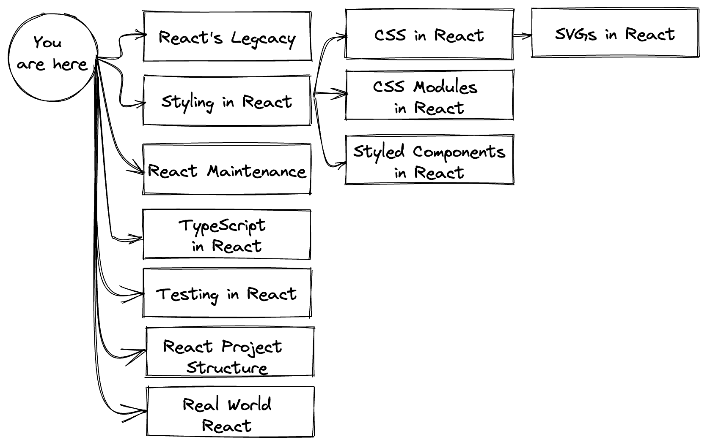

## React 中的样式

样式化 React 应用程序有很多方法，关于最佳样式策略和样式方法存在长期的争论。我们将将介绍其中的几种策略，每种策略代表一种方法，而不赋予它们过多的权重。会有一些关于优缺点的论证，但主要取决于什么最适合开发者和他们的团队。

我们将从 React 中常用的 CSS 开始学习 React 样式化，然后探索两种更高级的 `CSS-in-CSS`（使用 `CSS Modules`）和 `CSS-in-JS`（使用 `Styled Components`）替代方案。`CSS Modules` 和 `Styled Components` 只是这两类策略中众多方法中的两种。我们还将涵盖如何在 React 应用程序中包含可缩放矢量图形（SVG），例如标志或图标。

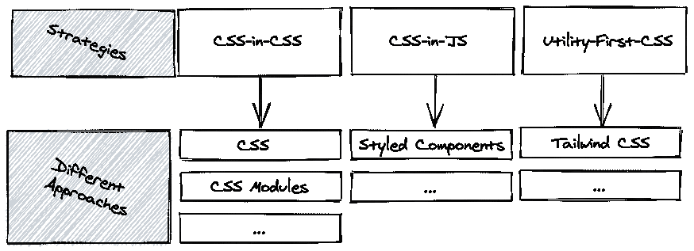

如果你不想从零构建常见的 UI 组件（例如按钮、对话框、下拉列表），你始终可以选择一个[适合 React 的流行 UI 库](https://www.robinwieruch.de/react-libraries/)，它默认提供了这些组件。然而，在使用预构建的解决方案之前，尝试构建这些组件对学习 React 更有利。因此，我们不会使用任何 UI 组件库。

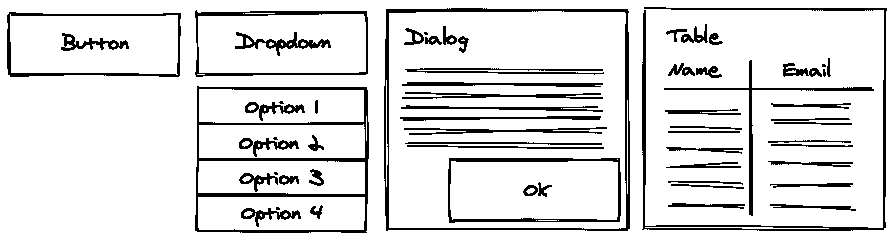

以下样式方法和 SVG 大多在 `Vite` 中已经预配置好。如果你通过自定义设置控制构建工具（例如 `Webpack`），则它们可能需要配置以启用导入 CSS 或 SVG 文件。由于我们正在使用 `Vite`，可以直接使用这些文件。例如，在你的 `src/main.jsx` 文件中，确保导入了 `src/index.css` 文件：

```
import React from 'react';
import ReactDOM from 'react-dom/client';
import App from './App';

import './index.css';
```
`src/main.jsx`

### React 中的 CSS

React 中常用的 CSS 与你可能学过的标准 CSS 相似。每个 Web 应用程序赋予 HTML 元素一个 `class`（在 React 中是 `className`）属性，并通过 CSS 文件进行样式处理。

```
const App = () => {
  ...

  return (
    <div className="container">
      <h1 className="headline-primary">My Hacker Stories</h1>

      <SearchForm
        searchTerm={searchTerm}
        onSearchInput={handleSearchInput}
        onSearchSubmit={handleSearchSubmit}
      />

      {stories.isError && <p>Something went wrong ...</p>}

      {stories.isLoading ? (
        <p>Loading ...</p>
      ) : (
        <List list={stories.data} onRemoveItem={handleRemoveStory} />
      )}
    </div>
  );
};
```
`src/App.jsx`

`<hr />` 被删除了，因为 CSS 将在后续步骤处理边框。我们将导入 CSS 文件，这是通过 `Vite` 解析导入的方式完成的：

```
import * as React from 'react';
import axios from 'axios';

import './App.css';
```
`src/App.jsx`

此 CSS 文件将定义我们在 App 组件中使用（以及将使用）的两个（更多）CSS 类。在你的 `src/App.css` 文件中，如下定义它们：

```css
.container {
  height: 100vw;
  padding: 20px;

  background: #83a4d4; /* 旧浏览器的备选方案 */
  background: linear-gradient(to left, #b6fbff, #83a4d4);

  color: #171212;
}

.headline-primary {
  font-size: 48px;
  font-weight: 300;
  letter-spacing: 2px;
}
```
`src/App.css`


当你重新启动应用程序时，应该能看到第一个样式生效了。接下来，我们将进入 `Item` 组件。它的它的部分元素也接收了 `className` 属性，但在这里我们也使用了一种新的样式技术：

```jsx
const Item = ({ item, onRemoveItem }) => (
  <li className="item">
    <span style={{ width: '40%' }}>
      <a href={item.url}>{item.title}</a>
    </span>
    <span style={{ width: '30%' }}>{item.author}</span>
    <span style={{ width: '10%' }}>{item.num_comments}</span>
    <span style={{ width: '10%' }}>{item.points}</span>
    <span style={{ width: '10%' }}>
      <button
        type="button"
        onClick={() => onRemoveItem(item)}
        className="button button_small"
      >
        Dismiss
      </button>
    </span>
  </li>
);
```

`src/App.jsx`

如你所见，我们也可以为 HTML 元素使用 `style` 属性。在 JSX 中，样式可以作为内联 JavaScript 对象传递给这些属性。这样，我们就可以在 JavaScript 文件中定义动态样式属性，而不是大部分静态的 CSS 文件中。这种方法被称为 `inline style`（内联样式），适用于快速原型设计和动态样式定义。然而，内联样式应该节节使用，因为使用 CSS 文件定义独立的样式可以让 JSX 更加简洁。

在你的 `src/App.css` 文件中，定义新的 CSS 类。这里使用了基础 CSS 特性，因为本示例未包含来自 CSS 扩展（例如 Sass）的高级 CSS 特性（例如嵌套），因为这些是[可选的配置](https://bit.ly/3E1a2bM)：

```css
.item {
  display: flex;
  align-items: center;
  padding-bottom: 5px;
}

.item > span {
  padding: 0 5px;
  white-space: nowrap;
  overflow: hidden;
  white-space: nowrap;
  text-overflow: ellipsis;
}

.item > span > a {
  color: inherit;
}
```

`src/App.css`

上一个组件中的按钮样式仍然缺失，因此我们将定义一个基础按钮样式和两个更具体的按钮样式（小和大）。其中一个按钮规范已经在使用，另一个将在接下来的步骤中使用：

```css
.button {
  background: transparent;
  border: 1px solid #171212;
  padding: 5px;
  cursor: pointer;

  transition: all 0.1s ease-in;
}

.button:hover {
  background: #171212;
  color: #ffffff;
}

.button_small {
  padding: 5px;
}

.button_large {
  padding: 10px;
}
```

`src/App.css` （注：原文此处代码块标记为 App.css，此处保持一致）

除了 React 中的样式方法外，命名规范（[CSS 指南](https://mzl.la/3m5avnb)）是另一个话题。最后一段 CSS 代码通过使用下划线（_`）定义类的变体遵循了 BEM 规则。选择任何适合你和团队的命名规范即可。废话不多说，我们将为下一个 React 组件设置样式：

```jsx
const SearchForm = ({ ... }) => (
  <form onSubmit={onSearchSubmit} className="search-form">
    <InputWithLabel ... >
      <strong>Search:</strong>
    </InputWithLabel>

    <button
      type="submit"
      disabled={!searchTerm}
      className="button button_large"
    >
      Submit
    </button>
  </form>
);
```

`src/App.jsx`

我们还可以将 `className` 属性作为 prop（属性）传递给 React 组件。例如，我们可以使用此选项为 `SearchForm` 组件传递一个带有 `className` 属性的灵活样式，该属性来自一组预定义的类（例如 `button_large` 或 `button_small`）。最后，为 `InputWithLabel` 组件设置样式：

```jsx
const InputWithLabel = ({ ... }) => {
  ...

  return (
    <>
      <label htmlFor={id} className="label">
        {children}
      </label>
      &nbsp;
      <input
        ref={inputRef}
        id={id}
        type={type}
        value={value}
        onChange={onInputChange}
        className="input"
      />
    </>
  );
};
```

`src/App.jsx`

在你的 `src/App.css` 文件中，添加剩余类：

```css
.search-form {
  padding: 10px 0 20px 0;
  display: flex;
  align-items: baseline;
}

.label {
  border-top: 1px solid #171212;
  border-left: 1px solid #171212;
  padding-left: 5px;
  font-size: 24px;
}

.input {
  border: none;
  border-bottom: 1px solid #171212;
  background-color: transparent;

  font-size: 24px;
}
```

`src/App.css`

为了简单起见，我们单独对像 label 等元素设置了样式。在 `src/App.css` 中，我们可以定义 CSS 类。在 `src/App.jsx` 中，我们可以使用 `style` 对象来定义动态属性。


```css
.item {
  display: flex;
  align-items: center;
  padding-bottom: 5px;
}

.item > span {
  padding: 0 5px;
  white-space: nowrap;
  overflow: hidden;
  white-space: nowrap;
  text-overflow: ellipsis;
}

.item > span > a {
  color: inherit;
}
```

`src/App.module.css`

然后是 `src/App.module.css` 文件中的按钮 CSS 类：

```css
.button {
  background: transparent;
  border: 1px solid #171212;
  padding: 5px;
  cursor: pointer;

  transition: all 0.1s ease-in;
}

.button:hover {
  background: #171212;
  color: #ffffff;
}

.buttonSmall {
  padding: 5px;
}

.buttonLarge {
  padding: 10px;
}
```

`src/App.module.css`

这里转向了伪 BEM 命名规范，这与上一节中的 `button_small` 和 `button_large` 对比。如果之前的命名规范仍然有效，我们只能通过 `styles['button_small']` 访问样式，由于 JavaScript 对对象下划线的限制，这会变得更加冗长。同样的缺点也适用于使用连字符（`-`）定义的类名。相比之下，现在我们可以使用 `styles.buttonSmall` 代替（见：`Item` 组件）：

```javascript
const SearchForm = ({ ... }) => (
  <form onSubmit={onSearchSubmit} className={styles.searchForm}>
    <InputWithLabel ... >
      <strong>搜索：</strong>
    </InputWithLabel>

    <button
      type="submit"
      disabled={!searchTerm}
      className={`${styles.button} ${styles.buttonLarge}`}
    >
      提交
    </button>
  </form>
);
```

`src/App.jsx`

`SearchForm` 组件也接收了样式。它必须使用 JavaScript 的模板字符串通过字符串插值来在一个元素中使用两个样式。另一种可选方法是使用 [clsx](https://bit.ly/3DNEA3R) 库，它是通过命令行作为项目依赖安装的：

```javascript
import clsx from 'clsx';

...

// 在某处的 className 属性中
className={clsx(styles.button, styles.buttonLarge)}
```

`src/App.jsx`

该库也提供条件样式；其中对象属性的左侧必须作为[计算属性名](https://mzl.la/2XuN651)使用，并且只有当右侧求值为真时才会应用：

```javascript
import clsx from 'clsx';

...

// 在某处的 className 属性中
className={clsx(styles.button, { [styles.buttonLarge]: isLarge })}
```

`src/App.jsx`

最后，继续处理 `InputWithLabel` 组件：

```javascript
const InputWithLabel = ({ ... }) => {
  ...

  return (
    <>
      <label htmlFor={id} className={styles.label}>
        {children}
      </label>
      &nbsp;
      <input
        ref={inputRef}
        id={id}
        value={value}
        onChange={onInputChange}
        className={styles.input}
      />
    </>
  );
};
```

`src/App.jsx`

完成 `src/App.module.css` 文件中剩余的样式：

```css
.searchForm {
  padding: 10px 0 20px 0;
  display: flex;
  align-items: baseline;
}

.label {
  border-top: 1px solid #171212;
  border-left: 1px solid #171212;
  padding-left: 5px;
  font-size: 24px;
}

.input {
  border: none;
  border-bottom: 1px solid #171212;
  background-color: transparent;

  font-size: 24px;
}
```

`src/App.module.css`

同样的与上一节相同的警告：这些某些样式（如 `input` 和 `label`）在没有 CSS Modules 的全局 `src/index.css` 文件中可能会更高效。

再次，CSS Modules —— 与任何其他 CSS-in-CSS 方法一样 —— 可以使用 Sass 用于高级的 CSS 功能，如嵌套。CSS Modules 的优势在于，每当样式未定义时，我们会在 JavaScript 中收到错误。在标准的 CSS 方法中，JavaScript 和 CSS 文件不匹配的样式可能会被忽略。

## 练习题

*   将你的源代码与作者的[源代码](https://wiki.example.org/source_code) 进行对比。


```javascript
const StyledButtonSmall = styled(StyledButton)`
  padding: 5px;
`;

const StyledButtonLarge = styled(StyledButton)`
  padding: 10px;
`;

const StyledSearchForm = styled.form`
  padding: 10px 0 20px 0;
  display: flex;
  align-items: baseline;
`;
```

`src/App.jsx`

当我们使用像 `StyledSearchForm` 这样的样式组件时，其底层的表单元素会在真实的 HTML 输出中使用。我们可以继续在那里使用原生 HTML 属性（`onSubmit`、`type`、`disabled`）：

```javascript
const SearchForm = ({ ... }) => (
  <StyledSearchForm onSubmit={onSearchSubmit}>
    <InputWithLabel
      id="search"
      value={searchTerm}
      isFocused
      onInputChange={onSearchInput}
    >
      <strong>搜索：</strong>
    </InputWithLabel>

    <StyledButtonLarge type="submit" disabled={!searchTerm}>
      提交
    </StyledButtonLarge>
  </StyledSearchForm>
);
```

`src/App.jsx`

最后是装饰了尚未定义的样式组件的 `InputWithLabel`：

```javascript
const InputWithLabel = ({ ... }) => {
  ...

  return (
    <>
      <StyledLabel htmlFor={id}>{children}</StyledLabel>
      &nbsp;
      <StyledInput
        ref={inputRef}
        id={id}
        type={type}
        value={value}
        onChange={onInputChange}
      />
    </>
  );
};
```

`src/App.jsx`

与其对应的样式组件定义在同一个文件中：

```javascript
const StyledLabel = styled.label`
  border-top: 1px solid #171212;
  border-left: 1px solid #171212;
  padding-left: 5px;
  font-size: 24px;
`;

const StyledInput = styled.input`
  border: none;
  border-bottom: 1px solid #171212;
  background-color: transparent;

  font-size: 24px;
`;
```

`src/App.jsx`

使用 styled components 进行 CSS-in-JS 将定义样重点转移到了实际的 React 组件上。Styled Components 是定义为 React 组件的样式，不需要中间 CSS 文件。如果样式组件没有在 JavaScript 中中使用，你的 IDE/编辑器会提示你。对于生产级应用程序，Styled Components 会与其他 JavaScript 资源一起在 JavaScript 文件中打包。使用 CSS-in-JS 策略时，没有额外的 CSS 文件，只有 JavaScript。CSS-in-JS 和 CSS-in-CSS 两种策略，以及它们的方法（例如 Styled Components 和 CSS Modules）在 React 开发者中都很流行。使用最适合你和你的团队的方法。

## 练习

*   将你的源代码与作者的[源代码](https://bit.ly/48UtG8s) 进行对比。
    *   回顾本节中所有的[源代码更改](https://bit.ly/3SpLli3)。
*   阅读更多关于[React 中 Styled Components 的最佳实践](https://www.robinwieruch.de/styled-components/)。
*   使用 Styled Components 时，通常没有用于全局样式的 `src/index.css` 文件。通过你喜爱的搜索引擎，了解在使用 Styled Components 时如何使用全局样式。
*   可选：[为本节提供反馈](https://forms.gle/5vFxvg9hSNAna37S8)。

### React 中的 SVGs

为了创建一个现代的 React 应用程序，我们可能需要使用 SVGs。例如，与其给每个按钮元素赋予文本，我们可能可能希望通过图标使其变得轻量化。在本节中，我们将使用可缩放矢量图形（SVG）作为 React 组件之一的图标。

**重要：** 本节建立在之前之前介绍的“CSS in React”之上，这有助于我们立即赋予 SVG 图标良好的外观和感受。使用不同的样式方法（例如 CSS Modules、Styled Components）或完全不使用样式都是可以的，尽管没有样式 SVG 可能会看起来很奇怪。

Vite 不带 SVG 支持。为了在 Vite 中允许使用 SVG，我们必须通过命令行安装 Vite 的其中一个插件：

```bash
npm install vite-plugin-svgr --save-dev
```

### 命令行

接下来，可以将新的 SVG 插件用于 Vite 的配置：

```javascript
import { defineConfig } from 'vite';
import react from '@vitejs/plugin-react';
import svgr from 'vite-plugin-svgr';

// https://vitejs.dev/config/
export default defineConfig({
  plugins: [react(), svgr()],
});
```
`vite.config.js`

通用设置就此为止。我们将使用以下 [SVG](https://bit.ly/3w4NR) 并创建一个新的 `src/check.svg` 文件：

```xml
<?xml version="1.0" encoding="iso-8859"?>
<!-- Generator: Adobe Illustrator 18.0.0, SVG Version: 6.0 -->
<!DOCTYPE svg PUBLIC "-//W3C//DTD SVG 1.1//EN" "http://www.w3.org/Graphics/SVG/1.1/dtd">
<svg version="1.1" id="apa" xmlns="http://www.w3.org/2000/svg" xmlns:xlink="http://www.w3.org/1999/xlink" x="0px" y="0px" viewBox="0 0 297 297" style="enable-background:0 0 297 297;" xml:space="preserve">
  <g>
    <path d="M113.636,272.638c-2.689,0-5.267-1.067-7.168-2.97L2.967,166.123c-3.956-3.957-3.956-10.371-0.001-14.32l54.673-54.703c1.9-1.9,4.479-2.97,7.167-2.97c2.689,0,5.268,1.068,7.169,2.969l41.661,41.676L25.023,27.332c1.9-1.901,4.48-2.97,7.168-2.97l0,0c2.688,0,5.268,1.068,7.167,2.97l54.675,54.701c3.956,3.957,3.956,10.372,0,14.32L120.803,269.668C118.903,271.57,116.325,272.638,113.636,272.638M24.463,158.958l89.173,89.209l158.9-158.97l40.346-40.364L120.803,160.264c1.9,1.902,4.478,2.971,7.167,2.971c2.688,0,5.267-1.068,7.168-2.97l41.66-41.674L24.463,158.958z"/>
  </g>
</svg>
```
`src/check.svg`

现在我们可以像使用 CSS 一样直接作为 React 组件导入 SVG。在 `src/App.jsx` 中，使用以下语法导入 SVG：

```javascript
import * as React from 'react';
import axios from 'axios';

import './App.css';

import { ReactComponent as Check } from './check.svg';
```

`src/App.jsx`

在这里我们导入 SVG 作为图标。然而，它也适用于 Logo 和背景等许多不同场景。现在不再使用按钮文本，而是传递带有 `height` 和 `width` 属性的 SVG 组件：

```javascript
const Item = ({ item, onRemoveItem }) => (
  <li className="item">
    <span style={{ width: '40%' }}>
      <a href={item.url}>{item.title}</a>
    </span>
    <span style={{ width: '30%' }}>{item.author}</span>
    <span style={{ width: '10%' }}>{item.num_comments}</span>
    <span style={{ width: '10%' }}>{item.points}</span>
    <span style={{ width: '10%' }}>
      <button
        type="button"
        onClick={() => onRemoveItem(item)}
        className="button button_small"
      >
        <Check height="18px" width="18px" />
      </button>
    </span>
  </li>
);
```

`src/App.jsx`

无论你使用哪种样式方法，你也可以为按钮中的 SVG 图标添加悬停效果，因为现在悬停状态下看起来不对。在基础 CSS 方法中，它在 `src/App.css` 文件中如下：

```css
.button:hover > svg > g {
  fill: #ffffff;
  stroke: #ffffff;
}
```

`src/App.css`

Vite 插件让使用 SVG 变得简单，不需要很多额外配置。如果你使用 Webpack 这样的构建工具从头创建一个 React 项目，情况就会不同，因为你必须自己处理。无论如何，SVGs 让你的应用程序更易于接近，因此在合适的时候请使用它们。

## 练习

*   将你的源代码与作者的[源代码](https://bit.ly/4b1ZPge)进行对比。
    *   回顾本节中所有的[源代码更改](https://bit.ly/3U6XJpr)。
*   将第三方库 [react-icons](https://bit.ly/3nayoJ7) 集成到你的应用程序中，并通过直接作为 React 组件导入其 SVG 符号。
*   可选：[为本节提供反馈](https://forms.gle/3yGgMDR2VQ5WksSXA)。

### React 

一旦 React 应用程序增大，维护就会成为首要任务。为了这种可能性做准备，我们将涵盖性能优化、类型安全、测试和项目结构。这些主题都将增强你的应用程序，使其在不牺牲质量的情况下承担更多功能。


性能优化通过确保可用资源的高效利用，防止应用程序变慢。像 `TypeScript` 这样的强类型编程语言可以在反馈循环中更早地检测到错误。测试比类型编程提供了更显式的反馈，并提供了解哪些操作可能会破坏应用程序的方法。最后，项目结构支持将资产组织化管理到文件夹和文件中，这在团队成员在不同领域工作的场景下尤为有用。

## React 中的性能（进阶）

本节仅用于学习 React 中的性能改进。在大多数 React 应用程序中，我们不需要优化，因为 React 开箱即用就已经很快。虽然存在更复杂的工具用于测量 JavaScript 和 React 的性能，但我们将坚持使用简单的 `console.log()` 和浏览器开发工具进行日志输出。

### 严格模式 (Strict Mode)

在学习 React 性能之前，我们将简要查看 React 的严格模式，它在 `src/main.jsx` 文件中被启用：

```
ReactDOM.createRoot(document.getElementById('root')).render(
  <React.StrictMode>
    <App />
  </React.StrictMode>
);
```

`src/main.jsx`

[React 的严格模式](https://bit.ly/48TUA0k) 是一个辅助组件，在我们的实现出现问题时通知开发者。例如，使用[已弃的](https://bit.ly/3R8ycam) React API（例如使用旧版 React hook）会在浏览器开发工具中向我们发出警告。然而，它确保了开发者很好地实现了状态和副作用。让我们在代码中体验这意味着什么。

`App` 组件最初从远程 API 获取数据，并以列表形式显示。我们正在使用 React 的 `useEffect` 钩子来初始化数据获取。现在我鼓励你添加一个 `console.log()`，每当这个钩子运行时它都会记录日志：

```
const App = () => {
  ...

  React.useEffect(() => {
    console.log('How many times do I log?');
    handleFetchStories();
  }, [handleFetchStories]);

  ...
};
```

`src/main.jsx`

许多人会预期在浏览器开发工具中只看到一次日志，因为这个副作用应该运行一次（或者在 `handleFetchStories` 函数变化时运行）。然而，你会看到 `App` 组件的初始渲染输出了两次日志。说实话，这是一种非常出意料的行为（即使对于经验丰富的 React 开发者也是如此），让 React 初学者难以理解。但是，React 核心决定这种行为对于暴露应用程序中误用副作用相关的错误是必要的。

因此，React 的严格模式会在初始渲染时运行两次 React 的 `useEffect` 钩子。因为这会导致两次相同的数据获取，这对我们来说并不是问题。这种操作被称为幂等性（idempotent），意味着成功执行请求的结果与其执行的次数无关。毕竟，这只是一个性能问题，因为有两个网络请求，但它不会导致应用程序出现错误行为。除了所有这些不确定性，严格模式仅适用于开发环境，因此每当此应用程序构建为生产版本时，严格模式会自动移除。


```javascript
const App = () => {
  ...

  console.log('B:App');

  return ( ... );
};

const List = ({ list, onRemoveItem }) =>
  console.log('B:List') || (
    <ul>
      {list.map((item) => (
        <Item
          key={item.objectID}
          item={item}
          onRemoveItem={onRemoveItem}
        />
      ))}
    </ul>
  );
```

`src/App.jsx`

由于 `List` 组件没有函数体，而开发者通常是些懒惰的人，不想为了一个简单的日志语句就去重构组件，因此 `List` 组件使用了 `||` 运算符来代替。这是一种在没有函数体的函数组件中添加日志语句的巧妙方法。由于运算符左侧的 `console.log()` 始终求值为 `false`，因此运算符的右侧总是会被执行。

```javascript
function getTheTruth() {
  if (console.log('B:List')) {
    return true;
  } else {
    return false;
  }
}

console.log(getTheTruth());
// B:List
// false
```

### 代码沙场

让我们关注刷新页面时浏览器开发者工具中实际的日志输出。你应该能看到类似的输出。首先，`App` 组件渲染，然后是它的子组件（例如，`List` 组件）。

```
B:App
B:List
B:App
B:App
B:List
```

### 可视化

再次强调：如果你看到的日志比这些，请检查你的 `src/main.jsx` 文件是否使用了 `<React.StrictMode>` 作为 `App` 组件的包装器。如果是，请移除 Strict Mode 并再次检查你的日志。解释：在开发模式下，React 的 `StrictMode` 会渲染组件两次以检测实现中的问题，并向你发出警告。这种 `Strict Mode` 在生产应用中会自动排除。但是，如果你不想被多次渲染搞混，请从 `src/main.jsx` 文件中移除 Strict Mode。

由于副作用在第一次渲染后触发了数据获取，因此只有 `App` 组件进行了渲染，因为 `List` 组件在条件渲染中被加载指示器取代了。一旦数据到达，两个组件都会再次渲染。

```
// initial render
B:App
B:List

// data fetching with loading instead of List component
B:App

// re-rendering with data
B:App
B:List
```

### 可视化

到目前为止，这种行为是可以接受的，因为一切都是按时渲染的。现在我们将实验更进一步，在 `SearchForm` 组件的输入框中输入内容。你应该在向元素输入每个字符时看到变化：

```
B:App
B:List
```

### 可视化

令人惊讶的是，`List` 组件不应该重新渲染，但它确实渲染了。搜索功能并不是通过按钮执行的，因此通过 `App` 组件传递给 `List` 组件的 `list` 在每次击键时保持不变。这是 React 的默认行为：当状态发生变化时，重新渲染组件（这里是 `App` 组件）以下的所有内容，这让许多人感到惊讶。换句话说，如果父组件重新渲染，它的后代组件也会重新渲染。React 默认这样做，因为防止子组件的重新渲染可能会导致 bug。由于 React 的重新渲染机制默认足够快，因此 React 鼓励后代组件的自动重新渲染。

然而，有时我们希望防止重新渲染。例如，显示在表格中的巨大数据集（例如 `List` 组件）如果不受更新（例如 `Search` 组件）的影响，就不应该重新渲染。如果组件发生了变化，对其进行等等性检查会更高效。因此，我们可以使用 React 的 `memo` API 对 props 进行这种等等性检查：

```javascript
const List = React.memo(
  ({ list, onRemoveItem }) =>
    console.log('B:List') || (
      <ul>
        {list.map((item) => (
          <Item
            key={item.objectID}
            item={item}
            onRemoveItem={onRemoveItem}
          />
        ))}
      </ul>
    )
);
```

`src/App.jsx`

React 的 `memo` API 检查组件的 props 是否发生了变化。如果没有，即使它的父组件重新渲染，它也不会重新渲染。然而，在 `SearchForm` 的输入框中打字时，输出保持不变：

```
B:App
B:List
```

### 可视化

传递给 `List` 组件的 `list` 是相同的，但 `onRemoveItem` 回调处理器不是。如果 `App` 组件重新渲染，它总是会创建一个新的回调处理器版本作为新函数。早些，我们使用 React 的 `useCallback` Hook 来防止这种行为，仅在初始渲染时（或当其依赖项之一发生变化时）创建函数：

```javascript
const App = () => {
  ...

  const handleRemoveStory = React.useCallback((item) => {
    dispatchStories({
      type: 'REMOVE_STORY',
      payload: item,
    });
  }, []);

  ...

  console.log('B:App');

  return (... (...
};
```

`src/App.jsx`

由于回调处理器在函数签名中接收 `item` 作为参数，它没有依赖项，并且仅在 `App` 组件初始渲染时声明一次。（注：原文末尾存在大量重复文本，已处理）。


每当有人在 `SearchForm` 中输入内容时，计算都不应该再次运行。只有当依赖数组（此处为 `stories`）发生变化时，它才会运行。毕竟这应该只用于开销较大的计算，这些计算可能会导致组件的（重新）渲染出现延迟。

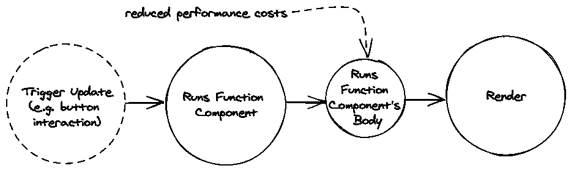

现在，在我们学习了 `useMemo`、`useCallback` 和 `memo` 的这些场景后，请记住，它们并不一定需要默认使用。只有在你遇到性能瓶颈时才应用这些性能优化。大多数情况下，这种情况不会发生，因为 React 的渲染机制默认是非常高效的。有时对像 `memo` 等工具的检查可能比重新渲染本身还要昂贵。

#### 练习：

* 将你的源代码与作者的[源代码](https://bit.ly/3OaOkcy) 进行对比。
* 回顾本节中所有的[代码更改](https://bit.ly/3U7ckBs)。
* 进一步阅读更多关于 [React 的 useMemo Hook](https://www.robinwieruch.de/react-usememo-hook/) 的信息。
* 将 React Developer Tools 作为浏览器的扩展下载。通过浏览器的开发者工具为你的应用程序打开它，并尝试它的各种功能。例如，你可以用它来可视化 React 的组件树及其正在更新的组件。
* 当从带有“Dismiss（关闭）”按钮的 List 中删除一个项时，SearchForm 会重新渲染吗？如果是的话，应用性能优化技术（使用 `useCallback` 和 `memo`）来防止重新渲染。
* 当从带有“Dismiss（关闭）”按钮的 List 中删除一个项时，每个 Item 都会重新渲染吗？如果是的话，应用性能优化技术来防止重新渲染。
* 移除所有性能优化以保持应用程序的简单。我们目前的应用程序并没有任何性能瓶颈。尝试避免[过早优化](https://bit.ly/3AYktL8)。可以将本节及其进一步阅读材料作为参考，以防你遇到性能问题。
* 可选：[为本节提供反馈](https://forms.gle/FwNrJSdLikquVzsB6)。

## React 中的 TypeScript

TypeScript 对于 JavaScript 和 React 在开发健壮的应用程序有许多益处。与其在命令行或浏览器的运行时获取类型错误，TypeScript 集成会在 IDE 内部的编译期间提出它们。它缩短了开发者的反馈循环，同时提升了开发者体验。此外，代码变得自成文档且易于阅读，因为每个变量都定义了类型。此外，移动代码块或对代码库进行大规模重构也变得更加高效。像 TypeScript 这样的静态类型语言之所以流行，是因为它们比像 JavaScript 这样的动态类型语言更有优势。尽可能多地学习[关于 TypeScript](https://bit.ly/3G0l3vL) 是很有用的。

### TypeScript 设置

要在 React 中使用 TypeScript（配合 Vite），请使用命令行将 TypeScript 及其依赖安装到你的应用程序中：

```
npm install typescript @types/react @types/react-dom --save-dev
npm install @typescript-eslint/eslint-plugin --save-dev
npm install @typescript-eslint/parser --save-dev
```

### 命令行

添加两个 TypeScript 配置；一个用于浏览器环境，另一个用于 Node 环境：

```bash
touch tsconfig.json tsconfig.node.json
```

### 命令行

在浏览器环境的 TypeScript 文件中包含以下配置：

```json
{
  "compilerOptions": {
    "target": "ES2020",
    "useDefineForFields": true,
    "lib": ["ES2020", "DOM", "DOM.Iterable"],
    "module": "ESNext",
    "skipLibCheck": true,
    /* Bundler mode */
    "moduleResolution": "bundler",
    "allowImportingExtensions": true,
    "resolveJsonModule": true,
    "isolatedModules": true,
    "noEmit": true,
    "jsx": "react-jsx",
    /* Linting */
    "strict": true,
    "noUnusedLocals": true,
    "noUnusedParameters": true,
    "noFallthroughInSwitch": true
  },
  "include": ["src"],
  "references": [{"path": "./tsconfig.node.json"}]
}
```

然后在 Node 环境的 TypeScript 文件中包含一些配置：

```json
{
  "compilerOptions": {
    "composite": true,
    "skipLibCheck": true,
    "module": "ESNext",
    "moduleResolution": "bundler",
    "allowSyntheticImports": true
  },
  "include": ["vite.config.ts"]
}
```

如果你有 ESLint 配置，也需要将其适配到 TypeScript：

```javascript
module.exports = {
  root: true,
  env: { browser: true, es2020: true },
  extends: [
    'eslint:recommended',
    'plugin:@typescript-eslint/recommended',
    'plugin:react-hooks/recommended',
  ],
  ignorePatterns: ['dist', '.eslintrc.cjs'],
  parser: '@typescript-eslint/parser',
  plugins: ['react-refresh'],
  rules: {
    'react-refresh/only-export-components': [
      'warn',
      { allowConstantExport: true },
    ],
  },
};
```

接下来，将所有 JavaScript 文件（.jsx）重命名为 TypeScript 文件（.tsx）：

```bash
mv src/main.jsx src/main.tsx
mv src/App.jsx src/App.tsx
```

并在你的 `index.html` 文件中，引用新的 TypeScript 文件而不是 JavaScript 文件：

```html
<!DOCTYPE html>
<html lang="en">
  <head>
    <meta charset="UTF-8" />
    <link rel="icon" type="image/svg+xml" href="/vite.svg" />
    <meta name="viewport" content="width=device-width,initial-scale=1.0" />
    <title>Vite + React</title>
  </head>
  <body>
    <div id="root"></div>
    <script type="module" src="/src/main.tsx"></script>
  </body>
</html>
```

你可能还需要在项目根目录下创建一个 `vite-env.d.ts` 文件，内容如下：

```typescript
/// <reference types="vite/client" />
```

在命令行上重启开发服务器。如果你在打开重后的 TypeScript 文件（例如 `App.tsx`）时遇到错误，请尝试为你的编辑器安装 TypeScript 插件。通常你会在缺少类型定义的地方看到红线。

### 函数和组件的类型

应用程序仍然应该启动，但我们在 `src/main.tsx` 和 `src/App.tsx` 文件中缺少定义。让我们从前者开始，因为这是一个很小的更改：

```tsx
import React from 'react';
import ReactDOM from 'react-dom/client';
import App from './App';

ReactDOM.createRoot(document.getElementById('root')!).render(
  <React.StrictMode>
    <App />
  </React.StrictMode>
);
```

如果没有此更改，TypeScript 将输出以下错误：`Argument of type ‘HTMLElement | null’ is not assignable to parameter of type ‘Element | DocumentFragment’.`。这可以翻译为：“`getElementById()` 返回的 HTML 可能是可能是，但 `createRoot()` 期望它是 Element。”由于我们确定 `index.html` 文件中存在此特定标识符的 HTML 元素，我们通过使用所谓的类型断言（此处为 `as` 关键字）告诉 TypeScript 我们更清楚。

接下来，我们将为整个 `src/App.tsx` 文件添加类型安全。从纯粹的编程语言角度来看自定义 React Hook，它只是另一个函数。但在 TypeScript 中，函数的输入（可选的输出）必须是类型安全的。让我们从让我们的 `useStorageState()` hook 变得类型安全开始，我们告诉函数要接收两个字符串原型的参数：

```tsx
const useStorageState = (
  key: string,
  initialState: string
) => {
  const [value, setValue] = React.useState(
    localStorage.getItem(key) || initialState
  );

  React.useEffect(() => {
    localStorage.setItem(key, value);
  }, [value, key]);

  return [value, setValue];
};
```


此外，我们可以告诉函数返回一个数组（`[]`），其第一个值（当前状态）类型为 `string`，第二个值（状态更新函数）接受一个类型为 `string` 的新值（新状态）并返回空（`void`）：

```
const useStorageState = (
  key: string,
  initialState: string
): [string, (newValue: string) => void] => {
  const [value, setValue] = React.useState(
    localStorage.getItem(key) || initialState
  );

  React.useEffect(() => {
    localStorage.setItem(key, value);
  }, [value, key]);

  return [value, setValue];
};
```

`src/App.tsx`

由于 TypeScript 已经从 React 的 `useState` Hook 中推断出此类型，我们可以再次简单删除返回类型。然而，我们需要将返回的数组声明为 TypeScript 的 `const`，否则应用程序的其他部分将无法确定数组元素的顺序：

```
const useStorageState = (key: string, initialState: string) => {
  const [value, setValue] = React.useState(
    localStorage.getItem(key) || initialState
  );

  React.useEffect(() => {
    localStorage.setItem(key, value);
  }, [value, key]);

  return [value, setValue] as const;
};
```

`src/App.tsx`

与 React 相关的是，考虑到之前对自定义 hook 的类型安全改进，我们不需要在函数体内部的 React hooks 中添加类型。这是因为 `type inference`（类型推断）在大多数情况下可以直接对 React hooks 工作。如果 React `useState` Hook 的 `initial state`（初始状态）是一个 JavaScript 字符串原始类型，那么返回的 `current state`（当前状态）将被推断为字符串，返回的 `state updater function`（状态更新函数）仅接受字符串作为参数且返回空：

```
const [value, setValue] = React.useState('React');
// value 被推断为 string
// setValue 仅接受字符串作为参数
```

Code Playground

然而，如果 `initial state`（初始状态）最初为 `null`，我们就必须告诉 TypeScript React 所有 `useState` Hook 的潜在类型（在这里在 TypeScript 中使用了所谓的联合类型，通过 `|` 创建两个或多个类型的并集）。使用 `TypeScript generic`（TypeScript 泛型）来告诉函数（这里：React hook）这些信息：

```
const [value, setValue] = React.useState<string | null>(null);
// value 必须是 string 或 null
// setValue 仅接受 string 或 null 作为参数
```

Code Playground

如果类型安全成为 React 应用程序及其组件的副作用（就像我们在案例中那样），有多种方法可以处理它。我们将从应用程序叶子组件的 props 和 state 开始。例如，`Item` 组件接收一个 story（这里：`item`）和一个回调处理函数（这里：`onRemoveItem`）。从非常冗长的写法开始，我们可以像之前一样为两个函数参数添加内联类型：

```typescript
const Item = ({
  item,
  onRemoveItem,
}: {
  item: {
    objectID: string;
    url: string;
    title: string;
    author: string;
    num_comments: number;
    points: number;
  };
  onRemoveItem: (item: {
    objectID: string;
    url: string;
    title: string;
    author: string;
    num_comments: number;
    points: number;
  }) => void;
}) => (
  <li>
    ...
  </li>
);
```

`src/App.tsx`

这里有两个问题：代码冗长，且存在重复（参见：`item`）。让我们通过在 `src/App.jsx` 顶部组件外部定义自定义的 `Story` 类型来解决这两个问题：

```typescript
type Story = {
  objectID: string;
  url: string;
  title: string;
  author: string;
  num_comments: number;
  points: number;
};

...

const Item = ({
  item,
  onRemoveItem,
}: {
  item: Story;
  onRemoveItem: (item: Story) => void;
}) => (
  <li>
    ...
  </li>
);
```

`src/App.tsx`

`item` 的类型为 `Story`，`onRemoveItem` 函数接受类型为 `Story` 的 `item` 作为参数并返回空。接下来，通过在组件外部定义 `Item` 组件的 props 类型来清理代码：

```typescript
type ItemProps = {
  item: Story;
  onRemoveItem: (item: Story) => void;
};

const Item = ({ item, onRemoveItem }: ItemProps) => (
  <li>
    ...
  </li>
);
```

`src/App.tsx`

从这里，我们可以向上组件树导航到 `List` 组件，并对 props 应用相同的类型定义。首先自己尝试一下，然后查看以下实现：

```typescript
type ListProps = {
  list: Story[];
  onRemoveItem: (item: Story) => void;
};

const List = ({ list, onRemoveItem }: ListProps) => (
  <ul>
    ...
  </ul>
);
```

`src/App.tsx`


```javascript
const App = () => {
  ...

  const handleSearchInput = (
    event: React.ChangeEvent<HTMLInputElement>
  ) => {
    setSearchTerm(event.target.value);
  };

  const handleSearchSubmit = (
    event: React.FormEvent<HTMLFormElement>
  ) => {
    setUrl(`${API_ENDPOINT}${searchTerm}`);

    event.preventDefault();
  };

  ...
};
```

`src/App.tsx`

剩下的就是 `InputWithLabel` 组件了。在处理该组件的 props 之前，让我们先来看看 React 中 `useRef` Hook 的 `ref`。遗憾的是，它的返回值没有被推断：

```
const InputWithLabel = ({ ... }) => {
  const inputRef = React.useRef<HTMLInputElement>(null);

  React.useEffect(() => {
    if (isFocused && inputRef.current) {
      inputRef.current.focus();
    }
  }, [isFocused]);
```

`src/App.tsx`

我们让返回的 `ref` 类型类型安全的，并将其标记为只读，因为我们只在其上执行了 `focus` 方法（读取）。React 在那里接管工作，将 DOM 元素设置为 `current` 属性。

最后，我们将对 `InputWithLabel` 组件的 props 应用类型安全检查。注意带有 React 特有类型的 `children` 属性，以及用问号标记的 `可选类型`：

```typescript
type InputWithLabelProps = {
  id: string;
  value: string;
  type?: string;
  onInputChange: (event: React.ChangeEvent<HTMLInputElement>) => void;
  isFocused?: boolean;
  children: React.ReactNode;
};

const InputWithLabel = ({
  id,
  value,
  type = 'text',
  onInputChange,
  isFocused,
  children,
}: InputWithLabelProps) => {
  ...
};
```

`src/App.tsx`

`type` 和 `isFocused` 属性都是可选的。使用 TypeScript，你可以告诉编译器这些属性不需要作为 props 传递给组件。`children` 属性有许多 TypeScript 类型定义可以适用于这个概念，其中最通用的是 React 库中的 `React.ReactNode`。

我们的整个 React 应用最终都通过 TypeScript 类型化，这使得在编译时发现类型错误变得容易。为你的 React 应用添加 TypeScript 时，从为函数的参数添加类型定义开始。这些函数可以是原生 JavaScript 函数、自定义 React hooks 或 React 函数组件。只有在使用 React 时，知道表单元素、事件和 JSX 的特定类型才是重要的。

#### 练习：

*   将你的源代码与作者的[源代码](https://bit.ly/3S3yfGW) 进行对比。
*   回顾本节所有的[源代码更改](https://bit.ly/48WSexM)。
*   深入研究 [React + TypeScript 速查表](https://bit.ly/3phdf2H)，因为我们在本节中遇到的大多数常见用例也涵盖在内。不需要从性地记住所有内容。
*   在继续后续章节的学习时，可以删除或保留你的 TypeScript 类型。如果你选择后者，请每当遇到编译错误时添加新类型。
*   可选：[为本节留下反馈](https://forms.gle/Pyw2oUjXV85hwk2t6)。

### 在 React 中进行测试

测试源代码是编程中不可或缺的一部分，应该被视为严肃开发者的强制性练习。目标是在生产环境之前验证我们源代码的质量和功能。[测试金字塔](https://bit.ly/3BYEra1) 将作为我们的指南。

测试金字塔包括端到端测试、集成测试和单元测试。单元测试用于小型、孤立的代码块，例如单个函数或组件。集成测试帮助我们了解这些代码块协同工作的效果如何。端到端测试模拟真实场景，例如用户登录 Web 应用程序。虽然单元测试编写和维护快速快捷，但端到端测试则相反。

一个运行中的应用程序需要许多单元测试来覆盖所有的函数和组件，之后通过几个集成测试确保最重要的单元能够协同工作。最后一步是添加几个端到端测试来模拟关键的用户场景。在本节中，我们将涵盖`单元测试和集成测试`，以及一种实用的特定组件的测试技术——`快照测试`。`E2E 测试`将是练习的一部分。

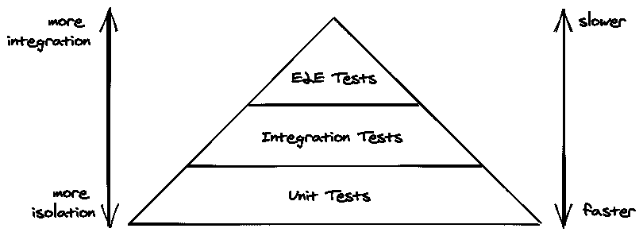

选择测试库对 React 初学者来说可能是一个挑战，因为有很多种选择。为了保持简单，我们将使用最流行的工具：[Vitest](https://vitest.dev/) 和 [React Testing Library](https://testing-library.com) (RTL)。Vitest 是一个完整的测试框架，带有测试运行器、测试套件、测试用例和断言。RTL 用于渲染 React 组件、触发鼠标点击等事件以及从 DOM 中选择 HTML 元素进行断言。我们将从设置到单元测试再到集成测试，逐步探索这两个工具。

在编写第一个测试之前，我们必须安装并设置 Vitest。首先在命令行中输入以下指令：

```bash
npm install vitest --save-dev
```

### 命令行

然后在你的 `package.json` 文件中，添加另一个运行运行它的脚本（script）：

```json
"scripts": {
  "dev": "vite",
  "build": "vite build",
  "preview": "vite preview",
  "test": "vitest"
}
```

#### 测试套件、测试用例和断言

`describe` 块是我们的`测试套件`，`it` 块是我们的`测试用例`。注意测试用例可以在不使用测试套件的情况下使用：

```javascript
import { describe, it, expect } from 'vitest';

describe('something truthy and falsy', () => {
  it('true to be true', () => {
    expect(true).toBe(true);
  });

  it('false to be false', () => {
    expect(false).toBe(false);
  });
});
```

函数或组件等主题通常需要多个测试用例，因此配合测试套件使用是合理的：

```javascript
describe('App component', () => {
  it('点击 Dismiss 按钮时移除项目', () => {

  });

  it('从 API 请求初始故事', () => {

  });
});
```

#### 代码沙场

最后，你可以通过命令行执行 `npm run test` 使用 `package.json` 中的测试脚本，产生如下输出：

```
 ✓ src/App.test.jsx (2)
   ✓ something truthy and falsy (2)
     ✓ true to be true
     ✓ false to be false

 Test Files  1 passed (1)
      Tests  2 passed (2)
   Start at  13:19:38
   Duration  122ms
```

当我们运行测试命令时，测试运行器会匹配所有以 .test.jsx 后缀的文件。通过的测试显示为绿色，失败的测试显示为红色。交互式测试脚本监控你的测试和源代码并在文件更改时执行测试。Vitest 还提供了一些交互式命令（按“h”查看所有命令），例如按“f”键运行失败的测试，按“a”键运行所有测试。让我们看看失败测试看起来是什么样：

```javascript
import { describe, it, expect } from 'vitest';

describe('something truthy and falsy', () => {
  it('true to be true', () => {
    expect(true).toBe(true);
  });

  it('false to be false', () => {
    expect(false).toBe(true);
  });
});
```


```
AssertionError: expected false to be true // Object.is equality

- Expected
+ Received

- true
+ false

src/App.test.jsx:9:19
  7|
  8|   it('false to be false', () => {
  9|     expect(false).toBe(true);
   |                   ^
 10|   });
 11| });

 Test Files  1 failed (1)
      Tests  1 failed | 1 passed (2)
   Start at  13:20:44
   Duration  124ms

 FAIL  Tests failed. Watching for file changes...
       press h to show help, press q to quit
```

### 命令行

熟悉此测试输出，因为它显示了所有失败的测试，以及它们失败的原因。通过使用这些信息，你可以修复代码的某些部分，直到所有测试都变为绿色（通过）。接下来，我们将介绍测试断言（test assertions），我们已经已经在 Vitest 的 `expect` 函数中使用了其中两个。断言的工作原理是期望左侧的值（`expect`）匹配右侧的值（`toBe`）。`toBe` 只是 Vitest 提供的许多断言函数之一。

```javascript
import { describe, it, expect } from 'vitest';

describe('something truthy and falsy', () => {
  it('true to be true', () => {
    expect(true).toBeTruthy();
  });

  it('false to be false', () => {
    expect(false).toBeFalsy();
  });
});
```

### src/App.test.jsx

一旦你开始测试，良好的做法是保持两个命令行界面：一个用于监控测试（`npm run test`），另一个用于开发应用程序（`npm run dev`）。如果你正在使用 git 等版本控制工具，你可能想要再开启一个命令行界面来将源代码添加到仓库中。

#### 练习：

*   将你的源代码与作者的[源代码](https://bit.ly/3O5SDWL) 进行对比。
*   回顾本节中所有的[源代码更改](https://bit.ly/3tRdxSH)。
*   了解更多关于 [Vitest](https://vitest.dev/) 的信息。

## 测试：函数

单元测试通常用于隔离测试组件或函数。对于函数，单元测试针对输入和输出；对于组件，我们测试 props、与外部通信的回调处理程序或组件的输出。在对我们的 `src/App.jsx` 文件执行单元测试之前，我们必须通过命名导出（named export）从 `src/App.jsx` 文件导出组件和像 reducer 这样的函数：

```javascript
export default App;

export { storiesReducer, SearchForm, InputWithLabel, List, Item };
```

#### src/App.jsx

本章末尾的练习将涵盖你应该考虑执行的所有剩余测试。现在，我们可以在 `src/App.test.jsx` 文件中导入所有组件和 reducer，并将关注放在 reducer 测试上。我们在这里导入了 React，因为每当我们测试 React 组件时，都必须包含它：

```javascript
import { describe, it, expect } from 'vitest';

import App, {
  storiesReducer,
  Item,
  List,
  SearchForm,
  InputWithLabel,
} from './App';
```

### src/App.test.jsx

在对第一个 React 组件进行单元测试之前，我们将学习如何测试一个简单的 JavaScript 函数。此测试用例的最佳候选是 `storiesReducer` 函数及其其中一个 action。让我们定义一些测试数据和 reducer 的测试套件：

```javascript
const storyOne = {
  title: 'React',
  url: 'https://reactjs.org/',
  author: 'Jordan Walke',
  num_comments: 3,
  points: 4,
  objectID: 0,
};

const storyTwo = {
  title: 'Redux',
  url: 'https://redux.org/',
  author: 'Dan Abramov, Andrew Clark',
  num_comments: 2,
  points: 5,
  objectID: 1,
};

const stories = [storyOne, storyTwo];

describe('storiesReducer', () => {
  it('removes a story from all stories', () => {
```

### src/App.test.jsx

如果你推类这些测试用例，每个 reducer action 都应该有一个测试用例。我们将关注单个 action，你可以用它自己完成剩余的工作。reducer 函数接收一个 state 和一个 action，然后返回一个新的 state，因此所有的 reducer 测试都遵循相同的模式：

```javascript
describe('storiesReducer', () => {
  it('removes a story from all stories', () => {
    const action = // TODO: some action
    const state = // TODO: current state

    const newState = storiesReducer(state, action);

    const expectedState = // TODO: the expected state

    expect(newState).toBe(expectedState);
  });
});
```

### src/App.test.jsx

对于我们的情况，我们根据 reducer 定义了 action、state 和 expected state。预期 state 将少一个 story，该 story 在作为 action 传递给 reducer 时被移除：

```javascript
describe('storiesReducer', () => {
  it('removes a story from all stories', () => {
    const action = { type: 'REMOVE_STORY', payload: storyOne };
    const state = { data: stories, isLoading: false };

    const newState = storiesReducer(state, action);

    const expectedState = { data: [storyTwo], isLoading: false };

    expect(newState).toBe(expectedState);
  });
});
```

### src/App.test.jsx

在我们的案例中，我们根据 reducer 定义了 action，state 和 expected state。预期 state 将少一个 story，它是在作为 action 传递给 reducer 时被移除的：

```javascript
describe('storiesReducer', () => {
  it('removes a story from all stories', () => {
    const action = { type: 'REMOVE_STORY', payload: storyOne };
    const state = { data: stories, isLoading: false };

    const newState = storiesReducer(state, action);

    const expectedState = { data: [storyTwo], isLoading: false };

    expect(newState).toEqual(expectedState);
  });
});
```

### src/App.test.jsx

这个测试仍然失败，因为我们使用了 `toBe` 而不是 `toStrictEqual`。`toBe` 进行严格相等。虽然对象的内容是相同的，但它们的引用不同。我们使用 `toStrictEqual` 而不是 `toBe`：

```javascript
describe('storiesReducer', () => {
  it('removes a story from all stories', () => {
    const action = { type: 'REMOVE_STORY', payload: storyOne };
    const state = { data: stories, isLoading: false };

    const newState = storiesReducer(state, action);

    const expectedState = { data: [storyTwo], isLoading: false };

    expect(newState).toStrictEqual(expectedState);
  });
});
```

对于 JavaScript 对象，总是需要决定是进行严格比较还是仅内容比较。通常你只需要内容比较，因此使用 `toStrictEqual`。但对于字符串或布尔值等 JavaScript 基本类型，仍然可以使用 `toBe`。

## 测试：组件

在上一节中，我们使用 Vitest 测试了第一个 JavaScript 函数。接下来，我们将使用单元测试隔离地测试第一个 React 组件。因此，我们必须告诉 Vitest 我们想要渲染 React 组件的无头浏览器环境，因为测试不会为我们启动真实的浏览器。然而，用 React 组件渲染的 HTML 必须进入某个地方（例如无头浏览器）以便进行测试。执行此任务最流行的方法是安装 [jsdom](https://bit.ly/3LJrExK)，它为我们充当无头浏览器：

命令行

然后我们可以将其包含在 Vite 配置文件中：


```javascript
import { defineConfig } from 'vite';
import react from '@vitejs/plugin-react';

// https://vitejs.dev/config/
export default defineConfig({
  plugins: [react()],
  test: {
    environment: 'jsdom',
  },
});
```

`vite.config.js`

此外，我们将使用名为 `react-testing-library` (RTL) 的库在测试中渲染 React 组件。我们需要安装它：

```
npm install @testing-library/react @testing-library/jest-dom --save-dev
```

### 命令行

之后，我们创建一个新文件来用于通用的测试设置：

```
mkdir tests
cd tests
touch setup.js
```

### 命令行

并在 Vite 的配置文件中引用它：

```javascript
import { defineConfig } from 'vite';
import react from '@vitejs/plugin-react';

// https://vitejs.dev/config/
export default defineConfig({
  plugins: [react()],
  test: {
    environment: 'jsdom',
    setupFiles: './tests/setup.js',
  },
});
```

`vite.config.js`

最后，在新的测试设置文件中包含以下实现细节：

```javascript
import { expect, afterEach } from 'vitest';
import { cleanup } from '@testing-library/react';
import * as matchers from "@testing-library/jest-dom/matchers";

expect.extend(matchers);

afterEach(() => {
  cleanup();
});
```

`tests/setup.js`

本质上，Vitest 的 `expect` 方法通过 RTL 提供的更多方法得到了扩展。我们很快就会在测试中使用这些方法（例如 `toBeInTheDocument`）。现在我们终于可以从 React Testing Library 中导入以下用于组件测试的函数：

```javascript
import { describe, it, expect } from 'vitest';
import {
  render,
  screen,
  fireEvent,
  waitFor,
} from '@testing-library/react';

...
```

`src/App.test.jsx`

从 `Item` 组件开始，我们断言它是否根据给定的 props 渲染了所有预期的属性。根据输入（即 props），我们正在断言一个输出（渲染的 HTML）。我们将在每个测试中使用 RTL 的 `render` 函数来渲染 React 组件。在这种情况下，我们将 `Item` 组件渲染为一个元素并向它传递一个 `item` 对象——我们之前定义的 story 之一——作为 props：

```javascript
...

const storyOne = { ... };

const storyTwo = { ... };

const stories = [storyOne, storyTwo];

describe('storiesReducer', () => {
  ...
});

describe('Item', () => {
  it('renders all properties', () => {
    render(<Item item={storyOne} />);
  });
});
```

`src/App.test.jsx`

在渲染之后，我们还未进行任何测试（尽管测试结果是绿色的，因为测试文件中没有失败的测试），所以我们可以使用 RTL `screen` 对象中的 `debug` 函数在命令行上输出 jsdom 环境中已渲染的内容：

```javascript
describe('Item', () => {
  it('renders all properties', () => {
    render(<Item item={storyOne} />);

    screen.debug();
  });
});
```

`src/App.test.jsx`

使用 `npm run test` 运行测试，并将看到 `debug` 函数的输出。它打印了所有组件及其子组件的 HTML 元素。输出应该类似于：

```html
<body>
  <div>
    <li>
      <span>
        <a href="https://reactjs.org/">
          React
        </a>
      </span>
      <span>
        Jordan Walke
      </span>
      <span>
        3
      </span>
      <span>
        4
      </span>
      <span>
        <button type="button">
          Dismiss
        </button>
      </span>
    </li>
  </div>
</body>
```

*(注：此处修正了原文中的 HTML 合标签)*

### 命令行

每当你在 React 组件中渲染新组件时，都应该养成使用 RTL `debug` 函数的习惯。根据当前的输出，我们可以开始进行第一个断言。RTL 的 `screen` 对象提供了一个名为 `getByText` 的函数，它是许多搜索函数之一：

```javascript
describe('Item', () => {
  it('renders all properties', () => {
    render(<Item item={storyOne} />);

    expect(screen.getByText('Jordan Walke')).toBeInTheDocument();
    expect(screen.getByText('React')).toHaveAttribute(
      'href',
      'https://reactjs.org/'
    );
  });
});
```

`src/App.test.jsx`

对于这两个断言，我们使用了断言函数 `toBeInTheDocument` 和 `toHaveAttribute`（两者都需要 `tests/setup.js` 中的 `expect` 扩展）。这些用于验证文本为“Jordan Walke”的元素是否存在于文档中，以及文本为“React”且具有特定 `href` 属性的元素。随着时间的推移，你会看到更多此类断言函数的使用。

RTL 的 `getByText` 搜索函数找到具有可见文本“Jordan Walke”和“React”的元素。可以使用等等的 `getAllByText` 来查找多个元素。其他搜索函数也有类似的函数。`getByText` 函数返回用户可见的文本元素，这与应用程序的实际用途相关。注意，`getByText` 并不是唯一的搜索函数。另一个高频搜索函数是 `getByRole` 或 `getAllByRole` 函数：

```javascript
describe('Item', () => {
  it('renders all properties', () => {
    ...
  });

  it('renders a clickable dismiss button', () => {
    render(<Item item={storyOne} />);

    expect(screen.getByRole('button')).toBeInTheDocument();
  });
});
```

`src/App.test.jsx`

`getByRole` 函数通常用于通过 `aria-label` 属性获取元素。然而，HTML 元素上也有隐式角色——对于按钮 HTML 元素是“button”。因此，你不仅可以通过可见文本，还可以通过 React Testing Library 元素的（隐式）可访问角色来选择元素。`getByRole` 的一个功能是，如果你提供了一个不可用的角色，它会建议可选的角色：

```javascript
describe('Item', () => {
  it('renders all properties', () => {
    ...
  });

  it('renders a clickable dismiss button', () => {
    render(<Item item={storyOne} />);

    screen.getByRole('');

    // expect(screen.getByRole('button')).toBeInTheDocument();
  });
});
```

`src/App.test.jsx`

它将在命令行上输出类似下面的内容：

```text
TestingLibraryElementError:
Unable to find an accessible element with the role ""
Here are the accessible roles:

  listitem:
  Name "":
  <li />

  link:
  Name "React":
  <a
    href="https://reactjs.org/"
  />

  button:
  Name "Dismiss":
  <button
    type="button"
  />
```

### 命令行

`getByText` 和 `getByRole` 都是 RTL 最广泛使用的搜索函数。我们可以继续这里，不仅断言所有内容都在文档中，还断言我们的事件是否符合预期。例如，`Item` 组件的按钮元素可以被点击，我们想要验证回调处理函数是否被调用。因此，我们正在使用 Vitest 创建一个模拟函数，并将其作为回调处理函数传递给 `Item` 组件。然后，在使用 React Testing Library 按钮触发点击事件后，我们想要断言该回调处理函数已被调用：

```javascript
import { describe, it, expect, vi } from 'vitest';

...

describe('Item', () => {
  it('renders all properties', () => {
    ...
  });

  it('renders a clickable dismiss button', () => {
    ...
  });

  it('clicking the dismiss button calls the callback handler', () => {
    const handleRemoveItem = vi.fn();

    render(<Item item={storyOne} onRemoveItem={handleRemoveItem} />);

    fireEvent.click(screen.getByRole('button'));

    expect(handleRemoveItem).toHaveBeenCalledTimes(1);
  });
});
```

`src/App.test.jsx`


Vitest 允许我们将一个特定测试的函数作为 prop 传递给 `Item` 组件。这些特定的测试函数被称为 `spy`（间谍）、`stub`（存根）或 `mock`（模拟）；它们分别用于不同的测试场景。`vi.fn()` 为实际函数返回一个 `mock`，让我们能够捕获它的被调用情况。因此，我们可以使用 Vitest 的断言，如 `toHaveBeenCalledTimes` 来断言函数被调用的次数；以及 `toHaveBeenCalledWith` 来验证传递给它的参数。

每当我们想要模拟一个 JavaScript 函数时，无论它是否被调用或是否接收了某些参数，我们都可以使用 Vitest 的辅助函数来创建一个模拟函数。然后，在用 RTL 的 `fireEvent` 对象的函数调用此函数后，我们可以断言提供的回调处理程序（即该模拟函数）已被调用了一次。

在上一个练习中，我们通过渲染断言和回调处理程序断言测试了 `Item` 组件的输入和输出。然而，我们还没有测试真实的状态更改，因为在点击“Dismiss”按钮后，DOM 中并没有实际移除该项。从列表中移除项的逻辑在 `App` 组件中，但我们只是在隔离测试 `Item` 组件。有时候，在测试所有内容之前，测试单个代码块是否正常工作是有用的。当我们稍后涵盖 `App` 组件时，将测试移除 `Item` 的实际实现逻辑。

目前，`SearchForm` 组件使用 `InputWithLabel` 组件作为子组件。我们将此作为下一个测试用例。像之前一样，我们首先开始渲染组件（这里是父组件），并提供所有必要的 props：

```
...

describe('SearchForm', () => {
  const searchFormProps = {
    searchTerm: 'React',
    onSearchInput: vi.fn(),
    onSearchSubmit: vi.fn(),
  };

  it('renders the input field with its value', () => {
    render(<SearchForm {...searchFormProps} />);

    screen.debug();
  });
});
```

src/App.test.jsx

同样，我们从调试开始。在评估命令行上渲染了什么后，我们可以为 `SearchForm` 组件编写第一个断言。有了输入字段后，RTL 的 `getByDisplayValue` 搜索函数是返回输入字段作为元素的完美人选：

```
describe('SearchForm', () => {
  const searchFormProps = { ... };

  it('renders the input field with its value', () => {
    render(<SearchForm {...searchFormProps} />);

    expect(screen.getByDisplayValue('React')).toBeInTheDocument();
  });
});
```

src/App.test.jsx

由于 HTML input 元素是用默认值渲染的，我们可以使用该默认值（此处为：“React”），它是我们测试断言中的显示值。如果输入元素没有默认值，应用程序可以在输入字段上显示带有 `placeholder` HTML 属性的占位符。届时，我们将使用来自 RTL 的另一个名为 `getByPlaceholderText` 的函数，它用于搜索带有占位符文本的元素。

由于调试信息提供了多种查询 HTML 的选项，我们可以继续进行另一个测试，以断言渲染的标签：

```
describe('SearchForm', () => {
  const searchFormProps = { ... };

  it('renders the input field with its value', () => {
    ...
  });

  it('renders the correct label', () => {
    render(<SearchForm {...searchFormProps} />);

    expect(screen.getByLabelText(/Search/)).toBeInTheDocument();
  });
});
```

src/App.test.jsx

`getByLabelText` 搜索函数允许我们通过表单标签查找元素。这对于渲染多个标签和 HTML 控件的组件非常有用。但你可能注意到我们在这里使用了一个[正则表达式](https://mzl.la/3CdDjiZ)。如果我们使用字符串，则必须包含“Search:”中的冒号。通过使用正则表达式，我们匹配包含“Search”字符串的字符串，这使得查找元素变得高效得多。由于这个原因，你可能会发现自己经常使用正则表达式而不是字符串。

无论如何，也许测试 `SearchForm` 组件的交互部分会更有趣。由于我们作为 prop 传递给 `SearchForm` 组件的回调处理程序已经用 Vitest 进行了模拟，我们可以断言这些函数是否被恰当地调用：

```
describe('SearchForm', () => {
  const searchFormProps = {
    searchTerm: 'React',
    onSearchInput: vi.fn(),
    onSearchSubmit: vi.fn(),
  };

  ...

  it('calls onSearchInput on input field change', () => {
    render(<SearchForm {...searchFormProps} />);

    fireEvent.change(screen.getByDisplayValue('React'), {
      target: { value: 'Redux' },
    });

    expect(searchFormProps.onSearchInput).toHaveBeenCalledTimes(1);
  });

  it('calls onSearchSubmit on button submit click', () => {
    render(<SearchForm {...searchFormProps} />);

    fireEvent.submit(screen.getByRole('button'));

    expect(searchFormProps.onSearchSubmit).toHaveBeenCalledTimes(1);
  });
});
```

src/App.test.jsx

与 `Item` 组件类似，我们测试了 `SearchForm` 组件的输入（props）和输出（回调处理程序）。区别在于 `SearchForm` 组件渲染了一个名为 `InputWithLabel` 的子组件。如果你检查调试输出，你会发现 React Testing Library 只是渲染了整个树。对 `Item` 和 `SearchForm` 的所有处理器测试都只验证函数是否被被调用。没有发生 React 重新渲染，测试在组件树的更靠上开始，在那里可以评估状态更改和副作用。因此，让我接下来介绍集成测试。

#### 集成测试

React Testing Library 遵循一个核心哲学：它不是测试 React 组件的实现细节，而是测试用户如何与应用程序交互以及它是否按预期工作。这对于集成测试来说变得特别强大。

在测试 `App` 组件之前，我们需要提供一些数据，因为它在初始渲染后会从远程 API 请求数据。由于我们在 `App` 组件中使用 `axios` 进行数据获取，我们必须在测试文件的顶部用 Vitest 对其进行模拟：

```
...

import axios from 'axios';

...

vi.mock('axios');

...
```

src/App.test.jsx

接下来，使用 JavaScript `Promise` 实现你想要从模拟 API 请求中返回的数据，并将其用于 `axios` 模拟。之后，我们可以渲染组件，并假设我们的 API 请求已经模拟了正确的数据：

```
...

describe('App', () => {
  it('succeeds fetching data', () => {
    const promise = Promise.resolve({
      data: {
        hits: stories,
      },
    });

    axios.get.mockImplementationOnce(() => promise);

    render(<App />);

    screen.debug();
  });
});
```

src/App.test.jsx


现在我们将使用 React Testing Library 的 `waitFor` 辅助函数，等待组件完成初始渲染后 promise 解析完成。通过使用 `async/await`，我们可以像编写同步代码一样实现它。RTL 的 `debug` 函数非常有用，因为它可以在请求发生前后输出 `App` 组件的元素：

```
describe('App', () => {
  it('succeeds fetching data', async () => {
    const promise = Promise.resolve({
      data: {
        hits: stories,
      },
    });

    axios.get.mockImplementationOnce(() => promise);

    render(<App />);

    screen.debug();

    await waitFor(async () => await promise);

    screen.debug();
  });
});
```

`src/App.test.jsx`

在 `debug` 的输出中，我们看到第一次调用 `debug` 函数时渲染了加载指示器（loading indicator），但第二次没有。这是因为在我们在测试中使用 `waitFor` 解析了 promise 之后，数据获取和组件重新渲染才完成。让我们针对这种情况对加载指示器进行断言：

```
describe('App', () => {
  it('succeeds fetching data', async () => {
    const promise = Promise.resolve({
      data: {
        hits: stories,
      },
    });

    axios.get.mockImplementationOnce(() => promise);

    render(<App />);

    expect(screen.queryByText(/Loading/)).toBeInTheDocument();

    await waitFor(async () => await promise);

    expect(screen.queryByText(/Loading/)).toBeNull();
  });
});
```

`src/App.test.jsx`

由于我们正在测试一个不存在的返回元素，这次我们使用了 RTL 的 `queryByText` 而不是 `getByText` 函数。在在这种情况下，使用 `getByText` 会产生错误，因为找不到该元素；但使用 `queryByText` 则会直接返回 `null`。

同样，我们使用的是正则表达式 `/Loading/` 而不是字符串 `'Loading'`。如果想使用字符串，我们必须显式地使用 `'Loading ...'` 而不是 `'Loading'`。使用正则表达式时，我们不需要提供整个字符串，只需要匹配它的部分即可。

接下来，我们可以断言获取的数据是否如预期般渲染：

```
describe('App', () => {
  it('succeeds fetching data', async () => {
    const promise = Promise.resolve({
      data: {
        hits: stories,
      },
    });

    axios.get.mockImplementationOnce(() => promise);

    render(<App />);

    expect(screen.queryByText(/Loading/)).toBeInTheDocument();

    await waitFor(async () => await promise);

    expect(screen.queryByText(/Loading/)).toBeNull();

    expect(screen.getByText('React')).toBeInTheDocument();
    expect(screen.getByText('Redux')).toBeInTheDocument();
    expect(screen.getAllByText('Dismiss').length).toBe(2);
  });
});
```

`src/App.test.jsx`

现在我们测试了数据获取的[理想路径](https://bit.ly/3jiAbuB)。同样，我们也可以测试 API 请求失败时的非理想路径（unhappy path）。promise 需要被拒绝（reject），并且应该通过 `try/catch` 块捕获错误：

```
describe('App', () => {
  it('succeeds fetching data', async () => {
    ...
  });

  it('fails fetching data', async () => {
    const promise = Promise.reject();

    axios.get.mockImplementationOnce(() => promise);

    render(<App />);

    expect(screen.getByText(/Loading/)).toBeInTheDocument();

    try {
      await waitFor(async () => await promise);
    } catch (error) {
      expect(screen.queryByText(/Loading/)).toBeNull();
      expect(screen.queryByText(/went wrong/)).toBeInTheDocument();
    }
  });
});
```

`src/App.test.jsx`

对于何时使用 `getBy` 或 `queryBy` 搜索变体可能会产生一些困惑。经验法是：单个元素使用 `getBy`，多个元素使用 `getAllBy`。如果你正在检查可能不存在的元素，请使用 `queryBy`（或 `queryAllBy`）。在这段代码中，为了对齐和可读性，我倾向于使用 `queryBy`。

现在我们知道 `App` 组件的初始数据获取工作正常，所以我们可以转向测试用户交互了。到目前为止，我们只通过在子组件中触发不带状态和副作用的事件来测试了用户操作。接下来，我们将在数据成功获取后从列表中删除一项。由于带有“Jordan Walke”的项是列表中渲染的第一个项，当我们点击第一个“Dismiss”按钮时，它会被移除：

```
describe('App', () => {

  ...

  it('removes a story', async () => {
    const promise = Promise.resolve({
      data: {
        hits: stories,
      },
    });

    axios.get.mockImplementationOnce(() => promise);

    render(<App />);

    await waitFor(async () => await promise);

    expect(screen.getAllByText('Dismiss').length).toBe(2);
    expect(screen.getByText('Jordan Walke')).toBeInTheDocument();

    fireEvent.click(screen.getAllByText('Dismiss')[0]);

    expect(screen.getAllByText('Dismiss').length).toBe(1);
    expect(screen.queryByText('Jordan Walke')).toBeNull();
  });
});
```

`src/App.test.jsx`

为了测试搜索功能，我们以不同的方式设置了 Mock，因为我们需要处理初始请求，以及用户搜索特定术语后的另一个请求：

```
describe('App', () => {

  ...

  it('searches for specific stories', async () => {
    const reactPromise = Promise.resolve({
      data: {
        hits: stories,
      },
    });

    const anotherStory = {
      title: 'JavaScript',
      url: 'https://en.wikipedia.org/wiki/JavaScript',
      author: 'Brendan Eich',
      num_comments: 15,
      points: 10,
      objectID: 3,
    };

    const javascriptPromise = Promise.resolve({
      data: {
        hits: [anotherStory],
      },
    });

    axios.get.mockImplementation((url) => {
      if (url.includes('React')) {
        return reactPromise;
      }

      if (url.includes('JavaScript')) {
        return javascriptPromise;
      }

      throw Error();
    });
  });
});
```

`src/App.test.jsx`

不再使用 Vitest 的单次 Mock（`mockImplementationOnce`），现在我们 Mock 多次请求（`mockImplementation`）。根据输入的 URL，请求返回初始列表（React 相关故事）或新列表（JavaScript 相关）。如果我们向请求提供了错误的 URL，测试将抛出错误以确认。和之前一样，让我们渲染 `App` 组件：


```javascript
describe('App', () => {

  ...

  it('searches for specific stories', async () => {

    ...

    expect(screen.queryByText('Jordan Walke')).toBeInTheDocument();
    expect(
      screen.queryByText('Dan Abramov, Andrew Clark')
    ).toBeInTheDocument();
    expect(screen.queryByText('Brendan Eich')).toBeNull();

    // User Interaction -> Search

    fireEvent.change(screen.queryByDisplayValue('React'), {
      target: {
        value: 'JavaScript',
      },
    });

    expect(screen.queryByDisplayValue('React')).toBeNull();
    expect(
      screen.queryByDisplayValue('JavaScript')
    ).toBeInTheDocument();
  });
});
```

`src/App.test.jsx`

最后，我们可以通过向按钮触发提交事件来提交此搜索请求。新的搜索词将来自 `App` 组件的状态，因此新的 URL 将搜索我们之前模拟过（模拟）的 JavaScript 相关的故事：

```javascript
describe('App', () => {

  ...

  it('searches for specific stories', async () => {

    ...

    expect(screen.queryByDisplayValue('React')).toBeNull();
    expect(
      screen.queryByDisplayValue('JavaScript')
    ).toBeInTheDocument();

    fireEvent.submit(screen.queryByText('Submit'));

    // 第二次数据获取

    await waitFor(async () => await javascriptPromise);

    expect(screen.queryByText('Jordan Walke')).toBeNull();
    expect(
      screen.queryByText('Dan Abramov, Andrew Clark')
    ).toBeNull();
    expect(screen.queryByText('Brendan Eich')).toBeInTheDocument();
  });
});
```

`src/App.test.jsx`

Brendan Eich 被渲染为 JavaScript 的创建者，而 `React` 和 `Redux` 的创建者被移除了。这个测试在单个测试用例中描述了整个测试场景。我们可以使用已有的工具贯穿每一个步骤——初始获取、更改输入字段值、提交表单以及从 API 获取新数据。

React Testing Library 配合 Vitest 是 React 测试最流行的库组合。RTL 提供了相关的测试工具，而 Vitest 则为测试套件、测试用例、断言和模拟功能提供了通用的测试框架。如果你需要 RTL 的替代方案，可以考虑尝试 Airbnb 提供的 [Enzyme](https://www.robinwieruch.de/react-testing-jest-enzyme/)。

#### 练习：

*   将你的源代码与作者的[源代码](https://bit.ly/3O8zp2C) 进行对比。
    *   回顾本节中所有的[源代码更改](https://bit.ly/3U85PhI)。
*   了解更多关于 [React 中的 React Testing Library](https://www.robinwieruch.de/react-testing-library/) 的信息。
*   了解更多关于 [React 中的 E2E 测试](https://www.robinwieruch.de/react-testing-cypress/) 的信息。
*   在继续学习后续章节时，请保持你的测试通过（绿色），并在需要时添加新测试。

### 快照测试 (Snapshot Testing)

快照测试是作为测试 React 组件及其结构的一种更轻量级的方法。本质上，快照测试会将你渲染的组件输出创建为 HTML 元素及其结构的实例。此快照将与下次测试中的相同快照进行对比，以提供有关渲染组件如何变化的更多输出，并显示差异中显示为什么任何测试会失败。你可以接受或拒绝源代码中的任何差异，直到组件功能符合预期为止。

快照测试是轻量级的，对组件的实现细节关注较少。让我们为我们的 `SearchForm` 组件执行快照测试：

```javascript
describe('SearchForm', () => {

  ...

  it('renders snapshot', () => {
    const { container } = render(<SearchForm {...} />);
    expect(container).toMatchSnapshot();
  });
});
```

`src/App.test.jsx`

通过 `npm run test` 运行测试，你会发现项目中创建了一个 `_snapshots` 文件夹。类似于 RTL 的 `debug` 函数，进入 `src/App.jsx` 文件并编辑 `SearchForm` 组件。例如，尝试在文件中添加以下 HTML：

```javascript
const SearchForm = ({
  searchTerm,
  onInputChange,
  onSubmit,
}) => (
  <form onSubmit={onSubmit}>
    <InputWithLabel
      id="search"
      value={searchTerm}
    >
      Search:
    </InputWithLabel>

    <button type="submit" disabled={!searchTerm}>
      Submit
    </button>
  </form>
);
```

`src/App.jsx`

在下次测试后，命令行看起来如下：

```bash
- Expected  - 3
+ Received  + 1

    <label
      for="search"
    >
-     <strong>
-       Search:
-     </strong>
+     Search:
    </label>

快照失败 1

命令行

这是快照测试失败的典型情况。当组件的 HTML 结构意外更改时，快照测试会我们。要修复它，我们需要进入 `src/App.jsx` 文件。对于有意更改，在命令行按“u”将创建一个新的快照。Vitest 将快照存储在文件夹中，以便与未来的快照测试进行验证。快照测试对于快速设置 React 测试非常有用，但最好不要完全依赖它们。相反，将快照测试用于不经常更新、不复杂且更容易比较组件结果的组件。

#### 快照测试练习：

*   为其他每个组件添加一个快照测试，并检查 `src/_snapshots/*` 文件夹的内容。
*   可选：[为本节提供反馈](https://forms.gle/tMJyXvxS1)。

### React 项目结构

在一个文件中多个组件让你可能会疑惑为什么我们没有从开始就把组件放在不同的文件中。我们在 `src/App.jsx` 文件中有了多个组件，可以定义在各自的文件/文件夹中（有时称为模块）。为了学习，将这些组件保持在一个地方更为实用。一旦你的应用程序增长，请考虑将这些组件拆分为多个文件/文件夹/模块，以便合理扩展。在我们重构 React 项目之前，回顾 [JavaScript 的导入和导出语句](https://www.robinwieruch.de/javascript-import-export/)，因为导入和导出文件是在 React 之前应该学习的两个概念。

重要的是，构建 React 应用没有正确的方法，它们会随着项目的需求自然演变。为了学习过程，我们将对项目的文件夹/文件结构进行简单的重构。之后，将有一个关于 React 项目文件夹组织的的重要文章作为练习。

在项目目录的命令行中，创建以下文件以对应 `src/` 文件夹中的所有组件：

```bash
touch src/List.jsx src/InputWithLabel.jsx src/SearchForm.jsx
```

命令行


```javascript
const List = ({ list, onRemoveItem }) => (
  <ul
    {list.map((item) => (
      <Item
        key={item.objectID}
        item={item}
        onRemoveItem={onRemoveItem}
      />
    ))}
  </ul>
);

const Item = ({ item, onRemoveItem }) => (
  <li>
    <span>
      <a href={item.url}>{item.title}</a>
    </span>
    <span>{item.author}</span>
    <span>{item.num_comments}</span>
    <span>{item.points}</span>
    <span>
      <button type="button" onClick={() => onRemoveItem(item)}>
        Dismiss
      </button>
    </span>
  </li>
);

export { List };
```

`src/List.jsx`

由于只有 `List` 组件使用了 `Item` 组件，我们可以将它们保留在同一个文件中。如果由于 `Item` 组件在其他地方被使用而导致发生了变化，我们可以为 `Item` 组件单独一个独立的文件。接下来，`InputWithLabel` 组件也将获得它专属的文件：

```javascript
import * as React from 'react';

const InputWithLabel = ({
  id,
  value,
  type = 'text',
  onInputChange,
  isFocused,
  children,
}) => {
  const inputRef = React.useRef();

  React.useEffect(() => {
    if (isFocused && inputRef.current) {
      inputRef.current.focus();
    }
  }, [isFocused]);

  return (
    <>
      <label htmlFor={id}>{children}</label>
      &nbsp;
      <input
        ref={inputRef}
        id={id}
        type={type}
        value={value}
        onChange={onInputChange}
      />
    </>
  );
};

export { InputWithLabel };
```

`src/InputWithLabel.jsx`

`src/SearchForm.jsx` 文件中的 `SearchForm` 组件必须导入 `InputWithLabel` 组件。就像 `Item` 组件一样，我们本可以将 `InputWithLabel` 组件放在 `SearchForm` 旁边；但我们的目标是让 `InputWithLabel` 组件可以与其他组件复用：

```javascript
import { InputWithLabel } from './InputWithLabel';

const SearchForm = ({
  searchTerm,
  onSearchInput,
  onSearchSubmit,
}) => (
  <form onSubmit={onSearchSubmit}>
    <InputWithLabel
      id="search"
      value={searchTerm}
      isFocused
      onInputChange={onSearchInput}
    >
      <strong>搜索：</strong>
    </InputWithLabel>

    <button type="submit" disabled={!searchTerm}>
      提交
    </button>
  </form>
);

export { SearchForm };
```

`src/SearchForm.jsx`

`App` 组件必须导入它渲染时所需的所有组件。它不需要导入 `InputWithLabel`，因为该组件仅供 `SearchForm` 组件使用。

```javascript
import * as React from 'react';
import axios from 'axios';

import { SearchForm } from './SearchForm';
import { List } from './List';

...

const App = () => {
  ...
};

export default App;
```

`src/App.jsx`

在其他组件中使用的组件拥有它们自己的文件。如果一个组件应该被当作复用组件使用（例如 `InputWithLabel`），它将获得自己的独立文件。只有当一个组件（例如 `Item`）专门属于另一个组件（例如 `List`）时，我们才将其保留在同一个文件中。从这里开始，有几种策略可以构建你的文件夹/文件层次结构。一种场景是为组件创建一个文件夹：

```
- List/
-- index.jsx
- SearchForm/
-- index.jsx
- InputWithLabel/
-- index.jsx
```

项目结构

`index.jsx` 文件持有组件实现细节，而同文件夹的其他文件具有不同的职责，如样式、测试和类型：

```
- List/
-- index.jsx
-- style.css
-- test.js
```

项目结构

如果使用 CSS-in-JS（不需要 CSS 文件），仍然为所有样式组件准备一个单独的 `style.js` 文件：

```
- List/
-- index.jsx
-- style.js
-- test.js
```

项目结构

有时，我们需要从技术导向的文件夹结构转变为领域导向的文件夹结构，特别是当项目增长时。`shared/` 文件夹在领域组件之间共享：

```
- Messages.jsx
- Users.jsx
- shared/
-- Button.jsx
-- Input.jsx
```

项目结构

如果将其扩展到更深层次的文件夹结构，那么在领域导向的项目结构中，每个组件也将拥有它自己的文件夹：

```
- Messages/
-- index.jsx
-- style.css
-- test.js
- Users/
-- index.jsx
-- style.css
-- test.js
- shared/
-- Button/
--- index.jsx
--- style.css
--- test.js
-- Input/
--- index.jsx
--- style.css
--- test.js
```

项目结构

从小到大构建你的 React 项目有许多方法：从简单到复杂的文件夹结构；一层嵌套到两层嵌套；用于样式、类型和测试的专用文件夹。为了让数据更易于访问，列表通常包含交互。到目前为止，每个项目都列出了其属性。为了让它变得是可以探索的。

## 练习

- [对比你的代码](https://wiki.example.org/compare_code)
- [阅读更多关于](https://wiki.example.org/read_more)
- [React 文件夹结构](https://wiki.example.org/folder_structure)
- [保持当前状态](https://wiki.example.org/keep_current)
- [提供反馈](https://wiki.example.org/feedback)
- [提示](https://wiki.example.org/optional_tips)

## 实战 React（进阶）

我们已经涵盖了 React 的大部分基础知识、遗留功能以及维护应用程序的技术。现在是时候开发实战 React 功能了。接下来的章节将带有任务。

### 排序

**任务：** 与列表交互通常包含让数据更易于用户操作。到目前为止，每个项目都列出了其属性。为了使其具有探索性，列表应该允许对 `title`、`author`、`comments` 和 `points` 进行升序或降序排序。排序一个方向就可以，另一个方向将是任务的一部分。

**可选提示：**

- 在 `App` 或 `List` 组件中引入一个新的排序状态。
- 为每个属性（例如 `title`、`author`、`points`、`num_comments`）实现一个 HTML 按钮，设置该属性的排序状态。
- 使用排序状态对 `list` 应用相应的排序函数。
- 鼓励使用如 [Lodash](https://lodash.com) 等工具库的 `sortBy` 函数。

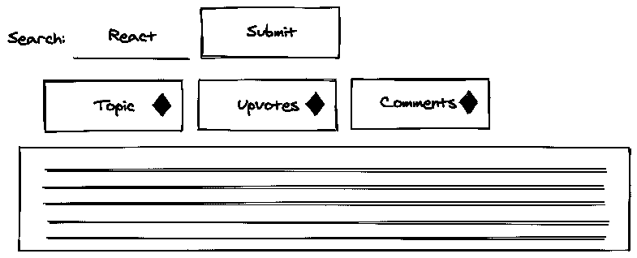

好了，让我们处理任务！我们将数据列表视为表格。每行代表列表的一个项，每列代表项目的一个属性。引入表头可以为用户提供关于每列的更多指导：

```javascript
const List = ({ list, onRemoveItem }) => (
  <ul>
    <li style={{ display: 'flex' }}>
      <span style={{ width: '40%' }}>标题</span>
      <span style={{ width: '30%' }}>作者</span>
      <span style={{ width: '10%' }}>评论</span>
      <span style={{ width: '10%' }}>积分</span>
      <span style={{ width: '10%' }}>操作</span>
    </li>

    {list.map((item) => (
      <Item
        key={item.objectID}
        item={item}
        onRemoveItem={onRemoveItem}
      />
    ))}
  </ul>
);
```

`src/App.jsx`

我们正在使用内联样式来实现最基本的布局。为了让表头与行对齐，给 `Item` 组件中的行也设置一个布局。


```javascript
const Item = ({ item, onRemoveItem }) => (
  <li style={{ display: 'flex' }}>
    <span style={{ width: '40%' }}>
      <a href={item.url}>{item.title}</a>
    </span>
    <span style={{ width: '30%' }}>{item.author}</span>
    <span style={{ width: '10%' }}>{item.num_comments}</span>
    <span style={{ width: '10%' }}>{item.points}</span>
    <span style={{ width: '10%' }}>
      <button type="button" onClick={() => onRemoveItem(item)}>
        Dismiss
      </button>
    </span>
  </li>
);
```

### `src/App.jsx`

在持续的实现过程中，我们将移除 `style` 属性，因为它占据了大量空间并弄乱了实际实现逻辑（因此将其提取到适当 CSS 中）。但我鼓励你自己保留它。

`List` 组件将处理新的排序状态。这也可以在 `App` 组件中完成，但归根结底只有 `List` 组件需要它，因此我们可以将状态直接提升到该组件。排序状态初始化为 `'NONE'` 状态，因此列表项按照它们从 API 获取的顺序进行显示。此外，我们为添加一个新的处理器，通过特定的排序键来设置排序状态：

```javascript
const List = ({ list, onRemoveItem }) => {
  const [sort, setSort] = React.useState('NONE');

  const handleSort = (sortKey) => {
    setSort(sortKey);
  };

  return (
    ...
  );
};
```

### `src/App.jsx`

在 `List` 组件的页头中，按钮可以帮助我们为每一列/属性设置排序状态。使用内联处理函数来传入特定的排序键（`sortKey`）。当点击“标题（Title）”列的按钮时，`'TITLE'` 将成为新的排序状态：

```javascript
const List = ({ list, onRemoveItem }) => {
  ...

  return (
    <ul>
      <li>
        <span>
          <button type="button" onClick={() => handleSort('TITLE')}>
            Title
          </button>
        </span>
        <span>
          <button type="button" onClick={() => handleSort('AUTHOR')}>
            Author
          </button>
        </span>
        <span>
          <button type="button" onClick={() => handleSort('COMMENT')}>
            Comments
          </button>
        </span>
        <span>
          <button type="button" onClick={() => handleSort('POINT')}>
            Points
          </button>
        </span>
        <span>Actions</span>
      </li>

      {list.map((item) => ... )}
    </ul>
  );
};
```

### `src/App.jsx`

新功能的状态管理已经实现，但当我们点击按钮时，还没有看到任何变化。这是因为排序机制还没有应用到实际的 `list` 上。用 JavaScript 排序数组并不是易的，因为每个 JavaScript 原始类型（例如字符串、布尔值、数字）在数组排序时都会遇到边缘情况。我们将使用一个名为 `Lodash` 的库来解决这个问题，它提供了许多 JavaScript 函数（例如 `sortBy`）。首先，在命令行中安装它：

```bash
npm install lodash
```

### 命令行

其次，在文件顶部导入用于排序的实用函数：

```javascript
import * as React from 'react';
import axios from 'axios';
import { sortBy } from 'lodash';

...
```

### `src/App.jsx`

第三，创建一个 JavaScript 对象（也称为字典），包含所有可能的 `sortKey` 和排序函数。每个特定的排序键映射到一个对传入的 `list` 进行排序的函数。按 `'NONE'` 排序返回未排序的列表；按 `'POINT'` 排序返回按 `points` 属性排序的列表，依此类推：

```javascript
const SORTS = {
  NONE: (list) => list,
  TITLE: (list) => sortBy(list, 'title'),
  AUTHOR: (list) => sortBy(list, 'author'),
  COMMENT: (list) => sortBy(list, 'num_comments').reverse(),
  POINT: (list) => sortBy(list, 'points').reverse(),
};

const List = ({ list, onRemoveItem }) => {
  ...
};
```

### `src/App.jsx`

有了 `sort` (`sortKey`) 状态和所有可能的排序变体（`SORTS`），我们可以在映射 之前对列表进行排序：

```javascript
const List = ({ list, onRemoveItem }) => {
  const [sort, setSort] = React.useState('NONE');

  const handleSort = (sortKey) => {
    setSort(sortKey);
  };

  const sortFunction = SORTS[sort];
  const sortedList = sortFunction(list);

  return (
    <ul>
      ...
      {sortedList.map((item) => (
        <Item
          key={item.objectID}
          item={item}
          onRemoveItem={onRemoveItem}
        />
      ))}
    </ul>
  );
};
```

### `src/App.jsx`

任务完成，这里是回顾：首先，我们从中提取了排序函数；然后，我们在 map 之前对列表进行排序。

#### 练习：

-   考虑 `sortKey` 状态反转。
-   使用 `isReverse` 状态来切换正序和反序。
-   根据 `sortKey` 状态设置反转。
-   在 `handleSort` 处理器中实现反转逻辑。
-   了解更多关于 `Lodash`。
-   关于 `points` 和 `num_comments` 的排序状态。


反序排序现在可以运行！恭喜你，你现在拥有了一个可以完全排序的列表。顺便说一下：对于传递给状态更新函数的对象，我们使用了所谓的`简写对象初始化表示法`：

```javascript
const firstName = 'Robin';

const user = {
  firstName: firstName,
};

console.log(user);
// { firstName: "Robin" }
```

Code Playground

当对象中的属性名与你的变量名相同时，你可以省略键值对，直接写名称即可：

```javascript
const firstName = 'Robin';

const user = {
  firstName,
};

console.log(user);
// { firstName: "Robin" }
```

Code Playground

如有必要，请阅读更多关于[JavaScript 对象初始化器](https://mzl.la/2XuN651)的知识。

## 练习

*   将你的源代码与作者的[源代码](https://bit.ly/3S3Do1C) 进行对比。
    *   回顾本节中所有的[源代码更改](https://bit.ly/490Eimw)。
*   考虑将排序状态保留在 `List` 组件而不是 `App` 组件中的缺点。如果你不知道，可以尝试按“标题”排序列表，然后搜索其他故事。如果排序状态在 `App` 组件中，会有什么不同？
*   运用你的样式技巧，为用户提供当前激活排序及其反转状态的反馈。可以在每个激活的排序按钮旁边放置一个向上或向下的箭头 SVG 图。
*   可选：[为本节提供反馈](https://forms.gle/ZoJSHFJf2swcBHXM6)。

## 记住上次搜索

**任务：** 记住最后五个命中 API 的搜索词，并提供一个按钮以便在搜索之间快速切换。点击按钮时，应重新获取该搜索词的故事。

**可选提示：**

*   不要为此功能使用新的状态。相反，复用 `url` 状态和 `setUrl` 状态更新函数来从 API 获取故事。将它们适配为包含多个 `urls` 的状态，并使用 `setUrls` 设置多个 `urls`。可以使用 `urls` 中的最后一个 URL 来获取数据，并使用 `urls` 中的最后五个 URL 来显示按钮。

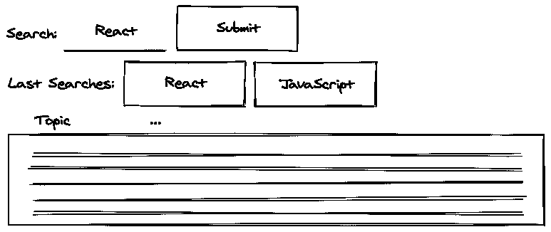

让我们开始吧。首先，我们将所有的 `url` 状态重构为 `urls` 状态，并将所有的 `setUrl` 重构为 `setUrls` 状态更新函数。不要使用字符串类型的 `url` 初始化状态，而是将其创建一个数组，并将初始 `url` 作为其唯一的元素：

```javascript
const App = () => {
  ...

  const [urls, setUrls] = React.useState([
    `${API_ENDPOINT}${searchTerm}`,
  ]);

  ...
};
```

`src/App.jsx`

其次，不再使用当前的 `url` 状态进行数据获取，而是使用 `urls` 数组中的最后一个 `url` 。如果 `urls` 列表中添加了另一个 `url`，则使用它来获取数据：

```javascript
const App = () => {

  ...

  const handleFetchStories = React.useCallback(async () => {
    dispatchStories({ type: 'STORIES_FETCH_INIT' });

    try {
      const lastUrl = urls[urls.length - 1];
      const result = await axios.get(lastUrl);

      dispatchStories({
        type: 'STORIES_FETCH_SUCCESS',
        payload: result.data.hits,
      });
    } catch {
      dispatchStories({ type: 'STORIES_FETCH_FAILURE' });
    }
  }, [urls]);

  ...
};
```

`src/App.jsx`

第三，不再将 `url` 字符串作为状态和状态更新函数存储，而是使用 `concat` 方法结合数组中的之前的 `urls` 拼接新的 `url` 以形成新状态：

```javascript
const App = () => {
  ...

  const handleSearchSubmit = (event) => {
    const url = `${API_ENDPOINT}${searchTerm}`;
    setUrls(urls.concat(url));

    event.preventDefault();
  };

  ...
};
```

`src/App.jsx`

每次搜索时，我们的 `urls` 状态中都会存储一个新的 URL。接下来，为最后五个 URL 中的每一个 渲染一个按钮。我们将为这些按钮包含一个新的通用处理程序，每个处理程序都通过一个更具体的内联处理程序传递特定的 `url`：

```javascript
const getLastSearches = (urls) => urls.slice(-5);

...

const App = () => {
  ...

  const handleLastSearch = (url) => {
    // do something
  };

  const lastSearches = getLastSearches(urls);

  return (
    <div>
      <h1>My Hacker Stories</h1>

      <SearchForm ... />

      {lastSearches.map((url) => (
        <button
          key={url}
          type="button"
          onClick={() => handleLastSearch(url)}
        >
          {url}
        </button>
      ))}

      ...
    </div>
  );
};
```

`src/App.jsx`

接下来，不要在按钮中通过按钮文本（button text）显示上次搜索的完整 URL，而是通过将 API 的端点替换为空字符串来仅显示搜索词：

```javascript
const extractSearchTerm = (url) => url.replace(API_ENDPOINT, '');

const getLastSearches = (urls) =>
  urls.slice(-5).map((url) => extractSearchTerm(url));

...

const App = () => {
  ...

  const lastSearches = getLastSearches(urls);

  return (
    <div>
      ...

      {lastSearches.map((searchTerm) => (
        <button
          key={searchTerm}
          type="button"
          onClick={() => handleLastSearch(searchTerm)}
        >
          {searchTerm}
        </button>
      ))}

      ...
    </div>
  );
};
```

`src/App.jsx`

```javascript
const getLastSearches = (urls) =>
  urls.slice(-5).map(extractSearchTerm);
```

`src/App.jsx`


* (1) 不要将当前搜索显示为按钮，仅显示之前的五个搜索。提示：适配 `getLastSearches` 函数。
* (2) 不要显示重复的搜索。搜索两次“React”不应创建两个不同的按钮。提示：适配 `getLastSearches` 函数。
* (3) 如果点击其中一个按钮，将 `SearchForm` 组件的输入字段值设置为上一次搜索词。

这五个渲染按钮的来源是 `getLastSearches` 函数。在那里，我们获取 `urls` 数组并返回其中的最后五项。现在，我们将修改此工具函数，通过删除最后一项来返回最后六项而不是五项，以便不将当前搜索显示为按钮。之后，只显示五个*之前的*的搜索作为按钮：

```javascript
const getLastSearches = (urls) =>
  urls
    .slice(-6)
    .slice(0, -1)
    .map(extractSearchTerm);
```

`src/App.jsx`

如果连续执行两次或多次相同的搜索，会出现重复按钮，这可能不是你想要的行为。如果相同的搜索是连续的，将它们合并为一个按钮是可以接受的。我们将在工具函数中解决这个问题。在将数组分为五个之前的搜索之前，对相同的搜索进行分组：

```javascript
const getLastSearches = (urls) =>
  urls
    .reduce((result, url, index) => {
      const searchTerm = extractSearchTerm(url);

      if (index === 0) {
        return result.concat(searchTerm);
      }

      const previousSearchTerm = result[result.length - 1];

      if (searchTerm === previousSearchTerm) {
        return result;
      } else {
        return result.concat(searchTerm);
      }
    }, [])
    .slice(-6)
    .slice(0, -1);
```

`src/App.jsx`

`reduce` 函数以空数组作为其 `result` 开始。第一次迭代将从第一个 `url` 提取的 `searchTerm` 拼接到 `result` 中。每个提取出的 `searchTerm` 都会与它的上一个进行比较。如果上一个搜索词与当前不同，则将 `searchTerm` 拼接到结果中。如果搜索词相同，则返回结果而不添加任何内容。

如果其中一个最后的搜索按钮被点击，则 `SearchForm` 组件的输入字段应设置为新的 `searchTerm`。我们可以使用用于 `SearchForm` 组件的特定值的状态更新函数来解决这个问题。

```javascript
const App = () => {
  ...

  const handleLastSearch = (searchTerm) => {
    setSearchTerm(searchTerm);

    handleSearch(searchTerm);
  };

  ...
};
```

`src/App.jsx`

最后，将此部分的新新渲染内容提取为一个独立组件，以保持 `App` 组件的轻量化：

```javascript
const App = () => {
  ...

  const lastSearches = getLastSearches(urls);

  return (
    <div>
      ...

      <SearchForm ... />

      <LastSearches
        lastSearches={lastSearches}
        onLastSearch={handleLastSearch}
      />

      <hr />

      ...
    </div>
  );
};

const LastSearches = ({ lastSearches, onLastSearch }) => (
  <>
    {lastSearches.map((searchTerm, index) => (
      <button
        key={searchTerm + index}
        type="button"
        onClick={() => onLastSearch(searchTerm)}
      >
        {searchTerm}
      </button>
    ))}
  </>
);
```

`src/App.jsx`

这个功能并不容易。完成它需要大量的 React 基础以及 JavaScript 知识。如果你在自己实现或遵循说明方面没有遇到问题，那么你已经很棒了。如果你遇到了其中一个问题，也不太担心。也许你甚至发现了解决此任务的其他方法，而且它可能比我在这里展示的要简单。

#### 练习：

* 将你的源代码与作者的[源代码](https://bit.ly/3SmzaDJ) 进行对比。
    * 回顾本部分所有的[源代码更改](https://bit.ly/48Jyuhp)。
* 阅读更多关于[JavaScript 中的分组](https://www.robinwieruch.de/javascript-groupby/) 的信息。
* 可选：[为此部分留下反馈](https://forms.gle/LhNVodZgu8qTqHhN6)。

### 分页获取 (Paginated Fetch)

通过 Hacker News API 搜索热门故事只是通向全功能搜索引擎的一步，有许多方法可以调整搜索。仔细查看数据结构并观察 [Hacker News API](https://hn.algolia.com/api) 如何返回不仅仅是 `hits` 列表的内容。具体来说，它返回的是一个分页列表。`page` 属性在第一个响应中为 `0`，可以用于获取更多分页列表作为结果。你只需要向 API 传递相同搜索词的下一页即可。

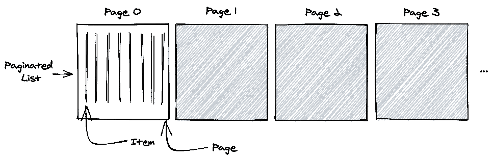

以下展示了如何使用 Hacker News 数据结构实现分页获取。如果你习惯其他应用程序中的**分页**，你脑海中可能有一行从 1 到 10 的按钮——其中当前选定的页面高亮显示 1-[3]-10，点击其中一个按钮会跳转到相应页面。


## 实现分页

接下来，Hacker News API 返回的结果为我们交付了 `page` 数据：

```javascript
const App = () => {
  ...

  const handleFetchStories = React.useCallback(async () => {
    dispatchStories({ type: 'STORIES_FETCH_INIT' });

    try {
      const lastUrl = urls[urls.length - 1];
      const result = await axios.get(lastUrl);

      dispatchStories({
        type: 'STORIES_FETCH_SUCCESS',
        payload: {
          list: result.data.hits,
          page: result.data.page,
        },
      });
    } catch {
      dispatchStories({ type: 'STORIES_FETCH_FAILURE' });
    }
  }, [urls]);

  ...
};
```

`src/App.jsx`

我们需要存储这些数据以便以便后进行分页获取：

```javascript
const storiesReducer = (state, action) => {
  switch (action.type) {
    case 'STORIES_FETCH_INIT':
      ...
    case 'STORIES_FETCH_SUCCESS':
      return {
        ...state,
        isLoading: false,
        isError: false,
        data: action.payload.list,
        page: action.payload.page,
      };
    case 'STORIES_FETCH_FAILURE':
      ...
    case 'REMOVE_STORY':
      ...
    default:
      throw new Error();
  }
};

const App = () => {
  ...

  const [stories, dispatchStories] = React.useReducer(
    storiesReducer,
    { data: [], page: 0, isLoading: false, isError: false }
  );

  ...
};
```

`src/App.jsx`

使用新的 `page` 参数扩展 API 端点。这一更改在我们之前从 URL 中提取提取术语时进行的过早优化中已经得到了支持：

```javascript
const API_BASE = 'https://hn.algolia.com/api/v1';
const API_SEARCH = '/search';
const PARAM_SEARCH = 'query=';
const PARAM_PAGE = 'page=';

// 注意：注意中间的 ? 和 &
const getUrl = (searchTerm, page) =>
  `${API_BASE}${API_SEARCH}?${PARAM_SEARCH}${searchTerm}&${PARAM_PAGE}${page}`;
```

`src/App.jsx`

接下来，我们必须通过传递 `page` 参数来调整所有的 `getUrl` 调用。由于初始搜索和最后搜索总是获取第一页 (`0`)，我们将此页码作为参数传递给函数，以检索相应的 URL：

```javascript
const App = () => {
  ...

  const [urls, setUrls] = React.useState([getUrl(searchTerm, 0)]);

  ...

  const handleSearch = (searchTerm, page) => {
    const url = getUrl(searchTerm, page);
    setUrls(urls.concat(url));
  };

  const handleSearchSubmit = (event) => {
    handleSearch(searchTerm, 0);

    event.preventDefault();
  };

  const handleLastSearch = (searchTerm) => {
    setSearchTerm(searchTerm);

    handleSearch(searchTerm, 0);
  };

  ...
};
```

`src/App.jsx`

为了在点击按钮时获取下一页，我们需要在这个新的处理函数中增加 `page` 参数：

```javascript
const App = () => {
  ...

  const handleMore = () => {
    const lastUrl = urls[urls.length - 1];
    const searchTerm = extractSearchTerm(lastUrl);
    handleSearch(searchTerm, stories.page + 1);
  };

  ...

  return (
    <div>
      ...

      {stories.isLoading ? (
        <p>Loading ...</p>
      ) : (
        <List list={stories.data} onRemoveItem={handleRemoveStory} />
      )}

      <button type="button" onClick={handleMore}>
        More
      </button>
    </div>
  );
};
```

`src/App.jsx`

我们已经使用动态 `page` 参数实现了数据获取。初始搜索和最后搜索总是使用第一页，而每次使用新的“更多”按钮进行获取都会使用递增的页码。但在尝试该功能时发现了一个关键 Bug：新的获取并没有扩展之前的列表，而是完全替换了它。

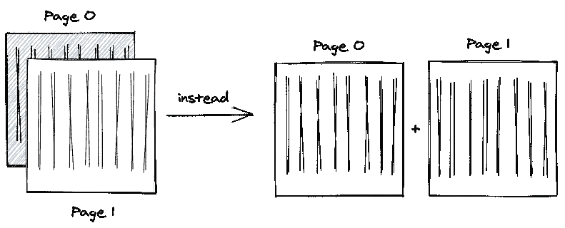

我们在 reducer 中解决了这个问题，避免用用 `data` 替换当前的 `data`，而是对分页列表进行合并：

```javascript
const storiesReducer = (state, action) => {
  switch (action.type) {
    case 'STORIES_FETCH_INIT':
      ...
    case 'STORIES_FETCH_SUCCESS':
      return {
        ...state,
        isLoading: false,
        isError: false,
        data:
          action.payload.page === 0
            ? action.payload.list
            : state.data.concat(action.payload.list),
        page: action.payload.page,
      };
    case 'STORIES_FETCH_FAILURE':
      ...
    case 'REMOVE_STORY':
      ...
    default:
      throw new Error();
  }
};
```

`src/App.jsx`

在使用新按钮获取更多数据后，显示的列表增长了。然而，仍然存在影响用户体验的闪烁。在获取分页数据时，列表会消失，因为加载指示会在请求完成后出现并再次出现。

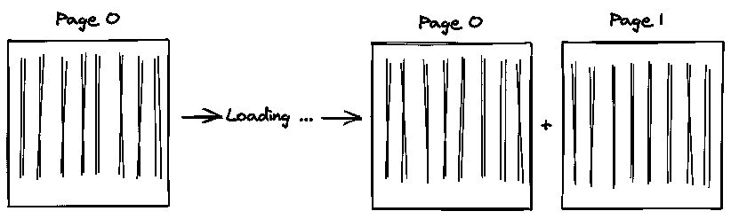

理想的行为是渲染列表（开始时是空列表），并仅在后续请求时用加载指示器替换“更多”按钮。这是当任务从单个列表演变为分页列表时，一种常见的 UI 重构方式：

```javascript
const App = () => {
  ...

  return (
    <div>
      ...

      <List list={stories.data} onRemoveItem={handleRemoveStory} />

      {stories.isLoading ? (
        <p>Loading ...</p>
      ) : (
        <button type="button" onClick={handleMore}>
          More
        </button>
      )}
    </div>
  );
};
```

`src/App.jsx`

现在可以获取热门故事的持续数据了。在使用第三方 API 时，探索其 API 始终是一个好主意。每个远程 API 返回的数据结构不同，因此其功能也不同。

#### 练习：

* 将你的源代码与作者的[源代码](https://github.com/example) 进行对比。
* 回顾本节的[源代码更改](https://github.com/example)。
* 回顾 [Hacker News API](https://hn.algolia.com/)：是否可以通过向端点添加参数来获取列表中的更多项目？
* 如果不是使用“更多”按钮，你会如何实现无限滚动？与其点击按钮获取下一页，无限滚动可以获取下一页吗？
* 可选：[为本节提供反馈](https://forms.gle/example)。


系统将提供一个 URL，用于访问您经过优化、打包并托管的应用程序。它通过本地 IP 地址发送，该地址可以在您的局域网上可用，这意味着我们正在我们的本地机器上托管该应用程序。

## 练习题

*   可选：[为本节提供反馈](https://forms.gle/hFsut8q7eYsWfYL7A)。

## 部署到 Firebase

在我们用 React 构建好一个功能完整的应用程序之后，最后一步是部署。这是将您的想法推向世界的转折点，从学习编程到生产应用程序。我们将使用 Firebase Hosting 进行部署。

Firebase 适用于 React，也适用于 Angular 和 Vue 等大多数库和框架。首先，全局安装 Firebase CLI 到 node 模块中：

```bash
npm install -g firebase-tools
```

### 命令行

使用全局安装的 Firebase CLI 让我们可以在不担心项目依赖的情况下部署应用程序。对于任何全局安装的 node 包，请记住在需要时使用相同的命令更新到新版本：

```bash
npm install -g firebase-tools
```

### 命令行

如果您还没有 Firebase 项目，请注册 [Firebase 账号](https://console.firebase.google.com)并在那里创建一个新项目。然后您可以将 Firebase CLI 与 Firebase 账号（Google 账号）关联

```bash
firebase login
```

### 命令行

命令行将显示一个 URL，您可以在浏览器中打开它，或者 Firebase CLI 会自动打开它。选择一个 Google 账号来创建 Firebase 项目，并赋予 Google 必要的权限。返回命令行验证登录成功。接下来，移动到项目文件夹并执行以下命令，为 Firebase 托管功能初始化 Firebase 项目：

```bash
firebase init
```

### 命令行

然后选择 Hosting 选项。如果您兴趣在使用 Firebase Hosting 之外使用其他工具，请添加其他选项：

```bash
? Which Firebase features do you want to set up for this directory?
 ◯ Firestore: 配置 Firestore 的安全规则和索引文件
 ◯ Functions: 配置 Cloud Functions 目录及其文件
❯◯ Hosting: 配置 Firebase Hosting 的文件 ...
 ◯ Hosting: 设置 GitHub Action 部署
 ◯ Storage: 为 Cloud Storage 配置安全规则文件
```

### 命令行

登录后，Google 将能够识别到与该账号关联的所有 Firebase 项目。但是，对于此项目，我们将从 Firebase 平台上的一个新项目开始：

```bash
First, let's associate this project directory with a Firebase project.
You can create multiple project aliases by running firebase use --add,
but for now we'll just set up a default project.

? Please select an option:
  Use an existing project
❯ Create a new project
  Add Firebase to an existing Google Cloud Platform project
  Don't set up a default project
```

### 命令行

还有其他配置步骤需要定义。我们不想使用默认的 `public/*` 文件夹，而是想使用 Vite 的 `dist/*` 文件夹。或者如果您自己使用 Webpack 等工具设置打包，可以选择构建构建名称：

```bash
? What do you want to use as your public directory? dist
? Configure as a single-page app (rewrite all urls to /index.html)? Yes
? Set up automatic builds and deploys with GitHub? No
✔  Wrote dist/index.html
```

### 命令行

`dist/index.html` 已创建。


### 状态管理
在这次学习体验中，你仅使用了 React 来管理本地组件状态。对于大多数应用程序来说，这是一个良好的开始，但 React 也有外部状态管理解决方案。我在我的书籍[“The Road to Redux”](https://www.roadtoredux.com/)中探讨了最流行的一种。

### 使用 Webpack 和 Babel 的工具链
我们在本书中使用 `Vite` 来搭建应用程序。在未来的某个时刻，你可能想学习围绕它相关的工具链，以便在不使用 `Vite` 的情况下创建项目。我推荐使用 [Webpack](https://www.robinwieruch.de/minimal-react-webpack-babel-setup/) 进行最小化配置，之后你可以应用额外的工具。

### 代码组织
回想一下关于代码组织的章节，如果你还没有这样做的话，请应用这些更改。这将帮助你将组件组织到结构化的文件和文件夹中，并帮助你理解代码分割、可重用性、可维护性和模块 API 设计的原则。你的应用程序最终增长并需要结构化的模块；因此，现在开始更好。

### 测试
我们仅对测试进行了浅尝。。如果你不熟悉 Web 应用程序的测试，可以[深入研究单元测试和集成测试](https://www.robinwieruch.de/react-testing-tutorial/)，特别是使用 React Testing Library 进行单元/集成测试，以及使用 Cypress 进行 React 的端到端测试。

### 类型检查
我们之前在 React 中使用了 TypeScript，这是防止 Bug 和提高开发者体验的良好实践。深入研究这个主题可以使你的 JavaScript 应用程序更加健壮。也许你最终会从头到使用 TypeScript 代替 JavaScript。

### UI 组件
许多初学者在项目中过早地引入了 Material UI 等 UI 组件库。在 React 中使用标准的 HTML 元素来实现 `dropdown`、`checkbox` 或 `dialog` 会更具实用性。这些组件大部分将管理它们自己的本地状态。`checkbox` 必须知道自己是被选中还是未选中的，因此你应该将它们实现为受控组件（controlled components）。在你掌握了这些关键 UI 组件的基础实现后，引入 UI 组件库应该变得更加容易。

### React Native
[React Native](https://facebook.github.io/react-native/) 将你的应用程序带到 iOS 和 Android 等移动设备。一旦你掌握了 React，React Native 的学习曲线就不应该那么陡峭，因为它们共享相同的原理。与移动设备的唯一区别在于布局组件、构建工具以及你移动设备的 API。

我邀请你访问我的[网站](https://www.robinwieruch.de) 寻找更多关于 Web 开发和软件工程的趣味话题。你也可以[订阅我的事通讯](https://rwieruch.substack.com/)或关注我的 [Twitter 页面](https://twitter.com/rwieruch) 以获取文章、书籍和课程的更新。如果你只有这本书并想扩展到课程，请查看官方的[课程网站](https://www.roadtoreact.com/)。

感谢阅读 Road to React。

顺颂商祺，

Robin Wieruch

