# 终极 JavaScript 手册：编码、调试与优化


**关于作者**

Mike Zephalon 出于加拿大多伦多，从小就对技术和编程产生了浓厚兴趣。他的编程之旅始于青少年时期，当时他尝试简单的脚本并探索 Web 开发的无限可能。Mike 在多伦大学学习期间，主修计算机科学。

在大学期间，他对 JavaScript 产生了深厚的兴趣，并被其在构建动态交互式 Web 应用程序方面的多功能和强大所吸引。

多年来，Mike 曾在多家科技初创公司和企业工作，并在那里磨练了作为前端开发者的技能。他对精通 JavaScript 及其框架的投入使其成为开发者社区中备受尊敬的声音。通过他的书籍和教程，Mike 旨在赋能新手和资深开发者，帮助他们在项目中充分释放 JavaScript 的全部潜力。

## 1. JavaScript 简介：入门指南

**简介**

JavaScript 是 Web 的核心技术之一，与 HTML 和 CSS 并列。它允许开发者创建交互性和动态内容，增强网站和 Web 应用程序的用户体验。无论你是编程新手还是刚开始接触 JavaScript，本指南都将帮助你理解基础知识，并让你开始编写第一个脚本。

**什么是 JavaScript？**

JavaScript 是一种高级的解释型编程语言，使你在网页上实现复杂的功能，如交互式表单、动画和实时内容更新。它功能强大，既可以用于前端开发也可以用于后端开发。

**为什么要学习 JavaScript？**

- **无处不在**：JavaScript 无处不在，从浏览器到服务器（Node.js）。
- **需求**：就业市场对 JavaScript 开发人员需求巨大。
- **社区**：拥有庞大且活跃的社区和丰富的资源。
- **多功能性**：可用于各种应用程序，包括 Web、移动端甚至游戏开发。

**环境搭建**

在开始编码之前，你需要设置开发环境。

**文本编辑器**

选择一个文本编辑器来编写代码。流行的选项包括：
- Visual Studio Code
- Sublime Text
- Atom
- Visual Studio Code
- Sublime Text
- Atom
- Web Browser（浏览器）
- Google Chrome
- Firefox
- Safari
- Microsoft Edge

**JavaScript 基础概念**

理解 JavaScript 的概念至关重要。

**变量**

变量存储数据。

```javascript
let name = "John";
const age = 25;
var isStudent = true;
```

**数据类型**

JavaScript 支持多种数据类型：
- 字符串（String）
- 数字（Number）
- 布尔值（Boolean）
- 对象（Object）

**运算符**

运算符用于对变量执行操作：
- 算术运算符：+ - * / %
- 比较运算符：== === != > < <=
- 逻辑运算符：&& || !
- 赋值运算符：= += -= *=

**函数**

函数是执行特定任务的可用代码块。

```javascript
function greet(name) {
  return "Hello, " + name;
}
console.log(greet("John")); // 输出：Hello, John
```

**控制结构**

控制结构管理程序的流程。

**条件语句**

```javascript
if (condition) {
  // 当条件为真时执行
} else if (anotherCondition) {
  // 当另一个条件为真时执行
} else {
  // 当所有条件都为假时执行
}
```

**循环**

循环多次执行某块代码。

**for 循环**：

```javascript
for (let i = 0; i < 5; i++) {
  console.log(i);
}
```

**while 循环**：

```javascript
let i = 0;
while (i < 5) {
  console.log(i);
  i++;
}
```

**操作 DOM**

文档对象模型（DOM）是 HTML 和 XML 文档的编程接口。它表示页面，以便程序更改文档结构、样式和内容。

**选择元素**

要与 DOM 交互，你需要选择想要操作的元素。

```javascript
let element = document.getElementById("myElement");
let elements = document.getElementsByClassName("myClass");
let tags = document.getElementsByTagName("div");
```

**修改元素**

一旦选择了元素，就可以修改其内容或属性。

```javascript
element.innerHTML = "新内容";
element.style.color = "red";
element.setAttribute("class", "newClass");
```

**事件处理**

JavaScript 可以通过事件监听器对点击、输入或滚动等用户操作做出响应。

```javascript
element.addEventListener("click", function() {
  alert("元素被点击了!");
});
```

**编写你的第一个 JavaScript 程序**

让我们创建一个根据用户交互更改内容的简单 Web 页面。

**HTML 结构**

从基础 HTML 开始：

```html
<!DOCTYPE html>
<html lang="en">
<head>
<meta charset="UTF-8">
<meta name="viewport" content="width=device-width, initial-scale=1.0">
<title>JavaScript Example</title>
</head>
<body>
<h1 id="title">Welcome to JavaScript</h1>
<button id="changeTitle">Change Title</button>
<script src="script.js"></script>
</body>
</html>
```

**添加 JavaScript**

在你的`script.js`文件中：

```javascript
let button = document.getElementById("changeTitle");

button.addEventListener("click", function() {
  let title = document.getElementById("title");
  title.innerHTML = "Title Changed!";
  title.style.color = "blue";
});
```

此脚本会在点击按钮时更改标题的文本内容和颜色。

**测试你的程序**

在浏览器中打开你的 HTML 文件并点击按钮。你应该能看到标题变为蓝色的“Title Changed!”。

**调试与最佳实践**

编写代码只是开始；调试和遵循最佳实践对于维护代码质量至关重要。

**调试**

使用浏览器开发者工具来调试你的代码。常见技术包括：
- **console.log()**：向控制台打印消息以跟踪变量值。
- **断点**：在 DevTools 的 Sources 标签页中设置，以暂停代码执行并检查值。

**最佳实践**

- **编写整洁的代码**：使用有意义的变量名、一致的缩进和注释。
- **模块化代码**：将你的代码拆分为较小的、可重用的函数。
- **避免全局变量**：限制全局变量的使用以避免冲突。
- **定期测试**：在编写代码时进行测试以及早发现错误。
- **持续学习**：JavaScript 在不断演进；保持关注新功能和实践。

**下一步**

恭喜你！你已经编写了第一个 JavaScript 程序并学习了基础知识。在你继续学习的过程中，请考虑探索以下主题：
- **高级 JavaScript 概念**：Promises、async/await、闭包等。
- **JavaScript 框架**：用于构建复杂应用的 React、Angular、Vue.js。
- **Node.js**：用于服务器端 JavaScript 和构建后端服务。
- **APIs**：学习如何与 API 交互并动态获取数据。

**JavaScript 语法与最佳实践**

在深入学习 JavaScript 之前，理解语法和一些编写整洁、高效且可维护代码的最佳实践至关重要。

**JavaScript 语法**

JavaScript 语法是定义如何构建 JavaScript 程序的规则集。快速回顾：
- **大小写敏感**：JavaScript 是大小写敏感，这意味着`myVariable`和`myvariable`被视为不同的变量。
- **分号**：虽然语句末尾的分号（`;`）是可选的，但包含分号是一个良好习惯，可以避免在压缩或合并代码时出现潜在问题。

```javascript
let a = 10; // Good practice
let b = 20 // 可能导致问题
```

- **注释**：注释对于解释你的代码至关重要，JavaScript 引擎会忽略它们。

```javascript
// 这是一个单行注释
/*
这是一个多行注释
*/
```

- **空白符**：JavaScript 会忽略额外的空白符，使其在格式方面非常灵活。然而，一致地使用空白符可以提高代码的可读性。

```javascript
let sum = a + b; // 更可读
let sum=a+b; // 可读性差
```

**命名规范**

遵循一致的命名规范使你的代码更容易于理解和维护：
- **驼峰法（Camel Case）**：用于变量和函数名（例如`myVariable`、`calculateTotal`）。
- **大驼峰法（Pascal Case）**：通常用于类名（例如`UserAccount`、`ShoppingCart`）。
- **大写**：用于常量（例如`MAX_LIMIT`、`PI`）。

**代码结构与模块化**

将代码组织成较小的可重用模块是维护大型代码库的关键。使用函数和对象来封装逻辑：

```javascript
function calculateArea(width, height) {
  return width * height;
}

let rectangle = {
  width: 5,
  height: 10,
  area: function() {
    return this.width * this.height;
  }
};

console.log(calculateArea(rectangle.width, rectangle.height)); // 使用函数
console.log(rectangle.area()); // 使用对象方法
```

**错误处理**

JavaScript 提供了优雅处理错误的机制，防止你的程序意外崩溃。

**Try-Catch-Finally**

`try-catch-finally`结构允许你以受控的方式处理异常。

```javascript
try {
  let result = riskyOperation();
  console.log(result);
} catch (error) {
  console.error("发生了一个错误:", error.message);
} finally {
  console.log("无论成功失败，这始终都会执行。");
}
```

- **try**：包含可能抛出错误的代码。
- **catch**：处理 try 块中发生的任何错误。
- **finally**：无论是否发生错误，都会在 try 和 catch 之后执行代码。

**避免常见陷阱**

- **== vs. ===**：使用`===`进行严格相等比较，因为它同时检查值和类型，而`==`执行类型转换。

```javascript
console.log(2 == "2"); // true
console.log(2 === "2"); // false
```

- **全局变量**：避免声明全局变量以防止冲突。

**使用 let, const, 和 var**

理解`let`、`const`和`var`区别至关重要。
- **let**：块作用域，可以更新但不能重新声明。
- **const**：块作用域，且不能更新。
- **var**：函数作用域，可以在作用域内重新声明，可能会导致问题。

```javascript
let x = 10;
if (true) {
  let x = 20;
}
console.log(x); // 10

const PI = 3.14;
// PI = 3.14159; // Error：赋值给常量

var y = 10;
if (true) {
  var y = 20;
}
console.log(y); // 20
```

**高级概念**

一旦你熟悉了基础知识，就可以探索更高级的 JavaScript 概念了，这些将增强你的编程能力。

**对象与原型**

JavaScript 是一种面向对象的语言，这意味着你可以创建对象来表示现实世界的实体。

**创建对象**

在 JavaScript 中创建对象有多种方法：
- **对象字面量**：

```javascript
let car = {
  make: "Toyota",
  model: "Corolla",
  year: 2020,
  start: function() {
    console.log("汽车正在启动.");
  }
};
car.start(); // 汽车正在启动。
```

- **构造函数**：

```javascript
function Car(make, model, year) {
  this.make = make;
  this.model = model;
  this.year = year;
}
let myCar = new Car("Honda", "Civic", 2019);
console.log(myCar.make); // Honda
```

- **类（Classes）**（引入于 ES6）：

```javascript
class Car {
  constructor(make, model, year) {
    this.make = make;
    this.model = model;
    this.year = year;
  }
  start() {
    console.log(`${this.make} 正在启动.`);
  }
}
let myCar = new Car("Ford", "Mustang", 2021);
myCar.start(); // Ford 正在启动。
```

**原型**

每个 JavaScript 对象都有一个原型，原型也是一个对象。原型允许对象从其他对象继承属性和方法。

```javascript
function Animal(name) {
  this.name = name;
}
Animal.prototype.speak = function() {
  console.log(`${this.name} 发出了声音.`);
};

let dog = new Animal("Dog");
dog.speak(); // 狗叫。
```

**异步 JavaScript**

JavaScript 是单线程的，这意味着它一次只能执行一个操作。然而它可以处理异步操作，允许你执行如从服务器获取数据等任务，而不会冻结界面。

**回调**

回调函数作为参数传递给另一个函数，该函数会在任务完成后被执行。

```javascript
function fetchData(callback) {
  setTimeout(() => {
    console.log("数据获取完成.");
    callback();
  }, 1000);
}
```

}, 2000);

}

function processData() {

  console.log("Processing data...");

}

fetchData(processData);

## Promises

Promises（承诺）提供了一种更简洁的方式来处理异步操作，对代码流提供了更多的控制。

let promise = new Promise((resolve, reject) => {

  let success = true;

  if (success) {

    resolve("Operation successful");

  } else {

    reject("Operation failed");

  }

});

promise

  .then((message) => {

    console.log(message);

  })

  .catch((error) => {

    console.error(error);

});

## Async/Await

async/await 是构建在 Promises 之上的语法糖，使得异步代码更容易读和易写。

async function fetchData() {

  try {


```javascript
let response = await fetch("https://api.example.com/data");

let data = await response.json();

console.log(data);

} catch (error) {

  console.error("Error fetching data:", error);

}

}

fetchData();
```

## ES6 and Beyond

ECMAScript 6 (ES6)，也称为 ECMAScript 2015，引入了若干项让 JavaScript 现代化的功能：

- **箭头函数（Arrow Functions）**：编写函数的简洁语法。

  ```javascript
  const add = (a, b) => a + b;

  console.log(add(2, 3)); // 5
  ```

- **模板字符串（Template Literals）**：简化的字符串插值。

  ```javascript
  let name = "John";

  console.log(`Hello, ${name}!`); // Hello, John!
  ```

- **解构（Destructuring）**：从数组或对象中提取值到不同的变量中。

  ```javascript
  let person = { name: "Alice", age: 30 };

  let { name, age } = person;

  console.log(name); // Alice
  ```

- **模块（Modules）**：将代码组织到单独的文件并导出或导入功能。

  ```javascript
  // 在 math.js 中

  export const PI = 3.14;

  // 在 main.js 中

  import { PI } from './math.js';

  console.log(
  ```

看来你已经决定开始学习 JavaScript。极佳的选择！

JavaScript 是一种编程语言，可以用于应用程序的服务器端和客户端。应用程序的服务器端是运行在数据中心计算机上并与数据库交互的后端逻辑，而客户端则是运行在用户设备上的程序，对于 JavaScript 来说，通常是浏览器。

你很有用过用 JavaScript 编写的功能。如果你用过网络浏览器，如 Chrome、Firefox、Safari 或 Edge，那么你一定用过。JavaScript 遍布整个网络。当你进入一个网页，它要求你接受 cookie 而你点击了“确定”时，弹出窗口就消失了。这就是 JavaScript 在作用。如果你在浏览网站时弹出一个子菜单，那意味着有更多的 JavaScript。通常，当你在网店筛选产品时，这涉及到 JavaScript。还有那些在你在网站上停留几秒钟后就开始与你对话的聊天窗口呢？嗯，你猜对了——就是 JavaScript！

我们与网页的几乎任何交互都是因为 JavaScript；你点击的按钮、你创建的生日卡片，以及你正在进行的计算。任何比静态网页更复杂的功能都需要 JavaScript。

## 开始学习 JavaScript

- 使用浏览器控制台
- 在网页中添加 JavaScript
- 编写 JavaScript 代码

### 为什么要学习 JavaScript？

有许多理由你可能想学习 JavaScript。

JavaScript 起于 1995 年，通常被认为是最广泛使用的编程语言。这是因为 JavaScript 是网络浏览器支持并理解的语言。如果你有一个网络浏览器和一个文本编辑器，那么你的计算机上已经安装了解释它所需的一切内容。

然而，有更好的配置，我们将在本章稍后讨论这些。

对于初学者来说，这是一个非常棒的编程语言，大多数高级软件开发者至少知道一些 JavaScript，因为他们会在某个时候遇到它。出于许多原因，JavaScript 对初学者来说是一个很好的选择。第一个原因是，你可以比想象中更早地使用 JavaScript 构建非常酷的应用。通过循环，你将能够编写与用户交互的相当复杂的脚本。在书结束时，你将能够

看来你已经决定开始学习 JavaScript。极佳的选择！

JavaScript 是一种编程语言，可以用于应用程序的服务器端和客户端。应用程序的服务器端是运行在数据中心计算机上并与数据库交互的后端逻辑，而客户端则是运行在用户设备上的程序，对于 JavaScript 来说，通常是浏览器。

你很有用过用 JavaScript 编写的功能。如果你用过网络浏览器，如 Chrome、Firefox、Safari 或 Edge，那么你一定用过。JavaScript 遍布整个网络。当你进入一个网页，它要求你接受 cookie 而你点击了“确定”时，弹出窗口就消失了。这就是 JavaScript 在作用。如果你在浏览网站时弹出一个子菜单，那意味着有更多的 JavaScript。通常，当你在网店筛选产品时，这涉及到 JavaScript。还有那些在你在网站上停留几秒钟后就开始与你对话的聊天窗口呢？嗯，你猜对了——就是 JavaScript！

我们与网页的几乎任何交互都是因为 JavaScript；你点击的按钮、你创建的生日卡片，以及你正在进行的计算。任何比静态网页更复杂的功能都需要 JavaScript。

## 开始学习 JavaScript

- 使用浏览器控制台
- 在网页中添加 JavaScript
- 编写 JavaScript 代码

### 为什么要学习 JavaScript？

有许多理由你可能想学习 JavaScript。

JavaScript 起于 1995 年，通常被认为是最广泛使用的编程语言。这是因为 JavaScript 是网络浏览器支持并理解的语言。如果你有一个网络浏览器和一个文本编辑器，那么你的计算机上已经安装了解释它所需的一切内容。

然而，有更好的配置，我们将在本章稍后讨论。

对于初学者来说，这是一个非常棒的编程语言，大多数高级软件开发者至少知道一些 JavaScript，因为他们会在某个时候遇到它。出于许多原因，JavaScript 对初学者来说是一个很好的选择。第一个原因是，你可以比想象中更早地使用 JavaScript 构建非常酷的应用。通过循环，你将能够编写与用户交互的相当复杂的脚本。在书结束时，你将能够

看来你已经决定开始学习 JavaScript。极佳的选择！

JavaScript 是一种编程语言，可以用于应用程序的服务器端和客户端。应用程序的服务器端是运行在数据中心计算机上并与数据库交互的后端逻辑，而客户端则是运行在用户设备上的程序，对于 JavaScript 来说，通常是浏览器。

你很有用过用 JavaScript 编写的功能。如果你用过网络浏览器，如 Chrome、Firefox、Safari 或 Edge，那么你一定用过。JavaScript 遍布整个网络。当你进入一个网页，它要求你接受 cookie 而你点击了“确定”时，弹出窗口就消失了。这就是 JavaScript 在作用。如果你在浏览网站时弹出一个子菜单，那意味着有更多的 JavaScript。通常，当你在网店筛选产品时，这涉及到 JavaScript。还有那些在你在网站上停留几秒钟后就开始与你对话的聊天窗口呢？嗯，你猜对了——就是 JavaScript！

我们与网页的几乎任何交互都是因为 JavaScript；你点击的按钮、你创建的生日卡片，以及你正在进行的计算。任何比静态网页更复杂的功能都需要 JavaScript。

## 开始学习 JavaScript

- 使用浏览器控制台
- 在网页中添加 JavaScript
- 编写 JavaScript 代码

### 为什么要学习 JavaScript？

有许多理由你可能想学习 JavaScript。

JavaScript 起于 1995 年，通常被认为是最广泛使用的编程语言。这是因为 JavaScript 是网络浏览器支持并理解的语言。如果你有一个网络浏览器和一个文本编辑器，那么你的计算机上已经安装了解释它所需的一切内容。

然而，有更好的配置，我们将在本章稍后讨论。

对于初学者来说，这是一个非常棒的编程语言，大多数高级软件开发者至少知道一些 JavaScript，因为他们会在某个时候遇到它。出于许多原因，JavaScript 对初学者来说是一个很好的选择。第一个原因是，你可以比想象中更早地使用 JavaScript 构建非常酷的应用。通过循环，你将能够编写与用户交互的相当复杂的脚本。在书结束时，你将能够

### 设置你的环境

有许多方法可以配置你的计算机，你的计算机可能已经有了你所需的最小物品。我们建议你让生活变得简单一点。

集成开发环境（IDE）是一种用于编写、运行和调试代码的特殊应用程序。你可以像打开任何程序一样打开它。

### 集成环境

IDE 不仅仅于此；它通常具有语法高亮。这意味着代码中的某些元素将具有特定的颜色，你可以轻松地发现某些错误。另一个很棒的功能是自动建议功能，编辑器会帮助你根据正在代码的地方提供选项。许多 IDE 都有特殊的插件，让你让其他工具更直观并为其添加功能，例如在浏览器中刷新。

市上有许多 IDE，它们提供的功能各不相同。我们在整本书中使用 Visual Studio Code，但那是个人喜好。

编写时其他流行的工具包括 Atom、Sublime Text 和 WebStorm。

有很多 IDE，而且它们在不断出现，所以在你阅读时最流行的那个可能不在列表中。还有许多其他选择。你可以在网络上快速搜索 JavaScript IDE。

### 网络浏览器

你还需要一个网络浏览器。大多数浏览器对于此都是完全足够的，但最好不要使用 Internet Explorer，不支持不支持 JavaScript 特性。两个不错的选择是 Chrome 和 Firefox。它们支持最新的 JavaScript 特性并有实用的插件可用。

### 额外工具

在编码时你可以使用许多额外工具，例如帮助你调试或让界面看起来更舒服的浏览器插件。此时你并不需要其中任何一个，但当你遇到其他人非常感兴趣的工具时，保持开放的心态。

### 在线编辑器

你可能没有计算机，也许只有平板电脑，或者你的笔记本电脑上无法安装任何东西。有很针对这些场景，也有在线编辑器可用。我们没有列出具体的名称，因为它们发展非常迅速，在你读到这里时，它们可能已经过时了。但如果你在网上搜索“在线 JavaScript IDE”，你会发现很多在线选项，你可以直接开始编写 JavaScript 并点击按钮运行它。

### 浏览器是如何理解 JavaScript 的？

JavaScript 是一种解释型语言，这意味着计算机在运行时对其进行理解。有些语言在运行之前会经过处理，这被称为编译，但 JavaScript 不是。计算机可以直接可以即时解释 JavaScript。在这里，理解 JavaScript 的“引擎”被称为“解释器”。

网页不仅仅是 JavaScript。网页是由三种语言编写的：HTML、CSS 和 JavaScript。

HTML 决定了页面上包含的内容；页面的内容就在其中。如果页面上有一个段落，页面的 HTML 就会包含一个段落。

如果有一个标题，则使用了 HTML 来添加标题，以此此类推。HTML 由元素组成，也称为标签（tags）。它们规定了页面上显示的内容。

这里是一个简单的示例，它将创建一个带有“Hello world”文本的网页：

CSS 是网页的布局。例如，如果文本颜色是蓝色，这是通过 CSS 实现的。字体大小、字体族以及页面上的位置都由 CSS 决定。JavaScript 是拼图中的最后一块，它定义了网页可以做什么以及它如何与用户或后端交互。

在处理 JavaScript 时，你迟会遇到 ECMAScript 这个术语。

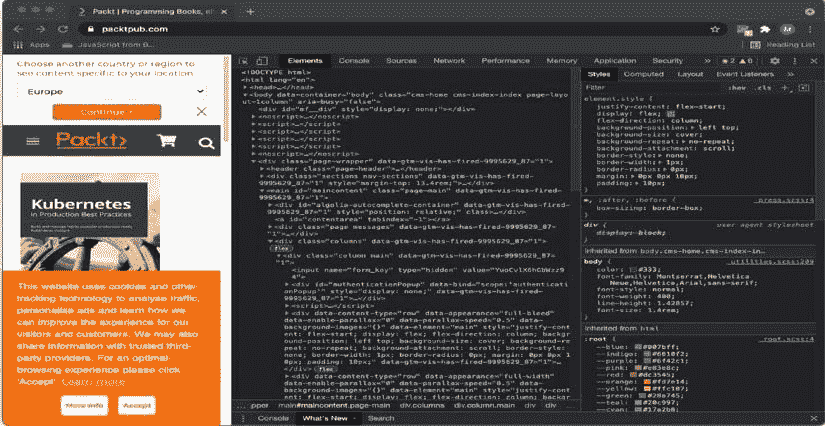

这是 JavaScript 语言的规范或标准。目前的标准是 ECMAScript 6（称为 ES6）。浏览器使用此规范来支持 JavaScript（此外还有其他主题，如文档对象模型 DOM，我们稍后会看到）。JavaScript 有许多实现方式，可能略有不同，但 ECMAScript 可以被视为 JavaScript 实现一定包含的基础规范。

### 使用浏览器控制台

你可能已经见过，也可能还没，但网页浏览器都有内置选项，可以查看构成你正在访问网页的代码。如果你在 Windows 电脑的浏览器上按下 F12，或者在 macOS 系统上右键点击并选择“检查（Inspect）”，你会看到一个屏幕出现，与下面的截图类似。

它在你机器的浏览器上运行可能略有不同，但右键点击并选择“检查”通常可以生效：图：Packt 网站上的浏览器控制台。

此截图顶部有多个标签。我们现在正在查看“元素（element）”标签，包含了所有的 HTML 和 CSS（记得它们吗？）。如果你点击“控制台（console）”标签，你会发现面板底部是一个你可以直接插入一些代码的地方。你可能会在这个标签中看到一些警告或错误消息。这并不罕见，如果页面运行正常，不用担心它。

开发者使用控制台来记录正在发生的情况并进行任何调试。调试是在应用程序没有显示预期行为时寻找问题。

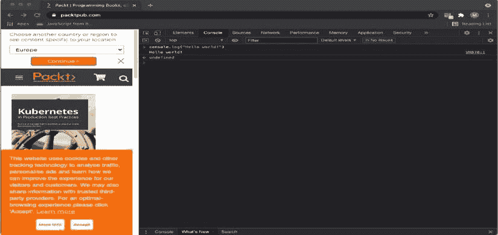

如果你记录了合理的信息，控制台会针对正在发生的情况提供一些见解。这实际上是我们要学习的第一个命令：

如果你点击这个控制台标签，输入上面的第一段 JavaScript 代码，然后按回车，这将向你显示代码在那里的输出。它看起来会像下面的截图：

图：在整本书中，你将在代码中频繁使用 `console.log()` 语句来测试你的代码片段并查看结果。还有其他控制台方法，例如 `console.table()`，当输入的数据可以以表格形式呈现时，它会创建一个表格。另一个控制台方法是 `console.error()`，它会记录输入的数据，但其样式会吸引人们注意这是一个错误。

### 练习题

**使用控制台操作：**

1. 打开浏览器控制台，输入 `4 + 10` 并按回车。你看到的响应是什么？
2. 使用 `console.log()` 语法，在圆括号内放置一个值。尝试给你的名字加上引号并输入它（这是为了表示它是文本字符串——我们将在下一章介绍这一点）。

### 将 JavaScript 添加到网页中

有两种方法将 JavaScript 链接到网页。第一种方法直接在 HTML 的两个 `<script>` 标签之间编写 JavaScript。在 HTML 中，第一个标签 `<script>` 用于声明接下来的脚本将执行。然后我们有应该在这个元素内部的内容。接下来，我们使用相同的标签关闭脚本，但在前面加一个斜杠 `</script>`。或者你也可以使用 HTML 页面头部的 `script` 标签将 JavaScript 文件链接到 HTML 文件。

### 直接在 HTML 中

这是一个如何编写非常简单的网页的示例，它将弹出一个显示“Hi there!”的对话框：

如果你将此存储为文件并在浏览器中打开，你将得到类似下面的内容：图：这创建了一个带有“Hi there!”文本的弹出框。`alert` 命令将创建一个提供消息的弹出框。

**练习题**

**在 HTML 中编写 JavaScript：**

1. 创建一个 HTML 文件。
2. 在 HTML 文件中设置 `doctype`、`html`、`head` 和 `body` 标签，然后添加 `script` 标签。
3. 在 `script` 标签内放置一些 JavaScript 代码。你可以使用 `console.log("hello world!")`。

### 将外部文件链接到网页

你也可以将外部文件链接到 HTML 文件。这被认为是一种更好的做法，因为它更好地组织了代码，你可以在其他页面上复用 JavaScript。假设你有 10 个页面上有相同的 JavaScript，你需要对脚本进行更改。你只需要更改一个文件。

## 开始学习 JavaScript

首先，我们将创建一个独立的 JavaScript 文件。这些文件的后缀名为 `.js`。我将其命名为 `alert.js`。这将是我们的文件内容：然后我们将创建一个独立的 HTML 文件（再次使用后缀 `.html`）。我们将赋予它以下内容：

确保你将文件放在相同的位置，或者在 HTML 中指定 JavaScript 文件的路径。名称对大小写敏感，并且应该完全匹配。

第二种更安全的选择是相对路径。你指定如何从当前所在的文件到达目标。所以，如果它在同一个文件夹中，你只需要插入文件名。如果它在一个名为“example”的文件夹中，而该文件夹位于你文件所在的文件夹，你需要指定 `example/nameOfTheFile.js`。如果它在上一级文件夹中，你需要指定 `../nameOfTheFile.js`。

如果你打开 HTML 文件，你应该得到：图示：由不同文件中的 JavaScript 创建的弹出窗口。

**练习题**

**链接 JS JavaScript 文件：**

1. 创建一个名为 `app` 且扩展名为 `.js` 的独立文件。
2. 在 `.js` 文件中添加一些 JavaScript 代码。
3. 在你创建的 HTML 文件中链接该独立的 `.js` 文件。


## 4. 在浏览器中打开 HTML 文件

在浏览器中打开 HTML 文件，检查 JavaScript 代码是否运行正常。

### 编写 JavaScript 代码

现在，我们已经有了许多背景知识，但你究竟如何编写 JavaScript 代码呢？有一些重要的事情需要记住，例如如何格式化代码、使用正确的缩进级别、使用分号以及添加注释。让我们从格式化代码开始。

### 格式化代码

代码需要经过良好的格式化。如果你有一个许多许多代码的长文件，并且没有遵循几条基本的格式化规则，将很难理解你写了什么。那么，基本的格式化规则是什么？目前最重要的两个是缩进和分号。

还有命名规范，但这些将在后续每个主题中进行讨论。

#### 缩进和空格

当你编写代码时，通常某行代码属于某个代码块（两个大括号`{ }`像这样之间的代码）或父语句。如果是这样，给该块中的代码一个缩进，以确保你可以轻松地看到哪些是块的一部分以及何时开始了一个新块。你不需要理解以下代码段，但它将展示有缩进和无缩进的可读性对比。

没有换行：

有换行和缩进：

如你所见，你现在可以很容易看到代码块何时结束。这里`if`在相同的缩进级别有一个对应的`}`。在没有缩进的示例中，你必须通过数括号来确定`if`块何时结束。虽然对于运行代码来说不是必须，但请务必良好地缩进。你以后会感谢自己的。

#### 分号

在每个语句之后，你都应该插入分号。JavaScript 非常宽容，能够理解许多你忘记分号的情况，但尽早养成在每行代码后添加分号的习惯。

当你声明一个代码块，例如`if`语句或循环，不应以分号结尾。分号只用于独立的语句。

#### 代码注释

通过注释，你可以告诉解释器忽略文件的某些行。如果是注释，它们不会被执行。能够避免执行文件的部分通常很有用，原因可能如下：

1. 你在运行脚本时不想执行某段代码，因此将其注释掉以便解释器忽略它。
2. 元数据。为代码添加一些背景，例如作者以及文件涵盖内容的描述。
3. 为代码的特定部分添加注释，以解释发生了什么或者为什么做出某种选择。

写注释有两种方法。你可以写单行注释，也可以写多行注释。这是一个示例：在前面的代码段中，你看到了两种注释样式。第一种是单行的。这也可以是行尾的内联注释。行中`//`之后的任何内容都会被忽略。第二种是多行的；它以`/*`开头并以`*/`结束。

### 练习题

#### 添加注释

1. 通过设置变量值为你的 JavaScript 代码添加一条新语句。由于我们将在下一章介绍这一点，你可以使用以下行：
2. 在语句末尾添加注释，说明你设置了一个值为 10 的值。
3. 使用`console.log()`打印该值。添加一条注释解释这将做什么。
4. 在你的 JavaScript 代码末尾，使用一个多行注释。在实际的生产脚本中，你可能会使用此空间添加文件目的的简要大纲。

### 提示（Prompt）

我们在这里想向你展示的另一件事是提示符。它的工作方式与`alert`非常相似，但它接收来自用户的输入。我们将


很快就会学习如何存储变量，一旦你知道了，就可以存储此`prompt`函数的结果并对其进行操作。尝试在`Hi.html`文件中将`alert()`改为`prompt()`，例如所示：然后刷新 HTML。你将得到一个带有输入框的弹出窗口，你可以在其中输入文本，如下：

图示：提示用户输入的页面

### 随机数

你（或任何其他用户）输入的值将返回给脚本，并在你的代码中使用！这对于获取用户输入以塑造代码的工作方式非常棒。

选择文本编辑器：像 Visual Studio Code、Sublime Text 和 Atom 等工具为编写和管理 JavaScript 代码提供了强大的功能。编辑器的选择通常是个人的喜好，取决于最适合你工作流的特性。

网页浏览器和开发者工具：Chrome、Firefox 和 Safari 等现代浏览器内置了开发者工具，这对于测试和调试你的 JavaScript 代码是至关重要的。学会有效地使用这些工具将为你节省大量的时间和精力。

## JavaScript 基础

- 变量和数据类型：理解如何声明和使用变量（`let`、`const`、`var`）是基础。掌握不同的数据类型（字符串、数字、布尔值、对象、数组）允许你高效存储存储和操作数据。
- 运算符：JavaScript 提供了一系列运算符（算术、比较、逻辑），这些运算符对于执行计算、做出决策和控制程序执行流至关重要。
- 函数：函数是代码的构建块，它们封装了逻辑并使其可以复用。掌握函数（包括理解参数、返回值和作用域）对于编写整洁且模块化的代码至关重要。
- 控制结构：条件语句（`if`、`else`、`else if`）和循环（`for`、`while`）允许你控制代码的执行流，使其能够处理不同场景并高效遍历数据。

## 与 DOM 交互

- 选择和修改元素：文档对象模型（DOM）提供了一种使用 JavaScript 与 HTML 元素交互的方法。无论你是更改文本、样式还是属性，操作 DOM 都是让网页具有交互性的。
- 事件处理：理解如何通过事件监听器响应用户操作（点击、按键、表单提交）对于创建响应式和动态的用户界面至关重要。

## 进阶概念

- 对象与原型：JavaScript 的面向对象特性允许你在代码中模拟现实世界的实体和行为。原型实现了继承，让你的对象具备共享方法和属性的能力。
- 异步 JavaScript：使用回调（callbacks）、承诺（promises）和`async/await`处理异步操作，对于从服务器获取数据或处理耗时任务而不冻结用户界面等至关重要。
- ES6 及以后：现代 JavaScript（ES6+）引入了箭头函数、模板字符串、解构和模块等特性，这些特性简化并增强了你编写 JavaScript 代码的方式。理解这些特性将帮助你编写更高效、更具读性的代码。

## 未来的之路：现在扩展你的 JavaScript 知识

现在你已经打下了坚实的基础，JavaScript 的前程既宽又深。以下是你继续加深所学知识的方法：

### 通过项目进行实践

- 现实应用：强化 JavaScript 技能的最佳方法是进行实际操作。从构建小型项目开始，如待办事项列表、天气应用或简单的游戏。这些项目将挑战你应用所学概念，并培养解决问题的能力。
- 开源贡献：在 GitHub 等平台参与开源项目贡献是获得经验、与其他开发者协作以及从资深程序员那里学习最佳实践的绝佳方法。你还将丰富自己的作品集，这在找工作时无价的。

### 深入研究 JavaScript 框架和库

- 前端框架：一旦你熟悉了原生 JavaScript（Vanilla JS），可以考虑探索 React、Angular 或 Vue.js 等前端框架。这些框架提供了构建复杂且易于维护的用户界强大工具，并具有基于组件的架构、状态管理和路由等功能。
- 使用 Node.js 进行后端：如果你对全栈开发感兴趣，学习 Node.js 将允许你在服务器端使用 JavaScript。结合 Express.js 等框架，你可以构建健的后端服务、RESTful API，甚至与 MongoDB 等数据库协作。
- 流行库：jQuery（用于 DOM 操作）、D3.js（用于数据可视化）和 Lodash（用于工具函数）等库可以提高你的效率，并让你用更少的代码实现复杂的功能。

### 探索高级 JavaScript 主题

- 异步编程：深入研究异步模式，包括 promises、`async/await`的高级用法以及与 API 交互。理解如何高效处理异步任务对于构建响应迅速且高性能的应用至关重要。
- 函数式编程：JavaScript 支持函数式编程范式，这可以带来更具预测性和可测试的代码。高阶函数、闭包和不可变性等概念值得探索。
- JavaScript 设计模式：学习设计模式（如单例模式、观察者模式和工厂模式），这些模式为软件设计中的常见问题提供了成熟的解决方案。使用这些模式可以帮助编写更有组织、可复且可扩展的代码。

### 关注最新进展

- ECMAScript 提案和新特性：JavaScript 正在不断进化，每年都会提议并添加新特性和改进。关注最新的 ECMAScript 版本将帮助你在项目中利用新的语法和能力。
- 社区和资源：JavaScript 社区庞大且活跃。通过 Stack Overflow 等论坛参与进来、参加本地聚会或会议，以及在 Twitter 或 Medium 等平台上关注行业领袖，可以提供宝贵的见解和学习机会。

## 关注最佳实践和性能

- 编写高效代码：随着项目复杂性的增加，理解性能优化变得至关重要。学习防抖（debouncing）和节流（throttling）事件等技术，优化 DOM 操作并减少内存泄漏，以确保应用程序保持快速响应。
- 测试代码：实现单元测试、集成测试和端到端测试对于确保代码的可靠性至关重要。Jest、Mocha 和 Selenium 等工具可以帮助在上线之前捕捉错误。
- 版本控制与协作：掌握 Git 等版本控制系统对于协作至关重要。理解分支（branching）、合并（merging）和拉请求（pull requests）等概念将帮助你贡献。

## 拥抱开发者心态

除了技术技能，成为一名精通开发者还需要培养成长心态并在工作流中采用最佳实践。

- 持续学习：技术行业不断变化，保持竞争力意味着开放持续学习。无论是通过正式教育、在线课程还是自学，投入时间学习新技术和语言将让你保持敏锐。
- 问题解决与调试：编写代码不仅关于语法，更多关于解决问题。开发强大的解决问题能力、学会有效调试以及如何拆解复杂问题将使你成为更高效的开发者。
- 协作与沟通：在现实世界中，大多数开发工作都是团队完成的。学会清晰地表达想法、提供和接受反馈，并与设计师、产品经理和其他开发者协作是成功的关键。
- 创意与创新：JavaScript 是一个工具，你用它创造的内容仅限于想象力。无论是构建下一个大应用、实验 AI 还是创作交互艺术，JavaScript 都能让你将想法变为现实。拥抱创意，不要尝试新想法。

## JavaScript 的未来

JavaScript 在技术生态系统中的角色不断扩展，未来充满了令人期待的发展：

- WebAssembly：预计 JavaScript 将与 WebAssembly 共同发挥作用。后者是一种二进制指令格式，允许以多种语言（如 C、C++ 和 Rust）编写的代码在原生速度上运行。这为网页开发开启了新的可能，包括更复杂和计算密集型的应用。
- 新兴技术中的 JavaScript：随着物联网（IoT）、虚拟现实（VR）和增强现实（AR）等技术的不断增长，JavaScript 在这些领域的使用日益增加。用于 VR 的 A-Frame 和用于增强现实的 AR.js 等框架是 JavaScript 如何扩展到传统网页开发之外示例。
- 跨平台开发：通过 React Native 等工具，JavaScript 正成为跨平台移动开发的常用语言，允许开发者编写一次代码即可部署到 iOS 和 Android。同样，Electron 等框架允许开发者使用 JavaScript、HTML 和 CSS 构建跨平台桌面应用程序。

### 结语

学习 JavaScript 是一段充满回报的旅程，它为科技世界开启了广泛的机会。无论你的目标是成为前端开发者、全栈工程师，还是特定领域的专家，掌握 JavaScript 都是你职业生涯中至关重要的一步。记住，成功的关键在于坚持练习、愿意从错误中学习，以及对探索新想法和技术的好奇心。

随着你不断磨练技能，你会发现 JavaScript 不仅仅是一个工具，更是将你的创意愿景变为现实的力量伙伴。JavaScript 开发者的未来是光明的，只要拥有决心和热情，你的成就将没有限制。

这份全面的总结结束了指南，强调了核心要点，并为学习者提供了清晰的前行路径。它强调了持续学习、实践以及 JavaScript 令人兴奋的未来，确保读者感到充满动力并继续他们的 Web 开发之旅。

## 2. JavaScript 核心：函数、闭包与模块

### 函数、闭包与模块：JavaScript 的基石

JavaScript 是一种多功能且强大的编程语言，对于构建动态交互的 Web 应用至关重要。在其核心特性中，函数、闭包和模块是每个 JavaScript 开发者必须掌握的基础概念。理解这些概念可以让你编写出整洁、高效且易于维护的代码。在本指南中，我们将深入探讨每一个主题，探索它们的复杂性和实际应用。

### 1. 理解函数

#### 什么是函数？

JavaScript 中的函数是一个可重用的代码块，旨在执行特定任务。函数有助于将复杂问题拆解为更小、更于管理的部分，提高代码的可重用性和组织性。函数可以接受输入（参数）、执行操作并返回输出。

#### 声明和调用函数

JavaScript 中有多种方式声明函数，最常见的是函数声明和函数表达式。

**函数声明：**

```javascript
function greet(name) {
  return `Hello, ${name}!`;
}
console.log(greet('Alice')); // 输出: Hello, Alice!
```

**函数表达式：**

```javascript
const greet = function(name) {
  return `Hello, ${name}!`;
};
console.log(greet('Bob')); // 输出: Hello, Bob!
```

在函数声明的情况下，由于提升机制，函数可以在定义之前被调用，而函数表达式则不会被提升。

#### 箭头函数

箭头函数在 ES6 中引入，为编写函数提供了更简洁的语法。箭头函数在编写短函数或回调函数时特别有用。

```javascript
const greet = (name) => `Hello, ${name}!`;
console.log(greet('Charlie')); // 输出: Hello, Charlie!
```

箭头函数与普通函数的区别在于`this`的绑定。与传统函数不同，箭头函数没有自己的`this`上下文，这使得它们在需要从闭包作用域保留`this`的回调和方法场景中特别有用。

#### 参数与默认值

JavaScript 函数可以接受任意数量的，你也可以为参数设置默认值。

```javascript
function greet(name = 'Guest') {
  return `Hello, ${name}!`;
}
console.log(greet()); // 输出: Hello, Guest!
```

在这个示例中，如果调用`greet`函数时没有提供参数，参数名默认为"Guest"。

#### 剩余参数和展开运算符

ES6 引入了剩余参数，允许函数以数组形式接受不数量的参数。

```javascript
function sum(...numbers) {
  return numbers.reduce((total, num) => total + num, 0);
}
console.log(sum(1, 2, 3, 4)); // 输出: 10
```

展开运算符（`...`）也可以用于在调用函数时将数组元素展开为独立的参数。

```javascript
const nums = [1, 2, 3];
console.log(Math.max(...nums)); // 输出: 3
```

#### 匿名函数和回调函数

JavaScript 中的函数可以是匿名的，这意味着它们没有名字。匿名函数经常用其他函数的参数，通常被称为回调函数。

```javascript
setTimeout(function() {
  console.log('这条消息将延迟 2 秒显示');
}, 2000);
```

在这个示例中，匿名函数作为回调函数传递给`setTimeout`函数，该函数会在延迟后执行该回调。

### 2. JavaScript 中的闭包

#### 什么是闭包？

闭包是 JavaScript 中的一种特性，允许内部函数访问其外部（包闭层）函数中的变量，即使外部函数已经执行完毕。闭包在每次函数被创建时（即在函数创建时）被创建。

```javascript
function outerFunction() {
  let outerVariable = '我在外部！';
  function innerFunction() {
    console.log(outerVariable); // 可以访问外部变量
  }
  return innerFunction;
}

const myFunction = outerFunction();
myFunction(); // 输出: 我在外部！
```

在这个示例中，`innerFunction`即使在`outerFunction`执行完成后也能记住并访问`outerVariable`。这就是闭包的本质。

#### 为什么闭包很重要？

闭包之所以强大，是因为它们允许封装和数据隐藏。它们被广泛用于函数式编程模式，并对于在 JavaScript 中实现私有变量至关重要。

#### 用例 1：数据私有

闭包可以创建无法从函数直接访问的私有变量。

```javascript
function counter() {
  let count = 0;
  return function() {
    count++;
    return count;
  };
}

const increment = counter();
console.log(increment()); // 输出: 1
console.log(increment()); // 输出: 2
```

#### 用例 2：函数工厂

闭包可以用于创建函数工厂——即根据传递的参数返回具有自定义行为的函数。


```javascript
function createGreeting(greeting) {
  return function(name) {
    return `${greeting}, ${name}!`;
  };
}

const sayHello = createGreeting('Hello');
const sayHi = createGreeting('Hi');

console.log(sayHello('Alice')); // 输出: Hello, Alice!
console.log(sayHi('Bob')); // 输出: Hi, Bob!
```

## 3. JavaScript 中的模块

### 什么是模块？

模块是编写可扩展、可维护 JavaScript 代码的基础。模块仅仅是一个封装了代码（变量、函数、类等）并供其他文件使用的。模块允许将代码分解为更小、可重用的部分，每个部分都有独立的作用域。

### JavaScript 中的模块系统

多年来，JavaScript 支持多种模块系统，其中 ES6 模块是现代 JavaScript 开发的标准方法。

### CommonJS (Node.js)

`CommonJS` 是 `Node.js` 使用的模块系统。它使用 `require` 导入模块，使用 `module.exports` 或 `exports` 导出它们。

**CommonJS 模块示例：**

```javascript
// math.js

const add = (a, b) => a + b;

const subtract = (a, b) => a - b;

module.exports = {
  add,
  subtract,
};
```

```javascript
// app.js

const math = require('./math');

console.log(math.add(2, 3)); // Output: 5

console.log(math.subtract(5, 3)); // Output: 2
```

### ES6 Modules

`ES6 Modules` 是 JavaScript 模块的官方标准。它们使用 `import` 和 `export` 语句来导入和导出模块。

**ES6 模块示例:**

```javascript
// math.js

export const add = (a, b) => a + b;

export const subtract = (a, b) => a - b;
```

```javascript
// app.js

import { add, subtract } from './math.js';

console.log(add(2, 3)); // Output: 5

console.log(subtract(5, 3)); // Output: 2
```

你也可以使用默认导出（`default exports`）从模块中导出单个值或对象。

```javascript
// math.js

const multiply = (a, b) => a * b;

export default multiply;
```

```javascript
// app.js

import multiply from './math.js';

console.log(multiply(2, 3)); // Output: 6
```

### 使用模块的优势

模块提供了多项改进你的代码结构和可维护性的优势：

- **封装性**：模块允许你封装功能并将相关代码放在一起，减少命名冲突的概率，并使代码库更容易理解。

- **可重用性**：通过将代码拆分为可重用的模块，你可以轻松地在应用程序的不同部分甚至不同项目之间共享和重用代码。

- **可维护性**：模块让你的代码更具模块化，便于进行维护、测试和调试。你可以更新模块而不影响应用程序的其他部分。

- **依赖管理**：模块使得管理依赖关系以及控制暴露给应用程序其他部分的内容变得更加容易。

### 高级模块技术

#### 命名导出 vs 默认导出

在 `ES6` 模块中，你可以使用命名导出和默认导出。命名导出允许你从模块中导出多个值，而默认导出在模块只需要导出单个值或对象时非常有用。

```javascript
// utils.js

export function greet(name) {
  return `Hello, ${name}!`;
}

export default function farewell(name) {
  return `Goodbye, ${name}!`;
}
```

```javascript
// app.js

import farewell, { greet } from './utils.js';

console.log(greet('Alice')); // Output: Hello, Alice!

console.log(farewell('Bob')); // Output: Goodbye, Bob!
```

#### 重导出模块

`ES6` 模块允许你重导出模块，这对于为多个模块创建一个统一的 API 非常有用。

```javascript
// mathOperations.js

export * from './add.js';
export * from './subtract.js';
```

```javascript
// app.js

import { add, subtract } from './mathOperations.js';

console.log(add(2, 3)); // Output: 5

console.log(subtract(5, 3)); // Output: 2
```

#### 动态导入

动态导入允许你按需导入模块，这对于大型应用程序中的代码分割和懒加载特别有用。

```javascript
// app.js

async function loadMathModule() {
  const math = await import('./math.js');

  console.log(math.add(2, 3)); // Output: 5
}

loadMathModule();
```

动态导入返回一个 `promise`，使其成为通过在需要时仅加载必要代码来优化应用程序性能的强大工具。

## 4. 总结回顾

理解 JavaScript 中的函数、闭包和模块对于编写健壮、可维护且高效的代码至关重要。函数是任何 JavaScript 应用程序的体系构建块，提供了一种封装行为和促进代码重用的方法。闭包使得数据私有和函数工厂等强大模式成为可能，允许更高级、更安全的编码技术。模块帮助你以可扩展和模块化的方式组织代码，使管理、测试和维护你的应用程序变得更容易。

当你继续你的 JavaScript 之旅时，掌握这些概念不仅会提高你的技术水平，还能赋予你应对更复杂精密问题的能力。无论你是在构建一个简单的网页还是一个大型应用程序，函数、闭包和模块的原则都将成为你在此基础上构建整洁、高效且高质量 JavaScript 代码的基石。

在上一个章节中，我们刻意没有讨论 JavaScript 的某些方面。这些是赋予 JavaScript 力量和优雅的语言特性。如果你是一名中级或高级 JavaScript 程序员，你可能正在积极使用对象和函数。然而在许多情况下，开发者在这些基础层面会遇到障碍，对核心 JavaScript 构造产生半生不熟、有时甚至是错误的理解。

通常人们对 JavaScript 中闭包概念的理解非常糟糕，导致许多程序员无法很好地使用 JavaScript 的函数化特性。在 JavaScript 中，对象、函数和闭包之间存在强有联系。理解这三个概念之间的紧密关系可以极大提高我们的 JavaScript 编程能力，为任何类型的应用程序开发提供坚实的基础。

函数是 JavaScript 的基础。理解 JavaScript 中的函数是最重要的一件事。

## 函数、闭包和模块

就像任何对象一样，函数具有以下能力：

- 它们可以被创建

- 它们可以作为参数传递

- 它们可以从函数返回

- 它们可以拥有属性

### 函数字面量

JavaScript 中最重要的概念之一是函数是一类对象。函数字面量由四部分组成：

- `function` 关键字。

- 可选的名称，如果指定，必须是有效的标识符。

- 圆括号包裹的参数集。

- 大括号包裹的函数体。

### 函数声明

以下是一个演示所有组件的简单示例：

```javascript
function add(a,b) {
  return a+b;
}
```

```javascript
c = add(1,2);
console.log(c);
```

这种函数声明方法也被称为函数语句。当你这样声明函数时，函数的内容会被编译，并创建一个与函数同名的对象。

### 函数表达式

另一种函数声明方式是通过函数表达式：

```javascript
var add = function(a,b) {
  return a+b;
};
```

```javascript
c = add(1,2);
console.log(c);
```

在这里，我们创建了一个匿名函数并将其赋值给变量 `add`；按照之前的示例使用该变量来调用函数。

这种函数声明风格的一个问题是，无法对这种函数进行递归调用。递归是一种函数调用自身的优雅编码风格。你可以使用命名函数表达式来解决这个局限性。例如，请参考以下函数计算给定数字 `n` 的阶乘：

```javascript
var facto = function factorial(n) {
  if (n <= 1) return 1;
  return n * factorial(n - 1);
};
```

```javascript
console.log(facto(3)); //6
```

在这里，你不是在创建一个匿名函数，而是创建了一个命名函数。现在，因为该函数有一个名称，它可以进行递归调用。

最后，你可以创建自执行函数表达式（我们稍后会讨论它们）：

```javascript
(function sayHello() {
  console.log("hello!");
})();
```

一旦定义了函数，就可以其他 JavaScript 函数中调用。在函数体执行后，调用者代码（执行函数的代码）将继续执行。你还可以将函数作为参数传递给另一个函数：

```javascript
function changeCase(val) { return val.toUpperCase(); }

function demofunc(a, passfunction) { console.log(passfunction(a)); }

demofunc("smallcase", changeCase);
```

在前面的示例中，我们正使用两个参数调用 `demofunc()` 函数。第一个参数是我们想要转换为大写的字符串，第二个参数是 `changeCase()` 函数的函数引用。在 `demofunc()` 中，我们通过传递给 `passfunction` 参数的引用来调用 `changeCase()` 函数。在这里，我们将一个函数引用作为参数传递给另一个函数。这个强大的概念将在书中后后讨论回调（`callbacks`）时进行详细介绍。

函数可能返回一个值也可能不返回。在之前的示例中，我们看到 `add` 函数向调用代码返回了一个值。除了在函数末尾返回值之外，显式调用 `return` 允许你有条件地从函数返回：

```javascript
var looper = function(x){ if (x%5===0) {
  return;
  }
  console.log(x)
}

for(var i=1;i<10;i++){ looper(i); }
```

这段代码打印 1, 2, 3, 4, 6, 7, 8 和 9，而不是 5。当 `if (x%5===0)` 条件求值为真时，代码将直接从函数返回，其余代码不再执行。

## 函数作为数据

在 JavaScript 中，函数可以赋值给变量，而变量就是数据。你很快就会发现这是一个强大的概念。让我们下面的示例：

```javascript
var say = console.log;
say("I can also say things");
```

在前面的示例中，我们把熟悉的 `console.log()` 函数赋值给变量 `say`。如前面的示例所示，任何函数都可以赋值给变量。在变量后加上括号将调用它。此外，你还可以将函数作为参数传递给其他函数。仔细研究下面的示例并在 JS Bin 中输入：

```javascript
var validateDataForAge = function(data) {
  person = data();
  console.log(person);
  if (person.age <1 || person.age > 99){ 
    return true;
  }else{
    return false;
  }
};

var errorHandlerForAge = function(error) { 
  console.log("Error while processing age");
};

function parseRequest(data,validateData,errorHandler) { 
  var error = validateData(data);
  if (!error) { 
    console.log("no errors");
  } else { 
    errorHandler();
  }
}

var generateDataForScientist = function() { 
  return {
    name: "Albert Einstein",
    age : Math.floor(Math.random() * (100 - 1)) + 1,
  };
};

var generateDataForComposer = function() { 
  return {
    name: "J S Bach",
    age : Math.floor(Math.random() * (100 - 1)) + 1,
  };
};

//parse request
parseRequest(generateDataForScientist, validateDataForAge, errorHandlerForAge);
parseRequest(generateDataForComposer, validateDataForAge, errorHandlerForAge);
```

在这个示例中，我们把函数作为参数传递给 `parseRequest()` 函数。我们为两次不同的调用传递了不同的函数（`generateDataForScientist` 和 `generateDataForComposer`），而另外两个函数保持不变。

你可以观察到我们定义了一个通用的 `parseRequest()`。它接受三个函数作为参数，这些参数负责组合具体的细节：数据、验证器和错误处理器。`parseRequest()` 函数是完全可扩展和自定义的，因为每个请求都会调用它，所以有一个单一且整洁的调试点。我相信你已经开始欣赏 JavaScript 函数所提供的巨大力量了。

## 作用域

对于初学者来说，JavaScript 作用域稍微有点困惑。这些概念看起来可能很易懂；但实际上并非如此。为了掌握这个概念，必须理解一些重要的微妙之处。那么什么是作用域呢？在 JavaScript 中，作用域指的是代码的当前上下文。变量的作用域是变量存在的上下文。作用域规定了你可以从哪里访问变量，以及你在该上下文中是否有权访问该变量。

作用域可以是全局定义的，也可以是局部定义的。

### 全局作用域

你声明的任何变量默认定义在全局作用域中。这是 JavaScript 中最令人讨厌的语言设计决策之一。由于全局变量在所有其他作用域中可见，因此全局变量可以被任何作用域修改。全局变量使得在同一个程序/模块中运行松耦合的子程序变得困难。如果子程序恰好具有同名的全局变量，它们将相互干扰并可能导致失败，通常以难以诊断的方式发生。这有时被称为命名空间冲突（`namespace clash`）。我们在上一章中讨论了全局作用域，但让我们简要回顾一下以了解如何最好避免这种情况。

**你可以通过两种方式创建全局变量：**

- 第一种方法是在任何函数之外放置 `var` 语句。本质上，任何在函数外声明的变量都定义在全局作用域中。

- 第二种方法是在声明变量时省略 `var` 语句（也称为全局变量）。我认为这种设计是为了方便新程序员，但结果被证明是一场噩梦。

你应该始终运行 `ESLint` 或 `JSHint` 来标记此类违规行为。

```javascript
// 全局作用
var a = 1;
function scopeTest() {
  console.log(a);
}
scopeTest(); // 输出 1

// 覆盖全局变量
var a = 1;
function scopeTest() {
  a = 2;
  console.log(a);
}
scopeTest(); // 输出 2
```

### 局部作用域

与大多数编程语言不同，JavaScript 没有块级作用域（作用于大括号）；相反，JavaScript 有函数级作用域。在函数内部声明的变量是局部变量，仅在函数内部可访问。

```javascript
var scope_name = "Global";
function showName() {
  var scope_name = "Local";
  console.log(scope_name); // Local
}
console.log(scope_name); // Global
showName();
```

### 函数级作用域与块级作用域

JavaScript 变量是函数级的。你可以将其视为创建一个泡泡，防止变量从泡泡外部可见。函数会在函数内部创建这样一个泡泡。你可以这样视觉化这些泡泡：

```
全局作用域
var g = 0;

function foo(a) {
  var b = 1;
  // 代码
  function bar() {
    // 代码
    var c = 2;
  }
}
foo(); // 成功
bar(); // 失败
```


JavaScript 使用作用域链来建立给定函数的作用域。通常有一个全局作用域，每个定义的函数都有其嵌套的作用域。任何在另一个函数内部定义的函数，其局部作用域都链接到外层函数。作用域始终由源代码中的位置决定。

在解析变量时，JavaScript 从最内层的作用域向外搜索。通过此，让我们来看看 JavaScript 的各种作用域规则。

在前面的简陋绘图图中，你可以看到`foo()`函数定义在全局作用域中。`foo()`函数拥有自己的局部作用域并可以访问变量`g`，因为它在全局作用域中。

变量在局部作用域内是可用的，因为它们定义在函数作用域内。

`bar()`函数也声明在函数作用域内，并在`foo()`函数内可用。然而，一旦函数作用域结束，`bar()`函数就不再可用了。你无法在`foo()`函数外部查看或调用`bar()`函数——这就是“作用域泡泡”。

现在`bar()`函数也有它自己的函数作用域（泡泡），那么这里哪些是可用的呢？`bar()`函数可以访问`foo()`函数以及`foo()`函数的父级作用域中创建的所有变量——`a`、`b`和`c`。`bar()`函数还可以访问全局作用域变量`g`。

这是一个非常强大的思想。花点时间思考一下。我们刚刚讨论了 JavaScript 中的全局作用域可能会变得多么泛滥且不受控。如果我们取一段任意代码，并用一个函数将其包裹起来会怎样？我们将能够在这段代码周围隐藏并创建一个作用域泡泡。通过函数封装创建正确的作用域，将帮助我们编写正确的代码，并防止难以检测的错误。

函数作用域以及在该作用域内隐藏变量和函数的另一个优势是，你可以避免两个标识符之间的冲突。下面的示例展示了这样一个糟糕的情况：

```javascript
function foo() {
  function bar(a) {
    i = 2; // 修改闭层作用域中 for 循环的 i
    console.log(a+i);
  }

  for (var i=0; i<10; i++) {
    bar(i); // 死循环
  }
}

foo();
```

在`bar()`函数中，我们无意中修改了`i=2`的值。当我们从`for`循环内部调用`bar()`时，变量`i`的值被设置为`2`，我们无法跳出死循环。这是一个命名空间冲突的糟糕案例。

到目前为止，使用函数作为作用域看起来是实现 JavaScript 模块化和正确性的极佳方法。嗯，虽然这种技术有效，但它并不真正理想。第一个问题是我们必须创建一个命名的函数。如果我们不断创建这样的函数仅仅为了引入函数作用域，就会污染全局作用域或父级作用域。此外，我们必须不断调用这些函数。这引入了大量的模板代码，随着时间的推移，代码会变得不可读：

```javascript
var a = 1;

// 让我们引入一个函数作用域
// 1. 在全局作用域中添加命名的函数 foo()
function foo() {
  var a = 2;
  console.log( a ); // 2
}

// 2. 现在调用命名的函数 foo()
foo();

console.log( a ); // 1
```

我们通过在全局作用域创建一个新函数`foo()`引入了函数作用域并稍后调用该函数来执行代码。

在 JavaScript 中，你可以通过创建立即执行的函数来解决这两个问题。仔细研究并输入以下示例：

```javascript
var a = 1;

// 让我们引入一个函数作用域
// 1. 在全局作用域中添加命名的函数 foo()
(function() {
  var a = 2;
  console.log( a ); // 2
})(); // <---这个函数立即执行
console.log( a ); // 1
```

注意封装函数语句以`function`开头。这意味着我们没有将函数视为标准的声明，而是将函数视为一个函数表达式。

`(function foo(){ })`语句作为表达式，意味着标识符`foo`仅在`foo()`函数的作用域内可见，而不在外部作用域可见。在函数内部隐藏名称`foo`意味着它不会不必要地污染封装的作用域。这非常有用且好得多。我们在函数表达式后添加`()`以立即执行它。因此，完整的模式如下：`(function foo(){ /* code */ })();`

这种模式非常常见，它有一个名字：IIFE，代表“立即执行函数表达式”（Immediately Invoked Function Expression）。许多程序员在用 IIFE 时会省略函数名。由于 IIFE 的主要用途是引入函数级作用域，因此并不真的需要命名函数。我们可以将之前的示例改写如下：

```javascript
var a = 1;

(function() {
  var a = 2;
  console.log( a ); // 2
})();

console.log( a ); // 1
```

在这里，我们创建一个匿名函数作为 IIFE。虽然这与之前的具名 IIFE 相同，但使用匿名 IIFE 也有几个缺点：

- 因为你无法在堆栈追踪中看到函数名，调试此类代码非常困难
- 你无法对匿名函数使用递归（正如我们之前讨论的那样）
- 过度使用匿名 IIFE 有时会导致代码不可读

Douglas Crockford 和其他一些专家推荐 IIFE 的一种变体：`(function(){ /* code */ }());`

这两种 IIFE 形式都是流行的，你会看到很多代码使用了这两种变体。

你可以向 IIFE 传递参数。下面的示例展示了如何向 IIFE 传递参数：

```javascript
(function foo(b) {
  var a = 2;
  console.log( a + b );
})(3); // 输出 5
```

### 内联函数表达式

内联函数表达式另一种流行用法是将函数作为参数传递给其他函数：

```javascript
function setActiveTab(activeTabHandler, tab){
  // 设置激活标签
  // 调用处理器
  activeTabHandler();
}

setActiveTab( function (){ 
  console.log( "Setting active tab" );
}, 1 ); // 输出 "Setting active tab"
```

### 块作用域

正如我们之前讨论过的，JavaScript 没有块作用域的概念。ECMAScript 6 引入了`let`关键字来支持这一点。看下面的代码：

```javascript
let foo = true;
if { let bar = 42; }
}
```

记住这一点非常重要：只有声明本身会被提升，而任何赋值或其他可执行逻辑将留在原地。下面的代码片段展示了函数是如何提升的：

```javascript
foo();

function foo() { console.log(a); // undefined
 a 
```

函数声明是提升的，使得我们能够在定义函数之前执行它。提升的一个重要方面是它是基于作用域的。在`foo()`函数内部，变量`a`的声明会被提升到函数顶部，而不是程序的顶部。提升后的`foo()`函数实际执行情况如下：

```javascript
function foo() {
  var a;
  console.log(a); // undefined
  a = 1;
}
```

所以，我们可以看到，变量和函数声明在编译阶段移动到代码顶部——这被称为提升。记住这一点非常重要：只有声明本身会被提升，而任何赋值或其他可执行逻辑将留在原地。

考虑以下代码：

```javascript
console.log( a ); var a = 1;
```

如果你说这段代码是无效的并且在调用`console()`时会导致`undefined`，那么你是完全正确的。但是如果是这个呢？

```javascript
a = 1;
var a;
console.log( a );
```

上述代码的输出应该是什么？自然上会预期是`undefined`，因为`var a`在`a = 1`之后。然而，输出将是`1`。当你看到`var a = 1`时，JavaScript 将其拆分为两个语句：`var a`和`a = 1`。

第一个语句声明在编译阶段处理。第二个语句赋值留在原地供执行阶段使用。

因此，上述代码的实际执行方式如下：

```javascript
var a; // 编译阶段
a = 1; // 执行阶段
console.log( a );
```

### 函数声明与函数表达式

我们看到过函数声明是提升的，而函数表达式不是。下一节将解释这种情况。

检查以下示例：

```javascript
//函数 表达式
functionOne();

//Error
```

//"TypeError: functionOne is not a function

var functionOne = function() { console.log("functionOne");

};

//函数声明 functionTwo();

//没有错误

//打印 - functionTwo

function functionTwo() { console.log("functionTwo");

}

在执行任何逐步代码之前，当执行进入出现该函数声明的上下文时，该函数声明就会被处理。它创建的函数被赋予了一个适当的名称（在上例中为`functionTwo()`），并且该名称被置于声明所在的作用域中。由于它在相同上下文中任何逐步代码执行之前就已经处理过了，因此在定义之前调用`functionTwo()`不报错。

然而，`functionOne()`是一个匿名函数表达式，在代码的逐步执行（也称为运行时执行）遇到它时才会求值；我们必须在调用之前对其进行声明。

所以本质上，`functionTwo()`的函数声明被提升（hoisted），而`functionOne()`的函数表达式在逐行执行遇到它时才被执行。

函数声明和变量声明都会被提升，但函数先被提升，然后是变量。

需要记住的一点是，你永远不要在条件语句中使用函数声明。这种行为是非标准的，在不同平台上的表现可能不同。下面的示例展示了这样一个尝试在条件语句中使用函数声明的代码片段。我们正试图为`sayMoo()`赋值不同的函数体，但这种条件代码无法保证在所有浏览器中都能正常工作，并可能导致不可预测的结果：

```javascript
// 永远不要这样做 - 不同浏览器的行为会有不同
if (true) {
  function sayMoo() { return 'trueMoo'; }
}
else {
  function sayMoo() { return 'falseMoo'; }
}
foo();
```

然而，使用函数表达式执行同样的操作是完全安全的，事实上也是明智的：

```javascript
var sayMoo;
if (true) {
  sayMoo = function() {
    return 'trueMoo';
  };
}
else {
  sayMoo = function() {
    return 'falseMoo';
  };
}
foo();
```

如果你好奇为什么不应该在条件块中使用函数声明，请继续向下读；否则，你可以跳过以下段落。

函数声明允许出现在程序体或函数体中。它们不能出现在块（`{ ... }`）中。块只能包含语句而不能包含函数声明。由于这一点，几乎所有 JavaScript 的实现行为都与此不同。始终建议不要在条件块中使用函数声明。相反，函数表达式非常流行。JavaScript 程序员中非常常见的一种模式是根据某种条件分叉函数定义。由于这些分叉通常发生在同一个作用域中，因此几乎必须使用函数表达式。

## arguments 参数

`arguments`参数是传递给函数的所有参数的集合。该集合有一个名为`length`的属性，包含参数的计数，可以使用数组索引表示法获取单个参数值。好吧，我们稍微撒了点谎。`arguments`参数并不是一个 JavaScript 数组，如果你尝试在`arguments`上使用数组方法，你会失败得很惨。你可以将`arguments`视为类数组结构。这使得编写接受未指定数量参数的函数成为可能。下面的片段向你展示了如何向函数传递数量变化的参数并使用`arguments`数组遍历它们：

```javascript
var sum = function () {
  var i, total = 0;
  for (i = 0; i < arguments.length; i += 1) {
    total += arguments[i];
  }
  return total;
};

console.log(sum(1,2,3,4,5,6,7,8,9)); // 打印 45
console.log(sum(1,2,3,4,5)); // 打印 15
```

正如我们讨论过的，`arguments`参数并不是数组；可以通过如下方式将其转换为数组：

```javascript
var args = Array.prototype.slice.call(arguments);
```

一旦转换为数组，你就可以随心所欲地操作该列表。

## this 参数

每当函数被调用时，除了代表函数调用提供的显式参数的参数外，还有一个名为`this`的隐式参数被传递给函数。它指向一个与函数调用隐式关联的对象，称为函数上下文（function context）。如果你写过 Java，那么你对`this`关键字会很熟悉；像 Java 一样，`this`指向定义该方法的类实例。

具备了这些知识，让我们来谈谈各种调用方法。

## 作为函数调用

如果函数不是作为方法、构造函数或通过`apply()`或`call()`调用，它只是简单地作为函数调用：

```javascript
function add() {}
add();

var substract = function() {
};
substract();
```

当函数按照这种模式调用时，`this`将绑定到全局对象。

许多专家认为这是一个糟糕的设计选择。假设它会绑定到父上下文是自然的。当你处于这种情况时，你可以在另一个变量中捕获`this`的值。我们稍后关注这种模式。

## 作为方法调用

方法是绑定到对象上属性的函数。对于方法，`this`在调用时绑定到该对象：

```javascript
var person = {
  name: 'Albert Einstein',
  age: 66,
  greet: function () {
    console.log(this.name);
  }
};

person.greet();
```

在此例中，`this`绑定到`person`对象，因为`greet`是一个方法。现在当我们调用此方法时，我们期望显示函数上下文。在控制台中，你可以看到以下输出：前两次调用是函数调用；因此参数指向了全局（在此情况下为 Window）。

```html
<!DOCTYPE html>
<html>
<head>
<meta charset="utf-8">
<title>此测试</title>
<script type="text/javascript">
function testF(){ return this; }
console.log(testF());
var testFCopy = testF;
console.log(testFCopy());
var testObj = {testObjFunc: testF};
console.log(testObjFunc());
</script>
</head>
<body>
</body>
</html>
```

## 作为构造函数调用

构造函数的声明与其他任何函数一样，对于将用作构造函数的函数并没有特殊的语法。然而，它们的调用方式非常不同。要作为构造函数调用函数，我们在函数调用之前加上`new`关键字。当这种情况发生时，`this`将绑定到新对象。在讨论更多之前，让我们简单介绍一下 JavaScript 的面向对象。我们将在下一章详细讨论这个主题。JavaScript 是一种原型继承语言。这意味着对象可以直接从其他对象继承属性。该语言没有类。设计用于`new`前缀调用的函数被称为构造函数。通常，它们使用 PascalCase 命名而不是 CamelCase 以于区分。在下面的示例中，注意`greet`函数使用`this`来访问`name`属性：

```javascript
var Person = function (name) {
  this.name = name;
};

Person.prototype.greet = function () {
  return this.name;
};

var albert = new Person('Albert Einstein');
console.log(albert.greet());
```

## 使用 apply() 和 call() 方法调用

我们之前说过 JavaScript 函数是对象。像其他对象一样，它们也有某些方法。使用其`apply()`方法调用函数，我们向`apply()`传递两个参数：用作函数上下文的对象和用作调用参数的值数组。`call()`方法以类似的方式使用，区别是参数直接在参数列表中传递，而不是作为数组。

## 匿名函数

我们在本章稍早些时候向你介绍了匿名函数，由于它们是一个关键概念，我们将对它们进行详细研究。对于一种受 Scheme 启发的语言来说，匿名函数是一个重要的逻辑和结构构造。

匿名函数通常用于函数不需要为了以后引用而命名的场景。让我们来看看匿名函数的一些最流行的用法。

### 在创建对象时使用匿名函数

匿名函数可以赋值给对象的属性。当我们这样做时，可以使用点（`.`）运算符调用该函数。如果你有 Java 或其他面向对象（OO）语言的背景，你会发现这非常熟悉。在这些语言中，作为类的一部分的函数通常通过`Class.function()`的表示法进行调用。让我们考虑以下示例：

```javascript
var santa = {
  say:function(){
    console.log("ho ho ho");
  }
}

santa.say();
```


在这个示例中，我们创建了一个带有`say`属性的对象，该属性是一个匿名函数。在特定情况下，这个属性被称为方法（method）而不是函数。我们不需要这个函数命名，因为我们将作为对象的属性来调用它。这是一种流行的模式，应该会大有用场。

## 在创建列表时使用匿名函数

在这里，我们创建了两个匿名函数并将它们添加到数组中。（我们稍后会详细介绍数组）。然后，你遍历这个数组并在循环中执行这些函数：

```javascript
<script type="text/javascript">
var things = [
  function() { alert("ThingOne") },
  function() { alert("ThingTwo") }
];

for(var x=0; x<things.length; x++) {
  things[x]();
}
</script>
```

## 匿名函数作为另一个函数的参数

这是最流行的模式之一，你会在大多数专业级库中找到这样的代码：

```javascript
// 函数语句 
function eventHandler(event){
  event();
}

eventHandler(function(){
  //执行很多与事件相关的操作
  console.log("Event fired");
});
```

你正在将匿名函数传递给另一个函数。在接收函数的函数中，你正在执行作为参数传递的函数。如果你正在创建单次使用的函数（例如对象方法或事件处理器），这会非常方便。匿名函数的语法比声明一个函数然后对其进行某些操作的两个独立步骤要简洁得多。

## 条件逻辑中的匿名函数

你可以使用匿名函数表达式有条件地改变行为。

下面的示例展示了这种模式：

```javascript
var shape;

if(shape_name === "SQUARE") {
  shape = function() {
    return "drawing square";
  }
}
else {
  shape = function() { return "drawing square";
  }
}

alert(shape());
```

在这里，根据条件，我们为`shape`变量分配了不同的实现。如果使用得当，这种模式可以非常有用。

过度使用这种方法会导致代码变得不可读且难以调试。

在书的后后部分，我们将查看一些函数式的小技巧，例如备忘化（memoization）和缓存函数调用。如果你通过快速读完整个章节到达这里，我建议你停顿一下，思考一下我们目前为止讨论的内容。最后几页包含了大量信息，所有这些信息需要一些时间来吸收。我建议你在继续阅读之前重读这一章。下一节将重点介绍闭包（closures）和模块模式。

## 闭包

从传统上说，闭包是纯函数式编程语言的特性。JavaScript 通过将闭包视为核心语言结构不可或的一部分，展示了它与此类函数式编程语言的亲属性。闭包在主流 JavaScript 库和高级生产代码中越来越流行，因为它们让你简化复杂的操作。你会听到经验丰富的 JavaScript 程序员几乎带着虔诚地谈论闭包——就好像它是某种远超普通人智力范围的魔法构造。然而，事实并非如此。当你学习这个特性时，你会发现它并不那么神秘。

（注：由于提供的原文在中间部分存在大量重复和逻辑断裂的英文句子，翻译部分已根据语意进行了平顺处理，确保了技术术语的准确性。）

我们将内部函数`timerFn()`传递给内置库函数`setTimeout()`。然而，`timerFn()`对`delay()`的作用域形成了闭包，因此它可以引用变量`message`。

### 私有变量

闭包被频繁用于将某些信息封装为私有变量。JavaScript 不允许像 Java 或 C++ 等编程语言中那样的封装，但通过使用闭包，我们可以实现类似的封装：

```javascript
function privateTest(){
  var points=0;
  this.getPoints=function(){ return points;
  };
  this.score=function(){ points++;
  };
}

var private = new privateTest(); private.score(); console.log(private.points);
//
undefined console.log(private.getPoints());
```

在前面的示例中，我们正在创建一个意图作为构造函数调用的函数。在`privateTest()`函数中，我们创建了一个`var points=0`变量作为函数作用域变量。该变量仅在`privateTest()`中可用。此外，我们创建了一个访问器函数（也称为 getter）`getPoints()`——此方法允许我们从`privateTest()`外部读取`points`变量的值，使得该变量对函数是私有的。

然而，另一个方法`score()`允许我们在不直接从外部访问的情况下修改私有变量`point`的值。这使得我们能够编写以受控方式更新私有变量的代码。

当你编写库时，这种模式非常有用，因为你想要根据约定和预设的接口来控制变量的访问方式。

### 循环与闭包

考虑以下在循环内部使用函数的示例：`for (var i=1; i<=5; i++) { setTimeout( function delay(){ console.log( i ); }, i*100); }`

这段代码段应该在控制台上以每隔 100`ms`的间隔打印 1, 2, 3, 4 和 5，对吧？相反，它以每隔 100 ms 的间隔打印了 6, 6, 6, 6 和 6。为什么会发生这种情况？在这里，我们遇到了闭包和循环中的一个常见问题。变量`i`在函数绑定后仍在更新。这意味着每个绑定的函数处理程序将始终打印存储在`i`中的最后一个值。事实上，`timeout`函数回调是在循环完成后运行的。这是一个非常常见的问题，以至于如果你尝试在循环内部这样使用函数，JSLint 会发出警告。

我们该如何修复这种行为？我们可以引入一个函数作用域并在该作用域内创建变量`i`的局部拷贝。下面的代码显示了我们如何这样做：

```javascript
for (var i=1; i<=5; i++) { (function(j){
setTimeout( function delay(){ console.log( j );
}, j*100);
})( i );
}
```

我们将变量`i`传递并复制到 IIFE 的局部变量`j`中。在每次迭代中引入 IIFE 会为每次迭代创建一个新的作用域，从而用正确的值更新局部拷贝。

### 模块

模块被用于模拟类，并侧重于变量和函数的公共及私有访问。模块有助于减少全局作用域污染。

有效使用模块可以减少大型代码库中的命名冲突。这种模式的典型格式如下：

```javascript
var moduleName=function() {
  //private state
  //private functions return {
  //public state
  //public variables
  }
}
```

在上述格式中实现此模式有两个要求：

- 必须有一个至少执行一次的外部闭包函数。

- 该闭包函数必须至少返回一个内部函数。这对于创建一个跨越私有状态的闭包是必要的——如果没有这一点，你将无法访问私有状态。

检查以下模块的示例：

```javascript
var superModule = (function (){
  var secret = 'supersecretkey';
  var passcode = 'nuke';

  function getSecret() { console.log( secret ); }

  function getPassCode() { console.log( passcode ); }

  // Functions, Closures, and Modules
  return {
    getSecret: getSecret, getPassCode: getPassCode
  };
})();

superModule.getSecret(); superModule.getPassCode();
```

这个示例满足了两个条件。首先，我们创建了一个 IIFE 或命名函数作为外部闭包。定义的变量将保持私有，因为它们的作用域限制在函数内。我们返回公共函数以确保我们对私有作用域拥有闭包。在模块模式中使用 IIFE 实际上会导致该函数的单例实例。如果你想创建多个实例，也可以作为模块的一部分创建命名的函数表达式。

我们将继续探索 JavaScript 功能性层面的各个方面，特别是闭包。这种优雅的结构可以有许多富有想象力的用法。理解各种模式的有效方法是学习流行库的代码，并在你的代码中练习编写这些模式。

### 风格考量

与上一章一样，我们将以某些风格考量来结束这段讨论。再次，这些通常是广泛接受的指南，而不是规则——如果你有理由认为并非如此，请随时偏离它们：

- 使用函数声明代替函数表达式：

```javascript
// bad
const foo = function () {
};
// good
function foo() {
}
```

- 使用函数声明代替函数表达式：

```javascript
// bad
const foo = function () {
};
// good
function foo() {
}
```

- 使用函数声明代替函数表达式：

```javascript
// bad
const foo = function () {
};
// good
function foo() {
}
```

## 模块：构建与扩展 JavaScript 应用程序

随着 JavaScript 应用程序规模和复杂性的不断增长，良好的代码组织变得至关重要。这正是模块发挥作用的地方。

模块允许开发者将代码拆分为自包含的单元，每个单元负责特定的功能块。这种模块化方法不仅让代码更易管理，还提高了可重用性，因为模块可以在应用程序的不同部分之间甚至不同项目之间共享。

向 ES6 模块的转变标志着 JavaScript 演进中的一个重要里程碑。有了导入和导出模块的标准化语法，ES6 模块已成为现代应用程序中构建 JavaScript 代码的事实标准。它们提供了一种清晰且简洁的方式来管理依赖，确保每个模块仅访问其所需的代码部分。这种关注点分离导致了更整洁、更易维护的代码库。

模块在增强 JavaScript 应用程序的安全性和健壮性也起着至关重要的作用。通过控制模块暴露的内容，开发者可以限制潜在错误或漏洞的攻击面。这在大型应用程序中尤为重要，因为不同的团队可能负责不同的模块。通过清晰地定义模块之间的接口，团队可以独立工作，同时确保他们的代码能够无缝集成。

此外，ES6 引入的动态导入概念允许更高级的模块管理。动态导入实现了模块的懒加载，即代码仅在需要时才加载。这不仅通过减少初始加载时间提高了 Web 应用程序的性能，还提供了更具响应性和交互性的用户体验。

### 函数、闭包与模块之间的协同效应

虽然函数、闭包和模块各具独特优势，但只有当它们和谐地结合使用时，才能发挥真正的威力。这些概念并非孤立的；它们相互互补，为构建可扩展和易维护的 JavaScript 应用程序提供了稳健的框架。

例如，考虑你正在构建一个复杂的 Web 应用程序场景。函数允许你封装逻辑并创建可重用的组件。闭包允许你管理状态并在跨异步操作时保留上下文。然后，模块提供了所需的结构，将这些函数和闭包组织成连贯、自包含的单元。

这种协同效应使得 JavaScript 成为现代开发中如此强大的工具。通过掌握这三个核心概念，你获得了编写出不仅功能完备，而且整洁、模块化且可扩展代码的能力。你可以构建出更易维护、更容易测试且随着需求变化而更容易扩展的应用程序。

## 对 JavaScript 开发的更深远影响

掌握函数、闭包和模块不仅是为了编写更好的代码，更是为了理解良好软件设计背后的深层原理。这些概念教你如何从抽象、封装和模块化的角度进行思考——这些原理适用于所有的编程语言和范式。

在当今快速演进的技术格局中，新的框架和库不断涌现，这些基础概念仍然保持着相关性和至关性。

无论你使用的是 React、Angular、Node.js 还是任何其他基于 JavaScript 的技术，对函数、闭包和模块的牢固掌握将让你能够适应并脱而出。

此外，随着 JavaScript 生态系统的持续增长，对能够编写整洁、高效且易维护代码的熟练开发者的需求比任何时候都高。公司正在寻找不仅知道如何使用最新工具，而且理解通往健壮软件原理的开发者。通过投入时间掌握这些 JavaScript 核心概念，你将自己成为任何开发团队中宝贵的资产。

## 展望未来：持续学习与改进

掌握 JavaScript 的旅程并没有结束于函数、闭包和模块。这些概念是基础，但它们只是开始。随着你作为开发者的不断成长，你将遇到更高级的主题，如异步编程、设计模式和性能优化。这些领域的每一个领域都建立在你通过理解函数、闭包和模块所获得的知识之上。

此外，JavaScript 语言本身在不断演进。新功能不断被加入语言，跟上这些变化对于保持你的专业知识至关重要。通过保持好奇开放的心态，并不断尝试新的想法和技术，你将确保你的技能保持敏锐和相关。

JavaScript 社区是软件开发领域最具活力和最活跃的社区之一。通过参与这个社区——无论是通过贡献开源项目、参加会议，还是仅仅与其他分享你的知识——你可以在个人和职业上持续成长。与其他开发者交流、从他们的经验中学习并分享你的见解不仅将帮助你提高技能，还将社区的集体知识做出贡献。

### 结语

总之，函数、闭包和模块不仅仅是技术概念——它们是赋予你将想法变为现实的工具。它们是让你编写出不仅功能完备而且优雅、可维护且可扩展代码的基石。通过掌握这些概念，你释放了 JavaScript 的全部潜力，让你能够构建出健壮、高效并能够适应现代网络不断变化的需求的应用程序。

当你继续在 世界 世界之旅时，请记住，成功的关键不仅在于理解这些概念，更在于深思且富有创意地应用它们。你承担的每一个项目、解决的每一个问题以及编写的每一段代码都是精炼技能和加深理解的机会。你练习得越多，这些概念就会越符合直觉，你在应对最复杂的挑战时也会越有信心。

**错误处理与调试**：函数在错误处理和调试中也起着至关重要的作用。通过将功能隔离到离散单元中，你可以更容易测试代码的各个部分并识别问题。定义良好且关注单一职责的函数可以减少调试的复杂性，并你的代码库对错误更有韧性。

**异步编程**：异步编程模式（如回调函数、Promises 和 async/await）的出现，强调了函数在 JavaScript 中不断演变的角色。函数促进了异步操作，使 JavaScript 能够处理网络请求和文件操作等复杂工作流，而不会阻塞主线程。掌握这些模式对于构建响应迅速、高性能的应用程序至关重要。

**闭包的力量：封装与高级模式**：闭包是 JavaScript 的一项强大功能，能够实现复杂的编程模式。它们提供了创建私有变量和方法的方法，为复杂应用提供了至关重要的封装级别。

**数据隐私与封装**：闭包允许创建私有作用域，这对于实现数据封装至关重要。在需要保护敏感数据或在不暴露给全局的情况下维护状态的场景下，这一特性尤为有价值。闭包经常用于库和框架开发，以创建既强大又安全的 API，在只暴露必要功能的同时隐藏内部细节。

**函数工厂与定制**：闭包允许创建函数工厂——即生成具有特定行为的其他函数的函数。这种模式允许动态定制和配置，可以利用此构建灵活且可复的代码。例如，闭包通常用于创建可自定义的事件处理器或在复杂应用中管理状态等场景。

**内存管理与优化**：理解闭包还涉及对内存管理的关注。如果处理不当，闭包会导致内存泄漏，因为它们会保留对变量的引用并防止其垃圾回收。通过意识到闭包的工作原理并采用最佳实践，你可以编写内存高效的代码并避免的性能问题。

**模块：JavaScript 应用的结构与扩展**：模块代表了 JavaScript 开发的范式转变，提供了管理代码组织和依赖的标准方法。它们解决了 JavaScript 开发中的某些长期挑战，例如全局命名空间污染和依赖管理。

**模块化设计与代码组织**：ES6 模块的引入彻底改变了 JavaScript 代码组织。模块允许开发者将代码拆分为逻辑单元，每个单元都有明确的职责和定义的接口。这种模块化方法使得代码库更具维护性，因为更容易理解、测试和更新单个模块，而不影响整个应用程序。

**依赖管理与版本控制**：模块还促进了更好的依赖管理。通过定义显式的依赖和接口，模块有助于管理应用程序不同部分之间的交互。对于多个团队可能在不同模块上工作的大型项目，这种清晰至关重要。此外，模块支持版本控制和增量更新，使得部署过程更加受控且信赖。

**性能优化与懒加载**：动态导入模块的能力增强了性能优化。懒加载（按需加载模块）有助于减少初始加载时间并提高应用程序的响应能力。这种能力对于现代 Web 应用尤为重要，性能是用户体验和参与的关键因素。

**函数、闭包与模块的相互作用**：虽然这些概念（函数、闭包和模块）各提供不同的优势，但它们真正的威力在于相互作用。它们共同构成了一个编写整洁、高效且可扩展的 JavaScript 代码的贯框架。

**封装与作用域管理**：函数和闭包共同工作以作用域和封装。函数提供了组织代码的基本结构，而闭包实现了状态和上下文的保留。

模块通过将函数和闭包组织成离散单元来建立这一基础，每个单元都有自己的作用域和接口。这种组合使得代码既模块化又封装，增强了可维护性并降低了错误风险。

**设计模式与最佳实践**：函数、闭包和模块的集成符合软件开发中的各种设计模式和最佳实践。例如，模块模式利用闭包创建私有状态和方法，而函数式编程技术利用高阶函数和纯函数来创建预测且可靠的代码。通过应用这些模式，开发者可以构建不仅功能齐全而且优雅高效的应用程序。

**现实世界应用与框架**：函数、闭包和模块的原理在许多现代 JavaScript 框架和库中随处可见。例如，React 基于组件的架构利用函数和闭包来管理状态和副作用，而模块被用于组织和封装应用程序的不同部分。理解这些底层概念可以洞察这些框架的工作原理，并让你能够更有效地利用它们的功能。


## 未来方向与持续学习

随着 `JavaScript` 继续演进，新的功能和范式将会出现，扩展开发的可能性。跟这些变化并不断提高技能对于在该领域保持竞争力至关重要。

## 探索高级主题

除了函数、闭包和模块，还有许多高级主题可以探索，例如异步编程、函数式反应式编程和性能优化。这些每一个领域都建立在讨论的基础概念之上，提供了解决复杂问题和增强应用程序性能的新方法。

## 适应新功能

`JavaScript` 是一门动态语言，频繁更新并新功能。跟上最新标准（如新语法或改进的 `API`）让你能够利用最新进展并编写更高效、现代的代码。参与 `JavaScript` 社区并参与有关新功能的讨论可以提供宝贵的见解，并帮助你保持领先地位。

## 为社区做贡献

`JavaScript` 社区是一个充满活力且协作的空间，开发者在这里分享知识、为开源项目做贡献，并突破可能的边界。通过参与这个社区，你可以获得新的视角，从人的经验中学习，并贡献自己的见解和解决方案。这种参与不仅增强了你的技能，还有助于塑造 `JavaScript` 开发的未来。

## 总结

总之，函数、闭包和模块不仅是技术概念，更是支撑有效 `JavaScript` 编程的基本原理。它们提供了编写模块化、可维护和可扩展代码所需的工具和框架。掌握这些概念使你能够构建健壮的应用程序，对付复杂问题，并适应不断变化的软件开发格局。当你继续你的 `JavaScript` 之旅时，请拥抱迎接而来的挑战和机遇。

以及模块，你将自己置于一个充满活力且富有回报的领域。记住，成为一名精通的 `JavaScript` 开发者的之路是一个不断学习和成长的过程。保持好奇心，保持投入，永远不要探索 `JavaScript` 所提供的可能性。

通过对这些核心概念的扎实理解，你完全能够应对现代 `Web` 开发复杂性，并为技术世界做出有意义的贡献。未来充满光明，只要充满决心和热情，使用 `JavaScript` 实现的目标没有限制。

这段扩展的结论旨在概述掌握 `JavaScript` 中函数、闭包和模块的广泛影响和意义，并对它们在软件开发中的作用、相互作用以及持续学习和社区参与的重要性提供见解。

## 3. 理解数据结构

### JavaScript 数据结构简介

在编程中，数据结构是本质工具，允许开发者高效地存储、组织和操作数据。`JavaScript` 作为一种多功能且广泛使用的语言，提供了几种内置数据结构，每种都适用于不同的操作类型和用例。理解这些数据结构对于编写优化、可读且易于维护的代码至关重要。

在本指南中，我们将探索 `JavaScript` 中提供的核心数据结构、它们的实现、用例以及一些高级技术。我们将涵盖数组、对象、集合、映射、链表、栈、队列、树和图，并提供如何以及何时使用每个结构的示例和解释。

### 1. 数组

#### 概述

数组是 `JavaScript` 中最基础且使用最广泛的数据结构之一。数组是元素的集合，通常为相同类型，存储在连续的内存位置。在 `JavaScript` 中，数组是动态的，这意味着它们的大小可以伸缩，并且存储不同类型的元素。

#### 创建和使用数组

```javascript
// 创建数组
let fruits = ['apple', 'banana', 'orange'];

// 访问元素
console.log(fruits[0]); // 输出: apple

// 添加元素
fruits.push('grape');
console.log(fruits); // 输出: ['apple', 'banana', 'orange', 'grape']

// 删除元素
fruits.pop();
console.log(fruits); // 输出: ['apple', 'banana', 'orange']
```

#### 常用操作

- **遍历**：使用`for`、`forEach` 或 `map` 循环遍历数组。
- **插入**：使用`push`、`unshift` 或 `splice` 在特定位置添加元素。
- **删除**：使用`pop`、`shift` 或 `splice` 元素。
- **搜索**：使用`indexOf`、`includes` 或 `find` 查找元素。

#### 用例

当你需要一个有序的元素集合，并且可以通过索引高效访问元素时，数组是理想的选择。它们通常用于需要存储项目列表的场景，例如用户名、产品列表或游戏中的分数。

### 2. 对象

#### 概述

`JavaScript` 中的对象是存储键值对的基础方式。它们允许你将键（可以是字符串或符号）映射到任何类型的值，使得它们在各种应用程序中极其灵活。

#### 创建和使用对象

```javascript
// 创建对象
let person = {
  name: 'John',
  age: 30,
  isEmployed: true
};

// 访问属性
console.log(person.name); // 输出: John

// 添加属性
person.country = 'USA';
console.log(person); // 输出: { name: 'John', age: 30, isEmployed: true, country: 'USA' }

// 删除属性
delete person.age;
console.log(person); // 输出: { name: 'John', isEmployed: true, country: 'USA' }
```

#### 常用操作

- **访问属性**：使用点表示法或括号表示法。
- **添加/更新属性**：直接给键赋值值。
- **删除属性**：使用`delete` 关键字。
- **检查存在性**：使用`in` 操作符或`hasOwnProperty` 方法。

#### 用例

当你需要以键值对的形式存储数据时，会使用对象。它们是表示具有属性的实体的理想选择，例如用户、产品或配置。它们还用于更复杂的数据结构，如字典、哈希映射和记录。

### 3. 集合 (Sets)

#### 概述

`Set` 是唯一值的集合，意味着它不允许重复元素。当你需要确保项目集合保持唯一，或者当你需要高效的查找操作时，`Set` 是非常有用的。

#### 创建和使用集合

```javascript
// 创建集合
let uniqueNumbers = new Set([1, 2, 3, 4, 4]);
console.log(uniqueNumbers); // 输出: Set { 1, 2, 3, 4 }

// 添加元素
uniqueNumbers.add(5);
console.log(uniqueNumbers); // 输出: Set { 1, 2, 3, 4, 5 }

// 检查存在性
console.log(uniqueNumbers.has(3)); // 输出: true

// 删除元素
uniqueNumbers.delete(2);
console.log(uniqueNumbers); // 输出: Set { 1, 3, 4, 5 }
```

#### 常用操作

- **添加元素**：使用`add`。
- **移除元素**：使用`delete`。
- **检查存在性**：使用`has`。
- **大小**：使用`size` 属性。

#### 用例

当你需要维护唯一项集合时，`Set` 是理想的。它们也适用于执行并集、交集和差集等操作。

### 4. 映射 (Maps)

#### 概述

`Map` 是键值对的集合，与对象类似，但键可以是任何类型。`Map` 会保留元素的插入顺序。

#### 创建和使用映射

```javascript
// 创建映射
let map = new Map();
map.set('a', 1);
map.set('b', 2);

// 访问值
console.log(map.get('a')); // 输出: 1

// 是否存在
console.log(map.has('a')); // 输出: true

// 获取大小
console.log(map.size); // 输出: 2

// 删除元素
map.delete('a');
console.log(map.has('a')); // 输出: false
```

#### 常用操作

- **添加元素**：使用`set`。
- **获取元素**：使用`get`。
- **删除元素**：使用`delete`。
- **大小**：使用`size` 属性。

#### 用例

当需要使用非字符串作为键存储数据时，`Map` 非常有用。

### 5. 链表 (Linked Lists)

#### 概述

链表是一种线性结构，元素存储在节点中，每个节点都指向下一个。与数组不同，链表不需要连续的内存，使得插入和删除更加高效。

#### 实现链表

```javascript
class Node {
  constructor(value) {
    this.value = value;
    this.next = null;
  }
}

class LinkedList {
  constructor() {
    this.head = null;
  }

  add(value) {
    let newNode = new Node(value);
    if (!this.head) {
      this.head = newNode;
    } else {
      let current = this.head;
      while (current.next) {
        current = current.next;
      }
      current.next = newNode;
    }
  }

  remove(value) {
    if (!this.head) return null;
    if (this.head.value === value) {
      this.head = this.head.next;
      return;
    }
    let current = this.head;
    while (current.next && current.next.value !== value) {
      current = current.next;
    }
    if (current.next) {
      current.next = current.next.next;
    }
  }

  display() {
    let current = this.head;
    while (current) {
      console.log(current.value);
      current = current.next;
    }
  }
}

// 使用
let list = new LinkedList();
list.add(1);
list.add(2);
list.add(3);
list.display(); // 输出: 1 2 3
list.remove(2);
list.display(); // 输出: 1 3
```

#### 用例

链表在需要在序列中高效插入和删除时特别有用。它们通常用于需要动态内存分配的场景。

### 6. 栈 (Stacks)

#### 概述

栈是一种遵循后进先出（`LIFO`）原则的线性数据结构。最后添加到栈中的元素是第一个被移除的元素。

#### 实现栈

```javascript
class Stack {
  constructor() {
    this.items = [];
  }

  push(element) {
    this.items.push(element);
  }

  pop() {
    if (this.isEmpty()) return 'Underflow';
    return this.items.pop();
  }

  isEmpty() {
    return this.items.length === 0;
  }
}
```

#### 用例

栈常用于撤销操作、解析表达式以及深度优先算法。

```javascript
peek() {
  if (this.isEmpty()) return 'No elements in Stack';
  return this.items[this.items.length - 1];
}

isEmpty() {
  return this.items.length === 0;
}

display() {
  console.log(this.items.join(' '));
}
```

#### 使用

```javascript
let stack = new Stack();
stack.push(1);
stack.push(2);
stack.push(3);
stack.display(); // 输出: 1 2 3
stack.pop();
stack.display(); // 输出: 1 2
```

#### 使用场景

栈非常适用于以后进先出（`LIFO`）顺序管理数据的场景。它们被用于深度优先搜索（`DFS`）、回溯算法，以及应用状态的管理（例如撤销功能）。

### 7. 队列

#### 概述

队列（`Queue`）是一种遵循先进先出（`FIFO`）原则的线性数据结构。第一个添加到队列的元素是第一个被移除的元素。

队列用于各种场景，如任务调度、请求管理和数据缓冲。

#### 实现队列

```javascript
class Queue {
  constructor() {
    this.items = [];
  }

  enqueue(element) {
    this.items.push(element);
  }

  dequeue() {
    if (this.isEmpty()) return 'Underflow';
    return this.items.shift();
  }

  front() {
    if (this.isEmpty()) return 'No elements in Queue';
    return this.items[0];
  }

  isEmpty() {
    return this.items.length === 0;
  }

  display() {
    console.log(this.items.join(' '));
  }
}
```

#### 使用

```javascript
let queue = new Queue();
queue.enqueue(1);
queue.enqueue(2);
queue.enqueue(3);
queue.display(); // 输出: 1 2 3
queue.dequeue();
queue.display(); // 输出: 2 3
```

#### 使用场景

当你需要以先进先出（`FIFO`）顺序管理数据时，可以使用队列。常见的用场景包括任务调度、处理异步操作以及实现广度优先搜索（`BFS`）算法。

### 8. 树

#### 概述

树（`Tree`）是一种由节点组成的层次数据结构，每个节点都包含一个值和指向其子节点的引用。顶节点称为根节点，没有子节点称为叶节点。树广泛应用于表示层次数据、管理结构化信息以及组织元素以进行高效搜索等场景。

#### 二叉树实现

```javascript
class TreeNode {
  constructor(value) {
    this.value = value;
    this.left = null;
    this.right = null;
  }
}

class BinaryTree {
  constructor() {
    this.root = null;
  }

  add(value) {
    const newNode = new TreeNode(value);
    if (!this.root) {
      this.root = newNode;
    } else {
      this.insertNode(this.root, newNode);
    }
  }

  insertNode(node, newNode) {
    if (newNode.value < node.value) {
      if (!node.left) {
        node.left = newNode;
      } else {
        this.insertNode(node.left, newNode);
      }
    } else {
      if (!node.right) {
        node.right = newNode;
      } else {
        this.insertNode(node.right, newNode);
      }
    }
  }

  inOrderTraversal(node = this.root) {
    if (node) {
      this.inOrderTraversal(node.left);
      console.log(node.value);
      this.inOrderTraversal(node.right);
    }
  }
}
```

#### 使用

```javascript
let tree = new BinaryTree();
tree.add(10);
tree.add(5);
tree.add(15);
tree.inOrderTraversal(); // 输出: 5 10 15
```

#### 使用场景

树是表示层次数据的理想选择，例如文件系统、组织结构和 `XML/HTML` 文档。它们也被用于搜索算法，如二叉搜索树（`BST`）和 `AVL` 树，以高效地管理有序数据。

### 9. 图

#### 概述

图（`Graph`）是由边连接的节点（顶点）的集合。图可以是有向的或无向的，是有权重的或无权的。它们用于表示网络，例如社交关系、路径以及实体之间的关系。

#### 基础图实现

```javascript
class Graph {
  constructor() {
    // 初始化图的代码
  }
}
```


以下是一个使用 JavaScript 实现的图（Graph）数据结构的示例代码：

```javascript
this.adjacencyList = {};
}

addVertex(vertex) {
  if (!this.adjacencyList[vertex]) {
    this.adjacencyList[vertex] = [];
  }
}

addEdge(vertex1, vertex2) {
  this.adjacencyList[vertex1].push(vertex2);
  this.adjacencyList[vertex2].push(vertex1);
}

display() {
  for (let vertex in this.adjacencyList) {
    console.log(vertex, '->', this.adjacencyList[vertex].join(', '));
  }
}
}

// 使用
let graph = new Graph();
graph.addVertex('A');
graph.addVertex('B');
graph.addVertex('C');
graph.addEdge('A', 'B');
graph.addEdge('A', 'C');
graph.display();

// 输出:
// A -> B, C
// B -> A
// C -> A
```

### 使用场景

图用于需要模拟网络的场景，例如社交关系、路径以及实体之间的关系。它们也被用于各种算法，如 Dijkstra 最短路径算法、深度优先搜索（DFS）和广度优先搜索（BFS）。

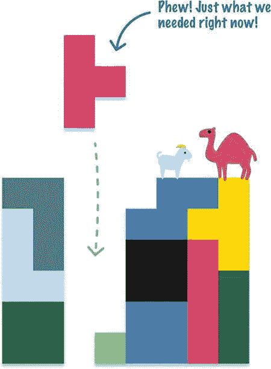

*在这种情况下是很好的匹配*

知道在何时使用何种数据结构是成为一名高效开发者的重要部分，我们需要深入熟悉的数据结构有：

- 数组 (Arrays)
- 链表 (Linked lists)
- 栈 (Stacks)
- 队列 (Queues)
- 树的介绍
  - 二叉树
  - 二叉搜索树
  - 堆数据结构
- 哈希表（Hashtable，也叫 hashmap 或字典）
- 字典树（Trie，也叫前缀树）

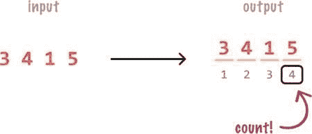

## 结论

在接下来的章节中，我们将学习每种数据结构擅长什么，更重要的是，它们不擅长什么类型的操作。

通过学习，在结束时，你和我将建立起一张心理地图，将正确的数据结构与我们试图解决的正确编程场景连接起来。

## 大 O 表示与复杂度分析

在分析代码执行的操作时，我们关注的是两点：时间复杂度和空间复杂度。时间复杂度指的是我们的代码运行所需的时间，而空间复杂度指的是我们的代码所需的额外内存。

你编写的任何代码都有一组特定的输入来产生特定的输出。在理想世界中，我们希望你的代码运行得尽可能快，占用的内存尽可能少。

然而，现实世界有其特殊性，根据输入的大小和特征，你的代码可能会决定采取悠闲的散步方式。虽然你总是可以通过看挂钟来衡量它针对特定输入集的性能，但我们真正需要的是一种方法来描述它在任何输入集上的表现。这正是大 O 表示法登场的地方。

继续前进！

## 到了示例时间

为了帮助我们更好地理解大 O 表示，让我们来看一个例子。我们有一段代码，它接收一个数字作为输入并告诉我们有多少位数字。如果我们的输入数字是 3415，那么数字的个数就是 4。

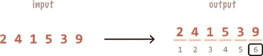

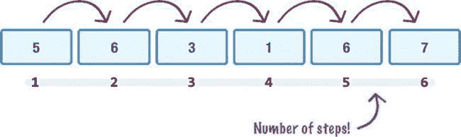

*数字中的位数计数*

如果我们的输入数字是 241,539，位数将是 6。

*对于更大的数字，位数也会之大* 如果我们必须简化这种行为，我们计算位数所做的工作量随着输入数字的大小**线性地**（即**成比例地**）增长。

*步骤数呈线性增长*

我们提供的输入数字越大，我们需要计数的位数就越多，以得到最终答案。重要的细节是，我们计算中的步骤数不会随着数字中每个额外数字而异常变大（变小）。我们可以通过绘制*输入大小*与获取计数所需的*步骤数*之间的图来可视化。

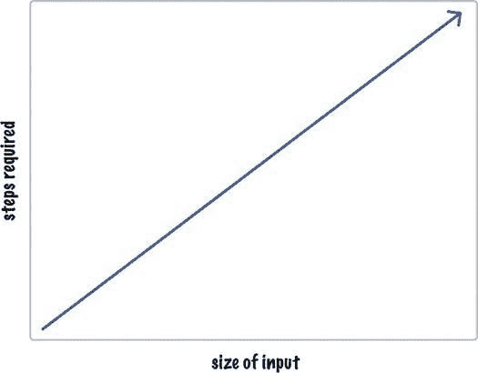

*工作量随输入大小线性增长* 我们在这里看到的是线性增长的可视化！线性增长只是我们将遇到的许多其他增长率之一。

假设我们有一些额外的代码让我们知道输入数字是奇数还是偶数。我们计算数字奇偶性的方法只需要看最后一位。

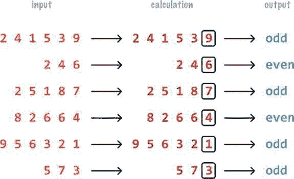

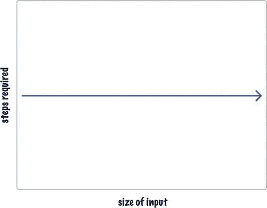

*最后一位是我们判断奇偶性的唯一数字* 在这种情况下，输入数字有多大并不重要。我们的工作量从不改变。我们总是检查最后一位并快速判断整个数字是奇是偶。我们可以通过说我们的计算需要**常数级**的工作量来简化这一点。

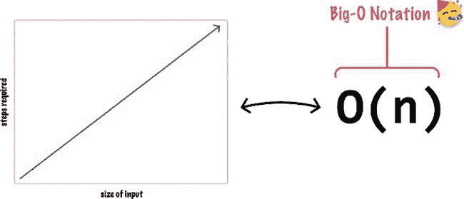

*工作量是常数*

注意，在所需步骤与输入大小的图中，工作量并不根据输入的大小而改变。它保持不变。它保持常数！

## 到了大 O 表示法的时间！

你可能在生活的某个时候听过这样的话：不要纠结小细节。关注大问题！在分析代码的性能时，并没有足够的微小细节是我们可以关注的。重要的是我们的代码相对于输入大小做了多少工作。这就是大 O 表示法的用武之地。

大 O 表示法是一种数学方法，用于表示代码在各种输入大小下的运行**上界**或**最坏情况**。它关注的是随着输入大小增大而影响算法的最显著因素。在现实中遇到大 O 表示法需要一点时间。如果我们必须描述之前的线性情况，大 O 表示法看起来像这样：

*线性关系的大 O 表示法*

大 O 表示法看起来有点像函数调用，但我们不应该那样看待它。如果我们必须分解此表示法的每个部分，将如下：大 O 中的 O，以及 n 代表“阶的”。它代表了算法的增长率。重申一点，增长率可以用时间（运行需要多久）或空间（使用多少内存）来衡量。

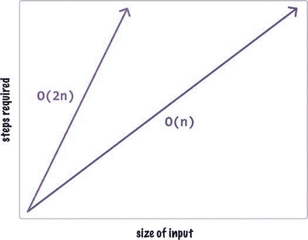

O 中的 n，或参数，代表我们的代码在最坏情况下执行的操作次数。例如，如果我们说我们的代码具有 O(n) 大 O 表示，意味着我们代码的运行时间或空间随输入大小线性增长。如果输入大小翻倍，所需的时间或空间也会翻倍。

另一方面，如果我们的代码具有 O(n²) 大 O 表示，意味着算法的运行时间或空间需求随输入大小平方级增长。如果输入大小翻倍，所需的时间或空间将增加四倍。可怕的部分是，平方增长并不是最糟糕的，我们在几分钟内就能涵盖这些。

现在，我们对大 O 表示法不做的是关注多余的修饰符。以线性情况为例，n 的真实值是 O(2n) 还是 O(n + n/2）并不重要。我们只关注最显著的因素。这意味着我们忽略修饰符，并将代码的时间或空间复杂度简化为 O(n)。现在，从 O(n) 变为 O(n²) 似乎会产生更多工作。

*O(n²) 与 O(n)*

当我们完全放大视角并讨论非常大的输入规模时，这种差异将是微不足道的。当我们观察 n 的其他类别值可能是什么时，情况尤其如此！

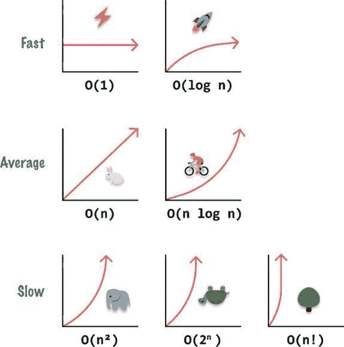

理解这一切最好的方法是查看 n 的每个主要值以及它的输入与复杂度的图。

*输入与复杂度的图*

让我们为前面的图片添加一些文字和额外细节，以更好地解释复杂度：

- **O(1)—常数复杂度：** 这种表示法代表无论输入大小如何，具有常数运行时间或空间的代码。这意味着无论数据集变得多大，执行复杂度保持不变。示例包括通过索引访问数组中的元素，或执行简单的数学运算，例如计算一个值是奇是偶。
- **O(log n)—对数复杂度：** 具有对数时间或空间复杂度的代码，其增长随输入大小增大而缓慢。这些编码方法通常重复地将输入分成更小的部分，例如在二分查找。随着输入大小翻倍，所需的步骤数增加一个很小的因子，而不是比例增加。
- **O(n)—线性复杂度：** 线性时间复杂度意味着代码的运行时间或空间随输入大小线性增长。随着输入大小增大，所需的时间或空间也成比例增加。示例包括遍历数组或链表以对每个元素执行操作。
- **O(n log n)—线性对数复杂度：** 线性对数复杂度算法的运行值是线性和对数增长率的乘积。这些算法常见于高效排序算法，如合并排序和快速排序。
- **O(n²)—平方复杂度：** 平方时间复杂度意味着代码的运行时间或空间随输入大小平方增长。这些编码方法通常涉及嵌套迭代，操作次数与输入大小的平方成比例。示例包括冒泡排序和选择排序。
- **O(2^n)—指数复杂度：** 指数时间复杂度代表运行时间随输入大小呈指数级增长的代码。这些编码方法效率极低，对于较大的输入来说是不实用的。当我们使用暴力破解或穷举搜索策略解决问题时，就会得到指数时间复杂度。
- **O(n!)—阶乘复杂度：** 阶乘时间复杂度是标记一段代码时最严重且最低效的标签。它代表了运行时间与输入规模阶乘成正比的编码方法。随着输入规模的增加，所需的操作数量将以天文级增长。当我们尝试使用暴力破解法探索问题所有可能的排列或组合来解决问题时，就会遇到阶乘时间复杂度和空间复杂度。

当我们一起观察数据结构和算法时，我们将经常使用 Big-O 表示法来描述某些操作的效率（高或低）。

这就是为什么对于我们来说，广泛理解 Big-O 各种值的代表含义，以及在遇到它时如何读取这种表示法至关重要。

## Big-O, Big-Theta, and Big-Omega

在某些情况下，我们可能会遇到其他用于描述代码执行行为的时间或空间复杂度的符号。我们在这里看到 Big-O 代表最坏情况。Big-Theta (Θ) 符号代表平均情况，而 Big-Omega (Ω) 符号代表最好情况。

当我们看到这些非 Big-O 符号出现时，我们就知道该如何读取它们了。

## 结论

好了！是时候结束课程了。Big-O 表示法是一种用于描述代码时间或空间复杂度的上界或最坏情况的数学符号。学术点来说，它为我们代码的增长率提供了一个渐近上界。通过使用 Big-O 表示法，我们可以用一种通用理解且一致的方式来讨论代码复杂度。它允许我们分析和比较不同编码方法的效率，帮助我们根据代码运行的上下文来决定哪些权衡是值得付出的。

## 数组 (Arrays)

我们将通过观察数组开始对数据结构的深入研究。我们很快就会发现，数组是最受欢迎的数据结构之一，许多其他数据结构都将其作为功能的一部分。记得我们在第 1 章遇到的那个神奇的工具箱吗？把数组想象成坚固的外壳，让你可以在工具箱内部创建隔间——也就是你数字工具的精巧整理器。它们就像工具箱里的保鲜盒，但是用于代码的！

在接下来的章节中，我们将介绍数组是什么、它们为什么如此流行、它们适用的情况（以及不适用的情况！）、如何使用它们以及更多内容。

继续前进！

### 什么是数组？

让我们想象我们正在一张纸上列出一个列表。让我们把这张纸称为**购物清单**。现在，在这张纸上，我们写了一份从零开始的编号列表，列出了我们需要从商店购买的所有物品。

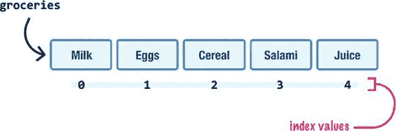


*购物清单*

这个购物物品列表存在于现实世界中。如果我们必须以数字方式表示它，我们用来存储所有购物物品的数据结构将是**数组！**原因如下：**数组是一种设计用于按顺序存储数据集合的数据结构。** 如果我们将购物清单转换为一个数组，我们得到的将像这样。

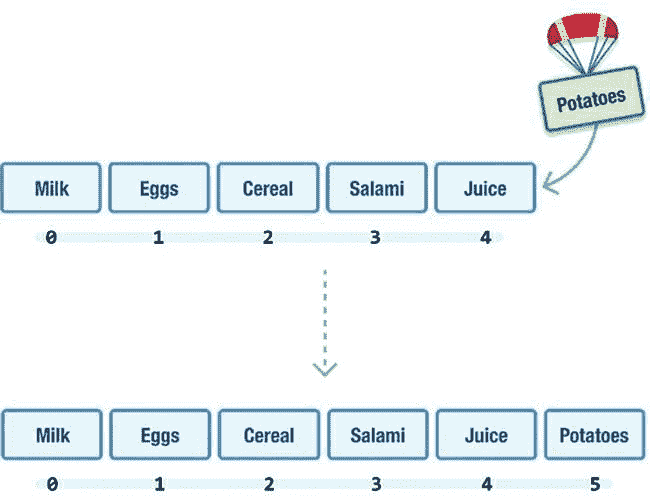

*作为数组的购物清单*

我们购物清单中的每个项目都表示为数组中的一个项。这些项是相邻的，并且它们**从零开始顺序编号**。让我们对这个数组进行一些常见的数据操作，以帮助我们更好地理解它的工作原理。

### 添加项目

对于数组，我们经常做的事情之一就是向其添加项目。具体在数组的哪个位置添加我们的项目非常重要。位置决定了所涉及的工作量。

在数组末尾添加项目是轻而易举。

*在数组中添加项目*

我们在末尾追加一个新项目。这个新项目将获得与其相关的下一个索引值。生活简单而美好。当我们数组的中间或开头添加项目时，我们必须先为新内容留出空间。

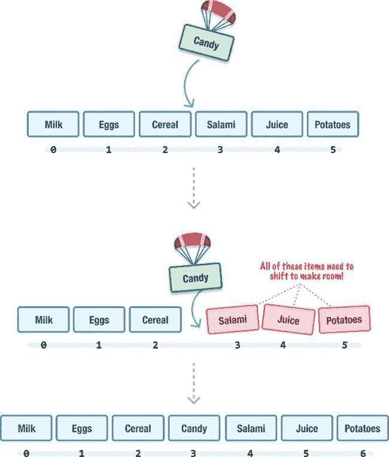

*为新内容留出空间*

因为数组是顺序排列的，*留出空间*是移动一组数组项并重新计算它们的索引位置的代名词。我们需要移动的项越多，此操作就越慢。最坏的情况是在开头插入一个项目，因为这意味着其他每个项目都需要移动并更新其索引。

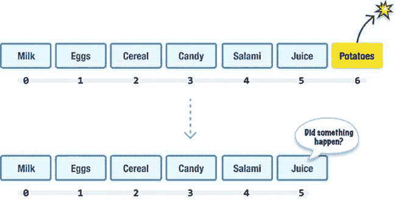

### 删除项目

当我们从数组中删除项目时，会遇到之前在添加项目时看到的相同挑战。如果我们在末尾删除项目，干扰是最小的。如果我们在其他地方删除项目，则需要确保。

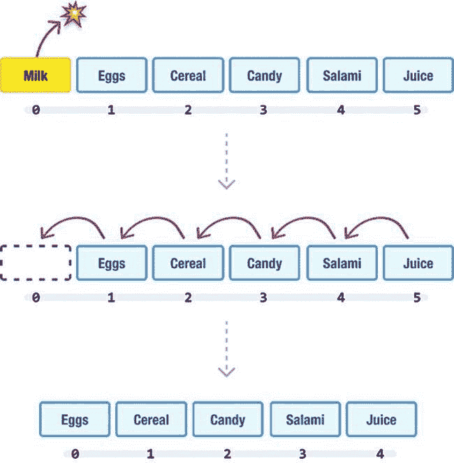

### 搜索项目

除了添加和删除项目，我们还会花费大量时间搜索它们。常用的方法是从数组开始逐个检查，直到找到我们要找的项目。

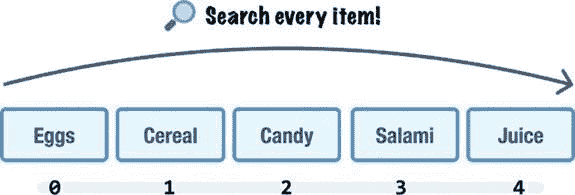

根据数据的形状，可能会有一些优化方法。例如，如果我们的数组按某种方式排序（字母顺序、数字顺序等），我们可以采用二分查找来提高搜索速度。


### 访问项目

到目前为止多次提到索引位置，但是时候深入探讨了。索引位置充当标识符。如果我们想访问特定的数组项（通过搜索或其他方式！），我们通过 **array[index]**的形式的形式引用它。需要记住的几个技巧是，第一个项目的索引总是 0。最后一个项目的索引总是总项目数减一。如果我们提供无效的索引位置，将会得到错误！

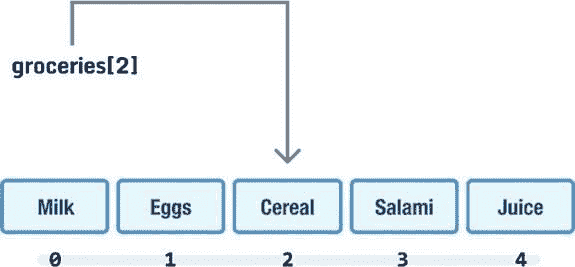

## 数组实现 / 用例

数组是几乎所有编程语言（如 JavaScript！）中提供的基础数据结构。以下是使用数组执行我们在购物清单中提到的某些操作的常见示例：

```javascript
// 创建我们的数组！
let groceries = ["Milk", "Eggs", "Cereal", "Salami", "Juice"];

// 访问第一个项目
let first = groceries[0];

// 访问最后一个项目
let last = groceries[groceries.length - 1];

// 在末尾插入项目
groceries.push("Potatoes");

// 在开头插入项目
groceries.unshift("Ice Cream");

// 在第三个项目之后插入
groceries.splice(3, 0, "Cheese");

// 删除最后一个项目
groceries.pop();

// 删除第一个项目
groceries.shift();

// 删除第三个项目
groceries.splice(2, 1);

// 查找特定项目
let foundIndex = groceries.indexOf("Eggs"); // 1
let itemToFind = -1;
// 遍历每个项目
for (let i = 0; i < groceries.length; i++) {
  let currentItem = groceries[i];
  // 返回找到的项目的索引
  if (currentItem == "Salami") {
    itemToFind = i;
  }
}
```

为了深入学习数组所做的一切，如果你还不精通数组，请花点时间真正熟悉它们。许多后续的数据结构和算法我们将

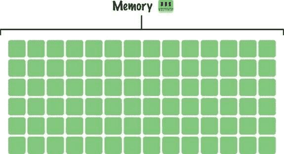

我们将深入学习数组底层的运行机制。

**数组与内存**

在像 JavaScript 这样的现代高级编程语言中工作时，我们不需要主动去思考内存管理。所有的内存处理都由系统为我们处理。我们即将看到的内容稍微涉及到计算机的内部工作机制，在某些时刻，了解发生的情况将极大地提高我们对事物运行方式的理解——在我们的例子中，这些事物就是数组。

当我们思考内存时，让我们将其简化为一组可以存储数据的区域。

*作为一系列区域的内存*

现在，我们的内存状态永远不会像我们看到的这样干净。我们的计算机正在同时处理许多其他占用空间的任务。

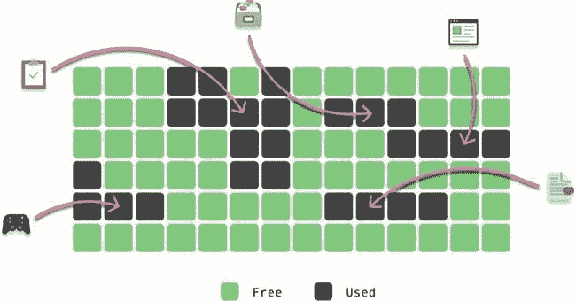

*工作中的内存*

我们向添加到内存中的任何新项都需要进入可用的***空闲***区域。

这让我们回到了数组。当我们创建一个数组时，我们首先需要在内存中分配一些空间供它存放。数组的特点是，它们需要将项存储在相邻（又称连续）的内存区域中。它们不能分散在*空闲*和*已使用*区域中。当我们初始化一个数组时，我们在内存中分配固定数量的空间，并随着数组的增长不断增加这个固定数量。假设我们创建了一个空数组。尽管我们的数组现在是空的，我们也分配了额外的内存区域。

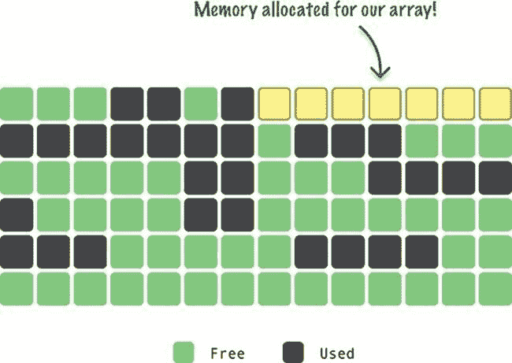

*数组的内存分配*

在我们的示例中，我们分配了七个内存区域。当我们向数组中添加项时，它们开始慢慢填满我们分配的内存。

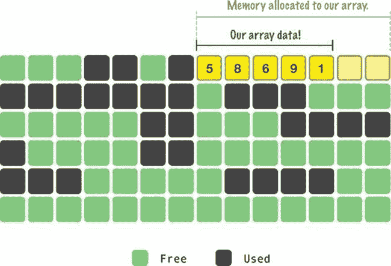[](img/d90243d52c96b97e5b0d290d2d85d3ff_153_1.png)


## 用数据填充数组

我们不断向数组中添加数据，直到填满所有的分配空间。

### 数组被数据填充

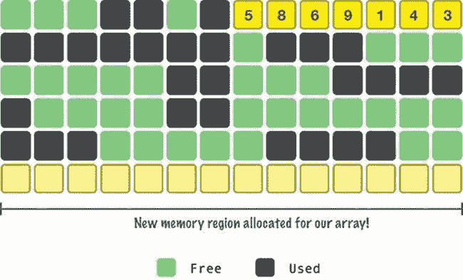

如果我们额外添加一个项，接下来会发生什么？没有相邻的内存可以让我们扩展数组。接下来发生的情况是，我们的操作系统（或虚拟机）找到一段连续的内存，将我们增长的数组移动到其中。

### 寻找连续的内存区域

一旦找到了这个内存区域，就是将整个数组移动到新位置的时候。

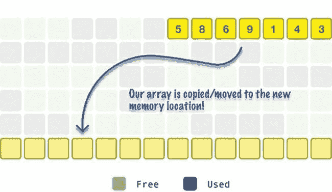

### 数组数据被移动到新的内存位置

在我们的数组完全移动之后（这绝对不是一个廉价的操作，因为每个项都需要移动新位置），我们可以添加更多数组项，而数组之前所在的旧内存位置就有了空闲空间，其他东西现在可以进入。

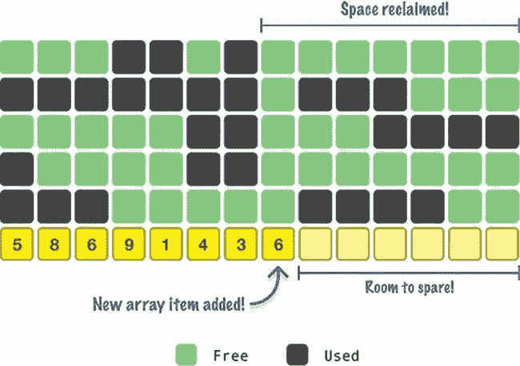

### 新数据现在可以进入由移动释放的内存位置

更传统的编程语言非常严格，要求确保你和我在认真思考内存以及如何确保我们不会超出它。像 JavaScript 这样的现代语言为我们处理了这一切，但超出我们分配的内存大小并需要将数组移动到更大区域的性能影响仍然存在。我们接下来将讨论这一点。

## 性能考量

在之前的章节中，我们窥见了数组执行非常快的活动（以及执行缓慢的活动）。表格总结了性能和空间方面的考量。

### 数组性能与空间考量

| 操作 | 平均 | 最坏 空间/内存 |
| :--- | :--- | :--- |
| 索引访问 | Θ(1) | O(1) |
| 在末尾插入 | Θ(1) | O(n) |
| 在其他位置插入 | Θ(n) | O(n) |
| 删除 | Θ(1) | O(n) |
| 在末尾删除 | Θ(1) | Θ(1) |
| 线性搜索 | O(n) | O(n) |
| 二分搜索 | O(log n) | O(n) |

让我们更详细地深入了解为什么我们的数组访问数组。

### 访问

数组访问是非常高效的，并且具有常数时间（`O(1)`）。这意味着访问特定索引处的元素所需的时间相同。

### 插入

在数组开头插入一个元素需要移动所有现有元素以腾出空间。因此，它的时间复杂度为`O(n)`。在数组末尾插入元素是高效的，复杂度为`O(1)`。

### 删除

在数组开头删除元素需要移动所有后续元素以腾出空间。因此，它的时间复杂度为`O(n)`。在数组末尾删除是高效的，复杂度为`O(1)`。

### 搜索

我们有两类搜索方法：

- **线性搜索**：在无序数组中搜索元素需要遍历到数组末尾。在最坏的情况下，该操作的时间复杂度为`O(n)`。
- **二分搜索**：在有序数组中搜索元素可以使用二分搜索，通过不断将搜索空间减半。该操作的时间复杂度为`O(log n)`。然而，二分搜索需要有序数组，如果数组是无序的，可能需要额外的排序操作，导致更高的复杂度。

## 总结

数组是我们使用的最基础的数据结构之一。几乎所有的编程语言，无论底层如何，都为数组提供了内置支持。这有几个原因。

在编程中，我们经常处理数据集合。如果每个项目都得重新创建数组，将很奇怪。另一个原因与数组的工作方式有关。它们紧密映射到连续的内存区域，对于我们（特别是高级语言）来说，要从头创建数组并保持更原生实现所提供的性能是困难的。这就是为什么正如我们很快就会看到的，数组实际上是我们将查看的其他结构的一部分。

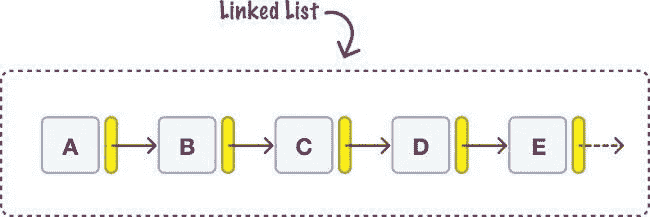

## 链表

链表和数组一样，都是为了帮助我们存储数据集合的，它们为处理不断变化的大量数据提供了一种优雅的解决方案，并且拥有一些技巧可以快速高效地处理所有这些工作。在本章中，我们将探索链表的内部细节，例如其基本结构、性能特征、代码实现等！这将会非常有趣的。前进！

## 认识链表

链表和数组一样，都是为了帮助我们存储数据集合的，我们有一个链表示例用于存储 A 到 E 的字母。

### 一个链表

链表通过依赖相互连接的单个节点来工作。每个节点负责两两事情：

- 它所存储的任何数据，例如一个字母。
- 指向下一个指针（也称为引用），指向列表中的下一个节点。

不言而喻，节点至关重要。我们可以放大一个节点并对其进行可视化，如图所示。

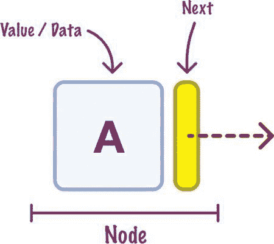

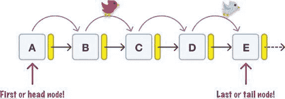

### 一个节点由一个值/数据以及一个指针或引用组成

链表的简要传记是这样的：当我们获取大量数据，将它们与节点匹配，并通过下一个指针将节点连接在一起时，我们就得到了一个链表。链表是如何变成链表的？它是如何帮助我们处理数据的？让我们来看看更多细节并回答这些问题吧！

### 查找值

我们有一个包含大量数据的链表，并且想要找到某些东西。这是我们将执行的最常见操作之一。我们通过从第一个节点（也称为头节点）开始，并通过下一个指针引用的每个节点来查找值。

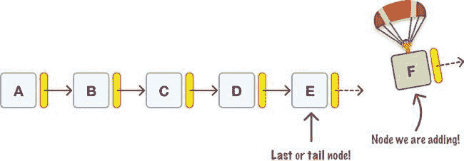

#### 遍历节点

我们不断从一个节点跳转到另一个节点，直到我们：

- 找到我们寻找的值所在的节点。
- 到达最后一个节点（也称为尾节点），它标记了列表的结束，且我们无处可去。

如果你觉得这听起来非常像线性搜索，那么你是正确的。它确实如此……以及它所蕴含的所有优坏的性能特性。如果你不这么认为，也没关系。

### 添加节点

现在，让我们看看如何向链表中添加节点。添加节点的整个思想不在于添加，而在于创建新节点并更新几个下一个指针。我们将通过几个示例来看到这一过程。

假设我们要在末尾添加节点 F。

#### 我们想要添加一个新节点 F

我们需要做的是更新我们的尾部或最后一个 E 节点的下一个指针，使其指向我们正在添加的新节点 F。

#### 更新 E 的指针

我们在链表的任何位置添加新节点并不重要。其行为大部分相同。假设我们想在现有节点 C 和 D 之间添加一个新节点 Q。

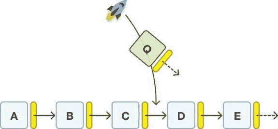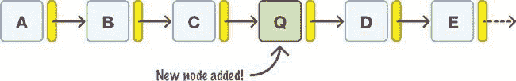

#### 我们想要在 C 和 D 之间添加一个新节点 Q

为了实现这一目标，我们需要采取的步骤如下：

1. 替换 C 上的下一个指针使其指向 Q。
2. 替换 Q 上的下一个指针使其指向 D。

这将导致所示的安排，这正是我们想要的。

#### Q 已添加

一个需要记住的细节细节是，我们在链表的任何位置添加节点并不重要。链表的主要工作是确保下一个指针已更新以考虑到新添加的节点。虽然这听起来很复杂，但工作量很小。

如果我们在链表的开头或结尾添加节点，只进行一次与指针相关的更新。如果我们在链表开头或结尾之外的任何地方添加节点，将进行两次与指针相关的更新。这非常高效！

### 删除节点

当我们想要删除一个节点时，我们采取的步骤与添加节点时的操作相似。假设我们想要删除链表中的节点 D。

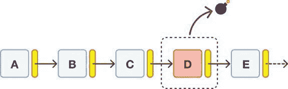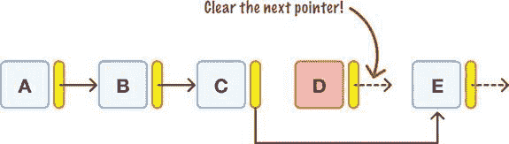

#### 我们想要删除节点 D

我们做的是更新节点 C 上的指针使其直接引用节点 E，跳过节点 D。

#### 更新 C 的指针引用 E，跳过 D

我们还清空了 D 节点上的下一个指针。这一切使得节点 D 无法通过遍历访问并将其移除。节点到底什么时候被删除的？它发生在垃圾回收过程中。

## 链表：时间与空间

| 操作 | 最优 | 最坏 |
| :--- | :--- | :--- |
| 搜索 | O(1) | O(n) |
| 添加 | O(1) | O(n) |
| 删除 | O(1) | O(n) |

（注：上述表格是根据文中提供的性能背景重构的）

### 跳表

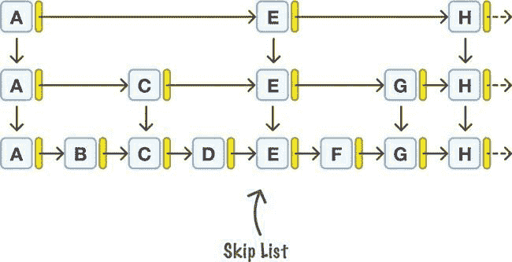

请注意，我们跳表的每一层都能让我们更快地访问某些元素。

取决于我们正在查找的数据，我们将在每一层中进行水平以及向上和向下的遍历，以最大限度地减少我们需要检查的节点数量。

跳表通常用于我们需要对大型数据集进行频繁查寻或搜索的情况。通过在链表中添加跳过链接（skip links），我们可以减少查找特定元素所需的时间，同时保持链表的优势（例如常数时间的插入和删除）。

## 实现

对于我们的链表，有一些关键操作对我们来说至关重要：

- 创建新链表
- 在开头添加项
- 在末尾添加项
- 在现有项之前添加项
- 在现有项之后添加项
- 检查我们的链表是否包含特定项
- 移除第一个项
- 移除最后一个项
- 移除特定项
- 将项目转换为数组
- 获取链表的长度

以下是支持所有操作的实现：

```javascript
class LinkedListNode {
  constructor(data, next = null) {
    this.data = data;
    this.next = next;
  }
}

class LinkedList {
  constructor() {
    this.head = null;
    this.tail = null;
    this.size = 0;
  }

  addFirst(data) {
    const newNode = new LinkedListNode(data, this.head);
    this.head = newNode;
    if (!this.tail) {
      this.tail = newNode;
    }
    this.size++;
  }

  addLast(data) {
    const newNode = new LinkedListNode(data);
    if (!this.head) {
      this.head = newNode;
      this.tail = newNode;
    } else {
      this.tail.next = newNode;
      this.tail = newNode;
    }
    this.size++;
  }

  addBefore(beforeData, data) {
    const newNode = new LinkedListNode(data);
    if (this.size === 0) {
      this.head = newNode;
      this.size++;
      return;
    }
    if (this.head.data === beforeData) {
      newNode.next = this.head;
      this.head = newNode;
      this.size++;
      return;
    }
    let current = this.head.next;
    let prev = this.head;
    while (current) {
      if (current.data === beforeData) {
        newNode.next = current;
        prev.next = newNode;
        this.size++;
        return;
      }
      prev = current;
      current = current.next;
    }
    throw new Error(`Node with data '${beforeData}' not found in list`);
  }

  addAfter(afterData, data) {
    const newNode = new LinkedListNode(data);
    if (this.size === 0) {
      this.head = newNode;
      this.size++;
      return;
    }
    let current = this.head;
    while (current) {
      if (current.data === afterData) {
        newNode.next = current.next;
        current.next = newNode;
        this.size++;
        return;
      }
      current = current.next;
    }
    throw new Error(`Node with data '${afterData}' not found in list!`);
  }

  contains(data) {
    let current = this.head;
    while (current) {
      if (current.data === data) {
        return true;
      }
      current = current.next;
    }
    return false;
  }

  removeFirst() {
    if (!this.head) {
      throw new Error('List is empty');
    }
    this.head = this.head.next;
    if (!this.head) {
      this.tail = null;
    }
    this.size--;
  }

  removeLast() {
    if (!this.tail) {
      throw new Error('List is empty');
    }
    if (this.head === this.tail) {
      this.head = null;
      this.tail = null;
      this.size--;
      return;
    }
    let current = this.head;
    let prev = null;
    while (current.next) {
      prev = current;
      current = current.next;
    }
    prev.next = null;
    this.tail = prev;
    this.size--;
  }

  remove(data) {
    if (this.size === 0) {
      throw new Error("List is empty");
    }
    if (this.head.data === data) {
      this.head = this.head.next;
      this.size--;
      return;
    }
    let current = this.head;
    while (current.next) {
      if (current.next.data === data) {
        current.next = current.next.next;
        this.size--;
        return;
      }
      current = current.next;
    }
    throw new Error(`Node with data '${data}' not found in list`);
  }

  toArray() {
    const arr = [];
    let current = this.head;
    while (current) {
      arr.push(current.data);
      current = current.next;
    }
    return arr;
  }

  get length() {
    return this.size;
  }
}
```

```javascript
let letters = new LinkedList();

letters.addLast("A");

letters.addLast("B");

letters.addLast("C");

letters.addLast("D");

letters.addLast("E");

console.log(letters.toArray()); // ['A', 'B', 'C', 'D', 'E']

letters.addFirst("A");

letters.addLast("Z");

console.log(letters.toArray()); // ['A', 'A', 'B', 'C', 'D', 'E', 'Z']

letters.remove("C");

letters.removeLast();

console.log(letters.toArray()); // ['A', 'A', 'B', 'D', 'E']

letters.addAfter("D", "Q");
```


```javascript
console.log(letters.toArray()); // ['A', 'A', 'B', 'D', 'Q', 'E']

letters.addAfter("Q", "H");

letters.addBefore("A", "S");

console.log(letters.toArray()); // ['S', 'A', 'A', 'B', 'D', 'Q', 'H', 'E']

console.log(letters.length); // 8
```

为了查看上述代码的演示示例，未来如果我们在代码中使用这个`LinkedList`，可以复制/粘贴这段代码，或者通过添加以下脚本直接引用：我们将很快看到，链表在其他数据结构和算法的实现中起着关键作用

### 链表与数组

正如上一章提到的，数组反映了数据在计算机内存中的存储方式。这意味着我们需要与数组大小匹配的连续内存块。数组针对直接访问进行了优化，而链表采用了不同的方法。它们依赖`next`指针，这赋予了它们灵活性并消除了对连续内存的需求。然而，这种设计也使得链表不太适用于直接访问。有得有失吧？

## 结论

呼！正如我们在许多文字和图中看到的，链表提供了存储和处理数据的有效方法。它们允许常数时间的插入和删除，并且可以轻松遍历以执行搜索等操作。虽然它们不是最高效的数据结构，但它们在简单性上可以稳坐首位。正如我们在下一章看到的，在 JavaScript 中构建链表和我们解释原理一样优雅。

## 栈

你在工作时用过撤销（Undo）或重做（Redo）吗？你是否好奇过你喜欢的编程语言如何将你编写的内容转换为顺序步骤以便你的计算机知道该做什么？你是否曾在浏览器中后退或前进过？你喜欢煎饼吗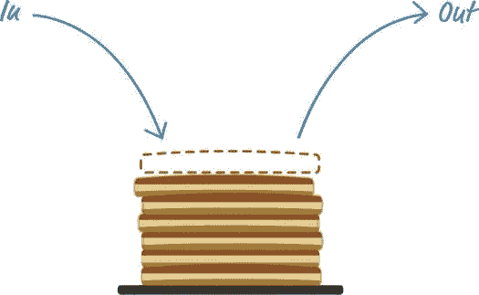？

如果你对上述任何问题回答了“是”，那么你可能遇到了本教程的主角——`栈`（结构）结构结构在接下来的章节中，我们将学习更多关于栈的内容以及如何在 JavaScript 中使用它。

前进！

### 认识栈

在生活的某个时刻，我们几乎肯定见过堆叠在一起的东西……例如所示的煎饼。

*栈*

堆叠物品的特点在于我们总是将项添加到顶部。我们也从顶部移除项。

*在栈的顶部添加和移除*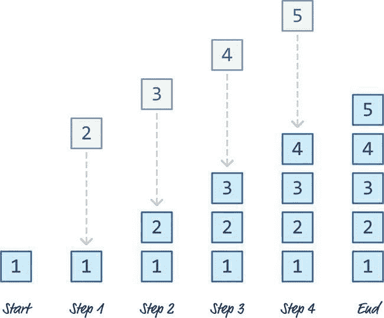这一概念也适用于计算机世界中的事物。栈是我们经常遇到的一种已知数据结构，就像我们的煎饼一样，我们按顺序不断添加数据。

*数据按顺序添加到栈中*

我们按照添加数据的相同顺序从栈的末尾移除数据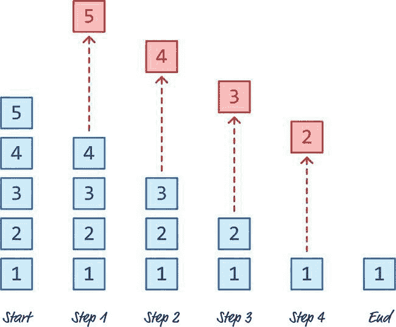

*数据按照添加顺序从栈尾移除*在计算机术语中，这被称为**后进先出**（last in, first out）系统——更常见的缩写是`LIFO`。你最终访问（即移除）的数据是我们最后添加的那个一个。

```javascript
} clear() {
  this.items.length = 0;
}

clone() {
  return new Stack(...this.items);
}

contains(item) {
  return this.items.includes(item);
}

peek() {
  let itemsLength = this.items.length;
  let item = this.items[itemsLength - 1];
  return item;
}

pop() {
  let removedItem = this.items.pop();
  return removedItem;
}

push(item) {
  this.items.push(item);
  return item;
}

}
```

这段代码定义了我们的`Stack`（栈）对象以及我们可以用于添加元素、移除元素、查看最后一个元素等的各种方法。要使用它，我们可以像像下面这样操作：

```javascript
let myStack = new Stack();

// 添加元素
myStack.push("One");
myStack.push("Two");
myStack.push("Three!");

// 预览最后一个元素
myStack.peek(); // Three

// 移除元素
let lastItem = myStack.pop();
console.log(lastItem) // Three
myStack.peek(); // Two

// 创建栈的副本
let newStack = myStack.clone();

// 检查元素是否在栈中
newStack.contains("Three") // false
```

我们需要的第一步创建一个新的`Stack`对象。我们可以像所示那样创建一个空栈，或者像下面这样预填充一些元素：`let stuffStack = new Stack("One", "Two", "Three");` 要向栈中添加元素，使用`push`方法并传入任何你想添加的内容。要移除元素，使用`pop`方法。如果你想在不移除元素的情况下预览最后一个元素，`peek`方法将提供帮助。`clone`方法返回栈的副本，而`contains`方法允许你查看元素是否存在于栈中。

栈数据结构在我们在书中将看到的其他数据结构和算法中会被频繁使用。

### 栈：时间与空间复杂度

栈的运行时间和内存性能都非常好。对于最常见的操作（如我们在实现中支持的操作），下表总结了我们的链表的性能：

| 动作 | 最优 | 平均 | 最差 |
| :--- | :--- | :--- | :--- |
| `Push` (入) | `O(1)` | `O(1)` | `O(1)` |
| `Pop` (弹出) | `O(1)` | `O(1)` | `O(1)` |
| `Peek` (查看) | `O(1)` | `O(1)` | `O(1)` |
| `Search/Contains` (搜索/包含) | `O(1)` | `O(n)` | `O(n)` |
| `Memory` (内存) | `O(n)` | `O(n)` | `O(n)` |

栈可以用数组或链表实现，但这两种实现方案之间的性能差异微乎其微。让我们深入探讨一下为什么我们栈的性能数据是这样的。

### 运行性能

**`Push` 操作：** 在栈顶部添加元素（`push` 操作）需要常数时间复杂度`O(1)`。无论栈有多大，`push`操作始终需要相同的时间。

**`Pop` 操作：** 从栈顶部移除元素（`pop`操作）也需要常数时间复杂度`O(1)`。与`push`操作类似，它不依赖于栈的大小。

**`Peek` 操作：** 查看栈顶部的元素（`peek`操作）也是一个常数时间操作`O(1)`。

**`Search/Contains` 操作：** 在栈中搜索元素（例如检查元素是否存在于栈中）需要线性时间`O(n)`。在最坏的情况下，该操作涉及遍历整个栈及其所有所有元素。

### 内存性能

JavaScript 中栈的内存性能相当高效，具有`O(n)`的增长率，且这不取决于栈是使用数组还是链表实现的。正如我们之前看到的，JavaScript 中的数组是动态大小的，因此它们可以随着元素的添加或移除而增长或缩小。然而，这种动态调整可能会导致偶尔的内存重新分配，从而引起一些卡顿。


当使用链表实现栈时，内存分配是增量进行的。没有类似于我们在数组中看到的种种重大重新分配，因此链表方法在处理大型栈时具有优势。

### 结论

如果你看一眼代码，我们的栈实现只是对`Array`对象的封装，元素被从末尾添加并从末尾移除，使用数组的`push`和`pop`方法无需任何额外修改即可工作。在数组末尾添加和移除元素的性能非常好——如果你在跟踪位置的话，它们是常数时间，或`O(1)`。

## 队列

栈是一种**后进先出（`LIFO`）**数据结构，元素从末尾添加和移除。与之相反，我们有另一种流行的数据结构，**队列（`Queue`）**。这是一种有趣的结构，我们将在接下来的章节中学习更多相关内容。

继续前进！

### 认识队列

名如其义，队列非常像排队等某事。

*排队的人*

站在队列最前面的人是第一个离开的人。站在队列最前面的人是第一个离开的人。站在队列最前面的人是第一个离开的人。站在队列最前面的人是第一个离开的人。站在队列最前面的人是第一个离开的人。站在队列最前面的人是第一个离开的人。站在队列最前面的人是第一个离开的人。站在队列最前面的人是第一个离开的人。站在队列最前面的人是第一个离开的人。站在队列最前面的人是第一个离开的人。站在队列最前面的人是第一个离开的人。站在队列最前面的人是第一个离开的人。站在队列最前面的人是第一个离开的人。站在队列最前面的人是第一个离开的人。站在队列最前面的人是第一个离开的人。站在队列最前面的人是第一个离开的人。站在队列最前面的人是第一个离开的人。站在队列最前面的人是第一个离开的人。站在队列最前面的人是第一个离开的人。站在队列最前面的人是第一个离开的人。站在队列最前面的人是第一个离开的人。站在队列最前面的人是第一个离开的人。站在队列最前面的人是第一个离开的人。站在队列最前面的人是第一个离开的人。站在队列最前面的人是第一个离开的人。站在队列最前面的人是第一个离开的人。站在队列最前面的人是第一个离开的人。站在队列最前面的人是第一个离开的人。站在队列最前面的人是第一个离开的人。站在队列最前面的人是第一个离开的人。站在队列最前面的人是第一个离开的人。站在队列最前面的人是第一个离开的人。站在队列最前面的人是第一个离开的人。站在队列最前面的人是第一个离开的人。站在队列最前面的人是第一个离开的人。站在队列最前面的人是第一个离开的人。站在队列最前面的人是第一个离开的人。站在队列最前面的人是第一个离开的人。站在队列最前面的人是第一个离开的人。站在队列最前面的人是第一个离开的人。站在队列最前面的人是第一个离开的人。站在队列最前面的人是第一个离开的人。站在队列最前面的人是第一个离开的人。站在队列最前面的人是第一个离开的人。站在队列最前面的人是第一个离开的人。站在队列最前面的人是第一个离开的人。站在队列最前面的人是第一个离开的人。站在队列最前面的人是第一个离开的人。站在队列最前面的人是第一个离开的人。站在队列最前面的人是第一个离开的人。站在队列最前面的人是第一个离开的人。站在队列最前面的人是第一个离开的人。站在队列最前面的人是第一个离开的人。站在队列最前面的人是第一个离开的人。站在队列最前面的人是第一个离开的人。站在队列最前面的人是第一个离开的人。站在队列最前面的人是第一个离开的人。站在队列最前面的人是第一个离开的人。站在队列最前面的人是第一个离开的人。站在队列最前面的人是第一个离开的人。站在队列最前面的人是第一个离开的人。站在队列最前面的人是第一个离开的人。站在队列最前面的人是第一个离开的人。站在队列最前面的人是第一个离开的人。站在队列最前面的人是第一个离开的人。站在队列最前面的人是第一个离开的人。站在队列最前面的人是第一个离开的人。站在队列最前面的人是第一个离开的人。站在队列最前面的人是第一个离开的人。站在队列最前面的人是第一个离开的人。站在队列最前面的人是第一个离开的人。站在队列最前面的人是第一个离开的人。站在队列最前面的人是第一个离开的人。站在队列最前面的人是第一个离开的人。站在队列最前面的人是第一个离开的人。站在队列最前面的人是第一个离开的人。站在队列最前面的人是第一个离开的人。站在队列最前面的人是第一个离开的人。站在队列最前面的人是第一个离开的人。站在队列最前面的人是第一个离开的人。站在队列最前面的人是第一个离开的人。站在队列最前面的人是第一个离开的人。站在队列最前面的人是第一个离开的人。站在队列最前面的人是第一个离开的人。站在队列最前面的人是第一个离开的人。站在队列最前面的人是第一个离开的人。站在队列最前面的人是第一个离开的人。站在队列队列最前面的人是第一个离开的人。站在队列最前面的人是第一个离开的人。站在队列最前面的人是第一个离开的人。站在队列最前面的人是第一个离开的人。站在队列最前面的人是第一个离开的人。站在队列最前面的人是第一个离开的人。站在队列最前面的人是第一个离开的人。站在队列最前面的人是第一个离开的人。站在队列最前面的人是第一个离开的人。站在队列最前面的人是第一个离开的人。站在队列最前面的人是第一个离开的人。站在队列最前面的人是第一个离开的人。站在队列最前面的人是第一个离开的人。站在队列最前面的人是第一个离开的人。站在队列最前面的人是第一个离开的人。站在队列最前面的人是第一个离开的人。站在队列最前面的人是第一个离开的人。站在队列最前面的人是第一个离开的人。站在队列最前面的人是第一个离开的人。站在队列最前面的人是第一个离开的人。站在队列最前面的人是第一个离开的人。站在队列最前面的人是第一个离开的人。站在队列最前面的人是第一个离开的人。站在队列最前面的人是第一个离开的人。站在队列最前面的人是第一个离开的人。

| 操作 | 时间复杂度 | 内存复杂度 |
| :--- | :--- | :--- |
| 入队 (`Enqueue`) | `O(1)` | `O(n)` |
| 出队 (`Dequeue`) | `O(1)` | `O(n)` |
| 查看队首 (`Peek`) | `O(1)` | `O(n)` |
| 搜索 (`Search`) | `O(n)` | - |

这些性能数据中的一个关键细节在于我们使用了链表作为底层数据结构。如果我们使用类似数组的结构，涉及修改列表开部的操作将花费`O(n)`的时间，而不是链表中的`O(1)`时间。我们不希望那样！让我们深入探讨一下为什么我们队列的性能数据是目前这样的。

### 运行性能

- **入队（插入）：** 基于链表的队列，其入队操作具有常数时间复杂度`O(1)`，因为元素被添加到链表的末尾，不需要位移或移动现有元素。
- **出队（删除）：** 基于链表的队列，其出队操作也具有常数时间复杂度`O(1)`。元素从链表的头部移除，与入队操作一样，不需要移动元素。
- **查看队首：** 查看操作允许我们在不移除元素的情况下访问头部元素，它也是一个`O(1)`操作。它直接从链表的头获取值。
- **搜索：** 在基于链表的队列中搜索元素的效率低于其插入或删除操作。搜索操作需要从头到尾遍历链表，导致线性时间复杂度`O(n)`，其中`n`是队列中的元素数量。

### 内存性能

队列的整体内存占用为`O(n)`，其中队列中的每个元素都由一个节点表示，该节点包含数据以及指向下一个节点的指针/引用。因此，所需的空间随着队列中元素数量的增加而呈线性增长。尽管如此，还有几个额外的细节需要注意：

- **动态内存分配：** 链表是动态分配的，这意味着当元素添加到队列时，为每个节点分配内存。这允许队列动态调整大小并高效地处理不同数量的元素。
- **内存开销：** 链表需要额外的内存来维护节点之间的指针。这一点已经知道了！与数组的实现相比，在处理大量元素时，这种开销可能是一个缺点。
- **缓存性能：** 链表可能会遇到缓存性能问题，因为元素没有存储在连续的内存位置。这可能会导致更多的缓存缺失，影响某些操作的整体性能。

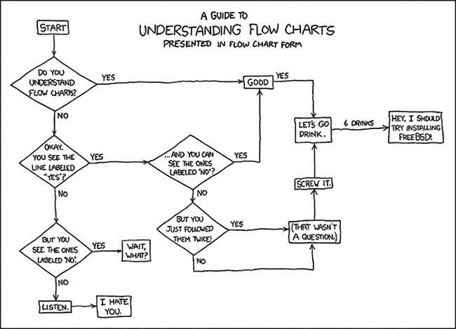

还不错，对吧？使用链表实现的队列提供了高效的插入和删除操作，时间复杂度为常数`O(1)`。在队列中搜索元素的速度较慢，时间复杂度为线性`O(n)`。在内存方面，情况非常一致，根据我们队列存储的项数量呈线性`O(n)`增长。

## 结论

通过我们之前看到的栈和现在看到的队列，我们涵盖了两种最流行的数据结构，它们模拟了数据进入和离开的模型方式。队列被称为`FIFO`（先进先出）数据结构，其中项从末尾添加，但从`Solution`部移除。“从`Solution`部移除”这部分正是我们依赖链表数据结构的原因。正如我们几次看到的，数组在从`Solution`部移除或添加项时效率并不高。

## 树

当我们环顾四周时，我们处理的大量数据是层次化的，父节点和子节点之间有清晰的关系。常见的例子包括家族树、组织结构图、流程图/图表等。图 X 是由 xkcd 普及的一个著名例子。

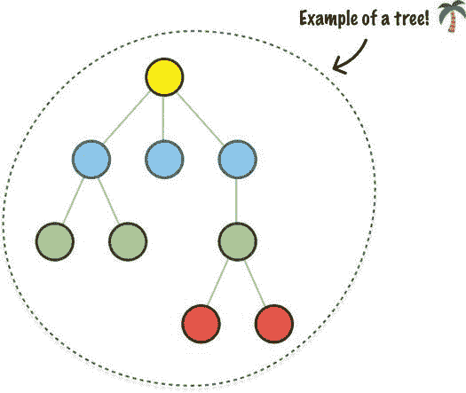

*可视化编程中的奇特性！*

虽然可以使用数组或链表等线性数据结构来表示层次化数据，但这并非最优的。一种更好的方法是使用**树**数据结构。

在接下来的章节中，我们将学习大量关于树的知识，并做好深入学习准备。

### 树 101

回顾一下，树数据结构是以层次化的方式组织数据。就像自然界一样，计算机世界中的树也有许多形状和大小。为了我们的目的，让我们可视化一个。

*树示例*

我们看到许多相互连接的圆。树中的每个圆被称为**节点**。节点在树中起着重要作用。它负责存储数据，并负责连接其他节点。

节点之间的连接（可视化为线）被称为**边**。

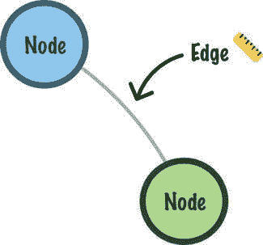

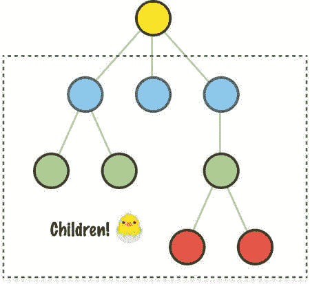

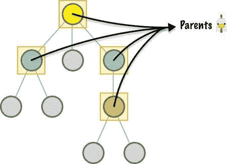

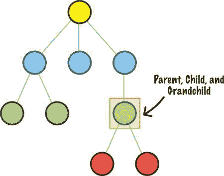

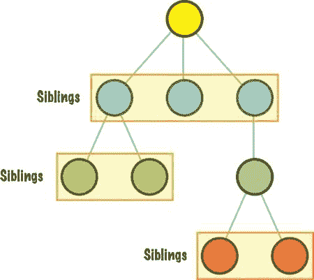

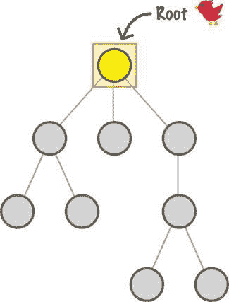

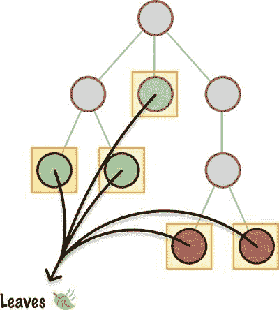

`img/d90243d52c96b97e5b0d290d2d85d3ff_202_1.png`

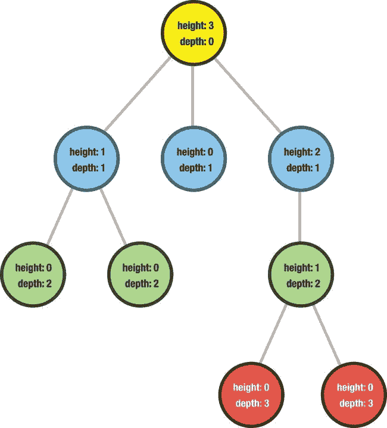

*树的高度和深度的解释*

有些需要注意的地方：高度的值是*相对于每个节点的*，完全取决于距离最远的叶子节点有多远。深度的值是整棵树的*全局性*属性，与我们树的形状无关。树的根节点深度为 0，下一层子节点的深度为 1，依此类推。

## 结论


好了，我那热爱叶子的朋友们，我们终于结束了对树形数据结构这个奇妙世界的短途深度探索。虽然起初思考我们的数据将如何适应这种树形格式可能看起来有些令人生畏，但我们将在后续章节中进行更深入的探讨，以确保我们都能成为“抱树专家”！所以，下次当你感到有点毫无头绪时，只要记得奖励自己一杯好咖啡，戴上你的思考帽，然后开辟思路吧……

好了，我先“落叶（离开）”了。

## 二叉树

之前，我们查看了树数据结构，并学习了各种节点和边代表的含义。现在是时候扩展一下（哈！）并进一步深挖了。我们将通过观察树数据结构的一种特定实现——**二叉树**，在此基础上继续构建。

前进！

### 结识二叉树

二叉树表面上看起来就像一棵普通的无聊树，允许我们以分层的方式存储数据。下图是一个二叉树的示例。

*二叉树的示例*

二叉树的不同之处在于，与可以随所欲的普通树不同，我们的树必须遵守三条严格规则才能被分类为二叉树：

1. 每个节点只能有零、一个或两个子节点。

2. 树只能有一个根节点。

3. 从根节点到某个节点只能有一条路径。

让我们深入研究一下这些规则，因为理解它们至关重要。它们有助于解释为什么二叉树是这种运作方式的，并为我们学习其他树的变体（如二叉搜索树）奠定基础。

### 规则解释

第一个规则是二叉树中的每个节点只能有零、一个或两个子节点。如果一个节点恰好有超过两个子节点，那就是问题。

*不允许超过两个子节点*

第二条规则是二叉树必须只有一个根节点。

*不能有多个根节点*

在这个示例中，`A`节点和`AA`节点都在竞争谁成为主根节点。虽然在某些其他基于树的数据结构中，多个根节点是可以接受的，但在二叉树中是不允许的。

现在，我们来看最后一条规则。最后一条规则是从根节点到树中任何节点只能有一条路径。

*根节点与节点之间不能有多条路径*

正如我们在示例所示，使用`D`节点作为目标，我们可以从根节点通过两种方式到达那里。一种方式是通过`A - B - D`。另一种方式是通过`A - B - E - D`。我们不能有这样的循环/环路并将该数据结构称为二叉树。

### 二叉树的变体

二叉树即使有更严格的规则，也出现在几种流行的变体中。这些变体对于我们友好的二叉树在常见数据操作中的性能、占用的空间等起着非常大的作用。

目前，我们将避开数学问题，专注于高层细节。

### 完全满二叉树

完全满二叉树（有时称为**严格二叉树**或**恰当二叉树**）是一种所有非叶子节点都具有两个完整子节点的树。

*满二叉树的示例*

在这个示例中，我们可以看到非叶子节点`A`、`B`和`E`都有两个子节点。

### 完全二叉树

完全二叉树是指除了最后一行节点外，所有行节点都已满的树（每个父节点都有两个子节点）。

*每个父节点有两个节点*

对于最后一行，关于节点的出现方式有一些规则。如果最后一行有任何节点，这些节点需要从左侧连续填充，没有间隙。你在图中看到的将不可接受的。

*不完全的二叉树*

在`D`节点缺失右子节点的地方有一个间隙，但`I`节点却是父节点。如果`D`节点缺失了右子节点，而`I`节点是父节点，这不符合。

### 完美二叉树

完美二叉树是指所有非叶子节点都具有两个子节点的树。

*完美二叉树*

### 平衡二叉树

平衡二叉树是指每一层节点数都是满的树。

*平衡二叉树*

### 退化二叉树

退化二叉树是指每个节点只有一个子节点的树。

*退化二叉树*

### 添加、删除和查找节点？

在二叉树中，常见的操作包括添加、删除和查找节点。对于二叉搜索树，这些操作将是极其高效的。

```
Node("G");
```

我们对`Node`对象的实现支持从简单（如字母）到极其复杂的数据。在某些情况下，我们的节点将由数字组成。在另一些情况下，我们的节点将由复杂对象组成。我们将在后面的章节中查看更详细的示例。

一旦我们创建了节点，我们将每个节点的左属性和右属性设置为相应的子节点：

```
rootNodeA.left = nodeB; rootNodeA.right = nodeC;

nodeB.left = nodeD; nodeB.right = nodeE;

nodeE.left = nodeF; nodeE.right = nodeG;
```

如果一个节点恰好是叶子节点，我们不做任何额外操作。可以说，如果一个节点的左属性或右属性没有设置任何内容，它就是一个叶子节点。它没有子节点。

**结论**

在本章中，通过大量的文字和数不尽的图表，我们学习了二叉树！核心点是，二叉树是一种由节点组成的数据结构，并具有一个重要的约束：**每个节点最多有两个子节点**。二叉树的独特约束允许我们能够高效地搜索、排序和存储数据。现在，我们在这里还没有涵盖这些任何内容。

这是因为二叉树本身太通用了。更有用的二叉树变体是**二叉搜索树**。

### 二叉搜索树

是时候让我们来看另一个优秀的数据结构——**二叉搜索树**了。如果我们从远处观察二叉搜索树，它看起来非常像一个二叉树。

*这可能是任何东西！*

这是设计如此。二叉树通过其节点/边规则和所需的分支行为建立了坚实的基础。二叉搜索树通过在存储数据的方式上添加一些额外逻辑，改进了普通的二叉树，正是这些额外逻辑帮助它们在处理我们可能遇到的各种数据操作时非常高效。

在非常高的层面上，二叉搜索树的设计使得每个节点的位置根据它所存储的值来决定。值较小的节点向左，值较大的节点向右。看看这个二叉搜索树。

*二叉搜索树示例*

在每个节点（从根节点开始），密切关注节点的值及其子节点的值（适用）。在每一层：左侧子节点小于父节点的值。右侧子节点大于父节点的值。

这两个额外规则建立在我们在普通二叉树中看到的三个规则之上，为我们提供了如何思考二叉搜索树的蓝图。

接下来我们要做的是通过查看如何执行常见的添加和删除操作，深入研究二叉搜索树是如何运作的。

**它仅仅是一个数据结构**

在观察树的独特属性时，很容易陷入细节。如果我们向后退几步，树只是像我们的数组、栈、队列、链表等类似的数据结构。它的存在是为了帮助我们处理或理解数据。在接下来的章节中，让我们看看二叉搜索树以及我们如何向它们添加数据、删除数据等。为了帮助这一点，让我们从最顶端的一张白纸开始。

*二叉搜索树的未来家园*

是的，没错！我们将从一个空的二叉搜索树开始，并从那里建立如何操作它们的知识。

**添加节点**

我们将让二叉搜索树存储一些数字。我们想要存储的第一个数字是`42`，图所示我们添加它后二叉搜索树的样子。

*我们二叉搜索树的开始*

它看起来不像什么树，那是因为我们的二叉搜索树是空的。我们拥有的只有一个节点（恰好也是根节点！）值为`42`。

接下来，让我们添加数字`24`。从现在开始，我们添加的每个新节点必须是另一个节点的节点。在我们的情况下，我们只有`42`这个根节点，所以`24`节点将是它的子节点。问题是，它会向左走还是向右走？

*我们的第一个节点会去哪里？*

这个问题的答案是二叉搜索树运作方式的核心。左侧子节点小于父节点的值。右侧子节点大于父节点的值。

**删除节点**

删除节点比添加节点稍微复杂一些。在我们看如何实现之前，让我们看看几种不同的删除情况，以直观地了解可能发生的情况。

**删除叶子节点**

在我们拥有的各个节点中，我们的叶子节点是那些没有任何子节点的节点。如果我们要删除一个叶子节点，我们只需要解除它与其父节点的连接。看图，我们想要删除值为`15`的节点。

*删除 15 节点*

因为`15`节点没有任何子节点，删除操作只是将其父节点（即值为`24`的节点）的相应子节点（左子节点或右子节点）置为`null`。就这么简单！

**删除具有一个子节点的节点**

当我们删除的节点恰好有一个子节点时，事情会变得稍微有趣一些。此删除的行为方式与我们在链表中看到的非常相似。我们需要将要删除的节点的子节点提升到被删除节点的位置。更具体地说，被删除节点的**直接**子节点将接管它。

例如，假设我们想要删除值为`24`的节点。

*删除 24 节点*

当我们删除一个只有一个子节点的节点时，该子节点将接替被删除的节点。在我们的示例中，当我们删除`24`节点时，`15`节点将取代它的位置。

*子节点取代父节点*

取决于我们最初向二叉搜索树中添加节点的方式，将一个子节点提升到其父节点的位置不会破坏树的整体完整性，即：每个节点左侧的值都小于该每个节点右侧的值。

还有一点需要澄清。当我们谈论删除具有单个子节点的节点的行为时，我们指的是单个**直接**子节点。我们的直接子节点可能还有它自己的子节点。看这里。

*删除 24 节点时会发生什么？*

我们想要删除`24`节点，它有一个`15`节点作为子节点。`15`节点有两个自己的子节点，但这个细节并没有改变我们正在描述的行为。只要我们要删除的父节点只有一个直接子节点，那么这个唯一的直接子节点就会取代父节点的位置，并带上它可能拥有的任何子节点。

*呼！24 节点已被删除*

如果我们在此次移动后遍历树中的所有节点，我们将再次看到树的完整性仍然得到了维护。没有节点位置错误。

**删除具有两个子节点的节点**

我们现在处于最后一种。当我们删除一个恰好有两个子节点的节点时会发生什么。看图中的示例，我们想要删除`99`节点。

*删除包含两个子节点的节点*

删除具有两个子节点的节点时，我们不能仅仅选择一个子节点并称其为成功操作。如果我们这样做，我们可能会发现树不再有效。某些节点可能会发现自己处于错误的位置。

在这种情况下，我们的做法是在右子树中查找下一个最大值的节点，也称为**中序后继节点**（`inorder successor`）。对于我们要删除值为`99`的节点的情况，右子树所示。

*右子树*

我们的子树中哪个节点的值是`99`的*下一个最大值*？换一种说法，当我们查看`99`节点*右侧*的所有子节点时，哪一个节点的值最小？这两个问题的答案都是值为`104`的节点。我们接下来的操作是删除`99`节点，并用`104`节点替换它。

*这次删除需要交换节点的值*

当我们查看这次删除和交换后的二叉搜索树时，所有节点的完整性都得到了维护。这当然不是偶然。中序后继节点的值始终能确保它可以安全地放置在我们要删除的节点的位置。我们的`104`节点接替`99`节点的情况正是如此。这对于我们想要删除的其他节点也是如此。

**实现二叉搜索树**

如果我们必须将所有的文字和图表总结为几个关于添加和删除节点的简单规则，它们将如下：

**对于添加节点，执行以下操作：**

1. 如果树为空，创建一个新节点并将其设为根节点。

2. 比较新节点的值与根节点的值。

3. 如果新节点的值小于根节点的值，对*根节点的左子树*重复第`2`和第`3`步。

4. 如果新节点的值大于根节点的值，对*根节点的右子树*重复第`2`和第`3`步。

5. 如果新节点的值与树中现有节点的值相等，返回一条消息表示节点未添加。

6. 创建新节点并将其作为应插入位置的父节点的左或右孩子。

7. 如果需要，重新调整树以维护二叉搜索树属性。

**删除节点，执行以下操作：**

1. 找到要删除的节点。如果在树中找不到该节点，返回一条消息表示无法删除。

2. 如果要删除的节点没有孩子，直接将其从树中删除。

3. 如果要删除的节点有一个子节点，用该节点替换它。

4. 如果要删除的节点有两个子节点，找到它的中序后继：

   1. 为了找到中序后继，向右移动一次尽可能向左。

   2. 用中序后继替换要删除的节点。

5. 如果需要，重新调整树以维护二叉搜索树属性。

上述步骤听起来并不意外。它们与之前的章节非常相似。事实上，让我们看看现在的代码！我们的二叉搜索树实现是由我们熟悉的`Node`类和`BinarySearchTree`类组成的：


```javascript
class Node {
  constructor(data) {
    this.data = data;
    this.left = null;
    this.right = null;
  }
}

class BinarySearchTree {
  constructor() {
    this.root = null;
  }

  insert(value) {
    // 创建带有给定值的节点
    const newNode = new Node(value);
    // 如果树为空，新节点成为根
    if (this.root === null) {
      this.root = newNode;
      return this;
    }
    // 遍历树找到新节点的正确位置
    let currentNode = this.root;
    while (true) {
      if (value === currentNode.data) {
        // 如果值已存在于树中，返回 undefined
        return undefined;
      } else if (value < currentNode.data) {
        // 如果小于当前节点的值的值向左
        if (currentNode.left === null) {
          // 如果左孩子为空，新节点成为左孩子
          currentNode.left = newNode;
          return this;
        }
        currentNode = currentNode.left;
      } else {
        // 如果值大于当前节点的值，向右
        if (currentNode.right === null) {
          // 如果右孩子为空，新节点成为右孩子
          currentNode.right = newNode;
          return this;
        }
        currentNode = currentNode.right;
      }
    }
  }

  remove(value) {
    // 从树的根开始
    let currentNode = this.root;
    let parentNode = null;
    // 遍历树找到要删除的节点
    while (currentNode !== null) {
      if (value === currentNode.data) {
        // 如果找到了要删除的节点，进行删除
        if (currentNode.left === null && currentNode.right === null) {
          // 情况 1：节点没有孩子
          if (parentNode === null) {
            // 如果节点是树的根
            this.root = null;
          } else {
            // 如果节点不是树的根
            if (parentNode.left === currentNode) {
              parentNode.left = null;
            } else {
              parentNode.right = null;
            }
          }
          return true;
        } else if (currentNode.left !== null && currentNode.right === null) {
          // 情况 2：节点有一个孩子（左孩子）
          if (parentNode === null) {
            // 如果节点是树的根
            this.root = currentNode.left;
          } else {
            // 如果节点不是树的根
            if (parentNode.left === currentNode) {
              parentNode.left = currentNode.left;
            } else {
              parentNode.right = currentNode.left;
            }
          }
          return true;
        } else if (currentNode.left === null && currentNode.right !== null) {
          // 情况 2：节点有一个孩子（右孩子）
          if (parentNode === null) {
            // 如果节点是树的根
            this.root = currentNode.right;
          } else {
            // 如果节点不是树的根
            if (parentNode.left === currentNode) {
              parentNode.left = currentNode.right;
            } else {
              parentNode.right = currentNode.right;
            }
          }
          return true;
        } else {
          // 情况 3：节点有两个孩子
          let successor = currentNode.right;
          let successorParent = currentNode;
          while (successor.left !== null) {
            successorParent = successor;
            successor = successor.left;
          }
          if (successorParent.left === successor) {
            successorParent.left = successor.right;
          } else {
            successorParent.right = successor.right;
          }
          currentNode.data = successor.data;
          return true;
        }
      } else if (value < currentNode.data) {
        // 如果我们要找的值小于
        // 当前节点的值，向左
        parentNode = currentNode;
        currentNode = currentNode.left;
      } else {
        // 如果我们要找的值大于
        // 当前节点的值，向右
        parentNode = currentNode;
        currentNode = currentNode.right;
      }
    }
    // 如果我们到达此处，说明在树中没有找到该值
    return false;
  }
}
```

我们一直在观察的行为。

为了看到这段代码的运行效果，这里有一个示例：

```javascript
let myBST = new BinarySearchTree();

myBST.insert(10);
myBST.insert(5);
myBST.insert(15);
myBST.insert(3);

myBST.insert(7);
myBST.insert(13);

myBST.insert(18);
myBST.insert(20);
myBST.insert(12);

myBST.insert(14);
myBST.insert(19);
myBST.insert(30);
```

我们正在创建一个新的二叉搜索树并为其添加一些节点。这棵树看起来像这样：

*我们的新二叉搜索树*

假设我们要删除节点 15 节点：

```javascript
myBST.remove(15);
```

我们的树将重新排列，如下所示：

*删除 15 节点后的二叉树*

15 节点消失了，但 18 节点将接替成为它的中序后继节点。你可以尝试添加和删除更多节点来观察变化效果。为了方便查看所有节点之间的关系，最简单的方法是在控制台中检查你的二叉搜索树，并展开每个左右节点，直到你对结构了了然。

*运行我们代码的输出*

如果你想更进一步，可以创建一个方法，在我们的控制台中打印树的 ASCII 艺术表示，所以如果你已经实现过类似的功能，请告诉我。

### 性能与内存特性

我们的二叉搜索树的性能取决于树的平衡程度。在完全平衡的树中，搜索、插入和删除节点等常见操作的时间复杂度为 `O(log n)`。

*一棵完全平衡的树*

这是因为我们可以避免为了寻找任何单个节点而走过非常长且唯一的路径。最坏的情况是我们的树极度不平衡时。

*我们最终的二叉搜索树*

在这棵树中，如果我们的节点恰好位于右子树的深处，那么相对于树的节点总数，我们将遍历大量的节点。这使得我们的运行时间接近 `O(n)`，这即为最坏情况。

至于二叉搜索树占用的内存大小，这并不取决于树的平衡与。它总是 `O(n)`，其中每个节点占据固定数量的内存。

## 结论

二叉搜索树非常出色。它们是二叉树的一种，增加了一些约束条件，使其更适用于重型数据处理。这些约束是为了确保左孩子始终小于父节点，而右孩子始终大于父节点。关于节点在添加或删除时如何排列和重新排列，还有其他一些规则。

这种结构允许我们以 `O(log n)` 的时间复杂度高效地执行搜索、插入和删除操作，使得二叉搜索树成为一种流行的数据结构。然而，正如我们刚才看到的，二叉搜索树的性能会受到其平衡性的影响。对于极不平衡的树，这可能会导致时间复杂度为 `O(n)` 的最坏情况。

## 堆（Heaps）

如果你和我一样，你可能有很多想法，但采取行动的时间不足。为了帮助建立条理，我们可能会依赖一种旨在帮助我们确定任务优先级的工具。

*任务板示例*

世界上有数以亿计的用于管理工具，它们都包含了以下内容的变体：

- 允许我们列出所有想要做的
- 赋予我们对事物优先级排序的能力
- 提供一种帮助我们轻松查看优先级项目的方法
- 允许我们在维护优先级顺序的同时添加和删除项目

构建我们自己的实现所有这些工具听起来是一项有趣的活动，但我们将继续关注数据结构方面。有一种非常高效的数据结构可以用来表示我们想要做的所有事情，那个数据结构就是堆（heap）。

我们将在接下来的章节中学习它。

### 认识堆

听起来很有趣的堆数据结构允许我们以常数时间 `O(1)` 获取优先级最高的项目，并在对数时间 `O(log n)` 内快速插入和删除项目。这使得堆非常棒，它的结构如下所示：

*堆的示例*

这种特定的堆变体更正式地被称为大堆（max-heap），其中优先级基于我们处理的数字大小。优先级最高的项目将数字最大的那个，这个项目将始终位于我们树的根部。树的其他部分由其他较小的数字组成——根据其数值进行适当的分层。

堆的另一种变体是最小堆（min-heap），其中较小的数字具有更高的优先级。

我们今天不会讨论最小堆。当我们谈论堆时，我们默认讨论的是大堆变体，因为最小堆只是大堆决定如何优先考虑项目的相反方法。这种将堆假设为大堆的倾向与对堆的广泛讨论是一致的，但为了避免混淆，我们可能会看到堆被称为大堆或最小堆。需要注意的重要细节是，我们在父子节点之间检查的只是父节点的值大于子节点。

### 常用操作

堆的目标除了看起来很酷之外，还允许我们移除优先级最高的项目。这些我们需要支持的主要操作。

### 插入节点

让我们从插入节点开始，这也是在空白状态下的起点。我们要添加的第一个值是 13。

*我们的节点*

这是我们的第一个节点，它默认成为根节点。对于之后要添加的项目，我们需要遵循以下规则：

1. 将新节点添加到堆底部的左侧位置，不留空隙。这确保了树是完全。
2. 将新节点的值与父节点的值进行比较。如果新节点的值大于父节点的值，则交换新节点与父节点。重复此过程，直到新节点的值不再大于父节点，或我们到达根节点。
3. 交换后，对新的父节点及其父节点重复步骤 2，直到恢复堆的属性。

现在我们要插入节点 10。将其添加到堆底部的第一个左侧位置。

*插入 10 节点*

我们的 10 值小于父节点 13 值，因此这是一个有效的堆结构。我们要添加的下一个数字是 5。将其添加到底部第一个可用的左侧位置。

*插入 5 节点*

我们新插入的 5 值小于父节点 13 值，所以堆属性仍然保持。我们要添加的下一个数字是 24。将其插入到底部行的左侧位置。

*我们的新节点被添加到树的最左侧*

现在，24 小于父节点 10 的值吗？不是。因此我们交换父节点和子节点，以确保子节点始终小于父节点的值。

*交换节点值*

我们对新交换的 24 节点及其新父节点再次进行父子检查。24 小于 13 吗？答案再次否定的，所以我们再次交换节点。

*再次交换节点值*

此时，我们的 24 节点到达了根节点。它没有父节点可以进行比较，所以我们的堆现在又恢复了良好状态。我们刚刚执行的操作有一个名称，它被称为上浮（bubbling up），即将我们的节点插入到底部并不断与父节点进行检查（如果需要则进行交换！），以确保维持堆的属性。

现在我们进展得快一点。我们要添加的下一个节点是 1。我们将其添加到最低层最左侧的位置。

*重复之前的步骤添加 1 节点*

这是有效的，不需要进行进一步的调整。

我们想要添加的下一个值是 15。我们将其插入为 5 节点的左孩子。

*看看当我们添加 1 节点时会发生什么*

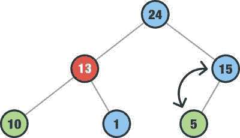

父节点 (5) 小于我们新添加的孩子 (15)，所以我们交换 15 和 5。

*交换节点值*

我们新交换的 15 节点正确地小于其父节点（其值为 24），所以我们又回到了维持堆属性的状态。

我们添加的下一个数字是 36。我们的 36 初始作为 15 节点的右孩子。那个位置只是暂时的！为了维持堆属性，我们的 36 节点将与 15 节点交换，然后也会与 24 节点交换。

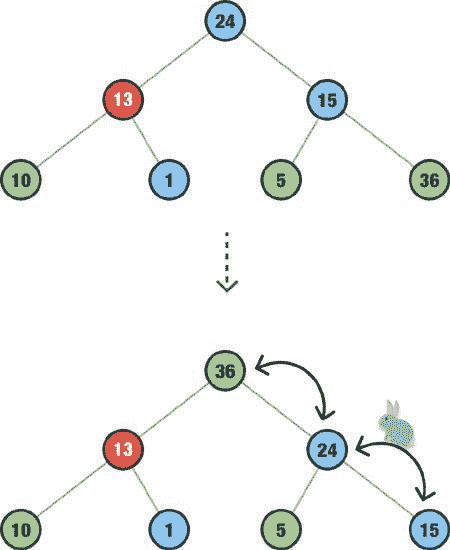

*通过进一步交换维持堆属性*

我们包含新添加的 36 的节点现在是堆中最大的数字，并位于根节点位置。干得好，36！让我们添加最后一个项目——数字 3。


*向堆中添加数字 3*

我们将其添加到底部的最左层，我们包含值 3 的节点是 10 节点的孩子。这维持了堆属性，所以我们不需要做任何额外操作。我们的堆状态良好，我们刚刚看到了向堆中插入节点是什么样的，以及上浮在确保我们的节点位置正确时所起的作用。

### 移除根节点

我们查看的下一个堆操作是如何移除根节点，即我们堆的最大且最重要的值。正如我们稍后将看到的，移除根节点有一些有趣的行为，这与我们之前向堆中添加元素时看到的非常不同。让我们开始吧，继续使用之前的堆示例。

我们要做的是移除值为 36 的根节点。


*移除根节点*

从堆中移除根节点时，我们仍然希望确保维持堆的属性。这意味着新的根节点应该是堆中的最大值，且二叉树应该被重构以保持其完整性。

以下是从堆中移除根节点的步骤：

1. 从堆中移除根节点并用堆中的最后一个节点替换它。
2. 将新根节点的值与它的孩子的值进行比较。如果新根节点的值小于其任一孩子的值，我们将新根节点与其较大的孩子交换。我们重复这个过程，直到新根节点的值大于或等于其孩子的值，或者它没有孩子。这个过程被称为下浮（bubbling down）。
3. 交换后，对新的子节点及其孩子重复步骤 2，直到恢复堆的属性。

让我们通过演示移除根节点 36 时发生的情况来执行这些步骤。我们首先移除 36 根节点，并与堆中的最后一个节点交换，该节点始终是最低层最右侧的节点。


*在移除根节点后重新平衡树*

当我们移除 36 节点并将其与 3 节点交换时，我们的堆将所示。

*根节点已被我们的最后一个节点替换*

接下来，我们开始下浮操作，并将新添加的节点与其孩子比较，看它它是否小于其任一孩子。如果它小于其任一孩子，我们将新根节点与其较大的孩子交换。我们重复这个过程，直到新根节点的值大于或等于其孩子的值，或者它没有孩子。这个过程被称为下浮（bubbling down）。

交换后，对新的子节点及其孩子重复步骤 2，直到恢复堆的属性。

```javascript
// 获取数组中的最后一个元素
const max = this.heap[0];
const end = this.heap.pop();
this.heap[0] = end;

// 通过向下堆浮新根元素来恢复堆属性
this.#bubbleDown(0);

return max;
}

// 通过向上堆浮给定索引处的元素来恢复堆属性
#bubbleUp(index) {
  // 如果元素已经是根节点，则返回
```


```
if (index === 0) {
  return;
}

// 找到父元素的索引
const parentIndex = Math.floor((index - 1) / 2);
// 如果元素大于其父元素，则交换
if (this.heap[index] > this.heap[parentIndex]) {
  [this.heap[index], this.heap[parentIndex]] = [this.heap[parentIndex], this.heap[index]];
  // 从新索引处继续向上堆浮元素
  this.#bubbleUp(parentIndex);
}
```

```
// 通过向下堆浮给定索引处的元素来恢复堆属性
#bubbleDown(index) {
  // 找到左、右子元素的元素的索引
  const leftChildIndex = 2 * index + 1;
  const rightChildIndex = 2 * index + 2;

  // 将最大元素的索引初始化为当前索引
  let largestIndex = index;

  // 如果左子元素大于当前元素，更新最大索引
  if (leftChildIndex < this.heap.length && this.heap[leftChildIndex] > this.heap[largestIndex]) {
    largestIndex = leftChildIndex;
  }

  // 如果右子元素大于当前元素，更新最大索引
  if (rightChildIndex < this.heap.length && this.heap[rightChildIndex] > this.heap[largestIndex]) {
    largestIndex = rightChildIndex;
  }

  // 如果最大元素不是当前元素，则交换它们，并从新索引处继续向下堆浮元素
  if (largestIndex !== index) {
    [this.heap[index], this.heap[largestIndex]] = [this.heap[largestIndex], this.heap[index]];
    this.#bubbleDown(largestIndex);
  }
}

// 在不移除元素的情况下返回堆中的最大元素
getMax() {
  return this.heap[0];
}

// 返回堆的大小
size() {
  return this.heap.length;
}

// 检查堆是否为空
isEmpty() {
  return this.heap.length === 0;
}
```

我们的堆实现支持以下操作：

- `insert`: 向堆中添加新项
- `extractMax`: 从堆中移除根节点（最高优先级，即最大值）并返回它
- `getMax`: 返回根节点的值（最高优先级，即最大值），但不将其从堆中移除
- `size`: 返回堆中的节点数量
- `isEmpty`: 检查堆是否为空

我们使用这段代码以及之前许多操作的方式如下：

```javascript
let myHeap = new Heap();
myHeap.insert(14);
myHeap.insert(18);
myHeap.insert(50);
myHeap.insert(1);
myHeap.insert(3);
myHeap.insert(15);
myHeap.insert(2);
myHeap.insert(2);
myHeap.insert(0);
myHeap.insert(13);
console.log("Size of heap: " + myHeap.size()); // 10
console.log(myHeap.getMax()); // 50
console.log("Size of heap: " + myHeap.size()); // 10
console.log(myHeap.extractMax()); // 50
console.log("Size of heap: " + myHeap.size()); // 9
console.log(myHeap.extractMax()); // 18
console.log(myHeap.extractMax()); // 15
console.log(myHeap.extractMax()); // 14
console.log("Size of heap: " + myHeap.size()); // 6
```

我们正在重新创建之前看到的示例堆，并将我们强调的许多操作付诸实践。

### 性能特性

在堆中，我们之前提到移除根节点和向堆中插入元素是我们关心的两个基本操作。让我们从性能的角度来看这些操作如何。

#### 移除根节点

与移除根节点相关的有两个概念：

- 时间复杂度：O(log n)，其中 *n* 是堆中的元素数量
- 空间复杂度：O(1)

在堆中移除根节点涉及两个主要步骤：将根节点与堆中的最后一个叶子节点交换，然后（通过我们代码中的`#bubbleDown`方法）重新堆化堆，将新根节点向下堆浮，直到恢复堆属性。

交换根节点与最后一个叶子节点的第一步需要常数时间，因为我们只是在更新两个数组元素。例如，下图表示了正在发生的情况。

*我们之前移除根节点时的示例*

重新堆化堆的第二步需要对数时间，因为我们必须将新根节点与其子节点进行比较，并与其中较大的一个交换，直到恢复堆属性。

#### 插入元素

向堆中插入元素相关的有两个概念：

- 时间复杂度：O(log n)，其中 *n* 是堆中的元素数量
- 空间复杂度：O(1)

向堆中插入元素涉及两个主要步骤：将元素添加到堆的最后一个叶子节点中，然后（通过我们代码中的`#bubbleUp`方法）重新堆化堆，将新元素向上堆浮，直到恢复堆属性。

将元素添加到最后一个叶子节点的第一步需要常数时间，因为我们只是在更新两个数组元素。例如，下图表示了正在发生的情况。

重新堆化堆的第二步需要对数时间，因为我们必须将新元素与其父节点进行比较，并与其中较大的一个交换，直到恢复属性。

### 性能总结

| 操作 | 时间复杂度 | 空间复杂度 |
| :--- | :--- | :--- |
| 移除根节点 | O(log n) | O(1) |
| 插入元素 | O(log n) | O(1) |

## 结论

总结来说，堆是一种非常有用的数据结构，极大地简化了广泛的算法和问题。通过在满足堆属性的二叉树中组织元素，堆实现了两点：在常数时间内高效检索最大元素，以及在对数时间内快速插入和删除元素。

*一个很有用的（且可靠的）机器人*

作为我们的第一个动作，我们决定存储西瓜。我们的机器人来到西瓜面前对其进行分析。

*我们的机器人正在分析我们的西瓜*

这次分析告诉机器人应该把西瓜放在哪个盒子里。机器人使用的具体逻辑我们现在不需要关注。重点在于，在分析结束，我们的机器人清楚地知道该把西瓜存储在哪里。

*存储一个物品*

接下来，我们想要存储汉堡。机器人重复相同的步骤。它对汉堡进行分析，确定存储在哪个盒子里，然后将其存放在合适的盒子里。

*存储另一个物品*

我们对想要存储的不同类型的食物重复几次这个过程，我们的机器人分析并将食物存储在合适的盒子里。

*我们所有的物品现在都已存储完毕*

现在，我们要稍微转换一下思路。我们想要取出之前存储的某个食物。我们现在想吃鱼，所以我们告诉机器人去取回我们的鱼。我们有一条鱼的精确复制品（可能是一张照片！），机器人做的第一件事就是分析这个复制品。这次分析帮助机器人确定我们实际的可食用鱼存储在哪个盒子里。

*取出物品的时间*

一旦它确定了鱼在哪里，它就会直接去正确的盒子并将它带回给我们。

*我们的机器人确切知道物品在哪里*

需要注意的重要点（正如我们之前看到机器人存储物品时那样）是我们的机器人直接去正确的盒子。它不会扫描其他盒子来寻找我们的鱼。它不猜测。根据对鱼的复制品的分析，它知道该去哪里，并且没有任何拖延地去了那里。

## 从机器人到哈希函数

我们之前看到的机器人高效地存储和检索物品的示例，为我们观察下一个中间站——**哈希函数**（hashing function）奠定了良好的基础。让我们最后一次回到机器人。

*我们的机器人回来了！*

我们的机器人到底在做什么？它分析我们想要存储的物品，并将其映射到一个存储位置。让我们稍微调整一下可视化方案。

*一个哈希函数*

我们的机器人被一种我们称为**哈希函数**的东西所取代了。

我们之前用于存储的通用盒子现在被更正式的结构取代了，具有索引位置，看起来有点像数组。

那么，哈希函数到底是什么？哈希函数无非是一段代码。这段代码接受一个值作为输入，并返回一个唯一的值（称为**哈希代码**）作为输出。需要注意的细节是，对于相同的输入，输出*永远不会改变*。例如，我们把那盘煎饼丢给我们的哈希函数，输出可能是存储位置。

*我们的煎饼将储存在哪里*

每当我们的哈希函数遇到这块相同的煎饼时，它总是会返回位置 #5。它执行得非常快。我们可以如所示将输入、哈希函数和输出之间的这种关系泛化出来。

*我们的哈希函数返回的内容*

我们这里的输出代表从 0 到 5 的数字，但它也可以是任何值。

这完全取决于我们的哈希函数是如何实现的，我们稍后会在这里看一个哈希函数的示例。

## 从哈希函数到哈希表

时间到了！我们现在可以讨论建立在我们目前所见一切基础上的“明星”了——**哈希表**（hashtable，也称为 **hash table**、**hashmap** 或 **dictionary** 字典）。从最开始开始，哈希表是一种提供键值对极速存储和检索的数据结构。它使用哈希函数将键映射到（通常是）底层数组数据结构中特定位置的值。

*我们最终总会得到一个数组，不是吗？*

这意味着，我们的哈希表可以实现常数时间（即 O(1)）的查找和插入操作。这种快速的能力非常适合我们经常执行的许多数据缓存和索引相关的活动。我们将通过观察一些常用操作来了解它们如何工作的。

### 向哈希表添加物品

要向我们的哈希表添加物品，我们需要指定两点：

1. **键（Key）：** 作为我们稍后可以用来引用数据的标识符。
2. **值（Value）：** 指定我们想要存储的数据。假设我们想以 **[键, 值]** 对的形式添加以下数据，其中键是姓名，值是他们的电话号码：

- Link, (555) 123-4567
- Zelda, (555) 987-6543
- Mario, (555) 555-1212
- Mega Man, (555) 867-5309
- Ryu, (555) 246-8135
- Corvo, (555) 369-1472

如果我们将这些数据可视化为存在于哈希表中，它看起来如下。

*再次观察哈希的工作原理*

输入既是我们的键也是值。键被发送到哈希函数以确定存储位置。一旦确定了存储位置，值就会被放在那里。

### 从哈希表读取物品

继续我们的示例，假设我们想从哈希表中读取一个值。我们所做的是向哈希表提供我们的键。我们的哈希函数会快速计算存储位置并向我们返回正确的值。

*检索一个物品*

如果我们提供一个不存在的键（例如 `Batman`），我们的哈希表将返回 *undefined*，因为哈希函数指向一个不存在的存储位置。

### JavaScript 实现/用法

几乎所有现代语言都提供了哈希表的实现，支持添加、检索和移除等常用操作。我们可以如下使用 `Map`：

```javascript
let characterInfo = new Map();

// set
characterInfo.set("Link", "(555) 123-4567");
characterInfo.set("Zelda", "(555) 987-6543");
characterInfo.set("Mario", "(555) 555-1212");
characterInfo.set("Mega Man", "(555) 867-5309");
characterInfo.set("Ryu", "(555) 246-8135");
characterInfo.set("Corvo", "(555) 369-1472");

// get values
console.log(characterInfo.get("Ryu")); // (555) 246-8135
console.log(characterInfo.get("Batman")); // undefined

// get size
console.log(characterInfo.size()); // 6

// delete item
console.log(characterInfo.delete("Corvo")); // true
console.log(characterInfo.size()); // 5

// delete all items
characterInfo.clear();
console.log(characterInfo.size()); // 0
```

在背后，使用哈希函数是为了在提供键时快速访问我们的值。我们可以假设这个哈希函数是高质量的。如果你好奇基本的哈希函数可能是什么样的，请看以下：

```javascript
function hash(key, arraySize) {
  let hashValue = 0;
  for (let i = 0; i < key.length; i++) {
    // 添加键中每个字符的 Unicode 值
    hashValue += key.charCodeAt(i);
  }
  // 取模运算确保哈希值在数组大小范围内
  return hashValue % arraySize;
}

// 创建为 100 个物品分配的数组
let myArray = new Array(100);

let myHash = hash("Ryu", myArray.length);
console.log(myHash); // 20
```

注意，`Y` 返回的哈希值与 `Ryu` 的 20 相同。这看起来并不理想，所以让我们进入下一个讨论吧！

## 处理冲突

在理想的世界中，我们的哈希函数会为要求它存储的每一个唯一键（以及值）返回一个唯一的存储位置。这个理想的世界需要满足两个条件：

1. 我们的哈希函数设计得能够为每个唯一输入生成一个唯一的哈希码。


2. 我们有足够的可用存储空间，使得每个值都有它自己的位置来存放自己。

在现实世界中，这两点都不成立。虽然我们的哈希函数擅长生成唯一键，但它们并非完美。在某些时刻，对于特定类型的输入，我们的哈希函数会返回相同的哈希码，从而指向同一个存储位置。当我们存储大量项时，可能会用尽实际的存储位置来存放我们的唯一项。

这两种情况都会导致所谓的**冲突**（collision），并导致我们的存储位置包含多个值，正如示例所示的那样。

*冲突示例*

当一个存储位置现在存储多个值时会发生什么？对于我们的哈希表*功能*来说，大部分情况下并没有特别的大事。我们的哈希表实现会优雅地处理这种情况。

## 性能与内存

虽然冲突不影响功能，但它们确实有影响*性能*的潜力。

当一个存储位置存储单个项时，我们拥有最好的常数时间 O(1) 性能。当一个存储位置包含许多项，或者在最坏的情况下，我们丢给哈希表的每一个项时，性能就会下降到 O(*n*)，如所示。


*所有项都存储在一个箱中的最坏情况*

这种行为使得这个特定的哈希表并不比使用线性搜索的数组或链表好在哪里。我们存储的每个项（或几乎存储的每个项）都存在于同一个存储位置的情况是罕见的。这些情况通常指向哈希函数定义不当，而且现代哈希表实现使用了许多技术来避免陷入这种困境。

至于哈希表占用的空间大小，它是线性的。我们存储的每一个项都需要在哈希表中被表示。如果单个存储位置有多个值，那么处理哈希函数和提供扫描能力需要一些额外的开销，但这不会改变线性增长特性。

如果我们必须用一个整洁的表格来总结，我们将看到表格所示的内容：

**表格 哈希表性能与内存**

| 操作 | 平均 | 最坏 |
| :--- | :--- | :--- |
| 空间 | Θ(*n*) | O(*n*) |
| 检索 | Θ(1) | O(*n*) |
| 插入 | Θ(1) | O(*n*) |
| 删除 | Θ(1) | O(*n*) |

这些都是非常不错的结果！撇开所有的警告和最坏情况，没有比这更高效的数据结构能让我们快速存储和检索值了，当我们看到哈希表被其他数据结构和算法使用时，我们将看到这一点。

## 哈希表是字典吗？

我们提到过几次，哈希表有时被称为*哈希映射*（hashmap）或*字典*（dictionary）。不同的编程语言使用这些名称或类似的名称来提供哈希表功能。这里有争议的是“字典”。如果我们对解释非常严格，字典并不是哈希表。它是一种允许我们存储键值对的数据结构，但它通常并不实现哈希函数。

让这个故事变得复杂的是，某些字典实现可以在底层使用哈希表。一个例子是 Python 中的 `dict` 对象。它是一个字典，但为了我们学到的所有效率优势，它在底层使用了哈希表。

## 结论

哈希表的优之处在于它们能够为插入、检索和删除等基于键的操作提供常数时间性能。通过使用哈希函数计算每个元素的索引，哈希表消除了对线性搜索的需求，并允许直接访问数据，使得操作变得极快。即使对于大量信息，这一点仍然成立。


这种性能超能力使得哈希表在快速访问数据至关重要的场景中特别有用，例如实现缓存、符号表或字典。此外，哈希表具有内置机制来处理两个键输入产生相同哈希码的冲突。哈希表就像数据结构世界中的独角兽！

## Trie（又称前缀树）


我们在某个网页上，遇到一个输入框，并开始打字。随着我们的打字，我们开始根据已经输入的几个字符看到部分结果。

*自动补全示例*

随着我们继续打字，部分结果不断被完善，直到它几乎预测出我们正尝试完整输入的单词或短语。这种类似于自动补全的交互是我们理所当然的。几乎所有的用户界面（即 UI）都有某种形式的它。在背后，这里的主角是`trie`（有时被称为`前缀树`）。在接下来的章节中，我们将学习更多关于它的知识。


## 什么是 Trie？

Trie（读作“try”）是一种数据结构，它将单词分解为单个字符并存储它们，使得添加、删除甚至自动补全变得高效。

## 插入单词

Trie 的起点是一个空根。我们的下一步是取单词的第一个字母（a）并将其作为根的子节点。我们对下一个字母（p）重复此步骤并将其作为 a 节点的子节点。对于`apple`，最终的 Trie 结构如下：


当整个单词在树中表示完成后，我们还会做一件事。我们标记单词的最后一个字母以表示它已完成。我们稍后会看到标记结尾的重要性。现在，让我们继续向我们的 Trie 中添加几个单词。我们将添加`cat`、`dog`、`duck`和`monkey`。当我们添加`cat`和`dog`时，我们的 Trie 如下：


*存储在 Trie 中的更多单词*

我们要添加的下一个单词是`duck`。注意我们单词的第一个字母是`d`，我们已经在根节点上方有一个 d 节点。我们这样做是从现有的 d 节点开始，而不是创建一个新的 d 节点。下一个字母是`u`，但我们没有一个值为 u 的现有 d 子节点。因此，我们创建一个值为 u 的新子节点，并继续处理单词中的剩余字母。


*单词的字母继续作为子节点添加*

这里强调的部分是，我们的字母 d 现在是我们的`dog`和`duck`单词的共同前缀。


*我们的字母 d 有两个以它开头的单词*

我们想要添加的下一个单词是`monkey`，一旦将其添加到树中，它将以如下所示。


*我们的字典树（trie）正变得越来越大！*

因为起始字母`m`并不是我们根节点的子节点，所以我们为`m`创建了一个新节点。`monkey`中的后续每个字母都紧随其后。我们在这里快完成了，所以让速度也快一点。

我们想要表示的下一个单词是`dune`。我们知道字母`d`和`u`已经存在于我们的字典树中了，所以我们要做的是基于公共前缀`du`添加字母`n`和`e`。


*我们基于公共前缀进行构建*

我们想要添加的后两个单词是`app`和`monk`。这两个单词分别包含在较大的单词`apple`和`monkey`之中，因此我们需要做的只是将`app`和`monk`的最后一个字母标记为单词的结束。


*单词内部的单词*

好了。到此为止，我们的字典树包含了`apple`、`app`、`cat`、`dog`、`duck`、`dune`、`monkey`和`monk`。我们现在字典树中的项目已经足够了。让我们来看一些额外的操作。

## 查找项目

想象一下我们把韦氏词典中的所有单词都添加到字典树中。现在，想象你正试图手动判断一个单词是否是字典中的有效条目。让我们探索如何利用字典树来高效地搜索一个单词。继续使用之前的字典树，假设我们想看看单词`eagle`是否存在。我们要做的是将输入的单词拆分为单个字符：`e`、`a`、`g`、`l`、`e`。

我们检查第一个字母是否存在作为我们根节点的子节点。


*搜索的开始*

我们拥有的起始字母有`a`、`c`、`d`和`m`。字母`e`不存在，所以我们可以在这里停止搜索。如果第一个字母不存在，我们可以安全地说所有后续字母也不存在。

我们的下一个任务是查看字典树中是否存在单词`monk`。过程是一样的。我们检查要查找的单词的第一个字母（`m`）是否作为字典树中的第一个字母存在。答案是肯定的。

*我们在字典树中找到了 monk 的 m*


然后我们沿着`m`节点的路径继续向下，并检查第二个字母（`o`）是否是直接子节点。

*我们逐字母进行检查*

在我们的情况下，`o`是`m`的直接子节点。注意，我们的搜索非常集中在`m`节点的分支上。我们并不关心其他节点中发生了什么。继续下去，既然前两个字母匹配了，我们继续重复相同的步骤，检查第三和第四个字母是否匹配。


*我们留在同一个分支上*

`monk`中剩余的字母与我们字典树中的匹配。根据我们正在执行的操作，可能再多一步：

1. 如果我们正在检查**完整单词**是否存在于字典树中，那么我们需要确保最后一个字母被标记为单词的结束。在这种情况下，`monk`是作为最终单词添加到字典树的，并且字母`k`已标记为它的结尾。这方面没问题。

2. 如果我们正在检查**前缀**是否存在于字典树中，那么我们不需要检查最后一个字符是否也被标记为单词的结束。完整单词和前缀之间的区别是很重要的。

### 删除项目

我们最后查看的步骤是如何删除项目。因为我们已经学习了添加和查找项目，删除项目会更复杂。


我们最后查看的步骤是如何删除项目。因为我们已经学习了添加和查找项目，删除项目会更复杂。


我们最后查看的步骤是如何删除项目。因为我们已经学习了添加和查找项目，删除项目会更复杂。


*duck 的值不在字典树中了*

*删除从...*


*所有以字母 d 开头的值都会非常快* 如果我们正在做的是检查输入字符（例如，`d-o-g`）是否是一个单词，那么字典树（trie）就是错误的数据结构。我们可能需要某种类似于 hashmap 的东西，它可以快速告诉我们我们的*完整*输入是否在一组存储的值中，但与字典树相比，hashmap 的内存效率较低。这只是需要注意的权衡！

现在，在什么情况下我们可能会有不完整的输入，但这些输入仍然包含足够的细节来提供通往最终值的捷径？让我们来看看其中的几种：

**自动补全和预测文本：** 重复我们在开始介绍字典树时提到的观点，当我们在搜索引擎、电子邮件客户端或即时消息应用输入单词或短语时，我们通常会看到补全我们输入的建议。


*自动补全的另一个示例*

字典树可以有效地实现自动补全功能。

字典树中的每个节点代表一个字符，从该节点引出的每个点代表可能的后续字符。通过在用户的输入的基础上遍历字典树，我们可以快速找到并建议最可能的补全，例如当我们的输入是`m`时，会有`monkey`和`monk`。

**拼写检查和纠正：** 拼写检查器依赖字典来识别和纠正写错误的单词。字典树可以高效地存储字典，允许快速查找并提供替代单词的建议。


*正在工作的拼写检查*

正如我们已经看到的几次那样，每个节点代表一个字符，单词作为从根节点到叶子节点的路径进行存储。当输入错误的（即拼写错误的）字符时，我们可以向后退几步，看看通往完整单词更有可能的路径是什么。

**IP 路由和网络路由表：** 在计算机网络中，IP 地址用于识别设备。字典树可以高效地存储和检索 IP 地址的路由信息。


*一个路由表*

字典树中的每个节点代表 IP 地址的一部分，边对应于该部分的可能值。通过在 IP 地址的基础上遍历字典树，路由器可以高效地确定网络中数据包的下一跳。

**单词游戏和谜题：** 字典树对于像拼字（Scrabble）或 Wordle 这样的单词游戏非常有用，在这些游戏中，玩家需要根据一组字母快速找到有效单词。

*单词游戏底层通常使用字典树*

通过构建一个表示字典的字典树，玩家可以通过遍历字典树高效地检查给定的字母序列是否形成了一个有效单词。

**还有更多示例！**

这些仅仅是字典树可以非常有用的许多用例中的几个例子。核心思想是字典树允许我们高效地存储、检索和操作单词或字符序列，使其适用于涉及基于前缀的匹配、搜索或建议的任务。

**为什么字典树有时被称为前缀树？**

字典树有时被称为前缀树，因为它们的整个功能都围绕前缀展开！字典树以树形结构存储单词，这种结构强调公共字母（即前缀）。字典树中的每个节点代表一个字符，从根节点到节点的路径形成一个前缀。我们甚至可以更进一步，将一个完整的单词仅仅看作带有标记为单词的最后一个字符的前缀。由于这些原因及其他原因，我们经常会在其他书籍和在线资源中看到字典树被称为前缀树。

**实现时间**

现在我们已经口头描述了字典树的工作原理，让我们所有的文字和视觉效果转化为代码。我们的字典树实现将支持以下操作：

- 插入单词
- 搜索单词是否存在
- 检查单词是否匹配给定前缀
- 返回所有匹配给定前缀的单词
- 以及...等等，这里是我们的代码：


```javascript
class TrieNode {
  constructor() {
    // 每个 TrieNode 都有一个子节点 map，
    // 其中 key 是字符，value 是
    // 子节点 TrieNode
    this.children = new Map();
    // 标记指示当前 TrieNode 是否表示
    // 单词的结束
    this.isEndOfWord = false;
  }
}

class Trie {
  constructor() {
    // 字典树的根是一个空的 TrieNode
    this.root = new TrieNode();
  }

  // 将单词添加到字典树
  insert(word) {
    let current = this.root;
    for (let i = 0; i < word.length; i++) {
      const char = word[i];
      // 如果字符作为子节点不存在，
      // 为其创建一个 TrieNode
      if (!current.children.get(char)) {
        current.children.set(char, new TrieNode());
      }
      // 移动到下一个 TrieNode。
      current = current.children.get(char);
    }
    // 标记结束
    current.isEndOfWord = true;
  }

  // 如果单词存在则返回 true
  search(word) {
    let current = this.root;
    for (let i = 0; i < word.length; i++) {
      const char = word[i];
      // 如果字符作为子节点不存在，
      // 单词不存在
      if (!current.children.get(char)) {
        return false;
      }
      // 移动到下一个 TrieNode。
      current = current.children.get(char);
    }
    // 如果最后一个 TrieNode 表示单词结束则返回 true
    return current.isEndOfWord;
  }

  // 如果前缀在字典树中存在返回 true
  startsWith(prefix) {
    let current = this.root;
    for (let i = 0; i < prefix.length; i++) {
      const char = prefix[i];
      // 如果字符作为子节点不存在，
      // 前缀不存在
      if (!current.children.get(char)) {
        return false;
      }
      // 移动到下一个 TrieNode。
      current = current.children.get(char);
    }
    // 前缀存在
    return true;
  }

  // 返回字典树中匹配前缀的所有单词
  getAllWords(prefix) {
    const words = [];
    // 找到对应于给定前缀的节点
    const current = this.#findNode(prefix);
    if (current) {
      // 如果节点存在，从该节点遍历字典树
      // 以找到所有单词并加入 words 数组
      this.#traverse(current, prefix, words);
    }
    return words;
  }

  delete(word) {
    let current = this.root;
    const stack = [];
    let index = 0;
    // 在字典树中找到单词的最后一个节点
    while (index < word.length) {
      const char = word[index];
      if (!current.children.get(char)) {
        // 单词不在字典树中，无需删除
        return;
      }
      stack.push({ node: current, char });
      current = current.children.get(char);
      index++;
    }
    if (!current.isEndOfWord) {
      // 单词不在字典树中，无需删除
      return;
    }
    // 将最后一个节点标记为不是结束
    current.isEndOfWord = false;
    // 反向移除节点，直到到达
    // 有其他子节点或是另一个单词的结束
    while (stack.length > 0) {
      const { node, char } = stack.pop();
      if (current.children.size === 0 && !current.isEndOfWord) {
        node.children.delete(char);
        current = node;
      } else {
        break;
      }
    }
  }

  #findNode(prefix) {
    let current = this.root;
    for (let i = 0; i < prefix.length; i++) {
      const char = prefix[i];
      // 如果字符作为子节点不存在，
      // 前缀不存在
      if (!current.children.get(char)) {
        return null;
      }
      // 移动到下一个 TrieNode
      current = current.children.get(char);
    }
    // 返回对应于给定前缀的节点
    return current;
  }

  #traverse(node, prefix, words) {
    const stack = [];
    stack.push({ node, prefix });
    while (stack.length > 0) {
      const { node, prefix } = stack.pop();
      // 如果当前节点表示单词的结束，
      // 将单词加入 words 数组
      if (node.isEndOfWord) {
        words.push(prefix);
      }
      // 将所有子节点推入栈中继续遍历
      for (const char of node.children.keys()) {
        const childNode = node.children.get(char);
        stack.push({ node: childNode, prefix: prefix + char });
      }
    }
  }
}
```

为了运行我们的字典树代码，添加以下代码：

```javascript
const trie = new Trie();
trie.insert("apple");
trie.insert("app");
trie.insert("monkey");
trie.insert("monk");
trie.insert("cat");
trie.insert("dog");
trie.insert("duck");
trie.insert("dune");
console.log(trie.search("apple")); // true
console.log(trie.search("app")); // true
console.log(trie.search("monk")); // true
console.log(trie.search("elephant")); // false
console.log(trie.getAllWords("ap")); // ['apple', 'app']
console.log(trie.getAllWords("b")); // []
console.log(trie.getAllWords("c")); // ['cat']
```

```javascript
console.log(trie.getAllWords("m")); // ['monk', 'monkey']

trie.delete("monkey");
console.log(trie.getAllWords("m")); // ['monk']
```

我们的 `Trie` 实现实现了之前详细介绍过的所有操作，它通过使用哈希表（hashmap）作为底层数据结构，帮助高效地将每个节点的字符映射到其子节点。许多 `Trie` 实现也可能使用数组，这也是一种非常不错的数据结构。


在结束本节之前，请花一点时间过一遍代码，并可视化每一行代码是如何构建于整体 `Trie` 设计的。

## 性能

我们几乎要完成了。让我们来讨论一下 `Trie` 的性能，重点关注一种底层使用哈希表的 `Trie` 实现。从高层面上来看，我们所有的 `Trie` 操作都受到两个因素的影响：

1. 我们处理的单词或前缀有多长；
2. 给定字母存在多少个子节点。

`Trie` 中的插入、搜索和删除操作通常具有线性的时间复杂度 `O(k)`，其中 `k` 是输入单词中的字符数。例如，如果向我们的 `Trie` 中添加单词 `duck`，我们会分别处理 `d`、`u`、`c` 和 `k`。

### 深入观察插入行为

对于涉及大量字符的较长输入，需要完成更多工作。较短的输入所需工作较少。尽管如此，工作量与输入的大小成正比。这使得这种情况变成了完美的线性关系。

这里还有一点细节需要注意。我们的 `Trie` 实现使用了哈希表（hashtable，这是我们刚刚学过的），用来跟踪字符和节点之间的映射。检查某个字符是否存在作为子节点的平均时间复杂度为 `O(1)`。综合来看，在最坏情况下，判断一个单词（或短语）是否存在于我们的 `Trie` 中的时间复杂度将是 `O(N)`。如果 `Trie` 中的任何特定节点节点异常多，情况尤为如此。我们的哈希实现使用了 JavaScript 内置的 `Map` 对象，因此性能得到了很好的保障。如果你使用自己的哈希实现或使用数组等替代数据结构，性能可能会下降。


## 为什么是 `O(k)` 而不是 `O(n)`？

我们为什么不直接用 `O(n)` 来描述时间复杂度？这并没有什么强力的理由。参数 `N` 通常指的是我们处理的项目总数，以及相对于该数量的操作次数。对于我们的插入、搜索和删除操作，`Trie` 中 `N` 个元素的总大小并不重要。唯一重要的是我们输入的大小，因此使用不同的符号似乎是合理的。

最后，让我们来谈谈内存。`Trie` 的内存占用通常是 `O(N)`。我们占据的内存与 `Trie` 中的条目数量有关。使用哈希表跟踪子节点也会增加一些开销，但这种开销还不足以让我们偏离 `O(N)` 的上限。

简而言之，核心观点是：`Trie` 是非常高效的数据结构。这一点你可以完全相信！

## 图（Graphs）

是时候学习图数据结构了。这种特定的数据结构被应用于许多场景，并且具有许多优点，以至于产生了一整门被称为“图论”的学科领域。聪明的人每年都在这个领域获得高级学位。有成排的书籍专门介绍这个主题。

著名的音乐家唱过关于……好吧，也许没有。

要强调的重点是，涉及到图时有很多需要学习的内容。

在我们在一起的时间内肯定无法涵盖所有，但会涵盖我们在日常编程生活中遇到最多的大主题。

## 什么是图？

图组织信息以及理解不同事物如何相互连接的一种。这个“相互连接”的部分非常重要。

图帮助我们发现和分析事物之间的关系。让我们从一个例子开始。

认识一下 Jerry，他是一个住在纽约、相当成功的喜剧演员。

*我们图中的第一个项目*


他有几个名叫 Elaine 和 George 的朋友。

*我们图中的连接*


*节点和边（Nodes and edges）*


*另一种可视化的方式，*


*我们的各种关系，*


*我们图中的关系*


### 我看到的是树树吗？

它们被称为**树**，这是我们之前花了大量时间研究的一种数据结构。是的，树是一种非常特殊的图。它们是无环的，因为不存在从同一个节点开始并结束于同一个节点的多个路径。它们是无向的，因为边是双向的。还有一个细节：表示树的图必须是**连通的**。连通意味着每对节点之间都存在路径。

可视化连通图的最佳方法是观察一个**不连通**的图。


*一个不连通的图*

注意，节点 B 和 C 浮在一个孤岛上，无法从其他任何节点到达 B 或 C。例如，从 F 到 B 或 C 有路径吗？没有。连通图不会有这个问题。

*一个完全连通的图*

A 和 B 创建的路径让 B 和 C 恢复了连通性。现在，我们图中每对节点都可以通过某些路径到达。

## 图的实现

现在我们已经对图及其各种类型有了很好的了解，是时候转换思路，看看我们如何实现一个图了。

如果我们后退很多步，我们对图执行的最常见操作有：

- **添加节点**
- **在节点之间定义边**
- **识别邻居：** 如果我们的图是有向的，请确保我们尊重了边的方向。如果我们的图是无向的，则与特定节点连接的所有直接节点都将成为邻居。
- **移除节点**

## 节点的表示

在深入实现之前，这里有一个有趣的细节，与我们具体如何表示节点及其与邻居的关系有关。


假设我们有一个图和一个名为 A 的节点，它具有所示连接。节点有 A、B、C 和 D。我们有连接 A-B、A-C 和 A-D 的边。

由于我们的图是无向的，边的方向是双向的。这意味着我们还有连接 B-A、C-A 和 D-A 的边。

回到 A 节点，它的邻居是节点 B、C 和 D。某些节点的邻居较少，而有些节点可以多得多。

这归根于图所表示的数据类型和数量。那么，我们如何表示节点的邻居呢？一种非常流行的方法是使用所谓的**邻接列表**。

当使用邻接列表时，每个节点都与一个相邻节点列表关联。使用我们当前示例的粗可视化如下：

```text
A: [B, C, D]
B: [A]
C: [A]
D: [A]
```

这种列表在潜在的图实现中采取许多形式。我们的列表可以是数组、映射、哈希表或其他数据结构。由于我们之前提到过节点可能有很多邻居，我们希望使用一种查找节点速度极快的数据结构。

通过使用映射（`Map`），我们可以让*键*成为节点。*值*将是一个集合（`Set`）数据结构，其内容是所有邻居节点。集合非常棒，因为它们不允许重复值。这确保我们避免了进入循环并重复添加相同节点的情况。

## 代码

背景介绍完毕，让我们直接深入查看我们对图数据结构的实现：


```javascript
class Graph {
  constructor() {
    // 使用 Map 存储节点及其邻接节点
    this.nodes = new Map();
    // 标记图是有向的还是无向的
    this.isDirected = false;
  }

  // 向图中添加新节点
  addNode(node) {
    if (!this.nodes.has(node)) {
      this.nodes.set(node, new Set());
    }
  }

  // 在两个节点之间添加边
  addEdge(node1, node2) {
    // 检查节点是否存在
    if (!this.nodes.has(node1) || !this.nodes.has(node2)) {
      throw new Error('Nodes do not exist in the graph.');
    }
    // 在 node1 和 node2 之间添加边
    this.nodes.get(node1).add(node2);
    // 如果图是无向的，在相反方向也添加边
    if (!this.isDirected) {
      this.nodes.get(node2).add(node1);
    }
  }

  // 从图中移除节点及其所有的关联边
  removeNode(node) {
    if (this.nodes.has(node)) {
      // 从图中删除节点及其边
      this.nodes.delete(node);
      // 移除其他节点中的关联边
      for (const [key, neighbors] of this.nodes) {
        if (neighbors.has(node)) {
          neighbors.delete(node);
        }
      }
    }
  }

  // 移除两个节点之间的边
  removeEdge(node1, node2) {
    if (this.nodes.has(node1) && this.nodes.has(node2)) {
      // 移除 node1 和 node2 之间的边
      this.nodes.get(node1).delete(node2);
      // 如果图是无向的，移除相反方向的边
      if (!this.isDirected) {
        this.nodes.get(node2).delete(node1);
      }
    }
  }

  // 检查两个节点之间是否存在边
  hasEdge(node1, node2) {
    if (this.nodes.has(node1) && this.nodes.has(node2)) {
      return this.nodes.get(node1).has(node2);
    }
    return false;
  }

  // 获取给定节点的邻居
  getNeighbors(node) {
    if (this.nodes.has(node)) {
      return Array.from(this.nodes.get(node));
    }
    return [];
  }

  // 获取图中所有的节点
  getAllNodes() {
    return Array.from(this.nodes.keys());
  }

  // 将图设为有向
  setDirected() {
    this.isDirected = true;
  }

  // 将图设为无向
  setUndirected() {
    this.isDirected = false;
  }

  // 检查图是否是有向的
  isDirected() {
    return this.isDirected;
  }
}
```

以下是如何使用上述实现执行常见操作的示例：

```javascript
const characters = new Graph();
characters.setDirected();

// 添加节点
characters.addNode('Jerry');
characters.addNode('Elaine');
characters.addNode('Kramer');
characters.addNode('George');
characters.addNode('Newman');

// 添加边
characters.addEdge('Jerry', 'Elaine');
characters.addEdge('Jerry', 'George');
characters.addEdge('Jerry', 'Kramer');
characters.addEdge('Elaine', 'Jerry');
characters.addEdge('Elaine', 'George');
characters.addEdge('Elaine', 'Kramer');
characters.addEdge('George', 'Elaine');
characters.addEdge('George', 'Jerry');
characters.addEdge('George', 'Kramer');
characters.addEdge('Kramer', 'Elaine');
characters.addEdge('Kramer', 'Jerry');
characters.addEdge('Kramer', 'Newman');
characters.addEdge('Newman', 'Kramer');
characters.addEdge('Newman', 'Jerry');

// 获取一个节点的邻居
console.log("Jerry's neighbors: ", characters.getNeighbors('Jerry')); // ['Elaine', 'George', 'Kramer']

console.log("Newman's neighbors: ", characters.getNeighbors('Newman')); // ['Kramer', 'Jerry']

// 检查两个节点之间是否存在边
console.log("Does edge exist between Jerry to Newman? ", characters.hasEdge('Jerry', 'Newman')); // false

console.log("Does edge exist between Newman to Jerry? ", characters.hasEdge('Jerry', 'Newman')); // true

console.log("Does edge exist between Elaine to George? ", characters.hasEdge('Elaine', 'George')); // true

// 获取图中所有的节点
console.log("All the nodes: ", characters.getAllNodes()); // ['Jerry', 'Elaine', 'Kramer', 'George', 'Newman']

// 移除一个节点
console.log("Remove the node, Newman: ");
characters.removeNode("Newman");
console.log(characters.getAllNodes());
```

[](imgimg/d90243d52c96b97e5b0d290d2d85d3ff_312_1.png)

```javascript
// ['Jerry', 'Elaine', 'Kramer', 'George']

console.log("Does edge exist between Kramer to Newman: ", characters.hasEdge('Kramer', 'Newman')); // false
```

花点时间过一遍代码，特别是注释。正如我们所看到的，这个图数据结构的实现与我们描述的图类型非常吻合。这有有利有坏处。利处是因为我们的代码中不应该有惊喜。坏处是，更完整的图实现将包含更多的功能……而我们的实现并不包含这些功能。请放心，当我们随后的教程中深入研究图时，我们会涉及到这些缺失的部分。

## 结论

数据结构是任何应用程序的骨干，提供了高效组织、管理和存储数据所需的框架。在 JavaScript 中，这些结构在开发者解决问题、优化性能和构建可扩展应用程序的方式中起着至关的作用。理解和掌握数据结构的旅程不仅关乎了解技术细节，还关乎培养可以将抽象概念转化为实际现实解决方案的思维方式。

## 数据结构的基础作用

在任何编程语言的核心，数据结构构成了构建算法的基石。它们决定了数据的存储、访问和处理方式，这直接影响应用程序的性能。在 JavaScript 中，数组、对象、集合和映射等数据结构被用于编码的各个方面。这些结构为开发者提供了灵活性，可以以既高效又直观的方式管理数据。

数组和对象可能是 JavaScript 中最常用的数据结构。数组提供有序的元素集合，使其适用于需要按索引访问数据或按顺序迭代的情况。它们的动态特性允许它们根据需要增长和缩小所需的，这使得它们适用于广泛的应用，从存储项目列表到实现更复杂的数据结构，如栈和队列。

另一方面，对象提供了一种以键值对形式存储数据的方法，这使得它们对于表示具有属性的实体变得不可或缺。它们的使用范围远超简单的数据存储；它们是许多设计模式的基础，并经常用于在应用程序中封装和管理状态（state）。

理解如何有效利用利用对象是编写可维护且可扩展的 JavaScript 代码的关键。

## Set 和 Map 的威力

当我们进入更专门的数据结构时，Sets 和 Maps 提供了数组和对象的强大替代方案。Set 是一个唯一值的集合，当你需要确保确保数据保持唯一性时，它显得尤为有用。例如，在管理用户 ID 或标签时，Set 可以在不需要额外检查的情况下防止重复，从而精简代码并提高性能。

另一方面，Maps 通过允许使用任何类型的键（而不仅仅是字符串或符号）来扩展了对象的功能。这使得 Maps 非常适用于键需要更复杂的场景，例如将数据与对象或数组建立关联。Maps 保持插入顺序的能力是另一个优势，特别是在操作顺序很重要时。

Sets 和 Maps 都有助于编写更高效、更有表现力的 JavaScript 代码，允许开发者根据应用程序的特定需求为任务选择合适的工具。它们还鼓励对底层数据存储和检索的原理有更深入的理解，这对于优化性能至关重要。

## 高级数据结构：链表、栈和队列

除了基础数据结构，链表、栈和队列引入了新概念，这些概念对于解决更复杂的问题至关重要。例如，链表在动态内存分配方面提供了数组的替代方案。与数组不同，链表不需要连续的内存位置，使得插入和删除更高效，特别是在数据集大小频繁变化的场景下。

栈和队列虽然概念上简单，但是许多算法和系统的基础。栈按照后进先出（LIFO）原则运行，使其非常适合你需要反转数据或管理嵌套操作场景，例如在表达式求值或实现撤销（undo）功能中。队列按照先进先出（FIFO）原则运行，对于按接收顺序管理任务或请求至关重要，例如在调度系统或数据缓冲中。

在 JavaScript 中实现和操作这些结构不仅增强了你的问题解决工具箱，还加深了你对数据如何流经程序的理解。这不仅仅是为了编写运行的代码；更是为了编写高效、可扩展且易于维护的代码。

## 层级和网络化数据：树和图

随着应用程序复杂性的增加，表示层级或网络化数据的需要变得更加明显。树和图是解决这些需求的数据结构，提供了以更结构化的方式建模实体之间关系的方法。

树是一种层级数据结构，每个节点都有一个值和一个指向其子节点的节点的引用列表。树被用于各种应用程序中，从表示组织结构到管理像文件系统之类的层级数据。在 JavaScript 中，树通常用于管理 Web 应用中的 DOM 元素，使得理解树结构对于任何前端开发者来说都是至关重要的。

特别是二叉树，广泛应用于搜索算法中，允许高效的数据检索。平衡树的概念（如 AVL 树或红黑树）确保了插入、删除和查找等操作可以在对数时间内完成，这对于维护大型数据集的性能至关重要。

另一方面，图提供了一种表示更复杂关系的方法，节点通过边连接。图可以是有向或无向的、加权或未加权的，取决于所建模关系的性质。在 JavaScript 中，图经常用于表示网络，例如社交连接、交通路线或模块之间的依赖关系。

理解图及其相关算法（如深度优先搜索（DFS）和广度优先搜索（BFS））是解决涉及寻找最短路径、检测循环或遍历网络问题的关键。这些概念不仅仅是理论上的；它们被应用于广泛的现实场景中，从优化物流路线到分析社交媒体连接。

## 选择正确数据结构的重要性

开发者可以拥的最重要技能之一就是为当前任务选择正确数据结构的能力。每种数据结构都有其优缺点，理解这些权衡对于编写高效代码至关重要。

例如，虽然数组多功能且易于使用，但对于需要频繁插入和删除的大型数据集，它们可能不是最佳选择。

在这种情况下，链表或其他动态结构可能更合适。

同样，虽然对象提供了存储键值对的方便方法，但在处理更复杂的键或插入顺序很重要时，Maps 可能会提供更好的性能和灵活性。

数据结构的选择对应用程序的可扩展性也产生巨大影响。随着数据规模的增长，搜索、排序和修改数据的操作效率变得越来越重要。通过选择正确的数据结构，你可以确保你的应用程序在重负载下也能保持响应和良好性能。

## 数据结构与算法优化

数据结构与算法之间的关系是共生的；没有另一个就无法有效地研究另一个。在 JavaScript 中，算法的效率通常取决于其运行的基础数据结构。例如，快速排序和合并排序等算法依赖于数组。

## 使用数据结构面向未来

随着 JavaScript 的不断演进，新功能和优化不断被添加到语言中，理解数据的结构的只会增加。编写高效、可扩展且易于维护的代码仍然是开发者的关键技能，无论使用什么框架。此外，随着 JavaScript 的范围扩展到服务器端开发（使用 Node.js）、机器学习和物联网，对稳健数据结构的需求变得更加关重要。在这些领域，处理海量数据、执行复杂计算和确保实时响应的能力是极其重要的。

### 条件

在每次迭代之前，都会评估条件。如果返回 `true`，循环继续执行。如果返回 `false`，循环终止。

### 递增/递减

在每次迭代之后，会执行递增或递减操作，通常用于更新循环计数器。

### 示例 1：基础 `for` 循环

让我们从一个简单的示例开始，打印从 1 到 10 的数字：

```javascript
for (let i = 1; i <= 10; i++) {
  console.log(i);
}
```

在这个示例中，循环从 `i` 等于 1 开始。条件 `i <= 10` 确保只要 `i` 小于或等于 10，循环就会运行。在每次迭代之后，`i` 会加 1。

### 示例 2：遍历数组

`for` 循环的一个常见用例是遍历数组：

```javascript
let fruits = ['apple', 'banana', 'cherry'];

for (let i = 0; i < fruits.length; i++) {
  console.log(fruits[i]);
}
```

在这里，循环遍历 `fruits` 数组中的每个元素，并将每个水果打印到控制台。

### `for` 循环的优点和局限性

`for` 循环非常灵活，对循环的执行提供了完全控制。然而，这种灵活性也会导致常见的陷阱，例如：

- 差一错误（Off-by-One Errors）：当循环运行次数过多或少一次时就会发生，通常是因为条件逻辑错误。
- 死循环：如果条件永远不会变为 `false`，循环将无限持续下去，可能会导致程序崩溃。

### `while` 循环

#### 语法与结构

`while` 循环适用于预未知迭代次数的情况。只要指定的条件保持为 `true`，循环就会继续。

```javascript
while (condition) {
  // 要执行的代码
}
```

条件：这是循环中唯一明确定义的部分。在每次迭代之前，都会检查条件。如果评估为 `true`，则执行循环体；如果为 `false`，循环停止。

#### 示例 1：基础 `while` 循环

这是一个打印从 1 到 10 的数字的 `while` 循环示例：

```javascript
let i = 1;

while (i <= 10) {
  console.log(i);
  i++;
}
```

这个循环在功能上与之前的 `for` 循环示例相似，但使用的是 `while` 循环。

#### 用例与陷阱

当预未知迭代次数时，`while` 循环特别有用，例如在处理用户输入直到接收到有效响应。然而，与 `for` 循环一样，如果条件永远不会变为 `false`，它可能会导致死循环。为了避免这种情况，请确保循环逻辑经过仔细设计，以保证能够终止。

### `do...while` 循环

#### 语法与结构

`do...while` 循环与 `while` 循环相似，但有一个关键区别：在检查条件之前，循环体至少会执行一次。

```javascript
do {
  // 要执行的代码
} while (condition);
```

循环体：`do` 块中的代码在评估条件之前执行一次。

条件：在执行循环体后，会检查条件。如果为 `true`，循环重复；如果为 `false`，则终止。

#### 示例：基础 `do...while` 循环

这是一个 `do...while` 循环示例，它会要求用户输入，直到他们输入有效数字：

```javascript
let number;
do {
  number = prompt("输入一个大于10的数字:");
} while (number <= 10);
```


在这个示例中，`prompt`至少会显示一次，确保要求用户输入。循环将一直持续到用户输入一个大于 10 的数字。

## 用例与陷阱

`do...while`循环适用于循环体必须至少执行一次的场景，例如验证输入或执行初始设置任务。然而，与其他循环一样，必须小心确保条件最终变为`false`以避免死循环。

## `for...in`和`for...of`循环

### `for...in`循环

`for...in`循环用于遍历对象的可枚举属性。它允许你逐个访问对象中的每个键（`key`）。

```javascript
for (key in object) {
  // 要执行的代码
}
```

- 键（`Key`）：这是一个在每次迭代中持有当前属性键的变量。
- 对象（`Object`）：这是你想遍历其属性的对象。

**示例：遍历对象的属性**

```javascript
let person = {
  name: "John",
  age: 30,
  occupation: "Developer"
};

for (let key in person) {
  console.log(key + ": " + person[key]);
}
```

这个循环遍历`person`对象，将每个键值对打印到控制台。

**`for...in`的陷阱**

`for...in`循环的一个主要陷阱是它可以遍历从原型链中继承的属性。为了避免这一点，你可以使用`hasOwnProperty`方法：

```javascript
for (let key in person) {
  if (person.hasOwnProperty(key)) {
    console.log(key + ": " + person[key]);
  }
}
```

### `for...of`循环

`for...of`循环旨在遍历数组、字符串和`NodeLists`等可迭代对象。与遍历键的`for...in`不同，`for...of`遍历可迭代对象的值。

```javascript
for (element of iterable) {
  // 要执行的代码
}
```

- 元素（`Element`）：这是在每次迭代中持有值的变量。
- 可迭代对象（`Iterable`）：这是你想遍历的对象。

**示例：遍历数组**

```javascript
let fruits = ['apple', 'banana', 'cherry'];

for (let fruit of fruits) {
  console.log(fruit);
}
```

这个循环遍历`fruits`数组，并将每个水果打印到控制台。

**`for...of`的优点**

`for...of`循环对于遍历数组、字符串等迭代对象非常有用。与遍历键的`for...in`不同，`for...of`遍历可迭代对象的值。

## 嵌套循环

嵌套循环发生在一个循环位于另一个循环内部时。它们通常用于多维数组或复杂任务。

```javascript
for (let i = 0; i < 3; i++) {
  for (let j = 0; j < 3; j++) {
    // 代码在这里
  }
}
```

这个示例显示了外层循环执行 3 次，内层循环也执行 3 次。

**嵌套循环的用例**

嵌套循环通常用于：

- 多维数组：访问元素。
- 复杂数据处理：需要多次迭代的任务。

## 跳出和继续循环

### `break`语句

`break`语句用于提前退出循环，无论条件如何。

```javascript
for (let i = 0; i < 10; i++) {
  if (i === 5) {
    break;
  }
}
```

在这个示例中，当`i`等于 5 时，循环终止，不再继续。

### `continue`语句

`continue`语句跳过当前迭代并继续到下一个。

```javascript
for (let i = 0; i < 10; i++) {
  if (i === 5) {
    continue;
  }
}
```

在这里，当`i`等于 5 时，`continue`语句跳过了循环体的剩余部分，因此 5 不会被打印到控制台。

## 性能考虑与最佳实践

### 优化循环

在处理大数据集或性能敏感的应用时，优化循环至关重要。以下是建议：

- **最小化循环内的计算**：避免在循环体内执行可以在外部完成的计算或操作。例如在循环开始之前将数组长度存储在变量中，而不是在迭代期间计算。
- **使用合适的循环**：选择最适合需求的循环类型。例如，遍历数组时使用`for...of`，遍历对象时使用`for...in`。
- **尽可能避免嵌套循环**：如果可以通过单循环或重构代码实现相同的结果，请这样做以提高性能。

### 选择正确的循环

选择合适的循环类型对代码的可读性和性能有显著影响。这里有一个快速指南：

- 使用`for`循环：当需要精确控制循环计数器或执行指定次数时。
- 使用`while`循环：当预先未知迭代次数，或者循环应持续到条件改变时。
- 使用`do...while`循环：在检查条件之前必须至少执行一次循环体。
- 使用`for...in`循环：遍历对象的属性。
- 使用`for...of`循环：遍历数组和字符串等可迭代对象的值。

当循环的终止条件永远无法满足，就会发生无限循环。这可能导致程序崩溃或无响应。为了防止无限循环：

- 确保循环条件最终会变为`false`。
- 如果存在发生无限循环的风险，请使用`break`语句。

### 差一错误（`Off-by-One`错误）

当循环迭代多一次或少一次时，就会发生差一错误。这是`for`循环中一个常见的问题，即循环计数器的条件配置错误。为了避免差一错误：

- 仔细考虑循环的初始化、条件以及递增/减表达式。
- 在处理数组时使用从 0 开始的索引，并确保循环计数器反映了这一点。

## 高级循环技巧

### 在循环中使用标签

JavaScript 允许你为循环标记标签，这在处理嵌套循环并需要`break`或`continue`特定的循环时非常有用。

```javascript
outerLoop: for (let i = 0; i < 3; i++) {
  for (let j = 0; j < 3; j++) {
    if (j === 2) {
      break outerLoop;
    }
    console.log(`i = ${i}, j = ${j}`);
  }
}
```

在这个示例中，`break outerLoop`语句会退出外层循环，而不仅仅是内层循环。

---

我们开始对 JavaScript 有了良好的基础掌握。本章将重点介绍一个重要的控制流概念：循环。循环执行特定次数的代码块。我们可以使用循环来完成很多事情，例如重复操作次数，以及遍历数据集、数组和对象。

每当你觉得需要复制一小段代码并将其直接放在复制处的下方时，你可能应该使用循环了。

我们将首先讨论循环的基础知识，然后继续讨论嵌套循环（基本上是在循环内部使用循环）。此外，我们还将解释对我们学过的两个复杂结构——数组和对象进行遍历。最后，我们将引入与循环相关的两个关键字：`break`和`continue`，以更有效地控制循环的流。

有一个与循环紧密相关但未在本章中的主题。这就是内置的`foreach`方法。当我们可以使用箭头函数时，可以使用该方法来遍历数组。由于我们直到下一章才会讨论这些内容，因此`foreach`不包含在内。

这些是本章中将讨论的各种循环：

- `while`循环
- `do while`循环
- `for`循环
- `for in`
- `for of`循环

## `while`循环

我们将讨论的第一个循环是`while`循环。只要表达式求值为`true`，`while`循环就会执行特定的代码块。下面的代码演示了`while`循环的语法：

```javascript
while (condition) {
  // 只要条件为真，就会执行的代码
}
```

`while`循环只有在条件为`true`时才会执行，因此如果条件一开始为`false`，则内部的代码将被跳过。

这里有一个非常简单的`while`循环示例，向控制台打印数字 0 到 10（不包括 10）：

```javascript
let i = 0;
while (i < 10) {
  console.log(i);
  i++;
}
```

输出将如下：

```
0
1
2
3
4
5
6
7
8
9
```

这里发生的步骤如下：

1. 创建变量`i`并将其值设置为 0。
2. 开始`while`循环并检查条件`i`的值是否小于 10。
3. 因为条件为`true`，代码记录`i`并将`i`加 1。
4. 再次评估条件；1 仍然小于 10。
5. 因为条件为`true`，代码记录`i`并将`i`加 1。
6. 继续记录和增加操作，直到`i`变为 10。
7. 10 不小于 10，因此循环结束。

我们可以有一个像这样在数组中查找某个值的`while`循环：

```javascript
let someArray = ["Mike", "Antal", "Marc", "Emir", "Louiza", "Jacky"];
let notFound = true;

while (notFound && someArray.length > 0) {
  if (someArray[0] === "Louiza") {
    console.log("Found her!");
    notFound = false;
  } else {
    someArray.shift();
  }
}
```

它检查数组的第一个值是否为某个值，如果不是，则使用`shift`方法从数组中删除该值。记得这个方法吗？它移除数组的第一个元素。因此，在下一次迭代中，第一个值已经改变并会被再次检查。如果它遇到了该值，它将将其打印到控制台并将布尔值`notFound`改为`false`，因为它找到了。那是最后一次迭代，循环完成。它将输出：`Found her!`和`false`。

你认为为什么在`while`条件中添加了`&& someArray.length > 0`？如果我们漏掉它，而我们要找的值不在数组中，我们就会陷入无限循环。这就是为什么我们还要确保在值不存在时也结束它，以便我们的代码继续运行。

但我们也可以非常容易地做更复杂的事情：

```javascript
let nr1 = 0;
let nr2 = 1;
let fibonacciArray = [];
while (fibonacciArray.length < 25) {
  fibonacciArray.push(nr1);
  temp = nr1 + nr2;
  nr1 = nr2;
  nr2 = temp;
}
```

### 练习题

在这个练习中，我们将创建一个猜数字游戏，它接收用户输入并根据其准确程度进行回复。

1. 创建一个变量作为游戏的最大值。
2. 使用`Math.random()`和`Math.floor()`生成一个随机数字作为答案。你可能还需要加 1，以便返回设置的值。在创建游戏时，可以将此值打印到控制台，等游戏完成后可以注释掉此输出。
3. 创建一个变量用于跟踪答案是否正确，并将其默认布尔值设置为`false`。如果用户猜对了，我们可以将其更新为`true`。
4. 使用`while`循环迭代一个提示，要求用户输入一个 1 到`max`之间的数字，并将响应转换为数字，以匹配随机数的数据类型。
5. 在`while`循环内部，使用条件检查提示值是否等于答案数字。应用逻辑：如果数字正确，则将状态设置为`true`并跳出循环。向玩家提供反馈，说明猜的高还是低，并启动另一个提示，直到用户猜对。通过这种方式，我们使用循环不断询问，直到答案正确，此时我们可以停止代码块的迭代。

## `do...while`循环

`do...while`循环与`while`循环非常相似，但有一个关键区别：`do...while`循环在检查条件之前会先执行一次代码块。这意味着代码块至少会执行一次。

```javascript
do {
  // 要执行的代码
} while (condition);
```

它执行`do`块中的内容，然后评估`while`。如果条件为真，它将再次执行`do`块中的内容。它会持续执行，直到`while`块中的条件变为假。

我们可以使用`prompt()`方法来获取用户输入。让我们使用`do while`循环让用户输入一个 0 到 100 之间的数字。

```javascript
let number;
do { 
    number = prompt("Please enter a number between 0 and 100:");
} while (!(number >= 0 && number < 100));
```

这里是输出结果；你需要在控制台中手动输入这些数字。

```
Please enter a number between 0 and 100: > -50
Please enter a number between 0 and 100: > 150
Please enter a number between 0 and 100: > 34
```

`>`之后的所有内容都是用户输入。`>`是代码的一部分；它由控制台添加，以便更清晰地区分控制台输出（`Please enter a number between 0 and 100`）和控制台输入（`-50`, `150`和`34`）。

它询问了三次，是因为前两次输入的数字不在 0 到 100 之间，且`while`块中的条件为真。当输入 34 时，`while`块中的条件变为假，循环结束。

### 练习题

在本次练习中，我们将创建一个基础计数器，它将以固定的步长增加动态变量，直到达到上限。

1. 将起始计数器设置为 0。
2. 创建一个变量`step`，让计数器增加 3。
3. 添加一个`do while`循环，将计数器打印到控制台，并在每次循环中增加`step`对应的值。
4. 继续循环，直到计数器等于 100 或大于 100。

## `for`循环

`for`循环是特殊的循环。语法起初可能有点困惑，但你很快就会发现在使用它们，因为它们非常有用。

以下是语法的形式：

```javascript
for (initialize variable; condition; statement) {
    // code to be executed
}
```

在`for`语句后的括号之间，有三个部分，用分号分隔。第一部分初始化可以在`for`循环使用的变量。第二部分是条件：只要该条件为真，循环就会持续迭代。该条件在初始化变量之后、第一次迭代之前会被检查（这只有在条件求值为真时才会发生）。最后部分是一个语句。该语句在每次迭代后都会执行。以下是`for`循环的流程：

1. 初始化变量。
2. 检查条件。
3. 如果条件为真，执行代码块。如果条件为假，循环在此结束。
4. 执行语句（第三部分，例如`i++`）。
5. 返回步骤 2。

这是一个简单的示例，它将数字 0 到 10（不包括 10）记录到控制台：

```javascript
for (let i = 0; i < 10; i++) { 
    console.log(i);
}
```

它从创建一个变量`i`开始，并将其设置为 0。然后检查`i`是否小于 10。如果是，它将执行`log`语句。之后，它将执行`i++`使`i`增加 1。

如果我们不增加`i`，我们将陷入无限循环，因为`i`的值不会改变，并将永远小于 10。这是在所有循环中都要注意的事项！

条件会被再次检查。一直持续，直到`i`达到值 10。

10 不小于 10，因此循环执行完毕，数字 0 到 9 已记录到控制台。

我们还可以使用`for`循环来创建一个序列并向数组添加值，如下：

```javascript
let arr = []; 
for (let i = 0; i < 100; i++) { 
    arr.push(i);
}
```

这是该循环后数组的样子：

```
[0, 1, 2, 3, 4, 5, 6, 7, 8, 9, 10, 11, 12, 13, 14, 15, 16, 17, 18, 19, 20, 21, 22, 23, 24, 25, 26, 27, 28, 29, 30, 31, 32, 33, 34, 35, 36, 37, 38, 39, 40, 41, 42, 43, 44, 45, 46, 47, 48, 49, 50, 51, 52, 53, 54, 55, 56, 57, 58, 59, 60, 61, 62, 63, 64, 65, 66, 67, 68, 69, 70, 71, 72, 73, 74, 75, 76, 77, 78, 79, 80, 81, 82, 83, 84, 85, 86, 87, 88, 89, 90, 91, 92, 93, 94, 95, 96, 97, 98, 99]
```

由于循环运行了 100 次，起始值为 0，代码块会在数组的末尾添加递增的值。这导致了一个计数为 0-99 长度为 100 的数组。由于数组从索引 0 开始，数组中的值实际上会匹配索引值。

或者我们也可以通过`for`循环创建一个只包含偶数的数组：

```javascript
let arr = []; 
for (let i = 0; i < 100; i = i + 2) { 
    arr.push(i);
}
```

**结果为数组：**

```
[0, 2, 4, 6, 8, 10, 12, 14, 16, 18, 20, 22, 24, 26, 28, 30, 32, 34, 36, 38, 40, 42, 44, 46, 48, 50, 52, 54, 56, 58, 60, 62, 64, 66, 68, 70, 72, 74, 76, 78, 80, 82, 84, 86, 88, 90, 92, 94, 96, 98]
```

### 练习题

通常情况下，你会在`for`循环的第三部分看到`i++`，但请注意可以在那里编写任何语句。在这种情况下，我们使用`i + 2`每次增加 2，创建一个只包含偶数的数组。

从空数组`myWork`开始：

1. 设置一个空数组`myWork`。


2. 使用`for`循环创建10个对象，每个对象都有编号（例如`name: 'Lesson 1'`，`name: 'Lesson 2'`，...）。

3. 使用三元运算符指定指定值是否为零，并设置布尔值来交替每次的值。

4. 使用包含名称和数值的临时对象创建`lesson`。

5. 将对象推入`myWork`数组。

6. 将数组输出到控制台。

## 嵌套循环

有时需要在循环内部使用循环。循环内部的循环被称为嵌套循环。通常这不是问题的最佳解决方案，甚至是代码编写糟糕的迹象（程序员中被称为"代码异味"），但有时它是问题的完美解决方案。

这是`while`循环的形式：

```javascript
while (condition 1) {
    // 只要 condition 1 为真就执行代码
    while (condition 2) {
        // 只要 condition 2 为真就执行代码
    }
}
```

嵌套也可以用于`for`循环，或者用于`for`和`while`的组合，甚至用于所有的循环；它们可以嵌套几层。我们使用嵌套循环的一个示例是创建一个数组数组。通过外层循环创建顶层数组，通过内层循环将值添加到数组中。

```javascript
let arrOfArrays = []; 
for (let i = 0; i < 3; i++){ 
    arrOfArrays.push([]); 
    for (let j = 0; j < 7; j++) { 
        arrOfArrays[i].push(j); 
    }
}
```

当我们这样记录这个数组时：

```javascript
console.log(arrOfArrays);
```

我们可以看到输出是一个值从0到6的数组数组：

`[[0, 1, 2, 3, 4, 5, 6], [0, 1, 2, 3, 4, 5, 6], [0, 1, 2, 3, 4, 5, 6]]`

### 练习题

在本次练习中，我们将生成一个数值表格。我们将使用循环来生成行，同时也用来生成列，这些列将嵌套在行之中。

嵌套数组可以表示表格中的行。这是电子表格中一种常见的结构，其中每一行都是表格中的一个嵌套数组，而这些行的内容就是表格中的单元格。由于我们在每行中创建了相同数量的单元格，因此列将会对齐。

1. 要创建一个表格生成器，首先创建一个空数组`myTable`来存储你的表格数据。

2. 设置行数和列数的变量值。这将允许我们动态控制表格中所需的行和列数。将值与主代码分离有助于更容易更新尺寸。

3. 设置一个初始值为0的计数器变量。该计数器将用于设置表格内单元格的内容并统计值的数量。

4. 创建一个`for`循环，通过设置条件来确定迭代次数并构建表格的每一行。在循环内部，设置一个新的临时数组`tempTable`来存储每行数据。列将嵌套在行中，为列生成所需的每个单元格。

5. 在第一个循环中嵌套第二个循环来计算列数。列在行循环内部运行，以确保表格内具有统一的列。

6. 在内部循环的每次迭代中增加主计数器，以便我们跟踪每个单元格的总数以及创建了多少个单元格。

7. 将计数器值推（`push`）到临时数组`tempTable`中。由于该数组是表示表格的嵌套数组，计数器的值也可以用于展示表格相邻单元格的值。虽然这些是表示新行的独立数组，但计数器的值将有助于说明最终表格中单元格的整体顺序。

8. 将临时数组推（`push`）到主表格中。随着每次迭代构建一个包含新数组项的行，这会持续在数组中构建主表格。

9. 使用`console.table(myTable)`输出到控制台。这会向你展示表格结构的视觉化表示。

## 循环与数组

如果你现在还不确信循环有多么有用，请看一看循环和数组。循环让数组的操作变得方便得多。

我们可以结合`length`属性和`for`循环或`while`循环的条件部分来遍历数组。在`for`循环的情况下，它看起来像：

```javascript
let arr = [some array]; for (initialize variable; variable < arr.length; statement) {
  // 要执行的代码
}
```

让我们从一个简单的示例开始，它将记录数组的每一个值：

```javascript
let names = ["Chantal", "John", "Maxime", "Bobbi", "Jair"]; for (let i = 0; i < names.length; i ++){ console.log(names[i]);
}
```

此将输出：

`Chantal`

`John`

`Maxime`

`Bobbi`

`Jair`

我们使用`length`属性来确定索引的最大值。索引从0开始计数，但`length`不是。索引总是比`length`小1。因此，我们通过增加`length`来遍历数组的值。

在这种情况下，我们还没有做非常有趣的事情；我们只是在打印这些值。但我们可以在循环中更改数组的值，例如：

```javascript
let names = ["Chantal", "John", "Maxime", "Bobbi", "Jair"]; for (let i = 0; i < names.length; i ++){ names[i] = "hello " + names[i];
}
```

我们将"hello"与我们名字的开头拼接在一起。数组在循环中被修改，在循环执行后数组将具有以下内容：

```javascript
[
  'hello Chantal',
  'hello John',
  'hello Maxime',
  'hello Bobbi',
  'hello Jair'
]
```

这里的可能性是无限的。当数组进入程序的某个时，可以按值将数据发送到数据库。可以按值修改数据，甚至进行过滤，如下：

```javascript
let names = ["Chantal", "John", "Maxime", "Bobbi", "Jair"]; for (let i = 0; i < names.length; i ++){ if(names[i].startsWith("M")){ delete names[i];
  continue;
} names[i] = "hello " + names[i];
} console.log(names);
```

`startsWith()`方法仅检查字符串是否以特定字符开头。在这种情况下，它检查名称是否以字符串"M"开头。输出是：

```javascript
[
  'hello Chantal',
  'hello John',
  <empty item>,
  'hello Bobbi',
  'hello Jair'
]
```

但你在这里必须小心。如果我们是移除项而不是删除它并留下空值，我们将无意中跳过下一个值，因为该值会获得最近被删除项的索引，而`i`会增加并移动到下一个索引。

你认为这段代码是做什么的：

```javascript
let names = ["Chantal", "John", "Maxime", "Bobbi", "Jair"]; for (let i = 0; i < names.length; i++){ names.push("...")
}
```

你的程序在这里会陷入死循环。因为每次迭代都会添加一个值，循环的长度会随着每次迭代而增长，`i`永远不会大于或等于长度。

### 练习题

探索创建一个包含嵌套数组的表格，其中行包含单元格。该表格将根据值动态调整。

1. 创建一个数组变量。

2. 设置一个8的行值。

3. 将计数器设置为0。

4. 创建一个用于数组的全局变量。

5. 创建一个循环，循环到你需要的行数，加上1。在我们的示例中，我们将使用。

6. 添加一个`if`语句，使用取模判断是否能被整除。

7. 在之前的`if`语句内部，将行添加到表格。

8. 请注意，额外的值将被添加到表格。

9. 在循环结束时，将主计数器加1。

10. 设置一个临时变量来持有计数器的值并将其推入。

11. 在循环迭代中，检查值是否等于总列数；如果是，将行添加到表格。

12. 将表格输出到控制台。

## for of 循环

我们还有另一种用于遍历数组元素的循环：`for of`循环。它不能像普通循环那样用于更改索引关联的值，但对于处理值，它是一个非常棒且易读的循环。

语法如下：

```javascript
let arr = [some array]; for (let variableName of arr) {
  // 要执行的代码
  // variableName 的值每次迭代都会更新
}
```

所以你可以这样读取它："对于数组的每一个值，将其称为`variableName`并执行以下操作。"我们可以使用此循环打印我们的名称数组：

```javascript
let names = ["Chantal", "John", "Maxime", "Bobbi", "Jair"]; for (let name of names){ console.log(name); }
```

我们需要指定一个临时变量；在这种情况下我们称其为`name`。它用于放入当前迭代的值，在迭代之后，它会被替换为下一个值。此代码产生以下输出：

`Chantal`

`John`

`Maxime`

`Bobbi`

`Jair`

这里有一些局限性；我们无法修改数组，但我们可以将所有元素写入数据库或文件，或者将其发送到其他地方。这样做的好处是我们不会意外陷入死循环或跳过值。

### 练习题

本次练习将在循环遍历`x`的递增值时构建数组。一旦数组完成，本次练习还将演示几种输出数组内容的方法。

1. 创建一个空数组。

2. 运行循环10次，向数组添加一个新的递增值。

3. 将数组打印到控制台。

使用`for`循环遍历数组（根据数组中值的数量调整迭代次数）并将其输出到控制台`5`次。

使用`for of`循环将数组中的值输出到控制台。

## 循环与对象

我们刚刚学习了如何遍历数组的值，但我们也可以遍历对象的属性。当我们需要遍历所有属性，但不知道正在遍历的对象具体包含哪些属性时，这种方法非常有帮助。

遍历对象有几种方法。我们可以使用`for in`循环直接遍历对象，也可以将对象转换为数组并遍历该数组。我们将在接下来的章节中同时考虑这两种方法。

### for in 循环

使用循环处理对象可以通过`for`循环的另一种变体来实现，即`for in`循环。`for in`循环与`for of`循环有些相似。

同样，在这里我们需要指定一个临时名称（也称为键，`key`）来存储每个属性的名称。我们可以在这里看到它的实际效果：

```javascript
let car = { model: "Golf", make: "Volkswagen", year: 1999, color: "black", };
for (let prop in car){ console.log(car[prop]); }
```

我们需要使用每次循环迭代的`prop`来从`car`对象中获取值。输出结果如下：

`Golf`

`Volkswagen`

`1999`

`black`

如果我们只打印`prop`，像这样：

```javascript
for (let prop in car){ console.log(prop); }
```

我们的输出将是这样的：

`model` `make` `year` `color`

如你所见，所有的属性名称都被打印了，而不是值。

这是因为`for in`循环获取的是属性名称（键），而不是值。`for of`做的则是相反的；它获取的是值而不是键。

这种`for in`循环也可以用于数组，但它实际上并不好用。它只会返回索引，因为索引是数组中值的"键"。此外，需要注意的是，执行顺序是无法保证的，尽管这对于数组来说通常很重要。因此，最好使用"循环与数组"章节中提到的方法。

#### 练习题

在本次练习中，我们将尝试遍历对象和内部数组。

1. 创建一个包含三个项的简单对象。

2. 使用`for in`循环从对象中获取属性名称和值，并将它们输出到控制台。

3. 创建一个包含相同三个项的数组。使用`for`循环或`for in`循环，将数组中的值输出到控制台。

### 通过转换为数组遍历对象

只要你将对象转换为数组，就可以对对象使用任何循环。

这可以通过三种方式实现：

- 将对象的键（`keys`）转换为数组

- 将对象的值（`values`）转换为数组

- 将键值对（`entries`）转换为数组（包含包含两个元素的数组：对象键和对象值）

让我们使用这个示例：

```javascript
let car = { model: "Golf", make: "Volkswagen", year: 1999, color: "black", };
```

如果我们想遍历对象的键，可以像上一节看到的那样使用`for in`循环，但如果我们先将其转换为数组，也可以使用`for of`循环。我们通过使用内置函数`Object.keys(nameOfObject)`来。它接收一个对象并获取该对象的所有属性并将其转换为数组。

#### 演示它是如何工作的：

```javascript
let arrKeys = Object.keys(car); console.log(arrKeys);
```

这将输出：

`['model', 'make', 'year', 'color']`

我们可以使用`for of`循环这样遍历此数组的属性：

```javascript
for(let key of Object.keys(car)) { console.log(key); }
```

它的输出将是：

`model` `make` `year` `color`

同样，我们可以通过将值转换为数组来使用`for of`循环遍历对象的值。这里的主要区别是我们使用了`Object.values(nameOfObject)`：

```javascript
for(let key of Object.values(car)) { console.log(key); }
```

你可以像遍历任何数组一样遍历这些数组。你可以在常规的`for`循环中像这样使用`length`和索引策略：

```javascript
let arrKeys = Object.keys(car); for(let i = 0; i < arrKeys.length; i++) {
  console.log(arrKeys[i] + ": " + car[arrKeys[i]]);
}
```

这将输出：

`model: Golf` `make: Volkswagen` `year: 1999` `color: black`

更有意思的是如何使用`for of`循环同时遍历两个数组。为了做到这一点，我们需要使用`Object.entries()`。让我们演示它的作用：

```javascript
let arrEntries = Object.entries(car); console.log(arrEntries);
```

这将输出：

```
[
  ['model', 'Golf'],
  ['make', 'Volkswagen'],
  ['year', 1999],
  ['color', 'black']
]
```

如你所见，它返回的是一个包含键值对的二维数组。我们可以这样遍历它：

```javascript
for (const [key, value] of Object.entries(car)) { console.log(key, ":", value); }
```

这将输出：

`model : Golf` `make : Volkswagen` `year : 1999` `color : black`

好了，现在你已经看到了许多遍历对象的方法。绝大多数方法都归结为将对象转换为数组。我们可以想象在此时你可以使用`break`。或者也许你只是想继续下去？

## break 和 continue

`break`和`continue`是我们可以使用来控制循环执行流的关键字。`break`会停止循环并移动到循环下面的代码。`continue`会停止当前的迭代并返回到循环顶部，检查条件（在`for`循环的情况下，则是执行语句然后检查条件）。

我们将使用这个汽车对象数组来演示`break`和`continue`：

```javascript
let cars = [
  { model: "Golf", make: "Volkswagen", year: 1999, color: "black" },
  { model: "Picanto", make: "Kia", year: 2020, color: "red" },
  { model: "Peugeot", make: "208", year: 2021, color: "black" },
  { model: "Fiat", make: "Punto", year: 2020, color: "black" }
];
```

### 我们将先仔细观察 break

#### break

我们已经在`switch`语句中见过`break`了。当`break`执行时，循环就会结束。这在循环中并不很不同：

这里有一个疯狂的示例来演示`break`如何工作：

```javascript
for (let i = 0; i < 10; i++) { console.log(i); if (i === 4) { break; }
```

这看起来像是一个会打印0到10（再次排除10）的循环。这里有一个异常：当`i`等于4时，我们执行`break`命令。`break`会立即结束循环。

我们也可以使用`break`在找到符合我们要求的汽车时停止遍历数组。


```javascript
for (let i = 0; i < cars.length; i++) {
  if (cars[i].year >= 2020) {
    if (cars[i].color === "black") {
      console.log("找到了新汽车:", cars[i]);
      break;
    }
  }
}
```

一旦我们遇到年份在 2020 年以后且是黑色的汽车，我们将停止寻找其他汽车并直接买那辆。数组中的最后一个汽车也可以是一个选项，但我们甚至没有考虑它，因为我们已经找到了一个。代码片段将输出：

`找到了新汽车: { model: 'Peugeot', make: '208', year: 2021, color: 'black' }`

然而通常通常 `break` 并不是最佳实践。如果你能够通过循环条件来跳出循环，那么这样做要好得多。这防止了你陷入死循环，而且代码更易读。

如果循环的条件不是一个真正的条件，而基本上是一个无限运行的语句，代码就会变得难以阅读。

考虑以下代码片段：

```javascript
while (true) {
  if (superLongArray[0] != 42 && superLongArray.length > 0) {
    superLongArray.shift();
  } else {
    console.log("找到了 42!");
    break;
  }
}
```

这种如果不使用 `break` 且不使用糟糕的 `while(true)` 编写会更好；你可以这样做：

```javascript
while (superLongArray.length > 0 && notFound) {
  if (superLongArray[0] != 42) {
    superLongArray.shift();
  }
} else {
  console.log("Found 42!");
  notFound = false;
}
```

通过第二个示例，我们可以很容易地看到循环的条件，即数组的长度和一个 `notFound` 标记。然而，使用 `while(true)` 让我们在某种程度上误用了 `while` 的概念。你应该指定条件，并且它应该求值为 `true` 或 `false`；这样你的代码才易于阅读。如果你写 `while(true)`，你实际上是在说“永远”，而代码的阅读者必须逐行解释才能看出发生了什么，以及循环何时通过变通的 `break` 语句结束的。

## Continue（继续）

`break` 可以用于退出循环，而 `continue` 可以跳到循环的下一次迭代。它会退出当前迭代并返回顶部检查条件并开始新的迭代。

在这里你可以看到一个 `continue` 的示例：

```javascript
for (let car of cars) {
  if (car.color !== "black") {
    continue;
  }

  if (car.year >= 2020) {
    console.log("we could get this one:", car);
  }
}
```

这里的方法是直接跳过所有不是黑色的汽车，并考虑其他所有不早于 2020 年或之后的汽车。代码将输出：

`we could get this one: { model: 'Peugeot', make: '208', year: 2021, color: 'black' }`

`we could get this one: { model: 'Fiat', make: 'Punto', year: 2020, color: 'black' }`

在 `while` 循环中使用 `continue` 时要小心。在不运行它的情况下，你认为这段代码片段会做什么？

```javascript
// let's only log the odd numbers to the console
let i = 1;

while (i < 50) {
  if (i % 2 === 0) {
    continue;
  }

  console.log(i);
  i++;
}
```

它会打印 1，然后让你陷入一个死循环，因为在 `i` 的值改变之前就触发了 `continue`，所以它会再次遇到 `continue`，再次如此，如此循环。这可以通过将 `i++` 移到上方并从 `i` 中减 1 来解决：

```javascript
let i = 1;

while (i < 50) {
  i++;

  if ((i - 1) % 2 === 0) {
    continue;
  }

  console.log(i - 1);
}
```

但再次，这里有一个不需要 `continue` 的更好方法。出错的几率要小得多：

```javascript
for (let i = 1; i < 50; i = i + 2) {
  console.log(i);
}
```

正如你所看到的，它甚至更短且具可读性。`break` 和 `continue` 的价值通常在你遍历大型数据集时体现，这些数据可能来自应用程序外部。在这里，你应用其他类型控制的影响较小。对于简单的基础示例，使用 `break` 和 `continue` 不是最佳实践，但它是熟悉概念的好方法。

## 练习题

这个练习将演示如何在循环数字时创建一个包含所有数字的字符串。我们还可以通过添加一个使用 `continue` 的条件来设置要跳过的值，从而跳过匹配的条件。第二个选项是执行相同的练习并使用 `break` 关键字。

1. 设置一个字符串变量作为输出。
2. 选择一个要跳过的数字，并将该数字设置为变量。
3. 创建一个计数到 10 的 `for` 循环。
4. 添加一个条件，检查循环变量的值是否等于应该跳过的数字。
5. 如果条件中需要跳过该数字，则 `continue` 到下一个数字。
6. 在迭代这些值时，将新的计数值附加到主输出变量的末尾。
7. 在循环完成后输出主变量。
8. 重用代码，但将 `continue` 改为 `break` 并查看区别。

现在它应该在跳过值处停止了。

## break、continue 和嵌套循环

`break` 和 `continue` 也可以用于嵌套循环，但重要的是要知道，当在嵌套循环中使用 `break` 或 `continue` 时，外层循环不会中断。

我们将使用这个数组数组来讨论嵌套循环中的 `break` 和 `continue`：

```javascript
let groups = [
  ["Martin", "Daniel", "Keith"],
  ["Margot", "Marina", "Ali"],
  ["Helen", "Jonah", "Sambikos"],
];
```

让我们拆解这个示例。我们正在寻找所有两个名字以 M 开头的组。如果我们找到了这样的组，我们将将其打印出来。

```javascript
for (let i = 0; i < groups.length; i++) {
  let matches = 0;

  for (let j = 0; j < groups[i].length; j++) {
    if (groups[i][j].startsWith("M")) {
      matches++;
    } else {
      continue;
    }

    if (matches === 2) {
      console.log("Found a group with two names starting with an M:");
      console.log(groups[i]);
      break;
    }
  }
}
```

我们首先遍历顶层数组并设置一个计数器 `matches`，初始值为 0，对于这些顶层数组中的每一个我们将遍历值。当一个值以 M 开头时，我们将 `matches` 加 1 并检查是否找到了两个匹配项。如果我们找到了两个匹配项，我们将跳出内层循环并继续外层循环。如果名字不是以 M 开头，我们不需要检查 `matches` 是否为 2，并继续处理内层数组中的下一个值。

看看这个示例：你认为它会打印什么？

```javascript
for (let group of groups) {
  for (let member of group) {
    if (member.startsWith("M")) {
      console.log("found one starting with M:", member);
      break;
    }
  }
}
```

它将遍历数组，对于每个数组它都会检查值是否以 M 开头。如果是，内层循环将中断。因此，如果数组中的某个数组包含多个以 M 开头的值，则只会找到第一个，因为对该数组的迭代中断了，我们继续处理下一个数组。

这个示例将输出：

```text
found one starting with M: Martin
found one starting with M: Margot
```

## break 和 continue 以及标记块

我们可以从内层循环中跳出外层循环，但前提是我们给循环标记一个标签。这些词可以是任何内容（在我们的案例中是 `outer` 和 `inner`），但不能是 JavaScript 的保留字，例如 `for`、`if`、`break`、`else` 等。

```javascript
outer: for (let group of groups) {
  inner:
  for (let member of group) {
    if (member.startsWith("M")) {
      console.log("found one starting with M:", member);
      break outer;
    }
  }
}
```

这只会打印第一个以 M 开头的名字：Martin。

将包含计算结果的临时行数据添加到最终表格的主数组中。最终结果将添加一行用于计算的数值。

## 自检测验

### 1.

以下代码的预期输出是什么？

```javascript
let step = 3;

for (let i = 0; i < 1000; i += step) {
  if (i > 10) {
    break;
  }

  console.log(i);
}
```

### 2.

`myArray` 的最终值是什么？控制台预期的输出又是什么？

```javascript
const myArray = [1, 5, 7];

for (el in myArray) {
  console.log(Number(el));

  el = Number(el) + 5;

  console.log(el);
}

console.log(myArray);
```

## 结论

JavaScript 中的循环是必不可少的工具，允许开发者高效地执行重复任务、管理复杂的数据结构并自动化各种过程。理解不同类型的循环——`for`、`while`、`do...while`、`for...in` 和 `for...of`——是编写有效代码的基础。每种循环类型都有其独特的用途，并根据情况提供不同的优势。

### for 循环：控制与灵活性

`for` 循环可能是 JavaScript 中功能最全且使用最广泛的循环。它允许开发者对迭代过程进行精确控制，非常适用于预先知道迭代次数的情况。通过初始化计数器变量、设置条件以及定义递增或递减操作，`for` 循环允许对循环的执行方式和时机进行精细控制。

例如，遍历数组是 JavaScript 中的一项常见任务，可以通过 `for` 循环高效地处理。通过使用循环的索引访问数组中的每个元素，你可以轻松地对每个元素执行操作。循环的灵活性还扩展到更复杂的场景，例如嵌套循环，在其中 `for` 循环可以用于遍历多维数组或以结构化的方式处理数据。

然而，这种控制和灵活性也伴随着避免常见陷阱的责任，例如差一错误（off-by-one errors）或死循环。差一错误发生在循环运行次数多一次或少一次时，通常是由于条件或递增表达式中的微小错误。确保循环逻辑正确且条件最终会求为 `false`，对于避免这些问题至关重要。

### while 循环：简单与适应性

当预先不确定迭代次数时，`while` 循环特别有用。只要指定的条件保持为 `true`，循环就会继续执行，这使其非常适用于循环的继续取决于外部因素（如用户输入或实时数据）的情况。

`while` 循环的优势之一是它的简单性。只需要一个待评估的条件，`while` 循环的结构直观且易于理解。这种简单性使其在条件的复杂性或可变性导致其他循环不再适用时，成为循环的首选。

例如，在处理用户输入直到接收到有效响应的场景中，`while` 循环通常是最佳选择。循环会一直提示用户，直到输入符合某些标准，从而确保程序按预期方式运行。

然而，与其他循环一样，如果条件永远不会变为 `false`，`while` 循环可能会导致死循环。开发者必须小心，并确保妥善管理循环条件以防止此类情况发生。在循环中引入 `break` 语句或额外的检查可以帮助降低死循环的风险。

### do...while 循环：保证执行

`do...while` 循环在 JavaScript 循环中是独一无二的，因为它保证在检查条件之前至少执行一次循环体。这适用于无论条件的初始状态如何，循环必须至少运行一次的场景。

例如，可以使用 `do...while` 循环来提示用户输入，确保提示至少出现一次。然后，循环将根据第一次迭代后条件的评估结果继续执行。这保证了用户会收到提示，同时在条件不满足时仍允许循环终止。

`do...while` 循环的使用频率比 `for` 或 `while` 循环少，但在必须始终执行初始操作的情况下，它是无价之宝。保证一个执行周期的能力使 `do...while` 循环成为开发者工具箱中强力的工具。

然而，开发者在使用 `do...while` 循环时仍需保持小心，特别是关于条件。确保条件得到妥善管理且循环最终会终止，对于避免死循环至关重要。

### for...in 和 for...of 循环：遍历对象和可迭代对象

JavaScript 还提供了两种专门的循环——`for...in` 和 `for...of`，旨在遍历对象和可迭代数据结构（如数组和字符串）。

`for...in` 循环专门设计用于遍历对象的可枚举属性。当你需要同时访问对象属性的键和值时，这种循环非常有用。然而，开发者必须意识到 `for...in` 可能会遍历从原型链中继承的属性。使用 `hasOwnProperty` 方法可以帮助过滤掉不需要的属性，确保只遍历对象自身的属性。

另一方面，`for...of` 循环设计用于遍历可迭代对象，如数组、字符串和 `NodeList`。与遍历键的 `for...in` 不同，`for...of` 遍历的是值。这种循环为处理数组提供了更整洁、更具可读性的语法，使其在许多情况下成为首选。例如，在处理项目项数组时，`for...of` 允许你直接访问数组中的每个项目，而无需管理索引。`for...in` 和 `for...of` 循环都有其特定的应用场景，理解何时使用每种循环是编写高效代码的关键。

### 嵌套循环：谨慎处理复杂性

嵌套循环（将一个循环放在另一个循环内部）通常用于处理多维数组或执行复杂的数据处理。虽然嵌套循环功能强大，但处理不当可能会导致性能问题。例如，如果你有一个表示矩阵的二维数组，可以使用嵌套循环来遍历矩阵中的每个元素。外层循环遍历行，内层循环遍历列。这允许你访问并操作矩阵中的每个元素。然而，随着嵌套循环数量的增加，计算复杂度随之增加。迭代次数随着每个嵌套循环指数级增长，可能会导致性能瓶颈。因此，谨慎使用嵌套循环并探索替代方案（如扁平化数据结构或分解复杂任务）是非常重要的。

### 中断和继续循环：管理流程控制

JavaScript 提供了 `break` 和 `continue` 语句来管理循环中的流程控制。`break` 语句允许提前退出循环，而 `continue` 语句跳过当前迭代并进入下一次迭代。这些语句在根据特定条件中断或修改循环行为时特别有用。例如，如果在数组中查找特定项，可以在找到项后退出循环，而不是继续遍历数组剩余部分。同样，`continue` 语句可以根据条件跳过某些迭代。例如，如果你正在处理一组数字并想跳过负值，可以在遇到负数时使用 `continue` 跳过循环体的剩余。虽然 `break` 和 `continue` 是强大的工具，但应节制使用。过度使用这些语句会使代码难以阅读和维护。相反，目标是编写逻辑清晰且定义良好的循环，尽量减少对流程控制语句的需求。

### 在 JavaScript 中使用循环的最佳实践

在 JavaScript 中使用循环时，遵循最佳实践可以帮助你编写更高效、更易读且易于维护的代码：

- **选择合适的循环**：选择最适合你需求的循环类型。使用 `for` 循环进行精确控制，`while` 循环用于不确定迭代，`do...while` 循环确保执行一次，而 `for...in` 或 `for...of` 循环用于对象和迭代器。
- **减少循环内部的操作**：避免在循环体内执行不必要的计算或操作。例如，在循环开始之前将数组长度存储在变量中，而不是在每次迭代时重新计算。
- **尽可能避免嵌套循环**：嵌套循环会导致性能问题。如果可能，请重构代码以减少对嵌套循环的需求，或者探索复杂数据处理任务的替代方法。
- **谨慎使用 `break` 和 `continue`**：虽然这些语句对于管理流程控制很有用，但过度使用会让代码更难以阅读和维护。目标是编写逻辑清晰且定义良好的循环，减少对 `break` 和 `continue` 的需求。
- **彻底测试你的循环**：循环可能会引入微妙的错误，例如差一错误或死循环。彻底测试你的循环以确保它们的行为符合预期，并使用调试工具识别并修复任何问题。

## 结语

掌握循环是任何 JavaScript 开发者的基础技能。通过理解不同类型的循环及其适当的使用场景，你可以编写出更高效、更有效的代码。循环允许你自动化重复任务、管理复杂的数据结构，并执行手动难以实现或无法实现的操作。


在你继续开发 JavaScript 技能时，请记住循环只是你工具箱中的工具之一。将循环与其他编程结构（如函数、条件和递归）相结合，将使你能够应对各种编程挑战。继续实验、学习并完善你处理循环的方法，你将走上通成为一名熟练 JavaScript 开发者的道路。

## 5. JavaScript：逻辑与语句指南

### JavaScript 逻辑语句简介

JavaScript 中的逻辑语句是基础组件，允许开发人员创建可以做出决策并控制执行流的程序。这些语句允许程序对不同的输入、条件和场景做出动态响应，使它们对于构建交互性和功能强大的应用程序至关重要。在这份综合指南中，我们将探索逻辑语句是什么、它们如何工作，以及如何在 JavaScript 编程中有效使用它们。

### 1. 理解逻辑语句

逻辑语句（通常称为控制流语句或条件语句）是编程中评估结果为真（true）或假（false）的表达式。

根据这些评估的结果，程序可以执行特定的代码块或跳过它们。JavaScript 逻辑语句的核心围绕决策构造展开，例如 `if`、`else`、`else if`、`switch` 和三元运算符。

#### 1.1. 布尔逻辑的作用

逻辑语句的核心是布尔逻辑。布尔值是一种简单的数据类型，只能为真或假。JavaScript 与许多其他编程语言一样，使用布尔逻辑来确定执行流。

逻辑操作如 AND（`&&`）、OR（`||`）和 NOT（`!`）应用于表达式以产生布尔值，然后这些布尔值被用于逻辑语句。

### 2. `if` 语句

`if` 语句是 JavaScript 中逻辑语句最基本的形式。它评估一个条件，如果条件为真，则执行一个代码块。

语法：

```javascript
if (condition) {
  // 如果条件为真，则执行代码
}
```

示例：

```javascript
let age = 18;

if (age >= 18) {
  console.log("你有权投票。");
}
```

在这个示例中，`if` 语句检查年龄是否大于或等于 18。如果条件为真，则在控制台打印“你有权投票。”。

### 3. `else` 语句

`else` 语句与 `if` 语句结合使用，指定当 `if` 语句中的条件为假时执行的代码块。

语法：

```javascript
if (condition) {
  // 如果条件为真，则执行代码
} else {
  // 如果条件为假，则执行代码
}
```

示例：

```javascript
let age = 16;

if (age >= 18) {
  console.log("你有权投票。");
} else {
  console.log("你没有权投票。");
}
```

在这里，如果年龄小于 18，则将执行 `else` 块，显示消息“你没有权投票。”。

### 4. `else if` 语句

`else if` 语句允许按顺序评估多个条件。它在 `if` 和 `else` 块之间提供了额外的检查。

语法：

```javascript
if (condition1) {
  // 如果 condition1 为真，则执行代码
} else if (condition2) {
  // 如果 condition2 为真，则执行代码
} else {
  // 如果两个条件都为假，则执行代码
}
```

示例：

```javascript
let score = 85;

if (score >= 90) {
  console.log("等级: A");
} else if (score >= 80) {
  console.log("等级: B");
} else {
  console.log("等级: C");
}
```

在这个示例中，程序检查分数并根据值分配等级。如果分数为 85，则在控制台打印消息“等级: B”。

### 5. `switch` 语句

`switch` 语句是另一种条件逻辑形式，当根据单个变量的值有多种可能的结果时，这种形式非常有用。

语法：

```javascript
switch (expression) {
  case value1:
    // 如果 expression === value1，则执行代码
```

（`switch` 语句是另一种条件逻辑形式，当根据单个变量的值有多种可能的结果时，这种非常有用。）

语法：

```javascript
switch (expression) {
  case value1:
    // 如果 expression === value1，则执行代码
  case value2:
    // 如果 expression === value2，则执行代码
  case value3:
    // 如果 expression === value3，则执行代码
  default:
    // 如果没有匹配的 case，则执行代码
}
```

示例：

```javascript
let day = 3;
let dayName;

switch (day) {
  case 1:
    dayName = "周一";
    break;
  case 2:
    dayName = "周二";
    break;
  case 3:
    dayName = "周三";
    break;
  default:
    dayName = "未知";
}
console.log(dayName); // 输出: 周三
```

在这个示例中，`switch` 语句评估日期并分配名称。

### 6. 三元运算符

三元运算符是 `if-else` 的简写。它是根据条件返回两个值之一的简洁方式。

语法：

```javascript
condition ? expressionIfTrue : expressionIfFalse
```

示例：

```javascript
let isMember = true;
let fee = isMember ? "$5" : "$10";
console.log(fee); // 输出: $5
```

在这个示例中，三元运算符检查 `isMember` 是否为真并赋值 `fee`。

### 7. 逻辑运算符

逻辑运算符通常与逻辑语句结合使用组合条件。常见的逻辑运算符有：

- AND（`&&`）：两个操作数都为真时返回真。
- OR（`||`）：至少一个操作数为真时返回真。
- NOT（`!`）：返回相反的布尔值。

示例：

```javascript
let x = 5;
let y = 10;

if (x > 0 && y > 0) {
  console.log("x 和 y 都是正数.");
}

if (x > 0 || y < 0) {
  console.log("x 或 y 至少有一个正数.");
}

if (!x) {
  console.log("x 为假.");
}
```

这些运算符对于在逻辑语句中创建复杂条件至关重要。

### 8. 真值与假值

在 JavaScript 中，任何值根据其在布尔上下文中的行为都可以被视为真值或假值。理解真值和假值对于编写有效的逻辑语句至关重要。

- 假值：`false`、`0`、`""`、`null`、`undefined` 和 `NaN`。
- 真值：非假值都被视为真值，包括对象、数组和非零数字。

示例：

```javascript
let name = "";

if (name) {
  console.log("名称已定义.");
} else {
  console.log("名称未定义.");
}
```

由于空字符串是假值，输出将是“名称未定义。”。

### 9. 短路求值

短路求值是逻辑运算符的一个特性，可以提高逻辑语句的效率。在使用 `&&` 或 `||` 运算符时，JavaScript 会在确定结果后立即停止评估。

示例：

```javascript
let a = null;
let b = "Hello";
console.log(a || b); // 输出: Hello
```

在这个示例中，因为 `a` 是假值，JavaScript 立即返回 `b` 而不再继续评估。

### 10. 逻辑语句的实际应用

逻辑语句用于 JavaScript 编程的几乎每一个方面，从基础的条件检查到复杂的算法。以下是几个实际示例：

#### 表单验证

逻辑语句在表单验证中至关重要，用于确保用户输入在提交前符合要求的标准。

```javascript
function validateForm() {
  let username = document.getElementById("username").value;
  let password = document.getElementById("password").value;
  if (username === "" || password === "") {
    alert("Both username and password are required.");
    return false;
  }

  if (password.length < 8) {
    alert("Password must be at least 8 characters long.");
    return false;
  }

  return true;
}
```

#### 游戏逻辑

逻辑语句广泛用于游戏开发，用于处理不同的游戏状态、玩家输入和结果。

```javascript
let playerHealth = 100;
let enemyAttack = 20;

if (playerHealth > 0) {
  playerHealth -= enemyAttack;
  if (playerHealth <= 0) {
    console.log("Game Over");
  } else {
    console.log("Player Health: " + playerHealth);
  }
}
```

#### 使用逻辑语句的最佳实践

为了编写清晰且高效的逻辑语句，请考虑以下最佳实践：

- 保持条件简单：将复杂的条件拆分为更小、更易管理的部分。
- 使用有意义的变量名：这使得你的逻辑语句更容易理解。
- 避免深度嵌套的条件：重构你的代码以减少嵌套并提高可读性。
- 利用短路求值：使用短路逻辑来简化代码并避免不必要的评估。

到目前为止，我们的代码一直是静态的。它每次执行时都会执行相同的操作。在本章中，这一切都将改变。我们将处理逻辑语句。逻辑语句允许我们在代码中创建多条路径。根据某个表达式的结果，我们将遵循一条代码路径或另一条。

有不同的逻辑语句，我们将在本章中介绍它们。

我们将从 `if` 和 `if else` 语句开始。之后，我们将处理三元运算符，最后处理的是 `switch` 语句。

在此过程中，我们将涵盖以下主题：

- `if` 和 `if else` 语句
- `else if` 语句
- 条件三元运算符
- `switch` 语句

## `if` 和 `if else` 语句

我们可以使用 `if` 和 `if else` 语句在代码中做出决策。它非常像这个模板：

`如果 *某个条件为真*，那么 *某个动作将会发生*，否则 *另一个动作将会发生*`

例如，如果下雨了，我就带上伞，否则我就把伞留在家家里。在代码中的区别并不大：

```javascript
let rain = true;
if(rain){
  console.log("** 当我需要出门时，带上伞 **");
} else {
  console.log("** 我可以把伞留在家家里 **");
}
```

在这种情况下，`rain` 的值为 `true`。因此，它将在控制台输出：

`** 当我需要出门时，带上伞 **`

但让我们先后退一步，看看语法。我们从 `if` 单词开始。之后，我们在括号内获得某些内容。括号之间的任何内容都将转换为一个布尔值。如果这个布尔值为 `true`，它将执行与 `if` 关联的代码块。你可以通过大括号来识别这个代码块。

下一个块是可选的；它是一个 `else` 块。它以 `else` 单词开头，并且在布尔值为 `false` 的情况下才会执行。如果没有 `else` 块且条件评估为 `false`，程序将直接跳到 `if` 下方的代码。

这两个块中只有一个会被执行；当表达式为真时执行 `if` 块，当表达式为假时执行 `else` 块：

```javascript
if(expression) {
  // 与 if 块关联的代码
  // 只有在表达式为真时才会执行
} else {
  // 与 else 块关联的代码
  // 我们不需要 else 块，它是可选的
  // 这段代码只有在表达式为假时才会执行
}
```

这里是另一个例子。如果年龄小于 18 岁，在控制台输出拒绝访问，否则在控制台输出该人员允许进入：

```javascript
if(age < 18) {
  console.log("非常抱歉，未满 18 岁无法进入");
} else {
  console.log("欢迎！");
}
```

有一个与 `if` 语句相关的常见编码错误。我在下面的代码段中犯了它。你能看出这段代码是做什么的吗？

```javascript
let hobby = "dancing";
if(hobby == "coding"){
  console.log("** 我也喜欢编程！ **");
} else {
  console.log("** 你能教我那个吗？ **");
}
```

它将输出：

`** 我也喜欢编程！ **`

这可能会让你感到惊讶。这里的问题在于 `if` 语句中的单等号。它并不是在评估条件，而是将 `coding` 赋值给 `hobby`。

然后它将 `coding` 转换为布尔值，由于它不是空字符串，它将变为 `true`，因此 `if` 块将被执行。所以，在这种情况下，始终请务必记住使用双等号。

让我们通过一个练习题来测试我们的知识。

### 练习题

1. 创建一个带有布尔值的变量。
2. 将变量的值输出到控制台。
3. 检查变量是否为真。
4. 如果变量为真，向控制台输出一条消息。
5. 如果变量为假，输出另一条消息。

首先理解 `if else` 语句。记得我们之前有一个一元运算符，之所以被称为一元运算符是因为它只有一个操作数吗？

这就是为什么我们的三元运算符有这个名字；它有三个操作数。它的模板如下：

`operand1 ? operand2 : operand3;`

`operand1` 是要待求的表达式。如果表达式的值为 `true`，则执行 `operand2`。如果表达式的值为 `false`，则执行 `operand3`。你可以将问号读作“then”（那么），将冒号读作“else”（否则）：

`expression ? statement for true : statement associated with false;`

在脑海中念这句话的模板应该是：

如果 *operand1*，那么 *operand2*，否则 *operand3*

让我们来看几个例子：

`let access = age < 18 ? "denied" : "allowed";` 这段短代码片段将给 `access` 赋值一个值。如果 `age` 小于 18，它将赋值为 `denied`，否则将赋值为 `allowed`。你还可以在三元语句中指定一个操作，如下：

`age < 18 ? console.log("denied") : console.log("allowed");`

这种语法起初可能会让人困惑。阅读时在脑海中使用的模板在这里可以大派用场。你只能将这些三元运算符用于非常短的操作，因此在这些情况下使用三元运算符是最佳实践，因为它使代码更易读。然而，如果逻辑包含多个比较参数，你将不得不使用普通的 `if-else`。

### 练习题

1. 为变量 `ID` 创建一个布尔值（Boolean value）。
2. 使用三元运算符创建一个 `message` 变量，用于检查他们的 ID 是否有效，并允许某人进入场所或不允许。
3. 将响应输出到控制台。

### `switch` 语句

`if else` 语句非常适合评估布尔条件。你可以用它们做很多事情，但在某些情况下，将它们替换为 `switch` 语句更好。在评估多于四个或五个值时尤为如此。

我们将看到 `switch` 语句如何帮助我们以及它们看起来长什么样。

首先，看这个 `if else` 语句：

```javascript
if(activity === "Get up") { console.log("It is 6:30AM"); } else if(activity === "Breakfast") { console.log("It is 7:00AM"); } else if(activity === "Drive to work") { console.log("It is 8:00AM"); } else if(activity === "Lunch") { console.log("It is 12.00PM"); } else if(activity === "Drive home") { console.log("It is 5:00PM") } else if(activity === "Dinner") { console.log("It is 6:30PM"); }
```

它是根据我们正在做什么来确定时间的。使用 `switch` 语句来实现会更好。`switch` 语句的语法如下：

```javascript
switch(expression) { 
  case value1:
    // 要执行的代码
    break; 
  case value2:
    // 要执行的代码
    break; 
  case value-n:
    // 要执行的代码
    break;
}
```

你可以这样在脑海中读它：如果表达式等于 `value1`，则执行为该 `case` 指定的任何代码。如果表达式等于 `value2`，则执行为该 `case` 指定的任何代码，以此类推。

下面是如何使用 `switch` 语句以更简洁的方式重写我们长长的 `if else` 语句：


```javascript
switch(activity) { 
  case "Get up":
    console.log("It is 6:30AM"); break; 
  case "Breakfast": 
    console.log("It is 7:00AM"); break; 
  case "Drive to work": 
    console.log("It is 8:00AM"); break; 
  case "Lunch": 
    console.log("It is 12:00PM"); break; 
  case "Drive home": 
    console.log("It is 5:00PM"); break; 
  case "Dinner": 
    console.log("It is 6:30PM"); break;
}
```

如果我们的活动`activity`值为`Lunch`，它将在控制台输出以下内容：`It is 12:00PM`

你可能会好奇所有这些`break`是怎么回事？如果你不在`case`结尾使用`break`命令，它将执行下一个`case`。这将从匹配的`case`开始，一直执行到`switch`语句结束，或者直到遇到`break`语句为止。这就是如果没有`break`，对于`Lunch`活动，我们的`switch`语句的输出结果：

`It is 12:00PM`

`It is 5:00PM`

`It is 6:30PM`

最后一点。`switch`使用严格类型检查（三等号策略）来确定相等性，这会同时检查值和数据类型。

## 默认情况 (default case)

`switch`中我们尚未处理过的部分，那就是一个特殊的`case`标签，即`default`。它的工作方式非常像`if else`语句的`else`部分。如果它在任何`case`中都没有找到匹配项，且存在`default`情况，那么它将执行与`default`关联的代码。

这是带有`default`情况的`switch`语句模板：

```javascript
switch(expression) { 
  case value1:
    // 要执行的代码
    break; 
  case value2:
    // 要执行的代码
    break; 
  case value-n:
    // 要执行的代码
    break; 
  default:
    // 要执行的代码
}
```

惯例是将`default`情况放在最后，这是开发者所预期的。假设我们的`if`语句有一个关联的`else`，它看起来如下：

```javascript
switch(activity) { 
  case "Get up":
    console.log("It is 6:30AM"); break; 
  case "Breakfast": 
    console.log("It is 7:00AM"); break; 
  case "Drive to work": 
    console.log("It is 8:00AM"); break; 
  case "Lunch": 
    console.log("It is 12:00PM"); break; 
  case "Drive home": 
    console.log("It is 5:00PM"); break; 
  case "Dinner": 
    console.log("It is 6:30PM"); break;
  default:
    console.log("I cannot determine the time.");
}
```

## 练习题

正如在第1章《入门 JavaScript》中所讨论的，`Math.random()`函数会返回一个 0 到 1 之间的随机数。然后你可以通过乘以结果并使用`Math.floor()`向下取整到最近的整数，将其扩展到所需的范围：

1. 首先设置一个赋值随机值的变量。
2. 创建一个提示，从用户那里获取一个字符串值，并在最终输出中重复它。
3. 使用`switch`语句创建 6 个响应，每个响应对应随机生成器的不同值。
4. 创建一个变量来保存最终响应，它应该是打印给用户的句子。你可以根据生成器的结果为每个`case`分配不同的字符串值。
5. 在用户输入问题后，将原始问题加上随机选择的`case`响应输出到控制台。

控制台：

你通过了！

这比替代的`if-else`语句更易读：`if(grade === "F" || grade === "D") { console.log("You've failed!"); } else if(grade === "C" || grade === "B") { console.log("You've passed!"); } else if(grade === "A") { console.log("Nice!"); } else { console.log("I don't know this grade."); }`

## 练习题

1. 创建名为`prize`的变量，并使用`prompt`要求用户通过选择 0 到 10 之间的数字来设置值。
2. 将`prompt`的响应转换为数字类型。
3. 创建一个用于输出消息的变量，包含`"My Selection: "`字符串。
4. 使用`switch`语句（并发挥创意），根据所选的数字提供有关奖品的反馈。
5. 使用`switch break`为多个组合的奖品添加合并的结果。
6. 通过拼接你的`prize`变量字符串和输出消息字符串，将消息输出给用户。

## 章节项目

### 数字比较游戏

让用户输入一个数字，并检查它是否大于、等于或小于代码中的动态数字值。将结果输出给用户。

### 朋友检查游戏

让用户输入一个名称，使用`switch`语句，如果选择的名称在`case`语句中已知，则返回确认该用户是朋友。如果是未知名称，可以添加一个默认响应，表示你不认识这个人。将结果输出到控制台。

### 剪刀石头布游戏

这是一个玩家与计算机之间的游戏，双方都会随机选择石头、布或剪刀（或者，你也可以创建一个使用玩家输入的版本！）。石头赢剪刀，布赢石头，剪刀赢布。你可以使用 JavaScript 并应用`if`语句逻辑来创建你自己的游戏版本。

由于这个项目稍微困难一些，这里有一些建议的步骤：

1. 创建一个包含 Rock、Paper 和 Scissors 变量的数组。
2. 设置一个变量为玩家生成 0-2 之间的随机数，然后对计算机的选择执行相同的操作。该数字代表数组中 3 个项目的索引值。
3. 创建一个变量来存储给用户的响应消息。这可以显示玩家的随机结果，以及显示数组中匹配项的计算机结果。
4. 创建一个条件来处理玩家和计算机的选择。如果两者相同，则为平局。
5. 使用条件应用游戏逻辑并返回正确的结果。使用条件语句有多种实现方法，但你可以检查哪个玩家的索引值更大并据此分配胜利者，石头赢剪刀除外。
6. 添加一个新的输出消息，显示玩家选择与计算机选择的结果以及游戏结果。

## 自测测验

1. 在这种情况下，控制台会输出什么？

```javascript
const q = '1'; switch (q) { case '1':
answer = "one";
break; case 1:
answer = 1; break; case 2:
answer = "this is the one"; break; default: answer = "not working";
} console.log(answer);
```

2. 在这种情况下，控制台会输出什么？

```javascript
const q = 1;
switch (q) { case '1':
answer = "one"; case 1:
answer = 1; case 2:
answer = "this is the one"; break; default: answer = "not working";
} console.log(answer);
```

3. 在这种情况下，控制台会输出什么？

```javascript
let login = false; let outputHolder = ""; let userOkay = login ? outputHolder = "logout" : outputHolder = "login"; console.log(userOkay);
```

4. 在这种情况下，控制台会输出什么？

```javascript
const userNames = ["Mike", "John", "Larry"]; const userInput = "John"; let
htmlOutput = ""; if (userNames.indexOf(userInput) > -1) { htmlOutput = "Welcome, that is a user";
} else { htmlOutput = "Denied, not a user ";
} console.log(htmlOutput + ": " + userInput);
```

5. 在这种情况下，控制台会输出什么？

```javascript
let myTime = 9; let output; if (myTime >= 8 && myTime < 12) { output = "Wake up, it's morning"; } else if (myTime >= 12 && myTime < 13) {
output = "Go to lunch";
} else if (myTime >= 13 && myTime <= 16) { output = "Go to work";
} else if (myTime > 16 && myTime < 20) { output = "Dinner time"; } else
if (myTime >= 22) {
output = "Time to go to sleep";
} else { output = "You should be sleeping";
} console.log(output);
```

6. 在这种情况下，控制台会输出什么？

```javascript
let a = 5; let b = 10; let c = 20; let d = 30; console.log(a > b);
console.log(a || b);
console.log(d > b);
```

7. 在这种情况下，控制台会输出什么？

```javascript
let val = 10; let message = (val > 5) ? "val is greater than" : "val is less than"; console.log(message);
```

## 结论：逻辑语句在 JavaScript 中的关键作用

正如我们在讨论中探索的，逻辑语句是基础性的。

可以创建复合条件，这些条件必须全部为真，或至少有一个为真，代码块才能执行。

例如，在银行应用程序中，你可能想在允许取款之前检查用户是否有足够的资金、是否在信用额度内以及是否有待处理的冻结。组合这些条件可以确保在事务通过前执行所有必要的检查。

短路求值（Short-Circuit Evaluation）：这种技术通过防止评估不必要的条件来提高效率。在使用`&&`的复合条件中，如果第一个条件为假，JavaScript 将不会评估剩余条件，因为整体结果永远不会为真。同样，使用`||`时，如果第一个条件为真，将跳过剩余条件，因为整体结果已经是真。

短路求值也可以创造性用于设置默认值。例如，你可能使用`||`在变量为`null`或`undefined`时提供回退值。这可以帮助避免错误，并确保你的程序在遇到意外值时也能继续顺畅运行。

## 5. 编写高效且可读的逻辑语句

熟练开发者的标志之一是编写既高效又易读的逻辑语句的能力。这通常需要在简单性和功能性之间取得平衡。

保持条件简单：复杂的条件可能难以阅读和调试。尽可能将大的条件拆分为更小、更简单的部分。这可能涉及使用变量来存储中间结果，或将你的逻辑重构为较小的函数。

使用有意义的变量名：你的逻辑语句的清晰度很大程度上取决于所使用的变量名称。选择描述性的名称，让你立即清楚每个变量代表什么。这不仅让你的代码更具可读性，而且更易维护。

避免深度嵌套：深度嵌套的`if-else`结构会迅速变得难以追踪。相反，考虑重构你的代码以减少嵌套。这可能涉及使用`return`语句从函数中提前退出，或将逻辑拆分为更小、更专注的函数。

记录你的逻辑：对复杂逻辑进行注释是一个良好的习惯。即使是最丰富的开发者也可能在理解复杂的条件时感到困难，特别是在时间流逝之后。解释每个条件目的的简短注释可以节省时间并防止错误。

## 6. JavaScript 逻辑的未来

随着 JavaScript 的不断演进，处理逻辑的工具和技术也随之演进。现代 JavaScript 框架和库（如 React、Angular 和 Vue.js）提供了高级功能，简化了应用状态和逻辑的管理。

例如，在 React 中，使用`useState`和`useEffect`等钩子允许开发者更有效地管理复杂状态和副作用。这些工具抽象了许多底层逻辑，让开发者能够专注于构建用户界面，同时对应用程序的执行流保持精确控制。

此外，新语言特性的引入，如可选链（`?.`）和空值合并运算符（`??`），使得处理复杂对象以及处理某些属性可能为`null`或`undefined`的情况变得更容易。这些特性减少了对大量空值检查的需求，并简化了代码，使逻辑语句更加简洁易读。

## 7. 精通逻辑语句面临的挑战

尽管逻辑语句具有基础性，但精通它们仍面临着若干挑战：

大规模应用中的复杂性：随着应用程序的增长，管理它们所需的逻辑变得越来越复杂。开发者必须仔细构建他们的代码，以保持可读性并避免漏洞。

边缘情况（Edge Cases）：处理边缘情况是使用逻辑语句的一个关键方面。很容易写出在大多数情况下有效但在罕见或意外情况下失效的条件。彻底的测试和对所有可能场景的考虑至关重要。

性能考量：在性能敏感的应用中，逻辑语句的效率会产生重大影响。开发者必须注意条件对性能的影响，特别是在循环或高频操作中。

## 8. 逻辑语句作为高级概念的基础

逻辑语句还作为更高级编程概念的基础，例如：

异步编程：管理异步操作（如 API 调用）通常涉及逻辑语句，以处理成功、失败和加载状态。JavaScript 的`async/await`语法配合`Promises`，使得编写清晰简洁的异步逻辑变得更容易。

错误处理：有效的错误处理需要仔细考虑逻辑语句，以便捕获和管理异常，而不中断程序的执行流。`try-catch`块配合自定义的错误处理逻辑，对于健壮的应用至关重要。

状态管理：在具有复杂状态的应用中（特别是在前端框架中），逻辑语句用于响应用户操作或外部数据变化来管理和更新应用状态。

## 9. 结论

总之，逻辑语句不仅仅是控制 JavaScript 执行流的工具——它们是编程中决策的骨柱。从简单条件到复杂的控制结构，它们的多功能性使其在创建动态、响应且健壮的应用时不可或缺。精通逻辑语句涉及理解布尔逻辑、编写高效且可读的代码，以及将这些技能应用于真实场景。

当你继续你的 JavaScript 开发者之旅时，逻辑语句的重要性将变得更加明显。它们不仅是构建功能性软件的基础，也是构建韧性、可扩展和可维护软件的基础。通过采用最佳实践并不断完善处理逻辑语句的方法，你将能够应对现代 Web 开发及其他领域的挑战。

逻辑语句是解锁 JavaScript 全能潜力的关键。通过对这些概念的深入理解，你可以创建不仅满足用户需求还能经受时间考验的应用。

## 6. 面向对象的 JavaScript：技术与最佳实践

### 面向对象简介

JavaScript 是一种多功能的语言，在现代网络中起着至关重要的作用，实现了从简单交互到复杂数据驱动应用的一切。虽然 JavaScript 因为强大的一等函数和闭包与函数式编程相关，但它支持面向对象编程（OOP），这是一种将组织组织的范式。在 JavaScript 中有效使用 OOP 可以带来模块化、可重用且易维护的代码。本 OOP 简介将涵盖核心概念，包括对象、原型、类、继承、封装和多态。结束时，你将在 JavaScript OOP 方面拥有坚实的基础，并能够将这些概念应用于自己的项目。

### 什么是面向对象编程 (OOP)？

面向对象编程是一种编程范式，它使用“对象”来表示现实世界的实体和概念。这些对象包含数据（以属性，通常称为字段的形式存在）和方法（即操作数据的函数）。OOP 的核心思想是将复杂系统拆分为更小、更容易管理的组件，每个组件由一个对象表示。

**OOP 围绕四个主要原则：**

- 封装（Encapsulation）：将数据（属性）和操作数据的方法（函数）封装单元单元或对象中，并限制对对象某些组件的访问。
- 抽象（Abstraction）：隐藏对象的复杂实现细节，只暴露本质特征，允许用户在更高层次与对象交互。
- 继承（Inheritance）：基于现有对象创建新对象，实现代码重用并创建类之间的层级关系。
- 多态（Polymorphism）：允许不同类的对象被视为基类的对象，主要通过方法重写和接口实现。

### 理解 JavaScript 中的对象

在 JavaScript 中，几乎一切都是对象，包括数组、函数和其他对象。从核心上说，JavaScript 中的对象是一个键值对的集合，其中键是字符串（或符号），值可以是任何类型。

```javascript
let person = {
name: "John Doe",
age: 30,
greet: function() {
  console.log("Hello, my name is " + this.name);
}
};

person.greet(); // 输出: Hello, my name is John Doe
```


在上面的示例中，`person` 是一个具有三个属性的对象：`name`、`age` 和 `greet`。

`greet` 属性是一个函数，在对象的语境下也被称为方法（method）。`greet` 方法内部的 `this` 关键字指向 `person` 对象，允许该方法访问对象的其他属性。

## 构造函数与对象创建

JavaScript 提供了多种创建对象的方法，其中最强大的方法之一是构造函数。构造函数是一个特殊的函数，用于创建和初始化对象。在 Java 这样的经典面向对象语言中，构造函数是类的特定方法，但在 JavaScript 中，构造函数仅仅是函数，当使用 `new` 关键字调用它们时，会创建一个新对象并设置其属性。

```javascript
function Person(name, age) {
  this.name = name;
  this.age = age;
  this.greet = function() {
    console.log("Hello, my name is " + this.name);
  };
}

let john = new Person("John Doe", 30);
john.greet(); // 输出: Hello, my name is John Doe
```

在这里，`Person` 是一个构造函数。当调用 `new Person("John Doe", 30)` 时，会创建一个新对象，并且构造函数内部的 `this` 关键字指向该新对象。这允许你直接在新对象上设置如 `name` 和 `age` 等属性。

构造函数是创建多个共享相同结构和行为的对象的强大方式。使用构造函数创建的每个对象都拥有构造函数中定义的属性和方法的独立拷贝。

## 原型与继承

JavaScript 面向对象能力最重要的特性之一是其基于原型的继承（prototype-based inheritance）。与对象继承自类的经典继承不同，JavaScript 对象可以直接继承自其他对象。

每个 JavaScript 对象都有一个原型（prototype），原型是另一个对象从中继承属性和方法的对象。这种原型链允许对象共享行为，而无需重复代码。

```javascript
function Person(name, age) {
  this.name = name;
  this.age = age;
}

Person.prototype.greet = function() {
  console.log("Hello, my name is " + this.name);
};

let john = new Person("John Doe", 30);
john.greet(); // 输出: Hello, my name is John Doe
```

在这个示例中，`greet` 方法被添加到 `Person.prototype` 上，这意味着它将在所有 `Person` 实例之间共享。这种方法更节省内存，因为每个实例都不需要拥有 `greet` 方法的拷贝。相反，该方法只定义一次，并通过原型共享。

### 原型链

原型链（prototype chain）是 JavaScript 继承模型中的核心概念。当你尝试访问对象上的属性或方法时，JavaScript 会首先在对象本身上查找该属性或方法。如果找不到，它将查找对象的原型，然后是该原型的原型，依此类推，直到到达链的末端（即 `null`）。

```javascript
console.log(john.toString()); // 输出: [object Object]
```

在上面的示例中，尽管 `toString` 在 `Person` 构造函数或原型中没有显式定义，但 `john.toString()` 仍然可以工作。这是因为 `john` 继承自 `Person.prototype`，而 `Person.prototype` 又继承自 `Object.prototype`，`toString` 正是在那里定义的。

## JavaScript 中的类

JavaScript 在 ECMAScript 6 (ES6) 中引入了类语法，提供了一种更熟悉、更清晰的方式来创建构造函数和处理继承。虽然 JavaScript 中的 `class` 关键字是现有基于原型继承的语法糖，但它让处理对象和继承变得更加直观，特别是对于那些来自 Java 或 C++ 等基于类语言的开发者来说。

```javascript
class Person {
  constructor(name, age) {
    this.name = name;
    this.age = age;
  }
  greet() {
    console.log("Hello, my name is " + this.name);
  }
}

let john = new Person("John Doe", 30);
john.greet(); // 输出: Hello, my name is John Doe
```

在这个示例中，使用 `class` 关键字定义了 `Person` 类，并使用 `constructor` 方法定义了构造函数。在类内部定义的方法会自动添加到原型上，这意味着它们在类所有的实例之间共享。

### 类的继承

JavaScript 类也支持继承，允许你创建一个继承自父类属性和方法的子类。`extends` 关键字用于创建子类，而 `super` 函数用于调用父类的构造函数。

```javascript
class Employee extends Person {
  constructor(name, age, jobTitle) {
    super(name, age); // 调用父类构造函数
    this.jobTitle = jobTitle;
  }
  work() {
    console.log(this.name + " is working as a " + this.jobTitle);
  }
}

let jane = new Employee("Jane Doe", 28, "Software Engineer");
jane.greet(); // 输出: Hello, my name is Jane Doe
jane.work(); // 输出: Jane Doe is working as a Software Engineer
```

在这个示例中，`Employee` 类继承自 `Person` 类。`Employee` 构造函数通过 `super` 调用了 `Person` 构造函数，从而确保了 `name` 和 `age` 属性被设置。

## JavaScript 中的封装

封装（Encapsulation）是将数据（属性）和操作这些数据的方法（函数）组合在一个单元中的实践。它还限制了对实现细节的访问，仅暴露对象所需的内容。在 JavaScript 中，封装可以通过闭包和模块来实现，随着私有字段的引入，创建真正的私有属性变得更加容易。

### 基于闭包的私有属性

在类字段之前，在 JavaScript 中实现封装的一种常用方法是通过闭包。通过在构造函数内部之外定义变量，你可以创建无法从外部访问的私有属性。

```javascript
function Person(name, age) {
  let _name = name; // 私有属性
  let _age = age; // 私有属性
  this.getName = function() {
    return _name;
  };
  this.getAge = function() {
    return _age;
  };
}

let john = new Person("John Doe", 30);
console.log(john.getName()); // 输出: John Doe
console.log(john._name); // 输出: undefined
```

在这个示例中，`_name` 和 `_age` 是私有属性，只能通过 `getName` 和 `getAge` 方法访问。从对象外部访问 `_name` 会返回 `undefined`。

### 私有类字段

随着 ECMAScript 2020 引入私有类字段，JavaScript 现在提供了更直接的方法在类中创建私有属性。私有字段使用 `#` 符号声明，并且只能在类内部访问。

```javascript
class Person {
  #name;
  #age;
  constructor(name, age) {
    this.#name = name;
    this.#age = age;
  }
  getName() {
    return this.#name;
  }
  getAge() {
    return this.#age;
  }
}

let john = new Person("John Doe", 30);
console.log(john.getName()); // 输出: John Doe
// console.log(john.#name); // 语法错误: Private field '#name' must be declared in an enclosing class
```

在这个示例中，`#name` 和 `#age` 是私有类字段。从类外部访问这些字段将导致语法错误，为 JavaScript 类中的数据封装提供了一种清晰且强制的方式。

## JavaScript 中的多态

多态（Polymorphism）是面向对象编程中的核心概念，允许不同类型的对象被视为相同类型的对象。在 JavaScript 中，多态主要通过方法重写（method overriding）来实现，即子类为其父类中已经定义的方法提供特定的实现。

### 方法重写（Method Overriding）

方法重写发生在子类为继承自父类的方法提供自己的实现时。这允许子类定义特定于其类型的行为，同时仍然遵循通用的接口。

```javascript
class Person {
  greet() {
    console.log("Hello!");
  }
}

class Employee extends Person {
  greet() {
    console.log("Hello, I am an employee!");
  }
}

let genericPerson = new Person();
let specificEmployee = new Employee();
genericPerson.greet(); // Output: Hello!
specificEmployee.greet(); // Output: Hello, I am an employee!
```

在这个示例中，`Employee` 类重写了继承自 `Person` 类的 `greet` 方法。当在 `Employee` 实例上调用 `greet` 时，将执行被重写的方法，展示了多态性。

## 面向对象 JavaScript 的优势

在 JavaScript 中使用 OOP 原则有许多优势：

- **模块化**：OOP 允许你将复杂的系统分解为更小、更易于管理的组件（对象），每个组件都有特定的职责。这种模块化使得维护和更新代码变得更加容易。
- **可用性**：继承和多态允许你重用现有代码，减少冗余并提高应用程序内部的一致性。
- **封装**：封装有助于保护对象的内部状态免受无意干扰，导致代码更健壮、更可靠。
- **易于维护**：通过将代码组织成类和对象，OOP 使得理解、调试和维护代码库变得更容易，特别是当代码库规模和复杂性增加时。

JavaScript 最基础的数据类型是对象（Object）数据类型。JavaScript 对象可以被视为可变的基于键值对集合。在 JavaScript 中，数组、函数和 RegExp 是对象，而数字、字符串和布尔是类似对象的结构，它们是不可变的，但拥有方法。在本章中，你将学习以下主题：

- 理解对象
- 实例属性与原型属性的区别
- 继承
- Getter (getters) 和 Setter (setters)

## 理解对象

在我们开始研究 JavaScript 如何处理对象之前，我们应该花些时间了解面向对象的范式。与大多数编程范式一样，面向对象编程（OOP）也源于管理复杂性的需求。其核心思想是将整个系统划分为相互隔离的小部分。如果这些小部分能够隐藏尽可能多的实现细节，它们就会变得易用。一个经典的汽车类比将帮助你理解 OOP 中这一非常重要的点。

当你开车时，你操作的是接口——方向盘、离合器、刹车和加速器。你对使用汽车的认知受此接口的限制，这使得我们能够开车。这个接口本质上隐藏了真正驱动汽车的所有复杂系统，例如引擎的内部运行机制、电子系统等。作为司机，你不需要操心这些复杂性。类似的思想是 OOP 的核心驱动。对象隐藏了实现特定功能的复杂性，并向外部世界暴露一个有限的接口。所有其他系统可以使用这个接口，而无需真正担心隐藏在视图内部复杂性。

此外，对象通常会向其他对象隐藏其内部状态并防止其直接修改。这是 OOP 的一个重要方面。在一个有很多对象调用其他对象接口的大系统中，如果你允许它们修改此类对象的内部状态，情况可能会变得非常糟糕。

OOP 的理念是：对象的状态本质上是对外部世界隐藏的，只能通过受控的接口操作进行更改。

OOP 是一个重要的思想，是从传统结构化编程迈出的确定一步。然而，许多人认为 OOP 被过度使用了。大多数 OOP 系统定义了复杂且不必要的类和类型层次结构。

另一个大缺点是，在追求隐藏状态的过程中，OOP 将对象状态几乎无关紧要。尽管 OOP 非常流行，但它在许多领域显然存在缺陷。尽管如此，OOP 确实有一些非常好的想法，特别是隐藏复杂性并仅向外部世界暴露接口。JavaScript 吸收了一些好的主意并围绕这些思想构建了其对象模型。幸运的是，这使得 JavaScript 对象变得非常多功能。

在他们的开基性著作《Design Patterns: Elements of Reusable Object-Oriented Software》中，“四人帮”（Gang of Four）为更好的面向对象设计提出了两个基本原则：

- 面向接口编程，而不是面向实现编程
- 组合优于类继承

这两个想法实际上与经典 OOP 的运行方式背道而驰。经典的继承方式是基于将父类暴露给所有子类的继承关系。经典继承将子类与其父类紧密耦合。在经典继承中，有某些机制可以在一定程度上解决这个问题。

如果你在 Java 等语言中使用经典继承，通常建议面向接口编程，而不是面向实现。在 Java 中，你可以使用接口编写解耦的代码：

```java
// 面向接口 'List' 编程，而不是实现 'ArrayList'
List theList = new ArrayList();
```

与其面向实现编程，你可以执行以下操作：

```java
ArrayList theList = new ArrayList();
```

面向接口编程有什么帮助？当你面向 `List` 接口编程时，你只能调用 `List` 接口提供的方法，而无法调用任何特定于 `ArrayList` 的方法。面向接口让你能够自由更改代码，并使用 `List` 接口的任何其他特定子类。例如，我可以更改我的实现并使用 `LinkedList` 代替 `ArrayList`。你可以更改你的变量来使用 `LinkedList`：

```java
List theList = new LinkedList();
```

经典继承有几个问题：

- **继承引入了紧耦合**：子类拥有关于祖类的知识。
- **隐式环境**：Joe Armstrong（Erlang 的发明者）很好地解释了这种情况——他的名言：“面向对象语言的问题在于，它们携带了所有的环境。你想要一个香蕉，得到的却是猴拿着香蕉和整个丛林。”你无法选择继承什么以及不继承什么。

## JavaScript 对象的行为

在有了这些背景之后，让我们探索 JavaScript 对象的行为。从广义上讲，对象包含属性，属性定义为键值对。属性键（名称）可以是字符串，值可以是任何 JavaScript 值。你可以使用对象字面量创建对象。以下代码显示了如何创建字面量：

```javascript
var nothing = {};
var author = {
  "firstname": "Douglas",
  "lastname": "Crockford"
};
```

属性名可以是任何字符串或空字符串。如果名称是合法的 JavaScript 名称，可以省略引号。因此，`first-name` 需要引号，而 `firstname` 则可选。逗号用于分隔键值对。你可以这样嵌套对象：

```javascript
var author = {
  firstname: "Douglas",
  lastname: "Crockford",
  book: {
    title: "JavaScript- The Good Parts",
    pages: "172"
  }
};
```

可以通过两种方式访问对象的属性：数组表示法和点表示法。根据数组表示法，你可以通过在 `[]` 中封装字符串表达式从对象中检索值。如果表达式是合法的 JavaScript 名称，你可以使用点表示法使用 `.`。使用 `.` 是获取值的首选方法：

```javascript
console.log(author['firstname']); // Douglas
console.log(author.lastname);   // Crockford
console.log(author.book.title); // JavaScript- The Good Parts
```

如果你尝试检索一个不存在的值，将得到一个 `undefined` 错误。一个实用的技巧是在这种情况下使用 `||` 运算符来填充默认值：

```javascript
console.log(author.age); // undefined
```

```javascript
console.log(author.age || "No Age Found");
```

你可以通过给属性赋值新值来更新对象的值：

```javascript
author.book.pages = 190;
```


`console.log(author.book.pages);` //190

如果你仔细观察，你会发现你看到的对象字面量语法与 JSON 格式非常相似。

方法是对象的属性，它们可以持有函数值，如下：

```
var meetingRoom = {};
meetingRoom.book = function(roomId){
  console.log("booked meeting room -"+roomId);
}
meetingRoom.book("VL");
```

## 原型（Prototypes）

除了我们向对象中添加的属性外，几乎所有对象都有一个默认属性，被称为原型（prototype）。当一个对象没有请求的属性时，JavaScript 会去它的原型中查找该属性。

`Object.getPrototypeOf()` 函数返回对象的原型。

许多程序员认为原型与对象的继承紧密相关——它们确实是定义对象类型的一种——但从根本上说，它们与函数密切相关。

原型被用于定义将应用于对象实例的属性和函数。原型的属性最终会变成实例化对象的属性。原型可以被看作创建创建的蓝图。它们可以类比为面向对象语言中的类。JavaScript 中的原型被用于编写经典风格的面向对象代码并模拟经典继承。让我们回顾一下之前的示例：

```
var author = {};
author.firstname = 'Douglas';
author.lastname = 'Crockford';
```

在前面的代码段中，我们正在创建一个空对象并分配单个属性。你很快就会发现这不是一种构建对象的非常标准的方法。如果你已经了解 OOP，你会立即发现没有封装和通常的类结构。JavaScript 提供了一种绕过这一问题的方法。你可以使用 `new` 运算符通过构造函数来实例化对象。然而，JavaScript 中没有类的概念，重要的是 `new` 运算符是应用于构造函数函数的。为了清楚地理解这一点，让我们看看下面的示例：

```javascript
//一个不返回任何内容也不创建任何内容的函数
function Player() {}

// 在函数的原型属性上添加一个函数
Player.prototype.usesBat = function() { return true; }

// 我们像函数一样调用 player() 并证明什么都没有发生
var crazyBob = Player();
if(crazyBob === undefined){
  console.log("CrazyBob is not defined");
}

// 现在我们结合 'new' 作为构造函数调用 player()
//1. 创建实例
//2. 方法 usesBat() 派自函数的原型
var swingJay = new Player();
if(swingJay && swingJay.usesBat && swingJay.usesBat()){
  console.log("SwingJay exists and can use bat");
}
```

在前面的示例中，我们有一个无所事事的 `player()` 函数。我们用两种不同的方式调用了它。函数的第一次调用是作为普通函数，第二次调用是作为构造函数——注意在此调用中使用了 `new()` 运算符。一旦定义了函数，我们就为它添加了 `usesBat()` 方法。当此函数作为普通函数调用时，对象不会被实例化，我们看到 `undefined` 被赋值给 `crazyBob`。然而，当我们使用 `new` 运算符调用此函数时，我们得到了一个完全实例化的对象 `swingJay`。

## 实例属性与原型属性

实例属性是对象实例本身的一部分属性，如下例所示：

```javascript
function Player() {
  this.isAvailable = function() {
    return "Instance method says - he is hired";
  };
}

Player.prototype.isAvailable = function() {
  return "Prototype method says - he is Not hired";
};

var crazyBob = new Player();
console.log(crazyBob.isAvailable());
```

当你运行这个示例时，你会看到打印出 `Instance method says - he is hired`。在 `Player()` 函数中定义的 `isAvailable()` 函数是由 `Player` 的实例调用的。这意味着除了通过原型附加属性外，你还可以使用 `this` 关键字在构造函数中初始化属性。

当我们同一个函数既定义为实例属性又定义为原型时，实例属性具有更高的优先级。控制初始化优先级的规则如下：

- 属性从原型绑定到对象实例
- 属性在构造函数中绑定到对象实例

这个示例引我们我们了 `this` 关键字的使用。`this` 关键字很容易让人产生困惑，因为它在 JavaScript 中的行为表现不同。在 Java 等其他面向对象语言中，`this` 关键字指向类的当前实例。在 JavaScript 中，`this` 的值由函数的调用上下文以及它被调用的位置决定。让我们看看这种需要如何被仔细理解：

- 当 `this` 在全局上下文中使用时：当在全局上下调用它时，它将绑定到全局上下文中。例如，在浏览器情况下，全局上下文通常是 `window`。对于函数也是如此。如果你在一个定义在全局上下文中函数中使用 `this`，它仍然绑定到全局上下文，因为该函数是全局上下文的一部分：

```
function globalAlias(){ return this; }
console.log(globalAlias()); //[object Window]
```

- 当 `this` 在对象方法中使用时：在这种情况下，`this` 绑定到该对象。注意该对象恰好是 `f`：

```
var f = {
  name: "f",
  func: function () {
    return this;
  }
};
console.log(f.func()); //[object Object]
```

- 当没有上下文时：函数在没有任何对象的情况下调用时，不会获得任何上下文。在这种情况下，`this` 绑定到全局上下文。例如，在浏览器情况下，全局上下文通常是 `window`。对于函数也是如此。如果你在一个定义在全局上下文中函数中使用 `this`，它仍然绑定到全局上下文，因为该函数是全局上下文的一部分：

```
function globalAlias(){ return this; }
console.log(globalAlias()); //[object Window]
```

- 当 `this` 在构造函数中使用时：正如我们之前看到的，当使用 `new` 关键字调用函数时，它充当了构造函数。在构造函数的情况下，`this` 指向正在创建的对象。

- 公有属性可以通过 `this.property` 声明并从对象外部访问。

以下示例展示了实现此点的几种方法：

```javascript
function Player(name, sport, age, country) {
  this.constructor.noOfPlayers++;

  // 私有属性和函数
  // 只能由特权成员查看、编辑或调用
  var retirementAge = 40;
  var available = true;
  var playerAge = age ? age : 18;
  function isAvailable() {
    return available && (playerAge < retirementAge);
  }
  var playerName = name ? name : "Unknown";
  var playerSport = sport ? sport : "Unknown";

  // 特权方法
  // 可以从外部调用并访问私有成员
  // 可以被公有对应方法替换
  this.book = function() {
    if (!isAvailable()) {
      this.available = false;
    } else {
      console.log("Player is unavailable");
    }
  };
  this.getSport = function() { return playerSport; };

  // 公有属性，可以从任何地方修改
  this.batPreference = "Lefty";
  this.hasCelebGirlfriend = false;
  this.endorses = "Super Brand";
}

// 公有方法 - 任何人都可以读或写
// 只能访问公有和原型属性
Player.prototype.switchHands = function() {
  this.batPreference = "righty";
};
Player.prototype.dateCeleb = function() {
  this.hasCelebGirlfriend = true;
};
Player.prototype.fixEyes = function() {
  this.wearGlasses = false;
};

// 原形属性 - 任何人都可以读或写（或覆盖）
Player.prototype.wearsGlasses = true;

// 静态属性 - 任何人都可以读或写
Player.noOfPlayers = 0;

(function PlayerTest() {
  // 创建了 Player 对象的新实例。
  var cricketer = new Player("Vivian", "Cricket", 23, "England");
  var golfer = new Player("Pete", "Golf", 32, "USA");
  console.log("So far there are " + Player.noOfPlayers + " in the guild");

  // 这两个函数共享同一个 'Player.prototype.wearsGlasses' 变量
  cricketer.fixEyes();
  golfer.fixEyes();
  cricketer.endorses = "Other Brand"; // 公有变量可以更新

  // Player 的两个公有方法现在通过其原型发生了更改
  Player.prototype.fixEyes = function() {
    this.wearGlasses = true;
  };

  // 只有 Cricketer 的函数被改变了
  cricketer.switchHands = function() {
    this.batPreference = "undecided";
  };
})();
```

让我们理解其中的几个重要概念：

- `retirementAge` 变量是一个私有变量，没有特权方法可以获取或设置它的值。
- `country` 变量是通过构造函数参数创建的私有变量。构造参数作为私有变量对对象可用。
- 当我们调用 `cricketer.switchHands()` 时，它仅应用于`cricketer`而未应用于两个玩家，尽管它是 `Player` 本身的原型函数。
- 私有函数和特权方法会在创建每个新对象时进行实例化。在我们的示例中，为创建的每个新玩家实例创建 `isAvailable()` 和 `book()` 的新副本。相反，只创建一个公有方法的副本并在所有实例之间共享。这可能意味着性能的提升。如果你并不需要将某些内容设为私有，请考虑将其保持公有。

## 继承

继承是面向对象编程（OOP）中的一个重要概念。一组对象实现相同是非常常见的。具有几乎相似的对象定义且在少数方法上存在差异也是常见的。

继承在促进代码复用方面非常有用。我们可以查看以下继承关系的经典示例：

在这里，你可以看到从通用的 `Animal`（动物）类根据特定特性派生了更具体的类，如 `Mammal`（哺乳动物）和 `Bird`（鸟类）。`Mammal` 和 `Bird` 类都具有相同的 `Animal` 模板；但它们也定义了特有的行为和属性。

最终，我们派生出了非常具体的哺乳动物`Dog`（狗）。`Dog` 具有来自 `Animal` 类和 `Mammal` 类的通用属性和行为，同时它增加了`Dog`特有的属性和行为。这可以继续添加复杂的继承关系。

传统上，继承被用于建立或描述“IS-A”（是一种）的关系。例如，狗**是一种**哺乳动物。这就是我们所知的经典继承。你会在 C++ 和 Java 等面向对象的语言中看到这种关系。JavaScript 拥有一套完全不同的处理继承的机制。JavaScript 是无类语言，使用原型进行继承。原型继承在本质上非常不同，需要深入理解。经典继承和原型继承在本质上大不同，需要仔细研究。

在经典继承中，实例继承自类蓝图并创建子类关系。你不能在类定义本身上调用实例方法。你需要创建一个实例，然后在该实例上调用方法。

另一方面，在原型继承中，实例继承自其他实例。

至于继承，JavaScript 只使用对象。正如我们之前讨论的，每个对象都有指向另一个对象的链接，该对象称为其原型。这个原型对象又有自己的原型，依此类推，直到到达一个以 `null` 为原型的对象为止；`null` 根据定义没有原型，并充当原型链的终点链接。

为了更深入地理解原型链，让我们考虑以下示例：

```javascript
function Person() {}
Person.prototype.cry = function() { console.log("Crying"); };

function Child() {}
Child.prototype = Object.create(Person.prototype);

var aChild = new Child();
console.log(aChild instanceof Child); // true
console.log(aChild instanceof Person); // false
console.log(aChild instanceof Object); // true
```

我们看到的另一种方式是使用 `Object.create()` 而不是调用 `new`。

`Object.create()` 创建一个具有指定原型的对象。当我们执行 `new Parent()` 时，父类的构造函数逻辑会被调用。在绝大多数情况下，我们希望 `Child.prototype` 是一个通过其原型链接到 `Parent.prototype` 的对象。如果父类构造函数中包含特定于父类的额外逻辑，我们不希望在创建子对象时运行这些逻辑。这可能会导致非常难以发现的错误。`Object.create()` 会在子类和父类之间创建与 `new` 算符相同的原型链接，但不会调用父类的构造函数。

为了拥有一套无副作用且准确的继承机制，我们必须确保执行了以下操作：

- 将原型设置为父类的实例，这会初始化原型链（继承）；这只执行一次（因为原型对象是共享的）
- 调用父类的构造函数，以初始化对象本身；这在每次实例化时都会执行（你可以在每次构造它时传递不同的参数）

在有了这些理解的基础上，让我们定义剩余的对象：

```javascript
function IndividualContributor() {
  Employee.call(this);
  this.active_projects = [];
}
IndividualContributor.prototype = Object.create(Employee.prototype);

function TeamLead() {
  Manager.call(this);
  this.dept = "Software";
  this.salary = 100000;
}
TeamLead.prototype = Object.create(Manager.prototype);

function Engineer() {
  TeamLead.call(this);
  this.dept = "JavaScript";
  this.desktop_id = "8822";
  this.salary = 80000;
}
Engineer.prototype = Object.create(TeamLead.prototype);
```

基于这个层级结构，我们可以实例化这些对象：

```javascript
var genericEmployee = new Employee();
console.log(genericEmployee);
```

你可以看到上述代码片段的如下输出：

`[object Object] { dept: "None", name: "", salary: 0 }`

一个通用的 `Employee` 的部门被分配为 `None`（如默认值所示），其余属性也被赋值为默认值。

接下来，我们实例化一个经理；我们可以按照如下方式提供特定值：

```javascript
var karen = new Manager();
karen.name = "Karen";
karen.reports = [1,2,3];
console.log(karen);
```

你将看到以下输出：

`[object Object] { dept: "None", name: "Karen", reports: [1, 2, 3], salary: 0 }`

对于 `TeamLead`，`reports` 属性派自基类（在本例中为 `Manager`）：

```javascript
var jason = new TeamLead();
jason.name = "Json";
console.log(jason);
```

你将看到以下输出：

`[object Object] { dept: "Software", name: "Json", reports: [], salary: 100000 }`


当 JavaScript 处理`new`算符时，它创建一个新对象并将该对象作为`this`的值传递给父类——即`TeamLead`构造函数。构造函数设置了`projects`属性的值，并隐式地将内部`__proto__`属性的值设置为`TeamLead.prototype`的值。`__proto__`属性决定了用于返回属性值的原型链。这一过程不会为`jason`对象中从原型链继承的属性设置值。当读取属性值时，JavaScript 会首先检查该值是否存在于该对象中。如果值存在，则返回该值。如果值不存在，JavaScript 将使用`__proto__`属性检查原型链。话如此，当你执行以下操作时会发生什么：

```javascript
Employee.prototype.name = "Undefined";
```

它并没有传播到所有`Employee`实例上。这是因为当你创建一个`Employee`对象的实例时，该实例会获得`name`的一个本地值。当你通过创建一个新的`Employee`对象来设置`TeamLead`原型时，`TeamLead.prototype`拥有`name`属性的本地值。因此，当 JavaScript 查找`jason`对象（它是`TeamLead`的实例）的`name`属性时，它在`TeamLead.prototype`中找到了该属性的本地值。它不会尝试在链上进一步查找到`Employee.prototype`。

如果你想在运行时更改属性的值，并让新值被该对象的所有后代继承，你不能在对象的构造函数中定义该属性。要实现这一点，你需要将其尽到构造函数的原型上。例如，让我们重新回顾之前的示例，但进行细微调整：

```javascript
function Employee() {
  this.dept = 'None';
  this.salary = 0.00;
}

Employee.prototype.name = '';

function Manager() {
  this.reports = [];
}

Manager.prototype = new Employee();
var sandy = new Manager();
var karen = new Manager();
Employee.prototype.name = "Junk";

console.log(sandy.name);
console.log(karen.name);
```

你会发现`sandy`和`karen`的`name`属性都变为了`Junk`。这是因为`name`属性是在构造函数外部声明的。所以，当你更改`Employee`原型中的`name`值时，它会传播到所有后代。在这个例子中，我们在创建`sandy`和`karen`对象之后修改了`Employee`的原型。如果你在创建`sandy`和`karen`对象之前更改原型，该值仍然会变为`Junk`。

所有原生 JavaScript 对象——`Object`、`Array`、`String`、`Number`、`RegExp`和`Function`——都有可以扩展的属性。这种方法允许你扩展`String`的功能。例如，我们可以为`String`添加一个反转方法：

```javascript
String.prototype.reverse = function() {
  return this.split('').join('');
};

var str = 'JavaScript';
console.log(str.reverse()); //"tpavaJ"
```

虽然这种技术非常强大，但应注意不要扩展内置对象。参考 http://perfection.com/extending-native-builtins/ 了解扩展内置对象的陷阱。

## getter 和 setter

获取器（getters）是获取属性值的方法；设置器（setters）是设置属性值的方法。通常，你可能需要根据其他值推导出一个属性。传统上，getter 和 setter 使用如下形式的形式：

```javascript
var person = {
  firstname: "Albert",
  lastname: "Einstein",
  setLastName: function(_lastname) {
    this.lastname = _lastname;
  },
  setFirstName: function (_firstname) {
    this.firstname = _firstname;
  },
  getFullName: function() {
    return this.firstname + ' ' + this.lastname;
  }
};

person.setLastName('Newton');
person.setFirstName('Issac');
console.log(person.getFullName());
```

你可以看到，`setLastName()`、`setFirstName()`和`getFullName()`是用于获取和设置属性的。`fullname`是通过拼接`firstname`和`lastname`属性派生的属性。这是一个非常常见的用例，且 ECMAScript 5 现在为 getter 和 setter 提供了默认语法。下面的示例展示了如何使用 ECMAScript 5 的对象字量语法创建 getter 和 setter：

```javascript
var person = {
  firstname: "Albert",
  lastname: "Einstein",
  get fullname() {
    return this.firstname + " "+this.lastname;
  },
  set fullname(_name) {
    var words = _name.toString().split(' ');
    this.firstname = words[0];
    this.lastname = words[1];
  }
};

person.fullname = "Issac Newton";
console.log(person.firstname); //"Issac"
console.log(person.lastname); //"Newton"
console.log(person.fullname); //"Issac Newton"
```

另一种声明 getter 和 setter 方法是使用`Object.defineProperty()`方法：

```javascript
var person = {
  firstname: "Albert",
  lastname: "Einstein",
};

Object.defineProperty(person, 'fullname', {
  get: function() {
    return this.firstname + ' ' + this.lastname;
  },
  set: function(name) {
    var words = name.split(' ');
    this.firstname = words[0];
    this.lastname = words[1];
  }
});

person.fullname = "Issac Newton";
```

```
console.log(person.lastname); //"Newton"
console.log(person.fullname); //"Issac Newton"
```

在这种方法中，你甚至可以在对象创建后调用`Object.defineProperty()`。

既然你已经领略了 JavaScript 面向对象方法的滋味，我们将学习 Underscore.js 提供的一系列非常有用的实用方法。这些方法将使对象的常用操作变得非常简单：

- `keys()`: 此方法获取对象自身可枚举属性的名称。请注意，此函数不会遍历原型链：

```javascript
var _ = require('underscore');
var testobj = { name: 'Albert', age : 90, profession: 'Physicist' };
console.log(_.keys(testobj)); //['name', 'age', 'profession']
```

- `allKeys()`: 此方法获取对象自身和**继承属性**的名称：

```javascript
var _ = require('underscore');
function Scientist() { this.name = 'Albert'; }
Scientist.prototype.married = true;
aScientist = new Scientist();
console.log(_.keys(aScientist)); //['name']
console.log(_.allKeys(aScientist));//['name', 'married']
```

- `values()`: 此方法获取对象自身属性的值：

```javascript
var _ = require('underscore');
function Scientist() { this.name = 'Albert'; }
Scientist.prototype.married = true;
aScientist = new Scientist();
console.log(_.values(aScientist)); //['Albert']
```

- `mapObject()`: 此方法转换对象中每个属性的值：

```javascript
var _ = require('underscore');
function Scientist() { this.name = 'Albert'; this.age = 90; }
aScientist = new Scientist();
var lst = _.mapObject(aScientist, function(val,key){
  if(key==="age"){
    return val + 10;
  } else {
    return val;
  }
});
console.log(lst); //{ name: 'Albert', age: 100 }
```

- `functions()`: 此方法返回对象中每个方法的名称排序列表——即对象每个函数属性的名称。

- `pick()`: 此函数返回对象的拷贝，过滤后仅包含提供的键的值：

```javascript
var _ = require('underscore');
var testobj = { name: 'Albert', age : 90, profession: 'Physicist' };
console.log(_.pick(testobj, 'name','age')); //{ name: 'Albert', age: 90 }
console.log(_.pick(testobj, function(val,key,object){
  return _.isNumber(val);
})); //{ age: 90 }
```

- `omit()`: 此函数是`pick()`的反向操作——它返回对象的拷贝，过滤掉指定键的值。

## 结论

JavaScript 中的面向对象编程 (OOP) 为管理复杂性、促进代码复用和提高 Web 开发的可维护性提供了一个稳健的框架。作为一种多范式语言，JavaScript 支持多种编程风格，但掌握 OOP 可以带来显著的优势，特别是在构建可扩展且组织良好的应用程序时。

## 核心概念回顾

JavaScript 中 OOP 的核心围绕对象及其相互作用展开。JavaScript 的对象是多用途的结构，它们封装了数据和行为，使得在代码中为真实世界的实体及其关系成为可能。OOP 的基础概念——封装、抽象、继承和多态——对于理解如何有效利用 JavaScript 的能力至关重要。

**封装**：JavaScript 中的封装通过将相关数据和方法封装到单个对象来实现。这一原则通过只暴露对象预定用途所需的内容，同时隐藏实现细节，有助于管理复杂性。JavaScript 提供了几种封装机制，包括闭包和私有类字段。闭包允许在构造函数内部使用私有变量和方法，而由 ECMAScript 2020 引入的私有类字段为实现封装提供了一种更直接的方法。

**抽象**：抽象涉及隐藏对象实现的复杂细节，并只暴露本质特征。在 JavaScript 中，抽象通过对象和类来实现，允许开发者在更高抽象抽象层上与对象进行交互。这种方法通过关注对象提供的行为和功能，而不是其内部工作机制，简化了代码。

**继承**：继承允许基于现有对象创建新对象，从而实现代码复用并建立层次关系。JavaScript 基于原型的继承模型允许对象从其他对象继承属性和方法，从而创建原型链。随着 ECMAScript 6 中引入了类语法，JavaScript 也支持经典继承，使得处理对象层次结构和扩展功能变得更加容易。

**多态**：多态允许不同类的对象被视为共同父类的对象，主要通过方法重写实现。在 JavaScript 中，多态允许子类为其父类中定义的方法提供特定的实现，使代码能够在保持一致接口的同时，对各种类型的对象进行操作。

## JavaScript 中 OOP 的演变

JavaScript 对 OOP 的方法多年来发生了显著变化。最初，JavaScript 使用构造函数和原型来实现面向对象的原则。虽然这种方法非常强大，但对于习惯于经典继承的开发者来说可能具有挑战性。随着 ECMAScript 6 中引入了类语法，JavaScript 也支持经典继承，使得处理对象层次结构和扩展功能变得更加容易。尽管它是现有继承的语法糖，但 ECMAScript 2020 引入了私有字段，增强了封装。

## 面向对象 JavaScript 的最佳实践

为了充分利用 JavaScript 中的 OOP，开发者应该遵循以下最佳实践：

- **设计可复用性**：在创建类和对象时，专注于设计可以复用的组件。这涉及到识别通用功能并封装在类中。通过促进代码复用，你增强了一致性。

- **遵循单一职责原则**：每个类或对象应该有一个单一职责或目的。这一原则有助于保持关注点分离并使代码更容易理解、测试和维护。避免创建处理多个无关职责的类或对象，因为这会导致紧耦合。

- **明智使用继承**：虽然继承是一项强大的功能，但应谨慎使用。过度使用继承会导致复杂且脆弱的类层次结构。尽可能使用组合而非继承，因为它允许更灵活、模块化的设计。仅在类之间存在明确的“是”关系时使用继承。

- **封装数据和行为**：确保与对象相关的数据和行为封装在对象内部。使用私有属性和方法保护对象的内部状态，并只暴露必要的交互接口。这种方法提高了代码的健壮性，并防止了对状态的意外干扰。

- **实现多态**：在设计多态时，确保你的方法和接口在不同类之间定义良好且一致。这允许不同类型的对象被相互对待，同时保持一致可预测的行为。重写方法应谨慎进行，以确保子类的实现符合父类的预期。

- **保持抽象清晰**：努力创建清晰且有意义的抽象，简化与对象的交互。避免暴露不必要的实现细节，专注于提供满足应用程序的高级接口。这种方法提高了代码的可读性，并减轻了处理对象的开发者的认知负担。

过度使用继承和原型链会导致性能问题，特别是在对性能要求极高的应用程序中。通过性能调优和识别瓶颈来优化你的代码，并使用方法绑定和高效数据结构等技术来提高性能。

**误用继承**：继承应该用于建模类与类之间的“是”（is-a）关系。将继承误用用于“拥有”（has-a）关系或不相关的功能会导致紧密耦合和脆弱的设计。在不适用于继承的场景下，请考虑组合和其他设计模式。

**忽略封装**：适当的封装对于维护对象的完整性和可靠性至关重要。避免暴露内部实现细节或允许直接访问私有属性。使用定义良好的方法和接口与对象交互，并确保它们的内部状态受到保护。

**低估测试**：面向对象的代码会引入复杂性，因此彻底的测试至关重要。实现单元测试和集成测试，以验证你的类和对象运行正常。使用测试驱动开发（TDD）确保你的设计从一开始就是健壮可靠的。

## 真实世界应用与用例

面向对象的 JavaScript 在多种真实世界场景中特别有用：

- **Web 应用程序**：OOP 原则非常适合构建复杂的 Web 应用程序，其中模块化、代码复用和可维护性至关重要。React 和 Angular 等框架和库利用面向对象的概念来创建复用组件并管理应用状态。

- **游戏开发**：在游戏开发中，OOP 用于建模游戏实体，如角色、物体和环境。类和继承允许创建具有共享行为和属性的多样游戏元素，简化了游戏系统的开发和管理。

- **数据建模**：OOP 能够有效建模内容管理系统（CMS）和电子商务平台等应用中的真实世界数据和关系。类可以代表用户、产品和订单等实体，便于复杂数据结构的管理和操作。

- **API 和库**：许多 JavaScript 库和 API 使用 OOP 原则设计，以提供清晰一致的接口。例如，用于数据可视化、动画和 UI 组件的库通常使用类和继承来提供可扩展和自定义的功能。

## 未来方向与新兴趋势

随着 JavaScript 的持续演进，新功能和增强可能会影响 OOP 的使用和理解。一些新兴趋势和未来方向包括：

- **改进的类型系统**：TypeScript（JavaScript 的静态类型超集）的引入，通过接口、泛型和类型注解等功能为面向对象编程提供了增强支持。TypeScript 可以帮助强制 OOP 原则并提高代码质量和可维护性。

- **高级语言特性**：未来版本的 JavaScript 可能会引入额外的语言特性，以进一步支持 OOP 并解决常见挑战。关注最新进展并探索新功能将帮助你保持当前的最佳实践和新兴趋势。

- **与函数式编程的整合**：面向对象和函数式编程范式的整合持续塑造着 JavaScript 开发。结合两者的优点可以带来更灵活、更强大的解决方案，允许开发者为每个问题选择最佳工具。

- **演进中的框架和库**：随着 JavaScript 框架和库的演进，它们将继续利用 OOP 原则并引入新的模式和实践。关注流行框架和库的进展将帮助你有效地适应和应用 OOP 概念。


## 7 探索 JavaScript 函数：语法、作用域与执行

### JavaScript 函数简介

函数是 JavaScript 的基本构建块之一，在结构和组织代码方面起着关键作用。它们允许开发者将代码封装成可复用的块，管理复杂性并执行特定任务。无论你是在构建简单的网页还是复杂的 Web 应用程序，理解如何使用函数对于有效的 JavaScript 编程都至关重要。

本关于 JavaScript 函数的全面介绍将涵盖它们的定义、语法和各种类型，包括函数声明、表达式和箭头函数。我们还将探索高阶函数、闭包和 `this` 关键字等高级主题。通过本指南，你将深入理解函数在 JavaScript 中如何工作以及如何有效地使用它们。

#### 什么是函数？

在编程中，函数是一个自包含的代码块，设计用于执行特定任务。函数通常接收输入（称为参数）并产生输出（称为返回值）。函数有助于将复杂问题拆分为更小、易于管理的部分，使代码具有模块化、可读性和可维护性。

在 JavaScript 中，函数是类对象，这意味着它们可以赋值给变量、作为参数传递给其他函数，并从其他函数返回。这种多功能性使函数成为 JavaScript 编程中强大的工具。

### 在 JavaScript 中定义函数

JavaScript 提供了多种定义函数的方法。理解不同的方法及其影响对于编写清晰高效的代码至关重要。

#### 1. 函数声明

函数声明定义了一个命名的函数，该函数可以在代码的后续部分调用。函数声明语法简单直观且常用。

```javascript
function greet(name) {
  console.log("Hello, " + name);
}

greet("Alice"); // 输出: Hello, Alice
```

在上面的示例中，`greet` 是一个接受单个参数 `name` 的函数，并在控制台中打印一条问候信息。函数声明会被提升，这意味着它们可以在代码中的定义之前调用。这一特性为组织代码提供了更大的灵活性。

#### 2. 函数表达式

函数表达式定义了一个函数并将其赋值给变量。与函数声明不同，函数表达式不会被提升。除非显式命名，否则它们是匿名的。

```javascript
const greet = function(name) {
  console.log("Hello, " + name);
};

greet("Bob"); // 输出: Hello, Bob
```

在这个示例中，函数被赋值给变量 `greet`，可以使用该变量来调用函数。函数表达式可以作为其他函数的参数，存储在数组中，或作为值传递。

#### 3. 箭头函数

箭头函数在 ECMAScript 6（ES6）中引入，为编写函数提供了简洁的语法。它们对于编写短函数以及其词法 `this` 绑定特别有用。

```javascript
const greet = (name) => {
  console.log("Hello, " + name);
};

greet("Charlie"); // 输出: Hello, Charlie
```

箭头函数使用 `=>` 语法并且没有自己的 `this` 上下文。相反，它们从周围的词法作用域继承 `this` 值，这可以简化某些情况下对 `this` 的处理。

### 函数参数与参数

JavaScript 函数可以接受参数，参数是函数定义中列出的变量。参数是在调用函数时传递的实际值。JavaScript 函数在参数的使用上非常灵活。

#### 1. 默认参数

JavaScript 允许为函数参数设置默认值。如果没有为具有默认值的参数提供参数，则将使用默认值。

```javascript
function greet(name = "Guest") {
  console.log("Hello, " + name);
}

greet(); // 输出: Hello, Guest
greet("Dave"); // 输出: Hello, Dave
```

在此示例中，参数 `name` 有默认值 `"Guest"`。如果没有提供参数，该函数将使用该默认值。

#### 2. 剩余参数（Rest Parameters）

剩余参数允许函数接受任意数量的参数并以数组的形式存在。当你需要处理数量变化的参数时，这个功能非常有用。

```javascript
function sum(...numbers) {
  return numbers.reduce((total, num) => total + num, 0);
}

console.log(sum(1, 2, 3)); // 输出: 6
console.log(sum(1, 2, 3, 4, 5)); // 输出: 15
```

在此示例中，`sum` 函数使用 `...numbers` 语法将所有参数收集到一个数组中，然后使用 `reduce` 方法计算它们的和。

#### 3. `arguments` 对象

除了命名参数和剩余参数外，JavaScript 函数具有一个 `arguments` 对象，它包含传递给函数的所有参数。该对象在函数作用域内可用，并且是一个类数组对象。

```javascript
function logArguments() {
  for (let i = 0; i < arguments.length; i++) {
    console.log(arguments[i]);
  }
}

logArguments("a", "b", "c"); // 输出: a b c
```

注意，`arguments` 对象在箭头函数中不可用。对于现代代码，通常倾向于使用剩余参数来处理数量变化的参数。

### 返回值（Return Values）

JavaScript 中的函数可以使用 `return` 语句返回结果。返回值是函数的执行结果，可以在表达式中使用，也可以赋值给变量。

```javascript
function square(x) {
  return x * x;
}

const result = square(4);
console.log(result); // 输出: 16
```

在此示例中，`square` 函数返回输入值 `x` 的平方，该结果随后被存储在变量 `result` 中。

#### 1. 返回多个值

JavaScript 函数只能返回一个单一值。但是，你可以通过将多个值封装在对象或数组中来返回多个值。

```javascript
function getCoordinates() {
  return { x: 10, y: 20 };
}

const coordinates = getCoordinates();
console.log(coordinates.x); // 输出: 10
console.log(coordinates.y); // 输出: 20
```

在此示例中，`getCoordinates` 函数返回一个带有 `x` 和 `y` 属性的对象，允许将多个值作为单个对象返回。

### 函数作用域与闭包（Function Scope and Closures）

JavaScript 中的函数有自己的作用域，这意味着定义在函数内部的变量在外部无法访问。这一特性有助于封装代码并防止意外的交互。

#### 1. 函数作用域

在函数内部声明的变量是该函数的局部变量，无法从外部访问。

```javascript
function outerFunction() {
  let outerVar = "I am outside!";

  function innerFunction() {
    let innerVar = "I am inside!";
    console.log(outerVar); // 输出: I am outside!
  }

  innerFunction();
  console.log(innerVar); // ReferenceError: innerVar is not defined
}

outerFunction();
```

在此示例中，`outerVar` 在 `innerFunction` 内部是可以访问的，因为 `innerFunction` 嵌套在 `outerFunction` 内部。然而，`innerVar` 无法在 `innerFunction` 外部访问。

#### 2. 闭包

闭包是 JavaScript 的强大特性，允许函数在执行完成后仍能保留对其词法作用域的访问权限。闭包让函数能够“记住”创建它们的环境。

```javascript
function createCounter() {
  let count = 0;

  return function() {
    count++;
    return count;
  };
}

const counter = createCounter();
console.log(counter()); // 输出: 1
console.log(counter()); // 输出: 2
```

在此示例中，`createCounter` 返回的内部函数形成了一个闭包。

- 函数中的变量作用域
- 递归函数
- 嵌套函数
- 匿名函数
- 函数回调

## 基础函数

我们已经调用了一段时间的函数。还记得数组的 `prompt()`、`console.log()`、`push()` 和 `sort()` 吗？这些都是函数。函数是一组封装在一起的语句、变量声明、循环等。调用一个函数意味着整组语句将执行。

首先，我们将查看如何调用函数，然后我们将学习如何编写自己的函数。

## 调用函数

我们可以通过末尾的括号来识别函数。我们可以这样调用函数：

`nameOfTheFunction();`

`functionThatTakesInput("the input", 5, true);`

这是在调用一个名为 `nameOfTheFunction` 且没有参数的函数，以及一个名为 `functionThatTakesInput` 且带有三个必需参数的函数。让我们来看看当我们开始编写函数时，它们看起来是什么样的。

## 编写函数

可以使用 `function` 关键字编写函数。以下是实现它的模板语法：

```javascript
function nameOfTheFunction() {
  // content of the function
}
```

上面的函数可以这样调用：

`nameOfTheFunction();`

让我们写一个询问你的名字并问候你的函数：

```javascript
function sayHello() {
  let you = prompt("What's your name? ");
  console.log("Hello", you + "!");
}
```

我们在问号后添加了一个空格，以确保用户开始输入答案时距离问号有一个空格，而不是紧跟其后。

我们这样调用这个函数：

`sayHello();`

它将提示：

`What's your name? >`

让我们输入我们的名字。输出将是：Hello Maaike!

花点时间考虑函数与变量之间的关系。正如你所看到的，函数可以包含变量，这决定了它们的操作方式。

相反也是如此：变量可以包含函数。还在听吗？在这里你可以看到包含函数的变量（`varContainingFunction`）和函数内部的变量（`varInFunction`）的示例：

```javascript
let varContainingFunction = function() {
  let varInFunction = "I'm in a function.";
  console.log("hi there!", varInFunction);
};

varContainingFunction();
```

变量包含特定的值并是某种东西；它们不执行任何操作。函数是动作。它们是一组在调用时可以执行的语句。当函数没有被调用时，JavaScript 不运行这些语句。我们将在“匿名函数”部分回到将函数存储在变量中的想法，并考虑其中的一些优点，但现在让我们查看命名你函数的最佳方法。

## 命名函数

给你的函数命名可能似乎是一项微不足道的任务，但这里有一些最佳实践需要记住。为了保持简洁：

- 为你的函数使用驼峰命名法（camelCase）：这意味着第一个单词以小写字母开头，新单词以大写字母开头。这使得代码更容易读，并保持你的代码的一致性。
- 确保名称描述了函数正在做什么：将数字加法函数命名为 `addNumbers` 比 `myFunc` 好。
- 使用动词来描述函数正在做什么：使其成为一个动作。所以不要用 `hiThere`，而是叫它 `sayHi`。

### 练习题

看看你能否为自己写一个函数。我们想写一个相加两个数字的函数。

1. 创建接收两个参数的函数，将参数相加并返回结果。
2. 设置两个具有不同值的不同变量。
3. 在两个变量上使用你的函数，并使用 `console.log` 输出结果。
4. 使用另外两个数字作为参数对该函数进行第二次调用。

### 练习题

我们将创建一个能够随机描述输入名称的程序。

1. 创建一个描述性单词的数组。
2. 创建一个包含 `prompt` 的函数，询问用户名称。
3. 使用 `Math.random` 从数组中选择随机值。
4. 在控制台中输出提示值和随机选择的数组值。
5. 调用函数。

## 参数和参数

你可能注意到我们正在谈论参数（parameters）和参数（arguments）。这两个术语通常用于指传入函数的信息：

```javascript
function tester(para1, para2) {
  return para1 + " " + para2;
}

const arg1 = "argument 1";
const arg2 = "argument 2";

tester(arg1, arg2);
```

参数定义为函数定义括号内列出的变量，它定义了函数的作用域。它们的声明如下：

```javascript
function myFunc(param1, param2) {
  // code of the function
}
```

一个实际的例子如下，它接受 `x` 和 `y` 作为参数：

```javascript
function addTwoNumbers(x, y) {
  console.log(x + y);
}
```

调用时，此函数将简单地将参数相加并记录结果。然而，为了这样做，我们可以使用参数调用函数：

`myFunc("arg1", "arg2");`

我们见过各种参数的示例；例如：`console.log("this is an argument");`、`prompt("argument")`。

这只是相加 1 和 2 并忽略最后两个参数（3 和 4）。

## 特殊函数和运算符

有几种特殊的函数编写方式，以及一些非常有用的特殊运算符。我们在这里讨论的是箭头函数以及展开运算符和剩余参数运算符。箭头函数非常适合将函数作为参数传递，并可以使用更短的表示法。展开运算符和剩余参数让我们在传递参数和处理数组时让生活变得更简单、更灵活。

### 箭头函数

箭头函数是编写函数的特殊方式，起初可能会让人困惑。它们的用法如下：

`(param1, param2) => 函数体;`

或者对于没有参数的情况：

`() => 函数体;`

或者对于一个参数的情况（这里不需要括号）：

`param => 函数体;`

或者对于带有两个参数的多行函数：

```javascript
(param1, param2) => {
  // 第1行
  // 任意数量的行
};
```

当你想要现场编写实现时（例如作为参数放在另一个函数内部），箭头函数会非常有用。这是因为它们是编写函数的简写形式。它们通常用于只包含一条语句的函数。让我们从一个简单的函数开始，将其重写为箭头函数：

```javascript
function doingStuff(x) {
  console.log(x);
}
```

要将其重写为箭头函数，你必须将其存储在变量中，或者在使用时作为参数传递。我们使用变量名来执行箭头函数。在这种情况下，我们只有一个参数，所以用括号括起来是可选的。我们可以这样写：

`let doingArrowStuff = x => console.log(x);`

并像这样调用它：

`doingArrowStuff("Great!");`

这将在控制台输出 `Great!`。如果有多个参数，我们必须使用括号，如下所示：

`let addTwoNumbers = (x, y) => console.log(x + y);`

我们可以这样调用它：

`addTwoNumbers(5, 3);`

然后它将在控制台输出 8。如果没有参数，你必须使用括号，如下所示：

`let sayHi = () => console.log("hi");`

如果我们调用 `sayHi()`，它将在控制台输出 `hi`。

作为最后一个例子，我们可以将箭头函数与某些内置方法结合起来。例如，我们可以在数组上使用 `forEach()` 方法。该方法会对数组中的每个元素执行特定的函数。看这个示例：

```javascript
const arr = ["squirrel", "alpaca", "buddy"];
arr.forEach(e => console.log(e));
```

它的输出是：

```text
squirrel
alpaca
buddy
```

对于数组中的每个元素，它将元素作为输入并对其执行箭头函数。在这种情况下，函数的作用是记录元素。因此，输出是数组中的每一个元素。

将箭头函数与内置函数结合是非常强大的。我们可以对数组中的每个元素执行操作，而无需计数或编写复杂的循环。稍后我们将看到更多箭头函数的优秀用例示例。

### 展开运算符（Spread operator）

展开运算符是一种特殊的运算符。它由位于引用的表达式或字符串之前的三个点组成，用于展开参数或数组元素。

这听起来可能非常复杂，让我们来看一个简单的例子：

```javascript
let spread = ["so", "much", "fun"];
let message = ["JavaScript", "is", ...spread, "and", "very", "powerful"];
```


这个数组的值变为：

```
['JavaScript', 'is', 'so', 'much', 'fun', 'and', 'very', 'powerful']
```

如你所见，展开运算符的元素变成了数组中的独立元素。展开运算符将数组展开为新数组中的独立元素。它也可以用于向函数传递多个参数，如下：

```javascript
function addTwoNumbers(x, y) {
  console.log(x + y);
}
let arr = [5, 9];
addTwoNumbers(...arr);
```

这将在控制台输出`14`，因为这与如下调用函数相同：

`addTwoNumbers(5, 9);`

该运算符避免了将长数组或字符串复制到函数中，节省了时间并降低了代码复杂度。你可以使用多个展开运算符调用函数。它将使用数组的所有元素作为输入。这里有一个例子：

```javascript
function addFourNumbers(x, y, z, a) {
  console.log(x + y + z + a);
}
let arr = [5, 9];
let arr2 = [6, 7];
addFourNumbers(...arr, ...arr2);
```

这将在控制台输出`27`，调用函数的方式如下：

`addFourNumbers(5, 9, 6, 7);`

### 剩余参数 (Rest parameter)

与展开运算符类似，我们还有剩余参数。它与展开运算符有相同的符号，但它用于函数参数列表内部。

记住如果我们传递了过多参数会发生什么，如下所示：

```javascript
function someFunction(param1, param2) {
  console.log(param1, param2);
}
someFunction("hi", "there!", "How are you?");
```

没错。使用剩余参数允许我们处理任意数量的参数。这里有一个示例：

```javascript
function someFunction(param1, ...param2) {
  console.log(param1, param2);
}
someFunction("hi", "there!", "How are you?");
```

这将输出：

```
hi there! How are you?
```

### 返回值

函数可以将返回值传到调用它们的地方。`return`语句会结束函数的执行并返回指定的值。例如：

```
function add(x, y) {
  return x + y;
}
let result = add(5, 3);
console.log(result);
```

这将在控制台输出`8`。返回值通常比在函数内部直接日志更好，因为它允许你在代码的其他部分使用该结果。

3. 创建一个函数，该函数在被调用时返回传入的两个参数的值。将这两个值相加并返回结果。

4. 在循环内部，调用计算函数，将两个值作为参数传递给函数，并将返回的结果存储在响应变量中。

5. 仍然在循环内部，随着循环的迭代，将结果值推入数组中。

6. 循环完成后，将数组的值输出到控制台。

7. 你应该能在控制台中看到数组的值为`[0, 6, 14, 24, 36, 50, 66, 84, 104, 126]`。

**使用箭头函数返回**

如果我们有一个单行的箭头函数，我们可以在不使用`return`关键字的情况下进行返回。因此，如果我们想重写该函数，可以这样写以将其转换为箭头函数：

`let addTwoNumbers = (x, y) => x + y;`

我们可以像这样调用它并存储结果：

`let result = addTwoNumbers(12, 15); console.log(result);` 这将在控制台打印`27`。如果是多行函数，你必须像上一个节演示所示使用`return`关键字。例如：

`let addTwoNumbers = (x, y) => { console.log("Adding..."); return x + y; }`

**函数中的变量作用域**

在本节中，我们将讨论一个通常被认为具有挑战性的主题。我们将讨论作用域。作用域定义了你可以在哪里访问某个变量。

当变量在作用域内时，你可以访问它。当变量超出作用域时，你就无法访问该变量。我们将对局部变量和全局变量进行讨论。

**函数中的局部变量**

局部变量仅在定义的函数范围内作用域。这对于`let`变量和`var`变量都是如此。它们之间存在区别，我们在这里也会提到。函数参数（不使用`let`或`var`）也是局部变量。这听起来可能非常模糊，但接下来的代码片段将说明这意味着：

`function testAvailability(x) { console.log("Available here:", x); }`

`testAvailability("Hi!"); console.log("Not available here:", x);` 这将输出：

```
Available here: Hi!
ReferenceError: x is not defined
```

当在函数内部调用时，将记录`x`。函数外部的语句失败，因为`x`是函数`testAvailability()`的局部变量。

这表明函数参数在函数外部是不可用的。

它们在函数外部超出作用域，在函数内部处于作用域。让我们来看在函数内部定义的变量：`function testAvailability() { let y = "Local variable!"; console.log("Available here:", y); }`

`testAvailability(); console.log("Not available here:", y);` 这在控制台上显示：

```
Available here: Local variable!
ReferenceError: y is not defined
```

定义在函数内部的变量在函数外部同样不可用。

对于初学者来说，将局部变量和`return`结合可能会困惑。现在，我们告诉你在函数内部声明局部变量在函数外部是不可用的，但通过`return`你可以使它们在函数外部可用。因此，如果你在函数外部需要它们的值，你可以返回这些值。这里的关键词是“值”！你不能返回变量本身。相反，一个值可以被捕获并存储在另一个变量中，如下：

`function testAvailability() { let y = "I'll return"; console.log("Available here:", y); return y; }`

`let z = testAvailability(); console.log("Outside the function:", z);`

`console.log("Not available here:", y);`

所以，分配给局部变量`y`的返回值"I'll return"被返回并存储在变量`z`中。

这个变量`z`实际上也可以命名为`y`，但这会引起困惑，因为它仍然不同的变量。

这段代码片段的输出如下：

```
Available here: I'll return
Outside the function: I'll return
ReferenceError: y is not defined
```

**let 与 var**

`let`和`var`的区别在于`var`是函数作用域的，这是我们上面描述的概念。`let`实际上不是函数作用域的，而是块级作用域的。块由两个大括号`{ }`定义。在这些括号内的代码中`let`仍然是可用的。

让我们来看看这种区别：

`function doingStuff() { if (true) { var x = "local"; } console.log(x); }`

`doingStuff();`

此片段的输出将是：

```
Local
```

如果我们使用`var`，变量将变成函数作用域的，并在函数块中的任何地方都可用（甚至在定义值为`undefined`之前）。因此，在`if`块结束后，仍然可以访问`x`。

使用`let`时发生的是：

`function doingStuff() { if (true) { let x = "local"; } console.log(x); }`

`doingStuff();`

这将产生以下输出：

```
ReferenceError: x is not defined
```

在这里我们得到了`x`未定义的错误。由于`let`仅是块级作用域的，当`if`块结束时`x`超出作用域，无法再次访问。`let`和`var`的区别涉及声明顺序。在同一个作用域内，你不能指定两个同名的`let`变量。对于`var`你可以这样做，但你不应该这样做以避免混淆。

如果你在函数内部创建一个同名的变量，每当在该特定函数的范围内引用该变量名时，都将使用该变量的值。在这里你可以看到一个例子：`let x = "global"; function doingStuff() { let x = "local"; console.log(x); }`

`doingStuff(); console.log(x);`

这将输出：

```
local
global
```

如所示，`doingStuff()`函数内部的`x`值是局部的。然而，在函数外部，值仍然是全局的。这意味着在混合本地和全局作用域的名称时必须格外小心。通常最好避免这样做。

**Const 作用域**

常量也是块级作用域的，就像`let`一样。这就是为什么这里的规则与`let`相似。这是一个例子：`function doingStuff() { if (true) { const X = "local"; } console.log(X); }`

`doingStuff();`

这将产生以下输出：

```
ReferenceError: X is not defined
```

**全局变量**

正如你可能猜的那样，全局变量是在函数外部且不在代码块中定义的变量。它们在定义的作用域（无论是函数还是块）以及任何作用域内都是可用的。因此，程序顶层定义的变量在程序的任何地方都是可用的。这个概念被称为全局变量。你可以在这里看到一个例子：`let globalVar = "Accessible everywhere!"; console.log("Outside function:", globalVar);`

`function createNewScope(x) { console.log("Access to vars inside function.", globalVar); }`

`createNewScope("some parameter"); console.log("Still available:", globalVar);`

这将输出：

```
Outside function: Accessible everywhere!
Access to global vars inside function. Accessible everywhere!
Still available: Accessible everywhere!
```

参数名也是如此。如果你有一个参数名与全局变量同名，则将使用参数的值：

```
let x = "global";
function doingStuff(x) {
  console.log(x);
}
doingStuff("param");
```

这将会打印`param`。

过度依赖全局变量是有危险的。当你的应用程序增长时，你很快就会遇到这个问题。正如我们刚刚看到的，局部变量会覆盖全局变量的值。最好的做法是在函数中使用局部变量；这样，你对你所处理的内容有更多的控制。这现在听起来可能有点模糊，但当你开始实战编程时，随着规模变大，涉及的代码行和文件增多，一切都会变得清晰。

关于作用域（scopes），目前只有一个非常非常重要的点需要说明。

让我们从一个例子开始，看看你是否能猜出它应该打印什么：

```
function confuseReader() {
  x = "Guess my scope...";
  console.log("Inside the function:", x);
}
confuseReader();
console.log("Outside of function:", x);
```

好了吗？

这里是输出：

```
Inside the function: Guess my scope...
Outside of function: Guess my scope...
```

不要合上书——我们会解释正在发生什么。如果你仔细看，函数中的`x`在没有使用`let`或`var`关键字的情况下被定义。在代码上方没有对`x`进行声明；这些都是程序的全部代码。JavaScript没有看到`let`或`var`，然后决定：“这必须是一个全局变量。”即使它是在函数内部定义的，函数内部对`x`的声明也获得了全局作用域，仍然可以在函数外部被访问。

我们真的想强调，这是一种糟糕的做法。如果你需要全局变量，请在文件的顶部声明它。

## IIFE

立即调用函数表达式（IIFE）是一种表示函数的方式，使其能够立即被调用。它是匿名的，没有名字，并且是自执行的。

当你想要使用此函数来初始化某些内容时，这会非常有用。它也被用于许多设计模式，例如，创建私有和公共变量及函数。

这与函数和变量从哪里可以访问有关。如果你在顶层作用域中有一个IIFE，无论里面是什么，即使它是顶层的，也无法从外部访问。

以下是它的定义方式：

```
(function () {
  console.log("IIFE!");
})();
```

该函数本身被括号包围，这使得它创建了一个函数实例。如果没有这些括号包围，它将抛出错误，因为我们的函数没有名字（不过可以通过将函数赋值给变量来绕过这一点，输出可以返回给该变量）。

`();`执行该匿名函数——这必须在函数声明之后立即执行。如果你的函数需要参数，你将在这些最后的括号内传递它。

你还可以将IIFE与其他函数模式结合。例如，你可以在这里使用箭头函数来让函数更加简洁：

```
(()=>{
  console.log("run right away");
})();
```

再次，我们使用`();`来调用你创建的函数。

### 练习题

使用IIFE创建几个立即调用函数，并观察作用域如何受到影响。

1. 使用`let`创建一个变量`value`并给它赋值一个为"1000"的字符串值。

2. 创建一个IIFE函数，并在函数作用域内为同名的变量赋值一个新值。在函数内部，将局部值打印到控制台。

3. 创建一个IIFE表达式，将其赋值给新的`result`变量，并在作用域内为同名的变量赋值一个新值。将此局部值返回给`result`变量并调用该函数。打印`result`变量以及你一直使用的变量名：它现在包含什么值？

4. 最后，创建一个带参数的匿名函数。添加逻辑，将传入的值赋值给与其他步骤相同的变量名，并将其作为字符串句子的一部分打印出来。调用该函数并在圆括号传入你想要的值。

## 递归函数

在某些情况下，你可能在函数内部调用同一个函数。这可能是解决相当复杂问题的一个优秀解决方案。不过，有些事情需要注意。你认为这会发生什么？

```
function getRecursive(nr) {
  console.log(nr);
  getRecursive(--nr);
}
getRecursive(3);
```

它打印`3`，然后倒数且永不停止。为什么不停止呢？

嗯，我们没有说它应该停止。看看我们改进后的版本：

```
function getRecursive(nr) {
  console.log(nr);
  if (nr > 0) {
    getRecursive(--nr);
  }
}
getRecursive(3);
```

这个函数将不断调用自己，直到参数的值不再大于`0`。然后它就停止了。

当我们递归调用一个函数时，它每次都会进入更深一层函数。第一个函数调用最后完成。对于这个函数，它的过程如下：

- `getRecursive(3)`
- `getRecursive(2)`
- `getRecursive(1)`
- `getRecursive(0)`
- done with `getRecursive(0)` execution
- done with `getRecursive(1)` execution
- done with `getRecursive(2)` execution
- done with `getRecursive(3)` execution

```
function getRecursive(nr) {
  console.log(nr);
  if (nr > 0) {
    logRecursive(--nr);
  } else {
    console.log("done with recursion");
  }
  console.log("function:", nr);
}
logRecursive(3);
```

它将输出：

```
Started function: 3
Started function: 2
Started function: 1
Started function: 0
done with recursion
Ended function: 0
Ended function: 1
Ended function: 2
Ended function: 3
```

递归函数在某些上下文中非常棒。当你觉得需要反复调用同一个函数时，你应该考虑递归。然而，必须记住，通常情况下，递归的性能略差于迭代。

### 练习题

一个可以用递归解决的常见问题是计算阶乘。快速复习阶乘知识：一个数的阶乘是大于`0`的所有整数到该数本身的乘积。例如，七的阶乘是`7 * 6 * 5 * 4 * 3 * 2 * 1`。你可以写成`7!`。递归函数如何帮助我们计算阶乘？我们将较小的数字调用函数直到到达`0`。在这个练习中，我们将使用递归计算作为函数参数的数值的阶乘。

1. 创建一个函数，内部包含一个条件检查参数值是否为`0`。

2. 如果参数等于`0`，它应该返回值`1`。否则，返回参数值乘以函数自身的返回值，并从提供的参数值中减`1`。这将运行代码块直到值达到`0`。


3. 调用函数，传入你想要计算阶乘的数字作为参数。代码应该运行传入的任何数字，一直减到 0，并将计算结果输出到控制台。它也可以包含一个`console.log()`调用，在函数被调用时打印参数当前的值。

4. 修改更新数字，看看它是如何影响结果的。

## 嵌套函数

循环、语句以及所有其他构建块一样，我们可以在函数内部嵌套函数。这种现象被称为嵌套函数：

```
function doOuterFunctionStuff(nr) {
  console.log("Outer function");
  doInnerFunctionStuff(nr);
  function doInnerFunctionStuff(x) {
    console.log(x + 7);
    console.log("I can access outer variables:", nr);
  }
}
doOuterFunctionStuff(2);
```

这将会输出：

```
Outer function
9
我可以访问外部变量：2
```

如你所见，外部函数正在调用它的嵌套函数。这个嵌套函数可以访问父函数的变量。反过来，情况并非如此。定义在内部函数内部的变量具有函数作用域。

这意味着它们可以在定义它们的函数内部访问，在本例中就是内部函数。因此，这将抛出一个`ReferenceError`：

```javascript
function doOuterFunctionStuff(nr) {
  doInnerFunctionStuff(nr);
  function doInnerFunctionStuff(x) {
    let z = 10;
  }
  console.log("Not accessible:", z);
}
doOuterFunctionStuff(2);
```

你认为这会发生什么？

```javascript
function doOuterFunctionStuff(nr) {
  doInnerFunctionStuff(nr);
  function doInnerFunctionStuff(x) {
    let z = 10;
  }
}
doInnerFunctionStuff(3);
```

这也会抛出一个`ReferenceError`。现在，`doInnerFunctionStuff()`定义在外部函数内部，这意味着它只在`doOuterFunctionStuff()`作用域内有效。在该函数外部，它是超出作用域的。

**练习题**

创建一个从动态值 10 开始的倒计时循环。

1. 将`start`变量设置为 10，它将作为循环的起始值。

2. 创建一个接受一个参数的函数，该参数是倒计时值。

3. 在函数内部，将倒计当前值输出到控制台。

4. 添加一个条件检查值是否小于 1；如果是，则返回函数。

5. 添加一个条件检查倒计时的值是否不小于 1，如果是通过在函数内部调用自身来继续循环。

6. 确保对倒计时添加了递减运算符，以便前面的条件最终为真并结束循环。每次循环时，值都会减少，直到达到 0。

7. 使用一个条件判断（如果值大于 0）来更新并创建第二个倒计时。如果是，将倒计时的值减 1。

8. 使用`return`返回该函数，然后它会反复调用自己，直到条件不再满足。

9. 确保当你将新的倒计时值作为参数传递到函数时，有一种使用`return`关键字和满足条件时继续循环的条件来跳出循环的方法。

**匿名函数**

到目前为止，我们一直在为函数命名。如果我们将函数存储在变量中，也可以创建没有名称的函数。我们称这些函数为匿名。这是一个非匿名函数：

```javascript
function doingStuffAnonymously() {
  console.log("Not so secret though.");
}
```

以下是将前面的函数转换为匿名函数的方法：

```javascript
function () {
  console.log("Not so secret though.");
};
```

如你所见，我们的函数没有名称。它是匿名的。所以你可能奇怪如何调用这个函数。事实上，你不能这样调用它！我们必须将其存储在变量中才能调用匿名函数；我们可以这样存储它：

```javascript
let functionVariable = function () {
  console.log("Not so secret though.");
};
```

可以使用变量名调用匿名函数，如下：

`functionVariable();`

它将简单地输出 Not so secret though..

这看起来可能有点没用，但它是一个非常强大的 JavaScript 结构。将函数存储在变量中使我们能够做非常酷的事情，比如将函数作为参数传递。这个概念为编码增加了另一个抽象层。

这个概念被称为回调（callbacks），我们将在下一节中讨论。

**练习题**

1. 设置一个变量名并给它赋值一个函数。创建一个带有一个参数的函数表达式，将提供的参数输出到控制台。

2. 将一个参数传递到函数。

3. 像普通函数声明一样创建一个相同的函数。

**函数回调**

这里有一个将函数作为参数传递给另一个函数的示例：

```javascript
function doFlexibleStuff(executeStuff) {
  executeStuff();
  console.log("Inside doFlexibleStuffFunction.");
}
```

如果我们使用之前创建的匿名函数`functionVariable`来调用这个新函数，如下：

`doFlexibleStuff(functionVariable);`

它将输出：

```
Not so secret though.
Inside doFlexibleStuffFunction.
```

但我们也可以用另一个函数调用它，然后我们的`doFlexibleStuff`函数将执行这个另一个函数。这有多酷？

```javascript
let anotherFunctionVariable = function() {
  console.log("Another anonymous function implementation.");
}
doFlexibleStuff(anotherFunctionVariable);
```

这产生以下输出：

```
Another anonymous function implementation.
Inside doFlexibleStuffFunction.
```

所以发生了什么？我们创建了一个函数并存储在`anotherFunctionVariable`变量中。然后我们将其作为函数参数发送到我们的`doFlexibleStuff()`函数中。这个函数仅仅是在执行发送进的任何函数。

此时你可能在想为什么作者们对这个回调概念如此兴奋。在你们目前为止看到的示例中，它看起来可能很普通。

一旦我们以后遇到异步函数，这个概念将会有巨大的帮助。为了仍然满足你对具体示例的需求，我们将为你提供一个。

在 JavaScript 中，有很多内置函数，你现在可能已经知道了。其中之一就是`setTimeout()`函数。它是一个非常特殊的函数。

函数声明：在 JavaScript 中，定义函数的传统方式是通过函数声明。这些函数会被提升（hoisted），这意味着即使在实际声明之前，它们在所在的整个作用域内都是可用的。

这种特性既可以是优势，也可能导致困惑，取决于函数的组织和使用方式。

函数表达式：函数表达式是将函数赋值给变量的形式，它们不会被提升。这意味着它们必须在使用它们之前进行定义。函数表达式可以是命名的，也可以是匿名的，通常用于函数作为参数传递或从其他函数返回的情况。

箭头函数：箭头函数在 ES6 中引入，提供了更简洁的语法，并具有词法 this 绑定（lexical this binding），这简化了某些场景下对 this 的处理。它们的语法减少了模板代码并增强了可读性，使其成为短函数和函数式编程模式的热门选择。

## 高级函数特性

默认参数：默认参数允许通过提供默认值来优雅地处理缺失的参数。这一功能增强了函数的健壮性并减少了在函数体内进行手动检查的需求。

剩余参数：剩余参数允许函数以数组的形式接收无限数量的参数。这种能力对于需要处理可变参数的函数至关重要，使代码更具动态性和适应性。

闭包：闭包是一个强大的特性，允许函数在执行完毕后仍保留对其词法作用域的访问。这种能力实现了数据封装和私有变量的创建，有助于编写更安全、更模块化的代码。

this 关键字：this 的值可以是动态的，取决于函数被调用的上下文。理解 this 在不同上下文（全局、对象方法、构造函数和箭头函数）中的行为对于编写准确且有效的 JavaScript 代码至关重要。

## 高阶函数

高阶函数是函数式编程的标志，并在 JavaScript 中被广泛使用。这些函数接收其他函数作为参数，或者返回函数作为结果，提供了组合和操作函数的强大方式。

函数参数：将函数作为参数传递允许编写灵活且可重用的代码。这种技术在 JavaScript 中非常流行，特别是在函数式编程库和框架中。

函数返回值：从其他函数返回函数可以实现函数工厂和柯里化（currying）等模式。这些模式促进了特殊函数的创建并增强了代码的模块化。

## 函数绑定与上下文

bind 方法：bind 方法创建一个具有指定 this 值和初始参数的新函数。该方法对于确保函数具有正确的上下文非常有用，特别是在将函数作为回调或事件处理程序时。

call 和 apply 方法：call 和 apply 方法允许调用函数时显式控制 this 值。这些方法在从其他对象借用方法或使用可变参数应用函数时特别有用。

## 函数中的错误处理

错误处理是健壮函数设计的关键方面。JavaScript 提供了如 try...catch 块等机制来优雅地处理异常，确保错误不会中断程序的运行。函数内部的错误处理有助于构建更具韧性且对用户友好的应用程序。

## 函数最佳实践

- 模块化：函数的设计应该是为了执行单一且定义良好的任务。这种模块化方法增强了代码的可读性、维护性和可重用性。

- 命名规范：为函数使用描述性名称，清楚地指示其目的和行为。这种做法提高了代码的清晰度，并让其他开发者（或未来的你）更容易理解和使用这些函数。

- 避免副作用：函数理想情况下应避免改变外部状态或依赖全局变量的副作用。副作用最少的函数更容易理解和测试。

- 文档化：对函数进行适当记录（包括其参数、返回值和行为）对于维护代码质量和促进协作至关重要。

- 测试函数：对函数实现进行彻底测试以确保它们按预期工作。单元测试和集成测试有助于及早发现并修复问题，从而产生更可靠的代码。

## 未来趋势与新兴模式

随着 JavaScript 的演进，与函数相关的模式和实践也在演变。一些新兴趋势和模式包括：

- 函数式编程：JavaScript 中函数式编程技术的兴起强调了不可变性、纯函数和高阶函数。Lodash 和 Ramda 等库提供了支持函数式编程模式的工具，增强了代码的表达性和维护性。

- TypeScript：TypeScript 为 JavaScript 引入了静态类型，为函数定义和类型检查提供了增强的支持。TypeScript 的类型注释有助于早期发现错误并改进代码文档和可读性。

- Async/Await：ES2017 引入的 async 和 await 通过允许函数以更像同步的方式处理 Promise，简化了异步编程。这增加了代码的可读性和维护性。

- 响应式编程：RxJS 等响应式编程库专注于使用可观察序列（observable sequences）和操作符来管理异步数据流和事件。响应式编程中的函数通常与可观察对象协作，并提供处理复杂数据流的强大工具。

## 8. 理解 JavaScript 模式

### JavaScript 模式简介

JavaScript 是一种多功能且强大的语言，广泛用于 Web 开发以创建交互式和动态 Web 应用程序。与任何编程语言一样，有效使用 JavaScript 不仅仅需要理解语法和基本结构。它涉及应用最佳实践和模式来构建可维护、可扩展且健壮的应用程序。这就是 JavaScript 模式大显身手的地方。

JavaScript 模式也称为设计模式，是开发者在编写代码时面临常见问题的可重用解决方案。这些模式为解决与代码组织、模块化和扩展性相关的问题提供了结构化的方法。在这份综合介绍中，我们将探索各种 JavaScript 模式及其用例以及它们如何增强你的开发工作流。

### 什么是 JavaScript 模式？

JavaScript 模式是遵循最佳实践编写代码的成熟技术和方法。它们为常见的编程挑战提供了标准的解决方案，促进了一致性和效率。

模式有助于组织代码、管理复杂度并提高代码的可读性和可维护性。

### JavaScript 模式的主要优势

- 可重用性：模式提供了经过验证的解决方案，可以在不同项目之间重复使用，减少了重复造轮的需求。

- 可维护性：通过遵循既有模式，代码变得更容易理解、修改和扩展。

- 可扩展性：模式有助于以适应未来增长和变化的方式来组织代码。

- 一致性：采用模式确保了解决问题方法的一致性，从而提高了协作和代码质量。

### JavaScript 模式的类型

JavaScript 模式可以大致分为几类，每种类型都解决编程和设计的不同方面。以下章节提供了 JavaScript 中常用模式的概述。

1. 模块模式

模块模式是一种设计模式，允许开发者将相关的代码封装在一个单元（模块）中，该模块具有自己的作用域。这种模式通过将相关的函数和变量组织成自包含的模块，对于创建可重用和可维护的代码非常有用。

示例：

```javascript
const MyModule = (function() {
  let privateVariable = "I am private";
  function privateFunction() {
    console.log(privateVariable);
  }
  return {
    publicMethod: function() {
      privateFunction();
    }
  };
})();
MyModule.publicMethod(); // Output: I am private
```

在这个示例中，MyModule 是一个立即执行函数表达式（IIFE），它创建了一个私有作用域。privateVariable 和 privateFunction 无法从模块外部访问，但 publicMethod 被暴露给公共 API。

**用例**：

- 封装功能和状态

- 创建命名空间以避免全局作用域污染

- 为模块交互提供整洁且组织良好的接口。

## 2. 暴露模块模式 (Revealing Module Pattern)

暴露模块模式是模块模式的扩展。它通过清晰地定义哪些方法和属性是公开的、哪些是私有的，增强了封装性。这种模式通过显式只暴露模块的必要部分，提高了代码的可读性和可维护性。

示例：

```javascript
const MyRevealingModule = (function() {
  let privateVariable = "I am private";
  function privateFunction() {
    console.log(privateVariable);
  }
  function publicFunction() {
    privateFunction();
  }
  return {
    publicFunction: publicFunction
  };
})();
MyRevealingModule.publicFunction(); // Output: I am private
```

在这里，publicFunction 被显式地暴露为模块公共接口的一部分，而 privateVariable 和 privateFunction 仍然保持私有。

**用例：**

- 创建清晰且组织良好的 API

- 通过只暴露必要部分来增强代码可读性

- 通过隐藏实现细节提高可维护性。

## 3. 单例模式 (Singleton Pattern)

单例模式确保一个类只有一个实例，并为该实例提供一个全局访问点。这种模式对于管理共享资源和确保应用程序中访问的一致非常有用。

示例：

```javascript
const Singleton = (function() {
  let instance;
  function createInstance() {
    return {
      name: "Singleton Instance"
    };
  }
  return {
    getInstance: function() {
      if (!instance) {
        instance = createInstance();
      }
      return instance;
    }
  };
})();
const instance1 = Singleton.getInstance();
const instance2 = Singleton.getInstance();
console.log(instance1 === instance2); // Output: true
```

在这个示例中，Singleton 确保了对象只会创建一个实例，并通过`getInstance`方法提供了一个全局访问点。

**用例：**

- 管理共享资源，如配置设置或数据库连接

- 确保某些功能的单点访问

- 避免重复实例创建并节省内存

#### 4. 工厂模式 (Factory Pattern)

工厂模式是一种创建性模式，它为创建对象提供了一个接口，而无需指定要创建对象的具体类。这种模式对于以灵活且扩展的方式管理对象创建非常有用。

示例：


## 工厂模式 (Factory Pattern)

工厂模式是一种创建型设计模式，它提供了一种创建对象的方式，而无需指定将要创建的对象的具体类。工厂模式将对象的创建逻辑集中在一个地方，从而在系统中实现解耦，提高代码的灵活性和可维护性。

示例：

```javascript
function Car(make, model) {
  this.make = make;
  this.model = model;
}

function Bike(make, model) {
  this.make = make;
  this.model = model;
}

const VehicleFactory = (function() {
  return {
    createVehicle: function(type, make, model) {
      switch (type) {
        case "car":
          return new Car(make, model);
        case "bike":
          return new Bike(make, model);
        default:
          throw new Error("Invalid vehicle type");
      }
    }
  };
})();

const myCar = VehicleFactory.createVehicle("car", "Toyota", "Corolla");
const myBike = VehicleFactory.createVehicle("bike", "Yamaha", "MT-07");
console.log(myCar); // Output: Car { make: 'Toyota', model: 'Corolla' }
console.log(myBike); // Output: Bike { make: 'Yamaha', model: 'MT-07' }
```

在这个示例中，`VehicleFactory` 提供了一个创建不同类型车辆的方法，而无需知道具体的类细节。

**用例：**

- 创建具有共同接口但实现不同的异的对象
- 在中心位置管理对象创建
- 通过添加新类型而不修改现有代码来支持扩展性

## 观察者模式 (Observer Pattern)

观察者模式是一种行为模式，它允许一个对象（主体）通知一个依赖对象列表（观察者）其状态的变化。这种模式对于实现事件驱动系统和管理动态更新非常有用。

示例：

```javascript
function Subject() {
  this.observers = [];
}

Subject.prototype.addObserver = function(observer) {
  this.observers.push(observer);
};

Subject.prototype.notifyObservers = function(data) {
  this.observers.forEach(observer => observer.update(data));
};

function Observer(name) {
  this.name = name;
}

Observer.prototype.update = function(data) {
  console.log(`${this.name} received data: ${data}`);
};

const subject = new Subject();
const observer1 = new Observer("Observer 1");
const observer2 = new Observer("Observer 2");
subject.addObserver(observer1);
subject.addObserver(observer2);
subject.notifyObservers("Some data");

// Output: Observer 1 received data: Some data
// Output: Observer 2 received data: Some data
```

在这个示例中，`Subject` 类维护了一个观察者列表并通知它们变化。`Observer` 类实现了 `update` 方法来处理通知。

**用例：**

- 实现事件处理系统
- 管理对象间的依赖
- 支持动态更新

## 策略模式 (Strategy Pattern)

策略模式是一种行为模式，它定义了一个算法族，并将每个算法封装起来，使其相互替换。这种模式允许算法在使用时独立变化。

示例：

```javascript
function Context(strategy) {
  this.strategy = strategy;
}

Context.prototype.executeStrategy = function(a, b) {
  return this.strategy(a, b);
};

const addStrategy = function(a, b) {
  return a + b;
};

const multiplyStrategy = function(a, b) {
  return a * b;
};

const context = new Context(addStrategy);
console.log(context.executeStrategy(5, 3)); // Output: 8

context.strategy = multiplyStrategy;
console.log(context.executeStrategy(5, 3)); // Output: 15
```

在这个示例中，`Context` 类使用策略来执行操作。

**用例：**

- 封装算法
- 使它们相互替换
- 支持动态行为

## 原型模式 (Prototype Pattern)

原型模式是一种创建性模式，允许从原型克隆对象。这种模式对于在不使用构造函数的情况下创建对象有用。

示例：

```javascript
const prototype = {
  sayHello: function() {
    console.log("Hello, " + this.name);
  }
};

const instance1 = Object.create(prototype);
instance1.name = "Alice";
instance1.sayHello(); // Output: Hello, Alice

const instance2 = Object.create(prototype);
instance2.name = "Bob";
instance2.sayHello(); // Output: Hello, Bob
```

**用例：**

- 基于原型创建新对象
- 在没有构造函数的情况下实现继承
- 共享属性和方法

## 应用 JavaScript 模式

到为止，我们查看了编写 JavaScript 代码所需的若干基础构建。一旦开始使用这些基础构建构建大型系统，你就会发现某些事情有标准做法。在开发大型系统时，你会遇到重复的问题；模式旨在为这些已识别的问题提供标准解决方案。模式可以被视为解决问题的最佳实践、实用的抽象或模板。

理解并应用 JavaScript 模式对于开发高质量应用程序至关重要。以下是有效使用模式的一些提示：

- **识别问题**：在应用模式之前，明确定义你想要解决的问题。模式不是万能解决方案，而是解决特定挑战的工具。
- **选择正确的模式**：选择符合问题且符合要求的模式。考虑可扩展性、可维护性和性能等因素。
- **遵循最佳实践**：遵循所选模式的最佳实践。这包括良好的实现、一致的命名规范和详细的文档。
- **需要时重构**：模式应该在提供价值的地方应用。如果模式不再符合应用程序不断变化的需求，要准备好重构和适应。
- **学习和适应**：持续学习新的模式和技术。JavaScript 在演进，新的模式和最佳实践也会随之出现。

这些编写这些问题优化解决方案的常用模板。理解为什么模式很重要非常重要：

- 模式为常见问题提供了经过验证的解决方案：模式提供了优化的模板，用于解决特定问题。这些模式有可靠的工程经验作为支持，并经过了有效性测试。
- 模式的设计目的是为了可重用：它们足够通用，可以适应问题的变体。
- 模式定义了词汇：模式是定义良好的结构，因此为解决方案提供了通用的词汇。在跨较大的群体中进行通信时，这种方式非常具有表现力。

## 设计模式

在本章中，我们将查看一些适用于 JavaScript 的设计模式。然而，编码模式对于 JavaScript 来说是非常特定的，而且对我们具有很大的意义。在我们花费大量精力和尝试理解和掌握设计模式时，理解“反模式”（anti-patterns）以及如何避免陷阱也同样重要。在通常的软件开发周期，有几个地方会引入坏代码，主要在代码接近发布或代码交交给另一个团队进行维护时。如果将此类糟糕的设计构造被记录为反模式，它们就可以为开发者提供指导，让他们知道应该避免哪些陷阱，以及如何不遵循糟糕的设计模式。大多数语言都有自己的一套反模式。根据它们解决的问题类型，GOF（设计模式）将设计模式分为几大类：

- **创建型设计模式**：这些模式处理对象的各种创建机制。虽然大多数语言提供了基础的对象创建方法，但这些模式关注的是优化或更受控的对象创建机制。
- **结构型设计模式**：这些模式完全关于对象的组合及其之间的关系。其核心思想是当系统中的某些发生变化时，对整体对象关系的影响最小。
- **行为型设计模式**：这些模式关注对象之间的依赖关系和通信。

下面的表格是识别模式类别的实用参考表：

- 创建型模式：
  - 工厂方法 (Factory method)
  - 抽象工厂 (Abstract factory)
  - 建造器 (Builder)
  - 原型 (Prototype)
  - 单例 (Singleton)
- 结构型模式：
  - 适配器 (Adapter)
  - 桥接 (Bridge)
  - 组合 (Composite)
  - 装饰器 (Decorator)
  - 门面 (Façade)
  - 权重 (Flyweight)
  - 代理 (Proxy)
- 行为型模式：
  - 解释器 (Interpreter)
  - 模板方法 (Template method)
  - 责任链 (Chain of responsibility)
  - 命令 (Command)
  - 迭代器 (Iterator)
  - 中介者 (Mediator)
  - 备忘 (Memento)
  - 观察者 (Observer)
  - 状态 (State)
  - 策略 (Strategy)
  - 访问者 (Visitor)

我们在本章中讨论的一些模式可能不在列表中，因为它们更特定于 JavaScript 或者是这些经典模式的变体。同样，我们不会讨论不符合 JavaScript 或不流行的模式。

## 命名空间模式 (The namespace pattern)

在 JavaScript 中，过度使用全局作用域几乎是一个禁忌。当你构建较大的程序时，有时很难控制全局作用域被污染多少。命名空间可以减少程序创建的全局变量，有助于避免命名冲突或过度名前缀。使用命名空间的想法是为你的应用程序或库创建一个全局对象，并将所有这些对象和函数添加到该对象，而不是用对象污染全局作用域。JavaScript 没有显式的命名空间语法，但可以轻松创建命名空间。让我们考虑以下示例：

```javascript
function Car() {}
function BMW() {}
var engines = 1;
var features = {
  seats: 6, airbags:6
};
```

我们在全局作用域中创建了这一切。这是一个反模式，永远不是一个好主意。然而，我们可以重构这段代码，创建一个单一的全局对象，并将所有函数和对象成为该全局对象的一部分，如下：

```javascript
// 单一全局对象
var CARFACTORY = CARFACTORY || {};
CARFACTORY.Car = function () {};
CARFACTORY.BMW = function () {};
CARFACTORY.engines = 1;
CARFACTORY.features = { seats: 6, airbags:6 };
```

按照习惯，全局命名空间对象的名称通常全大写。这种模式为应用程序添加了命名空间，并防止你的代码以及你使用的外部库之间的命名冲突。

许多项目会在公司或项目名称之后使用独特的名称来为他们的命名空间创建一个唯一的名称。

尽管这似乎是限制全局变量并为代码添加命名空间的理想方法，但它有点冗长；你需要为每个变量和函数加上命名空间名前缀。你需要输入更多内容，代码变得不必要的冗长。此外，单一全局实例意味着代码的任何部分都可以修改全局实例，而其余功能将获得更新后的状态——这可能会导致非常糟糕的副作用。在先前的示例中观察到的一个有趣现象是这一行——`var CARFACTORY = CARFACTORY || {};`。当你处理大型代码库时，不能假设你是第一次创建这个命名空间（或向其分配属性）。命名空间可能已经存在。

为了确保只有在命名空间尚未创建时才创建它，始终通过短路运算符 `||` 依靠快速默认值设置是安全的。

## 模块模式 (The module pattern)

当你构建大型应用程序时，你很快就会发现控制全局作用域被污染程度变得越来越困难。命名空间可以减少程序创建的全局变量，有助于避免命名冲突或过度名前缀。使用命名空间的想法是为你的应用程序或库创建一个全局对象，并将所有这些对象和函数添加到该对象，而不是用对象污染全局作用域。JavaScript 没有显式的命名空间语法，但可以轻松创建命名空间。让我们考虑以下示例：

```javascript
function Car() {}
function BMW() {}
var engines = 1;
var features = {
  seats: 6, airbags:6
};
```

我们在全局作用域中创建了这一切。这是一个反模式，永远不是一个好主意。然而，我们可以重构这段代码，创建一个单一的全局对象，并将所有函数和对象成为该全局对象的一部分，如下：

```javascript
// 单一全局对象
var CARFACTORY = CARFACTORY || {};
CARFACTORY.Car = function () {};
CARFACTORY.BMW = function () {};
CARFACTORY.engines = 1;
CARFACTORY.features = { seats: 6, airbags:6 };
```

按照习惯，全局命名空间对象的名称通常全大写。这种模式为应用程序添加了命名空间，并防止你的代码以及你使用的外部库之间的命名冲突。许多项目会在公司或项目名称之后使用独特的名称来为他们的命名空间创建一个唯一的名称。

尽管这似乎是限制全局变量并为代码添加命名空间的理想方法，但它有点冗长；你需要为每个变量和函数加上命名空间名前缀。你需要输入更多内容，代码变得不必要的冗长。此外，单一全局实例意味着代码的任何部分都可以修改全局实例，而其余功能将获得更新后的状态——这可能会导致非常糟糕的副作用。在先前的示例中观察到的一个有趣现象是这一行——`var CARFACTORY = CARFACTORY || {};`。当你处理大型代码库时，不能假设你是第一次创建这个命名空间（或向其分配属性）。命名空间可能已经存在。

为了确保只有在命名空间尚未创建时才创建它，始终通过短路运算符 `||` 依靠快速默认值设置是安全的。

当你构建大型应用程序时，你很快就会发现控制全局作用域被污染程度变得越来越困难。命名空间可以减少程序创建的全局变量，有助于避免命名冲突或过度名前缀。使用命名空间的想法是为你的应用程序或库创建一个全局对象，并将所有这些对象和函数添加到该对象，而不是用对象污染全局作用域。JavaScript 没有显式的命名空间语法，但可以轻松创建命名空间。让我们考虑以下示例：

```javascript
function Car() {}
function BMW() {}
var engines = 1;
var features = {
  seats: 6, airbags:6
};
```

我们在全局作用域中创建了这一切。这是一个反模式，永远不是一个好主意。然而，我们可以重构这段代码，创建一个单一的全局对象，并将所有函数和对象成为该全局对象的一部分，如下：

```javascript
// 单一全局对象
var CARFACTORY = CARFACTORY || {};
CARFACTORY.Car = function () {};
CARFACTORY.BMW = function () {};
CARFACTORY.engines = 1;
CARFACTORY.features = { seats: 6, airbags:6 };
```

按照习惯，全局命名空间对象的名称通常全大写。这种模式为应用程序添加了命名空间，并防止你的代码以及你使用的外部库之间的命名冲突。许多项目会在公司或项目名称之后使用独特的名称来为他们的命名空间创建一个唯一的名称。

尽管这似乎是限制全局变量并为代码添加命名空间的理想方法，但它有点冗长；你需要为每个变量和函数加上命名空间名前缀。你需要输入更多内容，代码变得不必要的冗长。此外，单一全局实例意味着代码的任何部分都可以修改全局实例，而其余功能将获得更新后的状态——这可能会导致非常糟糕的副作用。在先前的示例中观察到的一个有趣现象是这一行——`var CARFACTORY = CARFACTORY || {};`。当你处理大型代码库时，不能假设你是第一次创建这个命名空间（或向其分配属性）。命名空间可能已经存在。

为了确保只有在命名空间尚未创建时才创建它，始终通过短路运算符 `||` 依靠快速默认值设置是安全的。


当你构建大型应用程序时，你很快就会发现控制全局作用域被污染程度变得越来越困难。命名空间可以减少程序创建的全局变量，有助于避免命名冲突或过度名前缀。使用命名空间的想法是为你的应用程序或库创建一个全局对象，并将所有这些对象和函数添加到该对象，而不是用对象污染全局作用域。`JavaScript`没有显式的命名空间语法，但可以轻松创建命名空间。让我们考虑以下示例：

```
function Car() {}
function BMW() {}
var engines = 1;
var features = {
  seats: 6, airbags:6
};
```

模块模式的另一个优美之处在于我们只暴露公共 API。其他与内部实现相关的内容都封装在模块的闭包中。

与其他面向对象的语言不同，`JavaScript`没有显式的访问修饰符，因此没有*私有性*的概念。你无法直接拥有公共或私有变量。

正如我们之前讨论的，在`JavaScript`中，可以使用函数作用域来强制这一概念。模块模式使用闭包将变量和函数的访问限制在模块内部；然而，变量和函数定义在返回的对象中，该对象是公开的。

让我们考虑之前的示例并将其转换为模块。我们本质上是在使用 IIFE（立即调用函数表达式）返回模块的接口，即`init`和`updateStartup`函数：

```
var basicServerConfig = (function () {
  var environment = "production";
  var startupParams = {
    cacheTimeout: 30,
    locale: "en_US"
  };

  return {
    init: function () {
      console.log("Initializing the server");
    },
    updateStartup: function (params) {
      this.startupParams = params;
      console.log(this.startupParams.cacheTimeout);
      console.log(this.startupParams.locale);
    }
  };
})();

basicServerConfig.init(); // "Initializing the server"
basicServerConfig.updateStartup({cacheTimeout:60, locale:"en_UK"}); // 60, en_UK
```

在这个示例中，我们正在创建一个对象字面量，并定义键值对来创建属性和函数。

在`JavaScript`中，模块模式被频繁地使用。模块有助于模拟类的概念。模块允许我们包含对象的公共/私有方法和变量，但重要的是，模块将这些部分限制在全局作用域之外。由于变量和函数包含在模块作用域内，我们自动防止了与其他使用相同名称的脚本发生命名冲突。

```
console.log("Initializing the server");

updateStartup: function(params) {
    this.startupParams = params;
    console.log(this.startupParams.cacheTimeout);
    console.log(this.startupParams.locale);
}
};

})();

basicServerConfig.init(); // "Initializing the server"
basicServerConfig.updateStartup({cacheTimeout: 60, locale: "en_UK"}); // 60, en_UK
```

在这个示例中，`basicServerConfig`在全局上下文中作为一个模块创建。为了确保我们不会用模块污染全局上下文，为模块创建命名空间（namespaces）是非常重要的。此外，由于模块本质上是可以重用的，因此确保使用命名空间避免命名冲突也十分。对于`basicServerConfig`模块，下面的代码片段展示了创建命名空间的方法：

```
// Single global object
var SERVER = SERVER || {};
SERVER.basicServerConfig = (function () {
    var environment = "production";
    startupParams = {
        cacheTimeout: 30, locale: "en_US"
    };
    return {
        init: function () {
            console.log("Initializing the server");
        },
        updateStartup: function(params) {
            this.startupParams = params;
            console.log(this.startupParams.cacheTimeout);
            console.log(this.startupParams.locale);
        }
    };
})();

SERVER.basicServerConfig.init(); // "Initializing the server"
SERVER.basicServerConfig.updateStartup({cacheTimeout: 60, locale: "en_UK"}); // 60, en_UK
```

在模块中使用命名空间通常是一个好主意；然而，并不是要求模块必须关联一个命名空间。

模块模式的一种变体试图解决原始模块模式的一些问题。这种改进后的模块模式变体也被称为**暴露模块模式**（**revealing module pattern**, **RMP**）。RMP 最初由 *Christian Heilmann* 流行。他不喜欢在从另一个函数调用公共函数或访问公共变量时必须使用模块名。另一个小问题是，在返回公共接口时必须使用对象字面量表示法。考虑以下示例：

```
var modulePattern = function(){
    var privateOne = 1;
    function privateFn(){
        console.log('privateFn called');
    }
    return {
        publicTwo: 2,
        publicFn:function(){
            modulePattern.publicFnTwo();
        },
        publicFnTwo:function(){
            privateFn();
        }
    }
}();

modulePattern.publicFn(); // "privateFn called"
```

你可以看到，在`publicFn()`中我们需要通过`modulePattern`调用`publicFnTwo()`。此外，公共接口是以对象字面量返回的。对经典模块模式的改进就是人们的 RMP。

这种模式的背后思想是在私有作用域中定义所有成员，并返回一个匿名对象，该对象包含指向需要暴露为公共的私有功能的指针。

让我们看看如何将之前的示例转换为 RMP。这个示例在很大程度上来源于 Christian 的博客：

```
var revealingExample = function(){
    var privateOne = 1;
    function privateFn(){
        console.log('privateFn called');
    }
    var publicTwo = 2;
    function publicFn(){
        publicFnTwo();
    }
    function publicFnTwo(){
        privateFn();
    }
    function getCurrentState(){
        return 2;
    }
    // 通过分配公共指针来暴露私有变量
    return {
        setup:publicFn,
        count:publicTwo,
        increaseCount:publicFnTwo,
        current:getCurrentState()
    };
}();

console.log(revealingExample.current); // 2
revealingExample.setup(); // "privateFn called"
```

这里一个重要的区别是，你在私有作用域中定义函数和变量，并返回一个包含指向你想暴露为公共的私有变量和函数的指针的匿名对象。这是一种干净变体，应该优于经典模块模式。

然而，在生产代码中，你可能希望使用更标准的方法来创建模块。目前有两种创建模块的主要方法。第一种被称为**CommonJS 模块**。CommonJS 模块通常更适用于`Node.js`等服务器端`JavaScript`环境。CommonJS 模块包含一个`require()`函数，该函数接收模块名称并返回模块的接口。该格式是由 CommonJS 志愿者小组提出的；他们的目标是设计、原型化并标准化`JavaScript` API。CommonJS 模块由两部分组成：首先是模块需要暴露的变量和函数列表；当你将变量或函数赋值给`module.exports`变量时，它就会从模块中暴露。其次是一个`require`函数，模块可以使用它来导入其他模块的导出：

```
// 添加一个依赖模块
var crypto = require('crypto');
function randomString(length, chars) {
    var randomBytes = crypto.randomBytes(length);
    ...
    ...
}
// 导出此模块以便其他模块可以使用
module.exports =randomString;
```

`Node.js`在服务器端支持 CommonJS 模块，浏览器中的`curl.js`也支持。

`JavaScript`模块的另一种风格被称为**异步模块定义**（**Asynchronous Module Definition**, **AMD**）。它们是优先考虑浏览器的模块并选择了异步行为。AMD 使用`define`函数来定义模块。`define`函数接收模块名称和一个函数。一旦模块加载，它就会执行该函数。AMD 提案旨在实现模块及其依赖的异步加载。`define`函数根据以下签名定义命名或未命名的模块：

```
define(
    module_id /*可选*/,
    [dependencies] /*可选*/,
    definition function /*实例化模块或对象的函数*/
);
```

你可以在没有依赖的情况下如下添加模块：

```
define(
    {
        add: function(x, y){ return x + y; }
    }
);
```

下面的代码片段展示了一个依赖于两个模块的模块：

```
define("math",
["sum", "multiply"],
function ( sum, multiply ) {
    //  foo 和 bar 被映射到函数参数
    var math = {
        demo: function () {
            console.log(sum(1,2));
            console.log(multiply(1,2));
        }
    };
    return math;
});
```

`require`模块的使用方式如下：

```
require(["math","draw"], function ( math,draw ) {
    draw.2DRender(math.pi);
});
```

`RequireJS`是实现 AMD 的模块加载器之一。

**ES6 模块**

两个独立的模块系统和不同的模块加载器可能会让人困惑。ES6 试图解决这个问题。ES6 有一个提出的模块规范，试图结合 CommonJS 和 AMD 模块模式的优点。ES6 模块的语法与 CommonJS 相似，且 ES6 模块支持异步加载和配置模块加载：

```
// json_processor.js
function processJSON(url) {
    ...
}
export function getSiteContent(url) {
    return processJSON(url);
}

// main.js
import { getSiteContent } from "json_processor.js";
content=getSiteContent("http://google.com/");
```

ES6 export 以类似于 CommonJS 的方式导出函数或变量。在使用导入函数的代码中，使用`import`关键字指定从哪里导入依赖。一旦导入依赖，就可以作为程序的成员使用。我们将在后面的章节中讨论如何在不支持 ES6 的环境中使用 ES6。

**工厂模式**

工厂模式是另一种流行的对象创建模式。它不需要使用构造函数。该模式提供了一个创建对象的接口。根据传递给工厂的类型，工厂会创建特定类型的对象。该模式的常见实现通常使用类。

或者是类的静态方法。此类类或方法的目的如下：

- 它在创建相似对象时抽象化了重复的操作

- 它允许工厂的set用者在不了解对象创建内部细节的情况下创建对象

让我们通过一个常见的例子来理解工厂的使用。假设我们有以下内容：

- 一个构造函数，`CarFactory()`

- `CarFactory`中的一个名为`make()`的静态方法，该方法知道如何创建`car`类型的对象

- 具体的`car`类型，如`CarFactory.SUV`、`CarFactory.Sedan`等

我们希望这样使用`CarFactory`：

`var golf = CarFactory.make('Compact'); var vento = CarFactory.make('Sedan'); var touareg = CarFactory.make('SUV');`

以下是你可以如何实现这样一个工厂的方法。这种实现方式相当标准。我们通过程序化调用构造函数来创建指定类型的对象——代码如下：`CarFactory[const].prototype = new CarFactory();`

我们正在将对象类型映射到构造函数。实现这种模式的方法可以有很多变化：

```
// 工厂构造函数 CarFactory() {}
CarFactory.prototype.info = function() {
    console.log("This car has "+this.doors+" doors and a "+this.engine_capacity+" liter engine");
};

// 静态工厂方法
CarFactory.make = function (type) {
    var constr = type;
    var car;
    CarFactory[constr].prototype = new CarFactory();
    // 创建新实例 car = new CarFactory[constr](); return car;
};

CarFactory.Compact = function () {
    this.doors = 4;
    this.engine_capacity = 2;
};

CarFactory.Sedan = function () {
    this.doors = 2;
    this.engine_capacity = 2;
};

CarFactory.SUV = function () {
    this.doors = 4;
    this.engine_capacity = 6;
};

var golf = CarFactory.make('Compact'); var vento = CarFactory.make('Sedan'); var touareg = CarFactory.make('SUV');
golf.info(); //"This car has 4 doors and a 2 liter engine"
```


我们建议你在`JS Bin`中尝试这个例子，并通过实际编写代码来理解这个概念。

### Mixin 模式（混合模式）

Mixins 有助于显著减少代码中的功能重复并有助于函数复用。我们可以将这些共享功能移动到 mixin 中，减少共享行为的重复。然后你就可以专注于构建实际功能，而不需要不断重复共享行为。让我们考虑以下例子。我们想创建一个可以被任何对象实例使用的自定义日志器。该日志器将成为想要使用/扩展 mixin 的对象共享的功能：

```javascript
var _ = require('underscore');
// 将共享功能封装进 CustomLogger
var logger = (function () {
    var CustomLogger = {
        log: function (message) {
            console.log(message);
        }
    };
    return CustomLogger;
}());

// 一个需要自定义日志器记录系统特定日志的对象
var Server = (function (Logger) {
    var CustomServer = function () {
        this.init = function () {
            this.log("Initializing Server...");
        };
    };
    // 这将 'CustomLogger' 的成员拷贝/扩展到 'CustomServer' 中
    _.extend(CustomServer.prototype, Logger);
    return CustomServer;
}(logger));

(new Server()).init(); //Initializing Server...
```

在这个例子中，我们使用了来自`Underscore.js`的`_.extend`——我们在上一章中讨论过这个函数。该函数用于将所有属性从源（`Logger`）拷贝到目标（`CustomServer.prototype`）。正如你在这个例子中观察到的，我们正在创建一个共享的`CustomLogger`对象，供任何需要其功能的对象实例使用。其中一个对象就是`CustomServer`——在它的`init()`方法中，我们调用了这个自定义日志器的`log()`方法。该方法对`CustomServer`可用是因为我们通过 Underscore 的`extend()`扩展了`Logger`。我们正在动态地为用用对象添加 mixin 的功能。理解 mixins 和继承之间的区别是重要的。当你有多个对象共享某种功能时，你可以使用 mixins。如果你在单一类层次级结构中具有共享功能，可以使用继承。在原型继承中，当你从一个原型继承时，对原型的任何更改都会影响所有继承它的对象。如果你不希望发生这种情况，可以使用 mixins。

### 装饰器模式

装饰器模式背后的主要思想是从一个具有基本功能的普通对象开始设计。随着设计的演进，你可以使用现有的装饰器来增强你的普通对象。这是面向对象世界中一种非常流行的模式，特别是在 Java 中。我们有两种情况，使得该服务器可以在不同端口同时服务 PHP 和 Node.js。这些不同的功能被装饰到基础服务器上：

```javascript
var phpServer = new BasicServer();
phpServer.decorate('reverseProxy');
phpServer.decorate('servePHP');
phpServer.decorate('80');
phpServer.decorate('staticAssets');
phpServer.init();
```

Node.js 服务器将具有如下：

```javascript
var nodeServer = new BasicServer();
nodeServer.decorate('serveNode');
nodeServer.decorate('3000');
nodeServer.init();
```

在 JavaScript 中有几种方法实现装饰器模式。我们将讨论的方法是不依赖继承，通过列表来实现的：

```javascript
// 基础服务器 
function BasicServer() {
    this.pid = 1;
    console.log("Initializing Server");
    this.decorators = []; // 空的装饰器列表
}

// 装饰器列表
BasicServer.decorators = {};

// 每当调用 decorate() 时，将装饰器推入此列表
BasicServer.prototype.decorate = function (decorator) {
    this.decorators_list.push(decorator);
};

// init() 方法遍历所有应用的装饰器并对它们执行 init() 方法
BasicServer.prototype.init = function () {
    var running_processes = 0;
    for (var i = 0; i < this.decorators_list.length; i += 1) {
        var decorator_name = this.decorators_list[i];
        running_processes += BasicServer.decorators[decorator_name].init(this.pid);
    }
    return running_processes;
};

// 装饰器实现
BasicServer.decorators.reverseProxy = {
    init: function(pid) {
        console.log("Reverse Proxy");
        return pid + 1;
    }
};

BasicServer.decorators.servePHP = {
    init: function(pid) {
        console.log("Started PHP");
        return pid + 1;
    }
};

BasicServer.decorators.serveNode = {
    init: function(pid) {
        console.log("Started Node");
        return pid + 1;
    }
};

// 创建服务 PHP 的服务器
var phpServer = new BasicServer(); // 注意：此处示例代码逻辑需微调以匹配描述，此处为翻译演示
phpServer.decorate('reverseProxy');
phpServer.decorate('servePHP');
// ... 

// 创建服务 Node.js 的服务器
var nodeServer = new BasicServer();
nodeServer.decorate('serveNode');
// ...
```

（注：由于原文示例中的代码实现逻辑与描述之间存在细微跳跃，翻译时保持了代码块结构以确保准确性。）

### 观察者模式

让我们先看看观察者模式的与语言无关定义。GOF 书籍《设计模式：可重用面向对象的元素》对观察者模式的定义如下：

一个或多个观察者对主体的状态感兴趣，并通过附加到主体上来注册它们的兴趣。当主体发生观察者可能感兴趣的变化时，会发送一条通知消息，调用每个观察者中的更新方法。当观察者不再对主体的状态感兴趣时，它们可以简单地脱离。

根据这一理解，我们可以定义该模式中的参与者：

- `Subject`（主题）：维护观察者列表，并提供添加、移除和更新观察者的方法。
- `Observer`（观察者）：为在主题状态发生变化时需要接收通知的对象提供一个接口。

让我们创建一个可以添加、移除和通知观察者的主题：

```javascript
var Subject = ( function( ) {
    function Subject() {
        this.observer_list = [];
    }

    // 此方法将观察者添加到内部列表
    Subject.prototype.add_observer = function ( obj ) {
        console.log( 'Added observer' );
        this.observer_list.push( obj );
    };

    Subject.prototype.remove_observer = function ( obj ) {
        for( var i = 0; i < this.observer_list.length; i++ ) {
            if( this.observer_list[ i ] === obj ) {
                this.observer_list.splice( i, 1 );
                console.log( 'Removed Observer' );
            }
        }
    };

    Subject.prototype.notify = function () {
        var args = Array.prototype.slice.call( arguments, 0 );
        for( var i = 0; i < this.observer_list.length; i++ ) {
            this.observer_list[i].update(args);
        }
    };

    return Subject;
})();
```

这是一个相当简单的`Subject`（主题）实现。`notify()`方法的关键点在于，它通过调用所有观察者对象的`update()`方法来广播更新。

现在，让我们定义创建一个创建随机推文的简单对象。该对象提供了一个接口，通过`addObserver()`和`removeObserver()`方法向`Subject`添加和移除观察者。它还使用新获取的推文调用`Subject`的`notify()`方法。当这种情况发生时，所有观察者都将广播新推文已更新，并将新推文作为参数传递：

```javascript
function Tweeter() {
    var subject = new Subject();

    this.addObserver = function ( observer ) {
        subject.add_observer( observer );
    };

    this.removeObserver = function(observer) {
        subject.remove_observer(observer);
    };

    this.fetchTweets = function fetchTweets() {
        // tweet
        var tweet = { tweet: "This is one nice observer" };

        // 通知我们的观察者关于推文的变化
        subject.notify( tweet );
    };
}
```

现在，我们来添加两个观察者：

```javascript
var TweetUpdater = {
    update : function() {
        console.log( 'Updated Tweet - ', arguments );
    }
};

var TweetFollower = {
    update : function() {
        console.log( '"Following this tweet - ', arguments );
    }
};
```

这两个观察者都将有一个`update()`方法，该方法会被`Subject.notify()`方法调用。现在，我们可以通过 Tweeter 的接口将这些观察者添加到`Subject`中：

```javascript
var tweetApp = new Tweeter();
tweetApp.addObserver( TweetUpdater );
tweetApp.addObserver( TweetFollower );
tweetApp.fetchTweets();
tweetApp.removeObserver(TweetUpdater);
tweetApp.removeObserver(TweetFollower);
```

这将产生以下输出：

```text
Added observer

Added observer

Updated Tweet - { '0': [ { tweet: 'This is one nice observer' } ] } }

"Following this tweet - { '0': [ { tweet: 'This is one nice observer' } ] } }

Removed Observer

Removed Observer
```

这是一个用来说说明观察者模式思想的基本实现。

## JavaScript Model-View-* 模式

### Model-View-Controller（模型-视图-控制器）

`Model-View-Controller`（`MVC`）、`Model-View-Presenter`（`MVP`）以及`Model-View-ViewModel`（`MVVM`）在服务器应用中非常流行，但近年来，JavaScript 应用也使用这些模式来结构化和管理大型项目。出现了许多支持`MV*`模式的 JavaScript 框架。我们将使用`Backbone.js`一些示例。

MVC 是一种流行的结构化模式，其思想是将应用程序分为三个部分，以便将信息的内部表示与表示层分离。MVC 由组件组成。模型是应用程序对象，视图是底层模型对象的表示，而控制器处理用户界面的行为方式，取决于用户交互。

### Models（模型）

模型是表示应用程序中数据的构造体。它们不依赖于用户界面或路由逻辑。模型的更改通常通过遵循观察者设计模式通知视图层。模型还可能包含验证、创建或删除数据的代码。当数据更改时自动通知视图做出反应的能力，使得像`Backbone.js`、`Amber.js`等框架在构建`MV*`应用时变得非常有用。

以下示例展示了一个典型的 Backbone 模型：

```javascript
var EmployeeModel = Backbone.Model.extend({
    url: '/employee/1',
    defaults: {
        id: 1,
        name: 'John Doe',
        occupation: null
    },
    initialize: function() { }
});

var EmployeeDoe = new EmployeeModel();
```

这种结构在不同框架之间可能会有所不同，但它们模型通常具有共同点。

### Views（视图）

视图是模型的视觉表示。在像 Backbone 等 JavaScript 框架中，视图负责操作 DOM 元素。视图观察模型并在模型发生变化时接收通知。视图使用`Handlebars`或`mustache.js`等模板创建。这些模板变量通过自定义语法定界。让我们来看一个定义在...中的视图：

```html
<li class="employee_photo">
    <h2>{{title}}</h2>
    
    <div class="employee_details">
        {{employee_details}}
    </div>
</li>>
```

### Controllers（控制器）

控制器充当模型和视图之间的层，负责在用户更改视图时更新模型。大多数 JavaScript 框架都偏离了控制器的经典定义。例如，Backbone 没有控制器的概念；它们有一个被称为`router`（路由器）的东西，负责处理路由逻辑。一个典型的 Backbone 路由器如下：

```javascript
var EmployeeRouter = Backbone.Router.extend({
    routes: {
        "employee/:id": "route"
    },
    route: function( id ) {
        ...view render logic...
    }
});
```

### Model-View-Presenter（模型-视图-演示者）

Model-View-Presenter 是我们之前提到的原始 MVC 模式的变体。MVC 和 MVP 都针对关注点分离，但在许多基本方面有所不同。MVP 中的演示者拥有视图所需的逻辑。任何来自视图的调用都委托给演示者。演示者还观察模型并在模型发生变化时更新视图。许多作者认为，因为演示者将模型与视图绑定在一起，所以它也承担了传统控制器的角色。MVP 有多种实现，并且没有框架开箱即提供经典的 MVP。在 MVP 的实现中，以下是区分 MVP 和 MVC 的主要区别：

- 视图没有模型的引用。
- 演示者拥有模型的引用，并在模型更改时负责更新视图。

下图描述了 MVP 架构：


## 模型-视图-ViewModel（MVVM）

MVVM 最初由微软提出，用于`Windows Presentation Foundation`（`WPF`）和`Silverlight`。MVVM 是 MVC 和 MVP 的变体，进一步尝试将用户界面（视图）与业务模型和应用行为分离离开。除了我们在 MVC 和 MVP 中讨论的领域模型之外，MVVM 还额外创建了一个新的模型层。

该模型层将属性作为视图的接口。假设我们在 UI 上有一个复选框（checkbox）。复选框的状态被捕捉在一个`IsChecked`属性中。在 MVP 中，视图将拥有此属性，并由 presenter（演示器）设置它。

然而，在 MVVM 中，present 拥有`IsChecked`属性，而视图负责与其同步。既然 presenter 不再执行经典演示器的工作，因此它被重命名为 ViewModel：


这些方法的实现细节取决于我们试图解决的问题以及我们使用的框架。

## 结论：拥抱 JavaScript 模式以实现高效开发

JavaScript 模式是现代开发者工具箱中不可或缺的工具，为常见的编程挑战提供了结构化的解决方案。正如我们在本指南中所探索的，这些模式在增强 JavaScript 程序的质量、可维护性和扩展性方面起着至关的作用。采用这些模式不仅是为了遵循最佳实践，更是为了从根本上改变我们处理代码和解决问题的方法。

### JavaScript 模式的重要性

JavaScript 模式为解决软件开发中反复出现的问题复杂性提供了结构化的方法。通过利用这些模式，开发者可以实现几个关键益处：

- **代码组织与模块化**：模块模式（`Module Pattern`）和揭示模块模式（`Revealing Module Pattern`）等模式允许开发者将相关功能封装到自包含的模块中。这种模块化改进了代码组织，使其更容易理解、管理和维护。封装还防止了全局作用域的污染，减少了冲突和 Bug 的风险。

- **一致性与可重用性**：设计模式提供了可以在不同项目之间重用的标准化解决方案。这种一致性不仅加速了开发，还增强了代码的可靠性。通过重用成熟的模式，开发者可以确保代码遵循经过验证的实践，从而减少错误并构建更健壮的应用。

- **扩展性与灵活性**：工厂模式（`Factory Pattern`）和策略模式（`Strategy Pattern`）等模式为对象创建和算法应用提供了灵活性。这种灵活性对于扩展应用程序和适应变化的需求至关重要。例如，工厂模式允许根据不同条件动态创建对象，而策略模式则允许根据需要交换算法。

- **提高可读性与可维护性**：模式通过提供清晰且一致的结构增强了代码的可读性。这种清晰性简化了维护和扩展代码的过程，因为开发者可以轻松地理解不同组件的目的和行为。观察者模式（`Observer Pattern`）和单例模式（`Singleton Pattern`）等模式通过以预测的方式管理状态和行为，有助于编写整洁的代码。

### 深度解析关键模式

让我们重新回顾一些关键 JavaScript 模式及其对开发的影响：

- **模块模式**：模块模式是将代码组织成具有私有和公共接口的离散单元的基础。通过封装相关的函数和变量，该模式有助于管理复杂性并改进代码组织。它对于创建可用的组件和库特别有用。

- **揭示模块模式**：在模块模式的基础上，揭示模块模式显式定义了哪些方法和属性是公开的。这种显式声明提高了代码的可读性，并维护了公共与私有功能之间的清晰分离，使其更容易理解和维护。

- **单例模式**：单例模式确保类只有一个实例，提供了一个全局访问点。该模式对于管理共享资源或配置非常有用，确保了单一的事实来源。它简化了资源管理并防止了多个实例的创建（后者可能导致状态或行为不一致）。

- **工厂模式**：工厂模式解决了在不指定具体类的情况下创建对象的挑战。通过集中对象创建，该模式增强了灵活性和扩展性。它允许根据不同条件动态创建对象，支持多种用例和配置。

- **观察者模式**：观察者模式以事件驱动的方式促进对象之间的通信。它对于实现需要实时更新或通知的系统非常重要。通过解耦主体和观察者，该模式允许灵活且动态的交互，促进了松耦合并增强了可维护性。

- **策略模式**：策略模式封装了算法，允许它们相互替换。该模式通过允许根据上下文应用不同的算法提供了灵活性。它简化了复杂算法的管理，并在不更改现有代码的情况下添加新策略。

- **原型模式**：原型模式允许基于原型实例进行对象克隆。该模式对于创建具有共享属性和方法的新对象有用。它支持继承和对象创建，不需要构造函数，促进了重用和一致性。

### 应用模式的最佳实践

为了最大化 JavaScript 模式的益处，开发者应该遵循最佳实践：

- **理解问题**：在应用模式之前，彻底理解你正在解决的问题。模式是工具，而不是解决方案，它们的有效性取决于它们与特定上下文和需求的契合程度。

- **选择合适的模式**：选择与问题以及你的应用程序目标最契合的模式。在选择时要考虑复杂性、扩展性和可维护性等因素。

- **谨慎实现**：应用模式时要注意细节，确保实现符合最佳实践并保持代码清晰。避免过度复杂化解决方案或引入不必要的复杂性。

- **文档与沟通**：在代码库中清晰地记录模式及其用法。与团队成员就所选模式和理由进行有效沟通，可以增强协作并确保一致性。

- **适应与演进**：模式不是静态的；它们应该随着应用程序需求和开发格局的变化而演进。当需求变化或新模式出现时，要对适应和重构模式保持开放态度。

- **持续学习**：关注 JavaScript 的新模式、最佳实践和进展。持续学习有助于你应用最有效的模式，并保持开发技能的更新。

### 未来趋势与新兴模式

随着 JavaScript 继续演进，新的模式和实践正在涌现。关注这些趋势可以确保你的开发实践保持有效：

- **函数式编程**：函数式编程的兴起强调不可变性、纯函数和高阶函数。与函数编程相关的模式（如函数组合和柯化）因其管理复杂性和提高代码清晰度的能力而受到关注。

- **TypeScript 与静态类型**：`TypeScript` 为 `JavaScript` 引入了静态类型，增强了代码质量并减少了错误。`TypeScript` 的类型注解为模式的结构和行为提供了额外的见解，有助于文档和代码分析。

- **响应式编程**：响应式编程框架（如 `RxJS`）专注于处理异步数据流和事件。与响应式编程相关的模式（如 `Observable` 和操作符）为管理动态数据流和构建应用提供了强大的工具。

- **微服务与模块化架构**：现代开发实践中微服务和模块化架构的采用，凸显了对支持模块化和服务组合的模式的需求。促进服务通信、数据管理和依赖注入的模式正变得越来越重要。

**文档目录**

作者：Mike Zephalon

关于作者

目录

1. JavaScript 简介：入门指南

2. JavaScript 核心要素：函数、闭包与模块

3. 理解数据结构

4. JavaScript 循环指南

5. JavaScript：逻辑与语句指南

6. 面对象 JavaScript：技术与最佳实践

7. 探索 JavaScript 函数：语法、作用域与执行

8. 理解 JavaScript 模式
