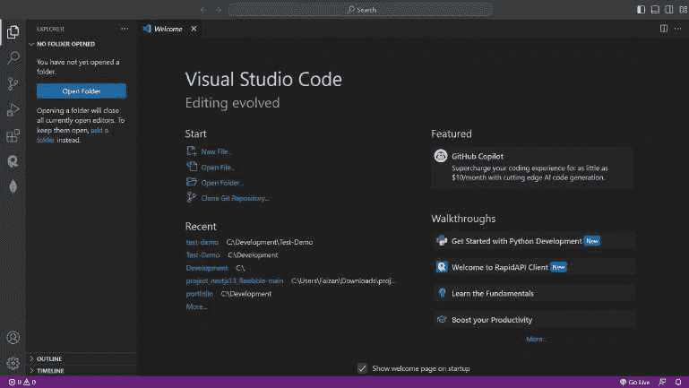
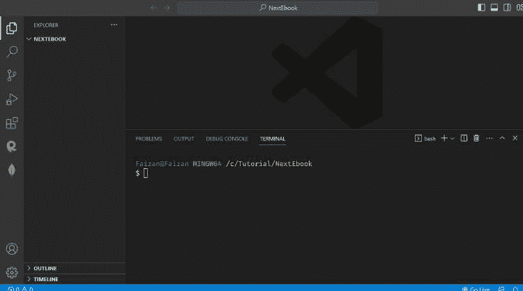
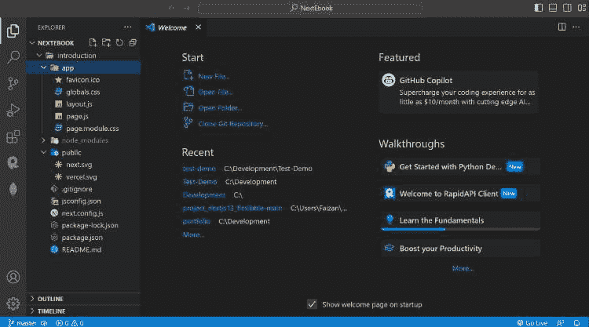
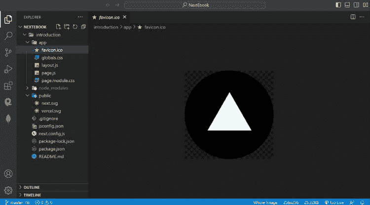
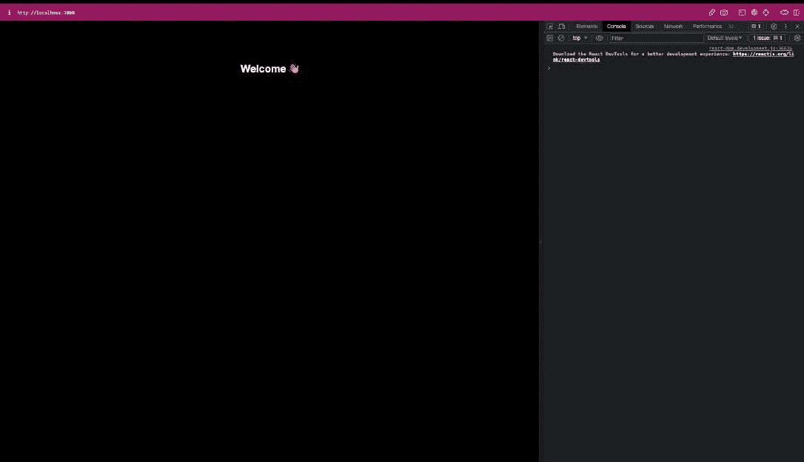
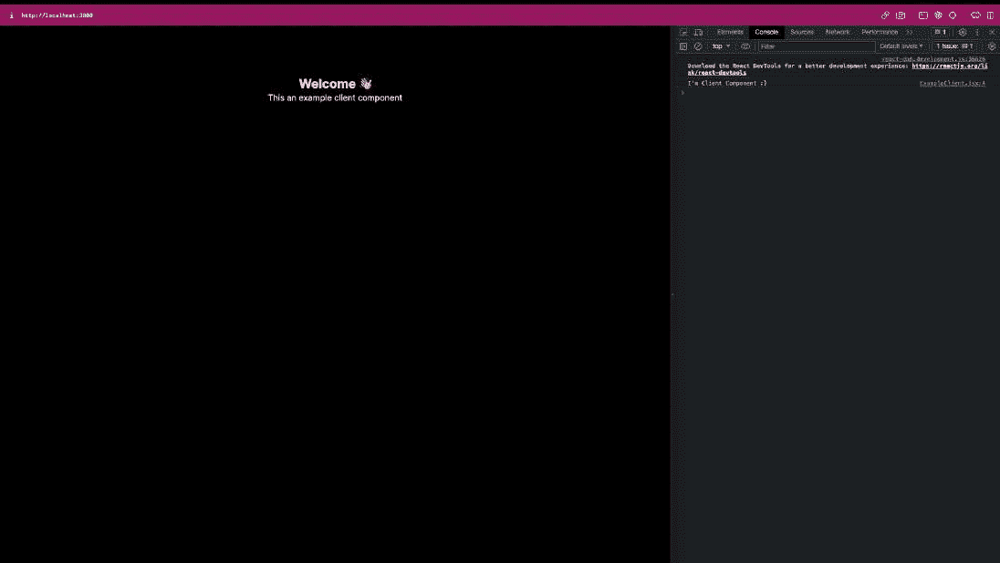
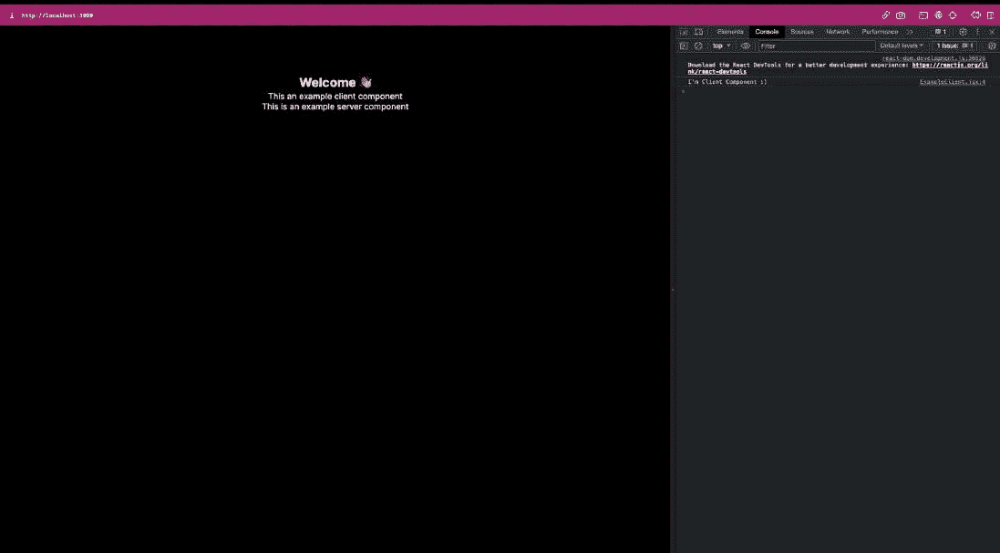
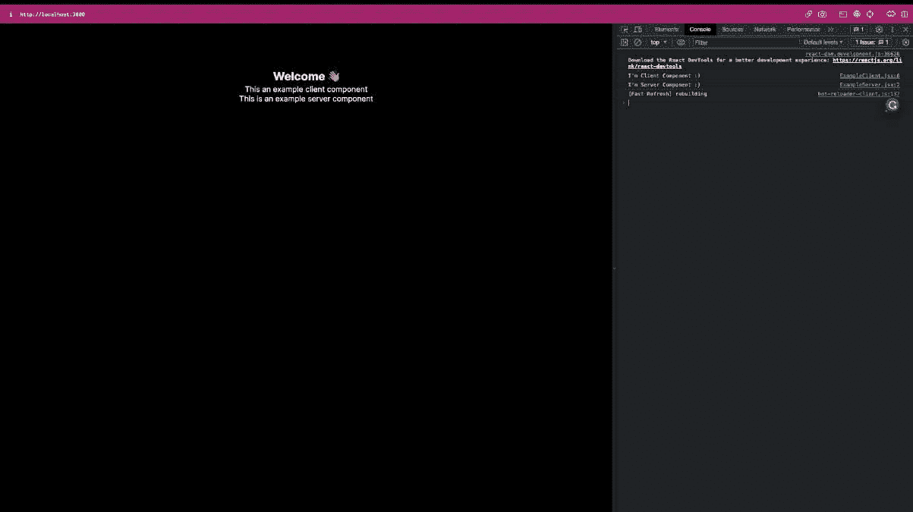

# 终极 Next.js 电子书


## 第一章：诞生

在第一章中，我们将探索 JavaScript 和 Web 开发框架的演变。我们讨论了采用新技术的重要性，并比较了不同框架中的代码段以突出它们的优势。我们介绍了 Next.js，这是一个构建在 React.js 之上的框架，它解决了局限性并整合了新功能。本章最后以建议将重心转向 Next.js 以构建现代 Web 应用而结束。

在不久以前的 2015 年，React.js 登上了舞台。然而，即使 JavaScript 在 IT 行业的历程也不算特别长。JavaScript 最初由 Brenden Eich 于 1995 年在 Netscape 开发，在 2000 年代获得了巨大的流行。

这在很大程度上归于 Google 对 JavaScript 的巧妙利用，为地图探索引入了交互和动态功能。随后，开发者们接触了各种框架和库，包括 jQuery、Angular、Node.js、React.js 以及最近的 Next.js。这些技术彻底改变了 Web 开发格局，为开发者提供了各种能力和可能性。

你可能会想为什么这些信息在当前语境下是相关的。其意义在于，它强调了“变化是常的”这一永恒真理。随着我们作为一个社会不断进步和演变，我们的工具和技术自然会随我们一起进步。我们别无选择，只能拥抱并适应这些变化。它提醒我们，在瞬息万变的 IT 行业环境中，拥抱新想法和技术的意愿对于成长和成功至关重要。

这些技术和工具都有共同的：提高工作效率并提升性能。在这个时代，我们无疑仍然可以使用原生 JavaScript 或使用 HTML 和 CSS 创建网站。

然而，当涉及到大规模开发应用程序时，使用最新技术的效率就超过了传统方法。为了展示和实验这种效率，我们创建了一些代码片段。

### 原生 JavaScript

```javascript
const btn = document.getElementById('btn');
btn.addEventListener('click', () => {
  alert('Hello World!');
});
```

### jQuery

```html
<button id="btn">点击我</button>
<script>
$('#btn').click(function() {
  alert('Hello World!');
});
</script>
```

### Angular

```html
<button (click)="showMessage()">点击我</button>
<script>
import { Component } from '@angular/core';

@Component({
  selector: 'app-example',
  template: `<button (click)="showMessage()">点击我</button>`
})
export class ExampleComponent {
  showMessage() {
    alert('Hello World!');
  }
}
</script>
```

### React.js

```jsx
import React from 'react';

class ExampleComponent extends React.Component {
  showMessage = () => {
    alert('Hello World!');
  }

  render() {
    return (
      <button onClick={this.showMessage}>点击我</button>
    );
  }
}

export default ExampleComponent;
```

### Next.js

```jsx
<button onClick={() => alert('Hello World!')}>点击我</button>
```

## 第二章：序言

在本章中，我们将深入探讨 Next.js，这是一个灵活的 React 框架。我们将探索它相对于 React.js 的优势，包括简化的前端开发、缩短工具配置时间以及易于学习的入门曲线。我们还会讨论 Next.js 如何提升性能、增强 SEO（搜索引擎优化），并随着新功能的不断演进。

在章节结束时，你将掌握掌握 Next.js 的重要性，并准备好与这个框架开启一段兴奋的旅程。

### Next.js：一个灵活的 React 框架

Next.js — 一个灵活的 React 框架。但这意味着什么呢？

在软件开发中，框架充当了一个配备了预定义规则和规范的工具，它为构建应用程序提供了结构化的方法。它提供了一个概述了整体架构、设计模式和工作流的环境，让开发者能够专注于实现特定的应用程序逻辑，而不是处理底层设计。

简单来说，框架为常见功能提供了预构建的解决方案，例如集成数据库、管理路由、处理身份验证等。

那么，Next.js 区别于 React.js 的之处何在？Next.js 引入了许多功能和能力，我们将在接下来的章节中详细介绍。

但你需要理解的是，Next.js 本质上是 React.js 的扩展，包含了预构建的解决方案、即插用的功能以及一些额外的功能。换句话说，Next.js 是构建在 React 之上的，扩展了它的能力。

如果你已经是一个 React.js 开发者，那么 Next.js 之旅将非常顺畅。如果你不熟悉 React.js，你应该先熟悉 React.js 的一些主要基础，例如：如何创建组件、状态管理、代码结构等。

为了帮助你更快学习，我们准备了一份 React.js 快速上手课程，它涵盖了所有要点，并包含了一个项目供你练习和测试技能。


React.js 快速上手课程

立即观看并编码

### 但为什么你应该使用 React 框架——Next.js？

React 不断演进并彻底改变网站的构建方式。它完全改变了你设计和开发应用程序的方法。

它首先鼓励你思考组件，将用户界面拆分为细小的代码片段。你通过描述状态来引入交互，并在这些不同的组件之间建立连接，从而塑造你应用程序的流程。

实现出色的 React 架构需要应用程序所有部分之间的深度集成，而这正是框架大显身场的地方。

#### 减少工具时间

前端开发的每一个方面都经历了创新，从编译、打包、压缩、格式化等，到部署等等方面。有了 Next.js，我们就不再需要担心配置这些工具，从而可以将更多时间投入到编写 React 代码上。我们可以使用开源解决方案处理路由、数据获取、渲染、身份验证等，从而更多地关注业务逻辑。

#### 易于学习的入门曲线

如果你熟悉 React.js，你会发现 Next.js 要简单得多。Next.js 构建在 React.js 的基础之上，提供了出色的文档，对使用 Next.js 的原因和如何使用都提供了详尽且详细的信息。由 Vercel 团队开发的“Next.js”指南被认为是学习体验的最佳资源之一。

持续的更新和社区的帮助让开发过程变得更加简单。Next.js 的核心特性之一是它不仅是一个前端 React 框架，更是一个全栈 React 框架，让你能够在编写前端代码的同时编写后端代码。

这如何有助于“易于学习的入门曲线”呢？这难道不是另一项需要学习的内容吗？

绝对不是。

你将处理的代码的后端部分比你想象的要简单得多。你不需要像处理任何传统后端应用那样设置任何内容或配置任何路由。

事实上，Vercel 的副总裁 Lee Robinson 表达了以下观点：

> 从 React + Express 迁移到框架减少了大量的代码和依赖项，并将 HMR 从 1.3s 提升到了 131ms。


如果这里讨论的后端和工具方面让你困惑，不必担心。在接下来的章节中，我们将深入探讨如何在 Next.js 中实现这些内容。

#### 提升的性能

Next.js 提供了内置功能，如服务端渲染、静态站点生成和自动代码分割，通过实现快速页面加载、增强 SEO 和提升用户体验来优化性能。

然而，这并不意味着服务端能力仅限于 Next.js。React 引入了一个名为“服务端组件”的新概念，允许在服务器上渲染组件。

所以，为什么选择 Next.js 而仅使用 React？优势在于 Next.js 提供的便利性和生产力。通过利用 Next.js，你无需大量配置即可利用现有功能。

#### SEO——搜索引擎优化

可能是应用程序中最被忽视但必须讨论的话题：React.js 的缺点。Next.js 和 React.js 的区别在于渲染方式。

搜索引擎爬虫就像网站的忙碌游客。它们访问并请求页面内容，探索页面上的链接，仔细检查并整理以便排名。这是它们每天的工作。为了良好工作，它们需要能够访问页面内容。

React.js 在客户端渲染所有内容，从服务器发送的是的 HTML 响应。浏览器执行 JavaScript 文件来生成 HTML。这为搜索引擎爬虫访问和理解页面完整内容带来了挑战。

相反，Next.js 提供了静态站点生成（SSG）或服务端渲染（SSR）的选项。通过 SSG 或 SSR，服务器发送完整的 HTML 文件和少量的 JavaScript 代码，仅渲染需要交互的内容。这使得搜索引擎爬虫能够轻松访问并索引网站的每一个页面。

#### 不断进进

Next.js 作为一个不断演进的框架，不断引入新功能来简化开发者的生活。去年发布了 7+ 个版本，Next.js 专注于创新和改进以提供更好的用户体验。这正是像 Next.js 这样的框架的目标。

此外，像 Expo 等用于构建 React Native 项目的其他技术也在采用 Next.js 的突破性功能。受 Next.js 文件系统路由系统的启发，Expo 开发者实现了一个类似的功能——Expo Router，用于改进 React Native 中使用了十年的路由系统。

这不是很棒吗？精通一个功能就能在多个平台上轻松地使用。

然而，Next.js 提供的功能列表远超我们目前提到的内容。

它提供了广泛的能力，包括无缝基于文件的路由、高效的代码分割、图像与字体优化、HMR（热模块替换）、API 路由（后端）、对 Sass 和 CSS 模块内置支持、数据获取选择（SSG、SSR、ISR）、错误处理、Metadata API（用于 SEO）、国际化（支持任何语言语言）等。

最好的方法是通过实际实现来首次尝试这些功能，以真正体会它的潜力。这正是我们将在接下来的课程中要做的——深入编码层面！

“嗯，好吧。我愿意信任你对 Next.js 等新功能的见解。但是，真的有人在使用它吗？公司是否在积极寻找具有 Next.js 专业的专家？行业内对它的需求高吗？”——你也有同样的疑问吗？

让数据来说话：

## Next.js 的行业采用情况


在过去的 30 天内，Next.js 在全球范围内的搜索关注度高于 React.js。

但嘿，这只是 Google 趋势。行业情况如何？人们真的在使用 Next.js 创建网站吗？

当然，让我们来看看“Next.js 秀”，它展示了不同的公司如何使用 Next.js：

- Notion
- Hulu
- Netflix Jobs
- Nike
- HBO Max
- Airbnb
- Typeform
- TikTok
- Auth0
- Product Hunt
- 现代
- Porsche
- repl.it
- Marvel
- Futurist
- Material-UI
- Coco Colab
- Ferrari
- Hashnode
- Verge

还有许多知名名称。这证明了人们对 Next.js 的热情和广泛采用！

考虑到公司采用 Next.js 的速度之快，如果我们在未来几个月、甚至几年内见证 Next.js 职位需求的巨大激增，也并不意外。

现在是抓住机会并通过掌握 Next.js 为未来的职场做好准备的完美时机。

通过这本书以及我们已经做过并将继续制作的课程，你可以成为下一个 Next.js 开发者。


所以，拿起杯咖啡，让我们开始这段令人兴奋的旅程吧！

## 第三章：路线图

### 概述

路线图是 Web 开发要素的简明指南。它涵盖了用于构建网页内容的 HTML、用于样式和布局的 CSS 以及用于交互的 JavaScript。学习者将掌握语义化标签、视觉效果、变量、控制流、函数和操作 DOM 等重要概念。

本章为初学者提供了创建动态和交互式 Web 应用所需的技能。

在我们开始探索 Next.js 之前，复习或重学一些基础概念会让学习变得更容易。这切都从通过基础知识建立坚实的基础开始。

将此路线图看作学习 Next.js 所应该掌握的基础知识总结。如果你不熟悉集成数据库或实现身份验证等高级主题，也没关系。

这些点可以帮助你理解核心概念，而不必关注具体的编码细节。

在 Next.js 中，实现这些概念有多种方法。你有多种选择，比如利用 NextAuth（最酷的功能之一）、探索像 Clerk 这样流行的市场解决方案，甚至从头开始构建。

同样，涉及到数据库时，你可以在不同的选项之间选择，例如 Postgres 等 SQL 数据库、MongoDB 等 NoSQL 数据库，甚至可以使用 Prisma 作为 ORM（对象关系映射）管理器。

你是否有编码经验在这里并不是最重要的因素。真正重要的是理解底层概念。路线图的设计旨在向你介绍这些概念，并让你在渴望成为 Next.js 开发者时熟悉这些有益的知识。

在接后的章节中，通过我们的品牌课程，你将学习如何在 Next.js 中完成所有代码工作。所以不要担心；我们会是你的后盾！

路线图展示如下。

这些点可以帮助你理解核心概念，而不必关注具体的编码细节。


### Web 开发基础

#### HTML——超文本标记语言

##### 基础

理解 HTML 文档的结构、元素和属性。

- 结构
- 元素
  - `<!DOCTYPE>`
  - `<html>`
  - `<head>`
  - `<body>`
  - 标题：`<h1>` 到 `<h6>`
  - 段落：`<p>`
  - 列表：`<ul>`、`<ol>`、`<li>`
  - 链接：`<a>`
  - 图像：``
  - 输入：`<input>`、`<textarea>`
  - 按钮：`<button>`
  - 分组元素：`<div>`
- 语义化：使用 `<header>`、`<nav>`、`<main>`、`<section>`、`<aside>`、`<footer>` 等元素。
- 表单：学习创建表单、处理用户输入、通过使用表单元素和 `onSubmit` 事件监听器执行表单验证等，以增强文档结构的访问性。

#### CSS——层级样式表

##### 基础

理解 HTML 文档的结构、元素和属性。

- 结构
  - 盒模型
  - 选择器：理解使用 `padding`、`margin`、`border` 样式化
    - 类型
    - 类
    - ID
    - 子元素
    - 兄弟元素
- 字体学
- 颜色与背景：探索 `font-size`、`weight`、`alignment` 等文本属性。
- 理解如何设置不同的 `colors`、`gradients`、背景图像。
- 学习不同的显示值，如 `block`、`inline`、`inline-block`。


## 布局与定位

- 探索如何以不同方式定位元素：`relative`、`absolute`、`sticky`、`fixed`
- 掌握 flexbox 布局以创建响应式布局
- 深入研究网格布局

### 布局与定位

- 显示
- 位置
- Flexbox
- Grid

路线图 18

- 学习使用 `delay`、`timing`、`duration`、`property`、`timing-function` 创建流畅过渡
- 探索 2D 和 3D 变换，如 `scaling`、`rotating`、`translating`
- 学习如何使用 keyframes 创建动画
- 探索盒投影和线性渐变

### 效果

- 过渡

### 高级（+）

- 学习如何使用 Sass 等 CSS 处理器或 Tailwind CSS 等框架进行更强大的样式处理
- 变换
- 动画
- 阴影与渐变

路线图 19

## JavaScript

### 基础

- 变量与数据类型
- 运算符
- 控制流
- 函数
- DOM 操作

- 声明变量并理解不同的数据类型，如 `string`、`number`、`boolean`、`null`、`undefined`、`object`、`array` 等
- 学习使用不同的算术、比较、逻辑和赋值运算符对数据进行操作
- 尝试并测试条件语句 `if-else`、`switch` 以及循环 `for`、`while` 来控制流
- 定义并学习创建不同的函数，理解作用域并处理参数和返回值
- 了解如何使用 JavaScript 修改网页上的 HTML 元素是一项重要技能。它就像我们在 React 或 Next.js 中以不同方式使用的构建块。

记得我们在原生 JavaScript 和 React 中展示的各种“Hello World”示例吗？代码结构在 React 中有点不同。

路线图 20

如果你不确定如何使用 HTML、CSS 和 JavaScript 学习并创建网站，你可以通过正确的免费课程立即创建一个精美的寿司网站：


使用 HTML & CSS 构建并部署寿司网站

立即观看并代码

2


2

## 现代 JavaScript

### ES6 特性

- 箭头函数
- 解构

在 JavaScript 中，有各种函数。你经常遇到的一种类型被称为箭头函数。很多人更喜欢使用箭头函数，因为它们更短更容易编写。

当我们从数组和对象中提取值时，这是一个非常有用的概念。

路线图 21

### 展开语法

允许将数组或对象的元素展开为独立的元素。

### 模板字面量

这是广泛使用的一种。使用反引号，我们可以使用占位符和表达式来插值字符串。

### 模块

学习如何在文件之间导入和导出代码以组织代码。

## 异步编程

### Promises

理解 Promise 的概念以及为什么它们是必要的。学习 Promise 的解析（resolving）和拒绝（rejecting），并利用 `then` 和 `catch` 处理异步操作。

### Async/Await

探索 `async/await` 的用法，以更接近同步的方式编写异步代码。这种约定被广泛用作使用 `then` 和 `catch` 处理 Promise 的替代方案。

### Fetch API

发现如何在浏览器中使用 Fetch API 发送 HTTP 请求并处理返回的响应。

路线图：22

### Axios (Plus)

探索流行的第三方库 Axios，与标准的 Fetch API 相比，它简化了发送 HTTP 请求的过程。

## 其他 JavaScript 概念

### 数组方法

熟悉不同的广泛使用的数组方法，以简化开发过程。例如：

- `map`
- `filter`
- `reduce`
- `slice`
- `splice`
- `forEach`
- `includes`
- `join`
- `reverse`

以及其他。

### 错误处理

因此，对于每个开发者来说培养错误处理技能都是至关重要的。熟悉 `try-catch-finally` 块，它使能够捕获错误并使用友好且易于理解的语言在用户界面上显示它们。

路线图：23

## 生态系统

### 基础

### Node.js

一个 JavaScript 运行时环境，允许我们在浏览器之外运行 JavaScript 代码。

### NPM — Node 包管理器

一个管理第三方包的工具。使用它，你可以下载项目内部需要的不同包，如 Axios。

### Webpack

像 webpack 或 Parcel 这样的打包器有助于将 JavaScript 文件和其他资源合并成单个包（bundle）。

### Babel

像 Babel 这样的转译器将现代 JavaScript 代码转换为所有浏览器中都能运行的版本。

使用 React 或 Next.js 时需要它。确保你已经下载了它。

在我们继续学习 React.js 和 Next.js 等库和框架之前，我们需要某种配置来设置这些项目：

3


3

路线图：24

## 版本控制 (Plus)

学习像 Git 这样的版本控制系统对于任何在开发者道路上的人都非常有价值。

- Git - 版本控制系统。
- GitHub - 一个在云端管理 git 仓库的 Web 服务。

从这里开始，你正在高效地学习 Next.js。这些概念与 Next 中使用的概念是一样的。

4


4

## React JS

### 基础

- 组件
- JSX

以组件思考。学习将代码或 UI 拆分为小的、易管理的组件，以实现可重用性和维护性。

创建组件有两种方式，即：

- 类组件 (Class Component)
- 函数组件 (Function Component) — 广泛使用

除了这些，学习“什么是 JSX？”以及“组件生命周期”。

JSX 是 React 中的一种语法，允许你编写 HTML 代码。它看起来像 HTML 但并不是。

路线图：25

### 状态 (State) 和 Props

学习如何创建和管理状态 — 一个存储应用程序特定数据的小存储。

学习如何在组件之间传递 props（数据片段）。

### 事件 (Events)

学习如何使用事件处理器处理用户交互，例如点击和表单提交。

### 条件渲染

学习如何条件渲染组件并使用映射技术渲染动态数据列表。

注意：在渲染动态列表时不要忘记学习特殊的`key`属性。

路线图：26

### Hooks

Hooks 是允许我们管理状态和副作用并提高效率的特殊函数。著名的 hooks 有：

- `useState`
- `useEffect`
- `useRef`
- `useContext`
- `useCallback`
- `useMemo`

### 路由

学习不同的状态管理选项，如 Redux 或 Context。

路线图：27

### 样式 (Style)

探索组件样式的不同方法，包括：

- CSS modules
- Sass
- TailwindCSS
- Material UI
- styled-components
- Emotion

如果你想学习 React 样式的基础，可以查看这个系列。

### 表单 (Forms)

- Formik
- React Hook Form

学习创建表单验证。

### HTTP 请求

使用 Axios 等库处理表单提交。使用内置的 Fetch API 进行请求。

路线图：28

### CSS

[PAGE 34]


React JS Full Course 2023 | Redux Toolkit

如果你想使用 Redux 等工具增强你的状态管理技能，可以探索我们的专业课程：


Ultimate React Course with Framer Motion

jsmastery

此外，如果你想创建一个具有现代且吸引设计的网站来给客户或潜在雇主留下印象，我们建议你查看这个系列。它教授如何使用 TailwindCSS、Sass 甚至纯 CSS 构建响应式网站。

路线图：29

## 托管平台

- 进阶（加餐版）
- Vercel
- Netlify
- Firebase
- AWS Amplify
- Heroku
- Render
- Railway

## CI/CD — 持续集成/持续部署

- Docker

构建后端应用可能具有挑战性，但通过充分的练习，你可以获得必要的技能。如果你对深入的项目教程感兴趣，特别是教你使用 Express 和 MongoDB 进行后端开发的教程（这是一个非常流行的技术栈），请随时探索我们在 YouTube 上提供的一些免费课程：


全栈 MERN 项目 - 构建并部署应用 | YouTube - 立即观看并编码

路线图 33

[](img/76188a8f748fc585400eeef7e6351b2a_39_1.png)

构建并部署一个带有 CRUD、认证、图表的全栈 MERN 应用 - YT - 立即观看并编码

如果你想增强使用 Redux Toolkit 等工具进行状态管理的能力，可以探索我们的专业级课程：


构建并部署一个全栈 MERN AI 图像生成应用 | DALL-E 克隆版 - YT - 立即观看并编码

现在，最后，我们将深入探讨 Next.js 路线图。这可能并不是必要的，因为这本书内容的组织方式使得每一章都作为一个指导性的里程碑，而且它是你掌握 Next.js 所需的唯一资源（当然，还有一些构建和部署课程）！

尽管如此，对于你来说，

路线图 34


## Next.js

### 基础

- 学习我们为什么要使用 Next.js 及其优势
- 掌握 Web 开发和 React.js 的基础知识
- 熟悉生态系统
- 使用 `create next-app` 设置 Next.js 应用

- 架构
- 基于文件的路由

### 状态

- Prop（属性传递）
- 组件
- 模块

### 路由

- 简单路由
- 嵌套路由
- 动态路由
- 并行路由
- 拦截路由

### 环境

- Node
- NPM/Yarn
- NPX
- 客户端
- 服务器

理解 Next.js 应用的架构，包括不同的文件和目录，例如 app 目录与 pages 目录的对立。学习如何在 Next.js 中创建不同类型的路由。

接下来，通过探索两个不同的渲染过程，深入研究 Next.js 功能的核心机制：

路线图 35

### 渲染方法

- SSG（静态站点生成）
- SSR（服务端渲染）
- ISR（增量静态再生）
- CSR（客户端渲染）

### 样式

- CSS 模块
- Tailwind CSS
- Sass

Next.js 内置对 Sass 等 CSS 处理器的支持。尝试在 Next.js 中使用不同类型的样式，找到最适合你应用程序的一种。

### 数据获取

- 静态站点生成
- 服务端渲染
- 增量静态再生
- 客户端渲染

你可以灵活地为你的应用程序选择不同类型的渲染和数据获取方法。详细了解这些每个概念对于决定如何以及何时为应用程序实施最合适的策略至关重要。

### SEO 和元数据

学习如何使用 SEO 策略并利用 Next.js 的 Metadata API。

学习要点：

- 静态元数据
- 动态元数据
- 基于文件的元数据

路线图 36

### 处理错误、加载状态及更多

最新的 Next.js 13 app 目录引入了各种文件约定，有助于有效的错误处理、加载状态管理、显示未找到的页面，甚至以更结构化的方式组织布局。

- `error.js` 文件
- `loading.js` 文件
- `not-found.js` 文件
- `layout.js` 文件

### 身份验证

学习后，在 Next.js 中使用 NextAuth 实现自定义电子邮件/密码或社交认证将变得轻而易举。你可以使用与 Next.js 配合的一些认证库来加速开发过程：

- NextAuth
- Clerk

### API 路由

探索如何创建 API 路由 —— 后端：

- 静态路由处理器
- 动态路由处理器
- 路由处理器 (Route Handlers)
- 中间件
- 支持的 HTTP 方法
- NextResponse
- CORS 和请求头
- 创建请求处理器

路线图 37

### 数据库

- MongoDB
- Postgres
- Prisma

发现如何利用 API 路由将各种数据库集成到你的 Next.js 应用中。

如果你是一个比起阅读更喜欢视频内容的人，你会发现我们在 YouTube 上提供的最新的 Next.js 13 速成课程非常有趣。本课程不仅涵盖了 Next.js 的基础知识，还引导你利用 Next.js 的最新功能构建全栈项目：

如果你对学习如何使用 Next.js 的服务端渲染 (SSR) 实现复杂的过滤、分页和搜索有浓厚兴趣，那么你应该查看这个资源：

[](img/76188a8f748fc585400eeef7e6351b2a_43_1.png) Next.js 13

 构建并部署全栈

路线图 38

请记住，当你积极编码时，变化就会发生。所以，准备好咖啡开始编码。

路线图 39

## 第 4 章 工作原理

在本章中，我们将通过理解 Next.js 来奠定基础。在深入研究 Next.js 之前，我们先查看传统的 HTML、CSS 和 JavaScript 是如何工作的。

### 传统的 Web 工作方式

传统的 Web 工作方式如下：

- 浏览器请求 HTML、CSS 和 JavaScript 文件。
- 服务器发送这些文件。
- 浏览器解析 HTML 并应用 CSS。
- JavaScript 操作 DOM（文档对象模型）。
- 这种方式被称为“客户端渲染”。

它是如何工作的？

当用户访问这样的网站时：

- 客户端（浏览器）向服务器（托管网站的另一台计算机）发送请求以显示内容。
- 服务器发送文件。

### 有什么局限性？

#### 处理

大多数处理发生在客户端，这意味着用户的网络浏览器负责渲染 HTML 页面并执行存在的任何 JavaScript 代码。

然而，如果网站非常复杂，且用户的设备需要更强大的性能，可能会给浏览器带来压力，并为其处理带来负担。

#### 带宽

由于服务器为每个页面请求向客户端发送完整文件，这会增加带宽的占用。在处理包含大量页面以及散布在网站各视频和音频片段的复杂网站时，这一点变得尤为显著。

#### 加载时间

与最新技术相比，初始页面加载时间可能更长。这是因为每个请求都必须传输完整的文件。只有在服务器发送了所有必要文件且浏览器完成所有解析后，我们才能查看网站的内容。

### React 方式

这就是 React 发挥用场的地方。它通过引入组件、虚拟 DOM 概念和客户端-服务器机制改进了开发生命周期。

当你访问一个 React 网站时，客户端浏览器向服务器发送网页内容的请求。作为响应，服务器发送一个极简的 HTML 文件（作为整个应用程序的入口点）以及一个打包好的 JavaScript 文件。

React 使用该 JavaScript 文件启动客户端渲染，并操作虚拟 DOM。React 不是直接修改实际 DOM，而是更新虚拟 DOM，然后仅将必要的更改应用到真实 DOM，从而实现预期的页面显示。

React 利用其客户端路由库 React Router 在 React 应用程序内导航到不同的页面。该库允许在不进行完整服务器请求的情况下更改路由，从而防止页面刷新。

当触发新路由时，React Router 会根据新 URL 重新渲染相关组件。如果新页面需要从服务器获取数据，相应的组件将发起请求以检索必要数据。

### 有什么局限性？

#### 复杂性

构建 React 应用可能比传统的 HTML、CSS 和 JavaScript 网站具有更高的复杂性。它涉及到组件化思维、状态（state）和属性（props）的管理以及与虚拟 DOM 的交互，对于初学者 React.js 的开发者来说可能需要学习曲线。

#### 处理


与传统方法类似，React 主要执行客户端渲染。它严重依赖 JavaScript 进行初始渲染以及随后的请求来更新用户界面，而在客户端浏览器中完成这些操作。

然而，这种对客户端渲染的依赖可能会延迟渲染和交互，尤其是在处理器较慢且资源有限的设备上。

### SEO

是的，正如在引言章节中提到的，React 与 Next.js 相比的一个显著缺点在于：搜索引擎爬虫可能需要帮助才能完全访问网站内容，因为所有内容都是通过 JavaScript 处理并仅在客户端渲染的。结果，这会影响网站在搜索引擎结果中的可见性。

## 它的原理


### Next.js 方式 - 两者的结合

在了解了这两种技术的优缺点后，Vercel 允许我们选择在客户端还是服务器端渲染内容。

通常，当用户访问 Next.js 站点时，客户端向服务器发送请求，服务器开始执行 React 组件并生成 HTML、CSS 和 JavaScript 文件，并将完全渲染的 HTML 作为响应返回给客户端。该文件包含了初始数据和标记，让客户端立即渲染，而无需等待 JavaScript 下载和执行。

从这里开始，Next.js 接管并执行客户端水合（hydration）。你是否遇到过水合错误（hydration error），即用户界面与最初在服务器上渲染的内容不匹配？嗯，这就是怎么回事。水合是将 React 组件的预渲染 HTML 占位符（如 `div`、`form`、`span`）绑定事件处理程序和交互性，以与客户端渲染的内容保持一致。这是 Web 开发的热点：服务器端渲染（SSR）！

对于随后的请求，你完全控制在服务器端（SSR）还是客户端（CSR）进行渲染。在接下来的章节中，我们将深入讨论不同类型的服务器渲染以及客户端渲染，以及何时使用何种。

## 第 5 章：创建 Next.js 应用

在本章中，你将学习如何创建一个 Next.js 应用。你将从设置 Node.js 和 VS Code 等必要工具开始。然后，你将使用 `create-next-app` 创建一个新的 Next.js 项目。你将探索项目结构并理解重要文件的目的。

### 创建 Next.js 应用

现在，你将学习如何创建一个 Next.js 应用。你将从设置 Node.js 和 VS Code 等必要工具开始。然后，你将使用 `create-next-app` 创建一个新的 Next.js 项目。你将探索项目结构并理解重要文件的目的。

在下载了 Node.js 和 VSCode 后，让我们设置你的第一个 Next.js 应用。去你想要创建项目的地方。它可以是任何位置，但建议保持良好的结构。在该位置创建一个新文件夹并命名为“NextEbook”。如果你喜欢其他名称，可以自行选择。该文件夹将包含我们将涵盖的所有代码。



现在，按照以下步骤将创建的文件夹打开到我们选择的代码编辑器（VSCode）中：

- 启动 VSCode
- 点击顶部菜单栏中的“File”（文件）
- 从下拉菜单中选择“Open Folder”（打开文件夹）
- 浏览到你创建的“NextEbook”文件夹
- 选择“NextEbook”文件夹
- 点击“Open”（打开）按钮。

按照这些步骤，你可以在 VSCode 中查看你的"NextEbook"文件夹。

VSCode 提供了内置的终端，无需单独打开操作系统的终端或命令提示符。通过 VSCode 的内联终端，我们可以在应用程序内完成所有必要任务。

要打开终端，按`ctrl + `` `(反引号)`或点击顶部菜单栏上的“Terminal（终端）”选项。在下拉菜单中选择“New Terminal（新建终端）”。终端窗口将显示如下：



最后，让我们现在创建我们的 Next.js 应用程序。有两种选项：

- 自动安装
- 手动安装

## 创建 Next.js 应用程序

手动安装涉及单独获取和配置包，并组织初始文件和文件夹结构以及一些代码。我们必须自己完成一切。

另一种方法旨在通过允许我们根据偏好选项创建应用程序来加速开发过程。根据我们的偏好（例如是否使用 TypeScript、引入像 Tailwind CSS 这样的样式库或选择其他选项），只需点击一下即可设置整个项目。

由于其被广泛使用且安装简单，我们可以通过运行一个零依赖 CLI（命令行界面）工具——`create-next-app` 来创建一个 Next.js 项目。如果你想详细了解此信息，可以访问链接。在里面，你会看到`create-next-app`是如何使用模板创建的，包括包含/不包含 JavaScript、Tailwind CSS 等。

别担心；你不需要将`create-next-app`作为另一个全局包下载。多亏了 `npx`！

当你安装了 Node.js 时，你还得到了两个实用的工具：NPM 和 NPX。

NPM 代表 Node Package Manager（Node 包管理器），它允许我们管理和下载运行应用程序所需的各种包（代码集合）。例如，用于发送 HTTP 请求的 Axios 等包，或用于状态管理的 Redux Toolkit 等。

NPX 是 Node Package Runner（Node 包运行器）的缩写，是一个命令行工具。它允许我们在不向系统全局安装包的情况下执行这些包。需要注意的是，`npx` 用于运行命令行工具和执行包中的命令，但它不处理包的安装。该责任由 `npm` 承担，它负责包的安装。

让我们离开理论讨论，继续执行将自动安装运行 Next.js 应用程序所需包的命令。

```
npx create-next-app@latest
```

一旦你按下回车键，它将提示你确认是否可以下载所需的包。请选择 "yes" 继续安装。

在安装过程中，我们将逐个遇到一系列提示。这些提示允许你为我们的 Next.js 应用程序选择特定的功能和配置。

- 你的项目名称是什么？`introduction`
- 你想在项目中使用 TypeScript 吗？`No`
- 你想在项目中使用 ESLint 吗？`No`
- 你想在项目中使用 Tailwind CSS 吗？`No`
- 你想在项目中使用`src/`目录吗？`No`
- 使用 App Router（推荐）吗？`Yes`
- 你想自定义默认的导入别名吗？`No`

让我们选择不包含 TypeScript、ESLint 和 Tailwind CSS。在接下来的章节中，我们将详细探索这些选项。

如果你仔细观察安装过程，你会看到"Using npm"。`npx` 仅用于执行包中的命令，而 `npm` 处理这些包的安装。


大功告成！Next.js 应用程序已成功安装。现在，让我们探索内部。点击“introduction”文件夹或你为项目选择的名字。在里面，你会找到几个文件和文件夹。

[](img/76188a8f748fc585400eeef7e6351b2a_60_2.png)

### App

它是应用程序的根，我们将在这里创建各种客户端（前端）路由并可能编写后端代码。最初，你会在此位置找到一些启动文件，包括：

### favicon.ico

它代表在浏览器标签页中显示的网站图标。默认情况下，图标是 Vercel 图标。你可以将其替换为你喜欢的。



### globals.css

此文件包含应用程序的 CSS 代码。它是一个全局文件，可以在其中定义 CSS 变量、导入字体或执行初始化任务。你可以保留该文件、重命名它甚至将其移动到不同的位置。这没有关系。但是，如果你对此文件进行了任何更改，必须更新应用程序中依赖于它的其他部分。

### global.css

```css
:root {
  --background: #ffffff;
  --foreground-rgb: #171717;
  --card-start: #ffffff;
  --card-end: #f2f2f2;
  --primary: #0070f3;
  --primary-foreground: #ffffff;
  --secondary: #7a7a7a;
  --secondary-foreground: #ffffff;
  --max-width: 100%;
  --border-radius: 8px;
  --font-main: ui-system, -apple-system, Segoe UI, Roboto, Helvetica, Arial, sans-serif, "Apple Color Emoji", "Segoe UI Emoji", "Segoe UI Symbol";
  --font-mono: ui-monospace, SFMono-Regular, Menlo, Monaco, Consolas, "Liberation Mono", monospace;
}
```

```css
body {
  background: var(--background);
  color: var(--foreground-rgb);
}
```

### layout.js

它是应用程序的主入口点。根。父级。无论你喜欢如何称呼它。如果你在里面写了任何内容，它将出现在每个客户端（前端）路由上。它是通用的。如果你需要导入字体、添加元数据、用 Redux 包裹应用程序或显示导航栏，这里是执行操作的地方。所有这些任务都可以在此文件中完成。

### page.js

它是根路由 `/`。不要将此文件与 `layout.js` 混淆。你在该文件内编写的任何内容都会显示。

### page.module.css

此 CSS 文件专门为特定页面设计。`.module.css` 的命名约定表示此文件中的 CSS 规则是针对特定组件的。在这种情况下，它对应于 `page` 组件。如果你仔细检查代码，你会发现存在：

```
import styles from './page.module.css'
```


### Node Modules

它是核心！`node_modules` 目录是运行项目所需的所有依赖或包的存储位置。当我们使用 `npm` 安装包时，相应包的代码将被放置在此目录中。

例如，如果我们安装 Axios，`node_modules` 文件夹中将创建一个 `axios` 的文件夹。如果你一直在密切关注，你可能注意到 Next.js 是基于 React 构建的。因此，你可以探索 `node_modules` 文件夹找到 `react` 文件夹，它包含了 React 本身的代码。

除了 React 之外，你还会遇到几个其他文件夹，例如 `next`（启用 Next.js 特性）、`react-dom`、`postcss`、`styled-jsx` 等。这些文件夹中的每一个都包含运行 Next.js 应用程序所需的许多文件和代码。

不过不必担心。你以后不需要与此目录进行交互（除非发生了糟糕的事情）。在我们安装或卸载 node 包时，`npm` 会自动管理 `node_modules` 文件夹。


### Public

这是一个允许我们包含静态资源如图像或字体、视频等文件的特殊文件夹。此文件夹的内容会自动优化并在整个应用程序中可用。因此，建议我们将需要的 PNG、JPEG 或 SVG 放在此文件夹中。


### .gitignore

`.gitignore` 是一个特殊的文本文件，告诉 Git（版本控制系统）排除某些文件和目录。`.gitignore` 文件中的一个常见条目是 `node_modules`。

这是因为 `node_modules` 目录包含了在为 Node.js 项目安装依赖时生成的许多文件和文件夹。将这些文件包含在版本控制中会导致不必要的混乱，并增加仓库的大小。

正如 Node.js 的创始人 Ryan Dahl 所说：


我们绝不想追踪宇宙中"最重的物体"！


### jsconfig.json

还记得我们运行 Next.js CLI 工具时出现的提示吗？它询问我们是否想要自定义默认的导入别名（import alias），而我们选择了"No"。

创建一个 Next.js 应用

√ Would you like to customize the default import alias? No

嗯，`jsconfig.json` 文件与该问题有关。它是一个配置文件，我们可以在其中为项目设置各种选项和配置。我们可以配置的内容之一就是导入行为。

默认情况下，当我们要从一个文件导入代码到另一个文件时，我们使用如下相对路径：

```javascript
import { something } from '../../components'
```

这是正确的，但有时相对路径很长且复杂。在较大的项目或具有复杂目录结构的项目中，手动为每个导入指定相对路径会变得繁琐且容易出错。

然而，通过配置 `jsconfig.json` 文件中的 `compilerOptions`，我们可以告诉编译器我们想要使用的特定导入路径结构。

如果我们查看 `jsconfig.json` 文件的内容，会有：


```json
{
  "compilerOptions": {
    "paths": {
      "@/*": ["./*"]
    }
  }
}
```

创建一个 Next.js 应用

在此配置中，我们使用`baseUrl`定义了路径别名。这意味着现在我们可以执行以下操作：

```javascript
import { something } from '@/components'
```

即：使用`@/*`来代表位于此位置`./*`（即根目录！）的任何文件和文件夹！


根据你的喜好自定义别名。你可以将`@/*`更改为`@/*`甚至`#/*`——选择权在于你！


## package-lock.json

你是否想过把它看作一个不需要的文件？嗯，让我告诉你，它实际上非常重要。这个名为`package-lock.json`的文件在我们安装或更改包时自动创建。它作为一个锁文件，仔细地记录所有已安装包及其依赖的特定版本。

想象一个场景：你正在开发一个 Next.js 项目。完成工作后，你将项目代码分享给经理，但你忽略了`package-lock.json`文件，认为它不是必需的。

现在，你的经理开始下载`package.json`文件中列出的包。包管理器 npm 会安装指定的包及其依赖项（即我们在`node_modules`文件夹内部看到的文件夹和文件）。

创建一个 Next.js 应用

然而，如果任何依赖项发布了新版本，包管理器会急于下载它。不幸的是，如果这个新版本可能包含未解决的 bug 或兼容性问题，可能会导致你的应用程序运行异常。

[](img/76188a8f748fc585400eeef7e6351b2a_68_1.png)

结果是，经理可能会感到沮丧并说“在我的机器上无法运行”，而你感到无助并回答道“在我的机器上可以运行”。


了解重要性并始终分享你的`package-lock.json`文件


## package.json

把它看作一张关于你的信息卡——你是谁，你来自哪里等，但带有更完整的细节。它包含了项目名称及其版本，并告诉我们运行此项目所需的依赖和开发依赖。

- **dependencies**：运行项目生产环境所需的包。

- **devDependencies**：仅在开发过程中需要的包。例如`eslint`。

每当我们安装一个包（无论是依赖还是开发依赖），npm 都会在`package.json`文件的相应部分记录包名称及其对应的版本。

创建一个 Next.js 应用

这种方式，`package.json`文件记录了项目所需的所有包，更容易管理开发和生产环境。

此外，我们可以看到另一个部分，即“scripts”。它包含了使用 npm 的可执行命令或脚本。我们可以完全自定义它。通过这些命令/脚本，我们可以运行测试、构建项目、启动服务器或部署应用程序。

最后，


## README.md

它就像是项目的手册或指南——一个可以在其中写下关于项目信息的文件，例如如何安装它、它是做什么的，以及其他人如何为其贡献。

一个良好的 README 有助于人们理解我们的项目以及他们如何使用或参与其中。这就像给他们提供了关于如何利用我们项目的说明。

现在，让我们最后运行应用程序。我们需要执行刚才提到的“scripts”部分的命令之一，特别是“dev”命令。

在继续之前，确保终端路径设置为正确的位置。由于我们在文件夹内部创建了一个名为“introduction”的子文件夹，我们需要进入它。这样做请在打开的终端中输入以下命令：

```bash
cd introduction
```

创建一个 Next.js 应用

“cd” 命令代表“切换目录”，将我们引导进入“introduction”文件夹。

现在运行，

```bash
npm run dev
```

此命令将在端口 3000 启动本地开发服务器。要查看应用程序运行情况，打开你的浏览器并输入 URL：如果你正确遵循了所有步骤，你应该能看到应用程序按预期运行：http://localhost:3000


img/76188a8f748fc585400eeef7e6351b2a_70_1.png

呼，为了涵盖初始文件和文件夹结构做了这么多解释。但如果我们不采取行动，一切徒用。让我们从仓库中更改一些东西来看看它是如何工作的。

创建一个 Next.js 应用

## page.js

打开`page.js`文件并删除所有现有代码。我们将通过创建 Home 组件来重新开始。


```javascript
export default function Home() {
  return (
    <>
      Hello World
    </>
  )
}
```

进行更改后，保存文件并返回浏览器。如果你再次访问 localhost，你应该在不需要手动刷新页面的看到“Hello World”的更新内容。这是因为 Next.js 的快速刷新（Fast Refresh）功能，我们在编辑代码时实时反映更改。

## layout.js

现在，打开`layout.js`文件并在`body`标签内添加文本：


```javascript
import './globals.css';
import { Inter } from 'next/font/google';

const inter = Inter({ subsets: ['latin'] });

export const metadata = {
  title: 'Create Next App',
  description: 'Generated by create next app',
};

export default function RootLayout({ children }) {
  return (
    <html lang="en">
      <body className={inter.className}>
        Hello, I'm Groot
        {children}
      </body>
    </html>
  );
}
```


花点时间思考：这段文字会出现在哪里？它会显示在 "Hello World" 之前还是之后？或者，它可能根本不会显示，因为我们正处于根路由，即 "/"。

3, 2, 1... 思考结束了吗？


要找到你问题的答案，请访问浏览器。你是对的！

文字将显示在 "Hello World" 之前。


创建 Next App

http://localhost:3000


为什么？因为`layout.js`是应用的父级或根。

](img/76188a8f748fc585400eeef7e6351b2a_72_5.png)

但为什么是在 “Hello World” 之前呢？因为我们在文字 "Hello, I'm Groot" 之后渲染了`layout.js`的子组件。


```jsx
<html lang={en}>
  <body className={inter className}>
    Hello, I'm Groot
    {children}
  </body>
</html>
```

创建一个 Next.js 

65

反转顺序，见证魔法，即：


```jsx
<html lang={en}>
  <body className={inter className}>
    {children}
    Hello, I'm Groot
  </body>
</html>
```

等等，代码是：`children`属性是由 Next.js 传递给`layout.js`中的`RootLayout`组件的。它包含了应用程序所有的子组件或路由组件，从首页路由开始延伸到我们可能创建的任何其他路由。


```jsx
// children is passed as a prop by Next.js 
/* Contains the route components, i.e., home route */
export default function RootLayout({ children }) { 
  return (
    <html lang="en">
      <body className="inter">
        Hello, I'm Groot
        {children}
      </body>
    </html>
  )
}
```

足够清楚了吗？

太棒了！在你急着开始下一章之前，我有几个任务需要你完成：

创建一个 Next.js 应用

66


## 任务

- 注释掉`RootLayout`内部的`{children}`，看看你是否还能看到 “Hello World”。

```jsx
import './globals.css'
import { Inter } from 'next/font/google'

const inter = Inter({ subsets: ['latin'] })

export const metadata = { 
  title: 'Create Next App',
  description: 'Generated by create next app',
}

export default function RootLayout({ children }) { 
  return (
    <html lang="en">
      <body className={inter.className}>
        /* {children} */
        Hello, I'm Groot
        {children}
      </body>
    </html>
  )
}
```

- 在 Next.js 和 Web 开发背景下，解释 Node.js 的用途。

- 解释`create-next-app` CLI 工具的用途和用法，以及我们为什么配合它使用`npx`。

- `node_modules`目录在 Next.js 项目中的作用是什么？为什么建议不要将其纳入版本控制？

## 第6章

## 客户端 vs 服务器

在本章中，你将深入研究 Next.js 中的客户端渲染 (CSR) 和服务端渲染 (SSR) 概念。你将探索 Next.js 如何处理客户端和服务器的渲染，理解每种方法的优缺点，并学习如何在你的 Next.js 应用中实现 CSR 和 SSR。

## 客户端 vs 服务器

到目前为止，我们理解 Next.js 结合了服务端和客户端渲染以获得两者的优势。但我们需要找出应用程序的哪些部分是在服务器上的。我们可以选择渲染的内容吗？

在回答这些问题之前，让我们回顾一下我们所说的客户端和服务器。这些术语到底是什么意思？

- 客户端指的是你正在使用的设备，例如手机或电脑。

- 服务器本质上是一台电脑，但它配备了我们将部署的配置。

在 Next.js 之前的版本中（13版本之前），我们遇到过一个限制，即像 "/"、"/about" 等页面只能在服务器上渲染。

问自己：

该组件需要用户交互吗？

是 — 客户端组件 (Client Component)

否 — 服务器组件 (Server Component)

为了简化问题，Next.js 文档提供了一个非常有用的表格，指导你在哪里渲染每个组件。

你需要做什么？

| 服务器组件 (Server Component) | 客户端组件 (Client Component) |

| :--- | :--- |

| 获取数据。 | 添加交互和事件监听 (onClick(), onChange(), 等) |

| 访问后端资源（直接） | 使用状态和生命周期副作用 (useState(), useReducer(), useEffect(), 等) |

| 将敏感信息保留在服务器（访问令牌、API 密钥等） | 使用仅限浏览器的 API |

| 将大型依赖保留在服务器 / 减少客户端 JavaScript | 使用依赖于状态、副作用或仅限浏览器 API 的自定义 hook |

| | 使用 React 类组件 |

!!

客户端组件 vs 服务器组件

令人印象深刻！你刚刚发现了现代时代最重要的特性之一。好好休息一下！

准备好继续了吗？

Next.js 13 app 目录的另一个突破性方面是，所有组件默认情况下被视为服务器组件。没错；除非另有指定，否则每个组件都被视为服务器组件。

那么我们如何将其与客户端组件区分开来呢？

很简单，只需在组件顶部写入`"use client"`即可。这是一种直观且巧妙的方法，用来指示该组件应被视为客户端组件。


现在理论足够了。让我们开始编写代码。要开始，请按照上一节中的步骤在`Nextbook`文件夹内快速设置 Next.js 项目。

在继续之前，确保终端路径指向`Nextbook`文件夹而不是`introduction`文件夹。要退出`introduction`文件夹，你可以运行命令：

`cd ..`

现在执行`create-next-app`命令。在这个示例中，我将使用`client-server`作为新文件夹名称，但你可以选择你喜欢的名称。

安装完成后，使用`cd`命令进入`client-server`文件夹并启动应用程序。现在进入`app`文件夹，找到`page.js`文件，删除`main`和`h2`标签以外的所有内容：

app/page.js


```javascript
import styles from './page.module'

export default function Home() {
  return (
    <main className={styles.main}>
      <h2>Welcome</h2>
      <h2>Where do I render?</h2>
    </main>
  )
}
```

`app/page.module.css`

```css
/* styles here */
```


如果你愿意，可以删除 `page.module.css` 文件中的所有内容，只保留 `main` 标签的样式：

`app/page.module.css`

```css
.main {
  display: flex;
  flex-direction: column;
  align-items: center;
  padding: 6rem;
  min-height: 100vh;
}
```

在我们的 `page.js` 文件添加 `console log` 后，让我们打开浏览器看看它是否在那里：

安装完成后，使用 `cd` 命令进入 `client-server` 文件夹并启动应用程序。


### 创建 Next App

`http://localhost:3000`

!

嗯，“我在哪里渲染？”那里没有显示。这是怎么回事？确实，你是对的。正如之前讨论的，所有这些组件默认都是服务器组件！

那么，不在浏览器中，我们在哪里查看 `console` 语句呢？你知道的吧？终端！让我们回到终端，检查提到的日志文本是否存在：

## 客户端组件 vs 服务器组件

### 终端

```bash
npm run dev
- next dev
- wait compiling /page (client and server)...
- event client and server successfully in 390 ms (413 modules)
```

### 我在哪里渲染？


好了，日志在那里。现在，让我们为每个客户端和服务器创建两个组件。在文件夹根目录下（即 `app` 文件夹之外），创建一个名为 `components` 的新文件夹。在里面创建两个新文件 `ExampleClient.jsx` 和 `ExampleServer.jsx`。

`components/ExampleClient.jsx`

```javascript
"use client"
export default function ExampleClient() {
  console.log("I'm Client Component :)")
  return (
    <div>
      <p>This example client component</p>
    </div>
  )
}
```

### 客户端组件 vs 服务器组件

以及较小的 `ExampleServer` 组件如下：

`components/ExampleServer.jsx`

```javascript
export default function ExampleServer() {
  console.log("I'm Server Component :)")
  return (
    <div>
      <p>This an example server component</p>
    </div>
  )
}
```

现在，首先在 `app/page.js` 文件中导入并使用 `ExampleClient` 组件：

`app/page.js`

```javascript
import styles from './page.module'
import ExampleClient from '../components/ExampleClient'

export default function Home() {
  return (
    <main className={styles.main}>
      <h2>Welcome</h2>
      <ExampleClient />
    </main>
  )
}
```


完美。让我们先在浏览器中查看哪里能看到 `console log`，


### 创建 Next App

`http://localhost:3000`

!

好吧，那是正确的，对吧？我们明确要求 Next.js 将 `ExampleClient.jsx` 渲染为客户端组件。很合理！

`app/page.js`


```javascript
import React from 'react';
import ExampleClient from '@/components/ExampleClient';
import ExampleServer from '@/components/ExampleServer';
import styles from './page.module.css';

export default function Home() {
  console.log("Where do I render?");

  return (
    <main className={styles.main}>
      <h2>Welcome</h2>
      <ExampleClient />
      <ExampleServer />
    </main>
  );
}
```

### 我在何处渲染？

`console.log("Where do I render?");`

- `ExampleClient`
- `ExampleServer`

现在，当我们访问浏览器，虽然网站上同时显示了客户端组件和服务器组件的文本，但浏览器的控制台内只会显示“`I'm Client Component :)`”的日志：


### Create Next App

`http://localhost:3000`

[](img/76188a8f748fc585400eeef7e6351b2a_88_2.png)

## 客户端 VS 服务器

80

而终端将显示所有三个控制台日志：

### Terminal

`npm run dev`

- `next dev`
- `wait compiling /page (client and server)...`
- `event compiled client and server successfully in 588 ms (548 modules)`
- `Where do I render?`
- `I'm Server Component :)`
- `I'm Client Component :)`

一切正常！

在最后的演示中，让我们从 `app/page.js` 中移除 `ExampleServer`，将其移到 `components/ExampleClient.js` 内部。

`app/page.js`


```javascript
import React from 'react';
import ExampleClient from '@/components/ExampleClient';
import styles from './page.module.css';

export default function Home() {
  console.log("Where do I render?");

  return (
    <main className={styles.main}>
      <h2>Welcome</h2>
      <ExampleClient />
    </main>
  );
}
```

`Where do I render?`

- `ExampleClient`

## 客户端 VS 服务器

81

而 `ExampleClient` 看起来如下所示：

`components/ExampleClient.jsx`

```javascript
"use client";
import React from "react";
import ExampleServer from "./ExampleServer";

const ExampleClient = () => {
  console.log("Where do I render?");

  return (
    <>
      <h2>ExampleClient</h2>
      <ExampleServer />
    </>
  );
};

export default ExampleClient;
```

这是一个客户端组件示例。

- `ExampleClient`

```javascript
const ExampleServer = () => (
  <div>
    <p>I'm Server Component :)</p>
  </div>
);

console.log("ExampleServer");
```

点击保存，并在终端和浏览器控制台中查看结果。

首先，让我们看看终端显示的内容：

### Terminal

`npm run dev`

- `next dev`
- `wait compiling /page (client and server)...`
- `event compiled client and server successfully in 429 ms (549 modules)`
- `Where do I render?`
- `I'm Client Component :)`
- `I'm Server Component :)`

## 客户端 VS 服务器

82

如预期的所示，由于 Next.js 的预渲染和服务器功能，我们看到了三个控制台日志。

但浏览器控制台中的某些看起来不太对……


### Create Next App

`http://localhost:3000`

[](img/76188a8f748fc585400eeef7e6351b2a_91_1.png)[](img/76188a8f748fc585400eeef7e6351b2a_91_1.png)

为什么服务器组件的日志会出现在这里？它不是应该只在服务器端运行吗？

嗯，在 Next.js 中，存在一种模式在起。当我们在文件中使用 `"use client"` 时，导入到该文件的所有其他模块（包括子服务器组件）都会被视为客户端模块的一部分。

将 `"use client"` 视为服务器代码和客户端代码之间的分界线。一旦你设置了这个边界，其内部的所有内容都将变成客户端代码。

理解了吗？如果没有，也不用担心。

## 客户端 VS 服务器

83

记住：不要在客户端组件中包含服务器组件。

如果你遇到这种情况，我们有一个解决方案。我们将在专门的章节中详细讨论该问题，届时我们将深入探讨客户端和服务器组件的渲染过程。此外，我们还将根据真实案例分享一些创建不同类型组件的宝贵技巧和窍门。

在我们深入学习 Next.js 的另一个功能之前，花些时间完成以下任务以巩固你的学习：


## 任务


在 `app/page.js` 中加入 `"use client"`，查看日志的位置：

`app/page.js`


```javascript
"use client";
import React from 'react';
import ExampleClient from '@/components/ExampleClient';
import styles from './page.module.css';

export default function Home() {
  console.log("Where do I render?");

  return (
    <main className={styles.main}>
      <h2>Welcome</h2>
      <ExampleClient />
    </main>
  );
}
```

`Where do I render?`

- `ExampleClient`

## 客户端 VS 服务器

84


- `app` 目录关于客户端/服务器渲染的最新功能有哪些？


- Next.js 中哪些类型的组件？请解释它们的区别。


- 服务器端渲染的处有哪些？

## 客户端 VS 服务器

85


这就结束了吗？绝对没有！

我们有大量的后续章节等待你。从路由、渲染、数据获取、后端 API 路由、数据库、TypeScript，甚至扩展到测试、最佳实践以及 Next.js 技巧和窍门。本电子书涵盖了所有。

我们将其标记为“必读”书籍是有的。我们只是揭露出一角。请关注后续更新，我们将发布更多章节来释放 Next.js 13 的全部潜力。

完成目前所有的章节后，请给自己鼓个掌吧。我们非常感谢听到你的建议或反馈。

你可以通过此链接提供你的诚实意见：

`.link`

通过你的反馈和合作，我们将在未来几周内为你们带来最佳版本的 Next.js。感谢！

## 客户端 VS 服务器

86
